# Manual Definitivo de Estudos: Banco de Dados II

> **Instituição:** Centro Universitário de Santa Fé do Sul (UniFEF)  
> **Curso:** Bacharelado em Sistemas de Informação (3º Semestre)  
> **Disciplina:** Banco de Dados II  
> **Docente Responsável:** Prof. Guilherme de Morais  
> **Finalidade:** Consolidação teórica, metodológica e prática de modelagem relacional, Linguagem de Definição de Dados (DDL), Linguagem de Manipulação de Dados (DML), Linguagem de Consulta de Dados (DQL), álgebra relacional, funções escalares, junções e operações analíticas de agregação.

---

## Sumário

- [Visão Geral e Arquitetura de Sistemas Relacionais](#visão-geral-e-arquitetura-de-sistemas-relacionais)
- [Mapeamento Conceitual e Teoria de Modelagem (DER)](#mapeamento-conceitual-e-teoria-de-modelagem-der)
  - [Entidades Fortes, Fracas e Restrições de Dependência](#entidades-fortes-fracas-e-restrições-de-dependência)
  - [Tipologia de Atributos e Normalização](#tipologia-de-atributos-e-normalização)
  - [Auto-Relacionamentos e Hierarquias de Supervisão](#auto-relacionamentos-e-hierarquias-de-supervisão)
  - [Relacionamentos Muitos-para-Muitos e Entidades Associativas](#relacionamentos-muitos-para-muitos-e-entidades-associativas)
  - [Estudos de Caso de Modelagem Conceitual](#estudos-de-caso-de-modelagem-conceitual)
- [Linguagem de Definição de Dados (DDL) e Integridade Estrutural](#linguagem-de-definição-de-dados-ddl-e-integridade-estrutural)
  - [Gerenciamento de Bancos de Dados e Contexto de Sessão](#gerenciamento-de-bancos-de-dados-e-contexto-de-sessão)
  - [Tipagem de Dados Transacionais e Domínios de Armazenamento](#tipagem-de-dados-transacionais-e-domínios-de-armazenamento)
  - [Integridade Referencial: Chave Primária e Chave Estrangeira](#integridade-referencial-chave-primária-e-chave-estrangeira)
  - [Declaração de Restrições em CREATE TABLE vs ALTER TABLE](#declaração-de-restrições-em-create-table-vs-alter-table)
  - [Evolução de Esquemas: Modificações com ALTER TABLE](#evolução-de-esquemas-modificações-com-alter-table)
- [Linguagem de Manipulação de Dados (DML) e Garantias Transacionais](#linguagem-de-manipulação-de-dados-dml-e-garantias-transacionais)
  - [Inserção de Tuplas com INSERT INTO: Formas Explícita e Posicional](#inserção-de-tuplas-com-insert-into-formas-explícita-e-posicional)
  - [Ordem Topológica de Carga e Restrições de Dependência](#ordem-topológica-de-carga-e-restrições-de-dependência)
  - [Atualização de Dados com UPDATE e Cláusula SET](#atualização-de-dados-com-update-e-cláusula-set)
  - [Exclusão de Registros com DELETE FROM](#exclusão-de-registros-com-delete-from)
  - [O Risco Crítico da Omissão do WHERE e Estratégias Defensivas](#o-risco-crítico-da-omissão-do-where-e-estratégias-defensivas)
  - [Análise Comparativa: DELETE vs TRUNCATE vs DROP](#análise-comparativa-delete-vs-truncate-vs-drop)
- [Linguagem de Consulta de Dados (DQL): Fundamentos e Filtros](#linguagem-de-consulta-de-dados-dql-fundamentos-e-filtros)
  - [Arquitetura de Execução: Ordem Léxica vs Ordem Lógica de Processamento](#arquitetura-de-execução-ordem-léxica-vs-ordem-lógica-de-processamento)
  - [Álgebra Relacional: Projeção e Seleção](#álgebra-relacional-projeção-e-seleção)
  - [Projeção de Colunas e Impacto do Caractere Coringa](#projeção-de-colunas-e-impacto-do-caractere-coringa)
  - [Ordenação Determinística com ORDER BY](#ordenação-determinística-com-order-by)
  - [Filtragem Horizontal com WHERE e Operadores Relacionais](#filtragem-horizontal-com-where-e-operadores-relacionais)
  - [Álgebra Booleana: Conjunção, Disjunção, Negação e Precedência](#álgebra-booleana-conjunção-disjunção-negação-e-precedência)
  - [Eliminação de Redundância com DISTINCT](#eliminação-de-redundância-com-distinct)
  - [Expressões Aritméticas e Escopo de Apelidos](#expressões-aritméticas-e-escopo-de-apelidos)
  - [Seleção por Intervalo Fechado com BETWEEN](#seleção-por-intervalo-fechado-com-between)
  - [Pertinência a Conjuntos Discretos: IN e NOT IN](#pertinência-a-conjuntos-discretos-in-e-not-in)
  - [Casamento de Padrões em Strings: LIKE, ILIKE e Metacaracteres Curinga](#casamento-de-padrões-em-strings-like-ilike-e-metacaracteres-curinga)
- [Funções Escalares Especializadas: Manipulação Temporal e Textual](#funções-escalares-especializadas-manipulação-temporal-e-textual)
  - [Captura e Decomposição Temporal: NOW, DATE, AGE e EXTRACT](#captura-e-decomposição-temporal-now-date-age-e-extract)
  - [Aritmética Temporal com INTERVAL e Sargabilidade](#aritmética-temporal-com-interval-e-sargabilidade)
  - [Funções de Manipulação Textual: ASCII, LENGTH, LOWER e UPPER](#funções-de-manipulação-textual-ascii-length-lower-e-upper)
  - [Concatenação de Strings e Propagação de Nulos](#concatenação-de-strings-e-propagação-de-nulos)
  - [Extração Posicional de Subcadeias com SUBSTRING](#extração-posicional-de-subcadeias-com-substring)
- [Junções Relacionais e Recombinação de Dados](#junções-relacionais-e-recombinação-de-dados)
  - [Fundamentação da Álgebra de Junção](#fundamentação-da-álgebra-de-junção)
  - [Junção Histórica SQL-89 vs Junção Padrão ANSI SQL-92](#junção-histórica-sql-89-vs-junção-padrão-ansi-sql-92)
  - [Junção Interna: INNER JOIN](#junção-interna-inner-join)
  - [Junção Externa à Esquerda: LEFT JOIN e Preservação de Tuplas](#junção-externa-à-esquerda-left-join-e-preservação-de-tuplas)
  - [Detecção de Registros Órfãos com Antijunção](#detecção-de-registros-órfãos-com-antijunção)
  - [Armadilhas da Lógica Tri-Valorada em Junções Externas](#armadilhas-da-lógica-tri-valorada-em-junções-externas)
- [Funções Agregadas e Particionamento Analítico](#funções-agregadas-e-particionamento-analítico)
  - [Funções Agregadas Escalares Globais](#funções-agregadas-escalares-globais)
  - [Comportamento de Nulos em Funções de Agregação](#comportamento-de-nulos-em-funções-de-agregação)
  - [Particionamento de Grupos com GROUP BY](#particionamento-de-grupos-com-group-by)
  - [Filtragem Pós-Agregação: O Papel Crítico da Cláusula HAVING](#filtragem-pós-agregação-o-papel-crítico-da-cláusula-having)
  - [Diferenças Operacionais e Semânticas: WHERE vs HAVING](#diferenças-operacionais-e-semânticas-where-vs-having)
- [Caderno Prático de Laboratório e Resoluções de Exercícios](#caderno-prático-de-laboratório-e-resoluções-de-exercícios)
  - [Laboratório 1: Domínio Concessionária de Veículos (20 Exercícios)](#laboratório-1-domínio-concessionária-de-veículos-20-exercícios)
  - [Laboratório 2: Domínio Distribuidora e Vendas (Atividade Material 04 - 36 Exercícios)](#laboratório-2-domínio-distribuidora-e-vendas-atividade-material-04---36-exercícios)
  - [Laboratório 3: Domínio Financeiro de Duas Tabelas (Clientes e Pedidos)](#laboratório-3-domínio-financeiro-de-duas-tabelas-clientes-e-pedidos)
- [Engenharia de Consultas, Boas Práticas e Matriz de Decisão](#engenharia-de-consultas-boas-práticas-e-matriz-de-decisão)
- [Glossário Terminológico de Banco de Dados](#glossário-terminológico-de-banco-de-dados)
- [Checklist de Revisão Pré-Prova](#checklist-de-revisão-pré-prova)
- [Banco de Questões e Gabarito Analítico](#banco-de-questões-e-gabarito-analítico)

---

## Visão Geral e Arquitetura de Sistemas Relacionais

O modelo relacional de dados, introduzido por Edgar Frank Codd em 1970, assenta-se sobre a teoria matemática dos conjuntos e a lógica de predicados de primeira ordem. Em Sistemas de Informação, a transição entre o modelo conceitual de negócio e a persistência física em disco requer a aplicação sistemática de três linguagens complementares que formam o ecossistema SQL (*Structured Query Language*):

1. **DDL (Data Definition Language):** Conjunto de instruções destinadas a criar, alterar e descartar a estrutura lógica dos objetos no catálogo do Sistema Gerenciador de Banco de Dados (SGBD).
2. **DML (Data Manipulation Language):** Instruções responsáveis pela alteração de estado dos dados, compreendendo inserções, atualizações e exclusões de tuplas.
3. **DQL (Data Query Language):** Comandos dedicados à extração, filtragem, transformação escalar, recombinação relacional e agregação de conjuntos de dados.

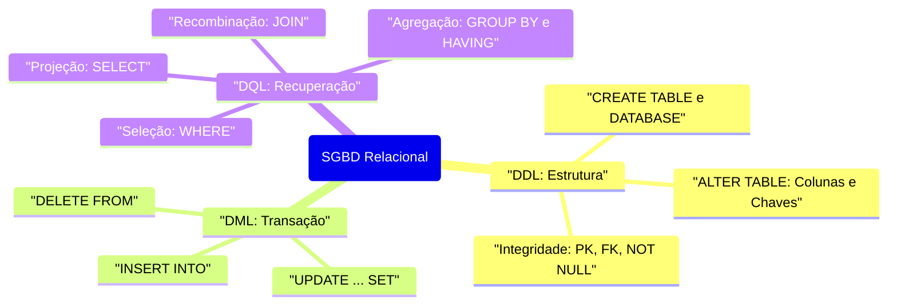

A integridade do banco de dados depende da garantia de que o SGBD aplique as regras declaradas no esquema, impedindo que falhas em camadas externas de software corrompam as relações entre entidades corporativas.

---

## Mapeamento Conceitual e Teoria de Modelagem (DER)

### Entidades Fortes, Fracas e Restrições de Dependência

No projeto de bancos de dados, uma **Entidade Forte** possui identidade autônoma, existindo independentemente de outras instâncias no domínio de negócio. Seus registros são identificados univocamente por uma Chave Primária primária intrínseca.

Uma **Entidade Fraca** não possui atributos suficientes para formar uma chave primária própria e depende ontologicamente da existência de uma entidade forte (proprietária). Sua identidade é estabelecida por uma Chave Parcial (ou discriminador) combinada com a chave primária da entidade forte vinculada.

- **Definição:** A dependência de existência dita que a exclusão da entidade forte acarreta obrigatoriamente a eliminação de todas as suas entidades fracas associadas.
- **Motivação:** Em um sistema corporativo de recursos humanos, o dependente de um colaborador não tem razão de existir no plano de benefícios se o funcionário titular for removido do sistema.
- **Exemplo:** `FUNCIONARIO` (forte, chave `CPF`) e `DEPENDENTE` (fraca, identificada pela chave composta `CPF_FUNCIONARIO` + `NOME_DEPENDENTE`).
- **Contraexemplo:** Criar uma tabela de dependentes com um ID sequencial totalmente desvinculado do funcionário titular, permitindo a existência de dependentes sem titular registrado.
- **Armadilha:** Tratar entidades fracas como tabelas isoladas sem aplicar restrições de integridade referencial com remoção em cascata (`ON DELETE CASCADE`), o que gera registros órfãos quando a entidade forte é removida.

### Tipologia de Atributos e Normalização

Os atributos caracterizam as propriedades das entidades no modelo conceitual:

| Classificação do Atributo | Definição Formal | Mapeamento no Modelo Relacional |
| :--- | :--- | :--- |
| **Simples (Atômico)** | Indivisível em partes menores de negócio (ex.: Salário, CPF). | Coluna direta na tabela da entidade. |
| **Composto** | Formado por subcomponentes com significado autônomo (ex.: Nome composto por Primeiro, Médio e Último; Endereço composto por Rua, Número, Bairro, CEP). | Decomposição em múltiplas colunas primitivas atômicas na relação (Primeira Forma Normal - 1FN). |
| **Multivalorado** | Admite múltiplos valores para uma mesma instância de entidade (ex.: Telefones de um cliente, Habilidades de um funcionário). | Criação de uma relação dependente filha com Chave Estrangeira apontando para a entidade mestre. |
| **Derivado** | Valor calculado a partir de outros atributos persistidos ou de dados de sistema (ex.: Idade calculada a partir de `Data_Nascimento` e `NOW()`). | Não persistido fisicamente; computado dinamicamente via consultas (`DQL`) ou gerado por visões (`VIEW`). |

### Auto-Relacionamentos e Hierarquias de Supervisão

Um **Auto-Relacionamento** (ou relacionamento recursivo) ocorre quando uma entidade participa mais de uma vez em um mesmo relacionamento, exercendo papéis distintos.

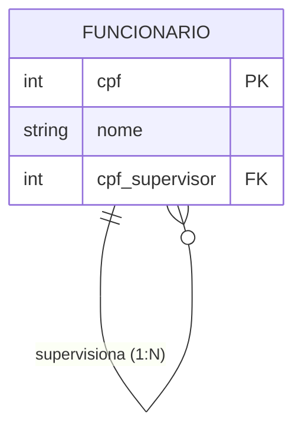

- **Definição:** Uma linha na tabela `FUNCIONARIO` aponta para outra linha na mesma tabela `FUNCIONARIO`.
- **Papéis:** O registro pai atua como "Supervisor"; o registro filho atua como "Supervisionado".
- **Sintaxe Relacional:** A coluna `cpf_supervisor` é declarada como chave estrangeira (`FOREIGN KEY`) que referencia a chave primária `cpf` da própria relação `FUNCIONARIO`.

### Relacionamentos Muitos-para-Muitos e Entidades Associativas

Quando a cardinalidade entre duas entidades é do tipo Muitos-para-Muitos ($`N:N`$), o modelo relacional proíbe a inserção de chaves estrangeiras vetoriais nas tabelas base para não violar a Primeira Forma Normal.

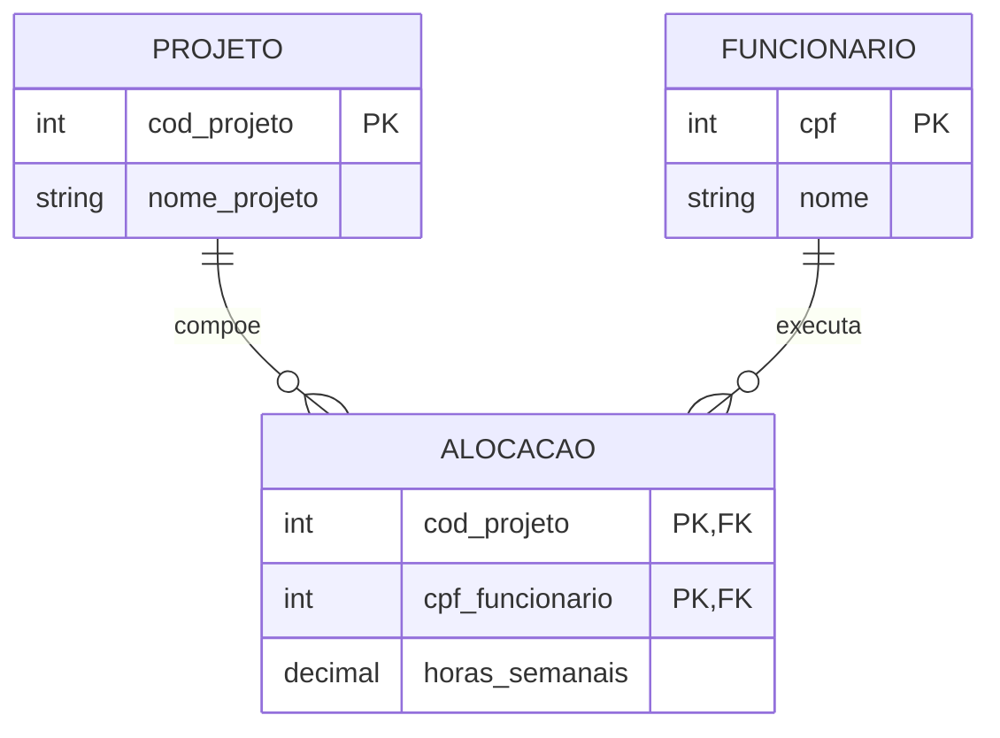

- **Mecanismo:** Cria-se uma relação intermediária (Entidade Associativa) denominada `ALOCACAO`.
- **Composição da Chave:** A chave primária de `ALOCACAO` é tipicamente uma chave composta formada pelas chaves primárias das duas tabelas originais (`cod_projeto` + `cpf_funcionario`), ambas atuando simultaneamente como chaves estrangeiras.
- **Atributos de Relacionamento:** Propriedades que dependem do par conjugado (como `horas_semanais`) devem residir obrigatoriamente na entidade associativa, e nunca isoladas em `PROJETO` ou `FUNCIONARIO`.

### Estudos de Caso de Modelagem Conceitual

#### Caso 1: Sistema Corporativo Empresa
- **Requisitos:** Funcionários com nome decomposto (Primeiro Nome, Segundo Nome, Último Nome), múltiplos telefones, auto-relacionamento de supervisão, dependentes que só existem vinculados a um colaborador, departamentos com gerente exclusivo (1:1) e alocação de colaboradores em projetos com controle de horas.

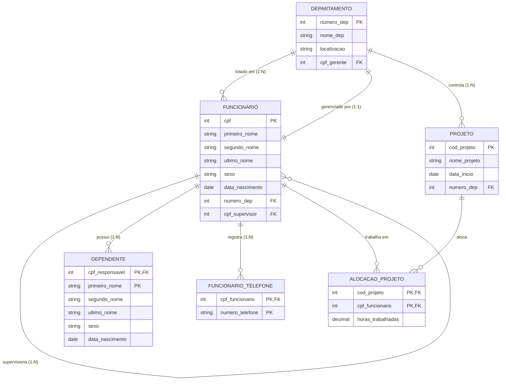

#### Caso 2: Sistema Integrado de Pet-Shop
- **Requisitos:** Clientes que possuem animais cadastrados, prestação de serviços (envolvendo cliente, animal e funcionário executor) e controle de vendas de produtos fornecidos por empresas parceiras.

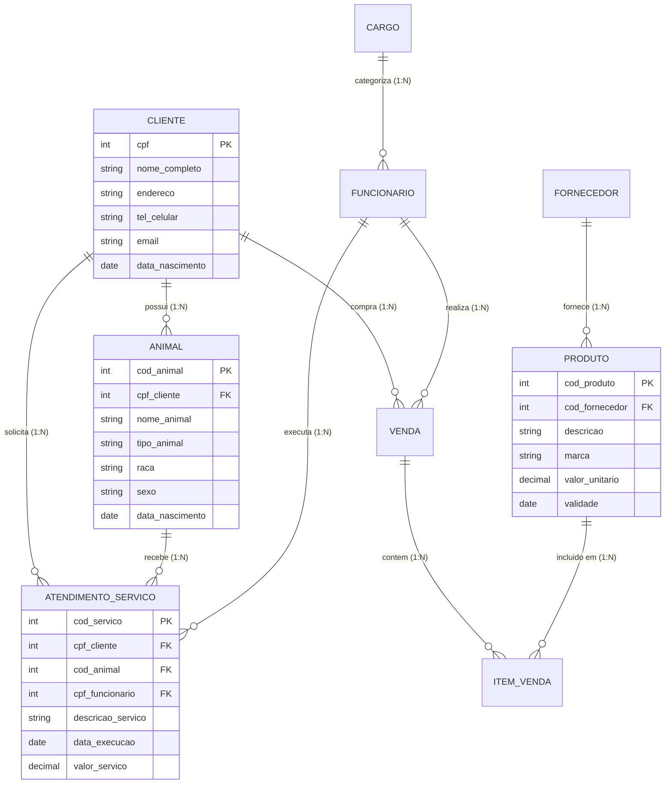

---

## Linguagem de Definição de Dados (DDL) e Integridade Estrutural

### Gerenciamento de Bancos de Dados e Contexto de Sessão

Em SGBDs compatíveis com ANSI SQL, uma instância de servidor hospeda múltiplos catálogos lógicos. A criação e a seleção do contexto de trabalho são formalizadas via DDL:

```sql
-- Alocacao de catalogo relacional
CREATE DATABASE EscolaDB;

-- Selecao do catalogo para a sessao de trabalho atual
USE EscolaDB;
```

- **Motivação:** Isolar esquemas relacionais departamentais e impedir colisões de identificadores.
- **Contraexemplo:** Executar comandos `CREATE TABLE` imediatamente após a conexão sem definir o banco ativo, provocando erro fatal de "Nenhum banco de dados selecionado".

### Tipagem de Dados Transacionais e Domínios de Armazenamento

A seleção de tipos de dados determina a fidelidade matemática, o custo de armazenamento em páginas de disco e o desempenho de indexação:

| Tipo SQL | Domínio e Características | Uso Recomendado | Contraexemplo de Uso |
| :--- | :--- | :--- | :--- |
| `INT` / `INTEGER` | Inteiro de 32 bits assinado ($`-2^{31}`$ a $`2^{31}-1`$). | Identificadores, chaves primárias artificiais, quantidades discretas. | Armazenar salários ou frações monetárias. |
| `VARCHAR(N)` | Vetor de caracteres variável com comprimento máximo $`N`$. Aloca apenas os bytes consumidos mais bytes de controle. | Textos de comprimento imprevisível: Nomes, Logradouros, E-mails. | Códigos de formato rígido (ex.: Siglas de estados federativos). |
| `CHAR(N)` | Vetor de caracteres fixo com preenchimento à direita (*space padding*). | Textos de tamanho homogêneo e estrito: Siglas de Unidades Federativas (`CHAR(2)`), Unidades de Medida (`CHAR(2)`). | Descrições de produtos ou nomes de clientes. |
| `DECIMAL(P, S)` / `NUMERIC(P, S)` | Ponto fixo exato, onde $`P`$ é a precisão total de dígitos e $`S`$ é a escala decimal. | Valores financeiros, monetários, cálculos de juros e alíquotas fiscais. | Utilizar `FLOAT` ou `DOUBLE`, que sofrem de imprecisão por arredondamento binário. |
| `DATE` | Armazena instâncias de calendário no formato ISO-8601 (`YYYY-MM-DD`). | Datas de nascimento, datas de emissão de pedidos e vencimentos. | Armazenar datas em formato texto como `VARCHAR(10)`. |

### Integridade Referencial: Chave Primária e Chave Estrangeira

- **Chave Primária (`PRIMARY KEY`):** Atributo ou conjugado de atributos que identifica univocamente cada tupla dentro de uma relação. Impõe nativamente as restrições de unicidade (`UNIQUE`) e obrigatoriedade de valor (`NOT NULL`).
- **Chave Estrangeira (`FOREIGN KEY`):** Coluna ou conjunto de colunas em uma tabela-filha cujos valores devem obrigatoriamente existir na chave primária da tabela-pai correspondente, ou conter valores nulos (`NULL`) caso o relacionamento admita opcionalidade.

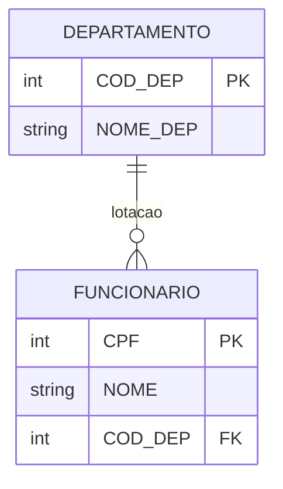

### Declaração de Restrições em CREATE TABLE vs ALTER TABLE

As restrições podem ser declaradas de modo inline no momento da criação do esquema ou aplicadas tardiamente via `ALTER TABLE`:

```sql
-- Abordagem 1: Declaracao estruturada direta no CREATE TABLE
CREATE TABLE DEPARTAMENTO (
    COD_DEP INTEGER NOT NULL,
    NOME VARCHAR(50),
    CONSTRAINT PK_COD_DEP PRIMARY KEY (COD_DEP)
);

CREATE TABLE FUNCIONARIO (
    CPF INTEGER NOT NULL,
    NOME VARCHAR(50),
    CIDADE VARCHAR(50),
    COD_DEP INTEGER,
    CONSTRAINT PK_CPF PRIMARY KEY (CPF),
    CONSTRAINT FK_COD_DEP FOREIGN KEY (COD_DEP) REFERENCES DEPARTAMENTO (COD_DEP)
);

-- Abordagem 2: Declaracao tardia com ALTER TABLE
CREATE TABLE LOTE (
    COD_LOTE INTEGER NOT NULL,
    NOME_LOTE VARCHAR(50),
    CONSTRAINT PK_COD_LOTE PRIMARY KEY (COD_LOTE)
);

CREATE TABLE PRODUTO (
    COD_PRODUTO INTEGER NOT NULL,
    NOME VARCHAR(50),
    DESCRICAO VARCHAR(50),
    COD_LOTE INTEGER,
    CONSTRAINT PK_COD_PRODUTO PRIMARY KEY (COD_PRODUTO)
);

-- Amarração da Chave Estrangeira sobre a tabela ja instanciada
ALTER TABLE PRODUTO 
ADD CONSTRAINT FK_COD_LOTE1 
FOREIGN KEY (COD_LOTE) 
REFERENCES LOTE (COD_LOTE);
```

- **Validação de Carga Prévia:** Ao executar `ALTER TABLE ... ADD CONSTRAINT ... FOREIGN KEY`, o SGBD realiza uma varredura completa na tabela-filha. A existência de um único registro apontando para uma chave inexistente na tabela-pai abortará a instrução DDL imediatamente.

### Evolução de Esquemas: Modificações com ALTER TABLE

Sistemas em produção exigem evolução contínua sem descarte de dados históricos. A instrução `ALTER TABLE` possibilita a refatoração do esquema:

```sql
-- Adicao de nova coluna preenchida inicialmente como NULL para registros preexistentes
ALTER TABLE produtos ADD COLUMN descricao TEXT;

-- Remocao definitiva de atributo obsoleto
ALTER TABLE produtos DROP COLUMN descricao;

-- Revogacao de vinculo estrutural de integridade referencial
ALTER TABLE PRODUTO DROP CONSTRAINT FK_COD_LOTE1;

-- Padronizacao nominal de identificadores sem perda de registros
ALTER TABLE produtos RENAME COLUMN cod_prod TO cod_produto;

-- Renomeacao da relacao no catalogo
ALTER TABLE produtos RENAME TO cadastro_produtos;

-- Adicao de Chave Primaria em tabela preexistente
ALTER TABLE CLIENTES ADD CONSTRAINT PK_COD_CLIENTE PRIMARY KEY (CodCliente);
```

> [!WARNING]
> A remoção de colunas com `DROP COLUMN` ou restrições com `DROP CONSTRAINT` é uma operação destrutiva irreversível. Queries de aplicação construídas com `SELECT *` ou comandos `INSERT` posicionais falharão imediatamente caso o esquema seja alterado sem alinhamento com a camada de código.

---

## Linguagem de Manipulação de Dados (DML) e Garantias Transacionais

### Inserção de Tuplas com INSERT INTO: Formas Explícita e Posicional

A inserção de registros em tabelas relacionais pode ser executada sob duas abordagens sintáticas:

```sql
-- Forma 1: Declaracao explicita de colunas (Recomendada pela Engenharia de Software)
INSERT INTO funcionario (cpf, nome, funcao, data_nasc) 
VALUES (2, 'SEBASTIAO', 'PROFESSOR', '2020-03-03');

-- Forma 2: Declaracao posicional / implicita (Antipadrão de manutencao)
INSERT INTO funcionario 
VALUES (3, 'PEDRO', 'SECRETARIO', '1963-08-20');
```

- **Comparação:** A declaração explícita blinda o sistema contra alterações estruturais de DDL (como adição de colunas anuláveis ou com valor `DEFAULT`). A inserção posicional quebra se qualquer coluna for adicionada, removida ou reordenada fisicamente na tabela.

### Ordem Topológica de Carga e Restrições de Dependência

A persistência de dados em esquemas relacionais providos de chaves estrangeiras deve seguir a ordem topológica do grafo de dependências:

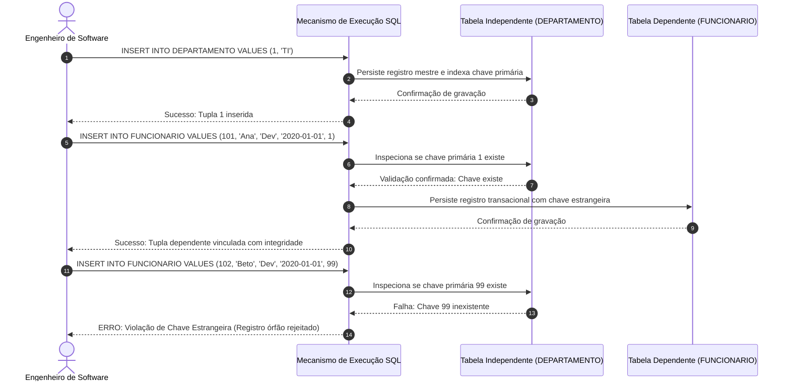

### Atualização de Dados com UPDATE e Cláusula SET

A instrução `UPDATE` altera o estado de atributos em linhas existentes sem destruir a identidade física da tupla:

```sql
-- Atualizacao seletiva baseada em predicado relacional
UPDATE funcionario 
SET funcao = 'DIRETOR' 
WHERE cpf = 4;
```

### Exclusão de Registros com DELETE FROM

O comando `DELETE FROM` remove tuplas inteiras do corpo da tabela que satisfaçam as condições especificadas:

```sql
-- Exclusao seletiva de tupla individual
DELETE FROM funcionario 
WHERE cpf = 5;
```

### O Risco Crítico da Omissão do WHERE e Estratégias Defensivas

Em SQL ANSI, a omissão da cláusula `WHERE` em instruções `UPDATE` e `DELETE` aplica a modificação ao conjunto universal da relação ($`\text{WHERE TRUE}`$), resultando na sobrescrita ou destruição de todas as linhas da tabela.

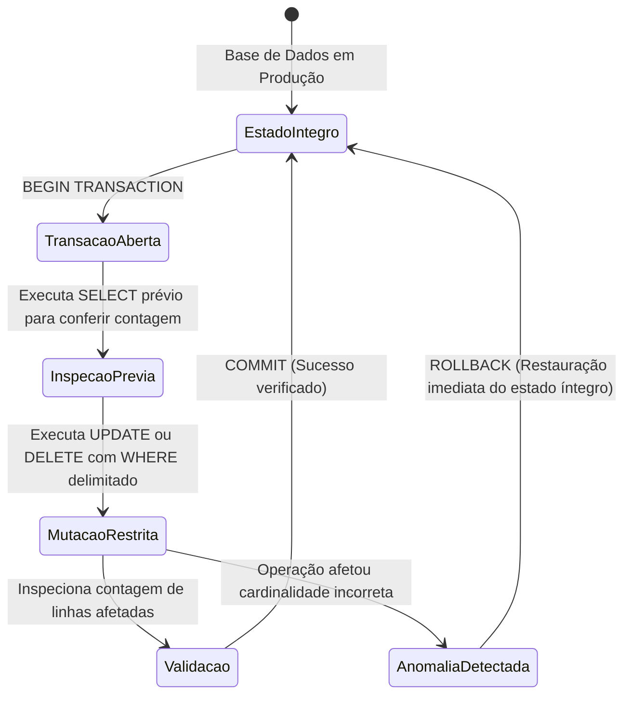

Protocolos de segurança operacional obrigatórios:

1. **Uso de Transações Explícitas:** Delimitar manutenções via console com `BEGIN;`, executar a mutação, verificar o resultado via `SELECT` e confirmar via `COMMIT;` ou desfazer via `ROLLBACK;`.
2. **Transformação de Inspeção Prévia:** Antes de disparar `DELETE FROM tabela WHERE condicao;`, executar `SELECT COUNT(*) FROM tabela WHERE condicao;` para assegurar a exata volumetria impactada.

### Análise Comparativa: DELETE vs TRUNCATE vs DROP

| Dimensão Técnica | `DELETE FROM` | `TRUNCATE TABLE` | `DROP TABLE` |
| :--- | :--- | :--- | :--- |
| **Classificação SQL** | DML | DDL / DML Rápido | DDL |
| **Suporte a Cláusula WHERE** | Sim (permite filtragem cirúrgica). | Não (operação puramente de esvaziamento total). | Não aplicável. |
| **Mecanismo de Liberação** | Marcação lógica tupla a tupla; gera logs volumosos em WAL/Redo. | Desalocação direta de páginas de dados e extensões; log mínimo. | Desalocação total do objeto, dados e índices; expurgo do catálogo. |
| **Preservação da Estrutura** | Mantém tabela, colunas, índices e restrições intactos. | Mantém tabela, colunas, índices e restrições intactos. | Destrói a estrutura e os metadados definitivamente. |
| **Reinicialização de Autoincremento** | Não reinicia contadores sequenciais de identidade. | Reinicia sequências dependendo do SGBD (`RESTART IDENTITY`). | Remove o objeto gerador de identidade associado. |

---

## Linguagem de Consulta de Dados (DQL): Fundamentos e Filtros

### Arquitetura de Execução: Ordem Léxica vs Ordem Lógica de Processamento

A linguagem SQL é declarativa: o programador especifica o resultado desejado, e o otimizador de consultas gera o plano de acesso físico. Contudo, a avaliação de predicados e a geração do conjunto de tuplas obedece a uma ordem lógica estrita, diferente da ordem de escrita léxica do comando:

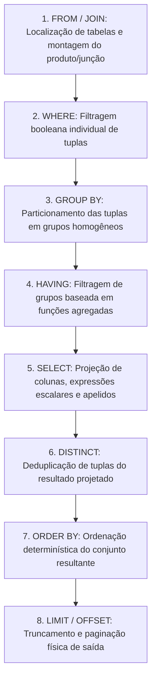

> [!IMPORTANT]
> A cláusula `WHERE` (Passo 2) é processada antes da cláusula `SELECT` (Passo 5). Consequentemente, apelidos de coluna definidos via `AS` na projeção não são reconhecidos pelo SGBD dentro da cláusula `WHERE` da mesma instrução.

### Álgebra Relacional: Projeção e Seleção

- **Projeção ($`\pi`$):** Operação unária que seleciona um subconjunto vertical de atributos de uma relação $`R`$, descartando as colunas não especificadas:
  
  ```math
  \pi_{A_1, A_2, \dots, A_n}(R)
  ```

- **Seleção ($`\sigma`$):** Operação unária que aplica uma restrição horizontal sobre as tuplas de $`R`$, preservando apenas aquelas que satisfazem a um predicado booleano $`p`$:
  
  ```math
  \sigma_{p}(R)
  ```

### Projeção de Colunas e Impacto do Caractere Coringa

```sql
-- Projecao total via caractere coringa
SELECT * FROM CLIENTES;

-- Projecao seletiva orientada a atributos especificos
SELECT CodCliente, NomeCliente, Estado FROM CLIENTES;
```

- **Engenharia de Performance:** O uso de `SELECT *` em sistemas de produção força a leitura de blocos inteiros de dados na memória RAM, satura a largura de banda da rede ao transmitir colunas não utilizadas e impede que o otimizador resolva a consulta exclusivamente através de índices cobertos (*covering index scans*).

### Ordenação Determinística com ORDER BY

Pela teoria relacional, relações são conjuntos matemáticos não ordenados. A recuperação determinística de registros requer a cláusula explícita `ORDER BY`:

```sql
-- Ordenacao composta: Estado ascendente (A-Z) com desempate por Idade descendente
SELECT NomeCliente, Estado, Idade 
FROM CLIENTES 
ORDER BY Estado ASC, Idade DESC;
```

- **Tratamento de Nulos:** Por padrão no PostgreSQL, em ordenações `ASC`, valores `NULL` são posicionados no final (`NULLS LAST`), enquanto em `DESC` são alocados no início (`NULLS FIRST`). Para forçar um comportamento específico independente do SGBD, utiliza-se a sintaxe explícita: `ORDER BY Idade ASC NULLS FIRST`.

### Filtragem Horizontal com WHERE e Operadores Relacionais

A filtragem aplica operadores relacionais matemáticos padronizados sobre os atributos de cada tupla:

| Operador | Significado Formal | Exemplo Prático | Avaliação Booleana |
| :---: | :--- | :--- | :--- |
| `=` | Igualdade estrita de valor | `Estado = 'SP'` | `TRUE` se idêntico; `UNKNOWN` se `NULL`. |
| `<>` ou `!=` | Diferença de valor | `Estado <> 'SP'` | `TRUE` se distinto; `FALSE` se igual. |
| `>` | Maior que estrito | `Val_Unit > 10.00` | Exclui o limite; exige magnitude superior. |
| `<` | Menor que estrito | `Idade < 25` | Exclui o limite; exige magnitude inferior. |
| `>=` | Maior ou igual a | `Salario_Fixo >= 3000` | Inclusivo do limite inferior. |
| `<=` | Menor ou igual a | `Val_Unit <= 1.05` | Inclusivo do limite superior. |

### Álgebra Booleana: Conjunção, Disjunção, Negação e Precedência

A combinação de múltiplos predicados obedece à lógica booleana e a uma hierarquia estrita de resolução de operadores:

```math
\text{Hierarquia de Precedência: } \text{Parênteses } () \longrightarrow \text{Relacionais } (=, <>, >, <) \longrightarrow \text{NOT} \longrightarrow \text{AND} \longrightarrow \text{OR}
```

```sql
-- CONTRAEXEMPLO: Falha de precedencia sem uso de parenteses
SELECT Nome, Estado, Salario 
FROM Clientes 
WHERE Estado = 'SP' OR Estado = 'MG' AND Salario > 3000;
-- O SGBD avalia: (Estado = 'MG' AND Salario > 3000) OR (Estado = 'SP')
-- Efeito colateral: Clientes de SP sao retornados independentemente do salario!

-- FORMA CORRETA: Forcando precedencia com parenteses delimitadores
SELECT Nome, Estado, Salario 
FROM Clientes 
WHERE (Estado = 'SP' OR Estado = 'MG') 
  AND Salario > 3000;
```

### Eliminação de Redundância com DISTINCT

O padrão SQL opera sobre multiconjuntos (*bags*), permitindo duplicatas de tuplas para maximizar o desempenho de I/O. A cláusula `DISTINCT` força a semântica formal de conjuntos matemáticos, descartando linhas repetidas na projeção:

```sql
-- Obtencao do dominio discreto de cidades cadastradas
SELECT DISTINCT Cidade FROM CLIENTES;

-- Distincao composta sobre par de atributos conjugados
SELECT DISTINCT Estado, Cidade FROM CLIENTES;
```

- **Custo Computacional:** A execução de `DISTINCT` exige que o motor SQL materialize as tuplas em memória temporária e aplique algoritmos de ordenação (*Sort Unique*) ou tabelas hash (*Hash Aggregate*), impondo sobrecarga de CPU e RAM.

### Expressões Aritméticas e Escopo de Apelidos

Expressões aritméticas (`+`, `-`, `*`, `/`) transformam dados escalares em tempo de execução:

```sql
-- Projecao de simulacao salarial com apelido de coluna (AS)
SELECT Nome, Salario, Salario * 1.15 AS Salario_Reajustado 
FROM Vendedor;
```

- **Armadilha Crítica de Escopo:** Tentativas de reutilizar o alias no filtro falham:
  
  ```sql
  -- ERRO DE COMPILACAO: Coluna Salario_Reajustado nao existe no escopo do WHERE
  SELECT Nome, Salario * 1.15 AS Salario_Reajustado 
  FROM Vendedor 
  WHERE Salario_Reajustado > 3000;
  
  -- FORMA CANONICA CORRETA: Repeticao da expressao matematica
  SELECT Nome, Salario * 1.15 AS Salario_Reajustado 
  FROM Vendedor 
  WHERE Salario * 1.15 > 3000;
  ```

### Seleção por Intervalo Fechado com BETWEEN

O predicado `BETWEEN` avalia a pertinência de um valor dentro de uma faixa contínua inclusiva:

```math
\text{coluna BETWEEN limite\_inferior AND limite\_superior} \iff (\text{coluna} \ge \text{limite\_inferior}) \land (\text{coluna} \le \text{limite\_superior})
```

```sql
-- Filtragem inclusiva sobre valores decimais
SELECT Descricao, Val_Unit 
FROM PRODUTO 
WHERE Val_Unit BETWEEN 5.00 AND 20.00;
```

- **Armadilha de Inversão de Limites:** A instrução `WHERE Val_Unit BETWEEN 20.00 AND 5.00` é sintaticamente aceita pelo motor SQL, porém resulta invariavelmente em conjunto vazio (zero linhas), pois nenhum número pode ser simultaneamente maior ou igual a 20 e menor ou igual a 5.

### Pertinência a Conjuntos Discretos: IN e NOT IN

O predicado `IN` verifica se um operando escalar coincide com qualquer elemento de uma lista literal finita:

```sql
-- Sintaxe elegante com IN
SELECT Nome, Estado 
FROM CLIENTE 
WHERE Estado IN ('SP', 'MG', 'RJ');

-- Equivalencia desdobrada via operadores primitivos OR
SELECT Nome, Estado 
FROM CLIENTE 
WHERE Estado = 'SP' OR Estado = 'MG' OR Estado = 'RJ';
```

#### O Perigo Crítico de Nulos em NOT IN (Lógica Tri-Valorada / 3VL)

O operador `NOT IN` expande-se internamente em uma cadeia de inequações unidas pelo operador `AND`:

```math
\text{coluna NOT IN }(v_1, v_2) \iff (\text{coluna} \ne v_1) \land (\text{coluna} \ne v_2)
```

Na presença de um valor nulo (`NULL`), a comparação escalar resulta em `UNKNOWN`. Como qualquer conjunção `TRUE AND UNKNOWN` avalia para `UNKNOWN`, a presença de um único elemento `NULL` dentro da lista do `NOT IN` provoca o colapso da consulta, retornando **zero linhas**:

```sql
-- CONTRAEXEMPLO FATAL: Retorna 0 linhas mesmo que existam clientes de outros estados
SELECT Nome, Estado 
FROM Clientes 
WHERE Estado NOT IN ('SP', 'MG', NULL);
```

### Casamento de Padrões em Strings: LIKE, ILIKE e Metacaracteres Curinga

Para buscas textuais aproximadas sobre cadeias de caracteres, o SQL disponibiliza o operador `LIKE` e metacaracteres curinga:

- `%` (Porcentagem): Casa com zero, um ou infinitos caracteres arbitrários.
- `_` (Sublinhado / Underscore): Casa com exatamente um caractere posicional arbitrário.

```sql
-- Prefixo fixo: Inicia com 'A'
SELECT * FROM clientes WHERE nome LIKE 'A%';

-- Sufixo fixo: Termina com 'a'
SELECT * FROM clientes WHERE nome LIKE '%a';

-- Contencao: Contem a letra 'O' em qualquer posicao
SELECT * FROM veiculos WHERE modelo LIKE '%O%';

-- Extensao exata: Nomes com exatamente 5 caracteres
SELECT * FROM clientes WHERE nome LIKE '_____';

-- Delimitacao combinada: Comeca com 'Ma' e termina com 'a'
SELECT * FROM clientes WHERE nome LIKE 'Ma%a';
```

- **Sensibilidade de Caixa (Case Sensitivity):** No padrão ANSI e em dialetos como PostgreSQL, o operador `LIKE` é estritamente sensível à caixa. Para buscas insensíveis a maiúsculas/minúsculas, emprega-se o operador nativo `ILIKE` ou a normalização funcional `WHERE UPPER(nome) LIKE 'A%'`.

---

## Funções Escalares Especializadas: Manipulação Temporal e Textual

### Captura e Decomposição Temporal: NOW, DATE, AGE e EXTRACT

*(Foco em ambientes relacionais corporativos e PostgreSQL)*

O tratamento de tempo em bancos de dados opera sobre tipos estruturados capazes de considerar anos bissextos e fusos horários:

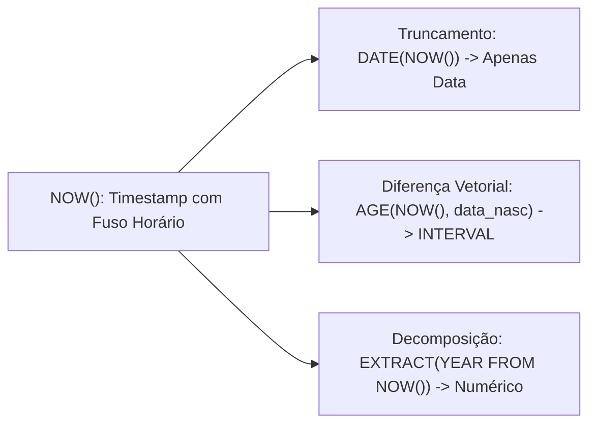

```sql
-- Captura do carimbo temporal transacional
SELECT NOW() AS data_hora_transacional;

-- Coercao direta para data civil (AAAA-MM-DD)
SELECT DATE(NOW()) AS data_corrente;

-- Calculo de intervalo etario decomposto em anos, meses e dias
SELECT Nome, AGE(NOW(), Data_Nasc) AS Idade_Exata 
FROM Aluno;

-- Decomposicao cirurgica de partes temporais
SELECT 
    EXTRACT(YEAR FROM Data_Nasc) AS Ano_Nascimento,
    EXTRACT(MONTH FROM Data_Nasc) AS Mes_Nascimento,
    EXTRACT(DAY FROM Data_Nasc) AS Dia_Nascimento
FROM Aluno;
```

- **Propriedade Arquitetural do NOW():** Retorna o instante de início da transação ativa corrente. Todas as invocações a `NOW()` dentro da mesma transação retornam carimbos idênticos para assegurar consistência de auditoria.

### Aritmética Temporal com INTERVAL e Sargabilidade

O tipo de dado `INTERVAL` representa uma duração de tempo. A filtragem de idades deve evitar aproximações imprecisas por divisão de dias:

```sql
-- Filtro utilizando INTERVAL (legibilidade semantica)
SELECT Nome, Data_Nascimento 
FROM Funcionarios 
WHERE AGE(NOW(), Data_Nascimento) > INTERVAL '30 years';

-- Filtro Sargable (permite utilizacao de indice B-Tree na coluna Data_Nascimento)
SELECT Nome, Data_Nascimento 
FROM Funcionarios 
WHERE Data_Nascimento <= NOW() - INTERVAL '30 years';
```

- **Sargabilidade (*Search Argument Ability*):** Aplicar funções sobre uma coluna indexada (como `AGE(NOW(), coluna)`) invalida o uso de índices comuns, forçando uma varredura sequencial completa (*Full Table Scan*). Isolar a coluna pura de um lado da comparação viabiliza varredura rápida por índice (*Index Range Scan*).

### Funções de Manipulação Textual: ASCII, LENGTH, LOWER e UPPER

Operações para higienização e validação de cadeias de caracteres:

```sql
-- Inspecao do codigo numerico do primeiro caractere da cadeia
SELECT ASCII('Carlos'); -- Retorna 67 (valor correspondente a letra 'C')

-- Contagem do numero de caracteres
SELECT Nome, LENGTH(Nome) AS Qtd_Caracteres FROM CLIENTE;

-- Normalizacao de caixa para buscas seguras
SELECT * FROM CLIENTE WHERE LOWER(Cidade) = 'campinas';
SELECT * FROM CLIENTE WHERE UPPER(Cidade) = 'CAMPINAS';
```

### Concatenação de Strings e Propagação de Nulos

O padrão ANSI SQL formaliza a concatenação de cadeias de texto através do operador de barra dupla vertical (`||`):

```sql
-- Juncao de literais e colunas
SELECT Nome || ' mora na cidade de ' || Cidade AS Descricao_Completa 
FROM CLIENTES;
```

#### A Regra Absoluta da Propagação de Nulos

Na álgebra relacional, `NULL` não é uma cadeia vazia, mas um estado ontológico de "dado desconhecido". Operações entre um valor conhecido e uma incógnita resultam inevitavelmente em uma incógnita:

```math
\text{'Texto'} \parallel \text{NULL} \implies \text{NULL}
```

- **Impacto em Engenharia:** Se a coluna `Cidade` de um cliente contiver `NULL`, a expressão inteira retornará `NULL`. Para mitigar esse comportamento, utiliza-se a função de substituição de nulos: `COALESCE(Cidade, 'Não Informado')`.

### Extração Posicional de Subcadeias com SUBSTRING

A função `SUBSTRING` extrai fatias de texto com base em coordenadas numéricas posicionais:

```sql
-- Sintaxe oficial ANSI: SUBSTRING(texto FROM inicio FOR comprimento)
SELECT SUBSTRING(Nome FROM 1 FOR 3) AS Prefixo_Nome 
FROM CLIENTE;
```

- **Regra de Indexação:** Em SQL, a indexação de strings é baseada em 1 (*1-based indexing*). O primeiro caractere de uma cadeia reside no índice `1`, e não no índice `0` característico de linguagens de programação como C, Java e Python.

---

## Junções Relacionais e Recombinação de Dados

### Fundamentação da Álgebra de Junção

A normalização divide dados em entidades especializadas interligadas por Chaves Estrangeiras. A junção relacional recombina essas tabelas em conjuntos estruturados.

Formalmente, a junção de duas relações $`R`$ e $`S`$ é a aplicação de uma restrição de seleção sobre o Produto Cartesiano ($`R \times S`$):

```math
R \bowtie_{p} S = \sigma_{p}(R \times S)
```

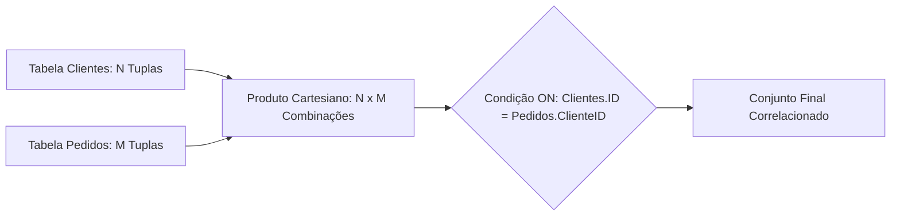

### Junção Histórica SQL-89 vs Junção Padrão ANSI SQL-92

A evolução da linguagem SQL substituiu a junção implícita por cláusulas explícitas:

```sql
-- ANSI SQL-89: Juncao implicita baseada em Produto Cartesiano filtrado no WHERE
SELECT c.Nome, p.PedidoID, p.Valor
FROM Clientes c, Pedidos p
WHERE c.ClienteID = p.ClienteID;

-- ANSI SQL-92: Juncao explicita isolando integridade estrutural das regras negociais
SELECT c.Nome, p.PedidoID, p.Valor
FROM Clientes c
INNER JOIN Pedidos p ON c.ClienteID = p.ClienteID;
```

| Critério de Engenharia | Sintaxe Histórica (SQL-89) | Sintaxe Padrão (SQL-92) |
| :--- | :--- | :--- |
| **Segurança Operacional** | Baixa. Omissão acidental do `WHERE` gera produto cartesiano catastrófico silencioso. | Alta. Omissão da cláusula `ON` provoca erro sintático em tempo de análise. |
| **Clareza Arquitetural** | Mistura condições de junção de integridade com filtros de negócio. | Separa a regra de amarração (`ON`) dos filtros condicionais de linhas (`WHERE`). |
| **Suporte a Junções Externas** | Frágil e não padronizado entre diferentes fornecedores de SGBD. | Padronização universal (`LEFT JOIN`, `RIGHT JOIN`, `FULL JOIN`). |

### Junção Interna: INNER JOIN

O `INNER JOIN` retorna uma tupla no resultado se, e somente se, houver correspondência exata entre os valores das chaves em ambas as relações:

```sql
SELECT 
    c.CodCliente,
    c.NomeCliente,
    p.Descricao AS Produto,
    ped.DataPedido
FROM Pedido ped
INNER JOIN Cliente c ON ped.CodCliente = c.CodCliente
INNER JOIN Produto p ON ped.CodProduto = p.CodProduto;
```

- **Mecanismo:** Tuplas da tabela-pai que não possuam filhos correspondentes, bem como tuplas da tabela-filha sem pai associado, são descartadas do resultado final.

### Junção Externa à Esquerda: LEFT JOIN e Preservação de Tuplas

O `LEFT JOIN` preserva **todas** as tuplas da relação declarada à esquerda da cláusula, independentemente da existência de tuplas correlatas na relação da direita. Caso não haja correspondência, todos os atributos da tabela à direita são preenchidos com valores nulos (`NULL`):

```sql
-- Lista TODOS os clientes e seus respectivos pedidos (se houver)
SELECT 
    c.ClienteID,
    c.Nome,
    p.PedidoID,
    p.Valor
FROM Clientes c
LEFT JOIN Pedidos p ON c.ClienteID = p.ClienteID;
```

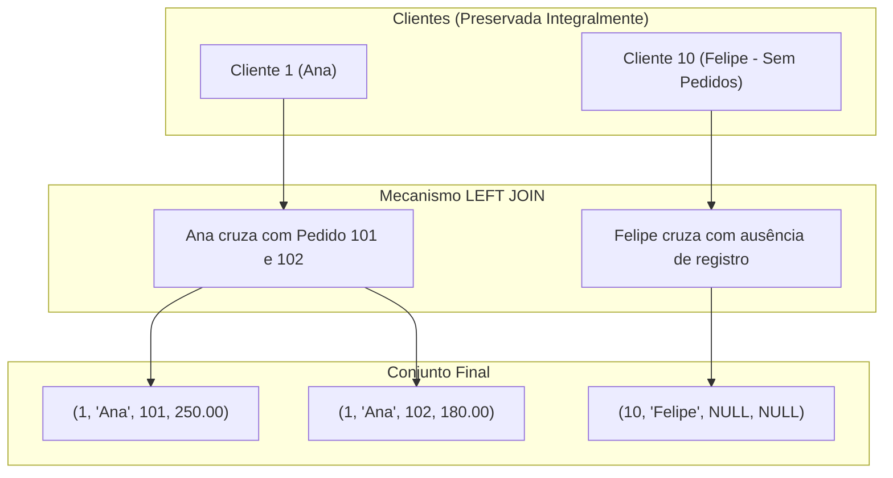

### Detecção de Registros Órfãos com Antijunção

Uma das aplicações essenciais do `LEFT JOIN` na administração de dados é a identificação de entidades inativas (ex.: clientes sem pedidos, alunos sem matrículas, produtos nunca vendidos):

```sql
-- Antijuncao estrita: Identifica clientes que nunca realizaram nenhum pedido
SELECT 
    c.ClienteID,
    c.Nome,
    c.Email
FROM Clientes c
LEFT JOIN Pedidos p ON c.ClienteID = p.ClienteID
WHERE p.PedidoID IS NULL;
```

- **Mecanismo:** Ao unir `Clientes` e `Pedidos`, os clientes inativos recebem `NULL` na chave primária da tabela `Pedidos`. O filtro `WHERE p.PedidoID IS NULL` descarta todos os clientes ativos e retém unicamente os clientes inativos.

### Armadilhas da Lógica Tri-Valorada em Junções Externas

Um dos erros mais recorrentes em SQL é a tentativa de testar a nulidade através do operador de igualdade escalar:

```sql
-- CONTRAEXEMPLO FATAL: NUNCA retorna linhas
SELECT c.Nome 
FROM Clientes c
LEFT JOIN Pedidos p ON c.ClienteID = p.ClienteID
WHERE p.PedidoID = NULL;
```

- **Fundamentação Matemática:** Na lógica trivalente de Codd, a comparação `NULL = NULL` não avalia para `TRUE`, mas sim para `UNKNOWN`. A cláusula `WHERE` apenas inclui no conjunto resultante tuplas cujo predicado seja estritamente `TRUE`. Por definição, qualquer verificação de nulidade em SQL deve utilizar os operadores unários `IS NULL` ou `IS NOT NULL`.

---

## Funções Agregadas e Particionamento Analítico

### Funções Agregadas Escalares Globais

As funções agregadas operam sobre um conjunto de valores de uma coluna distribuídos por múltiplas tuplas, condensando-os em um único valor escalar resultante:

| Função | Finalidade Estatística | Tipos de Dados Aceitos |
| :--- | :--- | :--- |
| `COUNT(*)` | Contabiliza o número total de tuplas físicas na tabela ou no grupo. | Qualquer estrutura de linha. |
| `COUNT(coluna)` | Contabiliza o número de valores não nulos (`NOT NULL`) presentes na coluna. | Qualquer tipo de dado. |
| `SUM(coluna)` | Computa o somatório aritmético dos valores não nulos. | Exclusivamente tipos numéricos (`INT`, `DECIMAL`). |
| `AVG(coluna)` | Calcula a média aritmética ($`\frac{\sum X}{N}`$) dos valores não nulos. | Exclusivamente tipos numéricos (`INT`, `DECIMAL`). |
| `MAX(coluna)` | Determina o valor extremo superior do domínio. | Numéricos, Textos (ordem alfabética) e Datas. |
| `MIN(coluna)` | Determina o valor extremo inferior do domínio. | Numéricos, Textos (ordem alfabética) e Datas. |

```sql
-- Aplicacao agregada global sobre o esquema de clientes
SELECT 
    COUNT(*) AS Total_Registros,
    COUNT(Salario) AS Registros_Com_Salario,
    AVG(Salario) AS Media_Salarial,
    SUM(Salario) AS Folha_Total,
    MAX(Salario) AS Maior_Salario,
    MIN(Salario) AS Menor_Salario
FROM CLIENTE;
```

### Comportamento de Nulos em Funções de Agregação

Com exceção da instrução `COUNT(*)`, **todas as funções de agregação ignoram silenciosamente valores nulos**.

- **Exemplo Prático:** Se uma coluna contiver as tuplas `[1000, 2000, NULL]`:
  - `COUNT(*)` retornará `3`.
  - `COUNT(Salario)` retornará `2`.
  - `AVG(Salario)` computará $`\frac{1000 + 2000}{2} = 1500`$, e não $`\frac{3000}{3} = 1000`$.

### Particionamento de Grupos com GROUP BY

A cláusula `GROUP BY` colapsa conjuntos de tuplas em partições homogêneas que compartilham o mesmo valor para os atributos declarados. As funções agregadas listadas na projeção passam a operar de modo independente sobre cada partição individual:

```sql
-- Calculo da media salarial particionada por Unidade Federativa
SELECT Estado, AVG(Salario) AS Media_Salarial 
FROM CLIENTE 
GROUP BY Estado;
```

#### A Regra de Ouro do GROUP BY

> [!IMPORTANT]
> **Regra Fundamental de Projeção:** Todo e qualquer atributo listado na cláusula `SELECT` que **não** seja argumento de uma função agregada **deve constar obrigatoriamente** na lista de atributos da cláusula `GROUP BY`.

```sql
-- ERRO GRAVE DE COMPILACAO NO PADRAO ANSI:
SELECT Estado, Cidade, AVG(Salario) 
FROM CLIENTE 
GROUP BY Estado;
-- Causa do Erro: Para um unico Estado, existem multiplas Cidades distintas.
-- O SGBD nao possui criterio deterministico para eleger qual Cidade exibir ao lado da media estadual.

-- FORMA CORRETA: Agrupamento composto hierarquico
SELECT Estado, Cidade, AVG(Salario) 
FROM CLIENTE 
GROUP BY Estado, Cidade;
```

### Filtragem Pós-Agregação: O Papel Crítico da Cláusula HAVING

Como a cláusula `WHERE` é processada antes da formação dos grupos e do cálculo dos agregados, é sintaticamente inválido utilizá-la para filtrar métricas de sumarização:

```sql
-- ERRO FATAL: Funcoes agregadas sao proibidas na clausula WHERE
SELECT Estado, AVG(Salario) 
FROM CLIENTE 
WHERE AVG(Salario) > 3000 
GROUP BY Estado;
```

Para aplicar restrições sobre o resultado de cálculos agrupados, o SQL introduz a cláusula `HAVING`:

```sql
-- FORMA CORRETA: Filtragem de particoes agregadas com HAVING
SELECT Estado, AVG(Salario) 
FROM CLIENTE 
GROUP BY Estado 
HAVING AVG(Salario) > 3000;
```

### Diferenças Operacionais e Semânticas: WHERE vs HAVING

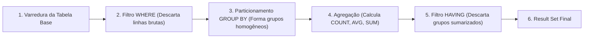

| Critério de Arquitetura | Cláusula WHERE | Cláusula HAVING |
| :--- | :--- | :--- |
| **Momento de Execução** | Antes do agrupamento (`GROUP BY`). | Após a consolidação dos grupos e cálculos agregados. |
| **Unidade de Avaliação** | Avalia tuplas brutas individualmente. | Avalia partições e métricas agregadas consolidadas. |
| **Aceita Funções Agregadas?** | **Proibido.** Causa erro de compilação sintática. | **Permitido e esperado** (`HAVING COUNT(*) > 5`). |
| **Uso de Índices** | Permite o uso de índices B-Tree normais para corte rápido. | Não utiliza índices normais da tabela base (atua sobre a tabela em memória gerada pelo agrupamento). |
| **Objetivo Primário** | Reduzir a volumetria de entrada para otimizar o processamento. | Filtrar o sumário estatístico gerado pela consulta. |

---

## Caderno Prático de Laboratório e Resoluções de Exercícios

### Laboratório 1: Domínio Concessionária de Veículos (20 Exercícios)

Considere a base de dados composta por clientes e veículos automotores.

#### Script Estrutural DDL e Carga Transacional DML

```sql
-- Criacao da tabela independente de clientes
CREATE TABLE clientes (
    cod_cli INTEGER NOT NULL,
    cpf INTEGER NOT NULL,
    nome VARCHAR(50), 
    endereco VARCHAR(50),
    cidade VARCHAR(50),
    estado VARCHAR(02),
    salario INTEGER,
    idade INTEGER, 
    CONSTRAINT PK_CPFcliente PRIMARY KEY (cpf)
);

-- Criacao da tabela dependente de veiculos
CREATE TABLE veiculos (
    chassi VARCHAR(50) NOT NULL,
    placa VARCHAR(10) NOT NULL, 
    cor VARCHAR(20),
    modelo VARCHAR(20),
    marca VARCHAR(20),
    ano_fabricacao INTEGER,
    preco_compra INTEGER,
    preco_venda INTEGER,
    motor NUMERIC(3,1), -- Ajuste tecnico para comportar literais como 1.8, 2.0
    cpf_cli INTEGER NOT NULL, 
    CONSTRAINT PK_placa PRIMARY KEY (placa),
    CONSTRAINT FK_cpf_cli FOREIGN KEY (cpf_cli) REFERENCES clientes (cpf)
);

-- Carga inicial de tuplas de clientes
INSERT INTO clientes VALUES (1, 11, 'BEATRIZ', 'RUA 01', 'FERNANDOPOLIS', 'SP', 1800, 32);
INSERT INTO clientes VALUES (2, 12, 'JOANA', 'RUA 031', 'SAO JOSE DO RIO PRETO', 'SP', 2000, 40);
INSERT INTO clientes VALUES (3, 13, 'LUANA', 'RUA 051', 'VOTUPORANGA', 'SP', 3500, 41);
INSERT INTO clientes VALUES (4, 114, 'KATIA', 'RUA 015', 'JALES', 'SP', 7000, 32);
INSERT INTO clientes VALUES (5, 115, 'AMANDA', 'RUA 061', 'FERNANDOPOLIS', 'SP', 5500, 40);
INSERT INTO clientes VALUES (6, 116, 'GIOVANA', 'RUA 021', 'SAO JOSE DO RIO PRETO', 'SP', 2000, 34);
INSERT INTO clientes VALUES (7, 117, 'TAIZ', 'RUA 011', 'MACEDONIA', 'SP', 1500, 32);
INSERT INTO clientes VALUES (8, 181, 'MILENA', 'RUA 013', 'SANTA FE DO SUL', 'SP', 2300, 42);
INSERT INTO clientes VALUES (9, 911, 'ELIZANGELA', 'RUA 015', 'CATANDUVA', 'SP', 2800, 62);
INSERT INTO clientes VALUES (10, 101, 'PATRACIA', 'RUA 012', 'ARAGUAINA', 'TO', 8800, 22);
INSERT INTO clientes VALUES (11, 131, 'MARIA', 'RUA 014', 'PALMAS', 'TO', 9000, 23);
INSERT INTO clientes VALUES (12, 141, 'FELISBINA', 'RUA 015', 'DOURADO', 'MS', 3100, 32);

-- Carga inicial de tuplas de veiculos vinculados por chave estrangeira
INSERT INTO veiculos VALUES ('GM02', 'ESC2033', 'BRANCO', 'HILUX', 'TOYOTA', 2018, 160000, 175000, 1.8, 11);
INSERT INTO veiculos VALUES ('FI02', 'WDR4528', 'PRETO', 'COROLLA', 'TOYOTA', 2018, 90000, 95000, 2.0, 141);
INSERT INTO veiculos VALUES ('RD02', 'GHY5823', 'AZUL', 'HILUX', 'TOYOTA', 2020, 170000, 175000, 2.8, 131);
INSERT INTO veiculos VALUES ('DF024', 'TON5689', 'VERMELHO', 'COROLLA', 'TOYOTA', 2015, 70000, 75000, 2.0, 101);
INSERT INTO veiculos VALUES ('FG0452', 'ERG8965', 'BRANCO', 'GOL', 'VW', 2018, 40000, 45000, 1.6, 911);
INSERT INTO veiculos VALUES ('GT02', 'EDV5214', 'BRANCO', 'SAVEIRO', 'VW', 2014, 35000, 40000, 1.6, 181);
INSERT INTO veiculos VALUES ('GM0322', 'TGB2589', 'PRETO', 'UNO', 'FIAT', 2010, 20000, 25000, 1.0, 181);
INSERT INTO veiculos VALUES ('GM0452', 'FGB8521', 'PRETO', 'S10', 'CHEVROLET', 2018, 150000, 175000, 2.8, 117);
INSERT INTO veiculos VALUES ('GM02245', 'RFV5235', 'PRATA', 'COROLLA', 'TOYOTA', 2021, 130000, 135000, 2.0, 116);
INSERT INTO veiculos VALUES ('GM07892', 'PLK5689', 'PRATA', 'ONIX', 'CHEVROLET', 2018, 145000, 155000, 2.8, 115);
INSERT INTO veiculos VALUES ('GM05212', 'UJM5874', 'AZUL', 'KA', 'FORD', 2018, 40000, 45000, 1.0, 114);
INSERT INTO veiculos VALUES ('GM02452', 'VCX1458', 'VERMELHO', 'TRACKER', 'CHEVROLET', 2017, 90000, 95000, 1.4, 13);
INSERT INTO veiculos VALUES ('GM02785', 'EDC8526', 'BRANCO', 'ONIX', 'CHEVROLET', 2018, 45000, 50000, 1.4, 12);
INSERT INTO veiculos VALUES ('GM02752', 'EDCV4569', 'PRETO', 'HILUX', 'TOYOTA', 2018, 165000, 175000, 2.8, 11);
```

#### Resolução Integral dos 20 Exercícios de Consulta

```sql
-- 1. Selecione todos os clientes cujo nome comeca com a letra A.
SELECT * FROM clientes 
WHERE nome LIKE 'A%';

-- 2. Liste os clientes cujo nome contem a letra "i" em qualquer posicao.
-- Em dados em caixa alta, a busca padrao LIKE deve usar 'I' maiusculo.
SELECT * FROM clientes 
WHERE nome LIKE '%I%';

-- 3. Selecione os clientes cujo nome termina com a letra "a".
SELECT * FROM clientes 
WHERE nome LIKE '%A';

-- 4. Liste os clientes cujo nome tenha exatamente 5 caracteres.
SELECT * FROM clientes 
WHERE nome LIKE '_____';

-- 5. Selecione os clientes cujo nome comeca com "Ma" e termina com "a".
SELECT * FROM clientes 
WHERE nome LIKE 'MA%A';

-- 6. Liste os veiculos cuja cor seja BRANCO.
SELECT * FROM veiculos 
WHERE cor = 'BRANCO';

-- 7. Selecione os veiculos cujo modelo contenha "O".
SELECT * FROM veiculos 
WHERE modelo LIKE '%O%';

-- 8. Liste os veiculos cuja placa termine com "9".
SELECT * FROM veiculos 
WHERE placa LIKE '%9';

-- 9. Selecione os clientes cujo endereco contenha "RUA 01".
SELECT * FROM clientes 
WHERE endereco LIKE '%RUA 01%';

-- 10. Repita o exercicio 2 usando ILIKE para nao diferenciar maiusculas e minusculas.
SELECT * FROM clientes 
WHERE nome ILIKE '%i%';

-- 11. Calcule a media dos salarios dos clientes.
SELECT AVG(salario) AS media_salarial 
FROM clientes;

-- 12. Conte quantos clientes existem na tabela.
SELECT COUNT(*) AS total_clientes 
FROM clientes;

-- 13. Conte quantos clientes moram na cidade de FERNANDOPOLIS.
SELECT COUNT(*) AS clientes_fernandopolis 
FROM clientes 
WHERE cidade = 'FERNANDOPOLIS';

-- 14. Selecione o maior salario entre os clientes.
SELECT MAX(salario) AS maior_salario 
FROM clientes;

-- 15. Selecione o menor salario entre os clientes.
SELECT MIN(salario) AS menor_salario 
FROM clientes;

-- 16. Calcule a soma dos salarios de todos os clientes.
SELECT SUM(salario) AS folha_salarial_total 
FROM clientes;

-- 17. Selecione o maior preco de venda dos veiculos.
SELECT MAX(preco_venda) AS maior_preco_venda 
FROM veiculos;

-- 18. Selecione o menor preco de compra dos veiculos.
SELECT MIN(preco_compra) AS menor_preco_compra 
FROM veiculos;

-- 19. Liste a media salarial por cidade.
SELECT cidade, AVG(salario) AS media_salarial_cidade 
FROM clientes 
GROUP BY cidade;

-- 20. Mostre o maior e menor preco de venda por marca de veiculo.
SELECT marca, MAX(preco_venda) AS maior_preco, MIN(preco_venda) AS menor_preco 
FROM veiculos 
GROUP BY marca;
```

---

### Laboratório 2: Domínio Distribuidora e Vendas (Atividade Material 04 - 36 Exercícios)

Este cenário compreende quatro tabelas inter-relacionadas (`CLIENTE`, `PRODUTO`, `VENDEDOR`, `PEDIDO`) com carga de 200 tuplas.

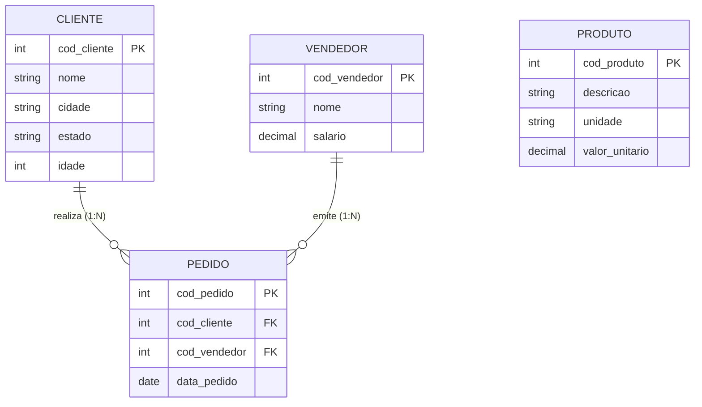

#### Script Estrutural DDL

```sql
CREATE TABLE CLIENTE (
    cod_cliente INT PRIMARY KEY,
    nome VARCHAR(100) NOT NULL,
    cidade VARCHAR(100),
    estado CHAR(2),
    idade INT
);

CREATE TABLE PRODUTO (
    cod_produto INT PRIMARY KEY,
    descricao VARCHAR(100) NOT NULL,
    unidade VARCHAR(10),
    valor_unitario DECIMAL(10,2) NOT NULL
);

CREATE TABLE VENDEDOR (
    cod_vendedor INT PRIMARY KEY,
    nome VARCHAR(100) NOT NULL,
    salario DECIMAL(10,2) NOT NULL
);

CREATE TABLE PEDIDO (
    cod_pedido INT PRIMARY KEY,
    cod_cliente INT NOT NULL,
    cod_vendedor INT NOT NULL,
    data_pedido DATE NOT NULL,
    CONSTRAINT FK_PEDIDO_CLIENTE FOREIGN KEY (cod_cliente) REFERENCES CLIENTE(cod_cliente),
    CONSTRAINT FK_PEDIDO_VENDEDOR FOREIGN KEY (cod_vendedor) REFERENCES VENDEDOR(cod_vendedor)
);
```

#### Resolução dos Exercícios Básicos (1 a 25)

```sql
-- 1. Liste todos os dados da tabela CLIENTE.
SELECT * FROM CLIENTE;

-- 2. Liste apenas nome e idade dos clientes.
SELECT nome, idade FROM CLIENTE;

-- 3. Liste codigo e descricao dos produtos.
SELECT cod_produto, descricao FROM PRODUTO;

-- 4. Liste os clientes que moram no estado SP.
SELECT * FROM CLIENTE 
WHERE estado = 'SP';

-- 5. Liste os clientes com idade maior que 35 anos.
SELECT * FROM CLIENTE 
WHERE idade > 35;

-- 6. Liste os produtos com valor unitario menor que 10.
SELECT * FROM PRODUTO 
WHERE valor_unitario < 10.00;

-- 7. Liste os vendedores com salario maior ou igual a 3000.
SELECT * FROM VENDEDOR 
WHERE salario >= 3000.00;

-- 8. Liste todos os clientes ordenados por nome.
SELECT * FROM CLIENTE 
ORDER BY nome ASC;

-- 9. Liste os clientes ordenados por estado e idade.
SELECT * FROM CLIENTE 
ORDER BY estado ASC, idade ASC;

-- 10. Liste os produtos ordenados pelo valor unitario (do maior para o menor).
SELECT * FROM PRODUTO 
ORDER BY valor_unitario DESC;

-- 11. Liste os clientes do estado SP e com idade maior que 30.
SELECT * FROM CLIENTE 
WHERE estado = 'SP' AND idade > 30;

-- 12. Liste os clientes do estado RJ ou MG.
SELECT * FROM CLIENTE 
WHERE estado = 'RJ' OR estado = 'MG';

-- 13. Liste os produtos com valor maior que 10 e unidade 'KG'.
SELECT * FROM PRODUTO 
WHERE valor_unitario > 10.00 AND unidade = 'KG';

-- 14. Liste os vendedores com salario igual a 2800 ou 3000.
SELECT * FROM VENDEDOR 
WHERE salario = 2800.00 OR salario = 3000.00;

-- 15. Liste os produtos cuja unidade seja 'UN' e valor menor que 10.
SELECT * FROM PRODUTO 
WHERE unidade = 'UN' AND valor_unitario < 10.00;

-- 16. Liste todas as cidades distintas dos clientes.
SELECT DISTINCT cidade FROM CLIENTE;

-- 17. Liste todos os estados distintos cadastrados.
SELECT DISTINCT estado FROM CLIENTE;

-- 18. Liste os produtos com valor entre 5 e 20.
SELECT * FROM PRODUTO 
WHERE valor_unitario BETWEEN 5.00 AND 20.00;

-- 19. Liste os vendedores com salario entre 2500 e 3500.
SELECT * FROM VENDEDOR 
WHERE salario BETWEEN 2500.00 AND 3500.00;

-- 20. Liste os clientes com idade entre 25 e 40 anos.
SELECT * FROM CLIENTE 
WHERE idade BETWEEN 25 AND 40;

-- 21. Mostre o nome do produto e o valor com aumento de 20%.
SELECT descricao, valor_unitario, valor_unitario * 1.20 AS valor_com_aumento 
FROM PRODUTO;

-- 22. Mostre o nome do produto e o valor com desconto de 10%.
SELECT descricao, valor_unitario, valor_unitario * 0.90 AS valor_com_desconto 
FROM PRODUTO;

-- 23. Liste os vendedores com salario e o salario com bonus de 500 reais.
SELECT nome, salario, salario + 500.00 AS salario_com_bonus 
FROM VENDEDOR;

-- 24. Liste todos os pedidos realizados por um cliente especifico (ex: cliente 10).
SELECT * FROM PEDIDO 
WHERE cod_cliente = 10;

-- 25. Liste todos os pedidos realizados apos a data '2024-02-01'.
SELECT * FROM PEDIDO 
WHERE data_pedido > '2024-02-01';
```

#### Resolução dos Exercícios Avançados e Desafios (1 a 10)

```sql
-- 1. Nome, cidade e idade de clientes de SP com idade entre 25 e 40 anos, ordenados por idade descrescente.
SELECT nome, cidade, idade 
FROM CLIENTE 
WHERE estado = 'SP' 
  AND idade BETWEEN 25 AND 40 
ORDER BY idade DESC;

-- 2. Descricao, valor atual e valor com 30% de aumento de produtos com valor entre 5 e 20.
SELECT 
    descricao, 
    valor_unitario, 
    valor_unitario * 1.30 AS valor_reajustado 
FROM PRODUTO 
WHERE valor_unitario BETWEEN 5.00 AND 20.00;

-- 3. Vendedores com salario entre 2500 e 3500, exibindo bonus de 15% e ordenando pelo maior salario ajustado.
SELECT 
    nome, 
    salario, 
    salario * 1.15 AS salario_com_bonus 
FROM VENDEDOR 
WHERE salario BETWEEN 2500.00 AND 3500.00 
ORDER BY salario_com_bonus DESC;

-- 4. Clientes de SP ou RJ com idade superior a 30 anos, ordenados por estado e nome.
SELECT nome, estado, idade 
FROM CLIENTE 
WHERE (estado = 'SP' OR estado = 'RJ') 
  AND idade > 30 
ORDER BY estado ASC, nome ASC;

-- 5. Produtos em 'KG' com valor menor que 10 OU maior que 30.
SELECT descricao, unidade, valor_unitario 
FROM PRODUTO 
WHERE unidade = 'KG' 
  AND (valor_unitario < 10.00 OR valor_unitario > 30.00);

-- 6. Pedidos realizados apos 2024-02-10 pertencentes a vendedores com codigo entre 10 e 30, ordenados por data.
SELECT * FROM PEDIDO 
WHERE data_pedido > '2024-02-10' 
  AND cod_vendedor BETWEEN 10 AND 30 
ORDER BY data_pedido ASC;

-- 7. Contagem de clientes por cidade.
SELECT cidade, COUNT(*) AS quantidade_clientes 
FROM CLIENTE 
GROUP BY cidade 
ORDER BY quantidade_clientes DESC;

-- 8. Produtos da unidade 'UN' com simulacao de desconto de 20% e acrescimo de 10%.
SELECT 
    descricao, 
    valor_unitario, 
    valor_unitario * 0.80 AS valor_desconto_20, 
    valor_unitario * 1.10 AS valor_aumento_10 
FROM PRODUTO 
WHERE unidade = 'UN';

-- 9. Vendedores que NAO possuem salario entre 2800 e 3200, ordenados por salario crescente.
SELECT nome, salario 
FROM VENDEDOR 
WHERE salario NOT BETWEEN 2800.00 AND 3200.00 
ORDER BY salario ASC;

-- 10. Desafio de Alto Nivel: Recombinacao multi-tabelas com juncoes, filtros temporais e monetarios.
SELECT 
    p.cod_pedido, 
    p.cod_cliente, 
    p.cod_vendedor, 
    p.data_pedido,
    c.nome AS nome_cliente,
    v.nome AS nome_vendedor,
    v.salario AS salario_vendedor
FROM PEDIDO p
INNER JOIN CLIENTE c ON p.cod_cliente = c.cod_cliente
INNER JOIN VENDEDOR v ON p.cod_vendedor = v.cod_vendedor
WHERE p.data_pedido BETWEEN '2024-02-01' AND '2024-02-29' 
  AND p.cod_cliente BETWEEN 10 AND 30 
  AND v.salario > 3000.00 
ORDER BY p.cod_cliente ASC, p.data_pedido ASC;
```

#### Resolução do Exercício da Aula 04 (Slide 16)

```sql
-- Estudo do Slide 16: Produtos da unidade 'M' com valores especificos descontinuos
SELECT unidade, descricao, val_unit
FROM produto
WHERE unidade = 'M'
  AND (val_unit = 0.11 OR val_unit = 1.8 OR val_unit = 2);
```

---

### Laboratório 3: Domínio Financeiro de Duas Tabelas (Clientes e Pedidos)

Demonstração exaustiva do fluxo analítico unindo `Clientes` e `Pedidos` com filtros `WHERE` e `HAVING`:

```sql
-- DDL
CREATE TABLE Clientes (
    ClienteID INT PRIMARY KEY,
    Nome VARCHAR(100) NOT NULL,
    Cidade VARCHAR(100),
    Email VARCHAR(100)
);

CREATE TABLE Pedidos (
    PedidoID INT PRIMARY KEY,
    ClienteID INT,
    DataPedido DATE,
    Valor DECIMAL(10,2),
    CONSTRAINT FK_PEDIDOS_CLIENTE FOREIGN KEY (ClienteID) REFERENCES Clientes(ClienteID)
);

-- Consulta 1: Juncao interna relacionando clientes e seus respectivos pedidos
SELECT 
    c.ClienteID, 
    c.Nome, 
    p.PedidoID, 
    p.DataPedido, 
    p.Valor 
FROM Clientes c 
INNER JOIN Pedidos p ON c.ClienteID = p.ClienteID;

-- Consulta 2: Extracao de clientes sem nenhum pedido registrado (Antijuncao)
SELECT 
    c.ClienteID, 
    c.Nome, 
    c.Cidade 
FROM Clientes c 
LEFT JOIN Pedidos p ON c.ClienteID = p.ClienteID 
WHERE p.PedidoID IS NULL;

-- Consulta 3: Agrupamento consolidado por cliente com filtro em agregados (HAVING)
-- Retorna apenas clientes cujo montante total de compras ultrapasse 400.00
SELECT 
    c.ClienteID, 
    c.Nome, 
    COUNT(p.PedidoID) AS Total_Pedidos, 
    SUM(p.Valor) AS Faturamento_Total 
FROM Clientes c 
INNER JOIN Pedidos p ON c.ClienteID = p.ClienteID 
GROUP BY c.ClienteID, c.Nome 
HAVING SUM(p.Valor) > 400.00 
ORDER BY Faturamento_Total DESC;
```

---

## Engenharia de Consultas, Boas Práticas e Matriz de Decisão

### Matriz de Decisão: Quando Utilizar Cada Operador e Cláusula

| Necessidade de Negócio | Cláusula / Operador Recomendado | Justificativa de Engenharia | O Que Evitar |
| :--- | :--- | :--- | :--- |
| Testar pertinência em lista estática de literais | `IN (v1, v2, ...)` | Código declarativo, limpo e otimizado pelo parser. | Encadeamentos extensos com `OR` sem parênteses. |
| Selecionar faixas de valores contínuos | `BETWEEN min AND max` | Legibilidade e mapeamento para varredura por índice. | Inverter os limites (`BETWEEN max AND min`). |
| Filtrar tuplas por valores calculados | Repetir expressão no `WHERE` ou usar Subquery | Respeita a ordem de execução do motor relacional. | Referenciar alias do `SELECT` na cláusula `WHERE`. |
| Localizar registros sem vínculo na tabela-pai | `LEFT JOIN ... WHERE pai.PK IS NULL` | Álgebra de antijunção altamente performática. | Tentar comparar nulidade usando `= NULL`. |
| Filtrar somatórios ou médias agrupadas | `HAVING funcao_agregada() > X` | Aplica restrição pós-consolidação das partições. | Tentar colocar agregados dentro do `WHERE`. |
| Buscar padrões textuais ignorando caixa | `ILIKE` ou `UPPER(col) LIKE 'X%'` | Garante retorno independente do cadastro. | Supor que o banco relacional trata maiúsculas e minúsculas como iguais por padrão. |

---

## Glossário Terminológico de Banco de Dados

- **Álgebra Relacional:** Sistema matemático formal subjacente ao modelo relacional, constituído por operadores (seleção, projeção, produto cartesiano, união, diferença e junção) que transformam uma ou mais relações em uma nova relação de saída.
- **Antijunção (*Anti-Join*):** Padrão de consulta relacional que combina uma junção externa à esquerda (`LEFT JOIN`) com um predicado de nulidade (`WHERE IS NULL`), com o objetivo exclusivo de identificar registros na tabela-pai que não possuem tuplas associadas na tabela-filha.
- **Chave Estrangeira (*Foreign Key* - FK):** Restrição de integridade referencial imposta sobre um atributo de uma relação que exige que seus valores correspondam obrigatoriamente a uma Chave Primária válida existente em outra relação.
- **Chave Primária (*Primary Key* - PK):** Identificador exclusivo e irredutível de uma tupla dentro de uma tabela relacional, implicando nativamente restrições de unicidade (`UNIQUE`) e não-nulidade (`NOT NULL`).
- **DDL (*Data Definition Language*):** Subconjunto de comandos SQL encarregados de gerenciar as definições estruturais do catálogo de dados (`CREATE`, `ALTER`, `DROP`).
- **DML (*Data Manipulation Language*):** Subconjunto de comandos SQL dedicados à persistência, alteração e exclusão do estado dos dados armazenados (`INSERT`, `UPDATE`, `DELETE`).
- **DQL (*Data Query Language*):** Segmento do SQL concentrado na leitura, recuperação, ordenação e consolidação estatística de informações (`SELECT`).
- **Entidade Fraca:** Entidade do modelo conceitual cuja existência depende estritamente de uma entidade forte proprietária, sendo identificada por uma chave parcial combinada com a chave primária da entidade mestre.
- **HAVING:** Cláusula de restrição condicional aplicada exclusivamente sobre grupos agregados consolidados pela cláusula `GROUP BY`.
- **Integridade Referencial:** Propriedade do modelo relacional que garante a validade permanente de todas as referências entre tabelas, prevenindo a existência de registros órfãos.
- **Lógica Tri-Valorada (*Three-Valued Logic* - 3VL):** Modelo lógico adotado pelo SQL no qual expressões booleanas podem ser avaliadas em `TRUE`, `FALSE` ou `UNKNOWN`, decorrente da introdução de marcadores de valor nulo (`NULL`).
- **Ordem Topológica de Carga:** Sequência de inserção de dados que prioriza o preenchimento de tabelas independentes (mestres) antes das tabelas dependentes (transacionais), evitando erros de violação de chave estrangeira.
- **Projeção ($`\pi`$):** Operação relacional que seleciona um subconjunto vertical de atributos de uma relação, correspondendo à lista de colunas declarada no `SELECT`.
- **Sargabilidade (*SARGable*):** Característica de um predicado de busca que permite ao otimizador do SGBD tirar proveito de índices existentes sem a necessidade de varreduras sequenciais completas.
- **Seleção ($`\sigma`$):** Operação relacional que filtra horizontalmente as tuplas de uma tabela segundo um predicado booleano, implementada pela cláusula `WHERE`.

---

## Checklist de Revisão Pré-Prova

- [ ] Sei a diferença estrutural e sintática entre DDL (`CREATE`, `ALTER`, `DROP`), DML (`INSERT`, `UPDATE`, `DELETE`) e DQL (`SELECT`).
- [ ] Compreendo a ordem lógica de execução do SQL: `FROM` $`\to`$ `WHERE` $`\to`$ `GROUP BY` $`\to`$ `HAVING` $`\to`$ `SELECT` $`\to`$ `DISTINCT` $`\to`$ `ORDER BY`.
- [ ] Entendo por que um alias declarado via `AS` no `SELECT` **não pode** ser utilizado na cláusula `WHERE` da mesma instrução.
- [ ] Sei por que funções agregadas (`AVG`, `SUM`, `COUNT`) são **proibidas** na cláusula `WHERE` e sei aplicar a cláusula `HAVING` no lugar.
- [ ] Domino a regra de ouro do `GROUP BY`: toda coluna não agregada no `SELECT` deve estar no `GROUP BY`.
- [ ] Sei diferenciar `INNER JOIN` (interseção estrita) de `LEFT JOIN` (preserva todos da tabela à esquerda).
- [ ] Sei construir uma antijunção para detectar registros órfãos combinando `LEFT JOIN` com `WHERE tabela_direita.PK IS NULL`.
- [ ] Nunca comparo `NULL` com operadores escalares (`= NULL` ou `<> NULL`), usando sempre `IS NULL` ou `IS NOT NULL`.
- [ ] Conheço o risco fatal do operador `NOT IN` colapsar para zero linhas caso a lista contenha um único valor `NULL`.
- [ ] Lembro que o operador `BETWEEN` é inclusivo e que inverter os limites (`BETWEEN 20 AND 5`) produz zero linhas.
- [ ] Sei aplicar parênteses obrigatórios para isolar a precedência do operador `OR` frente ao `AND`.
- [ ] Sei a diferença conceitual e operacional entre `DELETE` (tupla a tupla, reversível via rollback), `TRUNCATE` (desalocação de páginas, rápido) e `DROP` (destrói metadados).
- [ ] Reconheço a função dos metacaracteres curinga do `LIKE`: `%` (múltiplos caracteres) e `_` (exatamente um caractere posicional).
- [ ] Compreendo a sargabilidade de filtros e por que `data_nasc <= NOW() - INTERVAL '30 years'` é mais performático que `AGE(NOW(), data_nasc) > INTERVAL '30 years'`.

---

## Banco de Questões e Gabarito Analítico

```jsonl
{"id": 1, "pergunta": "Por que a cláusula WHERE não aceita referências a apelidos (aliases) de colunas criados com a cláusula AS na projeção do SELECT?", "resposta": "Porque a ordem lógica de execução do motor SQL avalia a cláusula WHERE antes de processar a cláusula SELECT. No momento em que as linhas são inspecionadas e filtradas horizontalmente, a projeção e a definição dos apelidos ainda não foram executadas em memória, resultando em erro de identificador desconhecido."}
{"id": 2, "pergunta": "Qual é a consequência de omitir a cláusula WHERE em um comando de remoção DELETE FROM em um ambiente de banco de dados?", "resposta": "O SGBD interpreta a instrução como um predicado universalmente verdadeiro (WHERE TRUE) e remove todas as tuplas da relação, mantendo intactos apenas a definição do esquema da tabela e seus metadados no catálogo."}
{"id": 3, "pergunta": "O que ocorre quando uma lista de valores literais passada para o operador NOT IN contém um elemento NULL?", "resposta": "A consulta retorna zero linhas (conjunto vazio). O operador NOT IN expande-se em uma cadeia conjuntiva de inequações unidas pelo operador AND. Como a comparação x <> NULL avalia invariavelmente para UNKNOWN na lógica tri-valorada (3VL), e qualquer conjunção TRUE AND UNKNOWN resulta em UNKNOWN, nenhuma linha obtém a avaliação estritamente TRUE necessária para aprovação na cláusula WHERE."}
{"id": 4, "pergunta": "Qual é a regra formal de projeção mandatória ao se utilizar a cláusula GROUP BY no padrão ANSI SQL?", "resposta": "Qualquer coluna presente na lista de projeção do comando SELECT que não esteja encapsulada por uma função de agregação (COUNT, SUM, AVG, MIN, MAX) deve obrigatoriamente constar na lista de colunas da cláusula GROUP BY."}
{"id": 5, "pergunta": "Como o comando LEFT JOIN pode ser empregado para identificar clientes que nunca realizaram compras em um sistema comercial?", "resposta": "Executa-se um LEFT JOIN entre a tabela Clientes (à esquerda) e a tabela Pedidos (à direita) pela chave primária/estrangeira de cliente, e aplica-se o filtro WHERE Pedidos.PedidoID IS NULL. Clientes sem compras terão todos os campos da tabela Pedidos preenchidos com NULL, sendo retidos exclusivamente por esse predicado de antijunção."}
{"id": 6, "pergunta": "Qual é a distinção primária de finalidade entre as cláusulas WHERE e HAVING?", "resposta": "A cláusula WHERE filtra tuplas brutas antes que o agrupamento (GROUP BY) seja realizado, operando no nível de linha e rejeitando funções agregadas. A cláusula HAVING avalia as partições consolidadas após o agrupamento, permitindo filtros fundamentados sobre métricas agregadas (ex.: HAVING SUM(Valor) > 1000)."}
{"id": 7, "pergunta": "Em ordenações compostas utilizando ORDER BY ColunaA, ColunaB DESC, qual é o papel desempenhado por ColunaB?", "resposta": "A ColunaB atua exclusivamente como critério de desempate. O SGBD ordena os dados primariamente com base na ColunaA; apenas as tuplas que possuírem valores rigorosamente idênticos na ColunaA serão ordenadas entre si pela ColunaB em ordem descendente."}
{"id": 8, "pergunta": "Por que a comparação preco = NULL é considerada uma falha grave na construção de consultas SQL?", "resposta": "Porque NULL não representa um valor discreto, mas sim a ausência de valor ou uma incógnita ontológica. Pela semântica trivalente do SQL, qualquer operação relacional escalar envolvendo NULL avalia para UNKNOWN. Como a cláusula WHERE exige uma avaliação estritamente TRUE para retornar a tupla, a condição preco = NULL sempre avaliará como UNKNOWN e nunca retornará nenhum registro. O teste correto deve ser preco IS NULL."}
{"id": 9, "pergunta": "Qual é a diferença entre a função COUNT(*) e a função COUNT(nome_coluna)?", "resposta": "COUNT(*) contabiliza a quantidade total de tuplas físicas da partição ou tabela, incluindo linhas com valores nulos ou duplicados. COUNT(nome_coluna) avalia especificamente os valores presentes na coluna informada, ignorando e descartando tuplas onde o valor do atributo seja nulo (NULL)."}
{"id": 10, "pergunta": "Em termos de desempenho de armazenamento e indexação (sargabilidade), por que prefere-se 'data_nasc <= NOW() - INTERVAL '30 years'' em vez de 'AGE(NOW(), data_nasc) > INTERVAL '30 years''?", "resposta": "Porque aplicar a função AGE sobre a coluna data_nasc exige que o SGBD compute a função linha a linha para toda a tabela, invalidando índices B-Tree existentes sobre a coluna e forçando um Full Table Scan. Já a expressão com a coluna isolada mantém o atributo puro de um lado da comparação, permitindo que o otimizador realize um Index Range Scan instantâneo."}
```

---

## Fontes e Metadados

- Turma no Classroom: BANCO DE DADOS II- 2026
- Itens processados: 8 materiais, 5 tarefas, 0 avisos
- Gerado em: 20/10/2026, 21:32:48 (BRT) via classroom-sync
