# Manual Integrado de Banco de Dados II: Engenharia, Modelagem e Consultas Relacionais em SQL

> **Instituição:** Centro Universitário de Santa Fé do Sul (UniFEF)  
> **Curso:** Bacharelado em Sistemas de Informação  
> **Disciplina:** Banco de Dados II (3º Semestre)  
> **Docente:** Prof. Guilherme de Morais  
> **Natureza do Material:** Livro-Texto de Estudos Avançados, Referência Prática e Caderno de Resoluções Técnicas

---

## Sumário

- [Módulo 1: Fundamentos de Modelagem Conceitual, Relacional e Integridade Estrutural](#módulo-1-fundamentos-de-modelagem-conceitual-relacional-e-integridade-estrutural)
  - [Entidades Fortes, Entidades Fracas e Dependências Existenciais](#entidades-fortes-entidades-fracas-e-dependências-existenciais)
  - [Tipologia de Atributos e Critérios de Normalização](#tipologia-de-atributos-e-critérios-de-normalização)
  - [Mapeamento de Relacionamentos e Cardinalidades (1:1, 1:N, N:M)](#mapeamento-de-relacionamentos-e-cardinalidades-11-1n-nm)
  - [Auto-Relacionamentos e Hierarquias Estruturais](#auto-relacionamentos-e-hierarquias-estruturais)
  - [Diagramas de Entidade-Relacionamento Oficiais da Disciplina](#diagramas-de-entidade-relacionamento-oficiais-da-disciplina)
- [Módulo 2: Linguagem de Definição de Dados (DDL) e Engenharia de Esquema](#módulo-2-linguagem-de-definição-de-dados-ddl-e-engenharia-de-esquema)
  - [Criação e Gestão de Catálogos Relacionais (CREATE DATABASE, USE)](#criação-e-gestão-de-catálogos-relacionais-create-database-use)
  - [Domínios e Tipos de Dados Fundamentais (INT, VARCHAR, CHAR, DECIMAL, DATE)](#domínios-e-tipos-de-dados-fundamentais-int-varchar-char-decimal-date)
  - [Declaração de Restrições Declarativas (PRIMARY KEY, FOREIGN KEY, NOT NULL, UNIQUE, CHECK)](#declaração-de-restrições-declarativas-primary-key-foreign-key-not-null-unique-check)
  - [Evolução de Esquemas com ALTER TABLE (ADD, DROP, RENAME de Colunas e Tabelas)](#evolução-de-esquemas-com-alter-table-add-drop-rename-de-colunas-e-tabelas)
  - [Gestão e Expurgo de Restrições Estruturais com DROP CONSTRAINT](#gestão-e-expurgo-de-restrições-estruturais-com-drop-constraint)
  - [Dependência Topológica na Criação e Destruição de Objetos](#dependência-topológica-na-criação-e-destruição-de-objetos)
- [Módulo 3: Linguagem de Manipulação de Dados (DML) e Garantias Transacionais](#módulo-3-linguagem-de-manipulação-de-dados-dml-e-garantias-transacionais)
  - [Inserção de Dados com INSERT INTO: Mapeamento Explícito versus Posicional](#inserção-de-dados-com-insert-into-mapeamento-explícito-versus-posicional)
  - [Atualização de Registros com UPDATE e Cláusula SET](#atualização-de-registros-com-update-e-cláusula-set)
  - [Exclusão de Registros com DELETE FROM versus TRUNCATE TABLE e DROP TABLE](#exclusão-de-registros-com-delete-from-versus-truncate-table-e-drop-table)
  - [Riscos Sistêmicos da Omissão da Cláusula WHERE e Práticas Defensivas](#riscos-sistêmicos-da-omissão-da-cláusula-where-e-práticas-defensivas)
- [Módulo 4: Linguagem de Consulta de Dados (DQL) - Projeção, Seleção e Ordenação](#módulo-4-linguagem-de-consulta-de-dados-dql---projeção-seleção-e-ordenação)
  - [Arquitetura do Comando SELECT: Projeção Universal (*) versus Específica](#arquitetura-do-comando-select-projeção-universal--versus-específica)
  - [Pipeline e Ordem Lógica de Execução do Motor SQL](#pipeline-e-ordem-lógica-de-execução-do-motor-sql)
  - [Ordenação Determinística de Resultados com ORDER BY (ASC, DESC e Composto)](#ordenação-determinística-de-resultados-com-order-by-asc-desc-e-composto)
  - [Filtragem Horizontal com Cláusula WHERE e Operadores Relacionais](#filtragem-horizontal-com-cláusula-where-e-operadores-relacionais)
  - [Álgebra Booleana Aplicada: Conjunção (AND), Disjunção (OR) e Negação (NOT)](#álgebra-booleana-aplicada-conjunção-and-disjunção-or-e-negação-not)
  - [Eliminação de Redundância com SELECT DISTINCT](#eliminação-de-redundância-com-select-distinct)
  - [Expressões Aritméticas Escalares e Escopo de Apelidos de Coluna (AS)](#expressões-aritméticas-escalares-e-escopo-de-apelidos-de-coluna-as)
  - [Filtragem por Intervalo Inclusivo com o Predicado BETWEEN](#filtragem-por-intervalo-inclusivo-com-o-predicado-between)
  - [Predicados de Pertinência a Conjuntos: Operadores IN e NOT IN](#predicados-de-pertinência-a-conjuntos-operadores-in-e-not-in)
  - [A Lógica Tri-Valorada (3VL) e os Perigos do NULL em Comparações e Subconjuntos](#a-lógica-tri-valorada-3vl-e-os-perigos-do-null-em-comparações-e-subconjuntos)
- [Módulo 5: Casamento de Padrões, Funções Escalares e Tipos Temporais](#módulo-5-casamento-de-padrões-funções-escalares-e-tipos-temporais)
  - [Casamento de Padrões em Cadeias de Texto com LIKE, ILIKE e Metacaracteres (% e _)](#casamento-de-padrões-em-cadeias-de-texto-com-like-ilike-e-metacaracteres--e-_)
  - [Funções Escalares de Texto: ASCII, LENGTH, LOWER, UPPER e SUBSTRING](#funções-escalares-de-texto-ascii-length-lower-upper-e-substring)
  - [Operações de Concatenação com o Operador Pipe Duplo (||)](#operações-de-concatenação-com-o-operador-pipe-duplo-)
  - [Manipulação de Tipos Temporais: NOW, DATE, AGE e EXTRACT](#manipulação-de-tipos-temporais-now-date-age-e-extract)
  - [Aritmética Cronológica com INTERVAL e Consultas Sargáveis](#aritmética-cronológica-com-interval-e-consultas-sargáveis)
- [Módulo 6: Junções Relacionais e Agrupamentos Analíticos](#módulo-6-junções-relacionais-e-agrupamentos-analíticos)
  - [Fundamentação da Junção Relacional: Do Produto Cartesiano à Equi-Junção](#fundamentação-da-junção-relacional-do-produto-cartesiano-à-equi-junção)
  - [Junção Implícita (SQL-89 via WHERE) versus Junção Explícita (ANSI SQL-92 via INNER JOIN)](#junção-implícita-sql-89-via-where-versus-junção-explícita-ansi-sql-92-via-inner-join)
  - [Junção Externa à Esquerda (LEFT JOIN) e Antijunção com IS NULL](#junção-externa-à-esquerda-left-join-e-antijunção-com-is-null)
  - [Funções de Agregação Estatística (COUNT, SUM, AVG, MAX, MIN)](#funções-de-agregação-estatística-count-sum-avg-max-min)
  - [Particionamento de Dados com GROUP BY e a Regra da Projeção de Agregados](#particionamento-de-dados-com-group-by-e-a-regra-da-projeção-de-agregados)
  - [Filtragem sobre Grupos com Cláusula HAVING versus WHERE](#filtragem-sobre-grupos-com-cláusula-having-versus-where)
- [Módulo 7: Resolução Completa das Listas e Trabalhos Práticos Oficiais](#módulo-7-resolução-completa-das-listas-e-trabalhos-práticos-oficiais)
  - [Trabalho: Elaboração de Bancos de Dados e Modelos DER (Exercícios 1 a 5)](#trabalho-elaboração-de-bancos-de-dados-e-modelos-der-exercícios-1-a-5)
  - [Trabalho: Aula 05 - Consultas SQL em Clientes e Veículos (Exercícios 1 a 20)](#trabalho-aula-05---consultas-sql-em-clientes-e-veículos-exercícios-1-a-20)
  - [Trabalho: Atividade Material 04 - 200 Registros e Consultas Básicas (1 a 25)](#trabalho-atividade-material-04---200-registros-e-consultas-básicas-1-a-25)
  - [Trabalho: Atividade Material 04 - Consultas Avançadas e Desafios (1 a 10)](#trabalho-atividade-material-04---consultas-avançadas-e-desafios-1-a-10)
  - [Resolução do Exercício Contextual do Slide 16 (Aula 04)](#resolução-do-exercício-contextual-do-slide-16-aula-04)
- [Módulo 8: Engenharia, Otimização e Práticas de Produção](#módulo-8-engenharia-otimização-e-práticas-de-produção)
  - [Sargabilidade (SARGable Predicates) e Indexação](#sargabilidade-sargable-predicates-e-indexação)
  - [Normalização de Esquemas versus Desempenho de Leitura](#normalização-de-esquemas-versus-desempenho-de-leitura)
  - [Padrões Defensivos para Scripts de Migração e DDL](#padrões-defensivos-para-scripts-de-migração-e-ddl)
- [Módulo 9: Material de Apoio e Síntese Cognitiva](#módulo-9-material-de-apoio-e-síntese-cognitiva)
  - [Mapa Mental da Disciplina](#mapa-mental-da-disciplina)
  - [Glossário Terminológico](#glossário-terminológico)
  - [Pontos Críticos para Avaliações e Provas](#pontos-críticos-para-avaliações-e-provas)
  - [Banco de Questões e Respostas para Revisão (JSONL)](#banco-de-questões-e-respostas-para-revisão-jsonl)
  - [Checklist Final de Autoavaliação do Estudante](#checklist-final-de-autoavaliação-do-estudante)

---

## Módulo 1: Fundamentos de Modelagem Conceitual, Relacional e Integridade Estrutural

### Entidades Fortes, Entidades Fracas e Dependências Existenciais

#### Definição e Motivação
No modelo relacional fundado na teoria de conjuntos e formalizado por Peter Chen e Edgar F. Codd, entidades representam abstrações do mundo real com existência distinta.
- **Entidade Forte (ou Regular):** Possui existência autônoma no domínio do sistema. Sua identificação independe da existência de qualquer outra entidade. Seus registros possuem chave primária própria, estável e autossuficiente (exemplo: `DEPARTAMENTO`, `CLIENTE`, `FUNCIONARIO`).
- **Entidade Fraca:** Não possui suficiência existencial ou identificadora. Sua persistência depende ontologicamente da existência de uma entidade-proprietária (entidade forte). Além disso, não possui chave primária intrínseca completa, necessitando de uma chave parcial (*discriminador*) combinada à chave primária da entidade-pai para garantir unicidade formal (exemplo: `DEPENDENTE` em relação a `FUNCIONARIO`).

A motivação de engenharia ao distinguir tais entidades reside na garantia das regras de negócio de integridade de ciclo de vida: se uma tupla de uma entidade forte for expurgada, todas as entidades fracas associadas perdem a razão ontológica de existir, exigindo operações de exclusão em cascata (*CASCADE DELETE*) ou bloqueios rígidos de integridade referencial.

#### Exemplo e Contraexemplo
- **Exemplo Correto:** Um dependente não pode ser registrado no sistema sem estar vinculado a um funcionário já contratado. A chave primária de `DEPENDENTE` é composta por `$ `\text{CPF\_FUNCIONARIO} + \text{NUM\_SEQUENCIAL}` $` ou o discriminador `$ `\text{CPF\_FUNCIONARIO} + \text{PRIMEIRO\_NOME}` $`.
- **Contraexemplo:** Criar uma tabela `DEPENDENTE` isolada no banco, contendo apenas um código autoincrementado e um nome, permitindo que tuplas existam com a coluna de referência ao funcionário nula (`NULL`). Isso gera registros órfãos e quebra o modelo de dependência existencial.

#### Armadilhas e Nuances
1. Confundir relacionamento com cardinalidade `$ `(1,1)` $` com entidade fraca. Uma entidade pode ser totalmente dependente na cardinalidade sem ser uma entidade fraca formal, desde que sua chave primária seja intrínseca e autônoma (como uma tabela de credenciais de login com chave primária artificial).
2. Deixar de propagar a chave primária da entidade-pai para compor a chave da entidade fraca, enfraquecendo o controle relacional e exigindo junções secundárias desnecessárias.

---

### Tipologia de Atributos e Critérios de Normalização

#### Definição e Motivação
Os atributos modelam as propriedades elementares das entidades. Sua correta classificação é a base para atingir a Primeira Forma Normal (1FN):
- **Atributos Simples (Atômicos):** Não admitem divisão em subpartes com significados independentes (exemplo: `SEXO`, `SALARIO`, `DATA_NASCIMENTO`).
- **Atributos Compostos:** Estruturas subdivisíveis em componentes menores dotados de significado autônomo (exemplo: `NOME` composto por `PRIMEIRO_NOME`, `SEGUNDO_NOME` e `ULTIMO_NOME`; ou `ENDERECO` composto por `LOGRADOURO`, `NUMERO`, `BAIRRO`, `CIDADE`, `ESTADO` e `CEP`).
- **Atributos Monovalorados:** Comportam um único valor atômico por tupla para cada entidade (exemplo: `CPF`, `VALOR_UNITARIO`).
- **Atributos Multivalorados:** Comportam uma coleção de valores para a mesma ocorrência da entidade (exemplo: `TELEFONE`, onde um cliente ou funcionário pode possuir múltiplos contatos: comercial, celular, residencial).
- **Atributos Derivados:** Valores cujo conteúdo não precisa ser fisicamente armazenado em disco, pois decorrem computacionalmente de outros atributos da base (exemplo: `IDADE`, calculada dinamicamente a partir de `DATA_NASCIMENTO` e a data do sistema via função `$ `\text{AGE}()` $`).

A motivação de engenharia ao normalizar atributos é evitar a redundância, preservar a atomicidade relacional da 1FN e mitigar inconsistências de atualização.

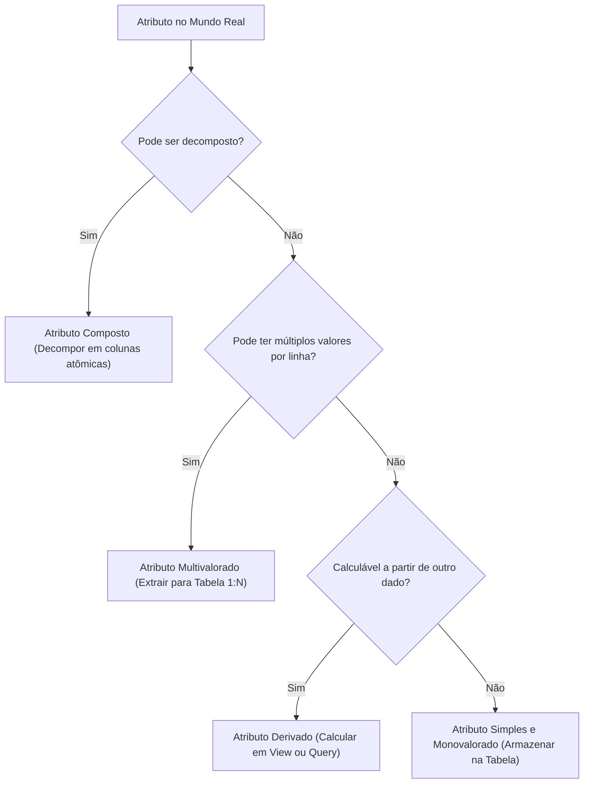

#### Exemplo e Contraexemplo
- **Exemplo Correto:** Decompor `TELEFONE` em uma entidade associada `TELEFONE_FUNCIONARIO` com cardinalidade `$ `(1, N)` $`, possuindo a chave composta `$ `(\text{CPF\_FUN}, \text{NUMERO})` $`.
- **Contraexemplo:** Gravar em uma coluna `VARCHAR(100)` da tabela `FUNCIONARIO` a string `'17-9999-1111, 17-3421-0000'`. Isso viola explicitamente a 1FN, impede a indexação dos números e inviabiliza buscas pontuais eficientes.

---

### Mapeamento de Relacionamentos e Cardinalidades (1:1, 1:N, N:M)

#### Definição e Mecanismos Estruturais
Os vínculos estruturais entre relações dependem estritamente das cardinalidades mínimas e máximas:
- **Relacionamento 1:1 (Um para Um):** Cada tupla da relação A associa-se a no máximo uma tupla da relação B, e vice-versa. O mapeamento físico ocorre alocando-se a chave primária de uma das tabelas como chave estrangeira única (`UNIQUE`) na outra (exemplo: `DEPARTAMENTO` e `GERENTE`).
- **Relacionamento 1:N (Um para Muitos):** Uma tupla da relação A vincula-se a múltiplas tuplas da relação B, porém cada tupla de B vincula-se a no máximo uma de A. O mapeamento físico **sempre** aloca a chave primária do lado 1 (`tabela-pai`) dentro da tabela do lado N (`tabela-filha`) sob a forma de chave estrangeira (exemplo: `DEPARTAMENTO` e `FUNCIONARIO`).
- **Relacionamento N:M (Muitos para Muitos):** Múltiplas tuplas de A vinculam-se a múltiplas tuplas de B. O modelo relacional puro proíbe a implementação direta de associações N:M em duas tabelas. O mapeamento exige obrigatoriamente a criação de uma **tabela associativa intermediária**, cuja chave primária é tipicamente composta pelas chaves estrangeiras que referenciam ambas as entidades (exemplo: `FUNCIONARIO` e `PROJETO` gerando `ALOCACAO_PROJETO`).

| Tipo de Associação | Estratégia de Mapeamento Físico | Localização da Chave Estrangeira |
| :--- | :--- | :--- |
| **1:1** | Inclusão de FK com restrição `UNIQUE` | Na tabela com participação total/obrigatória |
| **1:N** | Inclusão de FK simples | Obrigatoriamente na tabela do lado **N** (filha) |
| **N:M** | Criação de tabela associativa intermediária | Tabela intermediária contendo as duas FKs |

---

### Auto-Relacionamentos e Hierarquias Estruturais

#### Definição e Motivação
Um auto-relacionamento (ou relacionamento unário/recursivo) ocorre quando tuplas de uma relação associam-se a outras tuplas pertencentes à **mesma** relação. O caso clássico da engenharia de software corporativa é a hierarquia de supervisão: supervisores e subordinados são, fundamentalmente, instâncias da mesma entidade `FUNCIONARIO`.

A motivação é consolidar entidades de mesmo domínio semântico em um esquema unificado, evitando a replicação desnecessária de esquemas idênticos para gerentes, supervisores e operacionais.

#### Implementação Relacional
Adiciona-se na tabela uma chave estrangeira que referencia a chave primária da própria tabela:

```sql
CREATE TABLE FUNCIONARIO (
    CPF INTEGER NOT NULL,
    NOME VARCHAR(50) NOT NULL,
    CPF_SUPERVISOR INTEGER,
    CONSTRAINT PK_FUNCIONARIO PRIMARY KEY (CPF),
    CONSTRAINT FK_SUPERVISAO FOREIGN KEY (CPF_SUPERVISOR) REFERENCES FUNCIONARIO(CPF)
);
```

#### Armadilhas e Nuances
1. **Obrigatoriedade de Nulabilidade:** A coluna `CPF_SUPERVISOR` **deve** admitir valores nulos (`NULL`). Se for declarada como `NOT NULL`, a inserção do primeiro registro da empresa (o Diretor Executivo ou Presidente, que não possui supervisor acima de si) será bloqueada pelo SGBD, inviabilizando a carga inicial.
2. **Ciclos Infinitos em Consultas Recursivas:** Ao consultar árvores hierárquicas, a integridade deve impedir que o funcionário A supervise B, B supervise C e C supervise A, o que travaria otimizadores em buscas recursivas sem controle de profundidade.

---

### Diagramas de Entidade-Relacionamento Oficiais da Disciplina

Com base nos enunciados e especificações formais do trabalho "ELABORAR UM BANCO DE DADOS" ministrado pelo Prof. Guilherme de Morais, apresentam-se a seguir os quatro Diagramas de Entidade-Relacionamento consolidados.

#### 1. Sistema Corporativo Integrado (DER Empresa)
Regras atendidas:
- Funcionário: nomes decompostos, CPF, sexo, data de nascimento, endereço.
- Telefones: multivalorado (entidade dependente).
- Supervisão: auto-relacionamento recursivo 1:N.
- Dependentes: entidade fraca identificada relativamente ao funcionário.
- Departamentos: código, nome, local; possui 1 gerente (1:1) e muitos funcionários (1:N).
- Projetos: controlados por departamento (1:N) e executados por funcionários (N:M com o atributo associativo `Horas`).

```mermaid
erDiagram
    DEPARTAMENTO ||--o{ FUNCIONARIO : "possui alocados (1:N)"
    DEPARTAMENTO ||--|| FUNCIONARIO : "tem como gerente (1:1)"
    DEPARTAMENTO ||--o{ PROJETO : "controla (1:N)"
    
    FUNCIONARIO ||--o{ FUNCIONARIO : "supervisiona (1:N)"
    FUNCIONARIO ||--o{ TELEFONE_FUNCIONARIO : "possui (1:N)"
    FUNCIONARIO ||--o{ DEPENDENTE : "possui dependentes (1:N)"
    
    FUNCIONARIO ||--o{ FUNCIONARIO_PROJETO : "atua em (1:N)"
    PROJETO ||--o{ FUNCIONARIO_PROJETO : "composto por (1:N)"

    DEPARTAMENTO {
        int Numero_Dep PK
        varchar Nome_Dep
        varchar Localizacao
        int CPF_Gerente FK
    }

    FUNCIONARIO {
        int CPF PK
        varchar Primeiro_Nome
        varchar Segundo_Nome
        varchar Ultimo_Nome
        varchar Endereco
        char Sexo
        date Data_Nasc
        int Numero_Dep FK
        int CPF_Supervisor FK
    }

    TELEFONE_FUNCIONARIO {
        int CPF_Funcionario PK_FK
        varchar Numero_Telefone PK
    }

    DEPENDENTE {
        int CPF_Funcionario PK_FK
        varchar Primeiro_Nome PK
        varchar Segundo_Nome
        varchar Ultimo_Nome
        varchar Endereco
        char Sexo
        date Data_Nasc
    }

    PROJETO {
        int Codigo_Proj PK
        varchar Nome_Proj
        date Data_Inicio
        int Numero_Dep FK
    }

    FUNCIONARIO_PROJETO {
        int CPF_Funcionario PK_FK
        int Codigo_Proj PK_FK
        decimal Horas_Trabalhadas
    }
```

#### 2. Sistema de Pet-Shop Integrado (DER Pet-Shop)
Regras atendidas:
- Funcionários com telefones residenciais e celulares, alocados estritamente em um Cargo.
- Clientes com múltiplos telefones (comercial, residencial, celular) e e-mail.
- Animais vinculados a clientes (1:N), com histórico de serviços prestados (envolvendo funcionário, cliente, animal, tipo, data e valor).
- Vendas de produtos comerciais envolvendo cliente, funcionário e produtos catalogados, com quantidades e formas de pagamento.
- Fornecedores associados aos produtos catalogados (1 Fornecedor fornece N Produtos; 1 Produto pertence a 1 Fornecedor).

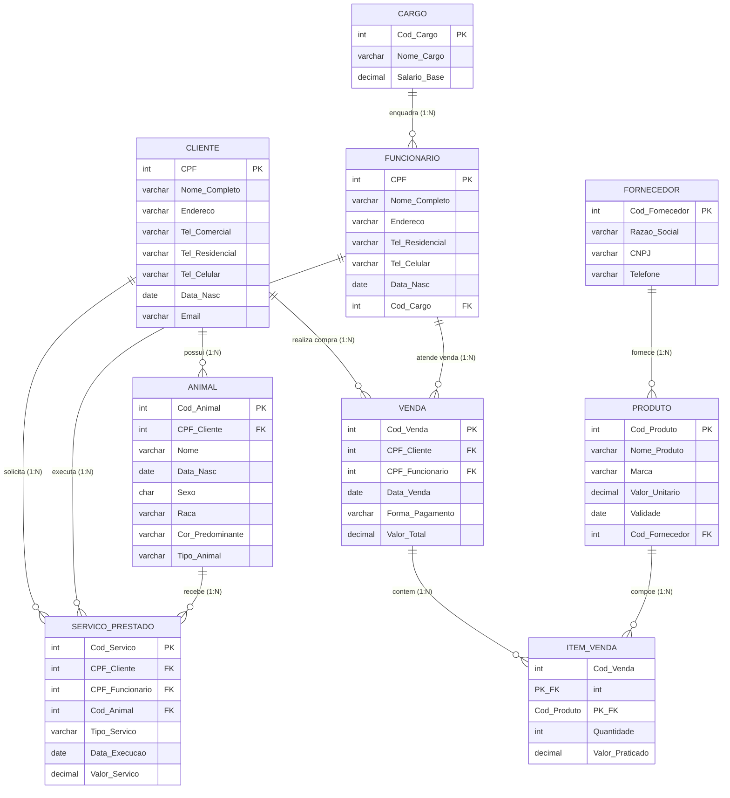

#### 3. Sistema de Gestão de Frota (DER Locadora de Automóveis)
Modelagem para locadora com agências distribuidoras, categorias tarifárias, veículos e contratos de locação vinculando clientes e condutores autorizados.

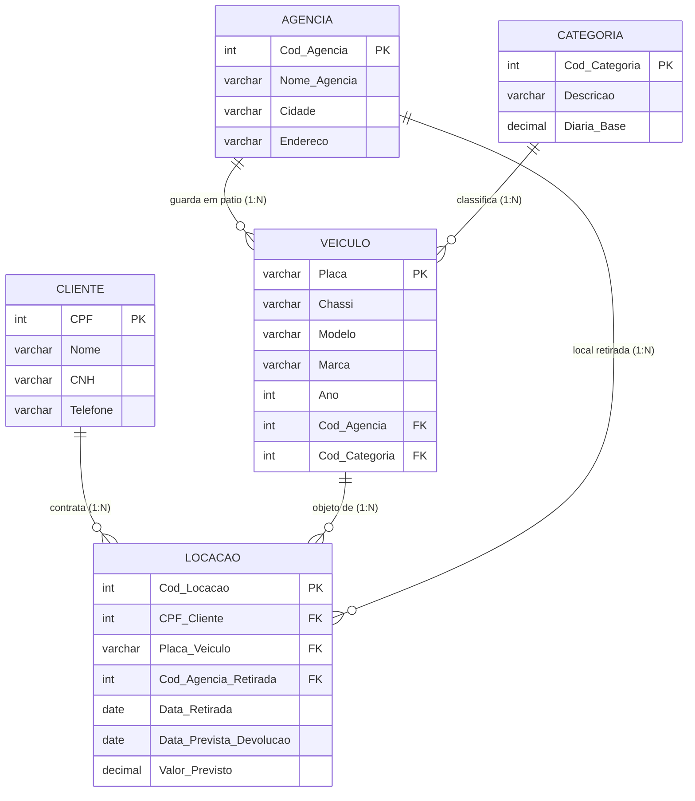

#### 4. Sistema Rodoviário de Cargas (DER Companhia de Transporte)
Modelagem contemplando filiais de despacho, motoristas habilitados, caminhões da frota e fretes emitidos entre origens e destinos.

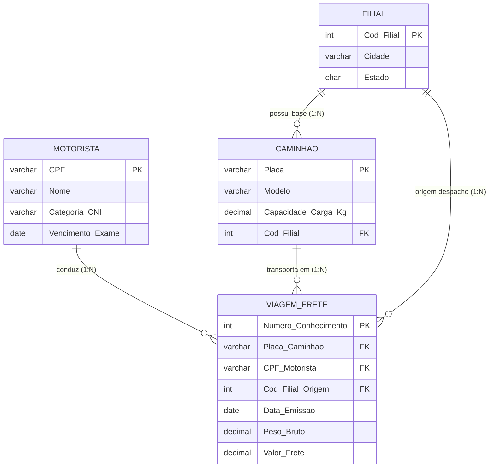

---

## Módulo 2: Linguagem de Definição de Dados (DDL) e Engenharia de Esquema

### Criação e Gestão de Catálogos Relacionais (CREATE DATABASE, USE)

#### Definição e Motivação
A instrução `CREATE DATABASE` inicializa um catálogo relacional isolado dentro da instância do SGBD, provisionando estruturas em disco para armazenamento de tabelas, índices e dicionário de dados. O comando `USE` altera o apontador da sessão ativa para direcionar instruções DDL e DML para o banco indicado.

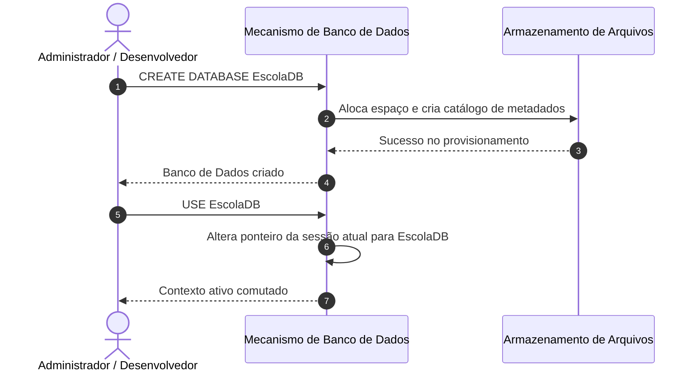

#### Sintaxe Canônica
```sql
CREATE DATABASE EscolaDB;
USE EscolaDB;
```

#### Contraexemplo e Armadilhas
Executar comandos `CREATE TABLE` logo após a criação da base de dados sem emitir o comando `USE`:
```sql
-- CONTRAEXEMPLO:
CREATE DATABASE EscolaDB;
CREATE TABLE CLIENTES ( ... ); -- Erro de execução: No database selected!
```

---

### Domínios e Tipos de Dados Fundamentais (INT, VARCHAR, CHAR, DECIMAL, DATE)

#### Definição e Mecanismos Internos de Armazenamento
A integridade de domínio impõe limites estritos aos valores admissíveis em cada atributo:
- `INT` (ou `INTEGER`): Representação binária inteira com sinal de 32 bits, cobrindo o intervalo `$ `[-2^{31}, 2^{31} - 1]` $` (de -2.147.483.648 a +2.147.483.647). Ideal para identificadores primários e chaves substitutas (*surrogate keys*).
- `CHAR(n)`: Vetor de caracteres estático de comprimento fixo `$ `n` $`. Sempre reserva `$ `n` $` bytes no bloco de disco. Se a string armazenada possuir comprimento menor, o SGBD realiza o preenchimento automático com espaços em branco (*padding*) à direita. Indicado para dados de tamanho estritamente invariável, como códigos de Unidade Federativa (`CHAR(2)`) ou siglas de medidas (`CHAR(2)`).
- `VARCHAR(n)`: Vetor de caracteres de tamanho dinâmico variável com teto máximo `$ `n` $`. Armazena unicamente os caracteres fornecidos acrescidos de 1 ou 2 bytes de cabeçalho indicador de comprimento. Otimiza o consumo de páginas de dados para nomes e logradouros.
- `DECIMAL(P, S)` (ou `NUMERIC(P, S)`): Tipo numérico de base 10 de **ponto fixo exato**, onde `$ `P` $` representa a precisão total (quantidade total de dígitos significativos) e `$ `S` $` representa a escala (quantidade de dígitos decimais após a vírgula). É o **único tipo aceitável para valores monetários e financeiros** no desenvolvimento de software de alta fidelidade.
- `DATE`: Armazena instantes do calendário civil (ano, mês e dia) no padrão internacional ISO 8601 (`YYYY-MM-DD`), cobrindo o intervalo de '1000-01-01' a '9999-12-31'.

#### Tabela Comparativa de Tipos de Dados

| Tipo de Dado | Tamanho em Disco | Comportamento com Espaços | Aplicação Crítica Recomendada |
| :--- | :--- | :--- | :--- |
| `INT` | 4 bytes | Não aplicável | Chaves primárias e contadores inteiros |
| `CHAR(2)` | 2 bytes fixos | Completa com espaços à direita | UF (`'SP'`, `'MG'`), Unidade (`'UN'`, `'KG'`) |
| `VARCHAR(100)` | 1 a 100 bytes + overhead | Descarta espaços excedentes | Nomes, logradouros, e-mails |
| `DECIMAL(10,2)` | Variável (armazena dígitos exatos) | Precisão aritmética absoluta | Salários, preços unitários, totais |
| `DATE` | 3 a 4 bytes | Não aplicável | Vencimentos, nascimentos, auditoria |

#### Contraexemplo e Armadilhas
Utilizar tipos de ponto flutuante binário (`FLOAT` ou `DOUBLE`) para armazenar moeda:
```sql
-- CONTRAEXEMPLO GRAVE:
salario_fixo FLOAT -- Erro conceitual financeiro!
```
Valores em `FLOAT` são representados em base 2 (padrão IEEE 754), o que acarreta dízimas periódicas imediatas em frações simples como `$ `0.1` $` ou `$ `0.05` $`. Isso produz erros cumulativos de arredondamento em fechamentos contábeis. A declaração mandatória em sistemas corporativos é `DECIMAL(10,2)`.

---

### Declaração de Restrições Declarativas (PRIMARY KEY, FOREIGN KEY, NOT NULL, UNIQUE, CHECK)

#### Definição e Motivação
Restrições (*constraints*) são regras semânticas registradas no catálogo de metadados do SGBD que operam independentemente das linguagens de aplicação (Java, C#, Python). Garantem que dados corrompidos jamais sejam persistidos no disco rígido.

As principais diretivas ensinadas pelo Prof. Guilherme de Morais incluem:
1. `PRIMARY KEY`: Define a identidade da relação. Garante unicidade e não nulidade automáticas sobre as colunas delimitadas.
2. `FOREIGN KEY`: Impõe a integridade referencial, garantindo que o valor atribuído a uma tupla-filha exista previamente na chave primária da tabela-pai correspondente.
3. `NOT NULL`: Veta a ausência ontológica de valor na coluna.
4. `UNIQUE`: Exige unicidade de valores em colunas não primárias (como CNPJ, CPF alternativo ou Placa).
5. `CHECK`: Valida predicados booleanos customizados sobre o conteúdo persistido (exemplo: `CHECK (valor_unitario > 0)`).

#### Sintaxe Padronizada e Nomeação Explícita de Constraints
Uma regra de ouro da engenharia de banco de dados é **sempre nomear explicitamente as restrições**. Constraints geradas anonimamente recebem identificadores arbitrários gerados pelo motor (como `sys_c001243`), inviabilizando manutenções futuras:

```sql
CREATE TABLE PRODUTO (
    cod_produto INTEGER NOT NULL,
    descricao VARCHAR(100) NOT NULL,
    unidade CHAR(2) NOT NULL,
    valor_unitario DECIMAL(10,2) NOT NULL,
    cod_lote INTEGER,
    CONSTRAINT pk_produto PRIMARY KEY (cod_produto),
    CONSTRAINT fk_prod_lote FOREIGN KEY (cod_lote) REFERENCES LOTE(cod_lote),
    CONSTRAINT chk_val_unit CHECK (valor_unitario >= 0)
);
```

---

### Evolução de Esquemas com ALTER TABLE (ADD, DROP, RENAME de Colunas e Tabelas)

#### Definição e Comandos
Bancos de dados corporativos evoluem juntamente com os requisitos de negócio. O comando `ALTER TABLE` viabiliza a mutação física e lógica dos esquemas sem descarte dos registros persistidos.

1. **Adição de Novas Colunas:**
   ```sql
   -- Forma com COLUMN explícito (Aula 02 / Modificações de Tabelas):
   ALTER TABLE produtos ADD COLUMN descricao TEXT;
   
   -- Forma padrão compacta:
   ALTER TABLE produtos ADD descricao TEXT;
   ```
   *Comportamento Interno:* Para todas as tuplas pré-existentes na tabela, a nova coluna assumirá inicialmente o valor nulo (`NULL`).

2. **Remoção Física de Colunas:**
   ```sql
   ALTER TABLE produtos DROP COLUMN descricao;
   ```
   *Impacto de Engenharia:* Operação destrutiva e irreversível. Qualquer consulta de backend que dependa do identificador expurgado falhará imediatamente.

3. **Renomeação de Colunas:**
   ```sql
   ALTER TABLE produtos RENAME COLUMN cod_prod TO cod_produto;
   ```

4. **Renomeação de Tabelas:**
   ```sql
   ALTER TABLE clientes RENAME TO clientes_antigos;
   ```

---

### Gestão e Expurgo de Restrições Estruturais com DROP CONSTRAINT

#### Definição e Aplicação
Quando uma regra de integridade referencial ou chave precisa ser remodelada, remove-se a constraint associada pelo seu identificador unívoco:

```sql
-- Remoção de chave estrangeira previamente declarada
ALTER TABLE PRODUTO DROP CONSTRAINT FK_COD_LOTE1;

-- Adição posterior da Chave Primária em tabela existente
ALTER TABLE produtos ADD CONSTRAINT pk_produtos PRIMARY KEY (cod_produto);

-- Adição posterior de Chave Estrangeira em tabela existente
ALTER TABLE PEDIDOS 
ADD CONSTRAINT FK_COD_CLI 
FOREIGN KEY (COD_CLI) REFERENCES CLIENTES(COD);
```

#### Validação de Carga Pré-existente
Se uma tabela possuir 100.000 registros gravados e o comando `ALTER TABLE ... ADD CONSTRAINT ... FOREIGN KEY` for emitido, o SGBD iniciará uma varredura sequencial completa (*Full Table Scan*). Se encontrar **uma única tupla** contendo valor inexistente na tabela-pai referenciada, o comando será imediatamente abortado e a constraint não será criada.

---

### Dependência Topológica na Criação e Destruição de Objetos

#### Definição e Ordenação Cronológica
A presença de chaves estrangeiras impõe uma ordenação topológica obrigatória na execução de scripts DDL:

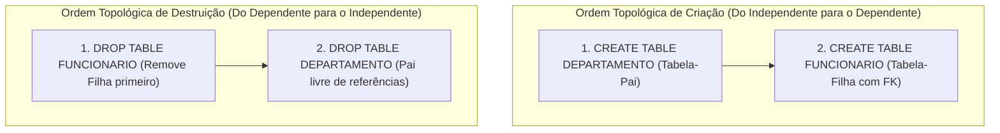

#### Contraexemplo
```sql
-- CONTRAEXEMPLO: Tentativa de remoção invertida
DROP TABLE DEPARTAMENTO; 
-- Erro do SGBD: cannot drop table departamento because other objects depend on it (funcionario)
```

---

## Módulo 3: Linguagem de Manipulação de Dados (DML) e Garantias Transacionais

### Inserção de Dados com INSERT INTO: Mapeamento Explícito versus Posicional

#### Definição e Comparação de Sintaxe
A instrução `INSERT INTO` instancia novas tuplas em uma tabela relacional. O SQL fornece duas abordagens sintáticas:

1. **Inserção Posicional (Implícita):** Omite o mapeamento das colunas.
   ```sql
   INSERT INTO funcionario 
   VALUES (3, 'PEDRO', 'SECRETARIO', '1963-08-20');
   ```
2. **Inserção com Declaração Explícita de Colunas (Recomendada em Engenharia):**
   ```sql
   INSERT INTO funcionario (cpf, nome, funcao, data_nasc) 
   VALUES (2, 'SEBASTIAO', 'PROFESSOR', '2020-03-03');
   ```

#### Análise Crítica de Engenharia de Software

| Critério | Inserção Posicional | Inserção Explícita de Colunas |
| :--- | :--- | :--- |
| **Resiliência a alterações DDL** | **Zero.** Se uma coluna for adicionada à tabela, o script quebra. | **Total.** Novas colunas anuláveis ou com `DEFAULT` são ignoradas. |
| **Omissão de Atributos** | Impossível. Exige fornecimento de valores para todos os campos. | Direta. Permite omitir atributos opcionais (assumem `NULL`). |
| **Segurança contra Inversão** | Risco alto de trocar dados vizinhos de mesmo tipo (`VARCHAR`). | Risco nulo: os valores são estritamente associados aos nomes. |

---

### Atualização de Registros com UPDATE e Cláusula SET

#### Definição e Mecanismo de Funcionamento
O comando `UPDATE` atua sobre registros já armazenados, alterando valores de atributos específicos delimitados pela cláusula `SET`. As tuplas afetadas são selecionadas através do predicado fornecido na cláusula `WHERE`:

```sql
UPDATE funcionario 
SET funcao = 'DIRETOR' 
WHERE cpf = 4;
```

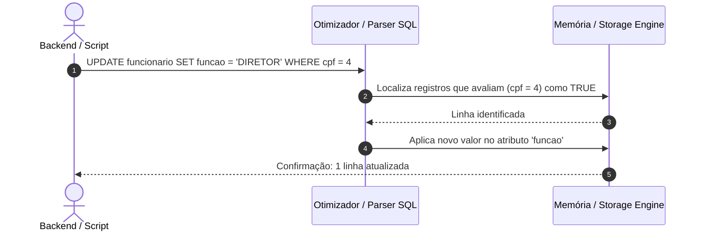

---

### Exclusão de Registros com DELETE FROM versus TRUNCATE TABLE e DROP TABLE

#### Definição e Tabela Comparativa Estrutural
A remoção de dados pode ocorrer no nível de tupla (`DELETE`), no nível de bloco de páginas (`TRUNCATE`) ou no nível de catálogo de esquema (`DROP`).

| Parâmetro Técnico | `DELETE FROM` | `TRUNCATE TABLE` | `DROP TABLE` |
| :--- | :--- | :--- | :--- |
| **Classificação** | DML | DDL / DML de Alta Performance | DDL |
| **Suporte a WHERE** | Sim (Permite exclusão seletiva) | Não (Exclui todas as tuplas) | Não aplicável |
| **Geração de Logs** | Registro tupla a tupla (Pesado) | Mínimo (Desaloca páginas de disco) | Registra destruição de objeto |
| **Preservação da Tabela** | Mantém esquema e índices | Mantém esquema e índices vazios | Destrói dados e estrutura física |
| **Velocidade** | Mais lenta em grandes volumes | Quase instantânea | Instantânea |

---

### Riscos Sistêmicos da Omissão da Cláusula WHERE e Práticas Defensivas

#### O Risco de Indisponibilidade Operacional
No padrão ANSI SQL, omitir a cláusula `WHERE` em um comando `UPDATE` ou `DELETE` **não constitui erro de sintaxe**. O compilador assume implicitamente o predicado universal (`WHERE TRUE`), aplicando a operação a **todas as linhas existentes na tabela**.

```sql
-- CONTRAEXEMPLO DESASTROSO:
UPDATE funcionario SET funcao = 'DIRETOR'; -- Converteu todos os funcionários da empresa em Diretores!
DELETE FROM clientes;                     -- Esvaziou a base inteira de clientes da corporação!
```

#### Práticas Defensivas para Ambientes de Produção
1. **Encapsulamento Transacional Mandatório:**
   ```sql
   BEGIN; -- Inicia transação explícita
   
   DELETE FROM pedido 
   WHERE data_pedido < '2020-01-01';
   
   -- Auditoria visual do efeito:
   SELECT count(*) FROM pedido;
   
   -- Somente após confirmação inequívoca:
   COMMIT;
   -- Se o número de registros divergente do planejado:
   -- ROLLBACK;
   ```
2. **Transformação Prévia em SELECT:** Antes de rodar um `DELETE`, execute a instrução equivalente com `SELECT count(*)` utilizando a mesma cláusula `WHERE`.

---

## Módulo 4: Linguagem de Consulta de Dados (DQL) - Projeção, Seleção e Ordenação

### Arquitetura do Comando SELECT: Projeção Universal (*) versus Específica

#### Definição e Álgebra Subjacente
A instrução `SELECT` implementa a operação de **Projeção** ($`\pi`$) da Álgebra Relacional:

```math
\pi_{\text{NomeCliente}, \text{Estado}}(\text{CLIENTES})
```

Enquanto o caractere coringa asterisco (`*`) requisita todas as colunas existentes no catálogo, a projeção nominal restringe a transmissão aos campos estritamente necessários:

```sql
-- Projeção de produção recomendada:
SELECT codcliente, nomecliente, estado 
FROM clientes;
```

#### Impactos de Engenharia do Uso do Asterisco (`*`)
1. **Sobrecarga de Tráfego de Rede (I/O Bottleneck):** Transporta colunas pesadas (`TEXT`, `BLOB`, metadados de auditoria) sem utilidade para a regra de negócio.
2. **Inibição de Índices Cobertos (*Covering Indexes*):** O motor é forçado a consultar as páginas de dados na tabela base em vez de responder à query diretamente a partir da árvore do índice.
3. **Fragilidade de Contratos de Software:** Se a ordem física das colunas mudar via migração, códigos que leem dados por índice ordinal quebram instantaneamente.

---

### Pipeline e Ordem Lógica de Execução do Motor SQL

#### O Conflito entre Ordem Léxica e Ordem Lógica
O desenvolvedor redige o código SQL iniciando por `SELECT` e concluindo com `ORDER BY` (ordem de escrita). Contudo, os analisadores e otimizadores dos SGBDs processam a consulta em uma sequência lógica interna rigorosamente diferente:

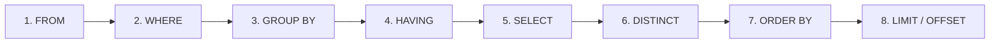

#### Implicação Crítica de Engenharia
Como a cláusula `WHERE` (Passo 2) é processada muito antes da cláusula `SELECT` (Passo 5), apelidos de coluna (*aliases*) declarados no `SELECT` **não existem fisicamente** durante a filtragem de linhas.

```sql
-- CONTRAEXEMPLO INVÁLIDO:
SELECT descricao, valor_unitario * 1.30 AS valor_reajustado
FROM produto
WHERE valor_reajustado > 50.00;
-- Erro do SGBD: Column 'valor_reajustado' does not exist!
```

Para corrigir, a expressão de cálculo deve ser repetida no `WHERE`:
```sql
-- FORMA CORRETA:
SELECT descricao, valor_unitario * 1.30 AS valor_reajustado
FROM produto
WHERE (valor_unitario * 1.30) > 50.00;
```

---

### Ordenação Determinística de Resultados com ORDER BY (ASC, DESC e Composto)

#### Teoria Relacional e Não Determinismo
Pelo postulado de Edgar F. Codd, relações são **conjuntos matemáticos não ordenados**. Sem uma cláusula explícita `ORDER BY`, a ordem das tuplas retornadas é estritamente indefinida e arbitrária (depende da fragmentação em disco, varreduras paralelas e plano de execução).

#### Ordenação Composta Hierárquica
Na ordenação de múltiplos atributos, o SGBD utiliza a primeira coluna como chave primária de ordenação. A segunda coluna atua exclusivamente como critério de desempate quando houver valores idênticos na primeira:

```sql
SELECT codcliente, nomecliente, estado, idade 
FROM clientes 
ORDER BY estado ASC, idade DESC;
```

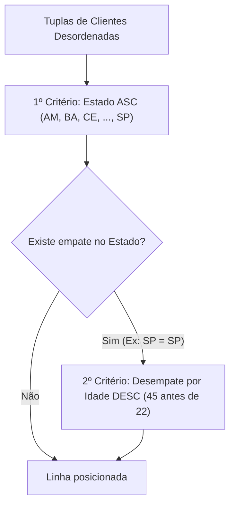

---

### Filtragem Horizontal com Cláusula WHERE e Operadores Relacionais

#### Definição e Operadores
A cláusula `WHERE` implementa a operação de **Seleção** ($`\sigma`$) da Álgebra Relacional, avaliando predicados booleanos para cada tupla individual da tabela:

```math
\sigma_{\text{Estado} = \text{'SP'} \land \text{Idade} > 25}(\text{CLIENTES})
```

Operadores relacionais canônicos:
- Igualdade: `=`
- Diferença: `<>` ou `!=`
- Comparações de magnitude: `>`, `<`, `>=`, `<=`

---

### Álgebra Booleana Aplicada: Conjunção (AND), Disjunção (OR) e Negação (NOT)

#### Tabela de Precedência Rigorosa de Operadores
A ausência de parênteses altera a semântica de filtros com operadores lógicos, pois a conjunção (`AND`) possui prioridade de avaliação sobre a disjunção (`OR`):

| Nível de Precedência | Categoria de Operador | Identificadores SQL |
| :---: | :--- | :--- |
| **1º (Maior Prioridade)** | Parênteses Delimitadores | `( )` |
| **2º** | Operadores Comparativos e Conjuntos | `=`, `<>`, `>`, `<`, `>=`, `<=`, `IN`, `BETWEEN`, `LIKE` |
| **3º** | Negação Unária | `NOT` |
| **4º** | Conjunção Lógica Binária | `AND` |
| **5º (Menor Prioridade)** | Disjunção Lógica Binária | `OR` |

#### Demonstração de Erro de Precedência
```sql
-- CONSULTA AMBÍGUA COM VAZAMENTO LÓGICO DE DADOS:
SELECT nome, estado, salario 
FROM clientes 
WHERE estado = 'SP' OR estado = 'MG' AND salario > 3000;
```
O SGBD interpreta como: `estado = 'SP' OR (estado = 'MG' AND salario > 3000)`.  
*Efeito colateral:* Qualquer cliente de São Paulo será retornado, mesmo ganhando 500 reais. Para forçar a regra pretendida, o uso de parênteses é mandatório:
```sql
SELECT nome, estado, salario 
FROM clientes 
WHERE (estado = 'SP' OR estado = 'MG') AND salario > 3000;
```

---

### Eliminação de Redundância com SELECT DISTINCT

#### Definição e Custo Computacional
Diferente dos conjuntos puros, tabelas SQL são **multiconjuntos** (*bags*), permitindo tuplas duplicadas na projeção se a chave primária for omitida. O qualificador `DISTINCT` aplica a desduplicação sobre a combinação inteira de todas as colunas declaradas no `SELECT`.

```sql
SELECT DISTINCT estado FROM clientes;
```

*Custo de Execução:* O SGBD realiza internamente uma operação de ordenação em memória (*Sort Unique*) ou instanciação de tabela hash (*Hash Aggregate*), impondo sobrecarga de processamento proporcional ao volume de tuplas.

---

### Expressões Aritméticas Escalares e Escopo de Apelidos de Coluna (AS)

#### Operadores Aritméticos em Tempo Real
O `SELECT` permite computar dados derivados sem alterar a tabela base:
```sql
SELECT 
    descricao,
    valor_unitario AS preco_atual,
    valor_unitario * 1.20 AS preco_acrescimo_20,
    valor_unitario * 0.90 AS preco_desconto_10
FROM produto;
```

---

### Filtragem por Intervalo Inclusivo com o Predicado BETWEEN

#### Definição e Equivalência Algébrica
O operador `BETWEEN` avalia se um valor reside dentro de uma faixa contínua fechada (extremos inclusivos):

```math
\text{coluna} \text{ BETWEEN } A \text{ AND } B \iff (\text{coluna} \ge A \text{ AND } \text{coluna} \le B)
```

#### A Armadilha da Inversão de Limites
O predicado exige obrigatoriamente que o limite inferior seja posicionado à esquerda e o superior à direita:
```sql
-- CORRETO:
WHERE idade BETWEEN 25 AND 40;

-- CONTRAEXEMPLO GRAVE (NUNCA RETORNARÁ DADOS):
WHERE idade BETWEEN 40 AND 25; 
-- O SGBD avalia: (idade >= 40 AND idade <= 25), condição matematicamente impossível!
```

---

### Predicados de Pertinência a Conjuntos: Operadores IN e NOT IN

#### Definição e Equivalência Lógica
O operador `IN` realiza a verificação de pertinência a um conjunto finito discreto:

```math
\text{coluna} \in \{v_1, v_2, \dots, v_n\} \iff (\text{coluna} = v_1 \lor \text{coluna} = v_2 \lor \dots \lor \text{coluna} = v_n)
```

Exemplo ministrado em aula:
```sql
SELECT nome_cliente, uf 
FROM cliente 
WHERE uf IN ('SP', 'MG');
```

---

### A Lógica Tri-Valorada (3VL) e os Perigos do NULL em Comparações e Subconjuntos

#### Fundamentação da Lógica Trivalente
No padrão ANSI SQL, o marcador `NULL` representa a ausência total de valor ou estado de incógnita ontológica. Por definição matemática relacional, `NULL` não é igual a zero, nem é igual a string vazia `''`, nem é igual a outro `NULL`. Qualquer comparação direta com operadores relacionais resulta em `UNKNOWN`:

```math
(\text{NULL} = 10) \implies \text{UNKNOWN}
```
```math
(\text{NULL} = \text{NULL}) \implies \text{UNKNOWN}
```

O filtro `WHERE` descarta qualquer linha cujo resultado final seja diferente de `TRUE` (linhas com avaliação `FALSE` ou `UNKNOWN` são excluídas). Para testar a nulidade de forma canônica, deve-se usar estritamente `IS NULL` ou `IS NOT NULL`.

#### A Falha Catastrófica do Operador NOT IN com Elementos NULL
Pelas Leis de De Morgan, o predicado `NOT IN` expande-se em uma conjunção estrita de desigualdades (`AND`):

```math
\text{coluna} \text{ NOT IN } (v_1, v_2, \text{NULL}) \iff (\text{coluna} \ne v_1) \land (\text{coluna} \ne v_2) \land (\text{coluna} \ne \text{NULL})
```

Como `$ `(\text{coluna} \ne \text{NULL})` $` avalia invariavelmente como `UNKNOWN`, a expressão inteira torna-se:

```math
\text{TRUE} \land \text{TRUE} \land \text{UNKNOWN} \implies \text{UNKNOWN}
```

**Resultado de Engenharia:** Se uma lista do predicado `NOT IN` contiver um único elemento `NULL` (proveniente de literais ou de uma subconsulta), **a consulta inteira retornará zero linhas**, independentemente do conteúdo da tabela.

---

## Módulo 5: Casamento de Padrões, Funções Escalares e Tipos Temporais

### Casamento de Padrões em Cadeias de Texto com LIKE, ILIKE e Metacaracteres (% e _)

#### Definição e Metacaracteres Curinga
O operador `LIKE` executa a busca de padrões em colunas de texto:
- `%` (Porcentagem): Casa com zero, um ou uma sequência ilimitada de caracteres arbitrários.
- `_` (Sublinhado / Underscore): Casa estritamente com **um único caractere posicional**.

```sql
-- Começa com a letra 'A':
SELECT * FROM clientes WHERE nome LIKE 'A%';

-- Contém a letra 'I' em qualquer coordenada:
SELECT * FROM clientes WHERE nome LIKE '%I%';

-- Termina com a letra 'A':
SELECT * FROM clientes WHERE nome LIKE '%A';

-- Possui exatamente 5 caracteres no nome:
SELECT * FROM clientes WHERE nome LIKE '_____';

-- Começa com 'MA' e termina com 'A':
SELECT * FROM clientes WHERE nome LIKE 'MA%A';
```

#### Sensibilidade de Caixa: LIKE versus ILIKE
No PostgreSQL, o operador `LIKE` é estritamente sensível a maiúsculas e minúsculas (*case-sensitive*). Para desconsiderar a variação de caixa, utiliza-se a extensão `ILIKE` ou normaliza-se com `UPPER()` / `LOWER()`:

```sql
-- Busca insensível no PostgreSQL:
SELECT * FROM clientes WHERE nome ILIKE '%i%';

-- Forma equivalente e portável para qualquer SGBD ANSI:
SELECT * FROM clientes WHERE UPPER(nome) LIKE '%I%';
```

---

### Funções Escalares de Texto: ASCII, LENGTH, LOWER, UPPER e SUBSTRING

#### Tabela de Funções Escalares Textuais

| Função | Parâmetro | Retorno | Comportamento com Dados Reais |
| :--- | :--- | :--- | :--- |
| `ASCII(str)` | `VARCHAR` / `TEXT` | `INTEGER` | Retorna o código ASCII do **primeiro** caractere da cadeia (`ASCII('Carlos') = 67`). |
| `LENGTH(str)` | `VARCHAR` / `TEXT` | `INTEGER` | Retorna a quantidade de caracteres da string (`LENGTH('UniFEF') = 6`). |
| `LOWER(str)` | `VARCHAR` / `TEXT` | `TEXT` | Converte toda a cadeia para minúsculas (`LOWER('SQL') = 'sql'`). |
| `UPPER(str)` | `VARCHAR` / `TEXT` | `TEXT` | Converte toda a cadeia para maiúsculas (`UPPER('sql') = 'SQL'`). |
| `SUBSTRING(str, pos, len)` | String, Início, Tamanho | `TEXT` | Extrai fatia de texto baseada em índice 1-based (`SUBSTRING('BANCO', 1, 3) = 'BAN'`). |

---

### Operações de Concatenação com o Operador Pipe Duplo (||)

#### O Padrão ANSI de Concatenação
A junção de atributos alfanuméricos e literais ocorre através do operador de barra vertical dupla `||`:

```sql
SELECT nome || ' reside na cidade de ' || cidade AS declaracao_residencia
FROM clientes;
```

#### A Regra de Ouro do Nulo na Concatenação
Qualquer elemento nulo concatenado resulta inevitavelmente em nulo:

```math
\text{'Cliente: '} \parallel \text{NULL} \implies \text{NULL}
```

---

### Manipulação de Tipos Temporais: NOW, DATE, AGE e EXTRACT

#### Comportamento das Funções Temporais no PostgreSQL
1. `NOW()`: Retorna o instante transacional corrente (`timestamp with time zone`). Mantém valor invariante durante toda a duração da transação ativa.
2. `DATE(ts)`: Trunca a parcela horária, extraindo exclusivamente o componente de calendário (Ano, Mês, Dia).
3. `AGE(ts_final, ts_inicial)`: Computa a distância temporal entre duas datas no calendário humano, retornando um tipo composto `INTERVAL` (anos, meses e dias).
4. `EXTRACT(campo FROM ts)`: Desestrutura o dado temporal e extrai valores numéricos escalares (`YEAR`, `MONTH`, `DAY`, `HOUR`) no tipo `double precision`.

```sql
-- Extrações analíticas de componentes temporais:
SELECT 
    EXTRACT(YEAR FROM NOW()) AS ano_corrente,
    EXTRACT(MONTH FROM NOW()) AS mes_corrente,
    EXTRACT(DAY FROM NOW()) AS dia_corrente;
```

---

### Aritmética Cronológica com INTERVAL e Consultas Sargáveis

#### O Tipo de Dado INTERVAL
Um intervalo representa uma magnitude de tempo transcorrido (`INTERVAL '30 years'`, `INTERVAL '6 months'`).

#### Comparação de Elegibilidade Etária
Para filtrar clientes com mais de 30 anos:

```sql
-- Abordagem com AGE e INTERVAL (Ministrada em aula):
SELECT nome, data_nasc 
FROM clientes 
WHERE AGE(NOW(), data_nasc) > INTERVAL '30 years';

-- Abordagem de Alta Performance Sargável (Complemento de Engenharia):
SELECT nome, data_nasc 
FROM clientes 
WHERE data_nasc <= NOW() - INTERVAL '30 years';
```
*(Nota técnica: A segunda abordagem isola a coluna `data_nasc` de funções, permitindo ao SGBD realizar a busca diretamente pelos índices em Árvore B+).*

---

## Módulo 6: Junções Relacionais e Agrupamentos Analíticos

### Fundamentação da Junção Relacional: Do Produto Cartesiano à Equi-Junção

#### Teoria Relacional
A junção interna ($`\bowtie`$) fundamenta-se formalmente no Produto Cartesiano ($`R \times S`$) associado à restrição por igualdade de chaves:

```math
R \bowtie_{R.\text{PK} = S.\text{FK}} S = \sigma_{R.\text{PK} = S.\text{FK}}(R \times S)
```

Se a tabela `$ `R` $` possuir 10 tuplas e `$ `S` $` possuir 10 tuplas, o produto cartesiano irrestrito produzirá 100 linhas combinadas. A aplicação do predicado de junção retém apenas as tuplas onde as chaves coincidem de forma consistente.

---

### Junção Implícita (SQL-89 via WHERE) versus Junção Explícita (ANSI SQL-92 via INNER JOIN)

#### Comparação de Paradigmas Sintáticos
- **Sintaxe Implícita (SQL-89):** Lista as tabelas no `FROM` separadas por vírgula e aplica o critério de relacionamento dentro do `WHERE`.
- **Sintaxe Explícita (ANSI SQL-92):** Utiliza as palavras reservadas `INNER JOIN` associadas à cláusula delimitadora `ON`.

```sql
-- Sintaxe Tradicional SQL-89 (Aula 04 e 07):
SELECT clientes.nome, pedidos.cod_pedido, pedidos.data_pedido
FROM clientes, pedidos
WHERE clientes.cod_cliente = pedidos.cod_cliente;

-- Sintaxe Moderna ANSI SQL-92 (Aula 06):
SELECT c.nome, p.cod_pedido, p.data_pedido
FROM clientes c
INNER JOIN pedidos p ON c.cod_cliente = p.cod_cliente;
```

#### Riscos da Abordagem SQL-89
Na sintaxe tradicional, se o desenvolvedor acidentalmente esquecer de incluir a condição `WHERE c.cod_cliente = p.cod_cliente`, o banco **não emitirá erro** e executará um Produto Cartesiano volumoso em produção. Na sintaxe ANSI SQL-92, omitir a cláusula `ON` gera interrupção imediata da consulta por erro de sintaxe, prevenindo degradação de infraestrutura.

---

### Junção Externa à Esquerda (LEFT JOIN) e Antijunção com IS NULL

#### Preservação de Tuplas e Nulabilidade
O `LEFT JOIN` preserva **todas as tuplas da relação posicionada à esquerda** da cláusula, independentemente de haver correspondência na tabela da direita. Quando não houver linha correspondente na tabela da direita, o SGBD preenche todos os atributos da entidade direita com `NULL`.

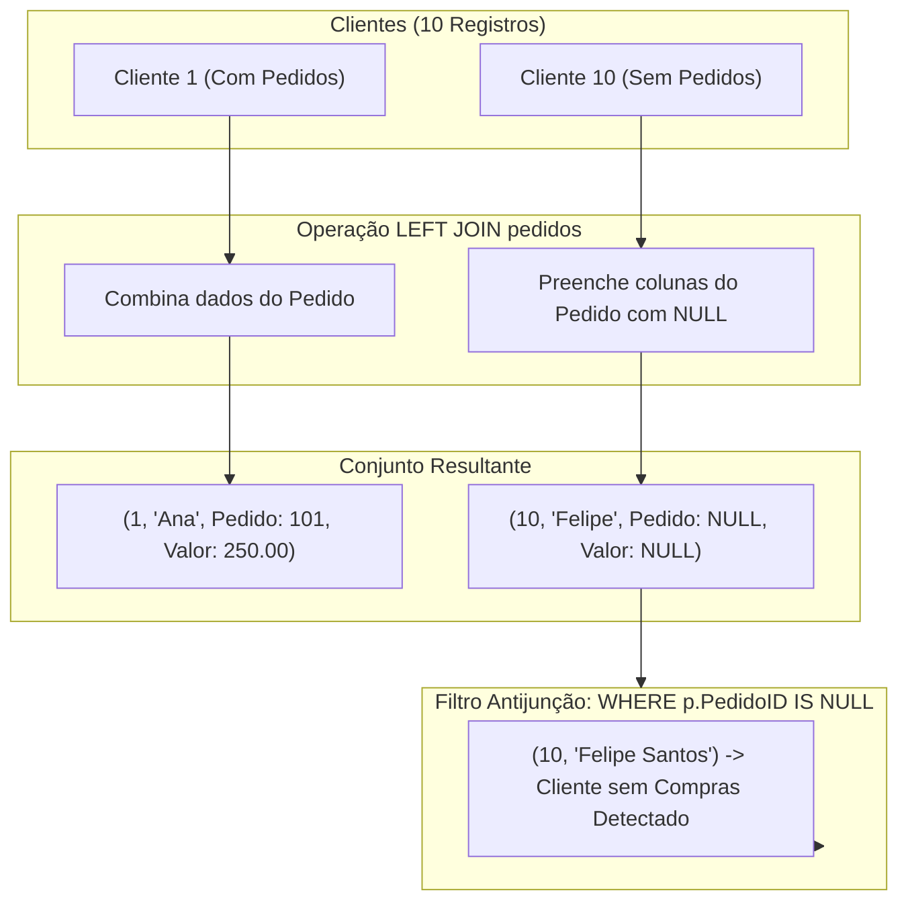

#### Consulta de Antijunção
Para localizar clientes que nunca efetuaram pedidos (conforme abordado na Aula 06):
```sql
SELECT c.ClienteID, c.Nome, c.Cidade
FROM Clientes c
LEFT JOIN Pedidos p ON c.ClienteID = p.ClienteID
WHERE p.PedidoID IS NULL;
```

---

### Funções de Agregação Estatística (COUNT, SUM, AVG, MAX, MIN)

#### Definições Operacionais
- `COUNT(*)`: Computa a quantidade absoluta de tuplas retornadas.
- `COUNT(coluna)`: Computa a quantidade de tuplas em que `coluna` possui valor não nulo (`NOT NULL`).
- `SUM(coluna)`: Retorna o somatório dos valores não nulos.
- `AVG(coluna)`: Retorna a média aritmética simples dos valores não nulos.
- `MAX(coluna)` / `MIN(coluna)`: Retornam os extremos absolutos da coluna.

*Comportamento com Nulos:* Todas as funções de agregação (exceto `COUNT(*)`) eliminam silenciosamente os valores nulos antes de efetuar o cálculo.

---

### Particionamento de Dados com GROUP BY e a Regra da Projeção de Agregados

#### Mecânica de Agrupamento
A cláusula `GROUP BY` colapsa as linhas da tabela em grupos que compartilham as mesmas chaves de agrupamento.

#### A Regra Fundamental do GROUP BY
Qualquer coluna listada na cláusula `SELECT` que **não** esteja contida dentro de uma função agregadora (`SUM`, `COUNT`, `AVG`, etc.) **deve obrigatoriamente constar na lista de colunas da cláusula GROUP BY**.

```sql
-- CONSULTA VÁLIDA:
SELECT cidade, AVG(salario) AS media_salarial
FROM clientes
GROUP BY cidade;
```

```sql
-- CONTRAEXEMPLO INVÁLIDO (VIOLAÇÃO ANSI SQL):
SELECT cidade, nome, AVG(salario)
FROM clientes
GROUP BY cidade;
-- Erro: 'nome' deve figurar no GROUP BY ou em função de agregação!
```

---

### Filtragem sobre Grupos com Cláusula HAVING versus WHERE

#### Diferença Semântica e Temporal
- `WHERE`: Filtra tuplas **individuais antes** da formação dos agrupamentos e agregações. Não admite funções de agregação em seus predicados.
- `HAVING`: Filtra **grupos consolidados depois** que a operação de `GROUP BY` e as funções de agregação foram calculadas.

| Critério | Cláusula `WHERE` | Cláusula `HAVING` |
| :--- | :--- | :--- |
| **Momento de Execução** | Passo 2 (Pré-Agrupamento) | Passo 4 (Pós-Agrupamento) |
| **Alvo da Filtragem** | Linhas atômicas brutas | Partições consolidadas |
| **Aceita Funções Agregadas?** | **Proibido** (ex: `WHERE AVG(salario) > 2000` gera erro) | **Permitido** (ex: `HAVING AVG(salario) > 2000`) |

Exemplo de aplicação conjunta:
```sql
SELECT cidade, COUNT(*) AS total_clientes, AVG(salario) AS media_salarial
FROM clientes
WHERE estado = 'SP'             -- Filtra apenas clientes de SP antes de agrupar
GROUP BY cidade
HAVING AVG(salario) > 2500.00;   -- Filtra apenas cidades cuja média salarial passe de 2500
```

---

## Módulo 7: Resolução Completa das Listas e Trabalhos Práticos Oficiais

### Trabalho: Elaboração de Bancos de Dados e Modelos DER (Exercícios 1 a 5)

Apresenta-se o mapeamento relacional textual das quatro atividades de modelagem conceitual ministradas no Google Classroom.

#### Mapeamento Relacional do Exercício 1 (DER Empresa)
- `DEPARTAMENTO` (`Numero_Dep` [PK], `Nome_Dep`, `Localizacao`, `CPF_Gerente` [FK referenciando `FUNCIONARIO`])
- `FUNCIONARIO` (`CPF` [PK], `Primeiro_Nome`, `Segundo_Nome`, `Ultimo_Nome`, `Endereco`, `Sexo`, `Data_Nasc`, `Numero_Dep` [FK], `CPF_Supervisor` [FK referenciando `FUNCIONARIO`])
- `TELEFONE_FUNCIONARIO` (`CPF_Funcionario` [PK_FK], `Numero_Telefone` [PK])
- `DEPENDENTE` (`CPF_Funcionario` [PK_FK], `Primeiro_Nome` [PK], `Segundo_Nome`, `Ultimo_Nome`, `Endereco`, `Sexo`, `Data_Nasc`)
- `PROJETO` (`Codigo_Proj` [PK], `Nome_Proj`, `Data_Inicio`, `Numero_Dep` [FK referenciando `DEPARTAMENTO`])
- `FUNCIONARIO_PROJETO` (`CPF_Funcionario` [PK_FK], `Codigo_Proj` [PK_FK], `Horas_Trabalhadas`)

#### Mapeamento Relacional dos Exercícios 2 e 3 (DER Pet-Shop Integrado)
- `CARGO` (`Cod_Cargo` [PK], `Nome_Cargo`, `Salario_Base`)
- `FUNCIONARIO` (`CPF` [PK], `Nome_Completo`, `Endereco`, `Tel_Residencial`, `Tel_Celular`, `Data_Nasc`, `Cod_Cargo` [FK])
- `CLIENTE` (`CPF` [PK], `Nome_Completo`, `Endereco`, `Tel_Comercial`, `Tel_Residencial`, `Tel_Celular`, `Data_Nasc`, `Email`)
- `ANIMAL` (`Cod_Animal` [PK], `CPF_Cliente` [FK], `Nome`, `Data_Nasc`, `Sexo`, `Raca`, `Cor_Predominante`, `Tipo_Animal`)
- `SERVICO_PRESTADO` (`Cod_Servico` [PK], `CPF_Cliente` [FK], `CPF_Funcionario` [FK], `Cod_Animal` [FK], `Tipo_Servico`, `Data_Execucao`, `Valor_Servico`)
- `FORNECEDOR` (`Cod_Fornecedor` [PK], `Razao_Social`, `CNPJ`, `Telefone`)
- `PRODUTO` (`Cod_Produto` [PK], `Nome_Produto`, `Marca`, `Valor_Unitario`, `Validade`, `Cod_Fornecedor` [FK])
- `VENDA` (`Cod_Venda` [PK], `CPF_Cliente` [FK], `CPF_Funcionario` [FK], `Data_Venda`, `Forma_Pagamento`, `Valor_Total`)
- `ITEM_VENDA` (`Cod_Venda` [PK_FK], `Cod_Produto` [PK_FK], `Quantidade`, `Valor_Praticado`)

---

### Trabalho: Aula 05 - Consultas SQL em Clientes e Veículos (Exercícios 1 a 20)

Baseado no esquema `clientes` e `veiculos` fornecido no anexo oficial do Google Classroom.

#### Script Estrutural DDL e Correção do Tipo de Dado
*(Nota técnica complementar de engenharia: A coluna motor foi mapeada como `NUMERIC(3,1)` para suportar os valores literais 1.8, 2.0 e 2.8 fornecidos na carga).*

```sql
CREATE TABLE clientes (
    cod_cli INTEGER NOT NULL,
    cpf INTEGER NOT NULL,
    nome VARCHAR(50), 
    endereco VARCHAR(50),
    cidade VARCHAR(50),
    estado VARCHAR(02),
    salario INTEGER,
    idade INTEGER, 
    CONSTRAINT PK_CPFcliente PRIMARY KEY (cpf)
);

CREATE TABLE veiculos (
    chassi VARCHAR(50) NOT NULL,
    placa VARCHAR(10) NOT NULL, 
    cor VARCHAR(20),
    modelo VARCHAR(20),
    marca VARCHAR(20),
    ano_fabricacao INTEGER,
    preco_compra INTEGER,
    preco_venda INTEGER,
    motor NUMERIC(3,1),
    cpf_cli INTEGER NOT NULL, 
    CONSTRAINT pk_placa PRIMARY KEY (placa),
    CONSTRAINT fk_cpf_cli FOREIGN KEY (cpf_cli) REFERENCES clientes (cpf)
);
```

#### Resolução Integral dos 20 Exercícios da Aula 05

```sql
-- 1. Selecione todos os clientes cujo nome começa com a letra A.
SELECT * FROM clientes 
WHERE nome LIKE 'A%';

-- 2. Liste os clientes cujo nome contém a letra "i" em qualquer posição.
-- (Considerando os dados cadastrados em caixa alta no script do professor)
SELECT * FROM clientes 
WHERE nome LIKE '%I%';

-- 3. Selecione os clientes cujo nome termina com a letra "a".
SELECT * FROM clientes 
WHERE nome LIKE '%A';

-- 4. Liste os clientes cujo nome tenha exatamente 5 caracteres.
SELECT * FROM clientes 
WHERE nome LIKE '_____';

-- 5. Selecione os clientes cujo nome começa com "Ma" e termina com "a".
SELECT * FROM clientes 
WHERE nome LIKE 'MA%A';

-- 6. Liste os veículos cuja cor seja BRANCO.
SELECT * FROM veiculos 
WHERE cor = 'BRANCO';

-- 7. Selecione os veículos cujo modelo contenha "O".
SELECT * FROM veiculos 
WHERE modelo LIKE '%O%';

-- 8. Liste os veículos cuja placa termine com "9".
SELECT * FROM veiculos 
WHERE placa LIKE '%9';

-- 9. Selecione os clientes cujo endereço contenha "RUA 01".
SELECT * FROM clientes 
WHERE endereco LIKE '%RUA 01%';

-- 10. Repita o exercício 2 usando ILIKE para não diferenciar maiúsculas e minúsculas.
SELECT * FROM clientes 
WHERE nome ILIKE '%i%';

-- 11. Calcule a média dos salários dos clientes.
SELECT AVG(salario) AS media_salarial 
FROM clientes;

-- 12. Conte quantos clientes existem na tabela.
SELECT COUNT(*) AS total_clientes 
FROM clientes;

-- 13. Conte quantos clientes moram na cidade de FERNANDÓPOLIS.
SELECT COUNT(*) AS clientes_fernandopolis 
FROM clientes 
WHERE cidade = 'FERNANDOPOLIS';

-- 14. Selecione o maior salário entre os clientes.
SELECT MAX(salario) AS maior_salario 
FROM clientes;

-- 15. Selecione o menor salário entre os clientes.
SELECT MIN(salario) AS menor_salario 
FROM clientes;

-- 16. Calcule a soma dos salários de todos os clientes.
SELECT SUM(salario) AS folha_salarial_total 
FROM clientes;

-- 17. Selecione o maior preço de venda dos veículos.
SELECT MAX(preco_venda) AS maior_preco_venda 
FROM veiculos;

-- 18. Selecione o menor preço de compra dos veículos.
SELECT MIN(preco_compra) AS menor_preco_compra 
FROM veiculos;

-- 19. Liste a média salarial por cidade.
SELECT cidade, AVG(salario) AS media_salarial 
FROM clientes 
GROUP BY cidade;

-- 20. Mostre o maior e menor preço de venda por marca de veículo.
SELECT marca, MAX(preco_venda) AS maior_venda, MIN(preco_venda) AS menor_venda 
FROM veiculos 
GROUP BY marca;
```

---

### Trabalho: Atividade Material 04 - 200 Registros e Consultas Básicas (1 a 25)

Baseado no catálogo de 200 registros do arquivo `lista de exercicios do material 04.docx` envolvendo `CLIENTE`, `PRODUTO`, `VENDEDOR` e `PEDIDO`.

#### Resolução Comentada dos Exercícios Básicos (1 a 25)

```sql
-- 1. Liste todos os dados da tabela CLIENTE.
SELECT * FROM CLIENTE;

-- 2. Liste apenas nome e idade dos clientes.
SELECT nome, idade FROM CLIENTE;

-- 3. Liste código e descrição dos produtos.
SELECT cod_produto, descricao FROM PRODUTO;

-- 4. Liste os clientes que moram no estado SP.
SELECT * FROM CLIENTE WHERE estado = 'SP';

-- 5. Liste os clientes com idade maior que 35 anos.
SELECT * FROM CLIENTE WHERE idade > 35;

-- 6. Liste os produtos com valor unitário menor que 10.
SELECT * FROM PRODUTO WHERE valor_unitario < 10.00;

-- 7. Liste os vendedores com salário maior ou igual a 3000.
SELECT * FROM VENDEDOR WHERE salario >= 3000.00;

-- 8. Liste todos os clientes ordenados por nome.
SELECT * FROM CLIENTE ORDER BY nome ASC;

-- 9. Liste os clientes ordenados por estado e idade.
SELECT * FROM CLIENTE ORDER BY estado ASC, idade ASC;

-- 10. Liste os produtos ordenados pelo valor unitário (do maior para o menor).
SELECT * FROM PRODUTO ORDER BY valor_unitario DESC;

-- 11. Liste os clientes do estado SP e com idade maior que 30.
SELECT * FROM CLIENTE WHERE estado = 'SP' AND idade > 30;

-- 12. Liste os clientes do estado RJ ou MG.
SELECT * FROM CLIENTE WHERE estado = 'RJ' OR estado = 'MG';

-- 13. Liste os produtos com valor maior que 10 e unidade 'KG'.
SELECT * FROM PRODUTO WHERE valor_unitario > 10.00 AND unidade = 'KG';

-- 14. Liste os vendedores com salário igual a 2800 ou 3000.
SELECT * FROM VENDEDOR WHERE salario = 2800.00 OR salario = 3000.00;

-- 15. Liste os produtos cuja unidade seja 'UN' e valor menor que 10.
SELECT * FROM PRODUTO WHERE unidade = 'UN' AND valor_unitario < 10.00;

-- 16. Liste todas as cidades distintas dos clientes.
SELECT DISTINCT cidade FROM CLIENTE;

-- 17. Liste todos os estados distintos cadastrados.
SELECT DISTINCT estado FROM CLIENTE;

-- 18. Liste os produtos com valor entre 5 e 20.
SELECT * FROM PRODUTO WHERE valor_unitario BETWEEN 5.00 AND 20.00;

-- 19. Liste os vendedores com salário entre 2500 e 3500.
SELECT * FROM VENDEDOR WHERE salario BETWEEN 2500.00 AND 3500.00;

-- 20. Liste os clientes com idade entre 25 e 40 anos.
SELECT * FROM CLIENTE WHERE idade BETWEEN 25 AND 40;

-- 21. Mostre o nome do produto e o valor com aumento de 20%.
SELECT descricao, valor_unitario * 1.20 AS valor_com_aumento 
FROM PRODUTO;

-- 22. Mostre o nome do produto e o valor com desconto de 10%.
SELECT descricao, valor_unitario * 0.90 AS valor_com_desconto 
FROM PRODUTO;

-- 23. Liste os vendedores com salário e o salário com bônus de 500 reais.
SELECT nome, salario, salario + 500.00 AS salario_com_bonus 
FROM VENDEDOR;

-- 24. Liste todos os pedidos realizados por um cliente específico (ex: cliente 10).
SELECT * FROM PEDIDO WHERE cod_cliente = 10;

-- 25. Liste todos os pedidos realizados após a data '2024-02-01'.
SELECT * FROM PEDIDO WHERE data_pedido > '2024-02-01';
```

---

### Trabalho: Atividade Material 04 - Consultas Avançadas e Desafios (1 a 10)

```sql
-- 1. Nome, cidade e idade de clientes de SP entre 25 e 40 anos, ordenados por idade decrescente:
SELECT nome, cidade, idade 
FROM CLIENTE 
WHERE estado = 'SP' AND idade BETWEEN 25 AND 40 
ORDER BY idade DESC;

-- 2. Produtos com valor atual e valor +30% (com alias), filtrando valor entre 5 e 20:
SELECT descricao, valor_unitario AS valor_atual, valor_unitario * 1.30 AS valor_aumento_30 
FROM PRODUTO 
WHERE valor_unitario BETWEEN 5.00 AND 20.00;

-- 3. Vendedores com salário entre 2500 e 3500, com bônus de 15%, ordenados pelo salário ajustado decrescente:
SELECT nome, salario AS salario_atual, salario * 1.15 AS salario_com_bonus_15 
FROM VENDEDOR 
WHERE salario BETWEEN 2500.00 AND 3500.00 
ORDER BY salario_com_bonus_15 DESC;

-- 4. Clientes de SP ou RJ com idade > 30, ordenados por estado e nome:
SELECT nome, estado, idade 
FROM CLIENTE 
WHERE (estado = 'SP' OR estado = 'RJ') AND idade > 30 
ORDER BY estado ASC, nome ASC;

-- 5. Produtos de unidade 'KG' e valor < 10 ou > 30:
SELECT descricao, unidade, valor_unitario 
FROM PRODUTO 
WHERE unidade = 'KG' AND (valor_unitario < 10.00 OR valor_unitario > 30.00);

-- 6. Pedidos realizados após '2024-02-10' por vendedores com código entre 10 e 30, ordenados por data:
SELECT * 
FROM PEDIDO 
WHERE data_pedido > '2024-02-10' AND cod_vendedor BETWEEN 10 AND 30 
ORDER BY data_pedido ASC;

-- 7. Desafio: Clientes distintos por cidade e contagem de clientes:
SELECT cidade, COUNT(*) AS quantidade_clientes 
FROM CLIENTE 
GROUP BY cidade;

-- 8. Produtos com unidade 'UN', exibindo valor atual, valor com desconto de 20% e valor com aumento de 10%:
SELECT 
    descricao, 
    valor_unitario AS valor_atual, 
    valor_unitario * 0.80 AS valor_desconto_20, 
    valor_unitario * 1.10 AS valor_aumento_10 
FROM PRODUTO 
WHERE unidade = 'UN';

-- 9. Vendedores que NÃO possuem salário entre 2800 e 3200, ordenados por salário crescente:
SELECT nome, salario 
FROM VENDEDOR 
WHERE salario NOT BETWEEN 2800.00 AND 3200.00 
ORDER BY salario ASC;

-- 10. (Desafio de Alto Nível) Pedidos de fevereiro de 2024, cliente entre 10 e 30, vendedor com salário > 3000:
-- Resolvido via Junção Tradicional (SQL-89) conforme o escopo da aula teórica:
SELECT p.cod_pedido, p.cod_cliente, p.cod_vendedor 
FROM PEDIDO p, VENDEDOR v 
WHERE p.cod_vendedor = v.cod_vendedor 
  AND p.data_pedido BETWEEN '2024-02-01' AND '2024-02-29' 
  AND p.cod_cliente BETWEEN 10 AND 30 
  AND v.salario > 3000.00 
ORDER BY p.cod_cliente ASC, p.data_pedido ASC;
```

---

### Resolução do Exercício Contextual do Slide 16 (Aula 04)

No Slide 16 do material oficial "AULA 04 - CONSULTANDO DADOS 1.pptx", o professor apresenta o seguinte caso de estudo para consolidação da precedência lógica entre conjunção e disjunção:

```sql
SELECT unidade, descricao, val_unit
FROM produto
WHERE unidade = 'M'
  AND (val_unit = 0.11
   OR val_unit = 1.8
   OR val_unit = 2);
```

#### Análise Técnica
1. **Semântica:** Filtra produtos medidos em Metro (`'M'`) cujo preço unitário seja exatamente 0.11, 1.80 ou 2.00.
2. **Obrigatoriedade dos Parênteses:** Se os parênteses forem omitidos, a consulta retornará qualquer produto do banco de dados cujo preço seja 1.80 ou 2.00, independentemente de ser vendido por Quilo (`'KG'`) ou Unidade (`'UN'`).
3. **Forma Equivalente Idiomática via IN:**
   ```sql
   SELECT unidade, descricao, val_unit
   FROM produto
   WHERE unidade = 'M' AND val_unit IN (0.11, 1.8, 2);
   ```

---

## Módulo 8: Engenharia, Otimização e Práticas de Produção

### Sargabilidade (SARGable Predicates) e Indexação

#### Definição
O termo **SARGable** deriva do inglês *Search Argument Able*. Um predicado é considerado sargável quando o otimizador de consultas do SGBD consegue explorar diretamente a estrutura de um índice (como Árvore B+) para localizar linhas específicas (*Index Seek* ou *Index Range Scan*), evitando uma varredura sequencial completa em disco (*Full Table Scan*).

#### A Regra da Invalidação de Índices por Funções
Sempre que uma coluna indexada é encapsulada dentro de uma função escalar, expressão matemática ou conversão implícita na cláusula `WHERE`, **o índice é sumariamente invalidado**.

```sql
-- CONTRAEXEMPLO NÃO SARGÁVEL (Executa Full Table Scan em 1 milhão de tuplas):
SELECT cod_pedido, data_pedido 
FROM pedidos 
WHERE EXTRACT(YEAR FROM data_pedido) = 2026;

-- CORRETO E SARGÁVEL (Utiliza B-Tree Index Seek na coluna data_pedido):
SELECT cod_pedido, data_pedido 
FROM pedidos 
WHERE data_pedido BETWEEN '2026-01-01' AND '2026-12-31';
```

---

### Normalização de Esquemas versus Desempenho de Leitura

#### O Balanço de Engenharia
- **Bancos Altamente Normalizados (3FN / BCNF):** Foco em integridade transacional (OLTP). Elimina anomalias de atualização, porém exige múltiplos `INNER JOIN` em consultas analíticas complexas.
- **Desnormalização Controlada (OLAP / Data Warehouses):** Foco em velocidade de leitura e relatórios. Aceita redundâncias calculadas para suprimir a necessidade de junções custosas em tempo real.

---

### Padrões Defensivos para Scripts de Migração e DDL

#### Diretrizes Profissionais para Manutenção de Bancos
1. **Nunca executar DDL sem transação em bancos com suporte a DDL Transacional (como PostgreSQL):** Envolva `ALTER TABLE` em blocos `BEGIN ... COMMIT` para garantir atomicidade.
2. **Sempre criar índices nas colunas de Chave Estrangeira:** A criação da constraint `FOREIGN KEY` **não** gera automaticamente um índice na tabela-filha na maioria dos motores (como PostgreSQL e Oracle). Sem índice na FK, operações de `DELETE` na tabela-pai podem causar bloqueios (*table locks*) na tabela-filha.
3. **Padronização Estrita de Nomenclatura:** Adote snake_case ou convenção unificada para tabelas e restrições (`pk_nome`, `fk_origem_destino`).

---

## Módulo 9: Material de Apoio e Síntese Cognitiva

### Mapa Mental da Disciplina

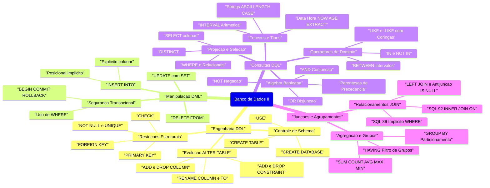

---

### Glossário Terminológico

- **Antijunção (*Anti-Join*):** Técnica relacional que utiliza um `LEFT JOIN` combinado com o filtro `WHERE coluna_tabela_direita IS NULL` para retornar exclusivamente as tuplas da tabela esquerda que não possuem correlação na direita.
- **Cardealidade:** Notação que expressa a quantidade mínima e máxima de ocorrências com que uma entidade participa de um relacionamento.
- **Chave Primária (*Primary Key - PK*):** Atributo ou conjunto de atributos que identifica unicamente e de forma invariante cada tupla em uma relação.
- **Chave Estrangeira (*Foreign Key - FK*):** Atributo em uma relação filha cujos valores devem obrigatoriamente existir na chave primária da relação pai correspondente.
- **Entidade Fraca:** Entidade cuja identificação e existência dependem ontologicamente de outra entidade forte.
- **Equi-Junção (*Equi-Join*):** Operação de junção baseada estritamente no operador de igualdade de chaves (`=`).
- **Lógica Tri-Valorada (*Three-Valued Logic - 3VL*):** Lógica booleana estendida implementada pelo SQL, onde as expressões podem resultar em `TRUE`, `FALSE` ou `UNKNOWN`.
- **Projeção ($`\pi`$):** Operação da Álgebra Relacional que seleciona um subconjunto vertical de colunas de uma relação.
- **Sargabilidade (*SARGable*):** Característica de um predicado SQL que permite a utilização de índices de busca direta sem necessidade de varredura completa.
- **Seleção ($`\sigma`$):** Operação da Álgebra Relacional que aplica um filtro horizontal sobre as linhas de uma tabela com base em um predicado lógico.

---

### Pontos Críticos para Avaliações e Provas

1. **Precedência do AND sobre o OR:** Lembre-se sempre de que `A OR B AND C` é avaliado internamente como `A OR (B AND C)`. Para aplicar o filtro de estados ou categorias com condição extra, **exige-se parênteses**: `(A OR B) AND C`.
2. **Diferença vital entre WHERE e HAVING:** O `WHERE` filtra linhas **antes** do `GROUP BY` e não aceita funções de agregação; o `HAVING` filtra **grupos agregados** após o cálculo estatístico.
3. **A Armadilha do `NOT IN` com `NULL`:** Se uma lista contiver um valor `NULL`, o operador `NOT IN` retornará vazio devido ao colapso booleano para `UNKNOWN`.
4. **Regra de Ouro do `GROUP BY`:** Toda coluna no `SELECT` que não esteja sob função agregadora deve constar compulsoriamente no `GROUP BY`.
5. **Diferença entre `COUNT(*)` e `COUNT(coluna)`:** `COUNT(*)` conta linhas absolutas (inclusive com nulos); `COUNT(coluna)` descarta nulos da contagem.
6. **Inversão no `BETWEEN`:** A sintaxe `BETWEEN 40 AND 25` resulta em conjunto vazio. O menor valor deve estar sempre à esquerda.
7. **Comparação com NULL:** Nunca utilize `= NULL` ou `<> NULL`. Use estritamente `IS NULL` ou `IS NOT NULL`.

---

### Banco de Questões e Respostas para Revisão (JSONL)

```jsonl
{"id": 1, "tema": "DML", "pergunta": "Qual o efeito prático da omissão da cláusula WHERE em um comando UPDATE?", "resposta": "O SGBD aplica o predicado universal WHERE TRUE, atualizando os dados de todas as tuplas da relação no banco."}
{"id": 2, "tema": "Precedência", "pergunta": "Por que a instrução WHERE estado = 'SP' OR estado = 'MG' AND salario > 3000 pode retornar um cliente de SP com salário baixo?", "resposta": "Devido à maior precedência do operador AND sobre o OR, o motor avalia primeiro (estado = 'MG' AND salario > 3000), aceitando qualquer registro de SP independentemente do salário."}
{"id": 3, "tema": "Agrupamento", "pergunta": "Qual é a regra mandatória de projeção ao utilizar a cláusula GROUP BY?", "resposta": "Todo atributo presente na cláusula SELECT que não seja argumento de uma função de agregação deve obrigatoriamente constar na lista da cláusula GROUP BY."}
{"id": 4, "tema": "Lógica 3VL", "pergunta": "Por que o predicado WHERE campo NOT IN ('A', 'B', NULL) resulta em zero linhas retornadas?", "resposta": "Porque a negação desdobra-se em (campo <> 'A' AND campo <> 'B' AND campo <> NULL). A comparação com NULL gera UNKNOWN, contaminando a cadeia AND inteira."}
{"id": 5, "tema": "Junções", "pergunta": "Como o LEFT JOIN viabiliza a identificação de clientes sem pedidos?", "resposta": "O LEFT JOIN preserva todos os clientes; para aqueles sem pedidos, as colunas da tabela de pedidos tornam-se NULL. O filtro WHERE pedidos.id IS NULL isola com exatidão esses registros."}
{"id": 6, "tema": "DDL", "pergunta": "Por que não é possível remover com DROP TABLE uma tabela-pai referenciada por chaves estrangeiras ativas?", "resposta": "Porque o SGBD bloqueia a operação para impedir a quebra de integridade referencial e a consequente geração de tuplas filhas órfãs."}
{"id": 7, "tema": "Tipagem", "pergunta": "Por que o tipo FLOAT não deve ser empregado para armazenar campos salariais ou monetários?", "resposta": "Porque utiliza representação binária de ponto flutuante em base 2 (IEEE 754), gerando dízimas e imprecisões cumulativas de arredondamento em cálculos fiscais."}
{"id": 8, "tema": "Execução", "pergunta": "Por que um alias criado no SELECT não pode ser referenciado na cláusula WHERE da mesma query?", "resposta": "Porque o otimizador processa a cláusula WHERE antes da cláusula SELECT no pipeline lógico de execução do motor relacional."}
{"id": 9, "tema": "Strings", "pergunta": "Qual a diferença de comportamento entre os metacaracteres '%' e '_' no operador LIKE?", "resposta": "O metacaractere '%' casa com zero ou ilimitados caracteres arbitrários; o metacaractere '_' casa estritamente com um único caractere posicional."}
{"id": 10, "tema": "Sargabilidade", "pergunta": "Qual a implicação de aplicar a função EXTRACT(YEAR FROM data) = 2024 na cláusula WHERE sobre uma coluna indexada?", "resposta": "Invalida a busca direta por árvore B+ (Index Seek), obrigando o SGBD a ler e computar a função linha por linha através de um Full Table Scan."}
```

---

### Checklist Final de Autoavaliação do Estudante

- [ ] Sei diferenciar perfeitamente a semântica DDL (`CREATE`, `ALTER`, `DROP`) da semântica DML (`INSERT`, `UPDATE`, `DELETE`) e DQL (`SELECT`).
- [ ] Sei como mapear relacionamentos 1:1, 1:N e N:M para o esquema físico de banco de dados sem gerar redundâncias.
- [ ] Compreendo a obrigatoriedade da ordenação topológica na criação e remoção de tabelas com chaves estrangeiras.
- [ ] Compreendo a ordem lógica de execução do motor SQL (FROM -> WHERE -> GROUP BY -> HAVING -> SELECT -> DISTINCT -> ORDER BY).
- [ ] Sei formular expressões booleanas complexas utilizando parênteses protetivos para isolar operadores `AND` e `OR`.
- [ ] Compreendo o perigo do valor `NULL` ao utilizar o operador `NOT IN` e sei utilizar `IS NULL` / `IS NOT NULL`.
- [ ] Sei implementar consultas de desduplicação (`DISTINCT`) e intervalos fechados (`BETWEEN`).
- [ ] Sei aplicar funções de string (`LIKE`, `ILIKE`, `LENGTH`, `UPPER`, `LOWER`) e de datas (`NOW`, `AGE`, `EXTRACT`, `INTERVAL`).
- [ ] Sei construir e diferenciar junções explícitas (`INNER JOIN`) e antijunções de ausência com `LEFT JOIN ... WHERE ... IS NULL`.
- [ ] Sei calcular sumarizações com `COUNT`, `SUM`, `AVG`, `MAX`, `MIN` e aplicar agrupamentos consolidados com `GROUP BY` e `HAVING`.

---

## Fontes e Metadados

- Turma no Classroom: BANCO DE DADOS II- 2026
- Itens processados: 8 materiais, 5 tarefas, 0 avisos
- Gerado em: 20/10/2026, 21:32:48 (BRT) via classroom-sync
