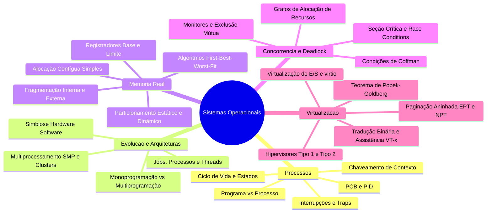
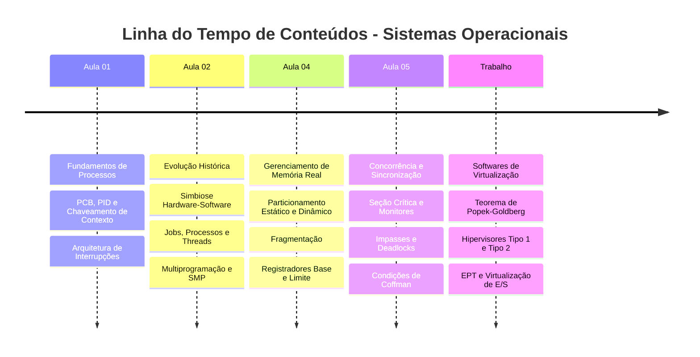

# Caderno Consolidado - Sistemas Operacionais

## Sumário (links âncora)
- [Resumo Executivo](#resumo-executivo)
- [Mapa de Conteúdo](#mapa-de-conteúdo)
- [Fundamentos e Arquitetura](#fundamentos-e-arquitetura)
  - [Gerenciamento de Processos e Blocos de Controle](#gerenciamento-de-processos-e-blocos-de-controle)
  - [Evolução dos Sistemas Operacionais e Arquiteturas](#evolução-dos-sistemas-operacionais-e-arquiteturas)
  - [Organização e Gerenciamento da Memória Real](#organização-e-gerenciamento-da-memória-real)
  - [Monitores e Deadlock em Sistemas Operacionais](#monitores-e-deadlock-em-sistemas-operacionais)
  - [Softwares de Virtualização e Arquiteturas de Hipervisores](#softwares-de-virtualização-e-arquiteturas-de-hipervisores)
- [Sintaxe e Exemplos Práticos](#sintaxe-e-exemplos-práticos)
- [Boas Práticas e Armadilhas Comuns](#boas-práticas-e-armadilhas-comuns)
- [Tabelas Comparativas](#tabelas-comparativas)
- [Linha do Tempo da Disciplina](#linha-do-tempo-da-disciplina)
- [Glossário](#glossário)
- [Checklist de Revisão para Prova](#checklist-de-revisão-para-prova)

---

## Resumo Executivo

Este caderno consolidado reúne todo o conteúdo programático da disciplina de Sistemas Operacionais do 3º semestre do curso de Sistemas de Informação da UniFEF, sob a regência do Prof. Guilherme de Morais. O documento atua como material de estudo unificado, substituindo slides e apostilas fragmentadas. O escopo abrange a transição histórica do hardware à simbiose com o software, os fundamentos da abstração de processos e o Bloco de Controle de Processo (PCB), a evolução para sistemas multiprogramáveis e de tempo compartilhado, as estratégias de alocação de memória real e mitigação de fragmentação, os mecanismos estruturados de concorrência com monitores e prevenção de impasses (deadlocks), além dos fundamentos avançados de virtualização de hardware, hipervisores e tradução de endereços.

Os tópicos centrais abordados nesta obra compreendem: 
1. Anatomia e ciclo de vida de processos, chaveamento de contexto e arquitetura de interrupções.
2. Multiprogramação, multitarefa, paralelismo e modelos de multiprocessamento simétrico e distribuído.
3. Gerenciamento de memória física, partições fixas e dinâmicas, algoritmos de alocação e proteção por registradores base e limite.
4. Sincronização avançada por monitores e análise de condições de deadlock via Grafos de Alocação de Recursos.
5. Virtualização de plataformas, Teorema de Popek-Goldberg, arquiteturas de hipervisores (Tipo 1 e Tipo 2), virtualização de CPU, paginação aninhada (EPT/NPT) e virtualização de E/S.

---

## Mapa de Conteúdo



---

## Fundamentos e Arquitetura

### Gerenciamento de Processos e Blocos de Controle

#### Definição
Um processo é a entidade ativa fundamental em sistemas operacionais modernos: um programa em execução associado a um espaço de endereçamento virtual isolado, contexto de registradores de hardware, descritores de arquivos abertos e uma estrutura de controle no núcleo denominada PCB (*Process Control Block*).

#### Motivação
A necessidade de gerenciar múltiplos fluxos de computação concorrentes obriga o sistema operacional a isolar o espaço de memória de cada aplicação, impedindo que falhas de programação em um software corrompam o núcleo ou dados de outros usuários.

#### Exemplo
O lançamento de um navegador web (como o Google Chrome) gera múltiplos processos independentes no sistema operacional (um para o processo navegador principal, um para cada aba e extensões), cada qual monitorado por um PID único na tabela global de processos.

#### Contraexemplo
Executar rotinas em um sistema monoprogramado legado sem isolamento de memória, onde qualquer salto incorreto de ponteiro em linguagem de montagem sobrescreve o vetor de interrupção do sistema.

#### Armadilhas Comuns
Confundir a entidade estática em disco (programa binário) com a entidade dinâmica em memória (processo), ignorando que um mesmo programa executado três vezes gera três processos distintos com espaços de memória e PIDs exclusivos.

---

### Evolução dos Sistemas Operacionais e Arquiteturas

#### Definição
A evolução dos sistemas operacionais reflete a simbiose entre hardware e software, partindo de sistemas primitivos monoprogramados com operação manual até ambientes multiprogramados, de tempo compartilhado (*time-sharing*) e sistemas fortemente acoplados de multiprocessamento simétrico (SMP).

#### Motivação
Superar o gargalo histórico da ociosidade da UCP diante da lentidão de periféricos mecânicos e de E/S, maximizando a vazão (*throughput*) e permitindo o compartilhamento equânime dos recursos físicos entre múltiplos usuários e tarefas.

#### Exemplo
Servidores corporativos executando Linux em arquiteturas baseadas em dezenas de núcleos físicos, onde centenas de threads de processos de banco de dados rodam em paralelo real.

#### Contraexemplo
Manter um servidor dedicado moderno rodando um sistema operacional monotarefa sem suporte a interrupções, onde a máquina paralisa totalmente ao aguardar a conclusão de uma leitura em disco rígido.

#### Armadilhas Comuns
Acreditar que a adição indiscriminada de núcleos de processamento resolve problemas de concorrência sem considerar o teto imposto pela Lei de Amdahl sobre trechos sequenciais de código.

---

### Organização e Gerenciamento da Memória Real

#### Definição
O subsistema de gerenciamento de memória real controla o uso da memória principal (RAM), rastreando blocos ocupados e livres, alocando espaço contíguo para novos processos, garantindo proteção por hardware e viabilizando a realocação dinâmica de endereços.

#### Motivação
Garantir que os programas caibam no espaço físico limitado da RAM, mantendo o isolamento estrito de endereçamento entre processos e mitigando os impactos da fragmentação de memória.

#### Exemplo
O uso de partições dinâmicas com algoritmos de alocação de buracos (*First-Fit* ou *Best-Fit*) para acomodar processos de tamanhos variados que entram e saem do sistema em tempo de execução.

#### Contraexemplo
Tentar carregar um processo de 512 MB em um sistema estático cujas maiores partições contíguas possuem apenas 256 MB, resultando em rejeição imediata da execução.

#### Armadilhas Comuns
Confundir fragmentação interna (desperdício *dentro* de um bloco alocado) com fragmentação externa (espaços livres espalhados cuja soma atende a uma requisição, mas que estão desconectados).

---

### Monitores e Deadlock em Sistemas Operacionais

#### Definição
Monitores são estruturas de sincronização de alto nível encapsuladas como tipos abstratos de dados que garantem exclusão mútua automática em procedimentos de acesso a recursos compartilhados. Deadlock (impasse) é um estado patológico no qual um conjunto de processos permanece permanentemente bloqueado devido à disputa circular por recursos exclusivos.

#### Motivação
Evitar as falhas humanas associadas ao uso incorreto de semáforos de baixo nível e prevenir travamentos sistêmicos decorrentes da satisfação simultânea das quatro condições necessárias de Coffman (mutual exclusion, hold and wait, no preemption, circular wait).

#### Exemplo
Um sistema de banco de dados onde a Transação A segura a Tabela 1 e aguarda a Tabela 2, enquanto a Transação B segura a Tabela 2 e aguarda a Tabela 1, gerando um ciclo irresolvível no Grafo de Alocação de Recursos.

#### Contraexemplo
Utilizar rotinas de exclusão mútua baseadas em espera ativa (*busy waiting* / *spinlock*) em sistemas monoprocessados, o que desperdiça ciclos úteis de UCP.

#### Armadilhas Comuns
Assumir que a utilização de monitores em uma aplicação elimina por si só o risco de deadlock; monitores protegem seções críticas isoladas, mas não controlam a ordem global de aquisição de múltiplos recursos independentes.

---

### Softwares de Virtualização e Arquiteturas de Hipervisores

#### Definição
Tecnologia que abstrai o hardware físico subjacente, permitindo a execução concorrente de múltiplos sistemas operacionais convidados (*Guest OS*) sobre uma única máquina hospedeira por meio de uma camada de software de controle denominada Hipervisor (VMM).

#### Motivação
Consolidar servidores físicos heterogêneos, otimizar a taxa de ocupação de hardware, isolar ambientes de teste e produção, e viabilizar a portabilidade flexível de cargas de trabalho em nuvem.

#### Exemplo
Um servidor corporativo executando VMware ESXi (Hipervisor Tipo 1) que hospeda vinte máquinas virtuais independentes com instâncias de Windows Server e Linux.

#### Contraexemplo
Emular instruções de processador via software interpretado sem suporte a extensões de hardware em uma arquitetura sem suporte a virtualização assistida, resultando em quedas de desempenho proibitivas.

#### Armadilhas Comuns
Ignorar o custo de desempenho associado aos eventos de **VM-Exit** em arquiteturas mal dimensionadas que realizam chamadas excessivas de E/S ou leituras frequentes de registradores privilegiados.

---

## Sintaxe e Exemplos Práticos

Abaixo apresenta-se um programa completo em linguagem C (padrão POSIX) demonstrando a criação concorrente de processos via `fork()`, sincronização básica com `wait()`, e manipulação de memória e threads com `pthread`.

```c
#include <stdio.h>
#include <stdlib.h>
#include <unistd.h>
#include <pthread.h>
#include <sys/wait.h>

int recurso_global_compartilhado = 500;
pthread_mutex_t mutex_exclusao = PTHREAD_MUTEX_INITIALIZER;

void* rotina_thread_segura(void* arg) {
    pthread_mutex_lock(&mutex_exclusao);
    // Início da Seção Crítica simulada
    recurso_global_compartilhado += 150;
    printf("[Thread Interna] Recurso atualizado para: %d\n", recurso_global_compartilhado);
    // Fim da Seção Crítica
    pthread_mutex_unlock(&mutex_exclusao);
    return NULL;
}

int main(int argc, char* argv[]) {
    pid_t pid_filho;

    printf("[Main] Iniciando demonstração de processos e threads.\n");
    pid_filho = fork();

    if (pid_filho < 0) {
        perror("Erro crítico na criação do processo com fork");
        exit(EXIT_FAILURE);
    } else if (pid_filho == 0) {
        // Bloco executado pelo Processo Filho
        printf("[Processo Filho] PID: %d, PPID: %d\n", getpid(), getppid());
        recurso_global_compartilhado -= 100;
        printf("[Processo Filho] Modificou cópia privada da global para: %d\n", recurso_global_compartilhado);
        _exit(0);
    } else {
        // Bloco executado pelo Processo Pai
        int status_filho;
        waitpid(pid_filho, &status_filho, 0);
        printf("[Processo Pai] Filho encerrou. Valor global no Pai permanece: %d\n", recurso_global_compartilhado);

        // Criação de Threads concorrentes no Pai
        pthread_t t1, t2;
        pthread_create(&t1, NULL, rotina_thread_segura, NULL);
        pthread_create(&t2, NULL, rotina_thread_segura, NULL);

        pthread_join(t1, NULL);
        pthread_join(t2, NULL);

        printf("[Processo Pai] Valor final após execução das threads: %d\n", recurso_global_compartilhado);
    }

    return 0;
}
```

### Fórmulas Matemáticas Fundamentais

Cálculo da Utilização da UCP em função dos tempos de computação e espera de E/S:

```math
U = \frac{T_{comp}}{T_{comp} + T_{io}}
```

Cálculo da Fragmentação Interna em partições de tamanho fixo:

```math
FI(i) = S_{part}(i) - S_{proc}(j), \quad \text{onde } S_{part}(i) \ge S_{proc}(j)
```

Taxa de Sobrealocação (*Overcommit*) de Memória Virtual frente à Memória Física:

```math
\text{Taxa Overcommit} = \frac{\sum_{i=1}^{N} \text{Memória Virtual Alocada}_{i}}{\text{Memória Física Real Disponível}}
```

---

## Boas Práticas e Armadilhas Comuns

### Boas Práticas
1. **Encapsulamento de Concorrência:** Sempre que possível, utilize abstrações de alto nível (como monitores ou primitivas de linguagem com bloqueio automático) em vez de semáforos crus espalhados pelo código.
2. **Ordem Estrita de Aquisição de Travas:** Para prevenir deadlocks por espera circular em sistemas multithread, estabeleça uma hierarquia numérica obrigatória para a obtenção de múltiplos mutexes.
3. **Alocação Alinhada em Virtualização:** Configure *HugePages* em ambientes virtualizados de alta densidade para reduzir a pressão sobre a TLB e otimizar a paginação aninhada (EPT/NPT).
4. **Verificação de Retorno de Chamadas de Sistema:** Sempre valide o código de retorno de primitivas como `fork()`, `malloc()`, `pthread_create()` e chamadas de abertura de arquivos.

### Armadilhas Comuns
1. **Condições de Corrida Silenciosas:** Assumir que operações aritméticas simples sobre variáveis globais em C (`contador++`) são atômicas sem proteção de *mutex* ou instruções de hardware exclusivas.
2. **Esquecimento de Liberação de Travas:** Liberar caminhos de erro antecipados em procedimentos sem fechar o mutex correspondente, provocando travamento permanente de todas as threads subsequentes.
3. **Estouro de Pilha (*Stack Overflow*) em Processos Recursivos:** Alocar estruturas de dados locais massivas na pilha sem monitorar os limites do descritor de pilha do processo.
4. **Incompreensão do Custo de VM-Exits:** Projetar sistemas convidados que realizam acessos intensivos a portas de E/S legadas em ambientes virtualizados por emulação completa sem drivers paravirtualizados `virtio`.

---

## Tabelas Comparativas

### Tabela 1: Comparativo de Arquiteturas de Execução e Gerenciamento

| Dimensão de Análise | Processos | Threads | Hipervisores Tipo 1 | Hipervisores Tipo 2 |
| :--- | :--- | :--- | :--- | :--- |
| **Isolamento de Memória** | Completo (Espaço virtual próprio) | Compartilhado com o processo pai | Isolamento total por máquina virtual | Isolamento mediado pelo SO Hospedeiro |
| **Custo de Troca de Contexto** | Alto (Invalidação de TLB, troca de diretório de páginas) | Baixo (Troca apenas de registradores e pilha) | Altíssimo (Troca de VMCS e contexto de silício) | Alto (Passagem por camadas de app e host OS) |
| **Dependência de Hardware** | Suporte a MMU e modos de privilégio | Suporte do kernel e biblioteca de threads | Extensões VT-x / AMD-V / IOMMU | Executa sobre drivers e kernel genéricos |
| **Aplicação Típica** | Isolamento de aplicações concorrentes | Concorrentes internas a um mesmo app | Datacenters corporativos de missão crítica | Estações de desenvolvimento e testes |

### Tabela 2: Modelos de Gerenciamento de Memória Real e Virtual

| Estratégia de Memória | Mecanismo de Controle | Principal Vantagem | Principal Desvantagem |
| :--- | :--- | :--- | :--- |
| **Particionamento Estático** | Partições fixas definidas na carga | Simplicidade extrema de implementação | Fragmentação interna severa e desperdício |
| **Particionamento Dinâmico** | Alocação de buracos (First/Best-Fit) | Elimina a fragmentação interna inicial | Gera fragmentação externa e exige compactação |
| **Shadow Page Tables** | Tabelas sombra controladas por software | Compatibilidade com hardware antigo | Alto custo de processamento por falta de página |
| **Paginação Aninhada (EPT/NPT)** | Tradução em duas camadas por hardware | Desempenho superior em servidores virtuais | Aumento do custo de latência em cache misses |

---

## Linha do Tempo da Disciplina



---

## Glossário

- **Bloco de Controle de Processo (PCB):** Estrutura de dados residente no kernel que armazena todo o contexto de execução, registradores, PID, prioridade e ponteiros de memória de um processo.
- **Chaveamento de Contexto (*Context Switch*):** O processo mecânico de salvar o estado do processador de uma tarefa ativa para restaurar o estado de outra tarefa pronta para execução.
- **Condição de Corrida (*Race Condition*):** Anomalia comportamental que ocorre quando múltiplos fluxos acessam e modificam dados compartilhados simultaneamente, tornando o resultado dependente da ordem temporal de execução.
- **Deadlock (Impasse):** Estado no qual um conjunto de processos encontra-se permanentemente bloqueado, aguardando recursos que estão sob posse uns dos outros.
- **Hipervisor (*Virtual Machine Monitor*):** Camada de software ou firmware responsável por criar, executar e gerenciar máquinas virtuais, compartilhando os recursos físicos do hardware hospedeiro.
- **Monitor:** Construto de programação concorrente de alto nível que encapsula dados compartilhados e procedimentos de acesso, assegurando exclusão mútua automática.
- **Paginação Aninhada (EPT/NPT):** Mecanismo de hardware que realiza a tradução bidimensional de endereços virtuais de convidado para endereços físicos reais de forma transparente.
- **Quantum de Tempo:** Fatia de tempo microscópica alocada pelo escalonador para a execução contínua de um processo antes de sofrer preempção.
- **Teorema de Popek-Goldberg:** Conjunto de condições formais que estabelece que uma arquitetura é puramente virtualizável se todas as instruções sensíveis forem um subconjunto das instruções privilegiadas.
- **Tradução Binária Dinâmica:** Técnica de substituição em tempo de execução de instruções sensíveis não privilegiadas por sequências seguras em arquiteturas não virtualizáveis nativamente.

---

## Checklist de Revisão para Prova

- [ ] Consigo explicar a diferença conceitual e prática entre um programa estático em disco e um processo ativo em memória.
- [ ] Compreendo detalhadamente os campos essenciais armazenados em um PCB (*Process Control Block*) e sua utilidade no chaveamento de contexto.
- [ ] Sei diferenciar concorrência lógica (uniprocessador por divisão de tempo) de paralelismo real (multiprocessamento simétrico).
- [ ] Domino a análise quantitativa de utilização da UCP em sistemas monoprogramados versus multiprogramados.
- [ ] Distingo com clareza fragmentação interna de fragmentação externa, sabendo em quais modelos de memória cada uma ocorre.
- [ ] Compreendo o funcionamento dos algoritmos de alocação de buracos livres (*First-Fit*, *Best-Fit*, *Worst-Fit*).
- [ ] Sei explicar a finalidade e a estrutura dos Monitores em comparação direta com semáforos tradicionais.
- [ ] Identifico as quatro condições necessárias para a ocorrência de Deadlock segundo Coffman e sei interpretá-las em um Grafo de Alocação de Recursos.
- [ ] Compreendo os fundamentos do Teorema de Popek-Goldberg e a lacuna de virtualização da arquitetura x86 original.
- [ ] Diferencio Hipervisores Tipo 1 (*Bare-Metal*) de Hipervisores Tipo 2 (*Hosted*), avaliando seus respectivos trade-offs de desempenho.
- [ ] Conheço a diferença operacional entre *Shadow Page Tables* e Paginação Aninhada por hardware (EPT/NPT).
- [ ] Compreendo as três abordagens clássicas de virtualização de E/S (Emulação, Paravirtualización `virtio` e SR-IOV Pass-through).

---

## Fontes e Metadados

- Turma no Classroom: SISTEMAS OPERACIONAIS 2026
- Itens processados: 6 materiais, 1 tarefas, 0 avisos
- Gerado em: 19/10/2026, 09:18:09 (BRT) via classroom-sync
