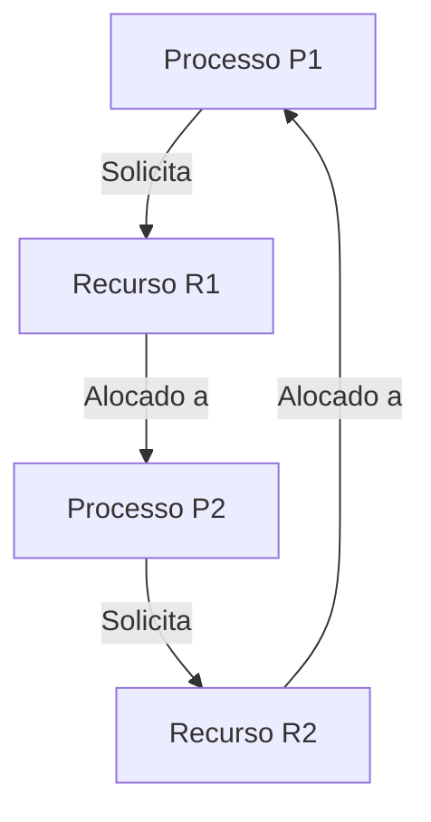

# Simulados Comentados - Sistemas Operacionais

## Sumário

- [Simulado 1 - Questões Objetivas](#simulado-1---questões-objetivas)
  - [Questão 01](#questão-01)
  - [Questão 02](#questão-02)
  - [Questão 03](#questão-03)
  - [Questão 04](#questão-04)
  - [Questão 05](#questão-05)
  - [Questão 06](#questão-06)
  - [Questão 07](#questão-07)
  - [Questão 08](#questão-08)
  - [Questão 09](#questão-09)
  - [Questão 10](#questão-10)
  - [Questão 11](#questão-11)
  - [Questão 12](#questão-12)
- [Simulado 2 - Questões Discursivas](#simulado-2---questões-discursivas)
  - [Questão 13](#questão-13)
  - [Questão 14](#questão-14)
  - [Questão 15](#questão-15)
  - [Questão 16](#questão-16)
  - [Questão 17](#questão-17)
- [Gabarito Comentado](#gabarito-comentado)
  - [Gabarito - Questões Objetivas](#gabarito---questões-objetivas)
  - [Gabarito - Questões Discursivas](#gabarito---questões-discursivas)

---

## Simulado 1 - Questões Objetivas

### Questão 01
O Bloco de Controle de Processo (PCB - *Process Control Block*) é uma estrutura de dados fundamental mantida pelo núcleo do sistema operacional para cada processo em execução ou existente no sistema. Sobre os componentes e a função do PCB, analise as afirmativas abaixo:

I. O PCB armazena o contexto de execução do processo, incluindo os valores atuais dos registradores gerais, contador de programa (PC) e apontador de pilha (SP), permitindo a restauração exata da tarefa após uma interrupção.
II. O identificador do processo (PID) e as credenciais de segurança (como UID e permissões de acesso a arquivos) são mantidos no PCB para auditoria e controle de privilégios pelo subsistema de segurança do kernel.
III. O PCB reside inteiramente na região de memória de texto do próprio processo, podendo ser lido e modificado diretamente pelo código do usuário para otimizar a velocidade de chaveamento de contexto.

É correto o que se afirma em:
- A) I, apenas.
- B) III, apenas.
- C) I e II, apenas.
- D) II e III, apenas.
- E) I, II e III.

### Questão 02
Durante a operação de um sistema operacional multitarefa, ocorre com frequência o mecanismo de chaveamento de contexto (*context switch*). Assinale a alternativa que descreve corretamente os passos e o impacto estrutural desse evento:

- A) O chaveamento de contexto ocorre de forma instantânea sem custo de processamento, pois os registradores da CPU são duplicados em hardware para cada thread criada.
- B) O sistema operacional salva o estado dos registradores do processo atual em seu respectivo PCB, atualiza seu estado na fila correspondente, carrega os registradores salvos no PCB do próximo processo a executar e altera o contador de programa.
- C) O chaveamento de contexto exige obrigatoriamente a reinicialização completa da máquina física para limpar a cache L3 e evitar vazamento de dados entre aplicações.
- D) Durante o chaveamento de contexto, o processo que estava em execução é destruído da memória RAM e recarregado do disco rígido ao retornar para o estado de pronto.
- E) O chaveamento de contexto é acionado exclusivamente por aplicativos de usuário através de chamadas de sistema explícitas, sendo vedada a interferência do relógio de interrupção.

### Questão 03
Os sistemas operacionais evoluíram de modelos monoprogramados primitivos para sistemas multiprogramáveis baseados em tempo compartilhado (*time-sharing*). O principal motor dessa evolução tecnológica foi:

- A) A necessidade de eliminar completamente a utilização de discos magnéticos e SSDs, substituindo-os por fitas magnéticas de acesso sequencial de alta velocidade.
- B) A disparidade drástica de velocidade entre a Unidade Central de Processamento (UCP), que opera em ciclos de nanossegundos, e os dispositivos periféricos e mecânicos de Entrada/Saída, que operam em milissegundos.
- C) A exigência de que todos os programas de computador ocupem exatamente o mesmo espaço fixo de memória RAM para simplificar a alocação de ponteiros.
- D) A eliminação da necessidade de modos de operação de hardware (modo usuário versus modo núcleo), reduzindo a segurança do sistema em prol da velocidade pura.
- E) A obrigatoriedade de que sistemas operacionais modernos operem sem nenhum tipo de interrupção de hardware ou sondagem (*polling*).

### Questão 04
Em relação aos conceitos de concorrência e paralelismo em sistemas computacionais, assinale a alternativa conceitualmente correta:

- A) Concorrência e paralelismo são sinônimos perfeitos; ambos exigem obrigatoriamente a presença de quatro ou mais núcleos físicos de processamento na placa-mãe.
- B) O paralelismo ocorre quando um único núcleo de CPU executa dezenas de tarefas por meio de divisão estrita de tempo, enquanto a concorrência exige múltiplos chips.
- C) A concorrência é a capacidade do sistema gerenciar múltiplos fluxos de execução cujas vidas úteis se sobrepõem no tempo (mesmo em uniprocessadores), enquanto o paralelismo exige execução física simultânea em múltiplos núcleos.
- D) Sistemas operacionais modernos impedem a concorrência de processos para evitar condições de corrida, permitindo apenas a execução estritamente sequencial de tarefas.
- E) O paralelismo é uma propriedade exclusiva de software, enquanto a concorrência depende exclusivamente de instruções privilegiadas de E/S.

### Questão 05
No gerenciamento de memória real com alocação contígua dinâmica, o sistema operacional emprega algoritmos para selecionar qual bloco de memória livre alocar a um processo requisitante. O algoritmo que percorre a lista de blocos livres a partir da última posição alocada (ou ponto atual de varredura) e escolhe o primeiro bloco que seja suficientemente grande é denominado:

- A) Best-Fit
- B) Worst-Fit
- C) First-Fit
- D) Next-Fit
- E) Quick-Fit

### Questão 06
A fragmentação é um problema clássico no gerenciamento de memória real. Sobre a fragmentação interna e externa, analise as proposições:

I. A fragmentação interna ocorre quando a memória alocada a um processo é maior do que a estritamente necessária, gerando espaço ocioso dentro do próprio bloco ou partição atribuída.
II. A fragmentação externa ocorre quando há quantidade suficiente de memória livre somada no sistema para atender a um processo, mas essa memória encontra-se dividida em pequenos blocos não contíguos espalhados pela RAM.
III. O particionamento dinâmico de memória elimina totalmente a fragmentação externa por meio da compactação instantânea e sem custos de desempenho de barramento.

É correto o que se afirma em:
- A) I, apenas.
- B) III, apenas.
- C) I e II, apenas.
- D) II e III, apenas.
- E) I, II e III.

### Questão 07
Os registradores de hardware de Base e Limite desempenham um papel crucial na proteção e realocação de memória real em sistemas multiprogramados simples. Assinale a alternativa que descreve corretamente o seu funcionamento:

- A) O registrador base armazena o endereço físico inicial onde o processo está carregado, e o registrador limite armazena o tamanho exato do espaço alocado, permitindo que a MMU valide se qualquer endereço gerado pela CPU está dentro da faixa legítima.
- B) O registrador base armazena o número total de interrupções de hardware pendentes, enquanto o limite restringe a quantidade de threads que o processo pode criar.
- C) O registrador limite armazena as credenciais de acesso root do usuário, impedindo que processos em modo usuário leiam arquivos do sistema.
- D) Esses registradores são utilizados exclusivamente para controlar a velocidade do barramento PCIe de placas gráficas dedicadas.
- E) O registrador base aponta para a tabela de páginas virtual, enquanto o limite define o tamanho do arquivo de paginação em disco (*swap file*).

### Questão 08
Os Monitores foram propostos como um mecanismo de sincronização de alto nível para substituir o uso direto de semáforos em programação concorrente. Sobre a arquitetura de um monitor, é correto afirmar que:

- A) Permite que múltiplos processos executem simultaneamente e de forma desordenada qualquer um de seus procedimentos internos sem restrições de exclusão mútua.
- B) Consiste em um tipo abstrato de dados que encapsula dados privados, procedimentos de acesso e uma garantia estruturada de que apenas um processo por vez pode estar ativo no interior do monitor.
- C) Requer que o programador gerencie manualmente as chamadas a `wait` e `signal` em todas as rotinas clientes para garantir a exclusão mútua.
- D) Opera diretamente no espaço de armazenamento secundário (SSD/HDD), sendo incompatível com a memória RAM.
- E) É um sinônimo exato de thread leve (*lightweight process*), sem relação com exclusão mútua.

### Questão 09
Em sistemas concorrentes, uma condição de corrida (*race condition*) ocorre quando:

- A) Dois ou mais processos executam instruções estritamente sequenciais sem qualquer compartilhamento de variáveis ou recursos.
- B) O sistema operacional entra em deadlock devido à ausência de memória física livre na RAM.
- C) Múltiplos fluxos de execução acessam e manipulam dados compartilhados concorrentemente, e o resultado final da computação depende da ordem exata e imprevisível do entrelaçamento temporal das instruções.
- D) O processador atinge 100% de utilização devido ao excesso de requisições de interrupção de rede.
- E) Um processo entra em loop infinito na região de texto de seu espaço de endereçamento.

### Questão 10
O fenômeno do Deadlock (impasse) em sistemas operacionais caracteriza-se pelo bloqueio permanente de um conjunto de processos. Para que ocorra deadlock, quatro condições necessárias e simultâneas descritas por Coffman devem estar presentes. Qual das alternativas abaixo lista corretamente essas quatro condições?

- A) Exclusão mútua, retenção e espera, não preempção e espera circular.
- B) Alta prioridade, paginação em disco, preempção de CPU e compartilhamento total.
- C) Condição de corrida, estouro de pilha (*stack overflow*), interrupção síncrona e *thrashing*.
- D) Monoprogramação, ausência de PID, falta de cache L2 e particionamento estático.
- E) Sincronização por semáforo, multitarefa cooperativa, ausência de MMU e disco rígido cheio.

### Questão 11

Analisando o Grafo de Alocação de Recursos (RAG) apresentado acima, é correto deduzir que:
- A) O sistema encontra-se em um estado perfeitamente seguro, sem qualquer risco de falha ou impasse.
- B) O grafo apresenta um ciclo fechado envolvendo os processos P1 e P2 e os recursos R1 e R2, indicando a ocorrência (ou forte risco iminente) de um deadlock.
- C) O processo P1 está liberando todos os seus recursos para o sistema operacional devido ao término de sua execução.
- D) Trata-se de um sistema monoprogramado simples onde processos nunca disputam recursos.
- E) O recurso R1 possui múltiplas instâncias idênticas disponíveis para alocação concorrente ilimitada.

### Questão 12
Nos softwares de virtualização modernos, a técnica de Paginação Aninhada em hardware (conhecida como EPT na Intel e NPT na AMD) tem como principal finalidade:

- A) Substituir a memória RAM física por armazenamento em nuvem através de conexões de rede de fibra óptica.
- B) Permitir que o hipervisor execute comandos gráficos 3D sem o auxílio da unidade de processamento gráfico (GPU).
- C) Realizar a tradução bidimensional de endereços de memória (de endereço virtual do convidado até o endereço físico real da máquina hospedeira) diretamente no silício da MMU, reduzindo o overhead de virtualização de memória.
- D) Impedir que máquinas virtuais acessem arquivos de texto localizados no diretório raiz do sistema operacional hospedeiro.
- E) Eliminar completamente a necessidade de arquivos de paginação (*swap*) nas máquinas virtuais convidadas.

---

## Simulado 2 - Questões Discursivas

### Questão 13
Explique detalhadamente o ciclo de vida de um processo sob o modelo canônico de três estados (Pronto, Execução e Bloqueado). Descreva os gatilhos operacionais que provocam cada uma das quatro transições fundamentais de estado, incluindo o papel do relógio de interrupção e do escalonador (*dispatcher*).

### Questão 14
Compare o comportamento e a eficiência de um sistema operacional monoprogramado versus um sistema multiprogramado com divisão de tempo (*time-sharing*). Em sua resposta, utilize a análise do gargalo de ociosidade da UCP frente à disparidade de velocidade dos dispositivos de Entrada e Saída (E/S).

### Questão 15
Defina os conceitos de fragmentação interna e fragmentação externa no gerenciamento de memória real. Explique em qual modelo de alocação cada uma dessas fragmentações ocorre primariamente e cite uma técnica de mitigação ou resolução para cada caso.

### Questão 16
Descreva a arquitetura estrutural de um **Monitor** em programação concorrente, detalhando seus três componentes principais (dados privados, procedimentos de acesso e fila de espera). Explique por que os monitores oferecem maior segurança estrutural contra erros de sincronização em comparação aos semáforos tradicionais.

### Questão 17
O que é um Deadlock (impasse) em sistemas operacionais? Explique as quatro condições necessárias de Coffman para que um deadlock ocorra e descreva como a análise de um Grafo de Alocação de Recursos (RAG) auxilia na identificação de ciclos de espera circular.

---

## Gabarito Comentado

### Gabarito - Questões Objetivas

#### Questão 01
- **Alternativa Correta:** **C (I e II, apenas)**
- **Justificativa Técnica:**
  - *I (Correta):* O PCB armazena todo o contexto de hardware necessário para suspender e retomar um processo, incluindo registradores de uso geral, o Contador de Programa (PC) e o Apontador de Pilha (SP).
  - *II (Correta):* O PID identifica unicamente o processo, e as credenciais de segurança (como IDs de usuário e privilégios) são essenciais para que o kernel aplique políticas de controle de acesso.
  - *III (Incorreta):* O PCB reside em áreas protegidas de memória do **núcleo do sistema operacional (kernel space)**, e não na região de texto do usuário. Permitir que o processo modifique seu próprio PCB violaria o isolamento de privilégios e a segurança do sistema.
- **Distratoras Incorretas:** A alternativa B erra ao excluir I e II. As alternativas A e D omitiram partes fundamentais. A alternativa E erra por incluir a proposição III, que descreve uma falha de arquitetura e segurança.

#### Questão 02
- **Alternativa Correta:** **B**
- **Justificativa Técnica:** O chaveamento de contexto (*context switch*) é a operação de kernel que consiste em salvar o estado atual do processador (registradores, PC, SP) no PCB do processo que está deixando a UCP, atualizar sua fila (ex: mover de Executando para Pronto ou Bloqueado), selecionar o próximo processo apto na fila de prontos, carregar seu contexto armazenado no PCB para os registradores da CPU e transferir o controle de execução.
- **Distratoras Incorretas:**
  - A: O chaveamento possui custo computacional (*overhead*), pois consome centenas ou milhares de ciclos de clock para salvar e restaurar registradores e invalidar caches/TLBs.
  - C: A máquina não é reinicializada; apenas o contexto lógico de execução é trocado.
  - D: O processo não é destruído nem recarregado do disco; ele apenas tem sua execução suspensa na RAM.
  - E: O chaveamento é disparado principalmente pelo relógio de interrupção (preempção por esgotamento de *quantum*), e não apenas por chamadas de sistema voluntárias.

#### Questão 03
- **Alternativa Correta:** **B**
- **Justificativa Técnica:** A motivação central para a multiprogramação e o tempo compartilhado foi a enorme discrepância de velocidade entre a UCP (ciclos em nanossegundos) e os periféricos de E/S (milissegundos). Sem multiprogramação, a UCP ficava ociosa quase todo o tempo aguardando operações mecânicas de disco ou rede. A multiprogramação permite chavear para outro processo pronto enquanto o atual aguarda a E/S.
- **Distratoras Incorretas:** A alternativa A está incorreta pois fitas magnéticas foram superadas e o objetivo não é eliminar o armazenamento. C, D e E descrevem conceitos falsos ou contrários aos princípios de sistemas operacionais seguros.

#### Questão 04
- **Alternativa Correta:** **C**
- **Justificativa Técnica:** A concorrência é a gestão lógica de múltiplos fluxos cujas vidas úteis se sobrepõem (podendo rodar em um único núcleo via multiplexação temporal), enquanto o paralelismo exige execução física simultânea em múltiplos núcleos ou processadores físicos distintos.
- **Distratoras Incorretas:** A e B trocam os conceitos fundamentais ou afirmam absurdos físicos. D erra ao dizer que SOs impedem concorrência. E confunde conceitos de hardware com software.

#### Questão 05
- **Alternativa Correta:** **D (Next-Fit)**
- **Justificativa Técnica:** O algoritmo *Next-Fit* é uma variação do *First-Fit* onde, em vez de iniciar a busca pelo início da lista de blocos livres a cada nova alocação, a varredura começa a partir do ponto onde ocorreu a última alocação bem-sucedida, distribuindo a ocupação de forma mais uniforme.
- **Distratoras Incorretas:**
  - A (*Best-Fit*): Examina toda a lista e escolhe o menor bloco que satisfaz a requisição.
  - B (*Worst-Fit*): Escolhe o maior bloco disponível.
  - C (*First-Fit*): Varre sempre a partir do início da lista e escolhe o primeiro bloco que couber.
  - E (*Quick-Fit*): Mantém listas separadas para tamanhos de blocos frequentemente solicitados.

#### Questão 06
- **Alternativa Correta:** **C (I e II, apenas)**
- **Justificativa Técnica:**
  - *I (Correta):* Fragmentação interna ocorre dentro de um bloco alocado quando a demanda do processo é menor que o tamanho fixo do bloco.
  - *II (Correta):* Fragmentação externa ocorre quando há espaço livre total suficiente espalhado, mas não contíguo.
  - *III (Incorreta):* A compactação de memória em partições dinâmicas envolve mover fisicamente grandes blocos de dados na RAM e atualizar ponteiros, o que gera um **custo de desempenho elevíssimo** (pesado *overhead* de barramento), não sendo um processo gratuito ou instantâneo.
- **Distratoras Incorretas:** Alternativas que consideram a afirmação III correta falham na análise de desempenho do kernel.

#### Questão 07
- **Alternativa Correta:** **A**
- **Justificativa Técnica:** Os registradores de Base e Limite fornecem proteção e realocação em tempo de execução. O registrador Base define o endereço físico inicial onde o processo reside, e o Limite define o tamanho máximo daquele espaço. A MMU verifica se qualquer endereço gerado pela CPU é menor que o Limite e o soma à Base antes de acessar a RAM.
- **Distratoras Incorretas:** B, C, D e E atribuem funções inexistentes ou incorretas aos registradores de hardware de gerência de memória.

#### Questão 08
- **Alternativa Correta:** **B**
- **Justificativa Técnica:** Um Monitor é um construto de programação de alto nível que encapsula dados privados (estado compartilhado), procedimentos de acesso (métodos públicos) e garante nativamente que apenas um processo por vez execute dentro dele (exclusão mútua estruturada).
- **Distratoras Incorretas:** A permite acesso simultâneo indevido; C descreve semáforos, não monitores; D e E estão conceitualmente erradas.

#### Questão 09
- **Alternativa Correta:** **C**
- **Justificativa Técnica:** Condição de corrida (*race condition*) ocorre quando múltiplos fluxos de execução acessam dados compartilhados concorrentemente, e o resultado final depende do entrelaçamento temporal exato das instruções executadas pelas UCs.
- **Distratoras Incorretas:** A descreve execução independente sem conflito. B refere-se a deadlock. D e E descrevem outros fenômenos de carga e comportamento de código.

#### Questão 10
- **Alternativa Correta:** **A**
- **Justificativa Técnica:** As quatro condições necessárias e simultâneas de Coffman para deadlock são: 1) Exclusão mútua; 2) Retenção e espera (*hold and wait*); 3) Não preempção; 4) Espera circular.
- **Distratoras Incorretas:** As demais alternativas misturam termos incorretos ou não relacionados à teoria clássica de impasses de Coffman.

#### Questão 11
- **Alternativa Correta:** **B**
- **Justificativa Técnica:** O grafo demonstra que o processo P1 retém R2 e solicita R1; o recurso R1 está alocado a P2, que por sua vez solicita R2 (retesado por P1). Isso forma um ciclo fechado ($`P1 \rightarrow R1 \rightarrow P2 \rightarrow R2 \rightarrow P1`$), que é a representação gráfica inequívoca de um deadlock (espera circular).
- **Distratoras Incorretas:** A e C contradizem a análise do grafo. D e E descrevem premissas falsas sobre a estrutura apresentada.

#### Questão 12
- **Alternativa Correta:** **C**
- **Justificativa Técnica:** A paginação aninhada em hardware (EPT na Intel e NPT na AMD) resolve a tradução bidimensional de endereços (GVA $`\rightarrow`$ GPA $`\rightarrow`$ HPA) diretamente no silício da MMU, evitando o alto custo em software das tabelas de página sombra (*Shadow Page Tables*).
- **Distratoras Incorretas:** A, B, D e E descrevem funções fantasiadas ou incorretas para a tecnologia de paginação aninhada.

---

### Gabarito - Questões Discursivas

#### Questão 13
- **Resposta Modelo:**  
  Sob o modelo canônico de três estados, um processo transita entre os estados de **Pronto**, **Execução** e **Bloqueado**:
  1. **Pronto:** O processo possui todos os recursos necessários (exceto a UCP) e aguarda na fila de prontos sua vez de rodar.
  2. **Execução:** O processo está alocado em um núcleo de processamento físico e suas instruções estão sendo executadas pela ULA.
  3. **Bloqueado:** O processo é retirado da UCP porque aguarda a ocorrência de um evento externo (como conclusão de leitura de disco ou pacote de rede).

  **As quatro transições fundamentais e seus gatilhos:**
  - *Transição 1 (Pronto $`\rightarrow`$ Execução):* Disparada pelo **Despachante (*Dispatcher*)** do escalonador do SO, que seleciona o processo no topo da fila de prontos e carrega seu contexto na UCP.
  - *Transição 2 (Execução $`\rightarrow`$ Pronto):* Disparada pelo **relógio de interrupção (hardware timer)** ao expirar a fatia de tempo (*quantum*) concedida ao processo, impondo preempção para garantir justiça no compartilhamento da UCP.
  - *Transição 3 (Execução $`\rightarrow`$ Bloqueado):* Disparada voluntariamente pelo próprio processo ao emitir uma chamada de sistema (*system call*) solicitando uma operação de E/S ou recurso indisponível.
  - *Transição 4 (Bloqueado $`\rightarrow`$ Pronto):* Disparada pelo tratamento de interrupção de hardware quando o evento aguardado se conclui (ex: o controlador de disco avisa que os dados foram transferidos para a RAM), fazendo o SO mover o processo de volta para a fila de prontos.

- **Rubrica de Correção (Nota Máxima):**
  - Definição correta dos três estados (2,0 pts).
  - Descrição detalhada do papel do escalonador/despachante e do relógio de interrupção (2,5 pts).
  - Identificação exata das quatro transições com seus gatilhos operacionais correspondentes (3,0 pts).
  - Clareza técnica, uso adequado da terminologia de sistemas operacionais e estruturação lógica da resposta (2,5 pts).

#### Questão 14
- **Resposta Modelo:**  
  Em um sistema **monoprogramado**, apenas um único programa reside na memória e ocupa o processador. O grande gargalo é a **ociosidade da UCP**: como a UCP opera na escala de nanossegundos e os dispositivos de E/S operam em milissegundos (por exemplo, leitura de disco ou espera por digitação), sempre que o programa emite uma instrução de E/S, a UCP permanece 100% ociosa aguardando o término mecânico do periférico, desperdiçando bilhões de ciclos de clock.

  Em contraste, um sistema **multiprogramado com divisão de tempo (*time-sharing*)** mantém múltiplos processos carregados na RAM simultaneamente. Quando o processo ativo entra em estado bloqueado aguardando uma operação de E/S, o escalonador do sistema operacional realiza imediatamente um chaveamento de contexto, retirando o processo ocioso da UCP e despachando outro processo que esteja no estado *Pronto*. Isso eleva drasticamente a taxa de utilização da UCP e o *throughput* (vazão) global do sistema, mitigando o gargalo dos periféricos lentos.

- **Rubrica de Correção (Nota Máxima):**
  - Explicação clara da ociosidade da UCP em sistemas monoprogramados e a disparidade de velocidade de E/S (3,0 pts).
  - Descrição de como a multiprogramação e o *time-sharing* aproveitam os momentos de espera para rodar outras tarefas (3,0 pts).
  - Impacto na vazão (*throughput*) e eficiência global do hardware (2,0 pts).
  - Rigor conceitual e coesão textual (2,0 pts).

#### Questão 15
- **Resposta Modelo:**  
  - **Fragmentação Interna:** Ocorre quando o espaço alocado a um processo é maior do que o necessário, gerando desperdício *dentro* do próprio bloco atribuído. É característica primária de sistemas de **Particionamento Estático (partições fixas)** ou sistemas de paginação com páginas de tamanho fixo. *Mitigação:* Utilização de partições menores, tamanhos de página reduzidos ou alocadores dinâmicos refinados.
  - **Fragmentação Externa:** Ocorre quando há memória livre total suficiente no sistema para atender a uma nova requisição, mas essa memória está fragmentada em pequenos blocos não contíguos espalhados pela RAM, impedindo a alocação de um processo grande. É característica primária de sistemas com **Particionamento Dinâmico**. *Mitigação:* Técnicas de compactação de memória (deslocamento de blocos para unir buracos livres) ou adoção de memória virtual paginada (que elimina a necessidade de contiguidade física).

- **Rubrica de Correção (Nota Máxima):**
  - Definição precisa e distinção entre fragmentação interna e externa (3,0 pts).
  - Identificação correta dos modelos de alocação onde cada fragmentação ocorre primariamente (3,0 pts).
  - Apresentação de estratégias válidas de mitigação/resolução para ambas (2,0 pts).
  - Clareza e precisão conceitual (2,0 pts).

#### Questão 16
- **Resposta Modelo:**  
  Um **Monitor** é um construto de programação de alto nível estruturado como um tipo abstrato de dados (TAD) que sincroniza o acesso a recursos compartilhados. Seus três componentes principais são:
  1. **Dados Privados:** Variáveis que representam o estado interno do recurso compartilhado, cujo acesso direto é estritamente proibido ao mundo exterior.
  2. **Procedimentos de Acesso:** Métodos públicos disponibilizados pelo monitor para interagir com o recurso. Toda manipulação dos dados privados ocorre exclusivamente através desses procedimentos.
  3. **Fila de Espera:** Mecanismo gerenciado pelo ambiente de execução que enfileira threads que tentam acessar o monitor enquanto ele já está ocupado por outro fluxo.

  **Vantagens sobre os Semáforos:**  
  Os semáforos exigem que o programador insira manualmente chamadas a `wait` e `signal` em pontos dispersos do código, tornando o sistema altamente suscetível a erros humanos (esquecimento de liberações, inversão de ordem, deadlocks). Nos monitores, a exclusão mútua é **automática e encapsulada**: o compilador injeta o código de travamento na entrada dos procedimentos e a liberação na saída, transferindo a responsabilidade da segurança de concorrência do programador para a linguagem e o sistema operacional.

- **Rubrica de Correção (Nota Máxima):**
  - Descrição correta dos três componentes do monitor (dados privados, procedimentos, fila de espera) (3,0 pts).
  - Explicação do encapsulamento e da exclusão mútua automática (2,5 pts).
  - Comparação crítica com semáforos, destacando a redução de erros humanos de programação (3,0 pts).
  - Clareza técnica (1,5 pt).

#### Questão 17
- **Resposta Modelo:**  
  Um **Deadlock (impasse)** é um estado patológico em sistemas multiprogramados no qual um conjunto de processos encontra-se permanentemente bloqueado, aguardando por recursos que estão retidos por outros processos do próprio conjunto, de modo que nenhum deles pode avançar, liberar recursos ou terminar.

  **As quatro condições necessárias de Coffman:**
  1. **Exclusão Mútua:** Pelo menos um recurso deve ser mantido em modo não compartilhável (apenas um processo pode usá-lo por vez).
  2. **Retenção e Espera (*Hold and Wait*):** Um processo deve estar retendo pelo menos um recurso e aguardando para adquirir outros recursos adicionais que estão sendo mantidos por outros processos.
  3. **Não Preempção:** Os recursos não podem ser tomados à força de um processo; eles só podem ser liberados voluntariamente pelo processo após o término de seu uso.
  4. **Espera Circular (*Circular Wait*):** Deve existir uma cadeia fechada de dois ou mais processos, onde cada processo aguarda um recurso retido pelo próximo processo da cadeia ($`P_0 \rightarrow P_1 \rightarrow \dots \rightarrow P_n \rightarrow P_0`$).

  **Papel do Grafo de Alocação de Recursos (RAG):**  
  O RAG é um modelo direcionado contendo vértices para processos e recursos, e arestas de solicitação e alocação. A presença de um **ciclo fechado** no grafo é condição necessária (e suficiente, caso haja apenas uma instância por recurso) para a detecção de deadlock, permitindo ao sistema operacional identificar visualmente e algoritmicamente o impasse.

- **Rubrica de Correção (Nota Máxima):**
  - Definição clara do conceito de Deadlock (2,0 pts).
  - Enumeração e explicação detalhada das quatro condições de Coffman (4,0 pts).
  - Descrição da utilidade do Grafo de Alocação de Recursos (RAG) na detecção de ciclos de espera circular (2,5 pts).
  - Qualidade da escrita e rigor conceitual (1,5 pt).

---

## Fontes e Metadados

- Turma no Classroom: SISTEMAS OPERACIONAIS 2026
- Itens processados: 6 materiais, 1 tarefas, 0 avisos
- Gerado em: 19/10/2026, 09:18:09 (BRT) via classroom-sync
