# Manual de Engenharia de Software e Desenvolvimento Java Web: Teoria, Arquitetura e Prática Aplicada

**Instituição:** Fundação Educacional de Fernandópolis (UniFEF)  
**Curso:** Bacharelado em Sistemas de Informação  
**Disciplina:** Laboratório de Programação III (3º Semestre)  
**Docente Responsável:** Prof. Jefferson Passerini  

---

## Sumário Geral

- [Apresentação e Plano de Estudos da Disciplina](#apresentação-e-plano-de-estudos-da-disciplina)
- [Módulo I: Configuração de Ambiente, Ecossistema Java EE e Arquitetura Monolítica](#módulo-i-configuração-de-ambiente-ecossistema-java-ee-e-arquitetura-monolítica)
  - [Pilares do Ecossistema: JVM, JRE e JDK 17 LTS](#pilares-do-ecossistema-jvm-jre-e-jdk-17-lts)
  - [O Servlet Container: Apache Tomcat 9 e a Transição javax vs jakarta](#o-servlet-container-apache-tomcat-9-e-a-transição-javax-vs-jakarta)
  - [Ambiente de Desenvolvimento Integrado: Apache NetBeans 24 e Apache Ant](#ambiente-de-desenvolvimento-integrado-apache-netbeans-24-e-apache-ant)
  - [Arquitetura Monolítica versus Microsserviços](#arquitetura-monolítica-versus-microsserviços)
  - [O Padrão Arquitetural MVC e a Estrutura Física de Pacotes](#o-padrão-arquitetural-mvc-e-a-estrutura-física-de-pacotes)
- [Módulo II: Modularização da Camada de Apresentação (View) com JSP, JSTL e Client-Side](#módulo-ii-modularização-da-camada-de-apresentação-view-com-jsp-jstl-e-client-side)
  - [Ciclo de Tradução e Execução de JavaServer Pages](#ciclo-de-tradução-e-execução-de-javaserver-pages)
  - [Modularização em Fragmentos: Inclusão Dinâmica versus Estática](#modularização-em-fragmentos-inclusão-dinâmica-versus-estática)
  - [Bibliotecas de Tags Padrão: JSTL Core e Formatting](#bibliotecas-de-tags-padrão-jstl-core-e-formatting)
  - [Resolução de Caminhos com Expression Language](#resolução-de-caminhos-com-expression-language)
  - [Ecossistema Frontend: jQuery, Bootstrap, DataTables e SweetAlert2](#ecossistema-frontend-jquery-bootstrap-datatables-e-sweetalert2)
  - [Regras Client-Side e Algoritmo de Validação de Documentos](#regras-client-side-e-algoritmo-de-validação-de-documentos)
- [Módulo III: Persistência Relacional com JDBC, Padrão Singleton e Interceptação](#módulo-iii-persistência-relacional-com-jdbc-padrão-singleton-e-interceptação)
  - [Administração de Banco de Dados com PostgreSQL e pgAdmin 4](#administração-de-banco-de-dados-com-postgresql-e-pgadmin-4)
  - [Modelagem Estrutural DDL e o Mecanismo Serial](#modelagem-estrutural-ddl-e-o-mecanismo-serial)
  - [Padrão Criacional Singleton Aplicado à Conexão JDBC](#padrão-criacional-singleton-aplicado-à-conexão-jdbc)
  - [Controle Transacional Manual e as Propriedades ACID](#controle-transacional-manual-e-as-propriedades-acid)
  - [Interceptação de Requisições com Servlet Filters](#interceptação-de-requisições-com-servlet-filters)
  - [Técnicas de Depuração e Práticas de Acessibilidade](#técnicas-de-depuração-e-práticas-de-acessibilidade)
- [Módulo IV: O Fluxo de Consulta e Listagem no Padrão MVC](#módulo-iv-o-fluxo-de-consulta-e-listagem-no-padrão-mvc)
  - [Modelagem do Domínio: A Entidade Usuario como JavaBean](#modelagem-do-domínio-a-entidade-usuario-como-javabean)
  - [Contratos de Persistência com a Interface GenericDAO](#contratos-de-persistência-com-a-interface-genericdao)
  - [Implementação de UsuarioDAO e Extração via PreparedStatement](#implementação-de-usuariodao-e-extração-via-preparedstatement)
  - [Controladores Web: HttpServlet e Mapeamento de Rotas](#controladores-web-httpservlet-e-mapeamento-de-rotas)
  - [Despacho Interno com RequestDispatcher e Escopo de Requisição](#despacho-interno-com-requestdispatcher-e-escopo-de-requisição)
  - [Renderização Dinâmica com JSTL e jQuery DataTables](#renderização-dinâmica-com-jstl-e-jquery-datatables)
- [Módulo V: Operações de Manutenção Cadastral Completa (CRUD)](#módulo-v-operações-de-manutenção-cadastral-completa-crud)
  - [Bifurcação de Persistência na DAO via Identificador](#bifurcação-de-persistência-na-dao-via-identificador)
  - [Inserção Parametrizada e Tratamento Temporal](#inserção-parametrizada-e-tratamento-temporal)
  - [Validação Assíncrona de Unicidade no Backend](#validação-assíncrona-de-unicidade-no-backend)
  - [A Classe Utilitária DocumentoValidador e Algoritmo do Módulo 11](#a-classe-utilitária-documentovalidador-e-algoritmo-do-módulo-11)
  - [Fluxo de Inclusão, Conversão de Dados e Sanitização Monetária](#fluxo-de-inclusão-conversão-de-dados-e-sanitização-monetária)
  - [Carregamento Pontual e Suporte à Atualização e Exclusão](#carregamento-pontual-e-suporte-à-atualização-e-exclusão)
- [Módulo VI: Projetos Práticos de Engenharia e Aplicações Web](#módulo-vi-projetos-práticos-de-engenharia-e-aplicações-web)
  - [Sistema de Cadastro e Manutenção de Livros](#sistema-de-cadastro-e-manutenção-de-livros)
  - [Módulo de Unidades Federativas (Cadastro de Estados)](#módulo-de-unidades-federativas-cadastro-de-estados)
- [Módulo VII: Avaliações Formativas, Teóricas e Laboratoriais](#módulo-vii-avaliações-formativas-teóricas-e-laboratoriais)
  - [Avaliação I: Fundamentos Avançados de POO e Invariantes](#avaliação-i-fundamentos-avançados-de-poo-e-invariantes)
  - [Avaliação II: Persistência Relacional com JDBC e Arquitetura em Camadas](#avaliação-ii-persistência-relacional-com-jdbc-e-arquitetura-em-camadas)
  - [Avaliação Substitutiva: Síntese e Desacoplamento Corporativo](#avaliação-substitutiva-síntese-e-desacoplamento-corporativo)
- [Apêndices e Instrumentos de Consulta](#apêndices-e-instrumentos-de-consulta)
  - [Mapa Conceitual Integrado da Disciplina](#mapa-conceitual-integrado-da-disciplina)
  - [Glossário de Termos Técnicos](#glossário-de-termos-técnicos)
  - [Banco de Questões de Fixação com Gabarito Comentado](#banco-de-questões-de-fixação-com-gabarito-comentado)
  - [Checklist de Qualidade e Auditoria de Software](#checklist-de-qualidade-e-auditoria-de-software)

---

## Apresentação e Plano de Estudos da Disciplina

A disciplina de **Laboratório de Programação III**, ministrada no 3º semestre do curso de Bacharelado em Sistemas de Informação da Fundação Educacional de Fernandópolis (UniFEF) pelo Prof. Jefferson Passerini, consolida a transição entre a Programação Orientada a Objetos em nível desktop/algorítmico e o desenvolvimento corporativo de sistemas web distribuídos sobre a plataforma Java.

O objetivo pedagógico central é capacitar o futuro engenheiro de software e analista de sistemas a conceber, estruturar, codificar, depurar e publicar aplicações web escaláveis, fundamentadas em padrões consolidados pela indústria:
1. **Padrão Arquitetural Model-View-Controller (MVC):** Separação estrita de responsabilidades entre regras de negócio/persistência (`Model`), roteamento/orquestração de fluxo (`Controller`) e apresentação ao usuário (`View`).
2. **Padrões de Projeto (GoF e Corporativos):** Aplicação sistemática de *Singleton* para controle de recursos caros, *Data Access Object (DAO)* para isolamento de banco de dados, e *Front Controller/Service* para tratamento HTTP.
3. **Persistência Relacional Segura:** Manipulação da API JDBC nativa com controle transacional manual (ACID), prevenção rigorosa contra injeção de SQL (*SQL Injection*) por meio de `PreparedStatement` e mapeamento objeto-relacional estruturado.
4. **Interface Web Dinâmica e Acessível:** Modularização de páginas com JavaServer Pages (JSP), eliminação de código scriptlet Java via JSTL e Expression Language, estilização responsiva com Bootstrap e interatividade cliente-servidor com jQuery e chamadas assíncronas (AJAX).

### Cronograma de Atividades e Marcos Avaliativos

| Instrumento Avaliativo | Data Limite / Realização | Pontuação Máxima | Escopo Cobrado |
| :--- | :--- | :--- | :--- |
| **Avaliação 1 (AV1)** | 23/03/2026 | 100 pontos | POO Avançada, Encapsulamento, Herança, Polimorfismo, Coleções e Exceções |
| **Trabalho Livros (2 pontos)** | 07/05/2026 | 100 pontos | Aulas 01 a 05: CRUD Completo de Livros em Java Web Nativo com Padrão PRG |
| **Trabalho Estados (1 ponto)** | 25/05/2026 | 100 pontos | Desafio 02: Módulo Completo de Cadastro de Estados com Integridade Relacional |
| **Avaliação II (AV2)** | 08/06/2026 | 100 pontos | Persistência Relacional JDBC, Camadas de Software, Tratamento Robusto e DAO |
| **Avaliação Substitutiva** | 25/06/2026 | 100 pontos | Consolidação Global da Ementa: Abstração, Interfaces, Exceções e Coleções |

---

## Módulo I: Configuração de Ambiente, Ecossistema Java EE e Arquitetura Monolítica

### Pilares do Ecossistema: JVM, JRE e JDK 17 LTS

O ecossistema de desenvolvimento da linguagem Java assenta-se em uma arquitetura de execução em três camadas complementares:

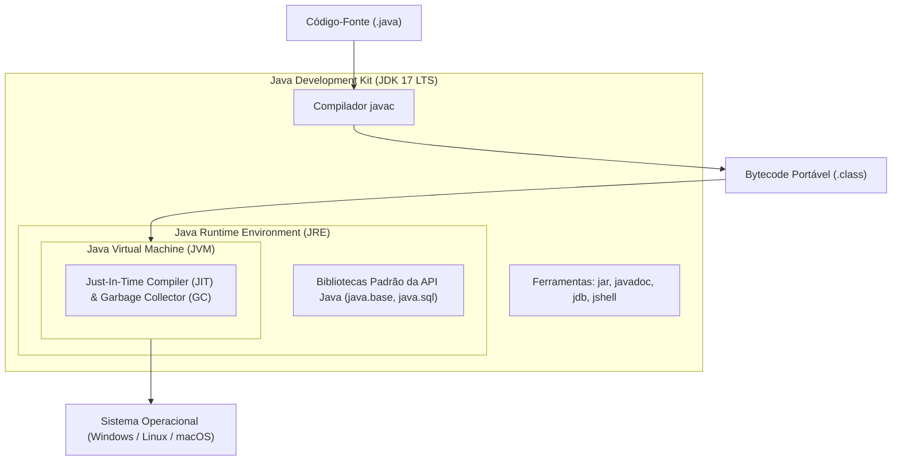

- **Java Virtual Machine (JVM):** Processo computacional abstrato responsável pelo carregamento de classes (`ClassLoader`), verificação de integridade do bytecode e execução do código compilado. Implementa o compilador *Just-In-Time* (HotSpot JIT), que analisa trechos executados com alta frequência e os converte dinamicamente em instruções binárias nativas do processador da máquina hospedeira. O subsistema de gerenciamento de memória conta com o Coletor de Lixo (*Garbage Collector*), que monitora a área de memória Heap e desaloca automaticamente instâncias órfãs que não possuem mais referências ativas.
- **Java Runtime Environment (JRE):** Agrupa a JVM e as bibliotecas essenciais em tempo de execução. Trata-se do conjunto estritamente necessário para usuários finais que precisam executar softwares previamente empacotados em arquivos `.jar` ou `.war`.
- **Java Development Kit (JDK):** Superconjunto que engloba o JRE, as especificações de plataforma e a suíte completa de ferramentas para engenharia de software, incluindo o compilador (`javac`), o gerador de arquivos compactados (`jar`), a ferramenta de documentação técnica (`javadoc`) e a interface interativa de experimentação de código (`jshell`).

#### Adoção do Eclipse Temurin 17 LTS (Adoptium)
A disciplina adota formalmente o **Java SE 17 LTS**, sob a distribuição **Eclipse Temurin** mantida pelo consórcio Adoptium (antigo AdoptOpenJDK). Versões com Suporte de Longo Prazo (*Long-Term Support - LTS*) garantem estabilidade de interfaces de programação de aplicações (APIs), suporte estendido a atualizações de segurança e ausência de quebras estruturais que costumam ocorrer nos ciclos semestrais não-LTS da linguagem.

```powershell
# Verificação de paridade de versões no terminal do sistema operacional
java -version
javac -version
```

A saída homologada deve acusar estritamente a versão `17.0.x` em ambos os utilitários:

```text
openjdk version "17.0.13" 2024-10-15
OpenJDK Runtime Environment Temurin-17.0.13+11 (build 17.0.13+11)
OpenJDK 64-Bit Server VM Temurin-17.0.13+11 (build 17.0.13+11, mixed mode, sharing)
javac 17.0.13
```

---

### O Servlet Container: Apache Tomcat 9 e a Transição javax vs jakarta

O Apache Tomcat não é classificado como um servidor de aplicação corporativo completo (*Full Java EE Application Server*, como WildFly, Payara ou IBM WebSphere), mas sim como um **J2EE Web Container** (Contêiner de Servlets). Sua função primordial é gerenciar o ciclo de vida de componentes web dinâmicos e implementar as especificações fundamentais:
- **Jakarta/Java Servlet:** Processamento transacional de requisições e respostas HTTP no servidor.
- **JavaServer Pages (JSP):** Geração dinâmica de marcações estruturadas (HTML, XML).
- **Expression Language (EL):** Avaliação de variáveis e ligação de dados entre escopos de memória e a visão.

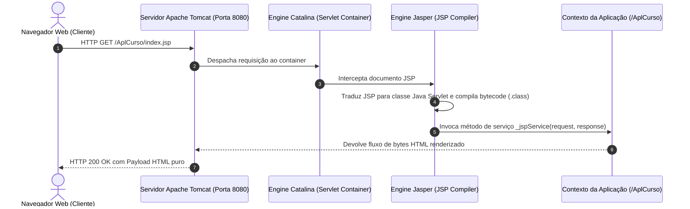

#### A Ruptura de Namespace: Tomcat 9 versus Tomcat 10+
Uma das decisões de engenharia mais sensíveis na infraestrutura Java corporativa decorre da doação da plataforma Java EE pela Oracle à **Eclipse Foundation**, em 2017. Devido a restrições de direitos autorais sobre a marca comercial *Java*, a especificação foi renomeada para **Jakarta EE**.

A partir do Jakarta EE 9, todos os pacotes das APIs corporativas sofreram alteração radical de namespace:
- Padrão Tradicional (Java EE 8 e anteriores): Pacotes com prefixo `javax.*` (ex.: `javax.servlet.*`, `javax.servlet.http.*`, `javax.servlet.jsp.*`).
- Novo Padrão (Jakarta EE 9 e posteriores): Pacotes com prefixo `jakarta.*` (ex.: `jakarta.servlet.*`, `jakarta.servlet.http.*`, `jakarta.servlet.jsp.*`).

> [!CAUTION]
> **Diretriz Arquitetural Rigorosa:** O projeto pedagógico de Laboratório III utiliza o padrão **Java EE 8 Web**, que depende das bibliotecas clássicas `javax.*` e JSTL 1.2. O uso do Apache Tomcat 10 ou 11 acarreta falhas de execução imediatas (`ClassNotFoundException` ou `NoClassDefFoundError: javax/servlet/Filter`), uma vez que o Tomcat 10+ reconhece exclusivamente o namespace `jakarta.*`. Portanto, a versão obrigatória de execução é o **Apache Tomcat 9.0.x**.

| Versão do Apache Tomcat | Especificação Servlet | Especificação JSP | Namespace dos Pacotes | Compatibilidade com o Projeto |
| :--- | :--- | :--- | :--- | :--- |
| **Tomcat 8.5.x** | Servlet 3.1 | JSP 2.3 | `javax.servlet.*` | Compatível (legado) |
| **Tomcat 9.0.x** | **Servlet 4.0** | **JSP 2.3** | `javax.servlet.*` | **Homologado (Alvo do Curso)** |
| **Tomcat 10.0.x** | Servlet 5.0 | JSP 3.0 | `jakarta.servlet.*` | Incompatível (incompatibilidade `javax`) |
| **Tomcat 10.1.x** | Servlet 6.0 | JSP 3.1 | `jakarta.servlet.*` | Incompatível (incompatibilidade `javax`) |
| **Tomcat 11.0.x** | Servlet 6.1 | JSP 4.0 | `jakarta.servlet.*` | Incompatível (incompatibilidade `javax`) |

---

### Ambiente de Desenvolvimento Integrado: Apache NetBeans 24 e Apache Ant

O **Apache NetBeans IDE 24** é adotado como ambiente integrado de desenvolvimento por seu suporte nativo de primeira classe ao ciclo de vida de aplicações web baseadas em **Apache Ant** e integração direta com contêineres de servlets locais.

A automação de compilação por meio do Apache Ant (`build.xml`) define alvos estruturados (`targets`) para:
1. `compile`: Compilação de código-fonte Java da pasta `src` para `build/classes`.
2. `dist`: Empacotamento das classes compiladas, bibliotecas dependentes e páginas estáticas em um arquivo padronizado `.war` (*Web Application Archive*).
3. `deploy`: Implantação automática do artefato no diretório `webapps` da instância ativa do Tomcat.

---

### Arquitetura Monolítica versus Microsserviços

A estruturação do sistema corporativo da disciplina baseia-se no modelo **monolítico modular**.

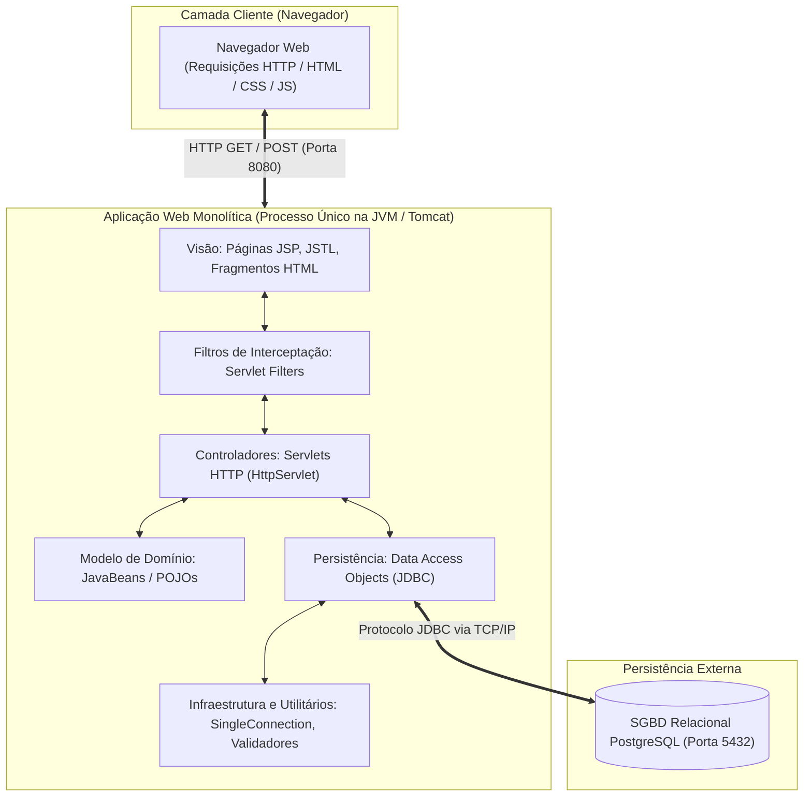

#### Definição Estrutural
Uma arquitetura monolítica unifica todas as capacidades funcionais do sistema — interface com o usuário, regras operacionais de negócio, validações documentais, segurança transacional e rotinas de persistência — em uma única base de código implantada como uma unidade física coesa em um processo de execução singular da JVM.

#### Comparativo de Decisão de Engenharia

| Vetor de Análise | Arquitetura Monolítica Modular | Arquitetura de Microsserviços |
| :--- | :--- | :--- |
| **Fronteira de Comunicação** | Chamadas de métodos em memória interna da JVM (latência medida em nanossegundos). | Chamadas remotas via rede (HTTP/REST, gRPC) com latência medida em milissegundos. |
| **Complexidade Operacional** | Baixa: um único servidor Tomcat e uma única base de dados relacional para monitorar. | Alta: demanda orquestração de contêineres, service discovery, distributed tracing e API Gateways. |
| **Consistência Transacional** | Forte: transações locais no SGBD geridas por ACID com um único `commit` ou `rollback`. | Eventual: transações distribuídas baseadas em padrões complexos como *Saga* ou *Two-Phase Commit*. |
| **Depuração de Código** | Direta: um único depurador (*debugger*) monitora todo o fluxo desde a requisição até a query. | Complexa: exige propagação de chaves de correlação (*correlation IDs*) entre múltiplos nós. |
| **Adequação Pedagógica** | **Ideal**: consolida os fundamentos essenciais de POO, JDBC e padrão MVC sem sobrecarga de infraestrutura. | Avançada: exige maturidade prévia em redes, concorrência distribuída e DevOps. |

---

### O Padrão Arquitetural MVC e a Estrutura Física de Pacotes

A organização de código orientada à manutenibilidade adota o padrão **Model-View-Controller (MVC Modelo 2)**, no qual as responsabilidades são decompostas em pacotes específicos dentro da raiz de fontes `Source Packages` do NetBeans:

```text
AplCurso/
├── Source Packages/
│   ├── br.com.aplcurso.controller.usuario/   # Camada Controladora (Servlets HTTP)
│   ├── br.com.aplcurso.dao/                  # Camada de Acesso a Dados (DAOs JDBC)
│   ├── br.com.aplcurso.filter/               # Camada de Interceptação (Servlet Filters)
│   ├── br.com.aplcurso.model/                # Camada de Domínio (JavaBeans / POJOs)
│   └── br.com.aplcurso.utils/                # Camada Utilitária (Conexão, Validações, SQL)
└── Web Pages/
    ├── META-INF/                             # Metadados de implantação
    ├── WEB-INF/                              # Diretório protegido contra acesso direto
    │   ├── lib/                              # Dependências JAR locais (JSTL, JDBC)
    │   └── web.xml                           # Descritor de implantação (opcional no Servlet 3+)
    ├── js/                                   # Ativos estáticos JavaScript locais
    ├── index.jsp                             # Roteador de entrada da aplicação
    ├── home.jsp                              # Estrutura mestra da interface
    ├── header.jsp                            # Fragmento de cabeçalho global
    ├── menu.jsp                              # Fragmento de navegação global
    └── footer.jsp                            # Fragmento de rodapé global
```

---

## Módulo II: Modularização da Camada de Apresentação (View) com JSP, JSTL e Client-Side

### Ciclo de Tradução e Execução de JavaServer Pages

JavaServer Pages (JSP) é uma tecnologia do ecossistema corporativo que permite intercalar marcação HTML pura com lógica dinâmica gerada pelo servidor. Diferente de páginas puramente estáticas servidas pelo Apache HTTP Server ou Nginx, um arquivo `.jsp` passa por um ciclo de vida automatizado no interior do Web Container:

```mermaid
flowchart LR
    JSP[Arquivo .jsp] -->|"1. Tradução via Jasper"| JavaFile[Código Java Servlet: _jsp.java]
    JavaFile -->|"2. Compilação via javac"| ClassFile[Bytecode: _jsp.class]
    ClassFile -->|"3. Carga e Inicialização"| Instance[Instância na JVM: jspInit]
    Instance -->|"4. Atendimento a Requisições"| Service[Método _jspService]
    Service -->|"5. Emissão do Fluxo"| HTMLOut[HTML puro entregue ao Cliente]
```

1. **Tradução:** O motor JSP do Tomcat (**Jasper**) intercepta a primeira requisição ao arquivo `.jsp` e transcreve sua marcação para uma classe Java concreta que estende a interface `javax.servlet.jsp.HttpJspPage`. Todo o texto HTML estático é convertido em invocações `out.write("...")`.
2. **Compilação:** O compilador Java transforma o arquivo fonte intermediário gerado no diretório de trabalho do Tomcat (`/work/Catalina/localhost/...`) em bytecode `.class`.
3. **Execução:** O contêiner instancia a classe compilada, aciona o método de ciclo de vida `jspInit()` e, para cada requisição concorrente recebida, despacha uma thread para invocar o método `_jspService(HttpServletRequest, HttpServletResponse)`.

---

### Modularização em Fragmentos: Inclusão Dinâmica versus Estática

Em sistemas de grande porte, centenas de páginas compartilham elementos estruturais idênticos: metadados, links de estilos CSS, scripts JavaScript de inicialização, barras de navegação superiores e rodapés de encerramento. Duplicar essas declarações em cada arquivo viola o princípio **DRY (*Don't Repeat Yourself*)**, inviabilizando manutenções centralizadas.

A técnica arquitetural adotada consiste em segmentar a página em fragmentos reutilizáveis:

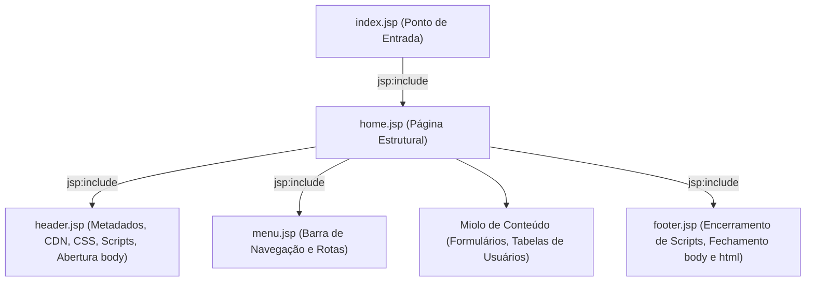

#### Comparativo Técnico: Ação `<jsp:include>` versus Diretiva `<%@include%>`

| Propriedade de Execução | Ação Dinâmica `<jsp:include page="..." />` | Diretiva Estática `<%@include file="..." %>` |
| :--- | :--- | :--- |
| **Momento de Processamento** | Tempo de Requisição (*Request-time*). | Tempo de Tradução (*Translation-time*). |
| **Mecanismo Operacional** | Invoca a interface `RequestDispatcher.include()`. O arquivo incluído é tratado como um recurso independente. | Funde fisicamente o código-fonte do fragmento no arquivo mestre antes da compilação. |
| **Escopo de Variáveis Locais** | Variáveis declaradas dentro do método `_jspService()` do fragmento não vazam para o mestre. | Todas as variáveis declaradas no fragmento compartilham o mesmo escopo do mestre, gerando risco de colisão de nomes. |
| **Passagem de Parâmetros** | Suporta passagem de parâmetros dinâmicos via subtags `<jsp:param>`. | Não suporta passagem de parâmetros em tempo de execução. |
| **Reflexo de Modificações** | Alterações no arquivo incluído refletem na próxima requisição sem exigir reprocessamento do mestre. | Alterações podem exigir revalidação ou toque no arquivo mestre para forçar nova tradução. |
| **Recomendação da Disciplina** | **Padrão Obrigatório** para layouts e estruturação modular de interfaces. | Reservado para inclusão de cabeçalhos com diretivas fixas de configuração. |

---

### Bibliotecas de Tags Padrão: JSTL Core e Formatting

O uso de *scriptlets* Java (`<% ... %>`) e expressões cruas (`<%= ... %>`) embutidas no meio do HTML é categorizado formalmente como um *anti-pattern* de desenvolvimento web. Essa prática mistura regras de negócio com apresentação, dificulta a leitura do código por desenvolvedores front-end e impede a validação estática de sintaxe.

A solução da indústria é a **JSTL (*JavaServer Pages Standard Tag Library*)**, que introduz vocabulários de tags XML para estruturas de repetição, condicionais e formatação localizada.

```jsp
<%-- Declaração obrigatória no topo de cada documento JSP que consome JSTL --%>
<%@taglib prefix="c" uri="http://java.sun.com/jsp/jstl/core" %>
<%@taglib prefix="fmt" uri="http://java.sun.com/jsp/jstl/fmt" %>
```

#### Funcionalidades Essenciais
- **Biblioteca Core (`c`):**
  - `<c:forEach items="${colecao}" var="item">`: Realiza iterações polimórficas sobre arrays, instâncias de `java.util.Collection` ou mapas.
  - `<c:if test="${condicao}">`: Executa renderização condicional simples com base em expressões booleanas.
  - `<c:choose>`, `<c:when test="...">`, `<c:otherwise>`: Implementa desvios condicionais múltiplos equivalentes à estrutura `switch-case` ou `if-else if-else`.
- **Biblioteca de Formatação (`fmt`):**
  - `<fmt:formatDate value="${data}" pattern="dd/MM/yyyy" />`: Converte instâncias temporais em strings formatadas no padrão nacional.
  - `<fmt:formatNumber value="${salario}" type="currency" currencySymbol="R$" />`: Realiza a formatação financeira de pontos flutuantes com separador de milhar e centavos em conformidade com o *Locale* corrente.

---

### Resolução de Caminhos com Expression Language

Em aplicações web, o uso de caminhos relativos para importação de folhas de estilo ou scripts (como `../../js/app.js`) introduz fragilidade catastrófica: quando um controlador redireciona ou despacha uma requisição a partir de uma URI aninhada (ex.: `/usuario/manutencao/listar`), os caminhos relativos quebram imediatamente, resultando em erros HTTP 404 para todos os ativos de front-end.

A resolução arquitetural elegante e canônica é o uso da **Expression Language (EL)** para capturar a raiz do contexto implantado no Tomcat:

```jsp
<%-- header.jsp: Resolução dinâmica absoluta via contexto web --%>
<script src="${pageContext.request.contextPath}/js/jquery-3.3.1.min.js"></script>
<script src="${pageContext.request.contextPath}/js/app.js"></script>
<link rel="stylesheet" href="${pageContext.request.contextPath}/css/estilos.css">
```

O identificador `${pageContext.request.contextPath}` extrai programmaticamente a string associada ao contexto do projeto (ex.: `/AplCurso`), garantindo que o caminho gerado no navegador seja sempre `/AplCurso/js/app.js`, independentemente da profundidade da rota acessada.

---

### Ecossistema Frontend: jQuery, Bootstrap, DataTables e SweetAlert2

O projeto adota uma estratégia híbrida de distribuição de ativos: dependências críticas para o funcionamento em ambientes desconectados (intranets) residem na pasta local `/web/js/`, enquanto componentes visuais complexos são consumidos via Redes de Entrega de Conteúdo (*Content Delivery Networks - CDNs*):

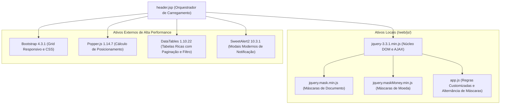

#### Hierarquia Estrita de Carregamento
A inclusão de dependências no `<head>` do arquivo `header.jsp` deve respeitar a ordem funcional de dependência dos módulos:
1. `jquery-3.3.1.min.js`: Deve obrigatoriamente figurar como o primeiro script. Ele instancia o objeto global `window.jQuery` e o atalho `window.$`.
2. Plugins baseados em jQuery (`jquery.mask.min.js`, `jquery.maskMoney.min.js`, `jquery.dataTables.min.js`): Injetam métodos utilitários no protótipo `$.fn`. Caso carregados antes do jQuery, provocam a interrupção da execução com o erro `Uncaught ReferenceError: jQuery is not defined`.
3. Script local `app.js`: Contém as regras de inicialização do sistema e depende da presença estável do jQuery e de seus plugins.

---

### Regras Client-Side e Algoritmo de Validação de Documentos

No arquivo `app.js`, implementa-se o comportamento inteligente do formulário de usuário, permitindo que o mesmo campo de entrada alterne sua máscara visual e validação matemática de acordo com a digitação do operador:

```javascript
// web/js/app.js: Tratamento de alternância dinâmica entre CPF e CNPJ
$(document).ready(function () {
    // Configuração de campos monetários
    if ($.fn.maskMoney) {
        $(".campo-moeda").maskMoney({
            prefix: "R$ ",
            thousands: ".",
            decimal: ",",
            affixesStay: false
        });
    }

    // Alternância de máscara conforme o comprimento no evento blur
    $("#cpf_cnpj").keydown(function () {
        try {
            $("#cpf_cnpj").unmask();
        } catch (e) {}

        var tamanho = $("#cpf_cnpj").val().replace(/\D/g, "").length;

        if (tamanho < 11) {
            $("#cpf_cnpj").mask("999.999.999-99");
        } else {
            $("#cpf_cnpj").mask("99.999.999/9999-99");
        }

        // Ajuste para evitar retenção de cursor em máscaras estendidas
        var elem = this;
        setTimeout(function () {
            elem.selectionStart = elem.selectionEnd = 10000;
        }, 0);
    });
});
```

---

## Módulo III: Persistência Relacional com JDBC, Padrão Singleton e Interceptação

### Administração de Banco de Dados com PostgreSQL e pgAdmin 4

O armazenamento persistente das informações corporativas da aplicação é delegado ao **PostgreSQL**, um Sistema Gerenciador de Banco de Dados Relacional Orientado a Objetos (SGBDRO) de alto desempenho, com conformidade rigorosa aos padrões ANSI/ISO SQL e isolamento de processos cliente-servidor na porta TCP `5432`.

A interface administrativa padrão é o **pgAdmin 4**, responsável por intermediar a execução de scripts de definição de dados (*Data Definition Language - DDL*) e manipulação de dados (*Data Manipulation Language - DML*). Para o ecossistema das aulas, adota-se a base `bdaplcurso`.

---

### Modelagem Estrutural DDL e o Mecanismo Serial

A tabela estrutural `usuario` encapsula os campos fundamentais com restrições explícitas de integridade relacional:

```sql
-- Criação formal da infraestrutura de armazenamento: banco.sql
CREATE TABLE usuario (
    id SERIAL PRIMARY KEY,
    nome VARCHAR(100) NOT NULL,
    datanascimento DATE NOT NULL,
    cpf VARCHAR(11) UNIQUE NOT NULL,
    email VARCHAR(100) UNIQUE NOT NULL,
    senha VARCHAR(20) NOT NULL,
    salario DECIMAL(15,2) NOT NULL
);

-- Inserção de registro padrão para homologação inicial
INSERT INTO usuario (nome, datanascimento, cpf, email, senha, salario)
VALUES (
    'João José Gomes da Silva',
    '1990-08-10',
    '08243060073',
    'joaojosegomes@gmail.com',
    'senha123',
    5200.00
);
```

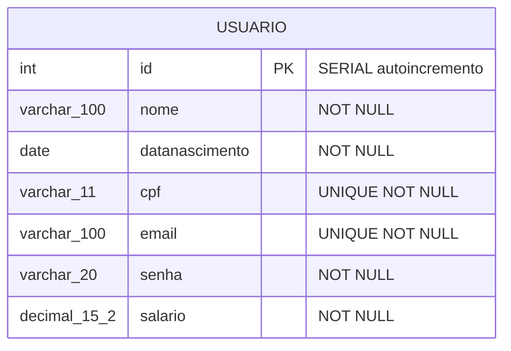

#### O Mecanismo do Tipo `SERIAL`
No PostgreSQL, o termo `SERIAL` opera como um atalho sintático (*syntactic sugar*). Quando invocado em uma coluna, o motor executa nos bastidores três instruções:
1. Cria um objeto gerador de sequências atômico: `CREATE SEQUENCE usuario_id_seq;`.
2. Define o tipo estrutural subjacente como `INTEGER` (inteiro de 4 bytes assinado).
3. Associa o valor padrão da coluna à próxima extração da sequência e vincula sua posse à tabela:
   ```sql
   ALTER TABLE usuario ALTER COLUMN id SET DEFAULT nextval('usuario_id_seq');
   ALTER SEQUENCE usuario_id_seq OWNED BY usuario.id;
   ```

> [!IMPORTANT]
> **Modelação de Valores Monetários:** Valores de remuneração financeira jamais devem ser tipados como ponto flutuante binário (`FLOAT`, `DOUBLE PRECISION`). O padrão internacional IEEE 754 introduz erros residuais cumulativos de arredondamento em frações binárias (ex.: `5200.000000000001`). O uso de `DECIMAL(15,2)` ou `NUMERIC(15,2)` garante representação em ponto fixo com exatidão em centavos.

---

### Padrão Criacional Singleton Aplicado à Conexão JDBC

#### Definição
O padrão de projeto **Singleton** (GoF) tem por propósito assegurar que uma classe possua apenas uma única instância ativa em memória durante todo o ciclo de vida da aplicação, fornecendo um ponto de acesso global unificado para essa instância.

#### Motivação Arquitetural
Abrir um canal físico de conexão com um banco de dados relacional via rede é uma das operações computacionais mais custosas em engenharia de software: envolve resolução de DNS, handshakes TCP/IP de três vias, autenticação de credenciais, alocação de buffers dedicados no SGBD e criação de processos servidores. Se cada classe DAO ou cada requisição web gerasse uma nova conexão via `DriverManager.getConnection()`, o banco de dados esgotaria rapidamente seu limite de conexões simultâneas, degradando o sistema por esgotamento de memória.

Na estratégia **Single Connection** adotada na disciplina, uma única conexão física é compartilhada por toda a aplicação:

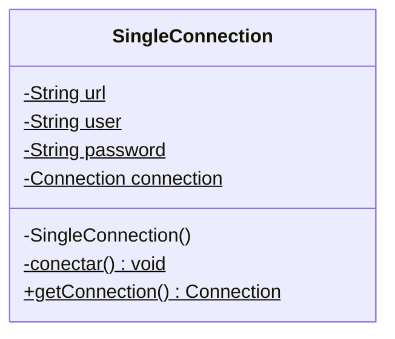

#### Implementação Comentada da Classe SingleConnection

```java
package br.com.aplcurso.utils;

import java.sql.Connection;
import java.sql.DriverManager;
import java.sql.SQLException;

/**
 * Utilitário de conexão estruturado sob o padrão Singleton (Single Connection).
 * Garante uma única instância ativa de java.sql.Connection para o projeto.
 */
public class SingleConnection {

    // Configurações estáticas de infraestrutura
    private static final String BANCO = "bdaplcurso";
    private static final String URL = "jdbc:postgresql://localhost:5432/" + BANCO;
    private static final String USER = "postgres";
    private static final String PASSWORD = "admin"; // Adequar à senha do ambiente local

    // Referência única da conexão física mantida na memória Heap
    private static Connection connection = null;

    // Bloco estático de inicialização: carregamento do driver em tempo de classe
    static {
        conectar();
    }

    // Construtor privado: impede instanciação externa direta via operador new
    private SingleConnection() {
    }

    /**
     * Efetua a carga do Driver JDBC e instanciação da conexão.
     */
    private static void conectar() {
        try {
            if (connection == null || connection.isClosed()) {
                // Registro do driver do PostgreSQL no DriverManager
                Class.forName("org.postgresql.Driver");
                
                connection = DriverManager.getConnection(URL, USER, PASSWORD);
                
                // Desativação do modo autoCommit para gestão transacional manual
                connection.setAutoCommit(false);
            }
        } catch (ClassNotFoundException e) {
            System.err.println("Driver JDBC do PostgreSQL não localizado na biblioteca: " + e.getMessage());
        } catch (SQLException e) {
            System.err.println("Falha de autenticação ou indisponibilidade do banco: " + e.getMessage());
        }
    }

    /**
     * Ponto de acesso global: retorna a referência da conexão aberta.
     */
    public static Connection getConnection() {
        try {
            if (connection == null || connection.isClosed()) {
                conectar();
            }
        } catch (SQLException e) {
            System.err.println("Erro ao checar status da conexão: " + e.getMessage());
        }
        return connection;
    }
}
```

---

### Controle Transacional Manual e as Propriedades ACID

Por padrão, a API JDBC opera com `autoCommit` ativado (`true`), o que significa que cada comando DML individual (`INSERT`, `UPDATE`, `DELETE`) executado pelo banco de dados é confirmado imediatamente e de forma isolada. 

Ao invocar `connection.setAutoCommit(false);`, o controle transacional passa a ser gerenciado explicitamente pelo desenvolvedor, garantindo conformidade com as propriedades fundamentais **ACID**:

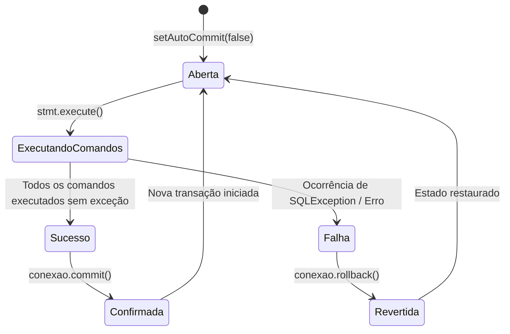

- **Atomicidade (Atomicity):** Uma transação composta por múltiplas instruções opera sob o princípio de "tudo ou nada". Se três tabelas forem alteradas e a terceira falhar, o método `conexao.rollback()` desfaz as alterações anteriores, impedindo que a base fique corrompida.
- **Consistência (Consistency):** Nenhuma transação pode violar regras de integridade do modelo de dados (como restrições `UNIQUE`, `CHECK` ou chaves estrangeiras `FOREIGN KEY`).
- **Isolamento (Isolation):** Transações que operam de forma concorrente em diferentes threads da JVM não devem enxergar dados transitórios e instáveis de outras transações que ainda não foram comitadas.
- **Durabilidade (Durability):** Uma vez que o método `conexao.commit()` retorna com sucesso, as alterações são gravadas em disco ou logs de transação (*Write-Ahead Logging - WAL*) e persistem mesmo diante de quedas de energia no servidor.

---

### Interceptação de Requisições com Servlet Filters

A especificação Java Servlet provê o mecanismo de **Filtros de Interceptação (*Servlet Filters*)**, estruturado sobre a interface `javax.servlet.Filter`. Um filtro atua como uma barreira que intercepta requisições HTTP antes que elas cheguem às Servlets e captura a resposta antes de sua entrega final ao navegador.

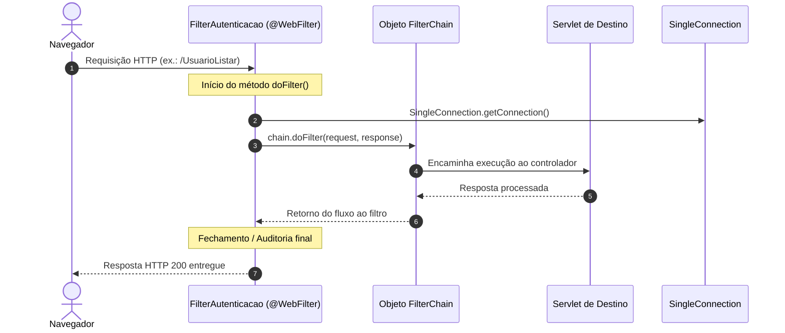

#### Ciclo de Vida do Filter
1. `init(FilterConfig filterConfig)`: Executado uma única vez pelo contêiner Tomcat durante a inicialização da aplicação web. Usado para carregar parâmetros de configuração global.
2. `doFilter(ServletRequest request, ServletResponse response, FilterChain chain)`: Invocado a cada requisição que corresponda ao padrão de URL interceptado. A chamada obrigatória a `chain.doFilter(...)` repassa a requisição ao próximo filtro da cadeia ou à servlet final.
3. `destroy()`: Executado quando a aplicação é descarregada ou o contêiner Tomcat é finalizado, liberando recursos alocados.

```java
package br.com.aplcurso.filter;

import br.com.aplcurso.utils.SingleConnection;
import java.io.IOException;
import java.sql.Connection;
import java.sql.SQLException;
import javax.servlet.Filter;
import javax.servlet.FilterChain;
import javax.servlet.FilterConfig;
import javax.servlet.ServletException;
import javax.servlet.ServletRequest;
import javax.servlet.ServletResponse;
import javax.servlet.annotation.WebFilter;

/**
 * Filtro global de interceptação HTTP da aplicação.
 * Mapeado para interceptar todas as requisições destinadas ao contexto /*.
 */
@WebFilter(urlPatterns = {"/*"})
public class FilterAutenticacao implements Filter {

    private static Connection conexao;

    @Override
    public void init(FilterConfig filterConfig) throws ServletException {
        // Inicialização da infraestrutura de conexão ao carregar o filtro
        conexao = SingleConnection.getConnection();
    }

    @Override
    public void doFilter(ServletRequest request, ServletResponse response, FilterChain chain)
            throws IOException, ServletException {
        try {
            // Repasse da execução para os componentes subsequentes
            chain.doFilter(request, response);
            
            // Confirmação transacional global caso não tenham ocorrido exceções
            conexao.commit();
        } catch (Exception e) {
            try {
                // Reversão de segurança em caso de falha no pipeline
                if (conexao != null) {
                    conexao.rollback();
                }
            } catch (SQLException ex) {
                System.err.println("Erro ao tentar executar rollback no filtro: " + ex.getMessage());
            }
            throw new ServletException("Exceção capturada na cadeia de filtros: " + e.getMessage(), e);
        }
    }

    @Override
    public void destroy() {
        try {
            // Fechamento formal da conexão no descarregamento da aplicação
            if (conexao != null && !conexao.isClosed()) {
                conexao.close();
            }
        } catch (SQLException e) {
            System.err.println("Erro ao encerrar conexão no destroy: " + e.getMessage());
        }
    }
}
```

---

### Técnicas de Depuração e Práticas de Acessibilidade

O desenvolvimento em ambiente NetBeans conta com recursos avançados de depuração (*debugging*) em tempo de execução:
- **Pontos de Parada (*Breakpoints* - `Ctrl + F8`):** Pausam a thread do Tomcat no momento exato em que a execução atinge a linha especificada.
- **Passo a Passo (*Step Over* - `F8` e *Step Into* - `F7`):** Permitem avançar linha por linha ou ingressar no código interno de métodos chamados.
- **Inspeção de Variáveis e Relógios (*Watches*):** O painel `Variables` expõe o estado de instâncias locais, enquanto os relógios permitem registrar expressões booleanas de parada (ex.: parar apenas quando `oUsuario.getId() == 5`).

#### Diretrizes de Engenharia de Software Acessível
Para assegurar a plena inclusão de programadores com deficiência visual (cegos ou com baixa visão) que utilizam leitores de tela como NVDA, JAWS ou Orca:
1. **Logs de Diagnóstico em Texto Puro:** Métodos críticos de infraestrutura devem emitir saídas claras no console (`System.out.println` ou frameworks como SLF4J), evitando que o desenvolvedor dependa unicamente de mudanças visuais em janelas gráficas.
2. **Padrão de Mensagens:** Mensagens de log devem seguir o formato estruturado:  
   `[HORA] [CLASSE] [NIVEL] Descrição textual do evento - ID: valor`.
3. **Atalhos Globais:** Priorizar navegação por atalhos de teclado e janelas acopladas de texto do NetBeans (`Alt + Shift + 1` para focar projetos, `Ctrl + 4` para a janela de saída).

---

## Módulo IV: O Fluxo de Consulta e Listagem no Padrão MVC

### Modelagem do Domínio: A Entidade Usuario como JavaBean

A camada **Model** encapsula os atributos de negócio correspondentes às tuplas da tabela `usuario`. Para atender às especificações de um **JavaBean**, a classe deve:
1. Declarar todos os seus atributos com visibilidade estritamente privada (`private`).
2. Disponibilizar um construtor público sem argumentos.
3. Prover métodos acessores (`get`) e modificadores (`set`) públicos para todas as propriedades.
4. Implementar a interface `java.io.Serializable` para permitir serialização de rede e replicação de sessão web.
5. Sobrescrever formalmente o contrato de identidade e dispersão: `equals()` e `hashCode()`.

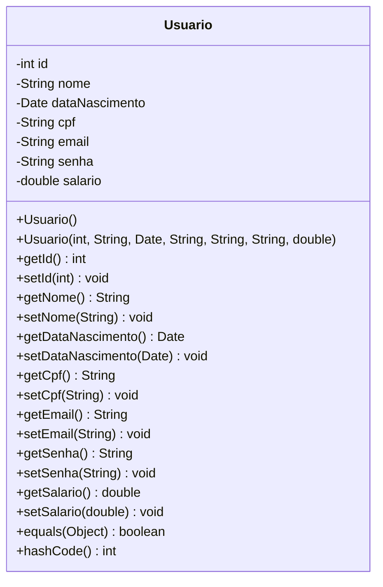

#### Contrato de Identidade: O Algoritmo de equals() e hashCode()
Em coleções baseadas em tabelas hash (`HashSet`, `HashMap`), a verificação de existência e a organização interna em compartimentos (*buckets*) apoiam-se no método `hashCode()`. Quando há coincidência de hash, o método `equals()` é invocado para desambiguação:

```java
@Override
public int hashCode() {
    int hash = 7;
    hash = 89 * hash + this.id;
    hash = 89 * hash + Objects.hashCode(this.cpf);
    return hash;
}

@Override
public boolean equals(Object obj) {
    if (this == obj) return true;
    if (obj == null || getClass() != obj.getClass()) return false;
    final Usuario other = (Usuario) obj;
    if (this.id != other.id) return false;
    return Objects.equals(this.cpf, other.cpf);
}
```

---

### Contratos de Persistência com a Interface GenericDAO

O padrão de arquitetura orientada a objetos estabelece: *"Programe para interfaces, não para implementações"*. A criação de uma interface padronizada na camada DAO impõe consistência terminológica e desacopla os controladores dos detalhes da tecnologia de banco de dados:

```java
package br.com.aplcurso.dao;

import java.util.List;

/**
 * Contrato uniforme para operações de persistência básica (CRUD).
 */
public interface GenericDAO {
    
    public Boolean cadastrar(Object objeto);
    public Boolean inserir(Object objeto);
    public Boolean alterar(Object objeto);
    public Boolean excluir(int numero);
    public Object carregar(int numero);
    public List<Object> listar();
}
```

---

### Implementação de UsuarioDAO e Extração via PreparedStatement

A classe `UsuarioDAO` materializa a interface `GenericDAO`, recebendo a conexão aberta a partir de `SingleConnection` e processando a listagem ordenada de todos os usuários cadastrados:

```java
package br.com.aplcurso.dao;

import br.com.aplcurso.model.Usuario;
import br.com.aplcurso.utils.SingleConnection;
import java.sql.Connection;
import java.sql.PreparedStatement;
import java.sql.ResultSet;
import java.sql.SQLException;
import java.util.ArrayList;
import java.util.List;

public class UsuarioDAO implements GenericDAO {

    private Connection conexao;

    public UsuarioDAO() throws Exception {
        // Obtenção da conexão via Singleton
        this.conexao = SingleConnection.getConnection();
    }

    @Override
    public List<Object> listar() {
        List<Object> resultado = new ArrayList<>();
        PreparedStatement stmt = null;
        ResultSet rs = null;
        String sql = "SELECT id, nome, datanascimento, cpf, email, senha, salario "
                   + "FROM usuario ORDER BY id ASC";
        try {
            stmt = conexao.prepareStatement(sql);
            rs = stmt.executeQuery();
            
            // Navegação pelo cursor do banco de dados
            while (rs.next()) {
                Usuario oUsuario = new Usuario();
                oUsuario.setId(rs.getInt("id"));
                oUsuario.setNome(rs.getString("nome"));
                oUsuario.setDataNascimento(rs.getDate("datanascimento"));
                oUsuario.setCpf(rs.getString("cpf"));
                oUsuario.setEmail(rs.getString("email"));
                oUsuario.setSenha(rs.getString("senha"));
                oUsuario.setSalario(rs.getDouble("salario"));
                
                resultado.add(oUsuario);
            }
        } catch (SQLException ex) {
            System.err.println("Problemas ao listar Usuários! Erro: " + ex.getMessage());
            ex.printStackTrace();
        } finally {
            // Fechamento defensivo de cursores
            try {
                if (rs != null) rs.close();
                if (stmt != null) stmt.close();
            } catch (SQLException e) {
                System.err.println("Erro ao fechar recursos JDBC: " + e.getMessage());
            }
        }
        return resultado;
    }

    // Demais métodos do GenericDAO são implementados na sequência
    @Override public Boolean cadastrar(Object objeto) { return false; }
    @Override public Boolean inserir(Object objeto) { return false; }
    @Override public Boolean alterar(Object objeto) { return false; }
    @Override public Boolean excluir(int numero) { return false; }
    @Override public Object carregar(int numero) { return null; }
}
```

---

### Controladores Web: HttpServlet e Mapeamento de Rotas

Servlets são componentes fundamentais que herdam de `javax.servlet.http.HttpServlet`. Na especificação Servlet 3.0+, o mapeamento de rotas dispensa o antigo arquivo XML `web.xml`, sendo realizado de forma limpa e declarativa através da anotação `@WebServlet`:

```java
package br.com.aplcurso.controller.usuario;

import br.com.aplcurso.dao.UsuarioDAO;
import java.io.IOException;
import java.util.List;
import javax.servlet.ServletException;
import javax.servlet.annotation.WebServlet;
import javax.servlet.http.HttpServlet;
import javax.servlet.http.HttpServletRequest;
import javax.servlet.http.HttpServletResponse;

/**
 * Servlet orquestradora da listagem de usuários.
 */
@WebServlet(name = "UsuarioListar", urlPatterns = {"/UsuarioListar"})
public class UsuarioListar extends HttpServlet {

    protected void processRequest(HttpServletRequest request, HttpServletResponse response)
            throws ServletException, IOException {
        response.setContentType("text/html;charset=iso-8859-1");
        try {
            // 1. Aciona a camada de persistência
            UsuarioDAO dao = new UsuarioDAO();
            List<Object> listaUsuarios = dao.listar();
            
            // 2. Aloca a lista no escopo da requisição HTTP
            request.setAttribute("usuarios", listaUsuarios);
            
            // 3. Despacha internamente para a página JSP correspondente
            request.getRequestDispatcher("/usuarioListar.jsp").forward(request, response);
            
        } catch (Exception ex) {
            System.err.println("Erro ao processar listagem de usuários: " + ex.getMessage());
            ex.printStackTrace();
        }
    }

    @Override
    protected void doGet(HttpServletRequest request, HttpServletResponse response)
            throws ServletException, IOException {
        processRequest(request, response);
    }

    @Override
    protected void doPost(HttpServletRequest request, HttpServletResponse response)
            throws ServletException, IOException {
        processRequest(request, response);
    }
}
```

---

### Despacho Interno com RequestDispatcher e Escopo de Requisição

A transição entre o Controlador e a Visão baseia-se na cooperação entre o método `request.setAttribute(nome, objeto)` e o despacho `request.getRequestDispatcher(caminho).forward(request, response)`:

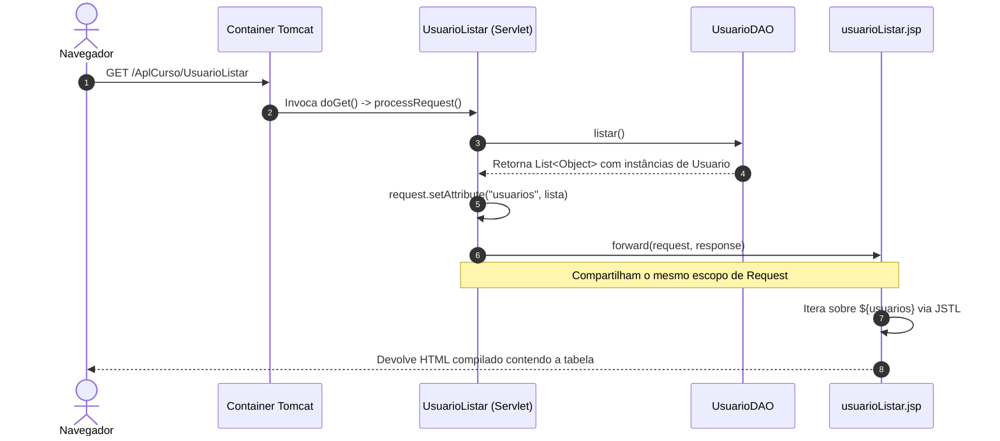

#### Comparativo de Escopos de Memória na Plataforma Java Web

| Escopo | Interface Java | Ciclo de Vida | Utilização Típica |
| :--- | :--- | :--- | :--- |
| **Request** | `HttpServletRequest` | Dura exatamente o tempo de processamento de uma requisição HTTP. Desaparece após a resposta ser entregue. | **Ideal para transferir coleções de listagem e dados de formulário** entre o Servlet e o JSP. |
| **Session** | `HttpSession` | Persiste por múltiplas requisições do mesmo usuário/cliente através de um cookie `JSESSIONID`. | Armazenamento de dados do usuário autenticado, permissões e carrinho de compras. |
| **Application** | `ServletContext` | Compartilhado por todos os usuários de toda a aplicação durante o tempo em que o servidor web permanecer no ar. | Parâmetros de configuração global, contadores globais de acesso e pools de recursos. |

---

### Renderização Dinâmica com JSTL e jQuery DataTables

Na camada de visualização (`usuarioListar.jsp`), fragmentos de layout são acoplados dinamicamente via `<jsp:include>`, enquanto a biblioteca JSTL Core percorre a coleção de dados e JSTL Formatting ajusta a apresentação visual:

```jsp
<%@taglib prefix="c" uri="http://java.sun.com/jsp/jstl/core" %>
<%@taglib prefix="fmt" uri="http://java.sun.com/jsp/jstl/fmt" %>
<%@page contentType="text/html" pageEncoding="iso-8859-1"%>

<jsp:include page="header.jsp" />
<jsp:include page="menu.jsp" />

<div class="container mt-4">
    <div class="d-flex justify-content-between align-items-center mb-3">
        <h2>Listagem de Usuários</h2>
        <a href="${pageContext.request.contextPath}/UsuarioNovo" class="btn btn-success">Novo Usuário</a>
    </div>

    <table id="tabelaUsuarios" class="table table-striped table-bordered">
        <thead class="thead-dark">
            <tr>
                <th>ID</th>
                <th>Nome</th>
                <th>Data de Nascimento</th>
                <th>CPF</th>
                <th>E-mail</th>
                <th>Salário</th>
                <th>Ações</th>
            </tr>
        </thead>
        <tbody>
            <c:forEach var="usuario" items="${usuarios}">
                <tr>
                    <td>${usuario.id}</td>
                    <td>${usuario.nome}</td>
                    <td><fmt:formatDate value="${usuario.dataNascimento}" pattern="dd/MM/yyyy" /></td>
                    <td>${usuario.cpf}</td>
                    <td>${usuario.email}</td>
                    <td><fmt:formatNumber value="${usuario.salario}" type="currency" currencySymbol="R$" /></td>
                    <td>
                        <a href="${pageContext.request.contextPath}/UsuarioCarregar?id=${usuario.id}" class="btn btn-primary btn-sm">Editar</a>
                        <a href="${pageContext.request.contextPath}/UsuarioExcluir?id=${usuario.id}" class="btn btn-danger btn-sm" onclick="return confirm('Confirma exclusão?')">Excluir</a>
                    </td>
                </tr>
            </c:forEach>
        </tbody>
    </table>
</div>

<jsp:include page="footer.jsp" />

<script type="text/javascript">
    $(document).ready(function() {
        $('#tabelaUsuarios').DataTable({
            "language": {
                "url": "//cdn.datatables.net/plug-ins/1.10.22/i18n/Portuguese-Brasil.json"
            }
        });
    });
</script>
```

---

## Módulo V: Operações de Manutenção Cadastral Completa (CRUD)

### Bifurcação de Persistência na DAO via Identificador

Na interface `GenericDAO`, a persistência é acionada através do método unificado `cadastrar(Object objeto)`. Contudo, um banco de dados relacional exige comandos SQL completamente distintos para gravação de novos registros (`INSERT`) versus atualização de dados preexistentes (`UPDATE`).

A responsabilidade de discernir entre criação e edição é encapsulada na classe `UsuarioDAO` através da análise do identificador primário (`id`):
- Se `id == 0`: Trata-se de um novo registro (uma vez que os identificadores gerados por `SERIAL` no PostgreSQL são estritamente maiores que zero). O fluxo desvia para `inserir(oUsuario)`.
- Se `id > 0`: O registro já reside na base de dados. O fluxo desvia para `alterar(oUsuario)`.

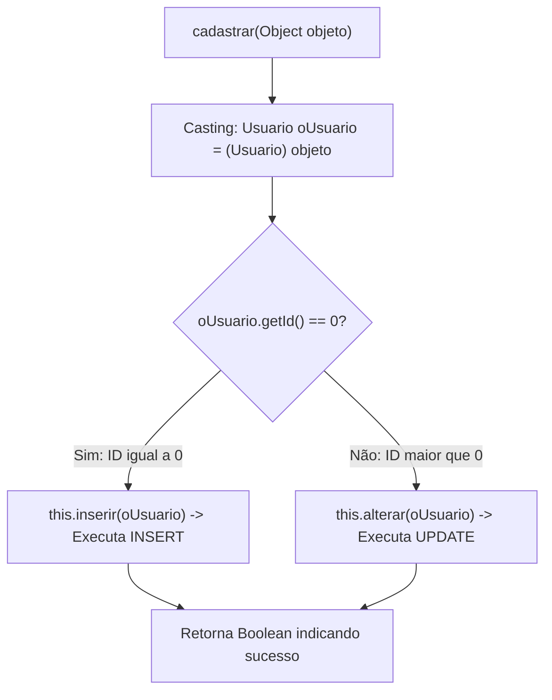

---

### Inserção Parametrizada e Tratamento Temporal

A implementação de `inserir` realiza o binding posicional em `PreparedStatement` e resolve a incompatibilidade clássica entre datas do Java e do SQL:

```java
@Override
public Boolean inserir(Object objeto) {
    Usuario oUsuario = (Usuario) objeto;
    PreparedStatement stmt = null;
    String sql = "INSERT INTO usuario (nome, datanascimento, cpf, email, senha, salario) "
               + "VALUES (?, ?, ?, ?, ?, ?)";
    try {
        stmt = conexao.prepareStatement(sql);
        stmt.setString(1, oUsuario.getNome());
        
        // Conversão obrigatória: java.util.Date para java.sql.Date
        stmt.setDate(2, new java.sql.Date(oUsuario.getDataNascimento().getTime()));
        
        stmt.setString(3, oUsuario.getCpf());
        stmt.setString(4, oUsuario.getEmail());
        stmt.setString(5, oUsuario.getSenha());
        stmt.setDouble(6, oUsuario.getSalario());

        stmt.execute();
        conexao.commit(); // Confirmação transacional explícita
        return true;
    } catch (Exception ex) {
        try {
            System.err.println("Erro ao cadastrar usuário! Revertendo: " + ex.getMessage());
            conexao.rollback(); // Desfaz alterações parciais
        } catch (SQLException e) {
            System.err.println("Erro durante operação de rollback: " + e.getMessage());
        }
        return false;
    } finally {
        try {
            if (stmt != null) stmt.close();
        } catch (SQLException ex) {
            System.err.println("Erro ao fechar PreparedStatement: " + ex.getMessage());
        }
    }
}
```

---

### Validação Assíncrona de Unicidade no Backend

Embora a tabela `usuario` contenha uma restrição `UNIQUE` na coluna `cpf`, permitir que a validação ocorra apenas no momento da submissão gera exceções de banco desagradáveis ao usuário. A aplicação provê checagem antecipada via AJAX:

```java
// Em UsuarioDAO.java
public boolean cpfExiste(String cpf) {
    String sql = "SELECT COUNT(*) as quantidade FROM usuario WHERE cpf = ?";
    try (PreparedStatement stmt = conexao.prepareStatement(sql)) {
        stmt.setString(1, cpf);
        try (ResultSet rs = stmt.executeQuery()) {
            if (rs.next()) {
                return rs.getInt("quantidade") > 0;
            }
        }
    } catch (SQLException e) {
        System.err.println("Erro ao verificar duplicidade de CPF: " + e.getMessage());
    }
    return false;
}
```

#### O Controlador Assíncrono UsuarioVerificarCPF
Um servlet leve atende exclusivamente requisições assíncronas do jQuery, devolvendo texto simples (`1` para CPF existente ou `0` para CPF liberado):

```java
@WebServlet(name = "UsuarioVerificarCPF", urlPatterns = {"/UsuarioVerificarCPF"})
public class UsuarioVerificarCPF extends HttpServlet {

    @Override
    protected void doGet(HttpServletRequest request, HttpServletResponse response)
            throws ServletException, IOException {
        response.setContentType("text/plain;charset=UTF-8");
        String cpf = request.getParameter("cpf");
        try {
            UsuarioDAO dao = new UsuarioDAO();
            if (dao.cpfExiste(cpf)) {
                response.getWriter().write("1"); // Bloqueado: Já cadastrado
            } else {
                response.getWriter().write("0"); // Liberado: Não existente
            }
        } catch (Exception ex) {
            response.getWriter().write("0");
        }
    }
}
```

---

### A Classe Utilitária DocumentoValidador e Algoritmo do Módulo 11

A validação sintática do CPF baseia-se na verificação de dois **Dígitos Verificadores ($`d_1`$ e $`d_2`$)** calculados sobre os 9 primeiros dígitos do documento por meio da técnica matemática de **Módulo 11** com pesos ponderados decrescentes:

```math
S_1 = \sum_{i=0}^{8} \text{dígito}[i] \times (10 - i)
```

```math
R_1 = S_1 \pmod{11} \quad \implies \quad d_1 = 
\begin{cases} 
0, & \text{se } (11 - R_1) > 9 \\ 
11 - R_1, & \text{caso contrário} 
\end{cases}
```

Para o cálculo do segundo dígito ($`d_2`$), acumula-se a soma dos 9 dígitos iniciais com pesos de 11 a 3, somada ao produto de $`d_1 \times 2`$:

```math
S_2 = \left( \sum_{i=0}^{8} \text{dígito}[i] \times (11 - i) \right) + (d_1 \times 2)
```

```math
R_2 = S_2 \pmod{11} \quad \implies \quad d_2 = 
\begin{cases} 
0, & \text{se } (11 - R_2) > 9 \\ 
11 - R_2, & \text{caso contrário} 
\end{cases}
```

```java
package br.com.aplcurso.utils;

public class DocumentoValidador {

    public static boolean isCPF(String cpf) {
        if (cpf == null) return false;
        cpf = cpf.replaceAll("[^\\d]", "");
        if (cpf.length() != 11 || cpf.matches("(\\d)\\1{10}")) return false;

        try {
            int d1 = 0, d2 = 0;
            for (int i = 0; i < 9; i++) {
                int digito = cpf.charAt(i) - '0';
                d1 += digito * (10 - i);
                d2 += digito * (11 - i);
            }

            d1 = 11 - (d1 % 11);
            d1 = (d1 > 9) ? 0 : d1;

            d2 += d1 * 2;
            d2 = 11 - (d2 % 11);
            d2 = (d2 > 9) ? 0 : d2;

            return d1 == (cpf.charAt(9) - '0') && d2 == (cpf.charAt(10) - '0');
        } catch (Exception e) {
            return false;
        }
    }
}
```

---

### Fluxo de Inclusão, Conversão de Dados e Sanitização Monetária

Ao submeter dados monetários formatados por máscaras (ex.: `"R$ 5.200,50"`), a camada de controle deve efetuar a sanitização da string antes de tentar o *parsing* para `double`. Qualquer tentativa de converter diretamente com `Double.parseDouble("R$ 5.200,50")` lançará imediatamente `NumberFormatException`.

A técnica de higienização adotada no servlet `UsuarioCadastrar` consiste em:
1. Remover prefixos de moeda e espaços: `replace("R$", "").trim()`.
2. Remover pontos de milhar: `replace(".", "")`.
3. Substituir a vírgula de centavos pelo ponto decimal internacional: `replace(",", ".")`.

```java
// Trecho de conversão no servlet UsuarioCadastrar
String salarioStr = request.getParameter("salario");
salarioStr = salarioStr.replace("R$", "").replace(".", "").replace(",", ".").trim();
double salario = Double.parseDouble(salarioStr);
```

---

### Carregamento Pontual e Suporte à Atualização e Exclusão

Para suportar a edição de registros existentes, a camada DAO implementa o método `carregar(int id)`, que recupera um único usuário da base para pré-popular o formulário de cadastro:

```java
@Override
public Object carregar(int numero) {
    PreparedStatement stmt = null;
    ResultSet rs = null;
    Usuario oUsuario = null;
    String sql = "SELECT id, nome, datanascimento, cpf, email, senha, salario "
               + "FROM usuario WHERE id = ?";
    try {
        stmt = conexao.prepareStatement(sql);
        stmt.setInt(1, numero);
        rs = stmt.executeQuery();
        if (rs.next()) {
            oUsuario = new Usuario();
            oUsuario.setId(rs.getInt("id"));
            oUsuario.setNome(rs.getString("nome"));
            oUsuario.setDataNascimento(rs.getDate("datanascimento"));
            oUsuario.setCpf(rs.getString("cpf"));
            oUsuario.setEmail(rs.getString("email"));
            oUsuario.setSenha(rs.getString("senha"));
            oUsuario.setSalario(rs.getDouble("salario"));
        }
    } catch (SQLException ex) {
        System.err.println("Erro ao carregar usuário: " + ex.getMessage());
    } finally {
        try {
            if (rs != null) rs.close();
            if (stmt != null) stmt.close();
        } catch (SQLException e) {
            System.err.println("Erro ao fechar cursores: " + e.getMessage());
        }
    }
    return oUsuario;
}
```

---

## Módulo VI: Projetos Práticos de Engenharia e Aplicações Web

### Sistema de Cadastro e Manutenção de Livros

**Contexto:** Atividade prática de consolidação (Trabalho de Programação 20260427 - Prazo 07/05/2026).  
**Demanda:** Criação de um sistema Java Web utilizando Servlets nativos para manutenção completa (CRUD) de Livros, contemplando `id`, `nomeLivro`, `isbn`, `autor`, `dataPublicacao` e `valorLivro`.

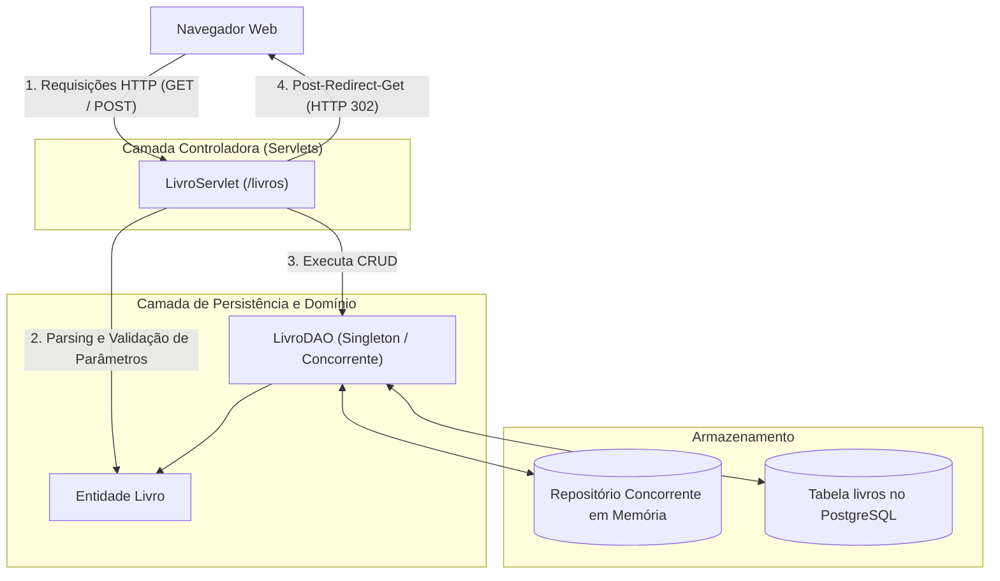

#### O Padrão Post-Redirect-Get (PRG)
Em aplicações web clássicas, se um método `POST` de inclusão retornar diretamente a marcação HTML da listagem com status HTTP 200, a última ação gravada no histórico do navegador do usuário é o envio do formulário. Caso o operador pressione a tecla de recarregamento (`F5`), o navegador exibirá a mensagem *"Confirmar reenvio de formulário?"* e, se confirmado, duplicará o livro na base.

O padrão **PRG** soluciona o problema:
1. O cliente emite um `POST` com os dados do livro.
2. O servlet processa e grava a entidade.
3. Em vez de despachar HTML, o servidor responde com cabeçalho de redirecionamento `HTTP 302 Found`, apontando para a URL de listagem (`Location: /livros?acao=listar`).
4. O navegador realiza imediatamente uma requisição limpa via `GET`, neutralizando o risco de cadastros duplicados por F5.

#### Entidade de Domínio Livro.java

```java
package modelo;

import java.io.Serializable;
import java.time.LocalDate;
import java.time.format.DateTimeFormatter;
import java.text.NumberFormat;
import java.util.Locale;

public class Livro implements Serializable {
    private static final long serialVersionUID = 1L;

    private Long id;
    private String nomeLivro;
    private String isbn;
    private String autor;
    private LocalDate dataPublicacao;
    private Double valorLivro;

    public Livro() {}

    public Livro(Long id, String nomeLivro, String isbn, String autor, LocalDate dataPublicacao, Double valorLivro) {
        this.id = id;
        this.nomeLivro = nomeLivro;
        this.isbn = isbn;
        this.autor = autor;
        this.dataPublicacao = dataPublicacao;
        this.valorLivro = valorLivro;
    }

    public Long getId() { return id; }
    public void setId(Long id) { this.id = id; }

    public String getNomeLivro() { return nomeLivro; }
    public void setNomeLivro(String nomeLivro) { this.nomeLivro = nomeLivro; }

    public String getIsbn() { return isbn; }
    public void setIsbn(String isbn) { this.isbn = isbn; }

    public String getAutor() { return autor; }
    public void setAutor(String autor) { this.autor = autor; }

    public LocalDate getDataPublicacao() { return dataPublicacao; }
    public void setDataPublicacao(LocalDate dataPublicacao) { this.dataPublicacao = dataPublicacao; }

    public Double getValorLivro() { return valorLivro; }
    public void setValorLivro(Double valorLivro) { this.valorLivro = valorLivro; }

    public String getDataPublicacaoFormatada() {
        if (this.dataPublicacao == null) return "";
        return this.dataPublicacao.format(DateTimeFormatter.ofPattern("dd/MM/yyyy"));
    }

    public String getValorFormatado() {
        if (this.valorLivro == null) return "R$ 0,00";
        NumberFormat nf = NumberFormat.getCurrencyInstance(new Locale("pt", "BR"));
        return nf.format(this.valorLivro);
    }
}
```

---

### Módulo de Unidades Federativas (Cadastro de Estados)

**Contexto:** Desafio prático de aplicação (Trabalho de Programação 20260511 - Prazo 25/05/2026).  
**Demanda:** Implementar o cadastro e manutenção de Estados federativos no projeto, contemplando persistência relacional com integridade referencial.

#### Modelagem Relacional (schema.sql)

```sql
-- DDL para criação da tabela de estados federativos
CREATE TABLE estado (
    id SERIAL PRIMARY KEY,
    nome VARCHAR(100) NOT NULL,
    sigla VARCHAR(2) NOT NULL,
    CONSTRAINT uk_estado_sigla UNIQUE (sigla)
);

-- Carga inicial com dados das unidades federativas
INSERT INTO estado (nome, sigla) VALUES 
    ('São Paulo', 'SP'),
    ('Rio de Janeiro', 'RJ'),
    ('Minas Gerais', 'MG'),
    ('Paraná', 'PR'),
    ('Santa Catarina', 'SC'),
    ('Rio Grande do Sul', 'RS'),
    ('Bahia', 'BA'),
    ('Goiás', 'GO');
```

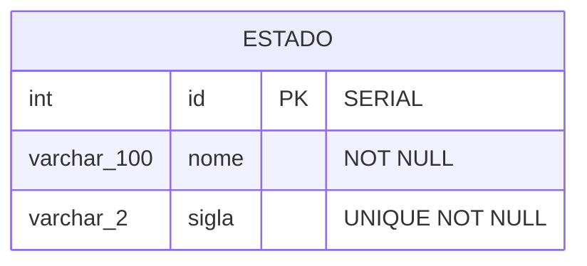

#### Implementação da Camada DAO: EstadoDAO.java

```java
package dao;

import java.sql.Connection;
import java.sql.PreparedStatement;
import java.sql.ResultSet;
import java.sql.SQLException;
import java.util.ArrayList;
import java.util.List;
import model.Estado;

public class EstadoDAO {

    private Connection conexao;

    public EstadoDAO(Connection conexao) {
        this.conexao = conexao;
    }

    public void salvar(Estado estado) throws SQLException {
        if (estado.getId() == null || estado.getId() == 0) {
            String sql = "INSERT INTO estado (nome, sigla) VALUES (?, ?)";
            try (PreparedStatement stmt = conexao.prepareStatement(sql)) {
                stmt.setString(1, estado.getNome());
                stmt.setString(2, estado.getSigla().toUpperCase());
                stmt.executeUpdate();
            }
        } else {
            String sql = "UPDATE estado SET nome = ?, sigla = ? WHERE id = ?";
            try (PreparedStatement stmt = conexao.prepareStatement(sql)) {
                stmt.setString(1, estado.getNome());
                stmt.setString(2, estado.getSigla().toUpperCase());
                stmt.setInt(3, estado.getId());
                stmt.executeUpdate();
            }
        }
    }

    public List<Estado> listarTodos() throws SQLException {
        List<Estado> lista = new ArrayList<>();
        String sql = "SELECT id, nome, sigla FROM estado ORDER BY nome ASC";
        try (PreparedStatement stmt = conexao.prepareStatement(sql);
             ResultSet rs = stmt.executeQuery()) {
            while (rs.next()) {
                Estado e = new Estado();
                e.setId(rs.getInt("id"));
                e.setNome(rs.getString("nome"));
                e.setSigla(rs.getString("sigla"));
                lista.add(e);
            }
        }
        return lista;
    }

    public void excluir(int id) throws SQLException {
        String sql = "DELETE FROM estado WHERE id = ?";
        try (PreparedStatement stmt = conexao.prepareStatement(sql)) {
            stmt.setInt(1, id);
            stmt.executeUpdate();
        }
    }
}
```

---

## Módulo VII: Avaliações Formativas, Teóricas e Laboratoriais

### Avaliação I: Fundamentos Avançados de POO e Invariantes

**Data:** 23/03/2026  
**Eixo Temático:** Proteção de invariantes, herança semântica, despacho dinâmico de métodos e tratamento de exceções corporativas.

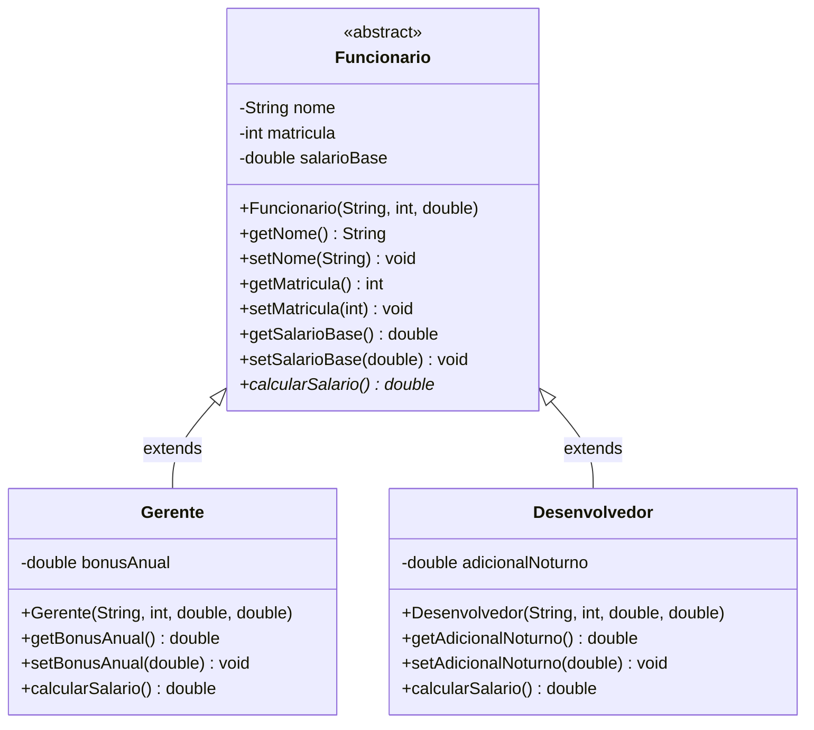

#### Proteção Rigorosa de Invariantes no Modelo
O encapsulamento corporativo exige que o construtor e os métodos mutadores (*setters*) atuem como guardiões da integridade lógica, impedindo a alocação de estados impossíveis:

```java
public void setSalarioBase(double salarioBase) {
    if (salarioBase <= 0.0) {
        throw new IllegalArgumentException("Erro de domínio: O salário-base deve ser estritamente positivo.");
    }
    this.salarioBase = salarioBase;
}
```

#### Polimorfismo e a Tabela de Métodos Virtuais (vtable)
Quando o sistema itera sobre uma coleção heterogênea `List<Funcionario>` e invoca `f.calcularSalario()`, a Máquina Virtual Java emprega a instrução de bytecode `invokevirtual`. A resolução da implementação exata ocorre durante a execução (*late binding* / ligação tardia), consultando a tabela de métodos virtuais (*vtable*) associada à instância concreta armazenada na memória Heap.

---

### Avaliação II: Persistência Relacional com JDBC e Arquitetura em Camadas

**Data:** 08/06/2026  
**Eixo Temático:** Arquitetura de software corporativa em camadas com persistência em banco relacional, isolamento de infraestrutura, JDBC seguro e manipulação de entidades de estoque.

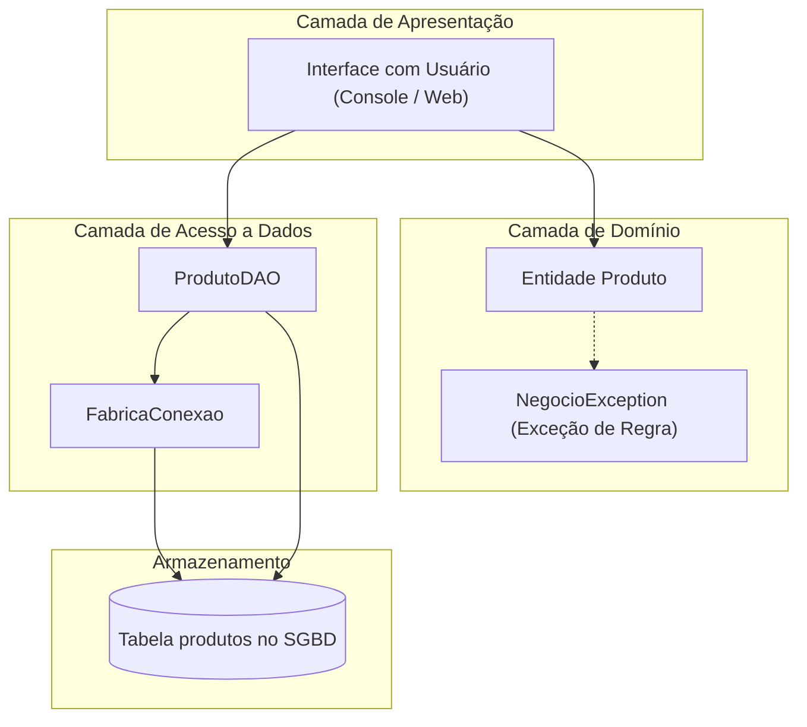

#### Implementação com PreparedStatement e Gestão Segura de Recursos

```java
package dao;

import java.sql.Connection;
import java.sql.PreparedStatement;
import java.sql.ResultSet;
import java.sql.SQLException;
import java.util.ArrayList;
import java.util.List;
import modelo.Produto;

public class ProdutoDAO {

    private Connection conexao;

    public ProdutoDAO(Connection conexao) {
        this.conexao = conexao;
    }

    public void inserir(Produto p) throws SQLException {
        String sql = "INSERT INTO produtos (nome, preco, quantidade_estoque, data_cadastro) "
                   + "VALUES (?, ?, ?, ?)";
        // Padrão try-with-resources: fecha stmt automaticamente ao final
        try (PreparedStatement stmt = conexao.prepareStatement(sql)) {
            stmt.setString(1, p.getNome());
            stmt.setDouble(2, p.getPreco());
            stmt.setInt(3, p.getQuantidadeEstoque());
            stmt.setString(4, p.getDataCadastro());
            stmt.executeUpdate();
        }
    }

    public List<Produto> listarTodos() throws SQLException {
        List<Produto> lista = new ArrayList<>();
        String sql = "SELECT id, nome, preco, quantidade_estoque, data_cadastro "
                   + "FROM produtos ORDER BY id ASC";
        try (PreparedStatement stmt = conexao.prepareStatement(sql);
             ResultSet rs = stmt.executeQuery()) {
            while (rs.next()) {
                Produto p = new Produto();
                p.setId(rs.getInt("id"));
                p.setNome(rs.getString("nome"));
                p.setPreco(rs.getDouble("preco"));
                p.setQuantidadeEstoque(rs.getInt("quantidade_estoque"));
                p.setDataCadastro(rs.getString("data_cadastro"));
                lista.add(p);
            }
        }
        return lista;
    }
}
```

---

### Avaliação Substitutiva: Síntese e Desacoplamento Corporativo

**Data:** 25/06/2026  
**Eixo Temático:** Modelagem corporativa de funcionários, contratos desacoplados via interface `Tributavel`, estruturas agregadoras (`Departamento`) e tratamento de exceções verificadas (`FuncionarioNaoEncontradoException`).

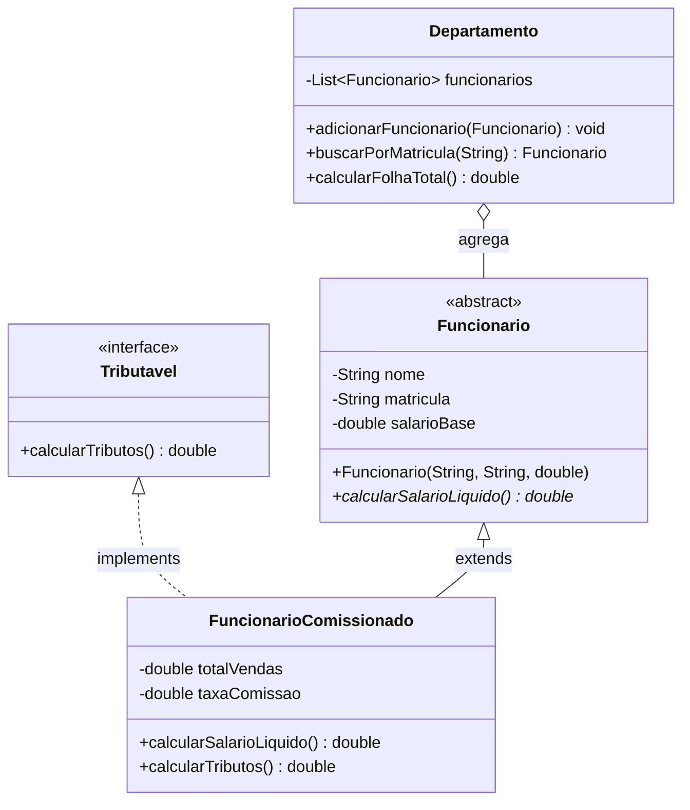

#### Regra de Negócio: Cálculo de Remuneração e Tributação

Para o colaborador comissionado, a remuneração líquida considera o salário-base somado ao produto das vendas pela alíquota percentual:

```math
\text{Salário Líquido} = \text{salarioBase} + \left( \text{totalVendas} \times \frac{\text{taxaComissao}}{100} \right)
```

E os tributos devidos ao fisco incidem à alíquota de 11% sobre o faturamento total gerado:

```math
\text{Tributos} = \text{Salário Líquido} \times 0{,}11
```

---

## Apêndices e Instrumentos de Consulta

### Mapa Conceitual Integrado da Disciplina

```mermaid
mindmap
  root("Laboratório de Programação III")
    "Ecossistema e Ambiente"
      "JDK 17 LTS (Adoptium Temurin)"
      "Apache Tomcat 9 (Namespace javax)"
      "Apache NetBeans 24 (Ant Build)"
    "Camada de Apresentação (View)"
      "JSP (Compilação Jasper)"
      "JSTL (Core c e Formatting fmt)"
      "Fragmentos (header, menu, footer)"
      "Expression Language (contextPath)"
      "Frontend (jQuery, Mask, DataTables, SweetAlert2)"
    "Camada de Controle (Controller)"
      "HttpServlet (doGet e doPost)"
      "Anotação @WebServlet"
      "RequestDispatcher (forward vs redirect)"
      "Servlet Filters (Filtro Global e Transações)"
    "Camada de Negócio e Modelo (Model)"
      "JavaBeans e POJOs"
      "Encapsulamento e Invariantes"
      "Contratos (equals e hashCode)"
    "Camada de Acesso a Dados (Persistência)"
      "PostgreSQL e pgAdmin 4"
      "SingleConnection (Padrão Singleton)"
      "GenericDAO e DAOs Especializados"
      "JDBC (PreparedStatement e ResultSet)"
      "Controle Transacional Manual (ACID)"
```

---

### Glossário de Termos Técnicos

- **ACID (Atomicidade, Consistência, Isolamento e Durabilidade):** Conjunto canônico de propriedades que garantem que transações em banco de dados relacional sejam processadas com total confiabilidade.
- **Adoptium (Eclipse Temurin):** Projeto de código aberto mantido pela Fundação Eclipse que fornece binários certificados do OpenJDK com suporte de longo prazo (LTS).
- **Apache Ant:** Ferramenta de automação de compilação baseada em arquivos XML (`build.xml`) integrada nativamente ao NetBeans.
- **Apache Tomcat:** Servidor web e contêiner de servlets de código aberto que implementa as especificações Java Servlet, JSP e Expression Language.
- **Bytecode:** Conjunto de instruções intermediárias geradas pelo compilador `javac` (.class) destinadas à execução pela Máquina Virtual Java.
- **DAO (Data Access Object):** Padrão de projeto estrutural que encapsula o acesso à base de dados, isolando a camada de negócio de particularidades da tecnologia de persistência.
- **Expression Language (EL):** Linguagem de expressão concisa (`${expressao}`) criada para simplificar o acesso a atributos armazenados nos escopos web Java.
- **HotSpot JIT (Just-In-Time):** Compilador interno da JVM que identifica trechos de código executados frequentemente (*hotspots*) e os converte em código de máquina nativo.
- **Jakarta EE:** Nome contemporâneo da plataforma corporativa Java, após sua doação pela Oracle à Eclipse Foundation.
- **JavaBean:** Convenção padrão da linguagem Java que estabelece classes com atributos privados, construtor sem argumentos, métodos seletores/modificadores e serialização.
- **JSP (JavaServer Pages):** Tecnologia de visão que permite escrever código HTML intercalado com tags especiais processadas no servidor.
- **JSTL (JavaServer Pages Standard Tag Library):** Biblioteca padronizada de tags XML que provê estruturas de controle de fluxo, repetição e formatação para páginas JSP.
- **Módulo 11:** Algoritmo matemático ponderado utilizado no Brasil para o cálculo dos Dígitos Verificadores (DV) de documentos federais (CPF e CNPJ).
- **MVC (Model-View-Controller):** Padrão de arquitetura de software que separa o sistema em três componentes fundamentais: Modelo, Visão e Controlador.
- **Padrão PRG (Post-Redirect-Get):** Padrão de design para formulários web no qual requisições de escrita (`POST`) respondem com redirecionamento HTTP 302, evitando submissões duplicadas por recarregamento da página.
- **PreparedStatement:** Objeto da API JDBC que compila previamente instruções SQL no banco de dados, permitindo a passagem parametrizada e imune a ataques de *SQL Injection*.
- **ResultSet:** Cursor de dados que permite iterar pelas linhas de resultados retornadas por uma consulta SQL no banco de dados.
- **Servlet:** Classe Java gerenciada por um contêiner web que processa requisições HTTP e constrói respostas dinâmicas.
- **Servlet Filter:** Componente da especificação Servlet que intercepta requisições e respostas HTTP para fins de segurança, auditoria, compressão e controle transacional.
- **Singleton:** Padrão de projeto de criação que restringe a instanciação de uma classe a uma única ocorrência em toda a memória da aplicação.
- **vtable (Virtual Method Table):** Estrutura interna utilizada pela JVM para resolução dinâmica de métodos polimórficos em tempo de execução (*late binding*).

---

### Banco de Questões de Fixação com Gabarito Comentado

#### Questão 01
**Enunciado:** No desenvolvimento de aplicações Java Web corporativas utilizando a especificação Java EE 8, por que a adoção do servidor Apache Tomcat 10 acarreta erros fatais de inicialização em projetos estruturados sobre `javax.servlet.*`?
- **Resposta comentada:** O Apache Tomcat 10 adota formalmente a especificação Jakarta EE 9+, que realizou a migração definitiva de todos os pacotes das APIs corporativas do namespace histórico `javax.*` para `jakarta.*`. Como as dependências e o código-fonte de projetos Java EE 8 utilizam classes sob `javax.servlet.*` e tags JSTL legadas, o carregador de classes do Tomcat 10 é incapaz de localizar essas interfaces, disparando exceções de classe não encontrada (`ClassNotFoundException`) ou falhas no descritor de implantação. A versão homologada para a especificação Java EE 8 é o Apache Tomcat 9.

#### Questão 02
**Enunciado:** Explique a relevância arquitetural do método `conexao.setAutoCommit(false)` na classe `SingleConnection` e descreva como ele viabiliza a conformidade com as propriedades ACID.
- **Resposta comentada:** Por padrão, o driver JDBC opera em modo `autoCommit(true)`, gravando e confirmando cada instrução SQL individualmente no banco de dados. Ao invocar `setAutoCommit(false)`, o desenvolvedor desativa essa confirmação automática e assume o controle manual da transação. Isso permite agregar múltiplas operações de escrita (como salvar um cabeçalho de pedido e seus itens) em um bloco atômico. Se todos os comandos tiverem sucesso, aciona-se `conexao.commit()`; se ocorrer qualquer falha (`SQLException`), aciona-se `conexao.rollback()`, garantindo que o banco de dados nunca permaneça em estado inconsistente ou parcialmente gravado.

#### Questão 03
**Enunciado:** No padrão MVC adaptado para a plataforma Java Web, qual é a diferença operacional entre `RequestDispatcher.forward()` e `HttpServletResponse.sendRedirect()`, e em quais cenários cada um deve ser aplicado?
- **Resposta comentada:** O método `forward(request, response)` executa um despacho puramente interno no servidor. O contêiner transfere o processamento para o recurso de destino (ex.: um arquivo JSP) mantendo intactos os objetos originais de requisição e resposta, o que permite o compartilhamento de atributos inseridos via `request.setAttribute()`. A URL exibida na barra do navegador não é alterada. Já o `sendRedirect(url)` emite uma resposta HTTP de redirecionamento (status 302 Found) contendo o cabeçalho `Location`. Ao receber esse cabeçalho, o navegador realiza uma **nova requisição HTTP GET** totalmente independente para o novo endereço, descartando o escopo de requisição anterior. O `forward` é ideal para enviar coleções de listagem para exibição imediata na visão; o `sendRedirect` é indispensável em operações de escrita (padrão Post-Redirect-Get) para impedir submissões duplicadas de formulários.

#### Questão 04
**Enunciado:** Por que a modelagem de campos monetários em bancos de dados e sistemas Java corporativos jamais deve empregar o tipo de ponto flutuante `double` ou `FLOAT`?
- **Resposta comentada:** Os tipos `FLOAT` (no SQL) e `double` (no Java) seguem a norma IEEE 754 de representação numérica binária em ponto flutuante. Determinadas frações decimais finitas (como $`0{,}10`$ ou $`0{,}05`$) tornam-se dízimas periódicas infinitas na base binária, provocando erros residuais e imprecisão acumulada em sucessivas operações aritméticas (como acréscimo de juros ou rateio). Para aplicações contábeis e comerciais onde cada centavo deve ser exato, é mandatório utilizar `DECIMAL(p, s)` ou `NUMERIC(p, s)` no SGBD e a classe `java.math.BigDecimal` no Java.

#### Questão 05
**Enunciado:** Descreva detalhadamente o algoritmo do Módulo 11 aplicado ao cálculo do primeiro dígito verificador ($`d_1`$) de um Cadastro de Pessoas Físicas (CPF).
- **Resposta comentada:** O cálculo considera os 9 primeiros dígitos do documento ($`c_0, c_1, \dots, c_8`$). Multiplica-se cada um deles por pesos inteiros decrescentes iniciando em 10 até 2, acumulando a soma:
```math
S_1 = (c_0 \times 10) + (c_1 \times 9) + (c_2 \times 8) + \dots + (c_8 \times 2)
```
Em seguida, calcula-se o resto da divisão inteira dessa soma por 11:
```math
R_1 = S_1 \pmod{11}
```
A regra oficial determina que se a diferença $`11 - R_1`$ for maior que 9, o dígito verificador $`d_1`$ será compulsoriamente 0. Caso contrário, o dígito será o próprio resultado da subtração:
```math
d_1 = (11 - R_1 > 9) \;?\; 0 : (11 - R_1)
```

---

### Checklist de Qualidade e Auditoria de Software

Antes de submeter projetos, atividades práticas ou realizar deploys de homologação na disciplina de Laboratório de Programação III, verifique o cumprimento estrito dos seguintes itens de conformidade arquitetural:

- [ ] **Compatibilidade de Ambiente:** A compilação é realizada sob o JDK 17 LTS e o contêiner de execução é o Apache Tomcat 9.0.x.
- [ ] **Higienização de Bibliotecas:** Todas as dependências (driver PostgreSQL, JSTL 1.2) residem estritamente em `WEB-INF/lib` sem conflitos de versões legadas.
- [ ] **Separação de Pacotes:** Nenhuma classe Java reside no pacote padrão (*default package*). A estrutura obedece à hierarquia `model`, `dao`, `controller`, `filter` e `utils`.
- [ ] **Encapsulamento de Entidades:** Todos os atributos dos JavaBeans são privados e acessíveis unicamente por getters e setters públicos padronizados.
- [ ] **Contratos de Identidade:** Todas as entidades de modelo sobrescrevem formalmente os métodos `equals()` e `hashCode()` baseando-se em suas chaves naturais ou primárias.
- [ ] **Segurança SQL:** Nenhuma instrução SQL na camada DAO utiliza concatenação de strings para passagem de variáveis. O uso de `PreparedStatement` com parâmetros posicionais (`?`) é universal.
- [ ] **Gestão de Recursos JDBC:** Todos os objetos `ResultSet`, `PreparedStatement` e conexões são devidamente encerrados em blocos `finally` ou via blocos `try-with-resources`.
- [ ] **Controle Transacional:** Operações de escrita na base de dados relacional gerenciam explicitamente `commit()` e `rollback()` dentro de estruturas `try-catch`.
- [ ] **Ausência de Scriptlets:** Nenhuma página JSP do projeto contém código Java embutido em tags `<% ... %>`. Toda a renderização dinâmica utiliza JSTL e Expression Language (`${...}`).
- [ ] **Resolução Absoluta de Rotas:** Todos os links de folhas de estilo, scripts e formulários utilizam o prefixo dinâmico `${pageContext.request.contextPath}`.
- [ ] **Validação em Duas Camadas:** Documentos e campos obrigatórios são validados tanto no cliente (via jQuery e máscaras) quanto no servidor (via classes utilitárias e integridade relacional).

---

## Fontes e Metadados

- Turma no Classroom: 2026 1S Laboratório de Programação III
- Itens processados: 0 materiais, 6 tarefas, 6 avisos
- Gerado em: 28/10/2026, 20:00:52 (BRT) via classroom-sync
