# Manual Integrado de Engenharia de Software e Laboratório de Programação III

**Instituição:** Centro Universitário de Fernandópolis (UniFEF)  
**Curso:** Bacharelado em Sistemas de Informação (3º Semestre)  
**Disciplina:** Laboratório de Programação III  
**Docente Responsável:** Prof. Jefferson Passerini  

---

## Sumário

- [Apresentação e Diretrizes Metodológicas](#apresentação-e-diretrizes-metodológicas)
- [Módulo 1: Paradigma Orientado a Objetos Avançado e Engenharia de Domínio](#módulo-1-paradigma-orientado-a-objetos-avançado-e-engenharia-de-domínio)
  - [Encapsulamento Estrito e Defesa de Invariantes de Estado](#encapsulamento-estrito-e-defesa-de-invariantes-de-estado)
  - [Herança Estrutural e o Princípio de Substituição de Liskov](#herança-estrutural-e-o-princípio-de-substituição-de-liskov)
  - [Polimorfismo Dinâmico e Despacho de Métodos na JVM](#polimorfismo-dinâmico-e-despacho-de-métodos-na-jvm)
  - [Classes Abstratas versus Contratos Puros por Interfaces](#classes-abstratas-versus-contratos-puros-por-interfaces)
  - [Tipagem Forte com Generics e Gerenciamento de Coleções Dinâmicas](#tipagem-forte-com-generics-e-gerenciamento-de-coleções-dinâmicas)
  - [Arquitetura de Tratamento de Exceções de Domínio](#arquitetura-de-tratamento-de-exceções-de-domínio)
- [Módulo 2: Infraestrutura, Ecossistema Java EE e Arquitetura Monolítica](#módulo-2-infraestrutura-ecossistema-java-ee-e-arquitetura-monolítica)
  - [Pilha de Execução Java: JVM, JRE e JDK 17 LTS](#pilha-de-execução-java-jvm-jre-e-jdk-17-lts)
  - [O Servlet Container Apache Tomcat 9 e a Cisão de Namespaces](#o-servlet-container-apache-tomcat-9-e-a-cisão-de-namespaces)
  - [Ambiente de Desenvolvimento Integrado Apache NetBeans 24 e Automação Ant](#ambiente-de-desenvolvimento-integrado-apache-netbeans-24-e-automação-ant)
  - [Arquitetura de Monólitos Modulares Corporativos](#arquitetura-de-monólitos-modulares-corporativos)
  - [Organização Estrutural de Pacotes da Solução](#organização-estrutural-de-pacotes-da-solução)
- [Módulo 3: Camada de Apresentação Dinâmica com JSP, JSTL e Frontend](#módulo-3-camada-de-apresentação-dinâmica-com-jsp-jstl-e-frontend)
  - [Ciclo de Compilação e Tradução de JavaServer Pages](#ciclo-de-compilação-e-tradução-de-javaserver-pages)
  - [Modularização de Layout com Fragmentos de Visão](#modularização-de-layout-com-fragmentos-de-visão)
  - [Padronização de Interface com JSTL Core, JSTL Formatting e EL](#padronização-de-interface-com-jstl-core-jstl-formatting-e-el)
  - [Hierarquia e Dependência de Ativos de Frontend](#hierarquia-e-dependência-de-ativos-de-frontend)
  - [Algoritmos de Validação e Formatação de Documentos no Cliente](#algoritmos-de-validação-e-formatação-de-documentos-no-cliente)
- [Módulo 4: Camada de Persistência Relacional, JDBC e Padrões Estruturais](#módulo-4-camada-de-persistência-relacional-jdbc-e-padrões-estruturais)
  - [Modelagem Física e Administração do SGBD PostgreSQL](#modelagem-física-e-administração-do-sgbd-postgresql)
  - [Mapeamento de Tipos de Dados e Sequências Relacionais](#mapeamento-de-tipos-de-dados-e-sequências-relacionais)
  - [Padrão Criacional Singleton Aplicado à Conexão Única](#padrão-criacional-singleton-aplicado-à-conexão-única)
  - [Controle Transacional Explícito e as Propriedades ACID no JDBC](#controle-transacional-explícito-e-as-propriedades-acid-no-jdbc)
  - [Interceptação de Ciclo de Vida com Servlet Filters](#interceptação-de-ciclo-de-vida-com-servlet-filters)
  - [Engenharia Reversa e Depuração Estruturada na IDE](#engenharia-reversa-e-depuração-estruturada-na-ide)
- [Módulo 5: Arquitetura MVC e a Operação de Listagem de Entidades](#módulo-5-arquitetura-mvc-e-a-operação-de-listagem-de-entidades)
  - [A Entidade de Domínio Usuario e o Contrato JavaBean](#a-entidade-de-domínio-usuario-e-o-contrato-javabean)
  - [Padronização de Contratos de Persistência com GenericDAO](#padronização-de-contratos-de-persistência-com-genericdao)
  - [Implementação da DAO com PreparedStatement e Mapeamento Manual](#implementação-da-dao-com-preparedstatement-e-mapeamento-manual)
  - [O Controlador Servlet UsuarioListar e o Despacho Interno](#o-controlador-servlet-usuariolistar-e-o-despacho-interno)
  - [Apresentação Tabular Dinâmica Enriquecida com DataTables](#apresentação-tabular-dinâmica-enriquecida-com-datatables)
- [Módulo 6: Manutenção Cadastral Completa, Validações e Operações Assíncronas](#módulo-6-manutenção-cadastral-completa-validações-e-operações-assíncronas)
  - [Bifurcação de Persistência Baseada no Identificador de Chave Primária](#bifurcação-de-persistência-baseada-no-identificador-de-chave-primária)
  - [Verificação Prévia de Unicidade de Dados na Base](#verificação-prévia-de-unicidade-de-dados-na-base)
  - [Validador Numérico Estático de Documentos Nacionais](#validador-numérico-estático-de-documentos-nacionais)
  - [Servlets Especializados para Inicialização e Cadastro](#servlets-especializados-para-inicialização-e-cadastro)
  - [Comunicação Assíncrona com jQuery AJAX e SweetAlert](#comunicação-assíncrona-com-jquery-ajax-e-sweetalert)
  - [Recuperação Pontual de Registro para Atualização Cadastral](#recuperação-pontual-de-registro-para-atualização-cadastral)
- [Módulo 7: Projetos Aplicados da Disciplina](#módulo-7-projetos-aplicados-da-disciplina)
  - [Trabalho de Programação: Cadastro e Manutenção de Livros](#trabalho-de-programação-cadastro-e-manutenção-de-livros)
  - [Trabalho de Programação: Cadastro Federativo de Estados](#trabalho-de-programação-cadastro-federativo-de-estados)
- [Módulo 8: Matriz de Avaliações Formativas e Somativas](#módulo-8-matriz-de-avaliações-formativas-e-somativas)
  - [Avaliação 1: Modelagem Orientada a Objetos e Regras de Negócio](#avaliação-1-modelagem-orientada-a-objetos-e-regras-de-negócio)
  - [Avaliação 2: Sistema CRUD de Produtos com JDBC e Tratamento Defensivo](#avaliação-2-sistema-crud-de-produtos-com-jdbc-e-tratamento-defensivo)
  - [Avaliação Substitutiva: Hierarquia Corporativa, Interfaces e Ordenação](#avaliação-substitutiva-hierarquia-corporativa-interfaces-e-ordenação)
- [Módulo 9: Banco de Questões de Fixação e Simulado](#módulo-9-banco-de-questões-de-fixação-e-simulado)
- [Módulo 10: Glossário Terminológico e Checklist Arquitetural](#módulo-10-glossário-terminológico-e-checklist-arquitetural)

---

## Apresentação e Diretrizes Metodológicas

Este material consolida de forma rigorosa, exaustiva e estruturada a base técnica e conceitual da disciplina de **Laboratório de Programação III**, ministrada pelo **Prof. Jefferson Passerini** no 3º semestre do curso de Sistemas de Informação da **UniFEF**.

A abordagem pedagógica do curso visa capacitar os estudantes a projetarem e desenvolverem sistemas corporativos robustos, seguros e escaláveis. O percurso formativo parte do aprofundamento das fundações de Orientação a Objetos na linguagem Java, transita pela modelagem e manipulação física de bancos relacionais com o PostgreSQL, e culmina na construção de aplicações corporativas baseadas na especificação Java EE 8 Web (Servlets, JSP, JSTL e filtros), implementando o padrão arquitetural MVC (*Model-View-Controller*).

Cada tópico apresentado neste manual segue uma estrutura formal de engenharia:
1. **Definição Teórica**: Conceituação formal e fundamentação acadêmica.
2. **Motivação Arquitetural**: Análise de por que o padrão ou tecnologia é adotado pela indústria.
3. **Exemplo Prático**: Implementação completa, comentada e aderente às regras de produção.
4. **Contraexemplo**: Apresentação de implementações incorretas ou anti-patterns comuns.
5. **Armadilhas de Engenharia**: Riscos ocultos, problemas de concorrência, brechas de segurança e falhas sutis de memória ou recursos.

---

## Módulo 1: Paradigma Orientado a Objetos Avançado e Engenharia de Domínio

### Encapsulamento Estrito e Defesa de Invariantes de Estado

#### Definição
O encapsulamento é o mecanismo estrutural que oculta a representação interna de um objeto e impede que estados inconsistentes sejam estabelecidos a partir de agentes externos. Um invariante de estado é uma condição lógica ou regra de negócio que deve permanecer estritamente verdadeira durante todo o ciclo de vida da instância na memória heap, desde a finalização de seu construtor até sua coleta pelo coletor de lixo (*Garbage Collector*).

#### Motivação Arquitetural
Em sistemas corporativos, permitir o acesso público direto aos atributos de uma entidade (ou gerar métodos seletores e modificadores sem qualquer camada de crítica) destrói as garantias transacionais do software. Se um campo financeiro como salário puder receber valores negativos ou nulos por uma instrução direta de atribuição, erros graves de coerência contábil se propagarão silenciosamente até a emissão de relatórios ou comunicação com serviços externos.

#### Exemplo Prático
A classe `Funcionario` implementa validação defensiva imediata (*fail-fast*) em seu construtor e em seus métodos modificadores, assegurando que nenhum objeto com dados inválidos venha a existir na JVM.

```java
package br.com.unifef.dominio;

public class Funcionario {
    private String nome;
    private int matricula;
    private double salarioBase;

    public Funcionario(String nome, int matricula, double salarioBase) {
        this.setNome(nome);
        this.setMatricula(matricula);
        this.setSalarioBase(salarioBase);
    }

    public String getNome() {
        return this.nome;
    }

    public void setNome(String nome) {
        if (nome == null || nome.trim().isEmpty()) {
            throw new IllegalArgumentException("Violacao de invariante: O nome nao pode ser nulo ou vazio.");
        }
        this.nome = nome.trim();
    }

    public int getMatricula() {
        return this.matricula;
    }

    public void setMatricula(int matricula) {
        if (matricula <= 0) {
            throw new IllegalArgumentException("Violacao de invariante: A matricula deve ser estritamente positiva.");
        }
        this.matricula = matricula;
    }

    public double getSalarioBase() {
        return this.salarioBase;
    }

    public void setSalarioBase(double salarioBase) {
        if (salarioBase <= 0.0) {
            throw new IllegalArgumentException("Violacao de invariante: O salario base deve ser maior que zero.");
        }
        this.salarioBase = salarioBase;
    }

    public double calcularRemuneracaoLiquida() {
        return this.salarioBase;
    }
}
```

#### Contraexemplo
O código abaixo exemplifica o anti-pattern conhecido como **Modelo Anêmico** associado à exposição de atributos:

```java
// Anti-pattern: Ausência total de encapsulamento
public class FuncionarioVulneravel {
    public String nome;
    public int matricula;
    public double salarioBase;
}

// Em qualquer ponto da aplicação:
FuncionarioVulneravel f = new FuncionarioVulneravel();
f.nome = ""; // Inválido
f.matricula = -99; // Inconsistente
f.salarioBase = -1500.00; // Anomalia financeira grave
```

#### Armadilhas de Engenharia
- **Getters e Setters Cegos**: O uso automático de atalhos da IDE para gerar métodos de acesso para todos os campos sem análise de domínio cria apenas uma ilusão de encapsulamento. Se o modificador aceita qualquer valor sem validação, o estado continua vulnerável.
- **Vazamento de Referências Mutáveis**: Retornar referências diretas a objetos mutáveis como `java.util.Date` ou coleções permite que o código chamador altere o estado interno do objeto contêiner sem passar pelos seus métodos modificadores. A solução exige o retorno de cópias defensivas (`new Date(data.getTime())` ou `Collections.unmodifiableList(...)`).

---

### Herança Estrutural e o Princípio de Substituição de Liskov

#### Definição
A herança é um mecanismo de especialização e reúso onde uma subclasse adquire propriedades e operações de uma superclasse, estabelecendo uma relação ontológica do tipo "É-UM" (*is-a*). O **Princípio de Substituição de Liskov (LSP)**, formulado por Barbara Liskov, estipula que se $`S`$ é um subtipo de $`T`$, então objetos do tipo $`T`$ podem ser substituídos por objetos do tipo $`S`$ sem alterar nenhuma propriedade desejável do programa (como exatidão, comportamento e estabilidade).

#### Motivação Arquitetural
A herança permite consolidar definições comuns em superclasses estáveis e estender o comportamento por polimorfismo. Contudo, seu uso inadequado acopla fortemente os componentes da arquitetura. A observância estrita do LSP garante que módulos de alto nível possam consumir abstrações de forma previsível, sem precisar inspecionar a classe concreta em tempo de execução.

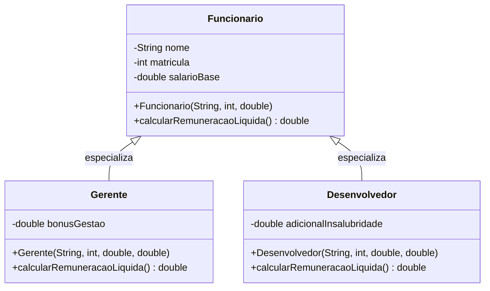

#### Exemplo Prático
Sobrescrita consistente de métodos utilizando a palavra-chave `super` para compor o comportamento da classe base:

```java
package br.com.unifef.dominio;

public class Gerente extends Funcionario {
    private double bonusGestao;

    public Gerente(String nome, int matricula, double salarioBase, double bonusGestao) {
        super(nome, matricula, salarioBase);
        this.setBonusGestao(bonusGestao);
    }

    public double getBonusGestao() {
        return this.bonusGestao;
    }

    public void setBonusGestao(double bonusGestao) {
        if (bonusGestao < 0.0) {
            throw new IllegalArgumentException("Violacao de invariante: O bonus nao pode ser negativo.");
        }
        this.bonusGestao = bonusGestao;
    }

    @Override
    public double calcularRemuneracaoLiquida() {
        return super.calcularRemuneracaoLiquida() + this.bonusGestao;
    }
}
```

#### Contraexemplo
Violação frontal do Princípio de Substituição de Liskov:

```java
public class Estagiario extends Funcionario {
    public Estagiario(String nome, int matricula, double salarioBase) {
        super(nome, matricula, salarioBase);
    }

    @Override
    public double calcularRemuneracaoLiquida() {
        // Violação de LSP: Lança uma exceção onde o contrato original previa um valor numérico
        throw new UnsupportedOperationException("Estagiarios recebem bolsa auxilio e nao possuem salario calculado aqui.");
    }
}
```

#### Armadilhas de Engenharia
- **Herança por Conveniência**: Estender uma classe apenas para reaproveitar linhas de código utilitárias sem que haja relação semântica de "É-UM" (exemplo clássico: fazer uma classe de regra de negócio herdar de `java.util.ArrayList`). A composição e a injeção de dependência devem sempre ter precedência sobre a herança.

---

### Polimorfismo Dinâmico e Despacho de Métodos na JVM

#### Definição
Polimorfismo é a capacidade de tratar objetos de diferentes tipos concretos por meio de uma interface ou referência de tipo comum. Em tempo de execução, a chamada a um método sobrescrito é resolvida dinamicamente através do mecanismo de **Ligação Tardia** (*Dynamic Dispatch* ou *Late Binding*).

#### Motivação Arquitetural
O polimorfismo elimina a necessidade de estruturas condicionais encadeadas (`if-else` ou `switch-case`) baseadas em tipos. Ele viabiliza o **Princípio Aberto/Fechado (OCP)** de Bertrand Meyer: módulos de software devem estar abertos para extensão (criação de novas classes especializadas), mas fechados para modificação (os clientes da abstração não sofrem alterações).

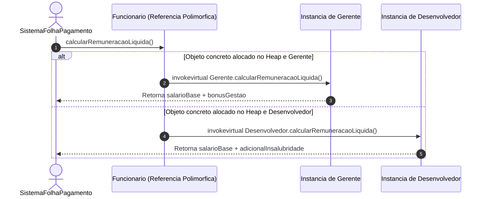

#### Mecanismo Interno da JVM
Quando a JVM compila o código Java para bytecode, a invocação de um método de instância polimórfico gera a instrução `invokevirtual`. Durante a execução, a JVM consulta a tabela virtual de métodos da classe concreta (*vtable*), localizada na memória de metadados, identificando o endereço exato da implementação que deve ser executada para aquela instância específica alocada no heap.

#### Exemplo Prático
Processamento genérico de folha de pagamento:

```java
package br.com.unifef.servico;

import br.com.unifef.dominio.Funcionario;
import java.util.List;

public class CalculadoraFolhaPagamento {

    public double totalizarFolha(List<Funcionario> colaboradores) {
        if (colaboradores == null) {
            throw new IllegalArgumentException("A colecao de colaboradores nao pode ser nula.");
        }
        double montanteTotal = 0.0;
        for (Funcionario f : colaboradores) {
            // Despacho polimórfico: a JVM decide qual versão de calcularRemuneracaoLiquida() chamar
            montanteTotal += f.calcularRemuneracaoLiquida();
        }
        return montanteTotal;
    }
}
```

#### Contraexemplo
Uso incorreto de inspeção de tipos (`instanceof`) para controle de fluxo:

```java
// Anti-pattern: Quebra total do polimorfismo e do OCP
public double calcularAntiPattern(Funcionario f) {
    if (f instanceof Gerente) {
        Gerente g = (Gerente) f;
        return g.getSalarioBase() + g.getBonusGestao();
    } else if (f instanceof Desenvolvedor) {
        Desenvolvedor d = (Desenvolvedor) f;
        return d.getSalarioBase() + d.getAdicionalInsalubridade();
    }
    return f.getSalarioBase();
}
```

#### Armadilhas de Engenharia
- **Sobrecarga versus Sobrescrita**: Confundir a sobreposição de métodos (`@Override`, com assinatura exatamente igual na hierarquia) com a sobrecarga (*overloading*, métodos de mesmo nome com assinaturas de parâmetros distintas). A sobrecarga é resolvida estaticamente em tempo de compilação (*early binding*), enquanto a sobrescrita é resolvida dinamicamente em tempo de execução.

---

### Classes Abstratas versus Contratos Puros por Interfaces

#### Definição
- **Classe Abstrata**: Molde incompleto de uma classe, marcado com `abstract`, que não pode ser instanciado diretamente. Pode conter estado interno (atributos de instância), construtores protegidos, métodos concretos implementados e métodos abstratos sem corpo.
- **Interface**: Contrato formal que especifica um conjunto de operações que uma classe deve fornecer. Até o Java 7, interfaces podiam conter unicamente métodos públicos e abstratos e constantes globais (`public static final`). Do Java 8 em diante, passaram a admitir métodos utilitários estáticos e métodos concretos marcados com `default`.

#### Comparativo Técnico

| Critério | Classe Abstrata | Interface |
| :--- | :--- | :--- |
| **Mecanismo de Instanciação** | Proibido diretamente via operador `new`. | Proibido diretamente via operador `new`. |
| **Herança Múltipla** | Não permitida (Java adota herança simples de classes). | Permitida (uma classe pode implementar múltiplas interfaces). |
| **Estado de Instância** | Permite declarar atributos privados, protegidos e mutáveis. | Proibido (qualquer atributo declarado é `public static final`). |
| **Construtores** | Possui construtores para inicializar o estado da superclasse. | Não possui construtores. |
| **Papel na Arquitetura** | Reúso de código base e identidade ontológica estrutural. | Definição de capacidades comportamentais desacopladas. |

#### Exemplo Prático
Definição de contrato de tributação independente da hierarquia funcional de colaboradores:

```java
package br.com.unifef.contrato;

public interface Tributavel {
    double calcularTributos();
}
```

Implementação do contrato em uma subclasse específica:

```java
package br.com.unifef.dominio;

import br.com.unifef.contrato.Tributavel;

public class FuncionarioComissionado extends Funcionario implements Tributavel {
    private double totalVendas;
    private double percentualComissao;

    public FuncionarioComissionado(String nome, int matricula, double salarioBase, 
                                   double totalVendas, double percentualComissao) {
        super(nome, matricula, salarioBase);
        this.setTotalVendas(totalVendas);
        this.setPercentualComissao(percentualComissao);
    }

    public double getTotalVendas() { return this.totalVendas; }
    public void setTotalVendas(double totalVendas) {
        if (totalVendas < 0.0) throw new IllegalArgumentException("Vendas nao podem ser negativas.");
        this.totalVendas = totalVendas;
    }

    public double getPercentualComissao() { return this.percentualComissao; }
    public void setPercentualComissao(double percentualComissao) {
        if (percentualComissao < 0.0 || percentualComissao > 100.0) {
            throw new IllegalArgumentException("Comissao fora do intervalo valido.");
        }
        this.percentualComissao = percentualComissao;
    }

    @Override
    public double calcularRemuneracaoLiquida() {
        return this.getSalarioBase() + (this.totalVendas * (this.percentualComissao / 100.0));
    }

    @Override
    public double calcularTributos() {
        // Alíquota fiscal incidente sobre o faturamento total gerado
        return this.calcularRemuneracaoLiquida() * 0.11;
    }
}
```

#### Armadilhas de Engenharia
- **Uso Excessivo de Métodos Default**: Inserir lógica complexa de negócios em métodos `default` dentro de interfaces confunde o papel da interface como contrato puro e reintroduz problemas clássicos de conflito de herança múltipla (*diamond problem*), exigindo desambiguação manual na classe concreta.

---

### Tipagem Forte com Generics e Gerenciamento de Coleções Dinâmicas

#### Definição
Generics é o recurso introduzido no Java 5 que viabiliza a parametrização de tipos em classes, interfaces e métodos. Ele permite que tipos (como classes do modelo) atuem como parâmetros na definição de estruturas de dados, transferindo a verificação de compatibilidade de tipos para o compilador.

#### Motivação Arquitetural
Antes dos Generics, estruturas de dados como `java.util.ArrayList` armazenavam exclusivamente referências para a classe base `java.lang.Object`. Essa abordagem exigia a realização de conversões forçadas de tipo (*casting* explícito) no momento da extração dos elementos, gerando riscos contínuos de falhas em tempo de execução do tipo `ClassCastException`.

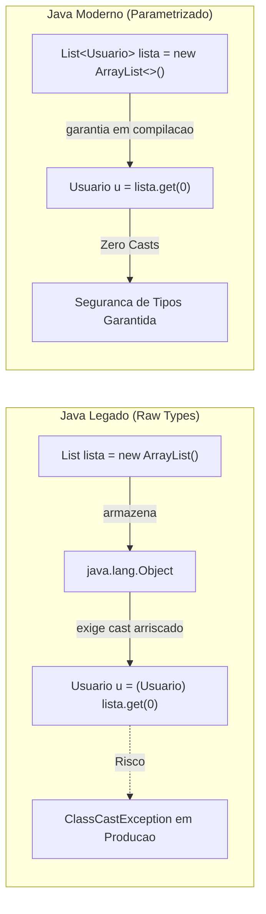

#### Ordenação de Coleções com Comparator
Para ordenar coleções em memória sem violar ou alterar a ordem natural da entidade original, emprega-se a interface funcional `java.util.Comparator`:

```java
package br.com.unifef.util;

import br.com.unifef.dominio.Funcionario;
import java.util.ArrayList;
import java.util.Comparator;
import java.util.List;

public class OrdenadorFuncionarios {

    public static List<Funcionario> ordenarPorSalarioDecrescente(List<Funcionario> original) {
        if (original == null) {
            throw new IllegalArgumentException("Lista de origem nao pode ser nula.");
        }
        // Criação de cópia rasa para não alterar a coleção receptora
        List<Funcionario> copia = new ArrayList<>(original);
        copia.sort(new Comparator<Funcionario>() {
            @Override
            public int compare(Funcionario f1, Funcionario f2) {
                return Double.compare(f2.calcularRemuneracaoLiquida(), f1.calcularRemuneracaoLiquida());
            }
        });
        return copia;
    }
}
```

---

### Arquitetura de Tratamento de Exceções de Domínio

#### Definição
O modelo de tratamento de erros da JVM estrutura-se a partir da classe raiz `java.lang.Throwable`, bifurcando-se em dois ramos essenciais:
1. **`java.lang.Error`**: Falhas catastróficas e irrecuperáveis do ambiente de execução (ex.: `OutOfMemoryError`, `StackOverflowError`).
2. **`java.lang.Exception`**: Anomalias operacionais que a aplicação pode interceptar e tratar.
   - **Exceções Verificadas (*Checked Exceptions*)**: Subclasses diretas de `Exception`. O compilador exige obrigatoriamente a declaração na assinatura do método (`throws`) ou seu tratamento explícito em bloco `try-catch`.
   - **Exceções Não-Verificadas (*Unchecked Exceptions*)**: Subclasses de `java.lang.RuntimeException`. Indicam falhas de codificação ou violações de pré-condições.

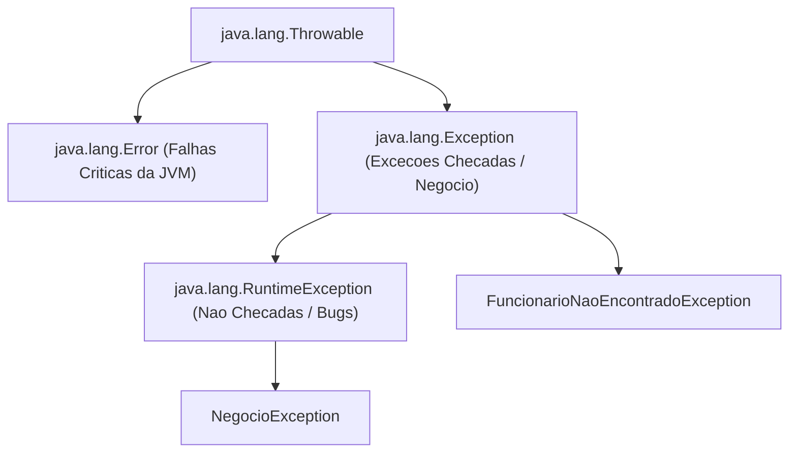

#### Exemplo Prático: Exceção Checada de Domínio
Utilizada para modelar uma situação em que o registro solicitado não consta na base de dados, obrigando a camada consumidora a tomar uma decisão alternativa de fluxo:

```java
package br.com.unifef.excecao;

public class FuncionarioNaoEncontradoException extends Exception {
    private static final long serialVersionUID = 1L;

    public FuncionarioNaoEncontradoException(String mensagem) {
        super(mensagem);
    }

    public FuncionarioNaoEncontradoException(String mensagem, Throwable causa) {
        super(mensagem, causa);
    }
}
```

---

## Módulo 2: Infraestrutura, Ecossistema Java EE e Arquitetura Monolítica

### Pilha de Execução Java: JVM, JRE e JDK 17 LTS

#### Definição Estrutural
O desenvolvimento e a execução de soluções na linguagem Java apoiam-se sobre três divisões conceituais interdependentes:
- **Java Virtual Machine (JVM)**: Processo abstrato que carrega arquivos `.class`, verifica a conformidade do bytecode perante as regras de segurança da linguagem e executa as instruções convertendo-as em código de máquina nativo por compilação *Just-In-Time* (JIT).
- **Java Runtime Environment (JRE)**: Pacote de distribuição voltado ao usuário final, contendo a JVM e o conjunto de bibliotecas essenciais da API padrão Java.
- **Java Development Kit (JDK)**: Ferramental completo de desenvolvimento, integrando o compilador (`javac`), utilitários de empacotamento (`jar`), documentador (`javadoc`) e depuradores.

Para o ambiente de desenvolvimento corporativo desta disciplina, adota-se o **Java 17 LTS** (*Long-Term Support*), sob a distribuição aberta **Eclipse Temurin** do projeto Adoptium. O suporte de longo prazo garante estabilidade operacional e estabilidade de APIs por múltiplos anos.

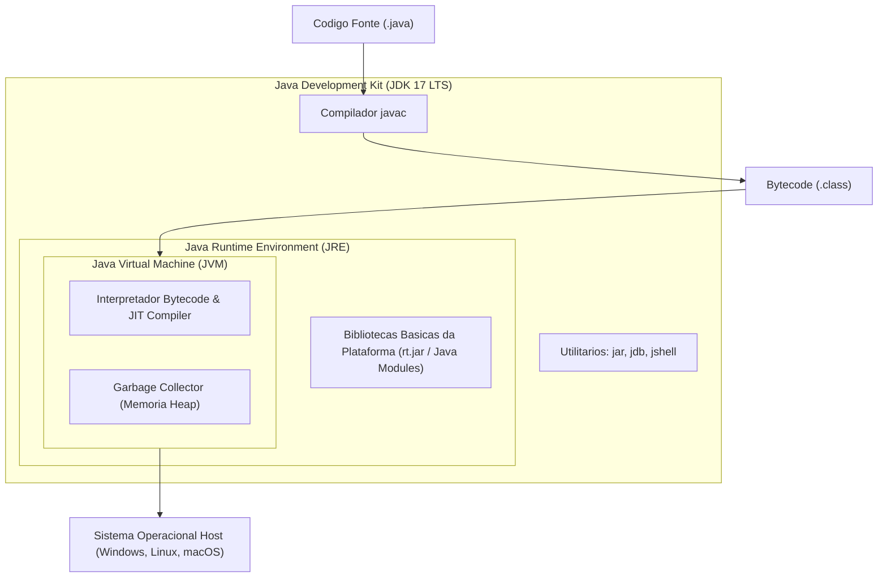

#### Auditoria de Instalação e Variáveis de Ambiente
Em ambiente de produção ou laboratório, as variáveis de ambiente devem ser configuradas no sistema operacional:
- `JAVA_HOME`: Apontando para o caminho raiz da instalação do JDK (ex.: `C:\Program Files\Eclipse Adoptium\jdk-17.0.13.11-hotspot`).
- `PATH`: Incluindo `%JAVA_HOME%\bin` para exposição global dos utilitários de linha de comando.

---

### O Servlet Container Apache Tomcat 9 e a Cisão de Namespaces

#### Definição
O Apache Tomcat é um ambiente de execução que implementa as especificações centrais da plataforma Java Enterprise: **Jakarta/Java Servlet**, **JavaServer Pages (JSP)** e **Expression Language (EL)**. Ele atua como um contêiner web leve (*Web Container*), provendo mecanismos de comunicação via protocolo HTTP, pooling de conexões de rede e gerenciamento do ciclo de vida dos componentes web.

#### O Problema da Transição Java EE para Jakarta EE (Tomcat 9 versus Tomcat 10+)
A evolução histórica do ecossistema corporativo Java introduziu uma ruptura de compatibilidade que exige atenção rigorosa de engenharia:
- Em 2017, a Oracle transferiu a custódia do Java EE para a **Eclipse Foundation**.
- Devido a direitos de propriedade intelectual da marca "Java", os pacotes de APIs padronizadas foram renomeados de `javax.*` para `jakarta.*`.
- O **Apache Tomcat 9** implementa a especificação **Java EE 8 Web Profile**, mantendo o namespace canônico `javax.servlet.*` e `javax.servlet.jsp.*`.
- O **Apache Tomcat 10+** implementa Jakarta EE 9+, exigindo o novo namespace `jakarta.servlet.*`.

> [!CAUTION]
> Toda a base estrutural, apostilas e dependências JSTL desta disciplina foram concebidas sobre a especificação **Java EE 8**. Caso o estudante instale o Apache Tomcat 10 ou superior, o contêiner falhará catastroficamente ao carregar a aplicação, lançando exceções imediatas de `ClassNotFoundException` e `NoClassDefFoundError` para todas as classes dependentes de `javax.servlet.*`.

---

### Ambiente de Desenvolvimento Integrado Apache NetBeans 24 e Automação Ant

O Apache NetBeans 24 constitui o ambiente de desenvolvimento adotado na disciplina. Mantido pela Apache Software Foundation, a IDE oferece suporte integrado de primeira linha para desenvolvimento web baseado na ferramenta de compilação **Apache Ant**.

O Apache Ant baseia-se em arquivos declarativos no formato XML (`build.xml`), estruturados sob os conceitos de:
- **Projetos (`project`)**: A raiz do artefato de software.
- **Alvos (`targets`)**: Metas de execução ordenadas (ex.: `clean`, `compile`, `dist`).
- **Tarefas (`tasks`)**: Ações operacionais atômicas, como compilar arquivos Java via `javac`, copiar recursos estáticos ou empacotar a aplicação em um arquivo `.war` (*Web Application Archive*).

---

### Arquitetura de Monólitos Modulares Corporativos

#### Definição
Uma aplicação monolítica unifica todas as camadas lógicas — apresentação visual, regras de negócio, serviços, controle de fluxo e persistência de dados — em uma única base de código implantada e executada como um processo singular dentro da JVM do servidor de aplicação.

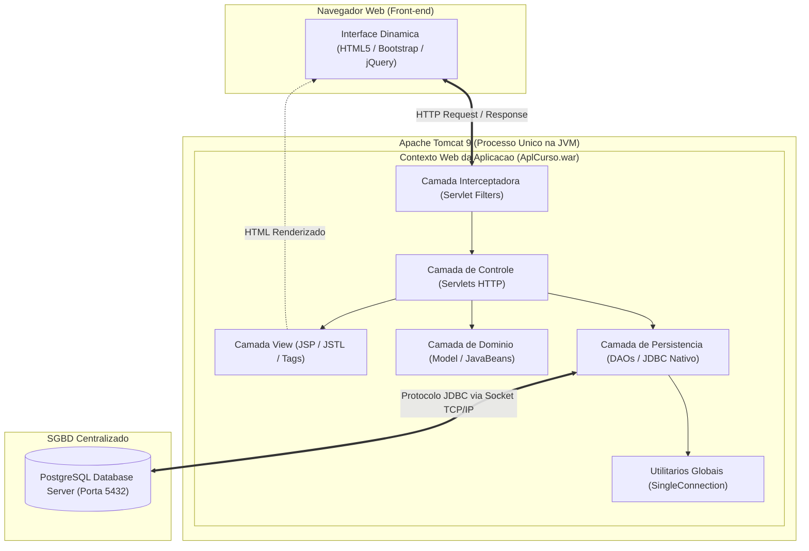

#### Justificativa da Abordagem
A adoção pedagógica e profissional do monólito modular para aplicações departamentais elimina a complexidade inerente aos sistemas distribuídos (microsserviços), eliminando desafios como:
- Falhas parciais de rede e latência de chamadas remotas (RPC/REST).
- Transações distribuídas de duas fases (*Two-Phase Commit*) ou orquestrações complexas via padrão Saga.
- Serialização excessiva de payloads JSON/Protocol Buffers.
- Dificuldade de auditoria e rastreamento de bugs através de múltiplos processos independentes.

---

### Organização Estrutural de Pacotes da Solução

Para preservar o isolamento de responsabilidades e permitir evolução sustentável, o código-fonte Java é distribuído estritamente sob uma árvore padronizada de pacotes corporativos dentro de `Source Packages`:

- `br.com.aplcurso.model`: Contém as classes JavaBean/POJO que encapsulam o modelo de domínio do sistema.
- `br.com.aplcurso.dao`: Contém as classes Data Access Object responsáveis pela manipulação direta do SQL e mapeamento relacional.
- `br.com.aplcurso.controller`: Subdividido por módulos operacionais (`controller.usuario`, `controller.estado`), abrigando os Servlets HTTP.
- `br.com.aplcurso.filter`: Abriga os filtros de interceptação e auditoria do ciclo de vida das requisições web.
- `br.com.aplcurso.utils`: Reúne componentes transversais, a fábrica de conexões (`SingleConnection`) e validadores de domínio.

---

## Módulo 3: Camada de Apresentação Dinâmica com JSP, JSTL e Frontend

### Ciclo de Compilação e Tradução de JavaServer Pages

#### Definição
JavaServer Pages (JSP) é uma tecnologia do Java EE que permite intercalar marcação estática (HTML, CSS, JavaScript) com fragmentos de código e tags dinâmicas executadas exclusivamente no lado servidor.

#### Ciclo de Vida do JSP na Engine Jasper do Tomcat
Ao receber uma requisição para um arquivo `.jsp` pela primeira vez, o Tomcat orquestra internamente um pipeline de compilação:
1. **Tradução**: A engine Jasper analisa o arquivo `.jsp` e gera um arquivo-fonte Java correspondente a uma Servlet padrão (geralmente estendendo `HttpJspBase`).
2. **Compilação**: O compilador Java embutido transforma o código-fonte `.java` gerado em um arquivo binário `.class`.
3. **Carga e Inicialização**: A classe é carregada na memória da JVM e seu método `jspInit()` é acionado.
4. **Execução de Serviço**: Para cada requisição concorrente, o contêiner despacha uma thread executando o método `_jspService(HttpServletRequest, HttpServletResponse)`.

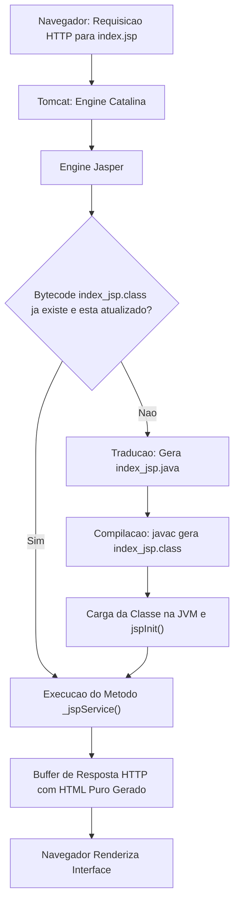

---

### Modularização de Layout com Fragmentos de Visão

#### Definição e Motivação
A construção de interfaces coesas exige consistência visual. Repetir declarações de metadados, links de folhas de estilo e estruturas de menu em todos os arquivos da aplicação viola o princípio **DRY (*Don't Repeat Yourself*)**. A solução consiste na fragmentação da página em componentes reutilizáveis integrados dinamicamente via `<jsp:include page="..." />`.

#### Estrutura de Inclusão da Aplicação

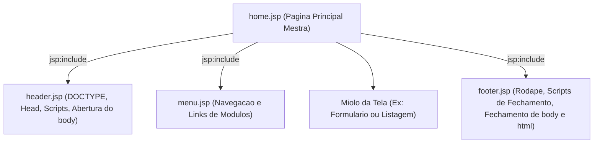

#### Análise Comparativa das Formas de Inclusão

| Critério | Inclusão Dinâmica (`<jsp:include>`) | Inclusão Estática (`<%@include file="" %>`) |
| :--- | :--- | :--- |
| **Momento de Execução** | Tempo de requisição (*Request-time*). | Tempo de tradução (*Translation-time*). |
| **Mecanismo Subjacente** | Invoca `RequestDispatcher.include()`. | Funde o código-fonte antes de compilar. |
| **Escopo de Variáveis** | Variáveis locais de um arquivo não vazam para o outro. | Compartilha o mesmo escopo de variáveis Java locais. |
| **Atualização em Disco** | Reflete alterações no fragmento na requisição seguinte. | Pode exigir recompilação forçada da página pai. |

---

### Padronização de Interface com JSTL Core, JSTL Formatting e EL

#### Definição
A **JSTL (*JavaServer Pages Standard Tag Library*)** e a **Expression Language (EL)** foram concebidas com a finalidade expressa de banir o uso de scriptlets (`<% ... %>`) do código de apresentação. Scriptlets tornam o documento ilegível, acoplam a visão com lógica procedural e abrem brechas de segurança para injeção de dados.

#### Diretivas Obrigatórias no Topo dos Documentos JSP
```jsp
<%@taglib prefix="c" uri="http://java.sun.com/jsp/jstl/core" %>
<%@taglib prefix="fmt" uri="http://java.sun.com/jsp/jstl/fmt" %>
```

- **Prefix `c` (Core)**: Estruturas de controle de fluxo de apresentação:
  - Condicionais: `<c:if test="${condicao}">`, `<c:choose>`, `<c:when>`, `<c:otherwise>`.
  - Iteração de coleções: `<c:forEach var="item" items="${colecao}">`.
- **Prefix `fmt` (Formatting)**: Formatação internacionalizada baseada no Locale:
  - Formatação monetária: `<fmt:formatNumber value="${valor}" type="currency" currencySymbol="R$" />`.
  - Formatação de datas: `<fmt:formatDate value="${data}" pattern="dd/MM/yyyy" />`.
- **Expression Language (EL)**: Avaliação declarativa de propriedades de objetos localizados nos escopos de página, requisição, sessão ou aplicação. A sintaxe `${pageContext.request.contextPath}` é essencial para evitar o uso de caminhos relativos frágeis (`../../`), resolvendo a URL canônica a partir da raiz do contexto da aplicação no contêiner.

---

### Hierarquia e Dependência de Ativos de Frontend

O arquivo `header.jsp` gerencia o carregamento de estilos e scripts seguindo uma ordem mandatória de dependências do DOM:

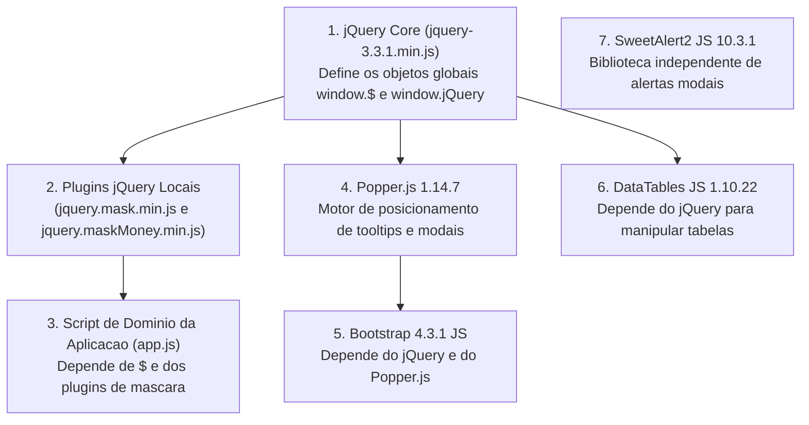

> [!WARNING]
> Violar essa ordem de inclusão (por exemplo, declarar `app.js` ou `bootstrap.min.js` antes de `jquery-3.3.1.min.js`) paralisa a renderização de scripts no navegador com a exceção clássica de JavaScript: `Uncaught ReferenceError: $ is not defined`.

---

### Algoritmos de Validação e Formatação de Documentos no Cliente

A integridade sintática dos documentos federativos brasileiros (CPF e CNPJ) apoia-se no algoritmo de verificação matemática por **Módulo 11**, concebido pela Receita Federal do Brasil.

#### Algoritmo do Módulo 11 para CPF
O Cadastro de Pessoas Físicas é composto por 11 dígitos decimais, representados matematicamente como:

````math
C = [d_1, d_2, d_3, d_4, d_5, d_6, d_7, d_8, d_9, d_{10}, d_{11}]
````

1. **Rejeição Preliminar**: Eliminação de formatos com comprimento diferente de 11 ou sequências homogêneas triviais (ex.: `000.000.000-00`, `111.111.111-11`, ..., `999.999.999-99`).
2. **Cálculo do Primeiro Dígito Verificador ($`d_{10}`$)**:
   - Somatório ponderado decrescente com pesos de 10 até 2:
   ````math
   S_1 = \sum_{i=1}^{9} d_i \times (11 - i)
   ````
   - Obtenção do resto de divisão inteira:
   ````math
   R_1 = S_1 \pmod{11}
   ````
   - Definição do dígito:
   ````math
   d_{10} = \begin{cases} 0, & \text{se } R_1 < 2 \\ 11 - R_1, & \text{se } R_1 \ge 2 \end{cases}
   ````
3. **Cálculo do Segundo Dígito Verificador ($`d_{11}`$)**:
   - Somatório ponderado incluindo o primeiro dígito verificador apurado, com pesos de 11 até 2:
   ````math
   S_2 = \sum_{i=1}^{10} d_i \times (12 - i)
   ````
   - Obtenção do resto de divisão inteira:
   ````math
   R_2 = S_2 \pmod{11}
   ````
   - Definição do dígito:
   ````math
   d_{11} = \begin{cases} 0, & \text{se } R_2 < 2 \\ 11 - R_2, & \text{se } R_2 \ge 2 \end{cases}
   ````

#### Implementação de Alternância Dinâmica de Máscaras em `app.js`
No arquivo `app.js`, o campo de documento alterna sua máscara em tempo de execução dependendo da quantidade de caracteres preenchida pelo usuário:

```javascript
$(document).ready(function () {
    var options = {
        onKeyPress: function (cpfcnpj, e, field, options) {
            var masks = ['000.000.000-009', '00.000.000/0000-00'];
            var mask = (cpfcnpj.length > 14) ? masks[1] : masks[0];
            $('.cpf_cnpj').mask(mask, options);
        }
    };
    $('.cpf_cnpj').mask('000.000.000-009', options);

    // Inicialização da máscara monetária com prefixo nacional
    $(".campo-moeda").maskMoney({
        prefix: 'R$ ',
        allowNegative: false,
        thousands: '.',
        decimal: ',',
        affixesStay: false
    });
});
```

---

## Módulo 4: Camada de Persistência Relacional, JDBC e Padrões Estruturais

### Modelagem Física e Administração do SGBD PostgreSQL

O PostgreSQL é um Sistema Gerenciador de Banco de Dados Relacional Orientado a Objetos (SGBDRO) de código aberto amplamente utilizado no setor corporativo. Ele opera escutando conexões na porta padrão TCP `5432`.

A ferramenta de administração visual é o **pgAdmin 4**. Um comportamento operacional recorrente na ferramenta consiste na necessidade de acionar explicitamente a opção **Refresh** na árvore do catálogo de objetos (`Databases`) após a execução de comandos DDL externos, pois a árvore de esquema não se sincroniza automaticamente.

---

### Mapeamento de Tipos de Dados e Sequências Relacionais

A persistência do modelo relacional exige a correspondência rigorosa entre os tipos de dados do PostgreSQL e os tipos de dados da plataforma Java SE:

| Conceito de Negócio | Coluna PostgreSQL | Tipo Primitivo / Classe Java | Motivação Técnica de Engenharia |
| :--- | :--- | :--- | :--- |
| **Identificador Primário** | `SERIAL` (`INTEGER`) | `int` ou `Integer` | Chave primária substituta associada a um gerador de sequência atômico (`SEQUENCE`). |
| **Cadeia de Texto Variável** | `VARCHAR(100)` | `String` | Texto alfanumérico com controle de tamanho máximo em nível de banco. |
| **Data Calendarizada** | `DATE` | `java.util.Date` / `java.sql.Date` | Armazena ano, mês e dia sem componente de fuso horário ou horas. |
| **Valores Monetários** | `DECIMAL(15,2)` | `double` ou `BigDecimal` | Tipo numérico exato de ponto fixo. **Proibido usar FLOAT ou REAL** devido a imprecisão binária da IEEE 754. |

#### O Mecanismo do Pseudo-Tipo SERIAL
Ao definir uma coluna como `id SERIAL PRIMARY KEY`, o motor do PostgreSQL cria internamente uma sequência gerenciada de forma atômica e vincula o valor default da coluna à função `nextval`:

```sql
CREATE SEQUENCE usuario_id_seq;
CREATE TABLE usuario (
    id INTEGER NOT NULL DEFAULT nextval('usuario_id_seq'),
    nome VARCHAR(100) NOT NULL,
    CONSTRAINT pk_usuario PRIMARY KEY (id)
);
ALTER SEQUENCE usuario_id_seq OWNED BY usuario.id;
```

---

### Padrão Criacional Singleton Aplicado à Conexão Única

#### Definição
O padrão Singleton, formalizado pelo *Gang of Four* (GoF), garante que uma determinada classe possua **uma única instância física em memória** durante toda a vida útil da aplicação, disponibilizando um ponto de acesso global e estático para obtê-la.

#### Motivação Arquitetural
Abrir uma conexão física com um banco de dados relacional é uma operação computacionalmente onerosa. O processo envolve resolução de nomes por DNS, abertura de sockets de rede TCP/IP, negociação de handshake de segurança e autenticação de credenciais no SGBD. Criar uma nova conexão para cada consulta paralisa o servidor por esgotamento de recursos. No projeto acadêmico `AplCurso`, adota-se a classe `SingleConnection` para centralizar a conexão e controlar o estado transacional.

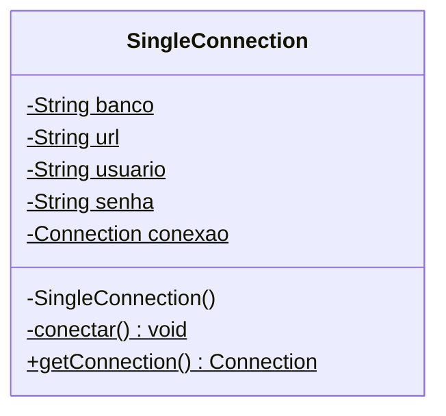

#### Implementação de Produção: `SingleConnection.java`

```java
package br.com.aplcurso.utils;

import java.sql.Connection;
import java.sql.DriverManager;
import java.sql.SQLException;

public class SingleConnection {

    private static final String BANCO = "bdaplcurso";
    private static final String URL = "jdbc:postgresql://localhost:5432/" + BANCO;
    private static final String USUARIO = "postgres";
    private static final String SENHA = "admin";
    private static final String DRIVER = "org.postgresql.Driver";
    
    private static Connection conexao = null;

    // Construtor privado impede instanciação externa acidental
    private SingleConnection() {
    }

    // Bloco de inicialização estático garante a carga da classe do Driver na JVM
    static {
        conectar();
    }

    private static void conectar() {
        try {
            if (conexao == null || conexao.isClosed()) {
                Class.forName(DRIVER);
                conexao = DriverManager.getConnection(URL, USUARIO, SENHA);
                // Desativação do commit automático para controle transacional estrito
                conexao.setAutoCommit(false);
            }
        } catch (ClassNotFoundException e) {
            System.err.println("Driver JDBC PostgreSQL ausente no classpath: " + e.getMessage());
        } catch (SQLException e) {
            System.err.println("Falha ao abrir conexao fisica com PostgreSQL: " + e.getMessage());
        }
    }

    public static Connection getConnection() {
        try {
            if (conexao == null || conexao.isClosed()) {
                conectar();
            }
        } catch (SQLException e) {
            System.err.println("Falha ao verificar status da conexao: " + e.getMessage());
        }
        return conexao;
    }
}
```

#### Armadilhas de Engenharia
- **Ambientes Concorrentes de Alto Tráfego**: Em ambientes reais de larga escala com centenas de requisições por segundo, o uso de uma **conexão física compartilhada única** causa contenção de threads (*lock contention*) e risco de conflito de transações sobrepostas. Nesses cenários corporativos, a evolução natural do Singleton de conexão é a adoção de um **Pool de Conexões** (como Apache Commons DBCP ou HikariCP), gerenciado via DataSource no servidor Tomcat.

---

### Controle Transacional Explícito e as Propriedades ACID no JDBC

#### As Propriedades ACID no Contexto Web
Uma transação corporativa representa uma unidade lógica indivisível de processamento:
- **Atomicidade**: Todas as operações do bloco transacional executam com sucesso ou nenhuma delas é persistida.
- **Consistência**: O banco transita exclusivamente de um estado válido para outro estado válido, respeitando todas as regras de integridade.
- **Isolamento**: Transações concorrentes não interferem de forma destrutiva no estado transacional intermediário de outras operações.
- **Durabilidade**: Uma vez confirmada a transação, seus efeitos persistem permanentemente no disco, sobrevivendo a quedas do servidor.

#### Controle Manual com `setAutoCommit(false)`
Por padrão de especificação da API JDBC, toda conexão recém-criada opera com `autoCommit` ativado (cada comando SQL individual é confirmado imediatamente e isoladamente). Para garantir atomicidade de múltiplos comandos, desativa-se essa flag:

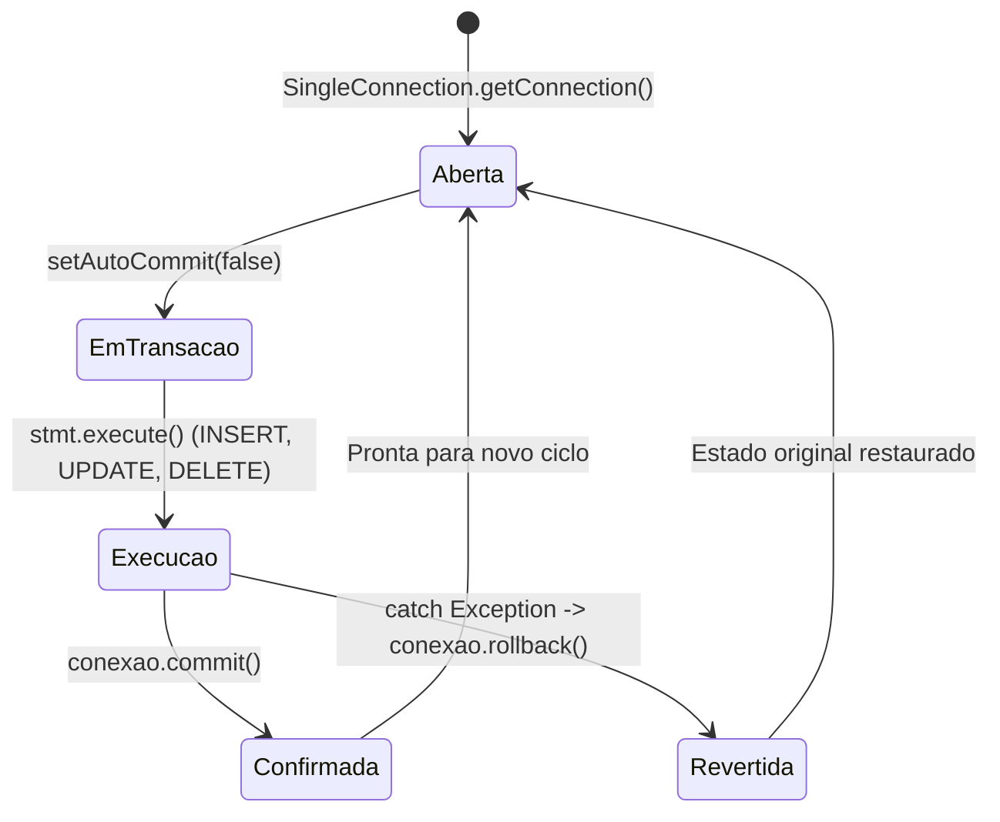

---

### Interceptação de Ciclo de Vida com Servlet Filters

#### Definição
Um Servlet Filter é um componente da especificação Java Servlet que intercepta requisições HTTP antes que elas atinjam os Servlets de destino e intercepta as respostas HTTP antes que elas cheguem de volta ao cliente navegador.

#### Ciclo de Vida da Interface `javax.servlet.Filter`
1. `init(FilterConfig filterConfig)`: Executado uma única vez durante a carga da aplicação pelo Tomcat.
2. `doFilter(ServletRequest request, ServletResponse response, FilterChain chain)`: Executado a cada requisição intercepted. Para repassar a requisição adiante, é indispensável invocar `chain.doFilter(request, response)`.
3. `destroy()`: Executado quando a aplicação é descarregada ou o servidor é desligado.

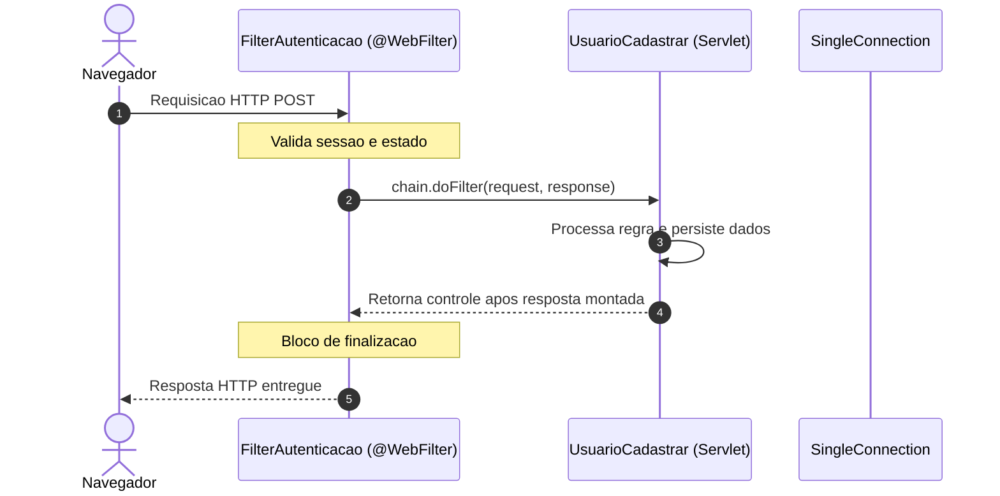

---

### Engenharia Reversa e Depuração Estruturada na IDE

O Apache NetBeans oferece ferramentas avançadas de diagnóstico para inspeção em tempo de execução:
- **Breakpoints**: Pontos de interrupção que suspendem a execução de uma thread específica imediatamente antes da execução da linha marcada.
- **Watches**: Expressões sob monitoramento contínuo no painel do depurador.
- **Painel Variables**: Exibe o grafo completo de objetos e variáveis no frame da pilha de execução corrente.

#### Práticas de Acessibilidade no NetBeans para Desenvolvedores Cegos
Em consonância com as diretrizes de desenho universal abordadas na disciplina, o uso de leitores de tela (como NVDA ou JAWS) com o NetBeans requer práticas adaptadas:
- Substituir a inspeção visual de breakpoints por logs estruturados de depuração no console do sistema (`System.out.println("DEBUG: [Classe:Metodo] Estado da variavel: " + valor);`).
- Navegação pelo teclado utilizando atalhos formais da IDE:
  - `F8`: Executar sobre a linha (*Step Over*).
  - `F7`: Entrar no método interno (*Step Into*).
  - `Ctrl + Shift + F8`: Gerenciar lista de breakpoints ativos em diálogo acessível.

---

## Módulo 5: Arquitetura MVC e a Operação de Listagem de Entidades

### A Entidade de Domínio Usuario e o Contrato JavaBean

A classe `Usuario` é uma representação estrutural que implementa a convenção padrão **JavaBean**:
1. Atributos privados encapsulados.
2. Construtor sem argumentos (construtor padrão/vazio) para introspecção reflexiva por contêineres e frameworks.
3. Construtor completo parametrizado para facilitar a instanciação durante o mapeamento de tuplas relacionais.
4. Métodos de acesso e mutação (`getters` e `setters`) seguindo rigorosamente a convenção camelCase.
5. Sobrescrita obrigatória dos contratos de identidade `hashCode()` e `equals()`.

#### Contrato de Identidade: `equals` e `hashCode`
A regra de negócio determina que dois usuários são idênticos se e somente se compartilharem o mesmo identificador primário (`id`) ou o mesmo documento natural (`cpf`):

```java
@Override
public int hashCode() {
    int hash = 7;
    hash = 89 * hash + this.id;
    hash = 89 * hash + Objects.hashCode(this.cpf);
    return hash;
}

@Override
public boolean equals(Object obj) {
    if (this == obj) return true;
    if (obj == null || getClass() != obj.getClass()) return false;
    final Usuario other = (Usuario) obj;
    if (this.id != other.id) return false;
    return Objects.equals(this.cpf, other.cpf);
}
```

---

### Padronização de Contratos de Persistência com GenericDAO

Para evitar que diferentes desenvolvedores criem assinaturas de métodos com nomenclaturas divergentes para operações básicas de banco, a disciplina estabelece a interface formal `GenericDAO` no pacote `br.com.aplcurso.dao`:

```java
package br.com.aplcurso.dao;

import java.util.List;

public interface GenericDAO {
    public Boolean cadastrar(Object objeto);
    public Boolean inserir(Object objeto);
    public Boolean alterar(Object objeto);
    public Boolean excluir(int numero);
    public Object carregar(int numero);
    public List<Object> listar();
}
```

> [!NOTE]
> *Complemento técnico de engenharia*: A assinatura baseada em `Object` atende ao estágio inicial de aprendizagem da disciplina. Em arquiteturas avançadas, substitui-se o uso de `Object` por tipos parametrizados (`GenericDAO<T, ID>`), garantindo a checagem estática de tipos em tempo de compilação (*compile-time type safety*).

---

### Implementação da DAO com PreparedStatement e Mapeamento Manual

A classe `UsuarioDAO` implementa a interface `GenericDAO`. A operação de listagem demonstra a recuperação eficiente de linhas do banco e sua hidratação em objetos Java:

```java
package br.com.aplcurso.dao;

import br.com.aplcurso.model.Usuario;
import br.com.aplcurso.utils.SingleConnection;
import java.sql.Connection;
import java.sql.PreparedStatement;
import java.sql.ResultSet;
import java.sql.SQLException;
import java.util.ArrayList;
import java.util.List;

public class UsuarioDAO implements GenericDAO {

    private Connection conexao;

    public UsuarioDAO() throws Exception {
        this.conexao = SingleConnection.getConnection();
    }

    @Override
    public List<Object> listar() {
        List<Object> resultado = new ArrayList<>();
        PreparedStatement stmt = null;
        ResultSet rs = null;
        String sql = "SELECT id, nome, datanascimento, cpf, email, senha, salario "
                   + "FROM usuario ORDER BY id ASC";
        try {
            stmt = conexao.prepareStatement(sql);
            rs = stmt.executeQuery();
            while (rs.next()) {
                Usuario oUsuario = new Usuario();
                oUsuario.setId(rs.getInt("id"));
                oUsuario.setNome(rs.getString("nome"));
                oUsuario.setDataNascimento(rs.getDate("datanascimento"));
                oUsuario.setCpf(rs.getString("cpf"));
                oUsuario.setEmail(rs.getString("email"));
                oUsuario.setSenha(rs.getString("senha"));
                oUsuario.setSalario(rs.getDouble("salario"));
                resultado.add(oUsuario);
            }
        } catch (SQLException ex) {
            System.err.println("Problemas ao listar usuarios: " + ex.getMessage());
        } finally {
            try {
                if (rs != null) rs.close();
                if (stmt != null) stmt.close();
            } catch (SQLException ex) {
                System.err.println("Erro ao fechar cursores JDBC: " + ex.getMessage());
            }
        }
        return resultado;
    }

    // Demais métodos da interface implementados nas seções seguintes
    @Override public Boolean cadastrar(Object objeto) { return false; }
    @Override public Boolean inserir(Object objeto) { return false; }
    @Override public Boolean alterar(Object objeto) { return false; }
    @Override public Boolean excluir(int numero) { return false; }
    @Override public Object carregar(int numero) { return null; }
}
```

---

### O Controlador Servlet UsuarioListar e o Despacho Interno

O Servlet atua como o **Controller** do padrão MVC. Ele intercepta a requisição HTTP GET, delega a busca à camada de persistência, armazena a lista resultante no escopo da requisição e encaminha a execução para a visão via `RequestDispatcher.forward()`:

```java
package br.com.aplcurso.controller.usuario;

import br.com.aplcurso.dao.GenericDAO;
import br.com.aplcurso.dao.UsuarioDAO;
import java.io.IOException;
import javax.servlet.ServletException;
import javax.servlet.annotation.WebServlet;
import javax.servlet.http.HttpServlet;
import javax.servlet.http.HttpServletRequest;
import javax.servlet.http.HttpServletResponse;

@WebServlet(name = "UsuarioListar", urlPatterns = {"/UsuarioListar"})
public class UsuarioListar extends HttpServlet {

    protected void processRequest(HttpServletRequest request, HttpServletResponse response)
            throws ServletException, IOException {
        response.setContentType("text/html;charset=iso-8859-1");
        try {
            GenericDAO dao = new UsuarioDAO();
            request.setAttribute("usuarios", dao.listar());
            request.getRequestDispatcher("/cadastros/usuario/usuarioListar.jsp").forward(request, response);
        } catch (Exception ex) {
            System.err.println("Erro ao processar listagem de usuarios: " + ex.getMessage());
        }
    }

    @Override
    protected void doGet(HttpServletRequest request, HttpServletResponse response)
            throws ServletException, IOException {
        processRequest(request, response);
    }

    @Override
    protected void doPost(HttpServletRequest request, HttpServletResponse response)
            throws ServletException, IOException {
        processRequest(request, response);
    }
}
```

---

### Apresentação Tabular Dinâmica Enriquecida com DataTables

Na visão `usuarioListar.jsp`, as tags JSTL iteram sobre os dados e aplicam formatação. No final do documento, o seletor jQuery aciona o plugin **DataTables**, que injeta paginação, ordenação interativa de colunas e barra de pesquisa instantânea no lado cliente:

```jsp
<%@taglib prefix="c" uri="http://java.sun.com/jsp/jstl/core" %>
<%@taglib prefix="fmt" uri="http://java.sun.com/jsp/jstl/fmt" %>
<jsp:include page="/header.jsp" />
<jsp:include page="/menu.jsp" />

<div class="container mt-4">
    <h2>Manutencao de Usuarios Cadastrados</h2>
    <a href="${pageContext.request.contextPath}/UsuarioNovo" class="btn btn-primary mb-3">Novo Usuario</a>
    
    <table id="tabelaUsuarios" class="table table-striped table-bordered">
        <thead>
            <tr>
                <th>ID</th>
                <th>Nome</th>
                <th>Nascimento</th>
                <th>CPF</th>
                <th>E-mail</th>
                <th>Salario</th>
                <th>Acoes</th>
            </tr>
        </thead>
        <tbody>
            <c:forEach var="user" items="${usuarios}">
                <tr>
                    <td>${user.id}</td>
                    <td>${user.nome}</td>
                    <td><fmt:formatDate value="${user.dataNascimento}" pattern="dd/MM/yyyy" /></td>
                    <td>${user.cpf}</td>
                    <td>${user.email}</td>
                    <td><fmt:formatNumber value="${user.salario}" type="currency" currencySymbol="R$ " /></td>
                    <td>
                        <a href="${pageContext.request.contextPath}/UsuarioCarregar?id=${user.id}" class="btn btn-sm btn-info">Editar</a>
                    </td>
                </tr>
            </c:forEach>
        </tbody>
    </table>
</div>

<jsp:include page="/footer.jsp" />

<script type="text/javascript">
    $(document).ready(function () {
        $('#tabelaUsuarios').DataTable({
            "language": {
                "url": "//cdn.datatables.net/plug-ins/1.10.22/i18n/Portuguese-Brasil.json"
            }
        });
    });
</script>
```

---

## Módulo 6: Manutenção Cadastral Completa, Validações e Operações Assíncronas

### Bifurcação de Persistência Baseada no Identificador de Chave Primária

A camada DAO atua como uma fachada inteligente para a camada de controle. O método `cadastrar(Object objeto)` avalia o valor numérico da chave primária `id`. Em Java, o valor padrão de um atributo primitivo `int` não inicializado é zero (`0`):
- Se `id == 0`: O registro não possui representação relacional física no banco. O fluxo é encaminhado internamente para a instrução SQL `INSERT` do método `inserir(oUsuario)`.
- Se `id > 0`: O registro já existe no banco de dados. O fluxo é encaminhado para a instrução SQL `UPDATE` do método `alterar(oUsuario)`.

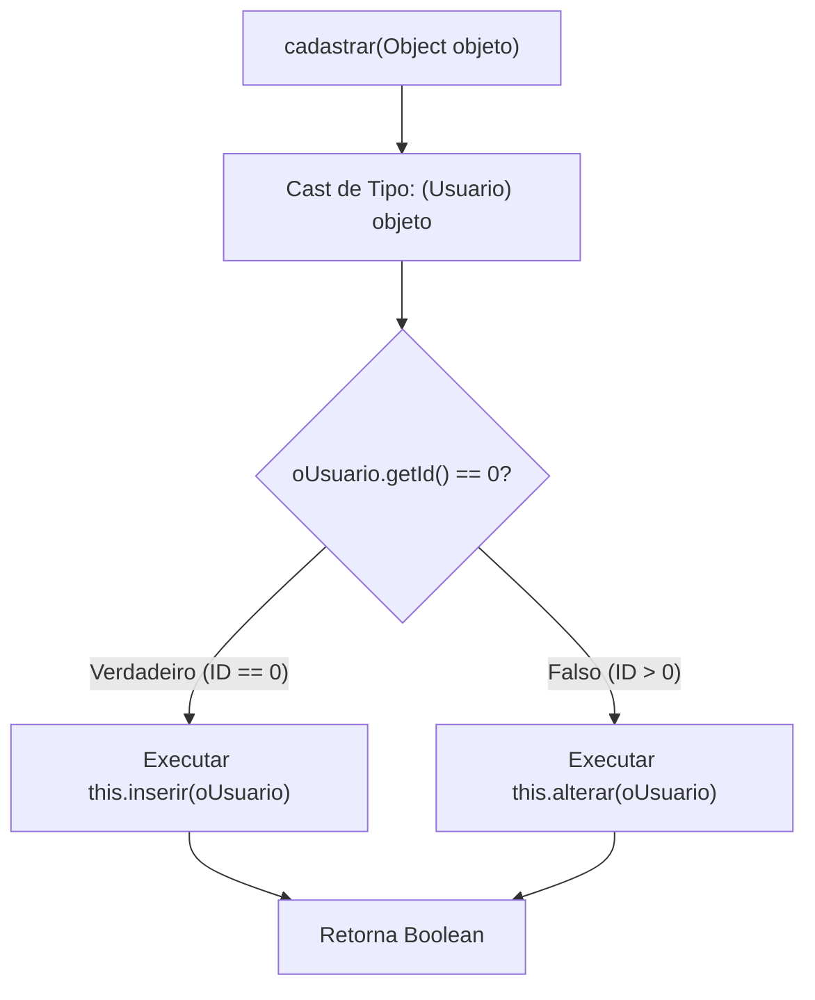

#### Implementação de `cadastrar`, `inserir` e `alterar` na DAO

```java
@Override
public Boolean cadastrar(Object objeto) {
    Usuario oUsuario = (Usuario) objeto;
    if (oUsuario.getId() == 0) {
        return this.inserir(oUsuario);
    } else {
        return this.alterar(oUsuario);
    }
}

@Override
public Boolean inserir(Object objeto) {
    Usuario oUsuario = (Usuario) objeto;
    PreparedStatement stmt = null;
    String sql = "INSERT INTO usuario (nome, datanascimento, cpf, email, senha, salario) "
               + "VALUES (?, ?, ?, ?, ?, ?)";
    try {
        stmt = conexao.prepareStatement(sql);
        stmt.setString(1, oUsuario.getNome());
        // Conversão obrigatória: java.util.Date para java.sql.Date
        stmt.setDate(2, new java.sql.Date(oUsuario.getDataNascimento().getTime()));
        stmt.setString(3, oUsuario.getCpf());
        stmt.setString(4, oUsuario.getEmail());
        stmt.setString(5, oUsuario.getSenha());
        stmt.setDouble(6, oUsuario.getSalario());
        
        stmt.execute();
        conexao.commit();
        return true;
    } catch (Exception ex) {
        try {
            System.err.println("Falha ao inserir usuario. Efetuando rollback. Erro: " + ex.getMessage());
            conexao.rollback();
        } catch (SQLException e) {
            System.err.println("Erro critico no rollback: " + e.getMessage());
        }
        return false;
    } finally {
        try {
            if (stmt != null) stmt.close();
        } catch (SQLException e) {
            System.err.println("Erro ao fechar PreparedStatement: " + e.getMessage());
        }
    }
}

@Override
public Boolean alterar(Object objeto) {
    Usuario oUsuario = (Usuario) objeto;
    PreparedStatement stmt = null;
    String sql = "UPDATE usuario SET nome=?, datanascimento=?, cpf=?, email=?, senha=?, salario=? "
               + "WHERE id=?";
    try {
        stmt = conexao.prepareStatement(sql);
        stmt.setString(1, oUsuario.getNome());
        stmt.setDate(2, new java.sql.Date(oUsuario.getDataNascimento().getTime()));
        stmt.setString(3, oUsuario.getCpf());
        stmt.setString(4, oUsuario.getEmail());
        stmt.setString(5, oUsuario.getSenha());
        stmt.setDouble(6, oUsuario.getSalario());
        stmt.setInt(7, oUsuario.getId());
        
        stmt.execute();
        conexao.commit();
        return true;
    } catch (Exception ex) {
        try {
            System.err.println("Falha ao alterar usuario. Efetuando rollback. Erro: " + ex.getMessage());
            conexao.rollback();
        } catch (SQLException e) {
            System.err.println("Erro critico no rollback: " + e.getMessage());
        }
        return false;
    } finally {
        try {
            if (stmt != null) stmt.close();
        } catch (SQLException e) {
            System.err.println("Erro ao fechar PreparedStatement: " + e.getMessage());
        }
    }
}
```

---

### Verificação Prévia de Unicidade de Dados na Base

Embora o banco contenha restrições estruturais `UNIQUE` nas colunas `cpf` e `email`, confiar unicamente na violação de chave do SGBD gera exceções feias de infraestrutura (`PSQLException`). A DAO provê um método otimizado utilizando `COUNT(*)`, que trafega um volume mínimo de dados na rede:

```java
public boolean cpfExiste(String cpf) {
    String sql = "SELECT COUNT(*) AS total FROM usuario WHERE cpf = ?";
    try (PreparedStatement stmt = conexao.prepareStatement(sql)) {
        stmt.setString(1, cpf);
        try (ResultSet rs = stmt.executeQuery()) {
            if (rs.next()) {
                return rs.getInt("total") > 0;
            }
        }
    } catch (SQLException e) {
        System.err.println("Erro ao checar duplicidade de CPF: " + e.getMessage());
    }
    return false;
}
```

---

### Validador Numérico Estático de Documentos Nacionais

A classe `DocumentoValidador` reside no pacote `br.com.aplcurso.utils`. Ela encapsula os cálculos algorítmicos em métodos estáticos (`public static`), permitindo seu reuso direto sem exigir a alocação de instâncias em memória heap:

```java
package br.com.aplcurso.utils;

public class DocumentoValidador {

    public static boolean isCPF(String cpf) {
        if (cpf == null) return false;
        // Higienização de pontuação via expressão regular
        cpf = cpf.replaceAll("[^\\d]", "");
        if (cpf.length() != 11 || cpf.matches("(\\d)\\1{10}")) {
            return false;
        }

        try {
            int d1 = 0, d2 = 0;
            for (int i = 0; i < 9; i++) {
                int digito = cpf.charAt(i) - '0';
                d1 += digito * (10 - i);
                d2 += digito * (11 - i);
            }

            d1 = 11 - (d1 % 11);
            d1 = (d1 > 9) ? 0 : d1;
            d2 += d1 * 2;
            d2 = 11 - (d2 % 11);
            d2 = (d2 > 9) ? 0 : d2;

            return (d1 == (cpf.charAt(9) - '0')) && (d2 == (cpf.charAt(10) - '0'));
        } catch (Exception e) {
            return false;
        }
    }

    public static boolean isCNPJ(String cnpj) {
        if (cnpj == null) return false;
        cnpj = cnpj.replaceAll("[^\\d]", "");
        if (cnpj.length() != 14 || cnpj.matches("(\\d)\\1{13}")) {
            return false;
        }

        try {
            int[] pesos1 = {5, 4, 3, 2, 9, 8, 7, 6, 5, 4, 3, 2};
            int[] pesos2 = {6, 5, 4, 3, 2, 9, 8, 7, 6, 5, 4, 3, 2};

            int d1 = 0, d2 = 0;
            for (int i = 0; i < 12; i++) {
                int digito = cnpj.charAt(i) - '0';
                d1 += digito * pesos1[i];
                d2 += digito * pesos2[i];
            }

            d1 = d1 % 11;
            d1 = (d1 < 2) ? 0 : 11 - d1;
            d2 += d1 * pesos2[12];
            d2 = d2 % 11;
            d2 = (d2 < 2) ? 0 : 11 - d2;

            return (d1 == (cnpj.charAt(12) - '0')) && (d2 == (cnpj.charAt(13) - '0'));
        } catch (Exception e) {
            return false;
        }
    }
}
```

---

### Servlets Especializados para Inicialização e Cadastro

#### O Servlet `UsuarioNovo`
Inicializa um JavaBean `Usuario` vazio com valores padrão seguros e despacha para a tela de cadastro, permitindo que a mesma página JSP sirva tanto para novas inclusões quanto para alterações de registros:

```java
package br.com.aplcurso.controller.usuario;

import br.com.aplcurso.model.Usuario;
import java.io.IOException;
import javax.servlet.ServletException;
import javax.servlet.annotation.WebServlet;
import javax.servlet.http.HttpServlet;
import javax.servlet.http.HttpServletRequest;
import javax.servlet.http.HttpServletResponse;

@WebServlet(name = "UsuarioNovo", urlPatterns = {"/UsuarioNovo"})
public class UsuarioNovo extends HttpServlet {

    @Override
    protected void doGet(HttpServletRequest request, HttpServletResponse response)
            throws ServletException, IOException {
        Usuario oUsuario = new Usuario();
        request.setAttribute("usuario", oUsuario);
        request.getRequestDispatcher("/cadastros/usuario/usuarioCadastrar.jsp").forward(request, response);
    }
}
```

#### O Servlet `UsuarioCadastrar` e o Tratamento Numérico
Ao receber a submissão via `POST`, os parâmetros de formulário chegam sempre como texto bruto (`String`). É mandatório aplicar higienização:
- `salario`: O plugin `maskMoney` pode enviar strings formatadas como `R$ 5.200,50`. Deve-se remover caracteres não numéricos, exceto a vírgula, e converter a vírgula para ponto antes do parsing com `Double.parseDouble()`.
- `dataNascimento`: Parsing por meio de `SimpleDateFormat("yyyy-MM-dd")` para inputs do tipo `date`.

```java
package br.com.aplcurso.controller.usuario;

import br.com.aplcurso.dao.GenericDAO;
import br.com.aplcurso.dao.UsuarioDAO;
import br.com.aplcurso.model.Usuario;
import br.com.aplcurso.utils.DocumentoValidador;
import java.io.IOException;
import java.io.PrintWriter;
import java.text.SimpleDateFormat;
import javax.servlet.ServletException;
import javax.servlet.annotation.WebServlet;
import javax.servlet.http.HttpServlet;
import javax.servlet.http.HttpServletRequest;
import javax.servlet.http.HttpServletResponse;

@WebServlet(name = "UsuarioCadastrar", urlPatterns = {"/UsuarioCadastrar"})
public class UsuarioCadastrar extends HttpServlet {

    @Override
    protected void doPost(HttpServletRequest request, HttpServletResponse response)
            throws ServletException, IOException {
        request.setCharacterEncoding("iso-8859-1");
        response.setContentType("text/plain;charset=iso-8859-1");
        PrintWriter out = response.getWriter();

        try {
            int id = Integer.parseInt(request.getParameter("id"));
            String nome = request.getParameter("nome");
            String dataNascimentoStr = request.getParameter("datanascimento");
            String cpf = request.getParameter("cpf");
            String email = request.getParameter("email");
            String senha = request.getParameter("senha");
            String salarioStr = request.getParameter("salario");

            // Validação algorítmica de CPF
            if (!DocumentoValidador.isCPF(cpf)) {
                out.print("CPF_INVALIDO");
                return;
            }

            // Higienização monetária: transforma "R$ 5.200,50" em "5200.50"
            String limpo = salarioStr.replace("R$", "").replace(" ", "").replace(".", "").replace(",", ".");
            double salario = Double.parseDouble(limpo);

            SimpleDateFormat sdf = new SimpleDateFormat("yyyy-MM-dd");
            Usuario oUsuario = new Usuario(id, nome, sdf.parse(dataNascimentoStr), cpf, email, senha, salario);

            GenericDAO dao = new UsuarioDAO();
            if (dao.cadastrar(oUsuario)) {
                out.print("SUCESSO");
            } else {
                out.print("ERRO_BANCO");
            }
        } catch (Exception ex) {
            System.err.println("Excecao capturada no cadastro: " + ex.getMessage());
            out.print("ERRO_SISTEMA");
        }
    }
}
```

---

### Comunicação Assíncrona com jQuery AJAX e SweetAlert

Na tela `usuarioCadastrar.jsp`, a interação do usuário com o campo de CPF aciona o evento `blur` (saída do foco), disparando uma verificação assíncrona ao servlet `UsuarioVerificarCPF` sem recarregar a tela:

```javascript
$("#cpf").on("blur", function () {
    var cpfInformado = $(this).val();
    if (cpfInformado.length >= 11) {
        $.ajax({
            url: "${pageContext.request.contextPath}/UsuarioVerificarCPF",
            type: "GET",
            data: { cpf: cpfInformado },
            success: function (resposta) {
                if (resposta.trim() === "EXISTE") {
                    Swal.fire({
                        icon: 'warning',
                        title: 'Documento Duplicado',
                        text: 'Este CPF ja esta vinculado a um usuario cadastrado no sistema.'
                    });
                    $("#cpf").val("").focus();
                }
            }
        });
    }
});
```

A submissão do formulário principal intercepta o evento padrão do formulário e realiza o envio assíncrono via `$.ajax`:

```javascript
$("#formUsuario").on("submit", function (e) {
    e.preventDefault();
    $.ajax({
        url: "${pageContext.request.contextPath}/UsuarioCadastrar",
        type: "POST",
        data: $(this).serialize(),
        success: function (retorno) {
            if (retorno.trim() === "SUCESSO") {
                Swal.fire({
                    icon: 'success',
                    title: 'Operacao Concluida',
                    text: 'Dados gravados com sucesso na base relacional.'
                }).then(function () {
                    window.location.href = "${pageContext.request.contextPath}/UsuarioListar";
                });
            } else {
                Swal.fire({
                    icon: 'error',
                    title: 'Falha na Operacao',
                    text: 'Nao foi possivel salvar o registro. Codigo: ' + retorno
                });
            }
        }
    });
});
```

---

### Recuperação Pontual de Registro para Atualização Cadastral

Para alimentar o formulário de edição, o método `carregar(int id)` executa uma busca parametrizada e devolve uma entidade preenchida:

```java
@Override
public Object carregar(int numero) {
    Usuario oUsuario = null;
    PreparedStatement stmt = null;
    ResultSet rs = null;
    String sql = "SELECT id, nome, datanascimento, cpf, email, senha, salario "
               + "FROM usuario WHERE id = ?";
    try {
        stmt = conexao.prepareStatement(sql);
        stmt.setInt(1, numero);
        rs = stmt.executeQuery();
        if (rs.next()) {
            oUsuario = new Usuario();
            oUsuario.setId(rs.getInt("id"));
            oUsuario.setNome(rs.getString("nome"));
            oUsuario.setDataNascimento(rs.getDate("datanascimento"));
            oUsuario.setCpf(rs.getString("cpf"));
            oUsuario.setEmail(rs.getString("email"));
            oUsuario.setSenha(rs.getString("senha"));
            oUsuario.setSalario(rs.getDouble("salario"));
        }
    } catch (SQLException ex) {
        System.err.println("Erro ao carregar usuario por ID: " + ex.getMessage());
    } finally {
        try {
            if (rs != null) rs.close();
            if (stmt != null) stmt.close();
        } catch (SQLException ex) {
            System.err.println("Erro ao fechar cursores: " + ex.getMessage());
        }
    }
    return oUsuario;
}
```

---

## Módulo 7: Projetos Aplicados da Disciplina

### Trabalho de Programação: Cadastro e Manutenção de Livros

#### Diretrizes e Escopo de Engenharia
Publicado com prazo final em **07/05/2026**, o trabalho exige a entrega de uma aplicação Java Web completa desenvolvida em grupos de até três integrantes e hospedada em repositório público do GitHub.

- **Entidade do Domínio**: `Livro` (`id`, `nomeLivro`, `isbn`, `autor`, `dataPublicacao`, `valorLivro`).
- **Operações Obrigatórias (CRUD Completo)**:
  - Inclusão com validação de campos.
  - Listagem geral formatada.
  - Edição de registros existentes.
  - Exclusão por identificador.

#### O Padrão Post-Redirect-Get (PRG)
Uma das armadilhas mais comuns no desenvolvimento web com Servlets consiste em encaminhar a requisição via `forward` para uma página de listagem logo após um comando de mutação `POST`. Caso o usuário pressione a tecla `F5` ou o botão de recarregar do navegador, a requisição `POST` original será reenviada integralmente, gerando registros duplicados no banco.

A solução canônica é a imposição do padrão **Post-Redirect-Get (PRG)**:
1. O cliente submete os dados cadastrais via `POST`.
2. O Servlet processa a persistência com sucesso.
3. Em vez de retornar HTML no corpo da resposta com status `200 OK`, o Servlet envia o cabeçalho de redirecionamento `HTTP 302 Found` apontando para o endpoint da listagem (`response.sendRedirect("LivroServlet?acao=listar")`).
4. O navegador realiza então uma requisição limpa via `GET`, eliminando qualquer risco de duplicação acidental por recarregamento de página.

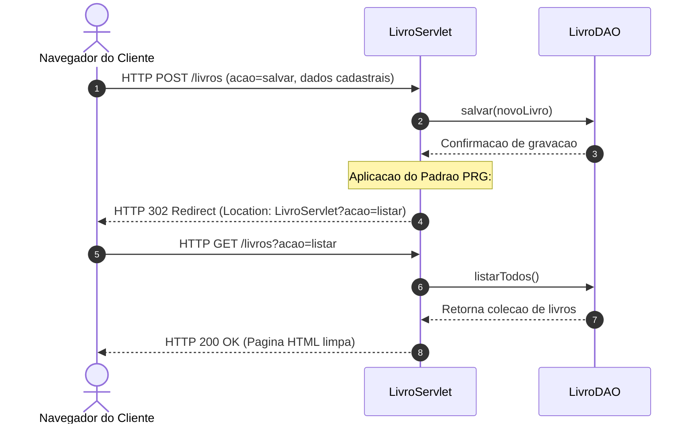

#### Modelo Relacional: `banco_livros.sql`

```sql
CREATE TABLE IF NOT EXISTS livro (
    id SERIAL PRIMARY KEY,
    nomelivro VARCHAR(150) NOT NULL,
    isbn VARCHAR(20) NOT NULL UNIQUE,
    autor VARCHAR(100) NOT NULL,
    datapublicacao DATE NOT NULL,
    valorlivro DECIMAL(10,2) NOT NULL CHECK (valorlivro >= 0)
);

INSERT INTO livro (nomelivro, isbn, autor, datapublicacao, valorlivro) VALUES
('Engenharia de Software Corporativa', '978-85-12345-01-1', 'Pressman, Roger', '2021-03-15', 189.90),
('Padroes de Projeto com Java', '978-85-12345-02-8', 'Gamma, Erich', '2020-08-10', 145.50),
('Arquitetura Limpa', '978-85-12345-03-5', 'Martin, Robert C.', '2019-11-20', 98.00);
```

#### Thread-Safety em Servlets
O contêiner web executa uma única instância de cada Servlet (instanciada como Singleton) e atende múltiplas requisições simultâneas por meio de um pool de threads (*Thread-per-Request*). Por isso, **nunca declare atributos de instância mutáveis dentro de classes Servlet**:

```java
// Anti-pattern critico: Condicao de corrida (Race Condition)
public class LivroServletInseguro extends HttpServlet {
    private Livro livroEmEdicao; // VULNERABILIDADE: compartilhado por todas as threads e clientes simultaneos!
}
```

---

### Trabalho de Programação: Cadastro Federativo de Estados

O segundo trabalho da disciplina estende o ecossistema com o cadastro de unidades federativas:

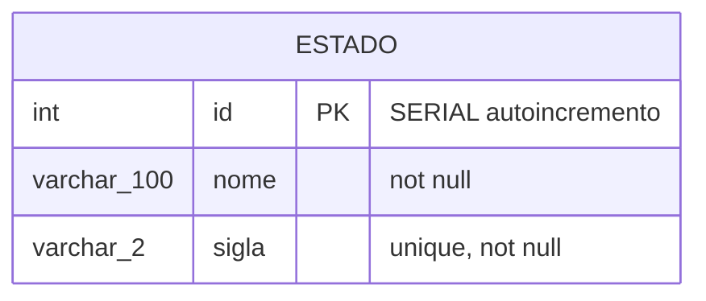

```sql
CREATE TABLE IF NOT EXISTS estado (
    id SERIAL PRIMARY KEY,
    nome VARCHAR(100) NOT NULL,
    sigla VARCHAR(2) NOT NULL,
    CONSTRAINT uk_estado_sigla UNIQUE (sigla)
);

INSERT INTO estado (nome, sigla) VALUES
('Sao Paulo', 'SP'),
('Rio de Janeiro', 'RJ'),
('Minas Gerais', 'MG'),
('Parana', 'PR'),
('Santa Catarina', 'SC'),
('Rio Grande do Sul', 'RS');
```

---

## Módulo 8: Matriz de Avaliações Formativas e Somativas

### Avaliação 1: Modelagem Orientada a Objetos e Regras de Negócio

Aplicada em **23/03/2026**, a AV1 focou nos conceitos fundamentais de POO aplicados a problemas de negócio. Abaixo consolida-se a implementação canônica representativa cobrada na avaliação:

```java
package br.com.unifef.av1;

import java.util.ArrayList;
import java.util.List;

public class SistemaRH {

    public static abstract class Colaborador {
        private String nome;
        private int matricula;
        private double salarioBase;

        public Colaborador(String nome, int matricula, double salarioBase) {
            if (nome == null || nome.trim().isEmpty()) {
                throw new IllegalArgumentException("Nome invalido.");
            }
            if (matricula <= 0) {
                throw new IllegalArgumentException("Matricula deve ser positiva.");
            }
            if (salarioBase <= 0) {
                throw new IllegalArgumentException("Salario base deve ser positivo.");
            }
            this.nome = nome.trim();
            this.matricula = matricula;
            this.salarioBase = salarioBase;
        }

        public String getNome() { return nome; }
        public int getMatricula() { return matricula; }
        public double getSalarioBase() { return salarioBase; }

        public abstract double calcularSalario();
    }

    public static class Analista extends Colaborador {
        public Analista(String nome, int matricula, double salarioBase) {
            super(nome, matricula, salarioBase);
        }

        @Override
        public double calcularSalario() {
            return this.getSalarioBase();
        }
    }

    public static class Gestor extends Colaborador {
        private double gratificacao;

        public Gestor(String nome, int matricula, double salarioBase, double gratificacao) {
            super(nome, matricula, salarioBase);
            if (gratificacao < 0) throw new IllegalArgumentException("Gratificacao negativa.");
            this.gratificacao = gratificacao;
        }

        @Override
        public double calcularSalario() {
            return this.getSalarioBase() + this.gratificacao;
        }
    }

    public static void main(String[] args) {
        List<Colaborador> equipe = new ArrayList<>();
        equipe.add(new Analista("Marcos Santos", 501, 4500.00));
        equipe.add(new Gestor("Renata Lima", 502, 8500.00, 2500.00));

        double total = 0.0;
        for (Colaborador c : equipe) {
            total += c.calcularSalario();
        }
        System.out.println("Total da Folha de Pagamento: R$ " + total);
    }
}
```

---

### Avaliação 2: Sistema CRUD de Produtos com JDBC e Tratamento Defensivo

Aplicada em **08/06/2026**, a Avaliação II exigiu o desenvolvimento completo de uma solução CRUD orientada a objetos integrada a banco relacional via JDBC.

#### Script de Estruturação: `schema.sql`
```sql
CREATE TABLE IF NOT EXISTS produtos (
    id SERIAL PRIMARY KEY,
    nome VARCHAR(150) NOT NULL,
    preco NUMERIC(10, 2) NOT NULL CHECK (preco >= 0),
    quantidade_estoque INTEGER NOT NULL CHECK (quantidade_estoque >= 0),
    data_cadastro VARCHAR(20) NOT NULL
);

INSERT INTO produtos (nome, preco, quantidade_estoque, data_cadastro) VALUES
('Notebook Gamer Dell', 5899.00, 12, '2026-06-01'),
('Mouse Optico USB', 89.90, 50, '2026-06-02'),
('Teclado Mecanico RGB', 299.00, 30, '2026-06-03');
```

#### Exceção Customizada: `NegocioException.java`
```java
package br.com.unifef.av2;

public class NegocioException extends RuntimeException {
    private static final long serialVersionUID = 1L;

    public NegocioException(String mensagem) {
        super(mensagem);
    }

    public NegocioException(String mensagem, Throwable causa) {
        super(mensagem, causa);
    }
}
```

#### Entidade Rica com Defesa de Invariantes: `Produto.java`
```java
package br.com.unifef.av2;

import java.util.Objects;

public class Produto {
    private Integer id;
    private String nome;
    private Double preco;
    private Integer quantidadeEstoque;
    private String dataCadastro;

    public Produto() {}

    public Produto(Integer id, String nome, Double preco, Integer quantidadeEstoque, String dataCadastro) {
        this.setId(id);
        this.setNome(nome);
        this.setPreco(preco);
        this.setQuantidadeEstoque(quantidadeEstoque);
        this.setDataCadastro(dataCadastro);
    }

    public Integer getId() { return id; }
    public void setId(Integer id) { this.id = id; }

    public String getNome() { return nome; }
    public void setNome(String nome) {
        if (nome == null || nome.trim().isEmpty()) {
            throw new NegocioException("O nome do produto e de preenchimento obrigatorio.");
        }
        this.nome = nome.trim();
    }

    public Double getPreco() { return preco; }
    public void setPreco(Double preco) {
        if (preco == null || preco < 0.0) {
            throw new NegocioException("O preco unitario nao pode ser nulo ou negativo.");
        }
        this.preco = preco;
    }

    public Integer getQuantidadeEstoque() { return quantidadeEstoque; }
    public void setQuantidadeEstoque(Integer quantidadeEstoque) {
        if (quantidadeEstoque == null || quantidadeEstoque < 0) {
            throw new NegocioException("A quantidade em estoque deve ser maior ou igual a zero.");
        }
        this.quantidadeEstoque = quantidadeEstoque;
    }

    public String getDataCadastro() { return dataCadastro; }
    public void setDataCadastro(String dataCadastro) {
        if (dataCadastro == null || dataCadastro.trim().isEmpty()) {
            throw new NegocioException("A data de cadastro deve ser informada.");
        }
        this.dataCadastro = dataCadastro.trim();
    }

    @Override
    public boolean equals(Object o) {
        if (this == o) return true;
        if (o == null || getClass() != o.getClass()) return false;
        Produto produto = (Produto) o;
        return Objects.equals(id, produto.id);
    }

    @Override
    public int hashCode() {
        return Objects.hash(id);
    }
}
```

#### Persistência Segura com JDBC e Try-with-Resources: `ProdutoDAO.java`
O uso de **try-with-resources** assegura que conexões, comandos preparados e cursores de resultado sejam desalocados imediatamente da memória:

```java
package br.com.unifef.av2;

import br.com.aplcurso.utils.SingleConnection;
import java.sql.Connection;
import java.sql.PreparedStatement;
import java.sql.ResultSet;
import java.sql.SQLException;
import java.util.ArrayList;
import java.util.List;

public class ProdutoDAO {

    public void inserir(Produto p) throws SQLException {
        String sql = "INSERT INTO produtos (nome, preco, quantidade_estoque, data_cadastro) VALUES (?, ?, ?, ?)";
        try (Connection conn = SingleConnection.getConnection();
             PreparedStatement pstm = conn.prepareStatement(sql)) {
            pstm.setString(1, p.getNome());
            pstm.setDouble(2, p.getPreco());
            pstm.setInt(3, p.getQuantidadeEstoque());
            pstm.setString(4, p.getDataCadastro());
            pstm.executeUpdate();
            conn.commit();
        }
    }

    public List<Produto> listarTodos() throws SQLException {
        List<Produto> lista = new ArrayList<>();
        String sql = "SELECT id, nome, preco, quantidade_estoque, data_cadastro FROM produtos ORDER BY id ASC";
        try (Connection conn = SingleConnection.getConnection();
             PreparedStatement pstm = conn.prepareStatement(sql);
             ResultSet rs = pstm.executeQuery()) {
            while (rs.next()) {
                Produto p = new Produto();
                p.setId(rs.getInt("id"));
                p.setNome(rs.getString("nome"));
                p.setPreco(rs.getDouble("preco"));
                p.setQuantidadeEstoque(rs.getInt("quantidade_estoque"));
                p.setDataCadastro(rs.getString("data_cadastro"));
                lista.add(p);
            }
        }
        return lista;
    }
}
```

---

### Avaliação Substitutiva: Hierarquia Corporativa, Interfaces e Ordenação

Realizada em **25/06/2026**, a Avaliação Substitutiva sintetizou as exigências semestrais em torno de domínio avançado, contratos puros e manipulação defensiva de coleções em memória.

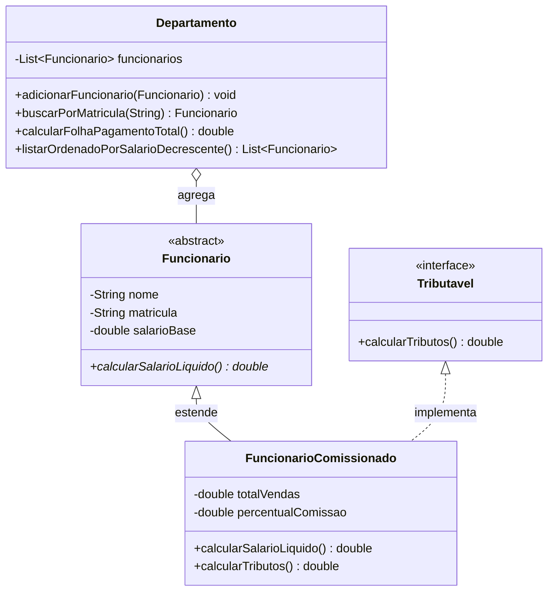

#### A Classe Agregadora: `Departamento.java`

```java
package br.com.unifef.sub;

import br.com.unifef.dominio.Funcionario;
import br.com.unifef.excecao.FuncionarioNaoEncontradoException;
import java.util.ArrayList;
import java.util.Comparator;
import java.util.List;

public class Departamento {
    private String nomeDepartamento;
    private List<Funcionario> colaboradores;

    public Departamento(String nomeDepartamento) {
        if (nomeDepartamento == null || nomeDepartamento.trim().isEmpty()) {
            throw new IllegalArgumentException("Nome do departamento invalido.");
        }
        this.nomeDepartamento = nomeDepartamento.trim();
        this.colaboradores = new ArrayList<>();
    }

    public void adicionarFuncionario(Funcionario f) {
        if (f == null) throw new IllegalArgumentException("Colaborador nao pode ser nulo.");
        for (Funcionario existente : this.colaboradores) {
            if (existente.getMatricula() == f.getMatricula()) {
                throw new IllegalStateException("Matricula duplicada no departamento: " + f.getMatricula());
            }
        }
        this.colaboradores.add(f);
    }

    public Funcionario buscarPorMatricula(int matricula) throws FuncionarioNaoEncontradoException {
        for (Funcionario f : this.colaboradores) {
            if (f.getMatricula() == matricula) {
                return f;
            }
        }
        throw new FuncionarioNaoEncontradoException("Colaborador com matricula " + matricula + " nao localizado.");
    }

    public double calcularFolhaPagamentoTotal() {
        double montante = 0.0;
        for (Funcionario f : this.colaboradores) {
            montante += f.calcularRemuneracaoLiquida();
        }
        return montante;
    }

    public List<Funcionario> listarOrdenadoPorSalarioDecrescente() {
        List<Funcionario> copia = new ArrayList<>(this.colaboradores);
        copia.sort(new Comparator<Funcionario>() {
            @Override
            public int compare(Funcionario f1, Funcionario f2) {
                return Double.compare(f2.calcularRemuneracaoLiquida(), f1.calcularRemuneracaoLiquida());
            }
        });
        return copia;
    }
}
```

---

## Módulo 9: Banco de Questões de Fixação e Simulado

Abaixo apresenta-se o banco de questões formativas no formato estruturado JSON Lines (JSONL), modelando avaliações objetivas do conteúdo da disciplina:

```jsonl
{"id": 1, "tema": "Infraestrutura", "pergunta": "Por que o Apache Tomcat 10 e incompativel com projetos Java EE 8 Web Profile?", "resposta": "O Tomcat 10 implementa Jakarta EE 9+, que substituiu o namespace javax.* por jakarta.*, gerando ClassNotFoundException em bibliotecas baseadas em Java EE 8."}
{"id": 2, "tema": "Persistencia", "pergunta": "Qual a finalidade de desativar o autoCommit na conexao JDBC atraves de conexao.setAutoCommit(false)?", "resposta": "Permitir o controle manual e atomico de transacoes, possibilitando confirmar alteracoes conjuntas via commit() ou reverter falhas via rollback()."}
{"id": 3, "tema": "Arquitetura MVC", "pergunta": "Qual a diferenca fundamental entre RequestDispatcher.forward() e HttpServletResponse.sendRedirect()?", "resposta": "O forward despacha a requisicao internamente no servidor mantendo os dados no request scope; o sendRedirect envia status HTTP 302 ao navegador instruindo-o a iniciar uma nova requisicao GET."}
{"id": 4, "tema": "Seguranca JDBC", "pergunta": "Por que o uso de PreparedStatement impede ataques de SQL Injection em comparacao com Statement simples?", "resposta": "Porque a estrutura SQL e pre-compilada no banco e os parametros sao tratados estritamente como literais de dados tipados, nunca como codigo executavel."}
{"id": 5, "tema": "Orientacao a Objetos", "pergunta": "Em termos de maquina virtual Java (JVM), o que e ligacao tardia (dynamic dispatch)?", "resposta": "E o mecanismo pelo qual a instrucao invokevirtual consulta a vtable da instancia real alocada no heap para decidir em tempo de execucao qual metodo sobrescrito executar."}
{"id": 6, "tema": "Camada View", "pergunta": "Qual a vantagem de utilizar a JSTL e Expression Language (EL) em substituicao aos scriptlets em paginas JSP?", "resposta": "Eliminar o acoplamento de codigo Java procedural dentro do HTML, melhorando a manutenibilidade, impedindo falhas de XSS e respeitando a separacao de camadas."}
{"id": 7, "tema": "Modelagem SQL", "pergunta": "Por que nunca devemos utilizar FLOAT ou DOUBLE para representar valores monetarios em bancos de dados?", "resposta": "Porque tipos de ponto flutuante binario da norma IEEE 754 sofrem de imprecisao de arredondamento em centavos. Deve-se adotar tipos exatos como DECIMAL ou NUMERIC."}
{"id": 8, "tema": "Padroes de Projeto", "pergunta": "Qual a motivacao do padrao Singleton na classe SingleConnection da aplicacao AplCurso?", "resposta": "Centralizar a conexao fisica JDBC em uma instancia unica, evitando o esgotamento de recursos e a sobrecarga computacional de conexoes repetidas."}
```

---

## Módulo 10: Glossário Terminológico e Checklist Arquitetural

### Glossário Terminológico de Engenharia de Software

- **ACID**: Acrônimo para Atomicidade, Consistência, Isolamento e Durabilidade. Conjunto de propriedades que garantem que transações em bancos de dados sejam processadas com confiabilidade.
- **Bytecode**: Formato binário intermediário gerado pelo compilador `javac` (extensão `.class`), independente da plataforma de hardware subjacente e executado pela JVM.
- **DAO (Data Access Object)**: Padrão arquitetural que abstrai e encapsula todos os acessos à camada de persistência de dados.
- **Dynamic Binding (Ligação Tardia)**: Resolução de chamadas de métodos em tempo de execução com base no tipo concreto do objeto na memória heap.
- **Expression Language (EL)**: Linguagem declarativa simplificada empregada em páginas JSP para acessar propriedades de componentes Java por meio da sintaxe `${objeto.propriedade}`.
- **Fail-Fast**: Prática de projeto onde o sistema interrompe imediatamente a execução (disparando uma exceção) no instante em que uma pré-condição ou invariante de estado é violado.
- **Garbage Collector (GC)**: Mecanismo automático de gerenciamento de memória da JVM que identifica e desaloca objetos no heap que não possuem mais referências ativas.
- **JIT (Just-In-Time Compiler)**: Componente da JVM que compila trechos críticos de bytecode frequentemente executados (*hotspots*) diretamente para instruções de código de máquina nativo da CPU.
- **JSTL**: *JavaServer Pages Standard Tag Library*. Conjunto padronizado de tags customizadas para iteração, controle de fluxo e formatação regional em páginas JSP.
- **LSP**: *Liskov Substitution Principle*. Princípio de design que determina que subclasses devem ser substitutas perfeitas de suas superclasses sem corromper as expectativas dos clientes.
- **Módulo 11**: Algoritmo matemático ponderado utilizado no Brasil para cálculo e validação dos dígitos verificadores de documentos oficiais (CPF e CNPJ).
- **MVC**: *Model-View-Controller*. Padrão arquitetural que desacopla a representação dos dados (Model), a interface de usuário (View) e o fluxo de interação e controle (Controller).
- **PRG**: *Post-Redirect-Get*. Padrão de desenvolvimento web que instrui o servidor a responder requisições de mutação `POST` com um redirecionamento HTTP (`302`), impedindo reenvios duplicados acidentais de formulário via tecla F5.
- **PreparedStatement**: Interface da API JDBC que pré-compila instruções SQL no servidor de banco de dados, vinculando parâmetros posicionais tipados e eliminando riscos de SQL Injection.
- **Servlet**: Componente de software Java executado no lado servidor que atende a requisições de rede sob o protocolo HTTP gerando respostas dinâmicas.
- **Singleton**: Padrão de projeto criacional que restringe a instanciação de uma classe a um único objeto global compartilhado.
- **vtable**: *Virtual Method Table*. Tabela de ponteiros de funções alocada pela JVM para resolver eficientemente o despacho de métodos polimórficos em tempo de execução.

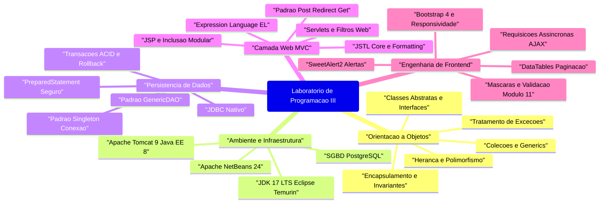

---

### Checklist Arquitetural de Auditoria de Software

Antes de submeter projetos ou realizar implantações corporativas, verifique o cumprimento estrito dos seguintes itens de qualidade:

- [ ] **Alinhamento do JDK**: O projeto compila e executa sem avisos sobre o JDK 17 LTS?
- [ ] **Compatibilidade do Contêiner**: O servidor associado é o Apache Tomcat 9, mantendo os pacotes sob `javax.servlet.*`?
- [ ] **Segurança contra Injeção de SQL**: Todas as instruções DML da camada DAO utilizam exclusivamente `PreparedStatement` com parâmetros marcados por interrogação (`?`), sem concatenação direta de Strings?
- [ ] **Liberação de Recursos JDBC**: Todos os objetos `ResultSet`, `PreparedStatement` e `Connection` são devidamente fechados através de `try-with-resources` ou em cláusulas `finally`?
- [ ] **Controle Transacional Explícito**: As operações de escrita (`INSERT`, `UPDATE`, `DELETE`) executam sobre conexões com `setAutoCommit(false)`, disparando `commit()` no sucesso e `rollback()` em blocos `catch`?
- [ ] **Proteção de Invariantes**: As classes de domínio barram dados nulos, cadeias vazias ou números fora de faixa diretamente em seus construtores e métodos modificadores?
- [ ] **Imunidade a Reenvio de Formulários**: O controlador web adota o padrão Post-Redirect-Get (`response.sendRedirect()`) após comandos de alteração de estado?
- [ ] **Isolamento de Camadas (MVC)**: As páginas JSP estão livres de scriptlets Java (`<% ... %>`), delegando o controle de apresentação unicamente a JSTL e Expression Language?
- [ ] **Mapeamento Monetário Preciso**: Todas as colunas e variáveis de valores financeiros foram declaradas com precisão exata (`DECIMAL(15,2)` no banco e conversões sem ponto flutuante binário)?
- [ ] **Validação Prévia de Documentos**: CPFs e CNPJs são criticados sintaticamente pelo algoritmo oficial de Módulo 11 antes da persistência física?

---

## Fontes e Metadados

- Turma no Classroom: 2026 1S Laboratório de Programação III
- Itens processados: 0 materiais, 6 tarefas, 6 avisos
- Gerado em: 27/10/2026, 20:36:31 (BRT) via classroom-sync
