# Manual de Estudos e Pratica — Laboratório de Programacao III

> **Instituição:** Centro Universitário de Santa Fé do Sul (UniFEF)  
> **Curso:** Bacharelado em Sistemas de Informação (3º Semestre)  
> **Disciplina:** Laboratório de Programação III  
> **Docente:** Prof. Jefferson Passerini  
> **Tema Central:** Engenharia de Aplicações Web Corporativas com Java EE 8, Apache Tomcat 9, NetBeans 24, Arquitetura MVC Monolítica, Persistência Relacional PostgreSQL via JDBC e Interface Dinâmica JSP/JSTL/AJAX

---

## Sumario

- [Modulo 1 — Configuracao de Ambiente, Ecossistema Java EE e Arquitetura Monolitica](#modulo-1--configuracao-de-ambiente-ecossistema-java-ee-e-arquitetura-monolitica)
  - [1.1 Ecossistema Java: JDK 17 LTS (Eclipse Temurin), JRE e JVM](#11-ecossistema-java-jdk-17-lts-eclipse-temurin-jre-e-jvm)
  - [1.2 Servidor de Aplicacao Web: Apache Tomcat 9 e a Transicao para Jakarta EE](#12-servidor-de-aplicacao-web-apache-tomcat-9-e-a-transicao-para-jakarta-ee)
  - [1.3 Ambiente Integrado: Apache NetBeans 24 e Automacao Apache Ant](#13-ambiente-integrado-apache-netbeans-24-e-automacao-apache-ant)
  - [1.4 Arquitetura de Software: Monolito Modular versus Microsservicos](#14-arquitetura-de-software-monolito-modular-versus-microsservicos)
  - [1.5 Padrao Arquitetural MVC no Contexto Web Java](#15-padrao-arquitetural-mvc-no-contexto-web-java)
  - [1.6 Estruturacao em Camadas e Pacotes Java: View, Filter, Controller, Model, DAO e Utils](#16-estruturacao-em-camadas-e-pacotes-java-view-filter-controller-model-dao-e-utils)
- [Modulo 2 — Camada de Apresentacao Modular com JSP, JSTL e Frontend](#modulo-2--camada-de-apresentacao-modular-com-jsp-jstl-e-frontend)
  - [2.1 Modularizacao Visual e Decomposicao de Paginas](#21-modularizacao-visual-e-decomposicao-de-paginas)
  - [2.2 Inclusao Dinamica (jsp:include) versus Inclusao Estatica (<%@include%>)](#22-inclusao-dinamica-jspinclude-versus-inclusao-estatica-include)
  - [2.3 Biblioteca de Tags Padronizadas (JSTL Core e Formatting) e Diretiva taglib](#23-biblioteca-de-tags-padronizadas-jstl-core-e-formatting-e-diretiva-taglib)
  - [2.4 Resolucao Dinamica de Rotas com Expression Language](#24-resolucao-dinamica-de-rotas-com-expression-language)
  - [2.5 Arquitetura de Ativos Estaticos e Ordem Critica de Scripts](#25-arquitetura-de-ativos-estaticos-e-ordem-critica-de-scripts)
- [Modulo 3 — Persistencia Relacional, JDBC, Singleton e Interceptacao](#modulo-3--persistencia-relacional-jdbc-singleton-e-interceptacao)
  - [3.1 Modelagem e Administracao no PostgreSQL e pgAdmin 4](#31-modelagem-e-administracao-no-postgresql-e-pgadmin-4)
  - [3.2 DDL da Tabela usuario, Chaves Primarias SERIAL e Tipagem Financeira](#32-ddl-da-tabela-usuario-chaves-primarias-serial-e-tipagem-financeira)
  - [3.3 Versionamento de Infraestrutura de Dados: Script banco.sql no Pacote utils](#33-versionamento-de-infraestrutura-de-dados-script-bancosql-no-pacote-utils)
  - [3.4 Padrao de Projeto Criacional Singleton: Estrutura, Vantagens e Riscos](#34-padrao-de-projeto-criacional-singleton-estrutura-vantagens-e-riscos)
  - [3.5 Implementacao da Conexao Centralizada com a Classe SingleConnection](#35-implementacao-da-conexao-centralizada-com-a-classe-singleconnection)
  - [3.6 Controle Transacional Manual e Propriedades ACID](#36-controle-transacional-manual-e-propriedades-acid)
  - [3.7 Interceptacao de Requisicoes com Servlet Filters](#37-interceptacao-de-requisicoes-com-servlet-filters)
  - [3.8 Depuracao de Software e Diretrizes de Acessibilidade](#38-depuracao-de-software-e-diretrizes-de-acessibilidade)
- [Modulo 4 — Implementacao da Consulta no Modelo MVC (Listar)](#modulo-4--implementacao-da-consulta-no-modelo-mvc-listar)
  - [4.1 Construcao do JavaBean Usuario (Encapsulamento, Construtores, equals e hashCode)](#41-construcao-do-javabean-usuario-encapsulamento-construtores-equals-e-hashcode)
  - [4.2 Interfaces em Java: Teoria, Desacoplamento e Contratos de Persistencia](#42-interfaces-em-java-teoria-desacoplamento-e-contratos-de-persistencia)
  - [4.3 Criacao da Interface GenericDAO e Analise de Object versus Generics](#43-criacao-da-interface-genericdao-e-analise-de-object-versus-generics)
  - [4.4 Implementacao da UsuarioDAO: Metodo listar(), PreparedStatement e Cursor ResultSet](#44-implementacao-da-usuariodao-metodo-listar-preparedstatement-e-cursor-resultset)
  - [4.5 Servlets HTTP: Ciclo de Vida, Metodos doGet/doPost e o Controlador UsuarioListar](#45-servlets-http-ciclo-de-vida-metodos-dogetdopost-e-o-controlador-usuariolistar)
  - [4.6 Compartilhamento de Escopo e Despacho via RequestDispatcher](#46-compartilhamento-de-escopo-e-despacho-via-requestdispatcher)
  - [4.7 Construcao da View usuarioListar.jsp: Tabelas Dinamicas, Formatacao JSTL e DataTables](#47-construcao-da-view-usuariolistarjsp-tabelas-dinamicas-formatacao-jstl-e-datatables)
- [Modulo 5 — Manutencao Cadastral Completa (Inclusao, Validacoes Assincronas e Edicao)](#modulo-5--manutencao-cadastral-completa-inclusao-validacoes-assincronas-e-edicao)
  - [5.1 Decisao de Persistencia na DAO: Bifurcacao por Identificador (id == 0)](#51-decisao-de-persistencia-na-dao-bifurcacao-por-identificador-id--0)
  - [5.2 Implementacao do Metodo inserir() com PreparedStatement e Tratamento de Datas](#52-implementacao-do-metodo-inserir-com-preparedstatement-e-tratamento-de-datas)
  - [5.3 Verificacao de Duplicidade no Banco: Metodo cpfExiste() com COUNT(*)](#53-verificacao-de-duplicidade-no-banco-metodo-cpfexiste-com-count)
  - [5.4 Validacao Algoritmica de Documentos: Modulo 11 para CPF e CNPJ](#54-validacao-algoritmica-de-documentos-modulo-11-para-cpf-e-cnpj)
  - [5.5 Metodos Estaticos versus Metodos de Instancia na Engenharia de Software](#55-metodos-estaticos-versus-metodos-de-instancia-na-engenharia-de-software)
  - [5.6 Servlet Assincrono UsuarioVerificarCPF para Validacao via AJAX](#56-servlet-assincrono-usuarioverificarcpf-para-validacao-via-ajax)
  - [5.7 Servlet de Inicializacao UsuarioNovo e Encaminhamento com Modelo Vazio](#57-servlet-de-inicializacao-usuarionovo-e-encaminhamento-com-modelo-vazio)
  - [5.8 Servlet Controlador UsuarioCadastrar: Parse de Tipos, Higienizacao e Codigos de Retorno](#58-servlet-controlador-usuariocadastrar-parse-de-tipos-higienizacao-e-codigos-de-retorno)
  - [5.9 Interface de Manutencao usuarioCadastrar.jsp: Formulario Hibrido, Mascaras e AJAX](#59-interface-de-manutencao-usuariocadastrarjsp-formulario-hibrido-mascaras-e-ajax)
  - [5.10 Metodo carregar() na DAO e Fluxo de Atualizacao Cadastral](#510-metodo-carregar-na-dao-e-fluxo-de-atualizacao-cadastral)
- [Codigo-Fonte Consolidado da Aplicacao](#codigo-fonte-consolidado-da-aplicacao)
- [Bateria de Exercicios Praticos e Dissertativos](#bateria-de-exercicios-praticos-e-dissertativos)
- [Erros Comuns, Diagnosticos e Boas Praticas de Engenharia](#erros-comuns-diagnosticos-e-boas-praticas-de-engenharia)
- [Glossario Tecnico e Termos Essenciais](#glossario-tecnico-e-termos-essenciais)
- [Pontos-Chave para Avaliacoes e Provas](#pontos-chave-para-avaliacoes-e-provas)
- [Banco de Questoes para Fixacao (JSONL)](#banco-de-questoes-para-fixacao-jsonl)
- [Checklist Geral de Revisao e Implantacao](#checklist-geral-de-revisao-e-implantacao)

---

## Modulo 1 — Configuracao de Ambiente, Ecossistema Java EE e Arquitetura Monolitica

### 1.1 Ecossistema Java: JDK 17 LTS (Eclipse Temurin), JRE e JVM

O desenvolvimento corporativo sobre a plataforma Java assenta-se em uma hierarquia de componentes de software que viabilizam a compilação, distribuição e execução independente de arquitetura de hardware:

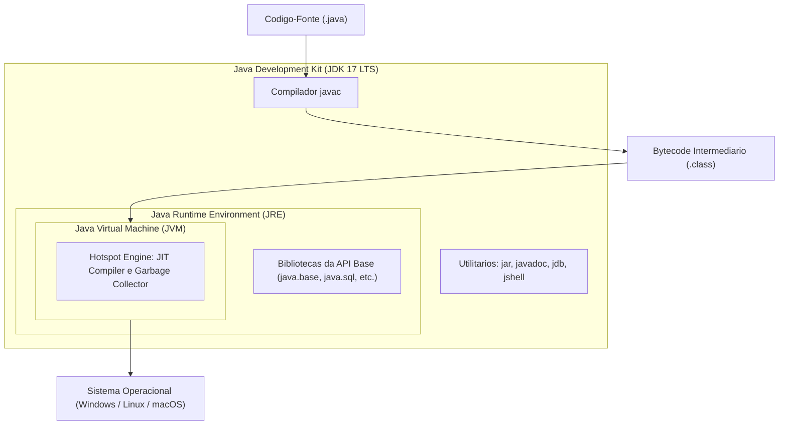

#### Definições Formais
- **Java Virtual Machine (JVM):** Máquina abstrata baseada em pilha (*stack-based virtual machine*) que carrega arquivos `.class`, verifica a segurança estrutural do bytecode através do *Bytecode Verifier*, executa as instruções interpretadas e compila trechos de alto consumo de processamento para linguagem de máquina nativa via *Just-In-Time Compiler* (JIT), além de automatizar a gestão de memória pelo *Garbage Collector*.
- **Java Runtime Environment (JRE):** Agrupamento mínimo executável contendo a JVM e as bibliotecas essenciais do Java Standard Edition.
- **Java Development Kit (JDK):** Superconjunto do JRE que agrega ferramentas de diagnóstico, empacotamento (`jar`) e o compilador primário (`javac`).

#### Motivação da Escolha da Versão 17 LTS (Eclipse Temurin)
A versão Java 17 constitui um marco de suporte de longo prazo (*Long-Term Support* - LTS). Lançada sob governança do consórcio Eclipse Adoptium, a distribuição Temurin oferece estabilidade operacional, garantia contínua de correções de vulnerabilidades críticas (CVEs) e previsibilidade de ciclo de vida, evitando a volatilidade semestral das versões intermediárias não-LTS.

#### Armadilhas e Verificações Operacionais
A coexistência de múltiplos runtimes Java em estações Windows frequentemente corrompe a variável de ambiente `PATH`, fazendo com que o comando `java` invoque uma versão diferente daquela invocada por `javac`. É obrigatório executar a auditoria no terminal:

```powershell
java -version
javac -version
```

Ambas as saídas devem atestar estritamente o build `17.0.x`. A divergência de versões acarreta erros de compilação ou incompatibilidade de versão de formato de classe (`UnsupportedClassVersionError: Unsupported major.minor version`).

---

### 1.2 Servidor de Aplicacao Web: Apache Tomcat 9 e a Transicao para Jakarta EE

O Apache Tomcat não opera como um servidor de aplicação Full Java EE (como WildFly ou Payara), mas sim como um **Servlet Container** e **JSP Engine** de alta performance. Ele implementa as especificações centrais do ecossistema Web:

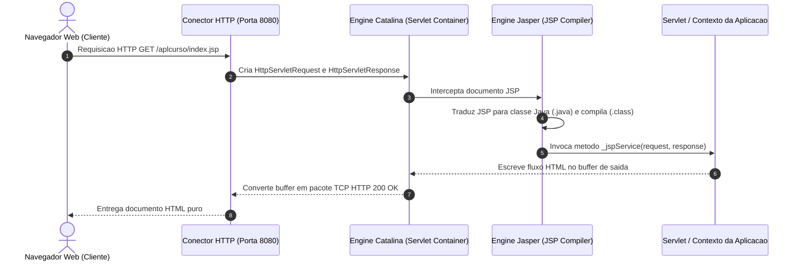

#### A Ruptura Histórica: Tomcat 9 versus Tomcat 10+
Em decorrência da transferência dos direitos da marca Java EE da Oracle para a Eclipse Foundation, houve uma quebra de retrocompatibilidade a partir da especificação Jakarta EE 9. O pacote raiz corporativo `javax.*` foi compulsoriamente renomeado para `jakarta.*`.

| Versão do Apache Tomcat | Especificação Servlet | Especificação JSP | Namespace dos Pacotes | Compatibilidade com Java EE 8 Web |
| :--- | :--- | :--- | :--- | :--- |
| **Tomcat 8.5.x** | Servlet 3.1 | JSP 2.3 | `javax.servlet.*` | Compatível (Legado) |
| **Tomcat 9.0.x** | **Servlet 4.0** | **JSP 2.3** | `javax.servlet.*` | **Padrão Exigido na Disciplina** |
| **Tomcat 10.0.x / 10.1.x** | Servlet 5.0 / 6.0 | JSP 3.0 / 3.1 | `jakarta.servlet.*` | Incompatível (`ClassNotFoundException`) |
| **Tomcat 11.0.x** | Servlet 6.1 | JSP 4.0 | `jakarta.servlet.*` | Incompatível (`ClassNotFoundException`) |

> **Nota de Alerta Técnico:** No projeto pedagógico estruturado sobre o padrão Java EE 8, o uso do Apache Tomcat 10+ lança exceções imediatas em tempo de implantação (*deployment failure*), pois as bibliotecas de dependência (como JSTL 1.2 e as anotações `@WebServlet`) buscam as classes sob o namespace `javax.servlet`. O contêiner de execução obrigatório é o **Apache Tomcat 9.0.x**.

---

### 1.3 Ambiente Integrado: Apache NetBeans 24 e Automacao Apache Ant

O Apache NetBeans 24 provê suporte maduro para desenvolvimento corporativo sem a necessidade de plugins instáveis de terceiros. 

#### Características do Apache Ant no NetBeans
Diferente do Apache Maven ou Gradle, que operam orientados a convenção e repositórios remotos centralizados, o **Apache Ant** opera orientado a tarefas imperativas definidas no arquivo XML `build.xml`. As dependências são vinculadas fisicamente no diretório de bibliotecas locais do projeto, assegurando autonomia de compilação em laboratórios sem conexão irrestrita à internet.

---

### 1.4 Arquitetura de Software: Monolito Modular versus Microsservicos

#### Definição
Uma arquitetura monolítica agrupa todos os componentes de software — apresentação visual, controle de fluxo, validações de domínio, acesso a dados e configuração de infraestrutura — dentro de uma **única base de código implantada como um único processo na Máquina Virtual Java**.

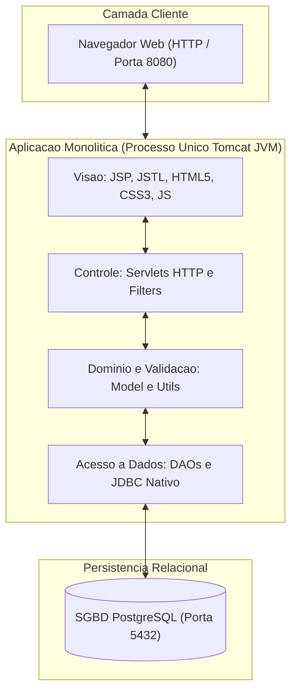

#### Comparativo Arquitetural

| Eixo de Análise | Monólito Modular (Padrão da Disciplina) | Microsserviços Distribuídos |
| :--- | :--- | :--- |
| **Comunicação entre Camadas** | Invocação direta de métodos em memória (*In-memory calls*). | Chamadas de rede remotas (HTTP/REST, gRPC, Filas). |
| **Latência Operacional** | Desprezível (nanossegundos entre métodos). | Relevante (milissegundos por chamada de rede). |
| **Controle Transacional** | Transação local ACID gerenciada via conexão JDBC única. | Transações distribuídas complexas (Two-Phase Commit, Saga). |
| **Complexidade de Deploy** | Simples: implantação de um único artefato `.war`. | Complexa: orquestração de múltiplos contêineres e gateways. |
| **Ponto de Falha** | Um crash de memória derruba toda a aplicação. | Falhas podem ser isoladas por serviço (resiliência). |

---

### 1.5 Padrao Arquitetural MVC no Contexto Web Java

O padrão MVC desacopla a aplicação em três responsabilidades essenciais:
1. **Model (Modelo):** Representa o estado e as estruturas de dados do domínio. Não conhece classes visuais e não processa requisições HTTP.
2. **View (Visão):** Renderiza a saída para o cliente. Recebe dados preparados pela camada de controle através de atributos de requisição ou sessão, utilizando JSP, JSTL e Expression Language.
3. **Controller (Controlador):** Atua como interceptador e orquestrador. Recebe requisições HTTP via Servlets, realiza a extração e conversão de parâmetros, invoca as regras de negócio e métodos da camada DAO e decide para qual View despachar o fluxo.

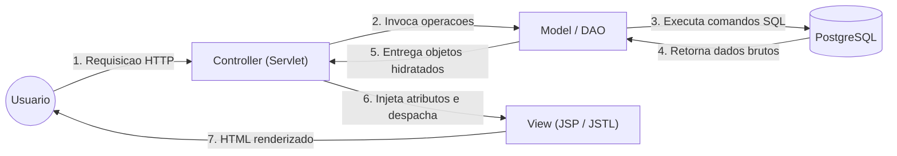

---

### 1.6 Estruturacao em Camadas e Pacotes Java: View, Filter, Controller, Model, DAO e Utils

A estrutura física do projeto Java Web sob o padrão NetBeans/Ant organiza-se no pacote raiz `br.com.aplcurso`:

- `br.com.aplcurso.model`: Contém os JavaBeans/POJOs que representam as entidades do domínio do sistema (ex.: `Usuario.java`).
- `br.com.aplcurso.dao`: Contém as classes que implementam o padrão *Data Access Object* e manipulam conexões JDBC (ex.: `GenericDAO.java`, `UsuarioDAO.java`).
- `br.com.aplcurso.controller.usuario`: Contém as Servlets controladoras responsáveis pelo atendimento HTTP das operações cadastrais (ex.: `UsuarioListar.java`, `UsuarioCadastrar.java`, `UsuarioNovo.java`).
- `br.com.aplcurso.filter`: Contém os interceptadores de ciclo de vida e autorização da aplicação (ex.: `FilterAutenticacao.java`).
- `br.com.aplcurso.utils`: Classes transversais de infraestrutura, incluindo a gestão de conexões (`SingleConnection.java`), validadores matemáticos (`DocumentoValidador.java`) e scripts SQL de versionamento (`banco.sql`).
- `Web Pages`: Diretório raiz do front-end contendo páginas JSP, subpastas para scripts (`/js`), folhas de estilo (`/css`) e o diretório restrito `WEB-INF`.

---

## Modulo 2 — Camada de Apresentacao Modular com JSP, JSTL e Frontend

### 2.1 Modularizacao Visual e Decomposicao de Paginas

#### Definição e Motivação
A construção de aplicações corporativas demanda consistência de layout e facilidade de manutenção corretiva. A duplicação da marcação de cabeçalho (`<head>`, inclusão de CSS e scripts) e rodapé em todos os arquivos JSP viola o princípio DRY (*Don't Repeat Yourself*). Qualquer alteração de biblioteca exigiria refatoração em dezenas de arquivos.

A arquitetura adota a **decomposição em fragmentos**:
- `header.jsp`: Abre o documento HTML, define codificação, importa bibliotecas CSS/JS e abre o elemento `<body>`.
- `menu.jsp`: Contém a barra de navegação responsiva e links dinâmicos.
- *Página Específica (ex.: `usuarioListar.jsp`)*: Contém exclusivamente a marcação semântica do miolo da página.
- `footer.jsp`: Fecha as seções abertas, inclui informações institucionais e finaliza as tags `</body>` e `</html>`.

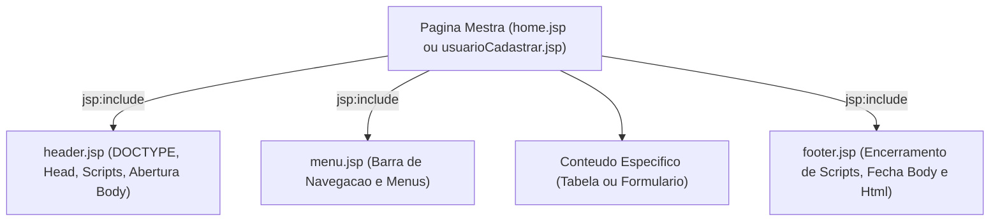

---

### 2.2 Inclusao Dinamica (jsp:include) versus Inclusao Estatica (<%@include%>)

A inclusão de fragmentos de páginas JSP pode ocorrer por meio de duas abordagens tecnicamente distintas:

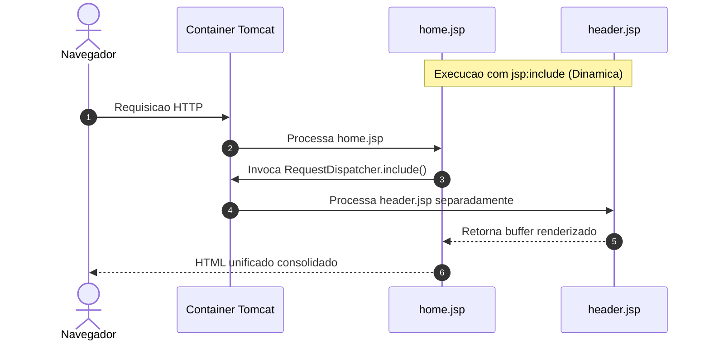

| Critério de Comparação | Ação `<jsp:include page="..." />` | Diretiva `<%@include file="..." %>` |
| :--- | :--- | :--- |
| **Momento de Processamento** | Tempo de Requisição (*Request-time*). | Tempo de Tradução (*Translation-time*). |
| **Mecanismo Operacional** | Invoca `RequestDispatcher.include()`. O fragmento é um servlet independente. | Copia textualmente o código do arquivo para dentro do JSP pai antes da compilação. |
| **Escopo de Variáveis Java** | Isolado. Variáveis declaradas no arquivo incluído não existem no arquivo pai. | Compartilhado. Cria dependência direta de variáveis no mesmo escopo local de método. |
| **Passagem de Parâmetros** | Suporta passagem de parâmetros dinâmicos via `<jsp:param>`. | Não suporta passagem de parâmetros. |
| **Impacto de Alterações** | Modificações no fragmento refletem na próxima requisição sem compilar o pai. | Exige detecção de alteração e recompilação completa do JSP pai. |

---

### 2.3 Biblioteca de Tags Padronizadas (JSTL Core e Formatting) e Diretiva taglib

O uso de código Java bruto embutido em páginas HTML através de *scriptlets* (`<% ... %>`) degrada a manutenibilidade e abre brechas para vulnerabilidades de segurança como Cross-Site Scripting (XSS). A especificação JSTL substitui o código imperativo por tags declarativas baseadas em XML.

#### Declaração das Bibliotecas via Diretiva taglib
No topo de cada documento JSP que demande processamento condicional, laços ou formatação, inserem-se as diretivas:

```jsp
<%@taglib prefix="c" uri="http://java.sun.com/jsp/jstl/core" %>
<%@taglib prefix="fmt" uri="http://java.sun.com/jsp/jstl/fmt" %>
```

- **Prefixo `c` (Core):** Controle de fluxo, iteração e manipulação de variáveis (`<c:forEach>`, `<c:if>`, `<c:choose>`, `<c:set>`).
- **Prefixo `fmt` (Formatting):** Internacionalização, formatação de grandezas monetárias e tratamento de datas sensíveis ao fuso horário e localidade (`<fmt:formatDate>`, `<fmt:formatNumber>`).

---

### 2.4 Resolucao Dinamica de Rotas com Expression Language

O uso de caminhos relativos para ativos estáticos ou URLs de servlets (como `../../js/app.js` ou `UsuarioListar`) gera falhas estruturais quando a aplicação é acessada a partir de subdiretórios ou despachada por controladores em diferentes profundidades de URI.

A Expression Language (EL) resolve o caminho base dinamicamente através do objeto implícito `pageContext`:

```jsp
${pageContext.request.contextPath}/UsuarioListar
```

Caso o contexto de deploy no Apache Tomcat seja `/aplcurso`, o contêiner avalia a expressão em tempo de execução como `/aplcurso/UsuarioListar`, garantindo que a rota seja absoluta a partir da raiz da aplicação web, independentemente da pasta onde o arquivo JSP resida.

---

### 2.5 Arquitetura de Ativos Estaticos e Ordem Critica de Scripts

A inclusão de arquivos JavaScript na tag `<head>` dentro de `header.jsp` obedece a uma ordem estrita de dependências lineares. A inversão na declaração dos elementos acarreta no lançamento imediato de exceções `ReferenceError: $ is not defined` no console do navegador do cliente.

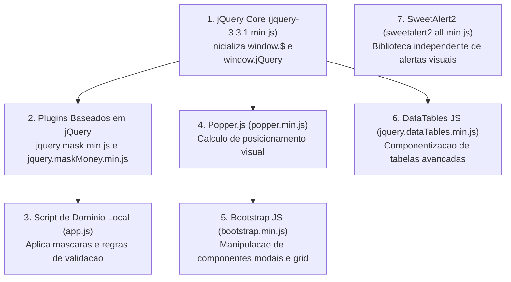

---

## Modulo 3 — Persistencia Relacional, JDBC, Singleton e Interceptacao

### 3.1 Modelagem e Administracao no PostgreSQL e pgAdmin 4

O PostgreSQL é um SGBD relacional de código aberto com conformidade estrita ao padrão ANSI SQL. A ferramenta gráfica pgAdmin 4 conecta-se ao servidor na porta padrão TCP `5432`.

#### Armadilha Operacional de Atualização no pgAdmin
Ao criar novos bancos de dados ou tabelas via scripts executados na ferramenta *Query Tool*, a árvore estrutural lateral do pgAdmin não sincroniza seu estado interno automaticamente. Torna-se indispensável acionar a opção **Refresh...** no menu de contexto do objeto pai para evitar falsos diagnósticos de ausência de objetos.

---

### 3.2 DDL da Tabela usuario, Chaves Primarias SERIAL e Tipagem Financeira

A criação da infraestrutura física da tabela `usuario` no banco `bdaplcurso` deve garantir restrições de integridade ao nível do banco de dados:

```sql
CREATE TABLE usuario (
    id SERIAL PRIMARY KEY,
    nome VARCHAR(100) NOT NULL,
    datanascimento DATE NOT NULL,
    cpf VARCHAR(14) UNIQUE NOT NULL,
    email VARCHAR(100) UNIQUE NOT NULL,
    senha VARCHAR(20) NOT NULL,
    salario DECIMAL(15,2) NOT NULL
);
```

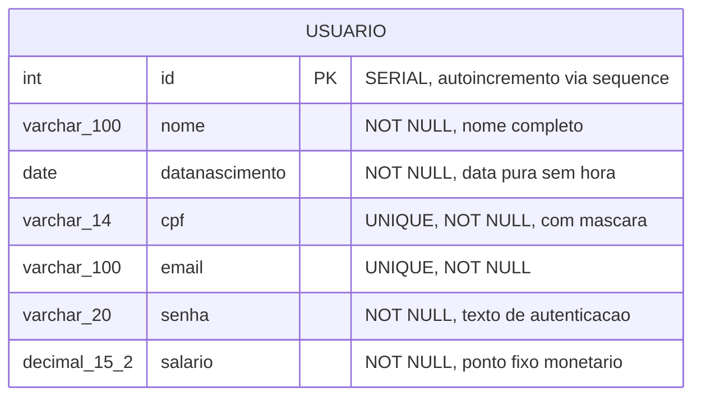

#### O Mecanismo Subjacente do Tipo SERIAL
A instrução `id SERIAL PRIMARY KEY` executa internamente no PostgreSQL:
1. Criação do gerador de sequência atômico: `CREATE SEQUENCE usuario_id_seq;`
2. Associação da coluna ao tipo `INTEGER` assinado de 4 bytes.
3. Definição do valor padrão: `DEFAULT nextval('usuario_id_seq')`.
4. Definição de propriedade de dependência: `ALTER SEQUENCE usuario_id_seq OWNED BY usuario.id;`

#### Tipagem Financeira: DECIMAL versus FLOAT
Tipos de dados em ponto flutuante binário (`FLOAT`, `REAL`, `DOUBLE PRECISION`) obedecem à especificação IEEE 754, que armazena frações decimais através de aproximações de potências negativas de 2. Isso acarreta erros de arredondamento cumulativos em cálculos monetários. 

O uso de `DECIMAL(15,2)` ou `NUMERIC(15,2)` impõe representação numérica de base 10 com ponto fixo, garantindo precisão matemática exata nos centavos.

---

### 3.3 Versionamento de Infraestrutura de Dados: Script banco.sql no Pacote utils

Para garantir que as alterações no modelo de dados acompanhem os artefatos de código, o script de infraestrutura `banco.sql` é versionado dentro do pacote Java `br.com.aplcurso.utils` em `Source Packages`. Essa estratégia assegura a rastreabilidade das estruturas DDL no repositório de controle de versão (Git).

---

### 3.4 Padrao de Projeto Criacional Singleton: Estrutura, Vantagens e Riscos

#### Definição Formal (GoF)
O padrão de criação **Singleton** assegura que uma classe possua apenas uma única instância durante toda a execução da aplicação e fornece um ponto de acesso global e estático a essa instância.

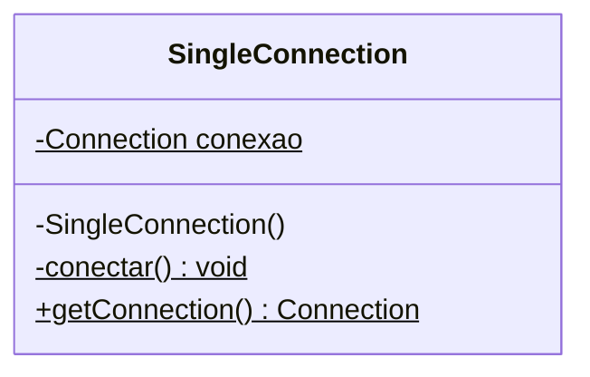

#### Vantagens na Abordagem Didática
- Centraliza a leitura das credenciais de banco (Driver, URL, Usuário e Senha).
- Evita o esgotamento do limite máximo de conexões simultâneas do PostgreSQL decorrente da abertura desenfreada de conexões não fechadas por múltiplas DAOs.

#### Riscos e Desvantagens em Ambientes de Alta Concorrência
- **Gargalo de Concorrência (*Bottleneck*):** Em servidores de produção multi-thread, o compartilhamento de um único objeto `Connection` entre dezenas de requisições simultâneas gera contenção de transações ou corrupção de estado de cursores JDBC. Em arquiteturas industriais, o Singleton sobre a conexão física é substituído por um **Pool de Conexões** (como Apache Commons DBCP ou HikariCP), mantendo o padrão Singleton aplicado ao próprio Pool gerenciador.

---

### 3.5 Implementacao da Conexao Centralizada com a Classe SingleConnection

A classe `SingleConnection` é estruturada com construtor privado, bloco estático de carga de driver e método público estático de recuperação:

```java
package br.com.aplcurso.utils;

import java.sql.Connection;
import java.sql.DriverManager;

public class SingleConnection {
    
    private static final String BANCO = "jdbc:postgresql://localhost:5432/bdaplcurso";
    private static final String DRIVER = "org.postgresql.Driver";
    private static final String USUARIO = "postgres";
    private static final String SENHA = "root";
    
    private static Connection conexao = null;
    
    static {
        conectar();
    }
    
    private SingleConnection() {
    }
    
    private static void conectar() {
        try {
            if (conexao == null || conexao.isClosed()) {
                Class.forName(DRIVER);
                conexao = DriverManager.getConnection(BANCO, USUARIO, SENHA);
                conexao.setAutoCommit(false);
            }
        } catch (Exception e) {
            System.out.println("Falha critica na conexao JDBC: " + e.getMessage());
            e.printStackTrace();
        }
    }
    
    public static Connection getConnection() {
        try {
            if (conexao == null || conexao.isClosed()) {
                conectar();
            }
        } catch (Exception e) {
            e.printStackTrace();
        }
        return conexao;
    }
}
```

---

### 3.6 Controle Transacional Manual e Propriedades ACID

Por padrão, a API JDBC opera em modo `autoCommit(true)`, persistindo imediatamente cada comando SQL executado. Para suportar consistência transacional sob o acrônimo **ACID**:
- **Atomicidade:** A operação completa é confirmada com sucesso ou revertida em sua totalidade.
- **Consistência:** O banco migra de um estado válido a outro, respeitando constraints.
- **Isolamento:** Transações simultâneas não interferem no estado transiente umas das outras.
- **Durabilidade:** Uma vez comitado, o dado persiste contra falhas de infraestrutura.

Ao executar `conexao.setAutoCommit(false)`, a aplicação toma a responsabilidade explícita de chamar `conexao.commit()` ao término do bloco de sucesso e `conexao.rollback()` dentro do bloco de tratamento de exceções `catch`.

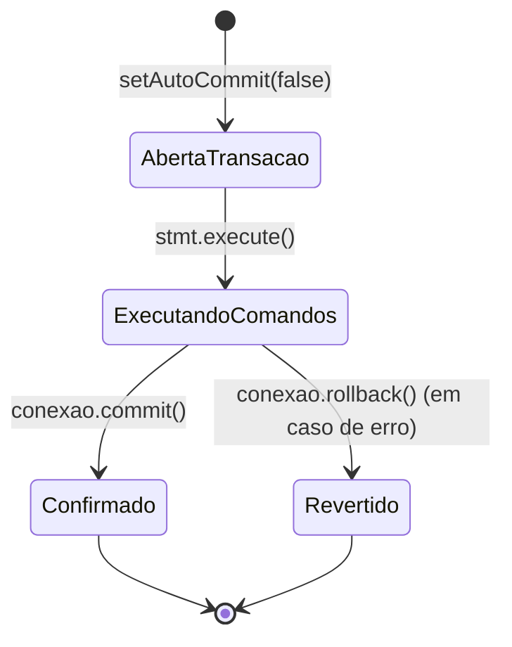

---

### 3.7 Interceptacao de Requisicoes com Servlet Filters

A interface `javax.servlet.Filter` possibilita a interceptação transversal de requisições e respostas HTTP antes que atinjam a Servlet de destino ou retornem ao navegador.

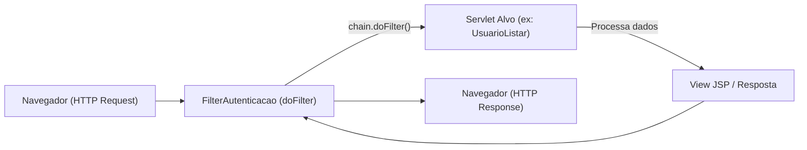

#### Ciclo de Vida do Filter
1. `init(FilterConfig filterConfig)`: Executado uma única vez na inicialização da aplicação web pelo contêiner Tomcat. Utilizado para aquisição de recursos globais e conexão com o banco.
2. `doFilter(ServletRequest request, ServletResponse response, FilterChain chain)`: Invocado a cada requisição correspondente ao mapeamento `@WebFilter("/*")`. A invocação do método `chain.doFilter(request, response)` transfere o controle para o próximo filtro na cadeia ou para o recurso final.
3. `destroy()`: Executado pelo Tomcat na desativação ou encerramento da aplicação para liberar conexões e threads ativas.

---

### 3.8 Depuracao de Software e Diretrizes de Acessibilidade

O desenvolvimento em IDE exige a aplicação de técnicas formais de inspeção de estado interno de objetos em tempo de execução:
- **Breakpoints (Ctrl + F8):** Interrompem o fluxo da thread no ponto selecionado.
- **Watches e Variables Panel:** Permitem auditar os valores contidos em objetos `HttpServletRequest`, atributos de sessão e cursores `ResultSet`.

#### Diretrizes para Desenvolvedores Cegos (Acessibilidade na Depuração)
A inspeção puramente visual de janelas e árvores de variáveis em IDEs frequentemente oferece barreiras a leitores de tela como NVDA ou JAWS. 
- **Boas Práticas de Engenharia:** Emprego de rastreamento padronizado em console de erro via `System.err.println()` ou frameworks estruturados como Log4j/SLF4J, emitindo linhas textuais descritivas lineares contendo identificador do método, estado das variáveis e rastro de pilhas formatado (`e.printStackTrace()`).

---

## Modulo 4 — Implementacao da Consulta no Modelo MVC (Listar)

### 4.1 Construcao do JavaBean Usuario (Encapsulamento, Construtores, equals e hashCode)

O JavaBean corporativo representa a entidade de negócio e implementa os contratos fundamentais de objeto da plataforma Java.

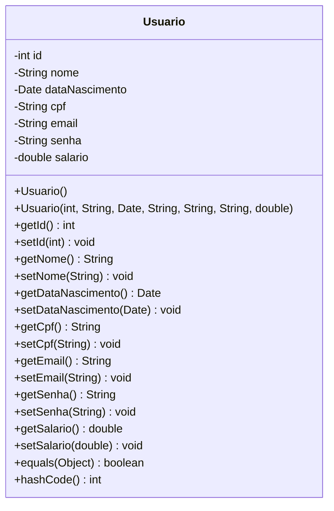

#### Contrato de Identidade: hashCode e equals
Em coleções baseadas em tabelas hash (`HashSet`, `HashMap`), a comparação entre objetos exige a sobreposição sincronizada de `equals(Object)` e `hashCode()`. A igualdade de duas instâncias de `Usuario` deve ser balizada unicamente pelas chaves de negócio invariantes: a chave primária `id` e o identificador fiscal único `cpf`.

```java
@Override
public int hashCode() {
    int hash = 7;
    hash = 89 * hash + this.id;
    hash = 89 * hash + (this.cpf != null ? this.cpf.hashCode() : 0);
    return hash;
}

@Override
public boolean equals(Object obj) {
    if (this == obj) return true;
    if (obj == null || getClass() != obj.getClass()) return false;
    final Usuario other = (Usuario) obj;
    if (this.id != other.id) return false;
    return (this.cpf == null) ? (other.cpf == null) : this.cpf.equals(other.cpf);
}
```

---

### 4.2 Interfaces em Java: Teoria, Desacoplamento e Contratos de Persistencia

Uma interface estabelece um contrato formal de serviços públicos que uma classe concreta deve honrar. O desacoplamento viabilizado por interfaces permite a substituição da tecnologia de persistência subjacente sem modificar o código das camadas consumidoras (Controllers).

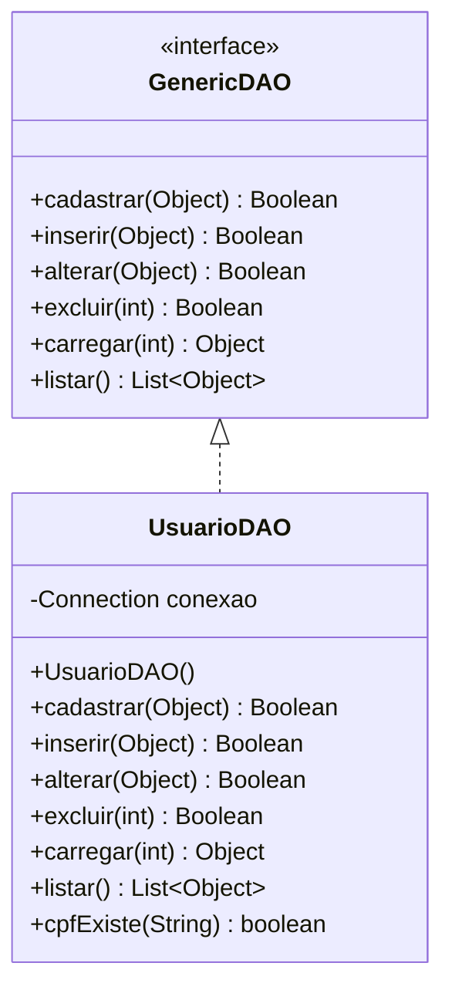

---

### 4.3 Criacao da Interface GenericDAO e Analise de Object versus Generics

A interface `GenericDAO` define a assinatura universal das operações CRUD do sistema:

```java
package br.com.aplcurso.dao;

import java.util.List;

public interface GenericDAO {
    public Boolean cadastrar(Object objeto);
    public Boolean inserir(Object objeto);
    public Boolean alterar(Object objeto);
    public Boolean excluir(int numero);
    public Object carregar(int numero);
    public List<Object> listar();
}
```

#### Avaliação Crítica: Object versus Java Generics
- **Abordagem com Object (Material Pedagógico):** Permite reutilizar a mesma interface para qualquer entidade (`Usuario`, `Produto`, `Fornecedor`) sem introduzir complexidade de sintaxe de tipos genéricos no início da disciplina.
- **Armadilha Técnica:** A utilização de `Object` compromete a segurança de tipos em tempo de compilação (*Compile-time type safety*), forçando a realização de operações manuais de *casting* que podem deflagrar `ClassCastException` em tempo de execução.
- **Complemento Técnico (Evolução Corporativa):** Em projetos industriais modernos, a interface é expressa com parâmetros de tipo:
  ```java
  public interface GenericDAO<T, K> {
      public Boolean cadastrar(T objeto);
      public T carregar(K id);
      public List<T> listar();
  }
  ```

---

### 4.4 Implementacao da UsuarioDAO: Metodo listar(), PreparedStatement e Cursor ResultSet

O método `listar()` extrai as tuplas da tabela `usuario`, itera sobre o cursor `ResultSet`, hidrata instâncias de `Usuario` e compõe uma coleção `List<Object>` retornada à controladora.

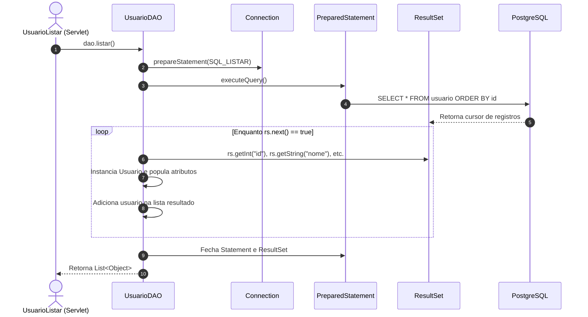

#### Código Comentado do Método listar()

```java
@Override
public List<Object> listar() {
    List<Object> resultado = new ArrayList<>();
    PreparedStatement stmt = null;
    ResultSet rs = null;
    String sql = "SELECT * FROM usuario ORDER BY id";
    try {
        stmt = conexao.prepareStatement(sql);
        rs = stmt.executeQuery();
        while (rs.next()) {
            Usuario oUsuario = new Usuario();
            oUsuario.setId(rs.getInt("id"));
            oUsuario.setNome(rs.getString("nome"));
            oUsuario.setDataNascimento(rs.getDate("datanascimento"));
            oUsuario.setCpf(rs.getString("cpf"));
            oUsuario.setEmail(rs.getString("email"));
            oUsuario.setSenha(rs.getString("senha"));
            oUsuario.setSalario(rs.getDouble("salario"));
            resultado.add(oUsuario);
        }
    } catch (SQLException ex) {
        System.out.println("Problemas ao listar Usuarios! Erro: " + ex.getMessage());
        ex.printStackTrace();
    } finally {
        try {
            if (rs != null) rs.close();
            if (stmt != null) stmt.close();
        } catch (SQLException e) {
            e.printStackTrace();
        }
    }
    return resultado;
}
```

---

### 4.5 Servlets HTTP: Ciclo de Vida, Metodos doGet/doPost e o Controlador UsuarioListar

As Servlets operam como os nós de controle do padrão MVC no Java Web. A anotação `@WebServlet` declara o mapeamento de URL dispensando configurações extensas no arquivo `web.xml`.

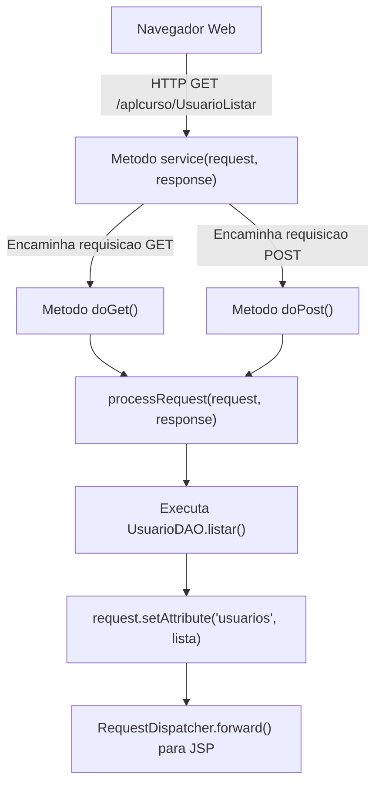

#### Implementação de UsuarioListar.java

```java
package br.com.aplcurso.controller.usuario;

import br.com.aplcurso.dao.GenericDAO;
import br.com.aplcurso.dao.UsuarioDAO;
import java.io.IOException;
import javax.servlet.ServletException;
import javax.servlet.annotation.WebServlet;
import javax.servlet.http.HttpServlet;
import javax.servlet.http.HttpServletRequest;
import javax.servlet.http.HttpServletResponse;

@WebServlet(name = "UsuarioListar", urlPatterns = {"/UsuarioListar"})
public class UsuarioListar extends HttpServlet {

    protected void processRequest(HttpServletRequest request, HttpServletResponse response)
            throws ServletException, IOException {
        response.setContentType("text/html;charset=iso-8859-1");
        try {
            GenericDAO dao = new UsuarioDAO();
            request.setAttribute("usuarios", dao.listar());
            request.getRequestDispatcher("/cadastros/usuario/usuarioListar.jsp").forward(request, response);
        } catch (Exception ex) {
            System.out.println("Erro no Servlet UsuarioListar: " + ex.getMessage());
            ex.printStackTrace();
        }
    }

    @Override
    protected void doGet(HttpServletRequest request, HttpServletResponse response)
            throws ServletException, IOException {
        processRequest(request, response);
    }

    @Override
    protected void doPost(HttpServletRequest request, HttpServletResponse response)
            throws ServletException, IOException {
        processRequest(request, response);
    }
}
```

---

### 4.6 Compartilhamento de Escopo e Despacho via RequestDispatcher

A transferência de informações e controle de fluxo entre a Servlet e a página JSP baseia-se em dois métodos primordiais da API Servlet:

1. **Injeção de Escopo de Requisição (`request.setAttribute("chave", valor)`):**
   Vincula o objeto de coleção à requisição em curso. Esse escopo tem ciclo de vida estritamente delimitado ao atendimento do protocolo HTTP atual, sendo descartado assim que a resposta final é entregue ao navegador. Evita-se armazenar dados transitórios na Sessão HTTP (`HttpSession`), o que degradaria a memória do servidor Tomcat.

2. **Despacho no Servidor (`RequestDispatcher.forward(request, response)`):**
   Executa um redirecionamento interno em memória no lado servidor. O navegador do cliente não tem ciência de que o processamento passou por uma Servlet e foi concluído por um JSP; a URL exibida no navegador permanece apontando para o Servlet (`/UsuarioListar`), preservando a URL controladora. 
   *(Diferenciação Crítica: O comando `response.sendRedirect("url")` emite uma resposta HTTP 302 ao cliente ordenando uma nova requisição independente, descartando quaisquer atributos previamente alocados em `HttpServletRequest`).*

---

### 4.7 Construcao da View usuarioListar.jsp: Tabelas Dinamicas, Formatacao JSTL e DataTables

O arquivo JSP consome a coleção enviada pela Servlet através da tag `<c:forEach>` e formata valores com a biblioteca `fmt`:

```jsp
<%@taglib prefix="c" uri="http://java.sun.com/jsp/jstl/core" %>
<%@taglib prefix="fmt" uri="http://java.sun.com/jsp/jstl/fmt" %>
<%@page contentType="text/html" pageEncoding="iso-8859-1"%>
<jsp:include page="/header.jsp" />
<jsp:include page="/menu.jsp" />

<div class="container mt-4">
    <div class="row">
        <div class="col-md-12">
            <h2 class="text-center mb-4">Relacao de Usuarios Cadastrados</h2>
            <div class="text-right mb-3">
                <a href="${pageContext.request.contextPath}/UsuarioNovo" class="btn btn-success">
                    Novo Usuario
                </a>
            </div>
            <table id="tabelaUsuarios" class="table table-striped table-bordered">
                <thead>
                    <tr>
                        <th>ID</th>
                        <th>Nome</th>
                        <th>Data de Nascimento</th>
                        <th>CPF</th>
                        <th>E-mail</th>
                        <th>Salario</th>
                        <th>Acoes</th>
                    </tr>
                </thead>
                <tbody>
                    <c:forEach var="item" items="${usuarios}">
                        <tr>
                            <td>${item.id}</td>
                            <td>${item.nome}</td>
                            <td><fmt:formatDate value="${item.dataNascimento}" pattern="dd/MM/yyyy" /></td>
                            <td>${item.cpf}</td>
                            <td>${item.email}</td>
                            <td><fmt:formatNumber value="${item.salario}" type="currency" currencySymbol="R$" /></td>
                            <td class="text-center">
                                <a href="${pageContext.request.contextPath}/UsuarioCarregar?id=${item.id}" class="btn btn-primary btn-sm">
                                    Alterar
                                </a>
                            </td>
                        </tr>
                    </c:forEach>
                </tbody>
            </table>
        </div>
    </div>
</div>

<script type="text/javascript">
    $(document).ready(function() {
        $('#tabelaUsuarios').DataTable({
            "language": {
                "url": "https://cdn.datatables.net/plug-ins/1.10.22/i18n/Portuguese-Brasil.json"
            }
        });
    });
</script>

<jsp:include page="/footer.jsp" />
```

---

## Modulo 5 — Manutencao Cadastral Completa (Inclusao, Validacoes Assincronas e Edicao)

### 5.1 Decisao de Persistencia na DAO: Bifurcacao por Identificador (id == 0)

Para manter a controladora `UsuarioCadastrar` coesa e desacoplada, a responsabilidade de discernir se o registro deve ser inserido ou atualizado é encapsulada no método `cadastrar(Object objeto)` da `UsuarioDAO`:

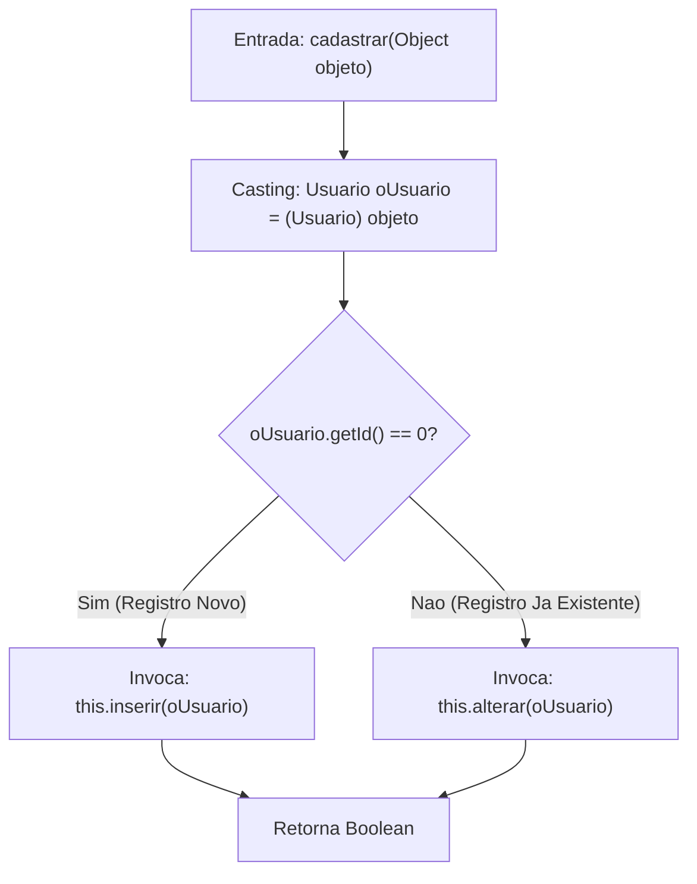

#### Código da Decisão Polimórfica

```java
@Override
public Boolean cadastrar(Object objeto) {
    Usuario oUsuario = (Usuario) objeto;
    Boolean retorno = false;
    if (oUsuario.getId() == 0) {
        retorno = this.inserir(oUsuario);
    } else {
        retorno = this.alterar(oUsuario);
    }
    return retorno;
}
```

---

### 5.2 Implementacao do Metodo inserir() com PreparedStatement e Tratamento de Datas

O método `inserir` realiza a escrita física protegida contra injeção de SQL e converte os tipos de data da API utilitária Java para o padrão SQL:

```java
@Override
public Boolean inserir(Object objeto) {
    Usuario oUsuario = (Usuario) objeto;
    PreparedStatement stmt = null;
    String sql = "INSERT INTO usuario (nome, datanascimento, cpf, email, senha, salario) "
               + "VALUES (?, ?, ?, ?, ?, ?)";
    try {
        stmt = conexao.prepareStatement(sql);
        stmt.setString(1, oUsuario.getNome());
        stmt.setDate(2, new java.sql.Date(oUsuario.getDataNascimento().getTime()));
        stmt.setString(3, oUsuario.getCpf());
        stmt.setString(4, oUsuario.getEmail());
        stmt.setString(5, oUsuario.getSenha());
        stmt.setDouble(6, oUsuario.getSalario());
        
        stmt.execute();
        conexao.commit();
        return true;
    } catch (Exception ex) {
        System.out.println("Falha ao inserir usuario! Erro: " + ex.getMessage());
        ex.printStackTrace();
        try {
            conexao.rollback();
        } catch (SQLException e) {
            e.printStackTrace();
        }
        return false;
    } finally {
        try {
            if (stmt != null) stmt.close();
        } catch (SQLException ex) {
            ex.printStackTrace();
        }
    }
}
```

---

### 5.3 Verificacao de Duplicidade no Banco: Metodo cpfExiste() com COUNT(*)

Para permitir validações prévias via chamadas assíncronas do front-end sem depender do estouro de exceções de integridade (`PSQLException: duplicate key value violates unique constraint`), implementa-se uma busca leve via agregação:

```java
public boolean cpfExiste(String cpf) {
    String sql = "SELECT COUNT(*) AS quantidade FROM usuario WHERE cpf = ?";
    try (PreparedStatement stmt = conexao.prepareStatement(sql)) {
        stmt.setString(1, cpf);
        try (ResultSet rs = stmt.executeQuery()) {
            if (rs.next()) {
                return rs.getInt("quantidade") > 0;
            }
        }
    } catch (SQLException e) {
        System.out.println("Erro ao checar unicidade de CPF: " + e.getMessage());
        e.printStackTrace();
    }
    return false;
}
```

---

### 5.4 Validacao Algoritmica de Documentos: Modulo 11 para CPF e CNPJ

A validação de documentos oficiais federais obedece ao algoritmo matemático de **Módulo 11**, exigindo pesos decrescentes e cálculo de restos de divisão inteira.

#### Fundamentação Matemática do CPF
Dado um CPF composto por 11 algarismos $`c_0, c_1, \dots, c_{10}`$:
1. **Primeiro Dígito Verificador ($`d_1`$):**
   Calcula-se o somatório ponderado dos 9 primeiros dígitos com pesos regressivos de 10 até 2:
   ```math
   S_1 = \sum_{i=0}^{8} c_i \times (10 - i)
   ```
   Aplica-se o cálculo do resto da divisão inteira:
   ```math
   R_1 = S_1 \pmod{11}
   ```
   A regra define:
   ```math
   d_1 = (11 - R_1) > 9 \;?\; 0 : (11 - R_1)
   ```

2. **Segundo Dígito Verificador ($`d_2`$):**
   Calcula-se o somatório ponderado dos 9 primeiros dígitos com pesos de 11 até 3, somado ao dobro do primeiro dígito verificador calculado ($`d_1`$):
   ```math
   S_2 = \left(\sum_{i=0}^{8} c_i \times (11 - i)\right) + (d_1 \times 2)
   ```
   Calcula-se o resto:
   ```math
   R_2 = S_2 \pmod{11}
   ```
   A regra define:
   ```math
   d_2 = (11 - R_2) > 9 \;?\; 0 : (11 - R_2)
   ```

O documento é matematicamente autêntico se e somente se:
```math
d_1 = c_9 \quad \text{e} \quad d_2 = c_{10}
```

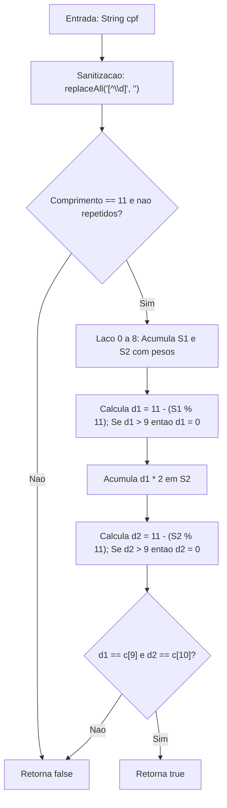

#### Implementação de DocumentoValidador.java

```java
package br.com.aplcurso.utils;

public class DocumentoValidador {

    public static boolean isCPF(String cpf) {
        if (cpf == null) return false;
        cpf = cpf.replaceAll("[^\\d]", "");
        if (cpf.length() != 11 || cpf.matches("(\\d)\\1{10}")) {
            return false;
        }

        try {
            int d1 = 0, d2 = 0;
            for (int i = 0; i < 9; i++) {
                int digito = cpf.charAt(i) - '0';
                d1 += digito * (10 - i);
                d2 += digito * (11 - i);
            }

            d1 = 11 - (d1 % 11);
            d1 = (d1 > 9) ? 0 : d1;
            
            d2 += d1 * 2;
            d2 = 11 - (d2 % 11);
            d2 = (d2 > 9) ? 0 : d2;

            return (d1 == (cpf.charAt(9) - '0')) && (d2 == (cpf.charAt(10) - '0'));
        } catch (Exception e) {
            return false;
        }
    }

    public static boolean isCNPJ(String cnpj) {
        if (cnpj == null) return false;
        cnpj = cnpj.replaceAll("[^\\d]", "");
        if (cnpj.length() != 14 || cnpj.matches("(\\d)\\1{13}")) {
            return false;
        }

        try {
            int[] pesos1 = {5, 4, 3, 2, 9, 8, 7, 6, 5, 4, 3, 2};
            int[] pesos2 = {6, 5, 4, 3, 2, 9, 8, 7, 6, 5, 4, 3, 2};

            int d1 = 0, d2 = 0;
            for (int i = 0; i < 12; i++) {
                int digito = cnpj.charAt(i) - '0';
                d1 += digito * pesos1[i];
                d2 += digito * pesos2[i];
            }

            d1 = d1 % 11;
            d1 = (d1 < 2) ? 0 : 11 - d1;

            d2 += d1 * pesos2[12];
            d2 = d2 % 11;
            d2 = (d2 < 2) ? 0 : 11 - d2;

            return (d1 == (cnpj.charAt(12) - '0')) && (d2 == (cnpj.charAt(13) - '0'));
        } catch (Exception e) {
            return false;
        }
    }

    public static boolean isDocumentoValido(String documento) {
        if (documento == null) return false;
        String limpo = documento.replaceAll("[^\\d]", "");
        if (limpo.length() == 11) {
            return isCPF(limpo);
        } else if (limpo.length() == 14) {
            return isCNPJ(limpo);
        }
        return false;
    }
}
```

---

### 5.5 Metodos Estaticos versus Metodos de Instancia na Engenharia de Software

- **Métodos Estáticos (`public static`):** Operam sem depender do estado de uma instância específica. Recebem parâmetros de entrada e produzem saídas através de funções puras determinísticas. Exemplos: `DocumentoValidador.isCPF(cpf)` e `SingleConnection.getConnection()`. Não alocam espaço individual na memória Heap por invocação.
- **Métodos de Instância:** Manipulam variáveis de estado de um objeto em particular (`this.id`, `this.nome`). Exemplo: `oUsuario.setNome("Carlos")`.

---

### 5.6 Servlet Assincrono UsuarioVerificarCPF para Validacao via AJAX

A Servlet `UsuarioVerificarCPF` é especializada em responder requisições assíncronas do jQuery sem carregar layouts HTML ou efetuar despachos:

```java
package br.com.aplcurso.controller.usuario;

import br.com.aplcurso.dao.UsuarioDAO;
import java.io.IOException;
import java.io.PrintWriter;
import javax.servlet.ServletException;
import javax.servlet.annotation.WebServlet;
import javax.servlet.http.HttpServlet;
import javax.servlet.http.HttpServletRequest;
import javax.servlet.http.HttpServletResponse;

@WebServlet(name = "UsuarioVerificarCPF", urlPatterns = {"/UsuarioVerificarCPF"})
public class UsuarioVerificarCPF extends HttpServlet {

    protected void processRequest(HttpServletRequest request, HttpServletResponse response)
            throws ServletException, IOException {
        response.setContentType("text/plain;charset=iso-8859-1");
        String cpf = request.getParameter("cpf");
        try (PrintWriter out = response.getWriter()) {
            UsuarioDAO dao = new UsuarioDAO();
            if (dao.cpfExiste(cpf)) {
                out.print("existe");
            } else {
                out.print("ok");
            }
        } catch (Exception e) {
            e.printStackTrace();
        }
    }

    @Override
    protected void doGet(HttpServletRequest request, HttpServletResponse response)
            throws ServletException, IOException {
        processRequest(request, response);
    }

    @Override
    protected void doPost(HttpServletRequest request, HttpServletResponse response)
            throws ServletException, IOException {
        processRequest(request, response);
    }
}
```

---

### 5.7 Servlet de Inicializacao UsuarioNovo e Encaminhamento com Modelo Vazio

Ao requisitar o cadastro de um novo registro, a controladora `UsuarioNovo` instancia um objeto `Usuario` vazio com atributos neutros (evitando valores nulos no preenchimento de campos JSP) e despacha o fluxo:

```java
package br.com.aplcurso.controller.usuario;

import br.com.aplcurso.model.Usuario;
import java.io.IOException;
import javax.servlet.ServletException;
import javax.servlet.annotation.WebServlet;
import javax.servlet.http.HttpServlet;
import javax.servlet.http.HttpServletRequest;
import javax.servlet.http.HttpServletResponse;

@WebServlet(name = "UsuarioNovo", urlPatterns = {"/UsuarioNovo"})
public class UsuarioNovo extends HttpServlet {

    protected void processRequest(HttpServletRequest request, HttpServletResponse response)
            throws ServletException, IOException {
        response.setContentType("text/html;charset=iso-8859-1");
        Usuario oUsuario = new Usuario();
        request.setAttribute("usuario", oUsuario);
        request.getRequestDispatcher("/cadastros/usuario/usuarioCadastrar.jsp").forward(request, response);
    }

    @Override
    protected void doGet(HttpServletRequest request, HttpServletResponse response)
            throws ServletException, IOException {
        processRequest(request, response);
    }

    @Override
    protected void doPost(HttpServletRequest request, HttpServletResponse response)
            throws ServletException, IOException {
        processRequest(request, response);
    }
}
```

---

### 5.8 Servlet Controlador UsuarioCadastrar: Parse de Tipos, Higienizacao e Codigos de Retorno

A controladora `UsuarioCadastrar` centraliza o processamento de submissão do formulário:

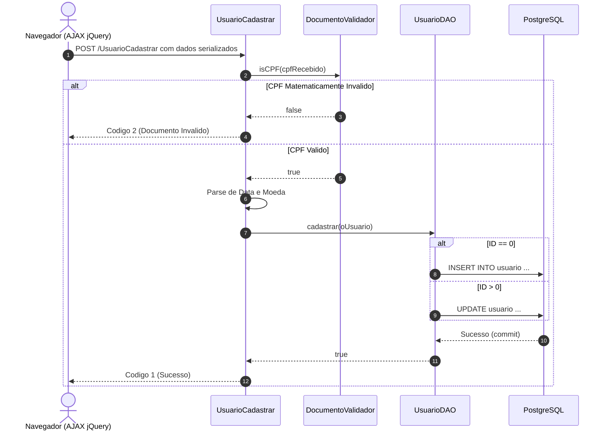

#### Implementação de UsuarioCadastrar.java

```java
package br.com.aplcurso.controller.usuario;

import br.com.aplcurso.dao.GenericDAO;
import br.com.aplcurso.dao.UsuarioDAO;
import br.com.aplcurso.model.Usuario;
import br.com.aplcurso.utils.DocumentoValidador;
import java.io.IOException;
import java.io.PrintWriter;
import java.text.SimpleDateFormat;
import java.util.Date;
import javax.servlet.ServletException;
import javax.servlet.annotation.WebServlet;
import javax.servlet.http.HttpServlet;
import javax.servlet.http.HttpServletRequest;
import javax.servlet.http.HttpServletResponse;

@WebServlet(name = "UsuarioCadastrar", urlPatterns = {"/UsuarioCadastrar"})
public class UsuarioCadastrar extends HttpServlet {

    protected void processRequest(HttpServletRequest request, HttpServletResponse response)
            throws ServletException, IOException {
        response.setContentType("text/plain;charset=iso-8859-1");
        
        try (PrintWriter out = response.getWriter()) {
            int id = Integer.parseInt(request.getParameter("id"));
            String nome = request.getParameter("nome");
            String dataNascimentoStr = request.getParameter("dataNascimento");
            String cpf = request.getParameter("cpf");
            String email = request.getParameter("email");
            String senha = request.getParameter("senha");
            String salarioStr = request.getParameter("salario");

            // Validacao de integridade de documento
            if (!DocumentoValidador.isCPF(cpf)) {
                out.print("2"); // Codigo 2: Documento invalido
                return;
            }

            // Tratamento de conversao de data
            SimpleDateFormat formato = new SimpleDateFormat("yyyy-MM-dd");
            Date dataNascimento = formato.parse(dataNascimentoStr);

            // Higienizacao de valor monetario recebido do front-end
            String salarioLimpo = salarioStr.replace("R$", "").replace(".", "").replace(",", ".").trim();
            double salario = Double.parseDouble(salarioLimpo);

            Usuario oUsuario = new Usuario(id, nome, dataNascimento, cpf, email, senha, salario);
            GenericDAO dao = new UsuarioDAO();

            if (dao.cadastrar(oUsuario)) {
                out.print("1"); // Codigo 1: Gravado com sucesso
            } else {
                out.print("0"); // Codigo 0: Falha na persistencia
            }
        } catch (Exception ex) {
            System.out.println("Erro no Servlet UsuarioCadastrar: " + ex.getMessage());
            ex.printStackTrace();
        }
    }

    @Override
    protected void doGet(HttpServletRequest request, HttpServletResponse response)
            throws ServletException, IOException {
        processRequest(request, response);
    }

    @Override
    protected void doPost(HttpServletRequest request, HttpServletResponse response)
            throws ServletException, IOException {
        processRequest(request, response);
    }
}
```

---

### 5.9 Interface de Manutencao usuarioCadastrar.jsp: Formulario Hibrido, Mascaras e AJAX

A página atende tanto à inserção (quando `usuario.id == 0`) quanto à edição cadastral (quando `usuario.id > 0`):

```jsp
<%@taglib prefix="c" uri="http://java.sun.com/jsp/jstl/core" %>
<%@taglib prefix="fmt" uri="http://java.sun.com/jsp/jstl/fmt" %>
<%@page contentType="text/html" pageEncoding="iso-8859-1"%>
<jsp:include page="/header.jsp" />
<jsp:include page="/menu.jsp" />

<div class="container mt-4">
    <div class="card">
        <div class="card-header bg-primary text-white">
            <h4>Cadastro de Usuario</h4>
        </div>
        <div class="card-body">
            <form id="formUsuario">
                <input type="hidden" id="id" name="id" value="${usuario.id}" />

                <div class="form-row">
                    <div class="form-group col-md-6">
                        <label for="nome">Nome Completo:</label>
                        <input type="text" class="form-control" id="nome" name="nome" 
                               value="${usuario.nome}" required maxlength="100" />
                    </div>
                    <div class="form-group col-md-3">
                        <label for="dataNascimento">Data de Nascimento:</label>
                        <fmt:formatDate value="${usuario.dataNascimento}" pattern="yyyy-MM-dd" var="dataFmt" />
                        <input type="date" class="form-control" id="dataNascimento" name="dataNascimento" 
                               value="${dataFmt}" required />
                    </div>
                    <div class="form-group col-md-3">
                        <label for="cpf">CPF:</label>
                        <input type="text" class="form-control" id="cpf" name="cpf" 
                               value="${usuario.cpf}" required />
                    </div>
                </div>

                <div class="form-row">
                    <div class="form-group col-md-6">
                        <label for="email">E-mail:</label>
                        <input type="email" class="form-control" id="email" name="email" 
                               value="${usuario.email}" required maxlength="100" />
                    </div>
                    <div class="form-group col-md-3">
                        <label for="senha">Senha:</label>
                        <input type="password" class="form-control" id="senha" name="senha" 
                               value="${usuario.senha}" required maxlength="20" />
                    </div>
                    <div class="form-group col-md-3">
                        <label for="salario">Salario (R$):</label>
                        <input type="text" class="form-control" id="salario" name="salario" 
                               value="${usuario.salario}" required />
                    </div>
                </div>

                <button type="button" class="btn btn-success" onclick="gravarUsuario()">Gravar</button>
                <a href="${pageContext.request.contextPath}/UsuarioListar" class="btn btn-secondary">Voltar</a>
            </form>
        </div>
    </div>
</div>

<script type="text/javascript">
    $(document).ready(function() {
        $('#cpf').mask('000.000.000-00', {reverse: true});
        $('#salario').maskMoney({prefix:'R$ ', allowNegative: false, thousands:'.', decimal:',', affixesStay: false});

        $('#cpf').blur(function() {
            var cpfInformado = $(this).val();
            if (cpfInformado.length === 14) {
                $.ajax({
                    url: '${pageContext.request.contextPath}/UsuarioVerificarCPF',
                    type: 'GET',
                    data: {cpf: cpfInformado},
                    success: function(resposta) {
                        if (resposta.trim() === 'existe') {
                            Swal.fire('Atencao!', 'Este CPF ja se encontra cadastrado no sistema!', 'warning');
                            $('#cpf').val('').focus();
                        }
                    }
                });
            }
        });
    });

    function gravarUsuario() {
        if ($('#nome').val() === '' || $('#cpf').val() === '') {
            Swal.fire('Campos Obrigatorios', 'Preencha todos os campos antes de salvar!', 'error');
            return;
        }

        var dados = $('#formUsuario').serialize();

        $.ajax({
            url: '${pageContext.request.contextPath}/UsuarioCadastrar',
            type: 'POST',
            data: dados,
            success: function(retorno) {
                var cod = retorno.trim();
                if (cod === '1') {
                    Swal.fire('Sucesso!', 'Usuario salvo com sucesso!', 'success').then(function() {
                        window.location.href = '${pageContext.request.contextPath}/UsuarioListar';
                    });
                } else if (cod === '2') {
                    Swal.fire('Invalido!', 'O CPF informado nao e matematicamente valido!', 'error');
                } else {
                    Swal.fire('Erro!', 'Nao foi possivel persistir as informacoes no banco!', 'error');
                }
            },
            error: function() {
                Swal.fire('Erro Critico', 'Falha na comunicacao com o servidor!', 'error');
            }
        });
    }
</script>

<jsp:include page="/footer.jsp" />
```

---

### 5.10 Metodo carregar() na DAO e Fluxo de Atualizacao Cadastral

O método `carregar` realiza a busca pontual por chave primária, permitindo que a controladora `UsuarioCarregar` obtenha a entidade no banco de dados e injete-a na requisição para exibir o formulário preenchido para edição:

```java
@Override
public Object carregar(int numero) {
    Usuario oUsuario = null;
    PreparedStatement stmt = null;
    ResultSet rs = null;
    String sql = "SELECT * FROM usuario WHERE id = ?";
    try {
        stmt = conexao.prepareStatement(sql);
        stmt.setInt(1, numero);
        rs = stmt.executeQuery();
        if (rs.next()) {
            oUsuario = new Usuario();
            oUsuario.setId(rs.getInt("id"));
            oUsuario.setNome(rs.getString("nome"));
            oUsuario.setDataNascimento(rs.getDate("datanascimento"));
            oUsuario.setCpf(rs.getString("cpf"));
            oUsuario.setEmail(rs.getString("email"));
            oUsuario.setSenha(rs.getString("senha"));
            oUsuario.setSalario(rs.getDouble("salario"));
        }
    } catch (SQLException ex) {
        System.out.println("Problemas ao carregar Usuario! Erro: " + ex.getMessage());
        ex.printStackTrace();
    } finally {
        try {
            if (rs != null) rs.close();
            if (stmt != null) stmt.close();
        } catch (SQLException e) {
            e.printStackTrace();
        }
    }
    return oUsuario;
}
```

---

## Codigo-Fonte Consolidado da Aplicacao

### Script de Banco de Dados: `br/com/aplcurso/utils/banco.sql`

```sql
-- Criacao da infraestrutura relacional
CREATE TABLE usuario (
    id SERIAL PRIMARY KEY,
    nome VARCHAR(100) NOT NULL,
    datanascimento DATE NOT NULL,
    cpf VARCHAR(14) UNIQUE NOT NULL,
    email VARCHAR(100) UNIQUE NOT NULL,
    senha VARCHAR(20) NOT NULL,
    salario DECIMAL(15,2) NOT NULL
);

-- Carga de dados inicial para testes operacionais
INSERT INTO usuario (nome, datanascimento, cpf, email, senha, salario)
VALUES ('Administrador Inicial', '1995-05-20', '111.444.777-35', 'admin@aplcurso.com.br', 'admin123', 6500.00);
```

---

### Filtro de Autenticação e Ciclo de Vida: `FilterAutenticacao.java`

```java
package br.com.aplcurso.filter;

import br.com.aplcurso.utils.SingleConnection;
import java.io.IOException;
import java.sql.Connection;
import java.sql.SQLException;
import javax.servlet.Filter;
import javax.servlet.FilterChain;
import javax.servlet.FilterConfig;
import javax.servlet.ServletException;
import javax.servlet.ServletRequest;
import javax.servlet.ServletResponse;
import javax.servlet.annotation.WebFilter;

@WebFilter(urlPatterns = {"/*"})
public class FilterAutenticacao implements Filter {

    private static Connection connection;

    @Override
    public void init(FilterConfig filterConfig) throws ServletException {
        connection = SingleConnection.getConnection();
    }

    @Override
    public void doFilter(ServletRequest request, ServletResponse response, FilterChain chain)
            throws IOException, ServletException {
        try {
            chain.doFilter(request, response);
        } catch (Exception e) {
            System.out.println("Erro interceptado pelo FilterAutenticacao: " + e.getMessage());
            e.printStackTrace();
        }
    }

    @Override
    public void destroy() {
        try {
            if (connection != null && !connection.isClosed()) {
                connection.close();
            }
        } catch (SQLException e) {
            e.printStackTrace();
        }
    }
}
```

---

### Implementação do DAO: `UsuarioDAO.java`

```java
package br.com.aplcurso.dao;

import br.com.aplcurso.model.Usuario;
import br.com.aplcurso.utils.SingleConnection;
import java.sql.Connection;
import java.sql.PreparedStatement;
import java.sql.ResultSet;
import java.sql.SQLException;
import java.util.ArrayList;
import java.util.List;

public class UsuarioDAO implements GenericDAO {

    private Connection conexao;

    public UsuarioDAO() throws Exception {
        this.conexao = SingleConnection.getConnection();
    }

    @Override
    public Boolean cadastrar(Object objeto) {
        Usuario oUsuario = (Usuario) objeto;
        if (oUsuario.getId() == 0) {
            return this.inserir(oUsuario);
        } else {
            return this.alterar(oUsuario);
        }
    }

    @Override
    public Boolean inserir(Object objeto) {
        Usuario oUsuario = (Usuario) objeto;
        PreparedStatement stmt = null;
        String sql = "INSERT INTO usuario (nome, datanascimento, cpf, email, senha, salario) "
                   + "VALUES (?, ?, ?, ?, ?, ?)";
        try {
            stmt = conexao.prepareStatement(sql);
            stmt.setString(1, oUsuario.getNome());
            stmt.setDate(2, new java.sql.Date(oUsuario.getDataNascimento().getTime()));
            stmt.setString(3, oUsuario.getCpf());
            stmt.setString(4, oUsuario.getEmail());
            stmt.setString(5, oUsuario.getSenha());
            stmt.setDouble(6, oUsuario.getSalario());
            stmt.execute();
            conexao.commit();
            return true;
        } catch (Exception ex) {
            System.out.println("Erro ao inserir: " + ex.getMessage());
            try {
                conexao.rollback();
            } catch (SQLException e) {
                e.printStackTrace();
            }
            return false;
        } finally {
            fecharRecursos(stmt, null);
        }
    }

    @Override
    public Boolean alterar(Object objeto) {
        Usuario oUsuario = (Usuario) objeto;
        PreparedStatement stmt = null;
        String sql = "UPDATE usuario SET nome=?, datanascimento=?, cpf=?, email=?, senha=?, salario=? "
                   + "WHERE id=?";
        try {
            stmt = conexao.prepareStatement(sql);
            stmt.setString(1, oUsuario.getNome());
            stmt.setDate(2, new java.sql.Date(oUsuario.getDataNascimento().getTime()));
            stmt.setString(3, oUsuario.getCpf());
            stmt.setString(4, oUsuario.getEmail());
            stmt.setString(5, oUsuario.getSenha());
            stmt.setDouble(6, oUsuario.getSalario());
            stmt.setInt(7, oUsuario.getId());
            stmt.execute();
            conexao.commit();
            return true;
        } catch (Exception ex) {
            System.out.println("Erro ao alterar: " + ex.getMessage());
            try {
                conexao.rollback();
            } catch (SQLException e) {
                e.printStackTrace();
            }
            return false;
        } finally {
            fecharRecursos(stmt, null);
        }
    }

    @Override
    public Boolean excluir(int numero) {
        PreparedStatement stmt = null;
        String sql = "DELETE FROM usuario WHERE id=?";
        try {
            stmt = conexao.prepareStatement(sql);
            stmt.setInt(1, numero);
            stmt.execute();
            conexao.commit();
            return true;
        } catch (Exception ex) {
            System.out.println("Erro ao excluir: " + ex.getMessage());
            try {
                conexao.rollback();
            } catch (SQLException e) {
                e.printStackTrace();
            }
            return false;
        } finally {
            fecharRecursos(stmt, null);
        }
    }

    @Override
    public Object carregar(int numero) {
        Usuario oUsuario = null;
        PreparedStatement stmt = null;
        ResultSet rs = null;
        String sql = "SELECT * FROM usuario WHERE id=?";
        try {
            stmt = conexao.prepareStatement(sql);
            stmt.setInt(1, numero);
            rs = stmt.executeQuery();
            if (rs.next()) {
                oUsuario = new Usuario();
                oUsuario.setId(rs.getInt("id"));
                oUsuario.setNome(rs.getString("nome"));
                oUsuario.setDataNascimento(rs.getDate("datanascimento"));
                oUsuario.setCpf(rs.getString("cpf"));
                oUsuario.setEmail(rs.getString("email"));
                oUsuario.setSenha(rs.getString("senha"));
                oUsuario.setSalario(rs.getDouble("salario"));
            }
        } catch (SQLException ex) {
            ex.printStackTrace();
        } finally {
            fecharRecursos(stmt, rs);
        }
        return oUsuario;
    }

    @Override
    public List<Object> listar() {
        List<Object> resultado = new ArrayList<>();
        PreparedStatement stmt = null;
        ResultSet rs = null;
        String sql = "SELECT * FROM usuario ORDER BY id";
        try {
            stmt = conexao.prepareStatement(sql);
            rs = stmt.executeQuery();
            while (rs.next()) {
                Usuario oUsuario = new Usuario();
                oUsuario.setId(rs.getInt("id"));
                oUsuario.setNome(rs.getString("nome"));
                oUsuario.setDataNascimento(rs.getDate("datanascimento"));
                oUsuario.setCpf(rs.getString("cpf"));
                oUsuario.setEmail(rs.getString("email"));
                oUsuario.setSenha(rs.getString("senha"));
                oUsuario.setSalario(rs.getDouble("salario"));
                resultado.add(oUsuario);
            }
        } catch (SQLException ex) {
            ex.printStackTrace();
        } finally {
            fecharRecursos(stmt, rs);
        }
        return resultado;
    }

    public boolean cpfExiste(String cpf) {
        String sql = "SELECT COUNT(*) AS quantidade FROM usuario WHERE cpf = ?";
        try (PreparedStatement stmt = conexao.prepareStatement(sql)) {
            stmt.setString(1, cpf);
            try (ResultSet rs = stmt.executeQuery()) {
                if (rs.next()) {
                    return rs.getInt("quantidade") > 0;
                }
            }
        } catch (SQLException e) {
            e.printStackTrace();
        }
        return false;
    }

    private void fecharRecursos(PreparedStatement stmt, ResultSet rs) {
        try {
            if (rs != null) rs.close();
            if (stmt != null) stmt.close();
        } catch (SQLException e) {
            e.printStackTrace();
        }
    }
}
```

---

### Fragmentos Modulares de Layout

#### `header.jsp`

```jsp
<%@page contentType="text/html" pageEncoding="iso-8859-1"%>
<!DOCTYPE html>
<html>
    <head>
        <meta http-equiv="Content-Type" content="text/html; charset=iso-8859-1">
        <title>Sistema de Gestao Integrada - UniFEF</title>
        
        <!-- jQuery Core -->
        <script src="${pageContext.request.contextPath}/js/jquery-3.3.1.min.js"></script>
        
        <!-- Plugins de Mascara -->
        <script src="${pageContext.request.contextPath}/js/jquery.mask.min.js"></script>
        <script src="${pageContext.request.contextPath}/js/jquery.maskMoney.min.js"></script>
        
        <!-- Bootstrap 4.3.1 -->
        <link rel="stylesheet" href="https://stackpath.bootstrapcdn.com/bootstrap/4.3.1/css/bootstrap.min.css">
        <script src="https://cdnjs.cloudflare.com/ajax/libs/popper.js/1.14.7/umd/popper.min.js"></script>
        <script src="https://stackpath.bootstrapcdn.com/bootstrap/4.3.1/js/bootstrap.min.js"></script>
        
        <!-- DataTables -->
        <link rel="stylesheet" type="text/css" href="https://cdn.datatables.net/1.10.22/css/jquery.dataTables.min.css"/>
        <script src="https://cdn.datatables.net/1.10.22/js/jquery.dataTables.min.js" type="text/javascript"></script>
        
        <!-- SweetAlert2 -->
        <script src="https://cdn.jsdelivr.net/npm/sweetalert2@10.3.1/dist/sweetalert2.all.min.js" type="text/javascript"></script>
    </head>
    <body>
```

#### `menu.jsp`

```jsp
<%@page contentType="text/html" pageEncoding="iso-8859-1"%>
<nav class="navbar navbar-expand-lg navbar-dark bg-dark">
    <a class="navbar-brand" href="${pageContext.request.contextPath}/home.jsp">UniFEF Lab III</a>
    <button class="navbar-toggler" type="button" data-toggle="collapse" data-target="#conteudoNavbarSuportado">
        <span class="navbar-toggler-icon"></span>
    </button>

    <div class="collapse navbar-collapse" id="conteudoNavbarSuportado">
        <ul class="navbar-nav mr-auto">
            <li class="nav-item active">
                <a class="nav-link" href="${pageContext.request.contextPath}/home.jsp">Inicio</a>
            </li>
            <li class="nav-item dropdown">
                <a class="nav-link dropdown-toggle" href="#" id="navbarDropdown" role="button" data-toggle="dropdown">
                    Cadastros Basicos
                </a>
                <div class="dropdown-menu">
                    <a class="dropdown-item" href="${pageContext.request.contextPath}/UsuarioListar">Usuarios</a>
                </div>
            </li>
        </ul>
    </div>
</nav>
```

#### `footer.jsp`

```jsp
<%@page contentType="text/html" pageEncoding="iso-8859-1"%>
        <footer class="footer mt-5 py-3 bg-light border-top text-center">
            <div class="container">
                <span class="text-muted">Laboratorio de Programacao III - Prof. Jefferson Passerini - UniFEF</span>
            </div>
        </footer>
    </body>
</html>
```

---

## Bateria de Exercicios Praticos e Dissertativos

### Exercício 1 (Dissertativo - Fundamentos de Arquitetura e Contêiner)
**Enunciado:** Um estagiário de TI tentou atualizar a infraestrutura de uma aplicação web corporativa que utiliza a especificação Java EE 8, substituindo o Apache Tomcat 9 pelo Apache Tomcat 10. Durante a inicialização, todos os Servlets com a anotação `@WebServlet` falharam com `ClassNotFoundException` associada a `javax.servlet.http.HttpServlet`. Explique, do ponto de vista da governança e arquitetura Java, por que essa falha ocorre e qual é a resolução técnica adequada.

**Critérios de Correção e Resposta Esperada:**
O candidato deve explicar a cisão de direitos de propriedade intelectual da marca Java EE transferida da Oracle para a Eclipse Foundation. A partir do Jakarta EE 9 (implementado no Tomcat 10+), houve a compilação obrigatória sobre o namespace raiz `jakarta.*` em substituição ao tradicional `javax.*`. A aplicação compilada para Java EE 8 busca classes no pacote `javax.servlet`, inexistente no Tomcat 10. A solução exige reverter o contêiner para o Apache Tomcat 9 ou refatorar integralmente a aplicação e suas bibliotecas para Jakarta EE.

---

### Exercício 2 (Prático - Modificação de Camada de Persistência)
**Enunciado:** Na classe `UsuarioDAO`, adicione um método denominado `public boolean inativarUsuario(int id)` que, em vez de deletar fisicamente o registro via `DELETE`, execute uma exclusão lógica alterando a coluna de status (considere que o banco possui a coluna `ativo BOOLEAN NOT NULL DEFAULT TRUE`). O método deve obedecer ao controle transacional manual com `commit` e `rollback`.

**Resposta do Código:**

```java
public boolean inativarUsuario(int id) {
    String sql = "UPDATE usuario SET ativo = false WHERE id = ?";
    PreparedStatement stmt = null;
    try {
        stmt = conexao.prepareStatement(sql);
        stmt.setInt(1, id);
        int linhasAfetadas = stmt.executeUpdate();
        conexao.commit();
        return linhasAfetadas > 0;
    } catch (SQLException ex) {
        System.out.println("Erro ao inativar usuario: " + ex.getMessage());
        try {
            conexao.rollback();
        } catch (SQLException e) {
            e.printStackTrace();
        }
        return false;
    } finally {
        try {
            if (stmt != null) stmt.close();
        } catch (SQLException e) {
            e.printStackTrace();
        }
    }
}
```

---

### Exercício 3 (Prático - Regra de Validação de Domínio)
**Enunciado:** Construa uma função na classe utilitária `DocumentoValidador` denominada `public static boolean isMaiorDeIdade(Date dataNascimento)` que valide se a data fornecida confere pelo menos 18 anos completos na data corrente, tratando eventuais datas futuras com o retorno imediato de `false`.

**Resposta do Código:**

```java
public static boolean isMaiorDeIdade(java.util.Date dataNascimento) {
    if (dataNascimento == null) return false;
    
    java.util.Calendar nascimento = java.util.Calendar.getInstance();
    nascimento.setTime(dataNascimento);
    
    java.util.Calendar hoje = java.util.Calendar.getInstance();
    if (nascimento.after(hoje)) {
        return false; // Data futura
    }
    
    int idade = hoje.get(java.util.Calendar.YEAR) - nascimento.get(java.util.Calendar.YEAR);
    if (hoje.get(java.util.Calendar.DAY_OF_YEAR) < nascimento.get(java.util.Calendar.DAY_OF_YEAR)) {
        idade--;
    }
    return idade >= 18;
}
```

---

## Erros Comuns, Diagnosticos e Boas Praticas de Engenharia

### 1. `java.lang.NullPointerException` no Método `cadastrar`
- **Sintoma:** Ao submeter um novo cadastro, a JVM dispara `NullPointerException` na linha `if (oUsuario.getId() == 0)`.
- **Causa Raiz:** O atributo `id` na classe `Usuario` foi declarado com a classe empacotadora `Integer` e instanciado como `null`. Ao tentar efetuar a comparação com o primitivo `0`, a JVM executa o *unboxing* automático chamando `oUsuario.getId().intValue()`, gerando falha por referência nula.
- **Solução:** Declarar o atributo como tipo primitivo `int id` ou garantir a verificação defensiva de nulidade: `if (oUsuario.getId() == null || oUsuario.getId() == 0)`.

### 2. `PSQLException: FATAL: remaining connection slots are reserved for non-replication superuser connections`
- **Sintoma:** O PostgreSQL para de responder e recusa conexões da aplicação.
- **Causa Raiz:** Instanciação repetida de `DriverManager.getConnection()` sem reutilização do Singleton ou abandono de objetos `PreparedStatement` e `ResultSet` abertos sem cláusula `finally` de fechamento.
- **Solução:** Centralizar as conexões via `SingleConnection` e fechar formalmente todos os cursores e instruções nas DAOs.

### 3. Exibição de Data Deslocada em 1 Dia na Interface JSP
- **Sintoma:** O usuário cadastra a data de nascimento `10/08/1990`, mas a listagem com `<fmt:formatDate>` exibe `09/08/1990`.
- **Causa Raiz:** Divergência de fuso horário entre o servidor Tomcat (rodando em UTC) e a timezone local da máquina do desenvolvedor (GMT-3 / America/Sao_Paulo).
- **Solução:** Configurar a tag de formatação explicitando a timezone local:
  ```jsp
  <fmt:formatDate value="${item.dataNascimento}" pattern="dd/MM/yyyy" timeZone="America/Sao_Paulo" />
  ```

---

## Glossario Tecnico e Termos Essenciais

- **ACID:** Acrônimo para *Atomicidade, Consistência, Isolamento e Durabilidade*, conjunto de propriedades que balizam a confiabilidade das transações em SGBDs relacionais.
- **Apache Ant:** Ferramenta de automação de compilação orientada a tarefas XML imperativas.
- **Apache Tomcat:** Servidor web e contêiner de servlets que implementa as tecnologias Java Servlet e JavaServer Pages.
- **DAO (Data Access Object):** Padrão de projeto estrutural que encapsula a lógica de acesso e persistência de dados.
- **Expression Language (EL):** Mecanismo de expressões concisas (`${...}`) utilizado em JSPs para acessar propriedades de objetos e escopos sem scripts Java.
- **Forward:** Mecanismo do lado servidor que despacha internamente uma requisição para outro recurso sem alterar a URL no navegador cliente.
- **JIT (Just-In-Time Compiler):** Compilador em tempo de execução da JVM que traduz trechos críticos de bytecode em código de máquina nativo.
- **JSP (JavaServer Pages):** Tecnologia que permite criar páginas web dinâmicas inserindo marcações e tags customizadas em meio ao HTML.
- **JSTL:** Biblioteca de tags padronizadas que oferece comandos essenciais de iteração, condicionais e formatação para páginas JSP.
- **PreparedStatement:** Interface JDBC que executa instruções SQL pré-compiladas, protegendo a base de dados contra *SQL Injection*.
- **ResultSet:** Estrutura tabular de dados em memória mantida por um cursor do banco de dados relacional para leitura sequencial.
- **Servlet:** Classe Java executada no servidor que intercepta requisições HTTP e gera respostas dinâmicas.
- **Singleton:** Padrão criacional do GoF que assegura a existência de uma única instância de uma classe com ponto global de acesso.

---

## Pontos-Chave para Avaliacoes e Provas

1. **Diferença conceitual entre `<jsp:include>` e `<%@include%>`:** O primeiro opera em tempo de requisição via `RequestDispatcher`, enquanto o segundo realiza cópia física textual em tempo de tradução.
2. **Ciclo de vida de um Servlet:** Inicialização única com `init()`, processamento concorrente multi-thread via `service()` (despachando para `doGet()` ou `doPost()`), e encerramento com `destroy()`.
3. **Padrão Singleton aplicado à persistência:** Construtor estritamente `private`, atributo estático da instância, método acessor global `public static Connection getConnection()`.
4. **Comportamento do `autoCommit(false)`:** Obriga a chamada manual de `conexao.commit()` para gravação e `conexao.rollback()` em bloco `catch` de tratamento de exceções.
5. **Decisão na DAO (`id == 0`):** Se a chave primária for zero, a DAO executa o comando `INSERT`; se for superior a zero, invoca o comando `UPDATE`.
6. **Módulo 11:** O primeiro dígito verificador de um CPF é obtido multiplicando os 9 primeiros algarismos por pesos regressivos de 10 a 2, calculando o resto da soma por 11 e subtraindo de 11.
7. **Namespace `javax` vs `jakarta`:** O Tomcat 9 utiliza a especificação Java EE 8 sob `javax.*`. O Tomcat 10 utiliza Jakarta EE sob `jakarta.*`.

---

## Banco de Questoes para Fixacao (JSONL)

```json
{"id": 1, "tema": "Tomcat e Compatibilidade", "pergunta": "Por que o Apache Tomcat 10 nao e compativel diretamente com projetos compilados para Java EE 8?", "resposta": "Porque o Tomcat 10 implementa a especificacao Jakarta EE 9+, que substituiu o namespace de pacotes de javax.* para jakarta.*, ocasionando ClassNotFoundException em bibliotecas do Java EE 8."}
{"id": 2, "tema": "Transacoes JDBC", "pergunta": "Qual e o efeito de executar conexao.setAutoCommit(false) em uma rotina JDBC?", "resposta": "Desativa a gravacao automatica imediata de cada instrucao SQL, exigindo que a aplicacao invoque conexao.commit() para confirmar as alteracoes ou conexao.rollback() para revertê-las."}
{"id": 3, "tema": "Padrao Singleton", "pergunta": "Quais sao os dois elementos estruturais obrigatorios na implementacao classica do padrao Singleton em Java?", "resposta": "Um construtor com modificador de acesso estritamente private e um metodo publico estatico de recuperacao da instancia (ex: public static Connection getConnection())."}
{"id": 4, "tema": "JSP e Inclusao", "pergunta": "Qual a diferenca fundamental entre a acao <jsp:include> e a diretiva <%@include%>?", "resposta": "A acao <jsp:include> realiza a inclusao dinamica em tempo de requisicao via RequestDispatcher, enquanto <%@include%> realiza a fusao estatica do codigo-fonte em tempo de traducao."}
{"id": 5, "tema": "Bifurcacao na DAO", "pergunta": "Qual criterio e utilizado na UsuarioDAO para decidir se o metodo cadastrar() invocara o inserir() ou alterar()?", "resposta": "A avaliacao da chave primaria: se oUsuario.getId() == 0, trata-se de um novo registro e invoca inserir(); se for maior que zero, invoca alterar()."}
{"id": 6, "tema": "Tipagem SQL", "pergunta": "Por que colunas de salario devem ser tipadas como DECIMAL/NUMERIC em vez de FLOAT no PostgreSQL?", "resposta": "Porque o tipo FLOAT opera com representacao binaria aproximada sob a norma IEEE 754, gerando residuos de arredondamento inaceitaveis para aplicacoes financeiras."}
{"id": 7, "tema": "Expressao EL", "pergunta": "Qual a finalidade de utilizar ${pageContext.request.contextPath} na definicao de rotas?", "resposta": "Garantir a resolucao absoluta do caminho raiz da aplicacao no servidor, prevenindo quebras de caminhos relativos ao navegar entre servlets e subpastas."}
{"id": 8, "tema": "Ciclo de Vida de Filtros", "pergunta": "Em qual metodo da interface javax.servlet.Filter deve-se invocar chain.doFilter()?", "resposta": "No metodo doFilter(), permitindo que a requisicao prossiga para o proximo filtro da cadeia ou para o recurso alvo final (Servlet ou JSP)."}
```

---

## Checklist Geral de Revisao e Implantacao

- [ ] JDK 17 LTS (Eclipse Temurin) instalado com variáveis de ambiente `JAVA_HOME` e `PATH` validadas via terminal.
- [ ] Apache Tomcat 9 instalado em diretório sem espaços ou acentuações (ex.: `C:\apache-tomcat-9.0.x`).
- [ ] Servidor PostgreSQL ativo na porta `5432` com banco `bdaplcurso` criado pelo pgAdmin 4.
- [ ] Script estrutural `banco.sql` executado com criação da tabela `usuario` e constraints `PRIMARY KEY` e `UNIQUE`.
- [ ] Driver JDBC do PostgreSQL (`postgresql-42.x.x.jar`) e biblioteca JSTL 1.2 adicionados ao diretório de bibliotecas do NetBeans.
- [ ] Classe `SingleConnection` implementada com construtor privado e controle manual `setAutoCommit(false)`.
- [ ] `FilterAutenticacao` mapeado para `/*` para inicializar a conexão no contêiner.
- [ ] Entidade `Usuario` implementando construtor padrão, construtor completo, métodos acessores e o contrato `equals`/`hashCode`.
- [ ] `UsuarioDAO` implementando a interface `GenericDAO` com métodos `cadastrar`, `inserir`, `alterar`, `excluir`, `carregar` e `listar`.
- [ ] Servlets mapeadas com `@WebServlet`: `UsuarioListar`, `UsuarioNovo`, `UsuarioCadastrar` e `UsuarioVerificarCPF`.
- [ ] Fragmentos de interface estruturados: `header.jsp`, `menu.jsp`, `footer.jsp`.
- [ ] Páginas dinâmicas `usuarioListar.jsp` e `usuarioCadastrar.jsp` integradas com JSTL, DataTables, SweetAlert2 e máscaras jQuery.
- [ ] Rotinas assíncronas AJAX validadas no console do navegador contra erros de referência de script (`$ is not defined`).

---

## Fontes e Metadados

- Turma no Classroom: 2026 1S Laboratório de Programação III
- Itens processados: 0 materiais, 6 tarefas, 6 avisos
- Gerado em: 28/10/2026, 20:00:52 (BRT) via classroom-sync
