# Guia Definitivo de Estudos: Laboratório de Programação III

**Instituição:** Centro Universitário de Fernandópolis (UniFEF)  
**Curso:** Bacharelado em Sistemas de Informação (3º Semestre)  
**Professor:** Prof. Jefferson Passerini  
**Disciplina:** Laboratório de Programação III  
**Carga Temática:** Programação Orientada a Objetos Avançada, Ecossistema Java EE, Servlets, JSP, JSTL, Padrão Arquitetural MVC, Padrões de Projeto (Singleton, DAO), Persistência Relacional com JDBC e PostgreSQL, Filtros de Interceptação, Tratamento de Exceções, Validações Algorítmicas e Engenharia de Software.

---

## Sumário

- [1. Fundamentos da Programação Orientada a Objetos e Camada de Domínio](#1-fundamentos-da-programação-orientada-a-objetos-e-camada-de-domínio)
  - [1.1 Encapsulamento estrito e proteção de invariantes de estado](#11-encapsulamento-estrito-e-proteção-de-invariantes-de-estado)
  - [1.2 Herança, especialização e o Princípio de Substituição de Liskov](#12-herança-especialização-e-o-princípio-de-substituição-de-liskov)
  - [1.3 Polimorfismo dinâmico e resolução de métodos via vtable](#13-polimorfismo-dinâmico-e-resolução-de-métodos-via-vtable)
  - [1.4 Classes abstratas versus interfaces como contratos de projeto](#14-classes-abstratas-versus-interfaces-como-contratos-de-projeto)
  - [1.5 Contrato de identidade em Java: hashCode e equals](#15-contrato-de-identidade-em-java-hashcode-e-equals)
  - [1.6 Hierarquia de exceções: Checked, Unchecked e Exceções de Domínio](#16-hierarquia-de-exceções-checked-unchecked-e-exceções-de-domínio)
  - [1.7 Gerenciamento dinâmico de coleções com a API Java Collections](#17-gerenciamento-dinâmico-de-coleções-com-a-api-java-collections)
- [2. Configuração de Ambiente, Infraestrutura e Padrão Monolítico](#2-configuração-de-ambiente-infraestrutura-e-padrão-monolítico)
  - [2.1 O ecossistema Java: JDK 17 LTS, JRE e Hotspot JVM](#21-o-ecossistema-java-jdk-17-lts-jre-e-hotspot-jvm)
  - [2.2 O container web Apache Tomcat 9: Engine Catalina e Compilador Jasper](#22-o-container-web-apache-tomcat-9-engine-catalina-e-compilador-jasper)
  - [2.3 A ruptura de compatibilidade Java EE versus Jakarta EE (Tomcat 9 versus Tomcat 10)](#23-a-ruptura-de-compatibilidade-java-ee-versus-jakarta-ee-tomcat-9-versus-tomcat-10)
  - [2.4 Parametrização do Apache NetBeans 24 e gerenciamento via Apache Ant](#24-parametrização-do-apache-netbeans-24-e-gerenciamento-via-apache-ant)
  - [2.5 Arquitetura monolítica versus microsserviços](#25-arquitetura-monolítica-versus-microsserviços)
  - [2.6 Estruturação de pacotes em camadas: view, filter, controller, model, dao e utils](#26-estruturação-de-pacotes-em-camadas-view-filter-controller-model-dao-e-utils)
- [3. Persistência Relacional com PostgreSQL e JDBC Nativo](#3-persistência-relacional-com-postgresql-e-jdbc-nativo)
  - [3.1 Modelagem relacional e tipagem de dados no PostgreSQL](#31-modelagem-relacional-e-tipagem-de-dados-no-postgresql)
  - [3.2 Mecanismo interno do pseudo-tipo SERIAL e sequências](#32-mecanismo-interno-do-pseudo-tipo-serial-e-sequências)
  - [3.3 Versionamento de scripts DDL e DML no pacote utils](#33-versionamento-de-scripts-ddl-e-dml-no-pacote-utils)
  - [3.4 O padrão de projeto criacional Singleton aplicado à conexão JDBC](#34-o-padrão-de-projeto-criacional-singleton-aplicado-à-conexão-jdbc)
  - [3.5 Arquitetura da API JDBC: DriverManager, Connection, PreparedStatement e ResultSet](#35-arquitetura-da-api-jdbc-drivermanager-connection-preparedstatement-e-resultset)
  - [3.6 Prevenção sistemática de SQL Injection](#36-prevenção-sistemática-de-sql-injection)
  - [3.7 Controle transacional manual, desativação de autoCommit e propriedades ACID](#37-controle-transacional-manual-desativação-de-autocommit-e-propriedades-acid)
  - [3.8 Gestão de recursos com a estrutura try-with-resources](#38-gestão-de-recursos-com-a-estrutura-try-with-resources)
- [4. Camada de Apresentação com JSP, JSTL e Frontend Integrado](#4-camada-de-apresentação-com-jsp-jstl-e-frontend-integrado)
  - [4.1 Ciclo de vida e compilação de páginas JSP](#41-ciclo-de-vida-e-compilação-de-páginas-jsp)
  - [4.2 Eliminação de scriptlets com JSTL Core, JSTL Formatting e Expression Language](#42-eliminação-de-scriptlets-com-jstl-core-jstl-formatting-e-expression-language)
  - [4.3 Modularização visual de interfaces via jsp:include](#43-modularização-visual-de-interfaces-via-jspinclude)
  - [4.4 Resolução absoluta de caminhos com contextPath](#44-resolução-absoluta-de-caminhos-com-contextpath)
  - [4.5 Integração de bibliotecas: jQuery, Bootstrap, DataTables e SweetAlert2](#45-integração-de-bibliotecas-jquery-bootstrap-datatables-e-sweetalert2)
  - [4.6 Validação algorítmica de documentos federais (CPF e CNPJ) via Módulo 11](#46-validação-algorítmica-de-documentos-federais-cpf-e-cnpj-via-módulo-11)
  - [4.7 Máscaras dinâmicas no cliente e tratamento de valores monetários](#47-máscaras-dinâmicas-no-cliente-e-tratamento-de-valores-monetários)
- [5. Padrão Arquitetural MVC e Camada Controladora com Servlets](#5-padrão-arquitetural-mvc-e-camada-controladora-com-servlets)
  - [5.1 O padrão MVC aplicado à web corporativa](#51-o-padrão-mvc-aplicado-à-web-corporativa)
  - [5.2 Ciclo de vida de Servlets e modelo de execução multi-thread](#52-ciclo-de-vida-de-servlets-e-modelo-de-execução-multi-thread)
  - [5.3 Mapeamento com @WebServlet e roteamento de requisições HTTP](#53-mapeamento-com-webservlet-e-roteamento-de-requisições-http)
  - [5.4 Despacho de requisições: forward versus sendRedirect e o padrão PRG](#54-despacho-de-requisições-forward-versus-sendredirect-e-o-padrão-prg)
  - [5.5 O padrão Data Access Object e a interface GenericDAO](#55-o-padrão-data-access-object-e-a-interface-genericdao)
  - [5.6 Lógica de bifurcação de persistência na DAO (inserir versus alterar)](#56-lógica-de-bifurcação-de-persistência-na-dao-inserir-versus-alterar)
  - [5.7 Verificação assíncrona com AJAX e Servlets de serviço](#57-verificação-assíncrona-com-ajax-e-servlets-de-serviço)
  - [5.8 Interceptação e segurança com Servlet Filters e FilterChain](#58-interceptação-e-segurança-com-servlet-filters-e-filterchain)
- [6. Estudos de Caso Práticos e Implementações Canônicas](#6-estudos-de-caso-práticos-e-implementações-canônicas)
  - [6.1 Caso de Estudo A: Sistema de Gerenciamento de Usuários (AplCurso)](#61-caso-de-estudo-a-sistema-de-gerenciamento-de-usuários-aplcurso)
  - [6.2 Caso de Estudo B: Sistema de Manutenção de Livros](#62-caso-de-estudo-b-sistema-de-manutenção-de-livros)
  - [6.3 Caso de Estudo C: Sistema de Cadastro de Estados Federativos](#63-caso-de-estudo-c-sistema-de-cadastro-de-estados-federativos)
  - [6.4 Caso de Estudo D: Avaliação de Domínio e Polimorfismo (Folha de Pagamento)](#64-caso-de-estudo-d-avaliação-de-domínio-e-polimorfismo-folha-de-pagamento)
  - [6.5 Caso de Estudo E: Sistema de Controle de Estoque de Produtos](#65-caso-de-estudo-e-sistema-de-controle-de-estoque-de-produtos)
- [7. Engenharia de Software, Depuração e Práticas de Acessibilidade](#7-engenharia-de-software-depuração-e-práticas-de-acessibilidade)
  - [7.1 Técnicas de depuração no NetBeans: Breakpoints, Watches e Call Stack](#71-técnicas-de-depuração-no-netbeans-breakpoints-watches-e-call-stack)
  - [7.2 Práticas de engenharia acessível para desenvolvedores com deficiência visual](#72-práticas-de-engenharia-acessível-para-desenvolvedores-com-deficiência-visual)
- [8. Guia de Diagnóstico e Resolução de Erros Comuns](#8-guia-de-diagnóstico-e-resolução-de-erros-comuns)
- [9. Mapa Mental da Disciplina](#9-mapa-mental-da-disciplina)
- [10. Glossário Terminológico](#10-glossário-terminológico)
- [11. Questões de Concurso e Prova Analisadas](#11-questões-de-concurso-e-prova-analisadas)
- [12. Checklist de Revisão e Auditoria de Projeto](#12-checklist-de-revisão-e-auditoria-de-projeto)

---

## 1. Fundamentos da Programação Orientada a Objetos e Camada de Domínio

### 1.1 Encapsulamento estrito e proteção de invariantes de estado

O encapsulamento é o pilar estrutural que isola a representação interna de um objeto do acesso direto por código externo, forçando toda interação a ocorrer por meio de uma interface pública controlada.

Em engenharia de software corporativa, a principal função do encapsulamento é proteger os **invariantes de estado**. Um invariante de estado é uma asserção lógica sobre os atributos de uma classe que deve permanecer estritamente verdadeira durante todo o ciclo de vida de qualquer instância.

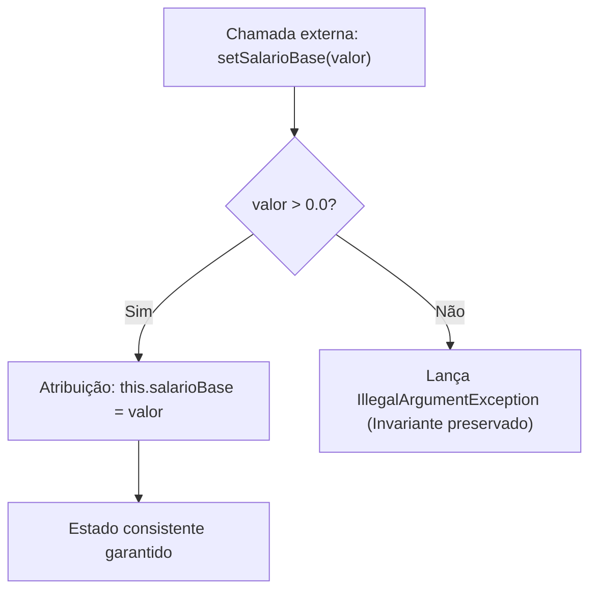

#### Definição
Mecanismo de controle de acesso que combina dados e os métodos que operam sobre esses dados em uma unidade coesa, ocultando detalhes estruturais através de modificadores de visibilidade (`private`, `protected`, `public`).

#### Motivação
Sem encapsulamento, campos públicos podem ser alterados diretamente por qualquer consumidor do sistema. Se um atributo como `salario` for acessível publicamente, valores negativos ou nulos podem ser atribuídos, quebrando cálculos de folha de pagamento, relatórios fiscais e persistência no banco de dados.

#### Exemplo canônico
```java
public class Funcionario {
    private String nome;
    private int matricula;
    private double salarioBase;

    public Funcionario(String nome, int matricula, double salarioBase) {
        setNome(nome);
        setMatricula(matricula);
        setSalarioBase(salarioBase);
    }

    public void setNome(String nome) {
        if (nome == null || nome.trim().isEmpty()) {
            throw new IllegalArgumentException("Nome não pode ser nulo ou vazio.");
        }
        this.nome = nome.trim();
    }

    public void setMatricula(int matricula) {
        if (matricula <= 0) {
            throw new IllegalArgumentException("Matrícula deve ser um número estritamente positivo.");
        }
        this.matricula = matricula;
    }

    public void setSalarioBase(double salarioBase) {
        if (salarioBase <= 0.0) {
            throw new IllegalArgumentException("Salário base deve ser superior a zero.");
        }
        this.salarioBase = salarioBase;
    }

    public String getNome() { return this.nome; }
    public int getMatricula() { return this.matricula; }
    public double getSalarioBase() { return this.salarioBase; }
}
```

#### Contraexemplo
```java
// Antipattern: Classe anêmica sem encapsulamento
public class FuncionarioAnemico {
    public String nome;
    public int matricula;
    public double salarioBase; // Permite: f.salarioBase = -9999.00;
}
```

#### Armadilhas e armadilhas comuns
- **Getters e Setters cegos:** Gerar automaticamente métodos seletores e modificadores sem qualquer validação lógica equivale semanticamente a declarar os campos como `public`.
- **Vazamento de referências mutáveis:** Retornar referências diretas a objetos mutáveis (como `java.util.Date` ou coleções) expõe o estado interno à mutação externa sem passar pelo mutador. Deve-se retornar cópias defensivas (`new Date(data.getTime())` ou `Collections.unmodifiableList(lista)`).

---

### 1.2 Herança, especialização e o Princípio de Substituição de Liskov

A herança permite que uma classe derivada herde os campos e comportamentos de uma superclasse, promovendo o reúso de código e estabelecendo relações taxonômicas do tipo "É-UM" (*is-a*).

O **Princípio de Substituição de Liskov (LSP - Liskov Substitution Principle)** estabelece que, se a classe `S` é uma subclasse de `T`, os objetos do tipo `T` devem poder ser substituídos por objetos do tipo `S` sem alterar a correção ou as propriedades esperadas do programa.

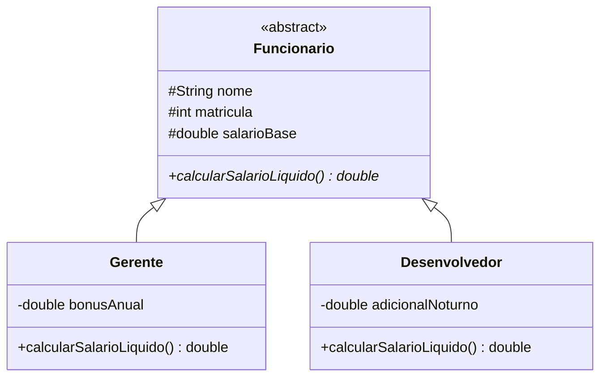

#### Regras do LSP
1. **Pré-condições não podem ser fortalecidas na subclasse:** Um método sobrescrito não pode exigir parâmetros mais restritivos do que o método da superclasse.
2. **Pós-condições não podem ser enfraquecidas na subclasse:** O método da subclasse deve garantir ao menos as mesmas garantias de resultado da superclasse.
3. **Invariantes devem ser mantidos:** Todas as condições invariantes da superclasse devem continuar válidas na subclasse.

#### Exemplo canônico
```java
public abstract class Funcionario {
    private String nome;
    private double salarioBase;

    public Funcionario(String nome, double salarioBase) {
        if (salarioBase <= 0.0) {
            throw new IllegalArgumentException("Salário base deve ser positivo.");
        }
        this.nome = nome;
        this.salarioBase = salarioBase;
    }

    public double getSalarioBase() { return salarioBase; }
    public abstract double calcularSalarioLiquido();
}

public class Gerente extends Funcionario {
    private double bonusAnual;

    public Gerente(String nome, double salarioBase, double bonusAnual) {
        super(nome, salarioBase);
        if (bonusAnual < 0.0) {
            throw new IllegalArgumentException("Bônus não pode ser negativo.");
        }
        this.bonusAnual = bonusAnual;
    }

    @Override
    public double calcularSalarioLiquido() {
        return getSalarioBase() + this.bonusAnual;
    }
}
```

#### Contraexemplo
```java
// Violação de LSP: forçar herança onde não existe relação conceitual
public class ContaPoupanca extends ContaCorrente {
    @Override
    public void cobrarTarifaManutencao() {
        // Lança exceção inesperada para clientes que esperam comportamento de ContaCorrente
        throw new UnsupportedOperationException("Poupança não possui tarifa.");
    }
}
```

---

### 1.3 Polimorfismo dinâmico e resolução de métodos via vtable

O polimorfismo é a capacidade de invocar o mesmo método sobre referências de um tipo abstrato, fazendo com que a Máquina Virtual Java execute dinamicamente o comportamento concreto da subclasse instanciada.

Na JVM, a invocação de métodos de instância ocorre por meio da instrução de bytecode `invokevirtual`. A resolução é realizada em tempo de execução consultando a **Virtual Method Table (vtable)** da classe concreta da instância.

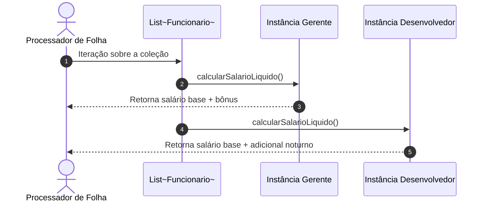

#### Tabela de comparação: Tipos de ligação (Binding)

| Característica | Ligação Estática (Static Binding) | Ligação Dinâmica (Dynamic Binding) |
| :--- | :--- | :--- |
| **Momento de resolução** | Tempo de compilação. | Tempo de execução (Runtime via JVM). |
| **Instrução de Bytecode** | `invokestatic`, `invokespecial`. | `invokevirtual`, `invokeinterface`. |
| **Alvos típicos** | Métodos `static`, `private` e construtores (`<init>`). | Métodos públicos/protegidos sobrescritos. |
| **Mecanismo de busca** | Vinculado diretamente ao tipo da variável de referência. | Vinculado ao objeto real alocado no heap (vtable). |
| **Suporte a polimorfismo** | Inexistente. | Pleno. |

---

### 1.4 Classes abstratas versus interfaces como contratos de projeto

Em Java, classes abstratas e interfaces fornecem mecanismos complementares para estruturação de tipos.

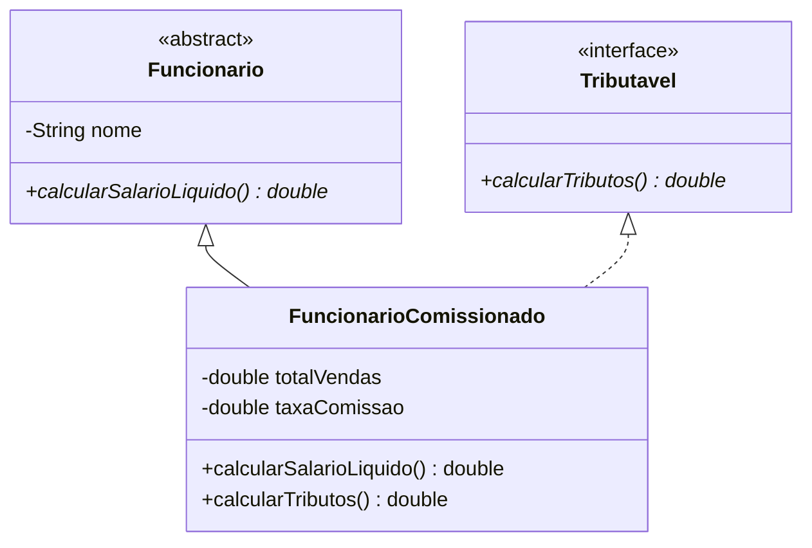

#### Tabela comparativa: Classe Abstrata versus Interface

| Critério | Classe Abstrata | Interface |
| :--- | :--- | :--- |
| **Modelo de herança** | Herança simples (`extends`). | Herança e implementação múltipla (`implements`). |
| **Estado interno** | Pode possuir atributos de instância mutáveis (`private`, `protected`). | Apenas constantes públicas (`public static final`). |
| **Construtores** | Possui construtores chamados por `super()`. | Não possui construtores; não pode ser instanciada. |
| **Semântica conceitual** | Relação de identidade ("É-UM"). | Relação de capacidade ou contrato ("FAZ-UM"). |
| **Implementação de métodos** | Mistura métodos abstratos e concretos. | Métodos abstratos (e `default`/`static` a partir do Java 8). |

---

### 1.5 Contrato de identidade em Java: hashCode e equals

O contrato entre `equals(Object obj)` e `hashCode()` herdados de `java.lang.Object` rege a comparação de igualdade lógica e o comportamento de estruturas de dados baseadas em tabelas de dispersão (`HashSet`, `HashMap`, `Hashtable`).

#### Regras fundamentais do contrato
1. **Consistência reflexiva, simétrica, transitiva:** Para qualquer referência não-nula `x`, `x.equals(x)` é verdadeiro; `x.equals(y)` equivale a `y.equals(x)`; se `x.equals(y)` e `y.equals(z)`, então `x.equals(z)`.
2. **Consistência do Hash:** Se dois objetos são iguais pelo método `equals()`, eles **devem obrigatoriamente** produzir o mesmo código hash inteiro retornado por `hashCode()`.
3. **Colisão de Hash:** Se dois objetos produzem o mesmo `hashCode()`, eles **não são necessariamente iguais**, mas colisões excessivas degradam a busca em tabelas hash de `$ O(1) $` para `$ O(n) $`.

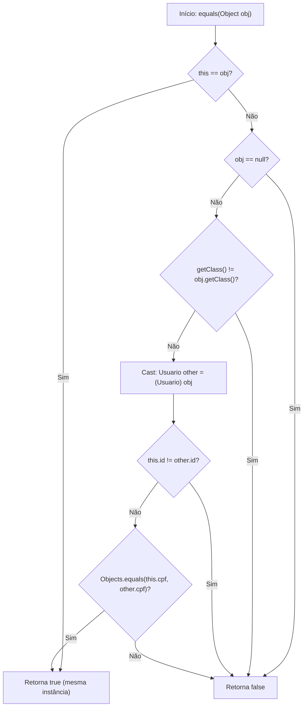

#### Implementação de referência na classe de domínio
```java
@Override
public int hashCode() {
    int hash = 7;
    hash = 89 * hash + this.id;
    hash = 89 * hash + (this.cpf != null ? this.cpf.hashCode() : 0);
    return hash;
}

@Override
public boolean equals(Object obj) {
    if (this == obj) return true;
    if (obj == null || getClass() != obj.getClass()) return false;
    final Usuario other = (Usuario) obj;
    if (this.id != other.id) return false;
    return java.util.Objects.equals(this.cpf, other.cpf);
}
```

---

### 1.6 Hierarquia de exceções: Checked, Unchecked e Exceções de Domínio

O mecanismo de tratamento de falhas em Java divide-se a partir da classe base `java.lang.Throwable`:

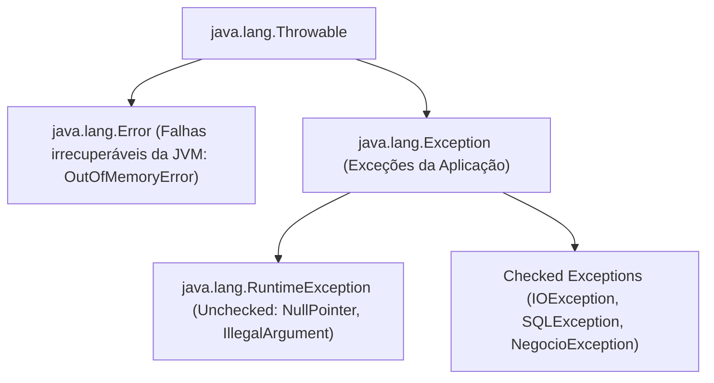

#### Definições
- **Checked Exceptions (Exceções Verificadas):** Subclasses diretas de `java.lang.Exception` (excluindo `RuntimeException`). O compilador exige tratamento explícito (`try-catch`) ou declaração de repasse na assinatura (`throws`). Representam condições anômalas previsíveis das quais o sistema pode se recuperar.
- **Unchecked Exceptions (Exceções Não Verificadas):** Subclasses de `java.lang.RuntimeException`. Indicam erros lógicos de programação ou violações imediatas de pré-condições. O compilador não exige declaração obrigatória.
- **Exceções de Domínio:** Classes customizadas criadas para representar falhas de regras de negócio específicas, dissociando o fluxo de erro funcional das falhas técnicas de infraestrutura.

#### Exemplo de exceção customizada de domínio
```java
public class NegocioException extends Exception {
    private static final long serialVersionUID = 1L;

    public NegocioException(String mensagem) {
        super(mensagem);
    }

    public NegocioException(String mensagem, Throwable causa) {
        super(mensagem, causa);
    }
}
```

---

### 1.7 Gerenciamento dinâmico de coleções com a API Java Collections

Arrays nativos em Java (`Funcionario[]`) possuem tamanho fixo alocado no momento da instanciação. Sistemas corporativos utilizam a hierarquia da **Java Collections Framework**, prioritariamente a interface `java.util.List` e sua implementação em vetor redimensionável `java.util.ArrayList`.

#### Operações fundamentais e complexidade assintótica

| Operação | Implementação `ArrayList` | Implementação `LinkedList` | Justificativa Teórica |
| :--- | :--- | :--- | :--- |
| **Acesso por índice (`get(i)`)** | `$ O(1) $` | `$ O(n) $` | Acesso direto ao endereço de memória contíguo via aritmética de ponteiros. |
| **Inserção ao final (`add(e)`)** | `$ O(1) $` amortizado | `$ O(1) $` | Alocação direta no próximo índice livre; realocação de buffer ocasional. |
| **Inserção/Remoção no início (`add(0, e)`)** | `$ O(n) $` | `$ O(1) $` | Deslocamento obrigatório de todos os elementos subsequentes via `System.arraycopy`. |
| **Busca por valor (`contains(e)`)** | `$ O(n) $` | `$ O(n) $` | Varredura linear comparando via `equals()`. |

#### Exemplo de ordenação de coleções sem mutação da lista original
```java
public List<Funcionario> listarOrdenadoPorSalarioDecrescente(List<Funcionario> original) {
    List<Funcionario> copia = new ArrayList<>(original);
    copia.sort((f1, f2) -> Double.compare(f2.calcularSalarioLiquido(), f1.calcularSalarioLiquido()));
    return Collections.unmodifiableList(copia);
}
```

---

## 2. Configuração de Ambiente, Infraestrutura e Padrão Monolítico

### 2.1 O ecossistema Java: JDK 17 LTS, JRE e Hotspot JVM

O desenvolvimento corporativo fundamenta-se na distribuição **Java SE 17 LTS (Long-Term Support)** do projeto **Adoptium Eclipse Temurin**.

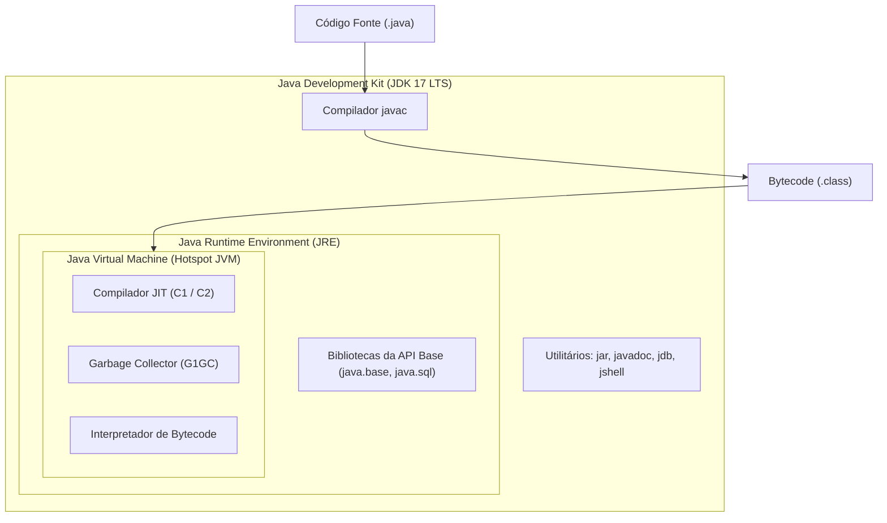

#### Auditoria de versão no terminal
Para garantir paridade absoluta entre a versão do compilador e o ambiente de execução:
```bash
java -version
javac -version
```
Saída esperada:
```plain text
openjdk version "17.0.13" 2024-10-15
OpenJDK Runtime Environment Temurin-17.0.13+11 (build 17.0.13+11)
OpenJDK 64-Bit Server VM Temurin-17.0.13+11 (build 17.0.13+11, mixed mode, sharing)
javac 17.0.13
```

---

### 2.2 O container web Apache Tomcat 9: Engine Catalina e Compilador Jasper

O Apache Tomcat 9 atua como um **J2EE Web Container**, implementando as especificações Java Servlet 4.0, JavaServer Pages (JSP) 2.3 e Expression Language (EL) 3.0.

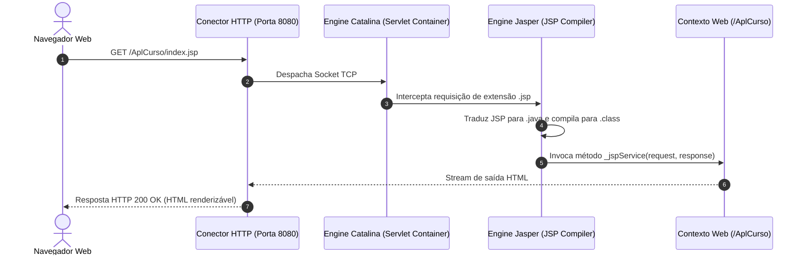

- **Engine Catalina:** Módulo central responsável por gerenciar o ciclo de vida dos servlets, roteamento de sessões HTTP (`HttpSession`), filtros de requisição e segurança de contextos.
- **Engine Jasper:** Compilador especializado em transformar páginas `.jsp` em código-fonte Java compatível com a interface `HttpJspPage`, compilando-as dinamicamente em bytecode.

---

### 2.3 A ruptura de compatibilidade Java EE versus Jakarta EE (Tomcat 9 versus Tomcat 10)

A transição dos direitos de governança do Java corporativo da Oracle para a Eclipse Foundation gerou uma alteração de namespace que impede a execução de projetos legados em versões recentes do Tomcat.

#### Tabela de compatibilidade de especificações

| Família Tomcat | Especificação Servlet | Especificação JSP | Namespace dos Pacotes | Compatibilidade com Java EE 8 |
| :--- | :--- | :--- | :--- | :--- |
| **Tomcat 8.5.x** | Servlet 3.1 | JSP 2.3 | `javax.servlet.*` | Compatível |
| **Tomcat 9.0.x** | **Servlet 4.0** | **JSP 2.3** | `javax.servlet.*` | **Alvo do Curso (Totalmente Compatível)** |
| **Tomcat 10.0.x** | Servlet 5.0 | JSP 3.0 | `jakarta.servlet.*` | Incompatível (Gera `ClassNotFoundException`) |
| **Tomcat 10.1.x** | Servlet 6.0 | JSP 3.1 | `jakarta.servlet.*` | Incompatível (Namespace quebrado) |
| **Tomcat 11.0.x** | Servlet 6.1 | JSP 4.0 | `jakarta.servlet.*` | Incompatível |

A tentativa de executar aplicações estruturadas sobre `javax.servlet.*` no Tomcat 10+ resulta em falhas graves de implantação:
```plain text
java.lang.ClassNotFoundException: javax.servlet.http.HttpServlet
    at org.apache.catalina.loader.WebappClassLoaderBase.loadClass(WebappClassLoaderBase.java:1365)
```

---

### 2.4 Parametrização do Apache NetBeans 24 e gerenciamento via Apache Ant

O Apache NetBeans 24 fornece suporte nativo ao gerenciador de compilação **Apache Ant (versão 1.10.14)** e integração transparente com o servidor Apache Tomcat.

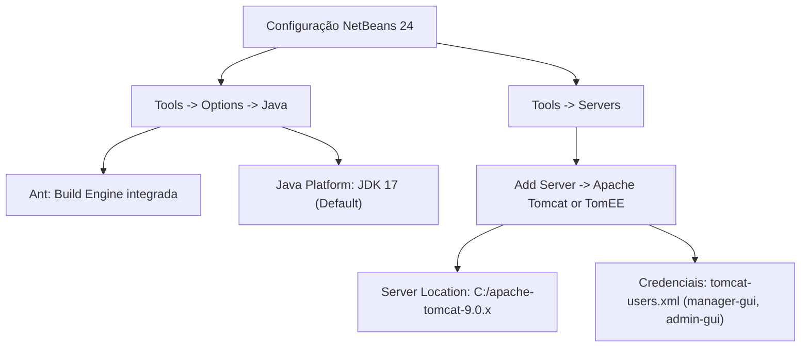

Na criação de novos projetos acadêmicos para a disciplina, utiliza-se a categoria **Java with Ant -> Java Web -> Web Application**, selecionando a especificação **Java EE 8 Web** e associando o servidor Apache Tomcat 9 registrado.

---

### 2.5 Arquitetura monolítica versus microsserviços

Uma arquitetura monolítica unifica todas as camadas funcionais da aplicação em uma base de código única executada sob um processo computacional centralizado na JVM.

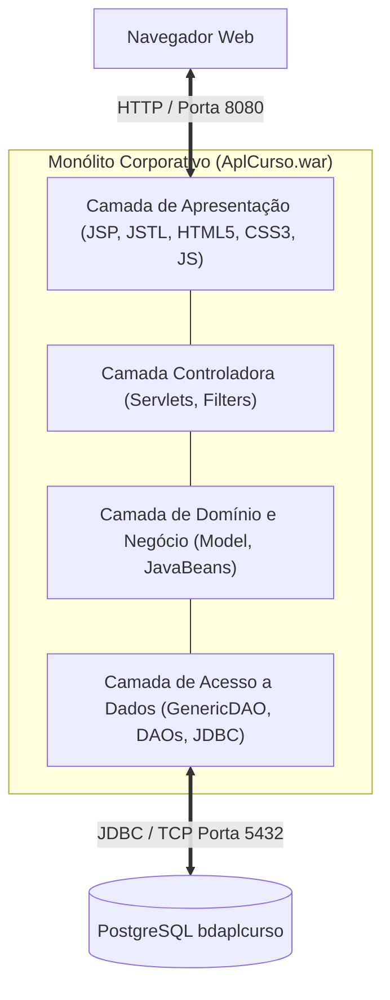

#### Comparativo de características arquiteturais

| Critério de Engenharia | Arquitetura Monolítica | Arquitetura de Microsserviços |
| :--- | :--- | :--- |
| **Mecanismo de comunicação interna** | Chamadas diretas de métodos em memória (`in-memory`). | Protocolos de rede distribuídos (HTTP/REST, gRPC, filas AMQP). |
| **Complexidade operacional** | Baixa: um único artefato de deploy (`.war`). | Elevada: exige orquestração de containers (Kubernetes, Docker). |
| **Integridade transacional** | Nativa: transações locais via JDBC (`commit` e `rollback`). | Complexa: exige transações distribuídas (Padrão Saga, 2PC). |
| **Latência entre camadas** | Desprezível (nanossegundos em memória JVM). | Dependente da topologia de rede (milissegundos por chamada). |
| **Curva de aprendizado** | Ideal para fixação de padrões e regras de negócio. | Exige maturidade prévia em sistemas distribuídos e devops. |

---

### 2.6 Estruturação de pacotes em camadas: view, filter, controller, model, dao e utils

A estrutura física do código-fonte em projetos Java Web divide-se estritamente conforme a matriz de responsabilidades:

```plain text
AplCurso/
├── src/java/ (Source Packages)
│   └── br/com/aplcurso/
│       ├── controller/   --> Servlets HTTP que interceptam e despacham ações
│       ├── dao/          --> Classes DAO e interfaces de persistência (CRUD)
│       ├── filter/       --> Servlet Filters para interceptação de requisições
│       ├── model/        --> Entidades de domínio (JavaBeans / POJOs)
│       └── utils/        --> Conexão JDBC (SingleConnection), validadores, banco.sql
└── web/ (Web Pages)
    ├── META-INF/         --> Metadados da aplicação
    ├── WEB-INF/          --> Descritor web.xml e bibliotecas (lib/)
    ├── css/              --> Folhas de estilo locais
    ├── js/               --> Scripts locais (jQuery, plugins, app.js)
    ├── header.jsp        --> Fragmento superior comum (head, scripts)
    ├── menu.jsp          --> Fragmento de navegação modular
    ├── footer.jsp        --> Fragmento inferior comum (fechamento de tags)
    ├── home.jsp          --> Visão mestra inicial
    └── index.jsp         --> Ponto de entrada e redirecionamento inicial
```

---

## 3. Persistência Relacional com PostgreSQL e JDBC Nativo

### 3.1 Modelagem relacional e tipagem de dados no PostgreSQL

O Sistema Gerenciador de Banco de Dados Relacional **PostgreSQL** é adotado como a base de persistência dos dados transacionais.

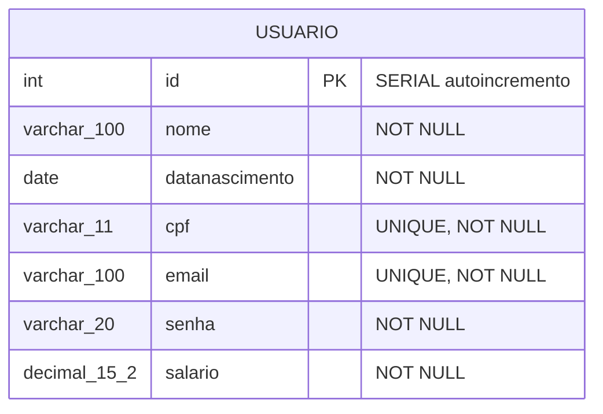

#### Tipos primitivos relacionais e regras de integridade
- `id SERIAL PRIMARY KEY`: Chave primária gerada automaticamente por sequência interna.
- `nome VARCHAR(100) NOT NULL`: Nome completo em texto variável.
- `datanascimento DATE NOT NULL`: Armazena unicamente o componente de calendário (ano, mês, dia).
- `cpf VARCHAR(11) UNIQUE NOT NULL`: Armazena os 11 dígitos numéricos do documento, com índice único para impedir duplicidade.
- `email VARCHAR(100) UNIQUE NOT NULL`: Restrição de unicidade para identificação eletrônica.
- `senha VARCHAR(20) NOT NULL`: Credencial de autenticação.
- `salario DECIMAL(15,2) NOT NULL`: Representação numérica exata de ponto fixo.

> **Regra de Engenharia Financeira:** Tipos de ponto flutuante binário (`FLOAT`, `REAL`, `DOUBLE PRECISION`) violam as normas contábeis devido a erros de representação decimal da norma IEEE 754. Valores monetários devem ser estritamente tipados como `DECIMAL(15,2)` ou `NUMERIC(15,2)`.

---

### 3.2 Mecanismo interno do pseudo-tipo SERIAL e sequências

No PostgreSQL, a instrução `id SERIAL PRIMARY KEY` atua como um atalho sintático (*syntactic sugar*) que aciona comandos implícitos de catálogo:

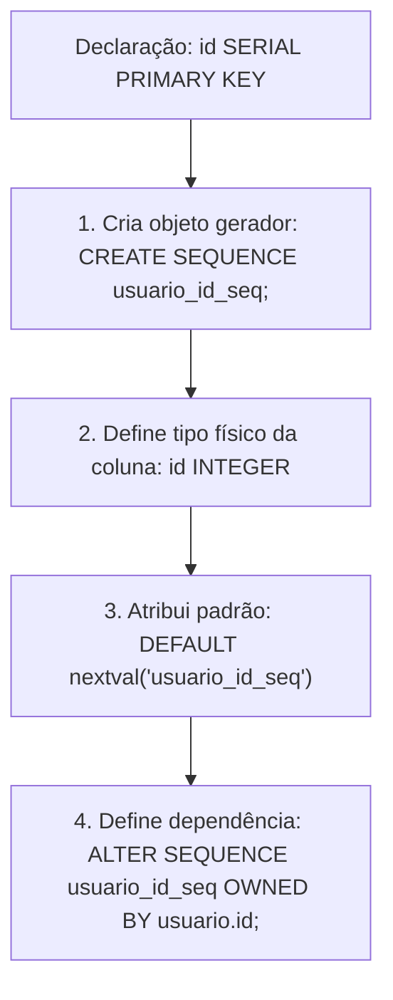

Se a tabela for excluída via `DROP TABLE usuario CASCADE;`, o objeto de sequência vinculado é removido automaticamente do catálogo pelo SGBD.

---

### 3.3 Versionamento de scripts DDL e DML no pacote utils

O arquivo `banco.sql` localizado em `br.com.aplcurso.utils` assegura a rastreabilidade estrutural da infraestrutura junto ao controle de versão (Git).

```sql
-- Criação da estrutura de dados
CREATE TABLE usuario (
    id SERIAL PRIMARY KEY,
    nome VARCHAR(100) NOT NULL,
    datanascimento DATE NOT NULL,
    cpf VARCHAR(11) UNIQUE NOT NULL,
    email VARCHAR(100) UNIQUE NOT NULL,
    senha VARCHAR(20) NOT NULL,
    salario DECIMAL(15,2) NOT NULL
);

-- Carga inicial de homologação
INSERT INTO usuario (nome, datanascimento, cpf, email, senha, salario)
VALUES (
    'João José Gomes da Silva',
    '1990-08-10',
    '08243060073',
    'joaojosegomes@gmail.com',
    'senha123',
    5200.00
);

-- Consulta de conferência
SELECT id, nome, datanascimento, cpf, email, senha, salario FROM usuario;
```

---

### 3.4 O padrão de projeto criacional Singleton aplicado à conexão JDBC

O padrão **Singleton** garante que uma classe possua apenas uma única instância em toda a execução do programa, fornecendo um ponto global de acesso a ela.

Na arquitetura didática adotada na disciplina, a classe `SingleConnection` assegura que todos os objetos DAO compartilhem a mesma instância física de `java.sql.Connection`.

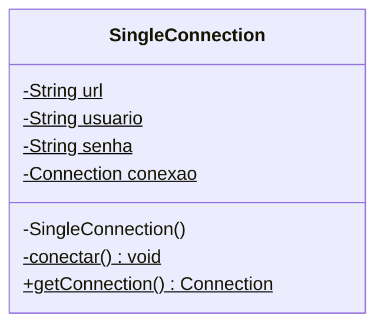

#### Código canônico comentado: SingleConnection.java
```java
package br.com.aplcurso.utils;

import java.sql.Connection;
import java.sql.DriverManager;
import java.sql.SQLException;

public class SingleConnection {

    private static final String BANCO = "bdaplcurso";
    private static final String URL = "jdbc:postgresql://localhost:5432/" + BANCO;
    private static final String USUARIO = "postgres";
    private static final String SENHA = "root"; // Senha parametrizada no ambiente
    private static Connection conexao = null;

    // 1. Construtor privado impede instanciação externa via new
    private SingleConnection() {
    }

    // 2. Bloco estático: executado uma única vez no carregamento da classe na JVM
    static {
        conectar();
    }

    // 3. Método de conexão que carrega o Driver e desativa o auto-commit
    private static void conectar() {
        try {
            if (conexao == null || conexao.isClosed()) {
                // Registro dinâmico da classe do Driver no DriverManager
                Class.forName("org.postgresql.Driver");
                conexao = DriverManager.getConnection(URL, USUARIO, SENHA);
                // Controle transacional manual ativado
                conexao.setAutoCommit(false);
            }
        } catch (ClassNotFoundException e) {
            System.err.println("Driver JDBC do PostgreSQL não localizado no classpath!");
            e.printStackTrace();
        } catch (SQLException e) {
            System.err.println("Falha de autenticação ou indisponibilidade do banco de dados!");
            e.printStackTrace();
        }
    }

    // 4. Ponto global de acesso
    public static Connection getConnection() {
        try {
            if (conexao == null || conexao.isClosed()) {
                conectar();
            }
        } catch (SQLException e) {
            e.printStackTrace();
        }
        return conexao;
    }
}
```

---

### 3.5 Arquitetura da API JDBC: DriverManager, Connection, PreparedStatement e ResultSet

A API **JDBC (Java Database Connectivity)** provê uma interface abstrata independente do SGBD utilizado.

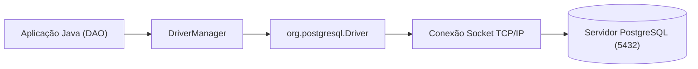

- **`DriverManager`:** Gerencia a lista de drivers disponíveis e estabelece conexões baseadas na URL JDBC (`jdbc:postgresql://...`).
- **`Connection`:** Representa a sessão de comunicação aberta com o banco, controlando transações (`commit`, `rollback`).
- **`PreparedStatement`:** Instrução SQL pré-compilada no motor do banco de dados com suporte a parâmetros posicionais vinculados (`?`).
- **`ResultSet`:** Cursor navegável linha a linha que mapeia os registros retornados por uma consulta `SELECT`.

---

### 3.6 Prevenção sistemática de SQL Injection

A concatenação direta de entradas fornecidas pelo usuário em comandos SQL permite a injeção de instruções arbitrárias que alteram a sintaxe pretendida pelo desenvolvedor.

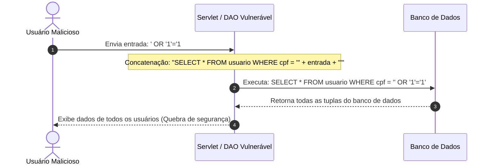

#### Comparativo de segurança no código

```java
// INSEGURO: Permite SQL Injection por quebra de aspas simples
String sqlInsegura = "SELECT * FROM usuario WHERE cpf = '" + cpfInput + "'";
Statement stmt = conexao.createStatement();
ResultSet rs = stmt.executeQuery(sqlInsegura);

// SEGURO: PreparedStatement pré-compilado; parâmetro tratado estritamente como dado literal
String sqlSegura = "SELECT * FROM usuario WHERE cpf = ?";
try (PreparedStatement pstmt = conexao.prepareStatement(sqlSegura)) {
    pstmt.setString(1, cpfInput); // O caractere ' é escapado automaticamente pelo driver
    try (ResultSet rs = pstmt.executeQuery()) {
        // Leitura protegida
    }
}
```

---

### 3.7 Controle transacional manual, desativação de autoCommit e propriedades ACID

Por padrão, conexões JDBC operam em modo `autoCommit = true`, confirmando cada comando DML individual imediatamente após a execução. Em sistemas corporativos, transações devem atender estritamente às propriedades **ACID**:

- **Atomicidade:** Todas as operações da transação são concluídas com êxito ou nenhuma é efetivada.
- **Consistência:** A transação transiciona o banco de um estado válido a outro estado válido, respeitando todas as restrições de integridade.
- **Isolamento:** Transações simultâneas não interferem no estado intermediário umas das outras.
- **Durabilidade:** Uma vez confirmada (`commit`), a persistência dos dados é garantida mesmo em caso de falha de energia.

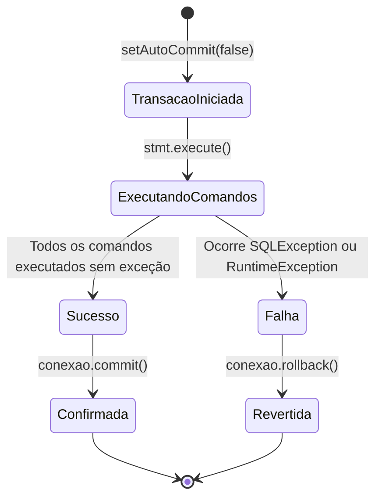

---

### 3.8 Gestão de recursos com a estrutura try-with-resources

Conexões, instruções e cursores mantêm descritores de socket e alocações de memória abertas no sistema operacional e no servidor PostgreSQL. O padrão idiomático **try-with-resources** gerencia automaticamente o fechamento desses recursos através da interface `java.lang.AutoCloseable`.

```java
public boolean cpfExiste(String cpf) {
    String sql = "SELECT COUNT(*) AS quantidade FROM usuario WHERE cpf = ?";
    // pstmt e rs são fechados garantidamente na ordem inversa de abertura
    try (PreparedStatement pstmt = conexao.prepareStatement(sql)) {
        pstmt.setString(1, cpf);
        try (ResultSet rs = pstmt.executeQuery()) {
            if (rs.next()) {
                return rs.getInt("quantidade") > 0;
            }
        }
    } catch (SQLException e) {
        System.err.println("Erro na checagem de CPF: " + e.getMessage());
        e.printStackTrace();
    }
    return false;
}
```

---

## 4. Camada de Apresentação com JSP, JSTL e Frontend Integrado

### 4.1 Ciclo de vida e compilação de páginas JSP

Páginas **JavaServer Pages (JSP)** não são executadas diretamente como arquivos estáticos. No primeiro acesso, o container web traduz a marcação para uma classe Java de Servlet correspondente e a compila em bytecode.

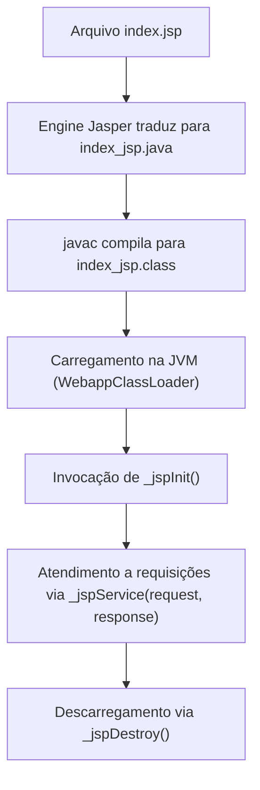

---

### 4.2 Eliminação de scriptlets com JSTL Core, JSTL Formatting e Expression Language

O uso de scriptlets (`<% ... %>`) acopla código Java dentro do HTML, tornando a interface ilegível e de difícil manutenção. A biblioteca **JSTL (JavaServer Pages Standard Tag Library)** substitui construções procedurais por tags estruturadas.

```jsp
<%@taglib prefix="c" uri="http://java.sun.com/jsp/jstl/core" %>
<%@taglib prefix="fmt" uri="http://java.sun.com/jsp/jstl/fmt" %>
```

#### Tabela de comparação: Scriptlets versus JSTL / EL

| Operação | Scriptlet Java Obsoleto (Antipattern) | Padrão Moderno com JSTL e Expression Language |
| :--- | :--- | :--- |
| **Exibição de variável** | `<%= usuario.getNome() %>` | `${usuario.nome}` |
| **Iteração de listas** | `<% for(Usuario u : lista) { %> <tr>...</tr> <% } %>` | `<c:forEach var="u" items="${usuarios}"> <tr>...</tr> </c:forEach>` |
| **Condicional simples** | `<% if(u.getId() > 0) { %> ... <% } %>` | `<c:if test="${u.id > 0}"> ... </c:if>` |
| **Formatação de Moeda** | `<%= NumberFormat.getCurrencyInstance().format(val) %>` | `<fmt:formatNumber value="${u.salario}" type="currency"/>` |
| **Formatação de Data** | `<%= new SimpleDateFormat("dd/MM/yyyy").format(d) %>` | `<fmt:formatDate value="${u.dataNascimento}" pattern="dd/MM/yyyy"/>` |

---

### 4.3 Modularização visual de interfaces via jsp:include

Para garantir o princípio **DRY (Don't Repeat Yourself)** na camada de apresentação, divide-se o layout em fragmentos reutilizáveis:

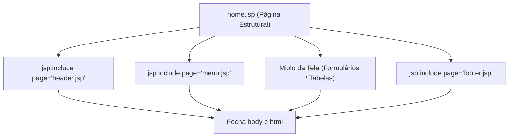

#### Comparativo: Inclusão dinâmica versus inclusão estática

| Critério | Inclusão Dinâmica (`<jsp:include page="..." />`) | Inclusão Estática (`<%@include file="..." %>`) |
| :--- | :--- | :--- |
| **Momento de execução** | Tempo de requisição (*Request-time*). | Tempo de tradução (*Translation-time*). |
| **Mecanismo interno** | Delega ao `RequestDispatcher.include()`. | Funde o código-fonte antes da compilação. |
| **Isolamento de escopo** | Escopos de variáveis locais do método são isolados. | Compartilha as mesmas variáveis locais do servlet gerado. |
| **Atualização em disco** | Modificações no arquivo refletem na próxima requisição. | Pode exigir recompilação forçada do JSP pai. |

---

### 4.4 Resolução absoluta de caminhos com contextPath

O uso de caminhos relativos (`../../js/app.js`) resulta em quebra de carregamento quando uma Servlet despacha uma requisição a partir de uma URI profunda (ex.: `/usuario/listar`). A solução padronizada consiste no uso de Expression Language:

```jsp
<script src="${pageContext.request.contextPath}/js/jquery-3.3.1.min.js"></script>
<script src="${pageContext.request.contextPath}/js/app.js"></script>
<link rel="stylesheet" href="${pageContext.request.contextPath}/css/estilos.css">
```
A variável `${pageContext.request.contextPath}` expande dinamicamente para o nome do contexto da aplicação (ex.: `/AplCurso`), garantindo links absolutos a partir da raiz do servidor.

---

### 4.5 Integração de bibliotecas: jQuery, Bootstrap, DataTables e SweetAlert2

O carregamento no arquivo `header.jsp` deve obedecer à ordem estrita de dependências:

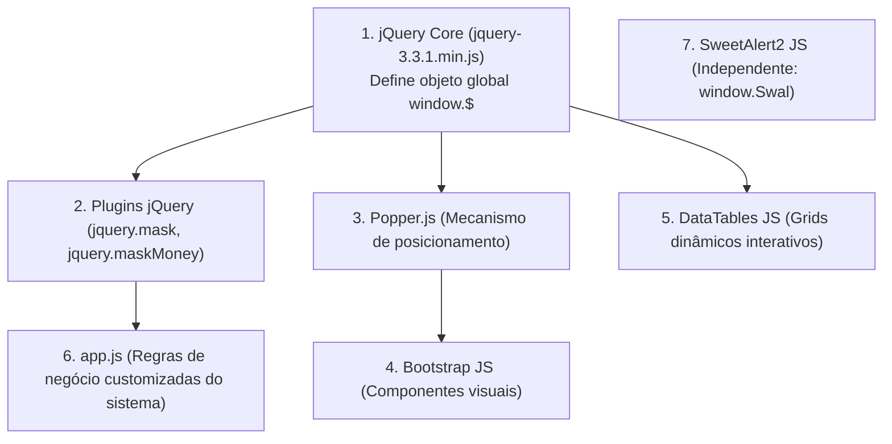

---

### 4.6 Validação algorítmica de documentos federais (CPF e CNPJ) via Módulo 11

A validação de integridade do Cadastro de Pessoas Físicas (CPF) baseia-se na geração de dois Dígitos Verificadores (DV) calculados a partir dos 9 primeiros dígitos numéricos.

#### Formulação matemática para validação de CPF

1. **Cálculo do primeiro dígito verificador ($`d_1`$):**

```math
S_1 = \sum_{i=0}^{8} \text{dígito}[i] \times (10 - i)
```

```math
R_1 = S_1 \pmod{11}
```

```math
d_1 = \begin{cases} 0, & \text{se } (11 - R_1) \ge 10 \\ 11 - R_1, & \text{caso contrário} \end{cases}
```

2. **Cálculo do segundo dígito verificador ($`d_2`$):**

```math
S_2 = \left( \sum_{i=0}^{8} \text{dígito}[i] \times (11 - i) \right) + (d_1 \times 2)
```

```math
R_2 = S_2 \pmod{11}
```

```math
d_2 = \begin{cases} 0, & \text{se } (11 - R_2) \ge 10 \\ 11 - R_2, & \text{caso contrário} \end{cases}
```

#### Código da classe utilitária: DocumentoValidador.java
```java
package br.com.aplcurso.utils;

public class DocumentoValidador {

    public static boolean isCPF(String cpf) {
        if (cpf == null) return false;
        cpf = cpf.replaceAll("[^\\d]", "");
        // Rejeita tamanhos inválidos e cadeias com números repetidos conhecidos
        if (cpf.length() != 11 || cpf.matches("(\\d)\\1{10}")) return false;

        try {
            int d1 = 0, d2 = 0;
            for (int i = 0; i < 9; i++) {
                int digito = cpf.charAt(i) - '0';
                d1 += digito * (10 - i);
                d2 += digito * (11 - i);
            }

            d1 = 11 - (d1 % 11);
            d1 = (d1 >= 10) ? 0 : d1;

            d2 += d1 * 2;
            d2 = 11 - (d2 % 11);
            d2 = (d2 >= 10) ? 0 : d2;

            return d1 == (cpf.charAt(9) - '0') && d2 == (cpf.charAt(10) - '0');
        } catch (Exception e) {
            return false;
        }
    }

    public static boolean isCNPJ(String cnpj) {
        if (cnpj == null) return false;
        cnpj = cnpj.replaceAll("[^\\d]", "");
        if (cnpj.length() != 14 || cnpj.matches("(\\d)\\1{13}")) return false;

        try {
            int[] pesos1 = {5, 4, 3, 2, 9, 8, 7, 6, 5, 4, 3, 2};
            int[] pesos2 = {6, 5, 4, 3, 2, 9, 8, 7, 6, 5, 4, 3, 2};

            int d1 = 0, d2 = 0;
            for (int i = 0; i < 12; i++) {
                int digito = cnpj.charAt(i) - '0';
                d1 += digito * pesos1[i];
                d2 += digito * pesos2[i];
            }

            d1 = 11 - (d1 % 11);
            d1 = (d1 >= 10) ? 0 : d1;

            d2 += d1 * pesos2[12];
            d2 = 11 - (d2 % 11);
            d2 = (d2 >= 10) ? 0 : d2;

            return d1 == (cnpj.charAt(12) - '0') && d2 == (cnpj.charAt(13) - '0');
        } catch (Exception e) {
            return false;
        }
    }
}
```

---

### 4.7 Máscaras dinâmicas no cliente e tratamento de valores monetários

No arquivo `app.js`, a alternância entre máscara de CPF e CNPJ é tratada dinamicamente com base no evento de foco e no comprimento do texto:

```javascript
$(document).ready(function () {
    // Configuração do plugin maskMoney para padrão Real Brasileiro
    if ($.fn.maskMoney) {
        $(".dinheiro").maskMoney({
            prefix: 'R$ ',
            allowNegative: false,
            thousands: '.',
            decimal: ',',
            affixesStay: false
        });
    }

    // Alternância de máscara CPF/CNPJ
    var campoDoc = $("#cpfcnpj");
    campoDoc.keydown(function () {
        try {
            campoDoc.unmask();
        } catch (e) {}

        var tamanho = campoDoc.val().replace(/\D/g, '').length;
        if (tamanho < 11) {
            campoDoc.mask("999.999.999-99");
        } else {
            campoDoc.mask("99.999.999/9999-99");
        }
    });
});
```

---

## 5. Padrão Arquitetural MVC e Camada Controladora com Servlets

### 5.1 O padrão MVC aplicado à web corporativa

O padrão arquitetural **Model-View-Controller (MVC Modelo 2)** separa formalmente a exibição visual da lógica de persistência e do processamento de fluxo:

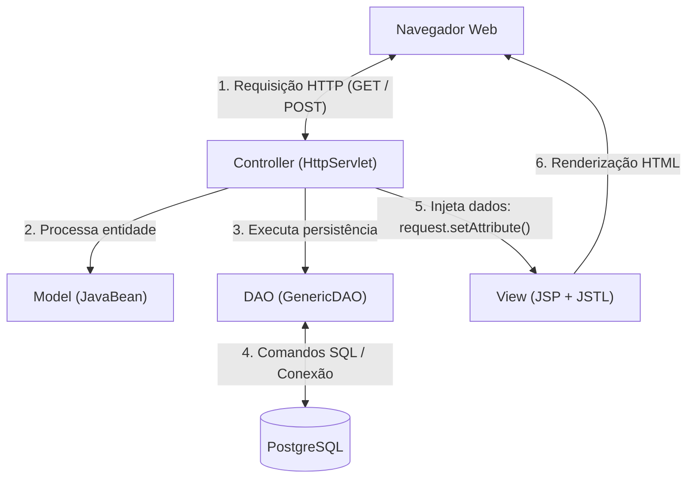

- **Model (Modelo):** Representa o domínio da informação e as regras de negócio (`Usuario`, `Livro`, `Estado`).
- **View (Visão):** Renderiza o estado do modelo para o usuário final em HTML dinâmico (`usuarioCadastrar.jsp`, `estados.jsp`).
- **Controller (Controlador):** Intercepta requisições HTTP, realiza parsing de dados, coordena as operações do DAO e seleciona a visão de resposta.

---

### 5.2 Ciclo de vida de Servlets e modelo de execução multi-thread

Servlets são instanciados e gerenciados pelo container web através da interface `javax.servlet.Servlet`.

```mermaid
stateDiagram-v2
  [*] --> NaoCarregado
  NaoCarregado --> Carregado : ClassLoader carrega o Servlet
  Carregado --> Instanciado : new UsuarioListar()
  Instanciado --> Inicializado : init(ServletConfig)
  
  state Inicializado {
    [*] --> ThreadPool
    ThreadPool --> ProcessandoRequisicao : Requisição HTTP recebida
    ProcessandoRequisicao --> service : service(request, response)
    service --> doGet : Se método GET
    service --> doPost : Se método POST
    doGet --> RespostaPronta
    doPost --> RespostaPronta
    RespostaPronta --> [*]
  }

  Inicializado --> Destruido : Container finaliza ou recarrega aplicação
  Destruido --> [*] : destroy()
```

> **Aviso Crítico de Thread-Safety:** O container instancia o Servlet como um **Singleton compartilhado por todas as requisições**. Todas as requisições concorrentes executam os métodos `doGet` ou `doPost` em threads separadas, mas compartilhando as mesmas variáveis de instância da classe Servlet. **É expressamente proibido declarar variáveis de estado de usuário como atributos de instância em uma Servlet**, sob pena de causar corrupção de dados entre usuários concorrentes.

---

### 5.3 Mapeamento com @WebServlet e roteamento de requisições HTTP

A anotação `@WebServlet` substitui a declaração manual de servlets no arquivo `web.xml`:

```java
package br.com.aplcurso.controller.usuario;

import java.io.IOException;
import javax.servlet.ServletException;
import javax.servlet.annotation.WebServlet;
import javax.servlet.http.HttpServlet;
import javax.servlet.http.HttpServletRequest;
import javax.servlet.http.HttpServletResponse;

@WebServlet(name = "UsuarioListar", urlPatterns = {"/UsuarioListar"})
public class UsuarioListar extends HttpServlet {

    protected void processRequest(HttpServletRequest request, HttpServletResponse response)
            throws ServletException, IOException {
        response.setContentType("text/html;charset=iso-8859-1");
        // Orquestração central de atendimento
    }

    @Override
    protected void doGet(HttpServletRequest request, HttpServletResponse response)
            throws ServletException, IOException {
        processRequest(request, response);
    }

    @Override
    protected void doPost(HttpServletRequest request, HttpServletResponse response)
            throws ServletException, IOException {
        processRequest(request, response);
    }
}
```

---

### 5.4 Despacho de requisições: forward versus sendRedirect e o padrão PRG

Existem dois mecanismos fundamentais para navegação e entrega de resposta no servidor:

```mermaid
sequenceDiagram
  autonumber
  actor User as Navegador
  participant Ctrl as Servlet (POST)
  participant DAO as UsuarioDAO
  participant ListCtrl as Servlet (GET)
  participant JSP as usuarioListar.jsp

  Note over User, JSP: Padrão Post-Redirect-Get (PRG)
  User->>Ctrl: POST /UsuarioCadastrar (dados do formulário)
  Ctrl->>DAO: cadastrar(usuario)
  DAO-->>Ctrl: true (sucesso)
  Ctrl-->>User: HTTP 302 Found (Location: UsuarioListar)
  User->>ListCtrl: GET /UsuarioListar
  ListCtrl->>DAO: listar()
  DAO-->>ListCtrl: List<Object>
  ListCtrl->>JSP: RequestDispatcher.forward(request, response)
  JSP-->>User: HTTP 200 OK (HTML renderizado)
```

#### Tabela comparativa: forward versus sendRedirect

| Característica | `RequestDispatcher.forward()` | `HttpServletResponse.sendRedirect()` |
| :--- | :--- | :--- |
| **Local de execução** | Lado do Servidor (interno). | Lado do Cliente (navegador). |
| **Ciclo de requisição** | Mantém a requisição original e seus atributos (`request.setAttribute`). | Encerra a requisição e força uma nova requisição HTTP independente. |
| **URL no navegador** | Permanece inalterada (URL da Servlet original). | Atualiza na barra de endereços para a nova URL de destino. |
| **Uso recomendado** | Repasse para renderização em páginas JSP. | Redirecionamento após operações de escrita (`POST`) para evitar reenvio acidental (F5). |

---

### 5.5 O padrão Data Access Object e a interface GenericDAO

A interface `GenericDAO` estabelece a assinatura padronizada para as operações de CRUD da aplicação:

```java
package br.com.aplcurso.dao;

import java.util.List;

public interface GenericDAO {
    public Boolean cadastrar(Object objeto);
    public Boolean inserir(Object objeto);
    public Boolean alterar(Object objeto);
    public Boolean excluir(int numero);
    public Object carregar(int numero);
    public List<Object> listar();
}
```

---

### 5.6 Lógica de bifurcação de persistência na DAO (inserir versus alterar)

O método `cadastrar(Object objeto)` avalia o identificador primário da entidade para determinar se deve executar um `INSERT` ou um `UPDATE`:

```java
@Override
public Boolean cadastrar(Object objeto) {
    Usuario oUsuario = (Usuario) objeto;
    Boolean retorno = false;
    // Se ID é zero, o registro não existe no banco (chave SERIAL inicia em 1)
    if (oUsuario.getId() == 0) {
        retorno = this.inserir(oUsuario);
    } else {
        retorno = this.alterar(oUsuario);
    }
    return retorno;
}
```

---

### 5.7 Verificação assíncrona com AJAX e Servlets de serviço

A validação de duplicidade de CPF antes do envio do formulário evita falhas de chave única no banco e melhora a usabilidade da aplicação:

```mermaid
sequenceDiagram
  autonumber
  actor Form as Campo CPF (Blur)
  participant JS as Script AJAX (app.js)
  participant Serv as UsuarioVerificarCPF (Servlet)
  participant DAO as UsuarioDAO

  Form->>JS: Dispara evento onblur
  JS->>Serv: GET /UsuarioVerificarCPF?cpf=12345678901
  Serv->>DAO: cpfExiste("12345678901")
  DAO-->>Serv: Retorna true ou false
  Serv-->>JS: Resposta em texto puro: "true"
  JS->>Form: Exibe alerta SweetAlert2 e limpa campo se duplicado
```

---

### 5.8 Interceptação e segurança com Servlet Filters e FilterChain

Servlet Filters interceptam requisições antes que alcancem as Servlets de destino e inspecionam as respostas antes do envio ao cliente.

```mermaid
flowchart LR
  Req["Requisição HTTP"] --> Filtro["FilterAutenticacao (doFilter)"]
  Filtro -->|"chain.doFilter()"| Servlet["Servlet de Destino"]
  Servlet --> Resp["Resposta HTTP"]
```

```java
package br.com.aplcurso.filter;

import br.com.aplcurso.utils.SingleConnection;
import java.io.IOException;
import java.sql.Connection;
import java.sql.SQLException;
import javax.servlet.Filter;
import javax.servlet.FilterChain;
import javax.servlet.FilterConfig;
import javax.servlet.ServletException;
import javax.servlet.ServletRequest;
import javax.servlet.ServletResponse;
import javax.servlet.annotation.WebFilter;

@WebFilter(urlPatterns = {"/*"})
public class FilterAutenticacao implements Filter {

    private static Connection conexao;

    @Override
    public void init(FilterConfig filterConfig) throws ServletException {
        // Inicialização global da conexão no ciclo de vida do filtro
        conexao = SingleConnection.getConnection();
    }

    @Override
    public void doFilter(ServletRequest request, ServletResponse response, FilterChain chain)
            throws IOException, ServletException {
        try {
            // Repassa a requisição para o próximo filtro ou servlet de destino
            chain.doFilter(request, response);
            // Confirma transação se todos os processos executarem com sucesso
            conexao.commit();
        } catch (Exception e) {
            try {
                // Reverte transação em caso de erro não tratado em qualquer ponto
                conexao.rollback();
            } catch (SQLException ex) {
                ex.printStackTrace();
            }
            throw new ServletException(e);
        }
    }

    @Override
    public void destroy() {
        try {
            if (conexao != null && !conexao.isClosed()) {
                conexao.close();
            }
        } catch (SQLException e) {
            e.printStackTrace();
        }
    }
}
```

---

## 6. Estudos de Caso Práticos e Implementações Canônicas

### 6.1 Caso de Estudo A: Sistema de Gerenciamento de Usuários (AplCurso)

Consolidação completa da manutenção da entidade `Usuario` no projeto-base.

#### 6.1.1 Modelo de Dados: Usuario.java
```java
package br.com.aplcurso.model;

import java.io.Serializable;
import java.util.Date;
import java.util.Objects;

public class Usuario implements Serializable {

    private static final long serialVersionUID = 1L;

    private int id;
    private String nome;
    private Date dataNascimento;
    private String cpf;
    private String email;
    private String senha;
    private double salario;

    public Usuario() {
        this.id = 0;
        this.nome = "";
        this.cpf = "";
        this.email = "";
        this.senha = "";
        this.salario = 0.0;
        this.dataNascimento = null;
    }

    public Usuario(int id, String nome, Date dataNascimento, String cpf, String email, String senha, double salario) {
        this.id = id;
        this.nome = nome;
        this.dataNascimento = dataNascimento;
        this.cpf = cpf;
        this.email = email;
        this.senha = senha;
        this.salario = salario;
    }

    public int getId() { return id; }
    public void setId(int id) { this.id = id; }

    public String getNome() { return nome; }
    public void setNome(String nome) { this.nome = nome; }

    public Date getDataNascimento() { return dataNascimento; }
    public void setDataNascimento(Date dataNascimento) { this.dataNascimento = dataNascimento; }

    public String getCpf() { return cpf; }
    public void setCpf(String cpf) { this.cpf = cpf; }

    public String getEmail() { return email; }
    public void setEmail(String email) { this.email = email; }

    public String getSenha() { return senha; }
    public void setSenha(String senha) { this.senha = senha; }

    public double getSalario() { return salario; }
    public void setSalario(double salario) { this.salario = salario; }

    @Override
    public int hashCode() {
        int hash = 7;
        hash = 89 * hash + this.id;
        hash = 89 * hash + Objects.hashCode(this.cpf);
        return hash;
    }

    @Override
    public boolean equals(Object obj) {
        if (this == obj) return true;
        if (obj == null || getClass() != obj.getClass()) return false;
        final Usuario other = (Usuario) obj;
        if (this.id != other.id) return false;
        return Objects.equals(this.cpf, other.cpf);
    }
}
```

#### 6.1.2 Camada de Persistência: UsuarioDAO.java
```java
package br.com.aplcurso.dao;

import br.com.aplcurso.model.Usuario;
import br.com.aplcurso.utils.SingleConnection;
import java.sql.Connection;
import java.sql.PreparedStatement;
import java.sql.ResultSet;
import java.sql.SQLException;
import java.util.ArrayList;
import java.util.List;

public class UsuarioDAO implements GenericDAO {

    private Connection conexao;

    public UsuarioDAO() throws Exception {
        this.conexao = SingleConnection.getConnection();
    }

    @Override
    public Boolean cadastrar(Object objeto) {
        Usuario oUsuario = (Usuario) objeto;
        if (oUsuario.getId() == 0) {
            return this.inserir(oUsuario);
        } else {
            return this.alterar(oUsuario);
        }
    }

    @Override
    public Boolean inserir(Object objeto) {
        Usuario oUsuario = (Usuario) objeto;
        String sql = "INSERT INTO usuario (nome, datanascimento, cpf, email, senha, salario) VALUES (?, ?, ?, ?, ?, ?)";
        try (PreparedStatement stmt = conexao.prepareStatement(sql)) {
            stmt.setString(1, oUsuario.getNome());
            stmt.setDate(2, new java.sql.Date(oUsuario.getDataNascimento().getTime()));
            stmt.setString(3, oUsuario.getCpf());
            stmt.setString(4, oUsuario.getEmail());
            stmt.setString(5, oUsuario.getSenha());
            stmt.setDouble(6, oUsuario.getSalario());
            stmt.execute();
            conexao.commit();
            return true;
        } catch (Exception ex) {
            try {
                conexao.rollback();
            } catch (SQLException e) {
                e.printStackTrace();
            }
            ex.printStackTrace();
            return false;
        }
    }

    @Override
    public Boolean alterar(Object objeto) {
        Usuario oUsuario = (Usuario) objeto;
        String sql = "UPDATE usuario SET nome=?, datanascimento=?, cpf=?, email=?, senha=?, salario=? WHERE id=?";
        try (PreparedStatement stmt = conexao.prepareStatement(sql)) {
            stmt.setString(1, oUsuario.getNome());
            stmt.setDate(2, new java.sql.Date(oUsuario.getDataNascimento().getTime()));
            stmt.setString(3, oUsuario.getCpf());
            stmt.setString(4, oUsuario.getEmail());
            stmt.setString(5, oUsuario.getSenha());
            stmt.setDouble(6, oUsuario.getSalario());
            stmt.setInt(7, oUsuario.getId());
            stmt.execute();
            conexao.commit();
            return true;
        } catch (Exception ex) {
            try {
                conexao.rollback();
            } catch (SQLException e) {
                e.printStackTrace();
            }
            ex.printStackTrace();
            return false;
        }
    }

    @Override
    public Boolean excluir(int numero) {
        String sql = "DELETE FROM usuario WHERE id = ?";
        try (PreparedStatement stmt = conexao.prepareStatement(sql)) {
            stmt.setInt(1, numero);
            stmt.execute();
            conexao.commit();
            return true;
        } catch (Exception ex) {
            try {
                conexao.rollback();
            } catch (SQLException e) {
                e.printStackTrace();
            }
            ex.printStackTrace();
            return false;
        }
    }

    @Override
    public Object carregar(int numero) {
        String sql = "SELECT * FROM usuario WHERE id = ?";
        Usuario oUsuario = null;
        try (PreparedStatement stmt = conexao.prepareStatement(sql)) {
            stmt.setInt(1, numero);
            try (ResultSet rs = stmt.executeQuery()) {
                if (rs.next()) {
                    oUsuario = new Usuario(
                        rs.getInt("id"),
                        rs.getString("nome"),
                        rs.getDate("datanascimento"),
                        rs.getString("cpf"),
                        rs.getString("email"),
                        rs.getString("senha"),
                        rs.getDouble("salario")
                    );
                }
            }
        } catch (Exception ex) {
            ex.printStackTrace();
        }
        return oUsuario;
    }

    @Override
    public List<Object> listar() {
        List<Object> resultado = new ArrayList<>();
        String sql = "SELECT * FROM usuario ORDER BY nome ASC";
        try (PreparedStatement stmt = conexao.prepareStatement(sql);
             ResultSet rs = stmt.executeQuery()) {
            while (rs.next()) {
                Usuario oUsuario = new Usuario(
                    rs.getInt("id"),
                    rs.getString("nome"),
                    rs.getDate("datanascimento"),
                    rs.getString("cpf"),
                    rs.getString("email"),
                    rs.getString("senha"),
                    rs.getDouble("salario")
                );
                resultado.add(oUsuario);
            }
        } catch (Exception ex) {
            ex.printStackTrace();
        }
        return resultado;
    }

    public boolean cpfExiste(String cpf) {
        String sql = "SELECT COUNT(*) AS quantidade FROM usuario WHERE cpf = ?";
        try (PreparedStatement stmt = conexao.prepareStatement(sql)) {
            stmt.setString(1, cpf);
            try (ResultSet rs = stmt.executeQuery()) {
                if (rs.next()) {
                    return rs.getInt("quantidade") > 0;
                }
            }
        } catch (SQLException e) {
            e.printStackTrace();
        }
        return false;
    }
}
```

#### 6.1.3 Servlet de Listagem: UsuarioListar.java
```java
package br.com.aplcurso.controller.usuario;

import br.com.aplcurso.dao.GenericDAO;
import br.com.aplcurso.dao.UsuarioDAO;
import java.io.IOException;
import javax.servlet.ServletException;
import javax.servlet.annotation.WebServlet;
import javax.servlet.http.HttpServlet;
import javax.servlet.http.HttpServletRequest;
import javax.servlet.http.HttpServletResponse;

@WebServlet(name = "UsuarioListar", urlPatterns = {"/UsuarioListar"})
public class UsuarioListar extends HttpServlet {

    protected void processRequest(HttpServletRequest request, HttpServletResponse response)
            throws ServletException, IOException {
        response.setContentType("text/html;charset=iso-8859-1");
        try {
            GenericDAO dao = new UsuarioDAO();
            request.setAttribute("usuarios", dao.listar());
            request.getRequestDispatcher("/cadastros/usuario/usuarioListar.jsp").forward(request, response);
        } catch (Exception ex) {
            System.err.println("Problemas ao listar Usuários! Erro: " + ex.getMessage());
            ex.printStackTrace();
        }
    }

    @Override
    protected void doGet(HttpServletRequest request, HttpServletResponse response)
            throws ServletException, IOException {
        processRequest(request, response);
    }

    @Override
    protected void doPost(HttpServletRequest request, HttpServletResponse response)
            throws ServletException, IOException {
        processRequest(request, response);
    }
}
```

---

### 6.2 Caso de Estudo B: Sistema de Manutenção de Livros

Atendimento aos requisitos do trabalho acadêmico de cadastro de livros (Trabalho 20260427).

#### 6.2.1 Script SQL: banco_livros.sql
```sql
CREATE TABLE livro (
    id SERIAL PRIMARY KEY,
    nomeLivro VARCHAR(150) NOT NULL,
    isbn VARCHAR(20) NOT NULL,
    autor VARCHAR(100) NOT NULL,
    dataPublicacao DATE NOT NULL,
    valorLivro NUMERIC(10,2) NOT NULL CHECK (valorLivro >= 0)
);

INSERT INTO livro (nomeLivro, isbn, autor, dataPublicacao, valorLivro) VALUES
('Engenharia de Software Moderna', '978-8550800653', 'Marco Tulio Valente', '2020-01-15', 89.90),
('Padrões de Projetos', '978-8573076103', 'Erich Gamma et al.', '2000-01-01', 145.00);
```

#### 6.2.2 Modelo de Domínio: Livro.java
```java
package model;

import java.io.Serializable;
import java.time.LocalDate;

public class Livro implements Serializable {
    private static final long serialVersionUID = 1L;

    private Long id;
    private String nomeLivro;
    private String isbn;
    private String autor;
    private LocalDate dataPublicacao;
    private Double valorLivro;

    public Livro() {}

    public Livro(Long id, String nomeLivro, String isbn, String autor, LocalDate dataPublicacao, Double valorLivro) {
        this.id = id;
        this.nomeLivro = nomeLivro;
        this.isbn = isbn;
        this.autor = autor;
        this.dataPublicacao = dataPublicacao;
        this.valorLivro = valorLivro;
    }

    public Long getId() { return id; }
    public void setId(Long id) { this.id = id; }

    public String getNomeLivro() { return nomeLivro; }
    public void setNomeLivro(String nomeLivro) { this.nomeLivro = nomeLivro; }

    public String getIsbn() { return isbn; }
    public void setIsbn(String isbn) { this.isbn = isbn; }

    public String getAutor() { return autor; }
    public void setAutor(String autor) { this.autor = autor; }

    public LocalDate getDataPublicacao() { return dataPublicacao; }
    public void setDataPublicacao(LocalDate dataPublicacao) { this.dataPublicacao = dataPublicacao; }

    public Double getValorLivro() { return valorLivro; }
    public void setValorLivro(Double valorLivro) { this.valorLivro = valorLivro; }
}
```

---

### 6.3 Caso de Estudo C: Sistema de Cadastro de Estados Federativos

Atendimento ao desafio de cadastro de Estados (Trabalho 20260511).

#### 6.3.1 DDL e DML: schema_estado.sql
```sql
CREATE TABLE estado (
    id SERIAL PRIMARY KEY,
    nome VARCHAR(100) NOT NULL,
    sigla VARCHAR(2) NOT NULL,
    CONSTRAINT uk_estado_sigla UNIQUE (sigla)
);

INSERT INTO estado (nome, sigla) VALUES
('São Paulo', 'SP'),
('Minas Gerais', 'MG'),
('Rio de Janeiro', 'RJ'),
('Paraná', 'PR');
```

#### 6.3.2 Camada de Domínio: Estado.java
```java
package model;

import java.io.Serializable;
import java.util.Objects;

public class Estado implements Serializable {
    private static final long serialVersionUID = 1L;

    private Integer id;
    private String nome;
    private String sigla;

    public Estado() {}

    public Estado(Integer id, String nome, String sigla) {
        this.id = id;
        this.nome = nome;
        this.sigla = (sigla != null) ? sigla.toUpperCase().trim() : null;
    }

    public Integer getId() { return id; }
    public void setId(Integer id) { this.id = id; }

    public String getNome() { return nome; }
    public void setNome(String nome) { this.nome = nome; }

    public String getSigla() { return sigla; }
    public void setSigla(String sigla) { this.sigla = (sigla != null) ? sigla.toUpperCase().trim() : null; }

    @Override
    public boolean equals(Object o) {
        if (this == o) return true;
        if (o == null || getClass() != o.getClass()) return false;
        Estado estado = (Estado) o;
        return Objects.equals(id, estado.id) || Objects.equals(sigla, estado.sigla);
    }

    @Override
    public int hashCode() {
        return Objects.hash(id, sigla);
    }
}
```

---

### 6.4 Caso de Estudo D: Avaliação de Domínio e Polimorfismo (Folha de Pagamento)

Resolução dos problemas práticos propostos nas avaliações teóricas e práticas (AV1 e Substitutiva).

#### Hierarquia Polimórfica com Interface e Tratamento de Exceções
```java
package dominio;

import java.util.ArrayList;
import java.util.Collections;
import java.util.List;

// Interface de Contrato Tributário
interface Tributavel {
    double calcularTributos();
}

// Exceção de Domínio Verificada (Checked)
class FuncionarioNaoEncontradoException extends Exception {
    public FuncionarioNaoEncontradoException(String msg) {
        super(msg);
    }
}

// Superclasse Abstrata
abstract class Funcionario {
    private String nome;
    private String matricula;
    private double salarioBase;

    public Funcionario(String nome, String matricula, double salarioBase) {
        if (nome == null || nome.trim().isEmpty()) {
            throw new IllegalArgumentException("Nome inválido.");
        }
        if (matricula == null || matricula.trim().isEmpty()) {
            throw new IllegalArgumentException("Matrícula inválida.");
        }
        if (salarioBase <= 0.0) {
            throw new IllegalArgumentException("Salário base deve ser maior que zero.");
        }
        this.nome = nome.trim();
        this.matricula = matricula.trim();
        this.salarioBase = salarioBase;
    }

    public String getNome() { return nome; }
    public String getMatricula() { return matricula; }
    public double getSalarioBase() { return salarioBase; }

    public abstract double calcularSalarioLiquido();
}

// Subclasse Concreta 1
class FuncionarioComissionado extends Funcionario implements Tributavel {
    private double totalVendas;
    private double taxaComissao;

    public FuncionarioComissionado(String nome, String matricula, double salarioBase, double totalVendas, double taxaComissao) {
        super(nome, matricula, salarioBase);
        this.totalVendas = Math.max(0, totalVendas);
        this.taxaComissao = Math.max(0, taxaComissao);
    }

    @Override
    public double calcularSalarioLiquido() {
        return getSalarioBase() + (totalVendas * (taxaComissao / 100.0));
    }

    @Override
    public double calcularTributos() {
        // Alíquota de 11% sobre o salário total bruto
        return calcularSalarioLiquido() * 0.11;
    }
}

// Subclasse Concreta 2
class FuncionarioAssalariado extends Funcionario {
    private double adicionalFixo;

    public FuncionarioAssalariado(String nome, String matricula, double salarioBase, double adicionalFixo) {
        super(nome, matricula, salarioBase);
        this.adicionalFixo = Math.max(0, adicionalFixo);
    }

    @Override
    public double calcularSalarioLiquido() {
        return getSalarioBase() + this.adicionalFixo;
    }
}

// Agregador de Domínio
class Departamento {
    private List<Funcionario> funcionarios = new ArrayList<>();

    public void adicionarFuncionario(Funcionario f) {
        if (f == null) throw new IllegalArgumentException("Funcionário nulo.");
        for (Funcionario existente : funcionarios) {
            if (existente.getMatricula().equals(f.getMatricula())) {
                throw new IllegalArgumentException("Matrícula duplicada: " + f.getMatricula());
            }
        }
        funcionarios.add(f);
    }

    public Funcionario buscarPorMatricula(String matricula) throws FuncionarioNaoEncontradoException {
        return funcionarios.stream()
            .filter(f -> f.getMatricula().equalsIgnoreCase(matricula))
            .findFirst()
            .orElseThrow(() -> new FuncionarioNaoEncontradoException("Colaborador não localizado: " + matricula));
    }

    public double calcularFolhaTotal() {
        return funcionarios.stream().mapToDouble(Funcionario::calcularSalarioLiquido).sum();
    }
}
```

---

### 6.5 Caso de Estudo E: Sistema de Controle de Estoque de Produtos

Resolução da prova prática AV2 envolvendo operações de CRUD completas via JDBC seguro e tratamento por exceção customizada.

#### Camada DAO com Try-with-Resources: ProdutoDAO.java
```java
package dao;

import java.sql.Connection;
import java.sql.PreparedStatement;
import java.sql.ResultSet;
import java.sql.SQLException;
import java.util.ArrayList;
import java.util.List;

public class ProdutoDAO {

    private Connection conn;

    public ProdutoDAO(Connection conn) {
        this.conn = conn;
    }

    public void inserir(String nome, double preco, int estoque, String dataCadastro) throws SQLException {
        String sql = "INSERT INTO produtos (nome, preco, quantidade_estoque, data_cadastro) VALUES (?, ?, ?, ?)";
        try (PreparedStatement pstmt = conn.prepareStatement(sql)) {
            pstmt.setString(1, nome);
            pstmt.setDouble(2, preco);
            pstmt.setInt(3, estoque);
            pstmt.setString(4, dataCadastro);
            pstmt.executeUpdate();
        }
    }

    public List<String> listarDescricoes() throws SQLException {
        List<String> lista = new ArrayList<>();
        String sql = "SELECT id, nome, preco, quantidade_estoque FROM produtos ORDER BY id ASC";
        try (PreparedStatement pstmt = conn.prepareStatement(sql);
             ResultSet rs = pstmt.executeQuery()) {
            while (rs.next()) {
                lista.add(String.format("ID: %d | Nome: %s | Preço: R$ %.2f | Saldo: %d",
                    rs.getInt("id"), rs.getString("nome"), rs.getDouble("preco"), rs.getInt("quantidade_estoque")));
            }
        }
        return lista;
    }
}
```

---

## 7. Engenharia de Software, Depuração e Práticas de Acessibilidade

### 7.1 Técnicas de depuração no NetBeans: Breakpoints, Watches e Call Stack

A depuração (*debugging*) em tempo de execução inspeciona o estado interno das variáveis e a pilha de chamadas (*call stack*) sem exigir a inserção de instruções poluidoras `System.out.println()`.

```mermaid
flowchart TD
  Exec["Execução Normal (Run Project - F6)"]
  Debug["Modo Depuração (Debug Project - Ctrl+F5)"]
  Break["Breakpoint Linha N (Ctrl+F8)"]
  Debug --> Break
  Break --> Pausa["Execução pausada na JVM via JPDA (Porta 5005)"]
  Pausa --> PainelVar["Inspeção no Painel Variables"]
  Pausa --> Watches["Avaliação de Expressões no Watches"]
  Pausa --> StepOver["Avançar Linha: Step Over (F8)"]
  Pausa --> StepInto["Entrar no Método: Step Into (F7)"]
  Pausa --> Continue["Retomar Execução: Continue (F5)"]
```

---

### 7.2 Práticas de engenharia acessível para desenvolvedores com deficiência visual

Para programadores que utilizam leitores de tela (NVDA, JAWS, VoiceOver ou Orca), interfaces puramente gráficas impõem barreiras operacionais severas. A engenharia de software inclusiva preconiza:

1. **Uso de Atalhos de Teclado Universais:** Navegação estrita por atalhos (`Alt+Insert` para geração de código, `Ctrl+F8` para alternar breakpoints, `Shift+F6` para executar arquivo individual).
2. **Saídas de Auditoria Padronizadas via Console:** Formatação textual explicativa com quebras de linha (`\n`) e rótulos semânticos claros nos métodos de teste (`imprimirContracheque()`), eliminando o uso de separadores compostos exclusivamente por caracteres especiais repetidos que geram leitura ruidosa no sintetizador de voz.
3. **Linearização de Mensagens de Log:** Registro de logs formatados em linha única contendo timestamp, nível e mensagem de exceção para facilitar a navegação em modo texto.

---

## 8. Guia de Diagnóstico e Resolução de Erros Comuns

### 8.1 ClassNotFoundException: org.postgresql.Driver
- **Causa Raiz:** O arquivo `.jar` do driver JDBC do PostgreSQL não foi adicionado ao classpath do projeto ou à pasta `/WEB-INF/lib/`.
- **Resolução:** No NetBeans, clique com o botão direito no nó `Libraries` -> `Add JAR/Folder...` -> Selecione o arquivo `postgresql-42.x.x.jar`.

### 8.2 Address already in use: bind (Porta 8080 ou 5432)
- **Causa Raiz:** Uma instância zumbi do Tomcat ou outro serviço local (como Oracle XE ou IIS) já está alocando a porta TCP necessária.
- **Resolução:**
  ```powershell
  # Localizar PID do processo ocupando a porta
  netstat -ano | findstr :8080
  # Encerrar processo forçadamente
  taskkill /PID <PID_LOCALIZADO> /F
  ```

### 8.3 NullPointerException ao tentar carregar conexão JDBC
- **Causa Raiz:** Invocação de métodos sobre uma variável `conexao` nula, geralmente causada por falha não tratada dentro do bloco estático de `SingleConnection`.
- **Resolução:** Verifique as credenciais de banco (URL, usuário e senha) e confira se o serviço do PostgreSQL está ativo no Gerenciador de Serviços do Windows (`services.msc`).

### 8.4 HTTP Status 404 - Not Found ao despachar com forward
- **Causa Raiz:** O caminho especificado em `request.getRequestDispatcher("/caminho/pagina.jsp")` aponta para um diretório inexistente em `Web Pages`.
- **Resolução:** O caminho deve iniciar obrigatoriamente com `/` e referenciar a estrutura exata a partir da raiz da pasta `Web Pages`.

### 8.5 NumberFormatException ao submeter formulários com valor monetário
- **Causa Raiz:** Submissão de strings com formatação brasileira contendo pontos de milhar e vírgulas (ex.: `"R$ 1.500,50"`) para o método `Double.parseDouble()`.
- **Resolução:** Higienizar a string antes do parsing:
  ```java
  String valorLimpo = valorStr.replace("R$", "").replace(".", "").replace(",", ".").trim();
  double valorFinal = Double.parseDouble(valorLimpo);
  ```

---

## 9. Mapa Mental da Disciplina

```mermaid
mindmap
  root("Laboratório de Programação III")
    "Orientação a Objetos Avançada"
      "Encapsulamento e Invariantes"
      "Herança e Polimorfismo Dinâmico"
      "Contratos com Interfaces e GenericDAO"
      "Tratamento de Exceções Checked e Unchecked"
    "Infraestrutura e Ambiente"
      "JDK 17 LTS Adoptium Temurin"
      "Apache Tomcat 9 Servlet 4 e JSP 2.3"
      "Apache NetBeans 24 com Ant"
      "SGBD PostgreSQL e pgAdmin 4"
    "Persistência de Dados"
      "Padrão Criacional Singleton"
      "PreparedStatement contra SQL Injection"
      "Controle Transacional Manual commit e rollback"
      "Gerenciamento try-with-resources"
    "Padrão Arquitetural MVC"
      "Model: JavaBeans e Entidades"
      "Controller: HttpServlet e @WebServlet"
      "View: JSP modular com jsp:include"
      "Filter: Interceptação e gestão de transações"
    "Frontend e Validação"
      "JSTL Core e Formatting"
      "Algoritmo Módulo 11 CPF e CNPJ"
      "jQuery Mask e MaskMoney"
      "Requisições Assíncronas AJAX"
```

---

## 10. Glossário Terminológico

- **ACID:** Conjunto de quatro propriedades fundamentais de transações de banco de dados: Atomicidade, Consistência, Isolamento e Durabilidade.
- **Catalina:** Módulo central do Apache Tomcat responsável pelo gerenciamento do ciclo de vida dos Servlets e despacho de requisições.
- **DAO (Data Access Object):** Padrão de projeto que encapsula a lógica de persistência e acesso a dados de uma entidade.
- **DRY (Don't Repeat Yourself):** Princípio de engenharia de software que prega a eliminação de redundâncias de código e lógica em um sistema.
- **Expression Language (EL):** Linguagem de expressões simplificada usada em páginas JSP para acessar propriedades de JavaBeans via notação `${objeto.propriedade}`.
- **Invariante de Estado:** Condição lógica que deve permanecer permanentemente verdadeira para garantir a consistência interna de um objeto.
- **Jasper:** Subcomponente do Apache Tomcat encarregado da tradução de páginas JSP em Servlets Java e sua respectiva compilação para bytecode.
- **JSTL:** *JavaServer Pages Standard Tag Library*, conjunto padronizado de tags customizadas para condicionais, iterações e formatações na camada de visão.
- **LSP:** *Liskov Substitution Principle*, princípio da modelagem orientada a objetos que estabelece a substituibilidade irrestrita de classes base por suas subclasses.
- **Módulo 11:** Algoritmo aritmético de pesos decrescentes ponderados utilizado para o cálculo e verificação de dígitos verificadores de documentos federais (CPF e CNPJ).
- **Post-Redirect-Get (PRG):** Padrão de desenvolvimento web onde requisições `POST` retornam redirecionamento HTTP (`302`) para uma requisição `GET`, evitando submissões duplicadas por recarregamento acidental.
- **PreparedStatement:** Interface JDBC que permite a execução de instruções SQL pré-compiladas com parâmetros vinculados, impedindo ataques de injeção de SQL.
- **SERIAL:** Atalho sintático do PostgreSQL que associa automaticamente um campo inteiro à próxima geração de uma sequência autoincrementada.
- **Singleton:** Padrão de projeto de criação que restringe a instanciação de uma classe a um único objeto global compartilhado.
- **vtable (Virtual Method Table):** Tabela de ponteiros de funções associada a classes compiladas na JVM para viabilizar a ligação tardia (*dynamic dispatch*) no polimorfismo.

---

## 11. Questões de Concurso e Prova Analisadas

### Questão 1: Padrão MVC e Ciclo de Vida de Servlets
**Enunciado:** Em uma aplicação web baseada na especificação Java EE / Servlet, um desenvolvedor declarou um atributo mutável de instância `private Usuario usuarioLogado;` dentro de uma classe anotada com `@WebServlet("/Perfil")`. Em ambiente de produção com acessos simultâneos, o que ocorrerá?
- A) A aplicação lançará uma `ServletException` de violação de concorrência na primeira requisição concorrente.
- B) O container web criará automaticamente uma nova instância da Servlet para cada requisição recebida, isolando o estado de cada usuário.
- C) Ocorrerá uma condição de corrida (*race condition*), fazendo com que dados de um usuário sejam sobrescritos ou visualizados por outros usuários logados simultaneamente.
- D) O atributo será isolado na memória de sessão HTTP (`HttpSession`) de forma automática pelo container Tomcat.

**Resposta comentada:** **Alternativa C.** O container web gerencia Servlets como instâncias únicas (*Singletons* compartilhados). Múltiplas requisições executam concorrentemente em threads distintas sobre a mesma instância da classe Servlet. Atributos de instância são compartilhados na memória heap comum, gerando condições de corrida catastróficas. Dados de sessão e de usuário devem ser armazenados exclusivamente em variáveis locais de método ou no escopo de requisição/sessão (`HttpServletRequest` / `HttpSession`).

---

### Questão 2: Persistência e Propriedades de Transação no JDBC
**Enunciado:** Ao implementar uma rotina bancária de transferência via JDBC, o método `conexao.setAutoCommit(false)` foi invocado. O comando de débito na conta de origem executou com sucesso, mas o comando de crédito na conta de destino lançou uma `SQLException` por violação de constraint. Se o desenvolvedor omitir o tratamento explícito de exceção com `rollback()`, qual será o comportamento do banco de dados?
- A) O SGBD PostgreSQL executa automaticamente o rollback de todos os comandos ao término da conexão física.
- B) O débito na conta de origem permanecerá pendente de confirmação na transação aberta, podendo causar bloqueios de concorrência (*locks*) e estados órfãos até que a conexão seja finalizada ou sofra timeout.
- C) O JDBC confirma automaticamente os comandos que tiveram sucesso individual antes do lançamento da exceção.
- D) O container Apache Tomcat intercepta a exceção e emite uma ordem de rollback global por padrão.

**Resposta comentada:** **Alternativa B.** Quando o `autoCommit` está desativado, o banco de dados mantém todos os bloqueios de linha (*row locks*) e estados modificados em uma transação aberta até que uma instrução explícita de `commit()` ou `rollback()` seja recebida. A ausência de rollback em caso de falha deixa a transação em estado inconsistente e retém travas na tabela, provocando enfileiramento de requisições e esgotamento do pool de conexões.

---

### Questão 3: Tipagem e Restrições de Modelagem Relacional
**Enunciado:** Um arquiteto de software identificou que a coluna `salario` de uma tabela de folha de pagamentos foi modelada como `DOUBLE PRECISION` no PostgreSQL. Qual problema prático essa decisão acarreta?
- A) O PostgreSQL recusa inserções com casas decimais em colunas do tipo `DOUBLE PRECISION`.
- B) Operações de soma cumulativa e cálculo de impostos apresentarão erros de arredondamento de frações centesimais decorrentes da representação em ponto flutuante binário da norma IEEE 754.
- C) O driver JDBC do PostgreSQL lançará `SQLException` ao tentar recuperar valores via `rs.getDouble()`.
- D) O tipo impede a utilização de constraints do tipo `CHECK (salario > 0)`.

**Resposta comentada:** **Alternativa B.** Valores monetários exigem exatidão decimal estrita. O ponto flutuante binário não representa com exatidão frações decimais simples como $`0,1`$ ou $`0,01`$, gerando resíduos acumulados como `5200.000000000001` ou `5199.999999999999`. O padrão correto e obrigatório em engenharia financeira é o uso de tipos de ponto fixo exato: `DECIMAL(15,2)` ou `NUMERIC(15,2)`.

---

## 12. Checklist de Revisão e Auditoria de Projeto

- [ ] **Ambiente e Runtime:** JDK 17 LTS verificado em terminal (`javac -version` e `java -version` idênticos).
- [ ] **Servidor Web:** Apache Tomcat 9 configurado estritamente sob o namespace `javax.servlet.*` (proibido Tomcat 10+).
- [ ] **Conexão Singleton:** Classe `SingleConnection` com construtor privado, bloco estático e método global `getConnection()`.
- [ ] **Controle Transacional:** Inserções, alterações e exclusões na camada DAO gerenciadas com `setAutoCommit(false)`, `conexao.commit()` e `conexao.rollback()` dentro do bloco `catch`.
- [ ] **Segurança SQL:** Todas as consultas parametrizadas implementadas via `PreparedStatement` (eliminação total de concatenações de strings com parâmetros de usuário).
- [ ] **Desalocação de Recursos:** Fechamento de `PreparedStatement` e `ResultSet` garantido via `try-with-resources`.
- [ ] **Camada Model:** Entidades encapsuladas com modificadores `private`, construtores padrão e parametrizados, getters/setters e métodos `equals()` / `hashCode()` baseados nas chaves unívocas.
- [ ] **Interface de Persistência:** Implementação obrigatória do contrato `GenericDAO` (`cadastrar`, `inserir`, `alterar`, `excluir`, `carregar`, `listar`).
- [ ] **Bifurcação de Persistência:** Método `cadastrar` direcionando para `inserir` quando `id == 0` e para `alterar` quando `id > 0`.
- [ ] **Camada View:** Eliminação total de scriptlets (`<% ... %>`); marcação dinâmica construída exclusivamente com JSTL (`core` e `fmt`) e Expression Language.
- [ ] **Modularização Visual:** Fragmentos de página isolados em `header.jsp`, `menu.jsp` e `footer.jsp`, integrados dinamicamente via `<jsp:include page="..." />`.
- [ ] **Resolução de Rotas:** URLs e caminhos de arquivos estáticos resolvidos dinamicamente a partir da raiz com `${pageContext.request.contextPath}`.
- [ ] **Validação de Documentos:** Verificação matemática de Dígitos Verificadores de CPF e CNPJ implementada via algoritmo do Módulo 11 na camada utilitária e no cliente.
- [ ] **Frontend Dinâmico:** Ordem rigorosa de carregamento respeitada no cabeçalho (jQuery -> Plugins/Bootstrap -> Scripts de Aplicação) e máscaras monetárias configuradas.

---

## Fontes e Metadados

- Turma no Classroom: 2026 1S Laboratório de Programação III
- Itens processados: 0 materiais, 6 tarefas, 6 avisos
- Gerado em: 27/10/2026, 20:36:31 (BRT) via classroom-sync
