# Engenharia de Software I: Compêndio Teórico e Prático Integrado

> **Instituição:** Fundação Educacional de Fernandópolis (UniFEF)  
> **Curso:** Bacharelado em Sistemas de Informação (3º Semestre)  
> **Docente Responsável:** Prof. Marcelo Boer  
> **Objetivo do Documento:** Sistematizar, com rigor conceitual e metodológico, todo o corpo teórico-prático da disciplina de Engenharia de Software I, integrando processos de ciclo de vida de software, engenharia de requisitos, modelagem comportamental e estrutural na UML, taxonomia de ferramentas CASE e padrões documentais de avaliação acadêmica.

---

## Sumário

- [Visão Geral e Alinhamento Pedagógico da Disciplina](#visão-geral-e-alinhamento-pedagógico-da-disciplina)
- [Fundamentos de Engenharia de Software e Modelos de Processo (SDLC)](#fundamentos-de-engenharia-de-software-e-modelos-de-processo-sdlc)
  - [Conceituação de Processo de Software e Atividades Fundamentais](#conceituação-de-processo-de-software-e-atividades-fundamentais)
  - [Modelos Prescritivos Lineares: Cascata e Modelo V](#modelos-prescritivos-lineares-cascata-e-modelo-v)
  - [Modelos Evolutivos: Prototipação e Modelo Incremental](#modelos-evolutivos-prototipação-e-modelo-incremental)
  - [Modelo Espiral de Barry Boehm e Condução por Riscos](#modelo-espiral-de-barry-boehm-e-condução-por-riscos)
  - [O Processo Unificado e o RUP (Rational Unified Process)](#o-processo-unificado-e-o-rup-rational-unified-process)
  - [Paradigmas Ágeis: Scrum, Extreme Programming (XP) e Kanban](#paradigmas-ágeis-scrum-extreme-programming-xp-e-kanban)
  - [Tipologias de Manutenção de Software em Produção](#tipologias-de-manutenção-de-software-em-produção)
  - [A Curva de Custo de Mudança de Boehm](#a-curva-de-custo-de-mudança-de-boehm)
- [Engenharia de Requisitos e Processo de Abstração](#engenharia-de-requisitos-e-processo-de-abstração)
  - [O Mecanismo Cognitivo da Abstração e Filtragem de Ruído](#o-mecanismo-cognitivo-da-abstração-e-filtragem-de-ruído)
  - [Camadas de Abstração: Conceitual, Lógica e Física](#camadas-de-abstração-conceitual-lógica-e-física)
  - [Fase de Análise (Espaço do Problema) versus Fase de Projeto (Espaço da Solução)](#fase-de-análise-espaço-do-problema-versus-fase-de-projeto-espaço-da-solução)
  - [Fontes de Informação e Elicitação de Requisitos](#fontes-de-informação-e-elicitação-de-requisitos)
  - [Técnicas de Coleta de Dados e Investigação Empírica](#técnicas-de-coleta-de-dados-e-investigação-empírica)
  - [Requisitos Funcionais (RF): Critérios de Qualidade e Padronização](#requisitos-funcionais-rf-critérios-de-qualidade-e-padronização)
  - [Requisitos Não-Funcionais (RNF): Subjetividade versus Métricas Formais](#requisitos-não-funcionais-rnf-subjetividade-versus-métricas-formais)
  - [Estabilidade de Requisitos: Permanentes versus Voláteis](#estabilidade-de-requisitos-permanentes-versus-voláteis)
- [Ferramentas CASE e Ambiente de Modelagem Semântica](#ferramentas-case-e-ambiente-de-modelagem-semântica)
  - [Taxonomia de Ferramentas CASE](#taxonomia-de-ferramentas-case)
  - [Desenho Gráfico Vetorial versus Modelagem Semântica Baseada em Metamodelo](#desenho-gráfico-vetorial-versus-modelagem-semântica-baseada-em-metamodelo)
  - [O Ambiente Astah UML e a Estrutura de Arquivos](#o-ambiente-astah-uml-e-a-estrutura-de-arquivos)
  - [Mecanismos Criptográficos de Licenciamento Acadêmico XML](#mecanismos-criptográficos-de-licenciamento-acadêmico-xml)
- [Modelagem Comportamental com Diagrama e Descrição de Casos de Uso](#modelagem-comportamental-com-diagrama-e-descrição-de-casos-de-uso)
  - [Conceituação Formal de Ator na UML](#conceituação-formal-de-ator-na-uml)
  - [Fronteiras de Sistema e Decomposição Modular](#fronteiras-de-sistema-e-decomposição-modular)
  - [Estrutura Canônica do Quadro de Descrição de Caso de Uso (DCU)](#estrutura-canônica-do-quadro-de-descrição-de-caso-de-uso-dcu)
  - [Pré-requisitos Operacionais versus Passos de Execução](#pré-requisitos-operacionais-versus-passos-de-execução)
  - [Redação Estruturada do Fluxo Normal](#redação-estruturada-do-fluxo-normal)
  - [Ramificação de Fluxos Alternativos e Tratamento de Exceções](#ramificação-de-fluxos-alternativos-e-tratamento-de-exceções)
  - [Dicionário Central de Mensagens de Sistema](#dicionário-central-de-mensagens-de-sistema)
- [Modelagem Estrutural da Fase de Análise (Diagrama de Classes)](#modelagem-estrutural-da-fase-de-análise-diagrama-de-classes)
  - [Extração de Classes Conceituais pela Análise Gramatical de Abbott](#extração-de-classes-conceituais-pela-análise-gramatical-de-abbott)
  - [Classes Conceituais de Domínio versus Classes de Persistência Técnica](#classes-conceituais-de-domínio-versus-classes-de-persistência-técnica)
  - [Atributos Conceituais e Regras de Encapsulamento](#atributos-conceituais-e-regras-de-encapsulamento)
  - [Relacionamentos Estruturais: Associações, Papéis e Multiplicidades](#relacionamentos-estruturais-associações-papéis-e-multiplicidades)
  - [Relações Todo-Parte: Agregação versus Composição](#relações-todo-parte-agregação-versus-composição)
  - [Generalização/Especialização versus Abordagem Baseada em Papéis](#generalizaçãoespecialização-versus-abordagem-baseada-em-papéis)
  - [Entidades Associativas para Resolução de Relacionamentos Muitos-para-Muitos](#entidades-associativas-para-resolução-de-relacionamentos-muitos-para-muitos)
- [Padrão Arquitetural de Entrega da Fase de Análise (Modelo AV2 UniFEF)](#padrão-arquitetural-de-entrega-da-fase-de-análise-modelo-av2-unifef)
  - [Estrutura Formal do Documento de Engenharia de Software](#estrutura-formal-do-documento-de-engenharia-de-software)
  - [Quadro Descritivo de Atores da Solução](#quadro-descritivo-de-atores-da-solução)
  - [Diagrama de Contexto Geral por Ator](#diagrama-de-contexto-geral-por-ator)
  - [Especificação Detalhada dos Casos de Uso Canônicos CRUD e Autenticação](#especificação-detalhada-dos-casos-de-uso-canônicos-crud-e-autenticação)
- [Estudos de Caso Integrados da Disciplina](#estudos-de-caso-integrados-da-disciplina)
  - [Estudo de Caso 1: Aplicativo Móvel Desapega Já](#estudo-de-caso-1-aplicativo-móvel-desapega-já)
  - [Estudo de Caso 2: Automação Comercial da Açaiteria Sabor da Amazônia](#estudo-de-caso-2-automação-comercial-da-açaiteria-sabor-da-amazônia)
  - [Estudo de Caso 3: Módulo Pessoa Funcionário do Sistema SCAESM](#estudo-de-caso-3-módulo-pessoa-funcionário-do-sistema-scaesm)
  - [Estudo de Caso 4: Matriz Comparativa e Decisão de Ciclos de Vida](#estudo-de-caso-4-matriz-comparativa-e-decisão-de-ciclos-de-vida)
- [Banco de Questões Analíticas e Simulado para Avaliações](#banco-de-questões-analíticas-e-simulado-para-avaliações)
- [Glossário Terminológico Consolidado](#glossário-terminológico-consolidado)

---

## Visão Geral e Alinhamento Pedagógico da Disciplina

A disciplina de Engenharia de Software I, ministrada pelo Prof. Marcelo Boer no 3º semestre do curso de Sistemas de Informação da Fundação Educacional de Fernandópolis (UniFEF), estabelece a transição entre o pensamento algorítmico individual e a engenharia sistemática de software em escala corporativa.

O escopo da disciplina concentra-se nas etapas primárias do ciclo de vida de desenvolvimento:
1. Concepção e viabilidade do produto;
2. Elicitação, análise, negociação e especificação de requisitos;
3. Modelagem conceitual e comportamental orientada a objetos segundo o padrão formal da Unified Modeling Language (UML);
4. Avaliação e seleção fundamentada de modelos de processo de ciclo de vida (SDLC — *Software Development Life Cycle*).

A formação requer que o estudante abandone posturas intuitivas ou informais de desenvolvimento (*Code-and-Fix*) e assuma posturas alinhadas aos cânones da engenharia de software (notadamente Ian Sommerville, Roger Pressman, Barry Boehm e as normas da ISO/IEC/IEEE).

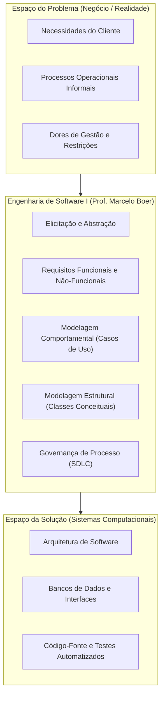

---

## Fundamentos de Engenharia de Software e Modelos de Processo (SDLC)

### Conceituação de Processo de Software e Atividades Fundamentais

#### Definição
Um Processo de Desenvolvimento de Software (PDS) é um conjunto estruturado de atividades, ações, tarefas, papéis, marcos e produtos de trabalho (artefatos) necessários para planejar, especificar, construir, testar, implantar e evoluir um sistema computacional com qualidade previsível e custos controlados.

#### Motivação
A construção de software é uma atividade cognitiva e sociotécnica intangível. Sem a padronização de um processo de engenharia, projetos sofrem com a *Crise do Software*: estouro contínuo de cronogramas, custos imprevisíveis, divergência funcional em relação ao desejado pelo cliente e código-fonte com alta propensão a falhas catastróficas.

#### Atividades Fundamentais de Engenharia (Ian Sommerville)
Independentemente de adotar paradigmas rígidos ou ágeis, todo processo de software executa quatro atividades técnicas universais:
1. **Especificação de Software:** Definição do que o software deve processar e sob quais restrições operacionais deve atuar.
2. **Desenvolvimento (Projeto e Implementação):** Concepção da arquitetura lógica de software, modelagem de dados e geração do código executável.
3. **Validação de Software:** Garantia de que o software cumpre as especificações acordadas e satisfaz as necessidades reais do cliente final (*Verificação: construímos o produto corretamente? Validação: construímos o produto certo?*).
4. **Evolução de Software:** Manutenção contínua do sistema para atender a demandas de mudança de negócio, correções de defeitos residuais e adequações legais.

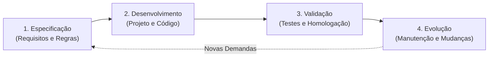

#### Exemplo
Uma equipe de desenvolvimento contratada por uma instituição hospitalar realiza três semanas de entrevistas estruturadas, documenta os fluxos clínicos em quadros de casos de uso e valida formalmente as regras de prescrição de medicamentos antes de iniciar a arquitetura do banco de dados e a escrita do código backend.

#### Contraexemplo
Um desenvolvedor recebe uma mensagem informal de texto solicitando "um sistema para controle de vendas", abre imediatamente a IDE de programação e passa a criar tabelas e telas sem levantar requisitos, sem modelar classes e sem definir critérios formais de teste.

#### Armadilhas Conceituais
- **Armadilha do Burocratismo Extremo:** Acreditar que o processo consiste em preencher dezenas de formulários e documentos que jamais serão lidos pela equipe ou utilizados para verificação de qualidade.
- **Armadilha da Falsa Agilidade:** Acreditar que "adotar metodologia ágil" significa abolir documentação, dispensar modelagem arquitetural e iniciar a codificação imediatamente sem entender o escopo do problema.

---

### Modelos Prescritivos Lineares: Cascata e Modelo V

#### O Modelo Cascata (Waterfall)
Concebido formalmente no artigo clássico de Winston Royce (1970), o Modelo Cascata prescreve uma abordagem estritamente linear e sequencial para a construção de sistemas. Uma fase só pode iniciar após o encerramento formal, aprovação documental e congelamento (*baseline*) de todos os artefatos da fase antecedente.

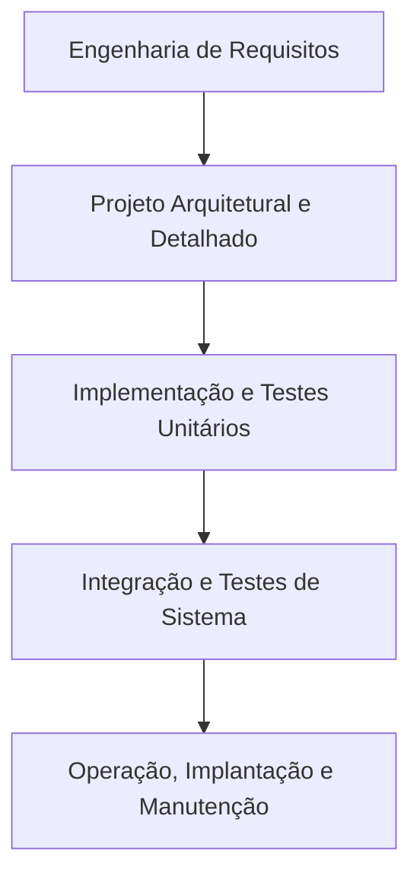

- **Mecânica de Funcionamento:** Exige que a Especificação de Requisitos de Software (SRS) seja totalmente homologada e assinada pelas partes antes do início do Projeto. O Projeto deve ser inteiramente modelado antes da primeira linha de código.
- **Motivação:** Busca pela previsibilidade absoluta de custos, prazos e marcos de auditoria contratual antes de mobilizar recursos de implementação.
- **Exemplo Real:** Software de aviônica e controle de voo (aeroespacial). Sensores, limites físicos das asas e protocolos de barramento são estáveis e conhecidos com anos de antecedência. Mudanças de requisitos em pleno voo não existem; a estabilidade matemática do modelo deve ser comprovada antes da compilação.
- **Contraexemplo:** Construção de um aplicativo móvel de delivery em uma startup onde novos modelos de monetização e demandas de interface surgem a cada semana. Tentar congelar requisitos por doze meses resultará na entrega de um produto mercadologicamente morto.
- **Armadilha:** O fenômeno do *Bloqueio de Fases*. Atrasos na homologação de requisitos deixam a equipe de implementação ociosa; eventuais erros de interpretação cometidos na fase inicial só são descobertos quando o sistema completo é entregue para homologação final do cliente.

#### O Modelo V
O Modelo V é uma variação rigorosa do ciclo linear que estabelece a correspondência biunívoca entre as atividades de concepção/decomposição e as atividades de integração/verificação.

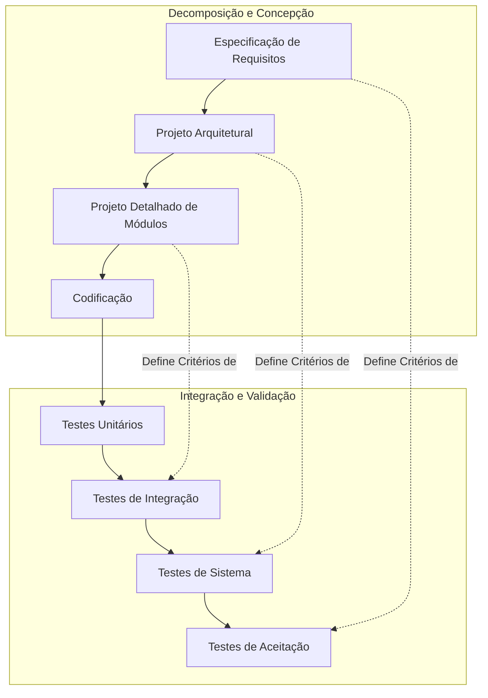

- **Força Motriz:** A preparação dos casos de teste ocorre simultaneamente à fase de especificação correspondente. Os critérios do teste de aceitação são redigidos no momento em que os requisitos de negócio são elicitados, prevenindo que requisitos abstratos ou não testáveis avancem para as fases técnicas.

---

### Modelos Evolutivos: Prototipação e Modelo Incremental

#### Modelo de Prototipação
Estruturado para mitigar o risco decorrente de requisitos mal compreendidos, vagos ou altamente dinâmicos. A equipe de engenharia desenvolve rapidamente uma versão preliminar do sistema para que o usuário final interaja e expresse suas reais necessidades operacionais.

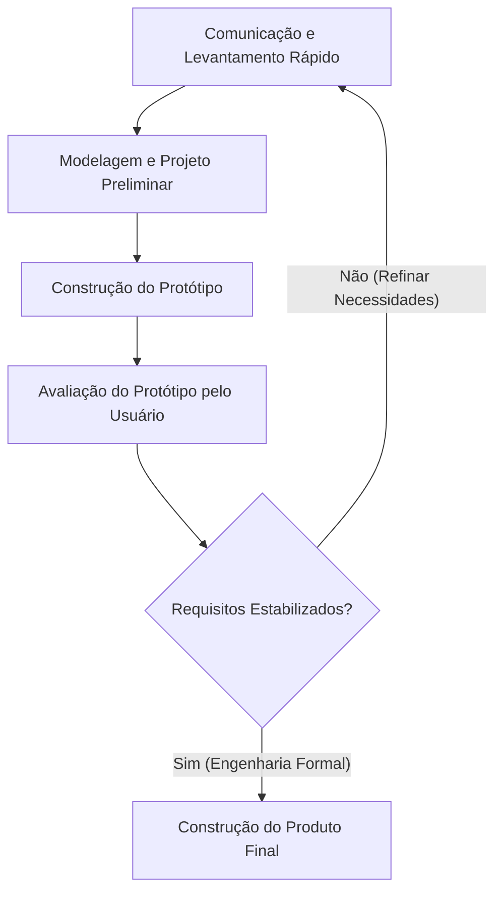

A literatura divide os protótipos em duas categorias metodológicas:
1. **Prototipação Descartável (*Throwaway Prototyping*):** O protótipo é construído com o objetivo exclusivo de validar fluxos de interface, telas e regras complexas. O código-fonte desse protótipo não segue padrões arquiteturais rigorosos e é integralmente descartado após a homologação das especificações. O sistema real é então construído do zero com arquitetura limpa.
2. **Prototipação Evolutiva (*Evolutionary Prototyping*):** O protótipo inicial é projetado com rigor estrutural básico e, a cada ciclo de avaliação com o cliente, novos recursos são refinados e acoplados. O protótipo evolui diretamente até se consolidar como o produto de produção.

- **Armadilha Clássica da Prototipação:** O *Efeito Ilusão do Cliente*. Ao visualizar um protótipo visualmente bem acabado em ferramentas como Figma ou telas dinâmicas sem persistência real, o cliente presume que o software está 90% concluído e passa a exigir o deploy imediato em produção, ignorando que o sistema não possui tratamento de concorrência, criptografia, logs ou validações de integridade de banco de dados.

#### Modelo Incremental
Combina a disciplina sequencial do Modelo Cascata com a filosofia iterativa de entregas funcionais. O escopo global do sistema é dividido em pacotes modulares independentes denominados **incrementos**.

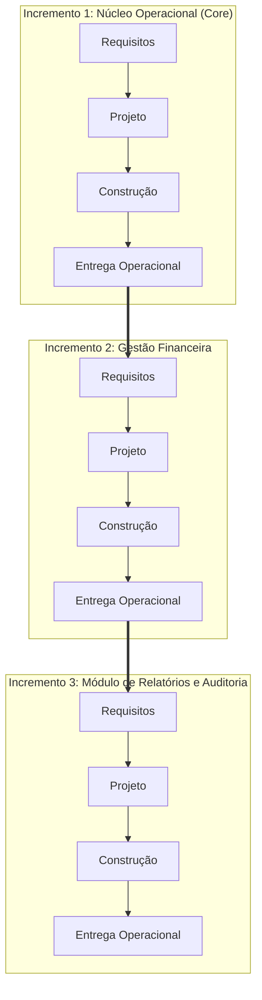

- **Mecânica de Engenharia:** O *Incremento 1* entrega a funcionalidade central e essencial sem a qual a empresa não opera (o *Core Product*). Uma vez que o Incremento 1 entra em produção e gera valor operacional, a equipe inicia a construção do *Incremento 2*, acoplando-o à base já testada e estável.
- **Vantagem Estratégica:** Antecipação do Retorno sobre o Investimento (*ROI — Return on Investment*). O cliente passa a operar partes do sistema meses antes do término do projeto completo.

---

### Modelo Espiral de Barry Boehm e Condução por Riscos

Proposto em 1988 por Barry Boehm, o Modelo Espiral é um ciclo de vida evolucionário orientado formalmente pela **análise, mitigação e resolução sistemática de riscos**.

O desenvolvimento é representado visualmente como uma espiral contínua dividida em quatro quadrantes de trabalho. O raio da espiral representa os custos cumulativos investidos no projeto, e a dimensão angular representa o progresso através das fases de refinamento arquitetural.

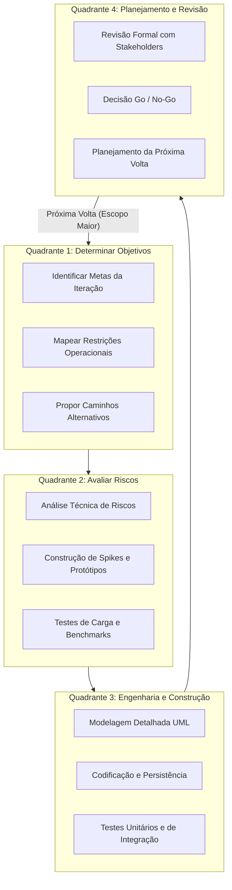

#### Os Quatro Quadrantes de Boehm
1. **Determinar Objetivos, Alternativas e Restrições:** Para a volta corrente da espiral, estabelecem-se as metas operacionais, os prazos limite e as alternativas de arquitetura disponíveis.
2. **Avaliar Alternativas, Identificar e Resolver Riscos:** Quadrante que diferencia o Modelo Espiral de todos os outros modelos. Se houver incerteza sobre uma tecnologia (por exemplo: se um banco de dados distribuído aguenta a taxa de escrita por segundo exigida), a equipe constrói um protótipo focado (*spike* técnico), simulações de estresse ou benchmarks. Se o risco for inaceitável, a tecnologia é descartada antes do desenvolvimento.
3. **Desenvolver e Verificar o Produto da Fase:** Conforme o risco é mitigado, seleciona-se o modelo mais adequado para a construção daquele nível específico (pode-se usar prototipação na primeira volta e modelo cascata nas voltas externas de implantação final).
4. **Planejar a Próxima Fase:** O resultado é apresentado aos patrocinadores e analistas para avaliação de viabilidade. Decide-se se o projeto prossegue para uma nova volta com maior nível de detalhamento ou se deve ser formalmente cancelado (*Go / No-Go*).

---

### O Processo Unificado e o RUP (Rational Unified Process)

O Processo Unificado, consolidado na indústria pela ferramenta Rational Unified Process (RUP), é um modelo de processo prescritivo, iterativo e incremental estruturado em torno de três princípios basilares:
- **Dirigido por Casos de Uso:** As necessidades dos atores conduzem todas as atividades de modelagem, codificação e testes.
- **Centrado na Arquitetura:** Prioriza a construção e validação de um esqueleto executável nas fases iniciais.
- **Iterativo e Incremental:** Divide o projeto em mini-projetos de duração pré-fixada.

O RUP introduz uma representação gráfica bidimensional:
- **Eixo Horizontal (Tempo):** Reflete o ciclo de vida do projeto dividido em quatro fases sequenciais pontuadas por marcos formais (*milestones*).
- **Eixo Vertical (Disciplinas de Engenharia):** Representa os conjuntos de atividades lógicas (Modelagem de Negócios, Requisitos, Análise e Projeto, Implementação, Teste, Implantação, Gerência de Configuração e Mudança, Gerência de Projeto e Ambiente) executadas simultaneamente com intensidades distintas em cada fase.

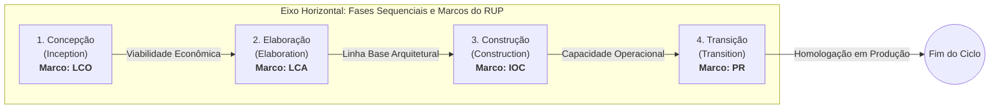

#### As Quatro Fases e Seus Marcos Estratégicos
1. **Concepção (*Inception*):** Delimita o escopo de negócio do software e estabelece a viabilidade econômica do projeto.
   - *Marco:* **LCO** (*Lifecycle Objective*). Responde à pergunta: a visão do produto é viável e o custo estimado justifica o investimento?
2. **Elaboração (*Elaboration*):** Mitiga os maiores riscos arquiteturais e tecnológicos do sistema. Especifica em detalhes a maioria absoluta dos casos de uso (pelo menos 80%) e implementa a *Linha de Base Arquitetural* (código executável dos módulos mais complexos).
   - *Marco:* **LCA** (*Lifecycle Architecture*). Responde à pergunta: a arquitetura do sistema é estável e os riscos de alto impacto foram eliminados? **É o marco mais crítico de todo o ciclo de vida RUP.**
3. **Construção (*Construction*):** Desenvolve o restante das funcionalidades secundárias, integrando componentes e gerando documentação técnica de suporte.
   - *Marco:* **IOC** (*Initial Operational Capability*). O produto possui capacidade funcional para iniciar testes operacionais em versões Alpha/Beta.
4. **Transição (*Transition*):** Transfere o software do ambiente de engenharia para o ambiente dos usuários finais. Envolve homologação, treinamento de operadores, migração de bases legadas e correções finas de usabilidade.
   - *Marco:* **PR** (*Product Release*). O sistema atinge a maturidade para operação irrestrita em produção.

---

### Paradigmas Ágeis: Scrum, Extreme Programming (XP) e Kanban

O Manifesto para o Desenvolvimento Ágil de Software (2001) contestou a sobrecarga burocrática dos processos puramente prescritivos, assentando quatro valores centrais:
1. Indivíduos e interações mais que processos e ferramentas;
2. Software em funcionamento mais que documentação abrangente;
3. Colaboração com o cliente mais que negociação de contratos;
4. Responder a mudanças mais que seguir um plano.

#### Scrum: Arcabouço de Gestão e Processo
O Scrum não prescreve práticas de engenharia de código, mas sim uma cadência estruturada de gestão empírica baseada em três pilares: transparência, inspeção e adaptação.

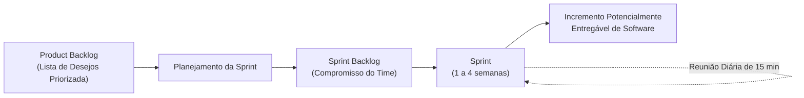

- **Papéis Centrais:**
  - *Product Owner (PO):* Representante único dos interesses do negócio; responsável por ordenar e priorizar o Product Backlog.
  - *Scrum Master:* Líder servidor que atua como facilitador das cerimônias e remove impedimentos organizacionais da equipe.
  - *Developers (Time de Desenvolvimento):* Equipe multidisciplinar e auto-organizável responsável pela entrega técnica do incremento.
- **Cerimônias:** Sprint Planning, Daily Scrum, Sprint Review e Sprint Retrospective.

#### Extreme Programming (XP): Práticas de Engenharia de Software
Diferente do Scrum, o XP foca diretamente nas práticas técnicas cotidianas da equipe de programação:
- **Test-Driven Development (TDD):** A escrita do teste automatizado antecede a escrita do código funcional.
- **Pair Programming (Programação em Par):** Dois engenheiros compartilham um único terminal, alternando funções de piloto (digitação) e copiloto (análise arquitetural e revisão contínua).
- **Refatoração Contínua:** Melhoria constante da estrutura interna do código sem alterar seu comportamento externo.
- **Integração Contínua (CI):** O código é integrado à ramificação principal e testado automaticamente várias vezes ao dia.

#### Kanban: Gestão de Fluxo Visual
Origina-se do sistema Toyota de produção (*Lean*). Concentra-se na visualização do fluxo de trabalho e na imposição de limites estritos de Trabalho em Progresso (*WIP — Work in Progress*). O Kanban combate a sobrecarga multitarefa e expõe gargalos operacionais no fluxo da equipe sem depender de ciclos temporais fixos (*sprints*).

---

### Tipologias de Manutenção de Software em Produção

Na Engenharia de Software formal (segundo Sommerville e a norma ISO/IEC 14764), a fase de manutenção consome entre 60% e 80% do custo total do ciclo de vida de um sistema. A manutenção divide-se em quatro categorias:

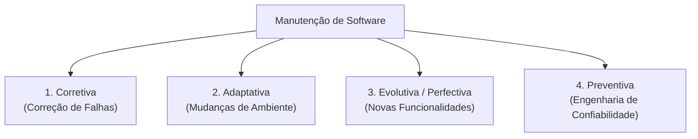

| Categoria | Definição Formal | Gatilho Operacional | Exemplo Real |
| :--- | :--- | :--- | :--- |
| **Corretiva** | Reparação de falhas, defeitos e bugs não detectados durante os testes e que causam desvios no comportamento especificado. | Reclamação de usuário ou crash em produção. | Correção de um bug em que o cálculo do troco gera erro quando o valor do pagamento é informado com centavos. |
| **Adaptativa** | Modificação do software para que ele continue operando adequadamente diante de alterações no seu ambiente operacional externo. | Mudanças na legislação, atualização de SGBD, novo sistema operacional ou novas APIs externas. | Atualização do módulo tributário do sistema para atender à nova tabela de alíquotas do ICMS/ISS. |
| **Evolutiva (Perfectiva)** | Inclusão de novos recursos funcionais, melhorias de desempenho ou adequações estéticas para atender novas demandas de negócio. | Novas necessidades comerciais do cliente ou expansão do escopo. | Inclusão de suporte a pagamentos automáticos via Pix em um aplicativo que aceitava apenas dinheiro e cartões. |
| **Preventiva** | Modificação interna do código-fonte ou arquitetura para corrigir problemas potenciais antes que eles se convertam em falhas operacionais. | Auditoria de segurança, detecção de débito técnico ou refatoração estrutural. | Reescrita de uma consulta SQL com alta latência para inclusão de índices adequados antes que o volume de registros cause travamento no fechamento do mês. |

---

### A Curva de Custo de Mudança de Boehm

Um dos postulados da Engenharia de Software formulado por Barry Boehm demonstra que **o custo para corrigir um erro de requisito cresce exponencialmente à medida que o software avança nas fases do ciclo de vida**.

```math
\text{Custo de Correção} = f(\text{Fase do Ciclo de Vida})
```

A relação empírica consolidada pela literatura de software demonstra que o custo relativo varia nas seguintes ordens de grandeza:

```math
\text{Custo}_{\text{Requisitos}} = 1\times \quad \longrightarrow \quad \text{Custo}_{\text{Projeto}} \approx 5\times \quad \longrightarrow \quad \text{Custo}_{\text{Construção}} \approx 10\times \quad \longrightarrow \quad \text{Custo}_{\text{Testes}} \approx 20\times \text{ a } 50\times \quad \longrightarrow \quad \text{Custo}_{\text{Operação}} \approx 100\times \text{ a } 200\times
```

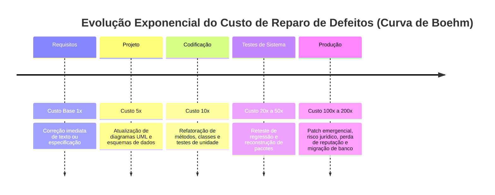

Se um analista de requisitos do projeto *Desapega Já* interpretar equivocadamente que "o comprador não precisa informar a cidade" e essa falha passar batida até a implantação em produção, consertar essa lacuna exigirá:
1. Alteração retroativa de esquemas de banco de dados populados com centenas de milhares de linhas em produção;
2. Recriação e reimplantação de APIs de busca geográfica;
3. Atualização obrigatória do aplicativo nas lojas de apps (Apple Store e Google Play);
4. Migração e tratamento de registros inconsistentes já salvos.

Se detectada na fase de requisitos durante uma revisão técnica de casos de uso, a correção exigiria apenas o acréscimo de uma linha de texto no Documento de Requisitos (custo de minutos).

---

## Engenharia de Requisitos e Processo de Abstração

### O Mecanismo Cognitivo da Abstração e Filtragem de Ruído

#### Definição
A abstração é a capacidade intelectual de focar nos aspectos essenciais e determinantes de uma entidade, fenômeno ou processo do mundo real, ignorando temporariamente os detalhes secundários, acidentais ou irrelevantes para o contexto analítico em questão.

#### Motivação
A mente humana possui capacidade limitada de retenção e processamento de informações simultâneas na memória de trabalho (formalizada na psicologia cognitiva pela Lei de George Miller: $`7 \pm 2`$ elementos informacionais). O mundo real apresenta complexidade infinita. Ao projetar um software, o engenheiro de software **constrói um modelo**, e um modelo é, obrigatoriamente, uma abstração seletiva orientada a uma finalidade específica de negócio.

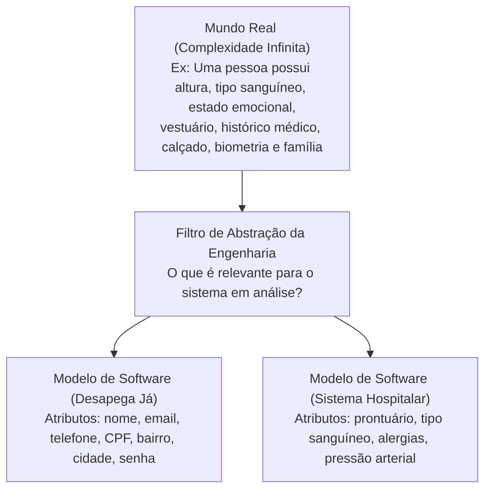

#### Exemplo
No aplicativo móvel *Desapega Já*, para cadastrar uma pessoa interessada em comprar produtos usados, precisamos abstrair: `nomeCompleto`, `email`, `telefone`, `cpf`, `cidade`, `estado`, `bairro` e `senhaHash`. O sistema ignora intencionalmente se a pessoa possui animais de estimação, qual a cor dos seus olhos ou a sua profissão, pois tais dados não exercem qualquer influência na mediação de anúncios hiperlocais.

#### Contraexemplo (Superespecificação e Subespecificação)
- **Superespecificação (Over-specification):** O analista modela na classe `Usuario` campos para armazenar o modelo do carro utilizado pelo comprador e sua frequência cardíaca. Isso infla a base de dados, encarece o projeto, viola leis de privacidade de dados (LGPD) e dispersa esforço de desenvolvimento.
- **Subespecificação (Under-specification):** O analista define que a entidade `Anuncio` possui apenas `titulo` e `preco`. Ele esquece de abstrair o `bairro`, a `cidade` e as `fotos`. Como resultado, os compradores não conseguem filtrar anúncios por proximidade nem avaliar o estado de conservação do item, inviabilizando o modelo de negócio da aplicação.

---

### Camadas de Abstração: Conceitual, Lógica e Física

A Engenharia de Software decompõe o trabalho analítico em três camadas hierárquicas sucessivas:

1. **Abstração do Domínio de Negócio (Nível Conceitual):** Mapeia as regras de negócio, necessidades dos usuários e entidades do mundo real sem nenhuma vinculação com tecnologia. Modela o **quê** o sistema deve prover.
2. **Abstração Lógica e Arquitetural (Nível Lógico):** Estrutura as entidades conceituais em notações padronizadas de computação (Diagramas de Classes UML, Diagramas de Entidade-Relacionamento lógicos), definindo contratos de interface, multiplicidades e tipos de dados abstratos, sem especificar ainda qual banco de dados físico ou linguagem será empregada.
3. **Abstração de Implementação (Nível Físico):** Trata das decisões técnicas de infraestrutura e execução (se o banco de dados será PostgreSQL ou MongoDB; se a comunicação usará REST JSON ou gRPC; se o tipo de dados será `NUMERIC(10,2)` ou `BIGINT`).

#### O Perigo do Vazamento de Abstração (*Leaky Abstraction*)
Ocorre quando particularidades ou limitações de implementação técnica de baixo nível contaminam as etapas conceituais da análise. Um analista que declara em um requisito de negócio: *"O sistema deve disparar uma trigger PL/SQL para gravar um registro na tabela tb_log"* cometeu um erro de vazamento de abstração. O requisito deveria declarar apenas: *"O sistema deve auditar as operações de alteração cadastral registrando data, hora e operador"*.

---

### Fase de Análise (Espaço do Problema) versus Fase de Projeto (Espaço da Solução)

A transição entre o entendimento do problema e o desenho técnico da solução é um dos eixos mais cobrados na disciplina:

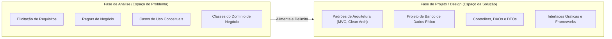

| Critério de Comparação | Fase de Análise (Modelo AV2) | Fase de Projeto / Implementação |
| :--- | :--- | :--- |
| **Pergunta Norteadora** | O que o sistema deve fazer? | Como o sistema será implementado tecnicamente? |
| **Domínio Central** | Espaço do Problema (Negócio, Usuários, Operação). | Espaço da Solução (Engenharia, Computação, Frameworks). |
| **Responsável Típico** | Analista de Requisitos, Analista de Negócios, Product Owner. | Arquiteto de Software, Tech Lead, Desenvolvedor Backend/Frontend. |
| **Classes de Modelagem** | Classes de Domínio Conceitual (ex: `Cliente`, `Pedido`, `Anuncio`). | Classes de Software (ex: `ClienteDAO`, `PedidoController`, `ConexaoPool`). |
| **Tipos de Atributos** | Tipos Abstratos (ex: `Texto`, `Numero`, `Data`, `Logico`). | Tipos da Linguagem/SGBD (ex: `VARCHAR(100)`, `double`, `UUID`, `TIMESTAMP`). |
| **Independência Tecnológica** | Absoluta. O modelo de análise é imune à troca de linguagem ou SGBD. | Baixa. Diretamente acoplada às bibliotecas e infraestrutura selecionada. |

---

### Fontes de Informação e Elicitação de Requisitos

A elicitação de requisitos é o processo de investigação técnica por meio do qual os engenheiros de software descobrem, refinam e negociam as funções e restrições da aplicação.

Um erro conceitual comum é supor que apenas o cliente contratante é fonte legítima de requisitos. A literatura de engenharia mapeia quatro fontes universais:
1. **Stakeholders (Partes Interessadas):** Todos os grupos impactados direta ou indiretamente pela operação do software (usuários finais, operadores, gerentes de departamento, equipe de suporte técnico e auditores de segurança).
2. **Domínio da Aplicação:** O corpo de regras fundamentais, leis físicas, jargões e práticas que regem a área de atuação da organização (ex: normas contábeis brasileiras, cálculo de juros compostos ou farmacologia).
3. **Ambiente Organizacional:** A cultura interna da empresa, disputas departamentais, hierarquia de comando e metas corporativas de curto e longo prazo.
4. **Ambiente Operacional e Regulamentar:** Infraestrutura de TI legada onde o sistema será implantado (servidores, larguras de banda, redes móveis) e legislações vigentes (LGPD — Lei Geral de Proteção de Dados, normas de auditoria e diretrizes de acessibilidade).

---

### Técnicas de Coleta de Dados e Investigação Empírica

A seleção da técnica de elicitação depende da dispersão dos interlocutores, da maturidade do domínio e da natureza dos requisitos:

```mermaid
mindmap
  root("Técnicas de Coleta de Dados")
    "Técnicas Verbais Diretas"
      "Entrevistas Abertas"
      "Entrevistas Estruturadas"
      "Grupos Focais (Focus Groups)"
    "Técnicas Quantitativas"
      "Questionários Fechados"
      "Questionários Online Massivos"
    "Técnicas de Observação Empírica"
      "Observação Participante (Imersão)"
      "Observação Não Participante (Passiva)"
      "Testes de Usabilidade Laboratoriais"
    "Técnicas Analíticas"
      "Análise de Documentos e Formulários"
      "Engenharia Reversa de Sistemas Legados"
```

#### 1. Entrevistas Abertas, Fechadas e Semiestruturadas
- **Abertas:** Exploratórias e sem roteiro rígido; ideais para entender expectativas gerais e domínios desconhecidos nas fases iniciais de concepção.
- **Fechadas (Estruturadas):** Roteiro fixo de perguntas pré-determinadas; facilitam a comparação direta entre respostas de diferentes operadores de um mesmo cargo.
- **Semiestruturadas:** Combinam um roteiro orientador com liberdade para o analista aprofundar pontos inesperados levantados pelo entrevistado.

#### 2. Questionários Estruturados
- **Indicação:** Levantamento com públicos massivos e dispersos geograficamente (centenas de usuários finais de um portal de autoatendimento).
- **Vantagens:** Baixo custo orçamentário e possibilidade de tabulação estatística.
- **Limitações:** Alta taxa de abstenção (poucos respondem), impossibilidade de sanar dúvidas do respondente em tempo real e respostas com baixa profundidade qualitativa.

#### 3. Grupos Focais (*Focus Groups*)
- **Indicação:** Reuniões com 6 a 12 participantes representativos para debater a reação a novas propostas de sistemas ou avaliar a viabilidade de funcionalidades inovadoras.
- **Risco:** O fenômeno de inibição de participantes mais introvertidos diante de personalidades corporativas dominantes (*efeito manada*).

#### 4. Observação Direta (Etnografia de Software)
- **Observação Não Participante:** O analista assiste à execução da rotina dos funcionários sem interromper e sem interferir no processo. Revela o trabalho real (*work-as-done*) em contraste com o trabalho oficial prescrito nos manuais (*work-as-imagined*).
- **Observação Participante:** O analista integra-se ativamente ao ambiente dos usuários, desempenhando temporariamente tarefas operacionais em conjunto com a equipe para vivenciar as fricções do trabalho cotidiano.
- **Testes de Usabilidade:** Monitoramento controlado de usuários operando protótipos ou telas em produção para detecção de cliques erráticos, abandono de fluxo e hesitações cognitivas.

---

### Requisitos Funcionais (RF): Critérios de Qualidade e Padronização

#### Definição
Requisitos Funcionais expressam **o que o sistema deve fazer**. Especificam os serviços, transformações de dados, cálculos, processamentos, fluxos de navegação e regras de negócio executados pelo software em resposta a estímulos externos.

#### Critérios Formais de Qualidade (ISO/IEC/IEEE 29148 e IEEE 830)
Para que uma sentença seja classificada como um requisito funcional de software legítimo, ela deve apresentar:
1. **Comportamento Verificável:** Declarar o processamento objetivo realizado pelo software, nunca um desejo subjetivo de mercado.
2. **Atomicidade:** A sentença deve tratar de uma única funcionalidade indivisível. Sentenças com múltiplos conectivos "e" devem ser decompostas em múltiplos requisitos.
3. **Testabilidade (Verificabilidade):** Um engenheiro de testes ou usuário deve conseguir planejar e executar um teste lógico binário (*Passou / Falhou*) para verificar o cumprimento do requisito.
4. **Padronização da Linguagem:** Recomenda-se a estrutura canônica: *"O sistema deve [ação/verbo de negócio] [objeto] sob as [condições/parâmetros]"*.

#### Exemplo de Refinamento Técnico (Desapega Já)
- *Declaração Bruta Inadequada (Material de Aula):* "Facilitar a venda de produtos."  
  *Crítica:* Trata-se de um objetivo de negócio estratégico, não de um requisito de software testável. Não existe um teste booleano que prove se o sistema "facilitou".
- *Refinamento Formal:* "O sistema deve permitir que o usuário autenticado publique anúncios informando título, descrição textual, categoria, preço e até 5 fotografias digitais."

---

### Requisitos Não-Funcionais (RNF): Subjetividade versus Métricas Formais

#### Definição
Requisitos Não-Funcionais especificam **como**, **sob quais restrições** e **com quais parâmetros de qualidade** o sistema deve operar. Eles não descrevem funções operacionais isoladas, mas sim propriedades emergentes e restrições globais da arquitetura de software.

#### Taxonomias de Qualidade: FURPS+ e ISO/IEC 25010
A engenharia de software emprega taxonomias formais para categorizar RNFs:
- **FURPS+:** Functionality (Funcionalidade), Usability (Usabilidade), Reliability (Confiabilidade), Performance (Desempenho), Supportability (Suportabilidade) e o símbolo `+` (restrições físicas, de interface, de design e de implementação).
- **ISO/IEC 25010:** Modelo de qualidade de produto estruturado em 8 características: Adequação Funcional, Eficiência de Desempenho, Compatibilidade, Usabilidade, Confiabilidade, Segurança, Manutenibilidade e Portabilidade.

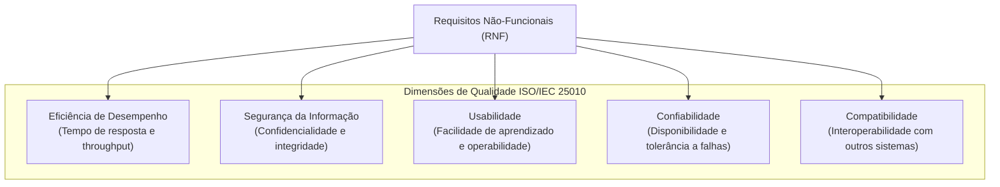

#### O Problema da Subjetividade e a Quantificação por Métricas
Termos informais como "fácil usabilidade", "sistema seguro", "tela rápida" e "ambiente amigável" são inaceitáveis na engenharia de requisitos. Eles geram cláusulas contratuais ambíguas impossíveis de auditar. Todo RNF deve ser formalizado através da abordagem *Goal-Question-Metric* (GQM), atrelando-o a grandezas mensuráveis.

| Declaração Subjetiva (Incorreta) | Categoria ISO 25010 | Requisito Não-Funcional Refinado | Métrica Objetiva de Teste |
| :--- | :--- | :--- | :--- |
| "O aplicativo deve ser muito rápido." | Desempenho | O sistema deve responder às consultas de catálogo local sob conexões 4G padrão em tempo hábil. | O tempo de carregamento da lista de anúncios da vizinhança deve ser inferior a 2,0 segundos para 95% das requisições com até 1.000 usuários simultâneos. |
| "O sistema deve ter fácil usabilidade." | Usabilidade | A interface móvel deve viabilizar a publicação intuitiva de itens sem necessidade de treinamento formal. | Pelo menos 85% dos usuários novos devem concluir o fluxo de criação do primeiro anúncio em menos de 180 segundos sem cometer erros de preenchimento. |
| "O software deve ser seguro." | Segurança | O sistema deve proteger as senhas dos utilizadores e os dados pessoais sensíveis contra vazamentos. | As senhas devem ser persistidas com algoritmo de hash criptográfico BCrypt (fator de custo 12) e todas as transmissões de rede devem utilizar protocolo TLS 1.3 obrigatório. |
| "O sistema deve ter alta disponibilidade." | Confiabilidade | O aplicativo deve operar com tempo de inatividade mínimo para garantir transações contínuas. | O sistema deve apresentar disponibilidade mensal mínima de 99,5%, o que equivale a um tempo máximo de indisponibilidade não programada de 3,6 horas por mês. |

---

### Estabilidade de Requisitos: Permanentes versus Voláteis

Conforme abordado nas sessões de revisão para a AV1 (Aula 03), os requisitos de software sofrem classificação quanto à sua taxa de mutabilidade ao longo do ciclo de vida:
- **Requisitos Permanentes (Estáveis):** Requisitos vinculados às leis estruturantes do domínio de negócio da organização. Apresentam baixíssima volatilidade.  
  *Exemplo:* O balanço patrimonial de débito e crédito em um sistema bancário ou a obrigatoriedade de emitir Nota Fiscal Eletrônica com cálculo de impostos em vendas no território nacional.
- **Requisitos Voláteis (Mutáveis):** Requisitos atrelados a políticas comerciais transitórias, tendências passageiras de interface, novas campanhas promocionais ou dinâmicas conjunturais de mercado.  
  *Exemplo:* Oferecer frete grátis aos clientes que utilizarem cupons de desconto durante uma semana promocional de Black Friday.

> **Ponto Crítico para Avaliações (Armadilha em Enunciados):** Afirmar que "requisitos permanentes são requisitos propensos a mudar durante o ciclo de desenvolvimento" é um erro clássico de enunciado de prova. Os requisitos que mudam são denominados **voláteis**, enquanto os estáveis preservam sua integridade ao longo do tempo.

---

## Ferramentas CASE e Ambiente de Modelagem Semântica

### Taxonomia de Ferramentas CASE

As ferramentas CASE (*Computer-Aided Software Engineering*, ou Engenharia de Software Auxiliada por Computador) são aplicações concebidas para automatizar, apoiar e auditar as tarefas técnicas do ciclo de vida de desenvolvimento de software.

A taxonomia consagrada da engenharia divide essas ferramentas em três classes:
1. **Upper-CASE (Front-End CASE):** Apoiam as atividades iniciais do ciclo de vida (análise de requisitos, modelagem conceitual orientada a objetos, planejamento de arquitetura e especificação de processos de negócio).  
   *Exemplos:* Astah UML, Enterprise Architect, IBM Rational Software Modeler.
2. **Lower-CASE (Back-End CASE):** Concentram-se nas etapas finais do desenvolvimento (geração semiautomática de código a partir de modelos, engenharia reversa de bancos relacionais, automação de testes unitários e depuração de código).  
   *Exemplos:* Compiladores avançados, geradores DDL de banco de dados, suites de testes de regressão.
3. **Integrated-CASE (I-CASE):** Ambientes corporativos que unificam Upper-CASE e Lower-CASE através de um repositório centralizado de metadados, sincronizando modelos arquiteturais visuais e código-fonte em tempo real (conceito moderno de plataformas ALM/DevOps integradas).

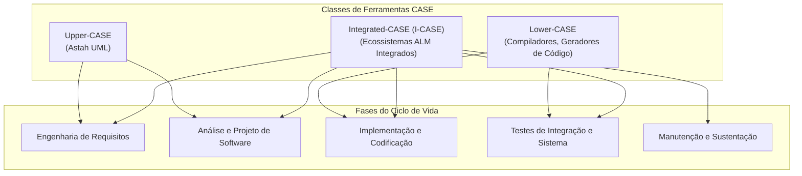

---

### Desenho Gráfico Vetorial versus Modelagem Semântica Baseada em Metamodelo

Um erro frequente de estudantes consiste em equiparar ferramentas de desenho gráfico vetorial genérico (como Draw.io, Canva, Miro ou Lucidchart) com ferramentas CASE formais baseadas no metamodelo da UML (como o Astah UML).

#### Editores de Desenho Gráfico
Processam apenas geometrias bidimensionais desprovidas de inteligência semântica (retângulos, elipses, linhas conectadas e textos planos). O software não "sabe" que uma caixa com texto dentro é uma classe.
- Se o estudante alterar o nome de um método na folha A, a modificação não se propaga para a folha B;
- É possível criar aberrações sintáticas que violam as normas da OMG (como herança cíclica ou multiplicidades em associações inexistentes), pois o software apenas aceita traços visuais.

#### Ferramentas CASE Formais (Astah UML)
Operam sobre um **repositório estruturado de metadados** fundamentado no metamodelo oficial da UML 2.5 da OMG (*Object Management Group*).
- Quando o modelador instancia uma classe chamada `Cliente`, o software cria um nó com identificador único global (UUID) no catálogo do projeto;
- Se essa classe for referenciada em dez diagramas distintos (Diagrama de Classes, Diagrama de Sequência, Diagrama de Comunicação), a alteração do nome de um atributo no catálogo reflete-se **instantaneamente** em todas as visões gráficas do modelo;
- O motor da ferramenta valida a sintaxe e a semântica, impedindo conexões ilegais segundo as normas da UML.

| Critério Técnico | Ferramenta de Desenho Vetorial (Draw.io, Miro) | Ferramenta CASE Formal (Astah UML) |
| :--- | :--- | :--- |
| **Núcleo de Dados** | Primitivas visuais planas (polígonos e texto livre). | Grafo semântico estruturado baseado em metamodelo. |
| **Integridade Referencial** | Inexistente. Textos duplicados são independentes. | Absoluta. Alterações propagam-se em cascata por todo o modelo. |
| **Validação da Linguagem UML** | Nenhuma. Permite ligações ilegais segundo as normas. | Nativa. Valida associações, navegabilidades e visibilidades. |
| **Engenharia Direta / Reversa** | Inviável. Exporta apenas pixels (PNG, JPG) ou vetores (SVG). | Suportada. Gera esqueleto de código-fonte (Java, C#) e classes a partir de DDL. |
| **Organização do Modelo** | Telas e abas de desenho desestruturadas. | Árvore hierárquica de pacotes (*Structure Tree*). |

---

### O Ambiente Astah UML e a Estrutura de Arquivos

Conforme explorado na Aula 02, o software adotado na UniFEF é o **Astah UML** (Change Vision, Inc.).

#### Arquitetura de Execução
O Astah UML é desenvolvido em Java, operando sobre a Java Virtual Machine (JVM). Isso confere portabilidade para Windows, macOS e distribuições Linux, mas requer atenção à parametrização da memória heap (`-Xmx`) em projetos corporativos de grande porte.

#### O Formato de Arquivo Proprietário `.asta`
O arquivo com extensão `.asta` não é uma imagem nem um documento de texto plano. Trata-se de um contêiner compactado que armazena a serialização binária dos grafos de objetos do modelo, os metadados de rastreabilidade e as coordenadas bidimensionais de posicionamento de cada diagrama.

#### A Tecla "Delete" versus Exclusão Definitiva do Modelo (Armadilha Operacional)
- **Pressionar `Delete` na Área de Desenho:** Apenas oculta o elemento visual daquele diagrama específico. A classe continua viva e consumindo recursos no repositório de dados (*Model Tree*).
- **Exclusão Definitiva do Modelo:** Deve-se selecionar o elemento na árvore da estrutura (*Structure Tree*) e executar o comando de exclusão formal do projeto, ou pressionar a combinação `Shift + Delete` na tela de modelagem.

---

### Mecanismos Criptográficos de Licenciamento Acadêmico XML

Na Aula 02, o Prof. Marcelo Boer disponibilizou a licença acadêmica institucional anual para a turma (`astah_uml_license_2025-2026.xml`). A compreensão desse arquivo ilustra princípios fundamentais de segurança da informação e integridade de dados.

#### Mecânica da Assinatura Digital Assimétrica no XML
Diferente de chaves seriais manuais de texto livre, o licenciamento do Astah UML baseia-se em **criptografia assimétrica** (par de chaves pública e privada) e funções de resumo criptográfico (*Hash*):

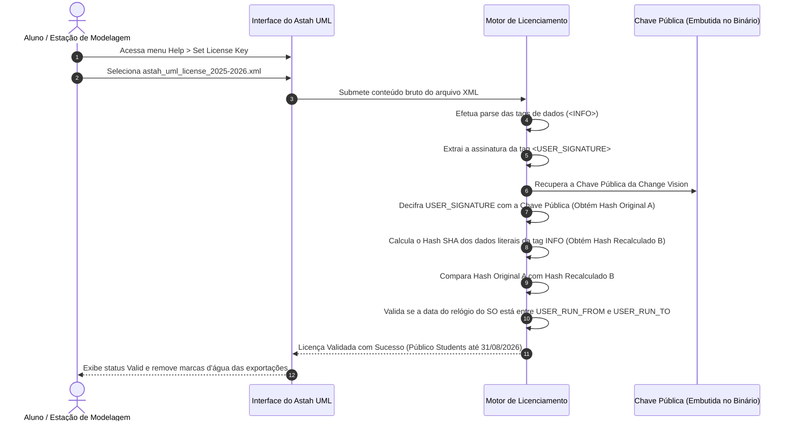

#### Inviolabilidade do Modelo
1. **Tentativa de Fraude de Validade Temporal:** Se um aluno alterar o valor da tag `<USER_RUN_TO>` de `2026/08/31` para `2030/12/31`, o novo hash calculado na estação local divergirá do hash decifrado a partir da `<USER_SIGNATURE>`. A aplicação detectará imediatamente a divergência e invalidará o arquivo.
2. **Impossibilidade de Falsificar a Assinatura:** Para gerar uma `<USER_SIGNATURE>` correspondente aos dados adulterados, o fraudador necessitaria da **Chave Privada** do fabricante (*Change Vision*), a qual permanece resguardada nos servidores corporativos de emissão.
3. **Autenticação Offline:** A verificação requer unicamente a **Chave Pública** (que reside embutida no executável do Astah), viabilizando a homologação sem dependência de conexão com a internet.

---

## Modelagem Comportamental com Diagrama e Descrição de Casos de Uso

### Conceituação Formal de Ator na UML

#### Definição
Na especificação da Unified Modeling Language (UML), um **Ator** representa um papel idealizado e coerente desempenhado por uma entidade externa ao interagir diretamente com as fronteiras do sistema de software sob análise.

#### Categorias Universais de Atores
- **Atores Primários (Principais):** Iniciam ativamente a execução de um caso de uso para alcançar uma meta de negócio mensurável (ex: o `Funcionário` que efetua login para lançar notas ou o `Cliente` que submete um pedido).
- **Atores Secundários (Apoiadores / De Suporte):** Não iniciam o caso de uso, mas fornecem serviços auxiliares indispensáveis para a conclusão do fluxo (ex: a `API do Gateway de Pagamento` que confirma a transação do cartão de crédito ou o `Serviço de Envio de SMS`).
- **Atores Abstratos:** Perfis concebidos para concentrar permissões e associações compartilhadas por múltiplos atores especializados por meio de herança/generalização.

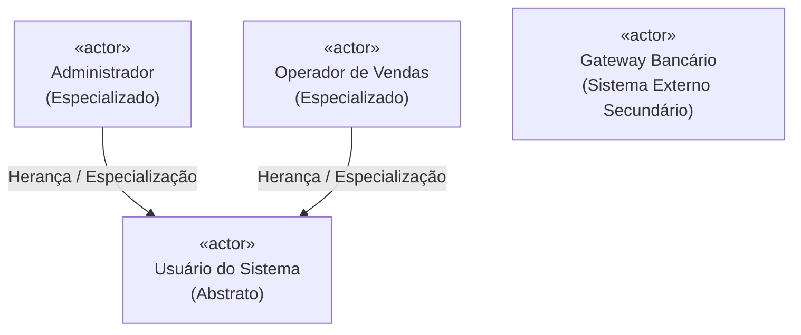

#### Contraexemplos
- Criar um ator com o nome de uma pessoa física real: `Carlos Alberto` em vez de `Operador de Vendas`.
- Modelar um componente interno do próprio software como se fosse um ator externo: criar um ator chamado `Banco de Dados MySQL`. O banco de dados é um artefato de persistência interno pertencente à solução, não um agente que opera a aplicação pela fronteira.

---

### Fronteiras de Sistema e Decomposição Modular

Em sistemas corporativos de médio e grande porte, a colocação de dezenas de elipses de casos de uso em uma única prancha de modelagem gera um diagrama poluído e ilegível.

A boa prática de engenharia impõe a **decomposição modular**:
- Divide-se o sistema em módulos coesos (ex: "Módulo Pessoa Funcionário", "Módulo Acadêmico", "Módulo Financeiro");
- Utiliza-se o retângulo de fronteira de sistema (*System Boundary*) para isolar o escopo de cada módulo;
- Os casos de uso ficam **estritamente dentro** do retângulo de fronteira; os atores que com eles interagem ficam **estritamente fora**.

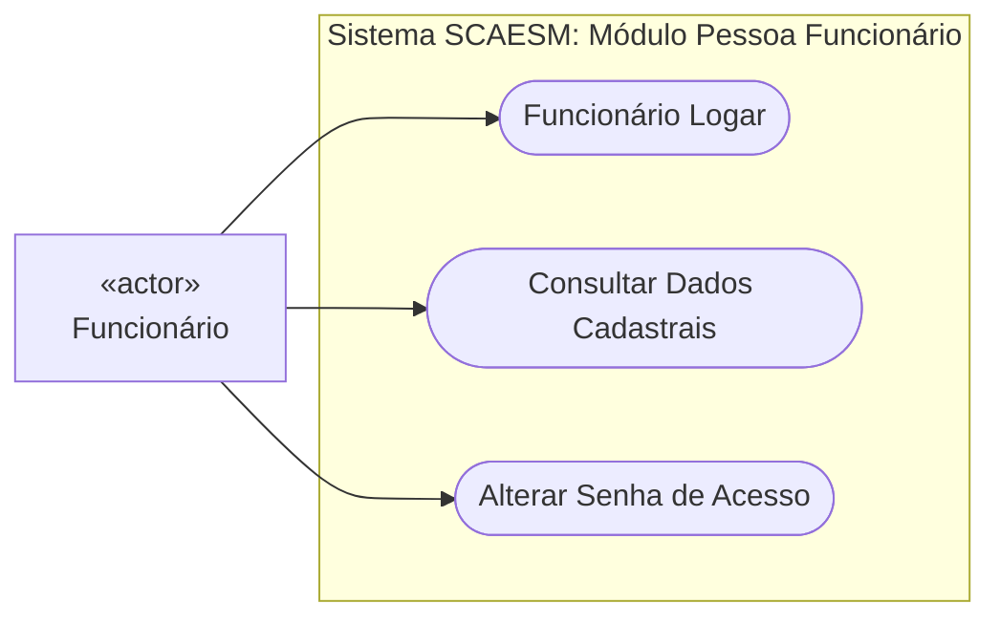

---

### Estrutura Canônica do Quadro de Descrição de Caso de Uso (DCU)

O Diagrama de Casos de Uso responde apenas a **quem** interage com **o que**. Ele falha em detalhar a ordem dos eventos, os testes condicionais e as mensagens emitidas. Para suprir essa lacuna, a engenharia de software adota o **Quadro de Descrição de Caso de Uso (DCU)**.

O padrão formal adotado pelo Prof. Marcelo Boer (consagrado no material das Aulas 05 e 06 e nas avaliações bimestrais da UniFEF) possui as seguintes seções estruturadas:

```text
================================================================================
Quadro X – DCU Individual [Nome do Caso de Uso]
--------------------------------------------------------------------------------
Identificador / Nome: 
  Código único e verbo no infinitivo (ex: UC01 — Realizar Login).
Ator Principal:
  Papel externo que dispara a execução da ação (ex: Funcionário).
Descrição da Ação:
  Síntese textual objetiva retratando a intenção de negócio do utilizador.
Pré-requisito:
  Estado ou verdade obrigatória que o ambiente/base DEVE satisfazer antes do início.
Fluxo Normal (Caminho Feliz):
  01. Passo inicial do ator;
  02. Resposta do sistema;
  ...
  0N. Conclusão bem-sucedida e alcance da meta de negócio.
Fluxo Alternativo / Exceção:
  X.1. Ponto exato de desvio condicional;
  X.1.1. Tratamento da exceção e ponto de convergência ou retorno.
Dados:
  Lista de campos e atributos de entrada e saída manipulados na transação.
================================================================================
```

---

### Pré-requisitos Operacionais versus Passos de Execução

Um erro frequente cometido por alunos consiste em redigir passos do próprio fluxo como se fossem pré-requisitos:

- **Pré-requisito (Precondição):** É uma condição de estado que deve ser verdadeira **antes** que o ator clique no sistema para iniciar a funcionalidade.  
  *Exemplo Correto:* "O usuário deve possuir uma conta ativa pré-cadastrada na base de dados do SCAESM."
- **Ação do Fluxo (Erro se colocada como pré-requisito):** É uma ação realizada durante a interação.  
  *Exemplo Incorreto de Pré-requisito:* "O usuário deve digitar a senha e clicar no botão Entrar." Digitar a senha e clicar são passos dos eventos do fluxo, e não um estado preexistente do sistema.

---

### Redação Estruturada do Fluxo Normal

O Fluxo Normal (ou *Caminho Feliz*) descreve o diálogo ordenado e atômico entre a iniciativa do ator e o processamento de resposta da aplicação quando nenhuma falha, validação negativa ou exceção ocorre.

Regras de ouro de engenharia de software para a redação do Fluxo Normal:
1. **Numeração Linear Obrigatória:** Cada linha deve possuir numeração sequencial clara (01, 02, 03...);
2. **Alternância de Responsabilidade:** Um passo de iniciativa do ator deve ser sucedido por um passo de processamento/resposta do sistema;
3. **Independência de Tecnologia de UI:** Evitar comandos vinculados a detalhes de interface gráfica (não escrever "o usuário clica com o botão esquerdo do mouse na div input", mas sim "o usuário informa o login e senha e confirma a autenticação").

---

### Ramificação de Fluxos Alternativos e Tratamento de Exceções

Os Fluxos Alternativos mapeiam os desvios causados por decisões do usuário ou falhas de validação de regras de negócio. Devem possuir numeração hierárquica atrelada diretamente ao passo correspondente do Fluxo Normal do qual se originam:

- Se o passo **05** do Fluxo Normal diz: *"Sistema verifica se o usuário está cadastrado"*, a falha dessa validação deve ser numerada formalmente como:
  - **5.1.** Se o usuário não for localizado na base, o sistema emite a mensagem de alerta correspondente;
  - **5.1.1.** O sistema limpa o campo de senha e retorna ao Passo 02 do Fluxo Normal.

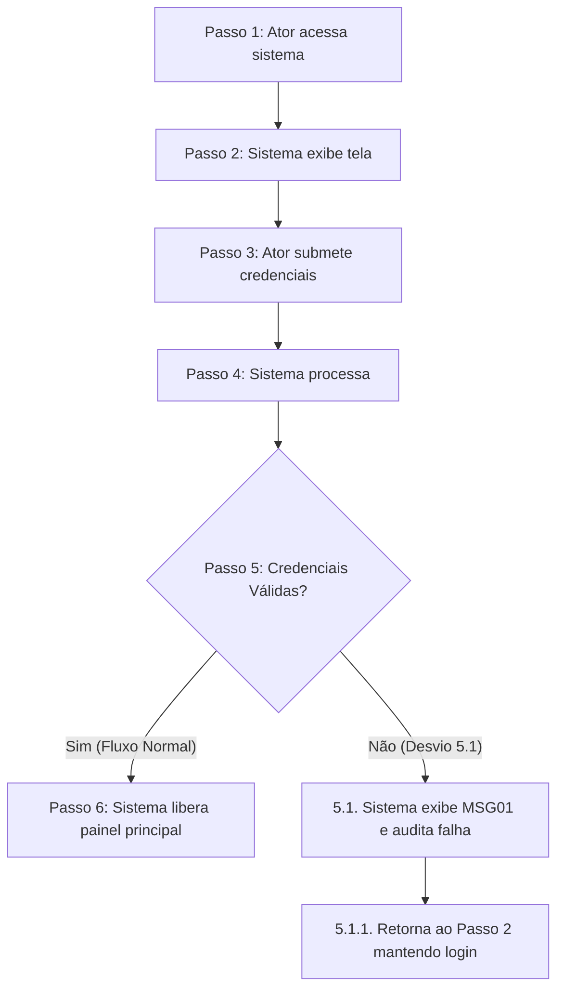

---

### Dicionário Central de Mensagens de Sistema

No padrão acadêmico da UniFEF (Aula 06), todas as mensagens disparadas pelos casos de uso devem ser centralizadas em uma tabela unificada com identificadores únicos. Nenhum caso de uso pode referenciar textos livres ou soltos sem identificador.

| Código | Tipo | Texto Padronizado da Mensagem | Gatilho / Finalidade Operacional |
| :--- | :--- | :--- | :--- |
| **MSG01** | Erro | "Usuário ou senha inválidos. Por favor, verifique suas credenciais." | Falha na autenticação (credencial inexistente ou senha incorreta). |
| **MSG02** | Alerta | "Usuário inativo no sistema. Contate o administrador." | Tentativa de login com conta desativada por política institucional. |
| **MSG03** | Sucesso | "Autenticação realizada com sucesso. Redirecionando..." | Validação bem-sucedida de credenciais de login. |
| **MSG04** | Erro | "Existem campos obrigatórios não preenchidos: [Lista\_Campos]." | Tentativa de submissão de formulário com dados essenciais em branco. |
| **MSG05** | Erro | "Registro já cadastrado com os dados informados: [Chave\_Duplicada]." | Violação de unicidade de negócio (ex: CPF já registrado na base). |
| **MSG06** | Sucesso | "Registro gravado com sucesso!" | Confirmação de persistência transacional de novo registro. |
| **MSG07** | Alerta | "Nenhum registro encontrado para os critérios de busca informados." | Consulta na listagem que retorna conjunto de dados vazio. |
| **MSG08** | Erro | "Registro selecionado não foi encontrado ou foi excluído por outro usuário." | Falha ao carregar detalhamento de ID inexistente na base. |
| **MSG09** | Sucesso | "Alterações salvas com sucesso!" | Confirmação de persistência após atualização cadastral. |
| **MSG10** | Confirmação | "Deseja realmente excluir o registro [Nome\_Registro]? Esta ação não poderá ser desfeita." | Diálogo de segurança exibido antes de efetivar exclusão. |
| **MSG11** | Erro | "Não é possível excluir o registro pois existem transações ativas vinculadas." | Bloqueio de exclusão por violação de integridade referencial. |
| **MSG12** | Sucesso | "Registro excluído com sucesso!" | Confirmação de remoção lógica ou física do registro. |

---

## Modelagem Estrutural da Fase de Análise (Diagrama de Classes)

### Extração de Classes Conceituais pela Análise Gramatical de Abbott

Para estruturar o Diagrama de Classes sem vícios de implementação, a Engenharia de Software adota o método clássico de análise léxica formulado por Russell Abbott:

```mermaid
flowchart TD
    Texto["Texto do Estudo de Caso de Negócio"]
    
    Subst["Substantivos Comuns"] --> CandClasse["Candidatos a Classes Conceituais ou Atributos"]
    Verbos["Verbos de Ação"] --> CandMetodo["Candidatos a Métodos, Operações ou Casos de Uso"]
    Adjetivos["Adjetivos e Qualificadores"] --> CandEstado["Candidatos a Valores de Atributo ou Estados"]

    Texto --> Subst
    Texto --> Verbos
    Texto --> Adjetivos
```

- **Substantivos:** Pessoas, locais, objetos e transações operacionais do texto (ex: *Cliente*, *Pedido*, *Açaí*, *Pagamento*) tornam-se candidatos primários a **Classes** ou a **Atributos** de classes.
- **Verbos:** Ações e comportamentos relatados (ex: *cadastrar*, *adicionar ao pedido*, *registrar pagamento*, *calcular total*) tornam-se candidatos a **Operações/Métodos** ou a **Casos de Uso**.
- **Adjetivos:** Estados e condições transitórias (ex: *pedido aguardando*, *em preparo*, *finalizado*) tornam-se candidatos a **Valores de Atributos de Status**.

---

### Classes Conceituais de Domínio versus Classes de Persistência Técnica

Na Fase de Análise, o Diagrama de Classes representa o **modelo de domínio do problema**.
- **Proibido na Fase de Análise:** Incluir classes de implementação física como `ConexaoBD`, `UsuarioDAO`, `CriptografiaUtil`, `TelaLoginView` ou `ItemPedidoDTO`. Essas classes pertencem estritamente à Fase de Projeto (Design).
- **Obrigatório na Fase de Análise:** Mapear classes que representam conceitos palpáveis da organização de negócio (ex: `Cliente`, `Pedido`, `ItemPedido`, `Produto`, `Pagamento`).

---

### Atributos Conceituais e Regras de Encapsulamento

Os atributos em um Diagrama de Classes na fase de análise devem respeitar as convenções de tipagem abstrata:
- **Nomenclatura:** Adotar o padrão `camelCase` (ex: `nomeCompleto`, `dataHoraSolicitacao`, `valorTotal`).
- **Tipos de Dados:** Utilizar tipos abstratos de domínio (`Texto`, `Numero`, `Data`, `Logico`, `Dinheiro` ou tipos genéricos da linguagem como `String`, `int`, `double`, `DateTime`). Nunca utilizar tipos específicos de SGBD físico (como `VARCHAR2(50)`, `BLOB`, `TINYINT(1)`).
- **Visibilidade:** Declarar visibilidade privada (`-`) para atributos, respeitando o princípio de encapsulamento da orientação a objetos, fornecendo métodos públicos (`+`) para as operações de negócio permitidas.

---

### Relacionamentos Estruturais: Associações, Papéis e Multiplicidades

#### Associações Simples e Direcionadas
Conexões semânticas que expressam como as classes navegam e trocam informações entre si.
- **Papéis (*Roles*):** Podem ser explicitados nas extremidades da associação para esclarecer a responsabilidade (ex: `realizadoPor`, `contem`).
- **Multiplicidades (Cardinalidades):** Quantificam quantas instâncias de uma classe podem se associar a instâncias da classe vinculada:
  - `1`: Exatamente uma instância;
  - `0..1`: Zero ou uma instância (opcional);
  - `*` ou `0..*`: Zero ou múltiplas instâncias;
  - `1..*`: Pelo menos uma ou múltiplas instâncias.

---

### Relações Todo-Parte: Agregação versus Composição

A diferenciação entre as relações todo-parte é um dos critérios fundamentais da modelagem orientada a objetos:

```mermaid
classDiagram
    direction LR
    class Pedido {
        -int idPedido
        -DateTime dataHora
        -double valorTotal
    }
    class ItemPedido {
        -int quantidade
        -double precoUnitario
    }
    class Produto {
        -int idProduto
        -String nome
        -double preco
    }

    Pedido "1" *-- "1..*" ItemPedido : composição forte
    ItemPedido "*" --> "1" Produto : associação referencial
```

#### Agregação (Todo-Parte Fraco / Losango Oco)
A parte pode existir independentemente da existência do todo. Se a classe "todo" for excluída, a classe "parte" preserva sua vida conceitual na base de dados.
- *Exemplo:* Um `Professor` agregado a um `Departamento`. Se o departamento universitário for extinto, o professor continua existindo funcionalmente na instituição e pode ser alocado em outro departamento.

#### Composição (Todo-Parte Forte / Losango Preenchido)
A vida da parte é estritamente vinculada e subordinada à existência do todo. A parte não possui identidade autônoma no sistema sem o todo; se o "todo" for excluído, todas as suas "partes" são destruídas em cascata.
- *Exemplo:* A relação entre `Pedido` e `ItemPedido`. Uma instância de `ItemPedido` só existe no contexto daquele pedido específico. Destruir o `Pedido` aniquila compulsoriamente os itens daquele pedido; um `ItemPedido` órfão não possui sentido físico ou fiscal.

---

### Generalização/Especialização versus Abordagem Baseada em Papéis

Ao analisar o estudo de caso *Desapega Já*, o Prof. Marcelo Boer destacou o dilema entre modelar atores como classes especializadas via herança versus modelá-los como papéis de uma entidade base:

```mermaid
classDiagram
    class Usuario {
        -int idUsuario
        -String nomeCompleto
        -String email
        -String telefone
        -String cpf
        -String cidade
        -String bairro
    }
    class Anunciante {
        -double avaliacaoVendedor
        +publicarAnuncio()
    }
    class Interessado {
        -double avaliacaoComprador
        +enviarMensagem()
    }

    Usuario <|-- Anunciante : herança
    Usuario <|-- Interessado : herança
```

- **Problema da Herança Rígida:** No mundo real, a mesma pessoa física que anuncia um violão seminovo de manhã pode, à tarde, desejar comprar um livro de cálculo. Se modelarmos `Anunciante` e `Interessado` como classes isoladas e especializadas no banco de dados, o usuário precisaria realizar dois cadastros independentes (duplicação cadastral violando o princípio DRY — *Don't Repeat Yourself*).
- **Abordagem de Engenharia:** Na fase de análise, a criação da superclasse abstrata `Usuario` unifica os atributos cadastrais essenciais. Em implementações mais flexíveis, prefere-se a composição de papéis (*Role-Based Design*), onde um único `Usuario` assume dinamicamente papéis contextuais de compra e venda dentro das transações.

---

### Entidades Associativas para Resolução de Relacionamentos Muitos-para-Muitos

Quando duas entidades de domínio apresentam um relacionamento de multiplicidade muitos-para-muitos ($`*`$ para $`*`$ ou $`1..*`$ para $`1..*`$), a orientação a objetos de nível de análise impõe a introdução de uma **Entidade Associativa**:

- Um `Pedido` pode conter múltiplos `Produtos`;
- Um mesmo `Produto` pode constar em múltiplos `Pedidos` de clientes distintos ao longo do histórico;
- Essa relação $`N:N`$ armazena atributos que não pertencem ao `Produto` isolado nem ao `Pedido` isolado: a **quantidade comprada** daquele item e o **preço histórico unitário congelado** no instante exato da aquisição;
- Cria-se, portanto, a classe associativa `ItemPedido`.

---

## Padrão Arquitetural de Entrega da Fase de Análise (Modelo AV2 UniFEF)

### Estrutura Formal do Documento de Engenharia de Software

O padrão de avaliação AV2 do Prof. Marcelo Boer para o curso de Sistemas de Informação da UniFEF impõe a seguinte taxonomia documental obrigatória:

```text
1. FASE DE ANÁLISE
   1.1. Descrição do Contexto do Aplicativo
   1.2. Lista de Atores e Diagrama de Atores
   1.3. Quadro Descritivo de Atores do Aplicativo (Quadro 1)
   1.4. Diagrama de Contexto Geral (Por Ator)
   1.5. Lista de Casos de Uso
   1.6. Lista de Mensagens do Sistema
   1.7. Especificação Textual e Gráfica dos Casos de Uso Canônicos
        1.7.1. Realizar Login
        1.7.2. Cadastrar
        1.7.3. Listar
        1.7.4. Carregar
        1.7.5. Alterar
        1.7.6. Excluir
   1.8. Diagrama de Classes da Fase de Análise
```

---

### Quadro Descritivo de Atores da Solução

O Quadro 1 padronizado pelo modelo da disciplina deve discriminar com precisão técnica as categorias e responsabilidades de cada ator:

```text
================================================================================
Quadro 1 – Descrição dos Atores do Aplicativo
--------------------------------------------------------------------------------
Identificador: ACT01
Nome do Ator: Usuário do Sistema
Categoria: Humano (Abstrato)
Descrição: Papel base para qualquer pessoa que possua credenciais no sistema.
           Permite acesso aos recursos comuns de login e alteração de senha pessoal.

Identificador: ACT02
Nome do Ator: Administrador
Categoria: Humano (Especializado)
Descrição: Responsável pela gestão técnica global, concessão de privilégios,
           parametrizações corporativas e auditoria de logs transacionais.

Identificador: ACT03
Nome do Ator: Operador Comercial / Vendas
Categoria: Humano (Especializado)
Descrição: Responsável pela operação diária de cadastros de clientes, consulta
           a catálogos, emissão e carregamento de ordens operacionais.

Identificador: ACT04
Nome do Ator: Gateway de Pagamento Externo
Categoria: Sistema Externo (Secundário)
Descrição: API de infraestrutura bancária que processa e valida autorizações
           de pagamentos de forma assíncrona.
================================================================================
```

---

### Diagrama de Contexto Geral por Ator

O Diagrama de Contexto Geral conecta visualmente cada ator mapeado aos casos de uso aos quais ele possui permissão de acesso e execução:

```mermaid
flowchart LR
    subgraph FronteiraApp["Fronteira da Aplicação Corporativa"]
        UC01(["UC01: Realizar Login"])
        UC02(["UC02: Cadastrar"])
        UC03(["UC03: Listar"])
        UC04(["UC04: Carregar"])
        UC05(["UC05: Alterar"])
        UC06(["UC06: Excluir"])
    end

    AtorAdmin["«actor»<br/>Administrador"]
    AtorOperador["«actor»<br/>Operador de Vendas"]

    AtorAdmin --> UC01
    AtorAdmin --> UC02
    AtorAdmin --> UC03
    AtorAdmin --> UC04
    AtorAdmin --> UC05
    AtorAdmin --> UC06

    AtorOperador --> UC01
    AtorOperador --> UC02
    AtorOperador --> UC03
    AtorOperador --> UC04
    AtorOperador --> UC05
```

---

### Especificação Detalhada dos Casos de Uso Canônicos CRUD e Autenticação

A seguir, apresentam-se as especificações rigorosas dos 6 casos de uso canônicos que compõem o alicerce de qualquer sistema transacional corporativo, estruturados no padrão exato exigido na AV2:

#### 1. Caso de Uso: Realizar Login (UC01)

```mermaid
flowchart LR
    subgraph ModuloAutenticacao["Módulo de Acesso"]
        UC01(["UC01: Realizar Login"])
    end
    AtorUser["«actor»<br/>Usuário do Sistema"] --> UC01
```

```text
================================================================================
Quadro 2 – DCU Realizar Login
--------------------------------------------------------------------------------
Identificador / Nome: 
  UC01 — Realizar Login
Ator Principal: 
  Usuário do Sistema
Descrição da Ação: 
  Validar a identidade do operador e inicializar uma sessão autenticada.
Pré-requisito: 
  O usuário deve possuir conta previamente cadastrada e com status ativo.
Fluxo Normal:
  01. O usuário acessa a tela de autenticação do sistema;
  02. O sistema exibe o formulário solicitando identificador e senha;
  03. O usuário informa seu identificador e senha e clica em Entrar;
  04. O sistema valida que os campos foram preenchidos;
  05. O sistema verifica a existência do usuário e a correspondência do hash de senha;
  06. O sistema valida que o status da conta do usuário é ativo;
  07. O sistema inicializa a sessão, emite MSG03 e redireciona para a tela inicial.
Fluxo Alternativo:
  4.1. Se algum campo obrigatório estiver em branco:
    4.1.1. O sistema exibe MSG04;
    4.1.2. Retorna ao Passo 02 mantendo o foco no campo pendente.
  5.1. Se o identificador não for localizado ou o hash da senha for divergente:
    5.1.1. O sistema exibe MSG01;
    5.1.2. O sistema limpa o campo de senha e retorna ao Passo 02.
  6.1. Se a conta do usuário estiver com status inativo ou bloqueado:
    6.1.1. O sistema exibe MSG02;
    6.1.2. O sistema encerra o fluxo sem autenticar.
Dados:
  Identificador de login e senha de acesso.
================================================================================
```

#### 2. Caso de Uso: Cadastrar (UC02)

```mermaid
flowchart LR
    subgraph ModuloCadastral["Gestão Cadastral"]
        UC02(["UC02: Cadastrar"])
    end
    AtorOp["«actor»<br/>Operador de Vendas"] --> UC02
```

```text
================================================================================
Quadro 3 – DCU Cadastrar
--------------------------------------------------------------------------------
Identificador / Nome: 
  UC02 — Cadastrar
Ator Principal: 
  Operador de Vendas
Descrição da Ação: 
  Registrar uma nova entidade de negócio na base de dados com validações de integridade.
Pré-requisito: 
  O operador deve estar autenticado no sistema (UC01).
Fluxo Normal:
  01. O operador aciona a opção Novo Cadastro;
  02. O sistema exibe o formulário com campos em branco;
  03. O operador preenche os campos requeridos e aciona a opção Salvar;
  04. O sistema valida o preenchimento de todos os atributos obrigatórios;
  05. O sistema verifica a inexistência de registros ativos com a mesma chave única de negócio;
  06. O sistema persiste a entidade com identificador gerado e data de cadastro;
  07. O sistema emite a mensagem MSG06 e redireciona para o catálogo.
Fluxo Alternativo:
  4.1. Se existirem campos obrigatórios em branco:
    4.1.1. O sistema destaca visualmente os campos e emite MSG04;
    4.1.2. Retorna ao Passo 03 aguardando o preenchimento.
  5.1. Se for detectada duplicidade de chave única:
    5.1.1. O sistema emite MSG05 identificando o dado duplicado;
    5.1.2. Retorna ao Passo 03 permitindo a correção do dado.
Dados:
  Nome, documento, telefone, endereço, identificador único e data de cadastro.
================================================================================
```

#### 3. Caso de Uso: Listar (UC03)

```mermaid
flowchart LR
    subgraph ModuloConsulta["Módulo de Consulta"]
        UC03(["UC03: Listar"])
    end
    AtorOp["«actor»<br/>Operador de Vendas"] --> UC03
```

```text
================================================================================
Quadro 4 – DCU Listar
--------------------------------------------------------------------------------
Identificador / Nome: 
  UC03 — Listar
Ator Principal: 
  Operador de Vendas
Descrição da Ação: 
  Recuperar e exibir registros persistidos sob suporte a filtros e paginação.
Pré-requisito: 
  O operador deve estar autenticado no sistema (UC01).
Fluxo Normal:
  01. O operador acessa a opção Consultar Catálogo;
  02. O sistema executa a consulta de registros ativos;
  03. O sistema renderiza a listagem tabular ordenada com opções de ação por registro.
Fluxo Alternativo:
  2.1. Se a consulta retornar zero registros:
    2.1.1. O sistema emite MSG07;
    2.1.2. O sistema renderiza o estado de catálogo vazio sugerindo novo cadastro.
Dados:
  Lista de registros contendo código, nome, indicador de status e resumo.
================================================================================
```

#### 4. Caso de Uso: Carregar (UC04)

```mermaid
flowchart LR
    subgraph ModuloCarregamento["Detalhamento de Registros"]
        UC04(["UC04: Carregar"])
    end
    AtorOp["«actor»<br/>Operador de Vendas"] --> UC04
```

```text
================================================================================
Quadro 5 – DCU Carregar
--------------------------------------------------------------------------------
Identificador / Nome: 
  UC04 — Carregar
Ator Principal: 
  Operador de Vendas
Descrição da Ação: 
  Buscar e exibir em tela os detalhes integrais de um registro específico selecionado.
Pré-requisito: 
  O operador deve estar autenticado (UC01) e visualizando a listagem (UC03).
Fluxo Normal:
  01. O operador aciona a opção Visualizar / Editar sobre um item da lista;
  02. O sistema captura o identificador exclusivo do registro;
  03. O sistema recupera a totalidade dos dados cadastrais na base;
  04. O sistema popula o formulário detalhado liberando para leitura ou alteração.
Fluxo Alternativo:
  3.1. Se o registro tiver sido excluído por outro operador concorrente:
    3.1.1. O sistema emite MSG08;
    3.1.2. O sistema atualiza a listagem de registros retornando ao UC03.
Dados:
  Identificador do registro e totalidade dos atributos de domínio persistidos.
================================================================================
```

#### 5. Caso de Uso: Alterar (UC05)

```mermaid
flowchart LR
    subgraph ModuloManutencao["Manutenção Cadastral"]
        UC05(["UC05: Alterar"])
    end
    AtorOp["«actor»<br/>Operador de Vendas"] --> UC05
```

```text
================================================================================
Quadro 6 – DCU Alterar
--------------------------------------------------------------------------------
Identificador / Nome: 
  UC05 — Alterar
Ator Principal: 
  Operador de Vendas
Descrição da Ação: 
  Atualizar os dados de um registro existente previamente carregado no sistema.
Pré-requisito: 
  O registro alvo deve ter sido previamente carregado com sucesso (UC04).
Fluxo Normal:
  01. O operador modifica os campos permitidos e aciona Atualizar;
  02. O sistema valida o preenchimento de todos os campos obrigatórios;
  03. O sistema valida que as alterações não violam chaves únicas com outros registros;
  04. O sistema atualiza o registro na base gravando log de auditoria;
  05. O sistema emite a mensagem MSG09 e recarrega os dados atualizados.
Fluxo Alternativo:
  2.1. Se algum campo obrigatório for apagado:
    2.1.1. O sistema emite MSG04 e impede a gravação;
    2.1.2. O sistema preserva o formulário aberto para correção.
  3.1. Se a alteração de dado único colidir com registro de terceiro:
    3.1.1. O sistema emite MSG05;
    3.1.2. O sistema cancela a atualização e mantém os dados em edição.
Dados:
  Atributos alterados, carimbo de data/hora da modificação e operador responsável.
================================================================================
```

#### 6. Caso de Uso: Excluir (UC06)

```mermaid
flowchart LR
    subgraph ModuloExclusao["Gestão de Exclusão"]
        UC06(["UC06: Excluir"])
    end
    AtorAdm["«actor»<br/>Administrador"] --> UC06
```

```text
================================================================================
Quadro 7 – DCU Excluir
--------------------------------------------------------------------------------
Identificador / Nome: 
  UC06 — Excluir
Ator Principal: 
  Administrador
Descrição da Ação: 
  Remover com segurança lógica ou física um registro cadastral do sistema.
Pré-requisito: 
  O administrador deve estar autenticado com privilégios de gestão.
Fluxo Normal:
  01. O administrador aciona a opção Excluir sobre um registro;
  02. O sistema exibe o diálogo de confirmação MSG10;
  03. O administrador confirma formalmente a exclusão;
  04. O sistema valida que não existem registros dependentes ou transações ativas;
  05. O sistema executa a exclusão lógica do registro na base;
  06. O sistema emite a mensagem MSG12 e atualiza a listagem de registros.
Fluxo Alternativo:
  03.1. Se o administrador cancelar a operação no diálogo de confirmação:
    03.1.1. O sistema encerra o diálogo sem alterar a base;
    03.1.2. Retorna ao estado de listagem normal.
  04.1. Se existirem vínculos de integridade referencial:
    04.1.1. O sistema bloqueia a exclusão e emite MSG11;
    04.1.2. Retorna à listagem com o registro preservado.
Dados:
  Identificador do registro excluído e registro de log de exclusão.
================================================================================
```

---

## Estudos de Caso Integrados da Disciplina

### Estudo de Caso 1: Aplicativo Móvel Desapega Já

#### Contexto e Proposta de Valor
Conforme analisado nas Aulas 01 e 04, o *Desapega Já* foi concebido para resolver a ociosidade e o descarte indevido de bens usados (móveis, eletrônicos, livros, roupas), fomentando a economia circular hiperlocal (negociação direta por proximidade de cidade, estado e bairro).

#### Matriz de Rastreabilidade Requisitos Funcionais Refinados

| ID | Requisito Bruto | Requisito Funcional Refinado (Padrão Formal) | Caso de Uso Vinculado |
| :--- | :--- | :--- | :--- |
| **RF01** | Facilitar a venda de produtos | *Meta de negócio atendida pela composição dos RFs operacionais.* | Não aplicável diretamente. |
| **RF02** | Permitir anúncio de produtos | O sistema deve permitir que o anunciante autenticado cadastre, edite e pause anúncios com até 5 fotos, título, descrição, categoria e preço. | UC02: Publicar Anúncio |
| **RF03** | Cadastro de interessados | O sistema deve permitir o autocadastro unificado de usuários coletando dados de identificação, geolocalização e senha. | UC01: Manter Cadastro Usuário |
| **RF04** | Busca por proximidade | O sistema deve fornecer busca parametrizada por categoria, filtrando resultados pelo bairro, cidade e estado do comprador. | UC03: Buscar por Proximidade |
| **RF05** | Gerar histórico e avaliação | O sistema deve registrar transações concluídas e consolidar a média aritmética das avaliações das partes (notas de 1 a 5). | UC05: Avaliar Transação |
| **RF08** | Troca de mensagens | O sistema deve disponibilizar canal de mensageria assíncrona vinculado a um anúncio para negociação direta entre as partes. | UC04: Enviar Mensagem |

#### Diagrama de Classes de Domínio da Fase de Análise (Desapega Já)

```mermaid
classDiagram
    class Usuario {
        -int idUsuario
        -String nomeCompleto
        -String email
        -String telefoneWhatsApp
        -String senhaHash
        -String cpf
        -Date dataNascimento
        -String estado
        -String cidade
        -String bairro
        +autenticar(email, senha)
        +atualizarCadastro()
    }

    class Anuncio {
        -int idAnuncio
        -String titulo
        -String descricao
        -double preco
        -Date dataPublicacao
        -String statusConservacao
        -String statusAnuncio
        +publicar()
        +pausar()
        +marcarComoVendido()
    }

    class FotoAnuncio {
        -int idFoto
        -String urlImagem
        -int ordemExibicao
    }

    class Categoria {
        -int idCategoria
        -String nomeCategoria
    }

    class TransacaoCompra {
        -int idTransacao
        -DateTime dataHora
        -double valorNegociado
        -int notaAvaliacaoVendedor
        -int notaAvaliacaoComprador
        +registrarFechamento()
        +avaliarContraparte()
    }

    class MensagemChat {
        -int idMensagem
        -DateTime dataHoraEnvio
        -String textoMensagem
        -boolean lida
        +enviar()
    }

    Usuario "1" --> "0..*" Anuncio : publicaComoVendedor
    Anuncio "1" --> "1..5" FotoAnuncio : compostoPor
    Anuncio "1" --> "1" Categoria : categorizadoEm
    Usuario "1" --> "0..*" TransacaoCompra : realizaComoComprador
    Anuncio "1" --> "0..1" TransacaoCompra : liquidadoEm
    Usuario "1" --> "0..*" MensagemChat : envia
    Usuario "1" --> "0..*" MensagemChat : recebe
    Anuncio "1" --> "0..*" MensagemChat : refereSeA
```

---

### Estudo de Caso 2: Automação Comercial da Açaiteria Sabor da Amazônia

#### O Problema Operacional de Negócio
A *Açaíteria Sabor da Amazônia* enfrenta atrasos em horários de pico, erros na montagem física dos açaís com complementos, ausência de controle de estoque de frutas e pós, falta de relatórios organizados de faturamento gerencial e total incapacidade de rastrear os pontos de fidelidade dos clientes.

#### Análise das 5 Questões Técnicas das Atividades 01 e 02

##### 1. Usuários do Aplicativo
- **Cliente:** Consumidor final que instala o aplicativo móvel, realiza autocadastro, consulta o cardápio digital de açaís e vitaminas, monta seu copo/tigela escolhendo complementos, envia o pedido, paga via Pix/Cartão e acompanha o saldo de pontos acumulados.
- **Gerente:** Administrador do negócio que utiliza o painel administrativo para visualizar indicadores de vendas, cadastrar produtos e preços, emitir relatórios de faturamento diário/mensal e auditar o estoque.
- **Atendente / Operador da Cozinha:** Operador do terminal operacional de preparação que acompanha a fila de pedidos, conferindo os complementos e alterando o status de `Aguardando` para `Em Preparo` e `Finalizado`.

##### 2. Classes de Domínio e Atributos Conceituais
- `Cliente`: `idCliente`, `nome`, `telefone`, `pontosFidelidade`.
- `Produto`: `idProduto`, `nome`, `descricao`, `preco`, `categoria`.
- `ItemPedido`: `idItemPedido`, `quantidade`, `precoUnitario`, `subtotal`.
- `Pedido`: `idPedido`, `dataHoraSolicitacao`, `statusAcompanhamento`, `valorTotal`.
- `Pagamento`: `idPagamento`, `formaPagamento`, `situacaoTransacao`, `dataHoraPagamento`, `valorPago`.
- `Gerente`: `idGerente`, `nome`, `login`, `senhaHash`.
- `RelatorioVendas`: `idRelatorio`, `periodoInicio`, `periodoFim`, `faturamentoTotal`, `totalPedidos`.

##### 3. Lista de Requisitos Funcionais e Não-Funcionais
- **Requisitos Funcionais:**
  - *RF01:* O sistema deve permitir o cadastro de clientes armazenando nome, telefone e código identificador único;
  - *RF02:* O sistema deve disponibilizar catálogo com nome, descrição e preço dos produtos (açaís, tigelas, smoothies e complementos);
  - *RF03:* O sistema deve permitir a montagem e inclusão de itens em um pedido, calculando automaticamente o valor total com base na soma dos subtotais dos itens;
  - *RF04:* O sistema deve registrar o status de acompanhamento do pedido (`Aguardando`, `Em Preparo`, `Finalizado`);
  - *RF05:* O sistema deve registrar a transação de pagamento armazenando a forma escolhida (Pix ou Cartão) e a situação da transação (`Aprovado`, `Recusado`, `Pendente`);
  - *RF06:* O sistema deve computar e atualizar automaticamente os pontos no programa de fidelidade do cliente após a aprovação do pagamento;
  - *RF07:* O sistema deve emitir relatórios consolidados de vendas por período para suporte à gestão do negócio.
- **Requisitos Não-Funcionais:**
  - *RNF01 (Desempenho):* A atualização de status do pedido na tela da cozinha deve ocorrer em até 2 segundos após a solicitação do cliente;
  - *RNF02 (Segurança/LGPD):* Os dados cadastrais dos clientes devem ser protegidos contra acessos não autorizados, com criptografia nas comunicações de rede via HTTPS/TLS 1.3;
  - *RNF03 (Confiabilidade):* O cálculo do valor total do pedido não pode apresentar divergências de arredondamento monetário, operando com precisão decimal exata;
  - *RNF04 (Usabilidade):* O aplicativo móvel para o cliente deve seguir diretrizes de design ergonômico, permitindo a conclusão de um pedido com no máximo 5 toques de tela.

##### 4. Atores do Aplicativo (UML)
- `Cliente` (Ator Humano Primário);
- `Gerente` (Ator Humano Primário);
- `Atendente / Operador da Cozinha` (Ator Humano Primário Operacional);
- `Gateway de Pagamento / Banco` (Ator Sistema Externo Secundário que autoriza transações financeiras).

##### 5. Diagrama de Classes da Fase de Análise (Açaiteria)

```mermaid
classDiagram
    class Cliente {
        -int idCliente
        -String nome
        -String telefone
        -int pontosFidelidade
        +acumularPontos(valorGasto)
        +consultarSaldoPontos()
    }

    class Pedido {
        -int idPedido
        -DateTime dataHoraSolicitacao
        -String statusAcompanhamento
        -double valorTotal
        +calcularTotal()
        +atualizarStatus(novoStatus)
    }

    class ItemPedido {
        -int idItemPedido
        -int quantidade
        -double precoUnitario
        -double subtotal
        +calcularSubtotal()
    }

    class Produto {
        -int idProduto
        -String nome
        -String descricao
        -double preco
        -String categoria
    }

    class Pagamento {
        -int idPagamento
        -String formaPagamento
        -String situacaoTransacao
        -DateTime dataHoraPagamento
        -double valorPago
        +processarTransacao()
    }

    class Gerente {
        -int idGerente
        -String nome
        -String login
        -String senhaHash
        +emitirRelatorioVendas(inicio, fim)
    }

    Cliente "1" --> "0..*" Pedido : realiza
    Pedido "1" *-- "1..*" ItemPedido : compostoPor
    ItemPedido "*" --> "1" Produto : referencia
    Pedido "1" --> "0..1" Pagamento : liquidadoPor
    Gerente "1" --> "0..*" Pedido : monitora
```

---

### Estudo de Caso 3: Módulo Pessoa Funcionário do Sistema SCAESM

Na Aula 05, o material didático explorou o caso de uso **Funcionário Logar** dentro do subsistema educacional/municipal SCAESM (documentado originalmente em 2019):

```mermaid
sequenceDiagram
    autonumber
    actor Func as Funcionário
    participant Web as Interface Web (Navegador)
    participant Sis as Sistema SCAESM (Backend)
    participant BD as Banco de Dados

    Func->>Web: 1. Acessa URL do portal corporativo
    Web->>Sis: Requisita interface de entrada
    Sis-->>Web: 2. Gera e renderiza tela de login
    Func->>Web: 3. Informa matrícula/login e senha
    Func->>Web: 4. Aciona a opção Logar
    Web->>Sis: Submete dados de autenticação
    Sis->>BD: 5. Consulta registro ativo do funcionário
    BD-->>Sis: Retorna dados cadastrais e permissões
    Sis-->>Web: 6. Exibe a página inicial personalizada
    Web-->>Func: Apresenta menu do módulo Pessoa Funcionário
```

- **Mecânica do Desvio de Exceção (Passo 5.1):** Caso a consulta no banco de dados não localize o cadastro funcional, o sistema aborta a liberação do módulo, emite a mensagem *"Usuário não cadastrado"* e redireciona para a tela de pré-cadastro funcional.

---

### Estudo de Caso 4: Matriz Comparativa e Decisão de Ciclos de Vida

Conforme trabalhado na Atividade Avaliativa de Modelos de Processos, a engenharia de software requer que o profissional selecione o modelo de processo adequado a cada cenário do mundo real.

#### Análise dos Cenários Extremos
- **Cenário A: Marcapasso Cardíaco Implantável (Software de Segurança Crítica)**
  - *Modelo Adequado:* **Modelo V ou Cascata Rigoroso** com Verificação Formal.
  - *Justificativa:* O marcapasso atua diretamente na preservação da vida humana. Não há possibilidade de "atualização de app na nuvem" após a cirurgia do paciente. Os requisitos de pulso elétrico, telemetria e tolerância a falhas são estritamente delimitados por órgãos de saúde (ANVISA, FDA) e normas de segurança (IEC 62304 / ISO 14971). O custo de reparo em produção é o óbito do usuário ou uma cirurgia invasiva de recall ($`\text{Custo} \to \infty`$).
- **Cenário B: Aplicativo Móvel de Gamificação de Hábitos Saudáveis**
  - *Modelo Adequado:* **Scrum / Prototipação Evolutiva Ágil**.
  - *Justificativa:* Requisitos extremamente voláteis e comportamentais. O sucesso depende do engajamento estético e da adesão dos usuários a desafios diários. O custo de mudança no primeiro mês é baixíssimo. A equipe precisa lançar um Produto Mínimo Viável (MVP) em semanas para validar tração e ajustar mecânicas conforme o feedback dos jogadores.

#### Matriz Multicritério de Decisão de Modelos de Processo

| Critério de Avaliação Técnica | Modelo Cascata | Modelo de Prototipação | Modelo Incremental | Modelo Espiral de Boehm | Abordagem Ágil (Scrum/XP) |
| :--- | :--- | :--- | :--- | :--- | :--- |
| **Estabilidade dos Requisitos** | Alta (Exige requisitos congelados) | Baixa (Ideal para elicitação de requisitos) | Média-Alta (Estáveis por incremento) | Variável (Refinados a cada ciclo) | Baixa-Média (Aceita mudanças contínuas) |
| **Gestão Explícita de Riscos** | Muito Baixa (Reativa na homologação) | Baixa-Média (Foco em risco de interface) | Média (Risco distribuído por fatias) | **Altíssima (Motor central do processo)** | Média-Alta (Feedback frequente nas Sprints) |
| **Tempo até 1ª Versão Executável** | Muito Tardio (Final do cronograma) | Rápido (Apenas casca/simulação) | **Rápido (Incremento 1 Operacional)** | Médio (Após mitigar riscos iniciais) | **Muito Rápido (MVP em 2 a 4 semanas)** |
| **Envolvimento do Cliente** | Concentrado (Início e Homologação) | Muito Alto durante as avaliações | Médio a cada entrega de incremento | Alto nos marcos de planejamento | **Diário e Contínuo (Papel do PO)** |
| **Custo de Mudança Tardia** | **Extremamente Elevado (Curva de Boehm)** | Baixo se protótipo for descartável | Moderado (Isolado no incremento) | Controlado pela mitigação prévia | **Mínimo (Arquitetura orientada a refatoração)** |

---

## Banco de Questões Analíticas e Simulado para Avaliações

### Questão 1 (Discursiva — Engenharia de Requisitos)
**Enunciado:** Analise a seguinte declaração extraída de um documento preliminar de sistema bancário: *"O sistema deve ser muito rápido e processar os pagamentos de contas com fácil usabilidade"*. Aponte com precisão técnica as duas falhas formais dessa declaração e reescreva o requisito em conformidade com os padrões da ISO/IEC 25010 e do padrão IEEE 830.

**Gabarito Comentado:**
1. *Identificação das Falhas:*
   - **Subjetividade / Ausência de Testabilidade:** Os termos "muito rápido" e "fácil usabilidade" são vagos e subjetivos. Não há critério booleano de aceitação; o que é rápido para um usuário pode ser lento para um operador de caixa.
   - **Violação da Atomicidade / Requisito Composto:** A declaração funde em uma única sentença duas dimensões de qualidade totalmente distintas (Eficiência de Desempenho e Usabilidade/Operabilidade).
2. *Reescrita Padronizada de Engenharia:*
   - **RNF01 (Eficiência de Desempenho):** *"O sistema deve processar a compensação da transação de pagamento de contas e emitir o recibo digital em um tempo de resposta inferior a 1,5 segundo para 99% das requisições sob carga de até 500 transações concorrentes."*
   - **RNF02 (Usabilidade / Aprendibilidade):** *"A interface do módulo de pagamento de contas deve ser projetada para que um operador recém-admitido execute a liquidação completa de um boleto bancário em menos de 45 segundos, com taxa de erro de digitação inferior a 2% no primeiro dia de uso."*

---

### Questão 2 (Múltipla Escolha Analítica — Ciclos de Vida)
**Enunciado:** Durante a fase de Elaboração (*Elaboration*) do Rational Unified Process (RUP), a equipe de arquitetura descobre que a biblioteca de persistência selecionada não suporta a concorrência transacional exigida pelas regras de negócio da organização. Com base nos conceitos fundamentais do RUP, assinale a alternativa correta:
- (A) A equipe deve ignorar o problema na Elaboração e avançar para a Construção, pois falhas técnicas só são tratadas na fase de Transição.
- (B) A equipe falhou em atingir o marco LCO (*Lifecycle Objective*), devendo retornar para a Concepção a fim de refazer a análise de custo-benefício.
- (C) A equipe não poderá homologar o marco LCA (*Lifecycle Architecture*), uma vez que o propósito central da fase de Elaboração é mitigar riscos arquiteturais e estabelecer a linha de base executável estável antes do início da Construção.
- (D) A equipe deve transformar imediatamente o processo em Cascata, pois o RUP proíbe a substituição de frameworks no decorrer do ciclo.

**Gabarito Comentado:**
**Alternativa Correta: (C).**  
*Justificativa de Engenharia:* O marco terminal da fase de Elaboração é o LCA (*Lifecycle Architecture*). A Construção em larga escala só pode ser autorizada se a arquitetura base estiver comprovadamente testada e os riscos tecnológicos de alto impacto eliminados. Iniciar a Construção com o núcleo de persistência instável violaria o princípio de desenvolvimento centrado na arquitetura do RUP.

---

### Questão 3 (Modelagem Orientada a Objetos — Classes e Relacionamentos)
**Enunciado:** Em um sistema corporativo de classificados de produtos usados (como o *Desapega Já*), discuta a diferença arquitetural entre modelar `Vendedor` e `Comprador` como subclasses isoladas de `Usuario` versus modelar uma única classe `Usuario` associada a transações de compra e venda. Qual problema de normalização de dados e de experiência de usuário essa decisão previne?

**Gabarito Comentado:**
- Se o engenheiro modelar `Vendedor` e `Comprador` como subclasses estritas via herança, uma mesma pessoa física do mundo real que queira vender uma bicicleta e comprar um livro precisará criar **duas contas de usuário distintas** (duplicação de registros de CPF, nome, endereço e senha no banco de dados, além de dupla autenticação).
- Ao modelar uma classe unificada `Usuario` que participa de papéis associativos contextuais (ora como vendedor publicando um `Anuncio`, ora como comprador realizando uma `TransacaoCompra`), o sistema atende ao princípio DRY (*Don't Repeat Yourself*), assegura a unicidade do histórico e da pontuação de reputação da pessoa física e otimiza a experiência do usuário (*User Experience*).

---

## Glossário Terminológico Consolidado

- **Abstração:** Capacidade cognitiva e técnica de isolar propriedades fundamentais do domínio de negócio, descartando intencionalmente ruídos e particularidades acidentais irrelevantes para o software.
- **Ator (UML Actor):** Papel funcional e idealizado assumido por uma entidade externa (pessoa física, sistema vizinho ou dispositivo) ao interagir diretamente com a fronteira do software.
- **Caso de Uso (Use Case):** Especificação de uma sequência encadeada de ações e transações executadas pelo sistema em diálogo com um ator para entregar um resultado de valor observável.
- **Classe Conceitual:** Representação estruturada de uma entidade do domínio de negócio no espaço do problema, contendo atributos tipados e responsabilidades operacionais sem acoplamento a bancos de dados físicos.
- **Composição:** Relacionamento estrutural todo-parte de acoplamento forte na UML, no qual a existência da parte é ontologicamente subordinada à vida do todo; a exclusão do todo impõe a exclusão em cascata de suas partes componentes.
- **Engenharia de Requisitos:** Disciplina sistemática da engenharia de software voltada para elicitação, análise, modelagem, negociação, especificação e validação dos serviços e restrições de um produto computacional.
- **Ferramenta CASE:** Aplicação de software (*Computer-Aided Software Engineering*) desenhada para automatizar, apoiar e auditar atividades técnicas do ciclo de vida de desenvolvimento.
- **Fase de Análise:** Etapa do ciclo de vida concentrada no mapeamento rigoroso do *Espaço do Problema* (o que o sistema deve fazer), operando com independência absoluta de linguagens de programação e SGBDs.
- **Fase de Projeto (Design):** Etapa do ciclo de vida concentrada na concepção do *Espaço da Solução* (como o sistema será implementado), estabelecendo frameworks, esquemas de tabelas, padrões de projeto e protocolos.
- **Fluxo Normal:** Cadeia linear, ininterrupta e atômica de passos executados em um caso de uso quando nenhuma falha ou validação de exceção se manifesta (caminho feliz).
- **Herança / Generalização:** Mecanismo da orientação a objetos onde elementos especializados herdam atributos, operações e associações estruturantes de um ancestral comum.
- **Metamodelo:** Modelo formal que define as regras sintáticas, os conceitos e as restrições operacionais para a construção de outros modelos válidos (alicerce da UML mantido pela OMG).
- **Modelo Cascata (Waterfall):** Modelo prescritivo clássico que prescreve a execução linear e estritamente sequencial das fases de engenharia sob marcos formais de congelamento (*baseline*).
- **Modelo Espiral:** Ciclo de vida evolucionário concebido por Barry Boehm, orientado formalmente pela identificação, análise, mitigação e resolução sistemática de riscos operacionais e tecnológicos.
- **Requisito Funcional (RF):** Declaração explícita de um serviço, cálculo, manipulação de dados ou comportamento ativo que o sistema de software deve obrigatoriamente executar.
- **Requisito Não-Funcional (RNF):** Declaração formal de uma restrição operacional, parâmetro de desempenho, diretriz de segurança ou propriedade de qualidade global que o software deve satisfazer.
- **RUP (Rational Unified Process):** Processo prescritivo iterativo e incremental estruturado nas fases de Concepção, Elaboração, Construção e Transição, centrado em arquitetura e dirigido por casos de uso.
- **Spike Técnico:** Protótipo focado ou experimento prático de curta duração executado para testar uma tecnologia ou mitigar um risco arquitetural complexo antes de assumir o compromisso de implementação final.
- **Test-Driven Development (TDD):** Prática técnica da engenharia ágil (notadamente do XP) onde a escrita do teste automatizado precede a implementação do código funcional da aplicação.

---

## Fontes e Metadados

- Turma no Classroom: Engenharia e Modelagem de Software I
- Itens processados: 0 materiais, 6 tarefas, 9 avisos
- Gerado em: 20/10/2026, 21:57:22 (BRT) via classroom-sync
