# Manual Integrado de Engenharia de Software I: Fundamentos, Processos, Requisitos e Modelagem na Fase de Análise

> **Instituição:** Fundação Educacional de Fernandópolis (UniFEF)  
> **Curso:** Bacharelado em Sistemas de Informação (3º Semestre)  
> **Disciplina:** Engenharia de Software I  
> **Professor:** Prof. Marcelo Boer  
> **Finalidade:** Guia exaustivo de estudo, consulta técnica e preparação para as avaliações bimestrais (AV1 e AV2) e atividades práticas da disciplina.

---

## Sumário

- [Capítulo 1: Fundamentos da Engenharia de Software e Ciclo de Vida](#capítulo-1-fundamentos-da-engenharia-de-software-e-ciclo-de-vida)
  - [1.1 Definição de Engenharia de Software e a Crise do Software](#11-definição-de-engenharia-de-software-e-a-crise-do-software)
  - [1.2 As Quatro Atividades Fundamentais do Ciclo de Vida](#12-as-quatro-atividades-fundamentais-do-ciclo-de-vida)
  - [1.3 Ciclos de Vida segundo o PMBOK e a Norma ISO/IEC/IEEE 12207](#13-ciclos-de-vida-segundo-o-pmbok-e-a-norma-isoiecieee-12207)
  - [1.4 Modalidades de Manutenção de Software em Produção](#14-modalidades-de-manutenção-de-software-em-produção)
  - [1.5 Curva de Custo de Mudança de Barry Boehm](#15-curva-de-custo-de-mudança-de-barry-boehm)
- [Capítulo 2: Modelos e Métodos de Processo de Desenvolvimento de Software](#capítulo-2-modelos-e-métodos-de-processo-de-desenvolvimento-de-software)
  - [2.1 Paradigma Prescritivo versus Paradigma Ágil](#21-paradigma-prescritivo-versus-paradigma-ágil)
  - [2.2 Modelo Cascata Linear e Modelo V](#22-modelo-cascata-linear-e-modelo-v)
  - [2.3 Modelo de Prototipação: Descartável versus Evolutiva](#23-modelo-de-prototipação-descartável-versus-evolutiva)
  - [2.4 Modelo Incremental](#24-modelo-incremental)
  - [2.5 Modelo Espiral de Barry Boehm e Condução por Riscos](#25-modelo-espiral-de-barry-boehm-e-condução-por-riscos)
  - [2.6 Processo Unificado e RUP: Fases, Disciplinas e Marcos](#26-processo-unificado-e-rup-fases-disciplinas-e-marcos)
  - [2.7 Métodos Ágeis: Scrum, Extreme Programming e Kanban](#27-métodos-ágeis-scrum-extreme-programming-e-kanban)
  - [2.8 Matriz Multicritério para Seleção de Modelos de Processo](#28-matriz-multicritério-para-seleção-de-modelos-de-processo)
- [Capítulo 3: Engenharia de Requisitos e o Processo de Abstração](#capítulo-3-engenharia-de-requisitos-e-o-processo-de-abstração)
  - [3.1 O Processo de Abstração Cognitiva na Engenharia](#31-o-processo-de-abstração-cognitiva-na-engenharia)
  - [3.2 Espaço do Problema versus Espaço da Solução](#32-espaço-do-problema-versus-espaço-da-solução)
  - [3.3 Níveis de Abstração: Conceitual, Lógico e Físico](#33-níveis-de-abstração-conceitual-lógico-e-físico)
  - [3.4 Fontes de Informação e Mapeamento de Stakeholders](#34-fontes-de-informação-e-mapeamento-de-stakeholders)
  - [3.5 Métodos de Coleta de Dados: Questionários, Entrevistas e Grupos Focais](#35-métodos-de-coleta-de-dados-questionários-entrevistas-e-grupos-focais)
  - [3.6 Técnicas Etnográficas: Observação Participante, Não Participante e Testes de Usabilidade](#36-técnicas-etnográficas-observação-participante-não-participante-e-testes-de-usabilidade)
  - [3.7 Requisitos Funcionais: Atomicidade, Testabilidade e Padronização](#37-requisitos-funcionais-atomicidade-testabilidade-e-padronização)
  - [3.8 Requisitos Não Funcionais: Modelos FURPS+, ISO/IEC 25010 e Métricas](#38-requisitos-não-funcionais-modelos-furps-isoiec-25010-e-métricas)
  - [3.9 Estabilidade de Requisitos: Permanentes versus Voláteis](#39-estabilidade-de-requisitos-permanentes-versus-voláteis)
- [Capítulo 4: Ferramentas CASE e Modelagem Formal com Astah UML](#capítulo-4-ferramentas-case-e-modelagem-formal-com-astah-uml)
  - [4.1 Taxonomia das Ferramentas CASE](#41-taxonomia-das-ferramentas-case)
  - [4.2 Editores de Desenho Gráfico versus Ferramentas CASE Semânticas](#42-editores-de-desenho-gráfico-versus-ferramentas-case-semânticas)
  - [4.3 Arquitetura de Execução do Astah UML e Arquivos .asta](#43-arquitetura-de-execução-do-astah-uml-e-arquivos-asta)
  - [4.4 Mecanismo de Licença Acadêmica XML e Validação Criptográfica Assimétrica](#44-mecanismo-de-licença-acadêmica-xml-e-validação-criptográfica-assimétrica)
  - [4.5 Estruturação de Pacotes e Árvore de Modelos](#45-estruturação-de-pacotes-e-árvore-de-modelos)
- [Capítulo 5: Modelagem Conceitual de Domínio e Identificação de Classes](#capítulo-5-modelagem-conceitual-de-domínio-e-identificação-de-classes)
  - [5.1 Análise Léxica Gramatical de Russell Abbott](#51-análise-léxica-gramatical-de-russell-abbott)
  - [5.2 Identificação de Entidades, Atributos e Responsabilidades](#52-identificação-de-entidades-atributos-e-responsabilidades)
  - [5.3 Duplicação Cadastral: Herança versus Papéis de Usuário](#53-duplicação-cadastral-herança-versus-papéis-de-usuário)
  - [5.4 Relacionamentos Estruturais: Associação, Agregação e Composição](#54-relacionamentos-estruturais-associação-agregação-e-composição)
  - [5.5 Multiplicidades e Integridade Referencial](#55-multiplicidades-e-integridade-referencial)
- [Capítulo 6: Modelagem Comportamental e Especificação Textual de Casos de Uso](#capítulo-6-modelagem-comportamental-e-especificação-textual-de-casos-de-uso)
  - [6.1 Conceito de Ator na UML: Primários, Secundários e Herança de Atores](#61-conceito-de-ator-na-uml-primários-secundários-e-herança-de-atores)
  - [6.2 Diagrama de Casos de Uso e Modularização Funcional](#62-diagrama-de-casos-de-uso-e-modularização-funcional)
  - [6.3 Estrutura Formal do Quadro de Descrição de Caso de Uso](#63-estrutura-formal-do-quadro-de-descrição-de-caso-de-uso)
  - [6.4 Pré-requisitos Operacionais versus Passos de Ação](#64-pré-requisitos-operacionais-versus-passos-de-ação)
  - [6.5 Elaboração do Fluxo Normal e Diálogo Ator-Sistema](#65-elaboração-do-fluxo-normal-e-diálogo-ator-sistema)
  - [6.6 Mapeamento Numérico de Fluxos Alternativos e Exceções](#66-mapeamento-numérico-de-fluxos-alternativos-e-exceções)
  - [6.7 Especificação de Dados e Dicionário de Mensagens](#67-especificação-de-dados-e-dicionário-de-mensagens)
- [Capítulo 7: Estudos de Caso Integrados da Disciplina](#capítulo-7-estudos-de-caso-integrados-da-disciplina)
  - [7.1 Aplicativo Móvel Desapega Já: Classificados Hiperlocais](#71-aplicativo-móvel-desapega-já-classificados-hiperlocais)
  - [7.2 Aplicativo da Açaiteria Sabor da Amazônia](#72-aplicativo-da-açaiteria-sabor-da-amazônia)
  - [7.3 Sistema SCAESM: Módulo Pessoa Funcionário](#73-sistema-scaesm-módulo-pessoa-funcionário)
  - [7.4 Modelo Canônico da Fase de Análise para a Avaliação AV2](#74-modelo-canônico-da-fase-de-análise-para-a-avaliação-av2)
- [Capítulo 8: Banco de Exercícios e Questões de Fixação](#capítulo-8-banco-de-exercícios-e-questões-de-fixação)
  - [8.1 Questões Analíticas Resolvidas](#81-questões-analíticas-resolvidas)
  - [8.2 Questões Objetivas no Padrão de Avaliação Bimestral](#82-questões-objetivas-no-padrão-de-avaliação-bimestral)
- [Glossário Técnico Unificado](#glossário-técnico-unificado)

---

## Capítulo 1: Fundamentos da Engenharia de Software e Ciclo de Vida

### 1.1 Definição de Engenharia de Software e a Crise do Software

#### Definição
A Engenharia de Software é uma disciplina da computação dedicada ao estabelecimento e uso de sólidos princípios de engenharia para obter, economicamente, um software que seja confiável, que funcione eficientemente em máquinas reais e que atenda aos requisitos do usuário final (conforme definições clássicas de Fritz Bauer e do padrão IEEE 610.12). 

A disciplina emergiu formalmente na Conferência da OTAN (*NATO Science Committee*) em Garmisch (Alemanha, 1968), como resposta à histórica "Crise do Software". Esse fenômeno caracterizou-se pela incapacidade da indústria de entregar sistemas dentro do prazo contratado, dentro do orçamento previsto e com qualidade aceitável, resultando em cancelamentos catastróficos, falhas estruturais de segurança e custos exorbitantes de manutenção.

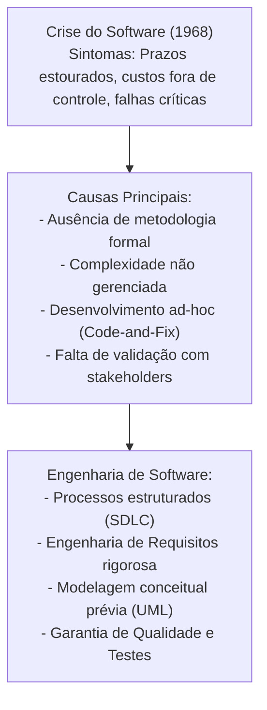

#### Motivação
A construção de software difere da manufatura física tradicional: o software não se desgasta fisicamente com o atrito mecânico, mas deteriora-se funcionalmente devido à complexidade acumulada, evolução desordenada e alterações de ambiente operacional. Sem a aplicação deliberada de métodos analíticos, métricas e modelagem abstrata, projetos de software colapsam sob o peso do débito técnico e da entropia computacional.

#### Exemplo
A especificação prévia das regras de negócio de um sistema bancário via diagramas formais de casos de uso e classes conceituais, garantindo que as transações de débito e crédito mantenham a consistência contábil antes de qualquer implementação de código.

#### Contraexemplo
O paradigma informal denominado *Code-and-Fix* (Codificar e Remendar), no qual desenvolvedores iniciam a programação de telas e tabelas de banco de dados imediatamente após uma conversa verbal superficial com o cliente, sem documentar requisitos nem projetar arquiteturas lógicas.

#### Armadilhas
- Acreditar que a crise do software foi superada com a criação de linguagens modernas; ela permanece viva sempre que equipes negligenciam a fase de análise de requisitos.
- Tratar a documentação como fim em si mesma, gerando volumes textuais burocráticos que não refletem a arquitetura do produto real.

---

### 1.2 As Quatro Atividades Fundamentais do Ciclo de Vida

Conforme sistematizado por Ian Sommerville, independentemente do modelo de desenvolvimento escolhido (prescritivo linear ou ágil adaptativo), quatro atividades técnicas fundamentais compõem o ciclo de vida do software:

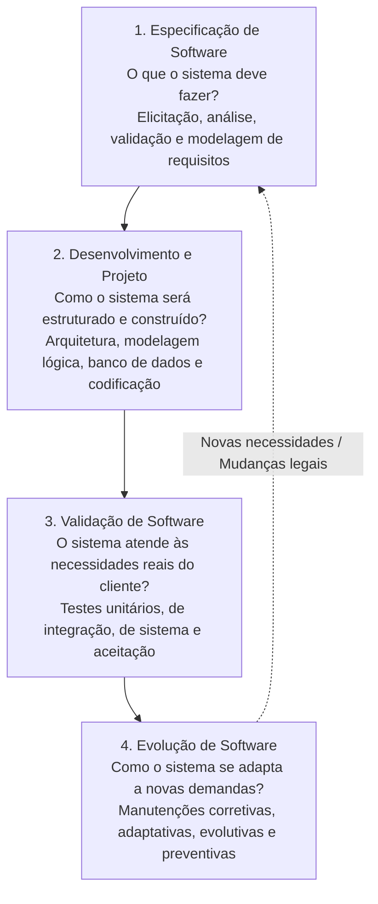

1. **Especificação de Software:** Processo cooperativo no qual clientes e engenheiros delimitam as funcionalidades operacionais do sistema e as restrições arquiteturais e de qualidade sob as quais ele operará.
2. **Desenvolvimento de Software (Projeto e Implementação):** Transformação das especificações conceituais em uma estrutura lógica computacional e sua posterior tradução para código executável.
3. **Validação de Software:** Execução de procedimentos de verificação ("Estamos construindo o produto corretamente segundo o projeto?") e validação ("Estamos construindo o produto certo para as dores do cliente?").
4. **Evolução de Software:** Atividade contínua de sustentação, adaptação a novos contextos legais ou mercadológicos e correção de desvios operacionais detectados durante a fase de produção.

---

### 1.3 Ciclos de Vida segundo o PMBOK e a Norma ISO/IEC/IEEE 12207

#### Definição
O Ciclo de Vida de Software (*Software Development Life Cycle* — SDLC) é a estrutura lógica de governança que organiza as fases do projeto desde a concepção inicial até o descarte definitivo do sistema. Conforme a norma ISO/IEC/IEEE 12207 e o corpo de conhecimento do PMBOK (*Project Management Body of Knowledge*), os projetos podem estruturar suas fases sob três abordagens executivas primárias:

1. **Sequencial (Cascata ou Predivito):** Uma fase só é iniciada após o término formal, aprovação documental e congelamento (*baseline*) da fase antecedente.
2. **Iterativo e Incremental:** O escopo geral é decomposto em entregáveis parciais. Cada iteração executa um ciclo completo em escala reduzida, gerando versões operacionais funcionais que agregam valor sucessivo ao produto.
3. **Sobreposto (Concorrente ou *Fast-Tracking*):** Uma fase subsequente é deflagrada antes do encerramento oficial da fase anterior, exigindo controle rígido de riscos para mitigar retrabalho.

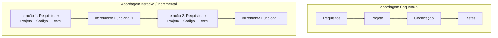

| Critério de Comparação | Abordagem Sequencial (Predivita) | Abordagem Iterativa/Incremental | Abordagem Sobreposta (*Fast-Tracking*) |
| :--- | :--- | :--- | :--- |
| **Clareza Inicial de Requisitos** | Exige requisitos 100% claros e estáveis | Suporta requisitos voláteis e evolutivos | Requisitos estáveis, foco em redução de tempo |
| **Visibilidade do Produto pelo Cliente** | Tardia (somente nas fases finais de entrega) | Precoce (a cada final de iteração ou sprint) | Intermediária (conforme módulos amadurecem) |
| **Tolerância a Mudanças** | Mínima; envolve alto custo de retrabalho | Máxima; incorporada ao planejamento cíclico | Média; risco elevado de retrabalho em cascata |
| **Controle de Riscos Técnicos** | Adiado para a fase de testes e integração | Distribuído e mitigado nas voltas iniciais | Crítico; exige comunicação contínua e diária |

---

### 1.4 Modalidades de Manutenção de Software em Produção

Após a entrada em operação (produção), o software entra na fase de manutenção e evolução. A literatura clássica (Pressman, Sommerville) e as normas de qualidade categorizam a manutenção em quatro tipos distintos:

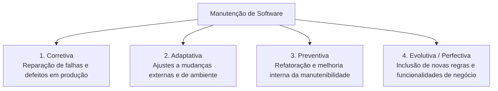

#### 1. Manutenção Corretiva
- **Definição:** Correção de bugs, erros lógicos, cálculos divergentes ou falhas técnicas observadas durante a operação regular do sistema.
- **Motivação:** Restaurar a operacionalidade planejada sem alterar o escopo funcional contratado.
- **Exemplo:** Correção de um erro de divisão por zero ao calcular o valor total de pedidos com desconto de 100%.
- **Contraexemplo:** Adicionar um novo método de pagamento via criptomoedas (isso é manutenção evolutiva).
- **Armadilha:** Aplicar correções rápidas (*hotfixes*) sem documentar a causa raiz, gerando regressões em outros módulos.

#### 2. Manutenção Adaptativa
- **Definição:** Modificação do software motivada por mudanças no ambiente operacional externo (hardware, sistemas operacionais, banco de dados, bibliotecas de terceiros) ou alterações compulsórias na legislação.
- **Motivação:** Manter o sistema operacional diante de fatores externos sobre os quais a organização não possui controle discricionário.
- **Exemplo:** Atualização do emissor de notas fiscais do sistema para atender ao novo leiaute do SPED Fiscal da Receita Federal ou adaptação da aplicação para rodar no Android 14.
- **Contraexemplo:** Alterar a paleta de cores da tela a pedido do setor de marketing.
- **Armadilha:** Tratar a atualização de ambiente como tarefa trivial sem executar baterias completas de testes de regressão.

#### 3. Manutenção Preventiva (Engenharia Reversa / Refatoração)
- **Definição:** Ações deliberadas para melhorar a estrutura interna do código, a legibilidade, o acoplamento e a manutenibilidade do software, sem alterar seu comportamento externamente observável.
- **Motivação:** Mitigar a degradação estrutural do software, reduzir o débito técnico e prevenir a ocorrência de falhas futuras.
- **Exemplo:** Refatoração de um método monolítico de 800 linhas em quatro classes coesas com responsabilidades bem delimitadas.
- **Contraexemplo:** Reescrever código para implementar uma tela nova de cadastro.
- **Armadilha:** Gastar ciclos excessivos de engenharia refatorando módulos estáveis que não sofrem alterações há anos e não possuem impacto financeiro.

#### 4. Manutenção Evolutiva (Perfectiva)
- **Definição:** Expansão deliberada do sistema pela inclusão de novos requisitos funcionais, relatórios inéditos, melhorias de desempenho solicitadas pelo usuário ou aprimoramento da interface gráfica.
- **Motivação:** Acompanhar o crescimento do negócio e atender a novas oportunidades de mercado.
- **Exemplo:** Criar um programa de pontos de fidelidade no aplicativo da açaiteria.
- **Contraexemplo:** Ajustar o cálculo do ICMS que estava computando alíquota errada (isso é corretiva).
- **Armadilha:** Aceitar manutenções evolutivas contínuas sem avaliar o impacto na arquitetura existente, convertendo o sistema em uma estrutura espaguete.

---

### 1.5 Curva de Custo de Mudança de Barry Boehm

#### Fundamentação Matemática e Conceitual
Barry Boehm demonstrou empiricamente que o custo financeiro e o esforço técnico necessários para corrigir uma falha ou implementar uma alteração de requisito crescem de forma não linear ao longo das fases do ciclo de desenvolvimento. 

Se um erro conceitual de requisito for detectado na fase de análise, sua correção demanda apenas a alteração de um parágrafo textual ou de um diagrama no Astah UML. Se esse mesmo erro passar despercebido e for detectado apenas em ambiente de produção, ele exigirá:
1. Atualização do documento de requisitos;
2. Redesenho dos diagramas de arquitetura e classes;
3. Refatoração profunda de código-fonte e testes unitários;
4. Migração e alteração do esquema de banco de dados;
5. Homologação completa, empacotamento, deploy emergencial e compensação financeira a usuários prejudicados.

Matematicamente, a curva clássica de Boehm para sistemas desenvolvidos sob modelos lineares prescreve uma progressão geométrica aproximada:

```math
\text{Custo\_Correção} = C_0 \times b^{t}
```

Onde $ `C_0` $ representa o custo unitário base de correção na fase de requisitos, $ `b` $ é o fator multiplicador empírico de avanço de fase ($ `b \approx 3 \text{ a } 5` $) e $ `t` $ representa o índice ordinal da fase do ciclo de vida ($ `t \in \{1: \text{Requisitos}, 2: \text{Projeto}, 3: \text{Codificação}, 4: \text{Testes}, 5: \text{Produção}\}` $).

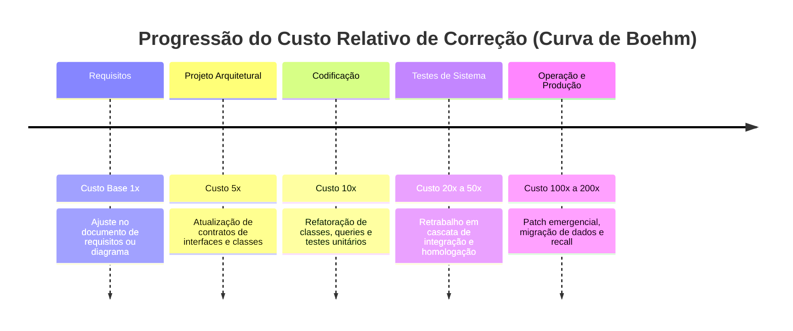

---

## Capítulo 2: Modelos e Métodos de Processo de Desenvolvimento de Software

### 2.1 Paradigma Prescritivo versus Paradigma Ágil

A engenharia de processos divide-se em dois grandes paradigmas metodológicos:

1. **Modelos Prescritivos (Dirigidos a Planos / Tradicionais):** Priorizam previsibilidade, planejamento formal antecipado (*Big Design Up Front* — BDUF), marcos contratuais documentados e controle rigoroso de mudanças. Acreditam que o processo de desenvolvimento pode ser ordenado, estruturado e planejado em detalhes antes do início da construção.
2. **Modelos Ágeis (Adaptativos / Empíricos):** Fundamentados no Manifesto Ágil (2001). Priorizam indivíduos e interações sobre processos e ferramentas, software funcionando sobre documentação abrangente, colaboração com o cliente sobre negociação de contratos e resposta rápida a mudanças sobre seguir planos rígidos.

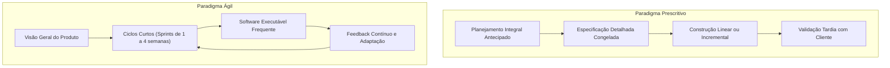

---

### 2.2 Modelo Cascata Linear e Modelo V

#### 1. Modelo Cascata (Waterfall)
Proposto por Winston Royce em 1970, prescreve que as fases ocorram em sequência unidirecional estrita. Uma fase subsequente só inicia quando a fase anterior atinge seu término formal com artefatos homologados (*gates*).

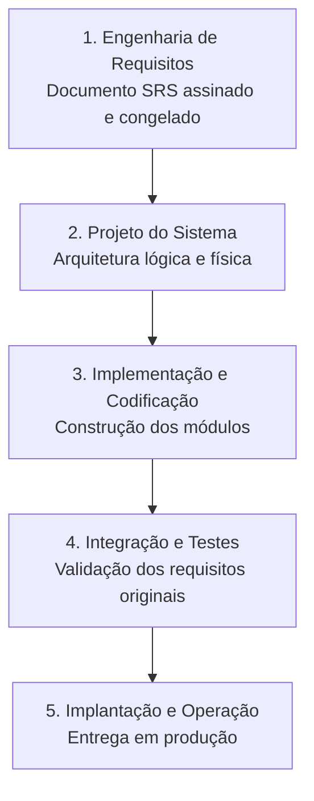

- **Motivação:** Controle de contratos em órgãos governamentais e projetos de infraestrutura onde mudanças de escopo no meio do caminho acarretam inviabilidade financeira.
- **Contraexemplo:** Utilizar o Cascata para desenvolver um aplicativo de marketplace inovador, onde o comportamento dos consumidores muda semanalmente.
- **Armadilhas:**
  - *Bloqueio de fases:* Programadores ficam ociosos esperando analistas terminarem documentos formais.
  - *Entrega Big-Bang:* O cliente só vê o software funcionando no final do cronograma contratado.

#### 2. Modelo V
O Modelo V explicita que cada fase de concepção e especificação possui uma fase de testes diretamente correspondente, planejada antecipadamente durante a descida da estrutura em V.

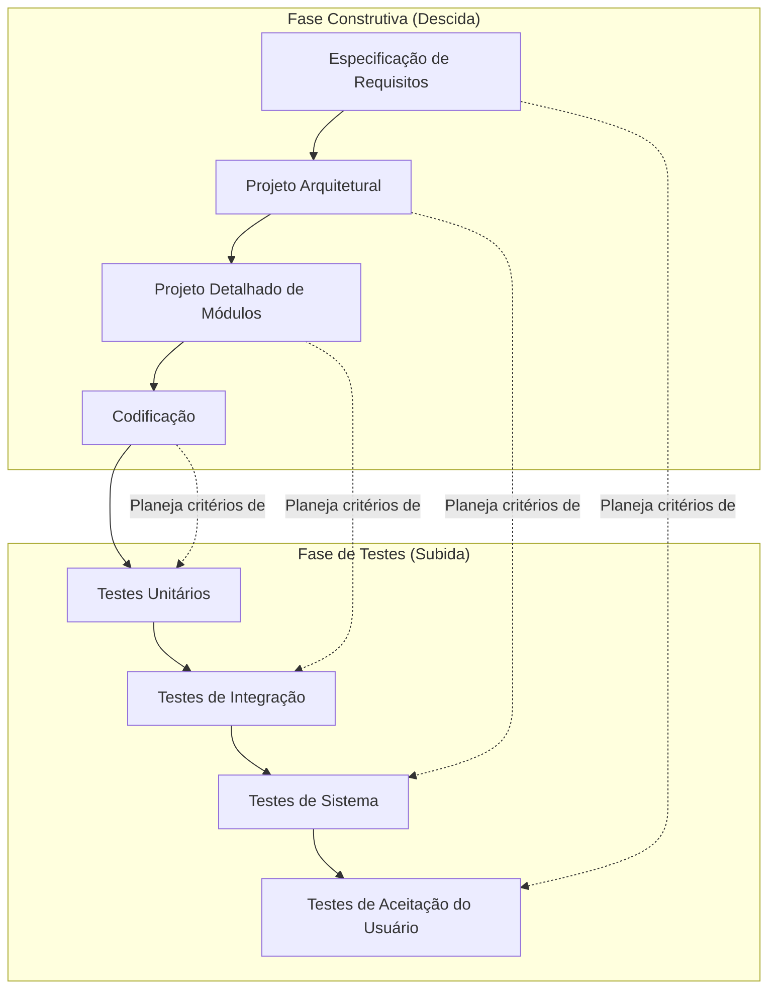

---

### 2.3 Modelo de Prototipação: Descartável versus Evolutiva

#### Definição e Motivação
A Prototipação é adotada quando os usuários conhecem os objetivos gerais da aplicação, mas são incapazes de verbalizar requisitos técnicos detalhados de dados e interface. O protótipo atua como mecanismo para desmistificar incertezas e mitigar o efeito IKIWISI (*"I'll know it when I see it"*).

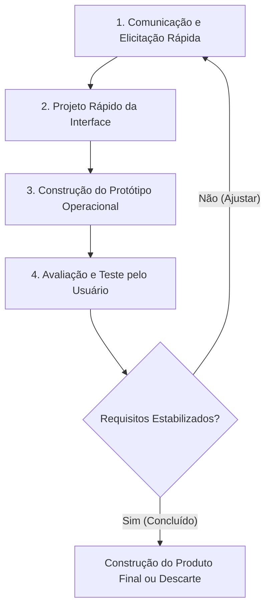

#### Comparativo entre as duas vertentes de prototipação

| Dimensão de Análise | Prototipação Descartável (*Throwaway*) | Prototipação Evolutiva |
| :--- | :--- | :--- |
| **Objetivo Primário** | Elicitar requisitos voláteis e testar ergonomia de UI | Entregar software funcional de imediato ao usuário |
| **Destino do Código** | O código preliminar é descartado integralmente | O código base é mantido e refatorado sucessivamente |
| **Rigor Arquitetural** | Baixo; simulações em Figma ou scripts rápidos | Elevado desde o primeiro protótipo funcional |
| **Armadilha Típica** | O cliente confunde tela bonita com sistema pronto | Degradação da manutenibilidade interna do sistema |

---

### 2.4 Modelo Incremental

O Modelo Incremental divide o escopo do projeto em múltiplos produtos parciais funcionais denominados **incrementos**. 

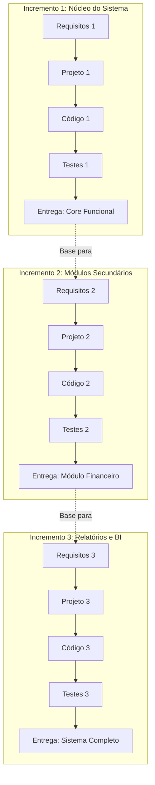

- **Mecânica Operacional:** O Incremento 1 implementa os requisitos essenciais (*core*). Cada incremento entrega um subsistema completo colocado em produção real.
- **Vantagem:** O cliente aufere retorno sobre o investimento (*ROI*) antes do encerramento global do projeto.

---

### 2.5 Modelo Espiral de Barry Boehm e Condução por Riscos

#### Definição e Estrutura dos Quatro Quadrantes
Criado em 1988 por Barry Boehm, o Modelo Espiral é um modelo evolucionário impulsionado formalmente pela **análise e mitigação de riscos**. O ciclo do projeto é representado como uma espiral contínua, onde o raio representa os custos acumulados e o ângulo angular representa o progresso através de quatro quadrantes ordenados:

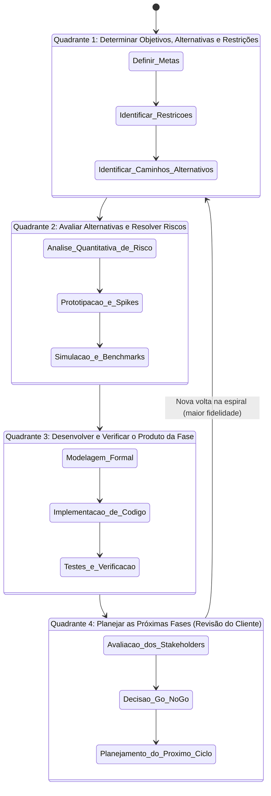

1. **Quadrante 1 (Determinar Objetivos):** Identificação das metas funcionais da iteração, caminhos alternativos de implementação e restrições de custo, desempenho e hardware.
2. **Quadrante 2 (Avaliar Alternativas e Resolver Riscos):** O núcleo da espiral. Riscos técnicos (ex.: incerteza quanto à escalabilidade do banco) são atacados com protótipos de prova de conceito (*spikes*) e simulações.
3. **Quadrante 3 (Desenvolver e Verificar):** Seleciona-se o modelo mais apropriado para o nível de risco remanescente (ex.: cascata ou ágil) para construir o produto daquela volta da espiral.
4. **Quadrante 4 (Planejar as Próximas Fases):** Os clientes avaliam os resultados e decide-se formalmente se a espiral prossegue para uma nova volta ou se o projeto é abortado (*Go / No-Go Decision*).

---

### 2.6 Processo Unificado e RUP: Fases, Disciplinas e Marcos

O *Rational Unified Process* (RUP), projetado pela Rational Software (Booch, Rumbaugh e Jacobson), é um processo prescritivo iterativo e incremental estruturado em duas dimensões:

- **Eixo Horizontal (Tempo / Fases):** As etapas ordenadas do ciclo de vida pontuadas por marcos formais (*milestones*).
- **Eixo Vertical (Disciplinas de Engenharia):** Atividades técnicas lógicas (Modelagem de Negócios, Requisitos, Análise e Projeto, Implementação, Teste, Implantação) executadas com intensidades variáveis em todas as fases.

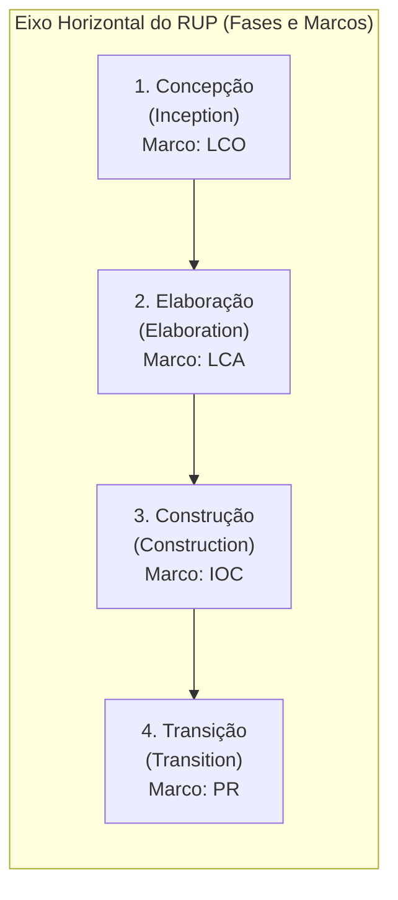

#### As Quatro Fases e Seus Marcos Arquiteturais
1. **Concepção (*Inception*):** Delimitação do escopo geral e viabilidade financeira.  
   - **Marco:** *Lifecycle Objective (LCO)* — Alinhamento de que o escopo e o orçamento são viáveis.
2. **Elaboração (*Elaboration*):** Mitigação dos principais riscos técnicos e criação da linha de base da arquitetura (*architectural baseline*). Pelo menos 80% dos casos de uso são descritos em detalhes.  
   - **Marco:** *Lifecycle Architecture (LCA)* — A linha de base da arquitetura está estável e validada. **É o marco mais crítico do RUP.**
3. **Construção (*Construction*):** Desenvolvimento massivo dos componentes operacionais e funcionalidades complementares.  
   - **Marco:** *Initial Operational Capability (IOC)* — Sistema atinge maturidade para testes beta.
4. **Transição (*Transition*):** Testes de homologação final com usuários, migração de dados e deploy em produção.  
   - **Marco:** *Product Release (PR)* — O sistema é formalmente aceito para operação em produção.

---

### 2.7 Métodos Ágeis: Scrum, Extreme Programming e Kanban

1. **Scrum:** Arcabouço gerencial iterativo. O trabalho ocorre em ciclos de tempo fixos denominados *Sprints* (1 a 4 semanas). Possui papéis definidos: *Product Owner* (define prioridades de negócio no *Product Backlog*), *Scrum Master* (remove impedimentos e zela pelo processo) e *Developers* (time multifuncional auto-organizado). As reuniões estruturantes incluem *Sprint Planning*, *Daily Scrum*, *Sprint Review* e *Sprint Retrospective*.
2. **Extreme Programming (XP):** Focado em excelência técnica de engenharia. Prega práticas consagradas como *Test-Driven Development* (TDD), Programação em Par (*Pair Programming*), Integração Contínua (*Continuous Integration*), Design Simples e Refatoração Constante.
3. **Kanban:** Sistema visual de gestão de fluxo derivado do Sistema Toyota de Produção. Não prescreve iterações com tempo fixo; concentra-se em visualizar o fluxo de trabalho (*Kanban Board*), limitar o trabalho em progresso (*WIP — Work in Progress*) e medir o tempo de ciclo (*Cycle Time* / *Lead Time*).

---

### 2.8 Matriz Multicritério para Seleção de Modelos de Processo

| Critério de Seleção do Projeto | Modelo Cascata | Modelo de Prototipação | Modelo Incremental | Modelo Espiral | Abordagens Ágeis (Scrum/XP) |
| :--- | :--- | :--- | :--- | :--- | :--- |
| **Clareza Inicial dos Requisitos** | Alta (indispensável) | Baixa (objetivo primário) | Média / Alta | Média / Baixa | Baixa / Evolutiva |
| **Estabilidade dos Requisitos** | Alta (congelamento) | Baixa (em mutação) | Alta para o núcleo | Média | Altamente Volátil |
| **Criticidade do Sistema (Risco)** | Baixo a Médio | Baixo | Médio | Extremamente Alto | Baixo a Médio |
| **Envolvimento do Cliente** | Início e Fim | Contínuo e Intenso | Regular por entrega | A cada volta (Q4) | Diário / Semanal |
| **Incerteza Tecnológica** | Baixa | Alta | Média | Extremamente Alta | Média a Alta |
| **Tempo para Primeira Versão** | Muito Longo | Curto (apenas visual) | Médio (Incremento 1) | Médio | Curtíssimo (Sprint 1) |

---

## Capítulo 3: Engenharia de Requisitos e o Processo de Abstração

### 3.1 O Processo de Abstração Cognitiva na Engenharia

#### Definição
A abstração é a capacidade intelectual de focar deliberadamente nas características essenciais e pertinentes de uma entidade ou processo do mundo real, ignorando detalhes acidentais ou irrelevantes para o contexto do software a ser construído. 

A abstração gerencia os limites cognitivos da mente humana (Lei de Miller: retenção imediata em memória de trabalho de $ `7 \pm 2` $ blocos de informação). Construir software consiste em criar **modelos**, e todo modelo é uma abstração orientada a uma finalidade funcional específica.

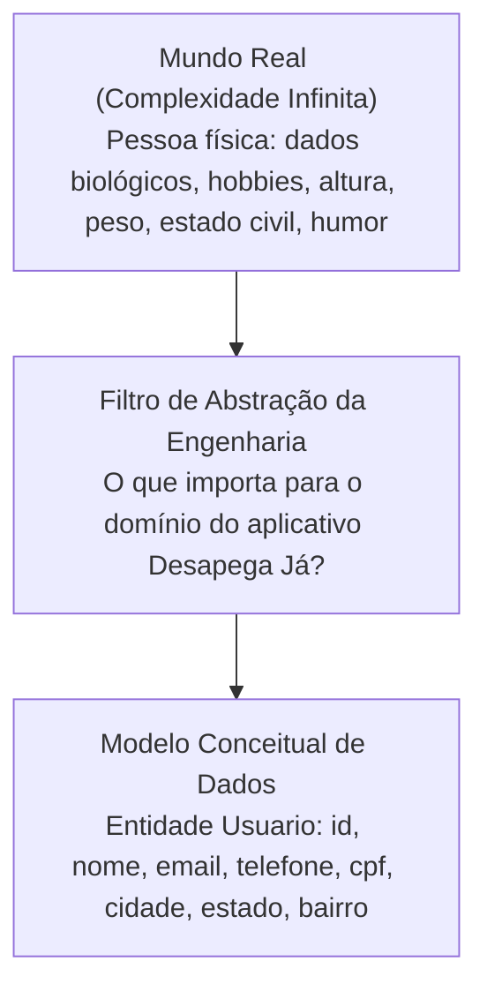

#### Motivação
Sem abstração, os sistemas computacionais tornam-se inchados, complexos e economicamente inviáveis, capturando atributos e comportamentos do mundo real que não possuem utilidade funcional para a organização.

#### Exemplo
No aplicativo *Desapega Já*, abstrai-se de uma pessoa apenas: `nome`, `email`, `telefone`, `cpf`, `cidade`, `estado`, `bairro` e dados de autenticação. Ignoram-se seu tipo sanguíneo ou estilo musical preferido.

#### Contraexemplo
Incluir no cadastro de um cliente de açaiteria o número de calçado e o modelo do automóvel que ele dirige, onerando o banco de dados e gerando atrito desnecessário na experiência de uso do cliente.

#### Armadilhas
- *Subespecificação:* Abstrair excessivamente e esquecer atributos críticos (ex.: esquecer o `bairro` no *Desapega Já*, impedindo a busca de produtos por proximidade).
- *Vazamento de Abstração (*Leaky Abstraction*):* Permitir que detalhes técnicos de baixo nível (como tipos específicos de tabelas SQL) influenciem os modelos conceituais na fase de análise de requisitos.

---

### 3.2 Espaço do Problema versus Espaço da Solução

A Engenharia de Software estabelece uma fronteira metodológica rigorosa entre o entendimento da necessidade e a implementação técnica da solução:

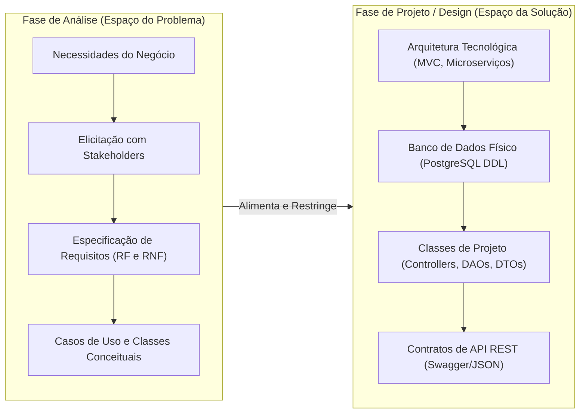

| Critério de Comparação | Fase de Análise (Espaço do Problema) | Fase de Projeto (Espaço da Solução) |
| :--- | :--- | :--- |
| **Pergunta Fundamental** | O que o sistema deve fazer? | Como o sistema será implementado tecnologicamente? |
| **Vocabulário Utilizado** | Linguagem do cliente e do negócio (domínio) | Linguagem técnica (classes, threads, sockets, SQL) |
| **Independência Tecnológica** | Total (o requisito independe de linguagem de programação) | Baixa (decisões amarradas a frameworks e hardware) |
| **Responsável Típico** | Analista de Requisitos, Engenheiro de Software, PO | Arquiteto de Software, Tech Lead, Desenvolvedor |

---

### 3.3 Níveis de Abstração: Conceitual, Lógico e Físico

A complexidade sistêmica é organizada em camadas sucessivas de abstração técnica:

1. **Abstração Conceitual (Alto Nível):** Representa o domínio do negócio puro. Foca nas entidades da realidade e regras corporativas (ex.: "Um Cliente realiza um Pedido contendo Itens de Açaí").
2. **Abstração Lógica (Médio Nível):** Estrutura formal das entidades sem vinculação a tecnologias físicas. Define classes lógicas, atributos tipados, multiplicidades de relacionamentos e fluxos textuais de casos de uso (ex.: Classe `Pedido` com atributo `valorTotal: Real`, associada a `ItemPedido` com multiplicidade `1..*`).
3. **Abstração Física (Baixo Nível):** Detalha a implementação direta no ambiente de execução (ex.: Tabela `tb_pedido` no PostgreSQL com coluna `vl_total NUMERIC(10,2)` e chave primária com índice B-Tree).

---

### 3.4 Fontes de Informação e Mapeamento de Stakeholders

A elicitação de requisitos não pode restringir-se a entrevistar apenas o patrocinador do software. Uma especificação de qualidade exige a varredura abrangente das seguintes fontes:

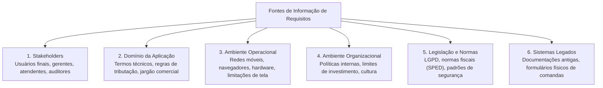

---

### 3.5 Métodos de Coleta de Dados: Questionários, Entrevistas e Grupos Focais

| Método de Coleta | Custo e Logística | Alcance Amostral | Profundidade Qualitativa | Taxa de Resposta / Retorno | Indicação Primária de Uso |
| :--- | :--- | :--- | :--- | :--- | :--- |
| **Questionário Online** | Muito Baixo | Massivo (Centenas/Milhares) | Baixa (Perguntas fechadas) | Tipicamente baixa (5% a 20%) | Levantamento quantitativo preliminar e pesquisas demográficas |
| **Entrevista Estruturada** | Alto | Reduzido (Individual) | Média (Roteiro pré-fixado) | Total (Agendamento individual) | Coleta de dados padronizados entre múltiplos departamentos |
| **Entrevista Aberta** | Muito Alto | Reduzido (Individual) | Altíssima (Exploratória) | Total (Presencial ou remota) | Descoberta inicial de domínio e fluxos de trabalho complexos |
| **Grupo Focal (*Focus Group*)**| Médio a Alto | Médio (6 a 12 participantes) | Alta (Debate coletivo) | Alta (Sessão mediada) | Geração de ideias, avaliação de protótipos de interface |
| **Análise Documental** | Muito Baixo | Documentos legados | Factual e Histórica | Total (Registros existentes) | Extração de regras fiscais, formulários de papel e manuais |

---

### 3.6 Técnicas Etnográficas: Observação Participante, Não Participante e Testes de Usabilidade

Muitas vezes os usuários executam tarefas tácitas no cotidiano que são incapazes de verbalizar em entrevistas formais. A etnografia supre essa lacuna:

- **Observação Participante:** O analista integra-se ativamente ao ambiente dos usuários, vivenciando o trabalho real (*work-as-done*) em contraste com o trabalho prescrito em manuais (*work-as-imagined*). Revela desvios informais operacionais e gargalos de comunicação.
- **Observação Não Participante:** O analista atua como observador silencioso, registrando tempos, cliques, movimentos e hesitações sem interferir na rotina de trabalho.
- **Testes de Usabilidade com Observação Direta:** Coloca-se o usuário final diante do sistema sob monitoramento de interações para registrar telas abandonadas, preenchimentos incorretos e pontos de fricção ergonômica.

---

### 3.7 Requisitos Funcionais: Atomicidade, Testabilidade e Padronização

#### Critérios Formais de Qualidade (IEEE 830 / ISO/IEC/IEEE 29148)
Um Requisito Funcional (RF) descreve as ações, serviços, transformações de dados e comportamentos que o software deve executar. Para ser considerado válido, um RF deve cumprir os seguintes critérios:
1. **Comportamento Verificável:** Declarar uma função computacional mensurável, nunca um desejo subjetivo de negócio.
2. **Atomicidade:** Tratar de uma única funcionalidade indivisível.
3. **Testabilidade (Verificabilidade):** Possibilitar a elaboração de um caso de teste booleano (Passou / Falhou).
4. **Padronização Sintática:** Redigido no formato canônico:  
   *"O sistema deve [ação/verbo de negócio] [objeto direto] [condições, restrições ou parâmetros]"*.

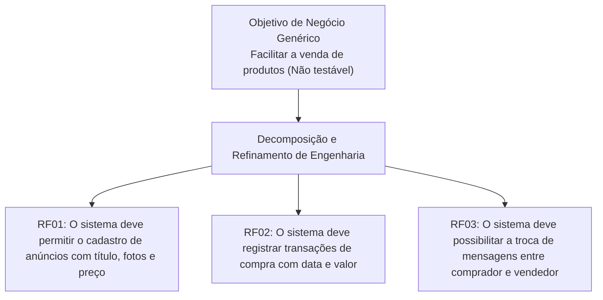

---

### 3.8 Requisitos Não Funcionais: Modelos FURPS+, ISO/IEC 25010 e Métricas

#### Definição e Taxonomia
Requisitos Não Funcionais (RNF) estabelecem restrições operacionais, qualidades sistêmicas e conformidades de arquitetura. Se os requisitos funcionais determinam **o que** o sistema faz, os não funcionais determinam **como** e **sob quais limites** ele deve operar.

```mermaid
mindmap
  root("Requisitos Não Funcionais")
    "FURPS+"
      "F - Functionality (Segurança)"
      "U - Usability (Ergonomia, UX)"
      "R - Reliability (Disponibilidade, MTBF)"
      "P - Performance (Tempo de resposta)"
      "S - Supportability (Manutenibilidade)"
      "+ - Restrições de Design e Físicas"
    "ISO/IEC 25010"
      "Adequação Funcional"
      "Eficiência de Desempenho"
      "Compatibilidade"
      "Usabilidade"
      "Confiabilidade"
      "Segurança"
      "Manutenibilidade"
      "Portabilidade"
```

#### A Falha da Subjetividade e a Quantificação Obrigatória
Declarações como "o sistema deve ser rápido" ou "o aplicativo deve ter fácil usabilidade" são contratualmente inválidas e tecnicamente inúteis. Todo RNF deve ser acompanhado de uma métrica objetiva e verificável.

| RNF Subjetivo (Problemático) | Categoria ISO 25010 | RNF Refinado com Métrica de Engenharia (Válido) | Critério de Aceite e Teste |
| :--- | :--- | :--- | :--- |
| "O sistema deve ser rápido." | Eficiência de Desempenho | O sistema deve processar e retornar requisições de consulta de catálogo em até 2,0 segundos sob carga de 500 requisições simultâneas. | Teste de estresse com ferramenta de injeção de carga (Apache JMeter). |
| "O app deve ter fácil usabilidade." | Usabilidade | Um usuário recém-cadastrado deve ser capaz de concluir a publicação de um anúncio em menos de 3 minutos sem suporte externo. | Teste de usabilidade com amostragem de 20 usuários registrando tempo médio. |
| "O sistema deve ser seguro." | Segurança | O sistema deve criptografar todas as senhas utilizando algoritmo de dispersão seguro (Argon2id ou BCrypt com salt de 12 rounds). | Auditoria de código e inspeção da base de dados física. |
| "O aplicativo deve ser estável." | Confiabilidade | O sistema deve apresentar disponibilidade mensal mínima de 99,5% (tempo de inatividade não planejado inferior a 3,65 horas/mês). | Monitoramento de telemetria contínua em produção (*APM*). |

---

### 3.9 Estabilidade de Requisitos: Permanentes versus Voláteis

Conforme sistematizado por Ian Sommerville:

- **Requisitos Permanentes (Estáveis):** Tratam do núcleo estrutural do domínio da aplicação. Permanecem inalterados durante a vida do software, pois decorrem de regras basilares do negócio (ex.: o princípio contábil de partidas dobradas em bancos, ou o cálculo de valor total de um pedido baseado em `quantidade * preço_unitário`).
- **Requisitos Voláteis (Mutáveis):** Sofrem alterações contínuas durante o desenvolvimento ou após o deploy, impulsionados por pressões mercadológicas, políticas internas da organização ou mudanças legislativas (ex.: integração com novos gateways de pagamento ou mudança nas alíquotas de ICMS).

> [!IMPORTANT]
> **Atenção para avaliações teóricas:** Dizer que "requisitos permanentes mudam com facilidade durante o projeto" é um erro clássico de prova. Requisitos que mudam são **voláteis**, enquanto os permanentes mantêm sua estabilidade conceitual.

---

## Capítulo 4: Ferramentas CASE e Modelagem Formal com Astah UML

### 4.1 Taxonomia das Ferramentas CASE

As ferramentas CASE (*Computer-Aided Software Engineering*) automatizam as disciplinas do ciclo de vida:

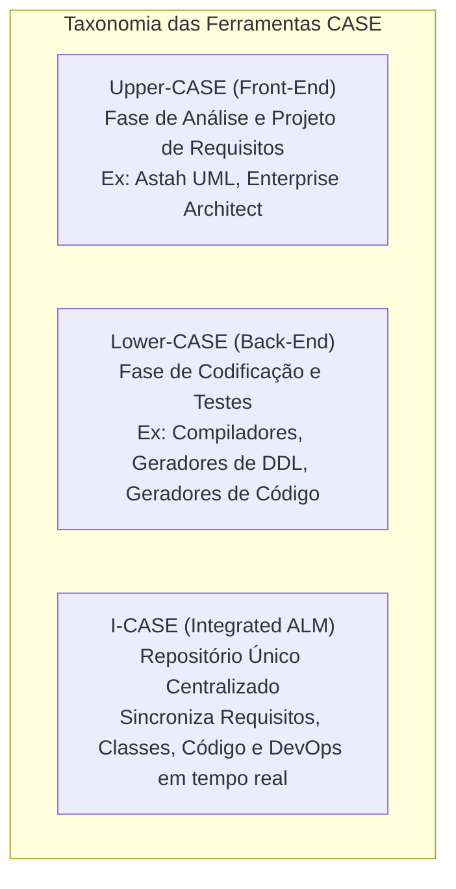

---

### 4.2 Editores de Desenho Gráfico versus Ferramentas CASE Semânticas

É um equívoco metodológico comum confundir ferramentas de diagramação vetorial livre (Draw.io, Lucidchart, Miro, Canva) com ferramentas CASE formais baseadas no metamodelo da OMG:

| Critério Técnico | Editor de Desenho Gráfico (Draw.io / Canva) | Ferramenta CASE Formal (Astah UML) |
| :--- | :--- | :--- |
| **Núcleo de Armazenamento** | Primitivas visuais 2D isoladas (retângulos, círculos) | Grafo semântico estruturado baseado no metamodelo UML |
| **Integridade Referencial** | Nula. Renomear uma classe em uma folha não afeta as demais | Total. Renomear uma classe atualiza todos os diagramas |
| **Validação Sintática** | Inexistente. Permite heranças circulares e relações ilegais | Nativa. Bloqueia conexões que violam as regras da UML |
| **Engenharia Reversa e Direta** | Inexistente. Exporta apenas formatos raster/vetor (PNG/PDF) | Suporte à exportação de esqueletos de código Java/C++ |
| **Rastreabilidade** | Manual e propensa a erros de digitação | Automática via Catálogo da Árvore de Modelos (*Model Tree*) |

---

### 4.3 Arquitetura de Execução do Astah UML e Arquivos .asta

O Astah UML é desenvolvido sobre a plataforma Java Virtual Machine (JVM). As especificações do projeto são serializadas na extensão compactada `.asta`.

- **Repositório Central de Metadados:** Quando o desenvolvedor cria a classe `Usuario` no Astah, ela recebe um identificador global único (UUID).
- **Visões do Modelo:** Um elemento semântico pode aparecer simultaneamente em múltiplos diagramas (de classes, sequência, casos de uso). Alterações efetuadas em uma visão visual propagam-se instantaneamente para todas as outras visões do sistema.
- **Atenção Técnica de Exclusão:** Pressionar a tecla `Delete` no diagrama remove apenas a representação gráfica daquela visão específica; o elemento permanece vivo na árvore de modelos (*Model Tree*). Para exclusão definitiva do projeto, deve-se excluí-lo explicitamente da árvore.

---

### 4.4 Mecanismo de Licença Acadêmica XML e Validação Criptográfica Assimétrica

O licenciamento educacional do Astah UML (conforme arquivo institucional de trabalho `astah_uml_license_2025-2026.xml`) utiliza um modelo de segurança baseado em **criptografia assimétrica**.

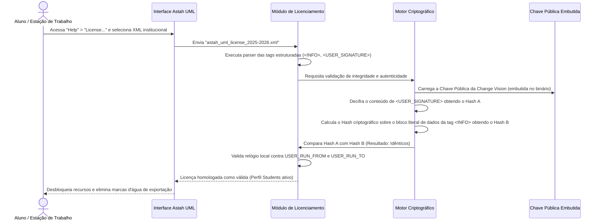

#### Segurança e Inviolabilidade do Arquivo de Licença XML
1. **Tentativa de Alteração de Data:** Se um usuário editar o XML alterando `<USER_RUN_TO>2026/08/31</USER_RUN_TO>` para `2030/12/31`, o novo hash calculado na máquina local divergirá do hash original assinado. A aplicação rejeitará a licença imediatamente.
2. **Impossibilidade de Forjar Assinatura:** Gerar um novo hash válido para os dados alterados exigiria posse da **Chave Privada** da *Change Vision, Inc.*, a qual reside exclusivamente nos servidores protegidos da empresa desenvolvedora.
3. **Validação Offline:** Como a verificação depende apenas da **Chave Pública** gravada no código executável do Astah, o software valida a licença sem necessidade de acesso à internet.

---

### 4.5 Estruturação de Pacotes e Árvore de Modelos

Para garantir organização em projetos corporativos, o Astah organiza os artefatos em pacotes lógicos (*Packages*):

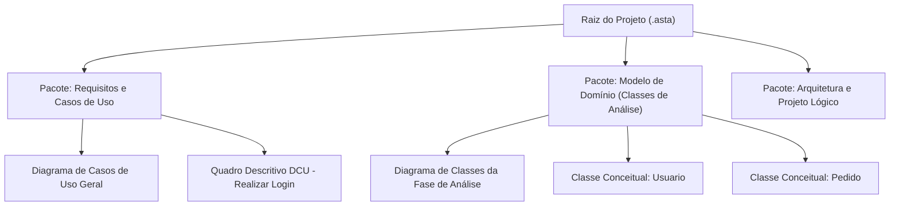

---

## Capítulo 5: Modelagem Conceitual de Domínio e Identificação de Classes

### 5.1 Análise Léxica Gramatical de Russell Abbott

Para identificar os elementos do modelo de domínio a partir de uma narrativa textual, aplica-se o método clássico de Russell Abbott:

| Elemento Gramatical no Texto | Candidato na Modelagem Orientada a Objetos | Exemplo no Estudo de Caso (Açaiteria / Desapega Já) |
| :--- | :--- | :--- |
| **Substantivo Comum / Próprio** | Classe Conceitual ou Atributo | `Cliente`, `Pedido`, `Produto`, `preco`, `telefone` |
| **Verbo Transitivo / Ação** | Método de Classe ou Caso de Uso | `cadastrar()`, `calcularTotal()`, `efetuarPagamento()` |
| **Adjetivo** | Valor de Atributo ou Estado | `status = "Aguardando"`, `status = "Em Preparo"` |
| **Sentença Declarativa de Posse**| Relacionamento / Associação | "O Pedido contém Itens de Produto" (Composição) |

---

### 5.2 Identificação de Entidades, Atributos e Responsabilidades

Na Fase de Análise, as classes representam entidades do domínio do problema. Elas devem possuir:
- **Nome:** Substantivo singular representativo escrito em `PascalCase`.
- **Atributos:** Informações intrínsecas que a entidade deve reter, escritos em `camelCase`.
- **Tipos de Dados Abstratos:** Tipagem voltada à semântica de análise (`Texto`, `Numero`, `Data`, `Logico`, `Real`), sem acoplamento a tipos primitivos de linguagens (`VARCHAR`, `INTEGER`).

---

### 5.3 Duplicação Cadastral: Herança versus Papéis de Usuário

Um problema recorrente na modelagem de software é a redundância no cadastro de pessoas com papéis distintos (como no aplicativo *Desapega Já*, onde foram levantados preliminarmente `Anunciante` e `Interessado` com atributos absolutamente idênticos).

```mermaid
classDiagram
    class Usuario {
        -String idUsuario
        -String nomeCompleto
        -String email
        -String telefoneWhatsApp
        -String cpf
        -Date dataNascimento
        -String cidade
        -String estado
        -String bairro
        +autenticar()
        +atualizarCadastro()
    }

    class Anunciante {
        -float avaliacaoVendedor
        +publicarAnuncio()
        +pausarAnuncio()
    }

    class Interessado {
        -float avaliacaoComprador
        +enviarMensagem()
        +registrarCompra()
    }

    Usuario <|-- Anunciante : Generalização / Herança
    Usuario <|-- Interessado : Generalização / Herança
```

#### Soluções de Engenharia
1. **Abordagem por Generalização/Especialização (Herança):** Modela-se a superclasse abstrata `Usuario`, concentrando os atributos cadastrais comuns (`nome`, `cpf`, `email`, `telefone`, `endereco`). As subclasses `Anunciante` e `Interessado` herdam essa base e contêm apenas os métodos e atributos específicos do seu papel.
2. **Abordagem Baseada em Papéis (Composição / Padrão Role):** A mesma pessoa física pode atuar como compradora pela manhã e vendedora à tarde. Modela-se `Usuario` com uma coleção de perfis (*Roles*), evitando duplicações cadastrais e facilitando o gerenciamento de permissões.

---

### 5.4 Relacionamentos Estruturais: Associação, Agregação e Composição

```mermaid
classDiagram
    class Pedido {
        -int idPedido
        -DateTime dataHora
        -double valorTotal
        +calcularTotal()
    }
    class ItemPedido {
        -int quantidade
        -double precoUnitario
        +calcularSubtotal()
    }
    class Produto {
        -int idProduto
        -string nome
        -double precoBase
    }
    class Cliente {
        -int idCliente
        -string nome
    }

    Cliente "1" --> "0..*" Pedido : realiza (Associação Simples)
    Pedido "1" *-- "1..*" ItemPedido : composto por (Composição Forte)
    ItemPedido "*" --> "1" Produto : referencia (Agregação Fraca)
```

1. **Associação Simples:** Relação conceitual entre duas entidades independentes. Ex.: Um `Cliente` realiza múltiplos `Pedidos`. Destruir o cliente não implica necessariamente destruir os registros contábeis históricos dos pedidos já faturados.
2. **Agregação (Todo-Parte Fraco):** A parte pertence ao todo, mas possui ciclo de vida independente. Representada por um losango oco. Ex.: Uma `Turma` agrega `Alunos`. Se a turma for dissolvida, os alunos continuam existindo no cadastro acadêmico.
3. **Composição (Todo-Parte Forte):** A existência da parte está estritamente vinculada ao ciclo de vida do todo. Representada por um losango preenchido. Ex.: `Pedido` e `ItemPedido`. Um item de pedido não possui significado nem existência conceitual isolada sem o pedido ao qual pertence; se o pedido for descartado antes da persistência, os itens deixam de existir.

---

### 5.5 Multiplicidades e Integridade Referencial

A multiplicidade define os limites inferior e superior de ocorrências de instâncias de uma classe vinculadas a uma única instância da classe associada:

| Notação UML | Significado Semântico | Regra de Negócio Prática no Domínio |
| :--- | :--- | :--- |
| `1` | Exatamente um | Todo `ItemPedido` refere-se obrigatoriamente a exatamente 1 `Produto`. |
| `0..1` | Zero ou um (Opcional) | Um `Pedido` pode ou não possuir 1 comprovante de `Pagamento` gerado. |
| `*` ou `0..*` | Zero ou muitos | Um `Cliente` pode se cadastrar e ter realizado 0 ou muitos `Pedidos`. |
| `1..*` | Um ou muitos (Pelo menos um) | Um `Pedido` não pode existir sem pelo menos 1 `ItemPedido`. |

---

## Capítulo 6: Modelagem Comportamental e Especificação Textual de Casos de Uso

### 6.1 Conceito de Ator na UML: Primários, Secundários e Herança de Atores

Um **Ator** em UML representa um papel idealizado exercido por qualquer entidade externa que interage diretamente através da fronteira do software. Um ator reside obrigatoriamente fora do sistema.

```mermaid
flowchart TD
    subgraph Atores_do_Sistema["Classificação dos Atores"]
        ACT_P["Ator Primário (Principal)\nInicia o caso de uso para atingir um benefício direto de negócio\nEx: Cliente, Funcionário"]
        ACT_S["Ator Secundário (Apoiador)\nFornece serviços de infraestrutura ou recebe dados passivamente\nEx: Gateway de Pagamento, Servidor SMTP, Web Service dos Correios"]
        ACT_H["Generalização de Atores\nPerfis especializados herdam direitos de acesso da base abstrata\nEx: Administrador herda de Usuário"]
    end
```

```mermaid
classDiagram
    class UsuarioSistema {
        <<actor>>
        +efetuarLogin()
        +alterarSenha()
    }
    class Administrador {
        <<actor>>
        +gerenciarUsuarios()
        +auditarLogs()
    }
    class Atendente {
        <<actor>>
        +operarBalcao()
    }

    UsuarioSistema <|-- Administrador : Generalização de Papel
    UsuarioSistema <|-- Atendente : Generalização de Papel
```

---

### 6.2 Diagrama de Casos de Uso e Modularização Funcional

O Diagrama de Casos de Uso sumariza o comportamento externo da aplicação. Em sistemas complexos, colocar todas as funcionalidades em um único diagrama gera diagramas poluídos e ilegíveis. Aplica-se a modularização por área funcional (conforme padrão do sistema SCAESM):

```mermaid
flowchart LR
    subgraph Fronteira_Modulo_Funcionario["SCAESM - Módulo Pessoa Funcionário"]
        UC01(["Funcionário Logar"])
        UC02(["Consultar Dados Cadastrais"])
        UC03(["Alterar Senha de Acesso"])
    end

    AtorFunc["Ator: Funcionário"] --> UC01
    AtorFunc --> UC02
    AtorFunc --> UC03
```

---

### 6.3 Estrutura Formal do Quadro de Descrição de Caso de Uso

O diagrama visual da UML comunica apenas *o que* o sistema faz e *quem* o aciona, mas não explicita o fluxo passo a passo. Essa lacuna é preenchida pelo **Quadro de Descrição de Caso de Uso (DCU)**.

```mermaid
classDiagram
    class QuadroDCU {
        +String identificadorCasoUso
        +String nomeCasoUso
        +String atorPrincipal
        +String descricaoAcao
        +List~String~ preRequisitos
        +List~PassoNormal~ fluxoNormal
        +List~DesvioAlternativo~ fluxosAlternativos
        +List~String~ dadosManipulados
    }

    class PassoNormal {
        +int numeroPasso
        +String sujeitoExecutor
        +String acaoRealizada
    }

    class DesvioAlternativo {
        +String pontoDesvio
        +String condicaoAtivacao
        +String acaoTratamento
        +String pontoConvergencia
    }

    QuadroDCU "1" *-- "many" PassoNormal
    QuadroDCU "1" *-- "many" DesvioAlternativo
```

---

### 6.4 Pré-requisitos Operacionais versus Passos de Ação

- **Pré-requisito (Precondição):** Condição de verdade absoluta que o sistema e o ambiente **devem satisfazer obrigatoriamente antes** que o caso de uso seja autorizado a iniciar. Se o pré-requisito for violado, o caso de uso não pode ser executado.
- **Passo do Fluxo:** Ações interativas executadas pelo usuário ou respostas geradas pelo sistema durante o andamento da sessão.

| Declaração | Classificação | Avaliação Técnica |
| :--- | :--- | :--- |
| "O usuário deve estar pré-cadastrado na base de dados com status ativo." | **Pré-requisito Válido** | Define um estado de dados preexistente indispensável para permitir o fluxo. |
| "O operador deve abrir o navegador e digitar o login." | **Ação do Fluxo (Erro)** | Trata-se de uma interação que ocorre dentro dos passos do caso de uso, não antes dele. |
| "A conexão com a internet deve estar ativa e segura via HTTPS." | **Pré-requisito Válido** | Define a infraestrutura necessária para viabilizar a comunicação. |
| "O usuário clica no botão salvar." | **Ação do Fluxo (Erro)** | Passo operacional da interface com o usuário. |

---

### 6.5 Elaboração do Fluxo Normal e Diálogo Ator-Sistema

O **Fluxo Normal** (Caminho Feliz) documenta a sequência lógica perfeita onde todas as validações têm sucesso e o valor de negócio é entregue sem erros. Deve ser redigido como um diálogo alternado entre a ação do ator e a resposta do sistema.

```mermaid
sequenceDiagram
    autonumber
    actor Ator as Ator: Funcionário
    participant Front as Interface Web / App
    participant Sis as Servidor / Sistema
    participant BD as Banco de Dados

    Ator->>Front: Acessa a URL da aplicação
    Front->>Sis: Requisita recurso de entrada
    Sis-->>Front: Renderiza formulário de login
    Ator->>Front: Digita credenciais (login e senha) e aciona "Entrar"
    Front->>Sis: Submete dados de autenticação
    Sis->>BD: Consulta credenciais e status do usuário
    BD-->>Sis: Retorna registro ativo confirmado
    Sis-->>Front: Emite mensagem de sucesso (MSG03) e inicializa sessão
    Front-->>Ator: Exibe tela principal personalizada
```

---

### 6.6 Mapeamento Numérico de Fluxos Alternativos e Exceções

Os **Fluxos Alternativos** tratam de desvios operacionais ou ramificações previstas no negócio. Os **Fluxos de Exceção** tratam de falhas técnicas que impedem a conclusão do objetivo. Ambos devem utilizar indexação decimal referenciando explicitamente o passo do Fluxo Normal onde o desvio ocorre:

- `Passo 5`: O sistema valida se o usuário está cadastrado.
- `Fluxo Alternativo 5.1`: Se o usuário não estiver cadastrado:
  - `5.1.1`: O sistema exibe mensagem de alerta `MSG01 ("Usuário não cadastrado")`.
  - `5.1.2`: O sistema redireciona o usuário para o formulário de autocadastro.

---

### 6.7 Especificação de Dados e Dicionário de Mensagens

Para garantir a rastreabilidade entre requisitos e código, todas as notificações de tela devem ser mapeadas em um dicionário central de mensagens com códigos padronizados (`MSG`):

```mermaid
flowchart LR
    RN["Regra de Negócio no Fluxo\nCredenciais Inválidas"] --> Catalogo["Catálogo de Mensagens\nCódigo MSG01"]
    Catalogo --> Tela["Exibição Padronizada na UI\n'Usuário ou senha inválidos'"]
```

---

## Capítulo 7: Estudos de Caso Integrados da Disciplina

### 7.1 Aplicativo Móvel Desapega Já: Classificados Hiperlocais

#### Proposta de Valor e Modelo de Negócio
O *Desapega Já* foi concebido como uma plataforma de economia circular hiperlocal. Ele resolve a retenção ociosa e o descarte indevido de bens duráveis e semiduráveis (roupas, livros, móveis, eletrônicos), aproximando compradores e vendedores no mesmo perímetro urbano (cidade, estado e bairro), eliminando fretes caros e reduzindo o risco de fraudes.

#### Matriz de Rastreabilidade de Requisitos Funcionais Refinados

| ID Original | Requisito Bruto (Aula 01/04) | Status da Engenharia | Requisito Funcional Refinado e Testável | Dados de Entrada | Dados de Saída |
| :--- | :--- | :--- | :--- | :--- | :--- |
| **RF01** | Facilitar a venda de produtos | Inadequado (Meta de negócio) | *Reclassificado:* Meta estratégica atendida pela composição do RF02, RF05 e RF08. | — | — |
| **RF02** | Permitir anúncio de produtos | Aceitável (Necessita refinamento) | O sistema deve permitir que o usuário autenticado publique anúncios com fotos (mínimo 1, máximo 5), título, descrição, categoria e preço. | Título, descrição, fotos, preço, categoria | Anúncio publicado e listado publicamente |
| **RF03** | Permitir cadastro de interessados | Redundante com RF06 | O sistema deve permitir o autocadastro de usuários coletando nome, e-mail, telefone/WhatsApp, senha criptografada, CPF, data de nascimento, cidade, estado e bairro. | Dados pessoais, localização e credenciais | Conta criada e token de sessão |
| **RF04** | Facilitar busca por proximidade | Inadequado (Subjetivo) | O sistema deve permitir a busca parametrizada de anúncios por proximidade geográfica, filtrando por estado, cidade e bairro do anunciante. | Parâmetros de busca (estado, cidade, bairro) | Coleção de anúncios filtrados |
| **RF05** | Gerar histórico e avaliações | Composto | O sistema deve manter o histórico cronológico de transações concluídas e calcular a média ponderada das avaliações recebidas (notas de 1 a 5). | Identificador da transação, nota e comentário | Média da reputação e log no perfil |
| **RF06** | Cadastro de ofertantes | Redundante com RF03 | *Unificado ao RF03:* O cadastro de usuários unificado atende tanto ao comprador quanto ao anunciante. | Conforme RF03 | Conforme RF03 |
| **RF07** | Cadastrar produtos a vender | Redundante com RF02 | *Unificado ao RF02:* O produto é abstraído diretamente na publicação do anúncio na plataforma. | Conforme RF02 | Conforme RF02 |
| **RF08** | Troca de mensagens | Requisito claro | O sistema deve disponibilizar canal de mensageria síncrona/assíncrona entre o interessado e o anunciante com histórico vinculado ao anúncio. | Texto da mensagem, id do anúncio, id do remetente | Mensagem persistida e notificação push |

#### Requisitos Não Funcionais Parametrizados (ISO/IEC 25010)

```mermaid
flowchart TD
    RNF_DJ["RNFs do Desapega Já"]
    RNF_DJ --> RNF01["RNF01: Usabilidade\nInterface mobile alinhada ao Material Design e Human Interface Guidelines.\nTempo de anúncio < 3 min para usuários leigos"]
    RNF_DJ --> RNF02["RNF02: Segurança e Privacidade (LGPD)\nCriptografia de senhas em BCrypt.\nCPF e telefone ocultos na visualização pública do anúncio"]
    RNF_DJ --> RNF03["RNF03: Desempenho\nConsultas de proximidade retornadas em menos de 1,5 segundos sob redes móveis 4G"]
    RNF_DJ --> RNF04["RNF04: Integridade de Dados\nPersistência transacional com chave estrangeira impedindo anúncios sem usuário responsável"]
```

#### Diagrama de Classes Conceituais de Domínio

```mermaid
classDiagram
    class Usuario {
        -String idUsuario
        -String nomeCompleto
        -String email
        -String telefoneWhatsApp
        -String senhaHash
        -String cpf
        -Date dataNascimento
        -String estado
        -String cidade
        -String bairro
        +autenticar()
        +atualizarPerfil()
    }

    class Anuncio {
        -String idAnuncio
        -String titulo
        -String descricao
        -double preco
        -List~String~ fotosUrls
        -Date dataPublicacao
        -String status
        +publicar()
        +pausar()
        +marcarComoVendido()
    }

    class Categoria {
        -int idCategoria
        -String nomeCategoria
    }

    class MensagemContato {
        -String idMensagem
        -DateTime dataHoraEnvio
        -String textoMensagem
        -boolean lida
        +enviar()
        +marcarComoLida()
    }

    class Compra {
        -String idCompra
        -Date dataCompra
        -double valorTransacao
        -int notaAvaliacao
        +registrarTransacao()
        +avaliarContraparte()
    }

    Usuario "1" --> "0..*" Anuncio : publica
    Anuncio "*" --> "1" Categoria : categorizado em
    Usuario "1" --> "0..*" MensagemContato : envia
    Anuncio "1" <-- "0..*" MensagemContato : referente a
    Usuario "1" --> "0..*" Compra : realiza como comprador
    Anuncio "1" <-- "0..1" Compra : liquida
```

---

### 7.2 Aplicativo da Açaiteria Sabor da Amazônia

#### Contexto e Diagnóstico Operacional
A Açaíteria Sabor da Amazônia comercializa açaí na tigela, smoothies e vitaminas com complementos. O fluxo presencial/WhatsApp enfrentava: demora no atendimento, erros na montagem física dos pedidos, perda de controle de estoque, ausência de relatórios gerenciais e descontrole do programa de fidelidade. A solução estabeleceu o desenvolvimento de um aplicativo móvel próprio.

#### Resolução Integral dos Itens da Atividade Avaliativa

##### 1. Usuários do Aplicativo
- **Cliente (Consumidor Final):** Realiza autocadastro (nome, telefone), consulta cardápio de produtos, monta pedidos customizados, efetua pagamentos digitais e acompanha pontos acumulados no programa de fidelidade.
- **Gerente (Administrador):** Acompanha pedidos em tempo real, gerencia produtos, audita vendas, visualiza relatórios consolidados e organiza a gestão do negócio.
- **Atendente / Operador da Cozinha:** Usuário operacional que atualiza os estados do pedido (`Aguardando`, `Em Preparo`, `Finalizado`).

##### 2. Classes do Projeto e Atributos Tipados

```mermaid
classDiagram
    class Cliente {
        -int idCliente
        -string nome
        -string telefone
        -int pontosFidelidade
        +acumularPontos(int pontos)
        +resgatarPontos(int pontos)
    }

    class Produto {
        -int idProduto
        -string nome
        -string descricao
        -double preco
        -string categoria
    }

    class ItemPedido {
        -int idItemPedido
        -int quantidade
        -double precoUnitario
        -double subtotal
        +calcularSubtotal() double
    }

    class Pedido {
        -int idPedido
        -DateTime dataHoraSolicitacao
        -string statusAcompanhamento
        -double valorTotal
        +calcularTotal() double
        +atualizarStatus(string novoStatus)
    }

    class Pagamento {
        -int idPagamento
        -string formaPagamento
        -string situacaoTransacao
        -DateTime dataHoraPagamento
        -double valorTransacao
        +processarTransacao() boolean
    }

    class Gerente {
        -int idGerente
        -string nome
        -string login
        -string senha
        +consultarRelatorioVendas()
    }

    Cliente "1" --> "0..*" Pedido : realiza
    Pedido "1" *-- "1..*" ItemPedido : composto por
    ItemPedido "*" --> "1" Produto : referencia
    Pedido "1" -- "0..1" Pagamento : possui
```

##### 3. Lista de Requisitos Funcionais e Não Funcionais

**Requisitos Funcionais (RF):**
- **RF01:** O sistema deve permitir o autocadastro do cliente informando nome completo e telefone celular.
- **RF02:** O sistema deve disponibilizar catálogo digital contendo nome, descrição, categoria e preço de cada produto.
- **RF03:** O sistema deve permitir a montagem do pedido pelo cliente através da seleção de itens e quantidades.
- **RF04:** O sistema deve calcular automaticamente o valor total do pedido somando os subtotais dos itens selecionados.
- **RF05:** O sistema deve registrar o pagamento armazenando a modalidade escolhida (Pix ou Cartão) e a situação da transação (Aprovado ou Recusado).
- **RF06:** O sistema deve gerenciar e atualizar os status de acompanhamento do pedido: `Aguardando`, `Em Preparo` e `Finalizado`.
- **RF07:** O sistema deve computar e atualizar o saldo de pontos de fidelidade do cliente após a aprovação de cada pedido.
- **RF08:** O sistema deve gerar relatórios administrativos consolidados de vendas por período para consulta pelo gerente.

**Requisitos Não Funcionais (RNF):**
- **RNF01 (Desempenho):** O processamento e cálculo do carrinho de compras não deve exceder 1 segundo de tempo de resposta.
- **RNF02 (Usabilidade):** A interface móvel deve permitir que o cliente conclua a montagem e envio do pedido em no máximo 5 toques de tela a partir do cardápio.
- **RNF03 (Segurança):** O sistema deve trafegar todas as requisições de pagamento criptografadas sob o protocolo seguro TLS 1.3.
- **RNF04 (Confiabilidade):** O banco de dados deve utilizar transações ACID para garantir que o estoque e os pontos de fidelidade não sofram inconsistências durante acessos concorrentes.

##### 4. Atores do Aplicativo (UML)
- **Cliente:** Ator primário humano responsável por demandar produtos e registrar pedidos.
- **Gerente:** Ator primário humano responsável pela administração, acompanhamento de métricas e controle de catálogo.
- **Atendente de Produção:** Ator operacional responsável pela transição de estados na cozinha.
- **Gateway de Pagamento Bancário:** Ator secundário externo (software) acionado pelo sistema para validar transações financeiras via Pix ou operadora de cartões.

---

### 7.3 Sistema SCAESM: Módulo Pessoa Funcionário

Conforme trabalhado na Aula 05 a partir do estudo de caso histórico de 2019 da disciplina, o sistema corporativo SCAESM organiza suas funcionalidades por módulos de negócios. A análise foca no caso de uso fundamental **Funcionário Logar**:

```mermaid
flowchart TD
    subgraph SCAESM_Funcionario["SCAESM - Módulo Pessoa Funcionário"]
        UC_LOG(["Funcionário Logar"])
    end
    AtorFunc["Ator: Funcionário"] --> UC_LOG
```

#### Quadro Descritivo de Caso de Uso Canônico (Quadro 5 do Material de Aula)

| Campo Documental | Especificação Técnica Formal |
| :--- | :--- |
| **Identificador / Caso de Uso** | **DCU Individual — Funcionário Logar** |
| **Ator Principal** | Funcionário |
| **Descrição da Ação** | O usuário deseja realizar o login no sistema. Na tela de login, o usuário informa seus dados de login e senha para autenticar-se no sistema. |
| **Pré-requisito** | Usuário deverá estar pré-cadastrado no sistema. |
| **Fluxo Normal** | **01.** Usuário acessa o URL do sistema;<br>**02.** Sistema gera tela de login para o usuário;<br>**03.** Usuário informa seus dados nos respectivos campos solicitados;<br>**04.** Usuário clica em logar;<br>**05.** Sistema verifica se o usuário está cadastrado;<br>**06.** Sistema exibe a página inicial referente ao usuário. |
| **Fluxo Alternativo** | **5.1.** Se o usuário não estiver cadastrado no sistema, será exibida a mensagem: *"Usuário não cadastrado"*; <br>**5.1.1.** Sistema retorna ao item 1, mas com tela de cadastro. |
| **Dados Manipulados** | `login`, `senha` |

---

### 7.4 Modelo Canônico da Fase de Análise para a Avaliação AV2

A entrega da segunda avaliação bimestral (AV2) da UniFEF exige a consolidação documental padronizada da Fase de Análise. A seguir, apresenta-se a estrutura canônica integral aplicada ao aplicativo corporativo de referência (SisVendas):

#### 1. Contexto do Aplicativo
O aplicativo corporativo destina-se a gerenciar operações comerciais de balcão e retaguarda. Ele centraliza o cadastro de clientes, controle de pedidos e consulta a catálogos, mitigando perdas financeiras decorrentes de controles manuais e garantindo rastreabilidade das operações sob perfis individualizados de acesso.

#### 2. Quadro 1: Descrição dos Atores do Aplicativo

| Identificador | Nome do Ator | Categoria | Descrição do Papel e Responsabilidades |
| :--- | :--- | :--- | :--- |
| **ACT01** | **Usuário do Sistema** | Humano (Abstrato) | Papel base para qualquer pessoa autenticada no software. Permite acesso a funções elementares de login, recuperação de credenciais e troca de senha pessoal. |
| **ACT02** | **Administrador** | Humano (Especializado) | Responsável pela gestão estratégica, auditoria de logs, parametrização global, concessão de perfis e exclusão controlada de registros. Herda de Usuário do Sistema. |
| **ACT03** | **Operador de Vendas** | Humano (Especializado) | Responsável pela operação rotineira de vendas, cadastro de clientes, consulta a catálogos e emissão de pedidos. Herda de Usuário do Sistema. |
| **ACT04** | **Serviço de Cobrança** | Sistema Externo | API financeira remota acionada para validação de crédito e liquidação eletrônica de pagamentos de forma assíncrona. |

#### 3. Diagrama de Contexto Geral por Ator

```mermaid
flowchart LR
    subgraph Fronteira_SisVendas["Fronteira da Aplicação"]
        UC01(["UC01: Realizar Login"])
        UC02(["UC02: Cadastrar"])
        UC03(["UC03: Listar"])
        UC04(["UC04: Carregar"])
        UC05(["UC05: Alterar"])
        UC06(["UC06: Excluir"])
        UC07(["UC07: Auditar Sistema"])
    end

    Admin["Administrador"]
    Operador["Operador de Vendas"]

    Admin --> UC01
    Admin --> UC06
    Admin --> UC07

    Operador --> UC01
    Operador --> UC02
    Operador --> UC03
    Operador --> UC04
    Operador --> UC05
```

#### 4. Lista Central de Casos de Uso

| ID | Nome do Caso de Uso | Ator Primário | Objetivo / Descrição Sumária |
| :--- | :--- | :--- | :--- |
| **UC01** | Realizar Login | Usuário do Sistema | Validar a identidade do operador mediante checagem de credenciais (login e senha). |
| **UC02** | Cadastrar | Operador de Vendas | Inserir novos registros de entidades no sistema com validação obrigatória de campos. |
| **UC03** | Listar | Operador de Vendas | Recuperar e exibir registros em formato tabular com suporte a filtros e paginação. |
| **UC04** | Carregar | Operador de Vendas | Buscar e apresentar em formulário os dados completos de um registro específico selecionado. |
| **UC05** | Alterar | Operador de Vendas | Modificar atributos de um registro previamente carregado e persistir as atualizações. |
| **UC06** | Excluir | Administrador | Remover fisicamente ou desativar logicamente um registro após diálogo de confirmação. |

#### 5. Lista Central de Mensagens do Sistema (MSG)

| Código | Tipo | Texto Padronizado da Notificação | Gatilho / Finalidade de Disparo |
| :--- | :--- | :--- | :--- |
| **MSG01** | Erro | "Usuário ou senha inválidos. Por favor, verifique suas credenciais." | Credencial não localizada ou senha divergente no login. |
| **MSG02** | Alerta | "Usuário inativo no sistema. Contate o administrador." | Tentativa de autenticação com conta em estado bloqueado. |
| **MSG03** | Sucesso | "Autenticação realizada com sucesso. Redirecionando..." | Validação positiva de credenciais de acesso. |
| **MSG04** | Erro | "Existem campos obrigatórios não preenchidos: [Campos]." | Tentativa de persistência com atributos obrigatórios nulos. |
| **MSG05** | Erro | "Registro já cadastrado com os dados informados: [Chave]." | Tentativa de inclusão violando chave única de negócio (ex.: CPF existente). |
| **MSG06** | Sucesso | "Registro gravado com sucesso!" | Confirmação de persistência bem-sucedida de novo registro. |
| **MSG07** | Alerta | "Nenhum registro encontrado para os critérios de busca informados." | Consulta na listagem que retorna coleção vazia de dados. |
| **MSG08** | Erro | "Registro selecionado não foi localizado ou foi removido por outro operador." | Falha ao carregar chave inexistente na base de dados. |
| **MSG09** | Sucesso | "Alterações salvas com sucesso!" | Confirmação de atualização persistida com sucesso. |
| **MSG10** | Confirmação | "Deseja realmente excluir o registro [Nome]? Esta ação não poderá ser desfeita." | Diálogo de segurança exibido antes da exclusão. |
| **MSG11** | Erro | "Não é possível excluir o registro pois existem movimentações vinculadas." | Bloqueio de exclusão motivado por integridade referencial. |
| **MSG12** | Sucesso | "Registro excluído com sucesso!" | Confirmação de remoção do registro da base de dados. |

---

#### 6. Especificação Canônica dos Quadros Descritivos de Casos de Uso (DCU)

##### UC01 — Realizar Login
- **Atores:** Usuário do Sistema (Primário).
- **Objetivo:** Autenticar o usuário e liberar os módulos operacionais autorizados.
- **Pré-requisitos:** O aplicativo deve estar inicializado e com conectividade ativa com a base de dados.
- **Pós-condições:** Sessão iniciada e usuário redirecionado ao painel principal.

```mermaid
sequenceDiagram
    autonumber
    actor Usr as Usuário do Sistema
    participant Tela as Interface / Tela Login
    participant Ctrl as Controlador Acesso
    participant Base as Base de Dados

    Usr->>Tela: Acessa o aplicativo
    Tela-->>Usr: Exibe formulário solicitando identificador e senha
    Usr->>Tela: Informa identificador e senha e clica em "Entrar"
    Tela->>Ctrl: Submete credenciais capturadas
    Ctrl->>Base: Valida existência do identificador e correspondência da senha
    Base-->>Ctrl: Confirmação de credenciais válidas e status ativo
    Ctrl-->>Tela: Emite mensagem MSG03 e gera token de sessão
    Tela-->>Usr: Redireciona para o painel principal do sistema
```

- **Fluxo Normal:**
  1. O usuário acessa a tela de entrada do aplicativo;
  2. O sistema exibe o formulário solicitando identificador e senha;
  3. O usuário informa os dados e aciona a opção "Entrar";
  4. O sistema valida se os campos foram preenchidos;
  5. O sistema verifica a existência das credenciais e status do usuário na base de dados;
  6. O sistema emite a mensagem `MSG03`, cria a sessão e redireciona o usuário para o painel principal.
- **Fluxos Alternativos e Exceções:**
  - `4.1`: Se algum campo obrigatório estiver em branco, o sistema exibe mensagem `MSG04` e retorna ao passo 2;
  - `5.1`: Se as credenciais estiverem incorretas, o sistema emite mensagem `MSG01` e retorna ao passo 2;
  - `5.2`: Se o usuário estiver inativo, o sistema emite mensagem `MSG02` e encerra o fluxo;
  - `5.E1`: Se houver falha de rede/banco, o sistema captura a exceção, exibe aviso de indisponibilidade e permanece na tela inicial sem travar a interface.

##### UC02 — Cadastrar
- **Atores:** Operador de Vendas (Primário).
- **Objetivo:** Inserir um novo registro no sistema garantindo a integridade dos dados.
- **Pré-requisitos:** O operador deve estar autenticado (UC01) com permissão ativa.
- **Pós-condições:** Novo registro persistido e disponível para consultas.
- **Fluxo Normal:**
  1. O operador clica no botão "Novo Cadastro";
  2. O sistema apresenta o formulário de cadastro com os campos em branco;
  3. O operador preenche os campos solicitados e clica em "Salvar";
  4. O sistema valida se todos os campos obrigatórios foram preenchidos;
  5. O sistema valida as regras de formato e unicidade (chaves de negócio);
  6. O sistema grava o novo registro na base de dados;
  7. O sistema emite a mensagem `MSG06` e redireciona para a listagem atualizada.
- **Fluxos Alternativos e Exceções:**
  - `4.1`: Se houver campos em branco, exibe mensagem `MSG04` destacando os campos e retorna ao passo 3;
  - `5.1`: Se a chave única já existir na base, emite mensagem `MSG05` e retorna ao passo 3;
  - `6.E1`: Falha de gravação na base dispara rollback transacional, exibe erro técnico e mantém os dados digitados na tela para nova tentativa.

##### UC03 — Listar
- **Atores:** Operador de Vendas (Primário), Administrador.
- **Objetivo:** Recuperar e exibir registros cadastrados de forma organizada e paginada.
- **Pré-requisitos:** O usuário deve estar autenticado (UC01).
- **Pós-condições:** Registros apresentados na tela permitindo ordenação e seleção.
- **Fluxo Normal:**
  1. O usuário acessa o menu de listagem da entidade;
  2. O sistema executa consulta padrão à base de dados buscando os registros ativos;
  3. O sistema renderiza a grade de dados exibindo as colunas principais e botões de ação;
  4. O usuário visualiza os registros e pode aplicar filtros específicos de consulta.
- **Fluxos Alternativos e Exceções:**
  - `2.1`: Se a consulta retornar zero registros, o sistema exibe a mensagem de alerta `MSG07` no centro da grade e mantém os botões de ação e busca habilitados.

##### UC04 — Carregar
- **Atores:** Operador de Vendas (Primário), Administrador.
- **Objetivo:** Recuperar todos os dados detalhados de um registro específico para inspeção ou edição.
- **Pré-requisitos:** O usuário deve estar autenticado e visualizando a listagem (UC03).
- **Pós-condições:** Formulário preenchido com os dados atuais do registro selecionado.
- **Fluxo Normal:**
  1. O usuário clica sobre um registro específico na listagem (UC03);
  2. O sistema recupera a chave de identificação do registro selecionado;
  3. O sistema busca na base de dados todos os atributos vinculados àquela chave;
  4. O sistema preenche os campos do formulário com os dados retornados;
  5. O sistema habilita as opções de edição e descarte.
- **Fluxos Alternativos e Exceções:**
  - `3.1`: Se o registro tiver sido excluído simultaneamente por outro usuário, o sistema exibe a mensagem de erro `MSG08` e retorna à listagem atualizada (UC03).

##### UC05 — Alterar
- **Atores:** Operador de Vendas (Primário), Administrador.
- **Objetivo:** Modificar os atributos de um registro existente mantendo a consistência do sistema.
- **Pré-requisitos:** O registro deve ter sido previamente carregado com sucesso (UC04).
- **Pós-condições:** Registro atualizado na base de dados com data e autor da modificação.
- **Fluxo Normal:**
  1. O operador edita os campos desejados no formulário carregado (UC04);
  2. O operador clica no botão "Salvar Alterações";
  3. O sistema valida se os campos obrigatórios continuam devidamente preenchidos;
  4. O sistema verifica se os dados alterados não violam unicidade de chaves de outros registros;
  5. O sistema atualiza o registro na base de dados;
  6. O sistema emite a mensagem de sucesso `MSG09` e redireciona para a listagem (UC03).
- **Fluxos Alternativos e Exceções:**
  - `3.1`: Se campos obrigatórios forem apagados, exibe mensagem `MSG04` e permanece na edição;
  - `4.1`: Se a alteração colidir com dados de outro registro existente, exibe mensagem `MSG05`.

##### UC06 — Excluir
- **Atores:** Administrador (Primário).
- **Objetivo:** Remover ou inativar permanentemente um registro da base de dados.
- **Pré-requisitos:** O usuário deve estar autenticado com perfil de Administrador e o registro deve estar selecionado na listagem (UC03) ou carregado (UC04).
- **Pós-condições:** Registro removido fisicamente ou marcado como inativo; desvinculação em listagens ativas.
- **Fluxo Normal:**
  1. O administrador seleciona a opção "Excluir" no registro desejado;
  2. O sistema intercepta o comando e exibe a mensagem de diálogo confirmatório `MSG10`;
  3. O administrador confirma a operação clicando em "Sim, Excluir";
  4. O sistema verifica as regras de integridade referencial com outras entidades;
  5. O sistema executa a exclusão na base de dados;
  6. O sistema emite a mensagem de sucesso `MSG12` e atualiza a listagem.
- **Fluxos Alternativos e Exceções:**
  - `3.1`: Se o administrador clicar em "Cancelar", o sistema cancela a operação e permanece no estado atual sem alterar dados;
  - `4.1`: Se o registro possuir dependências ativas (ex.: cliente com pedidos faturados em aberto), o sistema bloqueia a exclusão, emite mensagem de erro `MSG11` e encerra o fluxo.

---

#### 7. Diagrama de Classes da Fase de Análise

O diagrama a seguir sintetiza as entidades de negócio da aplicação, destacando tipagem conceitual e multiplicidades, isolado de detalhes técnicos de bancos de dados relacionais:

```mermaid
classDiagram
    class PerfilUsuario {
        -int idPerfil
        -string nomePerfil
        -string descricao
    }

    class Usuario {
        -int idUsuario
        -string nomeCompleto
        -string email
        -string login
        -string senhaHash
        -string statusConta
        -DateTime dataCadastro
        +autenticar(login, senha)
        +alterarSenha(senhaAtual, novaSenha)
    }

    class Cliente {
        -int idCliente
        -string razaoSocialNome
        -string documentoIdentificador
        -string telefone
        -string enderecoCompleto
        -double limiteCredito
        -string situacaoCadastral
        +validarDocumento() boolean
        +atualizarLimite(novoLimite)
    }

    class CategoriaProduto {
        -int idCategoria
        -string nomeCategoria
    }

    class Produto {
        -int idProduto
        -string codigoBarras
        -string nomeProduto
        -string descricao
        -double precoUnitarioVenda
        -int quantidadeEstoque
        +atualizarEstoque(quantidade)
    }

    class PedidoVenda {
        -int idPedido
        -DateTime dataHoraAbertura
        -string statusPedido
        -double valorTotalCalculado
        +calcularTotal() double
        +faturarPedido()
        +cancelarPedido()
    }

    class ItemVenda {
        -int idItem
        -int quantidade
        -double precoCobrado
        -double valorSubtotal
        +calcularSubtotal() double
    }

    Usuario "1" --> "1" PerfilUsuario : possui
    Usuario "1" --> "0..*" PedidoVenda : emite
    Cliente "1" --> "0..*" PedidoVenda : adquire
    PedidoVenda "1" *-- "1..*" ItemVenda : composto por
    ItemVenda "*" --> "1" Produto : refere-se a
    Produto "*" --> "1" CategoriaProduto : enquadrado em
```

---

## Capítulo 8: Banco de Exercícios e Questões de Fixação

### 8.1 Questões Analíticas Resolvidas

#### Exercício 1: Comparativo entre Modelo Cascata e Prototipação
**Enunciado:** Analise dois cenários industriais: (A) Sistema de monitoramento hemodinâmico para marcapasso cardíaco implantável; (B) Aplicativo móvel para gamificação de hábitos alimentares. Justifique qual modelo de ciclo de vida (Cascata ou Prototipação) é adequado a cada cenário, fundamentando a resposta na Curva de Custo de Mudança de Barry Boehm.

**Resolução Técnica:**
- **Cenário A (Marcapasso Cardíaco) — Adoção do Modelo Cascata:** O sistema é de segurança crítica (*safety-critical*), regulamentado por normas sanitárias internacionais rigorosas (IEC 62304 e ISO 14971). Os requisitos médicos e parâmetros elétricos são matematicamente conhecidos e estáveis antes da implementação. A tolerância a falhas é zero e o custo de correção após o implante cirúrgico no paciente tende ao infinito (potencial de óbito e recalls judiciais bilionários). Sob a Curva de Boehm, a detecção de desvios na fase de análise e congelamento formal é a única estratégia aceitável de engenharia.
- **Cenário B (Gamificação de Hábitos) — Adoção da Prototipação Rápida:** O sucesso do aplicativo depende de engajamento psicológico, apelo visual e tração de mercado. Os requisitos são extremamente voláteis e os usuários não conseguem descrever com precisão o que acham divertido ou engajador sem interagir com uma interface visual. Prototipar telas descartáveis permite testar hipóteses a custo quase nulo nas primeiras semanas, evitando o risco de passar um ano construindo um software no modelo Cascata para descobrir no lançamento que os usuários rejeitaram a dinâmica do jogo.

---

#### Exercício 2: Resolução de Riscos no Modelo Espiral de Boehm
**Enunciado:** Uma equipe foi encarregada de projetar um sistema transacional bancário que processará 100.000 requisições concorrentes por segundo. A equipe propõe utilizar um banco de dados NoSQL distribuído de código aberto recém-lançado no mercado, sobre o qual nenhum membro da equipe possui experiência. Demonstre como os quatro quadrantes do Modelo Espiral de Barry Boehm evitam o colapso desse projeto.

**Resolução Técnica:**
1. **Quadrante 1 (Objetivos e Restrições):** O objetivo é atingir vazão de $ `100.000 \text{ req/s}` $ com latência inferior a $ `10\text{ ms}` $. A restrição é manter a consistência contábil estrita e custos de infraestrutura controlados.
2. **Quadrante 2 (Avaliação de Riscos):** O risco técnico máximo identificado é o banco NoSQL não suportar transações atômicas distribuídas e falhar miseravelmente sob estresse, corrompendo os saldos das contas. A equipe não avança para o desenvolvimento do sistema completo. Em vez disso, constrói um *spike* técnico (protótipo de estresse) simulando a injeção da carga alvo durante 48 horas ininterruptas.
3. **Quadrante 3 (Desenvolvimento da Fase):** Se o teste de benchmark revelar que o banco NoSQL satura a memória com apenas $ `15.000 \text{ req/s}` $ e perde dados em partições de rede, a hipótese é descartada tecnicamente sem comprometer o cronograma nem a base de código do produto real. Desenvolve-se uma arquitetura alternativa baseada em filas de mensageria com banco relacional particionado.
4. **Quadrante 4 (Revisão e Planejamento):** Os resultados dos testes são submetidos ao comitê de arquitetura e ao patrocinador. Aprovada a nova rota técnica comprovada, planeja-se a volta externa da espiral para detalhar os requisitos operacionais da solução homologada.

---

#### Exercício 3: Distinção entre Usuário, Ator e Entidade de Dados
**Enunciado:** Explique a diferença teórica e prática entre os conceitos de Usuário, Ator e Entidade de Dados (Classe), utilizando como exemplo o processamento de pagamentos com cartão no aplicativo da Açaiteria Sabor da Amazônia.

**Resolução Técnica:**
- **Usuário:** É a pessoa física concreta, de carne e osso, que opera o hardware (ex.: o cliente "Lucas Silva", que está segurando o smartphone no balcão e digitando na tela).
- **Ator (UML Actor):** É o papel abstrato e coerente que uma entidade externa desempenha ao interagir com as fronteiras do sistema. No exemplo, "Lucas Silva" atua desempenhando o papel do ator primário `Cliente`. Simultaneamente, a API remota da operadora bancária (ex.: Cielo ou Rede) atua como o ator secundário `Gateway de Pagamento`, interagindo de fora da fronteira para autorizar a transação financeira.
- **Entidade de Dados (Classe de Análise):** É o artefato lógico modelado dentro da memória e da base de dados do software para reter informações estruturadas sobre o evento comercial. No exemplo, a classe `Pagamento` armazena `idPagamento`, `formaPagamento = "Cartão de Crédito"`, `situacaoTransacao = "Aprovado"` e `valorTransacao = 25.50`. O usuário opera; o ator interage na fronteira; a classe persiste o estado internamente.

---

### 8.2 Questões Objetivas no Padrão de Avaliação Bimestral

#### Questão 1
Na engenharia de requisitos, os requisitos que permanecem essencialmente estáveis ao longo de todo o ciclo de vida do software, pois derivam do núcleo estruturante do negócio e das regras basilares da aplicação, são definidos como:
- (A) Requisitos Voláteis.
- (B) Requisitos Emergentes.
- (C) Requisitos Permanentes.
- (D) Requisitos Não Funcionais Subjetivos.
- (E) Requisitos Derivados de Interface.

> **Gabarito Comentado:** Alternativa **(C)**. Requisitos permanentes (ou estáveis) correspondem ao domínio nuclear da organização e não mudam com facilidade. Requisitos voláteis são aqueles que sofrem alterações constantes decorrentes de pressões do ambiente externo ou mercadológico.

---

#### Questão 2
Em relação ao Modelo Espiral proposto por Barry Boehm, assinale a afirmação correta:
- (A) O modelo espiral proíbe terminantemente a utilização de protótipos de tela ou simulações técnicas.
- (B) O avanço entre as voltas da espiral é orientado primordialmente pela identificação, avaliação e mitigação sistemática de riscos.
- (C) O primeiro quadrante da espiral destina-se exclusivamente à escrita de testes unitários e testes de regressão.
- (D) O modelo espiral não permite intervenção dos clientes ou comitês técnicos até a entrega da última volta do software.
- (E) O modelo espiral prescreve que o custo de mudança cresce de forma perfeitamente linear ao longo de todo o projeto.

> **Gabarito Comentado:** Alternativa **(B)**. A principal força motriz do Modelo Espiral de Boehm é a condução formal baseada na gestão e mitigação de riscos técnicos, gerenciais e arquiteturais através dos seus quatro quadrantes sucessivos.

---

#### Questão 3
Sobre a elaboração do Quadro de Descrição de Caso de Uso (DCU) na Fase de Análise, assinale a opção que descreve um pré-requisito válido:
- (A) O operador deve clicar com o botão esquerdo no ícone de cadastro.
- (B) O sistema deve processar os dados da requisição em menos de 500 milissegundos.
- (C) O funcionário deve possuir cadastro ativo e privilégio de acesso liberado no módulo.
- (D) O usuário digita seu CPF no campo de busca e aciona a tecla Enter.
- (E) O sistema apresenta os dados carregados na grade de registros.

> **Gabarito Comentado:** Alternativa **(C)**. Um pré-requisito (precondição) é um estado de verdade que o ambiente ou a base de dados deve satisfazer obrigatoriamente **antes** do caso de uso iniciar. As opções (A) e (D) são ações do fluxo; (B) é um requisito não funcional de desempenho; (E) é uma resposta do fluxo normal.

---

#### Questão 4
No software Astah UML, ao selecionar uma classe gráfica em um diagrama de classes e pressionar a tecla `Delete` do teclado, ocorre:
- (A) A exclusão física definitiva da classe do arquivo `.asta` e de todos os diagramas do projeto.
- (B) A desinstalação automática da licença acadêmica em formato XML.
- (C) Apenas a remoção da visualização visual da classe naquele diagrama específico, permanecendo a entidade íntegra na árvore de modelos (*Model Tree*).
- (D) O travamento irreversível do grafo semântico da ferramenta CASE por quebra de chave primária.
- (E) A compilação forçada da classe em código Java esqueleto.

> **Gabarito Comentado:** Alternativa **(C)**. Nas ferramentas CASE semânticas como o Astah, a tecla `Delete` na área de desenho oculta a representação visual daquela visão. Para remover a classe integralmente de todo o metamodelo do projeto, o analista deve excluí-la diretamente na árvore de estrutura (*Structure Tree*).

---

## Glossário Técnico Unificado

- **Abstração:** Mecanismo intelectual que isola as propriedades essenciais e indispensáveis de uma entidade ou processo do mundo real, ignorando detalhes contingentes, secundários ou irrelevantes para o domínio do software.
- **Agregação:** Relacionamento estrutural todo-parte fraco entre classes, no qual a parte pode existir conceitual e operacionalmente de forma independente do objeto todo (notação: losango oco).
- **Astah UML:** Ferramenta CASE formal proprietária baseada no metamodelo da OMG, desenvolvida em Java pela *Change Vision, Inc.*, utilizada para modelagem visual de sistemas através da extensão compactada `.asta`.
- **Ator (UML Actor):** Entidade externa à fronteira do sistema (humano, dispositivo de hardware ou subsistema externo de software) que desempenha um papel coerente ao interagir diretamente com as funcionalidades da aplicação.
- **Composição:** Relacionamento estrutural todo-parte forte entre classes, no qual a existência e o ciclo de vida da parte estão indissoluvelmente vinculados à existência do objeto todo (notação: losango preenchido).
- **Curva de Boehm:** Postulado matemático-empírico de Barry Boehm demonstrando que o custo e esforço para corrigir defeitos de software crescem exponencialmente conforme o ciclo de vida avança da fase de requisitos até a fase de operação em produção.
- **Fase de Análise:** Estágio inicial de modelagem de sistemas centrado no entendimento e especificação formal do **espaço do problema** (o que o sistema deve fazer), operando de forma desacoplada de decisões de implementação física e bancos de dados específicos.
- **Fase de Projeto (*Design*):** Estágio de engenharia focado no **espaço da solução** (como construir tecnicamente o sistema), contemplando arquiteturas em camadas, esquemas físicos relacionais/NoSQL, frameworks, protocolos de rede e design patterns.
- **Ferramenta CASE (*Computer-Aided Software Engineering*):** Software de engenharia concebido para automatizar, apoiar e assegurar a consistência semântica e integridade referencial dos artefatos ao longo de todo o ciclo de vida de desenvolvimento (SDLC).
- **Fluxo Normal (*Happy Path*):** Caminho de execução sequencial ideal e ininterrupto de um caso de uso, no qual todos os passos operacionais são concluídos com sucesso e os objetivos de negócio são atingidos sem desvios ou erros.
- **I-CASE (*Integrated CASE*):** Ambiente integrado que unifica as ferramentas Upper-CASE e Lower-CASE sob um repositório centralizado de metadados, sincronizando modelos visuais, código-fonte e esquemas de dados em tempo real.
- **Licença Assimétrica XML:** Modelo de licenciamento de software que utiliza criptografia de chave pública e privada para assinar digitalmente dados institucionais (`<INFO>`) em um hash inviolável (`<USER_SIGNATURE>`), permitindo validação offline e autônoma.
- **Metamodelo:** Modelo formal de alto nível que define a sintaxe, a semântica e as regras estruturais válidas para a construção de modelos derivados dentro de uma linguagem de especificação (como o metamodelo UML da OMG).
- **Multiplicidade:** Especificação numérica que restringe a quantidade mínima e máxima de instâncias de uma classe que podem estar associadas a uma instância de outra classe associada.
- **Pré-requisito (Precondição):** Declaração de estado verdadeiro que deve ser satisfeita compulsoriamente pelo sistema ou ambiente antes que a execução de um caso de uso seja autorizada a iniciar.
- **Quadro DCU (*Descrição de Caso de Uso*):** Especificação textual padronizada que documenta detalhadamente a narrativa de interação de um caso de uso, decompondo atores, pré-requisitos, fluxo normal, fluxos alternativos e dados manipulados.
- **Requisito Funcional (RF):** Declaração explícita de um serviço, comportamento, transformação de dados, cálculo ou resposta que o software deve executar mediante estímulos específicos.
- **Requisito Não Funcional (RNF):** Declaração formal de uma restrição de qualidade, desempenho, segurança, conformidade legal ou arquitetura sob a qual o sistema deve operar.
- **RUP (*Rational Unified Process*):** Processo de software prescritivo iterativo e incremental dirigido por casos de uso e centrado em arquitetura, organizado temporalmente em quatro fases sequenciais (*Inception*, *Elaboration*, *Construction*, *Transition*).
- **Stakeholder:** Indivíduo, grupo ou organização que pode afetar, ser afetado ou perceber-se afetado positiva ou negativamente pelas decisões de arquitetura e funcionalidades de um sistema de software.

---

## Fontes e Metadados

- Turma no Classroom: Engenharia e Modelagem de Software I
- Itens processados: 0 materiais, 6 tarefas, 9 avisos
- Gerado em: 20/10/2026, 21:57:22 (BRT) via classroom-sync
