# Caderno Consolidado - Laboratório de Programação IV

> **Instituição:** Centro Universitário de Santa Fé do Sul (UniFEF)  
> **Curso:** Bacharelado em Sistemas de Informação (4º Semestre)  
> **Docente:** Prof. Jefferson Passerini  
> **Projeto Canônico de Referência:** Suporte OS 2026 (`suporteos2026`)  
> **Ecossistema Tecnológico:** Java 21 LTS, Spring Boot, PostgreSQL 16+, Apache Maven, Liquibase, Jakarta Persistence (JPA), Hibernate, JUnit 5, MockMvc e Postman  

---

## Sumário

- [Resumo Executivo](#resumo-executivo)
- [Mapa de Conteúdo](#mapa-de-conteúdo)
- [Fundamentos e Arquitetura](#fundamentos-e-arquitetura)
  - [Controle de Versão Distribuído e Grafo Acíclico Dirigido no Git](#controle-de-versão-distribuído-e-grafo-acíclico-dirigido-no-git)
  - [Ecossistema da Plataforma Java: JVM, JRE, JDK e Bytecode](#ecossistema-da-plataforma-java-jvm-jre-jdk-e-bytecode)
  - [Automação de Build e Reprodutibilidade com Apache Maven e Maven Wrapper](#automação-de-build-e-reprodutibilidade-com-apache-maven-e-maven-wrapper)
  - [Arquitetura Cliente-Servidor e Fundamentos do Protocolo HTTP](#arquitetura-cliente-servidor-e-fundamentos-do-protocolo-http)
  - [Princípios da Arquitetura REST e Modelagem de Recursos](#princípios-da-arquitetura-rest-e-modelagem-de-recursos)
  - [Arquitetura em Camadas e Inversão de Controle no Spring Boot](#arquitetura-em-camadas-e-inversão-de-controle-no-spring-boot)
  - [Modelagem de Domínio Rico e Encapsulamento de Invariantes em Java Puro](#modelagem-de-domínio-rico-e-encapsulamento-de-invariantes-em-java-puro)
  - [Aritmética de Alta Precisão e Representação Monetária com BigDecimal](#aritmética-de-alta-precisão-e-representação-monetária-com-bigdecimal)
  - [Associação Bidirecional 1:N e Integridade Referencial em Memória](#associação-bidirecional-1n-e-integridade-referencial-em-memória)
  - [Pilha de Persistência Relacional e o Desencontro Objeto-Relacional](#pilha-de-persistência-relacional-e-o-desencontro-objeto-relacional)
  - [Migrações Declarativas e Versionamento de Banco de Dados com Liquibase](#migrações-declarativas-e-versionamento-de-banco-de-dados-com-liquibase)
  - [Isolamento de Ambientes, Perfis do Spring e Paridade com PostgreSQL](#isolamento-de-ambientes-perfis-do-spring-e-paridade-com-postgresql)
  - [Spring Data JPA, Repositórios e Proxies Dinâmicos](#spring-data-jpa-repositórios-e-proxies-dinâmicos)
  - [Fronteiras Transacionais, ACID e Ciclo de Vida das Entidades JPA](#fronteiras-transacionais-acid-e-ciclo-de-vida-das-entidades-jpa)
  - [Evolução Segura de Esquema pelo Padrão Expand-Migrate-Contract](#evolução-segura-de-esquema-pelo-padrão-expand-migrate-contract)
  - [DTOs Imutáveis com Java Records e Validação com Jakarta Bean Validation](#dtos-imutáveis-com-java-records-e-validação-com-jakarta-bean-validation)
  - [Tratamento Global Padronizado de Exceções com RestControllerAdvice](#tratamento-global-padronizado-de-exceções-com-restcontrolleradvice)
- [Sintaxe e Exemplos Práticos](#sintaxe-e-exemplos-práticos)
  - [Modelagem de Entidades Ricas em Java Puro](#modelagem-de-entidades-ricas-em-java-puro)
  - [Mapeamento Objeto-Relacional com Jakarta Persistence](#mapeamento-objeto-relacional-com-jakarta-persistence)
  - [Changelogs Estruturados em YAML com Liquibase](#changelogs-estruturados-em-yaml-com-liquibase)
  - [Consultas Derivadas em Interfaces Spring Data JPA](#consultas-derivadas-em-interfaces-spring-data-jpa)
  - [Serviço Transacional com Orquestração e Exceções de Aplicação](#serviço-transacional-com-orquestração-e-exceções-de-aplicação)
  - [DTOs com Java Records e Regras Declarativas de Validação](#dtos-com-java-records-e-regras-declarativas-de-validação)
  - [Mapeadores Manuais Puros de Borda](#mapeadores-manuais-puros-de-borda)
  - [Controlador REST com Emissão Semântica de Cabeçalhos e Códigos HTTP](#controlador-rest-com-emissão-semântica-de-cabeçalhos-e-códigos-http)
  - [Tratador Centralizado de Falhas e Padronização de Erro com ApiError](#tratador-centralizado-de-falhas-e-padronização-de-erro-com-apierror)
  - [Testes Automatizados: Unidade (AAA com JUnit 5) e Integração Web (MockMvc)](#testes-automatizados-unidade-aaa-com-junit-5-e-integração-web-mockmvc)
- [Boas Práticas e Armadilhas Comuns](#boas-práticas-e-armadilhas-comuns)
- [Tabelas Comparativas](#tabelas-comparativas)
  - [Git versus GitHub versus Subversion (VCS Centralizado)](#git-versus-github-versus-subversion-vcs-centralizado)
  - [JVM versus JRE versus JDK](#jvm-versus-jre-versus-jdk)
  - [Renderização no Servidor (SSR/JSP) versus APIs Web RESTful (JSON)](#renderização-no-servidor-ssrejsp-versus-apis-web-restful-json)
  - [Modelo de Domínio Rico versus Modelo de Domínio Anêmico](#modelo-de-domínio-rico-versus-modelo-de-domínio-anêmico)
  - [Entidades JPA versus Objetos de Valor versus DTOs (Records)](#entidades-jpa-versus-objetos-de-valor-versus-dtos-records)
  - [Semântica dos Métodos HTTP: Segurança, Idempotência e Operações](#semântica-dos-métodos-http-segurança-idempotência-e-operações)
  - [Estratégias de Evolução do Banco: Hibernate ddl-auto versus Diff versus Migração Declarativa](#estratégias-de-evolução-do-banco-hibernate-ddl-auto-versus-diff-versus-migração-declarativa)
- [Linha do Tempo da Disciplina](#linha-do-tempo-da-disciplina)
- [Glossário](#glossário)
- [Checklist de Revisão para Prova](#checklist-de-revisão-para-prova)

---

## Resumo Executivo

O curso de Laboratório de Programação IV do Bacharelado em Sistemas de Informação da UniFEF, sob regência do Prof. Jefferson Passerini, estabelece o percurso formativo rigoroso de engenharia de software para o desenvolvimento de sistemas corporativos distribuídos na plataforma Java 21 LTS e no ecossistema Spring Boot. Rejeitando abordagens superficiais de prototipagem, a disciplina adota como coluna dorsal a construção do sistema industrial **Suporte OS 2026** (`suporteos2026`), implementado em paralelo aos projetos temáticos individuais de cada acadêmico baseados em contratos estritos de equivalência de domínio.

A trajetória pedagógica parte da governança e reprodutibilidade do código-fonte (Git, GitHub, `.editorconfig`, `.gitignore` e Maven Wrapper), passa pela compreensão minuciosa da pilha de execução Java (JVM, JRE, JDK, compilação JIT e variáveis de ambiente `PATH` e `JAVA_HOME`), e avança para o isolamento do domínio de negócio puro (Rich Domain Model) blindado por testes unitários no padrão Arrange-Act-Assert com JUnit 5. A persistência relacional é construída sobre o PostgreSQL 16+, recusando terminantemente bancos em memória (H2) para garantir paridade estrita entre os perfis `dev`, `test` e `prod`. O esquema é governado pelo Liquibase como fonte canônica da verdade estrutural, relegando o Hibernate à mera validação em tempo de inicialização (`ddl-auto=validate`). A orquestração transacional é assumida por serviços anotados com `@Transactional`, integrados a repositórios Spring Data JPA operados via proxies dinâmicos e dirty checking. A borda da aplicação é estruturada como uma API RESTful de alta maturidade, empregando DTOs imutáveis via Java Records, validação declarativa com Jakarta Bean Validation, mappers manuais desacoplados, tratamento uniforme de falhas via `@RestControllerAdvice` e validação contínua automatizada por testes de integração com `MockMvc` e suítes do Postman.

### Pilares Centrais da Disciplina

- **Governança, Rastreabilidade e Reprodutibilidade:** Controle de versão distribuído via Git (modelo DAG), isolamento de credenciais via `.env`, padronização multiplataforma com Maven Wrapper e commits atômicos de alta rastreabilidade.
- **Fundamentos da Plataforma e Compilação Híbrida:** Compreensão do ciclo de transformação de código-fonte em bytecode executado pela JVM, resolução precisa de binários no sistema operacional e gestão de ciclo de vida de build com Maven.
- **Design de Software Orientado a Domínio (DDD) e Modelo Rico:** Blindagem de invariantes de negócio na camada de domínio puro, tipos imutáveis para precisão monetária e quantitativa (`BigDecimal`), coleções não modificáveis e controle de associações bidirecionais em memória.
- **Persistência Relacional Segura e Versionamento de Esquema:** Separação entre mapeamento declarativo (JPA/Hibernate) e evolução física do banco de dados (Liquibase via YAML), garantindo idempotência, histórico auditável e defesa em profundidade.
- **Evolução de Esquema sem Perda de Dados:** Engenharia de migração incremental através do padrão *Expand-Migrate-Contract*, viabilizando adições de restrições de integridade (`NOT NULL`, `CHECK`, chaves estrangeiras) sobre bases de produção já populadas.
- **Arquitetura em Camadas e Gerenciamento Transacional:** Orquestração desacoplada de casos de uso na camada de serviços de aplicação, com delimitação formal de transações ACID e tratamento explícito de estados de persistência.
- **Borda de Comunicação RESTful:** Exposição de recursos orientados a substantivos no plural, contratos imutáveis protegidos contra atribuição em massa (*mass assignment*), serialização livre de ciclos, códigos de status precisos e documentação executável de contratos HTTP.

---

## Mapa de Conteúdo

```mermaid
mindmap
  root("Laboratório de Programação IV")
    "Fundamentos e Infraestrutura"
      "Git e Governança"
        "Grafo Acíclico Dirigido (DAG)"
        "Autenticação SSH e HTTPS"
        "Higiene de Repositório (.gitignore e .env)"
      "Plataforma Java 21"
        "JVM, JRE e JDK"
        "Resolução de PATH e JAVA_HOME"
        "Maven Wrapper (mvnw)"
    "Modelagem de Domínio Rico"
      "Entidades versus Value Objects"
      "Invariantes e Encapsulamento"
      "Precisão com BigDecimal"
      "Associações Bidirecionais 1:N"
      "Testes Unitários com JUnit 5 (AAA)"
    "Persistência e Migrações"
      "PostgreSQL e Paridade de Ambientes"
      "JPA e Hibernate (ddl-auto=validate)"
      "Liquibase e Changelogs em YAML"
      "Padrão Expand-Migrate-Contract"
    "Camada de Aplicação"
      "Spring Data JPA e Proxies Dinâmicos"
      "Fronteiras Transacionais (@Transactional)"
      "Dirty Checking e Estados de Persistência"
      "Injeção por Construtor"
    "Camada Web e Borda REST"
      "Semântica HTTP e Modelagem de Recursos"
      "DTOs Imutáveis com Java Records"
      "Validação com Jakarta Bean Validation"
      "Mapeadores Manuais Puros"
      "Tratamento Global com ApiError"
      "Testes Web com MockMvc e Postman"
```

---

## Fundamentos e Arquitetura

### Controle de Versão Distribuído e Grafo Acíclico Dirigido no Git

O Git é um sistema de controle de versão distribuído (*DVCS*) no qual cada nó de trabalho retém uma réplica integral e independente de todo o histórico de desenvolvimento do projeto, armazenada no diretório oculto `.git`. Diferente de sistemas legados orientados a arquivos que registravam diferenças linha a linha (*deltas*), o Git fundamenta seu modelo conceitual em uma sequência temporal de **snapshots** (fotografias estáticas completas do projeto).

Cada snapshot é registrado através de um objeto do tipo **commit**, identificado de forma imutável por um hash criptográfico (SHA-1 com 160 bits ou SHA-256). O commit contém metadados de autoria, registro temporal, uma mensagem contextual e referências aos seus commits ancestrais imediatos (*parent commits*). Como cada nó aponta exclusivamente para trás na linha do tempo e nós futuros não podem apontar ciclicamente para estados posteriores que ainda não existem, o Git constitui matematicamente um **Grafo Acíclico Dirigido** (*Directed Acyclic Graph* - DAG).

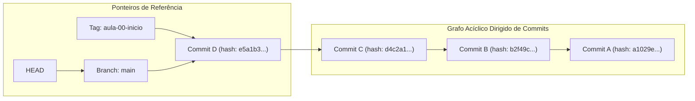

#### Definição, Motivação, Exemplo, Contraexemplo e Armadilhas

- **Definição:** Branches são referências móveis de 41 bytes gravadas em `.git/refs/heads/` que armazenam o hash do commit mais recente daquela linha de trabalho. Tags são referências fixas (estáticas) que ancoram um identificador textual indelével a um nó de commit específico.
- **Motivação:** O modelo distribuído assegura independência de conexão de rede para criação de ramificações, inspeção de diferenças e registros atômicos de evolução, permitindo colaboração concorrente sem risco de bloqueio central.
- **Exemplo:** Criação de tags anotadas ao encerramento de cada unidade didática (`git tag -a aula-00-inicio -m "Marco zero do projeto Suporte OS"`), criando checkpoints auditáveis de recuperação.
- **Contraexemplo:** Tratar o Git como ferramenta de envio em bloco ao fim do semestre, registrando commits massivos com centenas de arquivos alterados e mensagens opacas como "ajustes finais".
- **Armadilhas:** Versionamento de arquivos de configuração local de IDE (`.idea/`, `.vscode/`), diretórios de compilação binária (`target/`) ou credenciais sensíveis (`.env`). Uma vez gravado em um commit, um segredo integra o histórico criptográfico do DAG e sua remoção exige procedimentos intrusivos de reescrita de histórico (`git filter-repo`).

---

### Ecossistema da Plataforma Java: JVM, JRE, JDK e Bytecode

A plataforma Java adota uma estratégia de compilação híbrida para conferir portabilidade multiplataforma sem abrir mão de alto desempenho em tempo de execução. O código-fonte humano contido em arquivos `.java` é analisado pelo compilador (`javac`) e traduzido para um conjunto de instruções intermediárias de baixo nível denominado **bytecode**, estruturado em arquivos binários `.class`. O bytecode é completamente agnóstico em relação à arquitetura de silício ou sistema operacional hospedeiro.

A arquitetura da plataforma divide-se em três fronteiras concêntricas complementares:

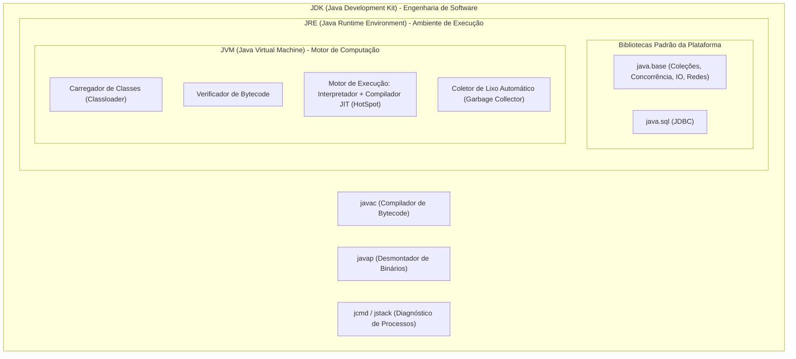

#### O Mecanismo da JVM e a Resolução no Sistema Operacional

A **JVM** opera internamente como uma máquina abstrata baseada em pilha (*stack-based virtual machine*). O código intermediário carrega dados para a pilha de operandos, executa computações aritméticas e retira resultados. Conforme determinados métodos atingem alta frequência de invocação ("hot spots"), o compilador *Just-In-Time* (JIT) traduz esses trechos dinamicamente para instruções de código de máquina nativo da CPU (`x86_64` ou `AArch64`), dispensando nova interpretação e maximizando a vazão de processamento.

Para que o sistema operacional localize as ferramentas e runtimes, duas variáveis de ambiente operam de forma orquestrada:
1. **`PATH`:** Lista ordenada de diretórios de sistema inspecionada sequencialmente pelo interpretador de comandos quando um binário é invocado no terminal. O primeiro executável correspondente localizado encerra a busca com sucesso.
2. **`JAVA_HOME`:** Variável de ambiente categórica que aponta de forma absoluta para o diretório raiz de instalação do JDK. É consumida diretamente por ferramentas corporativas de build (Maven, Gradle), IDEs e servidores de integração contínua para localizar módulos, compiladores e cabeçalhos internos.

- **Armadilha Crítica:** Desalinhamento entre `PATH` e `JAVA_HOME`. Se um instalador legado registrar uma JRE 8 no início do `PATH`, o comando `java -version` responderá Java 8, enquanto o Maven, lendo `JAVA_HOME`, invocará o compilador Java 21. Essa inconsistência provoca a clássica falha de carregamento:
```text
java.lang.UnsupportedClassVersionError: ... has been compiled by a more recent version of the Java Runtime (class file version 65.0), this version of the Java Runtime only recognizes class file versions up to 52.0
```

---

### Automação de Build e Reprodutibilidade com Apache Maven e Maven Wrapper

Em projetos corporativos, a compilação manual via `javac` torna-se inviável devido à teia de dependências transitivas, necessidade de isolamento entre código produtivo e testes, processamento de recursos e regras padronizadas de empacotamento. O **Apache Maven** atua como ferramenta de automação orientada pelo paradigma de **Convenção sobre Configuração** (*Convention over Configuration*). 

A topologia do projeto é padronizada pelo Maven:
- `src/main/java`: Classes de código-fonte de produção.
- `src/main/resources`: Configurações de tempo de execução (`application.properties`, changelogs do Liquibase).
- `src/test/java`: Códigos de testes unitários e de integração.
- `src/test/resources`: Parâmetros de infraestrutura isolados para a suíte de testes.
- `pom.xml`: Descritor declarativo em XML (*Project Object Model*).

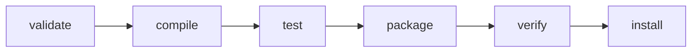

#### Ciclo de Vida e o Maven Wrapper (`mvnw`)

O ciclo de vida padrão do Maven (*default lifecycle*) é composto por fases ordenadas e interdependentes. Invocar uma fase posterior (como `package`) força a execução automática de todas as fases precedentes (`validate`, `compile`, `test`).

Para erradicar o problema crônico de disparidade de ambientes em equipes ("na minha máquina compila, na sua não"), a disciplina adota obrigatoriamente o **Maven Wrapper** (`mvnw` para ambientes Unix e `mvnw.cmd` para ambientes Windows):

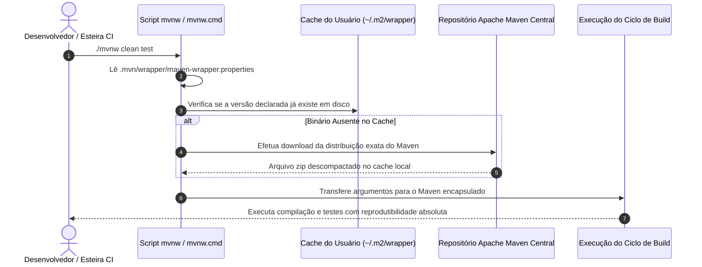

---

### Arquitetura Cliente-Servidor e Fundamentos do Protocolo HTTP

O modelo arquitetural cliente-servidor para sistemas web distribui responsabilidades entre dois papéis complementares através de redes baseadas na pilha TCP/IP:
1. **Cliente:** Agente ativo que inicia a conversação estabelecendo conexões de rede e despachando uma **requisição HTTP** (*request*).
2. **Servidor:** Processo passivo que escuta permanentemente em uma porta de rede definida (padrão `8080` no Spring Boot com Tomcat embutido), decodifica o payload recebido, executa a orquestração de negócios e retorna uma **resposta HTTP** (*response*).

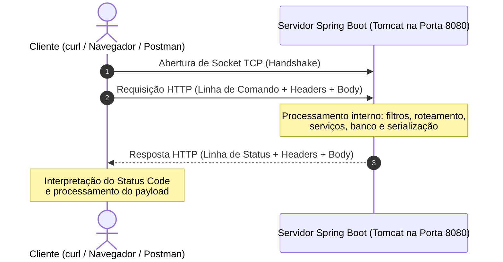

#### Anatomia da Mensagem HTTP (RFC 9110)

Uma mensagem HTTP opera estritamente em formato textual estruturado. Uma requisição divide-se em:
- **Linha de Comando (*Request Line*):** Método HTTP (`GET`, `POST`, `PUT`, `DELETE`), URI do recurso (`/api/produtos`) e versão do protocolo (`HTTP/1.1`).
- **Cabeçalhos da Requisição (*Headers*):** Metadados em formato chave-valor (`Host`, `Content-Type`, `Accept`, `Authorization`).
- **Linha em Branco:** Separador obrigatório composto pelo caractere CRLF (`\r\n`).
- **Corpo da Mensagem (*Body*):** Carga útil de dados transmitida (predominantemente em formato JSON), ausente em consultas simples.

A resposta devolvida pelo servidor espelha essa organização:
- **Linha de Status (*Status Line*):** Versão do protocolo (`HTTP/1.1`), Código de Status numérico (`200`, `201`, `400`, `404`) e Frase de Motivo textual descritiva (`OK`, `Created`, `Bad Request`).
- **Cabeçalhos de Resposta (*Headers*):** Metadados emitidos pelo servidor (`Location`, `Content-Type`, `Date`).
- **Linha em Branco:** Separador CRLF.
- **Corpo da Resposta (*Body*):** Representação textual serializada do resultado ou mensagem de erro.

---

### Princípios da Arquitetura REST e Modelagem de Recursos

**REST** (*Representational State Transfer*) é um estilo arquitetural formulado por Roy Fielding que define restrições formais para a criação de sistemas hipermídia distribuídos e escaláveis.

#### As Seis Restrições Arquiteturais do REST

1. **Arquitetura Cliente-Servidor:** Isolamento estrito entre a interface de interação (consumidores) e os mecanismos de armazenamento e regras (provedor).
2. **Stateless (Sem Estado):** Cada requisição enviada pelo cliente deve carregar todas as informações contextuais indispensáveis para que o servidor consiga processá-la com sucesso. O servidor não retém o estado de sessão do cliente na memória entre requisições.
3. **Cacheabilidade (*Cacheable*):** Respostas devem categorizar-se explicitamente como passíveis de cache ou não, prevenindo tráfego desnecessário na rede.
4. **Interface Uniforme:** A comunicação é padronizada através da identificação unívoca de recursos por URIs substantivas, manipulação de recursos por meio de representações (JSON) e mensagens autodescritivas.
5. **Sistema em Camadas (*Layered System*):** O cliente não possui visibilidade se está comunicando-se diretamente com o nó final de aplicação, com um balanceador de carga ou com um gateway de segurança.
6. **Código sob Demanda (*Code on Demand* - Opcional):** Capacidade de estender funcionalidades do cliente transferindo código executável.

#### Segurança e Idempotência de Métodos HTTP

A especificação RFC 9110 define dois conceitos fundamentais para a semântica da Web:
- **Método Seguro (*Safe Method*):** A execução da operação não acarreta nenhuma alteração de estado perceptível no servidor. Trata-se estritamente de operações de leitura (`GET`, `HEAD`).
- **Método Idempotente (*Idempotent Method*):** A execução repetida de múltiplas requisições idênticas consecutivas produz o mesmo efeito observável no estado final do servidor que a execução de uma única requisição:

```math
f(f(x)) = f(x)
```

`GET`, `PUT` e `DELETE` são métodos inerentemente idempotentes. O método `POST` **não é idempotente**, pois submeter múltiplos disparos de criação gerará múltiplos registros distintos ou falhas sequenciais de chave única duplicada.

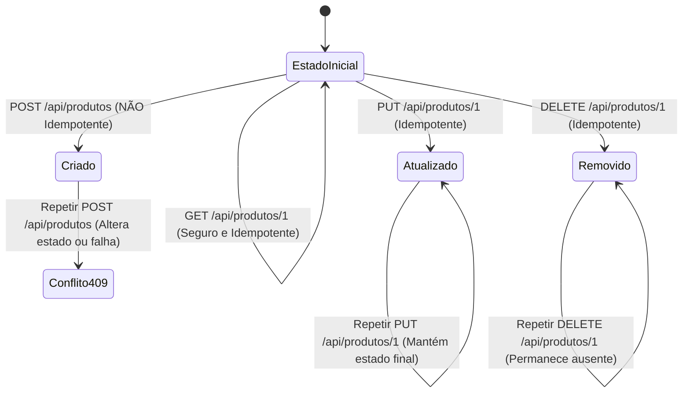

---

### Arquitetura em Camadas e Inversão de Controle no Spring Boot

Para impedir o acoplamento desordenado entre preocupações de transporte de rede, regras de negócio e acesso a disco, o Spring Boot adota uma divisão formal em camadas funcionais:

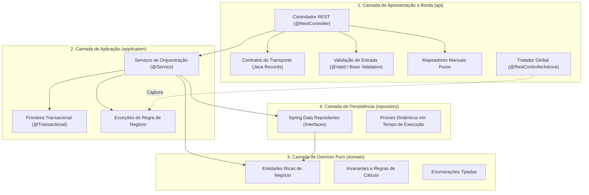

#### Inversão de Controle (IoC) e Injeção de Dependências por Construtor

No desenvolvimento estruturado tradicional, uma classe que necessita de um serviço secundário instancia sua dependência diretamente utilizando a palavra-chave `new`, amarrando sua execução a uma implementação concreta. Sob a **Inversão de Controle (IoC)**, a responsabilidade de instanciar, configurar e conectar as classes é transferida da própria classe para o contêiner de infraestrutura do Spring (*ApplicationContext*). Os objetos gerenciados pelo contêiner são formalmente denominados **Spring Beans**.

A **Injeção de Dependências (DI)** é o padrão que concretiza o princípio de IoC. A disciplina estabelece como regra mandatória o uso de **injeção estrita por construtor**, rejeitando terminantemente anotações `@Autowired` soltas sobre campos privados:

```java
@Service
public class ProdutoService {

    private final ProdutoRepository produtoRepository;
    private final GrupoProdutoRepository grupoProdutoRepository;

    // Injeção de dependência via construtor declarativo e imutável
    public ProdutoService(ProdutoRepository produtoRepository, GrupoProdutoRepository grupoProdutoRepository) {
        this.produtoRepository = produtoRepository;
        this.grupoProdutoRepository = grupoProdutoRepository;
    }
}
```

*Vantagens Arquiteturais:*
- **Imutabilidade Real:** Permite a utilização da palavra-chave `final` nos atributos da classe, garantindo que as referências sejam atribuídas unicamente no momento da instanciação.
- **Detecção Fail-Fast:** Casos de dependência circular são identificados instantaneamente durante a compilação do grafo de dependências no boot da aplicação.
- **Testabilidade Desacoplada:** Facilita a escrita de testes unitários isolados, viabilizando a instanciação manual do serviço fornecendo classes simuladas (*mocks* ou instâncias reais de teste) sem exigir a subida onerosa do contêiner Spring.

---

### Modelagem de Domínio Rico e Encapsulamento de Invariantes em Java Puro

Uma das falhas mais perniciosas na engenharia de sistemas é o anti-padrão denominado **Modelo de Domínio Anêmico** (*Anemic Domain Model*), no qual as classes representativas do negócio consistem em repositórios de dados passivos, repletos de métodos modificadores públicos (`setters`) desprovidos de validação. Toda a lógica de negócio acaba espalhada de forma procedural em classes de serviço.

No projeto `suporteos2026`, adotamos o **Modelo de Domínio Rico** (*Rich Domain Model*):
- O objeto de domínio assume a responsabilidade indelegável de proteger sua integridade interna.
- Invariantes de negócio são predicados lógicos que devem manter-se rigorosamente válidos durante todo o ciclo de vida da instância. Se um produto não pode ter saldo de estoque negativo, a própria entidade `Produto` barra mutações inconsistentes.
- A criação de instâncias inválidas é impedida na origem por meio de **construtores ricos de negócio** que validam obrigatoriedade, formato e nulidade de argumentos.
- Mutadores semânticos (`receberEstoque`, `retirarEstoque`, `inativar`) substituem *setters* genéricos.

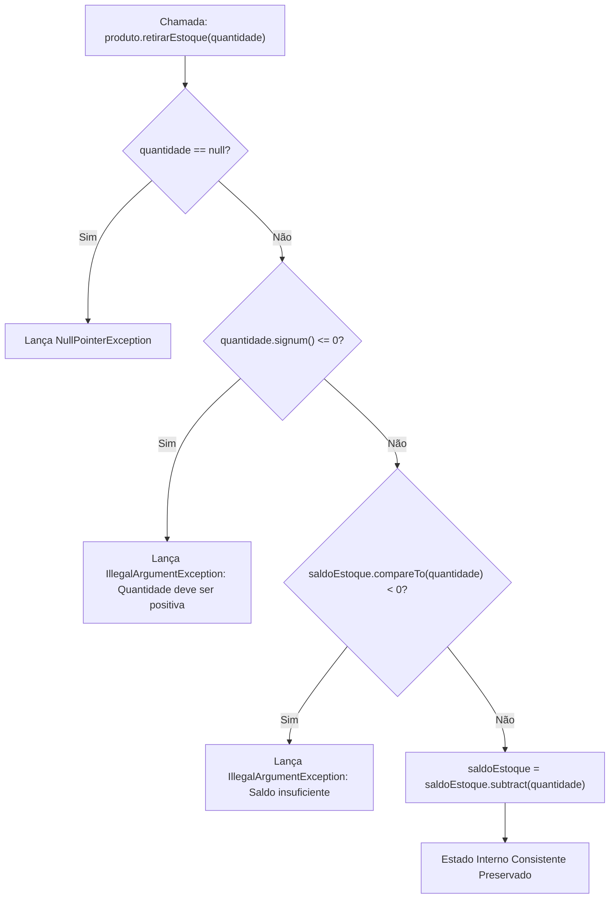

#### Distinção entre Entidades e Objetos de Valor (Value Objects)

- **Entidade (`Entity`):** Possui continuidade de identidade explícita ao longo do tempo. Dois produtos com os mesmos valores de descrição e preço são entidades distintas caso possuam chaves primárias ou códigos de barras diferentes. Inversamente, se a descrição mudar, o produto preserva sua identidade.
- **Objeto de Valor (`Value Object`):** Elemento concebido para quantificar ou descrever características, desprovido de identificador persistente próprio. É definido exclusivamente pela totalidade dos seus atributos e é intrinsecamente imutável. Dois objetos de valor com campos idênticos são intercambiáveis (exemplo: `BigDecimal`, `LocalDate`, `Status`).

---

### Aritmética de Alta Precisão e Representação Monetária com BigDecimal

Os tipos primitivos `float` (32 bits) e `double` (64 bits) do Java implementam o padrão aritmético de ponto flutuante binário IEEE 754. Esses tipos operam com base de potências de dois e foram otimizados para processamento gráfico e cálculos científicos, nos quais pequenas aproximações são perfeitamente toleradas em troca de velocidade na Unidade de Ponto Flutuante (FPU).

Em sistemas corporativos, fiscais e de controle de estoque, o emprego de `double` ou `float` é terminantemente inaceitável. Na aritmética binária, frações decimais elementares como $`0.1`$ ou $`0.2`$ não possuem representação finita exata, convertendo-se em dízimas periódicas que geram erros cumulativos de arredondamento:

```java
double v1 = 0.1;
double v2 = 0.2;
System.out.println(v1 + v2); // Imprime: 0.30000000000000004
```

A classe `java.math.BigDecimal` resolve a discrepância ao fornecer representação decimal exata com precisão arbitrária. Sua estrutura interna baseia-se em um inteiro de precisão infinita (`BigInteger` não escalonado) e um valor inteiro de 32 bits que representa a escala (`scale`), indicando quantas casas decimais o número possui:

```math
\text{Valor} = \text{unscaledValue} \times 10^{-\text{scale}}
```

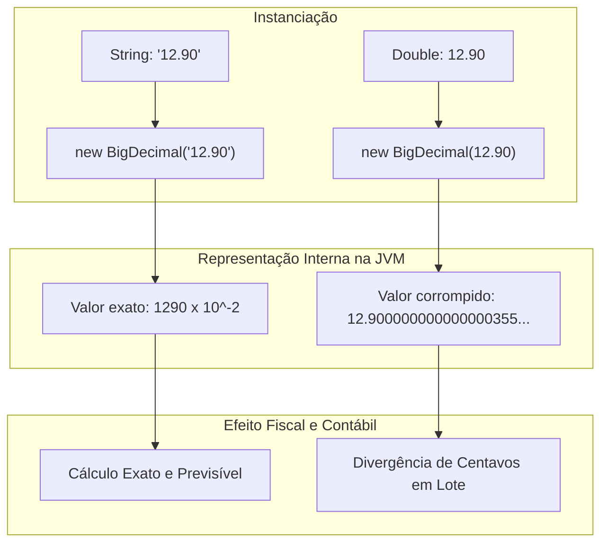

#### Regras Mandatórias de Uso do BigDecimal

1. **Construção estritamente via String:** Jamais utilize o construtor `new BigDecimal(double)`. Utilize `new BigDecimal("12.90")` ou `BigDecimal.valueOf(12.90)`.
2. **Definição de Escala e Arredondamento:** Operações de multiplicação e divisão exigem truncamento ou arredondamento controlado via `.setScale(escala, RoundingMode.HALF_UP)`.
3. **Comparação de Valores (`compareTo` vs `equals`):** O método `.equals()` compara o valor numérico e a escala. Logo, `new BigDecimal("10.0").equals(new BigDecimal("10.00"))` retorna **`false`**. Para avaliar igualdade matemática em regras de negócio e testes automatizados, utilize sempre `a.compareTo(b) == 0`.

---

### Associação Bidirecional 1:N e Integridade Referencial em Memória

No paradigma relacional, uma associação 1:N entre tabelas (`grupo_produto` e `produto`) é resolvida de forma unidirecional simples: a tabela subordinada armazena uma chave estrangeira (`grupo_produto_id`) apontando para a chave primária da tabela pai.

No paradigma orientado a objetos, associações bidirecionais exigem que ambos os lados participantes conheçam seus pares correspondentes:
- `GrupoProduto` contém uma lista de referências em memória: `List<Produto> produtos`.
- Cada `Produto` retém um ponteiro para o seu grupo agrupador: `GrupoProduto grupo`.

Se a manipulação dessas referências for deixada desprotegida, o sistema cairá em inconsistência mútua (um produto aponta para um grupo, mas o grupo não lista o produto).

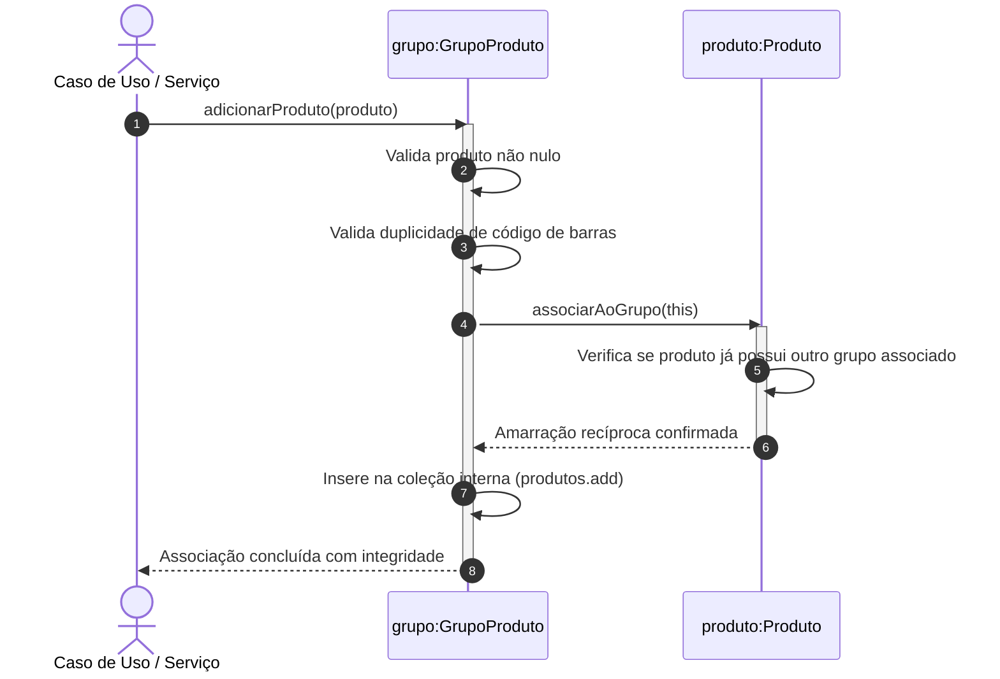

#### Blindagem da Associação

Para assegurar consistência indelével:
1. **Ponto Único de Entrada:** O método `adicionarProduto(Produto produto)` em `GrupoProduto` atua como o único canal público autorizado para compor a relação.
2. **Visibilidade de Pacote:** O método `associarAoGrupo(GrupoProduto grupo)` em `Produto` recebe nível de acesso protegido de pacote (*package-private*), impedindo que clientes externos forcem amarrações fora do fluxo coordenado do grupo.
3. **Coleções Não Modificáveis:** O método de leitura `getProdutos()` em `GrupoProduto` jamais expõe a referência direta da lista interna. Retorna-se `Collections.unmodifiableList(this.produtos)`. Se agentes externos tentarem invocar `.add()` ou `.clear()` diretamente sobre a lista retornada, a JVM lançará imediatamente `UnsupportedOperationException`.

---

### Pilha de Persistência Relacional e o Desencontro Objeto-Relacional

Persistir dados consiste em garantir que o estado dos objetos sobreviva ao término da execução do processo da JVM. Em sistemas corporativos modernos baseados em Spring Boot, a persistência relacional assenta-se sobre uma pilha de abstrações complementares:

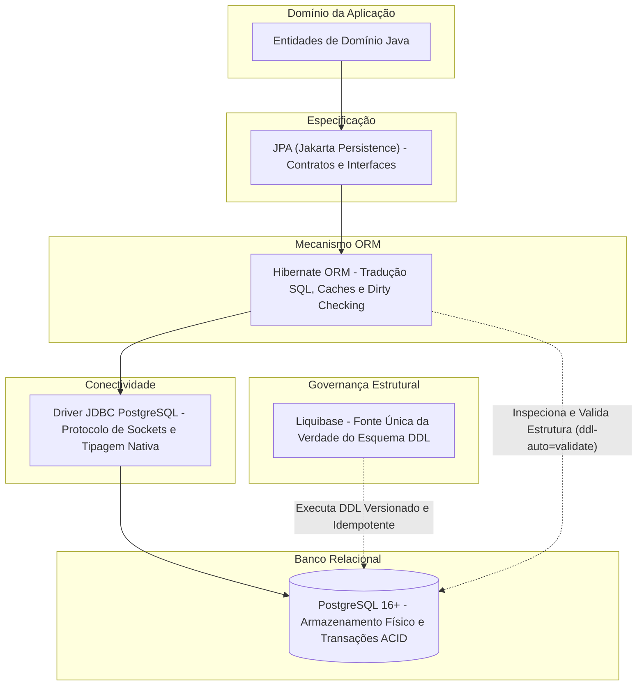

#### O Desencontro de Impedância Objeto-Relacional

O desencontro de impedância (*Object-Relational Impedance Mismatch*) decorre da dissonância entre dois paradigmas matemáticos fundamentais:
- **Paradigma Orientado a Objetos:** Governa-se por princípios de encapsulamento, identidade por instância/ponteiro em memória, polimorfismo e navegação através de grafos direcionados de referências.
- **Paradigma Relacional:** Governa-se pela teoria dos conjuntos e lógica de predicados, operando sobre relações (tabelas), tuplas (linhas), atributos atômicos (colunas) e integridade governada por chaves primárias e estrangeiras.

| Dimensão da Impedância | Paradigma Orientado a Objetos | Paradigma Relacional | Solução de Engenharia Adotada |
|---|---|---|---|
| **Granularidade** | Tipos ricos como `BigDecimal`, `LocalDate` e enums | Tipos escalares como `NUMERIC(18,2)` e `DATE` | Mapeamento explícito via `@Column` e `@Enumerated(EnumType.STRING)` |
| **Identidade** | Identidade por referência de memória (`a == b`) ou semântica | Identidade baseada em Chave Primária (`PRIMARY KEY`) | Identificadores com `@Id` e geração incremental controlada |
| **Navegabilidade** | `GrupoProduto` mantém uma lista direta de `Produto` | `produto` contém a FK `grupo_produto_id` apontando para o pai | Mapeamento bidirecional `@OneToMany(mappedBy="grupo")` e `@ManyToOne` |
| **Encapsulamento** | Métodos protegem o estado contra acessos ilegais | Linhas e colunas completamente acessíveis via comandos `SELECT` | Hibernate acessa propriedades via reflexão; DDL possui constraints |

---

### Migrações Declarativas e Versionamento de Banco de Dados com Liquibase

A abordagem empírica de confiar na propriedade `spring.jpa.hibernate.ddl-auto=update` para criar ou alterar tabelas automaticamente é proibida na disciplina. O Hibernate não possui rastreabilidade de histórico, falha ao aplicar renomeações de colunas e não oferece garantias de idempotência para esteiras de integração contínua (CI/CD).

A evolução estrutural do banco relacional é assumida pelo **Liquibase**, uma ferramenta de migração de banco baseada em arquivos declarativos versionados em formato YAML.

```math
\text{Estado Final do Esquema} = S_0 + \sum_{i=1}^{n} \Delta M_i
```

O Liquibase mantém o controle da integridade do banco através de duas tabelas internas de metadados criadas automaticamente no esquema público:
1. **`databasechangeloglock`:** Semáforo distribuído composto por uma linha booleana (`locked`). Garante que apenas uma réplica da aplicação execute migrações por vez, impedindo condições de corrida quando múltiplos nós iniciam em paralelo.
2. **`databasechangelog`:** Registro append-only de todas as migrações já executadas. Cada bloco de alteração (*changeSet*) é identificado pela tríade unívoca:

```math
\text{Identidade do ChangeSet} = (\text{id}, \text{author}, \text{filename})
```

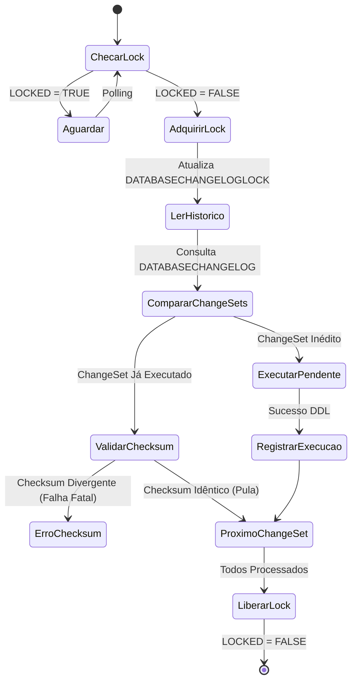

- **Regra Fundamental de Imutabilidade:** Jamais altere o conteúdo estrutural de um `changeSet` que já foi executado em ambiente compartilhado. Qualquer modificação alterará o hash MD5/SHA recalculado pelo Liquibase, gerando a falha irrecuperável `Validation Failed: Checksum Check Failed`. Mutações de esquema exigem obrigatoriamente a criação de um **novo** `changeSet` incremental.

---

### Isolamento de Ambientes, Perfis do Spring e Paridade com PostgreSQL

A disciplina estabelece uma diretriz rigorosa: **o uso de bancos de dados em memória (como o H2) é terminantemente proibido**, inclusive para testes automatizados. O H2 possui dialeto SQL distinto, gerencia transações concorrentes de forma simplificada e omite peculiaridades cruciais do PostgreSQL (como comportamento de locks de catálogo e tipos decimais de precisão exata).

O isolamento é alcançado via perfis do Spring Framework (`Spring Profiles`), garantindo paridade tecnológica estrita:
- **`dev` (`application-dev.properties`):** Aponta para a base local `suporteos2026_dev`. Habilita formatação de consultas SQL no console para apoio ao desenvolvimento manual.
- **`test` (`application-test.properties`):** Aponta para a base isolada `suporteos2026_test`. Cada execução da suíte de testes com `@SpringBootTest` e `@ActiveProfiles("test")` roda contra um PostgreSQL real, sem risco de corrupção ou colisão com os dados inseridos manualmente no perfil de desenvolvimento.
- **`prod` (`application-prod.properties`):** Perfil de produção, onde credenciais e URLs são injetadas exclusivamente via variáveis de ambiente da infraestrutura de hospedagem.

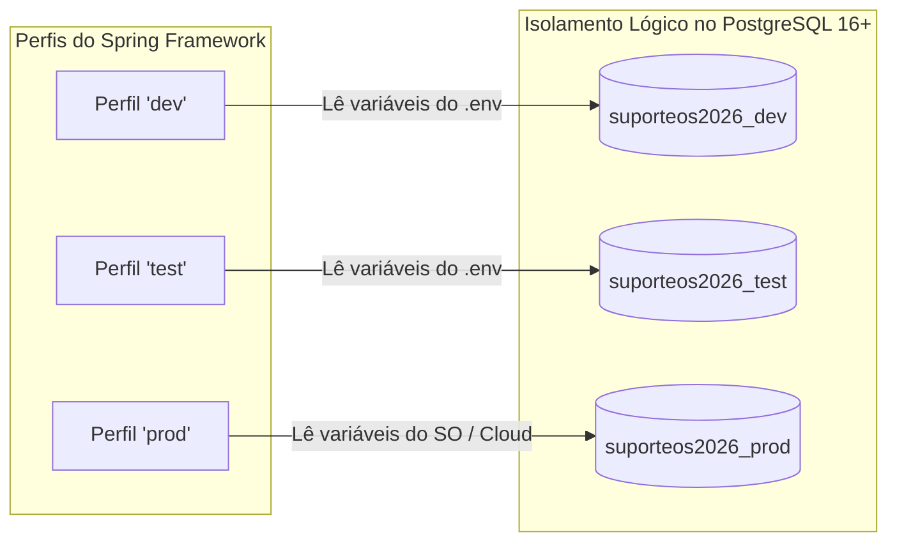

---

### Spring Data JPA, Repositórios e Proxies Dinâmicos

No ecossistema corporativo moderno, o padrão *Repository* do Domain-Driven Design (DDD) é implementado de forma altamente produtiva através do **Spring Data JPA**. Em vez de exigir a escrita de classes concretas manuais com dezenas de chamadas imperativas ao `EntityManager`, o engenheiro de software declara apenas uma interface pública estendendo `JpaRepository<T, ID>`.

Durante a fase de inicialização da aplicação (*bootstrap*):
1. O Spring varre as interfaces filhas de `Repository`.
2. Para cada interface, o mecanismo de **Java Dynamic Proxies** instancia um objeto proxy em memória acoplado à classe interna `SimpleJpaRepository<T, ID>`.
3. O proxy intercepta as chamadas aos métodos genéricos (`save`, `findById`, `findAll`, `deleteById`) e os encaminha ao `EntityManager` associado à transação.
4. O analisador sintático processa os **Derived Query Methods** (consultas derivadas), decompondo o nome do método a partir da partícula `By` para compilar instruções canônicas JPQL (*Java Persistence Query Language*).

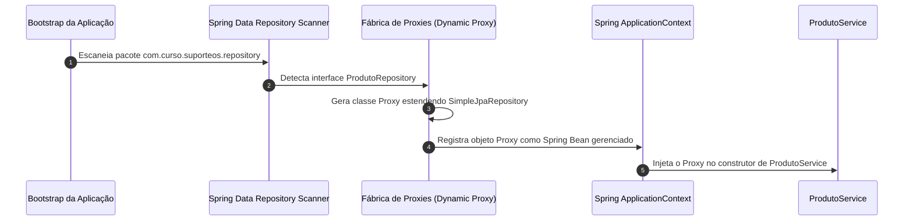

---

### Fronteiras Transacionais, ACID e Ciclo de Vida das Entidades JPA

Uma transação lógica de banco de dados representa uma unidade indivisível de trabalho orientada pelos princípios **ACID** (Atomicidade, Consistência, Isolamento e Durabilidade). A fronteira transacional da aplicação deve residir **exclusivamente na camada de serviços** (`@Service`), através da anotação `@Transactional`.

Se a demarcação transacional fosse delegada aos repositórios, cada método de persistência abriria e fecharia transações pontuais e efêmeras. Um caso de uso de negócio que envolva múltiplas etapas (como verificar chave única, buscar grupo, salvar produto e baixar saldo) ficaria fragmentado, inviabilizando o *rollback* em bloco caso a última etapa falhasse.

#### Estados do Ciclo de Vida das Entidades JPA

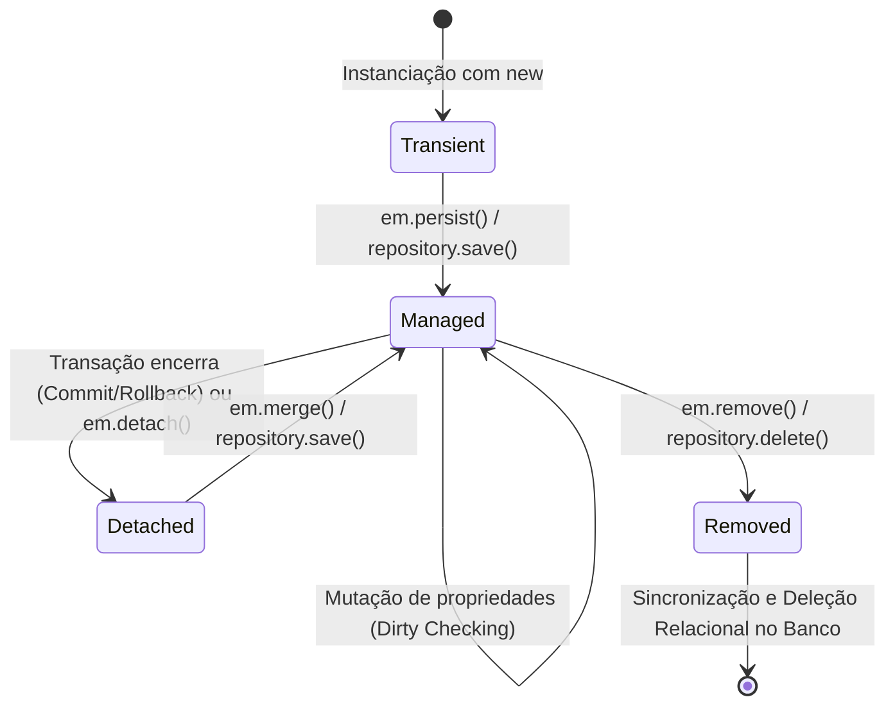

- **`Transient`:** O objeto foi instanciado em memória via `new`. Não possui identificador persistente e não é acompanhado pelo contexto de persistência.
- **`Managed`:** A entidade está ativamente monitorada pelo `EntityManager`. Alterações feitas em seus atributos através de métodos de negócio são rastreadas pelo mecanismo de **Dirty Checking** do Hibernate e sincronizadas automaticamente no banco com instruções SQL `UPDATE` durante o encerramento da transação, sem necessidade de reexecutar `save()`.
- **`Detached`:** A entidade possui chave primária, mas sua sessão transacional foi finalizada ou desconectada. Acesso a propriedades preguiçosas (*lazy properties*) nesse estado dispara a clássica `LazyInitializationException`.
- **`Removed`:** A entidade foi marcada para exclusão física e será removida do banco no fechamento da transação.

#### Otimização com readOnly = true

Anotar consultas com `@Transactional(readOnly = true)` desativa os snapshots de *dirty checking* no Hibernate, economizando alocação substancial de memória heap e permitindo que o driver JDBC redirecione leituras para réplicas de leitura em bancos distribuídos.

---

### Evolução Segura de Esquema pelo Padrão Expand-Migrate-Contract

Alterar o esquema de um banco de dados em produção contendo milhões de registros exige uma engenharia cuidadosa para evitar indisponibilidade e corrupção de dados. A tentativa de adicionar diretamente uma coluna obrigatória (`NOT NULL`) sobre uma tabela populada provoca a rejeição imediata da instrução DDL pelo PostgreSQL:

```text
ERROR: column "estoque_minimo" contains null values
```

Para superar esse desafio, a engenharia corporativa emprega o padrão **Expand-Migrate-Contract**:

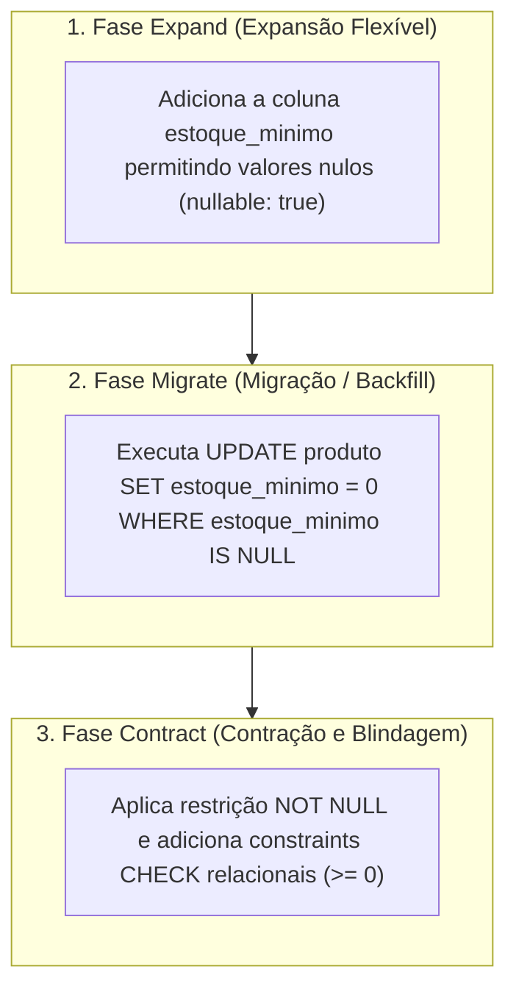

- **Fase Expand:** O esquema é expandido de forma permissiva, introduzindo o novo campo como opcional.
- **Fase Migrate:** Os dados legados pré-existentes passam por rotinas de saneamento e preenchimento retroativo (*data backfill*).
- **Fase Contract:** A coluna é formalmente contraída com a aplicação de restrições de obrigatoriedade (`addNotNullConstraint`) e validações de regras matemáticas (`addCheckConstraint`).

---

### DTOs Imutáveis com Java Records e Validação com Jakarta Bean Validation

A exposição direta de classes anotadas com `@Entity` na camada de controladores REST constitui uma severa falha de arquitetura:
1. **Acoplamento Indesejado:** Qualquer alteração no esquema relacional ou na nomenclatura de colunas quebra unilateralmente o contrato público com os clientes da API.
2. **Loops de Serialização Bidirecional:** A serialização JSON de associações bidirecionais (como `GrupoProduto.produtos` e `Produto.grupo`) provoca chamadas recursivas infinitas, resultando em `StackOverflowError`.
3. **Ataques de Atribuição em Massa (*Mass Assignment*):** Um usuário malicioso pode injetar atributos proibidos no corpo do JSON (ex.: `status: "ATIVO"`, `saldoEstoque: 99999`) que, se aceitos diretamente na entidade, adulteram dados protegidos do sistema.

A disciplina adota **Java Records** como DTOs (*Data Transfer Objects*):

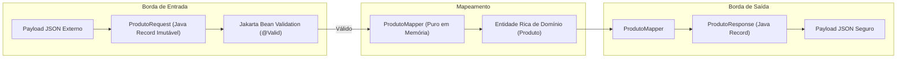

#### Defesa em Profundidade nas Validações

- **Borda da API (Jakarta Bean Validation):** Focada na sintaxe e formato estrutural da requisição (`@NotBlank`, `@NotNull`, `@Positive`, `@Size`). Barram o erro imediatamente antes que ele atinja a lógica de aplicação.
- **Núcleo de Domínio (Invariantes em Java Puro):** Focado na consistência indelével das regras de negócio (cálculos de estoque, garantias de não-negatividade e dependências mútuas).

---

### Tratamento Global Padronizado de Exceções com RestControllerAdvice

Em vez de poluir os métodos de controle com blocos defensivos `try/catch`, adota-se um interceptador centralizado de exceções anotado com `@RestControllerAdvice`. Esse componente atua interceptando as exceções que cruzam a fronteira da camada de aplicação e as traduz em um formato corporativo padronizado denominado **`ApiError`**.

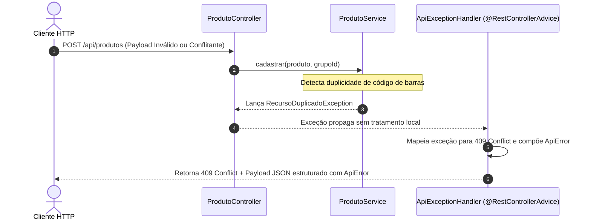

O payload de erro corporativo padronizado fornece ao cliente todas as informações necessárias para diagnóstico sem expor stack traces sensíveis:
- `timestamp`: Momento exato em que a falha foi capturada.
- `status`: Código numérico do status HTTP (`400`, `404`, `409`, `500`).
- `error`: Descrição textual formal da categoria do erro.
- `message`: Mensagem negocial clara e compreensível para o usuário final.
- `path`: URI específica interceptada durante o processamento.
- `validationErrors`: Mapa estruturado detalhando campos inválidos e mensagens de restrição em caso de falhas de Bean Validation.

---

## Sintaxe e Exemplos Práticos

### Modelagem de Entidades Ricas em Java Puro

A implementação de `Produto` exemplifica o modelo de domínio rico: ausência de *setters*, campos imutáveis marcados como `final`, construtor de negócio que valida invariantes e métodos semânticos para transições de estado.

```java
package com.curso.suporteos.domain;

import java.math.BigDecimal;
import java.math.RoundingMode;
import java.time.LocalDate;
import java.util.Objects;

public class Produto {

    private final String codigoBarras;
    private String descricao;
    private BigDecimal saldoEstoque;
    private BigDecimal valorUnitario;
    private BigDecimal estoqueMinimo;
    private final LocalDate dataCadastro;
    private Status status;
    private GrupoProduto grupo;

    // Construtor canônico de negócio que blinda as invariantes
    public Produto(String codigoBarras, String descricao, BigDecimal saldoEstoque, 
                   BigDecimal valorUnitario, BigDecimal estoqueMinimo, GrupoProduto grupo) {
        this.codigoBarras = validarTextoObrigatorio(codigoBarras, "Código de barras é obrigatório");
        this.descricao = validarTextoObrigatorio(descricao, "Descrição é obrigatória");
        this.saldoEstoque = validarNaoNegativo(saldoEstoque, "Saldo de estoque não pode ser negativo");
        this.valorUnitario = validarNaoNegativo(valorUnitario, "Valor unitário não pode ser negativo");
        this.estoqueMinimo = validarNaoNegativo(estoqueMinimo, "Estoque mínimo não pode ser negativo");
        this.dataCadastro = LocalDate.now();
        this.status = Status.ATIVO;
        this.grupo = Objects.requireNonNull(grupo, "Grupo de produto é obrigatório");
    }

    public void receberEstoque(BigDecimal quantidade) {
        validarPositivo(quantidade, "Quantidade recebida deve ser maior que zero");
        this.saldoEstoque = this.saldoEstoque.add(quantidade);
    }

    public void retirarEstoque(BigDecimal quantidade) {
        validarPositivo(quantidade, "Quantidade retirada deve ser maior que zero");
        if (this.saldoEstoque.compareTo(quantidade) < 0) {
            throw new IllegalArgumentException("Saldo de estoque insuficiente para atender a retirada");
        }
        this.saldoEstoque = this.saldoEstoque.subtract(quantidade);
    }

    public BigDecimal calcularValorEstoque() {
        return this.saldoEstoque.multiply(this.valorUnitario).setScale(2, RoundingMode.HALF_UP);
    }

    public void inativar() {
        this.status = Status.INATIVO;
    }

    public void ativar() {
        this.status = Status.ATIVO;
    }

    // Visibilidade de pacote: amarrado estritamente através de GrupoProduto.adicionarProduto()
    void associarAoGrupo(GrupoProduto grupo) {
        this.grupo = Objects.requireNonNull(grupo, "Grupo não pode ser nulo");
    }

    private static String validarTextoObrigatorio(String valor, String mensagem) {
        if (valor == null || valor.isBlank()) {
            throw new IllegalArgumentException(mensagem);
        }
        return valor.trim();
    }

    private static BigDecimal validarNaoNegativo(BigDecimal valor, String mensagem) {
        Objects.requireNonNull(valor, mensagem);
        if (valor.signum() < 0) {
            throw new IllegalArgumentException(mensagem);
        }
        return valor;
    }

    private static void validarPositivo(BigDecimal valor, String mensagem) {
        Objects.requireNonNull(valor, mensagem);
        if (valor.signum() <= 0) {
            throw new IllegalArgumentException(mensagem);
        }
    }

    public String getCodigoBarras() { return codigoBarras; }
    public String getDescricao() { return descricao; }
    public BigDecimal getSaldoEstoque() { return saldoEstoque; }
    public BigDecimal getValorUnitario() { return valorUnitario; }
    public BigDecimal getEstoqueMinimo() { return estoqueMinimo; }
    public LocalDate getDataCadastro() { return dataCadastro; }
    public Status getStatus() { return status; }
    public GrupoProduto getGrupo() { return grupo; }
}
```

---

### Mapeamento Objeto-Relacional com Jakarta Persistence

A classe `Produto` mapeada com Jakarta Persistence para persistência no PostgreSQL:

```java
package com.curso.suporteos.domain;

import jakarta.persistence.Column;
import jakarta.persistence.Entity;
import jakarta.persistence.EnumType;
import jakarta.persistence.Enumerated;
import jakarta.persistence.FetchType;
import jakarta.persistence.ForeignKey;
import jakarta.persistence.GeneratedValue;
import jakarta.persistence.GenerationType;
import jakarta.persistence.Id;
import jakarta.persistence.JoinColumn;
import jakarta.persistence.ManyToOne;
import jakarta.persistence.Table;
import jakarta.persistence.UniqueConstraint;
import java.math.BigDecimal;
import java.time.LocalDate;

@Entity
@Table(
    name = "produto",
    uniqueConstraints = @UniqueConstraint(
        name = "uk_produto_codigo_barras",
        columnNames = "codigo_barras"
    )
)
public class Produto {

    @Id
    @GeneratedValue(strategy = GenerationType.IDENTITY)
    private Long id;

    @Column(name = "codigo_barras", nullable = false, length = 50, updatable = false)
    private String codigoBarras;

    @Column(nullable = false, length = 150)
    private String descricao;

    @Column(name = "saldo_estoque", nullable = false, precision = 18, scale = 3)
    private BigDecimal saldoEstoque;

    @Column(name = "valor_unitario", nullable = false, precision = 18, scale = 2)
    private BigDecimal valorUnitario;

    @Column(name = "estoque_minimo", nullable = false, precision = 18, scale = 3)
    private BigDecimal estoqueMinimo;

    @Column(name = "data_cadastro", nullable = false, updatable = false)
    private LocalDate dataCadastro;

    @Enumerated(EnumType.STRING)
    @Column(nullable = false, length = 20)
    private Status status;

    @ManyToOne(fetch = FetchType.LAZY, optional = false)
    @JoinColumn(
        name = "grupo_produto_id",
        nullable = false,
        foreignKey = @ForeignKey(name = "fk_produto_grupo_produto")
    )
    private GrupoProduto grupo;

    @ManyToOne(fetch = FetchType.LAZY)
    @JoinColumn(
        name = "fornecedor_id",
        foreignKey = @ForeignKey(name = "fk_produto_fornecedor")
    )
    private Fornecedor fornecedor;

    // Construtor sem argumentos exigido pela especificação JPA para reidratação reflexiva
    protected Produto() {
    }

    public Long getId() { return id; }
    public String getCodigoBarras() { return codigoBarras; }
    public String getDescricao() { return descricao; }
    public BigDecimal getSaldoEstoque() { return saldoEstoque; }
    public BigDecimal getValorUnitario() { return valorUnitario; }
    public BigDecimal getEstoqueMinimo() { return estoqueMinimo; }
    public LocalDate getDataCadastro() { return dataCadastro; }
    public Status getStatus() { return status; }
    public GrupoProduto getGrupo() { return grupo; }
    public Fornecedor getFornecedor() { return fornecedor; }
}
```

---

### Changelogs Estruturados em YAML com Liquibase

O arquivo mestre `db.changelog-master.yaml` orquestra a aplicação atômica e ordenada dos changelogs incrementais:

```yaml
databaseChangeLog:
  - include:
      file: db/changelog/migrations/001-create-grupo-produto.yaml
  - include:
      file: db/changelog/migrations/002-create-produto.yaml
  - include:
      file: db/changelog/migrations/003-fornecedor-e-estoque-minimo.yaml
```

Aplicação do padrão **Expand-Migrate-Contract** para introdução segura do campo `estoque_minimo` em `003-fornecedor-e-estoque-minimo.yaml`:

```yaml
databaseChangeLog:
  # 1. EXPAND: Adiciona a coluna permitindo valores nulos temporariamente
  - changeSet:
      id: 003-1-add-column-estoque-minimo
      author: jefferson.passerini
      changes:
        - addColumn:
            tableName: produto
            columns:
              - column:
                  name: estoque_minimo
                  type: numeric(18, 3)
      rollback:
        - dropColumn:
            tableName: produto
            columnName: estoque_minimo

  # 2. MIGRATE: Realiza o backfill preenchendo dados legados com o valor neutro 0
  - changeSet:
      id: 003-2-backfill-estoque-minimo
      author: jefferson.passerini
      changes:
        - update:
            tableName: produto
            columns:
              - column:
                  name: estoque_minimo
                  valueNumeric: 0
            where: estoque_minimo IS NULL
      rollback:
        - empty: {}

  # 3. CONTRACT: Torna a coluna formalmente NOT NULL e adiciona a constraint CHECK
  - changeSet:
      id: 003-3-contract-estoque-minimo
      author: jefferson.passerini
      changes:
        - addNotNullConstraint:
            tableName: produto
            columnName: estoque_minimo
            columnDataType: numeric(18, 3)
        - addCheckConstraint:
            tableName: produto
            constraintName: ck_produto_estoque_minimo
            checkConstraint: estoque_minimo >= 0
      rollback:
        - dropCheckConstraint:
            tableName: produto
            constraintName: ck_produto_estoque_minimo
        - dropNotNullConstraint:
            tableName: produto
            columnName: estoque_minimo
            columnDataType: numeric(18, 3)
```

---

### Consultas Derivadas em Interfaces Spring Data JPA

```java
package com.curso.suporteos.repository;

import com.curso.suporteos.domain.Produto;
import com.curso.suporteos.domain.Status;
import org.springframework.data.jpa.repository.JpaRepository;
import org.springframework.stereotype.Repository;
import java.math.BigDecimal;
import java.util.List;
import java.util.Optional;

@Repository
public interface ProdutoRepository extends JpaRepository<Produto, Long> {

    // Busca exata por código de barras com retorno protegido por Optional
    Optional<Produto> findByCodigoBarras(String codigoBarras);

    // Verificação de existência sem sobrecarga de carga de entidade
    boolean existsByCodigoBarras(String codigoBarras);

    // Travessia de propriedade: acessa o atributo 'id' dentro do objeto relacionado 'grupo'
    List<Produto> findByGrupoId(Long grupoId);

    // Filtro por enum de status ordenado deterministicamente por descrição
    List<Produto> findByStatusOrderByDescricaoAsc(Status status);

    // Filtro por valor de corte com operador relacional
    List<Produto> findBySaldoEstoqueLessThanEqual(BigDecimal limite);
}
```

---

### Serviço Transacional com Orquestração e Exceções de Aplicação

```java
package com.curso.suporteos.application;

import com.curso.suporteos.application.exception.RecursoDuplicadoException;
import com.curso.suporteos.application.exception.RecursoNaoEncontradoException;
import com.curso.suporteos.domain.GrupoProduto;
import com.curso.suporteos.domain.Produto;
import com.curso.suporteos.repository.GrupoProdutoRepository;
import com.curso.suporteos.repository.ProdutoRepository;
import org.springframework.stereotype.Service;
import org.springframework.transaction.annotation.Transactional;
import java.math.BigDecimal;
import java.util.List;

@Service
public class ProdutoService {

    private final ProdutoRepository produtoRepository;
    private final GrupoProdutoRepository grupoProdutoRepository;

    public ProdutoService(ProdutoRepository produtoRepository, GrupoProdutoRepository grupoProdutoRepository) {
        this.produtoRepository = produtoRepository;
        this.grupoProdutoRepository = grupoProdutoRepository;
    }

    @Transactional
    public Produto cadastrar(Produto novoProduto, Long grupoId) {
        if (produtoRepository.existsByCodigoBarras(novoProduto.getCodigoBarras())) {
            throw new RecursoDuplicadoException("Já existe produto cadastrado com o código de barras: " 
                + novoProduto.getCodigoBarras());
        }

        GrupoProduto grupo = grupoProdutoRepository.findById(grupoId)
            .orElseThrow(() -> new RecursoNaoEncontradoException("Grupo de produto não localizado para o ID: " + grupoId));

        grupo.adicionarProduto(novoProduto);
        return produtoRepository.save(novoProduto);
    }

    @Transactional(readOnly = true)
    public Produto buscarPorId(Long id) {
        return produtoRepository.findById(id)
            .orElseThrow(() -> new RecursoNaoEncontradoException("Produto não localizado para o ID: " + id));
    }

    @Transactional(readOnly = true)
    public List<Produto> listarTodos() {
        return produtoRepository.findAll();
    }

    @Transactional
    public void darBaixaEstoque(Long produtoId, BigDecimal quantidade) {
        Produto produto = buscarPorId(produtoId);
        // Regra de negócio invocada na entidade rica; Dirty checking sincroniza sem chamar save()
        produto.retirarEstoque(quantidade);
    }
}
```

---

### DTOs com Java Records e Regras Declarativas de Validação

Os DTOs são modelados com Java Records para assegurar imutabilidade física e concisão sintática:

```java
package com.curso.suporteos.api.dto;

import jakarta.validation.constraints.NotBlank;
import jakarta.validation.constraints.NotNull;
import jakarta.validation.constraints.Positive;
import jakarta.validation.constraints.PositiveOrZero;
import jakarta.validation.constraints.Size;
import java.math.BigDecimal;

public record ProdutoRequest(
    @NotBlank(message = "Código de barras é obrigatório")
    @Size(max = 50, message = "Código de barras deve conter no máximo 50 caracteres")
    String codigoBarras,

    @NotBlank(message = "Descrição é obrigatória")
    @Size(max = 150, message = "Descrição deve conter no máximo 150 caracteres")
    String descricao,

    @NotNull(message = "Saldo de estoque é obrigatório")
    @PositiveOrZero(message = "Saldo de estoque não pode ser negativo")
    BigDecimal saldoEstoque,

    @NotNull(message = "Valor unitário é obrigatório")
    @Positive(message = "Valor unitário deve ser estritamente maior que zero")
    BigDecimal valorUnitario,

    @NotNull(message = "Estoque mínimo é obrigatório")
    @PositiveOrZero(message = "Estoque mínimo não pode ser negativo")
    BigDecimal estoqueMinimo,

    @NotNull(message = "Identificador do grupo é obrigatório")
    Long grupoId
) {}
```

```java
package com.curso.suporteos.api.dto;

import com.curso.suporteos.domain.Status;
import java.math.BigDecimal;
import java.time.LocalDate;

public record ProdutoResponse(
    Long id,
    String codigoBarras,
    String descricao,
    BigDecimal saldoEstoque,
    BigDecimal valorUnitario,
    BigDecimal estoqueMinimo,
    LocalDate dataCadastro,
    Status status,
    Long grupoId,
    String grupoNome
) {}
```

---

### Mapeadores Manuais Puros de Borda

Mapeador manual com escopo estritamente de memória, dispensando bibliotecas reflexivas intrusivas e viabilizando desacoplamento absoluto:

```java
package com.curso.suporteos.api.mapper;

import com.curso.suporteos.api.dto.ProdutoRequest;
import com.curso.suporteos.api.dto.ProdutoResponse;
import com.curso.suporteos.domain.GrupoProduto;
import com.curso.suporteos.domain.Produto;
import org.springframework.stereotype.Component;

@Component
public class ProdutoMapper {

    public Produto toEntity(ProdutoRequest request, GrupoProduto grupo) {
        if (request == null) {
            return null;
        }
        return new Produto(
            request.codigoBarras(),
            request.descricao(),
            request.saldoEstoque(),
            request.valorUnitario(),
            request.estoqueMinimo(),
            grupo
        );
    }

    public ProdutoResponse toResponse(Produto entity) {
        if (entity == null) {
            return null;
        }
        return new ProdutoResponse(
            entity.getId(),
            entity.getCodigoBarras(),
            entity.getDescricao(),
            entity.getSaldoEstoque(),
            entity.getValorUnitario(),
            entity.getEstoqueMinimo(),
            entity.getDataCadastro(),
            entity.getStatus(),
            entity.getGrupo() != null ? entity.getGrupo().getId() : null,
            entity.getGrupo() != null ? entity.getGrupo().getNome() : null
        );
    }
}
```

---

### Controlador REST com Emissão Semântica de Cabeçalhos e Códigos HTTP

O controlador processa as requisições na borda da aplicação, delegando as regras à camada de serviços e emitindo respostas semânticas:

```java
package com.curso.suporteos.api.controller;

import com.curso.suporteos.api.dto.ProdutoRequest;
import com.curso.suporteos.api.dto.ProdutoResponse;
import com.curso.suporteos.api.mapper.ProdutoMapper;
import com.curso.suporteos.application.GrupoProdutoService;
import com.curso.suporteos.application.ProdutoService;
import com.curso.suporteos.domain.GrupoProduto;
import com.curso.suporteos.domain.Produto;
import jakarta.validation.Valid;
import org.springframework.http.ResponseEntity;
import org.springframework.web.bind.annotation.GetMapping;
import org.springframework.web.bind.annotation.PathVariable;
import org.springframework.web.bind.annotation.PostMapping;
import org.springframework.web.bind.annotation.RequestBody;
import org.springframework.web.bind.annotation.RequestMapping;
import org.springframework.web.bind.annotation.RestController;
import org.springframework.web.util.UriComponentsBuilder;
import java.net.URI;
import java.util.List;

@RestController
@RequestMapping("/api/produtos")
public class ProdutoController {

    private final ProdutoService produtoService;
    private final GrupoProdutoService grupoProdutoService;
    private final ProdutoMapper mapper;

    public ProdutoController(ProdutoService produtoService, GrupoProdutoService grupoProdutoService, 
                             ProdutoMapper mapper) {
        this.produtoService = produtoService;
        this.grupoProdutoService = grupoProdutoService;
        this.mapper = mapper;
    }

    @PostMapping
    public ResponseEntity<ProdutoResponse> cadastrar(@Valid @RequestBody ProdutoRequest request,
                                                     UriComponentsBuilder uriBuilder) {
        GrupoProduto grupo = grupoProdutoService.buscarPorId(request.grupoId());
        Produto novoProduto = mapper.toEntity(request, grupo);
        Produto salvo = produtoService.cadastrar(novoProduto, request.grupoId());

        URI location = uriBuilder.path("/api/produtos/{id}")
            .buildAndExpand(salvo.getId())
            .toUri();

        return ResponseEntity.created(location).body(mapper.toResponse(salvo));
    }

    @GetMapping("/{id}")
    public ResponseEntity<ProdutoResponse> buscarPorId(@PathVariable Long id) {
        Produto produto = produtoService.buscarPorId(id);
        return ResponseEntity.ok(mapper.toResponse(produto));
    }

    @GetMapping
    public ResponseEntity<List<ProdutoResponse>> listarTodos() {
        List<ProdutoResponse> responses = produtoService.listarTodos().stream()
            .map(mapper::toResponse)
            .toList();
        return ResponseEntity.ok(responses);
    }
}
```

---

### Tratador Centralizado de Falhas e Padronização de Erro com ApiError

Estrutura do DTO de resposta de erro:

```java
package com.curso.suporteos.api.dto;

import java.time.LocalDateTime;
import java.util.Map;

public record ApiError(
    LocalDateTime timestamp,
    int status,
    String error,
    String message,
    String path,
    Map<String, String> validationErrors
) {
    public ApiError(int status, String error, String message, String path) {
        this(LocalDateTime.now(), status, error, message, path, null);
    }

    public ApiError(int status, String error, String message, String path, Map<String, String> validationErrors) {
        this(LocalDateTime.now(), status, error, message, path, validationErrors);
    }
}
```

Tratador centralizado anotado com `@RestControllerAdvice`:

```java
package com.curso.suporteos.api.controller;

import com.curso.suporteos.api.dto.ApiError;
import com.curso.suporteos.application.exception.RecursoDuplicadoException;
import com.curso.suporteos.application.exception.RecursoNaoEncontradoException;
import jakarta.servlet.http.HttpServletRequest;
import org.springframework.http.HttpStatus;
import org.springframework.http.ResponseEntity;
import org.springframework.validation.FieldError;
import org.springframework.web.bind.MethodArgumentNotValidException;
import org.springframework.web.bind.annotation.ExceptionHandler;
import org.springframework.web.bind.annotation.RestControllerAdvice;
import java.util.HashMap;
import java.util.Map;

@RestControllerAdvice
public class ApiExceptionHandler {

    @ExceptionHandler(RecursoNaoEncontradoException.class)
    public ResponseEntity<ApiError> tratarRecursoNaoEncontrado(RecursoNaoEncontradoException ex, 
                                                              HttpServletRequest request) {
        ApiError erro = new ApiError(
            HttpStatus.NOT_FOUND.value(),
            HttpStatus.NOT_FOUND.getReasonPhrase(),
            ex.getMessage(),
            request.getRequestURI()
        );
        return ResponseEntity.status(HttpStatus.NOT_FOUND).body(erro);
    }

    @ExceptionHandler(RecursoDuplicadoException.class)
    public ResponseEntity<ApiError> tratarRecursoDuplicado(RecursoDuplicadoException ex, 
                                                          HttpServletRequest request) {
        ApiError erro = new ApiError(
            HttpStatus.CONFLICT.value(),
            HttpStatus.CONFLICT.getReasonPhrase(),
            ex.getMessage(),
            request.getRequestURI()
        );
        return ResponseEntity.status(HttpStatus.CONFLICT).body(erro);
    }

    @ExceptionHandler(MethodArgumentNotValidException.class)
    public ResponseEntity<ApiError> tratarValidacaoSintatica(MethodArgumentNotValidException ex, 
                                                            HttpServletRequest request) {
        Map<String, String> falhas = new HashMap<>();
        for (FieldError fieldError : ex.getBindingResult().getFieldErrors()) {
            falhas.put(fieldError.getField(), fieldError.getDefaultMessage());
        }

        ApiError erro = new ApiError(
            HttpStatus.BAD_REQUEST.value(),
            HttpStatus.BAD_REQUEST.getReasonPhrase(),
            "Falha de validação estrutural nos atributos enviados",
            request.getRequestURI(),
            falhas
        );
        return ResponseEntity.badRequest().body(erro);
    }
}
```

---

### Testes Automatizados: Unidade (AAA com JUnit 5) e Integração Web (MockMvc)

#### Teste Unitário Puro em Java (Sem Framework)

```java
package com.curso.suporteos.domain;

import org.junit.jupiter.api.DisplayName;
import org.junit.jupiter.api.Test;
import java.math.BigDecimal;
import static org.junit.jupiter.api.Assertions.assertEquals;
import static org.junit.jupiter.api.Assertions.assertThrows;

class ProdutoTest {

    @Test
    @DisplayName("Deve debitar o estoque com sucesso quando a quantidade for válida e inferior ao saldo")
    void deveDebitarEstoqueQuandoQuantidadeValida() {
        // Arrange (Preparação de Cenário)
        GrupoProduto grupo = new GrupoProduto("Hardware");
        Produto produto = new Produto("7891112223334", "Teclado Mecânico", new BigDecimal("10.000"), 
                                      new BigDecimal("250.00"), new BigDecimal("2.000"), grupo);

        // Act (Execução da Ação)
        produto.retirarEstoque(new BigDecimal("3.000"));

        // Assert (Verificação de Asserções)
        assertEquals(0, produto.getSaldoEstoque().compareTo(new BigDecimal("7.000")), 
            "Saldo de estoque deve refletir com exatidão a subtração efetuada");
    }

    @Test
    @DisplayName("Deve disparar IllegalArgumentException ao tentar retirar quantidade superior ao saldo")
    void deveLancarExcecaoQuandoRetiradaSuperiorAoSaldo() {
        // Arrange
        GrupoProduto grupo = new GrupoProduto("Hardware");
        Produto produto = new Produto("7891112223334", "Teclado Mecânico", new BigDecimal("5.000"), 
                                      new BigDecimal("250.00"), new BigDecimal("1.000"), grupo);

        // Act & Assert
        IllegalArgumentException excecao = assertThrows(
            IllegalArgumentException.class,
            () -> produto.retirarEstoque(new BigDecimal("6.000")),
            "Operação deve ser barrada pela invariante da entidade"
        );
        assertEquals("Saldo de estoque insuficiente para atender a retirada", excecao.getMessage());
    }
}
```

#### Teste de Integração da Borda REST com MockMvc e PostgreSQL Real

```java
package com.curso.suporteos.api.controller;

import org.junit.jupiter.api.DisplayName;
import org.junit.jupiter.api.Test;
import org.springframework.beans.factory.annotation.Autowired;
import org.springframework.boot.test.autoconfigure.web.servlet.AutoConfigureMockMvc;
import org.springframework.boot.test.context.SpringBootTest;
import org.springframework.http.MediaType;
import org.springframework.test.context.ActiveProfiles;
import org.springframework.test.web.servlet.MockMvc;
import org.springframework.transaction.annotation.Transactional;

import static org.springframework.test.web.servlet.request.MockMvcRequestBuilders.get;
import static org.springframework.test.web.servlet.request.MockMvcRequestBuilders.post;
import static org.springframework.test.web.servlet.result.MockMvcResultMatchers.header;
import static org.springframework.test.web.servlet.result.MockMvcResultMatchers.jsonPath;
import static org.springframework.test.web.servlet.result.MockMvcResultMatchers.status;

@SpringBootTest
@AutoConfigureMockMvc
@ActiveProfiles("test")
@Transactional
class ProdutoControllerIT {

    @Autowired
    private MockMvc mockMvc;

    @Test
    @DisplayName("Deve cadastrar produto com sucesso retornando 201 Created e Header Location")
    void deveCadastrarProdutoComSucesso() throws Exception {
        String payloadJson = """
            {
                "codigoBarras": "7899998881112",
                "descricao": "Mouse Óptico Gamer USB",
                "saldoEstoque": 50.000,
                "valorUnitario": 120.00,
                "estoqueMinimo": 5.000,
                "grupoId": 1
            }
            """;

        mockMvc.perform(post("/api/produtos")
                .contentType(MediaType.APPLICATION_JSON)
                .content(payloadJson))
            .andExpect(status().isCreated())
            .andExpect(header().exists("Location"))
            .andExpect(jsonPath("$.id").isNumber())
            .andExpect(jsonPath("$.codigoBarras").value("7899998881112"))
            .andExpect(jsonPath("$.descricao").value("Mouse Óptico Gamer USB"));
    }

    @Test
    @DisplayName("Deve emitir 400 Bad Request ao submeter dados obrigatórios vazios")
    void deveEmitirBadRequestAoSubmeterDadosInvalidos() throws Exception {
        String payloadInvalido = """
            {
                "codigoBarras": "",
                "descricao": "Mouse Óptico Gamer USB",
                "saldoEstoque": -5.000,
                "valorUnitario": 0,
                "estoqueMinimo": 0,
                "grupoId": 1
            }
            """;

        mockMvc.perform(post("/api/produtos")
                .contentType(MediaType.APPLICATION_JSON)
                .content(payloadInvalido))
            .andExpect(status().isBadRequest())
            .andExpect(jsonPath("$.status").value(400))
            .andExpect(jsonPath("$.validationErrors.codigoBarras").exists())
            .andExpect(jsonPath("$.validationErrors.saldoEstoque").exists())
            .andExpect(jsonPath("$.validationErrors.valorUnitario").exists());
    }

    @Test
    @DisplayName("Deve retornar 404 Not Found com formato ApiError ao buscar ID inexistente")
    void deveRetornarNotFoundParaIdInexistente() throws Exception {
        mockMvc.perform(get("/api/produtos/{id}", 999999L)
                .accept(MediaType.APPLICATION_JSON))
            .andExpect(status().isNotFound())
            .andExpect(jsonPath("$.status").value(404))
            .andExpect(jsonPath("$.error").value("Not Found"))
            .andExpect(jsonPath("$.path").value("/api/produtos/999999"));
    }
}
```

---

## Boas Práticas e Armadilhas Comuns

### 1. Governança e Controle de Versão (Git e Maven)
- **Boas Práticas:**
  - Padronizar mensagens de commit com verbos no infinitivo ou modo imperativo técnico estruturado.
  - Utilizar branches locais dedicadas para implementação de funcionalidades antes de integrá-las à branch principal `main`.
  - Auditar periodicamente o arquivo `.gitignore` para assegurar que variáveis sensíveis (`.env`), arquivos de logs (`*.log`) e saídas binárias (`target/`) jamais sejam rastreados.
  - Executar compilações e rotinas de teste utilizando unicamente o Maven Wrapper (`./mvnw clean test`), eliminando divergências com instalações globais do sistema operacional.
- **Armadilhas Comuns:**
  - Cometer segredos e credenciais de banco de dados diretamente em arquivos de propriedades. Caso ocorra, criar novo commit não remove o segredo do grafo DAG; é imperativo revogar a senha no banco imediatamente.
  - Utilizar `git push --force` em branches compartilhadas, sobrescrevendo commits de outros desenvolvedores.

### 2. Design Orientado a Domínio (POO Pura)
- **Boas Práticas:**
  - Modelar entidades com foco em comportamento e regras de negócio invariantes, aplicando construtores canônicos de validação estrita.
  - Adotar `BigDecimal` para grandezas monetárias e quantitativas, construindo instâncias através de `String` e especificando escala e `RoundingMode.HALF_UP`.
  - Expor coleções de associações 1:N por meio de invólucros imutáveis (`Collections.unmodifiableList`).
  - Empregar o método `a.compareTo(b) == 0` para aferir igualdade aritmética entre valores decimais.
- **Armadilhas Comuns:**
  - Gerar indiscriminadamente métodos *getters* e *setters* públicos para todos os atributos da entidade, criando um modelo anêmico desprotegido.
  - Usar primitivos `double` ou `float` para cálculo financeiro, causando inconsistências fiscais por imprecisões do padrão IEEE 754.
  - Utilizar `a.equals(b)` para comparar instâncias de `BigDecimal`, recebendo `false` em virtude de divergências meramente visuais de escala (`10.0` vs `10.00`).

### 3. Persistência Relacional e Migrações (JPA, Hibernate e Liquibase)
- **Boas Práticas:**
  - Tratar o Liquibase como fonte canônica da verdade estrutural do banco de dados relacional.
  - Configurar a propriedade `spring.jpa.hibernate.ddl-auto=validate`, delegando ao Hibernate apenas a inspeção de aderência das entidades na inicialização.
  - Manter paridade tecnológica estrita entre os perfis `dev` e `test` utilizando PostgreSQL 16+ real em contêineres Docker, eliminando bancos H2.
  - Aplicar o padrão *Expand-Migrate-Contract* para inclusão de restrições `NOT NULL` sobre bases já populadas.
- **Armadilhas Comuns:**
  - Utilizar `spring.jpa.hibernate.ddl-auto=update` em produção, sujeitando o banco a perdas silenciosas de dados e abandono de colunas órfãs.
  - Modificar manualmente arquivos YAML de `changeSet` do Liquibase após sua execução em ambientes compartilhados, provocando falha fatal de `Checksum Check Failed`.
  - Mapear chaves estrangeiras com carregamento ansioso (`FetchType.EAGER`), gerando problemas graves de degradação por consultas repetitivas (*N+1 Selects*).

### 4. Camada de Aplicação e Transações
- **Boas Práticas:**
  - Demarcar transações exclusivamente na camada de serviço (`@Service`) com `@Transactional`.
  - Utilizar `@Transactional(readOnly = true)` em métodos estritamente de consulta para otimizar alocação de memória e desempenho do driver JDBC.
  - Permitir que o mecanismo de *Dirty Checking* do Hibernate sincronize alterações de entidades gerenciadas sem invocar chamadas supérfluas a `repository.save()`.
  - Injetar dependências unicamente através de construtores explícitos da classe com atributos declarados como `final`.
- **Armadilhas Comuns:**
  - Invocar um método anotado com `@Transactional` a partir de outro método dentro da própria classe (`this.metodoInterno()`), ignorando o proxy interceptador AOP do Spring e executando a lógica fora de transação.
  - Capturar exceções com blocos genéricos `try/catch` dentro do serviço sem relançá-las, induzindo o Spring a efetuar o commit de transações que deveriam sofrer *rollback*.

### 5. Camada Web e Arquitetura REST
- **Boas Práticas:**
  - Projetar URIs orientadas a substantivos no plural (`/api/produtos`), utilizando o método HTTP apropriado para sinalizar a intenção da operação.
  - Proteger a API utilizando DTOs imutáveis via Java Records, isolando as entidades JPA do mundo externo.
  - Aplicar validação declarativa de entrada através do Jakarta Bean Validation (`@Valid`, `@NotBlank`, `@Positive`).
  - Retornar códigos de status precisos e cabeçalhos semânticos (como `201 Created` acompanhado do cabeçalho `Location`).
  - Centralizar a tradução de falhas em um tratador global com `@RestControllerAdvice`, emitindo a estrutura padronizada `ApiError`.
- **Armadilhas Comuns:**
  - Expor entidades JPA diretamente nos parâmetros de entrada ou retorno de métodos de controladores REST, abrindo brechas para ataques de *mass assignment*, falhas de *lazy loading* e recursão infinita na serialização JSON.
  - Embutir verbos de ação nas rotas da API (exemplo: `/api/salvarProduto` ou `/api/excluirProduto`), desrespeitando as diretrizes semânticas do protocolo HTTP e do estilo REST.

---

## Tabelas Comparativas

### Git versus GitHub versus Subversion (VCS Centralizado)

| Critério de Comparação | Git | GitHub | Subversion (Apache SVN) |
|---|---|---|---|
| **Arquitetura Base** | Distribuída (DVCS) | Plataforma na Nuvem / SaaS | Centralizada (CVCS) |
| **Instalação Primária** | Local no sistema operacional | Servidores remotos gerenciados | Servidor central e clientes locais |
| **Dependência de Conexão** | Nula para operações locais (commit, branch, log) | Obrigatória para navegação e sincronização | Obrigatória para commits, branches e consultas |
| **Estrutura de Armazenamento** | Grafo Acíclico Dirigido (DAG) em `.git` | Repositórios Git com banco relacional | Árvore centralizada com controle de deltas |
| **Operação de Branching** | Instantânea (ponteiro de 41 bytes) | Suporte visual, PRs e automações | Cópia física cara de diretórios |
| **Papel na Disciplina** | Controle de versão de código e rastreabilidade | Hospedagem canônica do projeto do professor | Estudo histórico de paradigmas legados |

---

### JVM versus JRE versus JDK

| Característica | JVM (Java Virtual Machine) | JRE (Java Runtime Environment) | JDK (Java Development Kit) |
|---|---|---|---|
| **Público-Alvo** | Motor de execução de baixo nível | Usuários finais e sistemas em produção | Engenheiros e desenvolvedores de software |
| **Comando / Utilitário** | Processo interno (`jvm.dll` / `libjvm.so`) | Utilitário `java` | `javac`, `java`, `javap`, `jar`, `jcmd` |
| **Contém Compilador?** | Não | Não | Sim (`javac`) |
| **Executa Bytecode?** | Sim (interpretação e compilação JIT) | Sim (através da JVM encapsulada) | Sim (contém a JRE internamente) |
| **Contém APIs Básicas?** | Não (gerencia apenas execução e memória) | Sim (`java.base`, `java.sql`, etc.) | Sim (inclui código-fonte e documentação) |
| **Status na Disciplina** | Componente de execução da plataforma | Integrada ao JDK instalado | **Obrigatório: Eclipse Temurin JDK 21** |

---

### Renderização no Servidor (SSR/JSP) versus APIs Web RESTful (JSON)

| Dimensão Arquitetural | Renderização no Servidor (SSR / JSP / Thymeleaf) | API Web RESTful Baseada em Dados (JSON) |
|---|---|---|
| **Papel do Servidor** | Monta a página HTML completa combinando dados e layout | Processa regras de negócio e retorna apenas dados serializados |
| **Carga de Processamento** | Alta no backend (renderização de tags visuais para cada cliente) | Leve no backend (serialização rápida); cliente cuida da UI |
| **Payload de Rede** | Elevado (transporta HTML integral, tags, CSS e scripts) | Otimizado (transporta estritamente dados em texto JSON) |
| **Acoplamento de Clientes** | Restrito a clientes com motor de navegação Web completo | Desacoplado: atende Web, Mobile, CLI, IoT e microsserviços |
| **Gerenciamento de Estado** | Comumente atrelado à sessão do servidor (`HttpSession`) | Estritamente sem estado (*Stateless* - RFC 9110) |
| **Foco na Disciplina** | Contextualização histórica de sistemas legados | **Padrão arquitetural obrigatório do projeto** |

---

### Modelo de Domínio Rico versus Modelo de Domínio Anêmico

| Critério de Comparação | Modelo de Domínio Rico (Correto / POO Pura) | Modelo de Domínio Anêmico (Anti-padrão Procedural) |
|---|---|---|
| **Localização da Lógica** | Encapsulada dentro da própria entidade de negócio | Espalhada de forma desordenada em classes de serviços |
| **Controle de Invariantes** | Garantido na criação e métodos semânticos de mutação | Ausente; entidades aceitam qualquer valor arbitrário |
| **Métodos Modificadores** | Operações expressivas (`retirarEstoque`, `inativar`) | Métodos `setters` públicos genéricos para todos os campos |
| **Instanciação** | Construtores ricos exigem todos os dados obrigatórios | Construtor vazio padrão seguido de chamadas soltas a *setters* |
| **Consistência de Estado** | Impossível manter a entidade em estado corrompido | Permite objetos inválidos existindo livremente em memória |
| **Testabilidade** | Testes unitários puros, rápidos e desacoplados | Exige levantar serviços complexos para validar regras simples |

---

### Entidades JPA versus Objetos de Valor versus DTOs (Records)

| Aspecto | Entidade JPA (`@Entity`) | Objeto de Valor (`Value Object`) | DTO (`record`) |
|---|---|---|---|
| **Ciclo de Vida** | Gerenciada pelo `EntityManager` | Imutável; atrelado ao ciclo da entidade | Efêmero; vive apenas durante a requisição |
| **Mutabilidade** | Mutável (controlada por dirty checking) | Rigorosamente imutável | Rigorosamente imutável |
| **Identidade** | Identificador persistente (`@Id` / PK) | Sem identidade; definido pelos valores | Baseado na totalidade de seus atributos |
| **Construtores** | Exige construtor sem argumentos | Construtores com validação de dados | Construtor canônico gerado pelo compilador |
| **Responsabilidade** | Concretizar regras e persistência de dados | Quantificar ou descrever características | Contrato público na fronteira externa da API |
| **Exemplo no Projeto** | `Produto`, `GrupoProduto`, `Fornecedor` | `BigDecimal`, `LocalDate`, `Status` | `ProdutoRequest`, `ProdutoResponse` |

---

### Semântica dos Métodos HTTP: Segurança, Idempotência e Operações

| Método HTTP | Propósito Semântico Primário | Método Seguro? | Método Idempotente? | Corpo na Requisição? | Código de Sucesso Padrão |
|---|---|---|---|---|---|
| `GET` | Recuperar a representação de um recurso | Sim | Sim | Não permitido / Ignorado | `200 OK` |
| `POST` | Criar recurso subordinado ou comando | Não | Não | Obrigatório (Payload) | `201 Created` |
| `PUT` | Substituir integralmente o recurso alvo | Não | Sim | Obrigatório (Payload) | `200 OK` ou `204 No Content` |
| `PATCH` | Modificar parcialmente o recurso alvo | Não | Não (salvo se definido) | Obrigatório (Payload parcial) | `200 OK` |
| `DELETE` | Remover o recurso especificado por URI | Não | Sim | Ausente / Opcional | `204 No Content` ou `200 OK` |

---

### Estratégias de Evolução do Banco: Hibernate ddl-auto versus Diff versus Migração Declarativa

| Dimensão de Análise | Geração Dinâmica (`ddl-auto=update`) | Geração Assistida (`liquibase:diff`) | Migração Versionada Auditada (Oficial) |
|---|---|---|---|
| **Determinismo** | Nulo (varia conforme o estado atual) | Médio (rascunho de diferenças brutas) | Absoluto (reproduzível em qualquer ambiente) |
| **Preservação de Dados** | Baixa (risco de exclusões silenciosas) | Nula (ignora dados existentes em regras) | Total (planeja transição e migração de dados) |
| **Auditabilidade em Git** | Inexistente (executado em tempo de boot) | Temporária (gerado em pasta `target/`) | Alta (arquivos YAML perenes no repositório) |
| **Capacidade de Rollback** | Inexistente | Nula ou frágil | Total (instruções explícitas de reversão) |
| **Padrão Expand-Migrate** | Impossível de implementar | Não suportado de forma autônoma | Totalmente suportado via *changeSets* atômicos |
| **Ambiente Indicado** | Prototipagem descartável de poucas horas | Apoio à geração inicial de rascunhos | **Ambientes de Desenvolvimento, Teste e Produção** |

---

## Linha do Tempo da Disciplina

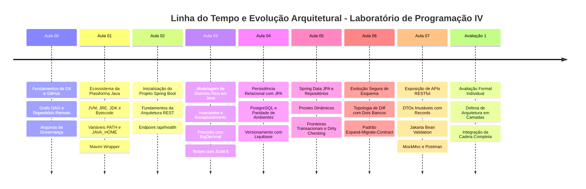

### Detalhamento Cronológico das Unidades Didáticas

| Aula / Marco | Marco no Git (Tag) | Entregáveis Técnicos e Conceitos Consolidados |
|---|---|---|
| **Aula 00** | `aula-00-inicio` | Configuração de identidade do Git (`user.name`, `user.email`), autenticação segura via chaves SSH, estruturação do repositório remoto oficial `suporteos2026`, criação dos arquivos de governança (`.gitignore`, `.editorconfig`, `README.md`) e compreensão do modelo de snapshots e DAG. |
| **Aula 01** | `aula-01-ambiente-spring-boot` | Diagnóstico da infraestrutura de compilação, instalação do Eclipse Temurin JDK 21 LTS, alinhamento rigoroso entre `PATH` e `JAVA_HOME`, distinção entre compilador (`javac`) e máquina virtual (`java`), transição do namespace `javax.*` para `jakarta.*` e adoção do Maven Wrapper (`mvnw`). |
| **Aula 02** | `aula-02-projeto-spring-boot` | Inicialização formal da aplicação Spring Boot, anatomia do descritor `pom.xml`, introdução aos Spring Starters, conceituação do modelo cliente-servidor, anatomia das requisições e respostas HTTP e implementação do endpoint de verificação `/api/health`. |
| **Aula 03** | `aula-03-dominio` | Construção das entidades em Java puro (`Produto`, `GrupoProduto`, `Status`), blindagem de invariantes, rejeição do modelo anêmico, uso mandatório de `BigDecimal` para controle monetário, amarração bidirecional 1:N com integridade de memória e testes unitários no padrão AAA com JUnit 5. |
| **Aula 04** | `aula-04-jpa-postgresql-liquibase` | Mapeamento objeto-relacional com Jakarta Persistence, superação do desencontro objeto-relacional, paridade estrita de ambientes com PostgreSQL 16+ (perfis `dev` e `test`), blindagem de credenciais locais via `.env`, introdução ao Liquibase e ativação de `ddl-auto=validate`. |
| **Aula 05** | `aula-05-repositories-servicos-transacoes` | Implementação do padrão Repository via interfaces Spring Data JPA, geração dinâmica de proxies, consultas derivadas por convenção de nomenclatura, demarcação transacional declarativa com `@Transactional`, análise dos quatro estados das entidades e testes transacionais com reversão controlada (*rollback*). |
| **Aula 06** | `aula-06-evolucao-modelo-changelogs` | Evolução incremental do modelo com a entidade `Fornecedor`, arquitetura de comparação diferencial (*diff*) com bancos PostgreSQL descartáveis isolados (`suporteos2026_diff` e `suporteos2026_reference`), descarte de falsos positivos e aplicação do padrão *Expand-Migrate-Contract* para inclusão da coluna `estoque_minimo`. |
| **Aula 07** | `aula-07-api-rest-dtos-postman` | Exposição da interface RESTful externa, modelagem de DTOs imutáveis com Java Records, validação na borda com Jakarta Bean Validation, mappers manuais desacoplados, padronização corporativa de erros com `@RestControllerAdvice` e automação de testes com MockMvc e Postman. |
| **Avaliação 1** | `avaliacao-1-consolidada` | Primeira avaliação formal da disciplina, englobando a entrega e defesa do projeto temático individual espelhado nos padrões de governança, domínio rico, persistência com migração versionada, transações de serviço e API REST documentada. |

---

## Glossário

- **ACID:** Acrônimo para Atomicidade, Consistência, Isolamento e Durabilidade. Conjunto de propriedades indispensáveis que garantem que transações de banco de dados sejam executadas de maneira confiável.
- **Anemic Domain Model (Modelo de Domínio Anêmico):** Anti-padrão de engenharia de software no qual as classes de entidade contêm unicamente atributos e métodos modificadores públicos (`getters` e `setters`), carecendo de lógica de negócio ou proteção de invariantes.
- **ApiError:** Estrutura de dados corporativa padronizada retornada pela borda da API contendo metadados semânticos sobre erros ocorridos durante o processamento de uma requisição HTTP.
- **Bean (Spring Bean):** Objeto instanciado, configurado, conectado e gerenciado pelo contêiner de Inversão de Controle (IoC) do Spring Framework ao longo do ciclo de vida da aplicação.
- **BigDecimal:** Classe da biblioteca padrão do Java (`java.math.BigDecimal`) que fornece representação numérica decimal exata com precisão arbitrária e controle explícito de escala e regras de arredondamento.
- **Bytecode:** Conjunto de instruções intermediárias otimizadas, gerado pelo compilador `javac`, interpretado e compilado para código de máquina nativo pela Máquina Virtual Java (JVM).
- **ChangeSet:** Unidade básica, atômica e indivisível de alteração estrutural ou manipulação de dados gerenciada pelo Liquibase dentro de um arquivo de changelog.
- **Checksum:** Valor hash criptográfico calculado pelo Liquibase a partir do conteúdo de um `changeSet` para assegurar que instruções já executadas em ambientes compartilhados permaneçam imutáveis.
- **Convention over Configuration (Convenção sobre Configuração):** Paradigma de design de software que busca diminuir o número de decisões que o desenvolvedor precisa tomar, definindo padrões sensatos de infraestrutura (como na estrutura de pastas do Maven).
- **DAG (Grafo Acíclico Dirigido):** Estrutura matemática composta por vértices ligados por arestas direcionadas sem a presença de ciclos fechados; modelo fundamental utilizado pelo Git para indexar o histórico de commits.
- **Database-Driven Design:** Abordagem de desenvolvimento viciada em projetar tabelas e relacionamentos físicos de banco de dados antes de modelar as regras e abstrações do domínio do problema.
- **DDL (Data Definition Language):** Subconjunto de comandos da linguagem SQL utilizado para definir, criar, alterar ou excluir estruturas e esquemas relacionais (`CREATE`, `ALTER`, `DROP`).
- **Defense in Depth (Defesa em Profundidade):** Estratégia de segurança e integridade de dados que estabelece múltiplas barreiras redundantes de proteção (como validações na borda HTTP, invariantes em Java e constraints no banco relacional).
- **Derived Query Methods (Consultas Derivadas):** Mecanismo do Spring Data JPA que traduz a assinatura e a nomenclatura declarativa de um método de interface em instruções canônicas JPQL/SQL.
- **Dirty Checking:** Funcionalidade interna do Hibernate que compara o estado atual de entidades gerenciadas com seus snapshots originais no contexto de persistência, emitindo comandos `UPDATE` automaticamente no encerramento da transação.
- **DTO (Data Transfer Object):** Padrão de projeto utilizado para transportar dados estruturados entre subsistemas ou camadas de software, desacoplando os contratos públicos de comunicação das entidades internas de persistência.
- **Expand-Migrate-Contract:** Padrão arquitetural de evolução segura de banco de dados relacional que divide adições de restrições complexas em três fases: expansão permissiva, migração de dados legados e contração com regras estritas.
- **Fail-Fast:** Princípio de engenharia que determina que um sistema deve falhar imediatamente e de forma explícita na presença de qualquer anomalia ou parâmetro inválido, impedindo a propagação de estados inconsistentes.
- **Garbage Collector (GC):** Processo em segundo plano da JVM responsável por monitorar, gerenciar e liberar automaticamente a memória heap ocupada por objetos que não possuem mais referências ativas.
- **Idempotência:** Propriedade matemática e computacional de uma operação na qual a execução repetida múltiplas vezes consecutivas produz o mesmo efeito observável no estado do sistema que uma única execução.
- **Invariante de Negócio:** Condição ou predicado lógico que deve permanecer estritamente verdadeiro durante todo o ciclo de vida de um objeto de domínio válido.
- **Java Dynamic Proxy:** Recurso de reflexão em tempo de execução do Java que permite a instanciação dinâmica de objetos que implementam uma ou mais interfaces sem a necessidade de classes concretas compiladas estaticamente.
- **Java Record:** Construção sintática introduzida no Java moderno que define uma classe concisa, puramente orientada a dados e estruturalmente imutável.
- **JIT (Just-In-Time Compiler):** Componente do motor de execução da JVM que traduz dinamicamente trechos críticos de bytecode frequentemente acessados para código de máquina nativo da CPU.
- **Liquibase:** Ferramenta de código aberto voltada para a automação, rastreamento, gerenciamento e versionamento declarativo de alterações no esquema de bancos de dados relacionais.
- **Maven Wrapper (`mvnw`):** Utilitário composto por scripts que encapsula e baixa automaticamente a versão exata do Apache Maven requerida pelo projeto, garantindo reprodutibilidade idêntica de build entre máquinas.
- **MockMvc:** Framework de suporte a testes do Spring que permite simular requisições e respostas HTTP contra controladores REST sem a necessidade de subir um servidor de rede real em porta física.
- **Object-Relational Impedance Mismatch (Desencontro Objeto-Relacional):** Conjunto de dificuldades técnicas resultantes da incompatibilidade entre o paradigma orientado a objetos (grafos, herança, referências) e o paradigma relacional (tabelas, chaves, tuplas).
- **Rich Domain Model (Modelo de Domínio Rico):** Paradigma de modelagem orientada a objetos no qual as entidades encapsulam seus atributos privados, protegem suas invariantes e expõem métodos de negócio semanticamente expressivos.
- **Stateless:** Característica arquitetural que dita que nenhuma informação de estado ou sessão do cliente deve ser retida na memória do servidor entre chamadas consecutivas.
- **Value Object (Objeto de Valor):** Objeto de domínio que não possui identificador persistente próprio, sendo definido unicamente pelo conjunto de seus atributos e mantendo-se estritamente imutável.

---

## Checklist de Revisão para Prova

### 1. Git, Governança e Infraestrutura de Compilação
- [ ] Compreendo a distinção conceitual e prática entre o motor local Git e a plataforma colaborativa remota GitHub?
- [ ] Sei explicar por que o histórico do Git forma um Grafo Acíclico Dirigido (DAG) e como ponteiros de branches e tags operam sobre commits?
- [ ] Sei diferenciar o papel do compilador `javac` das responsabilidades de interpretação e compilação JIT exercidas pela JVM?
- [ ] Sei diagnosticar a causa e a solução para o erro `UnsupportedClassVersionError` originado pelo conflito entre `PATH` e `JAVA_HOME`?
- [ ] Compreendo por que o Maven Wrapper (`mvnw`) é mandatório em equipes corporativas e como ele garante a reprodutibilidade da compilação?

### 2. Modelagem Orientada a Domínio (POO Pura)
- [ ] Sei formular a crítica técnica contra o anti-padrão do Modelo de Domínio Anêmico e defender o Modelo de Domínio Rico?
- [ ] Sei implementar uma entidade blindada com construtor canônico de validação de argumentos e métodos de mutação semânticos?
- [ ] Sei explicar as razões matemáticas pelas quais tipos primitivos `float` e `double` falham em representações monetárias e fiscais?
- [ ] Domínio as regras mandatórias do `BigDecimal`: construção via `String`, controle de escala com `HALF_UP` e comparação estrita via `compareTo`?
- [ ] Sei estruturar uma associação bidirecional 1:N garantindo consistência atômica através de método com visibilidade de pacote?
- [ ] Sei projetar testes unitários focados em invariantes de negócio utilizando a estrutura Arrange-Act-Assert (AAA) com JUnit 5?

### 3. Persistência Relacional, Liquibase e PostgreSQL
- [ ] Compreendo as dimensões da impedância objeto-relacional (granularidade, identidade, navegabilidade e encapsulamento)?
- [ ] Sei justificar por que o uso de bancos em memória (como o H2) é proibido e como os perfis `dev` e `test` garantem paridade com PostgreSQL real?
- [ ] Compreendo o funcionamento interno do Liquibase, a função das tabelas `databasechangelog` e `databasechangeloglock` e o papel do checksum?
- [ ] Sei explicar por que a configuração `spring.jpa.hibernate.ddl-auto=validate` é a única condizente com ambientes governados por migração declarativa?
- [ ] Sei detalhar as três etapas do padrão *Expand-Migrate-Contract* para adicionar colunas obrigatórias com dados legados sem indisponibilidade?

### 4. Camada de Aplicação, Repositórios e Transações
- [ ] Compreendo como o Spring Data JPA analisa interfaces e cria proxies dinâmicos em tempo de execução?
- [ ] Sei projetar consultas derivadas (*derived query methods*) respeitando palavras-chave e navegando por propriedades de associações?
- [ ] Sei justificar a razão arquitetural pela qual fronteiras transacionais (`@Transactional`) devem residir na camada de serviços e não nos repositórios?
- [ ] Conheço as otimizações computacionais habilitadas pelo parâmetro `@Transactional(readOnly = true)` em operações de leitura?
- [ ] Compreendo os quatro estados do ciclo de vida das entidades JPA (`transient`, `managed`, `detached`, `removed`) e a mecânica do *Dirty Checking*?

### 5. Camada Web RESTful, DTOs e Validações
- [ ] Sei diferenciar o estilo arquitetural REST da abordagem RPC com base no desacoplamento e modelagem de recursos substantivos?
- [ ] Sei classificar os métodos HTTP (`GET`, `POST`, `PUT`, `PATCH`, `DELETE`) quanto às suas propriedades formais de segurança e idempotência?
- [ ] Sei explicar por que expor entidades JPA diretamente em controladores acarreta riscos de segurança (*mass assignment*) e falhas de serialização?
- [ ] Compreendo as vantagens do uso de Java Records como DTOs imutáveis na fronteira de entrada e saída da aplicação?
- [ ] Sei aplicar as anotações do Jakarta Bean Validation (`@NotBlank`, `@NotNull`, `@PositiveOrZero`) em registros DTO?
- [ ] Sei estruturar uma classe tratadora centralizada com `@RestControllerAdvice` para capturar exceções negociais e devolver o formato padronizado `ApiError`?
- [ ] Sei elaborar testes de integração da borda REST utilizando `MockMvc` cobrindo cenários de sucesso (`201 Created` com header `Location`) e falha (`400 Bad Request`, `404 Not Found`)?

---

## Fontes e Metadados

- Turma no Classroom: 2026 2S Lab 4
- Itens processados: 0 materiais, 1 tarefas, 1 avisos
- Gerado em: 19/10/2026, 02:08:44 (BRT) via classroom-sync
