# Guia Completo de Estudos e Referência Técnica: Laboratório de Programação IV

> **Instituição:** Centro Universitário de Santa Fé do Sul (UniFEF)  
> **Curso:** Bacharelado em Sistemas de Informação (4º Semestre)  
> **Disciplina:** Laboratório de Programação IV  
> **Docente:** Prof. Jefferson Passerini  
> **Ambiente e Tecnologias:** Java 21 LTS, Spring Boot 3/4, Apache Maven, PostgreSQL 16+, Hibernate/JPA, Liquibase, Docker, Postman e JUnit 5  
> **Projetos de Estudo:** `suporteos2026` (Projeto Canônico de Referência) e `catalogocursos` (Atividade Prática Avaliatória)

---

## Sumário

- [Módulo 0: Controle de Versão Distribuído, Governança Git e GitHub](#módulo-0-controle-de-versão-distribuído-governança-git-e-github)
  - [Diferenciação conceitual e operacional: Git versus GitHub](#diferenciação-conceitual-e-operacional-git-versus-github)
  - [Modelagem interna do Git: Snapshots, Objetos e o Grafo Acíclico Dirigido (DAG)](#modelagem-interna-do-git-snapshots-objetos-e-o-grafo-acíclico-dirigido-dag)
  - [Topologia distribuída e sincronização com o remoto origin](#topologia-distribuída-e-sincronização-com-o-remoto-origin)
  - [Protocolos de transporte e autenticação: HTTPS versus SSH](#protocolos-de-transporte-e-autenticação-https-versus-ssh)
  - [Hierarquia de configurações e governança de identidade](#hierarquia-de-configurações-e-governança-de-identidade)
  - [Arquivos de governança do repositório: README, .editorconfig e .gitignore](#arquivos-de-governança-do-repositório-readme-editorconfig-e-gitignore)
  - [Ciclo de vida dos arquivos e comandos fundamentais](#ciclo-de-vida-dos-arquivos-e-comandos-fundamentais)
  - [Branches locais, isolamento de funcionalidades e tags anotadas](#branches-locais-isolamento-de-funcionalidades-e-tags-anotadas)
  - [Higiene e segurança do repositório](#higiene-e-segurança-do-repositório)
- [Módulo 1: Plataforma Java, Compilação Híbrida e Preparação do Ecossistema](#módulo-1-plataforma-java-compilação-híbrida-e-preparação-do-ecossistema)
  - [Arquitetura da plataforma: JVM, JRE e JDK](#arquitetura-da-plataforma-jvm-jre-e-jdk)
  - [Ciclo de compilação híbrida e inspeção de bytecode](#ciclo-de-compilação-híbrida-e-inspeção-de-bytecode)
  - [Resolução de comandos no sistema operacional: PATH e JAVA_HOME](#resolução-de-comandos-no-sistema-operacional-path-e-java_home)
  - [Automação de construção com Apache Maven e Maven Wrapper](#automação-de-construção-com-apache-maven-e-maven-wrapper)
  - [Evolução dos servidores web: Standalone versus Embarcados](#evolução-dos-servidores-web-standalone-versus-embarcados)
  - [A transição histórica de namespaces: de javax para jakarta](#a-transição-histórica-de-namespaces-de-javax-para-jakarta)
- [Módulo 2: Arquitetura Cliente-Servidor, Fundamentos REST e Bootstrap com Spring Boot](#módulo-2-arquitetura-cliente-servidor-fundamentos-rest-e-bootstrap-com-spring-boot)
  - [Metodologia pedagógica: Projeto de Referência versus Projeto Temático](#metodologia-pedagógica-projeto-de-referência-versus-projeto-temático)
  - [O contrato de compatibilidade de domínio](#o-contrato-de-compatibilidade-de-domínio)
  - [Fundamentos de arquitetura cliente-servidor e fronteira de APIs](#fundamentos-de-arquitetura-cliente-servidor-e-fronteira-de-apis)
  - [Renderização no servidor (SSR) versus APIs Web desacopladas](#renderização-no-servidor-ssr-versus-apis-web-desacopladas)
  - [Anatomia estrita do protocolo HTTP (RFC 9110)](#anatomia-estrita-do-protocolo-http-rfc-9110)
  - [Modelagem de recursos, URIs e Endpoints](#modelagem-de-recursos-uris-e-endpoints)
  - [Semântica dos métodos HTTP, segurança e idempotência](#semântica-dos-métodos-http-segurança-e-idempotência)
  - [Famílias de códigos de status HTTP](#famílias-de-códigos-de-status-http)
  - [Inversão de Controle, Injeção de Dependências e Beans Spring](#inversão-de-controle-injeção-de-dependências-e-beans-spring)
  - [Inicialização do projeto e o endpoint GET /api/health](#inicialização-do-projeto-e-o-endpoint-get-apihealth)
- [Módulo 3: Modelagem de Domínio Rico com Java Puro](#módulo-3-modelagem-de-domínio-rico-com-java-puro)
  - [O conceito de domínio e o isolamento arquitetural](#o-conceito-de-domínio-e-o-isolamento-arquitetural)
  - [Entidades versus Objetos de Valor (Value Objects)](#entidades-versus-objetos-de-valor-value-objects)
  - [Encapsulamento estrito e defesa de invariantes de negócio](#encapsulamento-estrito-e-defesa-de-invariantes-de-negócio)
  - [O modelo rico versus o anti-padrão do modelo anêmico](#o-modelo-rico-versus-o-anti-padrão-do-modelo-anêmico)
  - [Aritmética decimal exata com BigDecimal](#aritmética-decimal-exata-com-bigdecimal)
  - [Mapeamento e sincronização de associações bidirecionais 1:N em memória](#mapeamento-e-sincronização-de-associações-bidirecionais-1n-em-memória)
  - [Representação de estados finitos com Enum e datas determinísticas](#representação-de-estados-finitos-com-enum-e-datas-determinísticas)
  - [Testes unitários puros com JUnit 5 no padrão AAA](#testes-unitários-puros-com-junit-5-no-padrão-aaa)
- [Módulo 4: Persistência Relacional com JPA, PostgreSQL e Liquibase](#módulo-4-persistência-relacional-com-jpa-postgresql-e-liquibase)
  - [A pilha de persistência: PostgreSQL, JDBC, JPA, Hibernate e Spring Data](#a-pilha-de-persistência-postgresql-jdbc-jpa-hibernate-e-spring-data)
  - [O descompasso de impedância objeto-relacional](#o-descompasso-de-impedância-objeto-relacional)
  - [Migrações versionadas com Liquibase: Idempotência e integridade](#migrações-versionadas-com-liquibase-idempotência-e-integridade)
  - [Estratégia de defesa em profundidade](#estratégia-de-defesa-em-profundidade)
  - [Isolamento de perfis no Spring e paridade de ambientes](#isolamento-de-perfis-no-spring-e-paridade-de-ambientes)
  - [Gestão segura de segredos com variáveis de ambiente](#gestão-segura-de-segredos-com-variáveis-de-ambiente)
  - [Mapeamento objeto-relacional declarativo com JPA](#mapeamento-objeto-relacional-declarativo-com-jpa)
  - [Validação estrita de esquema com ddl-auto=validate](#validação-estrita-de-esquema-com-ddl-autovalidate)
- [Módulo 5: Repositórios Spring Data JPA, Serviços de Aplicação e Transações](#módulo-5-repositórios-spring-data-jpa-serviços-de-aplicação-e-transações)
  - [Arquitetura em camadas e segregação de papéis](#arquitetura-em-camadas-e-segregação-de-papéis)
  - [Spring Data JPA: Interfaces e proxies dinâmicos em tempo de execução](#spring-data-jpa-interfaces-e-proxies-dinâmicos-em-tempo-de-execução)
  - [Injeção de dependências estrita via construtores](#injeção-de-dependências-estrita-via-construtores)
  - [Consultas derivadas por convenção de nomenclatura (Derived Queries)](#consultas-derivadas-por-convenção-de-nomenclatura-derived-queries)
  - [Fronteiras transacionais declarativas com @Transactional](#fronteiras-transacionais-declarativas-com-transactional)
  - [Estados do ciclo de vida de uma entidade JPA](#estados-do-ciclo-de-vida-de-uma-entidade-jpa)
  - [Mecanismo de detecção automática de alterações (Dirty Checking)](#mecanismo-de-detecção-automática-de-alterações-dirty-checking)
  - [Modelagem de exceções de negócio da aplicação](#modelagem-de-exceções-de-negócio-da-aplicação)
  - [Testes de integração transacionais com reversão automática](#testes-de-integração-transacionais-com-reversão-automática)
- [Módulo 6: Evolução do Modelo Relacional e Changelogs Assistidos](#módulo-6-evolução-do-modelo-relacional-e-changelogs-assistidos)
  - [Evolução de esquema: ddl-auto versus diff versus migração versionada](#evolução-de-esquema-ddl-auto-versus-diff-versus-migração-versionada)
  - [Topologia de comparação diferencial com bancos reais no PostgreSQL](#topologia-de-comparação-diferencial-com-bancos-reais-no-postgresql)
  - [Evolução do domínio: Entidade Fornecedor e associação opcional](#evolução-do-domínio-entidade-fornecedor-e-associação-opcional)
  - [Evolução de campos e retrocompatibilidade de código](#evolução-de-campos-e-retrocompatibilidade-de-código)
  - [Geração assistida com liquibase-maven-plugin](#geração-assistida-com-liquibase-maven-plugin)
  - [Auditoria e saneamento de diffs gerados automaticamente](#auditoria-e-saneamento-de-diffs-gerados-automaticamente)
  - [O padrão Expand-Migrate-Contract para colunas obrigatórias](#o-padrão-expand-migrate-contract-para-colunas-obrigatórias)
  - [Enriquecimento manual: Constraints de integridade e rollbacks reversos](#enriquecimento-manual-constraints-de-integridade-e-rollbacks-reversos)
- [Módulo 7: Camada Web REST, DTOs Imutáveis, Mapeadores e Validação](#módulo-7-camada-web-rest-dtos-imutáveis-mapeadores-e-validação)
  - [O papel da camada de controle REST](#o-papel-da-camada-de-controle-rest)
  - [Riscos e armadilhas da exposição direta de entidades JPA](#riscos-e-armadilhas-da-exposição-direta-de-entidades-jpa)
  - [Data Transfer Objects (DTOs) e imutabilidade com Java Records](#data-transfer-objects-dtos-e-imutabilidade-com-java-records)
  - [Validação declarativa na borda com Jakarta Bean Validation](#validação-declarativa-na-borda-com-jakarta-bean-validation)
  - [Mapeamento manual desacoplado](#mapeamento-manual-desacoplado)
  - [Controllers REST, respostas semânticas e o cabeçalho Location](#controllers-rest-respostas-semânticas-e-o-cabeçalho-location)
  - [Tratamento global de exceções com @RestControllerAdvice e ApiError](#tratamento-global-de-exceções-com-restcontrolleradvice-e-apierror)
  - [Testes de integração da camada Web com MockMvc](#testes-de-integração-da-camada-web-com-mockmvc)
  - [Automação de testes de contrato com Postman](#automação-de-testes-de-contrato-com-postman)
- [Módulo 8: Estudo de Caso Prático — Aplicação Catálogo de Cursos](#módulo-8-estudo-de-caso-prático-aplicação-catálogo-de-cursos)
  - [Análise do problema e regras do relacionamento 1:N](#análise-do-problema-e-regras-do-relacionamento-1n)
  - [Estrutura física do banco de dados e migrações Liquibase](#estrutura-física-do-banco-de-dados-e-migrações-liquibase)
  - [Modelagem das entidades de domínio JPA](#modelagem-das-entidades-de-domínio-jpa)
  - [Camada de persistência com Spring Data JPA](#camada-de-persistência-com-spring-data-jpa)
  - [Camada de serviços e regras transacionais](#camada-de-serviços-e-regras-transacionais)
  - [Contratos de transferência (DTOs) e mapeadores](#contratos-de-transferência-dtos-e-mapeadores)
  - [Controladores REST e tratamento centralizado de erros](#controladores-rest-e-tratamento-centralizado-de-erros)
  - [Suíte de testes automatizados obrigatórios](#suíte-de-testes-automatizados-obrigatórios)
  - [Roteiro de validação ponta a ponta com cURL](#roteiro-de-validação-ponta-a-ponta-com-curl)
- [Módulo 9: Avaliação Formal (A1) — Simulado Técnico Resolvido e Questões de Revisão](#módulo-9-avaliação-formal-a1-simulado-técnico-resolvido-e-questões-de-revisão)
  - [Questões teóricas dissertativas com gabarito comentado](#questões-teóricas-dissertativas-com-gabarito-comentado)
  - [Atividade de transferência para temas individuais](#atividade-de-transferência-para-temas-individuais)
  - [Checklist definitivo de auditoria pré-prova](#checklist-definitivo-de-auditoria-pré-prova)

---

## Módulo 0: Controle de Versão Distribuído, Governança Git e GitHub

### Diferenciação conceitual e operacional: Git versus GitHub

A correta compreensão da engenharia de software exige a distinção imediata entre a ferramenta de controle de versão local e a plataforma de hospedagem e colaboração em nuvem.

- **Git:** É um software de controle de versão distribuído (*Distributed Version Control System - DVCS*), executável diretamente no sistema operacional do desenvolvedor. Ele opera de forma autônoma e descentralizada, gravando o histórico em um diretório oculto denominado `.git`. Operações como criação de branches, registro de commits, inspeção de histórico e reversão de versões não demandam conexão à internet.
- **GitHub:** É uma plataforma em nuvem mantida pela Microsoft que provê repositórios Git remotos agregados a serviços corporativos: controle de acesso por perfis, revisão formal de código (*Pull Requests*), rastreamento de defeitos e tarefas (*Issues* e *Projects*), automação de fluxos de CI/CD (*GitHub Actions*) e varredura estática de credenciais vazadas (*Secret Scanning*).

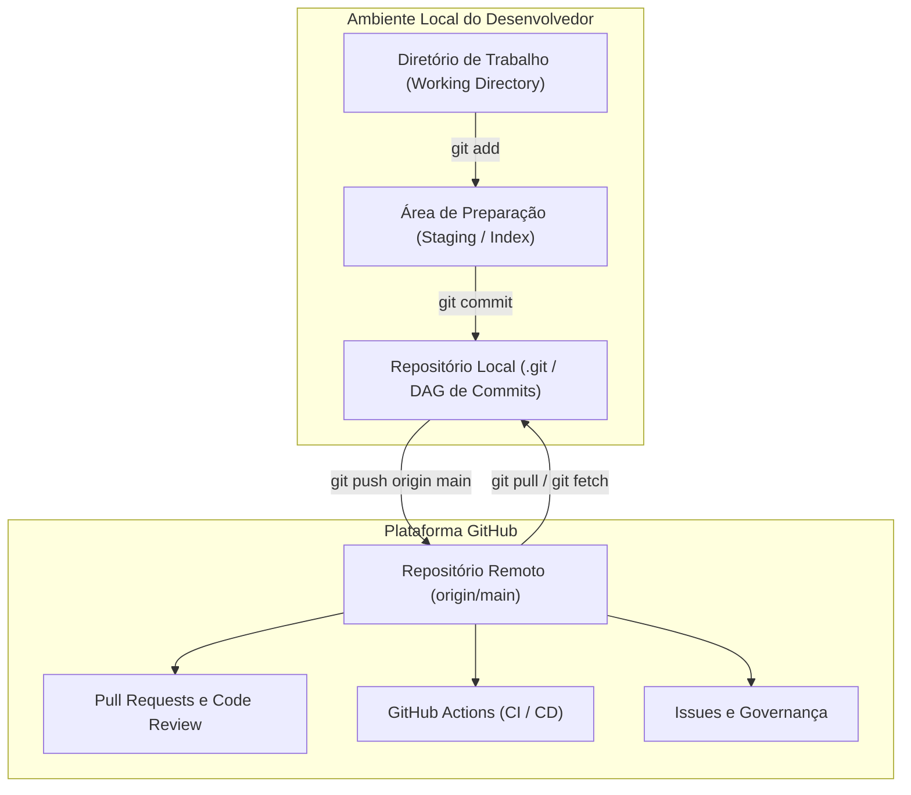

*Tabela comparativa analítica:*

| Critério de Comparação | Git | GitHub |
|---|---|---|
| **Natureza** | Motor de controle de versão (CLI / Core) | Plataforma de serviços em nuvem |
| **Ambiente de Execução** | Sistema operacional local | Servidores remotos de alta disponibilidade |
| **Dependência de Conectividade** | Nula para o fluxo local de commits e branches | Obrigatória para navegação e sincronização |
| **Modelo de Dados** | Grafo Acíclico Dirigido gravado em arquivos soltos | Repositórios Git com camadas de metadados relacionais |
| **Responsabilidade no Curso** | Rastreamento atômico das alterações da aplicação | Entrega formal de atividades e repositório do professor |

### Modelagem interna do Git: Snapshots, Objetos e o Grafo Acíclico Dirigido (DAG)

Diferente de sistemas legados centralizados (como CVS ou Subversion) que calculavam e armazenavam listas de diferenças delta por arquivo, o Git modela a evolução temporal do projeto como uma sucessão de **snapshots** integrais do estado da pasta de trabalho.

Internamente, a integridade de cada objeto é garantida por funções de dispersão criptográfica (SHA-1 gerando hashes hexadecimais de 40 caracteres, evoluindo para SHA-256).

Todo commit registrado no Git constitui um nó imutável contendo:
1. Uma referência direta para um objeto de árvore (*tree object*), que espelha os diretórios e referencia o conteúdo binário dos arquivos (*blobs*);
2. Metadados de autoria e comissionamento: nome, e-mail, carimbo de data/hora (timestamp) e mensagem explicativa;
3. Ponteiros diretos para zero, um ou múltiplos commits predecessores (*parent commits*).

Como todo commit aponta obrigatoriamente para trás (em direção ao commit que o precedeu) e referências cíclicas são matematicamente impossíveis na linha do tempo, a estrutura de dados resultante é formalmente um **Grafo Acíclico Dirigido** (*Directed Acyclic Graph - DAG*).

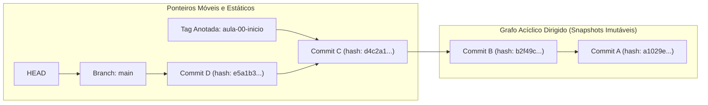

*Componentes do grafo e suas funções:*

- **Commit:** Vértice imutável. Qualquer modificação no código-fonte, na mensagem ou nos metadados gera um novo hash SHA, criando outro nó e jamais alterando o existente.
- **Branch:** Um ponteiro leve e móvel (*reference*) de 41 bytes gravado em `.git/refs/heads/<nome>`, contendo o hash do commit mais recente de uma linha de trabalho. O ponteiro avança de forma automática a cada novo commit.
- **Tag:** Uma referência estática ancorada permanentemente a um commit específico. Não se move quando novos commits são registrados. Utilizada no curso para registrar os marcos pedagógicos de entrega e tags de encerramento de aula.
- **HEAD:** Arquivo especial em `.git/HEAD` que indica a referência ativa carregada no diretório de trabalho.

### Topologia distribuída e sincronização com o remoto origin

No modelo distribuído, não há assimetria técnica entre os repositórios: todo clone local possui a íntegra dos branches, arquivos e commits existentes no servidor desde o primeiro commit do projeto.

O termo `origin` nada mais é do que um apelido (*alias*) convencionado pelo Git para apontar para a URL do repositório remoto a partir do qual a clonagem foi disparada.

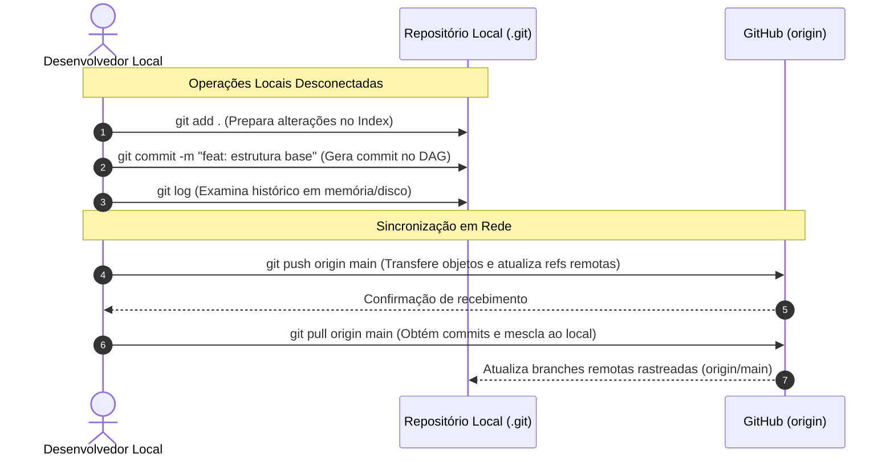

### Protocolos de transporte e autenticação: HTTPS versus SSH

O intercâmbio de dados entre o cliente local do Git e os servidores do GitHub ocorre por dois canais criptográficos principais:

1. **HTTPS (Porta 443):**
   - URL no formato `https://github.com/jeffersonarpasserini/suporteos2026.git`.
   - Requer o uso de **Personal Access Tokens (PAT)** com escopos estritos de permissão de escrita em repositórios (`repo`). O GitHub baniu o uso de senhas convencionais de usuário via terminal desde agosto de 2021.
   - Apresenta facilidade de tráfego em redes acadêmicas e corporativas que bloqueiam portas não padrão.
2. **SSH (Porta 22):**
   - URL no formato `git@github.com:jeffersonarpasserini/suporteos2026.git`.
   - Utiliza criptografia de chave pública assimétrica (algoritmos recomendados: Ed25519 ou RSA de 4096 bits).
   - Elimina a digitação repetitiva de credenciais por meio do agente de autenticação em memória (`ssh-agent`).

```bash
# Geração de chave SSH Ed25519
ssh-keygen -t ed25519 -C "aluno@unifef.edu.br"

# Validação do canal criptográfico com o GitHub
ssh -T git@github.com
```

> [!CAUTION]
> **Segurança de Chaves Privadas:** O arquivo de chave privada (`id_ed25519`) jamais deve ser transferido, copiado para repositórios ou compartilhado. Apenas a chave pública correspondente (`id_ed25519.pub`) é enviada e vinculada à conta do GitHub.

### Hierarquia de configurações e governança de identidade

O Git exige a definição obrigatória de dois metadados de autoria: `user.name` e `user.email`. Essas variáveis são consultadas em três níveis hierárquicos:

1. **System (`--system`):** Configuração global da máquina física, armazenada em `/etc/gitconfig`, afetando todos os usuários do sistema operacional.
2. **Global (`--global`):** Configuração específica do usuário logado no sistema operacional, gravada em `~/.gitconfig`.
3. **Local (`--local`):** Configuração específica de um repositório isolado, gravada em `.git/config`. Possui a mais alta precedência, sobrepondo definições globais e de sistema.

```bash
# Configuração global recomendada para o aluno
git config --global user.name "Nome do Aluno"
git config --global user.email "aluno@unifef.edu.br"
git config --global init.defaultBranch main

# Inspeção das configurações ativas e origens
git config --list --show-origin
```

### Arquivos de governança do repositório: README, .editorconfig e .gitignore

A raiz de um repositório profissional de engenharia de software deve conter três arquivos fundamentais de governança:

1. **`README.md`:** Documento em Markdown que serve de ponto de entrada técnico para o projeto. Deve detalhar a arquitetura, objetivos, matriz de tecnologias, pré-requisitos e comandos de inicialização.
2. **`.editorconfig`:** Arquivo padronizador de formatação de código entre diferentes IDEs e editores (IntelliJ IDEA, VS Code, Eclipse), estabelecendo regras para tipo de indentação, tamanho de espaçamento e terminação de linha.
3. **`.gitignore`:** Lista declarativa de regras que instrui o Git a ignorar binários compilados, pastas de dependências locais, configurações privadas de IDE e arquivos de ambiente contendo segredos.

```ini
# .editorconfig
root = true

[*]
indent_style = space
indent_size = 4
end_of_line = lf
charset = utf-8
trim_trailing_whitespace = true
insert_final_newline = true

[*.{yml,yaml}]
indent_size = 2

[*.md]
trim_trailing_whitespace = false
```

```gitignore
# .gitignore para projetos Java Spring Boot
target/
!.mvn/wrapper/maven-wrapper.jar
*.class

# IDEs e Editores
.idea/
*.iml
.vscode/
.project
.classpath
.settings/

# Arquivos de Ambiente e Segredos (CRÍTICO)
.env
.env.*
!.env.example
*.log
```

### Ciclo de vida dos arquivos e comandos fundamentais

Os arquivos em um diretório sob controle do Git transitam por quatro estados bem definidos:

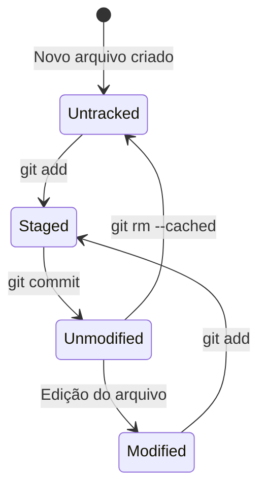

- **Untracked (Não rastreado):** O arquivo reside no diretório de trabalho, mas o repositório não rastreia seu histórico.
- **Modified (Modificado):** O arquivo rastreado teve seu conteúdo alterado em relação ao último snapshot.
- **Staged / Index (Preparado):** O arquivo foi marcado via `git add` para ser incluído no próximo commit.
- **Committed / Unmodified (Registrado):** Os dados foram gravados de forma permanente no banco de objetos do Git.

### Branches locais, isolamento de funcionalidades e tags anotadas

O trabalho em equipe exige que alterações não sejam realizadas diretamente sobre a linha principal (`main`). A criação de branches possibilita o desenvolvimento concorrente e isolado de requisitos.

```bash
# Criação e ativação de um branch de funcionalidade
git checkout -b feature/modelagem-dominio

# Alternativa moderna no Git 2.23+
git switch -c feature/modelagem-dominio

# Retorno à branch principal e mesclagem
git switch main
git merge feature/modelagem-dominio
```

As tags marcam pontos específicos da história como importantes:
- **Tag Leve (*Lightweight*):** Apenas um ponteiro fixo para um commit.
- **Tag Anotada (*Annotated*):** Um objeto completo gravado no banco do Git com autor, data, e-mail e mensagem explicativa assinada. **É o padrão obrigatório adotado na disciplina.**

```bash
# Criação de tag anotada
git tag -a aula-00-inicio -m "Marco zero: inicialização da governança do projeto Suporte OS"

# Publicação da tag no repositório remoto
git push origin aula-00-inicio
```

### Higiene e segurança do repositório

- **Definição:** A higiene de repositório consiste na aplicação de regras estritas que impedem a inclusão de arquivos transitórios, artefatos gerados pelo processo de compilação (`target/`), diretórios proprietários de IDEs e, fundamentalmente, segredos e credenciais de infraestrutura.
- **Motivação:** A submissão acidental de arquivos `.env` ou senhas de bancos de dados a repositórios públicos ou compartilhados compromete imediatamente os servidores, além de inflar desnecessariamente o volume binário do repositório.
- **Exemplo Correto:** Versionar um arquivo estéril denominado `.env.example`, demonstrando o nome das variáveis exigidas pela aplicação com valores fictícios:
  ```properties
  DB_DEV_HOST=localhost
  DB_DEV_PORT=5432
  DB_DEV_NAME=suporteos2026_dev
  DB_DEV_USER=suporteos_app
  DB_DEV_PASSWORD=segredo_exemplo
  ```
- **Contraexemplo:** Adicionar o arquivo `.env` real com as senhas do banco de produção ao commit via `git add .` sem auditar o `git status`.
- **Armadilhas:** Adicionar um arquivo ao `.gitignore` após ele já ter sido comissionado em commits anteriores. O Git continuará rastreando o arquivo até que seja explicitamente removido da área de preparação com `git rm --cached <arquivo>`.

---

## Módulo 1: Plataforma Java, Compilação Híbrida e Preparação do Ecossistema

### Arquitetura da plataforma: JVM, JRE e JDK

A independência de plataforma preconizada pela tecnologia Java fundamenta-se em uma arquitetura de camadas concêntricas perfeitamente delimitadas:

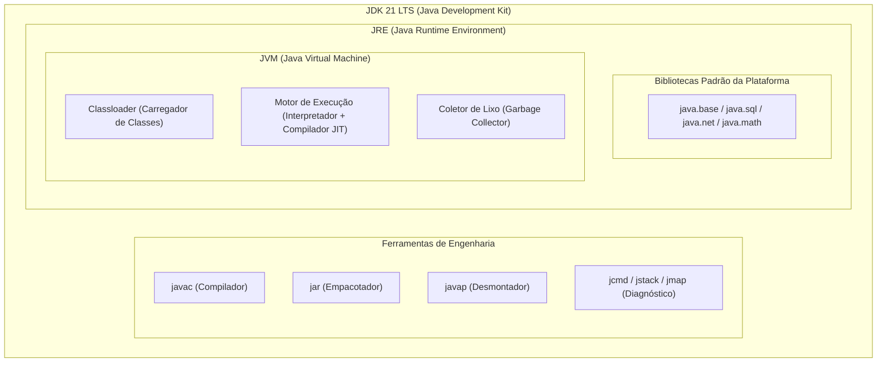

1. **JVM (Java Virtual Machine):** Motor abstrato de execução. Realiza a interpretação das instruções de bytecode, compilação *Just-In-Time* (JIT) para instruções de máquina do processador físico, gerencia a pilha de execução de threads e aloca/desaloca memória dinâmica por meio do Coletor de Lixo (*Garbage Collector*). A JVM não é instalada de forma isolada para desenvolvimento.
2. **JRE (Java Runtime Environment):** Pacote voltado à execução de aplicações prontas em ambientes produtivos. É formada pela JVM acompanhada das bibliotecas binárias fundamentais da API do Java (`java.base`, `java.sql`, etc.). **Não contém compiladores.**
3. **JDK (Java Development Kit):** O conjunto integral de engenharia destinado aos desenvolvedores. Contém a JRE e incorpora ferramentas como o compilador `javac`, o utilitário de empacotamento `jar`, o desmontador `javap` e as ferramentas de perfilamento e diagnóstico (`jstack`, `jcmd`, `jmap`). Para a disciplina, adota-se obrigatoriamente a distribuição **Eclipse Temurin JDK 21 LTS**.

### Ciclo de compilação híbrida e inspeção de bytecode

O Java opera por compilação híbrida: o compilador converte o arquivo legível `.java` em uma linguagem binária intermediária gravada em arquivos `.class` (bytecode), a qual é carregada e traduzida pela JVM em tempo de execução:

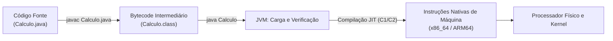

*Inspeção de operações da JVM baseada em pilha via javap:*

```java
public class Calculo {
    public int somar(int a, int b) {
        return a + b;
    }
}
```

Ao executar `javap -c Calculo` sobre o binário compilado:

```text
public int somar(int, int);
  Code:
   0: iload_1       // Empilha o primeiro parâmetro inteiro
   1: iload_2       // Empilha o segundo parâmetro inteiro
   2: iadd          // Desempilha ambos, soma-os e empilha o resultado
   3: ireturn       // Retorna o valor inteiro posicionado no topo da pilha
```

*Complemento técnico do instrutor:* Observe que a JVM é estruturada como uma máquina baseada em pilha (*stack-based architecture*), permitindo que instruções como `iadd` e `iload` operem de modo idêntico em qualquer plataforma de hardware (Intel, AMD, ARM), garantindo a portabilidade nativa da linguagem.

### Resolução de comandos no sistema operacional: PATH e JAVA_HOME

A correta amarração das variáveis de ambiente é indispensável para evitar que ferramentas de linha de comando invoquem executáveis divergentes instalados na máquina:

- **`PATH`:** Variável de sistema que armazena uma sequência ordenada de diretórios nos quais o interpretador de comandos (PowerShell, Bash, Zsh) busca os binários executáveis. A resolução cessa assim que a primeira ocorrência é localizada.
- **`JAVA_HOME`:** Variável que aponta diretamente para a raiz do diretório de instalação do JDK correspondente. É lida diretamente por ferramentas corporativas de compilação (Maven, Gradle, contêineres e IDEs) para localizar bibliotecas internas do compilador.

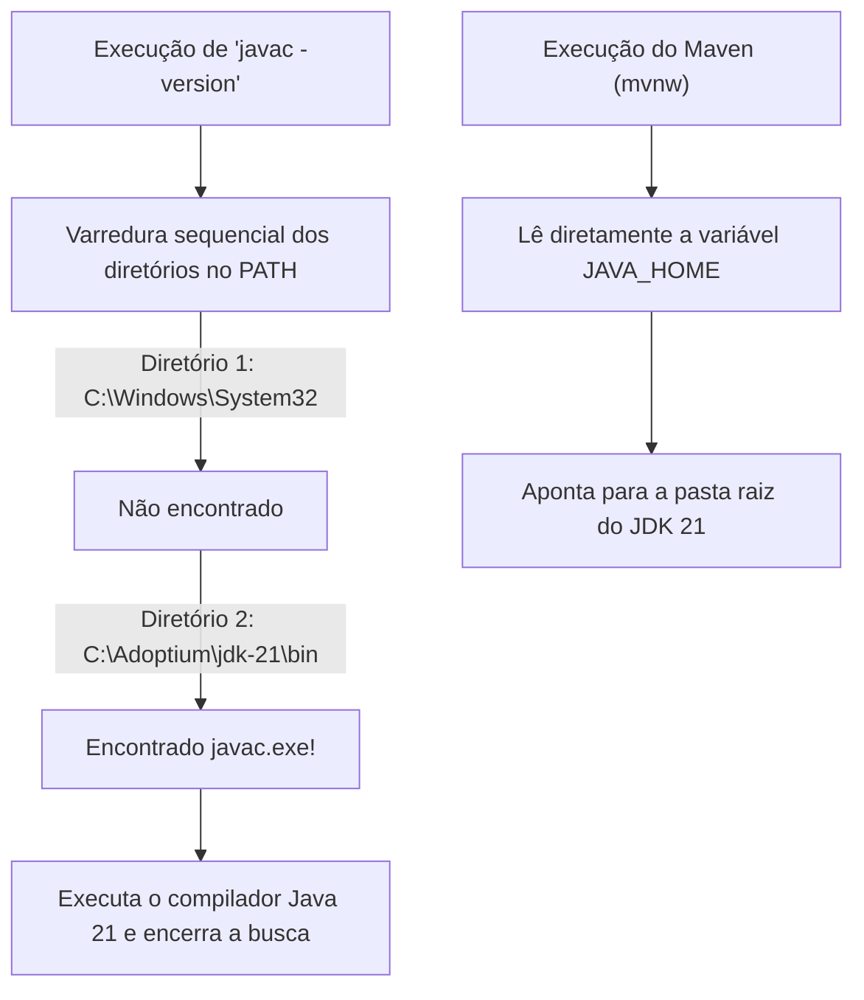

*Auditoria no terminal:*

```powershell
# Windows (PowerShell)
where.exe java
where.exe javac
$env:JAVA_HOME
```

```bash
# Linux / macOS (Bash/Zsh)
which java
which javac
echo "$JAVA_HOME"
```

### Automação de construção com Apache Maven e Maven Wrapper

Em ambientes profissionais, compilar arquivos manualmente por comandos `javac *.java` é proibitivo devido à necessidade de gerenciar dezenas de dependências externas transitivas, executar testes automatizados e empacotar a aplicação de forma determinística.

O **Apache Maven** resolve esses problemas orientado pelo princípio de **Convenção sobre Configuração** (*Convention over Configuration*):
- Código de produção: `src/main/java`
- Configurações da aplicação: `src/main/resources`
- Código de testes: `src/test/java`
- Descritor formal de build: `pom.xml` (*Project Object Model*)

#### Ciclo de vida padrão do Maven

O Maven organiza suas operações em fases estritamente sequenciais:

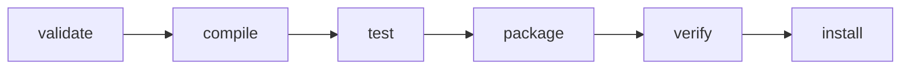

A invocação de uma fase tardia (ex.: `./mvnw package`) obriga a execução automática e sequencial de todas as fases precedentes (`validate`, `compile`, `test`).

#### O Maven Wrapper (mvnw)

O **Maven Wrapper** é uma infraestrutura embutida no projeto (`mvnw`, `mvnw.cmd` e a pasta `.mvn/wrapper`) cuja responsabilidade é baixar e encapsular uma versão idêntica do Maven exigida pela aplicação. 

Isso elimina a necessidade de o desenvolvedor instalar o Maven globalmente no sistema operacional e garante que o ambiente de Integração Contínua (CI) compile a aplicação sob as mesmas regras binárias.

```bash
# Execução da suíte de testes com o wrapper
./mvnw clean test

# No Windows (PowerShell)
.\mvnw.cmd clean test
```

### Evolução dos servidores web: Standalone versus Embarcados

1. **Modelo Clássico de Servidores Web Externos (*Standalone*):**
   - O servidor (ex.: Apache Tomcat 9 clássico, Payara Server 6) era instalado de forma autônoma no sistema operacional do servidor.
   - A aplicação era empacotada no formato de arquivo compactado `.war` (*Web Application Archive*) e submetida a um processo manual ou automatizado de *deploy* dentro da pasta `webapps/` do servidor.
   - Provocava forte acoplamento entre a versão da JVM do servidor e as bibliotecas da aplicação, gerando conflitos de carregamento de classes (*classloader hell*).
2. **Modelo Moderno com Servidor Embarcado (*Embedded Server*):**
   - A arquitetura do Spring Boot inverte a relação de hospedagem: o servidor web (Tomcat) é transformado em uma dependência de biblioteca (`spring-boot-starter-tomcat`) compilada dentro do próprio artefato executável `.jar` (*Java Archive*).
   - A aplicação inicializa a si mesma invocando seu método canônico `public static void main(String[] args)`. Ela instancia programaticamente o servidor HTTP na porta desejada (padrão `8080`) e expõe os endpoints.

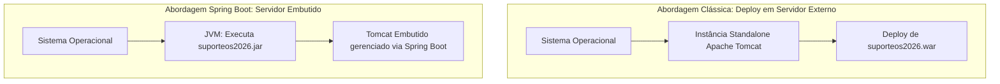

### A transição histórica de namespaces: de javax para jakarta

Em 2017, a Oracle transferiu a custódia das especificações corporativas do Java EE (*Java Enterprise Edition*) para a Fundação Eclipse. Devido a restrições de direitos de uso da marca registrada "Java", a fundação renomeou a plataforma para **Jakarta EE**.

A partir da versão Jakarta EE 9 (e consolidada no Spring Boot 3 e Java 21), houve a renomeação obrigatória de todos os pacotes das APIs corporativas:

```java
// Código Legado (Java EE / Spring Boot 2.x) - OBSOLETO
import javax.persistence.Entity;
import javax.servlet.http.HttpServletRequest;
import javax.validation.constraints.NotNull;

// Código Moderno (Jakarta EE / Spring Boot 3.x / Java 21) - OBRIGATÓRIO
import jakarta.persistence.Entity;
import jakarta.servlet.http.HttpServletRequest;
import jakarta.validation.constraints.NotNull;
```

> [!WARNING]
> **Quebra de Compatibilidade Binária:** A importação inadvertida de pacotes que iniciam com o prefixo `javax.persistence` ou `javax.validation` resultará em falhas de compilação ou na total inoperância das validações e do mapeamento JPA, uma vez que o Spring Boot 3/4 não reconhece as anotações do namespace antigo.

---

## Módulo 2: Arquitetura Cliente-Servidor, Fundamentos REST e Bootstrap com Spring Boot

### Metodologia pedagógica: Projeto de Referência versus Projeto Temático

O ensino de engenharia de software nesta disciplina assenta-se na técnica do **espelhamento arquitetural**.

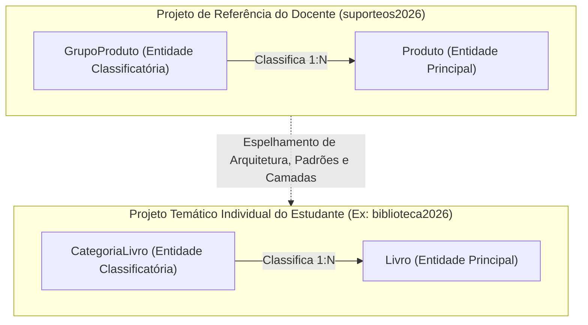

- **Projeto de Referência (`suporteos2026`):** Repositório público mantido pelo professor. Nele são introduzidos os padrões canônicos, as migrações estruturais do Liquibase e as implementações de referência.
- **Projeto Temático Individual:** Repositório criado e mantido pelo próprio estudante, com tema negocial único (ex.: gestão de oficina, biblioteca, locadora, clínica médica). O discente é desafiado a transpor os conceitos aprendidos no domínio de ordens de serviço para as regras específicas do seu projeto.

### O contrato de compatibilidade de domínio

Para garantir que o projeto individual suporte todos os tópicos avançados do semestre, o tema escolhido pelo aluno deve satisfazer obrigatoriamente à seguinte estrutura de relacionamento entre duas entidades centrais:

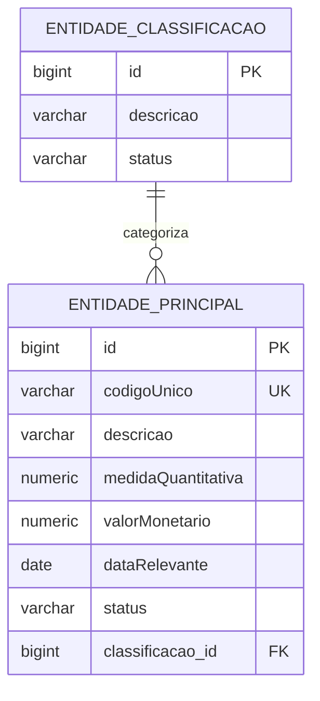

*Matriz de equivalência temática:*

| Elemento do Contrato | Projeto de Referência (`suporteos2026`) | Exemplo: Biblioteca | Exemplo: Oficina Mecânica |
|---|---|---|---|
| **Classificação** | `GrupoProduto` | `CategoriaLivro` | `TipoServico` |
| **Entidade Principal** | `Produto` | `Livro` | `Servico` |
| **Identificador Natural** | Código de Barras (`codigoBarras`) | ISBN (`isbn`) | Código de Catálogo (`codigoServico`) |
| **Medida Quantitativa** | Saldo em Estoque | Exemplares Disponíveis | Horas Estimadas |
| **Valor Monetário** | Preço Unitário (`BigDecimal`) | Preço de Aquisição (`BigDecimal`) | Custo da Mão de Obra (`BigDecimal`) |

### Fundamentos de arquitetura cliente-servidor e fronteira de APIs

Uma **API** (*Application Programming Interface*) define uma fronteira formal de contratos de entrada e saída por meio da qual dois sistemas de software se comunicam.

No modelo cliente-servidor para APIs Web:
1. **Cliente:** O componente emissor que inicia a conversação despachando uma **requisição HTTP** (*request*) pela rede para um endereço identificado. Exemplos: Postman, navegadores com aplicações SPA (React, Vue, Angular) ou aplicativos móveis.
2. **Servidor:** O processo ou serviço que escuta requisições em uma porta TCP/IP (ex.: porta `8080`). Ele intercepta a mensagem, orquestra a lógica de negócio, interage com o banco de dados e retorna uma **resposta HTTP** (*response*).

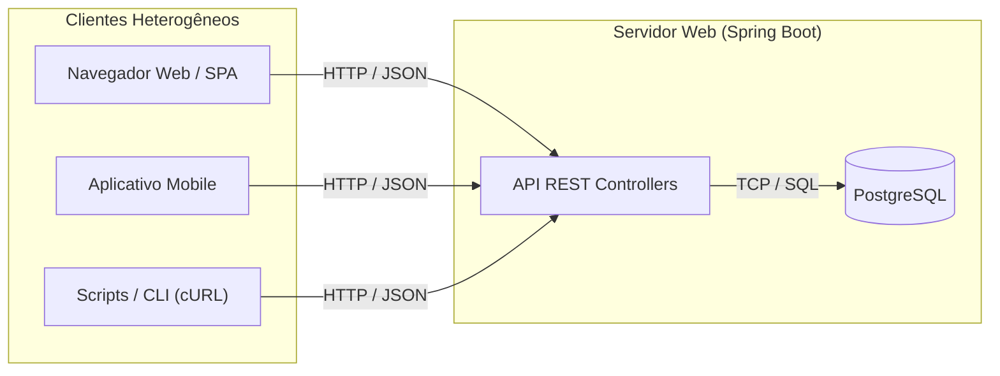

### Renderização no servidor (SSR) versus APIs Web desacopladas

| Característica | Renderização no Servidor (SSR - JSP, Thymeleaf) | API Web Desacoplada (RESTful / JSON) |
|---|---|---|
| **Carga de Trabalho** | O servidor processa os dados e compila o código HTML/CSS da tela. | O servidor processa regras e entrega apenas dados estruturados em JSON. |
| **Tamanho da Mensagem** | Elevado (transporta a árvore completa do documento visual). | Reduzido (transporta estritamente os pares chave-valor necessários). |
| **Acoplamento** | Alto: a aplicação backend fica refém do motor de visualização web. | Baixo: um único endpoint serve web, mobile, smart TVs e integrações B2B. |
| **Escalabilidade** | Menor, devido ao consumo de CPU para renderizar layouts visuais. | Alta, viabilizando microsserviços e cacheamento eficiente de dados. |

### Anatomia estrita do protocolo HTTP (RFC 9110)

O protocolo **HTTP** (*Hypertext Transfer Protocol*) baseia-se em mensagens de texto transmitidas sobre a camada de transporte (TCP).

#### Estrutura formal de uma requisição HTTP

Uma requisição HTTP divide-se em:
1. **Linha de Comando (*Request Line*):** Contém o método semântico, a URI do recurso e a versão do protocolo;
2. **Cabeçalhos da Requisição (*Headers*):** Metadados estruturados no padrão chave-valor;
3. **Linha em Branco (`\r\n`):** Separador obrigatório que encerra a seção de metadados;
4. **Corpo da Mensagem (*Message Body*):** Dados estruturados (payload) enviados ao servidor.

```http
POST /api/produtos HTTP/1.1
Host: localhost:8080
Content-Type: application/json
Accept: application/json

{
  "codigoBarras": "7891000300012",
  "descricao": "Teclado Mecânico USB",
  "saldoEstoque": 45,
  "valorUnitario": 289.90,
  "grupoId": 2
}
```

#### Estrutura formal de uma resposta HTTP

Uma resposta HTTP divide-se em:
1. **Linha de Status (*Status Line*):** Versão do protocolo, código de status numérico de três dígitos e a mensagem textual descritiva (*reason phrase*);
2. **Cabeçalhos de Resposta (*Headers*):** Metadados gerados pelo servidor;
3. **Linha em Branco (`\r\n`):** Delimitador;
4. **Corpo da Mensagem (*Message Body*):** A representação em JSON do recurso processado.

```http
HTTP/1.1 201 Created
Location: /api/produtos/84
Content-Type: application/json

{
  "id": 84,
  "codigoBarras": "7891000300012",
  "descricao": "Teclado Mecânico USB",
  "saldoEstoque": 45,
  "valorUnitario": 289.90,
  "status": "ATIVO"
}
```

### Modelagem de recursos, URIs e Endpoints

No paradigma REST, a menor unidade manipulável é o **recurso**.

- **Identificação de Recursos:** Recursos são representados conceitualmente por substantivos no plural (`/api/produtos`, `/api/grupos-produtos`), e não por verbos ou ações computacionais.
- **Diferença entre URI e Endpoint:**
  - **URI (*Uniform Resource Identifier*):** O caminho global que identifica o recurso na rede (`/api/produtos/84`).
  - **Endpoint:** A composição técnica entre o **Método HTTP** e a **URI**. Portanto, `GET /api/produtos` e `POST /api/produtos` apontam para a mesma URI, mas constituem **endpoints completamente distintos**, com comportamentos, códigos de status e contratos diferentes.

### Semântica dos métodos HTTP, segurança e idempotência

A especificação RFC 9110 estabelece duas propriedades conceituais fundamentais para os métodos HTTP:

1. **Método Seguro (*Safe Method*):** Uma operação cuja execução acarreta apenas a leitura de dados, não provocando nenhuma alteração perceptível no estado interno do servidor.
2. **Método Idempotente (*Idempotent Method*):** Uma operação cuja execução consecutiva com os mesmos parâmetros produz exatamente o mesmo resultado no estado do servidor que sua execução isolada uma única vez:

```math
f(f(x)) = f(x)
```

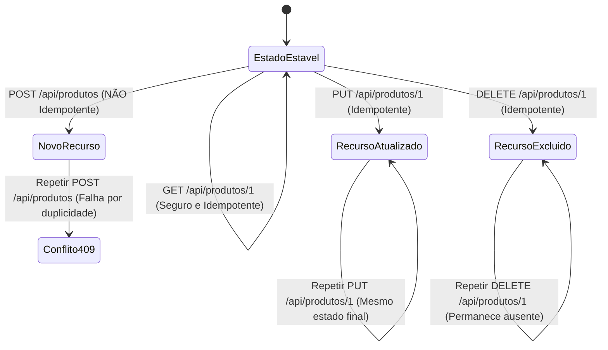

*Tabela de métodos HTTP:*

| Método HTTP | Propósito Semântico | Seguro? | Idempotente? | Sucesso Típico |
|---|---|---|---|---|
| `GET` | Recuperar representação de recursos | Sim | Sim | `200 OK` |
| `POST` | Criar novos recursos ou executar comandos | Não | Não | `201 Created` |
| `PUT` | Substituição integral do recurso existente | Não | Sim | `200 OK` / `204 No Content` |
| `PATCH` | Modificação parcial do recurso | Não | Não | `200 OK` |
| `DELETE` | Remover o recurso identificado | Não | Sim | `204 No Content` / `200 OK` |

### Famílias de códigos de status HTTP

Os códigos de status dividem-se em cinco famílias categóricas pelo dígito inicial:

- **`2xx` (Sucesso):** A requisição foi compreendida e processada com êxito.
  - `200 OK`: Operação de leitura ou atualização executada com retorno de dados.
  - `201 Created`: Criação bem-sucedida de um novo recurso, acompanhado do cabeçalho `Location`.
  - `204 No Content`: Ação processada com sucesso, mas a resposta não possui corpo (típico de exclusões).
- **`4xx` (Erros do Cliente):** A requisição contém sintaxe inválida ou violou regras da aplicação.
  - `400 Bad Request`: Dados inválidos, campos obrigatórios ausentes ou falhas na validação sintática.
  - `404 Not Found`: O recurso identificado pela URI não existe no banco de dados.
  - `409 Conflict`: Conflito de integridade de dados (ex.: duplicação de e-mail ou código de barras).
- **`5xx` (Erros do Servidor):** Falha interna no servidor ao processar uma requisição válida.
  - `500 Internal Server Error`: Erro inesperado não tratado pelo sistema.

### Inversão de Controle, Injeção de Dependências e Beans Spring

- **Inversão de Controle (*Inversion of Control - IoC*):** Princípio arquitetural no qual o controle do fluxo de execução e a gestão do ciclo de vida dos objetos é transferido da mão do programador para o framework.
- **Injeção de Dependência (*Dependency Injection - DI*):** Padrão de projeto que materializa o IoC. Em vez de uma classe instanciar diretamente suas dependências através do operador `new`, as dependências são fornecidas externamente à classe em tempo de execução.
- **Spring Bean:** Qualquer classe Java instanciada, configurada e gerenciada dentro do ciclo de vida do contêiner do Spring (*ApplicationContext*).

### Inicialização do projeto e o endpoint GET /api/health

O ecossistema Spring Boot provê módulos denominados **Starters** (ex.: `spring-boot-starter-web`), que agregam dependências transitivas compatíveis entre si.

Para comprovar a operacionalidade da aplicação sem depender de conexões com banco de dados nesta fase inicial, implementa-se o controlador de verificação de disponibilidade (*health check*):

```java
package com.curso.suporteos.api.controller;

import org.springframework.http.ResponseEntity;
import org.springframework.web.bind.annotation.GetMapping;
import org.springframework.web.bind.annotation.RequestMapping;
import org.springframework.web.bind.annotation.RestController;

import java.time.LocalDateTime;
import java.util.Map;

@RestController
@RequestMapping("/api/health")
public class HealthController {

    @GetMapping
    public ResponseEntity<Map<String, Object>> checarSaude() {
        return ResponseEntity.ok(Map.of(
            "status", "UP",
            "aplicacao", "suporteos2026",
            "timestamp", LocalDateTime.now()
        ));
    }
}
```

---

## Módulo 3: Modelagem de Domínio Rico com Java Puro

### O conceito de domínio e o isolamento arquitetural

Na Engenharia de Software, o **Domínio** representa a esfera de conhecimento, regras de negócio, limites e operações para a qual a aplicação computacional é construída. As regras do negócio existem de forma independente da tecnologia: um saldo de estoque não pode assumir valor negativo, independentemente de a aplicação ser implementada em Java, rodar na web ou ser registrada em fichas de papel.

O **isolamento arquitetural** prega que o núcleo do domínio (*Core Domain*) deve ser implementado em Java puro (POJOs - *Plain Old Java Objects*), livre de acoplamento direto com tecnologias de transporte (HTTP, JSON) e bancos relacionais.

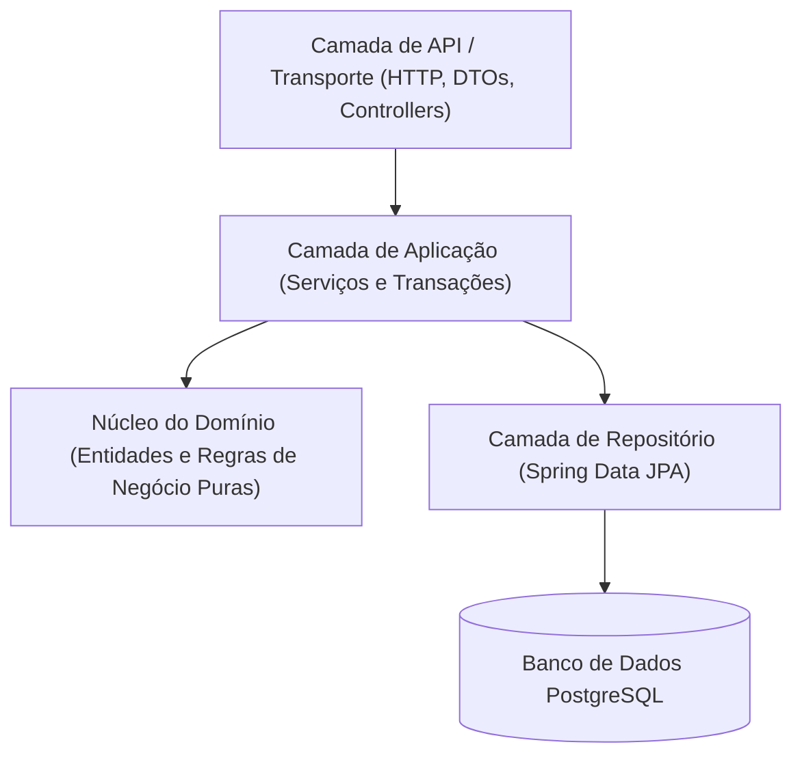

### Entidades versus Objetos de Valor (Value Objects)

1. **Entidades (*Entities*):** Objetos definidos por uma linha contínua de identidade ao longo do tempo, e não exclusivamente por seus atributos transitórios. Dois produtos continuam sendo entidades distintas mesmo que possuam a mesma descrição e o mesmo valor, caso possuam códigos identificadores diferentes. Inversamente, se o valor de um produto for alterado, sua identidade permanece a mesma.
2. **Objetos de Valor (*Value Objects*):** Elementos conceituais que descrevem características ou grandezas, sendo definidos unicamente pela totalidade dos seus valores. São intrinsecamente imutáveis: se qualquer elemento mudar, tem-se uma nova instância. Dois objetos de valor com atributos idênticos são absolutamente equivalentes.

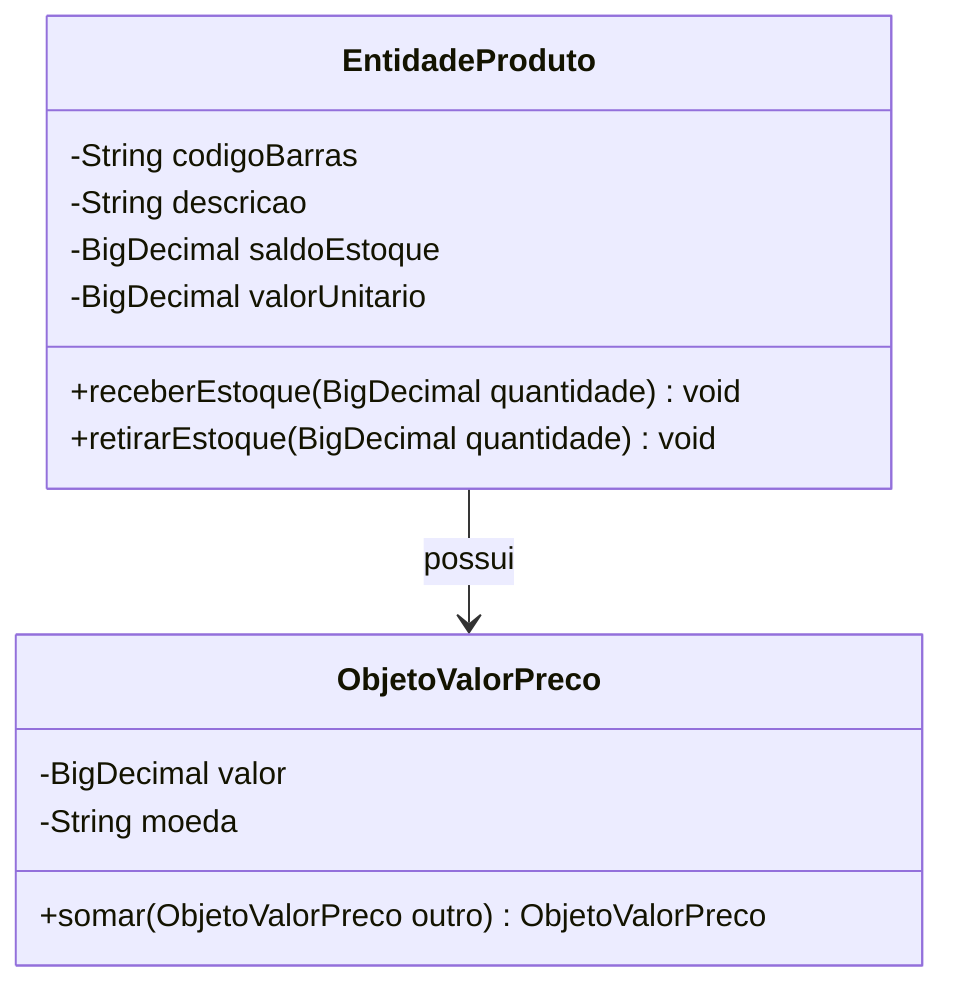

### Encapsulamento estrito e defesa de invariantes de negócio

- **Invariante de Negócio:** É uma asserção lógica que deve permanecer verdadeira durante todo o ciclo de vida de uma entidade válida.
- **Encapsulamento Efetivo:** Consiste em impedir que agentes externos coloquem a entidade em um estado corrompido. Proíbe-se a exposição de métodos modificadores públicos (`setters`) arbitrários. O estado interno só pode ser alterado através de métodos de negócio que validam as invariantes antes de atualizar os atributos.

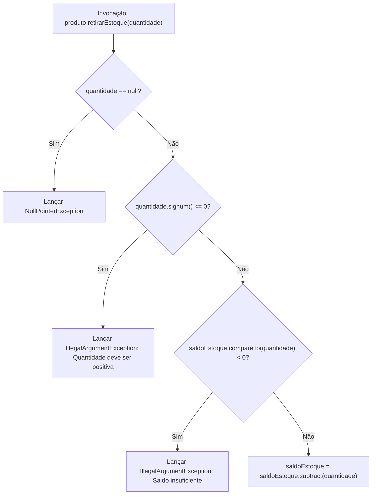

### O modelo rico versus o anti-padrão do modelo anêmico

- **Modelo Anêmico (*Anemic Domain Model*):** Entidades reduzidas a simples bolsas de dados sem lógica (`getters` e `setters`), enquanto a lógica de validação fica dispersa em serviços procedurais. Permite a criação de objetos vazios e corrompidos em memória.
- **Modelo Rico (*Rich Domain Model*):** As entidades concentram dados e comportamentos. Elas protegem seu próprio estado e recusam instanciações ou mutações ilegais através de seus construtores e métodos expressivos.

```java
// Anti-padrão: Modelo Anêmico
Produto p = new Produto();
p.setSaldoEstoque(p.getSaldoEstoque().subtract(qtd)); // Sem validações na entidade!

// Padrão Recomendado: Modelo Rico
produto.retirarEstoque(qtd); // Protegido e validado
```

### Aritmética decimal exata com BigDecimal

Os tipos primitivos `float` (32 bits) e `double` (64 bits) implementam a aritmética binária IEEE 754. Eles foram concebidos para computação gráfica e científica, onde a velocidade de cálculo sobrepuja a exatidão absoluta de pequenas frações.

Na aritmética binária, frações decimais simples como $`0.1`$ ou $`0.2`$ resultam em dízimas periódicas infinitas, produzindo desvios matemáticos:

```java
double a = 0.1;
double b = 0.2;
System.out.println(a + b); // Imprime: 0.30000000000000004
```

Em sistemas de gestão financeira e de estoque, esse comportamento é inaceitável. Deve-se empregar exclusivamente a classe `java.math.BigDecimal`, com atenção a três regras mandatórias:

1. **Construção via String:** Nunca instancie via `new BigDecimal(double)`. Utilize o construtor que aceita `String` ou o método estático `BigDecimal.valueOf(double)`.
2. **Controle de Escala e Arredondamento:** Ao realizar multiplicações e divisões, determine a escala decimal e o algoritmo de corte através de `RoundingMode.HALF_UP` (arredondamento bancário clássico).
3. **Comparação de Valores (`compareTo` versus `equals`):** O método `equals()` avalia o valor numérico e a escala. Assim, `new BigDecimal("10.0")` não é igual a `new BigDecimal("10.00")`. Para aferir igualdade matemática em testes e regras de negócio, utilize sempre `compareTo(outro) == 0`.

### Mapeamento e sincronização de associações bidirecionais 1:N em memória

No banco relacional, relacionamentos $`1:N`$ são estruturados de forma unidirecional: a tabela filha (`produto`) possui a chave estrangeira apontando para a tabela pai (`grupo_produto`).

Em memória na JVM, um relacionamento bidirecional exige que:
- O `GrupoProduto` mantenha uma lista interna de `Produto`;
- Cada `Produto` mantenha um ponteiro de referência para seu `GrupoProduto`.

Se essas referências forem manipuladas de forma solta por código cliente, o sistema atingirá inconsistência (o produto aponta para um grupo, mas a lista do grupo não contém o produto).

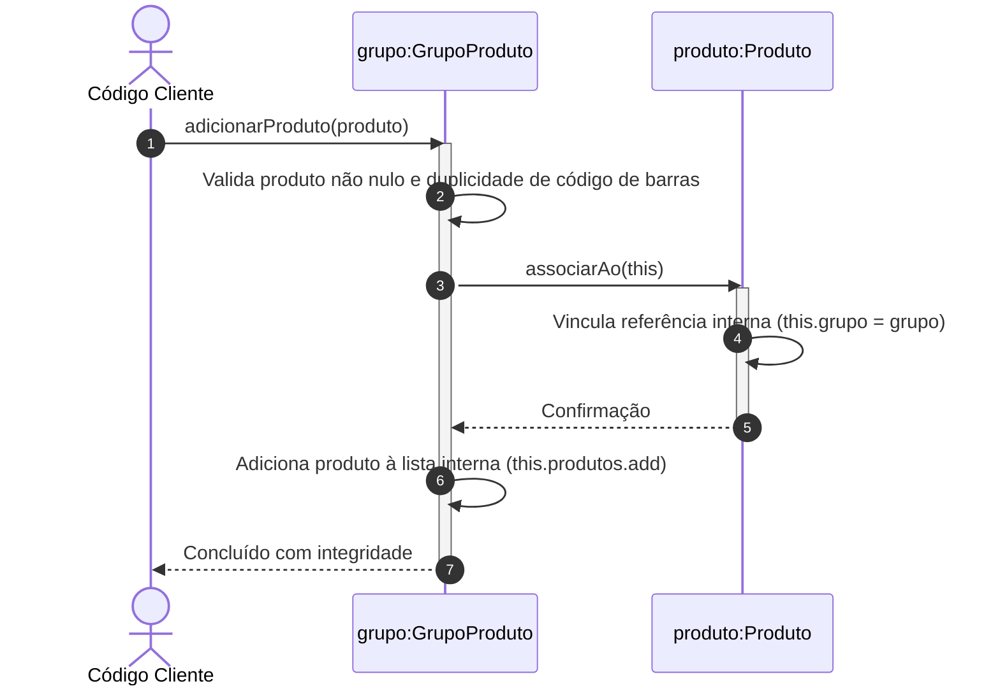

*Regras de implementação da associação:*
1. **Ponto de entrada único:** Apenas o método `adicionarProduto` de `GrupoProduto` é público para a operação.
2. **Visibilidade de pacote:** O método `associarAo` em `Produto` possui visibilidade protegida de pacote (*package-private*), impedindo que classes fora do pacote manipulem o ponteiro de forma desavisada.
3. **Coleção Encapsulada:** O método `getProdutos()` em `GrupoProduto` retorna uma coleção somente leitura via `Collections.unmodifiableList(this.produtos)`, impedindo que códigos externos executem mutações na lista ignorando as regras de integridade da entidade.

### Representação de estados finitos com Enum e datas determinísticas

- **Enumerações (`enum`):** Representam conjuntos finitos e imutáveis de valores permitidos (ex.: `Status.ATIVO`, `Status.INATIVO`). Conferem segurança estrita em tempo de compilação (*type-safety*), impedindo a gravação de literais corrompidos.
- **Datas com `LocalDate`:** Para datas de relevância contábil ou cadastral desprovidas de fuso horário, adota-se `java.time.LocalDate` em detrimento das classes legadas `java.util.Date` e `Calendar` (que são mutáveis e não thread-safe).

### Testes unitários puros com JUnit 5 no padrão AAA

Testes de unidade do domínio rico devem ser executados em Java puro, sem subir o contexto do Spring Boot, garantindo velocidade de execução:

- **Arrange (Preparar):** Instancia os objetos, dependências e dados necessários;
- **Act (Agir):** Executa a operação de negócio sob teste;
- **Assert (Afirmar):** Verifica as mutações de estado e o disparo de exceções esperadas.

```java
@Test
void deveLancarExcecaoAoTentarRetirarQuantidadeMaiorQueOSaldo() {
    // Arrange
    Produto produto = new Produto("7891", "Teclado", new BigDecimal("10.00"), new BigDecimal("100.00"));

    // Act & Assert
    IllegalArgumentException ex = assertThrows(IllegalArgumentException.class, () -> {
        produto.retirarEstoque(new BigDecimal("15.00"));
    });
    assertEquals("Saldo de estoque insuficiente", ex.getMessage());
}
```

---

## Módulo 4: Persistência Relacional com JPA, PostgreSQL e Liquibase

### A pilha de persistência: PostgreSQL, JDBC, JPA, Hibernate e Spring Data

A persistência de dados em aplicações corporativas Java baseia-se em uma hierarquia de abstrações com papéis específicos:

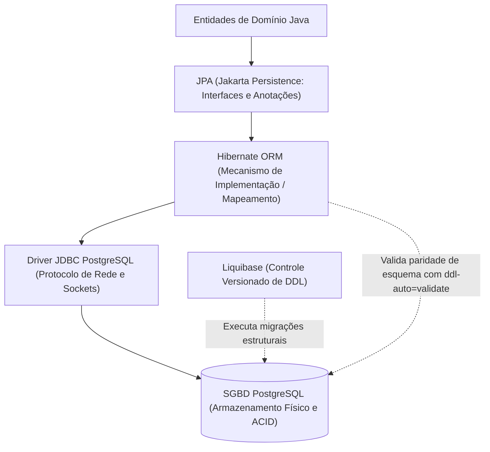

- **PostgreSQL:** Sistema Gerenciador de Banco de Dados Relacional (SGBD). Garante persistência em disco, transações ACID e integridade referencial física.
- **JDBC (*Java Database Connectivity*):** API básica de baixo nível do Java que conecta a aplicação ao banco via sockets, transmitindo comandos SQL puros e processando `ResultSets`.
- **JPA (*Jakarta Persistence*):** Especificação formal composta por anotações (`@Entity`, `@Id`) e interfaces (`EntityManager`). Não executa código por si só.
- **Hibernate:** Provedor ORM (*Object-Relational Mapping*). Implementa a especificação JPA, gerencia o cache de primeiro nível e converte operações em objetos para instruções SQL.
- **Spring Data JPA:** Camada de produtividade que gera dinamicamente implementações para interfaces de repositório, simplificando consultas.
- **Liquibase:** Ferramenta de migração de banco de dados. Atua como a **única fonte da verdade** sobre a evolução estrutural do banco.

### O descompasso de impedância objeto-relacional

O descompasso de impedância (*Object-Relational Impedance Mismatch*) decorre da fricção entre o modelo conceitual orientado a objetos (grafos de objetos com identidade em memória, encapsulamento e polimorfismo) e o modelo relacional (álgebra relacional baseada em tabelas, tuplas, chaves primárias e tipos escalares):

1. **Granularidade:** Objetos ricos como `BigDecimal` e `LocalDate` precisam ser convertidos para tipos SQL escalares (`NUMERIC(18,2)` e `DATE`).
2. **Identidade:** No Java, duas instâncias são idênticas se residem no mesmo endereço de memória (`==`) ou se satisfazem `equals()`. No banco, linhas são distintas se diferem em sua chave primária (`id`).
3. **Navegabilidade:** No Java, navega-se de `GrupoProduto` para seus `Produto` através de referências em memória. No banco, as consultas navegam da chave estrangeira contida em `produto` em direção à chave primária de `grupo_produto`.

### Migrações versionadas com Liquibase: Idempotência e integridade

A evolução do banco de dados relacional deve ser governada como código. O Liquibase registra a transição ordenada do esquema através de arquivos declarativos denominados **changelogs**:

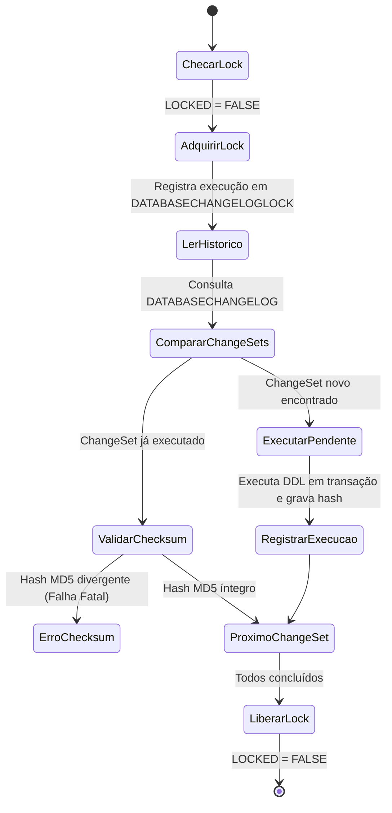

- **`DATABASECHANGELOGLOCK`:** Tabela de bloqueio atômico que impede execuções concorrentes de migração caso múltiplos nós da aplicação iniciem simultaneamente.
- **`DATABASECHANGELOG`:** Tabela append-only que registra o histórico de migrações contendo o identificador do `changeSet`, autor, arquivo de origem, timestamp e a soma de verificação criptográfica (`md5sum`).

> [!IMPORTANT]
> **Imutabilidade de ChangeSets:** Um `changeSet` que já foi executado em qualquer ambiente compartilhado torna-se estritamente imutável. Alterar o texto de uma migração existente invalida o seu `md5sum`, impedindo o boot da aplicação. Evoluções estruturais exigem **novos** changelogs incrementais.

### Estratégia de defesa em profundidade

A garantia da higidez dos dados em um sistema distribuído exige validações em múltiplas fronteiras concêntricas (*Defense in Depth*):

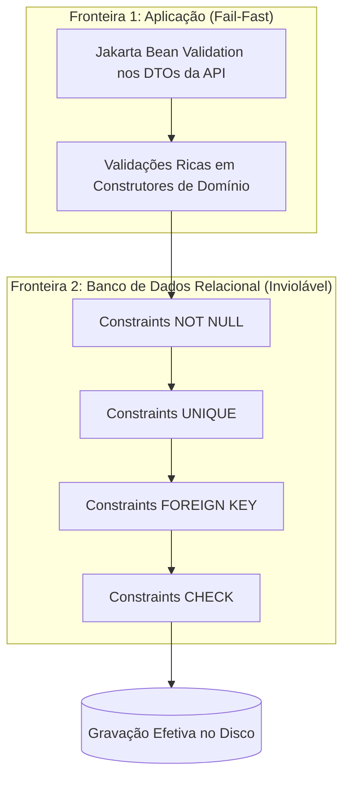

*Matriz de integridade:*

| Regra de Integridade | Camada de Aplicação (Java) | Camada de Banco (PostgreSQL) | Racional Arquitetural |
|---|---|---|---|
| **Saldo não pode ser negativo** | `validarNaoNegativo(...)` lança `IllegalArgumentException` | `CONSTRAINT ck_produto_saldo CHECK (saldo_estoque >= 0)` | Falha rápida na aplicação antes de gastar I/O de rede; garantia no banco contra scripts externos. |
| **Código de barras único** | Validação no método `adicionarProduto` em memória | `CONSTRAINT uk_produto_codigo_barras UNIQUE (codigo_barras)` | Tratamento de integridade na aplicação e proteção final contra condições de corrida concorrentes no banco. |
| **Integridade de Relacionamento** | Ponteiros de referência de objeto não nulos | `CONSTRAINT fk_produto_grupo FOREIGN KEY ... NOT NULL` | O Java previne ponteiros perdidos; o SGBD impede registros órfãos fisicamente no disco. |

### Isolamento de perfis no Spring e paridade de ambientes

O uso do banco em memória H2 para testes é expressamente proibido neste curso. O H2 possui dialetos, locks, mecanismos de ordenação e estruturas de tabelas diferentes do PostgreSQL.

Adota-se **paridade tecnológica estrita**, operando com instâncias reais do PostgreSQL isoladas por perfis (*profiles*):
- **Perfil `dev`:** Banco `suporteos2026_dev` para testes manuais no ambiente de desenvolvimento.
- **Perfil `test`:** Banco `suporteos2026_test` dedicado à execução de testes automatizados com o Maven. Os dados são limpos ou revertidos a cada ciclo de teste.
- **Perfil `prod`:** Banco de produção com credenciais injetadas exclusivamente via variáveis do sistema operacional.

```mermaid
flowchart LR
    DevProfile["Profile 'dev'"] -->|"Lê .env (DB_DEV_*)"| BancoDev[("PostgreSQL: suporteos2026_dev")]
    TestProfile["Profile 'test'"] -->|"Lê .env (DB_TEST_*)"| BancoTest[("PostgreSQL: suporteos2026_test")]
```

### Gestão segura de segredos com variáveis de ambiente

As configurações de banco de dados são parametrizadas no arquivo `application-dev.properties` utilizando a sintaxe de expansão de variáveis do Spring:

```properties
spring.datasource.url=jdbc:postgresql://${DB_DEV_HOST:localhost}:${DB_DEV_PORT:5432}/${DB_DEV_NAME:suporteos2026_dev}
spring.datasource.username=${DB_DEV_USER:suporteos_app}
spring.datasource.password=${DB_DEV_PASSWORD}
```

O arquivo `.env` local contém os valores reais das variáveis e é mantido fora do versionamento pelo `.gitignore`.

### Mapeamento objeto-relacional declarativo com JPA

O mapeamento das entidades realiza a ponte entre as classes e as tabelas:

```java
package com.curso.suporteos.domain;

import jakarta.persistence.*;
import java.math.BigDecimal;
import java.time.LocalDate;

@Entity
@Table(
    name = "produto",
    uniqueConstraints = @UniqueConstraint(name = "uk_produto_codigo_barras", columnNames = "codigo_barras")
)
public class Produto {

    @Id
    @GeneratedValue(strategy = GenerationType.IDENTITY)
    private Long id;

    @Column(name = "codigo_barras", nullable = false, length = 50)
    private String codigoBarras;

    @Column(nullable = false, length = 150)
    private String descricao;

    @Column(name = "saldo_estoque", nullable = false, precision = 18, scale = 3)
    private BigDecimal saldoEstoque;

    @Column(name = "valor_unitario", nullable = false, precision = 18, scale = 2)
    private BigDecimal valorUnitario;

    @Column(name = "data_cadastro", nullable = false)
    private LocalDate dataCadastro;

    @Enumerated(EnumType.STRING)
    @Column(nullable = false, length = 20)
    private Status status;

    @ManyToOne(fetch = FetchType.LAZY)
    @JoinColumn(name = "grupo_produto_id", nullable = false, foreignKey = @ForeignKey(name = "fk_produto_grupo_produto"))
    private GrupoProduto grupo;

    // Construtor protegido exigido pela especificação JPA para reidratação reflexiva
    protected Produto() {}

    // Construtor canônico rico com validação de invariantes
    public Produto(String codigoBarras, String descricao, BigDecimal saldoEstoque, BigDecimal valorUnitario, GrupoProduto grupo) {
        // Validações e atribuição encapsulada
    }
}
```

### Validação estrita de esquema com ddl-auto=validate

No arquivo `application.properties`, a propriedade do Hibernate é travada em:

```properties
spring.jpa.hibernate.ddl-auto=validate
```

Isso garante que o Hibernate inspecione as classes `@Entity` no boot e confronte cada tabela, coluna e tipo com o catálogo do PostgreSQL. Se houver qualquer discrepância entre o que o Liquibase construiu e o que a classe Java mapeou, o Hibernate aborta a inicialização com uma exceção explícita (`SchemaManagementException`), impedindo erros silenciosos em produção.

---

## Módulo 5: Repositórios Spring Data JPA, Serviços de Aplicação e Transações

### Arquitetura em camadas e segregação de papéis

A aplicação organiza-se em camadas funcionais com limites rígidos de responsabilidade:

```mermaid
flowchart TD
    subgraph Web["Camada de Apresentação / Web"]
        Ctrl["REST Controller (@RestController)"]
    end

    subgraph Aplicacao["Camada de Aplicação / Serviços"]
        Srv["Application Service (@Service, @Transactional)"]
    end

    subgraph Dominio["Camada de Domínio"]
        Ent["Entidades Ricas e Invariantes (@Entity)"]
    end

    subgraph Persistencia["Camada de Repositório / Persistência"]
        Repo["Spring Data Repositories (@Repository)"]
    end

    Ctrl --> Srv
    Srv --> Repo
    Srv --> Ent
    Repo --> Ent
```

- **Camada de Domínio (`domain`):** Entidades, enums e regras de negócio invariantes. Não possui dependências de bibliotecas de transporte ou chamadas SQL.
- **Camada de Repositório (`repository`):** Abstrai as coleções de entidades persistidas. Fornece contratos para consulta, exclusão e salvamento de dados.
- **Camada de Aplicação / Serviço (`application`):** Orquestra os casos de uso do sistema. Carrega entidades via repositórios, invoca seus métodos de negócio, dispara validações de unicidade e delimita as fronteiras transacionais.
- **Camada Web / API (`api`):** Trata a comunicação com o cliente HTTP, processa DTOs e gerencia códigos de status.

### Spring Data JPA: Interfaces e proxies dinâmicos em tempo de execução

O Spring Data JPA elimina a necessidade de codificar classes de repositório manuais. O engenheiro declara uma interface que estende `JpaRepository<T, ID>`:

```java
package com.curso.suporteos.repository;

import com.curso.suporteos.domain.Produto;
import org.springframework.data.jpa.repository.JpaRepository;
import java.util.Optional;

public interface ProdutoRepository extends JpaRepository<Produto, Long> {
    Optional<Produto> findByCodigoBarras(String codigoBarras);
    boolean existsByCodigoBarras(String codigoBarras);
}
```

Durante o *bootstrap* da aplicação, o contêiner IoC do Spring realiza o escaneamento do pacote, intercepta a interface e instancia um **Dynamic Proxy** acoplado à classe padrão `SimpleJpaRepository`. O proxy gerado é registrado como um Bean gerenciado no contexto do Spring.

```mermaid
sequenceDiagram
    autonumber
    participant Boot as Bootstrap Spring Boot
    participant Scan as Repository Component Scan
    participant Fábrica as Dynamic Proxy Factory
    participant Ctx as ApplicationContext
    participant Srv as ProdutoService

    Boot->>Scan: Inicia varredura em com.curso.suporteos.repository
    Scan->>Fábrica: Localiza interface ProdutoRepository
    Fábrica->>Fábrica: Gera instância proxy baseada em SimpleJpaRepository
    Fábrica->>Ctx: Registra proxy dinâmico como Bean
    Ctx->>Srv: Injeta o proxy via construtor de ProdutoService
```

### Injeção de dependências estrita via construtores

É terminantemente proibido o uso da anotação `@Autowired` sobre campos privados. Adota-se a injeção estrita via construtores:

```java
@Service
public class ProdutoService {

    private final ProdutoRepository produtoRepository;
    private final GrupoProdutoRepository grupoRepository;

    public ProdutoService(ProdutoRepository produtoRepository, GrupoProdutoRepository grupoRepository) {
        this.produtoRepository = produtoRepository;
        this.grupoRepository = grupoRepository;
    }
}
```

- **Imutabilidade Real:** Permite declarar as dependências como `final`.
- **Fail-Fast em Dependências Cíclicas:** A JVM detecta e impede ciclos de injeção no boot.
- **Testabilidade:** Permite instanciar a classe em testes unitários puros passando instâncias simuladas (*mocks*) no construtor sem auxílio do Spring.

### Consultas derivadas por convenção de nomenclatura (Derived Queries)

O Spring Data compila expressões JPQL canônicas a partir da assinatura semântica dos métodos declarados na interface de repositório, dividindo-os em prefixo de operação e predicado de restrição delimitados por `By`:

```text
[Operação Principal] + "By" + [Propriedades e Conectivos Lógicos]
findByCodigoBarras
existsByEmail
findByStatusAndValorUnitarioGreaterThan
findByGrupo_Id
```

*Exemplos de derived queries:*

```java
// Busca exata por chave única
Optional<Produto> findByCodigoBarras(String codigoBarras);

// Verificação rápida de existência sem trazer entidade em memória
boolean existsByCodigoBarras(String codigoBarras);

// Travessia de propriedade da entidade associada (produto.grupo.id)
List<Produto> findByGrupoId(Long grupoId);
```

### Fronteiras transacionais declarativas com @Transactional

A anotação `@Transactional` gerencia as propriedades ACID da transação física no banco:

- **Operações de Escrita (`@Transactional`):** Abre a transação, desativa o autocommit e comete (*commit*) os dados ao término. Caso uma exceção não verificada (`RuntimeException`) seja disparada, aciona imediatamente a reversão (*rollback*).
- **Operações de Leitura (`@Transactional(readOnly = true)`):** Informa à engine do Hibernate e ao driver JDBC que não haverá gravação. O Hibernate otimiza a sessão desabilitando o mecanismo de verificação de sujeira (*dirty checking*), economizando alocação de memória e ciclos de CPU.

```mermaid
flowchart TD
    Chamada["Invocação de método anotado com @Transactional"] --> AOP["Proxy Interceptador AOP abre transação física"]
    AOP --> Execucao["Execução dos casos de uso e chamadas JPA"]
    Execucao --> TesteErro{"Ocorreu RuntimeException?"}
    TesteErro -- "Não (Sucesso)" --> Commit["Proxy executa COMMIT e sincroniza alterações"]
    TesteErro -- "Sim (Falha)" --> Rollback["Proxy executa ROLLBACK integral e aborta"]
```

### Estados do ciclo de vida de uma entidade JPA

Dentro e fora do Contexto de Persistência (*Persistence Context*), uma entidade transita por quatro estados formais:

```mermaid
stateDiagram-v2
    [*] --> Transient : new Produto(...)
    Transient --> Managed : persist() / save()
    Managed --> Detached : close() / clear() / detach()
    Detached --> Managed : merge()
    Managed --> Removed : remove() / delete()
    Removed --> [*] : Commit da transação (DELETE físico)
```

1. **Transient (Transitório):** Objeto recém-instanciado pelo operador `new`. Existe apenas na memória da JVM; não possui ID gerado e não está vinculado a nenhuma sessão JPA.
2. **Managed (Gerenciado):** Objeto vinculado ativamente ao contexto de persistência. O Hibernate rastreia toda e qualquer mutação realizada em seus atributos.
3. **Detached (Desanexado):** A entidade possui um ID associado, mas a sessão transacional na qual ela foi carregada foi encerrada. Alterações em seus campos não são propagadas ao banco.
4. **Removed (Removido):** Marcada para exclusão física; o comando SQL `DELETE` será disparado no momento da sincronização (*flush*).

### Mecanismo de detecção automática de alterações (Dirty Checking)

Quando uma entidade entra no estado **Managed**, o Hibernate armazena uma cópia fiel de seu estado inicial (*snapshot*). Ao término do método transacional, o Hibernate compara o estado atual do objeto em memória com o snapshot original.

Se houver diferenças, o Hibernate agenda e executa os comandos `UPDATE` automaticamente no banco antes do commit, **sem necessidade de invocar métodos explícitos como `repository.save()`**.

```java
@Transactional
public void atualizarPreco(Long id, BigDecimal novoPreco) {
    Produto produto = produtoRepository.findById(id)
        .orElseThrow(() -> new RecursoNaoEncontradoException("Produto não encontrado"));

    // O método de domínio altera o estado do objeto gerenciado
    produto.atualizarPreco(novoPreco);

    // O Hibernate detecta a alteração via Dirty Checking e dispara o UPDATE no banco automaticamente!
}
```

### Modelagem de exceções de negócio da aplicação

Erros de regra de negócio devem ser sinalizados através de exceções dedicadas de runtime, desacopladas de códigos HTTP:

```java
package com.curso.suporteos.application.exception;

public class RecursoNaoEncontradoException extends RuntimeException {
    public RecursoNaoEncontradoException(String mensagem) {
        super(mensagem);
    }
}
```

```java
package com.curso.suporteos.application.exception;

public class RecursoDuplicadoException extends RuntimeException {
    public RecursoDuplicadoException(String mensagem) {
        super(mensagem);
    }
}
```

### Testes de integração transacionais com reversão automática

Testes de integração que verificam a persistência devem operar sobre o perfil de teste (`application-test.properties`), anotados com `@SpringBootTest` e `@Transactional`. Ao término de cada método de teste, o Spring executa automaticamente o *rollback*, garantindo que a base de testes permaneça estéril para as asserções seguintes.

---

## Módulo 6: Evolução do Modelo Relacional e Changelogs Assistidos

### Evolução de esquema: ddl-auto versus diff versus migração versionada

| Dimensão | Geração via Hibernate (`ddl-auto=update`) | Liquibase Diff Automático | Migração Versionada Auditada |
|---|---|---|---|
| **Determinismo** | Baixo: depende do estado corrente do banco | Médio: infere diferenças estruturais brutas | Absoluto: reproduzível em qualquer ambiente |
| **Preservação de Dados** | Nula: ignora transição de registros pré-existentes | Nula: não gera comandos de backfill de dados | Total: planeja transição de dados com SQL |
| **Versionamento** | Inexistente (ocorre em tempo de execução) | Rascunho efêmero em arquivo temporário | Total: arquivos declarativos comitados no Git |
| **Capacidade de Rollback** | Inexistente | Parcial ou ausente | Total: comandos explícitos de reversão |

### Topologia de comparação diferencial com bancos reais no PostgreSQL

A extensão `liquibase-hibernate` apresenta instabilidades de introspecção estática com Java 21 e Hibernate 7 (falhas de `NullPointerException` em metadados JDBC). 

A solução de engenharia adotada utiliza **dois bancos de dados reais descartáveis** instanciados no PostgreSQL:

```mermaid
flowchart LR
    subgraph TargetEnv["Banco Alvo / Destino (suporteos2026_diff)"]
        D1["Recebe os changelogs oficiais já aplicados (001 + 002)"]
    end

    subgraph RefEnv["Banco de Referência (suporteos2026_reference)"]
        D2["Materializado pelo Hibernate (ddl-auto=create) com o código Java novo"]
    end

    subgraph DiffEngine["Motor Liquibase (liquibase-maven-plugin)"]
        D1 -->|"url"| Engine["Compara metadados via JDBC nativo"]
        D2 -->|"referenceUrl"| Engine
        Engine --> Rascunho["Gera rascunho: target/liquibase-diff/changelog.yaml"]
    end
```

### Evolução do domínio: Entidade Fornecedor e associação opcional

A evolução do sistema introduz a entidade `Fornecedor` e associa-a opcionalmente a `Produto`:

```java
@ManyToOne(fetch = FetchType.LAZY)
@JoinColumn(name = "fornecedor_id", foreignKey = @ForeignKey(name = "fk_produto_fornecedor"))
private Fornecedor fornecedor;
```

*Racional da chave estrangeira opcional:* Em bases de dados já existentes em produção com milhares de produtos cadastrados, impor uma coluna `fornecedor_id` obrigatória (`nullable = false`) provocaria a quebra imediata do sistema, pois não há registros históricos de fornecedores para associar aos produtos legados. A relação nasce opcional para garantir a retrocompatibilidade.

### Evolução de campos e retrocompatibilidade de código

Ao adicionar um atributo obrigatório como `BigDecimal estoqueMinimo` na classe `Produto`, deve-se preservar o construtor legado invocando o construtor novo com um valor padrão seguro (*overload de construtores*), garantindo que testes unitários legados não quebrem:

```java
// Construtor legado preservado para compatibilidade retroativa
public Produto(String codigoBarras, String descricao, BigDecimal saldoEstoque, BigDecimal valorUnitario, GrupoProduto grupo) {
    this(codigoBarras, descricao, saldoEstoque, valorUnitario, BigDecimal.ZERO, grupo);
}

// Construtor canônico atualizado
public Produto(String codigoBarras, String descricao, BigDecimal saldoEstoque, BigDecimal valorUnitario, BigDecimal estoqueMinimo, GrupoProduto grupo) {
    // Validações e atribuição
}
```

### Geração assistida com liquibase-maven-plugin

O plugin do Liquibase é configurado no `pom.xml` para ler as URLs de conexão dos dois bancos temporários e produzir um rascunho de migração:

```bash
./mvnw liquibase:diff
```

### Auditoria e saneamento de diffs gerados automaticamente

O arquivo gerado pelo plugin em `target/liquibase-diff` é apenas um **rascunho**. Ele deve ser auditado criticamente pelo desenvolvedor:
1. **Remoção de Falsos Positivos:** O diff frequentemente acusa índices e sequences nativas do PostgreSQL como novas alterações desnecessárias.
2. **Padronização de Nomenclatura:** Substituição de nomes automáticos aleatórios de constraints por nomes semânticos do projeto (ex.: `fk_produto_fornecedor`, `uk_fornecedor_cnpj`).
3. **Escrita Manual de Rollback:** O diff raramente gera scripts reversos seguros de exclusão de colunas e constraints.

### O padrão Expand-Migrate-Contract para colunas obrigatórias

A inclusão de uma coluna `NOT NULL` sobre uma tabela já populada em produção não pode ser realizada de forma abrupta (`ALTER TABLE produto ADD COLUMN estoque_minimo NUMERIC NOT NULL`), pois a instrução falhará imediatamente pela existência de linhas pré-existentes com valores nulos.

Aplica-se o padrão **Expand-Migrate-Contract** dentro do mesmo `changeSet` ou em migrações ordenadas:

```mermaid
flowchart TD
    Expand["1. Expandir: Cria a coluna permitindo valores nulos (nullable: true)"] --> Migrate["2. Migrar: Executa UPDATE atribuindo valor default aos dados legados"]
    Migrate --> Contract["3. Contrair: Aplica a restrição de obrigatoriedade (nullable: false) e CHECK"]
```

```yaml
- changeSet:
    id: 003-adicionar-estoque-minimo
    author: jefferson
    changes:
      # 1. Expandir
      - addColumn:
          tableName: produto
          columns:
            - column:
                name: estoque_minimo
                type: numeric(18, 3)
                constraints:
                  nullable: true
      # 2. Migrar
      - sql:
          sql: UPDATE produto SET estoque_minimo = 0 WHERE estoque_minimo IS NULL;
      # 3. Contrair
      - addNotNullConstraint:
          tableName: produto
          columnName: estoque_minimo
          columnDataType: numeric(18, 3)
      - addCheckConstraint:
          tableName: produto
          constraintName: ck_produto_estoque_minimo
          checkCondition: "estoque_minimo >= 0"
    rollback:
      - dropColumn:
          tableName: produto
          columnName: estoque_minimo
```

### Enriquecimento manual: Constraints de integridade e rollbacks reversos

O Liquibase diff é incapaz de inferir constraints de validação matemática (`CHECK`) a partir de anotações Java. O desenvolvedor deve incluir manualmente no YAML as checagens físicas (`CHECK (saldo_estoque >= 0)`) e a regra de integridade de deleção `onDelete="RESTRICT"`, impedindo a remoção de fornecedores ou grupos que possuam produtos vinculados.

---

## Módulo 7: Camada Web REST, DTOs Imutáveis, Mapeadores e Validação

### O papel da camada de controle REST

Os controladores REST (`@RestController`) funcionam como adaptadores de interface do sistema:
- Interceptam requisições HTTP e desserializam JSON para objetos Java;
- Disparam a validação sintática da borda (`@Valid`);
- Delegam o processamento para a camada de serviços de aplicação (`@Service`);
- Empacotam o resultado em DTOs de resposta, definindo códigos de status semânticos e cabeçalhos de rede (`Location`).
- **Não devem conter:** Cálculos matemáticos de domínio, lógicas de regras de negócio ou chamadas diretas ao banco de dados.

### Riscos e armadilhas da exposição direta de entidades JPA

Retornar instâncias de classes `@Entity` diretamente nos métodos do `@RestController` é um anti-padrão grave:

1. **Vazamento de Dados Confidenciais:** Propriedades internas ou metadados de auditoria podem vazar para o cliente;
2. **Ciclos de Serialização Infinita:** Entidades com associações bidirecionais (ex.: `Instrutor` possui `List<Curso>` e `Curso` aponta para `Instrutor`) geram estouro de pilha (`StackOverflowError`) durante a conversão para JSON via Jackson:
   
```mermaid
flowchart LR
    A["Instrutor"] -->|"getCursos()"| B["Curso"]
    B -->|"getInstrutor()"| A
```

3. **Exceções de Lazy Loading (`LazyInitializationException`):** A serialização ocorre fora da transação de banco. Ao tentar ler atributos `FetchType.LAZY`, o Jackson dispara exceções por ausência de sessão aberta.
4. **Vulnerabilidade de Atribuição em Massa (*Mass Assignment*):** Um cliente malicioso pode enviar campos que deveriam ser imutáveis (ex.: `status: "ATIVO"`, `saldoEstoque: 9999`) e o framework associá-los automaticamente.

### Data Transfer Objects (DTOs) e imutabilidade com Java Records

A solução canônica é a utilização de **Data Transfer Objects (DTOs)** implementados por meio de **Java Records**:
- **Imutabilidade Intrínseca:** Todos os atributos de um `record` são `private final`. Não possuem *setters*, impedindo efeitos colaterais acidentais após a desserialização;
- **Concisão e Sintaxe Limpa:** O compilador gera automaticamente construtor canônico, métodos de leitura (`nome()`, `email()`), `equals()`, `hashCode()` e `toString()`.

```java
package com.curso.suporteos.api.dto;

import jakarta.validation.constraints.NotBlank;
import jakarta.validation.constraints.NotNull;
import jakarta.validation.constraints.Positive;
import java.math.BigDecimal;

public record ProdutoRequest(
    @NotBlank(message = "Código de barras é obrigatório")
    String codigoBarras,

    @NotBlank(message = "Descrição é obrigatória")
    String descricao,

    @NotNull(message = "Saldo de estoque é obrigatório")
    BigDecimal saldoEstoque,

    @NotNull(message = "Valor unitário é obrigatório")
    @Positive(message = "Valor unitário deve ser maior que zero")
    BigDecimal valorUnitario,

    @NotNull(message = "Grupo é obrigatório")
    Long grupoId,

    Long fornecedorId
) {}
```

```java
package com.curso.suporteos.api.dto;

import java.math.BigDecimal;

public record ProdutoResponse(
    Long id,
    String codigoBarras,
    String descricao,
    BigDecimal saldoEstoque,
    BigDecimal valorUnitario,
    String status,
    String grupoNome,
    String fornecedorRazaoSocial
) {}
```

### Validação declarativa na borda com Jakarta Bean Validation

O módulo `spring-boot-starter-validation` introduz o processamento declarativo de restrições na borda da aplicação:
- `@NotBlank`: O campo não pode ser nulo e deve conter pelo menos um caractere não-branco (exclusivo para strings).
- `@NotNull`: O objeto ou número não pode ser nulo.
- `@Size(min = 3, max = 120)`: Restringe o tamanho de caracteres.
- `@Positive`: O valor numérico deve ser estritamente maior que zero ($`x > 0`$).
- `@PositiveOrZero`: O valor numérico deve ser maior ou igual a zero ($`x \ge 0`$).
- `@Email`: Valida se a string satisfaz à sintaxe de correio eletrônico.

Ao anotar o DTO com `@Valid` na assinatura do método do controller, o Spring intercepta os dados antes da execução do método. Se houver violações, dispara automaticamente uma `MethodArgumentNotValidException`.

### Mapeamento manual desacoplado

Adota-se a escrita de mapeadores manuais puros implementados como componentes Spring (`@Component`). Isso elimina dependências complexas de bibliotecas de reflexão (como ModelMapper ou MapStruct), garantindo clareza total sobre quais campos estão sendo transformados:

```java
package com.curso.suporteos.api.mapper;

import com.curso.suporteos.api.dto.ProdutoResponse;
import com.curso.suporteos.domain.Produto;
import org.springframework.stereotype.Component;

@Component
public class ProdutoMapper {

    public ProdutoResponse toResponse(Produto p) {
        return new ProdutoResponse(
            p.getId(),
            p.getCodigoBarras(),
            p.getDescricao(),
            p.getSaldoEstoque(),
            p.getValorUnitario(),
            p.getStatus().name(),
            p.getGrupo().getNome(),
            p.getFornecedor() != null ? p.getFornecedor().getRazaoSocial() : null
        );
    }
}
```

### Controllers REST, respostas semânticas e o cabeçalho Location

No método de cadastro (`POST`), é mandatório responder com o status `201 Created` e incluir o cabeçalho `Location` contendo a URI completa para acesso ao recurso recém-criado, utilizando `ServletUriComponentsBuilder`:

```java
@PostMapping
public ResponseEntity<ProdutoResponse> cadastrar(@RequestBody @Valid ProdutoRequest request) {
    Produto produtoCriado = produtoService.cadastrar(
        request.codigoBarras(),
        request.descricao(),
        request.saldoEstoque(),
        request.valorUnitario(),
        request.grupoId(),
        request.fornecedorId()
    );

    URI location = ServletUriComponentsBuilder.fromCurrentRequest()
        .path("/{id}")
        .buildAndExpand(produtoCriado.getId())
        .toUri();

    return ResponseEntity.created(location).body(produtoMapper.toResponse(produtoCriado));
}
```

### Tratamento global de exceções com @RestControllerAdvice e ApiError

Para impedir que a aplicação vaze rastros de pilha (*stack traces*) e erros técnicos em formato HTML, implementa-se um interceptador global de erros com `@RestControllerAdvice`:

```mermaid
flowchart LR
    Excecao["Disparo de Exceção no Controller ou Service"] --> Interceptador["ApiExceptionHandler (@RestControllerAdvice)"]
    Interceptador --> Mapeamento{"Tipo da Exceção?"}
    Mapeamento -- "RecursoNaoEncontradoException" --> R404["404 Not Found (ApiError)"]
    Mapeamento -- "RecursoDuplicadoException" --> R409["409 Conflict (ApiError)"]
    Mapeamento -- "MethodArgumentNotValidException" --> R400["400 Bad Request (ApiError com lista de campos)"]
    Mapeamento -- "Qualquer outra Exception" --> R500["500 Internal Error (ApiError genérico)"]
```

```java
package com.curso.suporteos.api.exception;

import com.fasterxml.jackson.annotation.JsonInclude;
import java.time.LocalDateTime;
import java.util.Map;

@JsonInclude(JsonInclude.Include.NON_NULL)
public record ApiError(
    int status,
    String erro,
    String mensagem,
    String caminho,
    LocalDateTime timestamp,
    Map<String, String> campos
) {
    public static ApiError simples(int status, String erro, String mensagem, String caminho) {
        return new ApiError(status, erro, mensagem, caminho, LocalDateTime.now(), null);
    }

    public static ApiError comCampos(int status, String erro, String mensagem, String caminho, Map<String, String> campos) {
        return new ApiError(status, erro, mensagem, caminho, LocalDateTime.now(), campos);
    }
}
```

```java
package com.curso.suporteos.api.exception;

import com.curso.suporteos.application.exception.RecursoDuplicadoException;
import com.curso.suporteos.application.exception.RecursoNaoEncontradoException;
import jakarta.servlet.http.HttpServletRequest;
import org.springframework.http.HttpStatus;
import org.springframework.http.ResponseEntity;
import org.springframework.validation.FieldError;
import org.springframework.web.bind.MethodArgumentNotValidException;
import org.springframework.web.bind.annotation.ExceptionHandler;
import org.springframework.web.bind.annotation.RestControllerAdvice;

import java.util.HashMap;
import java.util.Map;

@RestControllerAdvice
public class ApiExceptionHandler {

    @ExceptionHandler(RecursoNaoEncontradoException.class)
    public ResponseEntity<ApiError> tratarNaoEncontrado(RecursoNaoEncontradoException ex, HttpServletRequest req) {
        return ResponseEntity.status(HttpStatus.NOT_FOUND)
            .body(ApiError.simples(404, "Not Found", ex.getMessage(), req.getRequestURI()));
    }

    @ExceptionHandler(RecursoDuplicadoException.class)
    public ResponseEntity<ApiError> tratarDuplicidade(RecursoDuplicadoException ex, HttpServletRequest req) {
        return ResponseEntity.status(HttpStatus.CONFLICT)
            .body(ApiError.simples(409, "Conflict", ex.getMessage(), req.getRequestURI()));
    }

    @ExceptionHandler(MethodArgumentNotValidException.class)
    public ResponseEntity<ApiError> tratarValidacao(MethodArgumentNotValidException ex, HttpServletRequest req) {
        Map<String, String> erros = new HashMap<>();
        for (FieldError fe : ex.getBindingResult().getFieldErrors()) {
            erros.put(fe.getField(), fe.getDefaultMessage());
        }
        return ResponseEntity.status(HttpStatus.BAD_REQUEST)
            .body(ApiError.comCampos(400, "Bad Request", "Erro de validação nos campos submetidos", req.getRequestURI(), erros));
    }
}
```

### Testes de integração da camada Web com MockMvc

O `MockMvc` permite testar toda a infraestrutura web do Spring (roteamento, validações, cabeçalhos e serialização JSON) sem a necessidade de subir um servidor HTTP físico de rede real:

```java
@SpringBootTest
@AutoConfigureMockMvc
@ActiveProfiles("test")
@Transactional
class ProdutoControllerTest {

    @Autowired
    private MockMvc mockMvc;

    @Test
    void deveRetornar400QuandoSubmeterPayloadInvalido() throws Exception {
        mockMvc.perform(post("/api/produtos")
                .contentType(MediaType.APPLICATION_JSON)
                .content("{}"))
            .andExpect(status().isBadRequest())
            .andExpect(jsonPath("$.status").value(400))
            .andExpect(jsonPath("$.campos.descricao").exists());
    }
}
```

### Automação de testes de contrato com Postman

No Postman, as requisições são organizadas em coleções parametrizadas por variáveis de ambiente (`{{base_url}}`). Utilizam-se scripts na aba **Tests** (*Post-response*) para automatizar asserções de contrato:

```javascript
// Validação de status code 201 e extração de variável dinâmica
pm.test("Status code é 201 Created", function () {
    pm.response.to.have.status(201);
});

pm.test("Cabeçalho Location está presente", function () {
    pm.response.to.have.header("Location");
});

var json = pm.response.json();
pm.environment.set("produto_id", json.id);
```

---

## Módulo 8: Estudo de Caso Prático — Aplicação Catálogo de Cursos

### Análise do problema e regras do relacionamento 1:N

Para consolidar as exigências avaliativas práticas da disciplina, analisamos a aplicação **Catálogo de Cursos** (`br.edu.catalogocursos`), criada em um repositório isolado e independente de `suporteos2026`.

*Regras de Negócio Fundamentais:*
- O sistema gerencia as entidades `Instrutor` e `Curso` em um relacionamento $`1:N`$ bidirecional;
- Um Instrutor ministra múltiplos Cursos; um Curso pertence a exatamente um Instrutor;
- `Instrutor`: identificador numérico `id`, `nome` (3 a 120 caracteres), `email` único e válido, e coleção interna `cursos`;
- `Curso`: identificador numérico `id`, `titulo` (3 a 150 caracteres), `cargaHoraria` (inteiro positivo entre 1 e 400), `nivel` (Enum: `INICIANTE`, `INTERMEDIARIO`, `AVANCADO`) e a referência obrigatória ao seu `Instrutor`;
- O Hibernate opera estritamente sob `ddl-auto=validate`. O esquema relacional físico é versionado via Liquibase;
- Ausência total de loops cíclicos de serialização JSON por meio do uso de DTOs Records imutáveis.

```mermaid
erDiagram
    INSTRUTOR ||--o{ CURSO : ministra
    INSTRUTOR {
        bigint id PK
        varchar nome
        varchar email UK
    }
    CURSO {
        bigint id PK
        varchar titulo
        integer carga_horaria
        varchar nivel
        bigint instrutor_id FK
    }
```

### Estrutura física do banco de dados e migrações Liquibase

O arquivo mestre `src/main/resources/db/changelog/db.changelog-master.yaml` orquestra as migrações:

```yaml
databaseChangeLog:
  - include:
      file: db/changelog/migrations/001-create-instrutor.yaml
  - include:
      file: db/changelog/migrations/002-create-curso.yaml
```

*Migração 001: Criação da Tabela Instrutor:*

```yaml
databaseChangeLog:
  - changeSet:
      id: 001-create-instrutor
      author: jefferson
      changes:
        - createTable:
            tableName: instrutor
            columns:
              - column:
                  name: id
                  type: bigint
                  autoIncrement: true
                  constraints:
                    primaryKey: true
                    primaryKeyName: pk_instrutor
              - column:
                  name: nome
                  type: varchar(120)
                  constraints:
                    nullable: false
              - column:
                  name: email
                  type: varchar(150)
                  constraints:
                    nullable: false
                    unique: true
                    uniqueConstraintName: uk_instrutor_email
      rollback:
        - dropTable:
            tableName: instrutor
```

*Migração 002: Criação da Tabela Curso com FK Física:*

```yaml
databaseChangeLog:
  - changeSet:
      id: 002-create-curso
      author: jefferson
      changes:
        - createTable:
            tableName: curso
            columns:
              - column:
                  name: id
                  type: bigint
                  autoIncrement: true
                  constraints:
                    primaryKey: true
                    primaryKeyName: pk_curso
              - column:
                  name: titulo
                  type: varchar(150)
                  constraints:
                    nullable: false
              - column:
                  name: carga_horaria
                  type: integer
                  constraints:
                    nullable: false
              - column:
                  name: nivel
                  type: varchar(20)
                  constraints:
                    nullable: false
              - column:
                  name: instrutor_id
                  type: bigint
                  constraints:
                    nullable: false
                    foreignKeyName: fk_curso_instrutor
                    references: instrutor(id)
        - addCheckConstraint:
            tableName: curso
            constraintName: ck_curso_carga_horaria
            checkCondition: "carga_horaria >= 1 AND carga_horaria <= 400"
        - addCheckConstraint:
            tableName: curso
            constraintName: ck_curso_nivel
            checkCondition: "nivel IN ('INICIANTE', 'INTERMEDIARIO', 'AVANCADO')"
      rollback:
        - dropTable:
            tableName: curso
```

### Modelagem das entidades de domínio JPA

*Enum NivelCurso:*

```java
package br.edu.catalogocursos.domain;

public enum NivelCurso {
    INICIANTE,
    INTERMEDIARIO,
    AVANCADO
}
```

*Entidade Instrutor (Lado Inverso):*

```java
package br.edu.catalogocursos.domain;

import jakarta.persistence.*;
import java.util.ArrayList;
import java.util.Collections;
import java.util.List;

@Entity
@Table(
    name = "instrutor",
    uniqueConstraints = @UniqueConstraint(name = "uk_instrutor_email", columnNames = "email")
)
public class Instrutor {

    @Id
    @GeneratedValue(strategy = GenerationType.IDENTITY)
    private Long id;

    @Column(nullable = false, length = 120)
    private String nome;

    @Column(nullable = false, length = 150)
    private String email;

    @OneToMany(mappedBy = "instrutor", cascade = CascadeType.ALL, orphanRemoval = true, fetch = FetchType.LAZY)
    private List<Curso> cursos = new ArrayList<>();

    protected Instrutor() {}

    public Instrutor(String nome, String email) {
        this.nome = validarTexto(nome, 3, 120, "Nome deve ter entre 3 e 120 caracteres");
        this.email = validarEmail(email);
    }

    public void adicionarCurso(Curso curso) {
        if (curso == null) {
            throw new IllegalArgumentException("Curso não pode ser nulo");
        }
        if (this.cursos.contains(curso)) {
            throw new IllegalArgumentException("Curso já associado a este instrutor");
        }
        curso.associarInstrutor(this);
        this.cursos.add(curso);
    }

    public Long getId() { return id; }
    public String getNome() { return nome; }
    public String getEmail() { return email; }
    public List<Curso> getCursos() { return Collections.unmodifiableList(cursos); }

    private static String validarTexto(String valor, int min, int max, String msg) {
        if (valor == null || valor.trim().length() < min || valor.trim().length() > max) {
            throw new IllegalArgumentException(msg);
        }
        return valor.trim();
    }

    private static String validarEmail(String email) {
        if (email == null || !email.matches("^[A-Za-z0-9+_.-]+@(.+)$")) {
            throw new IllegalArgumentException("E-mail com formato inválido");
        }
        return email.trim().toLowerCase();
    }
}
```

*Entidade Curso (Lado Proprietário da Chave Estrangeira):*

```java
package br.edu.catalogocursos.domain;

import jakarta.persistence.*;

@Entity
@Table(name = "curso")
public class Curso {

    @Id
    @GeneratedValue(strategy = GenerationType.IDENTITY)
    private Long id;

    @Column(nullable = false, length = 150)
    private String titulo;

    @Column(name = "carga_horaria", nullable = false)
    private Integer cargaHoraria;

    @Enumerated(EnumType.STRING)
    @Column(nullable = false, length = 20)
    private NivelCurso nivel;

    @ManyToOne(fetch = FetchType.LAZY)
    @JoinColumn(name = "instrutor_id", nullable = false, foreignKey = @ForeignKey(name = "fk_curso_instrutor"))
    private Instrutor instrutor;

    protected Curso() {}

    public Curso(String titulo, Integer cargaHoraria, NivelCurso nivel, Instrutor instrutor) {
        this.titulo = validarTexto(titulo, 3, 150, "Título deve ter entre 3 e 150 caracteres");
        this.cargaHoraria = validarCargaHoraria(cargaHoraria);
        if (nivel == null) throw new IllegalArgumentException("Nível do curso é obrigatório");
        if (instrutor == null) throw new IllegalArgumentException("Instrutor é obrigatório");
        this.nivel = nivel;
        this.instrutor = instrutor;
    }

    // Método package-private para sincronização de associação
    void associarInstrutor(Instrutor instrutor) {
        this.instrutor = instrutor;
    }

    public Long getId() { return id; }
    public String getTitulo() { return titulo; }
    public Integer getCargaHoraria() { return cargaHoraria; }
    public NivelCurso getNivel() { return nivel; }
    public Instrutor getInstrutor() { return instrutor; }

    private static String validarTexto(String v, int min, int max, String msg) {
        if (v == null || v.trim().length() < min || v.trim().length() > max) {
            throw new IllegalArgumentException(msg);
        }
        return v.trim();
    }

    private static Integer validarCargaHoraria(Integer c) {
        if (c == null || c < 1 || c > 400) {
            throw new IllegalArgumentException("Carga horária deve ser entre 1 e 400 horas");
        }
        return c;
    }
}
```

### Camada de persistência com Spring Data JPA

```java
package br.edu.catalogocursos.repository;

import br.edu.catalogocursos.domain.Instrutor;
import org.springframework.data.jpa.repository.JpaRepository;
import java.util.Optional;

public interface InstrutorRepository extends JpaRepository<Instrutor, Long> {
    Optional<Instrutor> findByEmail(String email);
    boolean existsByEmail(String email);
}
```

```java
package br.edu.catalogocursos.repository;

import br.edu.catalogocursos.domain.Curso;
import org.springframework.data.jpa.repository.JpaRepository;
import org.springframework.data.jpa.repository.Query;
import org.springframework.data.repository.query.Param;

import java.util.List;
import java.util.Optional;

public interface CursoRepository extends JpaRepository<Curso, Long> {

    // Derived Query com ordenação alfabética obrigatória
    List<Curso> findByInstrutorIdOrderByTituloAsc(Long instrutorId);

    // Consulta otimizada com JOIN FETCH para evitar N+1 na recuperação detalhada
    @Query("SELECT c FROM Curso c JOIN FETCH c.instrutor WHERE c.id = :id")
    Optional<Curso> findByIdComInstrutor(@Param("id") Long id);
}
```

### Camada de serviços e regras transacionais

```java
package br.edu.catalogocursos.application;

import br.edu.catalogocursos.api.exception.ConflitoRegraNegocioException;
import br.edu.catalogocursos.api.exception.RecursoNaoEncontradoException;
import br.edu.catalogocursos.domain.Instrutor;
import br.edu.catalogocursos.repository.InstrutorRepository;
import org.springframework.stereotype.Service;
import org.springframework.transaction.annotation.Transactional;

@Service
public class InstrutorService {

    private final InstrutorRepository instrutorRepository;

    public InstrutorService(InstrutorRepository instrutorRepository) {
        this.instrutorRepository = instrutorRepository;
    }

    @Transactional
    public Instrutor cadastrar(String nome, String email) {
        if (instrutorRepository.existsByEmail(email.trim().toLowerCase())) {
            throw new ConflitoRegraNegocioException("Já existe instrutor cadastrado com o e-mail: " + email);
        }
        Instrutor instrutor = new Instrutor(nome, email);
        return instrutorRepository.save(instrutor);
    }

    @Transactional(readOnly = true)
    public Instrutor buscarPorId(Long id) {
        return instrutorRepository.findById(id)
            .orElseThrow(() -> new RecursoNaoEncontradoException("Instrutor não localizado para o ID: " + id));
    }
}
```

```java
package br.edu.catalogocursos.application;

import br.edu.catalogocursos.api.exception.RecursoNaoEncontradoException;
import br.edu.catalogocursos.domain.Curso;
import br.edu.catalogocursos.domain.Instrutor;
import br.edu.catalogocursos.domain.NivelCurso;
import br.edu.catalogocursos.repository.CursoRepository;
import org.springframework.stereotype.Service;
import org.springframework.transaction.annotation.Transactional;

import java.util.List;

@Service
public class CursoService {

    private final CursoRepository cursoRepository;
    private final InstrutorService instrutorService;

    public CursoService(CursoRepository cursoRepository, InstrutorService instrutorService) {
        this.cursoRepository = cursoRepository;
        this.instrutorService = instrutorService;
    }

    @Transactional
    public Curso cadastrar(String titulo, Integer cargaHoraria, NivelCurso nivel, Long instrutorId) {
        Instrutor instrutor = instrutorService.buscarPorId(instrutorId);
        Curso curso = new Curso(titulo, cargaHoraria, nivel, instrutor);
        instrutor.adicionarCurso(curso);
        return cursoRepository.save(curso);
    }

    @Transactional(readOnly = true)
    public Curso buscarPorId(Long id) {
        return cursoRepository.findByIdComInstrutor(id)
            .orElseThrow(() -> new RecursoNaoEncontradoException("Curso não localizado para o ID: " + id));
    }

    @Transactional(readOnly = true)
    public List<Curso> listarPorInstrutor(Long instrutorId) {
        // Valida se o instrutor existe antes de disparar a listagem
        instrutorService.buscarPorId(instrutorId);
        return cursoRepository.findByInstrutorIdOrderByTituloAsc(instrutorId);
    }
}
```

### Contratos de transferência (DTOs) e mapeadores

*DTOs do Instrutor:*

```java
package br.edu.catalogocursos.api.dto;

import jakarta.validation.constraints.Email;
import jakarta.validation.constraints.NotBlank;
import jakarta.validation.constraints.Size;

public record InstrutorRequest(
    @NotBlank(message = "Nome é obrigatório")
    @Size(min = 3, max = 120, message = "Nome deve ter entre 3 e 120 caracteres")
    String nome,

    @NotBlank(message = "E-mail é obrigatório")
    @Email(message = "Formato de e-mail inválido")
    String email
) {}
```

```java
package br.edu.catalogocursos.api.dto;

public record InstrutorResponse(Long id, String nome, String email) {}
```

```java
package br.edu.catalogocursos.api.dto;

// DTO Sumarizado para neutralização de serialização cíclica
public record InstrutorResumo(Long id, String nome) {}
```

*DTOs do Curso:*

```java
package br.edu.catalogocursos.api.dto;

import br.edu.catalogocursos.domain.NivelCurso;
import jakarta.validation.constraints.*;

public record CursoRequest(
    @NotBlank(message = "Título é obrigatório")
    @Size(min = 3, max = 150, message = "Título deve ter entre 3 e 150 caracteres")
    String titulo,

    @NotNull(message = "Carga horária é obrigatória")
    @Min(value = 1, message = "Carga horária mínima é de 1 hora")
    @Max(value = 400, message = "Carga horária máxima é de 400 horas")
    Integer cargaHoraria,

    @NotNull(message = "Nível do curso é obrigatório")
    NivelCurso nivel,

    @NotNull(message = "ID do instrutor é obrigatório")
    Long instrutorId
) {}
```

```java
package br.edu.catalogocursos.api.dto;

import br.edu.catalogocursos.domain.NivelCurso;

public record CursoResponse(
    Long id,
    String titulo,
    Integer cargaHoraria,
    NivelCurso nivel,
    InstrutorResumo instrutor
) {}
```

```java
package br.edu.catalogocursos.api.dto;

import br.edu.catalogocursos.domain.NivelCurso;

public record CursoResumoResponse(
    Long id,
    String titulo,
    Integer cargaHoraria,
    NivelCurso nivel
) {}
```

*Mapeadores:*

```java
package br.edu.catalogocursos.api.mapper;

import br.edu.catalogocursos.api.dto.CursoResponse;
import br.edu.catalogocursos.api.dto.CursoResumoResponse;
import br.edu.catalogocursos.api.dto.InstrutorResumo;
import br.edu.catalogocursos.domain.Curso;
import org.springframework.stereotype.Component;

@Component
public class CursoMapper {

    public CursoResponse toResponse(Curso c) {
        return new CursoResponse(
            c.getId(),
            c.getTitulo(),
            c.getCargaHoraria(),
            c.getNivel(),
            new InstrutorResumo(c.getInstrutor().getId(), c.getInstrutor().getNome())
        );
    }

    public CursoResumoResponse toResumoResponse(Curso c) {
        return new CursoResumoResponse(c.getId(), c.getTitulo(), c.getCargaHoraria(), c.getNivel());
    }
}
```

```java
package br.edu.catalogocursos.api.mapper;

import br.edu.catalogocursos.api.dto.InstrutorResponse;
import br.edu.catalogocursos.domain.Instrutor;
import org.springframework.stereotype.Component;

@Component
public class InstrutorMapper {
    public InstrutorResponse toResponse(Instrutor i) {
        return new InstrutorResponse(i.getId(), i.getNome(), i.getEmail());
    }
}
```

### Controladores REST e tratamento centralizado de erros

```java
package br.edu.catalogocursos.api.controller;

import br.edu.catalogocursos.api.dto.CursoResumoResponse;
import br.edu.catalogocursos.api.dto.InstrutorRequest;
import br.edu.catalogocursos.api.dto.InstrutorResponse;
import br.edu.catalogocursos.api.mapper.CursoMapper;
import br.edu.catalogocursos.api.mapper.InstrutorMapper;
import br.edu.catalogocursos.application.CursoService;
import br.edu.catalogocursos.application.InstrutorService;
import br.edu.catalogocursos.domain.Instrutor;
import jakarta.validation.Valid;
import org.springframework.http.ResponseEntity;
import org.springframework.web.bind.annotation.*;
import org.springframework.web.servlet.support.ServletUriComponentsBuilder;

import java.net.URI;
import java.util.List;

@RestController
@RequestMapping("/api/instrutores")
public class InstrutorController {

    private final InstrutorService instrutorService;
    private final CursoService cursoService;
    private final InstrutorMapper instrutorMapper;
    private final CursoMapper cursoMapper;

    public InstrutorController(InstrutorService instrutorService, CursoService cursoService,
                               InstrutorMapper instrutorMapper, CursoMapper cursoMapper) {
        this.instrutorService = instrutorService;
        this.cursoService = cursoService;
        this.instrutorMapper = instrutorMapper;
        this.cursoMapper = cursoMapper;
    }

    @PostMapping
    public ResponseEntity<InstrutorResponse> cadastrar(@RequestBody @Valid InstrutorRequest request) {
        Instrutor instrutor = instrutorService.cadastrar(request.nome(), request.email());
        URI location = ServletUriComponentsBuilder.fromCurrentRequest()
            .path("/{id}")
            .buildAndExpand(instrutor.getId())
            .toUri();
        return ResponseEntity.created(location).body(instrutorMapper.toResponse(instrutor));
    }

    @GetMapping("/{id}/cursos")
    public ResponseEntity<List<CursoResumoResponse>> listarCursosPorInstrutor(@PathVariable Long id) {
        List<CursoResumoResponse> cursos = cursoService.listarPorInstrutor(id).stream()
            .map(cursoMapper::toResumoResponse)
            .toList();
        return ResponseEntity.ok(cursos);
    }
}
```

```java
package br.edu.catalogocursos.api.controller;

import br.edu.catalogocursos.api.dto.CursoRequest;
import br.edu.catalogocursos.api.dto.CursoResponse;
import br.edu.catalogocursos.api.mapper.CursoMapper;
import br.edu.catalogocursos.application.CursoService;
import br.edu.catalogocursos.domain.Curso;
import jakarta.validation.Valid;
import org.springframework.http.ResponseEntity;
import org.springframework.web.bind.annotation.*;
import org.springframework.web.servlet.support.ServletUriComponentsBuilder;

import java.net.URI;

@RestController
@RequestMapping("/api/cursos")
public class CursoController {

    private final CursoService cursoService;
    private final CursoMapper cursoMapper;

    public CursoController(CursoService cursoService, CursoMapper cursoMapper) {
        this.cursoService = cursoService;
        this.cursoMapper = cursoMapper;
    }

    @PostMapping
    public ResponseEntity<CursoResponse> cadastrar(@RequestBody @Valid CursoRequest request) {
        Curso curso = cursoService.cadastrar(
            request.titulo(),
            request.cargaHoraria(),
            request.nivel(),
            request.instrutorId()
        );
        URI location = ServletUriComponentsBuilder.fromCurrentRequest()
            .path("/{id}")
            .buildAndExpand(curso.getId())
            .toUri();
        return ResponseEntity.created(location).body(cursoMapper.toResponse(curso));
    }

    @GetMapping("/{id}")
    public ResponseEntity<CursoResponse> buscarPorId(@PathVariable Long id) {
        Curso curso = cursoService.buscarPorId(id);
        return ResponseEntity.ok(cursoMapper.toResponse(curso));
    }
}
```

### Suíte de testes automatizados obrigatórios

A avaliação exige quatro testes automatizados cobrindo as quatro camadas arquiteturais:

#### 1. Teste de Domínio: Regras de Associação Bidirecional

```java
package br.edu.catalogocursos.domain;

import org.junit.jupiter.api.DisplayName;
import org.junit.jupiter.api.Test;
import static org.junit.jupiter.api.Assertions.*;

class DominioAssociacaoTest {

    @Test
    @DisplayName("Deve garantir integridade mútua da associação bidirecional 1:N")
    void deveGarantirCoerenciaBidirecional() {
        Instrutor instrutor = new Instrutor("Prof. Jefferson", "jefferson@unifef.edu.br");
        Curso curso = new Curso("Spring Boot 2026", 80, NivelCurso.AVANCADO, instrutor);

        instrutor.adicionarCurso(curso);

        assertEquals(1, instrutor.getCursos().size());
        assertTrue(instrutor.getCursos().contains(curso));
        assertSame(instrutor, curso.getInstrutor());
        assertThrows(UnsupportedOperationException.class, () -> instrutor.getCursos().add(curso));
    }
}
```

#### 2. Teste de Repositório: Ordenação Alfabética Obrigatória

```java
package br.edu.catalogocursos.repository;

import br.edu.catalogocursos.domain.Curso;
import br.edu.catalogocursos.domain.Instrutor;
import br.edu.catalogocursos.domain.NivelCurso;
import org.junit.jupiter.api.DisplayName;
import org.junit.jupiter.api.Test;
import org.springframework.beans.factory.annotation.Autowired;
import org.springframework.boot.test.autoconfigure.orm.jpa.DataJpaTest;
import org.springframework.test.context.ActiveProfiles;

import java.util.List;
import static org.junit.jupiter.api.Assertions.*;

@DataJpaTest
@ActiveProfiles("test")
class CursoRepositoryTest {

    @Autowired
    private CursoRepository cursoRepository;

    @Autowired
    private InstrutorRepository instrutorRepository;

    @Test
    @DisplayName("Deve listar cursos de um instrutor ordenados alfabeticamente por título")
    void deveListarCursosOrdenadosPorTitulo() {
        Instrutor inst = instrutorRepository.save(new Instrutor("Instrutor Teste", "teste@unifef.edu.br"));

        cursoRepository.save(new Curso("Zookeeper Architecture", 40, NivelCurso.AVANCADO, inst));
        cursoRepository.save(new Curso("Algoritmos com Java", 60, NivelCurso.INICIANTE, inst));
        cursoRepository.save(new Curso("Banco de Dados", 80, NivelCurso.INTERMEDIARIO, inst));

        List<Curso> resultado = cursoRepository.findByInstrutorIdOrderByTituloAsc(inst.getId());

        assertEquals(3, resultado.size());
        assertEquals("Algoritmos com Java", resultado.get(0).getTitulo());
        assertEquals("Banco de Dados", resultado.get(1).getTitulo());
        assertEquals("Zookeeper Architecture", resultado.get(2).getTitulo());
    }
}
```

#### 3. Teste de Serviço: Rejeição de Duplicidade de E-mail

```java
package br.edu.catalogocursos.application;

import br.edu.catalogocursos.api.exception.ConflitoRegraNegocioException;
import br.edu.catalogocursos.repository.InstrutorRepository;
import org.junit.jupiter.api.DisplayName;
import org.junit.jupiter.api.Test;
import org.springframework.beans.factory.annotation.Autowired;
import org.springframework.boot.test.context.SpringBootTest;
import org.springframework.test.context.ActiveProfiles;
import org.springframework.transaction.annotation.Transactional;

import static org.junit.jupiter.api.Assertions.*;

@SpringBootTest
@ActiveProfiles("test")
@Transactional
class InstrutorServiceTest {

    @Autowired
    private InstrutorService instrutorService;

    @Test
    @DisplayName("Deve lançar ConflitoRegraNegocioException ao tentar cadastrar e-mail duplicado")
    void deveRejeitarEmailDuplicado() {
        instrutorService.cadastrar("Primeiro Cadastro", "duplicado@unifef.edu.br");

        ConflitoRegraNegocioException ex = assertThrows(ConflitoRegraNegocioException.class, () -> {
            instrutorService.cadastrar("Segundo Cadastro", "duplicado@unifef.edu.br");
        });

        assertTrue(ex.getMessage().contains("Já existe instrutor cadastrado"));
    }
}
```

#### 4. Teste de Controller MockMvc: Validação de Payload Inválido (400 Bad Request)

```java
package br.edu.catalogocursos.api.controller;

import org.junit.jupiter.api.DisplayName;
import org.junit.jupiter.api.Test;
import org.springframework.beans.factory.annotation.Autowired;
import org.springframework.boot.test.autoconfigure.web.servlet.AutoConfigureMockMvc;
import org.springframework.boot.test.context.SpringBootTest;
import org.springframework.http.MediaType;
import org.springframework.test.context.ActiveProfiles;
import org.springframework.test.web.servlet.MockMvc;
import org.springframework.transaction.annotation.Transactional;

import static org.springframework.test.web.servlet.request.MockMvcRequestBuilders.post;
import static org.springframework.test.web.servlet.result.MockMvcResultMatchers.jsonPath;
import static org.springframework.test.web.servlet.result.MockMvcResultMatchers.status;

@SpringBootTest
@AutoConfigureMockMvc
@ActiveProfiles("test")
@Transactional
class CursoControllerMockMvcTest {

    @Autowired
    private MockMvc mockMvc;

    @Test
    @DisplayName("Deve responder 400 Bad Request com detalhes dos campos ao submeter payload de curso inválido")
    void deveRetornar400ParaPayloadInvalido() throws Exception {
        String jsonInvalido = """
            {
                "titulo": "A",
                "cargaHoraria": 500,
                "nivel": null,
                "instrutorId": null
            }
            """;

        mockMvc.perform(post("/api/cursos")
                .contentType(MediaType.APPLICATION_JSON)
                .content(jsonInvalido))
            .andExpect(status().isBadRequest())
            .andExpect(jsonPath("$.status").value(400))
            .andExpect(jsonPath("$.erro").value("Bad Request"))
            .andExpect(jsonPath("$.campos.titulo").exists())
            .andExpect(jsonPath("$.campos.cargaHoraria").exists())
            .andExpect(jsonPath("$.campos.nivel").exists())
            .andExpect(jsonPath("$.campos.instrutorId").exists());
    }
}
```

### Roteiro de validação ponta a ponta com cURL

```bash
# 1. Cadastrar Instrutor (Espera 201 Created + Header Location)
curl -i -X POST http://localhost:8080/api/instrutores \
  -H "Content-Type: application/json" \
  -d '{"nome": "Prof. Jefferson Passerini", "email": "jefferson@unifef.edu.br"}'

# 2. Testar Duplicidade de E-mail (Espera 409 Conflict)
curl -i -X POST http://localhost:8080/api/instrutores \
  -H "Content-Type: application/json" \
  -d '{"nome": "Tentativa Clone", "email": "jefferson@unifef.edu.br"}'

# 3. Cadastrar Curso vinculado ao Instrutor ID 1 (Espera 201 Created)
curl -i -X POST http://localhost:8080/api/cursos \
  -H "Content-Type: application/json" \
  -d '{"titulo": "Laboratório de Programação IV", "cargaHoraria": 80, "nivel": "AVANCADO", "instrutorId": 1}'

# 4. Cadastrar Segundo Curso para o mesmo Instrutor (Espera 201 Created)
curl -i -X POST http://localhost:8080/api/cursos \
  -H "Content-Type: application/json" \
  -d '{"titulo": "Arquitetura de Microsserviços", "cargaHoraria": 40, "nivel": "AVANCADO", "instrutorId": 1}'

# 5. Listar Cursos do Instrutor 1 (Espera 200 OK com cursos em ordem alfabética)
curl -i -X GET http://localhost:8080/api/instrutores/1/cursos

# 6. Consultar Curso por ID com Detalhes (Espera 200 OK sem recursão JSON)
curl -i -X GET http://localhost:8080/api/cursos/1
```

---

## Módulo 9: Avaliação Formal (A1) — Simulado Técnico Resolvido e Questões de Revisão

### Questões teóricas dissertativas com gabarito comentado

#### Questão 1: Concorrência e Transacionalidade
*Enunciado:* Em um ambiente de alta concorrência com múltiplas instâncias de microsserviços em execução, explique o comportamento do Spring e do PostgreSQL quando dois usuários tentam cadastrar simultaneamente um produto com o mesmo código de barras. Qual é o papel da validação da aplicação versus a constraint do banco?

*Gabarito Comentado:*
A aplicação Spring executa a validação rápida em memória (`existsByCodigoBarras`). Contudo, em condições de corrida (*race conditions*), duas requisições paralelas podem executar a verificação simultaneamente, obtendo ambas o resultado `false`. As duas transações prosseguirão para o salvamento. 
Nesse instante, a **segunda fronteira de defesa** (a restrição física `CONSTRAINT uk_produto_codigo_barras UNIQUE` do PostgreSQL) atua no momento do *flush/commit*. O motor relacional concede a gravação à primeira transação e rejeita a segunda, abortando-a com uma violação de unicidade (`DataIntegrityViolationException`). O Spring executa o *rollback* da transação derrotada. Isso demonstra que validações na aplicação garantem respostas ágeis, mas **apenas a constraint física do banco garante atomicidade e consistência ACID**.

#### Questão 2: Mecanismo de Dirty Checking e readOnly
*Enunciado:* Por que é recomendado aplicar `@Transactional(readOnly = true)` em métodos de consulta? O que ocorre internamente na sessão do Hibernate?

*Gabarito Comentado:*
Ao carregar uma entidade em uma transação de escrita convencional, o Hibernate armazena dois estados na memória do contexto de persistência: o objeto ativo e uma cópia estática do seu estado original (*snapshot*). No encerramento da transação, o Hibernate realiza uma varredura custosa comparando cada atributo para identificar se houve alterações (*dirty checking*). 
Ao anotar o método com `readOnly = true`, sinaliza-se que a transação é exclusivamente de leitura. O Hibernate otimiza a execução desabilitando a criação de snapshots e desligando o mecanismo de dirty checking. Isso economiza até 50% de alocação de memória no heap da JVM, reduz o trabalho do Garbage Collector e instrui o driver JDBC a otimizar a conexão de leitura no PostgreSQL.

#### Questão 3: Prevenção de Loops Cíclicos e LazyInitializationException
*Enunciado:* Explique por que anotações como `@JsonIgnore` ou `@JsonBackReference` em entidades JPA são consideradas soluções paliativas e tecnicamente inferiores ao uso de DTOs Records.

*Gabarito Comentado:*
O uso de anotações do Jackson (`@JsonIgnore`) diretamente sobre classes de domínio polui a camada de negócio com preocupações de infraestrutura e serialização HTTP, violando o Princípio da Responsabilidade Única (SRP). 
Além disso, `@JsonIgnore` é estático: se em um endpoint for necessário ocultar os cursos de um instrutor, mas em outro for obrigatório exibi-los, a anotação na entidade impedirá a segunda operação. 
Se a entidade for retornada solta para serialização, o Jackson tentará ler coleções com `FetchType.LAZY` fora da transação de banco aberta, disparando a falha fatal `LazyInitializationException`. O uso de **DTOs Records** desacopla integralmente o contrato público da API da estrutura física do banco, permitindo criar projeções sob medida para cada caso de uso sem risco de vazamento de dados, loops infinitos ou falhas de sessão.

### Atividade de transferência para temas individuais

Todo estudante deve transpor a arquitetura desenvolvida para o seu respectivo tema de projeto individual aprovado. Abaixo, apresenta-se o mapa mental que orienta o aluno durante a implementação do seu projeto semântico:

```mermaid
mindmap
  root("Arquitetura Corporativa Spring Boot")
    "Controle de Versão"
      "Git Flow com Branches Locais"
      "Tags Anotadas de Marcos"
      "Higiene Estrita e .gitignore"
    "Domínio Rico"
      "Entidades Imutáveis nos Construtores"
      "Encapsulamento de Invariantes"
      "BigDecimal para Moeda e Medidas"
      "Associação 1:N com Método Único"
    "Persistência e Banco"
      "PostgreSQL Real em Perfis dev e test"
      "Liquibase como Única Fonte de DDL"
      "Hibernate em ddl-auto=validate"
      "Defesa em Profundidade com Constraints"
    "Camada de Aplicação"
      "Proxies do Spring Data JPA"
      "Injeção Estrita por Construtor"
      "Fronteiras com @Transactional"
      "Dirty Checking e Exceções de Domínio"
    "Camada Web RESTful"
      "Endpoints Orientados a Recursos"
      "Java Records como DTOs Imutáveis"
      "Validação Declarativa com @Valid"
      "Tratador Global @RestControllerAdvice"
      "Testes Automatizados com MockMvc"
```

### Checklist definitivo de auditoria pré-prova

Antes de submeter o repositório ou ingressar na avaliação prática formal, o estudante deve auditar sua aplicação contra a seguinte lista de conformidade:

1. **Compilação e Suíte de Testes:**
   - [ ] O comando `./mvnw clean test` executa sem erros e retorna `BUILD SUCCESS`.
   - [ ] Nenhum teste unitário ou de integração depende de ordem de execução ou de dados pré-existentes.
2. **PostgreSQL e Liquibase:**
   - [ ] A aplicação conecta-se exclusivamente ao PostgreSQL real (proibição de H2).
   - [ ] O arquivo `application.properties` contém obrigatoriamente `spring.jpa.hibernate.ddl-auto=validate`.
   - [ ] Todos os scripts de migração YAML possuem instruções de `rollback` testadas e funcionais.
   - [ ] As tabelas possuem chaves primárias, restrições `UNIQUE` e chaves estrangeiras físicas explícitas.
3. **Modelagem de Domínio e Invariantes:**
   - [ ] Entidades de domínio validam obrigatoriedade de campos e invariantes em construtores ricos.
   - [ ] Não existem métodos `setters` públicos expondo o estado ou coleções internas das entidades.
   - [ ] Todos os cálculos monetários e quantitativos operam sobre `BigDecimal` com escala e `RoundingMode.HALF_UP`.
   - [ ] A associação bidirecional $`1:N`$ possui ponto de entrada único na entidade pai e método com visibilidade de pacote na entidade dependente.
4. **Camada de Aplicação e Serviços:**
   - [ ] Injeção de dependência realizada estritamente via construtores com campos `final` (sem `@Autowired` em campos).
   - [ ] Métodos de consulta demarcados com `@Transactional(readOnly = true)`.
   - [ ] Métodos de escrita demarcados com `@Transactional` gerenciando rollback sob `RuntimeException`.
5. **API REST e DTOs:**
   - [ ] Nenhuma classe `@Entity` é recebida ou retornada pelos métodos do `@RestController`.
   - [ ] Todos os contratos utilizam Java Records validados com anotações de Jakarta Bean Validation (`@Valid`, `@NotBlank`, etc.).
   - [ ] O endpoint de cadastro (`POST`) retorna o código `201 Created` e preenche o cabeçalho `Location`.
   - [ ] Exceções são interceptadas centralizadamente por `@RestControllerAdvice`, retornando o payload padronizado `ApiError`.
6. **Higiene do Repositório Git:**
   - [ ] Nenhum arquivo `.env`, credencial real ou pasta `target/` foi comitado no Git.
   - [ ] O arquivo `.env.example` está documentado na raiz do repositório.
   - [ ] O histórico do Git possui commits atômicos, mensagens semânticas e a tag anotada do marco da aula.

---

## Fontes e Metadados

- Turma no Classroom: 2026 2S Lab 4
- Itens processados: 0 materiais, 2 tarefas, 1 avisos
- Gerado em: 13/11/2026, 15:12:35 (BRT) via classroom-sync
