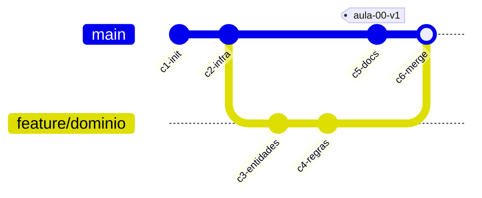
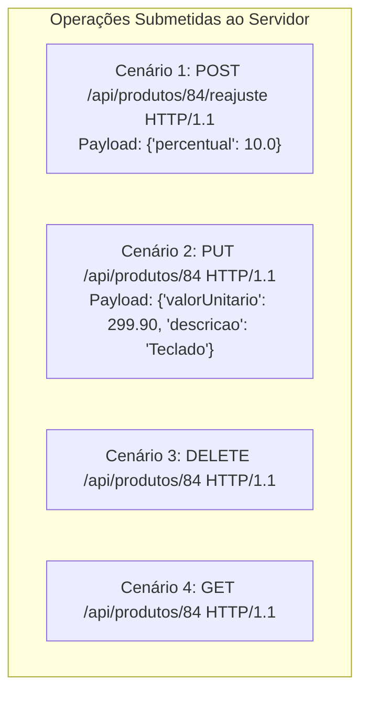
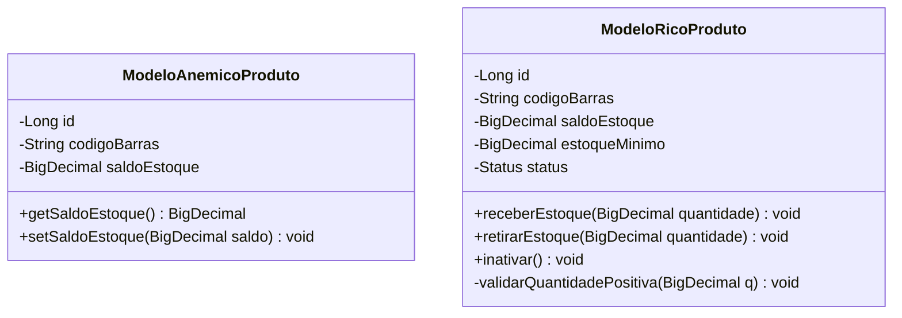
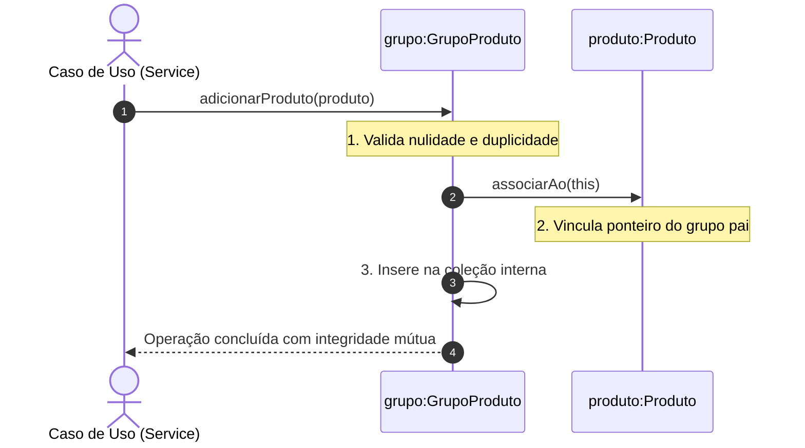
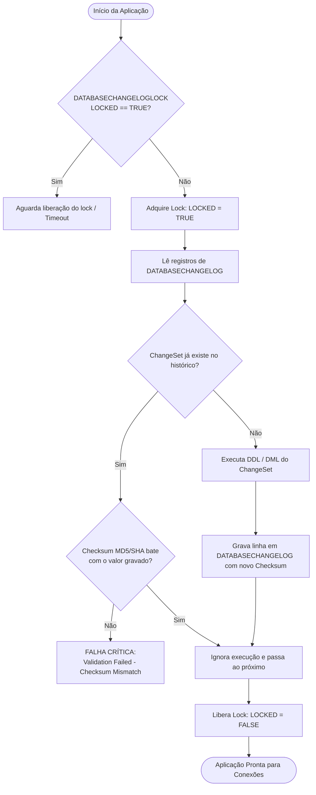
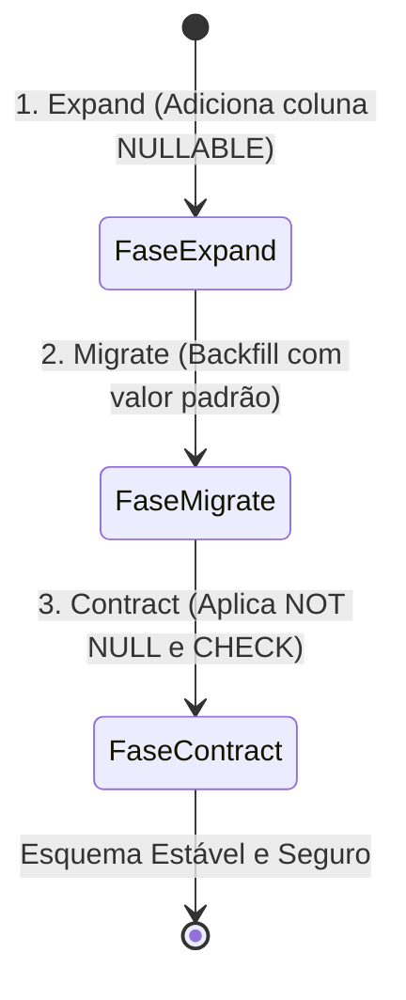
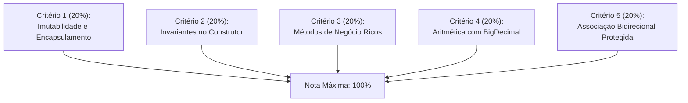
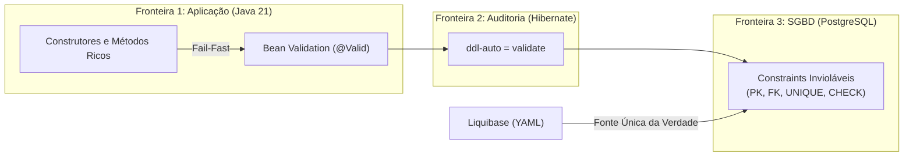
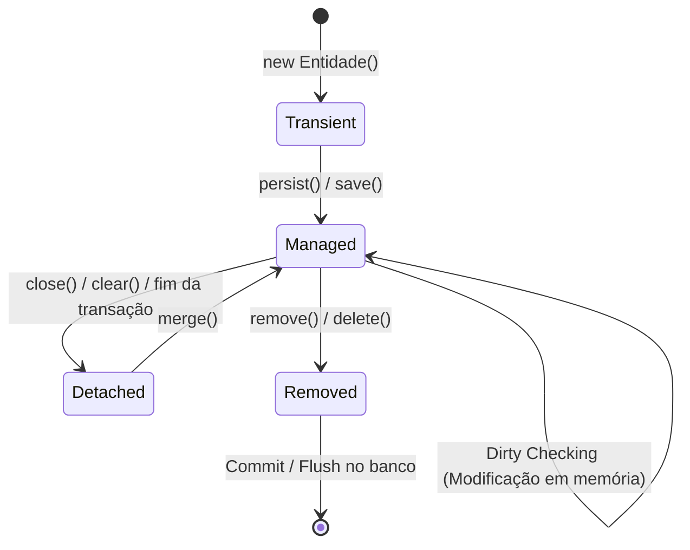

# Simulados Comentados - Laboratório de Programação IV

> **Instituição:** Centro Universitário de Santa Fé do Sul (UniFEF)  
> **Curso:** Bacharelado em Sistemas de Informação (4º Semestre)  
> **Disciplina:** Laboratório de Programação IV  
> **Docente:** Prof. Jefferson Passerini  
> **Projeto de Referência:** Suporte OS 2026 (`suporteos2026`)  
> **Escopo do Conteúdo:** Aulas 00 a 07 (Controle de Versão, Configuração de Ambiente, Fundamentos REST e HTTP, Modelagem de Domínio Rico com Java Puro, Persistência com JPA/PostgreSQL e Liquibase, Spring Data JPA, Serviços e Transações, Evolução de Esquema e Padrão Expand-Migrate-Contract, DTOs com Java Records, Bean Validation e Tratamento Global de Exceções).

---

## Simulado 1 - Questões Objetivas (12 questões, alternativas A-E, estilo ENADE)

---

### Questão 01 - Controle de Versão e Estrutura de Dados do Git (Aula 00)

O Git é um sistema de controle de versão distribuído (*DVCS*) concebido sobre o conceito de Grafo Acíclico Dirigido (*Directed Acyclic Graph* — DAG). Diferente de sistemas legados que registram diferenças baseadas em arquivos (*deltas*), o Git fundamenta seu modelo em uma série temporal de *snapshots* imutáveis indexados criptograficamente.

Considere o grafo de commits apresentado a seguir, que retrata o fluxo de desenvolvimento inicial do projeto `suporteos2026`:



Com base na teoria de grafos aplicada ao Git e no gerenciamento de referências em baixo nível, analise as seguintes asserções e a relação proposta entre elas:

I. Uma *branch* no Git é estruturada internamente como um arquivo de texto simples de 41 bytes, localizado no diretório `.git/refs/heads/`, que armazena unicamente o *hash* SHA do commit mais recente daquela linha de desenvolvimento, avançando automaticamente a cada novo registro de *snapshot*.

**PORQUE**

II. Um *commit* no Git é um objeto rigorosamente imutável; qualquer alteração em seu conteúdo textual, metadados de autoria ou ponteiro para o commit-pai resulta na geração de um novo identificador *hash*, impedindo a mutação direta de nós existentes no grafo sem reescrever a árvore criptográfica subsequente.

A respeito dessas asserções, assinale a opção correta:

A) As asserções I e II são proposições verdadeiras, e a II é uma justificativa correta da I.  
B) As asserções I e II são proposições verdadeiras, mas a II não é uma justificativa correta da I.  
C) A asserção I é uma proposição verdadeira, e a II é uma proposição falsa.  
D) A asserção I é uma proposição falsa, e a II é uma proposição verdadeira.  
E) As asserções I e II são proposições falsas.

---

### Questão 02 - Arquitetura da JVM e Resolução de Ambiente (Aula 01)

A execução profissional de aplicações corporativas baseadas em Java 21 exige o alinhamento rigoroso entre as ferramentas do sistema operacional e o ecossistema de compilação da plataforma. Durante a inicialização de uma esteira de integração contínua (CI) para compilar o projeto `suporteos2026`, o engenheiro de software deparou-se com o seguinte erro em tempo de execução após a etapa de empacotamento:

```text
java.lang.UnsupportedClassVersionError: com/curso/suporteos/SuporteOsApplication 
has been compiled by a more recent version of the Java Runtime (class file version 65.0), 
this version of the Java Runtime only recognizes class file versions up to 61.0
```

Simultaneamente, ao auditar a máquina local de desenvolvimento, verificou-se que o comando `where.exe java` (no Windows) retornava duas entradas:
1. `C:\Program Files (x86)\Common Files\Oracle\Java\javapath\java.exe` (Java 17)
2. `C:\Program Files\Eclipse Adoptium\jdk-21.0.2-hotspot\bin\java.exe` (Java 21)

A variável de ambiente `JAVA_HOME` apontava corretamente para `C:\Program Files\Eclipse Adoptium\jdk-21.0.2-hotspot`, enquanto o Maven Wrapper (`mvnw`) era executado com sucesso no terminal.

Considerando o ciclo de vida do *bytecode*, a arquitetura em pilha (*stack-based*) da JVM e os mecanismos de resolução de binários do sistema operacional, avalie as afirmações a seguir:

I. O número de versão de arquivo de classe `65.0` corresponde ao bytecode gerado pelo compilador do Java 21, enquanto `61.0` corresponde ao ambiente de execução do Java 17.  
II. O erro de execução ocorreu porque o interpretador de comandos do sistema operacional consulta a variável `PATH` de forma sequencial; como o caminho da JRE 17 precedia o caminho do JDK 21, o comando `java` acionou uma JVM incompatível com o bytecode gerado.  
III. O Maven Wrapper falhou na compilação porque depende exclusivamente da primeira entrada listada na variável `PATH` para localizar o compilador `javac`, ignorando a variável `JAVA_HOME`.  
IV. A substituição do Maven Wrapper pelo comando `javac *.java` executado na raiz do projeto resolveria o problema, pois o compilador do Java compila nativamente o código para a versão da JVM mais antiga encontrada no disco.

É correto apenas o que se afirma em:

A) I e II.  
B) I e III.  
C) II e IV.  
D) I, II e III.  
E) II, III e IV.

---

### Questão 03 - Semântica HTTP, Idempotência e Arquitetura REST (Aula 02)

O estilo arquitetural REST (*Representational State Transfer*), fundamentado sobre as primitivas da RFC 9110 do protocolo HTTP, estabelece propriedades formais para os métodos de requisição, categorizando-os segundo as garantias de **Segurança** e **Idempotência**.

Um sistema distribuído é modelado para que operações consecutivas idênticas não gerem corrupção de estado. Do ponto de vista matemático, uma operação $`f`$ é definida como idempotente se a sua aplicação sucessiva produzir o mesmo efeito final no estado do servidor que uma única execução, isto é:

```math
f(f(x)) = f(x)
```

Considere os seguintes cenários hipotéticos de requisições HTTP enviadas à API do sistema `suporteos2026`:



Com base na semântica formal do protocolo HTTP, assinale a opção correta:

A) Os cenários 2 e 3 são idempotentes, pois execuções repetidas da substituição total do recurso via `PUT` ou de sua exclusão via `DELETE` deixam o servidor no mesmo estado representativo final, ainda que o código de resposta HTTP possa variar entre `204 No Content` e `404 Not Found`.  
B) O cenário 1 é considerado um método seguro e idempotente, visto que a alteração de preço constitui uma atualização de valor atômica calculada deterministicamente pelo processador.  
C) O cenário 2 não é idempotente, pois se o cliente submeter o mesmo payload duas vezes, o servidor criará uma duplicata do recurso com um identificador artificial gerado sequencialmente.  
D) O cenário 3 é classificado como seguro, uma vez que a eliminação do registro físico preserva a integridade referencial do banco de dados relacional.  
E) Os cenários 1 e 4 compartilham a mesma classificação de segurança, pois ambos trafegam payloads textuais sob o cabeçalho `Content-Type: application/json`.

---

### Questão 04 - Inversão de Controle, Injeção de Dependências e Beans no Spring Boot (Aulas 02 e 05)

No framework Spring Boot, os conceitos de Inversão de Controle (*Inversion of Control* — IoC) e Injeção de Dependências (*Dependency Injection* — DI) governam a instanciação, a configuração e o ciclo de vida dos componentes de software (*Spring Beans*).

Considere os dois modelos de injeção de dependências apresentados a seguir para a classe `ProdutoService`:

```java
// Modelo A: Injeção por Campo
@Service
public class ProdutoServiceA {
    @Autowired
    private ProdutoRepository produtoRepository;
    @Autowired
    private GrupoProdutoRepository grupoRepository;
}

// Modelo B: Injeção Explícita por Construtor
@Service
public class ProdutoServiceB {
    private final ProdutoRepository produtoRepository;
    private final GrupoProdutoRepository grupoRepository;

    public ProdutoServiceB(ProdutoRepository produtoRepository, GrupoProdutoRepository grupoRepository) {
        this.produtoRepository = produtoRepository;
        this.grupoRepository = grupoRepository;
    }
}
```

Avalie as seguintes asserções técnicas a respeito da manutenção, testabilidade e robustez arquitetural desses modelos:

I. O Modelo B viabiliza a criação de campos com o modificador `final`, garantindo a imutabilidade das referências após a instanciação do bean e prevenindo mutações acidentais de ponteiro durante a execução concorrente.  
II. O Modelo A dificulta a escrita de testes unitários isolados com JUnit 5 puro, pois a injeção via reflexão exige a inicialização pesada do `ApplicationContext` do Spring ou o uso invasivo de frameworks de reflexão para preencher os atributos privados.  
III. O Modelo B permite que o compilador do Java e o próprio contêiner Spring identifiquem antecipadamente dependências cíclicas durante o processo de inicialização (*bootstrap*), disparando uma falha rápida (*fail-fast*).  
IV. No Spring Boot contemporâneo, o Modelo B dispensa o uso explícito da anotação `@Autowired` sobre o construtor quando a classe possui um único construtor público declarado.

Assinale a alternativa correta:

A) Apenas as afirmativas I e III estão corretas.  
B) Apenas as afirmativas II e IV estão corretas.  
C) Apenas as afirmativas I, II e IV estão corretas.  
D) Apenas as afirmativas II, III e IV estão corretas.  
E) Todas as afirmativas (I, II, III e IV) estão corretas.

---

### Questão 05 - Modelagem Orientada a Domínio e Modelo Rico vs. Anêmico (Aula 03)

O Domain-Driven Design (DDD) e as boas práticas de Orientação a Objetos estabelecem que as regras de negócio devem ser encapsuladas no núcleo do domínio (*Core Domain*), blindando as entidades contra estados inválidos. 

Considere o seguinte diagrama de classes que ilustra a refatoração de uma entidade de estoque:



Analise a implementação do método `retirarEstoque` contido na classe `ModeloRicoProduto`:

```java
public void retirarEstoque(BigDecimal quantidade) {
    if (this.status != Status.ATIVO) {
        throw new IllegalStateException("Operação negada: o produto está inativo.");
    }
    if (quantidade == null || quantidade.compareTo(BigDecimal.ZERO) <= 0) {
        throw new IllegalArgumentException("A quantidade retirada deve ser estritamente positiva.");
    }
    if (this.saldoEstoque.compareTo(quantidade) < 0) {
        throw new IllegalArgumentException("Saldo insuficiente para efetivar a retirada de estoque.");
    }
    this.saldoEstoque = this.saldoEstoque.subtract(quantidade);
}
```

Sobre os conceitos de Modelo Rico, Modelo Anêmico e Invariantes de Negócio, assinale a opção correta:

A) O `ModeloAnemicoProduto` é preferível em sistemas empresariais com Spring Boot, pois frameworks ORM como o Hibernate exigem que todos os atributos possuam métodos `set` públicos para permitir a carga de dados via reflexão.  
B) O `ModeloRicoProduto` viola o Princípio da Responsabilidade Única (SRP), pois a validação de saldo e o cálculo de subtração deveriam residir exclusivamente na camada de persistência (`Repository`) ou no banco de dados através de *triggers*.  
C) No `ModeloRicoProduto`, as invariantes de negócio são asseguradas de forma defensiva; a entidade é incapaz de transicionar para um estado com saldo negativo ou aceitar retiradas de itens inativos, independentemente de qual serviço orquestre a operação.  
D) A substituição de `setSaldoEstoque` por `retirarEstoque` impede a serialização do objeto em JSON pela biblioteca Jackson, gerando falha mandatória de compilação na camada de controle REST.  
E) Caso uma classe externa necessite consultar o saldo do `ModeloRicoProduto`, a inexistência de um método `setSaldoEstoque` quebra o encapsulamento, forçando a visibilidade pública direta do atributo `saldoEstoque`.

---

### Questão 06 - Aritmética de Ponto Flutuante e Precisão Numérica com BigDecimal (Aula 03)

Em sistemas corporativos financeiros, contábeis e de gestão de suprimentos, a precisão numérica é mandatória. Considere o trecho de código Java a seguir, executado em um teste unitário de cálculo de liquidação de estoque:

```java
public class AuditoriaEstoqueTest {
    public static void main(String[] args) {
        // Bloco 1: Aritmética binária primitiva
        double d1 = 0.1;
        double d2 = 0.2;
        double somaDouble = d1 + d2;
        boolean testeDouble = (somaDouble == 0.3);

        // Bloco 2: BigDecimal com construtores distintos
        BigDecimal bd1 = new BigDecimal(0.1);
        BigDecimal bd2 = new BigDecimal("0.1");
        BigDecimal bd3 = new BigDecimal("0.10");

        // Bloco 3: Comparações de igualdade
        boolean compEquals = bd2.equals(bd3);
        int compCompareTo = bd2.compareTo(bd3);

        System.out.println("D: " + testeDouble + " | E: " + compEquals + " | C: " + compCompareTo);
    }
}
```

Considerando o padrão IEEE 754 de representação de ponto flutuante binário e o funcionamento interno da classe `java.math.BigDecimal`, o resultado impresso no console pelo método `main` é:

A) `D: true | E: true | C: 0`  
B) `D: false | E: true | C: 0`  
C) `D: false | E: false | C: 0`  
D) `D: true | E: false | C: -1`  
E) `D: false | E: false | C: -1`

---

### Questão 07 - Associação Bidirecional 1:N e Encapsulamento de Coleções em Memória (Aula 03)

Considere a associação bidirecional de cardinalidade 1:N entre as entidades `GrupoProduto` e `Produto`. No paradigma orientado a objetos, ambos os lados mantêm referências ativas em memória: o grupo armazena uma lista de produtos subordinados, e cada produto referencia seu grupo delimitador.



Para garantir que a integridade referencial nunca seja rompida por manipulações externas indevidas, qual conjunto de decisões arquiteturais deve ser adotado na implementação das entidades Java puras?

A) Definir métodos `setProdutos(List<Produto> lista)` e `setGrupo(GrupoProduto g)` como públicos em ambas as classes, permitindo que a camada de aplicação substitua a lista inteira arbitrariamente.  
B) Disponibilizar o método `adicionarProduto(Produto p)` como único ponto público de entrada no `GrupoProduto`, fazer com que este método invoque um método de ligação com visibilidade de pacote (`package-private`) em `Produto`, e retornar `Collections.unmodifiableList(this.produtos)` no método de consulta `getProdutos()`.  
C) Declarar a lista de produtos como `public List<Produto> produtos = new ArrayList<>()`, dispensando métodos assessores e permitindo a adição direta via `grupo.produtos.add(produto)`.  
D) Utilizar a anotação `@Transient` na lista de produtos para evitar que o Java carregue os itens na memória, forçando a busca manual via SQL sempre que um produto precisar ser vinculado.  
E) Instanciar um novo `GrupoProduto` dentro do construtor de `Produto`, garantindo que um produto nunca exista sem um grupo, tornando desnecessário o armazenamento de listas no lado do grupo classificador.

---

### Questão 08 - Mapeamento Objeto-Relacional, Hibernate e ddl-auto (Aula 04)

O desencontro de impedância objeto-relacional (*Object-Relational Impedance Mismatch*) decorre das diferenças fundamentais entre a teoria dos conjuntos/lógica relacional e o paradigma de orientação a objetos.

Em aplicações profissionais baseadas em Spring Boot e PostgreSQL, o arquivo `application.properties` define o comportamento do provedor de persistência (Hibernate) por meio da propriedade:

```properties
spring.jpa.hibernate.ddl-auto=validate
```

Assinale a opção que justifica tecnicamente a obrigatoriedade da configuração `ddl-auto=validate` em ambientes integrados com ferramentas de migração de esquema (como o Liquibase):

A) A configuração `validate` faz com que o Hibernate crie automaticamente tabelas e chaves estrangeiras temporárias em memória, destruindo-as logo após a execução das baterias de testes unitários.  
B) O valor `validate` delega ao Hibernate a função de alterar colunas e renomear tabelas de forma silenciosa, sem exigir a criação manual de novos arquivos de migração.  
C) O uso de `validate` assegura que a única fonte de verdade da estrutura DDL seja o histórico controlado de migrações; o Hibernate atua estritamente inspecionando se os metadados das classes anotadas (`@Entity`) convergem de modo idêntico com o catálogo relacional do PostgreSQL, abortando a inicialização do sistema caso haja divergências estruturais.  
D) Configurar `validate` desativa o motor de geração de consultas JPQL do Spring Data JPA, forçando o desenvolvedor a escrever comandos SQL nativos em todos os repositórios da aplicação.  
E) O parâmetro `validate` é obrigatório apenas quando se utiliza o banco de dados em memória H2, sendo completamente ignorado pelo driver JDBC do PostgreSQL em perfis de desenvolvimento.

---

### Questão 09 - Versionamento Estruturado de Banco de Dados com Liquibase (Aula 04)

O Liquibase gerencia a evolução estrutural de bancos de dados relacionais tratando o esquema como um histórico incremental, auditável e imutável. Para garantir a execução concorrente segura e a integridade das transações DDL, o Liquibase mantém duas tabelas operacionais no catálogo do PostgreSQL: `databasechangelog` e `databasechangeloglock`.

Considere a representação do ciclo de verificação de um *changeSet* ilustrado no fluxo a seguir:



Com base na governança de migrações e na mecânica operacional do Liquibase, analise as afirmativas:

I. A identidade única de um bloco de migração no Liquibase é determinada pela tupla composta por `id`, `author` e `filepath` (caminho relativo do arquivo de changelog).  
II. Caso um desenvolvedor altere o conteúdo SQL ou YAML de um `changeSet` que já foi executado em ambiente de desenvolvimento compartilhado ou produção, o Liquibase recalculará o hash do arquivo e abortará a inicialização da aplicação acusando divergência de *checksum*.  
III. Em caso de necessidade de alteração de uma tabela existente (ex.: adição de uma coluna), a boa prática de engenharia consiste em modificar o arquivo de migração original da tabela para manter o histórico enxuto.  
IV. A tabela `databasechangeloglock` atua como um semáforo distribuído (*mutex*), prevenindo condições de corrida quando múltiplos nós ou microsserviços da aplicação inicializam simultaneamente sob a mesma base relacional.

É correto o que se afirma em:

A) I e III, apenas.  
B) II e IV, apenas.  
C) I, II e IV, apenas.  
D) II, III e IV, apenas.  
E) I, II, III e IV.

---

### Questão 10 - Ciclo de Vida de Entidades JPA, Dirty Checking e Fronteiras Transacionais (Aula 05)

Considere o seguinte método de serviço executado dentro do contexto transacional gerenciado pelo Spring Boot:

```java
@Service
public class ProdutoService {

    private final ProdutoRepository produtoRepository;

    public ProdutoService(ProdutoRepository produtoRepository) {
        this.produtoRepository = produtoRepository;
    }

    @Transactional
    public void aplicarReajuste(Long idProduto, BigDecimal percentual) {
        Produto produto = produtoRepository.findById(idProduto)
                .orElseThrow(() -> new RecursoNaoEncontradoException("Produto não localizado"));

        produto.reajustarPreco(percentual);
        // Observação: Não há invocação explícita de produtoRepository.save(produto)
    }
}
```

A respeito dos estados das entidades no JPA (*Persistence Context*) e do mecanismo de detecção automática de modificações (*Dirty Checking*), assinale a opção correta:

A) A alteração no preço do produto não será persistida no PostgreSQL, pois a ausência do comando `produtoRepository.save(produto)` faz com que o objeto seja descartado da memória da JVM ao final da execução.  
B) Ao ser retornado pelo método `findById`, o objeto `produto` entra no estado *managed* (gerenciado) dentro do contexto de persistência; no encerramento do método, o interceptador do `@Transactional` sincroniza o estado (*flush*) e o Hibernate emite automaticamente um comando SQL `UPDATE` para as colunas alteradas.  
C) O método deveria ser anotado obrigatoriamente com `@Transactional(readOnly = true)` para permitir que o Hibernate identifique mutações em atributos numéricos como `BigDecimal`.  
D) Se a entidade `Produto` contiver um relacionamento com carregamento preguiçoso (`FetchType.LAZY`), a sua leitura dentro de um método anotado com `@Transactional` disparará inevitavelmente uma `LazyInitializationException`.  
E) A anotação `@Transactional` intercepta a chamada ao banco por meio de JDBC puro e impede o mecanismo de *rollback* mesmo caso ocorra uma `RuntimeException` durante a execução de `reajustarPreco`.

---

### Questão 11 - Evolução Segura de Esquema e Padrão Expand-Migrate-Contract (Aula 06)

Durante a evolução do projeto `suporteos2026`, a equipe de engenharia recebeu o requisito de introduzir o campo `estoque_minimo` na tabela `produto`. A regra de negócio estabelece que a coluna deve ser estritamente obrigatória (`NOT NULL`) e não pode admitir valores negativos (`CHECK (estoque_minimo >= 0)`). 

No entanto, a tabela já armazena centenas de milhares de registros operacionais em produção.



Para aplicar a transição estrutural sem provocar indisponibilidade no sistema e sem violar restrições de integridade relacional do PostgreSQL, a estratégia em fases denominada **Expand-Migrate-Contract** prescreve a seguinte sequência de ações:

A) Executar imediatamente um comando `ALTER TABLE produto ADD COLUMN estoque_minimo NUMERIC(18,3) NOT NULL;`, confiando que o PostgreSQL preencherá automaticamente os registros nulos com zero.  
B) Excluir temporariamente as linhas existentes na tabela `produto`, aplicar a migração definitiva com a restrição `NOT NULL`, e restaurar os dados via arquivo de backup manual.  
C) Fase Expand: adicionar a coluna `estoque_minimo` permitindo valores nulos (`nullable: true`); Fase Migrate: executar um comando DML (`UPDATE produto SET estoque_minimo = 0 WHERE estoque_minimo IS NULL;`) para preenchimento dos dados pré-existentes (*backfill*); Fase Contract: aplicar a restrição definitiva `NOT NULL` e a constraint `CHECK` sobre a coluna devidamente saneada.  
D) Executar o comando `mvn liquibase:diff` e aplicar o changelog gerado diretamente no banco de produção sem revisão de código, pois o plugin detecta dados nulos e reescreve o histórico do banco de dados automaticamente.  
E) Criar uma tabela separada denominada `produto_estoque_minimo` contendo apenas a chave primária e o novo atributo, mantendo a tabela principal `produto` intocada para evitar o uso de ferramentas de migração.

---

### Questão 12 - Camada Web RESTful, DTOs com Java Records e Validação Declarativa (Aula 07)

No projeto de APIs corporativas com Spring Boot, expor entidades JPA diretamente na camada de controle (`@RestController`) acarreta severos riscos arquiteturais e de segurança, tais como acoplamento ao modelo de persistência, ataques de atribuição em massa (*Mass Assignment*) e estouro de pilha (*StackOverflowError*) por serialização cíclica de associações bidirecionais.

Para solucionar essas vulnerabilidades, adota-se a separação estrita de contratos utilizando DTOs (*Data Transfer Objects*) imutáveis implementados como Java Records e validados declarativamente via Jakarta Bean Validation.

Considere a definição do DTO a seguir:

```java
public record ProdutoRequest(
    @NotBlank(message = "O código de barras é obrigatório.")
    @Size(max = 50, message = "O código de barras não pode ultrapassar 50 caracteres.")
    String codigoBarras,

    @NotBlank(message = "A descrição é obrigatória.")
    @Size(max = 150, message = "A descrição não pode ultrapassar 150 caracteres.")
    String descricao,

    @NotNull(message = "O valor unitário é obrigatório.")
    @Positive(message = "O valor unitário deve ser estritamente maior que zero.")
    BigDecimal valorUnitario,

    @NotNull(message = "O identificador do grupo é obrigatório.")
    Long grupoId
) {}
```

Analise as afirmativas a respeito da arquitetura da camada de API:

I. O uso de Java Records como DTOs assegura a imutabilidade dos dados trafegados na requisição, pois todos os campos são implicitamente declarados como `private final` e a estrutura não gera métodos modificadores (*setters*).  
II. A anotação `@Valid` inserida no parâmetro do método do `@RestController` (ex.: `public ResponseEntity<?> cadastrar(@Valid @RequestBody ProdutoRequest request)`) instrui o Spring a interceptar a carga útil e disparar as asserções declaradas no DTO antes da invocação do método do controlador.  
III. Caso o payload enviado viole uma anotação como `@Positive`, o framework lança a exceção `MethodArgumentNotValidException`, a qual pode ser capturada por uma classe anotada com `@RestControllerAdvice` para padronizar o retorno em um objeto `ApiError` com status `400 Bad Request`.  
IV. A validação declarativa do Bean Validation substitui integralmente a necessidade de validação de invariantes nos construtores das entidades de domínio (`Produto`), tornando desnecessárias as regras defensivas em classes puras Java.

É correto apenas o que se afirma em:

A) I e IV.  
B) II e III.  
C) I, II e III.  
D) I, III e IV.  
E) II, III e IV.

---

## Simulado 2 - Questões Discursivas (5 questões, com rubrica do que uma resposta nota máxima deve conter)

---

### Questão Discursiva 01 - Modelagem de Domínio Rico e Encapsulamento em Java Puro

**Contexto e Cenário:**  
No sistema `suporteos2026`, o módulo de controle de almoxarifado exige que a movimentação de estoque seja imune a corrupções de dados. A entidade `Produto` pertence a um `GrupoProduto` (associação 1:N bidirecional) e deve garantir suas invariantes de negócio na memória da JVM de forma estritamente desacoplada de frameworks ou bancos de dados.

**Comando:**  
Apresente a implementação em Java 21 puro para a entidade `Produto`, atendendo aos seguintes requisitos de Engenharia de Software:
1. Construtor canônico rico que valide obrigatoriedade de campos (`codigoBarras`, `descricao`, `valorUnitario`, `estoqueMinimo`) e impeça a criação de instâncias em estado inválido;
2. Encapsulamento estrito do atributo `saldoEstoque`, impedindo mutações arbitrárias via métodos modificadores genéricos (*setters*);
3. Implementação dos métodos de negócio `receberEstoque(BigDecimal quantidade)` e `retirarEstoque(BigDecimal quantidade)`, aplicando validações defensivas com mensagens claras via `IllegalArgumentException`;
4. Uso mandatório de `BigDecimal` com cálculo exato do valor financeiro total do estoque do item (`calcularValorEstoque()`), aplicando controle explícito de escala para 2 casas decimais e política de arredondamento bancário `RoundingMode.HALF_UP`;
5. Método de ligação `associarAo(GrupoProduto grupo)` com visibilidade restrita ao pacote (*package-private*), garantindo que a associação seja coordenada exclusivamente pelo agregado raiz (`GrupoProduto`).

> **Rubrica de Avaliação (O que a resposta nota máxima deve conter):**  
> - **Imutabilidade e Encapsulamento (20%):** Atributos declarados como `private`, ausência completa de setters públicos para saldo ou identidade.  
> - **Invariantes no Construtor (20%):** Validação fail-fast no construtor impedindo dados nulos, strings em branco ou valores numéricos negativos. Construtor protegido sem argumentos presente para conformidade com JPA.  
> - **Métodos de Negócio Defensivos (20%):** Métodos semânticos (`receberEstoque`, `retirarEstoque`) que validam argumentos estritamente positivos ($`> 0`$) e barram retiradas que excedam o saldo disponível.  
> - **Precisão Monetária (20%):** Cálculo de multiplicação utilizando métodos nativos de `BigDecimal`, definindo `.setScale(2, RoundingMode.HALF_UP)` e evitando conversões para `double`.  
> - **Acoplamento e Integridade Bidirecional (20%):** Visibilidade de pacote no método que recebe `GrupoProduto` e integridade referencial protegida.

---

### Questão Discursiva 02 - Persistência Relacional, Paridade Tecnológica e Governança de Esquema

**Contexto e Cenário:**  
Muitos projetos de desenvolvimento backend adotam o banco em memória H2 para a execução de testes automatizados e confiam na propriedade `spring.jpa.hibernate.ddl-auto=update` para sincronizar tabelas em tempo de desenvolvimento. Na disciplina de Laboratório de Programação IV, o Prof. Jefferson Passerini proibiu expressamente ambas as práticas para o projeto `suporteos2026`.

**Comando:**  
Redija um texto técnico-dissertativo articulando os seguintes tópicos:
1. **Quebra de Paridade de Ambientes:** Justifique tecnicamente por que o uso de H2 em perfis de teste (`test`) em paralelo com PostgreSQL em produção (`prod`) viola os princípios de confiabilidade da engenharia de software contemporânea, citando ao menos duas diferenças estruturais (dialetos, constraints, concorrência ou tipos de dados).
2. **Riscos da Geração Automática por ORM:** Explique detalhadamente por que a diretiva `ddl-auto=update` do Hibernate é perigosa em bases relacionais persistentes, demonstrando o que ocorre no banco quando um atributo Java é renomeado ou quando uma restrição `NOT NULL` é adicionada sobre uma tabela populada.
3. **Mecanismo de Defesa em Múltiplas Camadas:** Demonstre como a configuração conjunta de `ddl-auto=validate` com o Liquibase concretiza a estratégia de "Defesa em Profundidade" (*Defense in Depth*), diferenciando os papéis da aplicação (Java) e do SGBD (PostgreSQL) na preservação da integridade dos dados.

> **Rubrica de Avaliação (O que a resposta nota máxima deve conter):**  
> - **Crítica ao H2 e Paridade de Ambientes (30%):** Explicação clara da discrepância de dialetos SQL, divergência no tratamento de transações concorrentes/bloqueios e suporte a tipos avançados do PostgreSQL (como `NUMERIC(p,s)` exato e constraints `CHECK`), gerando falsos positivos em suítes de teste.  
> - **Desmistificação de ddl-auto=update (35%):** Demonstração do comportamento destrutivo ou negligente do Hibernate ao renomear campos (abandono de colunas órfãs e criação de colunas novas vazias) e incapacidade de orquestrar transições seguras de dados legados.  
> - **Defesa em Profundidade e Liquibase (35%):** Explicação do papel do Liquibase como autoridade DDL soberana e versionada no Git, atuação do Hibernate estritamente como auditor de compatibilidade (`validate`), e articulação da complementariedade entre validação fail-fast no código Java e garantias de integridade física no SGBD (`PK`, `FK`, `UNIQUE`, `CHECK`).

---

### Questão Discursiva 03 - Transações Declarativas, Ciclo de Vida JPA e Dirty Checking

**Contexto e Cenário:**  
Um desenvolvedor júnior implementou um serviço corporativo de movimentação de produtos e notou comportamentos aparentemente contraditórios: em alguns métodos, entidades foram atualizadas no PostgreSQL mesmo sem chamar o método `.save()` do repositório; em outros, operações de leitura tornaram-se lentas ou falharam ao acessar relacionamentos fora do serviço.

**Comando:**  
Com base na arquitetura do Spring Data JPA e do motor Hibernate:
1. Esquematize e descreva os quatro estados possíveis de uma entidade durante o seu ciclo de vida no JPA: *Transient* (Novo), *Managed* (Gerenciado), *Detached* (Desanexado) e *Removed* (Removido).
2. Explique detalhadamente o funcionamento do mecanismo de **Dirty Checking** (detecção automática de alterações) executado pelo Hibernate, identificando em que instante exato o SQL `UPDATE` é despachado para o banco de dados.
3. Justifique o impacto arquitetural do uso do parâmetro `@Transactional(readOnly = true)` em métodos de consulta, explicitando os ganhos de desempenho obtidos na sessão do Hibernate e no driver JDBC.
4. Explique como o mecanismo de interceptação AOP do Spring lida com exceções lançadas dentro de um método `@Transactional`, diferenciando o comportamento padrão para subclasses de `RuntimeException` em relação a *checked exceptions* (`java.lang.Exception`).

> **Rubrica de Avaliação (O que a resposta nota máxima deve conter):**  
> - **Os Quatro Estados da Entidade (25%):** Definição precisa de *transient* (objeto em memória sem ID e sem contexto), *managed* (atrelado ao `PersistenceContext`, rastreado ativamente), *detached* (possui ID mas a sessão foi encerrada) e *removed* (marcado para exclusão física).  
> - **Mecânica do Dirty Checking (25%):** Explicação de que o Hibernate guarda um *snapshot* do estado da entidade ao carregá-la; na fase de *flush* da transação, compara o estado atual com o snapshot e emite o `UPDATE` automaticamente.  
> - **Otimização de readOnly = true (25%):** Menção à desativação da geração de snapshots para dirty checking no Hibernate (economia de CPU e memória) e possíveis otimizações do driver JDBC/PostgreSQL para conexões de leitura.  
> - **Tratamento de Rollback Transacional (25%):** Esclarecimento de que exceções não checadas (`RuntimeException` e `Error`) disparam `ROLLBACK` automático por padrão, enquanto exceções checadas realizam `COMMIT` a menos que configuradas com `rollbackFor`.

---

### Questão Discursiva 04 - Evolução Segura de Esquema com o Padrão Expand-Migrate-Contract

**Contexto e Cenário:**  
A aplicação `suporteos2026` opera em produção com a tabela `produto` contendo mais de 500.000 registros ativos. O novo requisito da versão exige a criação de uma coluna obrigatória denominada `estoque_minimo` (`NUMERIC(18,3)`), cujo valor não pode ser nulo (`NOT NULL`) e deve ser maior ou igual a zero (`CHECK (estoque_minimo >= 0)`). 

Se um script executar diretamente `ALTER TABLE produto ADD COLUMN estoque_minimo NUMERIC(18,3) NOT NULL;`, o PostgreSQL rejeitará a instrução imediatamente com falha catastrófica devido à existência de linhas prévias sem valor definido.

**Comando:**  
Elabore o planejamento formal da migração estrutural utilizando o padrão **Expand-Migrate-Contract** e apresente o arquivo de changelog correspondente no formato **YAML estruturado do Liquibase**, contendo:
1. O *changeSet* da fase de expansão (**Expand**), adicionando a coluna sem restrição de obrigatoriedade;
2. O *changeSet* da fase de migração de dados (**Migrate**), executando a instrução DML de *backfill* para preencher registros legados com o valor neutro padrão `0.000`;
3. O *changeSet* da fase de contração (**Contract**), aplicando a restrição `NOT NULL`, a constraint `CHECK` de valor não negativo e criando as diretivas de reversão (*rollback*) correspondentes para cada etapa.

> **Rubrica de Avaliação (O que a resposta nota máxima deve conter):**  
> - **Fundamentação do Padrão Expand-Migrate-Contract (25%):** Explicação clara da motivação da quebra em três fases atômicas para mitigar bloqueios de tabela e rejeições de constraints.  
> - **Fase 1 - Expand no Liquibase (25%):** `changeSet` sintaticamente correto utilizando a tag `addColumn` com `nullable: true` e bloco de rollback associado.  
> - **Fase 2 - Migrate de Dados (25%):** `changeSet` contendo comando SQL de atualização atômica (`UPDATE produto SET estoque_minimo = 0 WHERE estoque_minimo IS NULL;`) para sanear dados pré-existentes.  
> - **Fase 3 - Contract e Integridade Relacional (25%):** `changeSet` aplicando `addNotNullConstraint` e `addCheckConstraint` com nome explícito (`ck_produto_estoque_minimo`), incluindo instruções de reversão reversa (`dropNotNullConstraint`, `dropCheckConstraint`).

---

### Questão Discursiva 05 - Camada Web RESTful, DTOs com Java Records e Blindagem da Aplicação

**Contexto e Cenário:**  
Durante a revisão de código de um endpoint da API de produtos, a equipe de arquitetura vetou o seguinte controlador:

```java
// Código vetado pela arquitetura
@RestController
@RequestMapping("/produtos")
public class ProdutoControllerRuim {
    @Autowired
    private ProdutoRepository repository;

    @PostMapping("/cadastrar")
    public Produto salvar(@RequestBody Produto produto) {
        return repository.save(produto);
    }
}
```

**Comando:**  
Projete a arquitetura correta para o caso de uso de criação de produtos (`POST /api/produtos`), demonstrando a separação estrita de responsabilidades. Sua resposta deve apresentar:
1. A justificativa técnica formal dos três principais erros arquiteturais e de segurança presentes no código vetado;
2. O código do DTO de entrada `ProdutoRequest` implementado como um `record` imutável em Java 21, contendo validações declarativas do Jakarta Bean Validation (`@NotBlank`, `@NotNull`, `@Positive`, etc.);
3. O código do controlador reescrito (`ProdutoController`), contendo a rota padronizada no padrão REST, uso de injeção de dependência por construtor, ativação da validação com `@Valid`, delegação do caso de uso para a camada de serviço (`ProdutoService`), conversão via mapeador desacoplado (`ProdutoMapper`) e emissão da resposta HTTP semântica `201 Created` acompanhada do cabeçalho de redirecionamento `Location`;
4. A estrutura de dados de uma classe padronizada de resposta a falhas (`ApiError`), explicando como o tratador global `@RestControllerAdvice` captura a exceção `MethodArgumentNotValidException` para devolver um status `400 Bad Request` legível com a lista de campos inválidos.

> **Rubrica de Avaliação (O que a resposta nota máxima deve conter):**  
> - **Identificação de Vulnerabilidades do Código Vetado (20%):** Exposição direta de entidade JPA, rota em estilo RPC com verbo na URL (`/cadastrar`), injeção por campo via `@Autowired`, falta de validação sintática e ausência de camada de serviço e transação.  
> - **DTO Imutável como Record com Bean Validation (25%):** Sintaxe concisa de `record`, tipagem adequada (`BigDecimal`), e anotações pertinentes de validação (`@NotBlank`, `@NotNull`, `@Positive`, `@Size`).  
> - **Controller RESTful Robusto (30%):** `@RestController`, rota substantiva `/api/produtos`, injeção por construtor, `@Valid`, montagem de URI do recurso e retorno de `ResponseEntity.created(location).body(response)`.  
> - **Tratamento Global de Erros com ApiError (25%):** Representação do modelo `ApiError` (timestamp, status, erro, caminho, lista de violações de campos) e funcionamento do `@RestControllerAdvice`.

---

## Gabarito Comentado

---

### Gabarito Comentado - Simulado 1 (Objetivas)

---

#### Questão 01
- **Alternativa Correta:** **A** (As asserções I e II são proposições verdadeiras, e a II é uma justificativa correta da I).
- **Justificativa Técnica:**  
  A asserção I descreve rigorosamente a implementação física de uma branch no Git. Uma branch local nada mais é do que um ponteiro de referência móvel (*head reference*) armazenado no arquivo `.git/refs/heads/<nome-da-branch>`. Este arquivo contém exatamente os 40 caracteres hexadecimais do hash SHA-1 (ou 64 caracteres no SHA-256) seguidos de um caractere delimitador de quebra de linha (`\n`), totalizando 41 bytes no formato tradicional. Quando um novo commit é gerado sob a branch ativa, o Git atualiza unicamente o conteúdo desse arquivo de ponteiro para o hash do nó recém-criado.  
  A asserção II é verdadeira e justifica formalmente a asserção I: como os objetos de commit são estruturados como vértices imutáveis em um Grafo Acíclico Dirigido (DAG), calculados a partir da árvore de diretórios, dados do autor e referência ao commit pai, é matematicamente impossível alterar o conteúdo de um commit existente sem alterar seu hash identificador. Portanto, para fazer uma linha de desenvolvimento "crescer", o Git não modifica o nó anterior; ele simplesmente adiciona um novo vértice apontando para o anterior e avança o arquivo de texto da branch (ponteiro) para esse novo nó.
- **Análise das Distratoras (Por que estão incorretas?):**  
  - *B:* Incorreta. A asserção II é precisamente o fundamento matemático e arquitetural que justifica a asserção I. Se os commits fossem mutáveis em disco, branches poderiam ser árvores estáticas sobrescritas, e não ponteiros dinâmicos em um DAG imutável.  
  - *C:* Incorreta. A asserção II é integralmente verdadeira. A integridade criptográfica é o princípio basilar do Git.  
  - *D:* Incorreta. A asserção I é verdadeira em todos os seus termos técnicos e estruturais de diretórios.  
  - *E:* Incorreta. Ambas as asserções são verdadeiras e fundamentais no estudo de sistemas de controle de versão.

---

#### Questão 02
- **Alternativa Correta:** **A** (Apenas as afirmativas I e II estão corretas).
- **Justificativa Técnica:**  
  - A afirmativa I está correta: A especificação da Máquina Virtual Java mapeia o número de versão principal (*major version*) do arquivo de classe compilado da seguinte forma: Java 8 = 52, Java 11 = 55, Java 17 = 61 e Java 21 = 65. A fórmula de correspondência direta é $`\text{major\_version} = \text{versão\_java} + 44`$. Portanto, para o Java 21: $`21 + 44 = 65`$.  
  - A afirmativa II está correta: O sistema operacional resolve binários executáveis consultando a variável `PATH` na ordem linear em que os diretórios aparecem registrados. Se o atalho da Oracle apontando para a JRE 17 estiver posicionado antes do diretório `bin` do Eclipse Temurin JDK 21, o comando `java` disparará a JVM 17. Ao tentar carregar uma classe compilada com versão 65.0, a JVM 17 rejeita o arquivo emitindo a exceção fatal `UnsupportedClassVersionError`.  
- **Análise das Distratoras (Por que estão incorretas?):**  
  - *Afirmativa III incorreta:* O script do Maven Wrapper (`mvnw` / `mvnw.cmd`) foi expressamente desenhado para inspecionar prioritariamente a variável `JAVA_HOME`. Se `JAVA_HOME` estiver configurada apontando para um JDK válido, o Maven Wrapper a utiliza diretamente para encontrar o compilador `javac`, ignorando qualquer poluição presente na variável `PATH`.  
  - *Afirmativa IV incorreta:* O comando `javac` padrão compila para a versão do próprio compilador executado, a menos que sinalizadores explícitos como `--release` ou `--target` sejam fornecidos. Além disso, executar `javac *.java` manualmente quebra a resolução de dependências corporativas gerenciadas pelo Maven no `pom.xml`.  
  - *Alternativas B, C, D e E:* Incorretas por considerarem afirmativas falsas como verdadeiras ou omitirem afirmativas corretas.

---

#### Questão 03
- **Alternativa Correta:** **A** (Os cenários 2 e 3 são idempotentes, pois execuções repetidas da substituição total do recurso via PUT ou de sua exclusão via DELETE deixam o servidor no mesmo estado representativo final...).
- **Justificativa Técnica:**  
  Segundo a RFC 9110 (seção 9.2.2), um método HTTP é **idempotente** se o efeito pretendido no servidor de múltiplas requisições idênticas for o mesmo que o de uma única requisição. 
  - O método `PUT` (Cenário 2) é inerentemente idempotente: ele realiza a substituição total do estado do recurso identificado pela URI. Se enviado uma ou dez vezes com o mesmo payload, o recurso `/api/produtos/84` conterá exatamente os mesmos valores em disco.
  - O método `DELETE` (Cenário 3) é igualmente idempotente: a intenção da operação é garantir que o recurso deixe de existir no sistema. Na primeira execução, o item é removido e o servidor pode responder `204 No Content` ou `200 OK`. Em invocações subsequentes, o item já inexiste, e o servidor responderá tipicamente `404 Not Found`. Apesar da divergência no código de status retornado, **o estado do servidor permanece inalterado** (o recurso continua inexistente), satisfazendo a definição matemática de idempotência.
- **Análise das Distratoras (Por que estão incorretas?):**  
  - *B:* Incorreta. O Cenário 1 utiliza o método `POST` para aplicar um cálculo cumulativo (reajuste percentual). Se executado 3 vezes consecutivas, o preço será aumentado 3 vezes compostas ($`preco \times 1.10^3`$). A operação altera o estado a cada disparo, não sendo nem segura e nem idempotente.  
  - *C:* Incorreta. O `PUT` opera sobre a URI explícita do recurso já identificado (`/84`). Ele não gera identificadores sequenciais secundários; ele substitui o recurso naquela coordenada. Criação com identificador gerado pelo servidor é responsabilidade de `POST` sobre a coleção `/api/produtos`.  
  - *D:* Incorreta. Um método é classificado como **seguro** se sua invocação for estritamente de consulta (leitura), sem produzir efeitos colaterais no estado do servidor (`GET`, `HEAD`, `OPTIONS`). `DELETE` causa mutação destrutiva de dados, não sendo seguro.  
  - *E:* Incorreta. O Cenário 4 (`GET`) é um método seguro e idempotente que apenas recupera dados. O Cenário 1 (`POST`) causa mutações cumulativas no estado do servidor.

---

#### Questão 04
- **Alternativa Correta:** **E** (Todas as afirmativas I, II, III e IV estão corretas).
- **Justificativa Técnica:**  
  - *Afirmativa I (Correta):* Atributos injetados por construtor podem receber o modificador `final`. Isso garante que as referências sejam imutáveis após a instanciação do objeto e assegura thread-safety na visibilidade de memória da JVM.  
  - *Afirmativa II (Correta):* A injeção por campo (`@Autowired` direto no atributo privado) exige reflexão em baixo nível para definir o valor do campo em testes unitários ou requer a inicialização do contexto do Spring via `@SpringBootTest`, o que torna os testes excessivamente lentos. Com o construtor, basta instanciar a classe com `new ProdutoServiceB(mockRepo1, mockRepo2)`.  
  - *Afirmativa III (Correta):* Se a classe `A` requer `B` no construtor e `B` requer `A` no construtor, a JVM não consegue instanciar nenhuma das duas classes, disparando imediatamente uma falha do tipo `BeanCurrentlyInCreationException` na inicialização da aplicação (*fail-fast*), alertando o engenheiro sobre uma falha de design.  
  - *Afirmativa IV (Correta):* A partir do Spring Framework 4.3, se uma classe gerenciada como bean possuir apenas um construtor público, o contêiner assume implicitamente que aquele construtor deve ser utilizado para injeção de dependências, tornando a anotação `@Autowired` redundante.
- **Análise das Distratoras:**  
  - As opções A, B, C e D são distratoras incompletas, pois deixam de englobar a totalidade das asserções verdadeiras.

---

#### Questão 05
- **Alternativa Correta:** **C** (No ModeloRicoProduto, as invariantes de negócio são asseguradas de forma defensiva; a entidade é incapaz de transicionar para um estado com saldo negativo ou aceitar retiradas de itens inativos...).
- **Justificativa Técnica:**  
  O encapsulamento rico reside no empacotamento coeso de dados e comportamentos que operam sobre esses dados. Ao transferir as regras de negócio para métodos semânticos dentro da própria entidade (`retirarEstoque`), garantimos que nenhuma operação externa corrompa o estado do objeto. Todas as transições passam obrigatoriamente pelas checagens de validação (*guard clauses*), tornando impossível que uma instância válida em memória atinja inconsistências (saldo negativo ou produto inativo operando).
- **Análise das Distratoras (Por que estão incorretas?):**  
  - *A:* Incorreta. O Hibernate e a especificação JPA não exigem setters públicos. O provedor ORM é perfeitamente capaz de acessar e atribuir valores a campos privados através de reflexão direta nos atributos (`Field Access`), preservando o encapsulamento.  
  - *B:* Incorreta. A verificação se a quantidade cabe no saldo do produto e a alteração aritmética do seu próprio atributo são responsabilidades nucleares da própria entidade de domínio, de acordo com o padrão *Information Expert* do GRASP.  
  - *D:* Incorreta. O Jackson utiliza prioritariamente os métodos assessores de leitura (*getters*) para serialização em JSON. A ausência de setters afeta apenas a desserialização de entrada, a qual não deve utilizar entidades JPA diretamente, mas sim DTOs de transporte.  
  - *E:* Incorreta. A leitura do saldo ocorre perfeitamente através de um método de consulta `getSaldoEstoque()`. O encapsulamento protege a **mutação** de estado desregulada, não o acesso a dados de leitura.

---

#### Questão 06
- **Alternativa Correta:** **C** (`D: false | E: false | C: 0`).
- **Justificativa Técnica:**  
  1. **Bloco 1 (Ponto Flutuante IEEE 754):** Na base binária, frações decimais como `0.1` e `0.2` não possuem representação finita exata, transformando-se em dízimas periódicas. A soma binária de `0.1 + 0.2` resulta exatamente em `0.30000000000000004`. Logo, `0.30000000000000004 == 0.3` avalia para `false` (`D: false`).  
  2. **Bloco 2 e 3 (Semântica de BigDecimal):**  
     - O método `bd2.equals(bd3)` avalia se dois objetos `BigDecimal` são estritamente idênticos tanto em **valor numérico** quanto em **escala** (`scale`). O objeto `bd2` foi construído com `"0.1"` (escala = 1), enquanto `bd3` foi construído com `"0.10"` (escala = 2). Como as escalas diferem, `equals()` retorna impreterivelmente `false` (`E: false`).  
     - A interface `Comparable<BigDecimal>` e o método `bd2.compareTo(bd3)` avaliam com exclusividade o **valor matemático real**, desconsiderando variações puramente representativas de escala decimal. Como $`0.1 = 0.10`$, `compareTo` retorna `0` indicando equivalência matemática (`C: 0`).
- **Análise das Distratoras (Por que estão incorretas?):**  
  - *A:* Erra em D (ignora a imprecisão binária de double) e erra em E (assume que equals ignora a escala).  
  - *B:* Erra em E ao considerar que `equals()` trata `"0.1"` e `"0.10"` como iguais. Esta é uma das armadilhas mais comuns em código Java.  
  - *D:* Erra em D (double não soma perfeitamente 0.3) e erra em C (assume que compareTo retorna -1 por ter menos casas).  
  - *E:* Erra em C ao assumir que `compareTo` avalia as escalas em vez dos valores matemáticos absolutos.

---

#### Questão 07
- **Alternativa Correta:** **B** (Disponibilizar o método adicionarProduto(Produto p) como único ponto público de entrada no GrupoProduto, fazer com que este método invoque um método de ligação com visibilidade de pacote...).
- **Justificativa Técnica:**  
  Para garantir a integridade de uma associação bidirecional em memória, deve existir uma única porta de entrada governada pelo Agregado Raiz (*Aggregate Root*), que é o `GrupoProduto`. O método `adicionarProduto` centraliza validações de duplicidade e regras de negócio. Para amarrar o ponteiro inverso na instância de `Produto`, utiliza-se um método com visibilidade de pacote (*package-private*), permitindo que apenas classes do mesmo pacote de domínio participem da coreografia de amarração, sem expor um método `setGrupo` indiscriminado para todo o sistema. Por fim, `Collections.unmodifiableList()` encapsula a lista interna, lançando `UnsupportedOperationException` caso código externo tente invocar `.add()` diretamente na coleção obtida via `getProdutos()`.
- **Análise das Distratoras (Por que estão incorretas?):**  
  - *A:* Incorreta. Setters públicos desprotegidos permitem criar inconsistências onde o produto aponta para o Grupo A, mas a lista do Grupo A não contém o produto, ou listas inteiras são substituídas limpando referências órfãs.  
  - *C:* Incorreta. Expor a coleção interna como atributo `public` destrói completamente o encapsulamento da classe.  
  - *D:* Incorreta. `@Transient` é uma anotação de persistência do JPA; seu uso aqui não soluciona a modelagem de domínio em memória e cria dependência precoce de infraestrutura.  
  - *E:* Incorreta. Instanciar o agregador pai dentro do filho acopla as classes e impede a reutilização de uma instância de grupo para múltiplos produtos cadastrados.

---

#### Questão 08
- **Alternativa Correta:** **C** (O uso de validate assegura que a única fonte de verdade da estrutura DDL seja o histórico controlado de migrações; o Hibernate atua estritamente inspecionando se os metadados das classes anotadas convergem de modo idêntico com o catálogo relacional...).
- **Justificativa Técnica:**  
  Em arquiteturas empresariais com controle formal de esquema, o ciclo de vida do DDL pertence a ferramentas de migração versionadas (Liquibase). O Hibernate não deve ter permissão de alterar o banco dinamicamente em tempo de execução. Ao utilizar `ddl-auto=validate`, o Hibernate faz uma auditoria rigorosa durante a subida do contêiner: ele compara nomes de tabelas, nomes de colunas, restrições de nulidade e tipos de dados das classes `@Entity` contra o banco de dados PostgreSQL. Se o desenvolvedor esquecer de criar uma migração no Liquibase para um novo atributo mapeado no Java, o sistema aborta a inicialização (*fail-fast*), impedindo a execução de consultas contra colunas inexistentes.
- **Análise das Distratoras (Por que estão incorretas?):**  
  - *A:* Incorreta. A criação e destruição temporária de tabelas em testes é comportamento de `create-drop`, e não de `validate`.  
  - *B:* Incorreta. O modo que altera tabelas e colunas dinamicamente é o `update`, proibido em produção. O `validate` é estritamente somente-leitura.  
  - *D:* Incorreta. O `validate` não desativa consultas JPQL; ele valida a conformidade das entidades para que o JPQL execute com garantia de integridade relacional.  
  - *E:* Incorreta. O `validate` opera perfeitamente sobre o PostgreSQL e é mandatório em ambientes corporativos que utilizam esse SGBD.

---

#### Questão 09
- **Alternativa Correta:** **C** (Apenas as afirmativas I, II e IV estão corretas).
- **Justificativa Técnica:**  
  - *Afirmativa I (Correta):* O Liquibase identifica cada bloco de alteração no banco de dados pela chave composta: `(id, author, filepath)`. Se qualquer um desses três valores divergir, o motor de migração tratará o bloco como um registro distinto.  
  - *Afirmativa II (Correta):* O Liquibase calcula o hash criptográfico MD5/SHA do conteúdo de cada `changeSet` no momento de sua primeira aplicação e o grava na coluna `md5sum` da tabela `databasechangelog`. Se o arquivo for editado retroativamente, a verificação comparativa na inicialização falhará com o erro `Checksum Check Failed`, paralisando o boot do sistema para evitar corrupção de estado.  
  - *Afirmativa IV (Correta):* A tabela `databasechangeloglock` contém uma flag booleana `locked`. O primeiro nó que sobe define `locked = true`, executa as migrações em uma transação exclusiva e redefine `locked = false`. Nós concorrentes entram em espera (*polling*), prevenindo execuções simultâneas e inconsistências de DDL no PostgreSQL.
- **Análise das Distratoras (Por que a III está incorreta?):**  
  - *Afirmativa III incorreta:* Migrações de banco de dados constituem um histórico transacional **append-only**. Jamais se altera um `changeSet` já executado e propagado em repositório compartilhado. Toda e qualquer alteração de esquema subsequente (como criar nova coluna ou constraint) deve ser obrigatoriamente formalizada através de um **novo** `changeSet` incremental.  
  - *Alternativas A, B, D e E:* Incorretas por incluírem a afirmativa III ou omitirem afirmativas verdadeiras.

---

#### Questão 10
- **Alternativa Correta:** **B** (Ao ser retornado pelo método findById, o objeto produto entra no estado managed dentro do contexto de persistência; no encerramento do método, o interceptador do @Transactional sincroniza o estado e o Hibernate emite automaticamente um comando SQL UPDATE...).
- **Justificativa Técnica:**  
  Quando uma entidade é recuperada via repositório dentro de um método delimitado por `@Transactional`, ela é vinculada ao `PersistenceContext` da sessão corrente do Hibernate no estado **Managed**. O Hibernate armazena uma cópia interna (*snapshot*) dos valores primitivos de seus atributos naquele momento. Quando o método de negócio `reajustarPreco` é executado, o estado em memória é alterado. No momento em que o método do serviço finaliza com sucesso, o interceptador AOP do Spring inicia o processo de *commit*. O Hibernate dispara o evento de *flush*, executando o mecanismo de **Dirty Checking**: compara o estado atual da entidade com o snapshot inicial, detecta quais campos foram modificados e gera automaticamente o comando SQL `UPDATE produto SET valor_unitario = ? WHERE id = ?`. A chamada a `.save()` é tecnicamente desnecessária para entidades gerenciadas.
- **Análise das Distratoras (Por que estão incorretas?):**  
  - *A:* Incorreta. O `.save()` é obrigatório apenas para persistir novas entidades no estado *transient*. Entidades *managed* são persistidas automaticamente pelo mecanismo de Dirty Checking.  
  - *C:* Incorreta. Se o método for anotado com `readOnly = true`, o Hibernate desativa intencionalmente a geração de snapshots e o dirty checking; consequentemente, as alterações de preço seriam ignoradas e descartadas na saída da transação.  
  - *D:* Incorreta. Ocorre o oposto: como a transação está aberta e o método está anotado com `@Transactional`, a sessão do Hibernate permanece ativa, permitindo a inicialização preguiçosa de coleções e associações `LAZY` sem disparar `LazyInitializationException`.  
  - *E:* Incorreta. Por padrão, o `@Transactional` captura qualquer subclasse de `RuntimeException` ou `Error` que cruzar a fronteira do serviço e aciona imediatamente a rotina de `ROLLBACK` junto à conexão JDBC.

---

#### Questão 11
- **Alternativa Correta:** **C** (Fase Expand: adicionar a coluna estoque_minimo permitindo valores nulos; Fase Migrate: executar um comando DML para preenchimento dos dados pré-existentes; Fase Contract: aplicar a restrição definitiva NOT NULL e a constraint CHECK...).
- **Justificativa Técnica:**  
  O padrão **Expand-Migrate-Contract** é a técnica mandatória de engenharia de software para aplicar alterações não compatíveis com o estado anterior (*breaking changes*) em bancos de dados de produção:
  1. **Fase Expand:** O esquema é expandido para aceitar a nova estrutura sem romper com o estado pré-existente. A coluna `estoque_minimo` é criada com `nullable: true`.
  2. **Fase Migrate:** Os dados legados são saneados. Executa-se uma instrução DML controlada preenchendo as tuplas que possuem `estoque_minimo IS NULL` com o valor padrão do negócio (ex.: `0.000`).
  3. **Fase Contract:** Com 100% da base populada de forma homogênea, o esquema é contraído: aplica-se a restrição de obrigatoriedade `NOT NULL` e a regra relacional de consistência `CHECK (estoque_minimo >= 0)`. Nenhuma linha violará a constraint e não haverá interrupção de serviço.
- **Análise das Distratoras (Por que estão incorretas?):**  
  - *A:* Incorreta. O PostgreSQL abortará imediatamente o comando com o erro `column "estoque_minimo" of relation "produto" contains null values`, pois não há valor padrão em linha na instrução e existem tuplas populadas.  
  - *B:* Incorreta. Destruir dados de produção é uma violação gravíssima de disponibilidade e governança de dados empresariais.  
  - *D:* Incorreta. Ferramentas automatizadas de diff apenas comparam catálogos estáticos; elas não compreendem a semântica dos dados pré-existentes e frequentemente geram comandos DDL que travam ou quebram em bases populadas.  
  - *E:* Incorreta. Criar tabelas paralelas artificiais introduz complexidade excessiva de junções (*joins*) relacionais para resolver um problema perfeitamente tratável via evolução segura de esquema.

---

#### Questão 12
- **Alternativa Correta:** **C** (Apenas as afirmativas I, II e III estão corretas).
- **Justificativa Técnica:**  
  - *Afirmativa I (Correta):* Os Java Records foram projetados especificamente como portadores transparentes e imutáveis de dados. Ao serem declarados, o compilador define todos os campos como privados e finais, impedindo alterações posteriores à sua criação. Isso blinda a API contra mutações de dados durante o tráfego interno.  
  - *Afirmativa II (Correta):* A anotação `@Valid` do pacote `jakarta.validation` funciona como o gatilho que aciona o provedor do Bean Validation (Hibernate Validator). Ela inspeciona os atributos do DTO de entrada antes que a primeira linha do método do `@RestController` seja executada.  
  - *Afirmativa III (Correta):* Quando ocorre violação de uma restrição declarativa (ex.: valor negativo em campo anotado com `@Positive`), o Spring dispara uma `MethodArgumentNotValidException`. Uma classe global anotada com `@RestControllerAdvice` e métodos `@ExceptionHandler` intercepta essa exceção, extrai as mensagens de erro de cada campo e constrói uma resposta estruturada padronizada com o código `400 Bad Request`.
- **Análise das Distratoras (Por que a IV está incorreta?):**  
  - *Afirmativa IV incorreta:* O Bean Validation na camada de DTOs valida exclusivamente o **formato sintático da entrada de rede** (borda da aplicação). Ele não substitui a validação de invariantes nas entidades de domínio. A entidade é o núcleo do sistema; ela pode ser instanciada por migrações, scripts em lote, rotinas de mensageria ou testes unitários sem passar pela API REST. Portanto, a entidade deve permanecer rica e capaz de defender a si própria contra estados inválidos.  
  - *Alternativas A, B, D e E:* Incorretas por considerarem a afirmativa IV como verdadeira ou omitirem afirmativas corretas.

---

### Gabarito Comentado - Simulado 2 (Discursivas)

---

#### Questão Discursiva 01 - Modelagem de Domínio Rico e Encapsulamento em Java Puro

##### Resposta Modelo

```java
package com.curso.suporteos.domain;

import java.math.BigDecimal;
import java.math.RoundingMode;
import java.time.LocalDate;
import java.util.Objects;

public class Produto {

    private Long id;
    private final String codigoBarras;
    private String descricao;
    private BigDecimal saldoEstoque;
    private BigDecimal valorUnitario;
    private BigDecimal estoqueMinimo;
    private final LocalDate dataCadastro;
    private Status status;
    private GrupoProduto grupo;

    // Construtor protegido sem argumentos exigido pela especificação JPA
    protected Produto() {
        this.codigoBarras = null;
        this.dataCadastro = null;
    }

    // Construtor canônico rico com validação fail-fast de invariantes
    public Produto(String codigoBarras, String descricao, BigDecimal valorUnitario, BigDecimal estoqueMinimo) {
        this.codigoBarras = validarTexto(codigoBarras, "Código de barras é obrigatório.");
        this.descricao = validarTexto(descricao, "Descrição do produto é obrigatória.");
        this.valorUnitario = validarPositivo(valorUnitario, "Valor unitário deve ser estritamente maior que zero.");
        this.estoqueMinimo = validarNaoNegativo(estoqueMinimo, "Estoque mínimo não pode ser negativo.");
        this.saldoEstoque = BigDecimal.ZERO.setScale(3, RoundingMode.HALF_UP);
        this.dataCadastro = LocalDate.now();
        this.status = Status.ATIVO;
    }

    // Operação de negócio: Entrada física no estoque
    public void receberEstoque(BigDecimal quantidade) {
        validarEstadoAtivo();
        validarPositivo(quantidade, "Quantidade recebida deve ser estritamente maior que zero.");
        this.saldoEstoque = this.saldoEstoque.add(quantidade);
    }

    // Operação de negócio: Saída física do estoque com garantia de não-negatividade
    public void retirarEstoque(BigDecimal quantidade) {
        validarEstadoAtivo();
        validarPositivo(quantidade, "Quantidade retirada deve ser estritamente maior que zero.");

        if (this.saldoEstoque.compareTo(quantidade) < 0) {
            throw new IllegalArgumentException("Saldo insuficiente. Saldo disponível: " + this.saldoEstoque);
        }

        this.saldoEstoque = this.saldoEstoque.subtract(quantidade);
    }

    // Cálculo patrimonial exato com controle de escala monetária e arredondamento bancário
    public BigDecimal calcularValorEstoque() {
        return this.saldoEstoque.multiply(this.valorUnitario).setScale(2, RoundingMode.HALF_UP);
    }

    // Método de amarração bidirecional com visibilidade restrita ao pacote (package-private)
    void associarAo(GrupoProduto grupo) {
        this.grupo = Objects.requireNonNull(grupo, "Grupo classificador não pode ser nulo.");
    }

    public void inativar() {
        this.status = Status.INATIVO;
    }

    public void ativar() {
        this.status = Status.ATIVO;
    }

    // Validações defensivas internas
    private void validarEstadoAtivo() {
        if (this.status != Status.ATIVO) {
            throw new IllegalStateException("Operação rejeitada: o produto encontra-se inativo no sistema.");
        }
    }

    private static String validarTexto(String texto, String mensagem) {
        if (texto == null || texto.isBlank()) {
            throw new IllegalArgumentException(mensagem);
        }
        return texto.trim();
    }

    private static BigDecimal validarPositivo(BigDecimal valor, String mensagem) {
        if (valor == null || valor.compareTo(BigDecimal.ZERO) <= 0) {
            throw new IllegalArgumentException(mensagem);
        }
        return valor;
    }

    private static BigDecimal validarNaoNegativo(BigDecimal valor, String mensagem) {
        if (valor == null || valor.compareTo(BigDecimal.ZERO) < 0) {
            throw new IllegalArgumentException(mensagem);
        }
        return valor;
    }

    // Métodos assessores de leitura (Getters puros) - Sem setters para manter a integridade
    public Long getId() { return id; }
    public String getCodigoBarras() { return codigoBarras; }
    public String getDescricao() { return descricao; }
    public BigDecimal getSaldoEstoque() { return saldoEstoque; }
    public BigDecimal getValorUnitario() { return valorUnitario; }
    public BigDecimal getEstoqueMinimo() { return estoqueMinimo; }
    public LocalDate getDataCadastro() { return dataCadastro; }
    public Status getStatus() { return status; }
    public GrupoProduto getGrupo() { return grupo; }
}
```

##### Rubrica de Avaliação Detalhada



*Detalhamento dos Descontos:*
- **Imutabilidade e Encapsulamento (20%):** Perde 10% se declarar métodos setters públicos para saldo, código de barras ou status. Perde 5% se não declarar atributos como `private`.
- **Invariantes no Construtor (20%):** Perde 10% se o construtor aceitar valores em branco ou nulos sem lançar exceção. Perde 5% se esquecer o construtor protegido sem argumentos (necessário para JPA).
- **Métodos de Negócio Ricos (20%):** Perde 10% se o método `retirarEstoque` permitir retirada superior ao saldo. Perde 5% se não checar se o produto está ativo antes de alterar o estoque.
- **Aritmética com BigDecimal (20%):** Perde 10% se converter para `double` ou `float` para efetuar cálculos. Perde 10% se esquecer de definir a escala explícita (2 casas) e o arredondamento (`RoundingMode.HALF_UP`).
- **Associação Bidirecional Protegida (20%):** Perde 15% se o método de amarração for declarado como `public` (permitindo violação do Agregado Raiz). Perde 5% se permitir vincular grupo nulo.

---

#### Questão Discursiva 02 - Persistência Relacional, Paridade Tecnológica e Governança de Esquema

##### Resposta Modelo

A governança da camada de persistência corporativa em sistemas modernos assenta-se sobre três pilares técnicos: a paridade de ambientes de execução, o controle declarativo do histórico de banco de dados e a arquitetura de defesa em profundidade.

###### 1. Quebra de Paridade de Ambientes e os Riscos do H2
O uso do banco em memória H2 para perfis de teste (`test`), enquanto o ambiente de produção opera sobre o PostgreSQL, viola o décimo princípio dos *Twelve-Factor Apps* (Dev/Prod Parity). Embora conveniente pela ausência de dependências externas, o H2 mascara falhas graves que se manifestam exclusivamente em produção:
- **Divergência de Tipos de Dados e Precisão Numérica:** O PostgreSQL implementa o tipo `NUMERIC(18,3)` com aritmética arbitrária estrita e regras rígidas de truncamento. O H2 possui tolerâncias de conversão diferentes e suporte incompleto a operadores analíticos específicos do PostgreSQL.
- **Diferenças em Dialetos de Constraints e Bloqueios Concorrentes:** O PostgreSQL suporta restrições condicionais `CHECK` complexas e gerencia concorrência por controle de versão multiversão (MVCC) com semânticas detalhadas de lock em linha (`FOR UPDATE`). O H2 trata locks e isolamento transacional de maneira divergente, criando cenários de falsos positivos (testes que passam no H2, mas falham por contenção de conexões ou deadlocks no PostgreSQL) e falsos negativos.

###### 2. Riscos da Geração Dinâmica de Esquema por ORM (`ddl-auto=update`)
A diretiva `spring.jpa.hibernate.ddl-auto=update` atribui ao Hibernate o poder de modificar o catálogo do SGBD durante a inicialização da JVM. Esse mecanismo é terminantemente proibido em bases com dados persistentes:
- **Perda de Rastreabilidade e Não-Determinismo:** O Hibernate não documenta as alterações feitas, não gera histórico no controle de versão (Git) e opera de forma dependente do estado anterior da base, impedindo a reprodução determinística do banco em novas máquinas.
- **Incapacidade de Renomeação Segura e Degradação Estrutural:** Se a entidade Java alterar o atributo `nome` para `razaoSocial`, o Hibernate em modo `update` não detecta a intenção semântica de renomeação. Ele executa `ALTER TABLE ... ADD COLUMN razao_social`, deixando a coluna antiga `nome` abandonada no banco como lixo estrutural órfão.
- **Falha com Dados Pré-existentes:** Ao transformar um atributo opcional em obrigatório (`nullable = false`), o Hibernate tenta emitir `ALTER TABLE ... ALTER COLUMN ... SET NOT NULL`. Havendo registros anteriores com valores nulos, o PostgreSQL rejeita a transação e o sistema falha ao subir.

###### 3. Defesa em Profundidade com `ddl-auto=validate` e Liquibase
A arquitetura adota a estratégia de Defesa em Profundidade (*Defense in Depth*), onde aplicação e SGBD atuam de forma complementar:



- **O Papel do Liquibase:** Constitui a autoridade única e soberana de DDL. Toda mutação é documentada em changelogs versionados no Git, executados de forma transacional, idempotente e protegidos por soma criptográfica de verificação (*checksum*).
- **O Papel de `ddl-auto=validate`:** O Hibernate é destituído de permissões de escrita de catálogo. Ele apenas atesta a conformidade das entidades mapeadas contra a estrutura real criada pelo Liquibase. Se houver divergência, o boot é abortado.
- **A Dupla Camada de Integridade:** As validações Java agem na borda da aplicação permitindo falhas rápidas (*fail-fast*), enquanto o PostgreSQL aplica restrições físicas invioláveis (`PRIMARY KEY`, `FOREIGN KEY`, `UNIQUE`, `CHECK`), assegurando que comandos SQL externos ou outros serviços nunca corrompam a base.

##### Rubrica de Avaliação Detalhada
- **Crítica Fundamentada ao H2 (30%):** Explicação da quebra do *Dev/Prod Parity*, divergência de dialetos e comportamento de concorrência/locks.
- **Riscos de ddl-auto=update (35%):** Demonstração do abandono de colunas órfãs na renomeação de atributos e falha ao adicionar constraints em tabelas populadas.
- **Defesa em Profundidade e Liquibase (35%):** Articulação do Liquibase como autoridade DDL, atuação passiva de auditoria do `validate` e complementariedade entre regras de código e constraints de banco.

---

#### Questão Discursiva 03 - Transações Declarativas, Ciclo de Vida JPA e Dirty Checking

##### Resposta Modelo

###### 1. Os Quatro Estados do Ciclo de Vida de uma Entidade JPA



1. **Transient (Novo):** O objeto foi instanciado na memória da JVM via operador `new`. Não possui identificador de chave primária (`id == null`) e não mantém qualquer vínculo com o contexto de persistência (*EntityManager*).
2. **Managed (Gerenciado):** A entidade está associada ativamente à sessão do contexto de persistência corrente. Possui representação no banco de dados (ou chave gerada) e todas as suas mutações de atributos em memória são monitoradas pelo provedor JPA.
3. **Detached (Desanexado):** A entidade possui chave primária correspondente a uma tupla no banco, mas o contexto de persistência que a gerenciava foi encerrado (por exemplo, ao término de um método de serviço `@Transactional`). Mutações em objetos desanexados não são detectadas automaticamente.
4. **Removed (Removido):** A entidade ainda reside na memória da JVM, mas foi agendada para deleção física no banco de dados relacional através de `remove()`, sendo eliminada ao final da transação.

###### 2. Mecanismo de Dirty Checking e Sincronização
O **Dirty Checking** (detecção automática de modificações) é uma responsabilidade interna do Hibernate:
1. Quando uma entidade transiciona para o estado *Managed* (seja por consulta via `findById`, seja por `persist`), o Hibernate armazena em memória um *snapshot* binário de todos os seus atributos.
2. Durante o fluxo de negócio, o desenvolvedor apenas invoca métodos que alteram o estado da entidade (ex.: `produto.reajustarPreco(10)`).
3. Ao término do método anotado com `@Transactional`, o interceptador AOP inicia a fase de confirmação da transação e dispara o evento de **flush**.
4. O Hibernate itera sobre as entidades gerenciadas no contexto, compara o estado atual de cada objeto contra o seu snapshot original e monta dinamicamente o comando SQL `UPDATE` contendo exclusivamente os campos divergentes. O SQL é despachado imediatamente para a conexão JDBC antes da emissão do `COMMIT`.

###### 3. Otimizações com `@Transactional(readOnly = true)`
Ao declarar um método com `readOnly = true`:
- **Na Sessão do Hibernate:** O provedor define o modo de *FlushMode.MANUAL* e não gera a árvore de snapshots das entidades carregadas. Isso reduz drasticamente o consumo de memória RAM da JVM e economiza ciclos de processamento de CPU, já que a fase de Dirty Checking é completamente ignorada.
- **Na Conexão e Driver JDBC:** O Spring pode repassar a instrução de somente-leitura para a conexão física do PostgreSQL (`connection.setReadOnly(true)`), permitindo que o planejador de consultas do banco execute otimizações e direcione requisições para réplicas secundárias de leitura em clusters distribuídos.

###### 4. Interceptação AOP e Políticas de Rollback
O `@Transactional` opera por Programação Orientada a Aspectos (AOP), envolvendo o bean do serviço em um proxy dinâmico. O tratamento de falhas obedece a regras de classificação de exceções:
- **Unchecked Exceptions (`RuntimeException` e `Error`):** Por padrão arquitetural da especificação Spring, caso qualquer exceção não verificada cruze a fronteira do proxy do serviço, a transação interceptada executa imediatamente o `ROLLBACK`, invalidando todas as instruções SQL enviadas ao banco naquela unidade lógica de trabalho.
- **Checked Exceptions (`Exception` pura / verificada):** O Spring assume historicamente que exceções verificadas representam retornos alternativos de negócio dos quais a aplicação poderia se recuperar; portanto, a ocorrência de uma checked exception executa o `COMMIT` por padrão, a menos que o desenvolvedor declare explicitamente a diretiva `@Transactional(rollbackFor = MinhaCheckedException.class)`.

##### Rubrica de Avaliação Detalhada
- **Estados da Entidade (25%):** Definição precisa e conceitualmente correta dos estados *Transient*, *Managed*, *Detached* e *Removed*.
- **Dirty Checking (25%):** Explicação da comparação entre o estado em memória e o snapshot gerado na carga da entidade, culminando no `UPDATE` automático no momento do flush.
- **readOnly = true (25%):** Citação da eliminação do snapshot/dirty checking no Hibernate (ganho de memória/CPU) e sinalização ao driver/banco para conexões de leitura.
- **Políticas de Rollback AOP (25%):** Diferenciação formal do comportamento padrão de rollback para `RuntimeException` versus commit em *checked exceptions*.

---

#### Questão Discursiva 04 - Evolução Segura de Esquema com o Padrão Expand-Migrate-Contract

##### Resposta Modelo

###### 1. Fundamentação Técnica da Estratégia
Em bancos de dados relacionais que operam sob alta concorrência com grandes volumes de dados (500.000+ tuplas), alterações estruturais não podem impor bloqueios exclusivos longos de tabela (*table-level exclusive locks*) ou violar restrições lógicas imediatas. 
A inclusão de uma coluna `NOT NULL` sem valor padrão sobre uma tabela populada é rejeitada pelo PostgreSQL pelo fato de que o motor físico não pode gerar valores nulos em colunas que possuem restrição de presença. O padrão **Expand-Migrate-Contract** divide a transição estrutural em etapas atômicas independentes, garantindo integridade e compatibilidade com aplicações ativas.

###### 2. Implementação do Changelog Liquibase em YAML

```yaml
databaseChangeLog:
  # =========================================================================
  # FASE 1: EXPAND (Adiciona a coluna permitindo nulos para não quebrar a base)
  # =========================================================================
  - changeSet:
      id: 004-expand-add-estoque-minimo
      author: jefferson.passerini
      changes:
        - addColumn:
            tableName: produto
            columns:
              - column:
                  name: estoque_minimo
                  type: NUMERIC(18, 3)
                  constraints:
                    nullable: true
      rollback:
        - dropColumn:
            tableName: produto
            columnName: estoque_minimo

  # =========================================================================
  # FASE 2: MIGRATE (Saneamento dos registros pré-existentes via DML / Backfill)
  # =========================================================================
  - changeSet:
      id: 005-migrate-backfill-estoque-minimo
      author: jefferson.passerini
      changes:
        - sql:
            sql: "UPDATE produto SET estoque_minimo = 0.000 WHERE estoque_minimo IS NULL;"
      rollback:
        # Reversão neutra: restaura nulo caso necessário retroceder a fase
        - sql:
            sql: "UPDATE produto SET estoque_minimo = NULL WHERE estoque_minimo = 0.000;"

  # =========================================================================
  # FASE 3: CONTRACT (Aplica a restrição de obrigatoriedade e validação de negócio)
  # =========================================================================
  - changeSet:
      id: 006-contract-constrain-estoque-minimo
      author: jefferson.passerini
      changes:
        - addNotNullConstraint:
            tableName: produto
            columnName: estoque_minimo
            columnDataType: NUMERIC(18, 3)
        - addCheckConstraint:
            tableName: produto
            constraintName: ck_produto_estoque_minimo
            checkConstraint: "estoque_minimo >= 0"
      rollback:
        - dropCheckConstraint:
            tableName: produto
            constraintName: ck_produto_estoque_minimo
        - dropNotNullConstraint:
            tableName: produto
            columnName: estoque_minimo
            columnDataType: NUMERIC(18, 3)
```

##### Rubrica de Avaliação Detalhada
- **Fundamentação Conceitual (25%):** Explicação da necessidade de isolar a adição da coluna da imposição de constraints em tabelas já populadas.
- **Fase 1 - Expand (25%):** `changeSet` sintaticamente correto adicionando a coluna como `nullable: true`, incluindo instrução de `rollback` via `dropColumn`.
- **Fase 2 - Migrate (25%):** `changeSet` com comando SQL atômico de *backfill* atualizando os valores nulos residuais para zero.
- **Fase 3 - Contract (25%):** `changeSet` aplicando `addNotNullConstraint` e `addCheckConstraint` nomeada (`ck_produto_estoque_minimo`), acompanhados de seus respectivos blocos de reversão espelhados.

---

#### Questão Discursiva 05 - Camada Web RESTful, DTOs com Java Records e Blindagem da Aplicação

##### Resposta Modelo

###### 1. Justificativa Técnica das Falhas do Código Vetado
O código submetido à revisão incorre em graves falhas de arquitetura e segurança:
1. **Violação do Padrão REST na Modelagem de Rotas:** A URI `/produtos/cadastrar` utiliza um verbo imperativo de ação no estilo RPC (*Remote Procedure Call*). Em REST, as URIs identificam substantivos plurais representativos de recursos (`/api/produtos`), enquanto a intenção de cadastro é transmitida semanticamente pelo verbo HTTP `POST`.
2. **Exposição Direta de Entidades JPA e Vulnerabilidade de Mass Assignment:** Ao receber e retornar diretamente a classe `@Entity Produto`, o sistema abre brecha para ataques de atribuição em massa (o cliente pode injetar valores em campos como `id`, `saldoEstoque` ou `status`), além de provocar acoplamento extremo entre a API pública e as colunas do banco relacional, sem contar o risco de `StackOverflowError` na serialização JSON de associações bidirecionais.
3. **Ausência de Camada de Aplicação e Transação:** O controlador invoca diretamente o `ProdutoRepository` sem passar por um `@Service`. Com isso, suprime-se a fronteira transacional (`@Transactional`), impedindo regras de negócio complexas, auditorias e garantias atômicas de integridade.

###### 2. Implementação do DTO Imutável com Java 21 Record e Bean Validation

```java
package com.curso.suporteos.api.dto;

import jakarta.validation.constraints.NotBlank;
import jakarta.validation.constraints.NotNull;
import jakarta.validation.constraints.Positive;
import jakarta.validation.constraints.PositiveOrZero;
import jakarta.validation.constraints.Size;
import java.math.BigDecimal;

public record ProdutoRequest(
    @NotBlank(message = "O código de barras é obrigatório.")
    @Size(max = 50, message = "O código de barras não deve exceder 50 caracteres.")
    String codigoBarras,

    @NotBlank(message = "A descrição é obrigatória.")
    @Size(max = 150, message = "A descrição não deve exceder 150 caracteres.")
    String descricao,

    @NotNull(message = "O valor unitário é obrigatório.")
    @Positive(message = "O valor unitário deve ser estritamente maior que zero.")
    BigDecimal valorUnitario,

    @NotNull(message = "O estoque mínimo é obrigatório.")
    @PositiveOrZero(message = "O estoque mínimo não pode ser negativo.")
    BigDecimal estoqueMinimo,

    @NotNull(message = "O ID do grupo classificador é obrigatório.")
    Long grupoId
) {}
```

###### 3. Implementação do Controlador RESTful Robusto

```java
package com.curso.suporteos.api.controller;

import com.curso.suporteos.api.dto.ProdutoRequest;
import com.curso.suporteos.api.dto.ProdutoResponse;
import com.curso.suporteos.api.mapper.ProdutoMapper;
import com.curso.suporteos.application.ProdutoService;
import com.curso.suporteos.domain.Produto;
import jakarta.validation.Valid;
import org.springframework.http.ResponseEntity;
import org.springframework.web.bind.annotation.PostMapping;
import org.springframework.web.bind.annotation.RequestBody;
import org.springframework.web.bind.annotation.RequestMapping;
import org.springframework.web.bind.annotation.RestController;
import org.springframework.web.util.UriComponentsBuilder;

import java.net.URI;

@RestController
@RequestMapping("/api/produtos")
public class ProdutoController {

    private final ProdutoService produtoService;
    private final ProdutoMapper produtoMapper;

    // Injeção de dependências estritamente por construtor
    public ProdutoController(ProdutoService produtoService, ProdutoMapper produtoMapper) {
        this.produtoService = produtoService;
        this.produtoMapper = produtoMapper;
    }

    @PostMapping
    public ResponseEntity<ProdutoResponse> cadastrar(
            @Valid @RequestBody ProdutoRequest request,
            UriComponentsBuilder uriBuilder) {

        // 1. Converte DTO em entidade de domínio
        Produto novoProduto = produtoMapper.toEntity(request);

        // 2. Executa o caso de uso na camada de aplicação
        Produto produtoSalvo = produtoService.cadastrar(novoProduto, request.grupoId());

        // 3. Monta a URI do recurso recém-criado para o cabeçalho Location
        URI location = uriBuilder
                .path("/api/produtos/{id}")
                .buildAndExpand(produtoSalvo.getId())
                .toUri();

        // 4. Retorna status HTTP 201 Created com Location e representação pública DTO
        return ResponseEntity.created(location).body(produtoMapper.toResponse(produtoSalvo));
    }
}
```

###### 4. Tratamento Global de Exceções com `@RestControllerAdvice` e `ApiError`

```java
package com.curso.suporteos.api.exception;

import jakarta.servlet.http.HttpServletRequest;
import org.springframework.http.HttpStatus;
import org.springframework.http.ResponseEntity;
import org.springframework.validation.FieldError;
import org.springframework.web.bind.MethodArgumentNotValidException;
import org.springframework.web.bind.annotation.ExceptionHandler;
import org.springframework.web.bind.annotation.RestControllerAdvice;

import java.time.Instant;
import java.util.HashMap;
import java.util.Map;

// Estrutura padronizada de payload para erros da API
public record ApiError(
    Instant timestamp,
    Integer status,
    String erro,
    String mensagem,
    String path,
    Map<String, String> validacoes
) {
    public static ApiError deValidacao(String path, Map<String, String> validacoes) {
        return new ApiError(
            Instant.now(),
            HttpStatus.BAD_REQUEST.value(),
            "Erro de Validação de Entrada",
            "Um ou mais atributos da requisição violam as restrições de formato.",
            path,
            validacoes
        );
    }
}

@RestControllerAdvice
class GlobalExceptionHandler {

    @ExceptionHandler(MethodArgumentNotValidException.class)
    public ResponseEntity<ApiError> tratarValidacao(
            MethodArgumentNotValidException ex, 
            HttpServletRequest request) {

        Map<String, String> errosCampos = new HashMap<>();
        for (FieldError fieldError : ex.getBindingResult().getFieldErrors()) {
            errosCampos.put(fieldError.getField(), fieldError.getDefaultMessage());
        }

        ApiError apiError = ApiError.deValidacao(request.getRequestURI(), errosCampos);
        return ResponseEntity.status(HttpStatus.BAD_REQUEST).body(apiError);
    }
}
```

##### Rubrica de Avaliação Detalhada
- **Crítica às Vulnerabilidades (20%):** Identificação fundamentada do estilo RPC (`/cadastrar`), riscos de mass assignment/exposição de entidades JPA e ausência de camada de serviço transacional.
- **DTO com Record e Validações Declarativas (25%):** Definição com sintaxe concisa de `record`, tipagem de precisão numérica e anotações `@NotBlank`, `@NotNull`, `@Positive`, `@PositiveOrZero` com mensagens amigáveis.
- **Implementação do Controller (30%):** Rota correta (`POST /api/produtos`), uso de `@Valid`, injeção por construtor, orquestração entre Mapper e Service, geração de URI no cabeçalho `Location` e emissão do status `201 Created`.
- **Tratamento Centralizado e Formato ApiError (25%):** Modelo de retorno bem delimitado com campos rastreáveis (timestamp, path, lista de violações) e captura via `@RestControllerAdvice` com status `400 Bad Request`.

---

## Fontes e Metadados

- Turma no Classroom: 2026 2S Lab 4
- Itens processados: 0 materiais, 1 tarefas, 1 avisos
- Gerado em: 19/10/2026, 02:08:44 (BRT) via classroom-sync
