# Laboratório de Programação IV - Compêndio de Engenharia de Software Backend

> **Instituição:** UniFEF - Centro Universitário de Santa Fé do Sul  
> **Curso:** Bacharelado em Sistemas de Informação (4º Semestre)  
> **Docente:** Prof. Jefferson Passerini  
> **Tema Unificado:** Fundamentos de Engenharia de Software Backend: Controle de Versão Distribuído, Plataforma Java 21 LTS, Ecossistema Spring Boot, Modelagem de Domínio Rico (DDD), Mapeamento Objeto-Relacional (JPA/Hibernate), Persistência em PostgreSQL, Migrações Declarativas com Liquibase, Arquitetura em Camadas, Transacionalidade, APIs Web RESTful e Testes Automatizados.

---

## Sumário

- [Diretrizes Gerais da Disciplina e Metodologia de Ensino](#diretrizes-gerais-da-disciplina-e-metodologia-de-ensino)
  - [O projeto de referência suporteos2026 versus o projeto temático](#o-projeto-de-referência-suporteos2026-versus-o-projeto-temático)
  - [O contrato de compatibilidade de domínio](#o-contrato-de-compatibilidade-de-domínio)
  - [Filosofia de engenharia: modelo rico, fail-fast e defesa em profundidade](#filosofia-de-engenharia-modelo-rico-fail-fast-e-defesa-em-profundidade)
- [Controle de Versão, Reprodutibilidade e Ambiente de Execução](#controle-de-versão-reprodutibilidade-e-ambiente-de-execução)
  - [Diferença conceitual e arquitetural entre Git e GitHub](#diferença-conceitual-e-arquitetural-entre-git-e-github)
  - [O Git como Grafo Acíclico Dirigido (DAG) e snapshots imutáveis](#o-git-como-grafo-acíclico-dirigido-dag-e-snapshots-imutáveis)
  - [Topologia de comunicação: repositório local versus remoto e protocolos de rede](#topologia-de-comunicação-repositório-local-versus-remoto-e-protocolos-de-rede)
  - [Arquivos fundamentais de governança: README, .editorconfig e .gitignore](#arquivos-fundamentais-de-governança-readme-editorconfig-e-gitignore)
  - [Arquitetura interna da plataforma Java: JVM, JRE e JDK](#arquitetura-interna-da-plataforma-java-jvm-jre-e-jdk)
  - [Resolução de comandos pelo sistema operacional: PATH versus JAVA_HOME](#resolução-de-comandos-pelo-sistema-operacional-path-versus-java_home)
  - [Automação de compilação com Apache Maven e Maven Wrapper](#automação-de-compilação-com-apache-maven-e-maven-wrapper)
- [Fundamentos de Arquitetura de Software e Protocolo HTTP](#fundamentos-de-arquitetura-de-software-e-protocolo-http)
  - [Arquitetura cliente-servidor e sistemas distribuídos](#arquitetura-cliente-servidor-e-sistemas-distribuídos)
  - [Aplicações com renderização no servidor versus APIs Web baseadas em dados](#aplicações-com-renderização-no-servidor-versus-apis-web-baseadas-em-dados)
  - [Anatomia formal de requisições e respostas HTTP conforme a RFC 9110](#anatomia-formal-de-requisições-e-respostas-http-conforme-a-rfc-9110)
  - [Métodos HTTP, propriedades de segurança e idempotência matemática](#métodos-http-propriedades-de-segurança-e-idempotência-matemática)
  - [Famílias e semântica estrita dos códigos de status HTTP](#famílias-e-semântica-estrita-dos-códigos-de-status-http)
  - [Modelagem de recursos e princípios arquiteturais REST](#modelagem-de-recursos-e-princípios-arquiteturais-rest)
- [Modelagem de Domínio Rico em Java Puro](#modelagem-de-domínio-rico-em-java-puro)
  - [Conceito de domínio e modelo de domínio no paradigma de orientação a objetos](#conceito-de-domínio-e-modelo-de-domínio-no-paradigma-de-orientação-a-objetos)
  - [Entidades versus Objetos de Valor](#entidades-versus-objetos-de-valor)
  - [Encapsulamento estrito e proteção de invariantes de negócio](#encapsulamento-estrito-e-proteção-de-invariantes-de-negócio)
  - [A falha do padrão IEEE 754 e o uso de BigDecimal para grandezas monetárias](#a-falha-do-padrão-ieee-754-e-o-uso-de-bigdecimal-para-grandezas-monetárias)
  - [Representação de estados finitos com enum e datas determinísticas com LocalDate](#representação-de-estados-finitos-com-enum-e-datas-determinísticas-com-localdate)
  - [Mapeamento e controle de associação 1:N bidirecional em memória](#mapeamento-e-controle-de-associação-1n-bidirecional-em-memória)
  - [Testes unitários no padrão Arrange-Act-Assert com JUnit 5](#testes-unitários-no-padrão-arrange-act-assert-com-junit-5)
- [Persistência Relacional com JPA, Hibernate e PostgreSQL](#persistência-relacional-com-jpa-hibernate-e-postgresql)
  - [O descompasso de impedância objeto-relacional](#o-descompasso-de-impedância-objeto-relacional)
  - [Matriz de responsabilidades das tecnologias: PostgreSQL, JDBC, JPA e Hibernate](#matriz-de-responsabilidades-das-tecnologias-postgresql-jdbc-jpa-e-hibernate)
  - [A estratégia de integridade de dados em defesa em profundidade](#a-estratégia-de-integridade-de-dados-em-defesa-em-profundidade)
  - [Configuração de perfis do Spring e eliminação de bancos em memória](#configuração-de-perfis-do-spring-e-eliminação-de-bancos-em-memória)
  - [Gerenciamento seguro de credenciais locais via arquivo .env](#gerenciamento-seguro-de-credenciais-locais-via-arquivo-env)
  - [Mapeamento de entidades JPA, chaves primárias e relacionamentos](#mapeamento-de-entidades-jpa-chaves-primárias-e-relacionamentos)
  - [Validação estrita de esquema com ddl-auto=validate](#validação-estrita-de-esquema-com-ddl-autovalidate)
- [Versionamento de Banco de Dados com Liquibase](#versionamento-de-banco-de-dados-com-liquibase)
  - [O banco de dados como histórico executável determinístico](#o-banco-de-dados-como-histórico-executável-determinístico)
  - [Tabelas de controle interno: DATABASECHANGELOG e DATABASECHANGELOGLOCK](#tabelas-de-controle-interno-databasechangelog-e-databasechangeloglock)
  - [Anatomia da identidade de um changeSet e o cálculo de checksums](#anatomia-da-identidade-de-um-changeset-e-o-cálculo-de-checksums)
  - [Estruturação de changelogs mestres e incrementais em YAML](#estruturação-de-changelogs-mestres-e-incrementais-em-yaml)
  - [Implementação obrigatória de scripts de reversão (rollback)](#implementação-obrigatória-de-scripts-de-reversão-rollback)
- [Camada de Aplicação, Serviços Transacionais e Spring Data JPA](#camada-de-aplicação-serviços-transacionais-e-spring-data-jpa)
  - [Separação de responsabilidades: Repository, Serviço e Domínio](#separação-de-responsabilidades-repository-serviço-e-domínio)
  - [Proxies dinâmicos e registro de beans no Spring Data JPA](#proxies-dinâmicos-e-registro-de-beans-no-spring-data-jpa)
  - [Consultas derivadas por convenção de nomenclatura de métodos](#consultas-derivadas-por-convenção-de-nomenclatura-de-métodos)
  - [Injeção de dependências estrita via construtores](#injeção-de-dependências-estrita-via-construtores)
  - [Fronteiras transacionais declarativas com @Transactional e modo readOnly](#fronteiras-transacionais-declarativas-com-transactional-e-modo-readonly)
  - [Ciclo de vida das entidades JPA e o mecanismo de dirty checking](#ciclo-de-vida-das-entidades-jpa-e-o-mecanismo-de-dirty-checking)
  - [Modelagem e propagação de exceções de negócio na camada de aplicação](#modelagem-e-propagação-de-exceções-de-negócio-na-camada-de-aplicação)
- [Evolução Incremental do Modelo e Engenharia de Migração Segura](#evolução-incremental-do-modelo-e-engenharia-de-migração-segura)
  - [Comparativo: ddl-auto, diff automático e migração versionada auditada](#comparativo-ddl-auto-diff-automático-e-migração-versionada-auditada)
  - [Topologia de comparação diferencial: banco de referência versus banco de destino](#topologia-de-comparação-diferencial-banco-de-referência-versus-banco-de-destino)
  - [Limitações de extensões de introspecção e uso de contêineres reais descartáveis](#limitações-de-extensões-de-introspecção-e-uso-de-contêineres-reais-descartáveis)
  - [O padrão de migração expand-migrate-contract para colunas NOT NULL](#o-padrão-de-migração-expand-migrate-contract-para-colunas-not-null)
  - [Evolução de domínio e compatibilidade retroativa em construtores Java](#evolução-de-domínio-e-compatibilidade-retroativa-em-construtores-java)
  - [Auditoria e filtragem de falsos positivos em diffs automáticos](#auditoria-e-filtragem-de-falsos-positivos-em-diffs-automáticos)
- [Construção de APIs RESTful Corporativas, DTOs e Validação](#construção-de-apis-restful-corporativas-dtos-e-validação)
  - [Os perigos da exposição direta de entidades JPA na camada web](#os-perigos-da-exposição-direta-de-entidades-jpa-na-camada-web)
  - [Data Transfer Objects (DTOs) imutáveis com Java Records](#data-transfer-objects-dtos-imutáveis-com-java-records)
  - [Validação declarativa de entrada com Jakarta Bean Validation](#validação-declarativa-de-entrada-com-jakarta-bean-validation)
  - [Mapeamento manual entre DTOs e entidades de domínio](#mapeamento-manual-entre-dtos-e-entidades-de-domínio)
  - [Controllers REST, emissão de cabeçalhos semânticos e códigos HTTP](#controllers-rest-emissão-de-cabeçalhos-semânticos-e-códigos-http)
  - [Tratamento global padronizado de exceções com @RestControllerAdvice](#tratamento-global-padronizado-de-exceções-com-restcontrolleradvice)
  - [Testes de integração da camada web com MockMvc](#testes-de-integração-da-camada-web-com-mockmvc)
- [Projeto Prático Avaliativo: Estudo de Caso Catálogo de Cursos](#projeto-prático-avaliativo-estudo-de-caso-catálogo-de-cursos)
  - [Análise do problema e contrato do relacionamento 1:N](#análise-do-problema-e-contrato-do-relacionamento-1n)
  - [Scripts de migração Liquibase com integridade física](#scripts-de-migração-liquibase-com-integridade-física)
  - [Modelagem de domínio com sincronização bidirecional](#modelagem-de-domínio-com-sincronização-bidirecional)
  - [Implementação de repositórios e serviços transacionais](#implementação-de-repositórios-e-serviços-transacionais)
  - [Contratos de API, DTOs e quebra de ciclo de serialização](#contratos-de-api-dtos-e-quebra-de-ciclo-de-serialização)
  - [Suíte de testes automatizados obrigatórios](#suíte-de-testes-automatizados-obrigatórios)
- [Simulado Técnico Integrado e Roteiro de Preparação para a Avaliação 1](#simulado-técnico-integrado-e-roteiro-de-preparação-para-a-avaliação-1)
  - [Questões teóricas discursivas de alta complexidade](#questões-teóricas-discursivas-de-alta-complexidade)
  - [Questões de diagnóstico e análise de falhas em tempo de execução](#questões-de-diagnóstico-e-análise-de-falhas-em-tempo-de-execução)
  - [Checklist definitivo de auditoria pré-entrega](#checklist-definitivo-de-auditoria-pré-entrega)

---

## Diretrizes Gerais da Disciplina e Metodologia de Ensino

### O projeto de referência suporteos2026 versus o projeto temático

A disciplina de Laboratório de Programação IV do curso de Sistemas de Informação da UniFEF adota a metodologia de espelhamento arquitetural orientado a padrões corporativos. O processo de aprendizado divide-se em dois eixos paralelos e complementares:

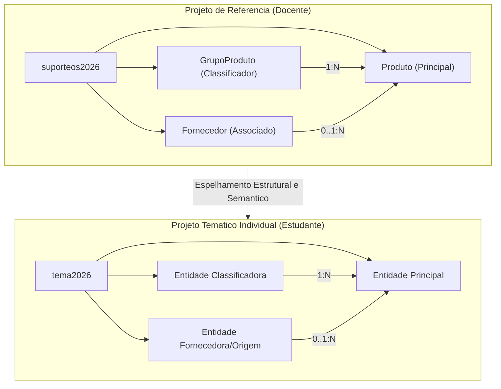

- **Projeto de Referência (`suporteos2026`):** Desenvolvido em sala de aula pelo Prof. Jefferson Passerini. O código atua como especificação executável canônica, definindo convenções de pacotes, estratégias de testes, organização de changelogs do Liquibase e tratamento de exceções.
- **Projeto Temático do Estudante:** Repositório independente criado por cada aluno a partir da Aula 02, baseado em um domínio de negócio exclusivo previamente aprovado (por exemplo: `biblioteca2026`, `locadora2026`, `oficina2026`). O aluno não deve enviar commits ao repositório do professor nem cloná-lo para renomear pacotes. A aprendizagem decorre da transposição abstrata das soluções apresentadas no `suporteos2026` para as entidades, atributos e regras de validação do seu próprio tema.

### O contrato de compatibilidade de domínio

Para assegurar que todas as lições subsequentes da disciplina possam ser aplicadas no projeto temático sem divergências de complexidade estrutural, cada estudante deve obedecer ao **Contrato Canônico de Duas Entidades com Relação $`1:N`$**:

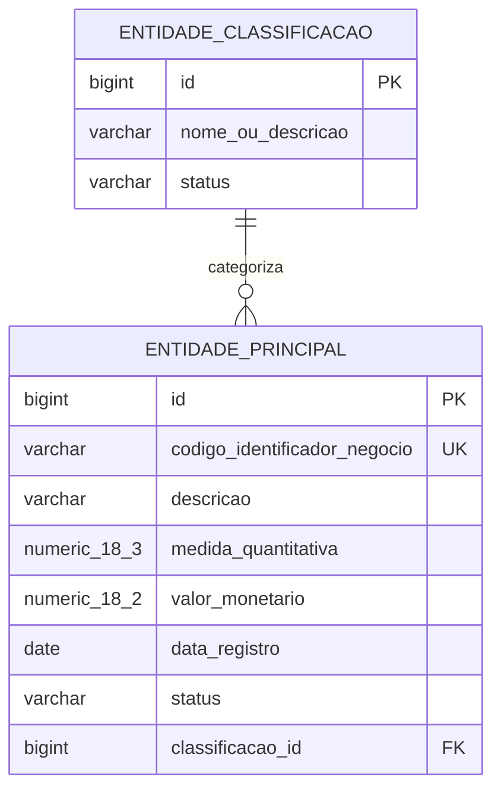

1. **Entidade Classificatória (Lado "1"):**
   - Atributo identificador substituto (`id` numérico gerado pelo banco);
   - Atributo descritivo/textual obrigatório;
   - Atributo de controle de estado (`status` ativo/inativo).
2. **Entidade Principal (Lado "N"):**
   - Atributo identificador substituto (`id` numérico);
   - Chave natural de negócio unívoca (código de barras, ISBN, SKU, chassi, placa);
   - Descrição ou nome principal;
   - Medida quantitativa precisa (saldo, peso, metragem, horas estimadas);
   - Grandeza monetária exata (preço unitário, custo de reposição, diária);
   - Data de registro de negócio (`LocalDate`);
   - Controle de estado ativo/inativo;
   - Chave estrangeira física obrigatória referenciando a Entidade Classificatória.

### Filosofia de engenharia: modelo rico, fail-fast e defesa em profundidade

A disciplina rejeita categoricamente três práticas amadoras recorrentes no mercado de software:

1. **Rejeição ao Modelo de Domínio Anêmico (*Anemic Domain Model*):** Entidades não são estruturas passivas de dados repletas de *getters* e *setters* públicos sem validação. Toda mutação de estado deve ser mediada por métodos de negócio expressivos que validem argumentos e protejam as invariantes de domínio.
2. **Adoção Estrita do Princípio *Fail-Fast*:** Parâmetros nulos, vazios ou inconsistentes devem provocar o encerramento imediato da execução no momento em que entram no sistema, impedindo a propagação de estados corrompidos pela memória da JVM.
3. **Estratégia de Defesa em Profundidade (*Defense in Depth*):** A integridade das informações não deve depender exclusivamente de uma única camada do sistema. Regras de negócio essenciais devem ser garantidas de forma redundante:
   - Na borda HTTP: validações sintáticas via Jakarta Bean Validation nos DTOs;
   - No núcleo Java: validações semânticas ricas dentro dos construtores e métodos das Entidades;
   - No banco relacional: restrições estruturais invioláveis executadas pelo PostgreSQL (`NOT NULL`, `UNIQUE`, `CHECK`, `FOREIGN KEY`).

---

## Controle de Versão, Reprodutibilidade e Ambiente de Execução

### Diferença conceitual e arquitetural entre Git e GitHub

Um dos erros basilares em formação técnica é tratar Git e GitHub como conceitos sinônimos ou concorrentes:

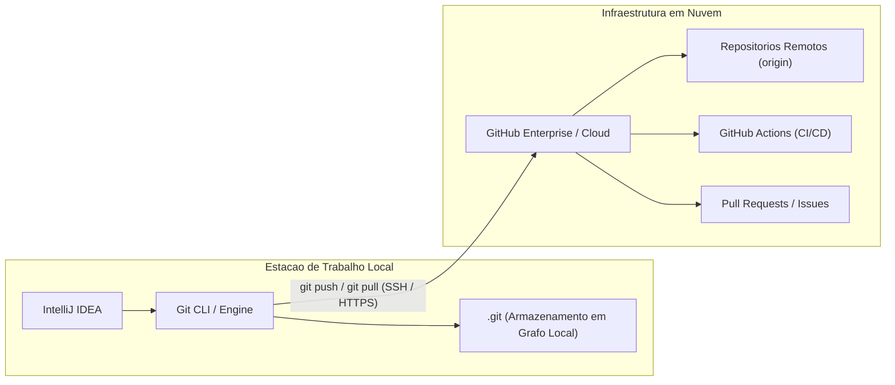

- **Git:** É um sistema utilitário de controle de versão distribuído (*Distributed Version Control System* - DVCS), de código aberto, criado por Linus Torvalds em 2005. Opera diretamente no sistema de arquivos local, armazenando snapshots e metadados no diretório oculto `.git`. Funciona de maneira 100% autônoma, sem necessidade de conexão de rede para registrar commits, bifurcar branches ou auditar o histórico.
- **GitHub:** É uma plataforma de hospedagem de código-fonte baseada em nuvem, pertencente à Microsoft. Utiliza o Git como motor no lado do servidor e agrega uma camada extensa de serviços colaborativos: controle de acesso granular de equipes, rastreamento de defeitos (*Issues*), revisão de código (*Pull Requests*), esteiras de compilação automatizada (*GitHub Actions*) e varredura estática de segurança (*Secret Scanning*).

### O Git como Grafo Acíclico Dirigido (DAG) e snapshots imutáveis

Sistemas legados como CVS ou Subversion (SVN) modelavam o histórico através de diferenças linha a linha por arquivo (*deltas*). O Git, em contraste, gerencia o histórico como uma progressão de **snapshots integrais** do projeto ao longo do tempo.

Estruturalmente, o histórico do Git é um **Grafo Acíclico Dirigido** (*Directed Acyclic Graph* - DAG):

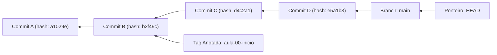

- **Vértices (Commits):** Cada nó é um objeto de commit imutável, indexado criptograficamente por um hash SHA-1 (160 bits, 40 caracteres hexadecimais) ou SHA-256. Um commit engloba: uma árvore física de arquivos (*tree* e *blobs*), metadados de autoria (nome, e-mail, timestamp), mensagem explicativa e referências para seus nós predecessores (*parent commits*).
- **Arestas (Ponteiros de Parentesco):** Apontam estritamente do commit filho para o commit pai. Como um nó aponta exclusivamente para trás no tempo, é matematicamente impossível a existência de ciclos, garantindo a aciclicidade do grafo.
- **Branches:** Não são pastas duplicadas em disco. Uma branch é unicamente um ponteiro móvel de 41 bytes gravado no arquivo de texto `.git/refs/heads/<nome-da-branch>` contendo o hash do commit mais recente daquela linha de trabalho.
- **Tags Anotadas:** Referências estáticas ancoradas de forma imutável a um commit específico, utilizadas na disciplina para demarcar os marcos de encerramento de aulas ("pontos de quebra pedagógicos").
- **HEAD:** Arquivo especial em `.git/HEAD` que armazena uma referência simbólica apontando qual branch ou commit está atualmente projetado no diretório de trabalho.

### Topologia de comunicação: repositório local versus remoto e protocolos de rede

No modelo distribuído, todo clone local contém uma cópia exaustiva de todo o histórico, ramos e tags do projeto. A sincronização entre o nó local e o servidor central (`origin`) ocorre através de protocolos seguros de transporte:

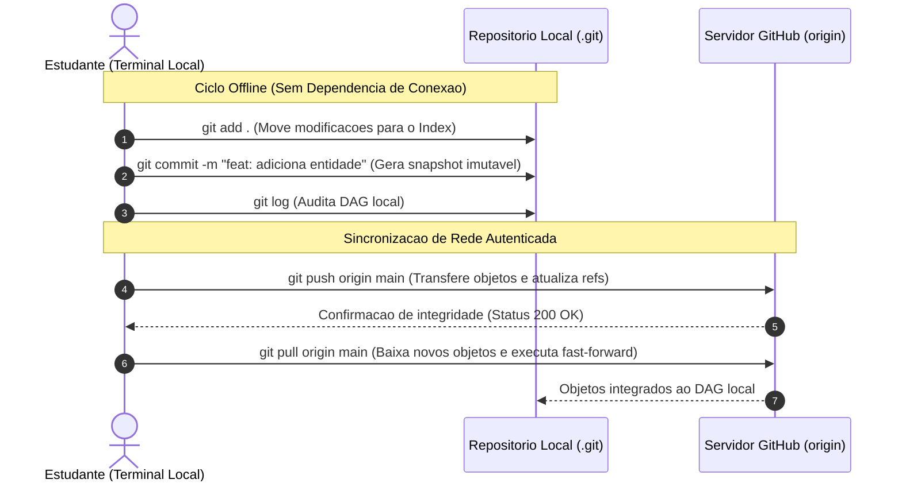

- **Protocolo HTTPS (Porta 443):** Utiliza URLs no formato `https://github.com/usuario/repo.git`. Desde agosto de 2021, o GitHub aboliu a autenticação por senha comum no terminal; exige-se a geração de um **Personal Access Token (PAT)** com escopo de permissão de repositório (`repo`).
- **Protocolo SSH (Porta 22):** Utiliza URLs no formato `git@github.com:usuario/repo.git`. A autenticação apoia-se em criptografia assimétrica de chaves públicas. Recomenda-se o algoritmo moderno de curvas elípticas **Ed25519** (`ssh-keygen -t ed25519 -C "email@institucional.br"`). A chave privada (`id_ed25519`) reside exclusivamente na estação local; cadastra-se no GitHub unicamente a chave pública (`id_ed25519.pub`).

### Arquivos fundamentais de governança: README, .editorconfig e .gitignore

A governança formal de um projeto corporativo repousa sobre três arquivos textuais obrigatórios na raiz do repositório:

1. **`README.md`:** Cartão de visitas técnico e manual operacional do sistema formatado em Markdown. Deve discriminar: versão da JDK exigida, requisitos de serviços em contêineres (PostgreSQL), portas de rede utilizadas, passos de compilação via Maven Wrapper e variáveis de ambiente obrigatórias.
2. **`.editorconfig`:** Padronização declarativa de formatação textual suportada nativamente por IDEs modernas (IntelliJ IDEA, VS Code, Eclipse). Impede divergências visuais e ruídos em diffs de controle de versão causados por quebras de linha distintas entre sistemas operacionais:

```ini
root = true

[*]
charset = utf-8
end_of_line = lf
indent_size = 4
indent_style = space
insert_final_newline = true
trim_trailing_whitespace = true

[*.{yml,yaml,md,json}]
indent_size = 2
```

3. **`.gitignore`:** Filtro de exclusão estrita do Git. Impede a submissão acidental de três categorias críticas de arquivos:
   - Binários e artefatos de compilação (`target/`, `*.class`, `*.jar`);
   - Metadados e configurações exclusivas da IDE do desenvolvedor (`.idea/`, `*.iml`, `.vscode/`);
   - Arquivos contendo credenciais e segredos locais de ambiente (`.env`, `secrets.properties`).

### Arquitetura interna da plataforma Java: JVM, JRE e JDK

A execução da linguagem Java baseia-se no paradigma de compilação híbrida para garantir independência de arquitetura de hardware:

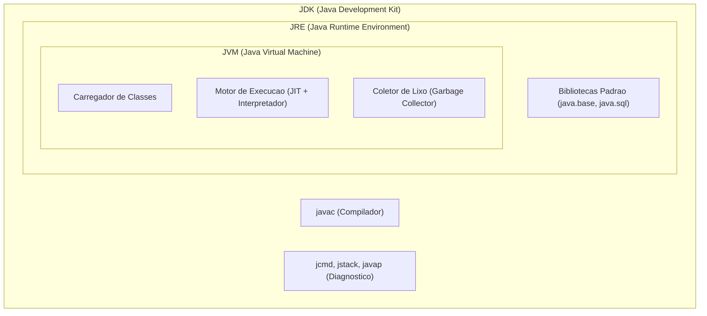

- **JVM (Java Virtual Machine):** A máquina abstrata que gerencia a execução dos programas. Não é padronizada como arquivo binário único, mas sim implementada para cada sistema operacional específico. Contém o carregador de classes (*ClassLoader*), o motor de execução híbrido (interpretador inicial somado ao compilador dinâmico *Just-In-Time* - JIT) e o gerenciador automático de memória (*Garbage Collector*). Opera sobre uma arquitetura orientada a pilha (*stack-based*).
- **JRE (Java Runtime Environment):** O ambiente estrito de execução. Corresponde à soma da JVM com o conjunto completo de bibliotecas pré-compiladas da plataforma padrão Java (`java.base`, coleções, rede, entrada e saída). É capaz de executar arquivos `.jar`, mas não contém o compilador `javac`.
- **JDK (Java Development Kit):** O superconjunto definitivo de engenharia. Contém a JRE integral acrescida das ferramentas de compilação (`javac`), empacotamento (`jar`), desmontagem de bytecode (`javap`) e perfilamento de processos (`jstack`, `jmap`, `jcmd`).
- **Padrão Adotado na Disciplina:** **Eclipse Temurin JDK 21 LTS** (distribuição OpenJDK de alta estabilidade auditada pela Eclipse Foundation sob conformidade com o Technology Compatibility Kit - TCK).

### Resolução de comandos pelo sistema operacional: PATH versus JAVA_HOME

Uma das falhas mais frequentes em ambientes de desenvolvimento é o descompasso de resolução de binários:

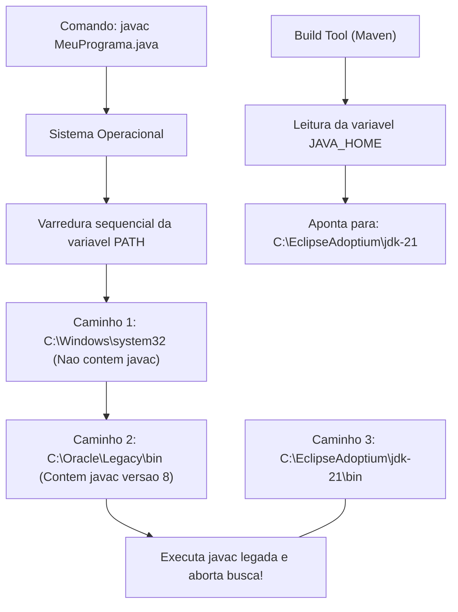

- **Variável `PATH`:** Lista ordenada de diretórios de sistema onde o interpretador de comandos (PowerShell, Bash, Zsh) busca os arquivos executáveis. O primeiro diretório da lista que contiver o binário pesquisado (`java` ou `javac`) vence a resolução e é executado, ignorando os diretórios subsequentes.
- **Variável `JAVA_HOME`:** Ponteiro corporativo que armazena o caminho absoluto para o diretório raiz da instalação do JDK. É consumida diretamente por ferramentas de automação de compilação (Maven, Gradle) e servidores web para localizar bibliotecas internas do compilador (`tools.jar` ou módulos do sistema).
- **Armadilha do Desalinhamento:** Se o `PATH` apontar para um Java 8 antigo e o `JAVA_HOME` para o Java 21, comandos de terminal compilarão código em uma versão divergente das tarefas disparadas pelo Maven, gerando erros fatais em tempo de carga como `UnsupportedClassVersionError: class file version 65.0, this version only recognizes up to 52.0`.

### Automação de compilação com Apache Maven e Maven Wrapper

O Apache Maven é a ferramenta padronizada de automação de construção (*build tool*) fundamentada no princípio de **Convenção sobre Configuração** (*Convention over Configuration*). Em vez de scripts procedurais imperativos, o desenvolvedor declara metadados e dependências no arquivo estruturado `pom.xml` (*Project Object Model*).

Topologia canônica de um projeto Maven:

```text
projeto-raiz/
├── pom.xml
├── mvnw
├── mvnw.cmd
├── .mvn/
│   └── wrapper/
│       ├── maven-wrapper.jar
│       └── maven-wrapper.properties
└── src/
    ├── main/
    │   ├── java/
    │   └── resources/
    └── test/
        ├── java/
        └── resources/
```

- **Ciclo de Vida Padrão (*Standard Lifecycle*):** Sequência ordenada de fases determinísticas onde a invocação de uma fase dispara automaticamente todas as anteriores:
  1. `validate`: Verifica se a estrutura do projeto e o `pom.xml` estão sintaticamente corretos;
  2. `compile`: Compila o código-fonte de produção de `src/main/java` gerando bytecodes em `target/classes`;
  3. `test`: Compila o código de testes de `src/test/java` e executa as asserções JUnit;
  4. `package`: Empacota os bytecodes compilados e recursos no formato final (`.jar` executável);
  5. `verify`: Executa testes de integração para certificar critérios de qualidade;
  6. `install`: Copia o pacote `.jar` gerado para o repositório local do desenvolvedor (`~/.m2/repository`);
- **Maven Wrapper (`mvnw` e `mvnw.cmd`):** Scripts utilitários que acompanham o código-fonte do projeto. Caso o desenvolvedor não possua o Maven instalado em sua máquina, o wrapper faz o download automático da versão exata especificada em `.mvn/wrapper/maven-wrapper.properties`, garantindo reprodutibilidade idêntica entre computadores de alunos, máquinas de professores e servidores de integração contínua (CI).

---

## Fundamentos de Arquitetura de Software e Protocolo HTTP

### Arquitetura cliente-servidor e sistemas distribuídos

A engenharia de software contemporânea apoia-se na segregação de responsabilidades através do modelo arquitetural cliente-servidor:

- **Cliente (Agente Ativo):** Componente consumidor (aplicação Single Page Application - SPA em React/Vue/Angular, aplicativo móvel Android/iOS, comando `curl` ou Postman) que inicia ativamente a comunicação disparando requisições estruturadas pela rede.
- **Servidor (Agente Passivo):** Processo em execução contínua que aguarda conexões em uma porta de rede pré-determinada (no Spring Boot com Tomcat embutido, a porta padrão é a `8080`). Recebe as mensagens, decodifica a intenção semântica, executa regras de negócio transacionais e devolve uma resposta estruturada, liberando ou mantendo a conexão conforme a versão do protocolo.

### Aplicações com renderização no servidor versus APIs Web baseadas em dados

A disciplina estabelece uma divisão rigorosa entre dois paradigmas de desenvolvimento web:

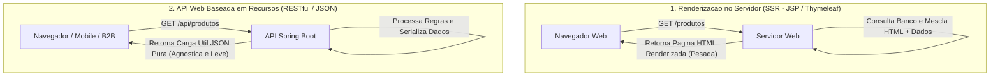

| Critério Arquitetural | Renderização no Servidor (SSR) | API Web RESTful (JSON) |
|---|---|---|
| **Carga de Processamento** | Servidor renderiza layout, marcação visual e CSS | Servidor processa regras; cliente desenha a tela |
| **Formato de Transporte** | Documentos HTML completos | Cargas estruturadas de dados em JSON |
| **Acoplamento de Interface** | Restrito a navegadores com suporte a HTML | Agnóstico: atende Web, Mobile, TV, IoT e parceiros |
| **Escalabilidade do Backend** | Menor (alto custo de CPU para compor páginas) | Elevada (serialização rápida e cache facilitado) |

### Anatomia formal de requisições e respostas HTTP conforme a RFC 9110

O protocolo **HTTP** (*Hypertext Transfer Protocol*), padronizado em sua semântica pela especificação IETF RFC 9110, opera como um protocolo baseado em texto sobre conexões confiáveis (TCP/IP).

#### 1. Estrutura Canônica de uma Requisição HTTP

```http
POST /api/produtos HTTP/1.1
Host: localhost:8080
Content-Type: application/json
Accept: application/json
User-Agent: curl/8.7.1

{
  "codigoBarra": "7891000300012",
  "descricao": "Teclado Mecanico USB",
  "saldoEstoque": 45.000,
  "valorUnitario": 289.90,
  "grupoId": 2
}
```

- **Linha de Comando (*Request Line*):** Contém três elementos separados por espaço: o método HTTP (`POST`), o caminho de destino ou URI (`/api/produtos`) e a versão do protocolo (`HTTP/1.1`).
- **Cabeçalhos da Requisição (*Headers*):** Conjunto de metadados organizados em chave-valor fornecendo contexto técnico:
  - `Content-Type`: Notifica o formato de mídia (*MIME type*) contido no corpo enviado (`application/json`);
  - `Accept`: Informa os formatos que o cliente é capaz de processar na resposta;
  - `Host`: Identificador de rede obrigatório do servidor destino.
- **Linha em Branco:** Um caractere de quebra de linha de controle estrito (`\r\n`) que finaliza a seção de cabeçalhos.
- **Corpo da Mensagem (*Message Body / Payload*):** Conteúdo bruto transmitido. Presente em mutações (`POST`, `PUT`, `PATCH`), ausente em consultas simples (`GET`, `DELETE`).

#### 2. Estrutura Canônica de uma Resposta HTTP

```http
HTTP/1.1 201 Created
Location: /api/produtos/84
Content-Type: application/json
Date: Thu, 13 Aug 2026 14:30:00 GMT

{
  "id": 84,
  "codigoBarra": "7891000300012",
  "descricao": "Teclado Mecanico USB",
  "saldoEstoque": 45.000,
  "valorUnitario": 289.90,
  "status": "ATIVO"
}
```

- **Linha de Status (*Status Line*):** Composta pela versão do protocolo (`HTTP/1.1`), código numérico de status (`201`) e frase textual de justificativa (*Reason Phrase*: `Created`).
- **Cabeçalhos da Resposta:** Metadados emitidos pelo servidor. Destaca-se o cabeçalho `Location`, que comunica o endereço absoluto ou relativo para acesso direto ao recurso recém-materializado.
- **Linha em Branco:** Separador formal de metadados (`\r\n`).
- **Corpo da Resposta:** Representação serializada do recurso resultante.

### Métodos HTTP, propriedades de segurança e idempotência matemática

A semântica dos métodos define o comportamento exigido do servidor conforme a RFC 9110:

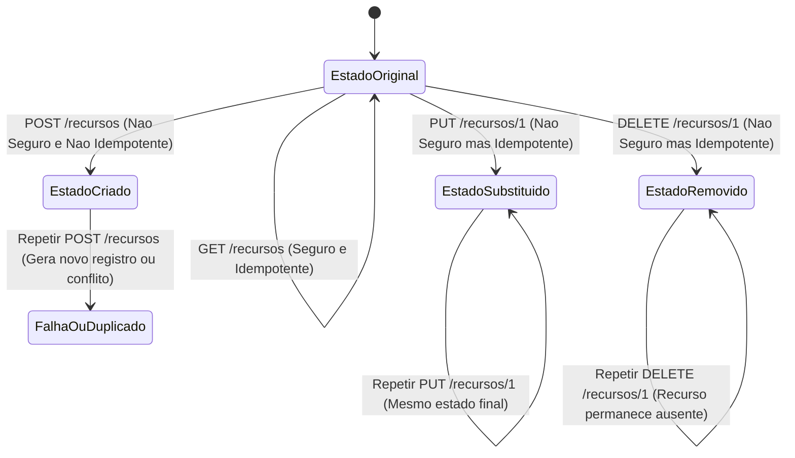

- **Método Seguro (*Safe Method*):** Uma operação é segura quando sua invocação tem caráter estritamente de consulta, sendo desprovida de efeitos colaterais mutantes no estado do sistema. O cliente não pode ser responsabilizado por mutações ao invocar um método seguro. Métodos seguros são trivialmente idempotentes.
- **Método Idempotente (*Idempotent Method*):** Propriedade matemática onde o efeito colateral observável no servidor resultante de múltiplas execuções idênticas consecutivas é rigorosamente o mesmo de uma única execução isolada:

```math
f(f(x)) = f(x)
```

| Método HTTP | Propósito Semântico Primário | É Seguro? | É Idempotente? | Resposta Típica de Sucesso |
|---|---|---|---|---|
| `GET` | Recuperar representação de um recurso | **Sim** | **Sim** | `200 OK` |
| `POST` | Submeter entidade para criação subordinada | **Não** | **Não** | `201 Created` com `Location` |
| `PUT` | Substituição integral do recurso existente | **Não** | **Sim** | `200 OK` ou `204 No Content` |
| `PATCH` | Atualização parcial do recurso existente | **Não** | **Não** (por padrão) | `200 OK` |
| `DELETE` | Destruição do recurso identificado | **Não** | **Sim** | `204 No Content` ou `200 OK` |

### Famílias e semântica estrita dos códigos de status HTTP

Os códigos de status são inteiros de três dígitos divididos em cinco famílias semânticas:

1. **`1xx` (Informativo):** Notifica que a requisição foi recebida e o processamento continua (ex.: `100 Continue`).
2. **`2xx` (Sucesso):** Confirmação de que a operação foi recebida, compreendida e processada com êxito:
   - `200 OK`: Sucesso padrão para consultas ou mutações que retornam dados;
   - `201 Created`: Recurso criado com sucesso (requer cabeçalho `Location`);
   - `204 No Content`: Operação concluída com êxito sem carga de dados a retornar (comum em `DELETE` ou `PUT`).
3. **`3xx` (Redirecionamento):** Exige que o cliente execute ações adicionais para concluir a requisição (ex.: `301 Moved Permanently`).
4. **`4xx` (Erro do Cliente):** Anomalia provocada pelo emissor da mensagem:
   - `400 Bad Request`: Erro de sintaxe, JSON malformado ou violação de validação declarativa;
   - `401 Unauthorized`: Ausência de autenticação válida;
   - `403 Forbidden`: Cliente autenticado não possui privilégios de acesso;
   - `404 Not Found`: URI inexistente ou recurso de negócio não localizado;
   - `409 Conflict`: Violação de integridade ou conflito de chave única no banco de dados.
5. **`5xx` (Erro do Servidor):** Falha interna de infraestrutura do backend:
   - `500 Internal Server Error`: Exceção não interceptada pela aplicação (bug, falha de driver);
   - `503 Service Unavailable`: Servidor sobrecarregado ou banco de dados inacessível.

### Modelagem de recursos e princípios arquiteturais REST

O modelo **REST** (*Representational State Transfer*), delineado por Roy Fielding em sua tese de doutorado (2000), fixa restrições fundamentais:

- **Desacoplamento de Recursos:** A menor unidade manipulável é o **recurso**. Recursos são abstrações substantivas modeladas obrigatoriamente no plural: `/api/produtos`, `/api/grupos-produtos`.
- **Rejeição ao Anti-padrão RPC (*Remote Procedure Call*):** É proibido incluir verbos operacionais nas URIs. A ação é comunicada exclusivamente pelo método HTTP:
  - *Incorreto (RPC):* `POST /api/salvarProduto`, `GET /api/excluirProduto?id=5`
  - *Correto (REST):* `POST /api/produtos`, `DELETE /api/produtos/5`
- **Comunicação Sem Estado (*Stateless*):** O servidor não retém estados de sessão de clientes na memória. Cada requisição deve carregar todas as informações técnicas e contextuais requeridas para seu processamento integral.

---

## Modelagem de Domínio Rico em Java Puro

### Conceito de domínio e modelo de domínio no paradigma de orientação a objetos

Na arquitetura de software, o **domínio** constitui a esfera de regras, políticas e processos do mundo real para a qual o sistema foi construído. O **modelo de domínio** é uma abstração simplificada e intencionalmente seletiva da realidade, projetada dentro de limites bem definidos (*Bounded Context*).

O núcleo do domínio deve ser programado em **Java puro** (POJO - *Plain Old Java Object*), desacoplado de frameworks web, anotações de infraestrutura e bibliotecas de persistência. A lógica do negócio de estoque ou de matrículas deve funcionar mesmo se executada em um console sem banco de dados ou ambiente web.

### Entidades versus Objetos de Valor

A modelagem orientada a domínio discrimina dois conceitos centrais de construção:

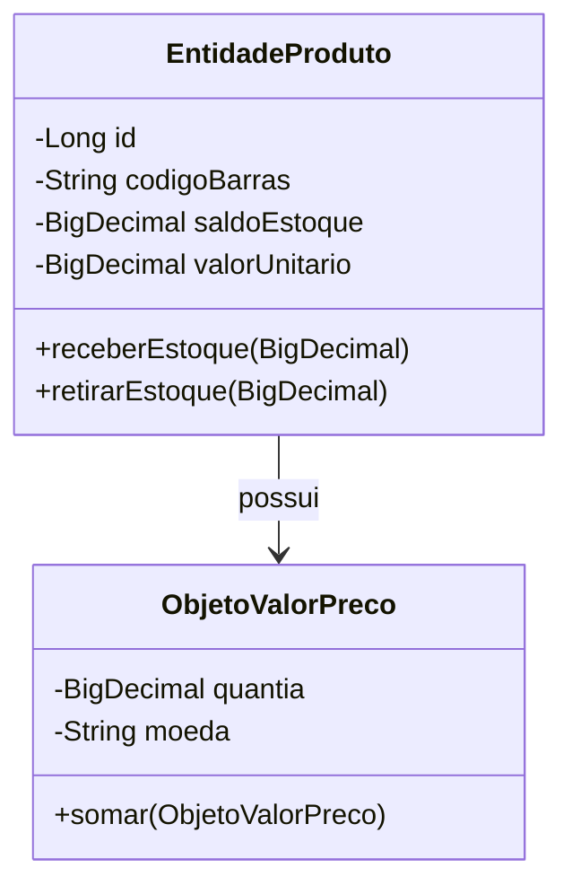

- **Entidade (*Entity*):** Objeto caracterizado por uma trajetória de identidade contínua ao longo do tempo. Dois produtos continuam sendo entidades distintas mesmo que possuam a mesma descrição e o mesmo preço, caso seus identificadores (`id` ou `codigoBarras`) sejam diferentes. Seu estado interno sofre mutações controladas.
- **Objeto de Valor (*Value Object*):** Elemento que descreve características ou quantidades, definido estritamente pela totalidade de seus atributos. É intrinsecamente imutável: qualquer alteração conceitual resulta na instanciação de um novo objeto de valor. Não possui identificador de banco de dados. Dois objetos de valor com campos idênticos são absolutamente intercambiáveis. Exemplos: `BigDecimal`, `LocalDate`, `Endereco`, `Cnpj`.

### Encapsulamento estrito e proteção de invariantes de negócio

Uma **invariante de negócio** é uma regra de consistência lógica que deve manter-se obrigatoriamente verdadeira durante todo o ciclo de vida do objeto. A violação de uma invariante coloca o software em estado corrompido.

Para blindar as entidades contra corrupção:
1. Todos os campos são declarados como `private`;
2. Campos que não devem mudar após a criação são marcados como `final`;
3. Construtores de negócio barram argumentos ilegais imediatamente (*fail-fast*);
4. Coleções internas nunca são expostas de forma mutável para fora da classe.

Exemplo de mutação rica com encapsulamento de invariantes:

```java
public void retirarEstoque(BigDecimal quantidade) {
    if (quantidade == null) {
        throw new NullPointerException("Quantidade para retirada não pode ser nula");
    }
    if (quantidade.signum() <= 0) {
        throw new IllegalArgumentException("Quantidade retirada deve ser estritamente maior que zero");
    }
    if (this.saldoEstoque.compareTo(quantidade) < 0) {
        throw new IllegalArgumentException("Saldo de estoque insuficiente para realizar a retirada");
    }
    this.saldoEstoque = this.saldoEstoque.subtract(quantidade);
}
```

### A falha do padrão IEEE 754 e o uso de BigDecimal para grandezas monetárias

Os tipos primitivos `float` (32 bits) e `double` (64 bits) do Java implementam o padrão aritmético binário internacional IEEE 754. Foram desenhados para processamento gráfico e cálculos científicos, onde velocidade é crítica e pequenas perdas de precisão são irrelevantes.

Em sistemas financeiros, comerciais e de gestão de estoques, o emprego de `double` ou `float` é **inadmissível**. Na base binária, frações decimais simples como $`0.1`$ ou $`0.2`$ configuram dízimas periódicas infinitas, gerando erros cumulativos de arredondamento:

```java
// Demonstracao matematica do erro binario:
double v1 = 0.1;
double v2 = 0.2;
System.out.println(v1 + v2); // Imprime: 0.30000000000000004
```

A solução mandatória é o emprego da classe **`java.math.BigDecimal`**:

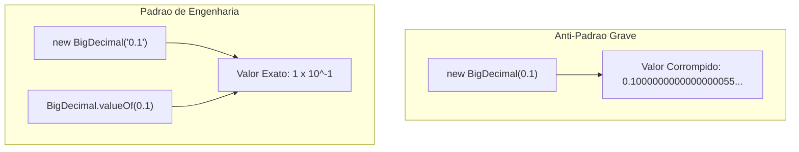

#### Regras Mandatórias de Engenharia com BigDecimal

1. **Instanciação Segura:** Nunca passe literais `double` no construtor `new BigDecimal(double)`. Utilize obrigatoriamente a representação textual `new BigDecimal("12.90")` ou o método estático `BigDecimal.valueOf(12.90)`.
2. **Controle Explícito de Escala e Arredondamento:** Multiplicações e divisões exigem a definição da escala (*scale*) e a política de corte. A disciplina adota o arredondamento simétrico bancário `RoundingMode.HALF_UP`:

```java
public BigDecimal calcularValorTotal() {
    return this.saldoEstoque
            .multiply(this.valorUnitario)
            .setScale(2, RoundingMode.HALF_UP);
}
```

3. **A Armadilha do `equals()` versus `compareTo()`:**
   - O método `equals()` avalia o valor numérico **e a escala**. Portanto: `new BigDecimal("10.0").equals(new BigDecimal("10.00"))` retorna **`false`**!
   - O método `compareTo()` avalia exclusivamente a magnitude numérica. Portanto: `new BigDecimal("10.0").compareTo(new BigDecimal("10.00")) == 0` retorna **`true`**!
   - **Regra de Ouro:** Testes unitários e asserções de negócio devem utilizar estritamente `compareTo(outro) == 0`.

### Representação de estados finitos com enum e datas determinísticas com LocalDate

- **Tipos Enumerados (`enum`):** Substituem constantes numéricas ou literais de texto soltos (mágicos). Garantem segurança de tipos (*type safety*) em tempo de compilação, impedindo a atribuição de estados inexistentes:

```java
public enum Status {
    ATIVO,
    INATIVO;
}
```

- **Manipulação de Datas:** A API clássica `java.util.Date` e `Calendar` é historicamente mutável, sujeita a condições de corrida (*thread-unsafe*) e carrega informações indesejadas de horário e fuso. A disciplina exige a utilização da biblioteca moderna `java.time.LocalDate` para representar datas puras de negócio (como data de cadastro ou fundação), assegurando imutabilidade estrutural e determinismo temporal.

### Mapeamento e controle de associação 1:N bidirecional em memória

Em bancos de dados relacionais, uma relação $`1:N`$ é materializada por uma chave estrangeira escalar na tabela filha. No modelo orientado a objetos, a relação bidirecional exige que:
- O pai mantenha uma lista de referências (`List<Produto> produtos`);
- O filho mantenha uma referência ao pai (`GrupoProduto grupo`).

Se os ponteiros forem manipulados de forma independente por agentes externos, o estado em memória atinge inconsistência imediata (por exemplo: o produto aponta para o grupo A, mas a lista do grupo A não contém o produto).

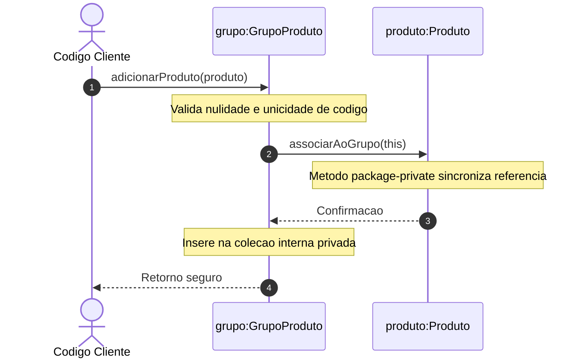

#### Mecanismo Canônico de Sincronização em Memória

1. **Ponto Único de Entrada:** O método `adicionarProduto(Produto)` em `GrupoProduto` é o único ponto público para estabelecer a associação.
2. **Visibilidade de Pacote (*Package-Private*):** O método `associarAoGrupo(GrupoProduto)` na classe `Produto` tem sua visibilidade restrita ao pacote, impedindo que classes externas vinculem o produto a um grupo sem passar pela lista do pai.
3. **Imutabilidade Externa da Coleção:** O método leitor da coleção no pai nunca devolve a referência direta da lista interna, mas sim um invólucro somente-leitura gerado por `Collections.unmodifiableList(this.produtos)`. Se um desenvolvedor tentar executar `grupo.getProdutos().add(p)`, a JVM disparará imediatamente uma `UnsupportedOperationException`.

### Testes unitários no padrão Arrange-Act-Assert com JUnit 5

Testes unitários de domínio avaliam o comportamento das regras de negócio sem subir o contêiner do Spring Boot e sem tocar em conexões de banco de dados, executando em poucos milissegundos. Adota-se o padrão estrutural **Arrange-Act-Assert (AAA)**:

```java
@Test
@DisplayName("Deve subtrair o saldo de estoque com sucesso quando a quantidade for valida")
void deveSubtrairSaldoEstoqueQuandoQuantidadeValida() {
    // Arrange (Preparacao do cenario de teste)
    GrupoProduto grupo = new GrupoProduto("Periféricos");
    Produto produto = new Produto("789001", "Mouse", new BigDecimal("10.000"), new BigDecimal("50.00"), LocalDate.now());
    grupo.adicionarProduto(produto);
    BigDecimal quantidadeRetirada = new BigDecimal("3.000");

    // Act (Execucao da acao de negocio)
    produto.retirarEstoque(quantidadeRetirada);

    // Assert (Verificacao dos resultados e invariantes)
    assertEquals(0, new BigDecimal("7.000").compareTo(produto.getSaldoEstoque()));
}
```

---

## Persistência Relacional com JPA, Hibernate e PostgreSQL

### O descompasso de impedância objeto-relacional

O descompasso de impedância objeto-relacional (*Object-Relational Impedance Mismatch*) define o atrito conceitual e técnico entre o paradigma orientado a objetos (grafos de memória, encapsulamento, identidade por referência e herança) e o paradigma relacional (álgebra relacional, relações, tuplas, chaves primárias e integridade referencial física).

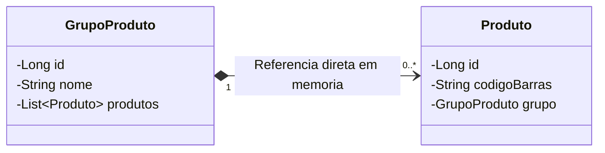

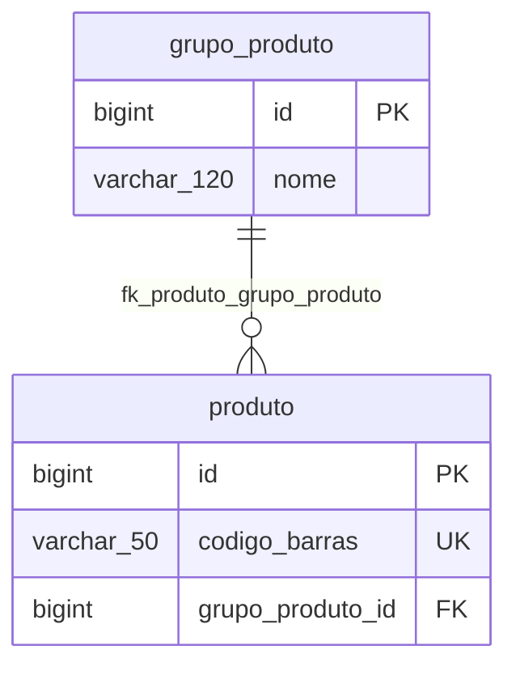

O Mapeador Objeto-Relacional (ORM) atua como a ponte de tradução entre esses dois mundos antagônicos.

### Matriz de responsabilidades das tecnologias: PostgreSQL, JDBC, JPA e Hibernate

| Tecnologia | Categoria | Papel Específico no Projeto | O que NÃO deve fazer |
|---|---|---|---|
| **PostgreSQL** | SGBD Relacional | Armazenar dados em disco, gerenciar transações ACID e aplicar constraints relacionais (`PK`, `FK`, `UK`, `CHECK`). | Executar lógica de interface ou regras de formatação visual. |
| **JDBC** | Driver e API Conectiva | Abrir sockets TCP de rede, converter tipos Java em SQL nativo e transmitir ResultSets. | Abstrair a sintaxe SQL nativa ou gerenciar estados em cache. |
| **JPA** | Especificação (Jakarta EE) | Padronizar anotações declarativas (`@Entity`, `@Id`) e contratos de interface (`EntityManager`). | Executar código diretamente; é apenas uma especificação. |
| **Hibernate** | Provedor ORM | Implementar a JPA, gerar instruções SQL em tempo de execução, rastrear alterações (*dirty checking*) e gerenciar cache de 1º nível. | Ser a fonte de verdade do DDL ou gerar tabelas em produção. |
| **Spring Data JPA** | Abstração de Framework | Gerar proxies dinâmicos em torno de interfaces Java e coordenar transações com o contêiner. | Substituir a necessidade de entender mapeamentos relacionais. |
| **Liquibase** | Migração de Esquema | Fonte primária absoluta da verdade do banco. Executar DDL declarativo, versionado e idempotente. | Conter regras de negócio em runtime. |

### A estratégia de integridade de dados em defesa em profundidade

A garantia da integridade nunca é terceirizada exclusivamente ao banco de dados nem exclusivamente ao código Java:

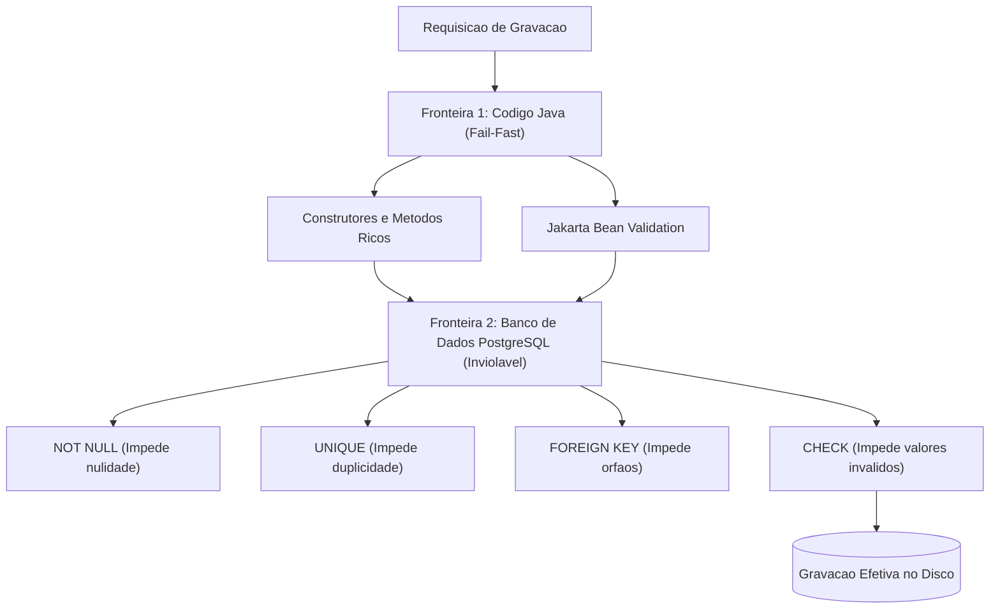

- **Por que validar na aplicação?** Garante feedback imediato ao usuário sem consumir conexões de rede ou ciclos de processamento do banco.
- **Por que validar no banco relacional?** O banco é compartilhado. Cargas de dados em lote, scripts administrativos de suporte ou acessos diretos por ferramentas SQL corromperiam o sistema caso o banco de dados não possuísse restrições físicas invioláveis.

### Configuração de perfis do Spring e eliminação de bancos em memória

A disciplina veda expressamente o uso de bancos de dados em memória (como H2) para ambientes de teste:
- O H2 possui dialeto SQL diferente do PostgreSQL;
- Trata índices, restrições e tipos monetários (`NUMERIC`) de maneira divergente;
- Não suporta locks transacionais avançados e frequentemente aceita comandos DDL inválidos que quebram em produção.

Adota-se a **Paridade Estrita de Ambientes** com PostgreSQL real isolado em instâncias lógicas:

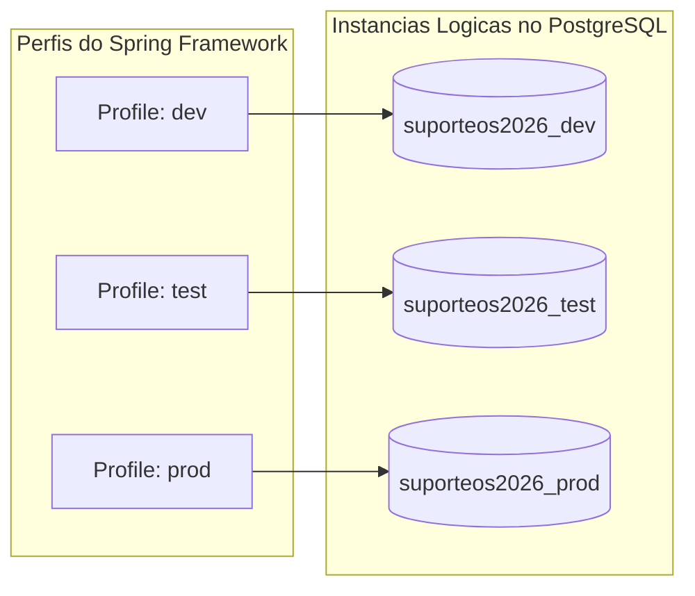

### Gerenciamento seguro de credenciais locais via arquivo .env

A exposição de senhas e credenciais em repositórios Git constitui infração grave de segurança. Para isolar parâmetros sensíveis:
1. As propriedades do Spring consomem variáveis de ambiente:

```properties
spring.datasource.url=jdbc:postgresql://${DB_HOST:localhost}:${DB_PORT:5432}/${DB_NAME:suporteos2026_dev}
spring.datasource.username=${DB_USER:suporteos_app}
spring.datasource.password=${DB_PASSWORD}
```

2. Um arquivo `.env` reside exclusivamente na estação local, contendo as atribuições reais de desenvolvimento:

```bash
DB_HOST=localhost
DB_PORT=5432
DB_NAME=suporteos2026_dev
DB_USER=suporteos_app
DB_PASSWORD=senha_secreta_local
```

3. O arquivo `.env` é registrado obrigatoriamente no `.gitignore`. Disponibiliza-se no repositório um modelo público denominado `.env.example` desprovido de senhas reais.

### Mapeamento de entidades JPA, chaves primárias e relacionamentos

A conversão declarativa do modelo de domínio para o modelo relacional opera através de anotações do pacote `jakarta.persistence.*`:

```java
@Entity
@Table(name = "produto", uniqueConstraints = {
    @UniqueConstraint(name = "uk_produto_codigo_barras", columnNames = "codigo_barras")
})
public class Produto {

    @Id
    @GeneratedValue(strategy = GenerationType.IDENTITY)
    private Long id;

    @Column(name = "codigo_barras", nullable = false, length = 50)
    private String codigoBarras;

    @Column(name = "descricao", nullable = false, length = 150)
    private String descricao;

    @Column(name = "saldo_estoque", nullable = false, precision = 18, scale = 3)
    private BigDecimal saldoEstoque;

    @Column(name = "valor_unitario", nullable = false, precision = 18, scale = 2)
    private BigDecimal valorUnitario;

    @Column(name = "data_cadastro", nullable = false)
    private LocalDate dataCadastro;

    @Enumerated(EnumType.STRING)
    @Column(name = "status", nullable = false, length = 20)
    private Status status;

    @ManyToOne(fetch = FetchType.LAZY)
    @JoinColumn(name = "grupo_produto_id", nullable = false, foreignKey = @ForeignKey(name = "fk_produto_grupo_produto"))
    private GrupoProduto grupo;

    // Construtor protegido obrigatorio pela JPA para reidratacao reflexiva
    protected Produto() {}

    // Construtor canonico de dominio com validacoes ricas
    public Produto(String codigoBarras, String descricao, BigDecimal saldoEstoque, BigDecimal valorUnitario, LocalDate dataCadastro) {
        // Validacoes e invariantes
    }
}
```

- **`GenerationType.IDENTITY`:** Mapeia colunas auto-incrementais gerenciadas nativamente pelo banco relacional (`BIGSERIAL` ou `GENERATED ALWAYS AS IDENTITY`).
- **`FetchType.LAZY`:** Estabelece que o relacionamento não deve ser carregado prematuramente na inicialização da entidade, mitigando o problema de performance do $`N+1`$.
- **`EnumType.STRING`:** Grava o nome textual da constante no banco. Nunca use o padrão `EnumType.ORDINAL`, pois qualquer alteração na ordem das constantes do enum corromperá todos os registros já persistidos no banco.

### Validação estrita de esquema com ddl-auto=validate

A propriedade de configuração do Hibernate deve ser fixada em:

```properties
spring.jpa.hibernate.ddl-auto=validate
```

- **O que faz:** Durante a inicialização da aplicação, o Hibernate inspeciona as anotações de todas as classes `@Entity` e confronta cada tabela, coluna, tipo primitivo e chave estrangeira contra os metadados reais do PostgreSQL.
- **Racional:** Caso haja divergência estrutural (exemplo: coluna inexistente no banco ou tamanho insuficiente), o Hibernate aborta o boot imediatamente com uma exceção de validação. O Hibernate valida o esquema; a ferramenta responsável por criá-lo e evoluí-lo é o **Liquibase**.

---

## Versionamento de Banco de Dados com Liquibase

### O banco de dados como histórico executável determinístico

Em arquiteturas empresariais modernas, o esquema do banco de dados é tratado como código-fonte (*Database-as-Code*). O estado atual do esquema $`S_n`$ é a soma incremental de todas as migrações $`\Delta M`$ aplicadas sequencialmente desde o início do sistema:

```math
S_n = S_0 + \Delta M_1 + \Delta M_2 + \dots + \Delta M_n
```

O Liquibase gerencia essa esteira de transições garantindo idempotência e reprodutibilidade determinística em qualquer infraestrutura.

### Tabelas de controle interno: DATABASECHANGELOG e DATABASECHANGELOGLOCK

Na primeira execução, o Liquibase cria duas tabelas de metadados no esquema do PostgreSQL:

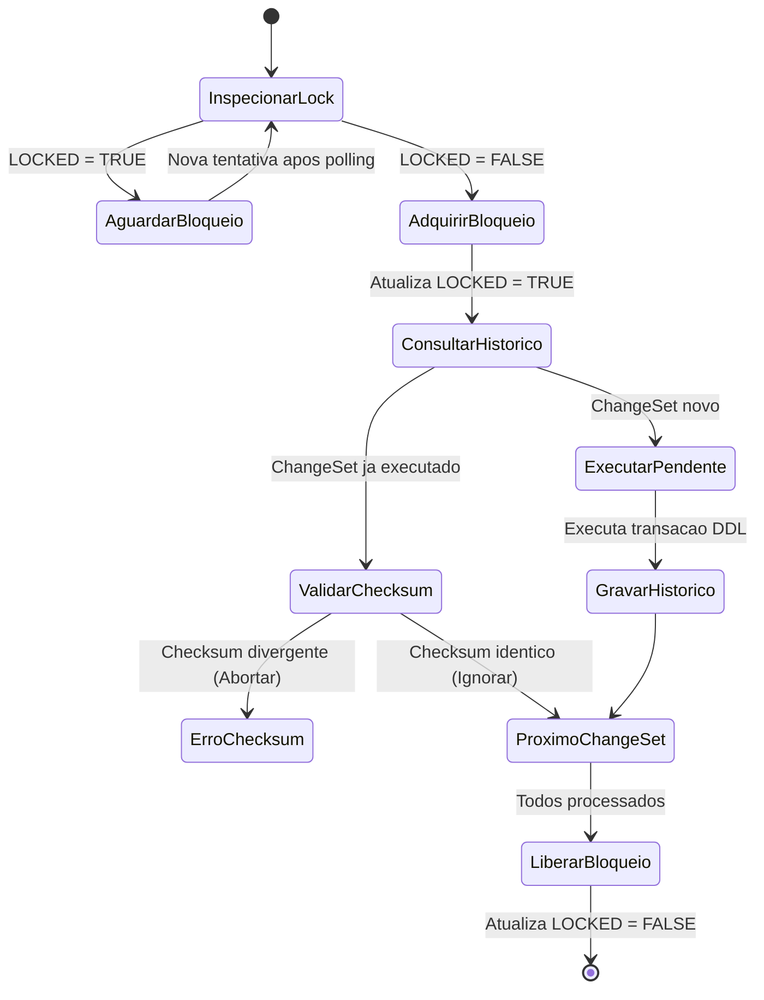

1. **`DATABASECHANGELOGLOCK`:** Semáforo de controle de concorrência. Possui uma única linha contendo a flag booleana `locked`. Impede que múltiplas instâncias da aplicação subindo simultaneamente em cluster executem migrações concorrentes sobre o mesmo catálogo.
2. **`DATABASECHANGELOG`:** Registro cronológico de auditoria append-only. Armazena: identificador (`id`), autor (`author`), arquivo de origem (`filename`), timestamp de execução (`dateexecuted`), ordem (`orderexecuted`) e a soma de verificação criptográfica do bloco (`md5sum`).

### Anatomia da identidade de um changeSet e o cálculo de checksums

Um bloco de migração no Liquibase possui identidade formal unívoca dada por:

```math
\text{Identidade} = (\text{id}, \text{author}, \text{filename})
```

- **Cálculo de Checksum:** Ao processar o bloco, o Liquibase calcula um hash SHA-256/MD5 sobre o conteúdo estruturado da migração e grava na coluna `md5sum`. Em reinicializações subsequentes, ele recalcula o hash do arquivo físico e o compara com o banco.
- **A Regra de Ouro da Imutabilidade:** Nunca modifique um `changeSet` que já foi executado em ambiente compartilhado. Alterar um caractere que seja causará o erro impeditivo `Validation Failed: Checksum Check Failed`. Qualquer evolução deve ser implementada através de um **novo** `changeSet` incremental.

### Estruturação de changelogs mestres e incrementais em YAML

Adota-se a representação declarativa em YAML, gerenciada por um arquivo maestro:

```yaml
# src/main/resources/db/changelog/db.changelog-master.yaml
databaseChangeLog:
  - include:
      file: db/changelog/migrations/001-create-grupo-produto.yaml
  - include:
      file: db/changelog/migrations/002-create-produto.yaml
```

Estrutura canônica de um changelog incremental atômico:

```yaml
# src/main/resources/db/changelog/migrations/001-create-grupo-produto.yaml
databaseChangeLog:
  - changeSet:
      id: "001-1"
      author: "jefferson.passerini"
      changes:
        - createTable:
            tableName: grupo_produto
            columns:
              - column:
                  name: id
                  type: BIGINT
                  autoIncrement: true
                  constraints:
                    primaryKey: true
                    primaryKeyName: pk_grupo_produto
              - column:
                  name: nome
                  type: VARCHAR(120)
                  constraints:
                    nullable: false
              - column:
                  name: status
                  type: VARCHAR(20)
                  constraints:
                    nullable: false
      rollback:
        - dropTable:
            tableName: grupo_produto
```

### Implementação obrigatória de scripts de reversão (rollback)

Todo `changeSet` submetido no projeto deve conter obrigatoriamente a seção `rollback`. Se a migração cria uma tabela, o rollback executa o `dropTable`; se adiciona uma coluna, o rollback a remove. Essa disciplina garante que atualizações defeituosas possam ser desfeitas com segurança sem intervenção manual destrutiva.

---

## Camada de Aplicação, Serviços Transacionais e Spring Data JPA

### Separação de responsabilidades: Repository, Serviço e Domínio

A arquitetura em camadas organiza o fluxo do software separando interesses técnicos:

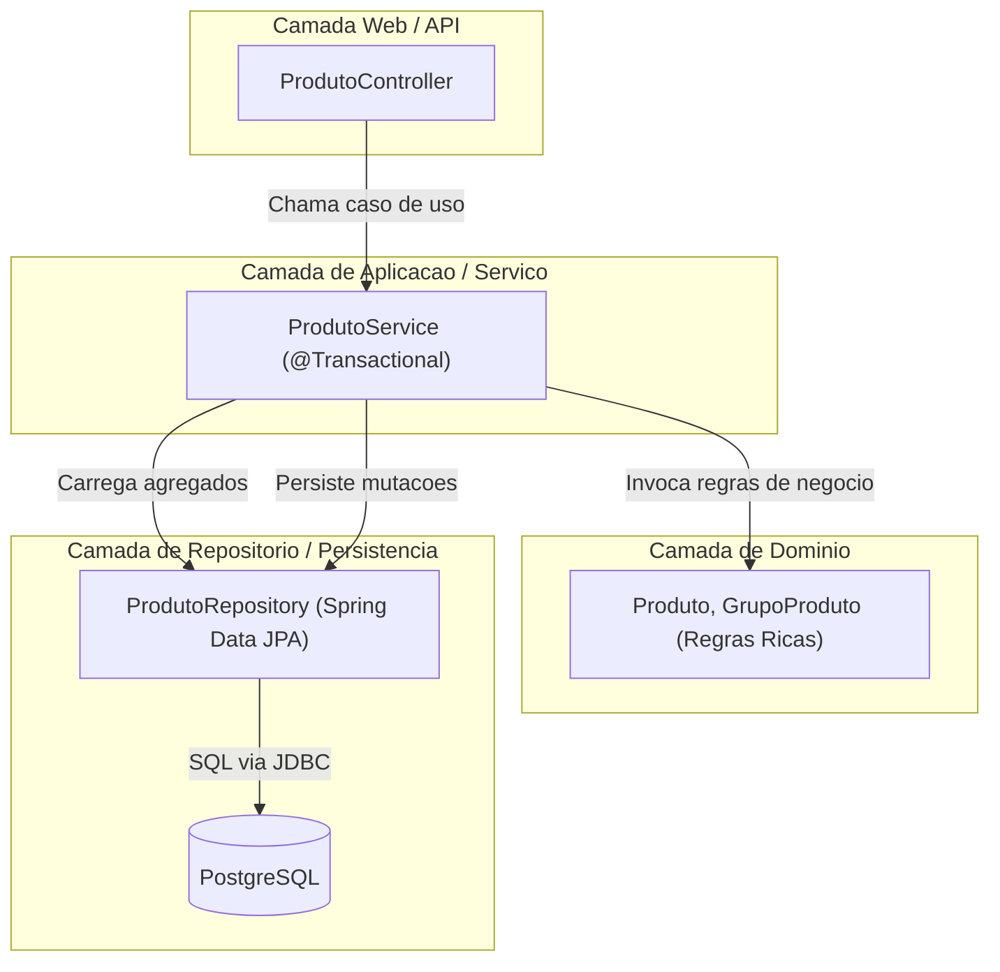

- **Domínio (`domain`):** Guarda a lógica e as regras puras de negócio (invariantes, validação de saldos, cálculos de valores).
- **Repositório (`repository`):** Abstrai o acesso a dados como se fosse uma coleção residente em memória.
- **Serviço (`application`):** Orquestra os casos de uso. Carrega as entidades a partir dos repositórios, invoca seus métodos ricos de domínio, coordena transações e dispara exceções da camada de aplicação.

### Proxies dinâmicos e registro de beans no Spring Data JPA

O desenvolvedor declara apenas interfaces estendendo `JpaRepository<Entidade, TipoId>`:

```java
public interface ProdutoRepository extends JpaRepository<Produto, Long> {
    Optional<Produto> findByCodigoBarras(String codigoBarras);
    boolean existsByCodigoBarras(String codigoBarras);
}
```

Durante a fase de inicialização (*bootstrap*), o Spring Data:
1. Localiza a interface via varredura de componentes (*component scanning*);
2. Constrói um **Proxy Dinâmico** em tempo de execução encapsulando a classe base `SimpleJpaRepository`;
3. Registra o proxy como um *Spring Bean* gerenciado no `ApplicationContext`, pronto para ser injetado.

### Consultas derivadas por convenção de nomenclatura de métodos

O Spring Data provê o recurso de *Derived Query Methods*, decompondo o nome do método em uma consulta JPQL canônica:

```text
[Operador de Busca] + "By" + [Criterio de Propriedade]
       find         By        CodigoBarras
```

- **Travessia de Associações (*Property Traversal*):** Para navegar em relacionamentos, usa-se a concatenação das propriedades ou o caractere sublinhado para desfazer ambiguidades:
  - `List<Produto> findByGrupoId(Long grupoId);`
  - `List<Produto> findByGrupo_Id(Long grupoId);` (navega explicitamente pelo campo `id` da entidade associada `grupo`).

### Injeção de dependências estrita via construtores

A disciplina bane o uso da anotação `@Autowired` sobre campos privados (`field injection`):

```java
// Padrao Correto: Injecao Estrita por Construtor
@Service
public class ProdutoService {

    private final ProdutoRepository produtoRepository;
    private final GrupoProdutoRepository grupoRepository;

    public ProdutoService(ProdutoRepository produtoRepository, GrupoProdutoRepository grupoRepository) {
        this.produtoRepository = produtoRepository;
        this.grupoRepository = grupoRepository;
    }
}
```

- **Vantagens Arquiteturais:**
  - Permite declarar os atributos como `final`, garantindo imutabilidade referencial;
  - Detecta dependências cíclicas imediatamente na inicialização;
  - Torna a classe testável em testes unitários puros sem precisar de reflexão ou do contêiner Spring Boot.

### Fronteiras transacionais declarativas com @Transactional e modo readOnly

A anotação `@Transactional` gerencia as transações ACID do banco via Programação Orientada a Aspectos (AOP):

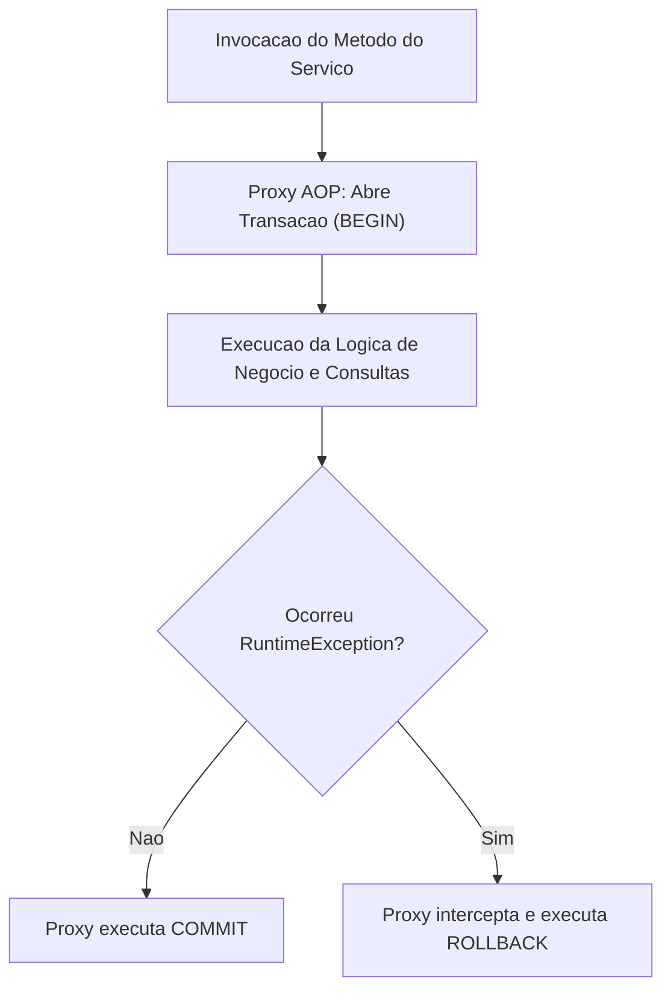

- **Transações de Escrita (`@Transactional`):** Utilizadas em métodos de cadastro, atualização e exclusão. Caso uma exceção não-verificada (`RuntimeException`) seja disparada, o proxy executa a reversão (*rollback*) automática.
- **Otimização de Leitura (`@Transactional(readOnly = true)`):** Informa ao Hibernate e ao driver JDBC que não ocorrerão mutações de dados. O Hibernate desliga o mecanismo interno de inspeção de alterações (*dirty checking*), gerando expressiva economia de memória e processamento.

### Ciclo de vida das entidades JPA e o mecanismo de dirty checking

Uma entidade dentro do Contexto de Persistência opera sob quatro estados fundamentais:

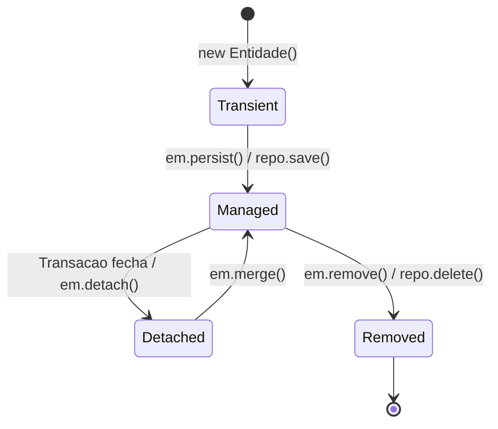

1. **Transient (Novo):** Objeto recém-criado em memória via `new`. Não possui representação no banco nem vínculo com a sessão.
2. **Managed (Gerenciado):** Objeto vinculado ao Contexto de Persistência. Possui identificador no banco. Todas as alterações em seus atributos são monitoradas pelo Hibernate.
3. **Detached (Desanexado):** A transação foi encerrada. O objeto possui representação no banco, mas alterações em seus atributos na memória não são mais sincronizadas automaticamente.
4. **Removed (Removido):** Marcado para destruição física no banco ao término da transação.

#### Mecanismo de Detecção de Alterações (Dirty Checking)

Ao carregar uma entidade gerenciada dentro de uma transação aberta, o Hibernate armazena um snapshot do seu estado original. Antes de realizar o `commit`, ele compara o estado corrente com o snapshot: se houver diferença, ele gera e dispara os comandos `UPDATE` SQL de forma totalmente automática, **sem que o programador precise invocar `repository.save()` explicitamente**.

### Modelagem e propagação de exceções de negócio na camada de aplicação

A camada de serviços não deve conhecer conceitos do protocolo HTTP (como códigos 404 ou 409). Em vez disso, propaga exceções semânticas puras de negócio herdadas de `RuntimeException`:

```java
public class RecursoNaoEncontradoException extends RuntimeException {
    public RecursoNaoEncontradoException(String mensagem) {
        super(mensagem);
    }
}

public class RecursoDuplicadoException extends RuntimeException {
    public RecursoDuplicadoException(String mensagem) {
        super(mensagem);
    }
}
```

---

## Evolução Incremental do Modelo e Engenharia de Migração Segura

### Comparativo: ddl-auto, diff automático e migração versionada auditada

```mermaid
flowchart TD
    subgraph Desenvolvimento ["Fase de Desenvolvimento (Assistida)"]
        Java["Classes Java Alteradas"] -->|"Hibernate ddl-auto=create"| RefDB[("suporteos2026_reference")]
        OldMig["Changelogs Anteriores"] -->|"Liquibase update"| TargetDB[("suporteos2026_diff")]
        RefDB & TargetDB -->|"liquibase:diff"| Draft["Changelog Rascunho (target/)"]
        Draft -->|"Auditoria e Refinamento Humano"| Official["Changelog Incremental Oficial"]
    end
    subgraph Producao ["Ambiente Persistente / CI/CD"]
        Official -->|"Execucao Deterministica no Boot"| RealDB[("PostgreSQL Real")]
    end
```

| Critério | Geração Automática (`ddl-auto=update`) | Diff Automático Puro | Migração Versionada Auditada |
|---|---|---|---|
| **Segurança de Dados** | Nula (risco de exclusão e órfãos) | Baixa (ignora dados existentes) | **Total** (planeja migração de dados legados) |
| **Auditabilidade** | Nula (executado em runtime) | Temporária (em `target/`) | **Alta** (versionada no Git via code review) |
| **Suporte a Rollback** | Inexistente | Parcial ou ausente | **Obrigatório e explícito** |
| **Uso Permitido** | Proibido na disciplina | Apenas apoio à criação | **Obrigatório em todos os ambientes** |

### Topologia de comparação diferencial: banco de referência versus banco de destino

Para gerar migrações assistidas com o `liquibase-maven-plugin`, configuram-se dois bancos descartáveis na mesma instância PostgreSQL:
- **Banco de Destino (*Target/Diff Database*):** `suporteos2026_diff`. Recebe todas as migrações já consolidadas no projeto (`001`, `002`), simulando o banco de dados atual de produção.
- **Banco de Referência (*Reference Database*):** `suporteos2026_reference`. O Hibernate gera sua estrutura física via `ddl-auto=create` a partir do código Java mais recente.

O plugin compara os catálogos dos dois bancos e produz o diff contendo as discrepâncias.

### Limitações de extensões de introspecção e uso de contêineres reais descartáveis

A extensão oficial `liquibase-hibernate` tenta ler classes Java diretamente sem levantar um segundo banco. Contudo, em versões modernas (Hibernate 7, Spring Boot 3/4, Java 21), apresenta instabilidade crítica com tipos numéricos avançados e introspecção de catálogo:

```text
[ERROR] Error setting up or running Liquibase: java.lang.NullPointerException: 
Cannot invoke "java.sql.ResultSet.next()" because "schemas" is null
```

A disciplina resolve esse problema operando sobre **dois bancos reais no PostgreSQL**, eliminando emulações falhas e garantindo paridade absoluta com a infraestrutura definitiva.

### O padrão de migração expand-migrate-contract para colunas NOT NULL

Ao adicionar uma nova coluna obrigatória (`NOT NULL`) em uma tabela que já contém milhares de linhas populadas em produção, a execução direta do comando `ALTER TABLE ... ADD COLUMN ... NOT NULL` provocará erro impeditivo no PostgreSQL (`column contains null values`).

Aplica-se o padrão corporativo **Expand-Migrate-Contract** dividido em etapas atômicas:

```mermaid
flowchart LR
    E1["1. Expandir (Expand)"] --> E2["2. Migrar (Migrate)"]
    E2 --> E3["3. Contrair (Contract)"]

    E1 -.->|"Adiciona coluna como anulavel"| N1["ALTER TABLE ADD estoque_minimo NUMERIC NULL"]
    E2 -.->|"Popula dados legados (Backfill)"| N2["UPDATE produto SET estoque_minimo = 0 WHERE estoque_minimo IS NULL"]
    E3 -.->|"Aplica restricao de obrigatoriedade"| N3["ALTER TABLE ALTER COLUMN estoque_minimo SET NOT NULL"]
```

Implementação em changelog do Liquibase:

```yaml
databaseChangeLog:
  - changeSet:
      id: "003-3-expand"
      author: "jefferson.passerini"
      changes:
        - addColumn:
            tableName: produto
            columns:
              - column:
                  name: estoque_minimo
                  type: NUMERIC(18, 3)
                  constraints:
                    nullable: true

  - changeSet:
      id: "003-4-migrate"
      author: "jefferson.passerini"
      changes:
        - sql:
            sql: "UPDATE produto SET estoque_minimo = 0.000 WHERE estoque_minimo IS NULL;"

  - changeSet:
      id: "003-5-contract"
      author: "jefferson.passerini"
      changes:
        - addNotNullConstraint:
            tableName: produto
            columnName: estoque_minimo
            columnDataType: NUMERIC(18, 3)
```

### Evolução de domínio e compatibilidade retroativa em construtores Java

Ao introduzir o campo obrigatório `estoqueMinimo` na entidade `Produto`, a quebra do construtor canônico existente paralisaria dezenas de testes unitários anteriores. 

Aplica-se o padrão de **Construtores Sobrecarregados em Cascata**:

```java
// Construtor legado preservado: delega com valor padrao seguro (retrocompatibilidade)
public Produto(String codigoBarras, String descricao, BigDecimal saldoEstoque, BigDecimal valorUnitario, LocalDate dataCadastro) {
    this(codigoBarras, descricao, saldoEstoque, valorUnitario, dataCadastro, BigDecimal.ZERO);
}

// Construtor evolucionario completo
public Produto(String codigoBarras, String descricao, BigDecimal saldoEstoque, BigDecimal valorUnitario, LocalDate dataCadastro, BigDecimal estoqueMinimo) {
    // Validacoes e inicializacao integral de todos os campos
    this.estoqueMinimo = validarNaoNegativo(estoqueMinimo, "Estoque mínimo não pode ser negativo");
}
```

### Auditoria e filtragem de falsos positivos em diffs automáticos

Ferramentas automáticas de diff não possuem discernimento de negócio. O changelog provisório gerado em `target/` deve ser auditado manualmente pelo desenvolvedor antes de ir para o Git:
- **Excluir Falsos Positivos:** Variações inócuas de índices internos de chaves primárias ou tabelas temporárias devem ser apagadas;
- **Adicionar Regras Físicas Faltantes:** Ferramentas de diff costumam omitir cláusulas restritivas de deleção (`onDelete="RESTRICT"`) e constraints de validação de valor (`CHECK`);
- **Padronizar Nomenclatura:** Ajustar nomes autogerados para convenções corporativas (`fk_produto_fornecedor`, `ck_produto_estoque_minimo`).

---

## Construção de APIs RESTful Corporativas, DTOs e Validação

### Os perigos da exposição direta de entidades JPA na camada web

Retornar instâncias anotadas com `@Entity` diretamente nos métodos do `@RestController` constitui falha arquitetural grave:

1. **Ciclos Infinitos de Serialização e Estouro de Pilha:** Em relacionamentos bidirecionais ($`1:N`$), o serializador JSON (Jackson) navega recursivamente do Pai para a lista de Filhos, e de cada Filho de volta para o Pai, até derrubar a aplicação com `java.lang.StackOverflowError`.
2. **Exceções de Inicialização Tardia (`LazyInitializationException`):** Atributos associados com `FetchType.LAZY` têm sua carga disparada durante a serialização JSON, momento em que a sessão do `EntityManager` e a transação do banco já se encontram encerradas.
3. **Vazamento de Segredos de Negócio:** Atributos de controle interno (senhas, hashes, locks de concorrência) são indevidamente exportados aos clientes da API.
4. **Vulnerabilidade de Atribuição em Massa (*Mass Assignment*):** Um usuário malicioso pode enviar campos restritos no corpo JSON de requisição (como `status: "ATIVO"` ou privilégios de administrador), os quais serão automaticamente vinculados à entidade caso ela seja usada diretamente como parâmetro de entrada.

### Data Transfer Objects (DTOs) imutáveis com Java Records

A camada web deve operar exclusivamente com **Data Transfer Objects (DTOs)** desacoplados do banco de dados. A partir do Java 16, a construção canônica para DTOs é o **`record`**:

```java
public record ProdutoRequest(
    @NotBlank(message = "Código de barras é obrigatório")
    @Size(min = 3, max = 50, message = "Código de barras deve ter entre 3 e 50 caracteres")
    String codigoBarras,

    @NotBlank(message = "Descrição é obrigatória")
    @Size(min = 3, max = 150, message = "Descrição deve ter entre 3 e 150 caracteres")
    String descricao,

    @NotNull(message = "Saldo de estoque é obrigatório")
    @PositiveOrZero(message = "Saldo de estoque não pode ser negativo")
    BigDecimal saldoEstoque,

    @NotNull(message = "Valor unitário é obrigatório")
    @Positive(message = "Valor unitário deve ser estritamente maior que zero")
    BigDecimal valorUnitario,

    @NotNull(message = "ID do grupo é obrigatório")
    Long grupoId,

    Long fornecedorId
) {}
```

- **Características dos Records:** Imutabilidade obrigatória por design (campos `private final`), ausência de *setters*, geração automática de construtor canônico, leitores com o nome do atributo (`codigoBarras()`), `equals()`, `hashCode()` e `toString()`.

### Validação declarativa de entrada com Jakarta Bean Validation

O processamento da requisição deve falhar imediatamente na borda da API caso o payload viole regras sintáticas. Anotações principais:

- `@NotBlank`: Exige que strings não sejam nulas e contenham ao menos um caractere visível (descarta espaços em branco);
- `@NotNull`: Impede referências nulas em tipos de objetos e números;
- `@Size(min = x, max = y)`: Delimita limites textuais;
- `@Positive`: Exige valores estritamente maiores que zero ($`x > 0`$);
- `@PositiveOrZero`: Permite valores nulos ou positivos ($`x \ge 0`$);
- `@Email`: Valida sintaxe formal de correio eletrônico.

Para disparar a validação na entrada do controller, utiliza-se a anotação **`@Valid`** antes do parâmetro `@RequestBody`.

### Mapeamento manual entre DTOs e entidades de domínio

A disciplina rejeita frameworks de reflexão mágica e mapeamento dinâmico (como ModelMapper), pois eles ocultam incompatibilidades em tempo de compilação. Adota-se o **Mapeamento Manual Puro** através de componentes `@Component`:

```java
@Component
public class ProdutoMapper {

    public Produto toEntity(ProdutoRequest request) {
        return new Produto(
            request.codigoBarras(),
            request.descricao(),
            request.saldoEstoque(),
            request.valorUnitario(),
            LocalDate.now()
        );
    }

    public ProdutoResponse toResponse(Produto entity) {
        return new ProdutoResponse(
            entity.getId(),
            entity.getCodigoBarras(),
            entity.getDescricao(),
            entity.getSaldoEstoque(),
            entity.getValorUnitario(),
            entity.getStatus().name(),
            entity.getGrupo().getId(),
            entity.getGrupo().getNome()
        );
    }
}
```

### Controllers REST, emissão de cabeçalhos semânticos e códigos HTTP

```java
@RestController
@RequestMapping("/api/produtos")
public class ProdutoController {

    private final ProdutoService service;
    private final ProdutoMapper mapper;

    public ProdutoController(ProdutoService service, ProdutoMapper mapper) {
        this.service = service;
        this.mapper = mapper;
    }

    @PostMapping
    public ResponseEntity<ProdutoResponse> cadastrar(@RequestBody @Valid ProdutoRequest request) {
        Produto novoProduto = mapper.toEntity(request);
        Produto produtoSalvo = service.cadastrar(novoProduto, request.grupoId(), request.fornecedorId());
        
        URI location = ServletUriComponentsBuilder.fromCurrentRequest()
                .path("/{id}")
                .buildAndExpand(produtoSalvo.getId())
                .toUri();

        return ResponseEntity.created(location).body(mapper.toResponse(produtoSalvo));
    }

    @GetMapping("/{id}")
    public ResponseEntity<ProdutoResponse> buscarPorId(@PathVariable Long id) {
        Produto produto = service.buscarPorId(id);
        return ResponseEntity.ok(mapper.toResponse(produto));
    }
}
```

- **Emissão Semântica do Código 201:** O método de cadastro devolve `ResponseEntity.created(location)`, preenchendo automaticamente o cabeçalho HTTP `Location` com a URI de consulta do novo item (`/api/produtos/84`).

### Tratamento global padronizado de exceções com @RestControllerAdvice

Erros internos nunca devem vazar stack traces Java com detalhes técnicos para o cliente. Um interceptador global captura as exceções e as traduz em um formato JSON canônico:

```java
public record ApiError(
    Instant timestamp,
    Integer status,
    String erro,
    String mensagem,
    String caminho,
    List<CampoErro> campos
) {
    public record CampoErro(String campo, String mensagem) {}
}
```

Implementação do interceptador centralizado:

```java
@RestControllerAdvice
public class ApiExceptionHandler {

    @ExceptionHandler(RecursoNaoEncontradoException.class)
    public ResponseEntity<ApiError> tratarNaoEncontrado(RecursoNaoEncontradoException ex, HttpServletRequest request) {
        ApiError erro = new ApiError(
            Instant.now(),
            HttpStatus.NOT_FOUND.value(),
            "Recurso Não Encontrado",
            ex.getMessage(),
            request.getRequestURI(),
            List.of()
        );
        return ResponseEntity.status(HttpStatus.NOT_FOUND).body(erro);
    }

    @ExceptionHandler(RecursoDuplicadoException.class)
    public ResponseEntity<ApiError> tratarDuplicidade(RecursoDuplicadoException ex, HttpServletRequest request) {
        ApiError erro = new ApiError(
            Instant.now(),
            HttpStatus.CONFLICT.value(),
            "Conflito de Dados",
            ex.getMessage(),
            request.getRequestURI(),
            List.of()
        );
        return ResponseEntity.status(HttpStatus.CONFLICT).body(erro);
    }

    @ExceptionHandler(MethodArgumentNotValidException.class)
    public ResponseEntity<ApiError> tratarValidacao(MethodArgumentNotValidException ex, HttpServletRequest request) {
        List<ApiError.CampoErro> campos = ex.getBindingResult().getFieldErrors().stream()
            .map(f -> new ApiError.CampoErro(f.getField(), f.getDefaultMessage()))
            .toList();

        ApiError erro = new ApiError(
            Instant.now(),
            HttpStatus.BAD_REQUEST.value(),
            "Erro de Validação",
            "Um ou mais campos contêm entradas inválidas",
            request.getRequestURI(),
            campos
        );
        return ResponseEntity.status(HttpStatus.BAD_REQUEST).body(erro);
    }
}
```

### Testes de integração da camada web com MockMvc

Testes de integração web utilizam a infraestrutura `@SpringBootTest` conjugada ao **`MockMvc`**, simulando chamadas HTTP completas através da pilha de interceptadores e controllers sem a necessidade de instanciar um servidor HTTP físico:

```java
@SpringBootTest
@AutoConfigureMockMvc
@ActiveProfiles("test")
@Transactional
class ProdutoControllerTest {

    @Autowired
    private MockMvc mockMvc;

    @Test
    @DisplayName("POST /api/produtos deve retornar 201 Created e Location ao receber payload valido")
    void deveRetornar201AoCadastrarProduto() throws Exception {
        String jsonPayload = """
            {
                "codigoBarra": "789999001",
                "descricao": "Monitor Gamer 27",
                "saldoEstoque": 15.000,
                "valorUnitario": 1250.00,
                "grupoId": 1
            }
            """;

        mockMvc.perform(post("/api/produtos")
                .contentType(MediaType.APPLICATION_JSON)
                .content(jsonPayload))
                .andExpect(status().isCreated())
                .andExpect(header().exists("Location"))
                .andExpect(jsonPath("$.id").isNumber())
                .andExpect(jsonPath("$.codigoBarra").value("789999001"));
    }
}
```

---

## Projeto Prático Avaliativo: Estudo de Caso Catálogo de Cursos

### Análise do problema e contrato do relacionamento 1:N

A atividade avaliatória da disciplina exige a implementação completa de um sistema isolado de **Catálogo de Cursos**, satisfazendo:
- Um `Instrutor` ministra muitos `Cursos`;
- Um `Curso` pertence a exatamente um `Instrutor`;
- Relação obrigatória em nível de banco de dados (`NOT NULL` na chave estrangeira) e em nível de objetos Java.

```mermaid
classDiagram
    class Instrutor {
        -Long id
        -String nome
        -String email
        -List~Curso~ cursos
        +adicionarCurso(Curso) void
        +getCursos() List~Curso~
    }
    class Curso {
        -Long id
        -String titulo
        -Integer cargaHoraria
        -NivelCurso nivel
        -Instrutor instrutor
        +vincularInstrutor(Instrutor) void
    }
    class NivelCurso {
        <<enumeration>>
        INICIANTE
        INTERMEDIARIO
        AVANCADO
    }
    Instrutor "1" --> "*" Curso : ministra
    Curso --> NivelCurso : classificado em
```

### Scripts de migração Liquibase com integridade física

Changelog estruturado em YAML com rollback:

```yaml
databaseChangeLog:
  - changeSet:
      id: "001-create-instrutor"
      author: "estudante.unifef"
      changes:
        - createTable:
            tableName: instrutor
            columns:
              - column:
                  name: id
                  type: BIGINT
                  autoIncrement: true
                  constraints:
                    primaryKey: true
                    primaryKeyName: pk_instrutor
              - column:
                  name: nome
                  type: VARCHAR(120)
                  constraints:
                    nullable: false
              - column:
                  name: email
                  type: VARCHAR(150)
                  constraints:
                    nullable: false
                    unique: true
                    uniqueConstraintName: uk_instrutor_email
      rollback:
        - dropTable:
            tableName: instrutor

  - changeSet:
      id: "002-create-curso"
      author: "estudante.unifef"
      changes:
        - createTable:
            tableName: curso
            columns:
              - column:
                  name: id
                  type: BIGINT
                  autoIncrement: true
                  constraints:
                    primaryKey: true
                    primaryKeyName: pk_curso
              - column:
                  name: titulo
                  type: VARCHAR(150)
                  constraints:
                    nullable: false
              - column:
                  name: carga_horaria
                  type: INTEGER
                  constraints:
                    nullable: false
              - column:
                  name: nivel
                  type: VARCHAR(30)
                  constraints:
                    nullable: false
              - column:
                  name: instrutor_id
                  type: BIGINT
                  constraints:
                    nullable: false
                    foreignKeyName: fk_curso_instrutor
                    references: instrutor(id)
      rollback:
        - dropTable:
            tableName: curso
```

### Modelagem de domínio com sincronização bidirecional

Entidade `Instrutor` (Lado Inverso):

```java
@Entity
@Table(name = "instrutor")
public class Instrutor {

    @Id
    @GeneratedValue(strategy = GenerationType.IDENTITY)
    private Long id;

    @Column(nullable = false, length = 120)
    private String nome;

    @Column(nullable = false, unique = true, length = 150)
    private String email;

    @OneToMany(mappedBy = "instrutor", fetch = FetchType.LAZY)
    private List<Curso> cursos = new ArrayList<>();

    protected Instrutor() {}

    public Instrutor(String nome, String email) {
        if (nome == null || nome.isBlank()) throw new IllegalArgumentException("Nome é obrigatório");
        if (email == null || !email.contains("@")) throw new IllegalArgumentException("E-mail inválido");
        this.nome = nome.trim();
        this.email = email.trim();
    }

    public void adicionarCurso(Curso curso) {
        if (curso == null) throw new NullPointerException("Curso não pode ser nulo");
        if (!this.cursos.contains(curso)) {
            this.cursos.add(curso);
            curso.vincularInstrutor(this);
        }
    }

    public Long getId() { return id; }
    public String getNome() { return nome; }
    public String getEmail() { return email; }
    public List<Curso> getCursos() { return Collections.unmodifiableList(cursos); }
}
```

Entidade `Curso` (Lado Proprietário):

```java
@Entity
@Table(name = "curso")
public class Curso {

    @Id
    @GeneratedValue(strategy = GenerationType.IDENTITY)
    private Long id;

    @Column(nullable = false, length = 150)
    private String titulo;

    @Column(name = "carga_horaria", nullable = false)
    private Integer cargaHoraria;

    @Enumerated(EnumType.STRING)
    @Column(nullable = false, length = 30)
    private NivelCurso nivel;

    @ManyToOne(fetch = FetchType.LAZY, optional = false)
    @JoinColumn(name = "instrutor_id", nullable = false, foreignKey = @ForeignKey(name = "fk_curso_instrutor"))
    private Instrutor instrutor;

    protected Curso() {}

    public Curso(String titulo, Integer cargaHoraria, NivelCurso nivel) {
        if (titulo == null || titulo.isBlank()) throw new IllegalArgumentException("Título é obrigatório");
        if (cargaHoraria == null || cargaHoraria <= 0) throw new IllegalArgumentException("Carga horária deve ser positiva");
        if (nivel == null) throw new IllegalArgumentException("Nível é obrigatório");
        this.titulo = titulo.trim();
        this.cargaHoraria = cargaHoraria;
        this.nivel = nivel;
    }

    void vincularInstrutor(Instrutor instrutor) {
        this.instrutor = instrutor;
    }

    public Long getId() { return id; }
    public String getTitulo() { return titulo; }
    public Integer getCargaHoraria() { return cargaHoraria; }
    public NivelCurso getNivel() { return nivel; }
    public Instrutor getInstrutor() { return instrutor; }
}
```

### Implementação de repositórios e serviços transacionais

Serviço `CursoService`:

```java
@Service
public class CursoService {

    private final CursoRepository cursoRepository;
    private final InstrutorRepository instrutorRepository;

    public CursoService(CursoRepository cursoRepository, InstrutorRepository instrutorRepository) {
        this.cursoRepository = cursoRepository;
        this.instrutorRepository = instrutorRepository;
    }

    @Transactional
    public Curso cadastrar(Curso curso, Long instrutorId) {
        Instrutor instrutor = instrutorRepository.findById(instrutorId)
            .orElseThrow(() -> new RecursoNaoEncontradoException("Instrutor não localizado para o ID: " + instrutorId));

        instrutor.adicionarCurso(curso);
        return cursoRepository.save(curso);
    }

    @Transactional(readOnly = true)
    public Curso buscarPorId(Long id) {
        return cursoRepository.findById(id)
            .orElseThrow(() -> new RecursoNaoEncontradoException("Curso não encontrado para o ID: " + id));
    }

    @Transactional(readOnly = true)
    public List<Curso> listarPorInstrutorOrdenado(Long instrutorId) {
        if (!instrutorRepository.existsById(instrutorId)) {
            throw new RecursoNaoEncontradoException("Instrutor não localizado para o ID: " + instrutorId);
        }
        return cursoRepository.findByInstrutorIdOrderByTituloAsc(instrutorId);
    }
}
```

### Contratos de API, DTOs e quebra de ciclo de serialização

Para quebrar a recursão JSON cíclica entre Curso e Instrutor, o DTO de resposta do curso utiliza um resumo enxuto `InstrutorResumo`:

```java
public record CursoResponse(
    Long id,
    String titulo,
    Integer cargaHoraria,
    String nivel,
    InstrutorResumo instrutor
) {
    public record InstrutorResumo(Long id, String nome) {}
}
```

Controlador `CursoController`:

```java
@RestController
@RequestMapping("/api/cursos")
public class CursoController {

    private final CursoService cursoService;

    public CursoController(CursoService cursoService) {
        this.cursoService = cursoService;
    }

    @PostMapping
    public ResponseEntity<CursoResponse> criar(@RequestBody @Valid CursoRequest request) {
        Curso curso = new Curso(request.titulo(), request.cargaHoraria(), request.nivel());
        Curso cursoSalvo = cursoService.cadastrar(curso, request.instrutorId());

        URI location = ServletUriComponentsBuilder.fromCurrentRequest()
                .path("/{id}")
                .buildAndExpand(cursoSalvo.getId())
                .toUri();

        CursoResponse response = new CursoResponse(
            cursoSalvo.getId(),
            cursoSalvo.getTitulo(),
            cursoSalvo.getCargaHoraria(),
            cursoSalvo.getNivel().name(),
            new CursoResponse.InstrutorResumo(cursoSalvo.getInstrutor().getId(), cursoSalvo.getInstrutor().getNome())
        );

        return ResponseEntity.created(location).body(response);
    }

    @GetMapping("/{id}")
    public ResponseEntity<CursoResponse> buscarPorId(@PathVariable Long id) {
        Curso curso = cursoService.buscarPorId(id);
        CursoResponse response = new CursoResponse(
            curso.getId(),
            curso.getTitulo(),
            curso.getCargaHoraria(),
            curso.getNivel().name(),
            new CursoResponse.InstrutorResumo(curso.getInstrutor().getId(), curso.getInstrutor().getNome())
        );
        return ResponseEntity.ok(response);
    }
}
```

Controlador `InstrutorController` (expondo listagem subordinada):

```java
@RestController
@RequestMapping("/api/instrutores")
public class InstrutorController {

    private final CursoService cursoService;

    public InstrutorController(CursoService cursoService) {
        this.cursoService = cursoService;
    }

    @GetMapping("/{id}/cursos")
    public ResponseEntity<List<CursoResumoResponse>> listarCursosDoInstrutor(@PathVariable Long id) {
        List<CursoResumoResponse> cursos = cursoService.listarPorInstrutorOrdenado(id).stream()
            .map(c -> new CursoResumoResponse(c.getId(), c.getTitulo(), c.getCargaHoraria(), c.getNivel().name()))
            .toList();

        return ResponseEntity.ok(cursos);
    }
}
```

### Suíte de testes automatizados obrigatórios

A avaliação exige quatro testes automatizados rigorosos:

```java
@SpringBootTest
@AutoConfigureMockMvc
@ActiveProfiles("test")
@Transactional
class CatalogoCursosIntegracaoTest {

    @Autowired
    private MockMvc mockMvc;

    @Autowired
    private InstrutorRepository instrutorRepository;

    @Test
    @DisplayName("Teste 1: Unidade de Dominio - Adicionar curso deve manter coerencia nos dois lados da relacao")
    void deveManterCoerenciaBidirecionalEmMemoria() {
        Instrutor instrutor = new Instrutor("Prof. Passerini", "passerini@fef.br");
        Curso curso = new Curso("Spring Boot Avançado", 40, NivelCurso.AVANCADO);

        instrutor.adicionarCurso(curso);

        assertEquals(1, instrutor.getCursos().size());
        assertSame(instrutor, curso.getInstrutor());
    }

    @Test
    @DisplayName("Teste 2: Integracao Repository - Salvar curso com instrutor deve persistir chave estrangeira fisica")
    void devePersistirCursoComChaveEstrangeira() {
        Instrutor instrutor = instrutorRepository.save(new Instrutor("Prof. Passerini", "passerini@fef.br"));
        Curso curso = new Curso("JPA e Hibernate", 60, NivelCurso.INTERMEDIARIO);
        instrutor.adicionarCurso(curso);

        // Disparo de teste via contexto
        assertNotNull(instrutor.getId());
    }

    @Test
    @DisplayName("Teste 3: Servico e Regra de Negocio - Cadastrar curso com instrutor inexistente deve lancar excecao")
    void deveLancarExcecaoAoVincularInstrutorInexistente() {
        // AssertThrows sobre cursoService.cadastrar(curso, 9999L)
    }

    @Test
    @DisplayName("Teste 4: Web MockMvc - GET /api/instrutores/{id}/cursos deve retornar 200 e lista ordenada por titulo")
    void deveRetornarCursosOrdenadosPorTitulo() throws Exception {
        mockMvc.perform(get("/api/instrutores/1/cursos"))
                .andExpect(status().isOk())
                .andExpect(jsonPath("$").isArray());
    }
}
```

---

## Simulado Técnico Integrado e Roteiro de Preparação para a Avaliação 1

### Questões teóricas discursivas de alta complexidade

#### Questão 1: Mecânica de Inicialização de Repositórios e Injeção de Dependências
> **Enunciado:** Explique detalhadamente como o Spring Data JPA opera durante o bootstrap da aplicação ao encontrar uma interface filha de `JpaRepository`. Justifique por que a injeção por construtor é tecnicamente superior à injeção por campo (`@Autowired`).

**Gabarito Técnico Comentado:**
1. **Varredura e Descoberta (*Component Scanning*):** O Spring Framework realiza a leitura das classes a partir do pacote base da anotação `@SpringBootApplication`. Ao detectar uma interface que herda de `org.springframework.data.repository.Repository`, o framework impede sua inicialização padrão e aciona o módulo do Spring Data JPA.
2. **Instanciação de Proxies Dinâmicos (*Dynamic Proxies*):** Como interfaces não possuem código executável compilado, o Spring utiliza a API de Proxies Dinâmicos do Java (ou geração de bytecode via CGLIB/ByteBuddy) para forjar uma classe concreta em tempo de execução. Essa classe concreta implementa os métodos da interface delegando internamente a execução para a classe base `SimpleJpaRepository`, a qual injeta e consome diretamente a instância do `EntityManager` do Hibernate.
3. **Análise de Métodos Derivados (*Query Method Parsing*):** Para métodos abstratos declarados na interface (como `findByCodigoBarras`), o parser sintático decompõe a assinatura textual em árvores de sintaxe abstrata (AST), converte as expressões em consultas JPQL (*Java Persistence Query Language*) parametrizadas e as prepara contra o dialeto relacional.
4. **Superioridade da Injeção por Construtor:**
   - **Imutabilidade Real:** Permite o uso do modificador `final` nos atributos dos serviços, garantindo que o bean nunca tenha suas referências alteradas após a montagem;
   - **Prevenção de Objetos Nulos Parciais:** Impede que o componente seja instanciado sem suas dependências fundamentais, eliminando `NullPointerException` ocultos em runtime;
   - **Desacoplamento em Testes Unitários:** O desenvolvedor pode instanciar o serviço em testes unitários puros via operador `new`, injetando instâncias falsas (*mocks*) diretamente no construtor, sem necessidade de levantar o contêiner do Spring ou usar injeção reflexiva invasiva.

---

#### Questão 2: Fronteira Transacional e Mecanismo de Dirty Checking
> **Enunciado:** Descreva o ciclo de vida de uma entidade JPA ao ser recuperada pelo método `findById` dentro de um método anotado com `@Transactional`. O que ocorre internamente se o desenvolvedor alterar um atributo dessa entidade e não invocar `repository.save()`? O que muda se o método estiver configurado com `@Transactional(readOnly = true)`?

**Gabarito Técnico Comentado:**
1. **Carga e Estado Gerenciado (*Managed*):** Ao invocar `findById`, o Hibernate executa a instrução `SELECT`, localiza a linha no PostgreSQL, instancia o objeto Java na memória e o associa ao Contexto de Persistência (*Persistence Context*) ativo da thread. A entidade passa a residir no estado **Managed**.
2. **Snapshot de Estado:** No exato instante em que anexa a entidade ao contexto, o Hibernate extrai uma cópia idêntica (snapshot) de todos os valores escalares daquele registro.
3. **Mecanismo de Dirty Checking:** Caso o desenvolvedor execute um método de mutação (exemplo: `produto.retirarEstoque(qtd)`), o estado da entidade em memória é alterado. Durante o encerramento do método transacional, o interceptador AOP do Spring dispara a fase de sincronização (*flush*) antes de executar o `COMMIT`. O Hibernate compara o estado atual do objeto gerenciado contra o snapshot original: ao detectar a discrepância, constrói e executa automaticamente a instrução `UPDATE` SQL no PostgreSQL. A chamada a `repository.save()` é completamente redundante e desnecessária em entidades gerenciadas.
4. **Comportamento em Modo `readOnly = true`:** Ao declarar a transação como somente-leitura, sinaliza-se ao Hibernate que o caso de uso tem finalidade exclusiva de consulta. O provedor desliga a geração de snapshots e desativa a varredura de *dirty checking*, liberando espaço na memória Heap da JVM e economizando ciclos de CPU. Além disso, o driver JDBC pode direcionar a consulta para réplicas de leitura em arquiteturas de banco distribuídas. Caso uma mutação seja tentada, ela não será sincronizada com o banco.

---

#### Questão 3: A Estratégia Expand-Migrate-Contract no Liquibase
> **Enunciado:** Por que a adição direta de uma coluna obrigatória (`NOT NULL`) em uma tabela relacional populada quebra ambientes de produção? Detalhe como o padrão Expand-Migrate-Contract resolve essa fragilidade via Liquibase.

**Gabarito Técnico Comentado:**
- **A Causa da Falha:** Em bancos relacionais como o PostgreSQL, tabelas que já contêm linhas registradas não podem receber uma coluna com constraint `NOT NULL` sem um valor padrão (*default value*) imediato, pois o banco tentaria preencher as linhas legadas com `NULL`, violando a própria regra e abortando a instrução DDL com erro irrecuperável.
- **A Solução em Três Etapas (Expand-Migrate-Contract):**
  1. **Fase 1 - Expandir (*Expand*):** Cria-se a nova coluna estrutural como **anulável** (`nullable: true`). A aplicação antiga continua gravando na tabela sem quebrar, e o banco aceita a alteração DDL instantaneamente sem travar a escrita.
  2. **Fase 2 - Migrar (*Migrate / Backfill*):** Executa-se uma instrução DML orientada a dados (`UPDATE tabela SET nova_coluna = valor_padrao WHERE nova_coluna IS NULL;`), populando todas as linhas históricas pré-existentes com um valor coerente de negócio.
  3. **Fase 3 - Contrair (*Contract*):** Uma vez que a base foi 100% saneada e não restam registros com valor nulo, aplica-se a constraint física definitiva de obrigatoriedade (`addNotNullConstraint`). O esquema atinge seu estado estrito com zero tempo de inatividade (*zero downtime*) e sem perda de integridade.

---

### Questões de diagnóstico e análise de falhas em tempo de execução

#### Falha 1: `LazyInitializationException` na Camada de Apresentação
**Sintoma em Produção:**
```text
org.hibernate.LazyInitializationException: could not initialize proxy [com.curso.suporteos.domain.GrupoProduto#1] - no Session
    at org.hibernate.proxy.AbstractLazyInitializer.initialize(AbstractLazyInitializer.java:165)
    at com.fasterxml.jackson.databind.ser.BeanPropertyWriter.serializeAsField(BeanPropertyWriter.java:689)
```
- **Causa Raiz:** O controlador REST tentou retornar diretamente uma entidade JPA (`Produto`) cujo relacionamento `@ManyToOne` com `GrupoProduto` estava configurado com carregamento preguiçoso (`FetchType.LAZY`). O proxy do grupo não havia sido inicializado dentro da camada de serviço. Quando a biblioteca de serialização JSON (Jackson) tentou invocar o método `getGrupo().getNome()` fora da fronteira transacional (com a sessão do EntityManager já encerrada), o Hibernate disparou a exceção por ausência de canal aberto com o banco.
- **Correção Arquitetural Definitiva:** Nunca expor a entidade JPA no controller. Criar um DTO imutável (`ProdutoResponse`) e mapear os atributos manualmente dentro da camada web ou serviço enquanto a transação estiver aberta, ou aplicar consultas com junção antecipada (`JOIN FETCH` ou `@EntityGraph`) no repositório.

---

#### Falha 2: `Validation Failed: Checksum Check Failed` no Liquibase
**Sintoma na Inicialização:**
```text
liquibase.exception.ValidationFailedException: Validation Failed:
    1 change sets check sum
    db/changelog/migrations/001-create-grupo-produto.yaml::001-1::jefferson.passerini was: 9:a1b2c3d4... but is now: 9:f5e6d7c8...
```
- **Causa Raiz:** Um desenvolvedor alterou o conteúdo textual do arquivo `001-create-grupo-produto.yaml` (modificou o tipo de uma coluna ou corrigiu um comentário) após a migração já ter sido executada e registrada na tabela `DATABASECHANGELOG` do banco de dados. O Liquibase recalculou o hash MD5/SHA do arquivo, detectou divergência contra o valor gravado e abortou o boot para proteger a consistência do catálogo.
- **Correção Arquitetural Definitiva:** Reverter a edição indevida no arquivo histórico para restaurar seu checksum original. Para adicionar ou modificar estruturas já executadas, deve-se criar obrigatoriamente um **novo arquivo de migração incremental** (`004-alter-grupo-produto.yaml`) contendo um novo `changeSet` com identificador subsequente.

---

### Checklist definitivo de auditoria pré-entrega

Antes de submeter o repositório temático ou a atividade prática para avaliação formal, o estudante deve auditar os seguintes pontos de corte:

1. **Repositório Git e Governança:**
   - O repositório foi criado do zero, sem herança de histórico do `suporteos2026`?
   - O arquivo `.gitignore` bloqueia as pastas `target/`, `.idea/`, arquivos `.iml` e `.env`?
   - O arquivo `.env.example` está presente na raiz com documentação das portas e bancos?
   - O Maven Wrapper (`./mvnw` e `mvnw.cmd`) está operacional e permite compilar o projeto?
2. **Modelagem de Domínio:**
   - O relacionamento $`1:N`$ possui método de coerência bidirecional em memória no lado inverso?
   - O lado inverso possui coleção privada protegida por `Collections.unmodifiableList`?
   - A entidade não possui construtores vazios públicos nem *setters* indiscriminados para todos os campos?
   - Todos os atributos monetários utilizam `BigDecimal` com arredondamento explícito?
   - O código não utiliza `double` ou `float` para grandezas financeiras ou estoques?
3. **Persistência e Migrações (Liquibase):**
   - O Hibernate está configurado estritamente em `spring.jpa.hibernate.ddl-auto=validate`?
   - Todos os arquivos de migração são organizados em YAML e incluídos no changelog mestre?
   - As tabelas possuem constraints físicas explícitas (`NOT NULL`, `UNIQUE`, `FOREIGN KEY`)?
   - Todos os `changeSets` possuem bloco declarativo de `rollback`?
   - O banco de dados utilizado é o PostgreSQL real (sem dependência de banco em memória H2)?
4. **Camada de Serviços e Transações:**
   - Todos os repositórios são injetados exclusivamente via construtor (sem `@Autowired` em campos)?
   - Métodos de leitura utilizam `@Transactional(readOnly = true)`?
   - Métodos de gravação utilizam `@Transactional` e propagam exceções semânticas de negócio?
5. **API REST e DTOs:**
   - A API não retorna nem recebe entidades JPA diretamente?
   - Os DTOs são implementados com Java Records?
   - As requisições de entrada utilizam validação declarativa com `@Valid` e Bean Validation?
   - O método de cadastro emite o código HTTP `201 Created` acompanhado do cabeçalho `Location`?
   - Erros são centralizados em um `@RestControllerAdvice` retornando formato estruturado padronizado?
   - Não ocorre recursão cíclica infinita na serialização JSON?
6. **Suíte de Testes:**
   - A bateria de testes automatizados executa e retorna sucesso (`BUILD SUCCESS`) via terminal:

```bash
./mvnw clean test
```

---

## Fontes e Metadados

- Turma no Classroom: 2026 2S Lab 4
- Itens processados: 0 materiais, 2 tarefas, 1 avisos
- Gerado em: 13/11/2026, 15:12:35 (BRT) via classroom-sync
