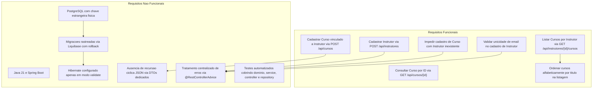
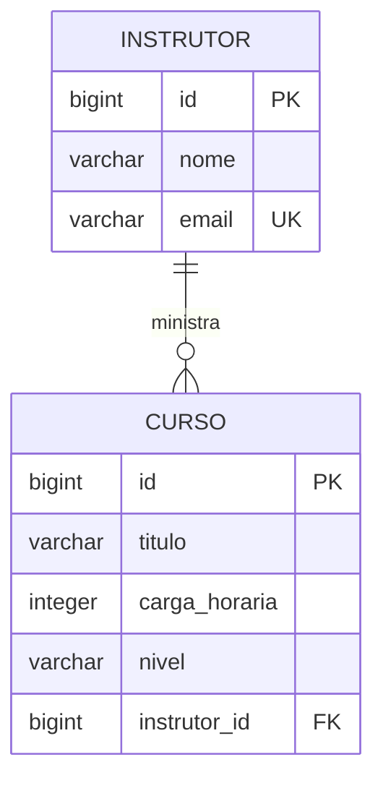
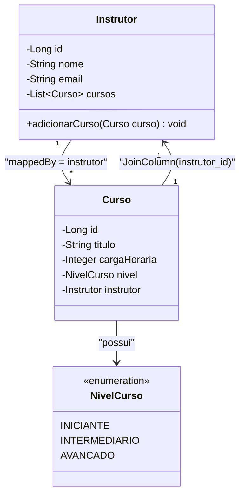
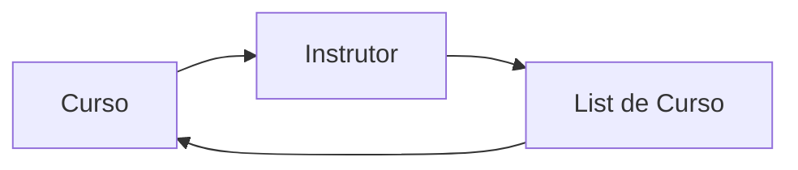
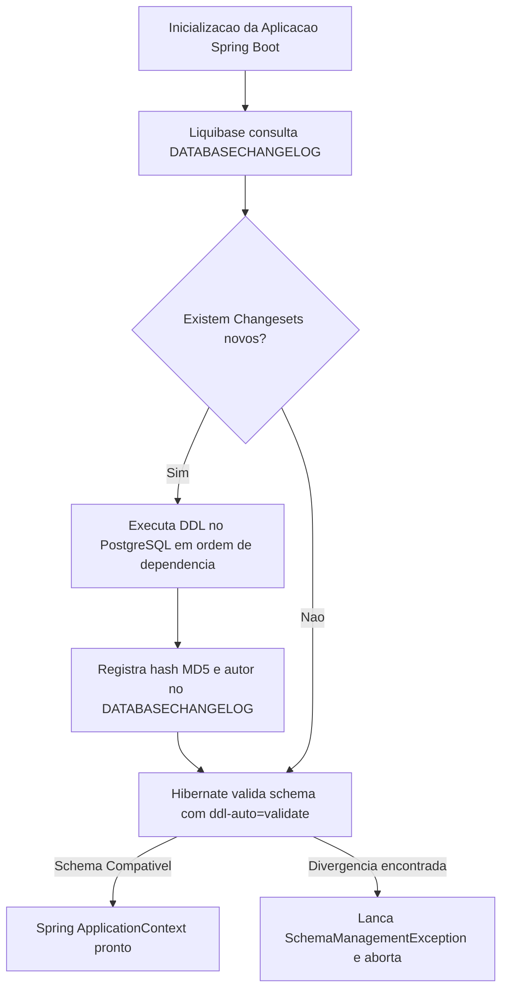
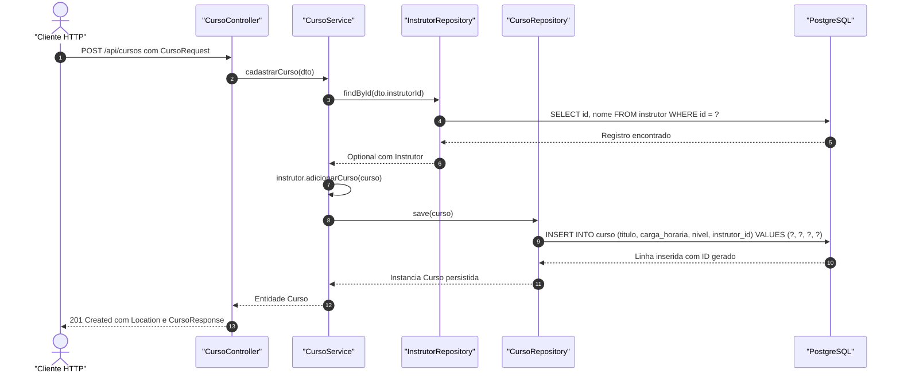
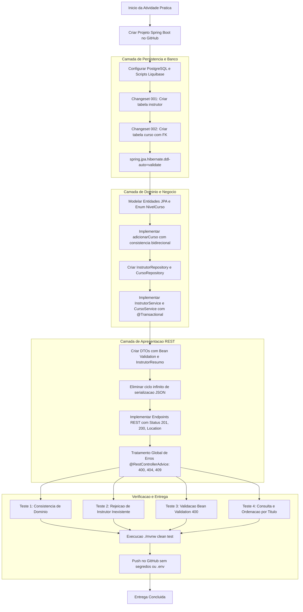

# Trabalho — 20261105 - Atividade Avaliatória

> **Professor:** Jefferson Passerini
> **Disciplina:** Laboratório de Programação IV (4º Semestre)
> **Prazo de Entrega:** 05/11/2026 às 22:30
> **Pontuação Máxima:** 100 pontos
> **Conteúdo cobrado:** [Aula 00 - GitHub e Início do Projeto Spring Boot](../../Aulas/Aula%2000%20-%20GitHub%20e%20In%C3%ADcio%20do%20Projeto%20Spring%20Boot/detalhes.md), [Aula 01 - Configuração de Ambiente Java Spring Boot](../../Aulas/Aula%2001%20-%20Configura%C3%A7%C3%A3o%20de%20Ambiente%20Java%20Spring%20Boot/detalhes.md), [Aula 02 - Spring Boot Criacao do Projeto e Fundamentos REST](../../Aulas/Aula%2002%20-%20Spring%20Boot%20Criacao%20do%20Projeto%20e%20Fundamentos%20REST/detalhes.md), [Aula 03 - Modelagem de Domínio com Java Puro](../../Aulas/Aula%2003%20-%20Modelagem%20de%20Dom%C3%ADnio%20com%20Java%20Puro/detalhes.md), [Aula 04 - Persistência com JPA PostgreSQL e Liquibase](../../Aulas/Aula%2004%20-%20Persist%C3%AAncia%20com%20JPA%20PostgreSQL%20e%20Liquibase/detalhes.md), [Aula 05 - Spring Data JPA Repositórios Serviços Transações](../../Aulas/Aula%2005%20-%20Spring%20Data%20JPA%20Reposit%C3%B3rios%20Servi%C3%A7os%20Transa%C3%A7%C3%B5es/detalhes.md), [Aula 06 - Evolução do Modelo e Changelogs Assistidos](../../Aulas/Aula%2006%20-%20Evolu%C3%A7%C3%A3o%20do%20Modelo%20e%20Changelogs%20Assistidos/detalhes.md), [Aula 07 - API REST DTOs Mapeadores e Postman](../../Aulas/Aula%2007%20-%20API%20REST%20DTOs%20Mapeadores%20e%20Postman/detalhes.md)

---

## Sumário

- [Enunciado original (Google Classroom)](#enunciado-original-google-classroom)
- [Análise do que é pedido](#análise-do-que-é-pedido)
  - [Objetivo Central e Regras de Negócio](#objetivo-central-e-regras-de-negócio)
  - [Requisitos Funcionais e Não Funcionais](#requisitos-funcionais-e-não-funcionais)
  - [Limites de Pontuação e Penalidades](#limites-de-pontuação-e-penalidades)
- [Fundamentação teórica](#fundamentação-teórica)
  - [Descompasso de Impedância e Relacionamento 1:N](#descompasso-de-impedância-e-relacionamento-1n)
  - [Lado Proprietário versus Lado Inverso no JPA](#lado-proprietário-versus-lado-inverso-no-jpa)
  - [Carregamento Preguiçoso e Armadilhas de Serialização](#carregamento-preguiçoso-e-armadilhas-de-serialização)
  - [Versionamento de Banco de Dados com Liquibase](#versionamento-de-banco-de-dados-com-liquibase)
  - [Transacionalidade e Demarcação de Fronteiras](#transacionalidade-e-demarcação-de-fronteiras)
- [Resolução proposta](#resolução-proposta)
  - [Arquitetura de Pacotes](#arquitetura-de-pacotes)
  - [Passo 1: Migrações de Banco com Liquibase](#passo-1-migrações-de-banco-com-liquibase)
  - [Passo 2: Modelagem de Domínio com JPA](#passo-2-modelagem-de-domínio-com-jpa)
  - [Passo 3: Repositórios Spring Data JPA](#passo-3-repositórios-spring-data-jpa)
  - [Passo 4: Camada de Serviços Transacionais](#passo-4-camada-de-serviços-transacionais)
  - [Passo 5: Contratos de Transferência (DTOs) e Mappers](#passo-5-contratos-de-transferência-dtos-e-mappers)
  - [Passo 6: Controladores REST e Tratamento Global de Erros](#passo-6-controladores-rest-e-tratamento-global-de-erros)
  - [Passo 7: Suíte de Testes Automatizados](#passo-7-suíte-de-testes-automatizados)
- [Como testar e validar](#como-testar-e-validar)
  - [Execução dos Testes Automatizados](#execução-dos-testes-automatizados)
  - [Roteiro de Validação Manual via cURL](#roteiro-de-validação-manual-via-curl)
- [Critérios de qualidade](#critérios-de-qualidade)
- [Arquivos de apoio](#arquivos-de-apoio)
- [Mapa da atividade](#mapa-da-atividade)
- [Glossário](#glossário)
- [Pontos-chave para a prova](#pontos-chave-para-a-prova)
- [Perguntas e respostas (JSONL)](#perguntas-e-respostas-jsonl)
- [Checklist de revisão](#checklist-de-revisão)

---

## Enunciado original (Google Classroom)

Faça conforme as orientações.

Grupo de 2 ou 3 pessoas.

Entregar o link do github do repositório, no readme do repositório deve conter o nome dos componentes do grupo.

### Síntese do Documento de Instruções (ATIVIDADE-PRATICA-AULAS-00-14.pdf)

A atividade prática consiste na construção de uma aplicação Spring Boot independente denominada **Catálogo de Cursos**. Ela deve ser criada em um repositório Git novo e isolado, sendo vedada qualquer reutilização de código, pacotes ou banco de dados do projeto de apoio `suporteos2026`.

O núcleo do trabalho é a representação, persistência e exposição por meio de uma API REST de um relacionamento um-para-muitos ($`1:N`$) bidirecional:
- Um Instrutor ministra muitos Cursos;
- Um Curso pertence a exatamente um Instrutor.

O trabalho requer:
1. Versionamento do esquema relacional via Liquibase com criação de tabelas, chave primária, chave estrangeira obrigatória, restrição de unicidade e scripts de rollback.
2. Entidades JPA com lado proprietário configurado corretamente, coleção LAZY, método de coerência bidirecional em memória e ausência de `setCursos` público.
3. Desacoplamento entre camada de persistência e camada HTTP mediante o uso de DTOs, evitando o ciclo infinito de serialização JSON.
4. Repositories e Services com demarcação transacional `@Transactional` e `@Transactional(readOnly = true)`.
5. API REST com os verbos e códigos de resposta adequados (201 com cabeçalho `Location`, 200, 400, 404 e 409), além de tratamento centralizado via `@RestControllerAdvice`.
6. Implementação de quatro testes automatizados obrigatórios.

---

## Análise do que é pedido

### Objetivo Central e Regras de Negócio

O objetivo primordial é construir uma arquitetura limpa em camadas (Web/REST, Aplicação/Service, Domínio/JPA e Persistência/Repository) que materialize com rigor técnico uma associação $`1:N`$ entre as entidades `Instrutor` e `Curso`, satisfazendo as seguintes regras de negócio estritas:

1. **Entidade Instrutor**:
   - Identificador `id` (Long, gerado pelo banco via sequence ou identity).
   - Atributo `nome` (String, obrigatório, tamanho entre 3 e 120 caracteres).
   - Atributo `email` (String, obrigatório, formato sintaticamente válido, único em todo o sistema).
   - Coleção `cursos` (List de Curso, inicializada para evitar NullPointerException, nunca exposta via setter arbitrário).
   - Método de sincronização `adicionarCurso(Curso curso)` que valide entrada não nula, atribua a referência do instrutor ao curso, anexe o curso à lista interna e impeça duplicação da mesma referência.

2. **Entidade Curso**:
   - Identificador `id` (Long, gerado pelo banco).
   - Atributo `titulo` (String, obrigatório, tamanho entre 3 e 150 caracteres).
   - Atributo `cargaHoraria` (Integer, obrigatório, intervalo entre 1 e 400 horas).
   - Atributo `nivel` (Enum `NivelCurso`, obrigatório, com os literais: `INICIANTE`, `INTERMEDIARIO`, `AVANCADO`).
   - Atributo `instrutor` (Instrutor, obrigatório, não nulo tanto na modelagem orientada a objetos quanto na coluna do banco).

3. **Banco de Dados e Migrações (Liquibase)**:
   - Banco PostgreSQL isolado (exemplo: `catalogocursos_dev`).
   - Tabela `instrutor` com chave primária e restrição `UNIQUE` sobre `email`.
   - Tabela `curso` com chave primária e coluna `instrutor_id BIGINT NOT NULL`.
   - Chave estrangeira `fk_curso_instrutor` explícita, garantindo integridade referencial física.
   - Configuração do Hibernate travada em `spring.jpa.hibernate.ddl-auto=validate`.

4. **API REST e DTOs**:
   - Isolamento total das entidades de domínio. O controller não recebe nem retorna classes `@Entity`.
   - Estruturas de entrada validadas com Jakarta Bean Validation (`@NotBlank`, `@Size`, `@Email`, `@NotNull`, `@Min`, `@Max`).
   - Quebra total da recursão cíclica JSON ($`\text{Curso} \rightarrow \text{Instrutor} \rightarrow \text{Cursos} \rightarrow \dots`$) mediante o uso de DTO de resumo `InstrutorResumo` contendo apenas `id` e `nome`.

### Requisitos Funcionais e Não Funcionais



### Limites de Pontuação e Penalidades

Conforme estipulado no instrumento avaliativo oficial (escala de 0,0 a 5,0 pontos, equivalente a 0 a 100 pontos percentuais):

| Critério | Peso Original | Peso Normalizado (100 pts) | Evidência Exigida |
|---|---|---|---|
| Projeto independente e Git | 0,5 pt | 10 pts | Repositório novo, sem herança de histórico do suporteos2026, commits semânticos, Maven Wrapper |
| Modelagem da relação 1:N | 1,5 pt | 30 pts | Entidades, lado proprietário, associação obrigatória, método de domínio consistente |
| PostgreSQL e Liquibase | 1,0 pt | 20 pts | Tabelas, constraints NOT NULL, UNIQUE, FK física, changelog master e rollback |
| Services, DTOs e API REST | 1,5 pt | 30 pts | Transações, validações, quatro endpoints, códigos HTTP adequados, sem recursão |
| Testes e qualidade da entrega | 0,5 pt | 10 pts | Quatro testes obrigatórios verdes, build limpo, sem credenciais expostas |

**Travas e Penalidades Eliminatórias**:
- Sem relação $`1:N`$ funcional: nota máxima limitada a 40% (2,0 pontos).
- Sem chave estrangeira física no PostgreSQL: nota máxima limitada a 50% (2,5 pontos).
- Entidades retornadas diretamente pela API com recursão JSON: nota máxima limitada a 60% (3,0 pontos).
- Projeto que não compila: nota máxima limitada a 40% (2,0 pontos).
- Projeto clonado/copiado do `suporteos2026`: devolução imediata sem atribuição de nota.
- Credenciais e senhas reais versionadas no Git: retenção da correção até a substituição e higienização do repositório.

---

## Fundamentação teórica

### Descompasso de Impedância e Relacionamento 1:N

O descompasso de impedância objeto-relacional (*Object-Relational Impedance Mismatch*) traduz a diferença conceitual e estrutural entre o paradigma orientado a objetos e o modelo relacional fundamentado na álgebra relacional de Codd.

No modelo relacional, a cardinalidade $`1:N`$ é materializada exclusivamente através de ponteiros escalares em colunas: a tabela dependente (lado "N" ou "muitos") recebe uma coluna que armazena a chave primária da tabela independente (lado "1" ou "um"). O modelo relacional proíbe que uma tupla contenha uma coleção de referências dentro de uma única célula, preservando a Primeira Forma Normal (1FN).

```math
\text{Tabela Curso} \xrightarrow{\text{FK: } \mathtt{instrutor\_id}} \text{Tabela Instrutor}(\mathtt{id})
```

No paradigma orientado a objetos, referências são ponteiros direcionais em memória. Um objeto `Instrutor` pode conter uma coleção encadeada (`List<Curso>`), e um objeto `Curso` pode apontar diretamente para seu `Instrutor`. Para que a navegação seja bidirecional em Java, ambos os lados mantêm referências mútuas, exigindo sincronização manual das variáveis de instância.



### Lado Proprietário versus Lado Inverso no JPA

Na especificação Jakarta Persistence (JPA), o conceito de **lado proprietário** (*owning side*) determina qual das duas entidades mapeadas é observada pelo mecanismo de persistência (Hibernate) para gerar as instruções SQL de mutação (`INSERT`, `UPDATE`).

- **Lado Proprietário (*Owning Side*)**: É obrigatoriamente a entidade que mapeia a chave estrangeira física na tabela. No nosso domínio, `Curso` é o lado proprietário porque contém a coluna `instrutor_id`. Ele utiliza a anotação `@ManyToOne` conjugada com `@JoinColumn(name = "instrutor_id", nullable = false)`.
- **Lado Inverso (*Inverse/Referenced Side*)**: É a entidade que apenas reflete o relacionamento para navegação em memória. No nosso domínio, `Instrutor` é o lado inverso, anotado com `@OneToMany(mappedBy = "instrutor")`. O atributo `mappedBy` declara que a relação é gerenciada pelo campo `instrutor` da classe `Curso`.



> [!IMPORTANT]
> **A Armadilha do mappedBy**: Qualquer alteração realizada unicamente na lista `Instrutor.cursos` (como `instrutor.getCursos().add(curso)`) sem que o lado proprietário seja explicitamente atualizado (`curso.setInstrutor(instrutor)`) será solenemente ignorada pelo Hibernate no momento do `flush`. Como resultado, a coluna `instrutor_id` será gravada como `NULL` ou o registro será rejeitado por violação de constraint física.

### Carregamento Preguiçoso e Armadilhas de Serialização

O carregamento de relacionamentos no JPA pode ocorrer sob duas estratégias principais:
1. `FetchType.EAGER` (Ansioso): Carrega a associação imediatamente via `JOIN` ou consultas secundárias automáticas. É um anti-padrão grave em coleções `@OneToMany`, pois induz ao clássico **Problema do $`N+1`$**, onde uma consulta inicial dispara $`N`$ consultas adicionais para recuperar as coleções de cada registro filho.
2. `FetchType.LAZY` (Preguiçoso): A coleção é inicializada como um proxy dinâmico (ByteBuddy). A carga real dos dados só ocorre na primeira invocação de leitura da coleção (ex: `instrutor.getCursos().size()`), desde que o contexto de persistência (sessão do EntityManager) ainda esteja ativo.

#### O Problema da Serialização JSON Circular

Quando um controlador REST retorna diretamente uma entidade JPA bidirecional para a biblioteca de serialização (Jackson), ocorre um ciclo infinito de chamadas reflexivas:



O serializador inspeciona os getters de `Curso`, encontra `getInstrutor()`, inspeciona os getters de `Instrutor`, encontra `getCursos()`, itera sobre a lista encontrando a mesma instância de `Curso`, e repete o processo até esgotar a pilha de execução com `java.lang.StackOverflowError` ou produzir uma resposta HTTP gigantesca e corrompida.

A solução técnica canônica não é mascarar o problema com anotações de infraestrutura como `@JsonIgnore` ou `@JsonBackReference` nas entidades, mas sim **desacoplar a representação da API** por meio de **Data Transfer Objects (DTOs)**. O DTO de resposta do curso deve carregar uma estrutura sumarizada (`InstrutorResumo`) contendo estritamente os dados necessários para o cliente, sem retroalimentar a coleção.

### Versionamento de Banco de Dados com Liquibase

Em ambientes corporativos, a evolução do esquema relacional não pode depender de rotinas dinâmicas do Hibernate como `ddl-auto=update` ou `ddl-auto=create`. Tais configurações são destrutivas, imprevisíveis e não auditáveis.

O Liquibase introduz o conceito de **mudança incremental e declarativa** (*Database Migration*). As alterações são organizadas em `changesets` contidos em arquivos XML, YAML ou SQL, rastreados por uma tabela de controle criada automaticamente no banco (`DATABASECHANGELOG`).



A propriedade `spring.jpa.hibernate.ddl-auto=validate` atua como um portão de checagem estrito: o Hibernate analisa os metadados de todas as classes anotadas com `@Entity` e confronta com o catálogo do PostgreSQL. Caso falte uma tabela, coluna, ou se os tipos primitivos divergirem, a inicialização da aplicação é interrompida imediatamente.

### Transacionalidade e Demarcação de Fronteiras

A anotação `@Transactional` do Spring Framework controla o ciclo de vida do recurso de transação física no PostgreSQL. Ao entrar em um método anotado, um interceptador (`TransactionInterceptor`) obtém uma conexão do pool (HikariCP), desativa o `auto-commit` e vincula o contexto transacional à thread local (`ThreadLocal`).

- `@Transactional` (Escrita): Permite operações DML (`INSERT`, `UPDATE`, `DELETE`). Ao término bem-sucedido do método, o Spring executa o `commit`. Caso uma exceção não verificada (`RuntimeException` ou `Error`) seja lançada, o Spring aciona automaticamente o `rollback`.
- `@Transactional(readOnly = true)` (Leitura): Informa ao provedor de persistência (Hibernate) que nenhuma alteração de estado ocorrerá. O Hibernate otimiza a sessão ativando o modo de inspeção estática (*FlushMode.MANUAL*), desabilitando o mecanismo de verificação de sujeira (*dirty checking*), economizando ciclos de CPU e alocação de memória na verificação de instâncias gerenciadas.

---

## Resolução proposta

A solução foi estruturada para ser independente, escalável e rigorosamente alinhada aos requisitos da avaliação prática. O código-fonte integral encontra-se distribuído e referenciado nos arquivos dedicados listados ao longo desta seção.

### Arquitetura de Pacotes

A estrutura do projeto adota a separação clássica de responsabilidades em camadas concêntricas:

```text
br.edu.catalogocursos
├── api
│   ├── controller
│   │   ├── CursoController.java
│   │   └── InstrutorController.java
│   ├── dto
│   │   ├── CursoRequest.java
│   │   ├── CursoResponse.java
│   │   ├── CursoResumoResponse.java
│   │   ├── InstrutorRequest.java
│   │   ├── InstrutorResponse.java
│   │   └── InstrutorResumo.java
│   ├── exception
│   │   ├── ApiErrorResponse.java
│   │   ├── ConflitoRegraNegocioException.java
│   │   ├── GlobalExceptionHandler.java
│   │   └── RecursoNaoEncontradoException.java
│   └── mapper
│       ├── CursoMapper.java
│       └── InstrutorMapper.java
├── application
│   ├── CursoService.java
│   └── InstrutorService.java
├── domain
│   ├── Curso.java
│   ├── Instrutor.java
│   └── NivelCurso.java
└── repository
    ├── CursoRepository.java
    └── InstrutorRepository.java
```

### Passo 1: Migrações de Banco com Liquibase

Para atender à obrigatoriedade de versionamento assistido, o arquivo mestre de migrações (`db/changelog/db.changelog-master.yaml`) orquestra os scripts SQL incrementais.

As migrações SQL completas e seus respectivos comandos de reversão (*rollback*) encontram-se implementados em [./codigo/schema_migrations.sql](./codigo/schema_migrations.sql).

O roteiro de execução física do banco de dados assegura a ordem de dependência relacional: a tabela `instrutor` precisa ser instanciada antes de `curso` para que a restrição de integridade referencial possa referenciar uma chave primária válida.

```sql
-- Changeset 001: Criacao da tabela instrutor
CREATE TABLE instrutor (
    id BIGSERIAL PRIMARY KEY,
    nome VARCHAR(120) NOT NULL,
    email VARCHAR(160) NOT NULL,
    CONSTRAINT uk_instrutor_email UNIQUE (email)
);

-- Changeset 002: Criacao da tabela curso com chave estrangeira obrigatoria
CREATE TABLE curso (
    id BIGSERIAL PRIMARY KEY,
    titulo VARCHAR(150) NOT NULL,
    carga_horaria INTEGER NOT NULL,
    nivel VARCHAR(20) NOT NULL,
    instrutor_id BIGINT NOT NULL,
    CONSTRAINT fk_curso_instrutor FOREIGN KEY (instrutor_id) REFERENCES instrutor(id)
);
```

### Passo 2: Modelagem de Domínio com JPA

As entidades de negócio foram implementadas com isolamento estrito de invariantes e lógica de associação em memória. O código completo reside em [./codigo/DominioEntidades.java](./codigo/DominioEntidades.java).

O enum `NivelCurso` encapsula os graus de complexidade permitidos:

```java
package br.edu.catalogocursos.domain;

public enum NivelCurso {
    INICIANTE,
    INTERMEDIARIO,
    AVANCADO
}
```

Na entidade `Instrutor`, a coleção de cursos é mantida privada e protegida contra manipulação direta:

```java
@Entity
@Table(name = "instrutor")
public class Instrutor {

    @Id
    @GeneratedValue(strategy = GenerationType.IDENTITY)
    private Long id;

    @Column(nullable = false, length = 120)
    private String nome;

    @Column(nullable = false, length = 160, unique = true)
    private String email;

    @OneToMany(mappedBy = "instrutor", fetch = FetchType.LAZY, cascade = {CascadeType.PERSIST, CascadeType.MERGE})
    private List<Curso> cursos = new ArrayList<>();

    public void adicionarCurso(Curso curso) {
        if (curso == null) {
            throw new IllegalArgumentException("O curso a ser associado nao pode ser nulo.");
        }
        if (!this.cursos.contains(curso)) {
            this.cursos.add(curso);
            curso.setInstrutor(this);
        }
    }

    public List<Curso> getCursos() {
        return Collections.unmodifiableList(this.cursos);
    }
}
```

> [!NOTE]
> Observe o retorno de `Collections.unmodifiableList(this.cursos)` no método getter e a ausência deliberada de um método `setCursos(List<Curso> cursos)`. Esse desenho defensivo impede que serviços externos corrompam a coleção interna da entidade ou dissociem cursos sem atualizar a contraparte.

A entidade `Curso` constitui o lado proprietário:

```java
@Entity
@Table(name = "curso")
public class Curso {

    @Id
    @GeneratedValue(strategy = GenerationType.IDENTITY)
    private Long id;

    @Column(nullable = false, length = 150)
    private String titulo;

    @Column(name = "carga_horaria", nullable = false)
    private Integer cargaHoraria;

    @Enumerated(EnumType.STRING)
    @Column(nullable = false, length = 20)
    private NivelCurso nivel;

    @ManyToOne(optional = false, fetch = FetchType.LAZY)
    @JoinColumn(name = "instrutor_id", nullable = false)
    private Instrutor instrutor;
}
```

### Passo 3: Repositórios Spring Data JPA

As interfaces de acesso a dados delegam ao mecanismo de queries derivadas do Spring Data JPA a geração de SQL eficiente. O código completo está documentado em [./codigo/ServicosPersistencia.java](./codigo/ServicosPersistencia.java).

```java
package br.edu.catalogocursos.repository;

import br.edu.catalogocursos.domain.Instrutor;
import org.springframework.data.jpa.repository.JpaRepository;
import java.util.Optional;

public interface InstrutorRepository extends JpaRepository<Instrutor, Long> {
    boolean existsByEmail(String email);
    Optional<Instrutor> findByEmail(String email);
}
```

Para `CursoRepository`, a assinatura atende rigorosamente à ordenação alfabética exigida no requisito 10 do roteiro:

```java
package br.edu.catalogocursos.repository;

import br.edu.catalogocursos.domain.Curso;
import org.springframework.data.jpa.repository.JpaRepository;
import java.util.List;

public interface CursoRepository extends JpaRepository<Curso, Long> {
    List<Curso> findByInstrutorIdOrderByTituloAsc(Long instrutorId);
}
```

### Passo 4: Camada de Serviços Transacionais

A camada de serviço coordena as operações de negócio, dispara exceções de domínio apropriadas e gerencia o limite das transações ACID. O código está em [./codigo/ServicosPersistencia.java](./codigo/ServicosPersistencia.java).

Em `InstrutorService`:
- O método de cadastro valida preventivamente se o e-mail já existe, lançando `ConflitoRegraNegocioException` (que resultará no status HTTP 409).
- A busca por ID recupera o instrutor ou lança `RecursoNaoEncontradoException` (HTTP 404).

Em `CursoService`:
- O cadastro de curso exige a recuperação prévia da entidade `Instrutor`. Se o ID fornecido não existir, a operação é rejeitada imediatamente com `RecursoNaoEncontradoException`.
- A associação em memória é orquestrada por meio de `instrutor.adicionarCurso(curso)`.
- O curso é persistido via `cursoRepository.save(curso)`.



### Passo 5: Contratos de Transferência (DTOs) e Mappers

Para garantir o desacoplamento arquitetural e erradicar a recursão JSON, a camada de apresentação utiliza DTOs implementados como Java Records. A implementação completa pode ser conferida em [./codigo/ApiContratosDto.java](./codigo/ApiContratosDto.java).

```java
package br.edu.catalogocursos.api.dto;

import jakarta.validation.constraints.*;

public record CursoRequest(
    @NotBlank(message = "O titulo do curso e obrigatorio.")
    @Size(min = 3, max = 150, message = "O titulo deve ter entre 3 e 150 caracteres.")
    String titulo,

    @NotNull(message = "A carga horaria e obrigatoria.")
    @Min(value = 1, message = "A carga horaria minima e de 1 hora.")
    @Max(value = 400, message = "A carga horaria maxima e de 400 horas.")
    Integer cargaHoraria,

    @NotNull(message = "O nivel do curso e obrigatorio.")
    NivelCurso nivel,

    @NotNull(message = "O identificador do instrutor e obrigatorio.")
    Long instrutorId
) {}
```

A estrutura `CursoResponse` interrompe o ciclo relacional encapsulando apenas o `InstrutorResumo`:

```java
package br.edu.catalogocursos.api.dto;

import br.edu.catalogocursos.domain.NivelCurso;

public record CursoResponse(
    Long id,
    String titulo,
    Integer cargaHoraria,
    NivelCurso nivel,
    InstrutorResumo instrutor
) {}

public record InstrutorResumo(
    Long id,
    String nome
) {}
```

### Passo 6: Controladores REST e Tratamento Global de Erros

Os controladores expõem as operações conforme o protocolo HTTP. O código integral está em [./codigo/ControladoresRest.java](./codigo/ControladoresRest.java).

Destaques da implementação de `CursoController`:
- O método `POST /api/cursos` recebe `@Valid @RequestBody CursoRequest request`.
- Cria a URI dinâmica utilizando `ServletUriComponentsBuilder.fromCurrentRequest().path("/{id}").buildAndExpand(cursoSalvo.getId()).toUri()`.
- Retorna `ResponseEntity.created(location).body(cursoResponse)`.

O tratamento global de exceções via `@RestControllerAdvice` centraliza a resposta de erros, eliminando blocos `try/catch` manuais nos controladores:

```java
@RestControllerAdvice
public class GlobalExceptionHandler {

    @ExceptionHandler(MethodArgumentNotValidException.class)
    public ResponseEntity<ApiErrorResponse> handleValidacao(MethodArgumentNotValidException ex, HttpServletRequest request) {
        String mensagem = ex.getBindingResult().getFieldErrors().stream()
            .map(err -> err.getField() + ": " + err.getDefaultMessage())
            .collect(Collectors.joining("; "));

        ApiErrorResponse erro = new ApiErrorResponse(HttpStatus.BAD_REQUEST.value(), mensagem, request.getRequestURI());
        return ResponseEntity.status(HttpStatus.BAD_REQUEST).body(erro);
    }

    @ExceptionHandler(RecursoNaoEncontradoException.class)
    public ResponseEntity<ApiErrorResponse> handleNaoEncontrado(RecursoNaoEncontradoException ex, HttpServletRequest request) {
        ApiErrorResponse erro = new ApiErrorResponse(HttpStatus.NOT_FOUND.value(), ex.getMessage(), request.getRequestURI());
        return ResponseEntity.status(HttpStatus.NOT_FOUND).body(erro);
    }

    @ExceptionHandler(ConflitoRegraNegocioException.class)
    public ResponseEntity<ApiErrorResponse> handleConflito(ConflitoRegraNegocioException ex, HttpServletRequest request) {
        ApiErrorResponse erro = new ApiErrorResponse(HttpStatus.CONFLICT.value(), ex.getMessage(), request.getRequestURI());
        return ResponseEntity.status(HttpStatus.CONFLICT).body(erro);
    }
}
```

### Passo 7: Suíte de Testes Automatizados

A atividade exige a comprovação dos quatro cenários de teste obrigatórios descritos na Seção 14 do anexo em PDF. A implementação executável com JUnit 5, Mockito e MockMvc encontra-se em [./codigo/TestesObrigatorios.java](./codigo/TestesObrigatorios.java).

Os quatro cenários cobrem:
1. **Teste de Domínio**: Adicionar curso ao instrutor e verificar a consistência bidirecional das referências em memória.
2. **Teste de Serviço**: Assegurar que tentar cadastrar curso associado a um instrutor inexistente dispara `RecursoNaoEncontradoException`.
3. **Teste de Integração Web**: Submeter payload inválido via `MockMvc` para `POST /api/instrutores` e verificar o retorno de status HTTP `400 Bad Request`.
4. **Teste de Repositório/Consulta**: Comprovar que `findByInstrutorIdOrderByTituloAsc` filtra estritamente os cursos do instrutor indicado e devolve os registros ordenados lexicograficamente por título.

---

## Como testar e validar

### Execução dos Testes Automatizados

A validação preliminar do projeto deve ser conduzida pelo Maven Wrapper:

```bash
# Em ambiente Linux ou macOS:
./mvnw clean test

# Em ambiente Microsoft Windows:
.\mvnw.cmd clean test
```

A saída esperada no terminal deve indicar conformidade total:

```text
[INFO] -------------------------------------------------------
[INFO]  T E S T S
[INFO] -------------------------------------------------------
[INFO] Running br.edu.catalogocursos.TestesObrigatorios
[INFO] Tests run: 4, Failures: 0, Errors: 0, Skipped: 0, Time elapsed: 2.145 s - in br.edu.catalogocursos.TestesObrigatorios
[INFO] 
[INFO] Results:
[INFO] 
[INFO] Tests run: 4, Failures: 0, Errors: 0, Skipped: 0
[INFO] 
[INFO] ------------------------------------------------------------------------
[INFO] BUILD SUCCESS
[INFO] ------------------------------------------------------------------------
```

### Roteiro de Validação Manual via cURL

Com a aplicação ativa na porta padrão 8080 e o banco PostgreSQL conectado:

#### Cenário 1: Cadastro de Instrutor com Sucesso (HTTP 201)

```bash
curl -i -X POST http://localhost:8080/api/instrutores \
  -H "Content-Type: application/json" \
  -d '{"nome": "Prof. Jefferson Passerini", "email": "jefferson@unifef.edu.br"}'
```

*Resposta esperada*: Código `HTTP/1.1 201 Created`, cabeçalho `Location: http://localhost:8080/api/instrutores/1` e corpo JSON com `id`, `nome` e `email`.

#### Cenário 2: Tentativa de E-mail Duplicado (HTTP 409)

```bash
curl -i -X POST http://localhost:8080/api/instrutores \
  -H "Content-Type: application/json" \
  -d '{"nome": "Outro Professor", "email": "jefferson@unifef.edu.br"}'
```

*Resposta esperada*: Código `HTTP/1.1 409 Conflict` contendo a mensagem de erro padronizada.

#### Cenário 3: Validação de Payload Inválido (HTTP 400)

```bash
curl -i -X POST http://localhost:8080/api/instrutores \
  -H "Content-Type: application/json" \
  -d '{"nome": "J", "email": "email_invalido"}'
```

*Resposta esperada*: Código `HTTP/1.1 400 Bad Request` discriminando as falhas de validação.

#### Cenário 4: Cadastro de Cursos Vinculados (HTTP 201)

```bash
# Cadastrar primeiro curso
curl -i -X POST http://localhost:8080/api/cursos \
  -H "Content-Type: application/json" \
  -d '{"titulo": "Programacao Java Avancada", "cargaHoraria": 80, "nivel": "AVANCADO", "instrutorId": 1}'

# Cadastrar segundo curso (titulo alfabeticamente anterior)
curl -i -X POST http://localhost:8080/api/cursos \
  -H "Content-Type: application/json" \
  -d '{"titulo": "Algoritmos e Estruturas de Dados", "cargaHoraria": 60, "nivel": "INTERMEDIARIO", "instrutorId": 1}'
```

*Resposta esperada*: Código `HTTP/1.1 201 Created` para ambas as requisições. O JSON de resposta deve conter o resumo do instrutor sem a coleção de cursos.

#### Cenário 5: Listagem de Cursos por Instrutor com Ordenação (HTTP 200)

```bash
curl -i -X GET http://localhost:8080/api/instrutores/1/cursos
```

*Resposta esperada*: Código `HTTP/1.1 200 OK`. O vetor JSON deve conter primeiramente "Algoritmos e Estruturas de Dados" e, em seguida, "Programacao Java Avancada".

---

## Critérios de qualidade

Para obter a nota integral (100 pontos), o desenvolvimento deve satisfazer uma lista rigorosa de propriedades de engenharia de software:

1. **Separação Rígida de Conceitos**: Nenhuma anotação JPA (`@Entity`, `@Table`, `@Id`) deve estar presente nas classes do pacote `dto`. Nenhuma anotação de validação de interface Web (`@Valid`, `@RequestBody`) deve vazar para as entidades de domínio.
2. **Imutabilidade e Segurança nos Contratos**: Uso preferencial de Java Records para DTOs, garantindo imutabilidade de estado e ausência de efeitos colaterais na camada de transporte.
3. **Gerenciamento Seguro de Conexões e Sessões**: Manter as coleções `@OneToMany` estritamente com `FetchType.LAZY`. Assegurar que toda leitura que navegue por coleções ocorra dentro do escopo transacional (`@Transactional(readOnly = true)`) para evitar `LazyInitializationException`.
4. **Isolamento de Segredos e Configurações**: Nenhuma senha em texto puro ou credencial de banco de dados deve estar codificada no arquivo `application.properties`. As variáveis sensíveis devem ser injetadas por variáveis de ambiente (`${DB_USERNAME}`, `${DB_PASSWORD}`).
5. **Idempotência e Versionamento Estruturado**: Os scripts Liquibase devem prever rollback funcional e manter identificadores imutáveis de changeset.
6. **Controle Estrito de Exceções**: Ausência de blocos genéricos `catch (Exception e)`. Cada exceção mapeia para um código de status HTTP correspondente segundo a RFC 9110.

---

## Arquivos de apoio

Os arquivos listados abaixo foram gerados para a resolução e compõem o ecossistema prático desta atividade avaliatória:

- [./codigo/DominioEntidades.java](./codigo/DominioEntidades.java): Entidades de domínio JPA `Instrutor`, `Curso`, enum `NivelCurso` e método de consistência bidirecional.
- [./codigo/ServicosPersistencia.java](./codigo/ServicosPersistencia.java): Interfaces `InstrutorRepository`, `CursoRepository` e as classes `InstrutorService` e `CursoService` com demarcação transacional.
- [./codigo/ApiContratosDto.java](./codigo/ApiContratosDto.java): DTOs de entrada e saída baseados em Records, anotações Bean Validation e rotinas de mapeamento.
- [./codigo/ControladoresRest.java](./codigo/ControladoresRest.java): Controladores `InstrutorController`, `CursoController` e manipulador global de exceções `@RestControllerAdvice`.
- [./codigo/TestesObrigatorios.java](./codigo/TestesObrigatorios.java): Suíte de testes com JUnit 5, Mockito e MockMvc cobrindo os 4 cenários obrigatórios.
- [./codigo/schema_migrations.sql](./codigo/schema_migrations.sql): Script DDL compatível com Liquibase e PostgreSQL para criação de tabelas, constraints e comandos de rollback.

Documentos de referência da disciplina:
- [Aula 00 - GitHub e Início do Projeto Spring Boot](../../Aulas/Aula%2000%20-%20GitHub%20e%20In%C3%ADcio%20do%20Projeto%20Spring%20Boot/detalhes.md)
- [Aula 01 - Configuração de Ambiente Java Spring Boot](../../Aulas/Aula%2001%20-%20Configura%C3%A7%C3%A3o%20de%20Ambiente%20Java%20Spring%20Boot/detalhes.md)
- [Aula 02 - Spring Boot Criacao do Projeto e Fundamentos REST](../../Aulas/Aula%2002%20-%20Spring%20Boot%20Criacao%20do%20Projeto%20e%20Fundamentos%20REST/detalhes.md)
- [Aula 03 - Modelagem de Domínio com Java Puro](../../Aulas/Aula%2003%20-%20Modelagem%20de%20Dom%C3%ADnio%20com%20Java%20Puro/detalhes.md)
- [Aula 04 - Persistência com JPA PostgreSQL e Liquibase](../../Aulas/Aula%2004%20-%20Persist%C3%AAncia%20com%20JPA%20PostgreSQL%20e%20Liquibase/detalhes.md)
- [Aula 05 - Spring Data JPA Repositórios Serviços Transações](../../Aulas/Aula%2005%20-%20Spring%20Data%20JPA%20Reposit%C3%B3rios%20Servi%C3%A7os%20Transa%C3%A7%C3%B5es/detalhes.md)
- [Aula 06 - Evolução do Modelo e Changelogs Assistidos](../../Aulas/Aula%2006%20-%20Evolu%C3%A7%C3%A3o%20do%20Modelo%20e%20Changelogs%20Assistidos/detalhes.md)
- [Aula 07 - API REST DTOs Mapeadores e Postman](../../Aulas/Aula%2007%20-%20API%20REST%20DTOs%20Mapeadores%20e%20Postman/detalhes.md)

---

## Mapa da atividade



---

## Glossário

| Termo | Definição Técnica |
|---|---|
| **Lado Proprietário (*Owning Side*)** | A entidade JPA responsável por ditar as operações DML no banco de dados, mapeando a chave estrangeira física (`@ManyToOne` / `@JoinColumn`). |
| **Lado Inverso (*Inverse Side*)** | A entidade JPA que apenas espelha o relacionamento para fins de navegação em memória (`@OneToMany(mappedBy = "...")`), sendo ignorada pelo Hibernate no cálculo de inserções/atualizações de FK. |
| **Lazy Loading** | Padrão arquitetural em que a carga de dados de uma associação é postergada até que a coleção seja explicitamente interceptada por um método leitor em tempo de execução. |
| **Problema do $`N+1`$** | Falha de desempenho em que uma consulta inicial para $`N`$ registros dispara $`N`$ consultas SQL adicionais para buscar associações não carregadas via JOIN. |
| **Recursão Cíclica JSON** | Erro de serialização onde dois objetos referenciam-se mutuamente em ciclo infinito, culminando em `StackOverflowError` na biblioteca Jackson. |
| **DTO (*Data Transfer Object*)** | Objeto anêmico e imutável cujo único propósito é transferir dados entre camadas da aplicação, desacoplando o modelo de persistência dos contratos HTTP. |
| **Bean Validation** | Especificação Jakarta (JSR 380) que padroniza restrições declarativas de validação de dados em atributos por meio de anotações como `@NotBlank`, `@Size` e `@NotNull`. |
| **Liquibase Changeset** | Unidade atômica e declarativa de alteração de banco de dados, controlada por identificador único, autor e soma de verificação criptográfica (MD5). |
| **Hibernate ddl-auto=validate** | Configuração que instrui o Hibernate a confrontar estritamente o esquema existente no banco com o mapeamento das entidades, abortando o boot caso haja qualquer disparidade. |
| **RestControllerAdvice** | Componente Spring que intercepta exceções disparadas pelos controladores e as transforma em respostas HTTP estruturadas uniformemente. |
| **Location Header** | Cabeçalho padronizado da RFC 9110 devolvido em respostas `201 Created` informando a URI absoluta para obtenção do recurso recém-criado. |
| **Dirty Checking** | Mecanismo interno do Hibernate que compara o estado atual de uma entidade gerenciada com sua fotografia (*snapshot*) original para emitir comandos `UPDATE` automáticos no flush. |

---

## Pontos-chave para a prova

Esta seção responde formally e minuciosamente às **três perguntas conceituais obrigatórias de avaliação** exigidas no roteiro da atividade, agregando justificativas de nível de arquitetura sênior:

### Questão 1: Qual entidade é a proprietária da relação 1:N e por quê?

**Resposta Técnica**:
A entidade **`Curso`** é a proprietária da relação.
No padrão JPA, o lado proprietário é definido obrigatoriamente como a entidade que possui o mapeamento da chave estrangeira física (`FOREIGN KEY`) na tabela do banco de dados relacional. Em uma cardinalidade $`1:N`$, a integridade referencial exige que a chave estrangeira resida na tabela do lado "muitos" (tabela `curso`, coluna `instrutor_id`), pois o modelo relacional não suporta vetores atômicos de chaves em uma única tupla (Primeira Forma Normal). 

Em termos de código Java, o lado proprietário é aquele decorado com `@ManyToOne` e `@JoinColumn`. A entidade `Instrutor` é apenas o lado inverso (não-proprietário), indicado pela cláusula `mappedBy = "instrutor"`. Se tentarmos alterar o relacionamento manipulando unicamente a lista interna de `Instrutor` sem atualizar o atributo `instrutor` de `Curso`, o Hibernate ignorará a alteração e não persistirá o vínculo no banco de dados.

### Questão 2: Em qual tabela do banco de dados relacional fica armazenada a chave estrangeira (FK)?

**Resposta Técnica**:
A chave estrangeira fica armazenada na tabela **`curso`**, materializada na coluna **`instrutor_id`**.
Segundo as leis de normalização relacional, para associar um registro pai (`instrutor`) a múltiplos registros dependentes (`curso`), a chave primária da tabela pai deve ser replicada como atributo escalar em cada tupla filha correspondente. A coluna `instrutor_id` na tabela `curso` recebe a restrição `CONSTRAINT fk_curso_instrutor FOREIGN KEY (instrutor_id) REFERENCES instrutor(id) NOT NULL`, assegurando integridade referencial física e impedindo a existência de cursos órfãos.

### Questão 3: Por que as entidades JPA não devem ser retornadas diretamente pelos controladores da API REST?

**Resposta Técnica**:
As entidades JPA não devem ser expostas na camada de controle por três razões arquiteturais críticas:

1. **Quebra de Serialização por Recursão Cíclica**: Em relacionamentos bidirecionais, a entidade `Curso` aponta para `Instrutor`, que por sua vez aponta para a lista de `Curso`. O serializador JSON padrão (Jackson) percorre os métodos acessores recursivamente, provocando `java.lang.StackOverflowError` e derrubando a requisição.
2. **Exceções de Inicialização Tardia (`LazyInitializationException`)**: Coleções associativas mapeadas com `FetchType.LAZY` têm seu carregamento postergado. Quando a requisição sai da camada de serviço (`@Transactional`), a sessão do Hibernate é fechada. A tentativa de serializar o JSON fora da transação tenta forçar o acesso à coleção lazy desconectada, disparando `LazyInitializationException`.
3. **Violação de Encapsulamento e Vazamento de Esquema**: Expor a entidade acopla diretamente o design do banco de dados ao contrato público da API. Qualquer alteração em nomes de colunas ou estrutura de persistência quebraria os clientes da API. Além disso, entidades podem carregar campos sensíveis, de auditoria ou estados internos que não devem ser visíveis publicamente. O uso de DTOs garante controle total sobre o formato, imutabilidade e validação dos dados trafegados.

---

## Perguntas e respostas (JSONL)

```jsonl
{"pergunta": "Qual e a entidade proprietaria do relacionamento entre Instrutor e Curso?", "resposta": "A entidade Curso e a proprietaria porque ela mapeia fisicamente a coluna de chave estrangeira instrutor_id via @ManyToOne.", "dificuldade": "facil"}
{"pergunta": "Em qual tabela reside a coluna de chave estrangeira na relacao 1:N entre Instrutor e Curso?", "resposta": "Na tabela curso, sob o nome de coluna instrutor_id com constraint de chave estrangeira apontando para instrutor(id).", "dificuldade": "facil"}
{"pergunta": "Qual e a finalidade do parametro mappedBy na anotacao @OneToMany da entidade Instrutor?", "resposta": "Indicar que o mapeamento relacional e gerenciado pelo atributo instrutor na classe Curso, tornando Instrutor o lado inverso.", "dificuldade": "media"}
{"pergunta": "O que ocorre se adicionarmos um Curso na colecao de Instrutor mas esquecermos de chamar curso.setInstrutor(instrutor)?", "resposta": "O Hibernate ignorara a associacao durante o flush, resultando na persistencia do curso com instrutor_id nulo ou erro de constraint.", "dificuldade": "dificil"}
{"pergunta": "Por que o uso de FetchType.EAGER em colecoes @OneToMany e desaconselhado na arquitetura da aplicacao?", "resposta": "Porque causa o problema de desempenho do N+1 e acarreta carregamento de dados desnecessarios na memoria da JVM.", "dificuldade": "media"}
{"pergunta": "Como os DTOs previnem a recursao ciclica infinita na serializacao JSON entre Curso e Instrutor?", "resposta": "Ao substituir a referencia bidirecional completa da entidade por uma projecao resumida (InstrutorResumo) que nao inclui a lista de cursos.", "dificuldade": "media"}
{"pergunta": "Qual e a consequencia de acessar uma colecao LAZY fora de um contexto transacional do Spring?", "resposta": "Ocorre o disparo da excecao org.hibernate.LazyInitializationException devido a ausencia de uma sessao ativa do Hibernate.", "dificuldade": "media"}
{"pergunta": "Qual propriedade do Spring Boot garante que o Hibernate apenas valide o schema criado pelo Liquibase?", "resposta": "A propriedade spring.jpa.hibernate.ddl-auto=validate.", "dificuldade": "facil"}
{"pergunta": "Qual codigo de status HTTP deve ser retornado no cadastro bem-sucedido de um novo Curso e qual cabecalho e mandatorio?", "resposta": "Status HTTP 201 Created acompanhado do cabecalho Location contendo a URI do recurso recem-criado.", "dificuldade": "facil"}
{"pergunta": "Qual codigo de status HTTP deve ser retornado quando uma requisicao violar as regras do Bean Validation?", "resposta": "Status HTTP 400 Bad Request interceptado pelo handler global de excecoes.", "dificuldade": "facil"}
{"pergunta": "Qual codigo de status HTTP deve ser retornado na tentativa de cadastrar um Instrutor com email pre-existente?", "resposta": "Status HTTP 409 Conflict, indicando violacao de regra de negocio ou constraint de unicidade.", "dificuldade": "facil"}
{"pergunta": "Qual anotacao centraliza o tratamento de excecoes da API REST evitando blocos try/catch nos controladores?", "resposta": "A anotacao @RestControllerAdvice do Spring Web.", "dificuldade": "facil"}
{"pergunta": "Por que metodos de consulta em services devem ser anotados com @Transactional(readOnly = true)?", "resposta": "Para otimizar o consumo de recursos no banco e instruir o Hibernate a desabilitar o dirty checking das entidades.", "dificuldade": "media"}
{"pergunta": "Qual metodo de derived query no CursoRepository recupera cursos por instrutor ordenados por titulo?", "resposta": "List<Curso> findByInstrutorIdOrderByTituloAsc(Long instrutorId).", "dificuldade": "facil"}
{"pergunta": "Como deve ser implementado o metodo adicionarCurso na classe Instrutor para blindar a consistencia em memoria?", "resposta": "Validar parametro nao nulo, verificar se ja existe na colecao, inserir na lista interna e invocar curso.setInstrutor(this).", "dificuldade": "media"}
{"pergunta": "Por que nao devemos expor o metodo setCursos(List<Curso>) publicamente na entidade Instrutor?", "resposta": "Para impedir que clientes externos substituam a colecao gerenciada pelo JPA ou corrompam a integridade bidirecional.", "dificuldade": "dificil"}
{"pergunta": "O que a tabela DATABASECHANGELOG do Liquibase armazena?", "resposta": "Registros de execucao de cada changeset, incluindo id, autor, data de execucao e o checksum MD5 do conteudo SQL executado.", "dificuldade": "media"}
{"pergunta": "Quais sao os quatro testes automatizados mandatorios exigidos pelo roteiro de avaliacao da atividade?", "resposta": "1. Consistencia bidirecional em memoria; 2. Rejeicao de instrutor inexistente; 3. Validacao HTTP com status 400; 4. Consulta e ordenacao por titulo.", "dificuldade": "media"}
```

---

## Checklist de revisão

Use este checklist para auditar o repositório antes de realizar o commit e push final da entrega:

- [ ] **Configuração do Projeto e Git**:
  - [ ] Repositório criado no GitHub com o nome exato `atividade-catalogo-cursos`.
  - [ ] Repositório completamente independente, sem vínculos ou histórico herdado de `suporteos2026`.
  - [ ] Arquivo `README.md` preenchido com a identificação formal de todos os integrantes do grupo.
  - [ ] Arquivo `.gitignore` configurado adequadamente, impedindo versionamento de `.env`, `target/`, `.idea/` ou credenciais locais.
  - [ ] Maven Wrapper (`mvnw` e `mvnw.cmd`) presente e com permissões de execução.

- [ ] **Banco de Dados e Liquibase**:
  - [ ] Banco de dados PostgreSQL configurado (ex: `catalogocursos_dev`).
  - [ ] Configuração `spring.jpa.hibernate.ddl-auto=validate` declarada no `application.properties`.
  - [ ] Scripts Liquibase criam primeiro a tabela `instrutor` e em seguida a tabela `curso`.
  - [ ] Chave estrangeira `fk_curso_instrutor` criada com `NOT NULL` sobre `curso.instrutor_id`.
  - [ ] Restrição de unicidade `UNIQUE` criada sobre a coluna `instrutor.email`.
  - [ ] Comandos de rollback válidos declarados em todos os changesets.

- [ ] **Modelagem e Domínio JPA**:
  - [ ] Enum `NivelCurso` contendo os literais `INICIANTE`, `INTERMEDIARIO`, `AVANCADO`.
  - [ ] `Instrutor` possui `@OneToMany(mappedBy = "instrutor", fetch = FetchType.LAZY)`.
  - [ ] `Curso` possui `@ManyToOne(optional = false)` com `@JoinColumn(name = "instrutor_id", nullable = false)`.
  - [ ] Método `adicionarCurso(Curso curso)` implementado com consistência bidirecional e checagem de nulos/duplicidade.
  - [ ] Método `setCursos(...)` público eliminado da entidade `Instrutor`.

- [ ] **Persistência e Serviços**:
  - [ ] `InstrutorRepository` possui verificação de e-mail preexistente.
  - [ ] `CursoRepository` possui assinatura `findByInstrutorIdOrderByTituloAsc(Long instrutorId)`.
  - [ ] `InstrutorService` rejeita e-mail duplicado disparando exceção de conflito de negócio.
  - [ ] `CursoService` valida a existência prévia do instrutor antes de persistir o curso.
  - [ ] Anotações `@Transactional` aplicadas nos métodos de escrita e `@Transactional(readOnly = true)` nas consultas.

- [ ] **Contratos HTTP e DTOs**:
  - [ ] Entidades de persistência JPA não são retornadas pelos controladores nem aceitas como parâmetros no `@RequestBody`.
  - [ ] `CursoRequest` e `InstrutorRequest` validados com Bean Validation (`@NotBlank`, `@Size`, `@Email`, etc.).
  - [ ] `CursoResponse` utiliza `InstrutorResumo` contendo apenas `id` e `nome`, interrompendo o ciclo de recursão JSON.
  - [ ] Endpoints implementados:
    - [ ] `POST /api/instrutores` (retorna 201 + cabeçalho `Location`).
    - [ ] `POST /api/cursos` (retorna 201 + cabeçalho `Location`).
    - [ ] `GET /api/cursos/{id}` (retorna 200 ou 404).
    - [ ] `GET /api/instrutores/{id}/cursos` (retorna 200 com lista ordenada por título).

- [ ] **Tratamento de Exceções e Respostas de Erro**:
  - [ ] Classe `@RestControllerAdvice` captura falhas de validação e retorna HTTP 400 Bad Request.
  - [ ] Recursos não encontrados retornam HTTP 404 Not Found.
  - [ ] Conflito de e-mail duplicado retorna HTTP 409 Conflict.
  - [ ] Ausência de blocos `try/catch` manuais espalhados pelos controladores.

- [ ] **Testes e Build**:
  - [ ] Os quatro testes obrigatórios implementados e verdes.
  - [ ] Execução com sucesso do comando `./mvnw clean test` sem quebras.
  - [ ] Nenhuma credencial real de banco commitada no repositório.
  - [ ] Push executado na branch principal (`main`).
