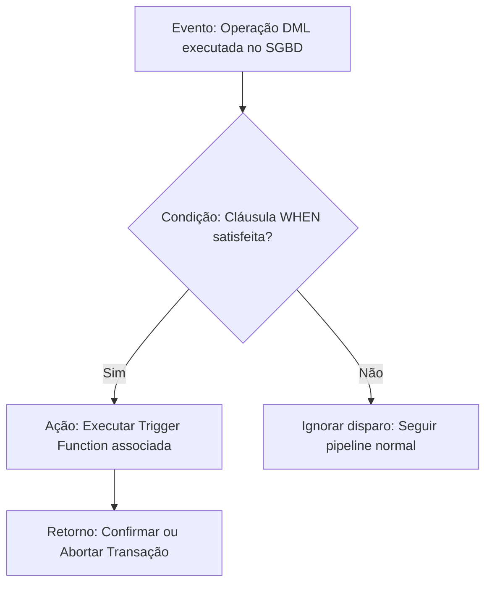
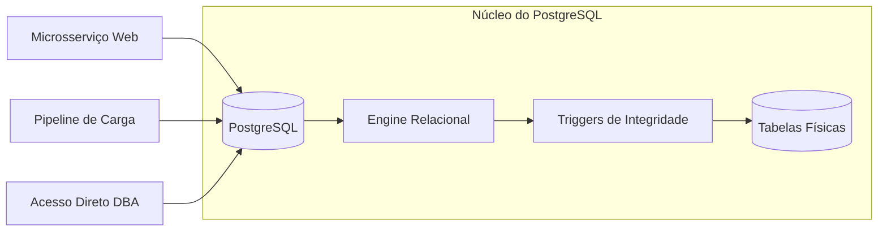
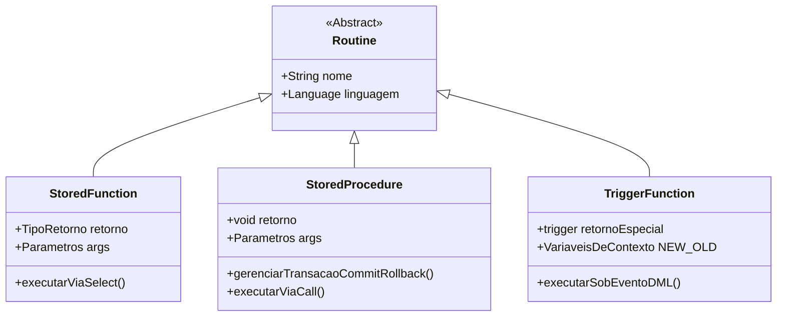
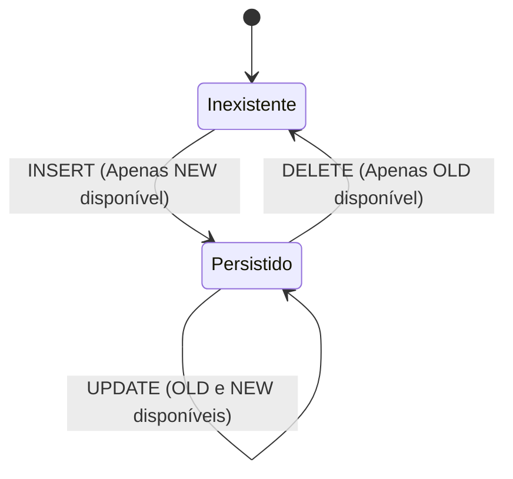
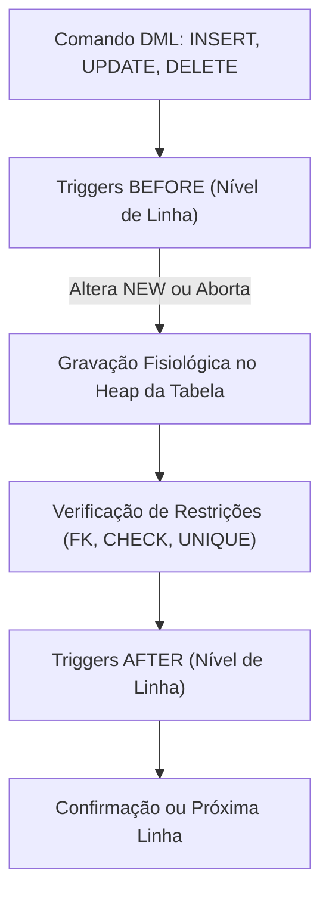
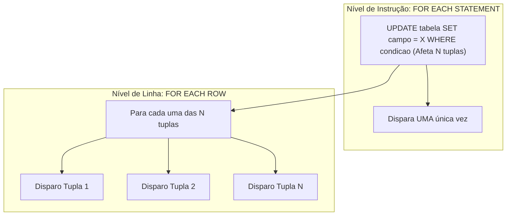
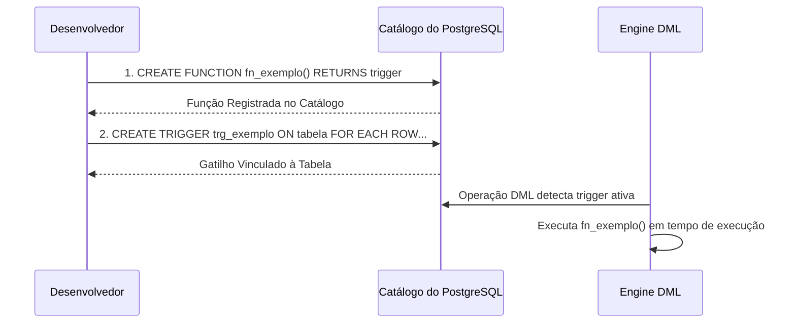
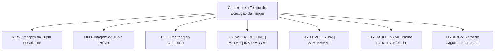
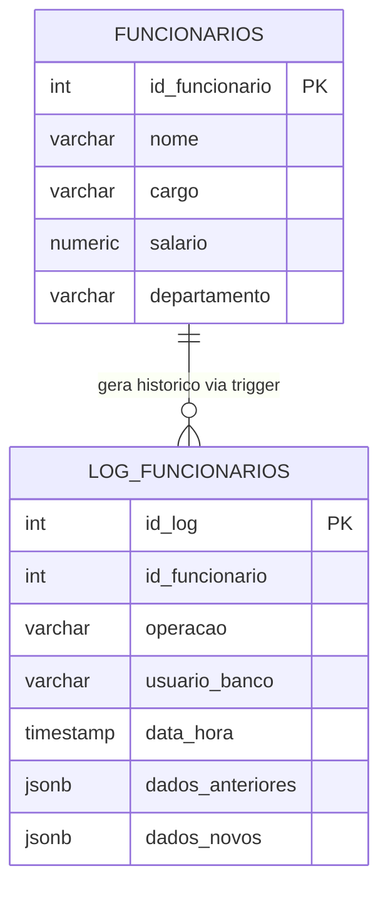
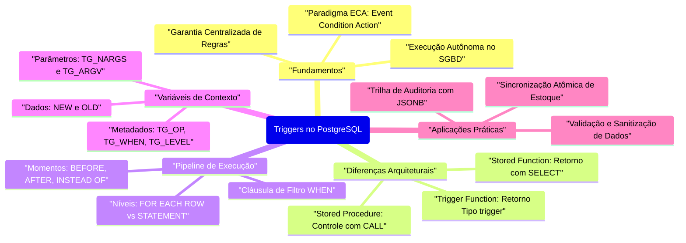

# Aula 05 — Triggers no PostgreSQL com PL/pgSQL

> **Professor:** Welington Garcia
> **Disciplina:** Tópicos Avançados em Banco de Dados (4º Semestre)
> **Tema:** Automação de lógica procedimental reativa, validação de integridade e trilhas de auditoria com PL/pgSQL no PostgreSQL

---

## Sumário

- [Objetivo da aula](#objetivo-da-aula)
- [Contexto e pré-requisitos](#contexto-e-pré-requisitos)
- [Conceito fundamental de triggers e execução automática no SGBD](#conceito-fundamental-de-triggers-e-execução-automática-no-sgbd)
- [Diferenças entre Procedures, Funções e Triggers no PostgreSQL](#diferenças-entre-procedures-funções-e-triggers-no-postgresql)
- [Eventos disparadores de DML: INSERT, UPDATE e DELETE](#eventos-disparadores-de-dml-insert-update-e-delete)
- [Momentos de disparo: BEFORE, AFTER e INSTEAD OF](#momentos-de-disparo-before-after-e-instead-of)
- [Níveis de disparo: FOR EACH ROW versus FOR EACH STATEMENT](#níveis-de-disparo-for-each-row-versus-for-each-statement)
- [Construção de Trigger Functions em linguagem PL/pgSQL](#construção-de-trigger-functions-em-linguagem-plpgsql)
- [Variáveis especiais de contexto: NEW, OLD, TG_OP e TG_WHEN](#variáveis-especiais-de-contexto-new-old-tg_op-e-tg_when)
- [Aplicações práticas: validação de regras de negócio e trilha de auditoria](#aplicações-práticas-validação-de-regras-de-negócio-e-trilha-de-auditoria)
- [Código da aula](#código-da-aula)
- [Exercícios](#exercícios)
- [Erros comuns e boas práticas](#erros-comuns-e-boas-práticas)
- [Links e materiais complementares](#links-e-materiais-complementares)
- [Mapa da aula](#mapa-da-aula)
- [Glossário](#glossário)
- [Pontos-chave para a prova](#pontos-chave-para-a-prova)
- [Perguntas e respostas (JSONL)](#perguntas-e-respostas-jsonl)
- [Checklist de revisão](#checklist-de-revisão)

---

## Objetivo da aula

Compreender a arquitetura, o ciclo de vida e a implementação de gatilhos (*triggers*) no PostgreSQL, capacitando o estudante de Sistemas de Informação a construir rotinas de execução automática disparadas por eventos de manipulação de dados (`INSERT`, `UPDATE`, `DELETE`). Ao final deste módulo, o acadêmico deverá dominar:
1. O desacoplamento formal existente no PostgreSQL entre a definição da *Trigger Function* e a declaração da *Trigger*.
2. A interceptação de tuplas para validação de regras de integridade complexas antes da persistência física (`BEFORE`).
3. O registro consistente de trilhas de auditoria e a sincronização de dados derivados após a confirmação das alterações (`AFTER`).
4. A manipulação adequada das variáveis contextuais de runtime (`NEW`, `OLD`, `TG_OP`, `TG_WHEN`, entre outras).
5. A avaliação de custo computacional entre o nível de linha (`FOR EACH ROW`) e o nível de instrução (`FOR EACH STATEMENT`).

---

## Contexto e pré-requisitos

No ecossistema de bancos de dados relacionais corporativos, as restrições declarativas tradicionais (`CHECK`, `FOREIGN KEY`, `UNIQUE`, `NOT NULL`) garantem a consistência atômica da tabela. Contudo, cenários complexos demandam integridade transacional que envolvem validações entre tabelas distintas, manutenção de dados agregados, cálculo de deltas de estoque e trilhas imutáveis de auditoria (*compliance* fiscal e segurança).

Para assimilar o conteúdo desta aula, são pré-requisitos fundamentais:
- Domínio de operações DML (*Data Manipulation Language*): `INSERT`, `UPDATE` e `DELETE`.
- Conhecimento da estrutura de blocos e controle de fluxo em PL/pgSQL (`DECLARE`, `BEGIN ... END`, `IF ... THEN ... ELSE`, `RAISE EXCEPTION`).
- Noções de transações relacionais, propriedades ACID (*Atomicidade*, *Consistência*, *Isolamento* e *Durabilidade*) e comportamento de *rollback*.
- Compreensão do modelo relacional e gerenciamento de visões (*Views*).

---

## Conceito fundamental de triggers e execução automática no SGBD

### Definição formal e o paradigma ECA (Event-Condition-Action)

Um gatilho (*trigger*) é um objeto do esquema de banco de dados associado a uma tabela ou visão específica, cuja execução ocorre de forma autônoma e implícita pelo motor relacional sempre que um evento de manipulação de dados pré-definido é disparado. Ao contrário de funções e procedimentos armazenados, que exigem invocação explícita pela camada de aplicação ou pelo usuário (`SELECT func()` ou `CALL proc()`), a *trigger* obedece rigorosamente ao paradigma ECA (*Event-Condition-Action*):



1. **Evento (*Event*):** O comando DML executado contra a entidade (`INSERT`, `UPDATE`, `DELETE` ou `TRUNCATE`).
2. **Condição (*Condition*):** Um predicado booleano opcional (cláusula `WHEN`) avaliado pelo SGBD antes de chamar o corpo da função. Se falso, a ação não consome recursos de execução do interpretador PL/pgSQL.
3. **Ação (*Action*):** O procedimento compilado em PL/pgSQL que contém a lógica imperativa, cálculos, inserções em tabelas secundárias ou interrupções de fluxo com cancelamento transacional.

### Motivação arquitetural: centralização no núcleo versus lógica na aplicação

Na arquitetura de software empresarial, múltiplos clientes consomem a mesma base de dados: APIs REST escritas em Go ou Java, microsserviços legados em C#, pipelines de dados em Python e consoles de administração manual via pgAdmin ou DBeaver. 

Quando a validação de regras críticas reside exclusivamente no código da aplicação (camada de domínio/serviço), qualquer conexão externa ou script de manutenção pontual pode contornar as validações, gerando inconsistências catastróficas. A *trigger* atua como a última linha de defesa no núcleo de armazenamento, garantindo que nenhum dado inconsistente seja persistido, independentemente do cliente originador da requisição.



### Exemplo prático e contraexemplo arquitetural

**Exemplo correto:** Um sistema financeiro no qual toda alteração de limite de crédito de um cliente gera obrigatoriamente um registro em uma tabela de log imutável, capturando o usuário conectado, a data/hora exata e os valores antigo e novo. Mesmo que um desenvolvedor execute um `UPDATE` manual via terminal, a auditoria é gravada de modo garantido.

**Contraexemplo:** Utilizar *triggers* para orquestrar serviços externos, como efetuar chamadas a Webhooks HTTP, enviar e-mails de confirmação de cadastro ou acionar filas RabbitMQ diretamente de dentro de uma *trigger function*. Banco de dados relacional deve processar transações curtas e atômicas. Chamadas síncronas a serviços de rede quebram a atomicidade, introduzem latência de rede no bloqueio (*lock*) de linhas e podem ocasionar exaustão de conexões e travamentos (*deadlocks*).

### Armadilhas e considerações de desempenho

- **Execução invisível:** A lógica disparada por *triggers* não é visível no código-fonte das aplicações consumidoras. Se mal documentada, causa perplexidade em desenvolvedores que observam valores alterados ou registros criados "magicamente".
- **Cascateamento e loops infinitos:** Uma *trigger* na tabela $`A`$ que altera a tabela $`B`$, a qual por sua vez altera a tabela $`A`$, gera recursão infinita que esgota a pilha de execução do PostgreSQL, abortando a transação com estouro de memória (*stack depth limit exceeded*).
- **Sobrecarga de I/O em operações em massa:** A execução de um `INSERT` de $`100.000`$ tuplas com uma *trigger* de linha ativada executará a função $`100.000`$ vezes dentro da mesma transação, multiplicando o tempo de processamento por ordens de grandeza.

---

## Diferenças entre Procedures, Funções e Triggers no PostgreSQL

### Funções (Stored Functions): invocação com retorno de valor

As funções no PostgreSQL (`CREATE FUNCTION`) são blocos de código reaproveitáveis que retornam obrigatoriamente um valor ou conjunto de registros (`TABLE`, `SETOF`). Elas operam sob o contexto da consulta que as invocou (`SELECT`, `WHERE`, `JOIN`). Funções não podem gerenciar autonomamente transações; elas executam estritamente dentro da transação corrente da instrução SQL que as chamou e não possuem permissão para executar comandos explícitos de `COMMIT` ou `ROLLBACK`.

### Stored Procedures (CALL): controle explícito de transações

Introduzidas no PostgreSQL 11 para atender ao padrão ANSI SQL, as *Stored Procedures* (`CREATE PROCEDURE`) são invocadas pelo comando `CALL`. Seu propósito principal é a orquestração de processos em lote (*batch processing*), cargas ETL e manutenções administrativas. Ao contrário das funções, as *procedures* suportam gerenciamento autônomo de transações: é permitido executar `COMMIT` ou `ROLLBACK` no meio da execução procedural para liberar *locks* e persistir etapas intermediárias.

### Trigger Functions: assinatura especial e acoplamento a eventos

Uma *Trigger Function* é uma categoria especializada de função. Ela não aceita parâmetros formais declarados na assinatura padrão e deve obrigatoriamente declarar que retorna o tipo abstrato `trigger` (ou `event_trigger` para eventos de DDL do sistema). Ela não pode ser executada via `SELECT` nem via `CALL`; sua invocação é exclusivamente delegada ao despachante interno de eventos do PostgreSQL.



### Comparativo estrutural, transacional e de ciclo de vida

| Critério de Comparação | Stored Function | Stored Procedure | Trigger Function |
| :--- | :--- | :--- | :--- |
| **Comando de Criação** | `CREATE FUNCTION ... RETURNS <tipo>` | `CREATE PROCEDURE ...` | `CREATE FUNCTION ... RETURNS trigger` |
| **Forma de Invocação** | `SELECT nome_funcao(...)` | `CALL nome_procedure(...)` | Automática (via `CREATE TRIGGER`) |
| **Retorno Obrigatório** | Sim (escalar, composto ou conjunto) | Não possui retorno tipado | Sim, tipo `trigger` (`NEW`, `OLD` ou `NULL`) |
| **Controle Transacional** | Não (opera sob a transação chamadora) | Sim (`COMMIT` / `ROLLBACK` permitidos) | Não (acoplada à transação atômica do DML) |
| **Variáveis Implícitas** | Inexistentes | Inexistentes | Presentes (`NEW`, `OLD`, `TG_OP`, etc.) |
| **Uso Predominante** | Cálculos, filtros e transformação de dados | Processamento em lote e rotinas de manutenção | Validação, integridade, auditoria e sincronização |

```sql
-- 1. Exemplo de Stored Function
CREATE OR REPLACE FUNCTION fn_calcular_desconto(p_valor NUMERIC, p_taxa NUMERIC)
RETURNS NUMERIC
LANGUAGE plpgsql
AS $$
BEGIN
    RETURN p_valor - (p_valor * (p_taxa / 100.0));
END;
$$;

-- 2. Exemplo de Stored Procedure (com suporte a transações intermediárias)
CREATE OR REPLACE PROCEDURE pr_fechamento_diario(p_data DATE)
LANGUAGE plpgsql
AS $$
BEGIN
    -- Atualiza primeira etapa
    UPDATE contas_a_receber SET status = 'PROCESSADO' WHERE data_vencimento <= p_data;
    COMMIT; -- Persiste os registros e libera os locks de linha
    
    -- Atualiza segunda etapa
    INSERT INTO logs_processamento (descricao, momento) VALUES ('Fechamento concluido', clock_timestamp());
    COMMIT;
END;
$$;

-- 3. Exemplo de Trigger Function
CREATE OR REPLACE FUNCTION fn_trg_impedir_exclusao()
RETURNS trigger
LANGUAGE plpgsql
AS $$
BEGIN
    RAISE EXCEPTION 'Operacao proibida: Registros desta tabela nao podem ser excluidos.';
    RETURN NULL;
END;
$$;
```

---

## Eventos disparadores de DML: INSERT, UPDATE e DELETE

### O evento INSERT: criação de novas tuplas e validação de estado inicial

No evento `INSERT`, uma nova linha está prestes a ser gravada ou acabou de ser inserida na tabela.
- A variável `NEW` contém a projeção da tupla que está sendo adicionada.
- A variável `OLD` é nula (`NULL`), pois não existe registro precedente associado à operação.
- Cenários típicos de uso incluem: higienização de strings (aplicação de `TRIM`, `UPPER`), geração de códigos de rastreio customizados e preenchimento de colunas de auditoria de criação (`criado_por`, `criado_em`).

### O evento UPDATE: transição de estado e identificação de colunas modificadas

O evento `UPDATE` representa a transição entre o estado prévio e o estado futuro de uma tupla existente no banco de dados.
- `OLD` contém os dados originais da linha como residiam fisicamente no disco antes do comando.
- `NEW` contém os dados modificados que a transação pretende persistir.
- O desenvolvedor pode comparar atributos específicos (`IF NEW.status IS DISTINCT FROM OLD.status`) para identificar com precisão alterações de estado e acionar lógicas apenas quando campos fundamentais sofrem mutação.

### O evento DELETE: preservação histórica e bloqueio de exclusões lógicas

No evento `DELETE`, uma tupla existente é removida da tabela.
- `OLD` contém a imagem completa da tupla que está sendo descartada.
- `NEW` é estritamente `NULL`, uma vez que não há novo estado a ser persistido.
- Cenários de uso: interceptação para implementar *soft delete* (deleção lógica), gravação de cópia completa do registro em tabelas de arquivamento histórico e validação de regras de bloqueio (por exemplo, impedir a exclusão de clientes com movimentação contábil ativa).



### Eventos combinados: cláusula OR (INSERT OR UPDATE OR DELETE)

O PostgreSQL permite vincular uma única *trigger* a múltiplos eventos simultaneamente, utilizando a conjunção `OR`:

```sql
CREATE TRIGGER trg_monitorar_funcionarios
AFTER INSERT OR UPDATE OR DELETE ON funcionarios
FOR EACH ROW
EXECUTE FUNCTION fn_auditar_funcionarios();
```

Dentro da função associada, a variável contextual `TG_OP` conterá uma string indicando qual evento disparou a chamada específica (`'INSERT'`, `'UPDATE'` ou `'DELETE'`), permitindo concentrar regras correlacionadas dentro de uma mesma unidade lógica estruturada em blocos condicionais.

| Evento | Valor de `OLD` | Valor de `NEW` | Operação Principal |
| :--- | :--- | :--- | :--- |
| `INSERT` | `NULL` | Tupla com novos dados | Criação de tupla |
| `UPDATE` | Tupla com dados vigentes | Tupla com modificações | Transição de estado |
| `DELETE` | Tupla com dados a remover | `NULL` | Remoção de tupla |

---

## Momentos de disparo: BEFORE, AFTER e INSTEAD OF

### Disparo BEFORE: interceptação, higienização e curto-circuito de gravação

A *trigger* `BEFORE` dispara antes que a alteração seja materializada fisicamente no heap da tabela ou que as restrições relacionais nativas sejam verificadas.
- **Poder de modificação:** Se configurada em nível de linha (`FOR EACH ROW`), ela pode alterar o conteúdo da variável `NEW`. Os valores retornados no comando `RETURN NEW` serão gravados na tabela.
- **Poder de veto silencioso:** Se a função retornar `NULL`, a operação para aquela linha específica é descartada silenciosamente pelo PostgreSQL, sem gerar exceção, pulando a persistência no disco.
- **Poder de cancelamento formal:** Ao executar `RAISE EXCEPTION`, a transação inteira é abortada e revertida (*rollback*).

### Disparo AFTER: consolidação, propagação em cascata e logs de auditoria

A *trigger* `AFTER` dispara após a linha ter sido escrita no disco e após todas as restrições de integridade da tabela terem sido satisfeitas.
- Nesse momento, a alteração é um fato consumado dentro da transação.
- **Imutabilidade de `NEW`:** O retorno da função `AFTER` é ignorado pelo PostgreSQL (costuma-se retornar `NULL` ou `NEW` indistintamente).
- É o momento ideal para lógicas que dependem do sucesso da operação principal: alimentar logs de auditoria, calcular agregações em tabelas satélites e acionar sincronizações dependentes.

### Disparo INSTEAD OF: viabilização de operações DML sobre Visões (Views)

Por padrão, visões (*views*) geradas a partir de junções complexas de múltiplas tabelas, agregações (`GROUP BY`) ou funções de janela não são diretamente atualizáveis pelo PostgreSQL. 
- A *trigger* `INSTEAD OF` só pode ser declarada em visões e atua substituindo completamente o comando DML que seria direcionado à visão.
- Ao receber um `INSERT` na visão, a *trigger function* intercepta a tupla recebida e desmembra a operação manualmente nas tabelas de origem que formam aquela visão.



### Ordem de execução do pipeline de processamento de comandos DML

A seqüência rigorosa respeitada pelo motor relacional do PostgreSQL para cada comando DML envolve os seguintes passos:
1. Execução de gatilhos `BEFORE STATEMENT` (nível de instrução).
2. Para cada tupla afetada pelo comando:
   a. Execução dos gatilhos `BEFORE ROW` (modificação de `NEW` ou descarte com `NULL`).
   b. Verificação das restrições de chave estrangeira, unicidade e *checks* imediatos.
   c. Persistência física da tupla na página de dados.
   d. Execução dos gatilhos `AFTER ROW`.
3. Verificação de restrições adiadas (*deferred constraints*).
4. Execução de gatilhos `AFTER STATEMENT` (nível de instrução).

| Momento | Alvo Permitido | Pode Alterar `NEW`? | Efeito do Retorno `NULL` | Aplicações Típicas |
| :--- | :--- | :--- | :--- | :--- |
| **BEFORE** | Tabelas | Sim, em nível de linha | Cancela a operação na linha | Validação, normalização, enriquecimento |
| **AFTER** | Tabelas | Não (efeito nulo) | Nenhum impacto na linha | Auditoria, recálculo de estoque, sincronização |
| **INSTEAD OF** | Somente Visões (*Views*) | Não aplicável | Cancela o redirecionamento | Tornar visões complexas editáveis |

---

## Níveis de disparo: FOR EACH ROW versus FOR EACH STATEMENT

### Granularidade FOR EACH ROW: processamento tupla a tupla

A cláusula `FOR EACH ROW` determina que a *trigger function* será acionada individualmente para cada registro afetado pela instrução DML. Se um único comando `UPDATE funcionarios SET salario = salario * 1.10;` atualizar $`5.000`$ linhas, a função executará exatamente $`5.000`$ vezes consecutivas, tendo acesso às variáveis `NEW` e `OLD` de cada tupla singular.

### Granularidade FOR EACH STATEMENT: processamento atômico do comando

A cláusula `FOR EACH STATEMENT` define que a *trigger function* será acionada apenas uma única vez por comando DML executado, independentemente da quantidade de tuplas que satisfizeram o comando. Se a instrução atualizar zero, dez ou um milhão de registros, a função roda exatamente uma vez.
- Neste nível, as variáveis `NEW` e `OLD` que representam linhas singulares **não estão disponíveis** (seu valor é `NULL`), uma vez que não há uma tupla única de contexto.
- Seu uso clássico destina-se a validações globais (ex: impedir modificações na tabela fora do horário comercial) ou processamento em lote via *Transition Tables*.



### Análise de complexidade e impacto de desempenho com operações em lote

Considere uma operação DML em lote que afete $`N`$ tuplas. Se o tempo médio de execução do corpo da função de gatilho for denotado por $`T_{\text{func}}`$, e a sobrecarga de despacho do motor for $`T_{\text{overhead}}`$, o custo temporal $`C_{\text{ROW}}`$ de um gatilho `FOR EACH ROW` é modelado linearmente em função do volume:

```math
C_{\text{ROW}} = N \times (T_{\text{func}} + T_{\text{overhead}})
```

Em contrapartida, um gatilho `FOR EACH STATEMENT` possui custo temporal invariante em relação à contagem de tuplas para o despacho da rotina:

```math
C_{\text{STATEMENT}} = 1 \times (T_{\text{func\_stmt}} + T_{\text{overhead}})
```

Se uma *trigger* `FOR EACH ROW` contiver consultas auxiliares e subconsultas internas com leituras sequenciais, uma atualização de grande porte degradará exponencialmente a performance da transação.

### Tabelas de transição (Transition Tables) no PostgreSQL

A partir do PostgreSQL 10, tornou-se possível utilizar a cláusula `REFERENCING` em gatilhos `AFTER ... FOR EACH STATEMENT`. Essa funcionalidade permite capturar todas as tuplas alteradas em estruturas tabulares efêmeras nomeadas:

```sql
CREATE TRIGGER trg_auditoria_lote_pedidos
AFTER UPDATE ON pedidos
REFERENCING OLD TABLE AS tuplas_antigas NEW TABLE AS tuplas_novas
FOR EACH STATEMENT
EXECUTE FUNCTION fn_auditar_lote_pedidos();
```

Dentro da função, `tuplas_antigas` e `tuplas_novas` podem ser consultadas via comandos SQL relacionais padrão (`SELECT * FROM tuplas_novas`), combinando o ganho de desempenho de um único disparo com a visibilidade de todas as alterações ocorridas.

| Critério | FOR EACH ROW | FOR EACH STATEMENT |
| :--- | :--- | :--- |
| **Frequência de Execução** | 1 vez para cada tupla manipulada | 1 vez por comando DML (mesmo se afetar 0 tuplas) |
| **Acesso a `NEW` e `OLD`** | Sim, referenciando a tupla corrente | Não (apenas via *Transition Tables*) |
| **Momento de Criação** | Padrão explícito em `CREATE TRIGGER` | Padrão *default* se omitida a cláusula |
| **Sobrecarga em Cargas Grandes** | Elevada (proporcional ao volume de dados) | Baixa (disparo singular no fim da instrução) |
| **Casos de Uso Primários** | Validações e enriquecimento individual | Logs de operação geral e validações de lote |

---

## Construção de Trigger Functions em linguagem PL/pgSQL

### Sintaxe fundamental e obrigatoriedade do retorno trigger

A criação de um gatilho no PostgreSQL ocorre obrigatoriamente em duas etapas arquiteturais separadas:
1. **Definição da Função:** Cria-se a função com o tipo de retorno `trigger`, sem parâmetros na assinatura.
2. **Declaração do Gatilho:** Cria-se o gatilho vinculando a tabela, o evento, o momento e a função pré-compilada.



### Estrutura de blocos: DECLARE, BEGIN, EXCEPTION e END

O esqueleto formal de uma *Trigger Function* em PL/pgSQL obedece à estrutura de blocos clássica:

```sql
CREATE OR REPLACE FUNCTION fn_trg_padrao()
RETURNS trigger
LANGUAGE plpgsql
AS $$
DECLARE
    -- Declaração de variáveis locais auxiliares
    v_limite_maximo NUMERIC := 10000.00;
    v_usuario_sessao VARCHAR(100);
BEGIN
    -- Obtenção de variáveis de ambiente
    v_usuario_sessao := session_user;

    -- Lógica imperativa de verificação
    IF NEW.valor > v_limite_maximo THEN
        RAISE EXCEPTION 'Valor informado (%) excede o teto permitido de %', NEW.valor, v_limite_maximo;
    END IF;

    -- Retorno mandatório
    RETURN NEW;
EXCEPTION
    WHEN integrity_constraint_violation THEN
        RAISE NOTICE 'Tratamento de excecao disparado no bloco interno';
        RAISE; -- Repassa o erro abortando a transação
END;
$$;
```

### Semântica do retorno: NEW, OLD e NULL no controle de fluxo

O valor devolvido pela instrução `RETURN` dentro de uma *trigger function* é decisivo para a continuação do pipeline relacional:

- Em gatilhos **`BEFORE ROW`**:
  - `RETURN NEW`: O PostgreSQL persiste os dados contidos na variável `NEW`. Caso a função tenha feito modificações em atributos de `NEW` (por exemplo, `NEW.valor := ROUND(NEW.valor, 2);`), os dados ajustados são os que entrarão no heap.
  - `RETURN OLD`: Frequentemente utilizado em gatilhos de `DELETE` para autorizar a remoção física da linha original.
  - `RETURN NULL`: O PostgreSQL aborta a operação **exclusivamente para a tupla corrente**, de forma silenciosa. A linha não é persistida, nenhum erro é emitido para a aplicação e a execução prossegue para a próxima linha do comando.
- Em gatilhos **`AFTER ROW`** e **`STATEMENT`**:
  - O valor de retorno é descartado pelo motor relacional. Por convenção semântica, adota-se `RETURN NULL;` ou `RETURN NEW;`.

### Vinculação da Trigger Function à tabela com CREATE TRIGGER

A sintaxe de amarração conecta os metadados do evento à função:

```sql
CREATE [ OR REPLACE ] TRIGGER nome_do_gatilho
{ BEFORE | AFTER | INSTEAD OF } { INSERT [ OR UPDATE [ OR DELETE ... ] ] }
ON nome_da_tabela
[ REFERENCING { OLD TABLE AS nome | NEW TABLE AS nome } ]
[ FOR EACH { ROW | STATEMENT } ]
[ WHEN ( condicao_booleana ) ]
EXECUTE FUNCTION nome_da_funcao_trigger(argumentos_opcionais);
```

> [!NOTE]
> Em versões anteriores ao PostgreSQL 11, a instrução exigia a palavra-chave reservada `EXECUTE PROCEDURE nome()`. A partir do PostgreSQL 11, a documentação oficial estabelece `EXECUTE FUNCTION nome()` como a forma recomendada, embora `EXECUTE PROCEDURE` seja aceito por compatibilidade histórica.

---

## Variáveis especiais de contexto: NEW, OLD, TG_OP e TG_WHEN

### Catálogo de variáveis implícitas do PostgreSQL PL/pgSQL

Sempre que uma *Trigger Function* em PL/pgSQL é chamada, o interpretador instancia automaticamente uma série de variáveis no escopo de execução local. Essas variáveis não precisam ser declaradas na seção `DECLARE`.



### Acessibilidade de NEW e OLD conforme a operação DML

O acesso indevido a `NEW` ou `OLD` em contextos nos quais elas não existem resultará em erro fatal de execução (*runtime error*), fazendo com que a transação inteira seja abortada:

```sql
-- Exemplo de erro crítico: Tentar ler NEW em contexto de DELETE
IF TG_OP = 'DELETE' THEN
    -- Erro: NEW é NULL. NEW.codigo causará exceção de desreferência!
    INSERT INTO log_auditoria (cod) VALUES (NEW.codigo); 
END IF;
```

A regra canônica de acesso é:
- `INSERT`: Use apenas `NEW`. (`OLD` é estritamente `NULL`).
- `UPDATE`: Use tanto `OLD` quanto `NEW`.
- `DELETE`: Use apenas `OLD`. (`NEW` é estritamente `NULL`).

### Utilização de TG_OP, TG_WHEN, TG_LEVEL e TG_TABLE_NAME

As variáveis de metadados permitem a escrita de funções reaproveitáveis e genéricas:

- **`TG_OP`**: Tipo de dado `text`. Retorna `'INSERT'`, `'UPDATE'`, `'DELETE'` ou `'TRUNCATE'`.
- **`TG_WHEN`**: Retorna `'BEFORE'`, `'AFTER'` ou `'INSTEAD OF'`.
- **`TG_LEVEL`**: Retorna `'ROW'` ou `'STATEMENT'`.
- **`TG_TABLE_NAME`**: Nome da tabela sobre a qual o gatilho disparou.
- **`TG_TABLE_SCHEMA`**: Nome do esquema (*schema*) da tabela afetada.

### Passagem e leitura de argumentos estáticos com TG_NARGS e TG_ARGV

Ao criar a trigger, é possível declarar argumentos literais textuais entre os parênteses da cláusula `EXECUTE FUNCTION`:

```sql
CREATE TRIGGER trg_auditar_clientes
AFTER INSERT OR UPDATE ON clientes
FOR EACH ROW EXECUTE FUNCTION fn_auditoria_generica('CRITICIDADE_ALTA', 'MODULO_FINANCEIRO');
```

Na função, tais valores são lidos através das variáveis:
- **`TG_NARGS`**: Inteiro contendo a contagem de parâmetros passados (no exemplo acima, `2`).
- **`TG_ARGV[]`**: Vetor indexado em zero (`TG_ARGV[0]`, `TG_ARGV[1]`) do tipo `text`.

| Variável | Tipo | Operações Válidas | Descrição |
| :--- | :--- | :--- | :--- |
| `NEW` | `RECORD` | `INSERT`, `UPDATE` | Tupla de dados resultante da modificação |
| `OLD` | `RECORD` | `UPDATE`, `DELETE` | Tupla de dados original antes da modificação |
| `TG_OP` | `text` | Todas | String indicando a operação que ativou o gatilho |
| `TG_WHEN` | `text` | Todas | Momento de ativação (`BEFORE`, `AFTER`, `INSTEAD OF`) |
| `TG_LEVEL` | `text` | Todas | Nível de disparo (`ROW` ou `STATEMENT`) |
| `TG_TABLE_NAME` | `name` | Todas | Nome da tabela alvo do gatilho |
| `TG_TABLE_SCHEMA`| `name` | Todas | Esquema (*schema*) de persistência da tabela |
| `TG_NARGS` | `integer` | Todas | Quantidade de argumentos repassados na DDL |
| `TG_ARGV[]` | `text[]` | Todas | Vetor com os literais textuais informados na DDL |

---

## Aplicações práticas: validação de regras de negócio e trilha de auditoria

### Padrão 1: Validação de regras de domínio complexas e constraints dinâmicas

Restrições `CHECK` relacionais nativas são puramente estáticas e não permitem subconsultas nem referências a outras tabelas. Quando uma regra de negócio depende de estados dinâmicos (como verificar se a soma dos pedidos de um cliente ultrapassa o limite aprovado em uma tabela de crédito), a *trigger* `BEFORE ROW` com `RAISE EXCEPTION` torna-se a solução adequada.

### Padrão 2: Trilha de auditoria completa (Change Data Capture - CDC simplificado)

Auditoria em banco de dados destina-se a responder: *Quem* alterou? *Quando* alterou? *Qual* era o valor antes? *Qual* é o valor atual?
Utilizando uma *trigger* `AFTER INSERT OR UPDATE OR DELETE FOR EACH ROW`, o sistema armazena uma cópia histórica em formato JSONB ou colunar, blindando o histórico contra adulterações de software.



### Padrão 3: Manutenção de campos calculados e desnormalizações controladas

Em bancos analíticos ou sistemas com gargalos extremos de leitura, desnormalizações pontuais (como armazenar `quantidade_estoque` diretamente no produto ou `valor_total` no cabeçalho do pedido) são comuns. A manutenção da consistência desses campos agregados é delegada a gatilhos que reagem aos eventos da tabela de detalhes (`itens_pedido`), garantindo que qualquer inclusão, remoção ou ajuste quantitativo de item reflita imediatamente nos acumuladores.

### Padrão 4: Prevenção de mutabilidade indesejada em tabelas append-only

Determinadas entidades regulatórias exigem armazenamento estritamente imutável (*append-only*), como registros de cupons fiscais emitidos ou *logs* de acesso. Uma *trigger* `BEFORE UPDATE OR DELETE` pode bloquear qualquer tentativa de mutação ou descarte com base em condições de negócio ou de modo incondicional.

| Padrão | Momento Recomendado | Nível | Ação em Caso de Violação |
| :--- | :--- | :--- | :--- |
| **Validação de Regra** | `BEFORE` | `FOR EACH ROW` | `RAISE EXCEPTION` abortando a transação |
| **Trilha de Auditoria** | `AFTER` | `FOR EACH ROW` | `INSERT` na tabela histórica |
| **Sincronização de Estoque** | `AFTER` | `FOR EACH ROW` | `UPDATE` nos registros da tabela mestre |
| **Imutabilidade de Registros**| `BEFORE` | `FOR EACH ROW` | `RAISE EXCEPTION` caso tente alterar ou excluir |

---

## Código da aula

Nesta seção, exploramos as estruturas de código desenvolvidas para demonstrar os conceitos fundamentais da aula, correlacionando-as aos arquivos que compõem o repositório prático da disciplina.

### Arquivo [exemplos.sql](./codigo/exemplos.sql)

O arquivo [exemplos.sql](./codigo/exemplos.sql) reúne scripts de demonstração das capacidades de validação e auditoria no PostgreSQL. O trecho a seguir ilustra a implementação de uma trigger para validação de sanitização de strings e integridade referencial customizada antes do `INSERT`:

```sql
-- Arquivo: ./codigo/exemplos.sql
-- Tabela base para demonstrar higienização e validação de dados
CREATE TABLE clientes_cadastro (
    id SERIAL PRIMARY KEY,
    nome VARCHAR(100) NOT NULL,
    email VARCHAR(100) NOT NULL,
    status VARCHAR(20) DEFAULT 'ATIVO',
    criado_em TIMESTAMP DEFAULT CURRENT_TIMESTAMP
);

-- Trigger Function para higienizar e validar o e-mail antes da gravação
CREATE OR REPLACE FUNCTION fn_sanitizar_cliente()
RETURNS trigger
LANGUAGE plpgsql
AS $$
BEGIN
    -- 1. Remove espacos excedentes nas bordas e padroniza para caixa baixa
    NEW.nome := TRIM(NEW.nome);
    NEW.email := LOWER(TRIM(NEW.email));

    -- 2. Validacao de formato elementar do e-mail
    IF NEW.email NOT LIKE '%@%.%' THEN
        RAISE EXCEPTION 'O e-mail informado (%) e invalido.', NEW.email;
    END IF;

    -- 3. Retorna a tupla manipulada para gravacao no banco
    RETURN NEW;
END;
$$;

-- Vinculacao da trigger BEFORE INSERT na tabela
CREATE TRIGGER trg_sanitizar_cliente
BEFORE INSERT OR UPDATE ON clientes_cadastro
FOR EACH ROW
EXECUTE FUNCTION fn_sanitizar_cliente();
```

*Análise detalhada do trecho:*
- A função intercepta o registro antes da escrita no heap (`BEFORE`).
- Os campos `NEW.nome` e `NEW.email` são alterados em memória. O PostgreSQL salva os valores sanitizados.
- A condicional avalia o predicado do endereço de e-mail; ao encontrar padrão incorreto, emite um `RAISE EXCEPTION`, desfazendo qualquer instrução pendente da transação corrente.

---

## Exercícios

### Exercício 1: Auditoria Completa de Dados com Triggers

#### Enunciado
Crie uma estrutura de auditoria para a tabela `funcionarios` que registre automaticamente em uma tabela `log_funcionarios` qualquer operação de `INSERT`, `UPDATE` ou `DELETE`. O registro de log deve conter o ID do log, o nome da operação realizada (`TG_OP`), o usuário do banco que efetuou a transação, o timestamp exato do evento, além dos dados anteriores (`OLD`) e posteriores (`NEW`) encapsulados como `jsonb`.

#### Raciocínio
1. Para suportar esquemas variáveis sem quebrar a tabela de auditoria a cada alteração de coluna, o uso do tipo de dado nativo `jsonb` via função `to_jsonb()` é a abordagem mais robusta e desacoplada.
2. A operação de auditoria deve refletir alterações garantidas; portanto, o momento adequado é `AFTER` em nível de linha (`FOR EACH ROW`).
3. É necessário mapear adequadamente as variáveis especiais de acordo com o `TG_OP`: para `INSERT`, o `OLD` é nulo; para `DELETE`, o `NEW` é nulo.

#### Resolução Completa Comentada
Arquivo de referência: [exercicios.sql](./codigo/exercicios.sql)

```sql
-- 1. Criacao da tabela de funcionarios
CREATE TABLE IF NOT EXISTS funcionarios (
    id_funcionario SERIAL PRIMARY KEY,
    nome VARCHAR(100) NOT NULL,
    cargo VARCHAR(50) NOT NULL,
    salario NUMERIC(10,2) NOT NULL,
    departamento VARCHAR(50) NOT NULL
);

-- 2. Criacao da tabela para armazenamento da trilha de auditoria
CREATE TABLE IF NOT EXISTS log_funcionarios (
    id_log SERIAL PRIMARY KEY,
    id_funcionario INT,
    operacao VARCHAR(10) NOT NULL,
    usuario_banco VARCHAR(50) NOT NULL,
    data_hora TIMESTAMP NOT NULL,
    dados_anteriores JSONB,
    dados_novos JSONB
);

-- 3. Criacao da Trigger Function de auditoria
CREATE OR REPLACE FUNCTION fn_auditar_funcionarios()
RETURNS trigger
LANGUAGE plpgsql
AS $$
DECLARE
    v_id INT;
    v_old JSONB := NULL;
    v_new JSONB := NULL;
BEGIN
    -- Identificacao do ID e conversao condicional para JSONB
    IF TG_OP = 'INSERT' THEN
        v_id := NEW.id_funcionario;
        v_new := to_jsonb(NEW);
    ELSIF TG_OP = 'UPDATE' THEN
        v_id := NEW.id_funcionario;
        v_old := to_jsonb(OLD);
        v_new := to_jsonb(NEW);
    ELSIF TG_OP = 'DELETE' THEN
        v_id := OLD.id_funcionario;
        v_old := to_jsonb(OLD);
    END IF;

    -- Insercao do registro de auditoria imutavel
    INSERT INTO log_funcionarios (
        id_funcionario,
        operacao,
        usuario_banco,
        data_hora,
        dados_anteriores,
        dados_novos
    ) VALUES (
        v_id,
        TG_OP,
        session_user,
        clock_timestamp(),
        v_old,
        v_new
    );

    -- Em triggers AFTER ROW, o retorno pode ser NULL
    RETURN NULL;
END;
$$;

-- 4. Vinculacao da trigger na tabela funcionarios
CREATE OR REPLACE TRIGGER trg_auditoria_funcionarios
AFTER INSERT OR UPDATE OR DELETE ON funcionarios
FOR EACH ROW
EXECUTE FUNCTION fn_auditar_funcionarios();
```

---

### Exercício 2: Validação de Regras de Negócio com Trigger BEFORE

#### Enunciado
Implemente um mecanismo de validação via trigger `BEFORE INSERT OR UPDATE` na tabela `produtos`. A trigger function deve impedir a persistência de registros caso o `preco_venda` seja menor ou igual a zero, ou caso o `preco_venda` seja estritamente inferior ao `preco_custo`. Em caso de violação, uma exceção descritiva deve ser lançada utilizando `RAISE EXCEPTION`.

#### Raciocínio
1. A regra visa impedir que dados inválidos cheguem ao disco. A validação precisa ocorrer antes da gravação física (`BEFORE`).
2. Deve-se avaliar as duas regras de corte: $`\text{preco\_venda} \le 0`$ e $`\text{preco\_venda} < \text{preco\_custo}`$.
3. Havendo conformidade, a tupla manipulada `NEW` deve ser devolvida (`RETURN NEW`) para autorizar a conclusão do pipeline.

#### Resolução Completa Comentada
Arquivo de referência: [exercicios.sql](./codigo/exercicios.sql)

```sql
-- 1. Criacao da tabela produtos
CREATE TABLE IF NOT EXISTS produtos (
    id_produto SERIAL PRIMARY KEY,
    descricao VARCHAR(100) NOT NULL,
    preco_custo NUMERIC(10,2) NOT NULL,
    preco_venda NUMERIC(10,2) NOT NULL,
    quantidade_estoque INT NOT NULL DEFAULT 0
);

-- 2. Funcao de validacao de precos
CREATE OR REPLACE FUNCTION fn_validar_precos_produto()
RETURNS trigger
LANGUAGE plpgsql
AS $$
BEGIN
    -- Validacao 1: Preco de venda deve ser estritamente positivo
    IF NEW.preco_venda <= 0 THEN
        RAISE EXCEPTION 'Violacao de Regra: O preco de venda (R$ %) deve ser maior que zero.', NEW.preco_venda;
    END IF;

    -- Validacao 2: Preco de venda nao pode ser inferior ao custo operacional
    IF NEW.preco_venda < NEW.preco_custo THEN
        RAISE EXCEPTION 'Violacao de Margem: O preco de venda (R$ %) nao pode ser inferior ao preco de custo (R$ %).',
            NEW.preco_venda, NEW.preco_custo;
    END IF;

    -- Autoriza a gravacao da tupla sem alteracoes
    RETURN NEW;
END;
$$;

-- 3. Vinculacao da trigger BEFORE INSERT OR UPDATE
CREATE OR REPLACE TRIGGER trg_validar_precos_produto
BEFORE INSERT OR UPDATE ON produtos
FOR EACH ROW
EXECUTE FUNCTION fn_validar_precos_produto();
```

---

### Exercício 3: Sincronização e Atualização Automática de Estoque

#### Enunciado
Desenvolva uma trigger `AFTER INSERT OR DELETE OR UPDATE` na tabela `itens_pedido` para atualizar automaticamente a coluna `quantidade_estoque` na tabela `produtos`. Ao inserir um item, o estoque do produto correspondente deve ser reduzido; ao excluir um item, o estoque deve ser estornado; e ao atualizar a quantidade do item, a diferença correspondente deve ser calculada e ajustada no estoque.

#### Raciocínio
1. Trata-se de uma sincronização de dados entre tabelas distintas que deve ser refletida após o processamento atômico de cada item (`AFTER ... FOR EACH ROW`).
2. No `INSERT`: Deduzir $`\Delta = \text{NEW.quantidade}`$.
3. No `DELETE`: Estornar $`\Delta = \text{OLD.quantidade}`$.
4. No `UPDATE`: Calcular a variação real. Se a quantidade passou de 5 para 8, a diferença a abater é $`8 - 5 = +3`$. Se passou de 5 para 2, a diferença a abater é $`2 - 5 = -3`$ (ou seja, estorna 3). A fórmula genérica de ajuste na quantidade em estoque é:
```math
\text{Estoque}_{\text{novo}} = \text{Estoque}_{\text{atual}} - (\text{NEW.quantidade} - \text{OLD.quantidade})
```
5. Caso o produto também seja alterado no `UPDATE` (cenário raro, mas possível), deve-se estornar o produto anterior e abater do novo produto.

#### Resolução Completa Comentada
Arquivo de referência: [exercicios.sql](./codigo/exercicios.sql)

```sql
-- 1. Criacao da tabela itens_pedido
CREATE TABLE IF NOT EXISTS itens_pedido (
    id_item SERIAL PRIMARY KEY,
    id_pedido INT NOT NULL,
    id_produto INT NOT NULL REFERENCES produtos(id_produto),
    quantidade INT NOT NULL CHECK (quantidade > 0),
    preco_unitario NUMERIC(10,2) NOT NULL
);

-- 2. Trigger Function para sincronizacao quantitativa de estoque
CREATE OR REPLACE FUNCTION fn_sincronizar_estoque_pedido()
RETURNS trigger
LANGUAGE plpgsql
AS $$
BEGIN
    IF TG_OP = 'INSERT' THEN
        -- Baixa de estoque correspondente a nova venda
        UPDATE produtos
        SET quantidade_estoque = quantidade_estoque - NEW.quantidade
        WHERE id_produto = NEW.id_produto;

    ELSIF TG_OP = 'DELETE' THEN
        -- Estorno integral do item removido do pedido
        UPDATE produtos
        SET quantidade_estoque = quantidade_estoque + OLD.quantidade
        WHERE id_produto = OLD.id_produto;

    ELSIF TG_OP = 'UPDATE' THEN
        -- Caso o ID do produto tenha permanecido inalterado
        IF NEW.id_produto = OLD.id_produto THEN
            UPDATE produtos
            SET quantidade_estoque = quantidade_estoque - (NEW.quantidade - OLD.quantidade)
            WHERE id_produto = NEW.id_produto;
        ELSE
            -- Se houve troca de item: estorna o antigo e debita o novo
            UPDATE produtos
            SET quantidade_estoque = quantidade_estoque + OLD.quantidade
            WHERE id_produto = OLD.id_produto;

            UPDATE produtos
            SET quantidade_estoque = quantidade_estoque - NEW.quantidade
            WHERE id_produto = NEW.id_produto;
        END IF;
    END IF;

    RETURN NULL;
END;
$$;

-- 3. Vinculacao da trigger na tabela itens_pedido
CREATE OR REPLACE TRIGGER trg_sincronizar_estoque_pedido
AFTER INSERT OR UPDATE OR DELETE ON itens_pedido
FOR EACH ROW
EXECUTE FUNCTION fn_sincronizar_estoque_pedido();
```

---

### Exercício 4: Controle de Histórico de Modificação com Cláusula WHEN

#### Enunciado
Crie uma trigger que atualize automaticamente o campo `data_atualizacao` de uma tabela `pedidos` sempre que houver modificação nos dados do registro. Utilize a cláusula condicional `WHEN` na definição da trigger para garantir que a função só dispare se o `status` ou o `valor_total` do pedido forem efetivamente modificados em relação aos valores anteriores.

#### Raciocínio
1. A atribuição de valores a colunas da própria tupla antes da persistência deve ser feita via trigger `BEFORE UPDATE FOR EACH ROW`.
2. Para evitar o custo desnecessário de chamar a *Trigger Function* em atualizações irrelevantes (como updates que não alteram dados de fato), utiliza-se o filtro `WHEN` na própria DDL da trigger.
3. A cláusula `IS DISTINCT FROM` do PostgreSQL deve ser utilizada no lugar de `<>`, pois lida de forma segura com valores nulos (`NULL`), evitando falhas na lógica de comparação booleana trivalente.

#### Resolução Completa Comentada
Arquivo de referência: [exercicios.sql](./codigo/exercicios.sql)

```sql
-- 1. Criacao da tabela pedidos
CREATE TABLE IF NOT EXISTS pedidos (
    id_pedido SERIAL PRIMARY KEY,
    cliente_id INT NOT NULL,
    status VARCHAR(30) NOT NULL,
    valor_total NUMERIC(12,2) NOT NULL DEFAULT 0.00,
    data_criacao TIMESTAMP NOT NULL DEFAULT CURRENT_TIMESTAMP,
    data_atualizacao TIMESTAMP
);

-- 2. Trigger Function para preenchimento de timestamp
CREATE OR REPLACE FUNCTION fn_atualizar_timestamp_pedido()
RETURNS trigger
LANGUAGE plpgsql
AS $$
BEGIN
    -- Injeta a data e hora do momento exato da transacao
    NEW.data_atualizacao := clock_timestamp();
    RETURN NEW;
END;
$$;

-- 3. Vinculacao com clausula condicional WHEN
CREATE OR REPLACE TRIGGER trg_atualizar_timestamp_pedido
BEFORE UPDATE ON pedidos
FOR EACH ROW
WHEN (
    OLD.status IS DISTINCT FROM NEW.status OR
    OLD.valor_total IS DISTINCT FROM NEW.valor_total
)
EXECUTE FUNCTION fn_atualizar_timestamp_pedido();
```

---

## Erros comuns e boas práticas

### Catálogo de antipadrões e erros frequentes

1. **Recursão infinita de triggers (Stack Overflow):**
   - *Cenário:* Uma trigger `AFTER UPDATE` na tabela `contas` executa um `UPDATE contas SET ... WHERE id = NEW.id;`.
   - *Impacto:* O segundo `UPDATE` dispara novamente o gatilho, gerando um loop recursivo até o esgotamento do parâmetro `max_stack_depth`.
   - *Solução:* Use triggers `BEFORE UPDATE` para alterar valores de colunas da própria linha atribuindo diretamente a `NEW.coluna := valor;` sem emitir novo comando SQL de `UPDATE`.

2. **Retornar `NULL` inadvertidamente em trigger `BEFORE ROW`:**
   - *Cenário:* O desenvolvedor implementa validações e esquece de colocar `RETURN NEW;` no final do bloco da função `BEFORE INSERT`.
   - *Impacto:* No PL/pgSQL, se o caminho de execução atingir o final sem um `RETURN` explícito ou com `RETURN NULL;`, o PostgreSQL cancela a inserção da linha sem emitir erro, gerando perda silenciosa de dados.

3. **Uso de operadores de comparação tradicionais (`!=` ou `<>`) com valores nulos:**
   - *Cenário:* Escrever na cláusula `WHEN (OLD.campo <> NEW.campo)`.
   - *Impacto:* Se `OLD.campo` ou `NEW.campo` for `NULL`, a expressão avalia para `NULL` (desconhecido), e a trigger não dispara.
   - *Solução:* Utilize sempre `IS DISTINCT FROM` (`OLD.campo IS DISTINCT FROM NEW.campo`).

4. **Triggers com chamadas a serviços externos (APIs/Webhooks):**
   - *Cenário:* Chamar extensões que fazem requisições HTTP dentro da transação do banco de dados.
   - *Impacto:* Se o servidor web remoto demorar 5 segundos para responder, a linha do banco permanecerá bloqueada por 5 segundos, degradando a concorrência geral do sistema.

### Guia de boas práticas recomendadas

- **Prefira restrições declarativas sempre que possível:** Se uma integridade pode ser garantida via `CHECK`, `NOT NULL` ou `FOREIGN KEY`, nunca use *triggers*. As restrições nativas são compiladas no nível C do motor relacional e são substancialmente mais rápidas.
- **Utilize a cláusula `WHEN` na criação da Trigger:** Reduza a sobrecarga do servidor aplicando filtros booleanos diretamente na DDL. Evita a inicialização do interpretador PL/pgSQL para linhas que não atendem aos critérios da regra.
- **Mantenha as Trigger Functions curtas e atômicas:** Funções de gatilho devem executar apenas operações estritamente necessárias. Lógicas morosas devem ser processadas assincronamente por serviços de mensageria fora do banco.
- **Atenção ao clock:** Utilize `clock_timestamp()` para obter a hora real de execução da instrução, ou `CURRENT_TIMESTAMP` para registrar a data/hora de início da transação como um todo.

---

## Links e materiais complementares

- **Documentação Oficial do PostgreSQL - Criação de Triggers (`CREATE TRIGGER`):**
  Apresenta a gramática completa, opções de encadeamento de eventos e o uso avançado da cláusula `REFERENCING` para tabelas de transição.
  Disponível em: `https://www.postgresql.org/docs/current/sql-createtrigger.html`

- **Documentação Oficial do PostgreSQL - Trigger Procedures em PL/pgSQL:**
  Detalhamento exaustivo sobre a inicialização de variáveis especiais (`NEW`, `OLD`, `TG_OP`), comportamento de retorno e gerenciamento de pilha.
  Disponível em: `https://www.postgresql.org/docs/current/plpgsql-trigger.html`

- **Repositório da Disciplina de Tópicos Avançados em Banco de Dados:**
  Scripts complementares de testes de carga, simulação de concorrência e exercícios resolvidos das aulas práticas do Prof. Welington Garcia.

---

## Mapa da aula



---

## Glossário

| Termo Técnico | Definição no Contexto de Banco de Dados |
| :--- | :--- |
| **Trigger (Gatilho)** | Objeto de banco de dados que executa automaticamente uma rotina em resposta a eventos DML. |
| **Trigger Function** | Função procedural escrita com retorno do tipo `trigger`, contendo a lógica executada pelo gatilho. |
| **ECA** | Acrônimo para *Event-Condition-Action*, modelo arquitetural que descreve sistemas reativos dirigidos por eventos. |
| **DML** | *Data Manipulation Language*: conjunto de comandos SQL (`INSERT`, `UPDATE`, `DELETE`) que manipulam dados. |
| **BEFORE Trigger** | Gatilho disparado antes da modificação física do registro e da validação de restrições relacionais. |
| **AFTER Trigger** | Gatilho disparado após a materialização física dos dados no disco e aprovação das restrições. |
| **INSTEAD OF Trigger** | Gatilho aplicável a visões (*views*) que substitui o comando DML original por uma rotina customizada. |
| **FOR EACH ROW** | Modificador de granularidade que instrui o SGBD a executar o gatilho uma vez para cada tupla manipulada. |
| **FOR EACH STATEMENT** | Modificador que instrui o SGBD a executar o gatilho uma única vez para toda a instrução SQL enviada. |
| **NEW** | Variável especial que armazena a projeção da linha proposta para gravação em comandos `INSERT` e `UPDATE`. |
| **OLD** | Variável especial que armazena os dados originais da tupla antes da alteração em comandos `UPDATE` e `DELETE`. |
| **TG_OP** | Variável de texto contendo a operação que originou o disparo (`'INSERT'`, `'UPDATE'`, `'DELETE'`). |
| **Transition Table** | Tabela efêmera temporária que permite ler o conjunto de tuplas modificadas em gatilhos de instrução. |

---

## Pontos-chave para a prova

- **Desacoplamento em dois comandos:** No PostgreSQL, você nunca cria a trigger diretamente com o corpo do código embutido. Primeiro cria-se a função com `CREATE FUNCTION ... RETURNS trigger`, e em seguida vincula-se com `CREATE TRIGGER ... EXECUTE FUNCTION ...`.
- **Comportamento do `RETURN NULL` em `BEFORE ROW`:** Cancela silenciosamente a alteração daquela linha específica sem abortar a transação nem notificar erro para a aplicação.
- **Disponibilidade de `NEW` e `OLD`:**
  - `INSERT`: apenas `NEW` (tentar acessar `OLD` gera erro ou valor nulo).
  - `DELETE`: apenas `OLD` (tentar acessar `NEW` gera erro ou valor nulo).
  - `UPDATE`: ambos disponíveis simultaneamente.
- **Otimização com cláusula `WHEN`:** O uso da cláusula condicional `WHEN` no `CREATE TRIGGER` evita que a *trigger function* seja executada desnecessariamente, economizando ciclos de processamento e memória do interpretador PL/pgSQL.
- **Auditoria desacoplada:** O padrão de auditoria moderno no PostgreSQL converte as variáveis `NEW` e `OLD` para estruturas de documentos com `to_jsonb(NEW)`, viabilizando esquemas genéricos para registrar o histórico de alterações das tabelas.
- **Proibição de transações autônomas:** *Trigger Functions* operam dentro da transação do comando disparador; portanto, é terminantemente proibido utilizar `COMMIT` ou `ROLLBACK` manuais dentro de uma função de gatilho.

---

## Perguntas e respostas (JSONL)

```jsonl
{"pergunta": "Qual e a principal diferenca estrutural entre a criacao de triggers no PostgreSQL em relacao ao MySQL ou SQL Server?", "resposta": "No PostgreSQL ha a separacao obrigatoria em dois passos: primeiro cria-se uma Trigger Function que retorna o tipo 'trigger' e, em seguida, cria-se a Trigger associando a tabela a essa funcao.", "dificuldade": "Medio"}
{"pergunta": "O que acontece se uma trigger BEFORE INSERT FOR EACH ROW retornar NULL?", "resposta": "A operacao de insercao para aquela linha especifica e cancelada silenciosamente pelo PostgreSQL, sem lancar erro ou abortar a transacao para as demais linhas.", "dificuldade": "Facil"}
{"pergunta": "Quais variaveis de registro estao disponiveis durante o disparo de um evento DELETE em uma trigger de linha?", "resposta": "Apenas a variavel OLD esta disponivel, contendo os dados da tupla antes da remocao; a variavel NEW possui valor NULL.", "dificuldade": "Facil"}
{"pergunta": "E possivel utilizar comandos de controle de transacao como COMMIT ou ROLLBACK dentro de uma trigger function?", "resposta": "Nao, pois a trigger function executa acoplada a transacao atomica do comando DML disparador, violando o controle transacional do SGBD.", "dificuldade": "Facil"}
{"pergunta": "Qual e a finalidade primordial de uma trigger do tipo INSTEAD OF no PostgreSQL?", "resposta": "Permitir a realizacao de operacoes DML (INSERT, UPDATE, DELETE) sobre Visoes (Views) complexas que naturalmente nao sao atualizaveis pelo banco.", "dificuldade": "Medio"}
{"pergunta": "Para que serve a clausula condicional WHEN na declaracao de um gatilho?", "resposta": "Serve para filtrar quando a trigger deve de fato disparar a execucao da funcao, poupando ciclos de CPU do interpretador PL/pgSQL caso a condicao nao seja satisfeita.", "dificuldade": "Medio"}
{"pergunta": "Como se determina, programaticamente, dentro de uma trigger function compartilhada, se o evento disparador foi um UPDATE ou um DELETE?", "resposta": "Consultando o valor da variavel especial contextual TG_OP, que contera a string correspondente ('UPDATE' ou 'DELETE').", "dificuldade": "Facil"}
{"pergunta": "Qual a diferenca fundamental no numero de execucoes entre uma trigger FOR EACH ROW e uma FOR EACH STATEMENT?", "resposta": "FOR EACH ROW executa uma vez para cada linha afetada pela instrucao, enquanto FOR EACH STATEMENT executa uma unica vez para o comando, mesmo que afete multiplas ou zero linhas.", "dificuldade": "Facil"}
{"pergunta": "Por que a clausula IS DISTINCT FROM e preferivel a operadores convencionais como <> na clausula WHEN de uma trigger?", "resposta": "Porque ela trata o valor NULL de forma segura dentro da logica trivalente do SQL, retornando TRUE se um valor for preenchido e o outro for NULL, evitando falsos negativos.", "dificuldade": "Dificil"}
{"pergunta": "Qual seria o efeito colateral de configurar uma trigger AFTER UPDATE que execute um comando UPDATE na mesma linha da mesma tabela?", "resposta": "Recursao infinita de disparos sucessivos, culminando no esgotamento da pilha do PostgreSQL (stack depth limit exceeded) e aborto da transacao.", "dificuldade": "Medio"}
{"pergunta": "As variaveis de linha NEW e OLD estao disponiveis em triggers declaradas com FOR EACH STATEMENT sem clausula REFERENCING?", "resposta": "Nao, em triggers puras de instrucao sem a clausula REFERENCING, tanto NEW quanto OLD sao inacessiveis e avaliam para NULL.", "dificuldade": "Medio"}
{"pergunta": "Em qual momento de disparo (BEFORE ou AFTER) e possivel modificar os valores que serao efetivamente persistidos na tabela para a tupla corrente?", "resposta": "No momento BEFORE (especificamente BEFORE ROW), alterando as propriedades do registro NEW e devolvendo-o com RETURN NEW.", "dificuldade": "Facil"}
{"pergunta": "O que sao as Transition Tables disponibilizadas a partir do PostgreSQL 10 em triggers de declaracao?", "resposta": "Sao tabelas temporarias efemeras declaradas com a clausula REFERENCING que contem a totalidade das linhas afetadas pelas alteracoes (OLD TABLE e NEW TABLE).", "dificuldade": "Dificil"}
{"pergunta": "Como abortar formalmente uma operacao dentro de uma trigger function impedindo que o comando seja concluido e revertendo a transacao?", "resposta": "Executando o comando RAISE EXCEPTION acompanhado de uma mensagem de erro descritiva.", "dificuldade": "Facil"}
{"pergunta": "Qual e a diferenca entre CURRENT_TIMESTAMP e clock_timestamp() dentro de uma trigger function?", "resposta": "CURRENT_TIMESTAMP reflete o momento de inicio da transacao inteira (constante em toda a transacao), enquanto clock_timestamp() reflete o instante real da execucao da instrucao.", "dificuldade": "Dificil"}
{"pergunta": "Como triggers de auditoria conseguem armazenar estados completos de tuplas de tabelas com colunas dinamicas sem exigir alteracao estrutural do log?", "resposta": "Convertendo a tupla completa (NEW ou OLD) em um documento serializado do tipo JSONB atraves da funcao nativa to_jsonb().", "dificuldade": "Medio"}
{"pergunta": "Triggers podem disparar a partir de comandos DDL como CREATE TABLE ou DROP TABLE no PostgreSQL?", "resposta": "Sim, atraves de uma categoria especifica chamada Event Triggers, criadas com funcoes que retornam event_trigger (diferentes das triggers DML convencionais).", "dificuldade": "Dificil"}
{"pergunta": "Por que chamadas síncronas a APIs externas via HTTP sao consideradas antipadroes arquiteturais graves dentro de triggers?", "resposta": "Porque bloqueiam a conexao do banco e os locks de dados ate a conclusao da resposta de rede externa, degradando a performance e violando preceitos de transacoes curtas.", "dificuldade": "Medio"}
```

---

## Checklist de revisão

- [ ] Entender o desacoplamento formal entre `CREATE FUNCTION ... RETURNS trigger` e `CREATE TRIGGER`.
- [ ] Saber em quais operações `NEW` e `OLD` contêm tuplas válidas e quando seu conteúdo é estritamente `NULL`.
- [ ] Compreender as distinções conceituais e os momentos de uso entre `BEFORE`, `AFTER` e `INSTEAD OF`.
- [ ] Dominar a diferença de volumetria e impacto de desempenho entre `FOR EACH ROW` e `FOR EACH STATEMENT`.
- [ ] Reconhecer a semântica de `RETURN NEW`, `RETURN OLD` e `RETURN NULL` em funções de gatilho `BEFORE ROW`.
- [ ] Saber utilizar as variáveis de metadados `TG_OP`, `TG_TABLE_NAME` e `TG_WHEN` para criar rotinas genéricas.
- [ ] Saber estruturar uma tabela e uma trigger de auditoria desacoplada com auxílio do formato `JSONB`.
- [ ] Compreender o uso da cláusula `WHEN` para filtragem de chamadas e otimização de I/O no banco de dados.
- [ ] Estar ciente das causas de recursão infinita e como evitá-la ajustando o momento de disparo do gatilho.
- [ ] Conhecer as limitações transacionais das triggers (proibição de `COMMIT` e `ROLLBACK` manuais).
