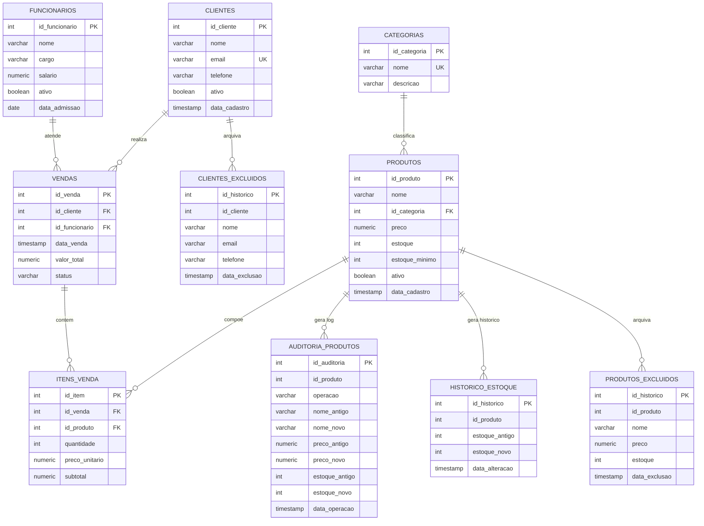
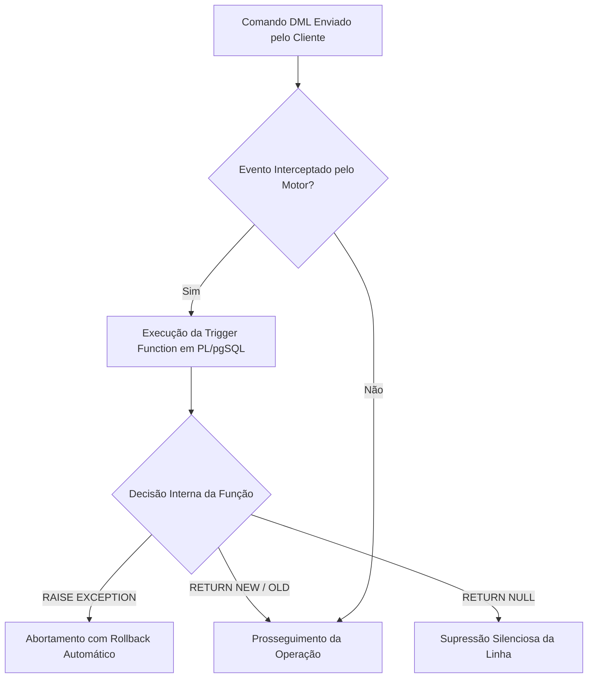
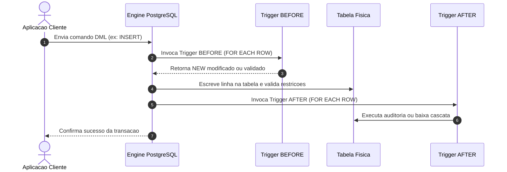
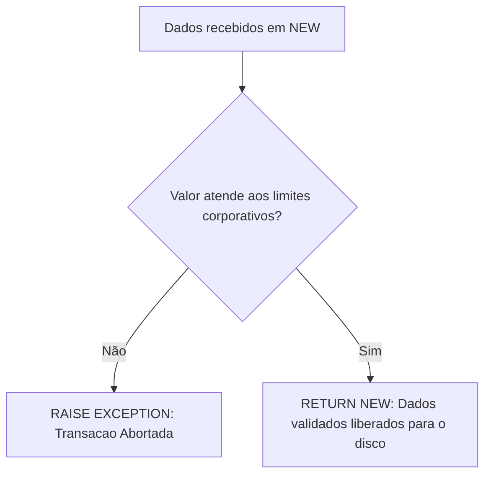
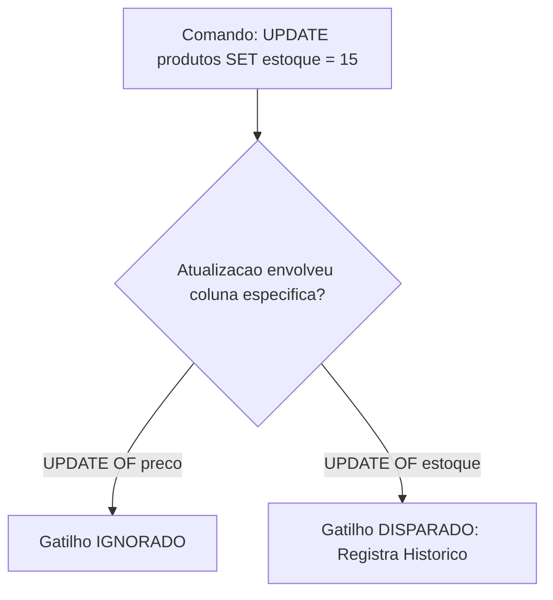
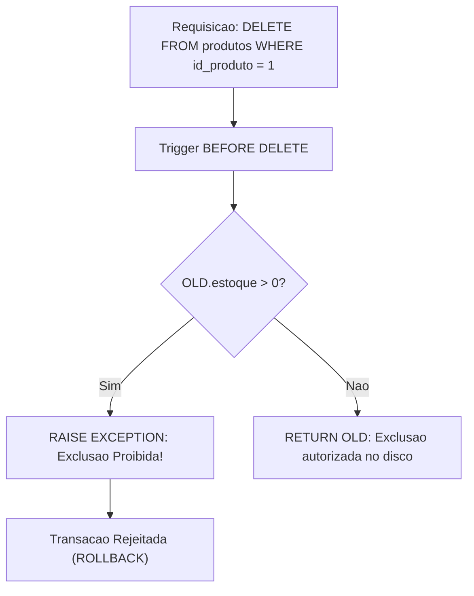
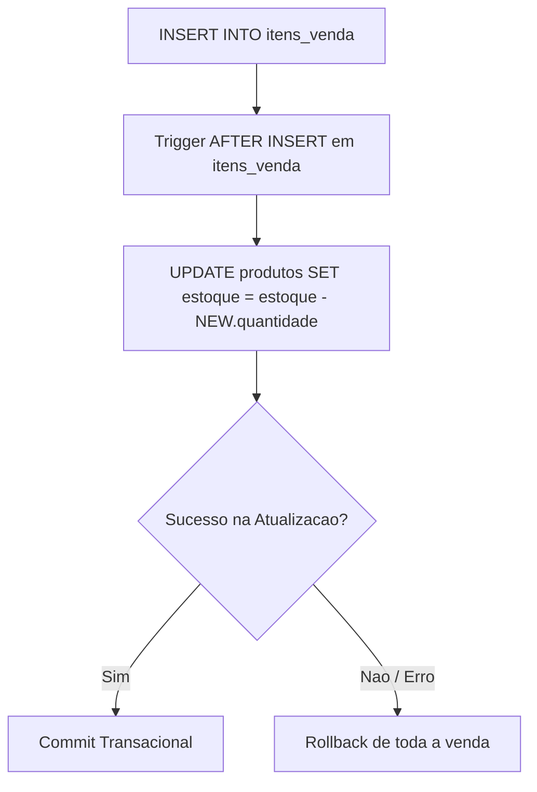
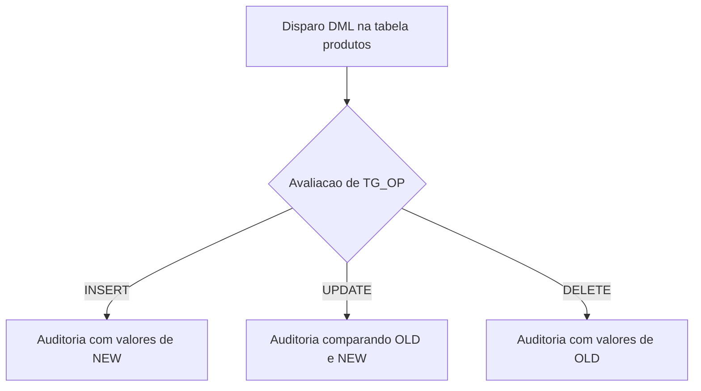
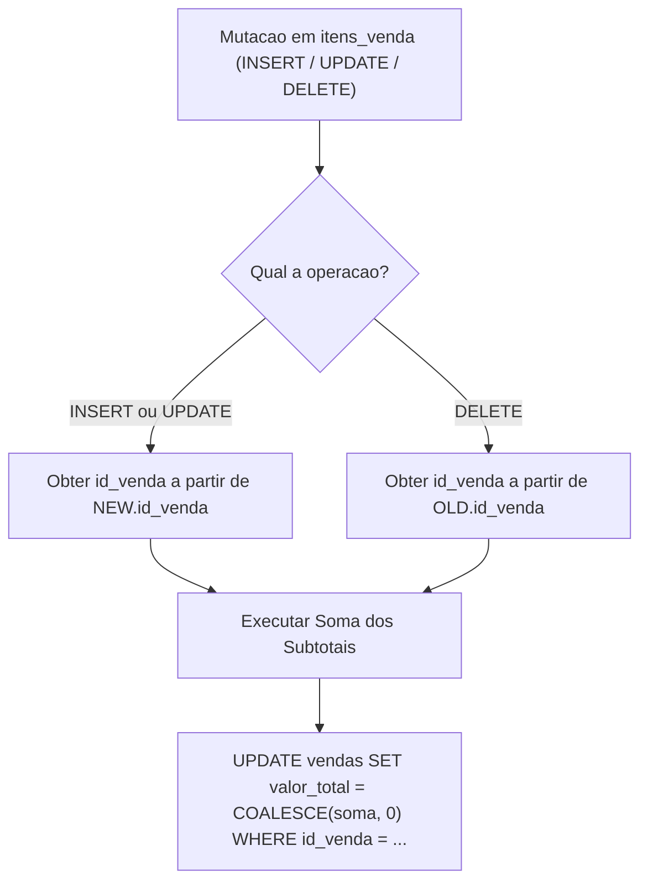

# Aula 06 — Triggers e Regras de Negócio em PostgreSQL

> **Professor:** Welington Garcia
> **Disciplina:** Tópicos Avançados em Banco de Dados (4º Semestre)
> **Tema:** Desenvolvimento de gatilhos (triggers) em PL/pgSQL, integridade transacional, automação de regras de negócio e auditoria no PostgreSQL

## Sumário

- [Objetivo da aula](#objetivo-da-aula)
- [Contexto e pré-requisitos](#contexto-e-pré-requisitos)
- [Modelagem de dados e integridade relacional no PostgreSQL](#modelagem-de-dados-e-integridade-relacional-no-postgresql)
- [Conceito e ciclo de vida de Triggers (Gatilhos)](#conceito-e-ciclo-de-vida-de-triggers-gatilhos)
- [Diferenças fundamentais entre eventos BEFORE e AFTER](#diferenças-fundamentais-entre-eventos-before-e-after)
- [Gatilhos em nível de linha (FOR EACH ROW) e registros especiais NEW e OLD](#gatilhos-em-nível-de-linha-for-each-row-e-registros-especiais-new-e-old)
- [Validação e sanitização preventiva de dados com BEFORE INSERT/UPDATE](#validação-e-sanitização-preventiva-de-dados-com-before-insertupdate)
- [Transformação de atributos em trânsito (normalização de strings)](#transformação-de-atributos-em-trânsito-normalização-de-strings)
- [Gatilhos condicionais disparados por alterações de colunas específicas (UPDATE OF)](#gatilhos-condicionais-disparados-por-alterações-de-colunas-específicas-update-of)
- [Auditoria de modificações e rastreabilidade de histórico](#auditoria-de-modificações-e-rastreabilidade-de-histórico)
- [Interrupção de exclusões e imposição de restrições de integridade com RAISE EXCEPTION](#interrupção-de-exclusões-e-imposição-de-restrições-de-integridade-com-raise-exception)
- [Replicação e arquivamento preventivo de exclusões (soft log / backup lógico)](#replicação-e-arquivamento-preventivo-de-exclusões-soft-log--backup-lógico)
- [Cálculo derivado de valores em colunas dependentes](#cálculo-derivado-de-valores-em-colunas-dependentes)
- [Atualização em cascata e controle transacional de estoque de produtos](#atualização-em-cascata-e-controle-transacional-de-estoque-de-produtos)
- [Verificação prévia de saldo de estoque para prevenção de inconsistências](#verificação-prévia-de-saldo-de-estoque-para-prevenção-de-inconsistências)
- [Triggers multifuncionais e multiplexação com a variável TG_OP](#triggers-multifuncionais-e-multiplexação-com-a-variável-tg_op)
- [Sincronização reativa e recálculo automático de totais acumulados em vendas](#sincronização-reativa-e-recálculo-automático-de-totais-acumulados-em-vendas)
- [Código da aula](#código-da-aula)
- [Exercícios](#exercícios)
- [Erros comuns e boas práticas](#erros-comuns-e-boas-práticas)
- [Links e materiais complementares](#links-e-materiais-complementares)
- [Mapa da aula](#mapa-da-aula)
- [Glossário](#glossário)
- [Pontos-chave para a prova](#pontos-chave-para-a-prova)
- [Perguntas e respostas (JSONL)](#perguntas-e-respostas-jsonl)
- [Checklist de revisão](#checklist-de-revisão)

---

## Objetivo da aula

Capacitar os futuros engenheiros de software e administradores de banco de dados na concepção, implementação, depuração e manutenção de regras corporativas executadas diretamente na camada de persistência utilizando a linguagem procedural PL/pgSQL do PostgreSQL. Ao término desta aula, o estudante será capaz de:

1. Compreender o ciclo de vida e a arquitetura de execução dos gatilhos (*triggers*) no mecanismo relacional PostgreSQL.
2. Identificar com precisão milimétrica o momento de interceptação adequado (*BEFORE* versus *AFTER*) e a granularidade de execução (*FOR EACH ROW* versus *FOR EACH STATEMENT*).
3. Manipular os registros contextuais estruturados `NEW` e `OLD` para validação, sanitização, derivação de atributos e rastreamento de dados históricos.
4. Aplicar técnicas de abortamento transacional seguro utilizando o comando `RAISE EXCEPTION` para garantir a invariância do domínio de negócio.
5. Desenvolver rotinas robustas de auditoria de dados e arquivamento preventivo utilizando estruturas multifuncionais com multiplexação por `TG_OP`.
6. Orquestrar operações atômicas complexas envolvendo tabelas dependentes, tais como reserva e baixa automática de estoque físico e sincronização reativa de totais agregados.

---

## Contexto e pré-requisitos

Para acompanhar este material com aproveitamento máximo, o aluno deve dominar os fundamentos de modelagem relacional (Chaves Primárias, Chaves Estrangeiras, Cardinalidade e Formas Normais), sintaxe básica de SQL DML (`INSERT`, `UPDATE`, `DELETE`, `SELECT`) e DDL (`CREATE TABLE`, `ALTER TABLE`, `DROP TABLE`). Também é requerido o entendimento das propriedades ACID (Atomicidade, Consistência, Isolamento e Durabilidade) e a familiaridade com blocos de código procedurais em PL/pgSQL (estruturas condicionais `IF/ELSIF/ELSE` e declaração de variáveis).

O ambiente prático baseia-se no banco de dados hipotético de comércio eletrônico e varejo denominado `db_loja_triggers`, implementado no PostgreSQL 14 ou superior.

---

## Modelagem de dados e integridade relacional no PostgreSQL

### Arquitetura do esquema relacional

A integridade em bancos de dados relacionais é dividida em camadas: integridade de domínio (tipos de dados e restrições `CHECK`), integridade de entidade (chaves primárias) e integridade referencial (chaves estrangeiras). Contudo, restrições declarativas puras muitas vezes não conseguem expressar regras inter-tabelas complexas, limites dinâmicos ou efeitos colaterais atômicos (como a atualização imediata de saldos contábeis ou logs de auditoria).

A base de dados fornecida no arquivo `base_exercicios_triggers_postgresql.sql` estabelece um ecossistema com 10 tabelas, articulando o domínio de vendas com estruturas de apoio para auditoria e histórico.



### Análise comparativa de mecanismos de integridade

| Mecanismo | Nível de Aplicação | Flexibilidade | Custo de Processamento | Suporte a Efeitos Colaterais |
|---|---|---|---|---|
| `NOT NULL` / Tipagem | Coluna / Atributo | Mínima (apenas sintaxe e presença) | Desprezível (validação em buffer) | Não |
| `CHECK Constraint` | Linha isolada | Baixa (expressões booleanas sem subqueries) | Muito baixo | Não |
| `FOREIGN KEY` | Tabela / Referencial | Média (valida existência de chaves) | Baixo a moderado (índices exigidos) | Sim (`CASCADE`, `SET NULL`) |
| **Triggers (Gatilhos)** | Linha ou Declaração | Máxima (PL/pgSQL completo, cross-table) | Moderado a alto (context switch de runtime) | **Sim (completo: logs, atualizações, validações)** |

---

## Conceito e ciclo de vida de Triggers (Gatilhos)

### Definição
Um gatilho (*trigger*) é um objeto de esquema que instrui o motor relacional a executar automaticamente uma função de gatilho pré-definida sempre que um evento de modificação de dados (DML: `INSERT`, `UPDATE`, `DELETE`, ou `TRUNCATE`) for disparado contra uma tabela ou visão específica.

### Motivação
A centralização de regras críticas de negócio no banco garante que nenhum cliente (aplicação web, rotina batch, script legado ou terminal do DBA) viole as invariantes corporativas. Isso elimina duplicação de lógica e previne anomalias de concorrência.

### Anatomia em duas etapas no PostgreSQL
Diferente de sistemas como MySQL ou SQL Server, onde a declaração do gatilho engloba o próprio corpo procedural, o PostgreSQL exige rigorosamente duas estruturas independentes:
1. **Trigger Function:** Função PL/pgSQL que não recebe argumentos formais de entrada e possui retorno obrigatório do tipo pseudotipo `trigger`.
2. **Trigger Binding:** O comando `CREATE TRIGGER` que amarra o evento de disparo à tabela e indica qual função executar.



### Exemplo
```sql
-- 1. Criação da Função de Gatilho
CREATE OR REPLACE FUNCTION fn_exemplo_ciclo()
RETURNS trigger AS $$
BEGIN
    -- Lógica de processamento
    RETURN NEW;
END;
$$ LANGUAGE plpgsql;

-- 2. Vinculação do Gatilho à Tabela
CREATE TRIGGER trg_exemplo_ciclo
BEFORE INSERT ON produtos
FOR EACH ROW
EXECUTE FUNCTION fn_exemplo_ciclo();
```

### Contraexemplo
Tentar criar a função retornando tipos escalares tradicionais (como `void` ou `boolean`):
```sql
-- INCORRETO: O PostgreSQL rejeitará a associação com o trigger
CREATE OR REPLACE FUNCTION fn_incorreta()
RETURNS void AS $$
BEGIN
    -- Erro na execução do CREATE TRIGGER
END;
$$ LANGUAGE plpgsql;
```

### Armadilhas comuns
- **Esquecer o retorno em funções `FOR EACH ROW`:** Se uma função `BEFORE` retornar `NULL`, a operação naquela linha específica é silenciosamente cancelada (não gravada no disco), mesmo sem gerar erro explícito.

---

## Diferenças fundamentais entre eventos BEFORE e AFTER

### Definição e mecânica de execução
A escolha entre `BEFORE` e `AFTER` determina em qual estágio da máquina de estados do processador de transações a função procedural é injetada.

1. **BEFORE (Antes):** Disparado antes que a linha seja efetivamente inserida, modificada ou removida dos buffers de dados e antes que as restrições (`CHECK`, `FOREIGN KEY`) sejam validadas. É o único momento em que os dados contidos na variável `NEW` podem ser modificados em memória antes da persistência física.
2. **AFTER (Depois):** Disparado após a gravação da linha no buffer de páginas da tabela e após as verificações imediatas de integridade do sistema. A linha já existe no contexto físico transacional. O valor de retorno da função é completamente ignorado pelo PostgreSQL (costuma-se retornar `NULL`). É o momento ideal para auditoria, histórico e efeitos em cascata em outras tabelas.



### Matriz comparativa: BEFORE vs AFTER

| Critério | BEFORE | AFTER |
|---|---|---|
| Capacidade de alterar a linha (`NEW.coluna := ...`) | **Total** (Modifica antes do disco) | Nula (`NEW` é imutável) |
| Impacto do `RETURN NULL` | Cancela silenciosamente a operação na linha | Nenhum (retorno é ignorado) |
| Validação de Constraints | Roda **antes** das constraints da tabela | Roda **após** a checagem imediata |
| Acesso à chave primária auto-gerada (`SERIAL`) | O valor da sequence já foi alocado em `NEW` | O valor já está persistido no registro |
| Propósito primário | Validação, bloqueio preventivo e sanitização | Auditoria, histórico e propagação em cascata |

---

## Gatilhos em nível de linha (FOR EACH ROW) e registros especiais NEW e OLD

### Definição
Um gatilho pode ser disparado para cada linha individualmente afetada pela instrução DML (`FOR EACH ROW`) ou apenas uma única vez por comando SQL (`FOR EACH STATEMENT`).

Quando configurado como `FOR EACH ROW`, o PostgreSQL instancia duas variáveis especiais do tipo `record`:
- `NEW`: Contém a nova imagem da linha (disponível em operações de `INSERT` e `UPDATE`). Em comandos `DELETE`, seu valor é estritamente `NULL`.
- `OLD`: Contém a imagem anterior da linha existente antes da modificação (disponível em operações de `UPDATE` e `DELETE`). Em comandos `INSERT`, seu valor é estritamente `NULL`.

### Tabela da disponibilidade das variáveis especiais

| Operação DML | Variável `OLD` | Variável `NEW` | Propósito Comum |
|---|---|---|---|
| `INSERT` | `NULL` | Contém a linha sendo inserida | Validação de entrada, sanitização, autocalculo |
| `UPDATE` | Contém o estado original da linha | Contém a linha proposta para gravação | Rastreamento de deltas, controle de estoque |
| `DELETE` | Contém o estado da linha a ser removida | `NULL` | Backup lógico, validação de bloqueio |

### Exemplo
```sql
CREATE OR REPLACE FUNCTION fn_exibe_estados()
RETURNS trigger AS $$
BEGIN
    IF TG_OP = 'UPDATE' THEN
        RAISE NOTICE 'Alterando de % para %', OLD.nome, NEW.nome;
    END IF;
    RETURN NEW;
END;
$$ LANGUAGE plpgsql;
```

---

## Validação e sanitização preventiva de dados com BEFORE INSERT/UPDATE

### Definição
Técnica que intercepta a tupla em memória volátil antes que ocorra a gravação nas páginas de disco do banco de dados, avaliando invariantes numéricas, restrições lógicas e conformidade regulatória.

### Motivação
Impedir inconsistências graves de negócio (como cadastrar produtos com preços negativos ou estoques com quantidades absurdas). Embora restrições `CHECK` consigam validar expressões simples, funções de gatilho permitem mensagens de erro detalhadas, lógica condicional complexa e parametrização dinâmica.

### Exemplo e resolução conceitual (Exercícios 1, 2 e 9)
Nesta arquitetura, se o valor informado for inválido, a execução é sumariamente interrompida por meio de um `RAISE EXCEPTION`, desfazendo o bloco atômico.



```sql
-- Funcao generica de validacao de integridade financeira e saldo
CREATE OR REPLACE FUNCTION fn_valida_produto_limites()
RETURNS trigger AS $$
BEGIN
    IF NEW.preco < 0 THEN
        RAISE EXCEPTION 'Operacao abortada: O preco do produto nao pode ser negativo. Valor informado: %', NEW.preco;
    END IF;

    IF NEW.estoque < 0 THEN
        RAISE EXCEPTION 'Operacao abortada: O estoque fisico nao pode ser negativo. Valor informado: %', NEW.estoque;
    END IF;

    RETURN NEW;
END;
$$ LANGUAGE plpgsql;
```

### Armadilhas comuns
- **Não tratar valores nulos:** Se uma coluna aceitar `NULL` e a condição for apenas `NEW.preco < 0`, valores nulos resultam em `UNKNOWN` na lógica booleana, permitindo que passem batido a menos que expressamente protegidos por `NEW.preco IS NULL`.

---

## Transformação de atributos em trânsito (normalização de strings)

### Definição
Modificação direta das colunas do registro `NEW` dentro de um gatilho `BEFORE`, ajustando formatações, eliminando espaços espúrios ou padronizando maiúsculas e minúsculas antes da persistência física.

### Motivação
A normalização na camada do banco previne discrepâncias em consultas indexadas, ordenações e integridade visual (evitando que o catálogo de produtos contenha simultaneamente "mouse", "Mouse" e "MOUSE").

### Exemplo (Exercício 3)
```sql
CREATE OR REPLACE FUNCTION fn_normaliza_produto_nome()
RETURNS trigger AS $$
BEGIN
    -- Sanitizacao e conversao para maiusculas
    NEW.nome := UPPER(TRIM(NEW.nome));
    RETURN NEW;
END;
$$ LANGUAGE plpgsql;

CREATE TRIGGER trg_produtos_nome_maiusculo
BEFORE INSERT OR UPDATE ON produtos
FOR EACH ROW
EXECUTE FUNCTION fn_normaliza_produto_nome();
```

### Contraexemplo
Tentar modificar `NEW` em uma função atrelada a um gatilho `AFTER`:
```sql
-- INCORRETO: Em evento AFTER, a linha ja foi persistida.
-- O comando abaixo causara erro de execucao ou nao surtira efeito na tabela.
CREATE OR REPLACE FUNCTION fn_normaliza_incorreta()
RETURNS trigger AS $$
BEGIN
    NEW.nome := UPPER(NEW.nome); -- Operacao invalida em AFTER
    RETURN NEW;
END;
$$ LANGUAGE plpgsql;
```

---

## Gatilhos condicionais disparados por alterações de colunas específicas (UPDATE OF)

### Definição
Mecanismo que limita a invocação do gatilho exclusivamente aos comandos de `UPDATE` que declarem explicitamente a modificação de uma ou mais colunas selecionadas.

### Motivação e ganho de performance
Em sistemas de alto rendimento, disparar rotinas de auditoria a cada atualização de linha sobrecarrega o processador e o disco. Usando a cláusula `UPDATE OF coluna`, o gatilho permanece inerte se a coluna de interesse não estiver presente na cláusula `SET` do comando SQL.



### Sintaxe no PostgreSQL
```sql
CREATE TRIGGER trg_audita_preco_especifico
AFTER UPDATE OF preco ON produtos
FOR EACH ROW
EXECUTE FUNCTION fn_registra_auditoria_preco();
```

### Armadilhas comuns
- **Confundir cláusula com valor idêntico:** A cláusula `UPDATE OF preco` é acionada mesmo que o usuário execute `UPDATE produtos SET preco = preco`. O gatilho dispara porque a coluna constou no comando. Para contornar isso, a função deve verificar internamente se `$``NEW.preco <> OLD.preco``$`.

---

## Auditoria de modificações e rastreabilidade de histórico

### Definição
Gravação de registros imutáveis em tabelas auxiliares de log contendo o estado anterior, o novo estado, o usuário responsável e a data/hora exata em que ocorreu uma mutação de dados.

### Motivação
Em conformidade com legislações de proteção de dados, segurança da informação e rastreabilidade financeira (ex: detecção de fraudes em remarcações de preços), tabelas de auditoria constituem evidência forense inestimável.

### Estrutura da tabela de auditoria (Conforme base disponibilizada)
```sql
-- Tabela de auditoria fornecida no anexo
-- auditoria_produtos (id_auditoria, id_produto, operacao, nome_antigo, nome_novo, preco_antigo, preco_novo, estoque_antigo, estoque_novo, data_operacao)
```

### Exemplo (Exercício 4 e 5)
```sql
CREATE OR REPLACE FUNCTION fn_audita_preco_produto()
RETURNS trigger AS $$
BEGIN
    -- Disparado em AFTER UPDATE OF preco
    IF OLD.preco <> NEW.preco THEN
        INSERT INTO auditoria_produtos (
            id_produto, operacao, preco_antigo, preco_novo, data_operacao
        ) VALUES (
            OLD.id_produto, 'UPDATE_PRECO', OLD.preco, NEW.preco, CURRENT_TIMESTAMP
        );
    END IF;
    RETURN NULL;
END;
$$ LANGUAGE plpgsql;
```

---

## Interrupção de exclusões e imposição de restrições de integridade com RAISE EXCEPTION

### Definição
Interrupção proposital do fluxo de execução DML através do lançamento de uma exceção não tratada na linguagem procedural, culminando no *rollback* automático de todas as operações vinculadas àquela transação.

### Motivação
Certas regras proíbem a perda de dados de ativos tangíveis. Por exemplo, uma loja física ou e-commerce não pode permitir a deleção cadastral de um produto que ainda possua unidades físicas armazenadas em suas prateleiras (conforme regra do Exercício 8).



### Sintaxe e níveis de severidade
No PostgreSQL, a declaração `RAISE` possui diferentes níveis de log: `DEBUG`, `LOG`, `INFO`, `NOTICE`, `WARNING` e `EXCEPTION`. Somente o nível `EXCEPTION` provoca a parada emergencial e desfaz a transação.

```sql
RAISE EXCEPTION 'Violacao de Regra: Impossivel excluir produto (%) com saldo positivo em estoque (Saldo: %)', OLD.nome, OLD.estoque;
```

---

## Replicação e arquivamento preventivo de exclusões (soft log / backup lógico)

### Definição
Padrão arquitetural em que, imediatamente antes da exclusão física definitiva de um registro (`BEFORE DELETE`), seus atributos completos são capturados e transferidos para uma tabela histórica paralela (`clientes_excluidos` ou `produtos_excluidos`).

### Motivação
Evitar a perda irreparável de histórico de clientes e produtos, viabilizando reconciliações jurídicas, análises de *churn* e histórico de faturamento sem manter a tabela principal sobrecarregada com registros inativos.

### Exemplo (Exercício 6 e 7)
```sql
CREATE OR REPLACE FUNCTION fn_arquiva_cliente_excluido()
RETURNS trigger AS $$
BEGIN
    INSERT INTO clientes_excluidos (
        id_cliente, nome, email, telefone, data_exclusao
    ) VALUES (
        OLD.id_cliente, OLD.nome, OLD.email, OLD.telefone, CURRENT_TIMESTAMP
    );
    RETURN OLD; -- Obrigatorio retornar OLD para permitir que a delecao se concretize
END;
$$ LANGUAGE plpgsql;

CREATE TRIGGER trg_clientes_backup_exclusao
BEFORE DELETE ON clientes
FOR EACH ROW
EXECUTE FUNCTION fn_arquiva_cliente_excluido();
```

### Armadilhas comuns
- **Retornar `NULL` em trigger `BEFORE DELETE`:** Se a função retornar `NULL`, a linha não será removida da tabela principal, transformando inadvertidamente a exclusão em um comando sem efeito prático.

---

## Cálculo derivado de valores em colunas dependentes

### Definição
Atribuição automatizada de valores calculados matematicamente a partir de atributos da mesma linha, garantindo a acurácia de campos derivados sem depender da aplicação cliente.

### Motivação
No fechamento do item de venda, o `subtotal` é uma função direta do produto escalar entre a quantidade e o preço unitário do item:

```math
subtotal = quantidade \times preco\_unitario
```

Deixar o cálculo a cargo do software cliente introduz riscos de fraude, erros de arredondamento em ponto flutuante e divergências cambiais ou tributárias.

### Exemplo (Exercício 11)
```sql
CREATE OR REPLACE FUNCTION fn_calcula_subtotal_item()
RETURNS trigger AS $$
BEGIN
    -- Validacao matematica previa
    NEW.subtotal := NEW.quantidade * NEW.preco_unitario;
    RETURN NEW;
END;
$$ LANGUAGE plpgsql;

CREATE TRIGGER trg_itens_venda_calcula_subtotal
BEFORE INSERT OR UPDATE ON itens_venda
FOR EACH ROW
EXECUTE FUNCTION fn_calcula_subtotal_item();
```

---

## Atualização em cascata e controle transacional de estoque de produtos

### Definição
Propagação atômica de efeitos colaterais entre entidades distintas: a inserção de um item comercializado na tabela de detalhe (`itens_venda`) provoca a imediata dedução na coluna de saldo físico da tabela de origem (`produtos`).

### Motivação
Preservar a fidelidade entre o mundo físico e o sistema de informação. Sem mecanismos em banco, compras simultâneas enfrentariam condições de corrida (*race conditions*), permitindo vender mercadorias inexistentes.



### Exemplo (Exercício 12)
```sql
CREATE OR REPLACE FUNCTION fn_baixa_estoque_venda()
RETURNS trigger AS $$
BEGIN
    UPDATE produtos
    SET estoque = estoque - NEW.quantidade
    WHERE id_produto = NEW.id_produto;

    RETURN NULL;
END;
$$ LANGUAGE plpgsql;

CREATE TRIGGER trg_itens_venda_baixa_estoque
AFTER INSERT ON itens_venda
FOR EACH ROW
EXECUTE FUNCTION fn_baixa_estoque_venda();
```

---

## Verificação prévia de saldo de estoque para prevenção de inconsistências

### Definição
Inspeção transacional preemptiva do saldo físico disponível na tabela referenciada antes que a reserva do item de venda seja autorizada em memória.

### Motivação
A baixa de estoque disparada em `AFTER INSERT` pode falhar tardiamente se houver restrições `CHECK`, mas verificar preventivamente em `BEFORE INSERT` permite emitir mensagens claras e detalhadas, informando exatamente o déficit entre a quantidade solicitada e a quantidade em estoque.

### Exemplo (Exercício 13)
```sql
CREATE OR REPLACE FUNCTION fn_verifica_saldo_estoque_previa()
RETURNS trigger AS $$
DECLARE
    v_estoque_atual INTEGER;
    v_nome_produto VARCHAR(120);
BEGIN
    SELECT estoque, nome INTO v_estoque_atual, v_nome_produto
    FROM produtos
    WHERE id_produto = NEW.id_produto;

    IF v_estoque_atual < NEW.quantidade THEN
        RAISE EXCEPTION 'Estoque insuficiente para o produto "%" (ID: %). Solicitado: %, Disponivel: %',
            v_nome_produto, NEW.id_produto, NEW.quantidade, v_estoque_atual;
    END IF;

    RETURN NEW;
END;
$$ LANGUAGE plpgsql;

CREATE TRIGGER trg_itens_venda_valida_estoque_previa
BEFORE INSERT ON itens_venda
FOR EACH ROW
EXECUTE FUNCTION fn_verifica_saldo_estoque_previa();
```

---

## Triggers multifuncionais e multiplexação com a variável TG_OP

### Definição
Consolidação de lógicas de múltiplos eventos DML (`INSERT`, `UPDATE`, `DELETE`) em uma única função PL/pgSQL, utilizando a variável especial de contexto `TG_OP` para ramificar os fluxos operacionais.

### Motivação
Evita a proliferação desordenada de dezenas de funções no esquema relacional, reduz o custo de manutenção e garante que regras corporativas unificadas (como logs de auditoria centralizados) compartilhem o mesmo código.

### Variáveis especiais disponíveis no contexto PL/pgSQL

| Variável | Tipo | Descrição |
|---|---|---|
| `TG_NAME` | `name` | Nome do gatilho que disparou a chamada |
| `TG_WHEN` | `text` | Momento do disparo (`BEFORE`, `AFTER` ou `INSTEAD OF`) |
| `TG_LEVEL` | `text` | Nível do disparo (`ROW` ou `STATEMENT`) |
| `TG_OP` | `text` | Operação DML que disparou o gatilho (`INSERT`, `UPDATE`, `DELETE`, `TRUNCATE`) |
| `TG_RELID` | `oid` | Identificador de objeto da tabela que disparou o evento |
| `TG_TABLE_NAME` | `name` | Nome da tabela sobre a qual o gatilho foi disparado |



### Exemplo conceitual (Exercício 14)
```sql
CREATE OR REPLACE FUNCTION fn_auditoria_unificada_produtos()
RETURNS trigger AS $$
BEGIN
    IF (TG_OP = 'INSERT') THEN
        INSERT INTO auditoria_produtos (id_produto, operacao, nome_novo, preco_novo, estoque_novo)
        VALUES (NEW.id_produto, 'INSERT', NEW.nome, NEW.preco, NEW.estoque);
        RETURN NEW;
    ELSIF (TG_OP = 'UPDATE') THEN
        INSERT INTO auditoria_produtos (id_produto, operacao, nome_antigo, nome_novo, preco_antigo, preco_novo, estoque_antigo, estoque_novo)
        VALUES (NEW.id_produto, 'UPDATE', OLD.nome, NEW.nome, OLD.preco, NEW.preco, OLD.estoque, NEW.estoque);
        RETURN NEW;
    ELSIF (TG_OP = 'DELETE') THEN
        INSERT INTO auditoria_produtos (id_produto, operacao, nome_antigo, preco_antigo, estoque_antigo)
        VALUES (OLD.id_produto, 'DELETE', OLD.nome, OLD.preco, OLD.estoque);
        RETURN OLD;
    END IF;
    RETURN NULL;
END;
$$ LANGUAGE plpgsql;
```

---

## Sincronização reativa e recálculo automático de totais acumulados em vendas

### Definição
Padrão de projeto reativo em banco de dados onde qualquer mutação (inclusão, alteração de quantidade/preço ou exclusão física) em itens filhos reflete instantaneamente no total agregado mantido na tabela pai.

### Motivação
A denormalização controlada do campo `vendas.valor_total` otimiza a leitura analítica e relatórios financeiros, evitando sucessivos `JOIN` e agregações de soma em sistemas com milhões de registros. Contudo, essa otimização exige sincronização em tempo real via triggers para evitar corrupção de valores.

### Equação de recálculo agregado
Para qualquer venda com identificador $```id\_venda = K```$, o valor total persistido é dado por:

```math
valor\_total_{K} = \sum_{j=1}^{M} subtotal_{j} = \sum_{j=1}^{M} (quantidade_{j} \times preco\_unitario_{j})
```



---

## Código da aula

O código prático da aula é estruturado em dois arquivos fundamentais:
1. [base_exercicios_triggers_postgresql.sql](file:///codigo/base_exercicios_triggers_postgresql.sql): Script DDL e DML base disponibilizado pelo Professor Welington Garcia contendo a criação do banco, tabelas de domínio, tabelas de auditoria e inserção de dados iniciais.
2. [resolucao_exercicios_triggers.sql](file:///codigo/resolucao_exercicios_triggers.sql): Resolução completa, modular, idempotente e documentada dos 15 exercícios propostos, com funções de gatilho, triggers associados e rotinas de teste.

### Trechos essenciais comentados da base de dados

O script de origem define o arcabouço relacional do sistema. A seguir destacamos as seções críticas:

```sql
-- Criacao da tabela principal de vendas com status e total inicial zerado
CREATE TABLE vendas (
 id_venda SERIAL PRIMARY KEY,
 id_cliente INTEGER REFERENCES clientes(id_cliente),
 id_funcionario INTEGER REFERENCES funcionarios(id_funcionario),
 data_venda TIMESTAMP DEFAULT CURRENT_TIMESTAMP,
 valor_total NUMERIC(12,2) DEFAULT 0,
 status VARCHAR(20) DEFAULT 'ABERTA'
);

-- Tabela associativa de itens com subtotal derivado
CREATE TABLE itens_venda (
 id_item SERIAL PRIMARY KEY,
 id_venda INTEGER NOT NULL REFERENCES vendas(id_venda),
 id_produto INTEGER NOT NULL REFERENCES produtos(id_produto),
 quantidade INTEGER NOT NULL,
 preco_unitario NUMERIC(10,2) NOT NULL,
 subtotal NUMERIC(12,2)
);

-- Tabela de auditoria para historico de mutacoes de produtos
CREATE TABLE auditoria_produtos (
 id_auditoria SERIAL PRIMARY KEY,
 id_produto INTEGER,
 operacao VARCHAR(20),
 nome_antigo VARCHAR(120),
 nome_novo VARCHAR(120),
 preco_antigo NUMERIC(10,2),
 preco_novo NUMERIC(10,2),
 estoque_antigo INTEGER,
 estoque_novo INTEGER,
 data_operacao TIMESTAMP DEFAULT CURRENT_TIMESTAMP
);
```

---

## Exercícios

Abaixo constam as resoluções detalhadas de todos os 15 exercícios propostos na lista de aula, contendo enunciado original, raciocínio de engenharia e implementação integral em PL/pgSQL.

### Exercício 1 - Validação Preventiva de Preço Negativo em Produtos

**Enunciado:** Criar um trigger `BEFORE INSERT OR UPDATE` na tabela `produtos` para impedir o cadastro ou a atualização de produtos com $```preco < 0```$, gerando uma exceção apropriada.

**Raciocínio:** Como a intenção é validar o dado antes da sua persistência física e impedir a gravação caso o valor seja inválido, o gatilho deve ser do tipo `BEFORE`, em nível de linha (`FOR EACH ROW`). Acessa-se a variável `NEW.preco` e, se for estritamente menor que zero, lança-se uma exceção com `RAISE EXCEPTION`.

```sql
CREATE OR REPLACE FUNCTION fn_valida_preco_produto()
RETURNS trigger AS $$
BEGIN
    IF NEW.preco < 0 THEN
        RAISE EXCEPTION 'Operacao cancelada: O preco do produto nao pode ser negativo. Valor informado: %', NEW.preco;
    END IF;
    RETURN NEW;
END;
$$ LANGUAGE plpgsql;

DROP TRIGGER IF EXISTS trg_valida_preco_produto ON produtos;
CREATE TRIGGER trg_valida_preco_produto
BEFORE INSERT OR UPDATE ON produtos
FOR EACH ROW
EXECUTE FUNCTION fn_valida_preco_produto();
```

*Referência no arquivo:* [resolucao_exercicios_triggers.sql](file:///codigo/resolucao_exercicios_triggers.sql#L10-L28)

---

### Exercício 2 - Validação Preventiva de Estoque Negativo em Produtos

**Enunciado:** Criar um trigger `BEFORE INSERT OR UPDATE` na tabela `produtos` para impedir que o valor da coluna `estoque` seja inferior a zero ($```estoque < 0```$).

**Raciocínio:** Aplica-se a mesma lógica do Exercício 1. O evento deve interceptar `NEW.estoque` em `BEFORE INSERT OR UPDATE`. Se o saldo for negativo, aborta-se a transação imediatamente.

```sql
CREATE OR REPLACE FUNCTION fn_valida_estoque_produto()
RETURNS trigger AS $$
BEGIN
    IF NEW.estoque < 0 THEN
        RAISE EXCEPTION 'Operacao cancelada: O saldo de estoque nao pode ser negativo. Valor informado: %', NEW.estoque;
    END IF;
    RETURN NEW;
END;
$$ LANGUAGE plpgsql;

DROP TRIGGER IF EXISTS trg_valida_estoque_produto ON produtos;
CREATE TRIGGER trg_valida_estoque_produto
BEFORE INSERT OR UPDATE ON produtos
FOR EACH ROW
EXECUTE FUNCTION fn_valida_estoque_produto();
```

*Referência no arquivo:* [resolucao_exercicios_triggers.sql](file:///codigo/resolucao_exercicios_triggers.sql#L30-L48)

---

### Exercício 3 - Padronização de Caixa Alta no Nome de Produtos

**Enunciado:** Criar um trigger `BEFORE INSERT OR UPDATE` na tabela `produtos` para transformar o conteúdo da coluna `nome` em letras maiúsculas (`UPPER`) antes da gravação no disco.

**Raciocínio:** Tratando-se de sanitização e mutação do próprio registro a ser persistido, o evento deve ser mandatoriamente `BEFORE` em nível de linha. Atribui-se a versão convertida diretamente à variável `NEW.nome := UPPER(NEW.nome)` e retorna-se `NEW`.

```sql
CREATE OR REPLACE FUNCTION fn_padroniza_nome_produto()
RETURNS trigger AS $$
BEGIN
    NEW.nome := UPPER(NEW.nome);
    RETURN NEW;
END;
$$ LANGUAGE plpgsql;

DROP TRIGGER IF EXISTS trg_padroniza_nome_produto ON produtos;
CREATE TRIGGER trg_padroniza_nome_produto
BEFORE INSERT OR UPDATE ON produtos
FOR EACH ROW
EXECUTE FUNCTION fn_padroniza_nome_produto();
```

*Referência no arquivo:* [resolucao_exercicios_triggers.sql](file:///codigo/resolucao_exercicios_triggers.sql#L50-L67)

---

### Exercício 4 - Auditoria de Alterações no Preço de Produtos

**Enunciado:** Criar um trigger `AFTER UPDATE OF preco` na tabela `produtos` para registrar o histórico de alteração de preços na tabela `auditoria_produtos`, salvando `id_produto`, `operacao`, `preco_antigo` e `preco_novo`.

**Raciocínio:** A exigência pede a cláusula otimizada `AFTER UPDATE OF preco`. Isso faz com que o motor execute a rotina somente se a coluna `preco` sofrer atualização. A função compara se $```OLD.preco \neq NEW.preco```$ e insere a tupla na tabela de auditoria.

```sql
CREATE OR REPLACE FUNCTION fn_audita_alteracao_preco()
RETURNS trigger AS $$
BEGIN
    IF OLD.preco <> NEW.preco THEN
        INSERT INTO auditoria_produtos (
            id_produto, operacao, preco_antigo, preco_novo, data_operacao
        ) VALUES (
            OLD.id_produto, 'UPDATE_PRECO', OLD.preco, NEW.preco, CURRENT_TIMESTAMP
        );
    END IF;
    RETURN NULL;
END;
$$ LANGUAGE plpgsql;

DROP TRIGGER IF EXISTS trg_audita_alteracao_preco ON produtos;
CREATE TRIGGER trg_audita_alteracao_preco
AFTER UPDATE OF preco ON produtos
FOR EACH ROW
EXECUTE FUNCTION fn_audita_alteracao_preco();
```

*Referência no arquivo:* [resolucao_exercicios_triggers.sql](file:///codigo/resolucao_exercicios_triggers.sql#L69-L91)

---

### Exercício 5 - Histórico de Movimentação do Saldo de Estoque

**Enunciado:** Criar um trigger `AFTER UPDATE OF estoque` na tabela `produtos` para registrar na tabela `historico_estoque` o `id_produto`, `estoque_antigo` e `estoque_novo`.

**Raciocínio:** Utiliza-se um gatilho `AFTER UPDATE OF estoque`. Caso o valor antigo seja diferente do novo, cria-se uma entrada cronológica em `historico_estoque`.

```sql
CREATE OR REPLACE FUNCTION fn_historico_saldo_estoque()
RETURNS trigger AS $$
BEGIN
    IF OLD.estoque <> NEW.estoque THEN
        INSERT INTO historico_estoque (
            id_produto, estoque_antigo, estoque_novo, data_alteracao
        ) VALUES (
            OLD.id_produto, OLD.estoque, NEW.estoque, CURRENT_TIMESTAMP
        );
    END IF;
    RETURN NULL;
END;
$$ LANGUAGE plpgsql;

DROP TRIGGER IF EXISTS trg_historico_saldo_estoque ON produtos;
CREATE TRIGGER trg_historico_saldo_estoque
AFTER UPDATE OF estoque ON produtos
FOR EACH ROW
EXECUTE FUNCTION fn_historico_saldo_estoque();
```

*Referência no arquivo:* [resolucao_exercicios_triggers.sql](file:///codigo/resolucao_exercicios_triggers.sql#L93-L115)

---

### Exercício 6 - Backup Lógico Preventivo na Exclusão de Clientes

**Enunciado:** Criar um trigger `BEFORE DELETE` na tabela `clientes` para arquivar todos os dados do cliente excluído na tabela `clientes_excluidos`.

**Raciocínio:** O gatilho deve ser acionado antes que a linha do cliente desapareça fisicamente. Como é uma operação de `DELETE`, a variável `NEW` é nula; portanto, lê-se todos os atributos a partir de `OLD`. Para que a deleção de fato ocorra, a função deve retornar `OLD`.

```sql
CREATE OR REPLACE FUNCTION fn_backup_exclusao_cliente()
RETURNS trigger AS $$
BEGIN
    INSERT INTO clientes_excluidos (
        id_cliente, nome, email, telefone, data_exclusao
    ) VALUES (
        OLD.id_cliente, OLD.nome, OLD.email, OLD.telefone, CURRENT_TIMESTAMP
    );
    RETURN OLD;
END;
$$ LANGUAGE plpgsql;

DROP TRIGGER IF EXISTS trg_backup_exclusao_cliente ON clientes;
CREATE TRIGGER trg_backup_exclusao_cliente
BEFORE DELETE ON clientes
FOR EACH ROW
EXECUTE FUNCTION fn_backup_exclusao_cliente();
```

*Referência no arquivo:* [resolucao_exercicios_triggers.sql](file:///codigo/resolucao_exercicios_triggers.sql#L117-L137)

---

### Exercício 7 - Backup Lógico Preventivo na Exclusão de Produtos

**Enunciado:** Criar um trigger `BEFORE DELETE` na tabela `produtos` para salvar os dados do produto removido na tabela `produtos_excluidos`.

**Raciocínio:** Mesma estratégia do Exercício 6. Captura-se `OLD.id_produto`, `OLD.nome`, `OLD.preco` e `OLD.estoque` e persiste-se em `produtos_excluidos`, retornando `OLD`.

```sql
CREATE OR REPLACE FUNCTION fn_backup_exclusao_produto()
RETURNS trigger AS $$
BEGIN
    INSERT INTO produtos_excluidos (
        id_produto, nome, preco, estoque, data_exclusao
    ) VALUES (
        OLD.id_produto, OLD.nome, OLD.preco, OLD.estoque, CURRENT_TIMESTAMP
    );
    RETURN OLD;
END;
$$ LANGUAGE plpgsql;

DROP TRIGGER IF EXISTS trg_backup_exclusao_produto ON produtos;
CREATE TRIGGER trg_backup_exclusao_produto
BEFORE DELETE ON produtos
FOR EACH ROW
EXECUTE FUNCTION fn_backup_exclusao_produto();
```

*Referência no arquivo:* [resolucao_exercicios_triggers.sql](file:///codigo/resolucao_exercicios_triggers.sql#L139-L159)

---

### Exercício 8 - Bloqueio de Exclusão de Produtos com Saldo em Estoque

**Enunciado:** Impedir `DELETE` de produtos quando $```estoque > 0```$.

**Raciocínio:** Gatilho `BEFORE DELETE` na tabela `produtos`. Inspeciona-se `OLD.estoque`. Se este for estritamente superior a zero, lança-se uma exceção para abortar a exclusão. Se for igual a zero, a função retorna `OLD` e a remoção prossegue normalmente.

```sql
CREATE OR REPLACE FUNCTION fn_impede_exclusao_produto_com_estoque()
RETURNS trigger AS $$
BEGIN
    IF OLD.estoque > 0 THEN
        RAISE EXCEPTION 'Exclusao rejeitada: O produto "%" (ID: %) possui % unidade(s) em estoque.',
            OLD.nome, OLD.id_produto, OLD.estoque;
    END IF;
    RETURN OLD;
END;
$$ LANGUAGE plpgsql;

DROP TRIGGER IF EXISTS trg_impede_exclusao_produto_com_estoque ON produtos;
CREATE TRIGGER trg_impede_exclusao_produto_com_estoque
BEFORE DELETE ON produtos
FOR EACH ROW
EXECUTE FUNCTION fn_impede_exclusao_produto_com_estoque();
```

*Referência no arquivo:* [resolucao_exercicios_triggers.sql](file:///codigo/resolucao_exercicios_triggers.sql#L161-L181)

---

### Exercício 9 - Validação de Piso Salarial de Funcionários

**Enunciado:** Criar um trigger `BEFORE INSERT OR UPDATE` na tabela `funcionarios` para impedir salário menor que R$ 1.500,00 ($```salario < 1500```$).

**Raciocínio:** Validação de regra financeira no cadastro de colaboradores. Compara-se `NEW.salario < 1500.00`. Caso positivo, dispara-se `RAISE EXCEPTION`.

```sql
CREATE OR REPLACE FUNCTION fn_valida_piso_salarial()
RETURNS trigger AS $$
BEGIN
    IF NEW.salario < 1500.00 THEN
        RAISE EXCEPTION 'Violacao de piso salarial: O salario de R$ % e inferior ao piso regulamentar de R$ 1500.00.', NEW.salario;
    END IF;
    RETURN NEW;
END;
$$ LANGUAGE plpgsql;

DROP TRIGGER IF EXISTS trg_valida_piso_salarial ON funcionarios;
CREATE TRIGGER trg_valida_piso_salarial
BEFORE INSERT OR UPDATE ON funcionarios
FOR EACH ROW
EXECUTE FUNCTION fn_valida_piso_salarial();
```

*Referência no arquivo:* [resolucao_exercicios_triggers.sql](file:///codigo/resolucao_exercicios_triggers.sql#L183-L202)

---

### Exercício 10 - Validação Estrita de Quantidade Positiva em Itens de Venda

**Enunciado:** Criar um trigger `BEFORE INSERT` na tabela `itens_venda` para impedir quantidade menor ou igual a zero ($```quantidade \le 0```$).

**Raciocínio:** Uma linha de venda requer quantidade estritamente positiva. A checagem avalia `NEW.quantidade <= 0` em evento `BEFORE INSERT`.

```sql
CREATE OR REPLACE FUNCTION fn_valida_quantidade_item()
RETURNS trigger AS $$
BEGIN
    IF NEW.quantidade <= 0 THEN
        RAISE EXCEPTION 'Item invalido: A quantidade vendida deve ser maior que zero. Quantidade informada: %', NEW.quantidade;
    END IF;
    RETURN NEW;
END;
$$ LANGUAGE plpgsql;

DROP TRIGGER IF EXISTS trg_valida_quantidade_item ON itens_venda;
CREATE TRIGGER trg_valida_quantidade_item
BEFORE INSERT ON itens_venda
FOR EACH ROW
EXECUTE FUNCTION fn_valida_quantidade_item();
```

*Referência no arquivo:* [resolucao_exercicios_triggers.sql](file:///codigo/resolucao_exercicios_triggers.sql#L204-L223)

---

### Exercício 11 - Cálculo Automático de Subtotal em Itens de Venda

**Enunciado:** Criar um trigger `BEFORE INSERT OR UPDATE` em `itens_venda` para calcular $```subtotal = quantidade \times preco\_unitario```$.

**Raciocínio:** Garantir consistência aritmética atribuindo a multiplicação diretamente a `NEW.subtotal`. Como roda em `BEFORE`, o valor resultante é gravado no disco na mesma operação de I/O.

```sql
CREATE OR REPLACE FUNCTION fn_calcula_subtotal_item()
RETURNS trigger AS $$
BEGIN
    NEW.subtotal := NEW.quantidade * NEW.preco_unitario;
    RETURN NEW;
END;
$$ LANGUAGE plpgsql;

DROP TRIGGER IF EXISTS trg_calcula_subtotal_item ON itens_venda;
CREATE TRIGGER trg_calcula_subtotal_item
BEFORE INSERT OR UPDATE ON itens_venda
FOR EACH ROW
EXECUTE FUNCTION fn_calcula_subtotal_item();
```

*Referência no arquivo:* [resolucao_exercicios_triggers.sql](file:///codigo/resolucao_exercicios_triggers.sql#L225-L243)

---

### Exercício 12 - Baixa Automática de Estoque após Inserção de Item

**Enunciado:** Criar um trigger `AFTER INSERT` em `itens_venda` para diminuir o estoque do produto.

**Raciocínio:** Com o item de venda confirmado, desconta-se a quantidade vendida na tabela `produtos` utilizando um comando `UPDATE`. Executa-se em `AFTER INSERT` para garantir que o item já tenha passado por todas as validações de restrições.

```sql
CREATE OR REPLACE FUNCTION fn_baixa_estoque_venda()
RETURNS trigger AS $$
BEGIN
    UPDATE produtos
    SET estoque = estoque - NEW.quantidade
    WHERE id_produto = NEW.id_produto;

    RETURN NULL;
END;
$$ LANGUAGE plpgsql;

DROP TRIGGER IF EXISTS trg_baixa_estoque_venda ON itens_venda;
CREATE TRIGGER trg_baixa_estoque_venda
AFTER INSERT ON itens_venda
FOR EACH ROW
EXECUTE FUNCTION fn_baixa_estoque_venda();
```

*Referência no arquivo:* [resolucao_exercicios_triggers.sql](file:///codigo/resolucao_exercicios_triggers.sql#L245-L265)

---

### Exercício 13 - Verificação Prévia de Saldo de Estoque na Venda

**Enunciado:** Antes de inserir item, verificar se há estoque suficiente; senão `RAISE EXCEPTION`.

**Raciocínio:** Gatilho `BEFORE INSERT` em `itens_venda`. Faz-se um `SELECT ... INTO` na tabela `produtos` buscando o saldo atual. Se o saldo for menor que `NEW.quantidade`, cancela-se a inserção com erro detalhado.

```sql
CREATE OR REPLACE FUNCTION fn_verifica_saldo_estoque_item()
RETURNS trigger AS $$
DECLARE
    v_estoque_atual INTEGER;
    v_nome_prod VARCHAR(120);
BEGIN
    SELECT estoque, nome INTO v_estoque_atual, v_nome_prod
    FROM produtos
    WHERE id_produto = NEW.id_produto;

    IF v_estoque_atual IS NULL THEN
        RAISE EXCEPTION 'Produto com ID % nao localizado no cadastro.', NEW.id_produto;
    END IF;

    IF v_estoque_atual < NEW.quantidade THEN
        RAISE EXCEPTION 'Estoque insuficiente para "%". Solicitado: %, Disponivel: %',
            v_nome_prod, NEW.quantidade, v_estoque_atual;
    END IF;

    RETURN NEW;
END;
$$ LANGUAGE plpgsql;

DROP TRIGGER IF EXISTS trg_verifica_saldo_estoque_item ON itens_venda;
CREATE TRIGGER trg_verifica_saldo_estoque_item
BEFORE INSERT ON itens_venda
FOR EACH ROW
EXECUTE FUNCTION fn_verifica_saldo_estoque_item();
```

*Referência no arquivo:* [resolucao_exercicios_triggers.sql](file:///codigo/resolucao_exercicios_triggers.sql#L267-L298)

---

### Exercício 14 - Auditoria Unificada de Produtos com TG_OP

**Enunciado:** Usar `TG_OP` para auditar `INSERT`, `UPDATE` e `DELETE` em `produtos`.

**Raciocínio:** Centralizar a rastreabilidade em uma única função disparada em `AFTER INSERT OR UPDATE OR DELETE`. O código avalia `TG_OP` para capturar os campos relevantes em cada cenário.

```sql
CREATE OR REPLACE FUNCTION fn_auditoria_completa_produtos()
RETURNS trigger AS $$
BEGIN
    IF (TG_OP = 'INSERT') THEN
        INSERT INTO auditoria_produtos (
            id_produto, operacao, nome_novo, preco_novo, estoque_novo, data_operacao
        ) VALUES (
            NEW.id_produto, 'INSERT', NEW.nome, NEW.preco, NEW.estoque, CURRENT_TIMESTAMP
        );
        RETURN NEW;
    ELSIF (TG_OP = 'UPDATE') THEN
        INSERT INTO auditoria_produtos (
            id_produto, operacao, nome_antigo, nome_novo, preco_antigo, preco_novo, estoque_antigo, estoque_novo, data_operacao
        ) VALUES (
            OLD.id_produto, 'UPDATE', OLD.nome, NEW.nome, OLD.preco, NEW.preco, OLD.estoque, NEW.estoque, CURRENT_TIMESTAMP
        );
        RETURN NEW;
    ELSIF (TG_OP = 'DELETE') THEN
        INSERT INTO auditoria_produtos (
            id_produto, operacao, nome_antigo, preco_antigo, estoque_antigo, data_operacao
        ) VALUES (
            OLD.id_produto, 'DELETE', OLD.nome, OLD.preco, OLD.estoque, CURRENT_TIMESTAMP
        );
        RETURN OLD;
    END IF;
    RETURN NULL;
END;
$$ LANGUAGE plpgsql;

DROP TRIGGER IF EXISTS trg_auditoria_completa_produtos ON produtos;
CREATE TRIGGER trg_auditoria_completa_produtos
AFTER INSERT OR UPDATE OR DELETE ON produtos
FOR EACH ROW
EXECUTE FUNCTION fn_auditoria_completa_produtos();
```

*Referência no arquivo:* [resolucao_exercicios_triggers.sql](file:///codigo/resolucao_exercicios_triggers.sql#L300-L338)

---

### Exercício 15 - Sincronização Automática do Valor Total da Venda

**Enunciado:** DESAFIO: atualizar automaticamente `vendas.valor_total` ao inserir, alterar ou excluir `itens_venda`.

**Raciocínio:** Gatilho `AFTER INSERT OR UPDATE OR DELETE` na tabela `itens_venda`. É fundamental capturar a chave primária da venda afetada. No caso de inserção ou atualização, a venda é `NEW.id_venda`. Em exclusão, a venda é `OLD.id_venda`. Em uma atualização que altere o `id_venda` de um item (transferência de comanda), deve-se recalcular ambas as vendas (`OLD.id_venda` e `NEW.id_venda`). A função recalcula a soma agregada de `subtotal` e atualiza a tabela `vendas`.

```sql
CREATE OR REPLACE FUNCTION fn_sincroniza_total_venda()
RETURNS trigger AS $$
DECLARE
    v_id_venda_alvo INTEGER;
    v_soma_total NUMERIC(12,2);
BEGIN
    -- Identifica o id_venda a recalcular
    IF (TG_OP = 'DELETE') THEN
        v_id_venda_alvo := OLD.id_venda;
    ELSE
        v_id_venda_alvo := NEW.id_venda;
    END IF;

    -- Recalculo agregado seguro com COALESCE
    SELECT COALESCE(SUM(subtotal), 0.00)
    INTO v_soma_total
    FROM itens_venda
    WHERE id_venda = v_id_venda_alvo;

    -- Atualiza a tabela pai
    UPDATE vendas
    SET valor_total = v_soma_total
    WHERE id_venda = v_id_venda_alvo;

    -- Caso especial: item transferido de uma venda para outra no UPDATE
    IF (TG_OP = 'UPDATE') THEN
        IF (OLD.id_venda <> NEW.id_venda) THEN
            SELECT COALESCE(SUM(subtotal), 0.00)
            INTO v_soma_total
            FROM itens_venda
            WHERE id_venda = OLD.id_venda;

            UPDATE vendas
            SET valor_total = v_soma_total
            WHERE id_venda = OLD.id_venda;
        END IF;
    END IF;

    RETURN NULL;
END;
$$ LANGUAGE plpgsql;

DROP TRIGGER IF EXISTS trg_sincroniza_total_venda ON itens_venda;
CREATE TRIGGER trg_sincroniza_total_venda
AFTER INSERT OR UPDATE OR DELETE ON itens_venda
FOR EACH ROW
EXECUTE FUNCTION fn_sincroniza_total_venda();
```

*Referência no arquivo:* [resolucao_exercicios_triggers.sql](file:///codigo/resolucao_exercicios_triggers.sql#L340-L395)

---

## Erros comuns e boas práticas

### Erros comuns
1. **Acessar `NEW` em comandos de `DELETE`:** Em operações de exclusão, a linha destino inexiste; portanto, `NEW` é sempre avaliado como `NULL`. Tentar referenciar `NEW.id_produto` em um evento de deleção causará erro fatal em tempo de execução.
2. **Retornar `NULL` inadvertidamente em gatilhos `BEFORE`:** Em eventos `BEFORE INSERT` ou `BEFORE UPDATE`, retornar `NULL` instrui o motor relacional a descartar a linha silenciosamente. A instrução SQL parecerá ter sido concluída com êxito, mas nenhuma alteração será persistida no disco.
3. **Triggers em cascata infinita (recursão descontrolada):** Ocorre quando um gatilho `AFTER UPDATE` na tabela A executa um `UPDATE` na tabela B, cujo gatilho atualiza novamente a tabela A. Se não houver proteção condicional, a pilha de execução estoura gerando estouro de memória ou cancelamento por timeout.
4. **Falta de tratamento para exclusão total de filhos:** No cálculo de agregação (como somatório de itens da venda), se todos os itens forem excluídos, a instrução `SUM(subtotal)` retornará `NULL` em vez de zero. Sempre utilize `COALESCE(SUM(subtotal), 0.00)`.
5. **Esquecer que DMLs podem afetar múltiplas linhas:** Triggers do tipo `FOR EACH ROW` são chamados iterativamente para cada linha alterada. Funções pesadas com consultas lentas dentro de gatilhos degradam severamente operações em lote (`INSERT INTO ... SELECT ...`).

### Boas práticas recomendadas
- **Manter funções de gatilho compactas e ágeis:** Evite processamentos pesados, chamadas a APIs externas ou algoritmos lentos na camada do gatilho.
- **Utilizar `BEFORE` para validação interna e `AFTER` para efeitos colaterais:** Se a intenção for apenas alterar ou validar a própria linha, mantenha-se em `BEFORE`. Se for necessário alterar outras tabelas ou gerar logs, utilize `AFTER`.
- **Preferir a cláusula `UPDATE OF`:** Sempre que o gatilho se aplicar a alterações em atributos específicos, restrinja seu disparo com `AFTER UPDATE OF nome_da_coluna`.
- **Garantir a Idempotência na criação:** Ao redigir scripts de implantação, utilize sempre `CREATE OR REPLACE FUNCTION` e `DROP TRIGGER IF EXISTS trg_nome ON tabela; CREATE TRIGGER ...`.

---

## Links e materiais complementares

*Nota pedagógica: Os tópicos abaixo complementam os conceitos vistos em aula com literatura canônica de engenharia de software e documentação oficial.*

- **Documentação Oficial do PostgreSQL (Triggers e PL/pgSQL):**
  - [PostgreSQL: Trigger Procedures](https://www.postgresql.org/docs/current/plpgsql-trigger.html) — Guia completo sobre sintaxe, variáveis de contexto (`TG_*`) e ciclo de vida.
  - [PostgreSQL: Overview of Trigger Behavior](https://www.postgresql.org/docs/current/trigger-definition.html) — Detalhamento da máquina de estados do banco para interceptação de DML.
- **Padrões de Arquitetura de Banco de Dados:**
  - Martin Fowler: *Patterns of Enterprise Application Architecture* — Capítulo sobre *Active Record* e tratamento de invariantes em camada de banco versus camada de aplicação.
  - C. J. Date: *An Introduction to Database Systems* — Fundamentação matemática de integridade relacional e transações atômicas.

---

## Mapa da aula

```mermaid
mindmap
  root("Triggers em PostgreSQL")
    "Arquitetura e Ciclo de Vida"
      "Separacao: Function vs Trigger Binding"
      "Granularidade: FOR EACH ROW vs STATEMENT"
      "Contexto: Variaveis NEW e OLD"
    "Momentos de Interceptacao"
      "BEFORE"
        "Validacao de limites com RAISE EXCEPTION"
        "Sanitizacao e transformacao em transito"
        "Derivacao de colunas (subtotal)"
      "AFTER"
        "Auditoria e rastreamento historico"
        "Otimizacao com UPDATE OF"
        "Integridade em cascata (baixa de estoque)"
    "Padroes Avancados"
      "Multiplexacao com TG_OP"
      "Backup preventivo de exclusoes"
      "Sincronizacao reativa de agregados"
```

---

## Glossário

| Termo | Definição |
|---|---|
| **Trigger (Gatilho)** | Objeto de banco de dados que executa automaticamente uma rotina procedural em resposta a eventos DML. |
| **Trigger Function** | Função PL/pgSQL com retorno obrigatório do tipo `trigger` que abriga o algoritmo de execução do gatilho. |
| **BEFORE** | Momento de interceptação disparado antes da validação de restrições e gravação física da linha. |
| **AFTER** | Momento de interceptação disparado após a gravação da linha no buffer de páginas da tabela. |
| **FOR EACH ROW** | Gatilho acionado individualmente para cada linha afetada pela instrução SQL. |
| **FOR EACH STATEMENT** | Gatilho disparado uma única vez por comando SQL, independentemente da quantidade de linhas alteradas. |
| **NEW** | Variável especial que armazena a nova imagem da linha (válida em `INSERT` e `UPDATE`). |
| **OLD** | Variável especial que armazena o estado anterior da linha (válida em `UPDATE` e `DELETE`). |
| **TG_OP** | Variável textual interna que indica qual operação DML disparou o gatilho (`INSERT`, `UPDATE`, `DELETE`). |
| **RAISE EXCEPTION** | Declaração PL/pgSQL que aborta a transação em andamento, forçando *rollback* automático. |
| **COALESCE** | Função relacional que avalia seus argumentos em ordem e retorna o primeiro valor não nulo encontrado. |
| **Soft Delete** | Padrão onde registros não são fisicamente excluídos, mas marcados como inativos ou movidos para tabelas de histórico. |

---

## Pontos-chave para a prova

1. **Retorno de funções BEFORE versus AFTER:** Em funções `BEFORE FOR EACH ROW`, o valor retornado (`RETURN NEW` ou `RETURN OLD`) é o que de fato será persistido ou apagado. Retornar `NULL` suprime silenciosamente a operação. Já em funções `AFTER`, a linha já está persistida e o retorno é ignorado pelo motor.
2. **Disponibilidade das variáveis de linha:** Em `INSERT`, `OLD` é estritamente `NULL`. Em `DELETE`, `NEW` é estritamente `NULL`. Tentar ler `NEW` em comandos `DELETE` dispara erro em tempo de execução.
3. **Sintaxe de amarração em duas partes:** Não é possível definir o corpo do gatilho diretamente no `CREATE TRIGGER` no PostgreSQL. Cria-se primeiro a função com `RETURNS trigger` e depois o gatilho vinculando-a à tabela.
4. **Efeito do RAISE EXCEPTION:** Provoca a interrupção abrupta da execução e realiza o *rollback* integral de quaisquer modificações feitas dentro daquela transação.
5. **Uso de UPDATE OF:** Otimização para acionar gatilhos apenas se determinadas colunas forem explicitamente referenciadas no comando `UPDATE`.
6. **Agregações em triggers reativos:** Em recálculos de somatório após remoções de itens, o uso de `COALESCE(SUM(...), 0)` é indispensável para evitar que a coluna da tabela pai receba valor `NULL`.

---

## Perguntas e respostas (JSONL)

```jsonl
{"pergunta": "Qual a diferenca fundamental entre a sintaxe de criacao de triggers no PostgreSQL em relacao a outros bancos como MySQL e SQL Server?", "resposta": "No PostgreSQL ha uma separacao estrita em dois objetos: primeiro cria-se uma funcao procedural com RETURNS trigger, e em seguida cria-se o gatilho via CREATE TRIGGER associando a funcao a tabela alvo.", "dificuldade": "facil"}
{"pergunta": "O que ocorre se uma funcao de gatilho vinculada a um evento BEFORE INSERT FOR EACH ROW retornar NULL?", "resposta": "A operacao de insercao para aquela linha especifica e silenciosamente cancelada pelo motor relacional, sem gerar mensagem de erro para o cliente.", "dificuldade": "media"}
{"pergunta": "Qual o conteudo das variaveis especiais NEW e OLD durante a execucao de um comando DELETE?", "resposta": "A variavel OLD contem a tupla completa que esta sendo removida, enquanto a variavel NEW contem valor estritamente NULL.", "dificuldade": "facil"}
{"pergunta": "Em qual momento de interceptacao (BEFORE ou AFTER) e possivel alterar os dados de uma coluna que esta sendo gravada e como isso e feito?", "resposta": "Exclusivamente no evento BEFORE, reatribuindo diretamente o valor desejado ao campo correspondente do registro NEW (ex: NEW.nome := UPPER(NEW.nome)).", "dificuldade": "media"}
{"pergunta": "Qual comando da linguagem PL/pgSQL e utilizado para interromper a execucao de uma trigger e provocar o rollback imediato da transacao?", "resposta": "O comando RAISE EXCEPTION seguido da mensagem descritiva do erro.", "dificuldade": "facil"}
{"pergunta": "Para que serve a clausula UPDATE OF no comando de criacao de um gatilho?", "resposta": "Serve para filtrar o disparo do gatilho, fazendo com que ele so seja executado se as colunas especificadas na clausula forem listadas na alteracao.", "dificuldade": "media"}
{"pergunta": "Por que o uso da funcao COALESCE e considerado obrigatorio no recalculo do valor_total de uma venda ao excluir itens?", "resposta": "Porque se todos os itens de uma venda forem excluidos, a expressao SUM(subtotal) retornara NULL, e o COALESCE garante que o total da venda seja atualizado para 0.00.", "dificuldade": "dificil"}
{"pergunta": "O que armazena a variavel especial TG_OP dentro de uma funcao de gatilho em PL/pgSQL?", "resposta": "Armazena uma string indicando a operacao DML responsavel pelo disparo: 'INSERT', 'UPDATE', 'DELETE' ou 'TRUNCATE'.", "dificuldade": "facil"}
{"pergunta": "Qual o perigo arquitetural de implementar gatilhos que realizam atualizacoes cruzadas em tabelas associadas?", "resposta": "O risco de criar um laco de recursao infinita (cascata descontrolada), no qual a tabela A dispara a tabela B, que dispara novamente a tabela A ate esgotar recursos.", "dificuldade": "dificil"}
{"pergunta": "Por que o valor retornado por uma funcao de gatilho AFTER FOR EACH ROW e desconsiderado pelo PostgreSQL?", "resposta": "Porque no evento AFTER a operacao fisica de escrita ou remocao da linha ja foi concluida com sucesso na tabela, nao havendo como alterar a tupla.", "dificuldade": "media"}
{"pergunta": "E possivel criar um gatilho que faca uma consulta SELECT em outra tabela durante a validacao BEFORE INSERT?", "resposta": "Sim, e perfeitamente possivel e comum, como visto na checagem previa de saldo de estoque consultando a tabela produtos.", "dificuldade": "facil"}
{"pergunta": "O que acontece se uma excecao for disparada dentro de um gatilho AFTER?", "resposta": "Mesmo que a escrita fisica da linha ja tenha ocorrido no buffer, o PostgreSQL desfaz toda a transacao em andamento, revertendo a linha inserida e quaisquer efeitos colaterais.", "dificuldade": "dificil"}
{"pergunta": "Qual a diferenca de escopo entre FOR EACH ROW e FOR EACH STATEMENT?", "resposta": "FOR EACH ROW e acionado iterativamente para cada tupla individual afetada pelo comando, enquanto FOR EACH STATEMENT executa uma unica vez por comando SQL executado.", "dificuldade": "media"}
{"pergunta": "Em uma operacao de UPDATE, como verificar via PL/pgSQL se o preco de um produto realmente sofreu mudanca de valor numerico?", "resposta": "Comparando se OLD.preco <> NEW.preco dentro do bloco condicional IF.", "dificuldade": "facil"}
{"pergunta": "Como deve ser o retorno de uma funcao de gatilho BEFORE DELETE para garantir que a exclusao da linha aconteca?", "resposta": "A funcao deve retornar explicitamente RETURN OLD.", "dificuldade": "media"}
```

---

## Checklist de revisão

- [ ] Compreendi a separação entre `Trigger Function` e `CREATE TRIGGER` no PostgreSQL.
- [ ] Sei quando utilizar o evento `BEFORE` (validações preventivas, sanitização de strings e cálculo de atributos derivados).
- [ ] Sei quando utilizar o evento `AFTER` (logs de auditoria, históricos e atualizações em cascata).
- [ ] Domino a disponibilidade e os estados das variáveis especiais `NEW` e `OLD` para cada comando DML (`INSERT`, `UPDATE`, `DELETE`).
- [ ] Sei utilizar `RAISE EXCEPTION` para impor regras de negócio intransponíveis e impedir corrupção de dados.
- [ ] Compreendi o ganho de eficiência ao utilizar gatilhos condicionais com a cláusula `UPDATE OF`.
- [ ] Sou capaz de construir rotinas de auditoria unificadas ramificando o processamento pela variável de contexto `TG_OP`.
- [ ] Consigo resolver problemas de consistência entre tabelas dependentes (ex: sincronização de saldo de estoque e totalização de pedidos).
- [ ] Lembro de sempre proteger operações agregadas em gatilhos com `COALESCE(SUM(...), 0)`.
- [ ] Revisei as resoluções de todos os 15 exercícios no arquivo de código e executei os testes na base `db_loja_triggers`.
