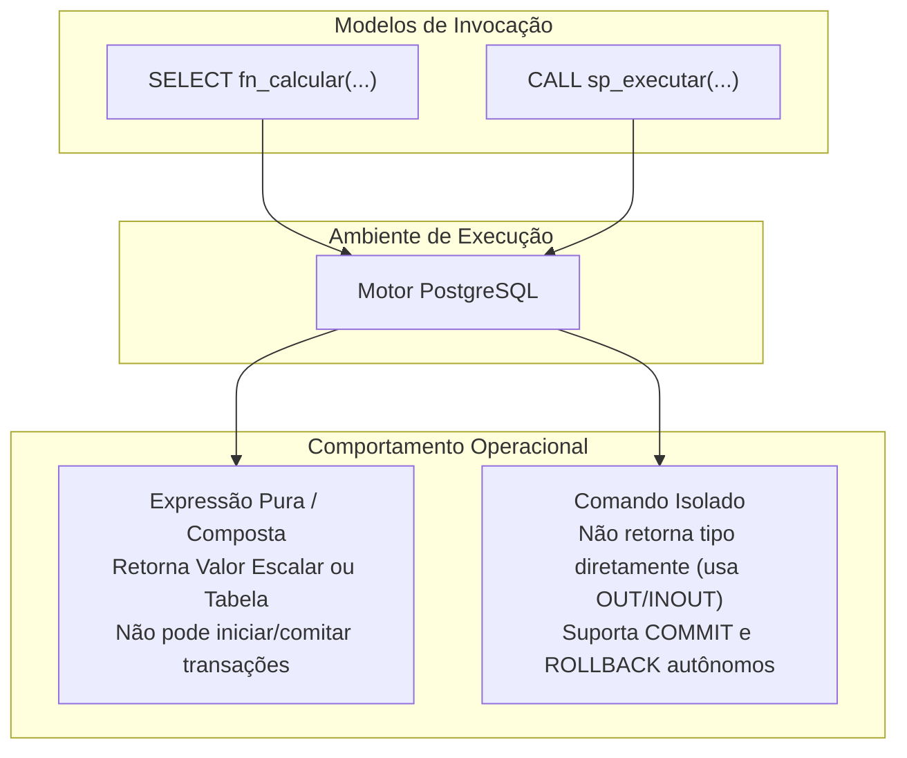
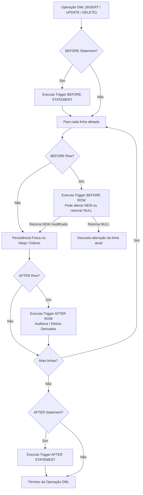
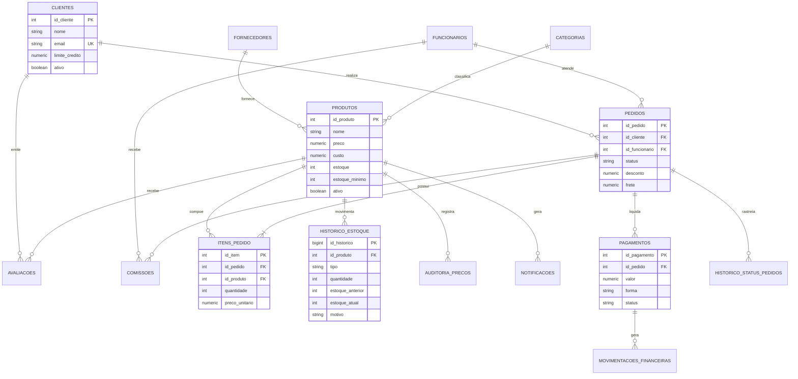
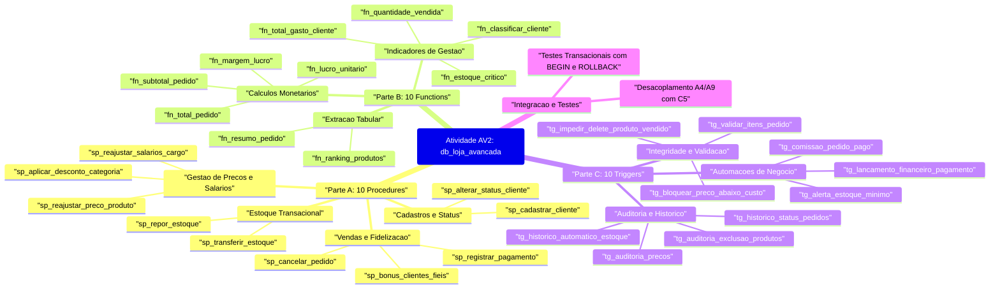

# Trabalho — Atividade AV2

> **Professor:** Welington Garcia
> **Disciplina:** Tópicos Avançados em Banco de Dados (4º Semestre)
> **Prazo de Entrega:** 02/12/2026 às 23:59
> **Pontuação Máxima:** 100 pontos
> **Conteúdo cobrado:** [Aula 02 - Views e Materialized Views em PostgreSQL](../../Aulas/Aula%2002%20-%20Views%20e%20Materialized%20Views%20em%20PostgreSQL/detalhes.md), [Aula 03 - Stored Procedures no PostgreSQL com PL pgSQL](../../Aulas/Aula%2003%20-%20Stored%20Procedures%20no%20PostgreSQL%20com%20PL%20pgSQL/detalhes.md), [Aula 04 - Junções e Subconsultas em PostgreSQL](../../Aulas/Aula%2004%20-%20Jun%C3%A7%C3%B5es%20e%20Subconsultas%20em%20PostgreSQL/detalhes.md), [Aula 05 - Triggers no PostgreSQL com PL pgSQL](../../Aulas/Aula%2005%20-%20Triggers%20no%20PostgreSQL%20com%20PL%20pgSQL/detalhes.md), [Aula 06 - Triggers e Regras de Negócio em PostgreSQL](../../Aulas/Aula%2006%20-%20Triggers%20e%20Regras%20de%20Neg%C3%B3cio%20em%20PostgreSQL/detalhes.md)

## Sumário

- [Enunciado original (Google Classroom)](#enunciado-original-google-classroom)
- [Análise do que é pedido](#análise-do-que-é-pedido)
- [Fundamentação teórica](#fundamentação-teórica)
- [Resolução proposta](#resolução-proposta)
  - [Parte A: Stored Procedures (A1 a A10)](#parte-a-stored-procedures-a1-a-a10)
  - [Parte B: User-Defined Functions (B1 a B10)](#parte-b-user-defined-functions-b1-a-b10)
  - [Parte C: Triggers e Trigger Functions (C1 a C10)](#parte-c-triggers-e-trigger-functions-c1-a-c10)
- [Como testar e validar](#como-testar-e-validar)
- [Critérios de qualidade](#critérios-de-qualidade)
- [Arquivos de apoio](#arquivos-de-apoio)
- [Mapa da atividade](#mapa-da-atividade)
- [Glossário](#glossário)
- [Pontos-chave para a prova](#pontos-chave-para-a-prova)
- [Perguntas e respostas (JSONL)](#perguntas-e-respostas-jsonl)
- [Checklist de revisão](#checklist-de-revisão)

## Enunciado original (Google Classroom)

# Trabalho prático — PostgreSQL / PL/pgSQL
**Base:** `db_loja_avancada` 
**Total:** 30 exercícios: 10 procedures, 10 functions e 10 triggers. 
**Nível:** intermediário, com progressão de dificuldade. 
**Entrega:** script SQL contendo a implementação e os comandos de teste de cada exercício. **Não há gabarito neste documento.**

## Preparação
1. Criar o banco de dados `db_loja_avancada` no pgAdmin e conectar-se a ele.
2. Executar `db_loja_avancada.sql` integralmente.
3. Explorar as tabelas com `SELECT` e identificar chaves primárias e estrangeiras.
4. Criar uma solução para cada exercício com nomes próprios, preferencialmente `sp_*`, `fn_*`, `tg_*`.
5. Testar em transações com `BEGIN; ... ROLLBACK;` quando necessário, para preservar os dados de exemplo.

**Convenções:** o subtotal de um pedido é `SUM(quantidade * preco_unitario)`; o total é `subtotal - desconto + frete`. Ao calcular faturamento, considerar apenas pedidos `PAGO` ou `ENTREGUE`. Tratar ausência de registros com `COALESCE` quando fizer sentido. As procedures devem ser chamadas com `CALL`; as functions, com `SELECT`. Para triggers, criar a função de gatilho e o respectivo `CREATE TRIGGER`.

## Parte A — 10 PROCEDURES
1. **Cadastrar cliente (básico):** crie `sp_cadastrar_cliente` recebendo nome, e-mail, telefone, cidade e UF. Insira um cliente com limite de crédito padrão, rejeitando nome/e-mail vazios. Demonstre o teste de e-mail duplicado.
2. **Reajustar preço de produto (básico):** crie `sp_reajustar_preco_produto` recebendo ID do produto e percentual de reajuste. Atualize o preço para `ROUND(preco * (1 + percentual/100), 2)`. Rejeite produto inexistente e preço final não positivo.
3. **Alterar situação do cliente (básico):** crie `sp_alterar_status_cliente` que recebe ID e booleano e atualiza `ativo`; sinalize IDs inválidos e mostre o resultado.
4. **Repor estoque (intermediário):** crie `sp_repor_estoque` que recebe ID, quantidade positiva e motivo. Aumente `produtos.estoque` e registre a entrada em `historico_estoque`, guardando saldo anterior e novo. Considere que, posteriormente, o trigger do exercício C5 poderá substituir esse registro manual; evite duplicidade ao integrar as duas soluções.
5. **Aplicar desconto em categoria (intermediário):** crie `sp_aplicar_desconto_categoria` recebendo categoria e percentual. Atualize o preço de todos os produtos ativos da categoria, sem deixá-lo menor ou igual a zero. Informe quantos foram alterados via parâmetro `OUT` ou `INOUT`.
6. **Atualizar salário por cargo (intermediário):** crie `sp_reajustar_salarios_cargo` que recebe cargo e percentual e reajusta somente funcionários ativos desse cargo. Valide percentual e apresente os salários anteriores e novos em consultas de teste.
7. **Cancelar pedido (intermediário):** crie `sp_cancelar_pedido` recebendo ID. Permita cancelar apenas pedidos `ABERTO`; não altere pedidos `PAGO`, `ENTREGUE` ou já `CANCELADO`. Registre o motivo em `observacao`.
8. **Registrar pagamento (avançado):** crie `sp_registrar_pagamento` recebendo pedido, valor e forma. Somente aceite pedidos `ABERTO` ou `PAGO`, com valor positivo e forma prevista pela tabela. Para este exercício, considere pagamento integral, sem parcelamento: o valor deve corresponder ao saldo do total do pedido ainda não confirmado. Insira pagamento `CONFIRMADO` e marque o pedido como `PAGO` quando o saldo for quitado. Evite duplicidade quando integrado aos triggers.
9. **Transferir estoque (avançado):** crie `sp_transferir_estoque` recebendo produto de origem, produto de destino, quantidade e motivo. Reduza o estoque da origem e aumente o do destino atomicamente, validando saldos, IDs distintos e quantidades. Grave duas linhas em `historico_estoque` (saída e entrada). Interprete a operação como transferência de unidades entre SKUs para fins didáticos.
10. **Conceder bônus de crédito (avançado):** crie `sp_bonus_clientes_fieis` que aumenta em 10% o `limite_credito` de clientes ativos com pelo menos dois pedidos `PAGO` ou `ENTREGUE`. Faça uma consulta para comprovar quais clientes foram afetados. Para testar, pode ser necessário inserir outro pedido concluído.

## Parte B — 10 FUNCTIONS
1. **Subtotal de pedido:** `fn_subtotal_pedido(id)` retorna `NUMERIC(12,2)` somando `quantidade * preco_unitario`. Retorne zero para pedido existente sem itens; sinalize ID inexistente.
2. **Total de pedido:** `fn_total_pedido(id)` retorna subtotal menos desconto mais frete e reutiliza `fn_subtotal_pedido`.
3. **Estoque crítico:** `fn_estoque_critico(id_produto)` retorna `BOOLEAN`: verdadeiro se `estoque <= estoque_minimo`, falso caso contrário. Trate produto inexistente.
4. **Lucro unitário:** `fn_lucro_unitario(id_produto)` retorna `preco - custo` e trate ID inexistente.
5. **Margem de lucro:** `fn_margem_lucro(id_produto)` retorna a margem percentual sobre o preço de venda (`(preco-custo)/preco*100`), arredondada a duas casas.
6. **Total gasto por cliente:** `fn_total_gasto_cliente(id_cliente)` retorna soma dos totais de pedidos em status `PAGO` ou `ENTREGUE` desse cliente.
7. **Classificação de cliente:** `fn_classificar_cliente(id_cliente)` retorna `BRONZE` para gasto inferior a R$ 500, `PRATA` para R$ 500 até abaixo de R$ 2.000 e `OURO` para R$ 2.000 ou mais. Reutilize `fn_total_gasto_cliente`.
8. **Quantidade vendida por produto:** `fn_quantidade_vendida(id_produto)` retorna a soma de quantidades dos pedidos `PAGO` ou `ENTREGUE`, excluindo cancelados/abertos.
9. **Resumo de pedido (tabela):** `fn_resumo_pedido(id_pedido)` retorna `TABLE(id_produto INTEGER, produto VARCHAR, quantidade INTEGER, subtotal NUMERIC)` contendo as linhas do pedido; organize por ID do produto.
10. **Ranking de produtos (tabela):** `fn_ranking_produtos(limite INTEGER)` retorna `TABLE(id_produto INTEGER, nome VARCHAR, unidades BIGINT, receita NUMERIC)` ordenada por receita decrescente, usando apenas pedidos `PAGO` ou `ENTREGUE`, e limita a N resultados. Inclua produtos sem venda com receita zero.

## Parte C — 10 TRIGGERS
1. **Auditoria de alteração de preços:** trigger `AFTER UPDATE OF preco` em `produtos`; quando `OLD.preco IS DISTINCT FROM NEW.preco`, grave preço anterior, novo e ID em `auditoria_precos`.
2. **Bloquear preço abaixo do custo:** trigger `BEFORE INSERT OR UPDATE OF preco, custo` em `produtos`; lance erro quando `NEW.preco < NEW.custo`.
3. **Impedir exclusão física de produtos vendidos:** trigger `BEFORE DELETE` em `produtos`; caso existam registros em `itens_pedido`, impeça a exclusão com mensagem explicativa.
4. **Auditoria de exclusão de produtos:** trigger `AFTER DELETE` em `produtos`; registre em `auditoria_produtos` ID, nome, preço, estoque e operação `DELETE`. Teste com um produto novo, sem referências.
5. **Histórico automático de estoque:** trigger `AFTER UPDATE OF estoque` em `produtos`; registre alterações efetivas em `historico_estoque` como `ENTRADA` ou `SAIDA`, conforme a diferença de saldos. Use motivo `AJUSTE AUTOMATICO`. **Integração:** este gatilho pode duplicar lançamentos feitos manualmente em A4 e A9. Adote e documente uma única estratégia (por exemplo, desativar os registros manuais nas procedures na versão integrada).
6. **Alerta de estoque mínimo:** trigger `AFTER UPDATE OF estoque` em `produtos`; quando o saldo passar de **acima** do mínimo para **igual ou abaixo** do mínimo, crie uma linha em `notificacoes` com tipo `ESTOQUE_BAIXO` e mensagem contendo nome e saldo. Não repita alerta enquanto continuar abaixo do limite.
7. **Histórico de situação do pedido:** trigger `AFTER UPDATE OF status` em `pedidos`; quando mudar, grave status anterior e novo em `historico_status_pedidos`.
8. **Validar itens do pedido:** trigger `BEFORE INSERT OR UPDATE` em `itens_pedido`; rejeite alterações se o pedido correspondente não estiver `ABERTO` ou se o produto estiver inativo. Preserve as constraints já existentes.
9. **Comissão após pedido pago:** trigger `AFTER UPDATE OF status` em `pedidos`; ao passar de `ABERTO` para `PAGO`, calcule comissão com base no **total do pedido sem frete** (`subtotal - desconto`) multiplicado pelo percentual do vendedor; grave em `comissoes`. Utilize `ON CONFLICT` ou condição de existência para evitar duplicações.
10. **Lançamento financeiro de pagamentos:** trigger `AFTER INSERT OR UPDATE OF status` em `pagamentos`; ao entrar em `CONFIRMADO`, grave uma `RECEITA` em `movimentacoes_financeiras`; ao passar de `CONFIRMADO` para `ESTORNADO`, grave `ESTORNO`. Não gere lançamentos duplicados ao atualizar campos sem mudança de status.

## Entrega / critérios de avaliação sugeridos
- **Correção funcional (50%)**: implementações cumprem as regras.
- **Validações (20%)**: tratamento de IDs e valores inválidos, estados e mensagens.
- **Testes (20%)**: um teste positivo e um negativo para cada solução, com `SELECT` de conferência.
- **Organização (10%)**: indentação, nomes claros e comentários úteis.

## Análise do que é pedido

O trabalho avaliativo AV2 requer a implementação de uma camada completa de lógica de negócio e persistência programável em banco de dados relacional (PostgreSQL 14+), utilizando a linguagem procedural PL/pgSQL sobre o esquema relacional `db_loja_avancada`.

### Requisitos funcionais e técnicos

1. **Parte A: 10 Stored Procedures (`sp_*`)**:
   - Devem ser executadas via comando `CALL`.
   - Gerenciam mutações de dados que envolvem transações, parâmetros de entrada (`IN`), parâmetros de saída (`OUT` ou `INOUT`) e orquestração de múltiplas tabelas.
   - Requerem validação defensiva de parâmetros de entrada (valores nulos, negativos, strings em branco e integridade de domínio).
   - Exigem controle de estados de negócio (como transições permitidas para pedidos: `ABERTO` para `PAGO` ou `CANCELADO`).

2. **Parte B: 10 User-Defined Functions (`fn_*`)**:
   - Devem ser consumidas via cláusula `SELECT`.
   - Funções escalares (B1 a B8) retornam tipos atômicos (`NUMERIC`, `BOOLEAN`, `VARCHAR`).
   - Funções tabulares (B9 e B10) retornam conjuntos estruturados utilizando `RETURNS TABLE(...)` e cláusulas `RETURN QUERY`.
   - As funções devem ser determinísticas e livres de efeitos colaterais desnecessários sobre o estado das tabelas, promovendo a reutilização de código (por exemplo, `fn_total_pedido` chamando `fn_subtotal_pedido`, e `fn_classificar_cliente` consumindo `fn_total_gasto_cliente`).
   - Obrigatoriedade do uso de `COALESCE` para prevenir propagação de `NULL` em agregações monetárias e quantitativas.

3. **Parte C: 10 Triggers e Trigger Functions (`tg_*` / `trg_*`)**:
   - Cada gatilho exige duas construções DDL: a função de disparo (`RETURNS TRIGGER`) e a declaração de vinculação (`CREATE TRIGGER`).
   - O uso rigoroso dos momentos de disparo (`BEFORE` vs `AFTER`) e eventos (`INSERT`, `UPDATE`, `DELETE`).
   - Uso de predicados e cláusulas de otimização, como `OF nome_coluna` e `WHEN (OLD.coluna IS DISTINCT FROM NEW.coluna)`.
   - Triggers `BEFORE` devem ser utilizados para validação, coerção e bloqueio de violações de invariantes de negócio via `RAISE EXCEPTION`.
   - Triggers `AFTER` devem ser reservados para sincronização de tabelas derivadas, auditoria e geração de notificações/comissões.

### Entregáveis oficiais

O projeto está decomposto em quatro scripts estruturados no subdiretório `./codigo/`:
- [01_db_loja_avancada_schema.sql](./codigo/01_db_loja_avancada_schema.sql): DDL completo das 16 tabelas e carga de dados de semente.
- [02_procedures_db_loja_avancada.sql](./codigo/02_procedures_db_loja_avancada.sql): Implementação comentada das procedures A1 a A10 e respectivos blocos de teste.
- [03_functions_db_loja_avancada.sql](./codigo/03_functions_db_loja_avancada.sql): Implementação das UDFs B1 a B10 e comandos de teste com `SELECT`.
- [04_triggers_db_loja_avancada.sql](./codigo/04_triggers_db_loja_avancada.sql): Implementação das Trigger Functions e Triggers C1 a C10 com casos de teste positivos e negativos.

### Desafios de integração e critérios implícitos

- **Resolução do conflito entre A4/A9 e C5 (Duplicação de Histórico)**: As procedures `sp_repor_estoque` (A4) e `sp_transferir_estoque` (A9) realizam inserções explícitas na tabela `historico_estoque`. Por outro lado, o trigger `tg_historico_estoque` (C5) dispara em `AFTER UPDATE OF estoque` e insere automaticamente uma linha com motivo `'AJUSTE AUTOMATICO'`. Se ambos coexistirem sem tratamento, cada reposição gerará duas linhas no histórico. 
  - *Estratégia adotada*: Foi implementado um mecanismo de desacoplamento utilizando a variável de configuração de sessão do PostgreSQL: `SET LOCAL loja.ignora_trigger_estoque = 'true'`. O gatilho C5 consulta `current_setting('loja.ignora_trigger_estoque', true)` e, caso esteja ativo, aborta a inserção redundante, permitindo que a procedure grave o motivo detalhado informado pelo operador.
- **Idempotência financeira em C9 e C10**: A tabela `comissoes` possui restrição `UNIQUE (id_pedido)` e `movimentacoes_financeiras` possui `UNIQUE (id_pagamento, tipo)`. Rotinas de gatilho devem utilizar `ON CONFLICT (id_pedido) DO NOTHING` ou verificações com `IS DISTINCT FROM` para não disparar exceções de chave única em atualizações repetidas de pedidos ou pagamentos.

## Fundamentação teórica

A arquitetura de processamento interno do PostgreSQL permite a extensão de seu motor por meio de linguagens procedurais confiáveis (*trusted procedural languages*), sendo o PL/pgSQL a principal. O código procedural é compilado em uma árvore de execução (*execution tree*) na primeira chamada dentro da sessão e mantido em cache estruturado (*plan cache*), eliminando o *overhead* de parsing e planejamento a cada invocação.

### Procedimentos versus Funções

A distinção conceitual e prática entre UDFs (*User-Defined Functions*) e Stored Procedures no padrão SQL e na implementação do PostgreSQL (a partir da versão 11) é determinante:



1. **Functions (`CREATE FUNCTION`)**:
   - São avaliadas como parte de expressões relacionais em consultas DML (`SELECT`, `WHERE`, `JOIN`).
   - São obrigadas a retornar um valor (escalar, tipo composto, `VOID` ou `TABLE`).
   - **Restrição transacional**: Não podem conter comandos de controle transacional explícito (`COMMIT` ou `ROLLBACK`), pois sua execução ocorre no contexto da transação da consulta invocadora.
   - Podem ser marcadas como `IMMUTABLE`, `STABLE` ou `VOLATILE` para otimização pelo planejador de custos.

2. **Procedures (`CREATE PROCEDURE`)**:
   - São invocadas como comandos de instrução de nível superior utilizando a sintaxe `CALL`.
   - Não retornam um tipo de dado diretamente na assinatura; a troca de valores com o chamador ocorre via parâmetros marcados com os modificadores `INOUT` ou `OUT`.
   - **Controle transacional autônomo**: Possuem a capacidade exclusiva de gerenciar transações ativamente, executando `COMMIT` e `ROLLBACK` internos, permitindo operações em lotes extensos sem esgotar tabelas de bloqueio de memória.

### Modelo de execução de Triggers no PostgreSQL

Os gatilhos (*triggers*) associam uma função procedural a eventos de mutação em tabelas ou visões.



#### Variáveis Especiais de Execução em Gatilhos
- `NEW`: Registro do tipo `RECORD` contendo a nova linha proposta para operações de `INSERT` ou `UPDATE`. Em triggers `BEFORE ROW`, mutações em seus atributos são gravadas na tabela física. Em operações de `DELETE`, seu valor é `NULL`.
- `OLD`: Registro do tipo `RECORD` contendo o estado original da linha antes de operações de `UPDATE` ou `DELETE`. Em operações de `INSERT`, seu valor é `NULL`.
- `TG_OP`: Variável do tipo `TEXT` que contém `'INSERT'`, `'UPDATE'`, `'DELETE'` ou `'TRUNCATE'`.
- `TG_WHEN`: Identifica se o momento de disparo é `'BEFORE'` ou `'AFTER'`.
- `TG_LEVEL`: Identifica a granularidade: `'ROW'` ou `'STATEMENT'`.

#### Semântica do valor de retorno
- Em triggers **`BEFORE EACH ROW`**:
  - Retornar `NEW`: A operação prossegue normalmente gravando a linha contida em `NEW`.
  - Retornar `NULL`: A operação sobre aquela linha específica é silenciosamente suprimida (sem lançar erro), não alterando o banco de dados.
- Em triggers **`AFTER EACH ROW`**:
  - O valor de retorno é estritamente ignorado pelo motor. Por convenção, retorna-se `NULL` ou `NEW`.

### Fórmulas de Negócio da Base de Dados

Para a total consistência entre procedures, views e UDFs, adota-se a formalização matemática exata dos cálculos comerciais descritos no material:

O subtotal de um pedido `$ `i` $` composto por `$ `k` $` itens é definido por:

```math
\text{subtotal}(i) = \sum_{j=1}^{k} \left( \text{quantidade}_{j} \times \text{preco\_unitario}_{j} \right)
```

O total líquido do pedido, considerando a dedução de descontos e a incidência de frete:

```math
\text{total}(i) = \text{subtotal}(i) - \text{desconto}_{i} + \text{frete}_{i}
```

A margem de lucro unitária percentual sobre o preço de venda de um produto:

```math
\text{margem\_lucro}(p) = \text{ROUND}\left( \frac{\text{preco}_{p} - \text{custo}_{p}}{\text{preco}_{p}} \times 100, \, 2 \right)
```

A base de cálculo da comissão de vendedores em pedidos pagos desconsidera a taxa de frete:

```math
\text{comissao}(i) = \left( \text{subtotal}(i) - \text{desconto}_{i} \right) \times \left( \frac{\text{percentual\_comissao}}{100} \right)
```

### Modelo Entidade-Relacionamento

O esquema `db_loja_avancada` é estruturado em 16 tabelas relacionais organizadas em três núcleos principais: Cadastros Básicos, Vendas/Operações e Apoio/Auditoria.



## Resolução proposta

A resolução integral da atividade foi modularizada em arquivos SQL padronizados, com tratamento defensivo de exceções e documentação inline.

Links diretos para o código-fonte da solução:
- [01_db_loja_avancada_schema.sql](./codigo/01_db_loja_avancada_schema.sql)
- [02_procedures_db_loja_avancada.sql](./codigo/02_procedures_db_loja_avancada.sql)
- [03_functions_db_loja_avancada.sql](./codigo/03_functions_db_loja_avancada.sql)
- [04_triggers_db_loja_avancada.sql](./codigo/04_triggers_db_loja_avancada.sql)

### Parte A: Stored Procedures (A1 a A10)

As procedures encapsulam regras de negócio transacionais, operando mutações atômicas com validação prévia.

#### A1. Cadastrar cliente (`sp_cadastrar_cliente`)
- **Definição**: Insere um novo registro na tabela `clientes` com tratamento rigoroso para strings vazias ou nulas e verificação prévia de duplicidade de e-mail.
- **Motivação**: Garantir a higienização dos dados cadastrais antes da persistência física, evitando exceções genéricas de integridade do SGBD e fornecendo mensagens legíveis para a camada de aplicação.
- **Implementação**:
  ```sql
  CREATE OR REPLACE PROCEDURE sp_cadastrar_cliente(
      p_nome VARCHAR(120),
      p_email VARCHAR(150),
      p_telefone VARCHAR(20),
      p_cidade VARCHAR(80),
      p_uf CHAR(2)
  )
  LANGUAGE plpgsql
  AS $$
  BEGIN
      IF TRIM(COALESCE(p_nome, '')) = '' THEN
          RAISE EXCEPTION 'Nome do cliente nao pode ser vazio.' USING ERRCODE = '22000';
      END IF;

      IF TRIM(COALESCE(p_email, '')) = '' THEN
          RAISE EXCEPTION 'E-mail do cliente nao pode ser vazio.' USING ERRCODE = '22000';
      END IF;

      IF EXISTS (SELECT 1 FROM clientes WHERE LOWER(email) = LOWER(TRIM(p_email))) THEN
          RAISE EXCEPTION 'O e-mail informado (%) ja esta cadastrado.', p_email USING ERRCODE = '23505';
      END IF;

      INSERT INTO clientes (nome, email, telefone, cidade, uf)
      VALUES (TRIM(p_nome), LOWER(TRIM(p_email)), p_telefone, TRIM(p_cidade), UPPER(TRIM(p_uf)));
  END;
  $$;
  ```
- **Contraexemplo**: Permitir chamadas como `CALL sp_cadastrar_cliente(' ', ' ', ...)` sem higienização com `TRIM`, gravando registros fantasmas com e-mails corrompidos.
- **Armadilhas**: Deixar a verificação de e-mail exclusivamente a cargo da constraint `UNIQUE` sem tratamento de exceção amigável, o que gera erro `23505` não contextualizado para o usuário.

#### A2. Reajustar preço de produto (`sp_reajustar_preco_produto`)
- **Definição**: Aplica reajuste percentual positivo ou negativo sobre a coluna `preco` de um produto, validando sua existência e impedindo preços resultantes nulos ou negativos.
- **Motivação**: Garantir consistência financeira ao alterar o valor venal de itens em catálogo.
- **Implementação**:
  ```sql
  CREATE OR REPLACE PROCEDURE sp_reajustar_preco_produto(
      p_id_produto INTEGER,
      p_percentual NUMERIC
  )
  LANGUAGE plpgsql
  AS $$
  DECLARE
      v_preco_atual NUMERIC(12,2);
      v_novo_preco NUMERIC(12,2);
  BEGIN
      SELECT preco INTO v_preco_atual FROM produtos WHERE id_produto = p_id_produto;

      IF NOT FOUND THEN
          RAISE EXCEPTION 'Produto com ID % nao encontrado.', p_id_produto USING ERRCODE = 'P0002';
      END IF;

      v_novo_preco := ROUND(v_preco_atual * (1 + (p_percentual / 100.0)), 2);

      IF v_novo_preco <= 0 THEN
          RAISE EXCEPTION 'O reajuste de % resulta em preco invalido (%). O preco final deve ser maior que zero.', 
              p_percentual, v_novo_preco USING ERRCODE = '22003';
      END IF;

      UPDATE produtos SET preco = v_novo_preco WHERE id_produto = p_id_produto;
  END;
  $$;
  ```
- **Contraexemplo**: Realizar `UPDATE produtos SET preco = preco * (1 + p_percentual/100)` diretamente, sem verificar se o produto existe, fazendo a chamada falhar silenciosamente com zero linhas alteradas.
- **Armadilhas**: Não utilizar `ROUND(..., 2)`, provocando acúmulo de dízimas periódicas ocultas no campo numérico monetário.

#### A3. Alterar situação do cliente (`sp_alterar_status_cliente`)
- **Definição**: Modifica a flag booleana `ativo` da tabela `clientes` informando o resultado da mutação.
- **Implementação**:
  ```sql
  CREATE OR REPLACE PROCEDURE sp_alterar_status_cliente(
      p_id_cliente INTEGER,
      p_ativo BOOLEAN
  )
  LANGUAGE plpgsql
  AS $$
  BEGIN
      IF p_ativo IS NULL THEN
          RAISE EXCEPTION 'O status ativo nao pode ser nulo.' USING ERRCODE = '22004';
      END IF;

      UPDATE clientes SET ativo = p_ativo WHERE id_cliente = p_id_cliente;

      IF NOT FOUND THEN
          RAISE EXCEPTION 'Cliente com ID % nao localizado.', p_id_cliente USING ERRCODE = 'P0002';
      END IF;

      RAISE NOTICE 'Cliente % teve sua situacao alterada para ativo = %.', p_id_cliente, p_ativo;
  END;
  $$;
  ```

#### A4. Repor estoque (`sp_repor_estoque`)
- **Definição**: Incrementa a coluna `estoque` de um produto e registra uma linha na tabela `historico_estoque` com controle do saldo anterior e do saldo final.
- **Tratamento de Integração com Trigger C5**: Para impedir duplicação quando o trigger C5 estiver ativo no banco, a procedure sinaliza a flag de sessão local `loja.ignora_trigger_estoque`.
- **Implementação**:
  ```sql
  CREATE OR REPLACE PROCEDURE sp_repor_estoque(
      p_id_produto INTEGER,
      p_quantidade INTEGER,
      p_motivo VARCHAR(200)
  )
  LANGUAGE plpgsql
  AS $$
  DECLARE
      v_estoque_antigo INTEGER;
      v_estoque_novo INTEGER;
  BEGIN
      IF p_quantidade <= 0 THEN
          RAISE EXCEPTION 'A quantidade a repor deve ser estritamente positiva (> 0).' USING ERRCODE = '22003';
      END IF;

      SELECT estoque INTO v_estoque_antigo FROM produtos WHERE id_produto = p_id_produto FOR UPDATE;

      IF NOT FOUND THEN
          RAISE EXCEPTION 'Produto ID % nao existe.', p_id_produto USING ERRCODE = 'P0002';
      END IF;

      v_estoque_novo := v_estoque_antigo + p_quantidade;

      PERFORM set_config('loja.ignora_trigger_estoque', 'true', true);

      UPDATE produtos SET estoque = v_estoque_novo WHERE id_produto = p_id_produto;

      INSERT INTO historico_estoque (id_produto, tipo, quantidade, estoque_anterior, estoque_atual, motivo)
      VALUES (p_id_produto, 'ENTRADA', p_quantidade, v_estoque_antigo, v_estoque_novo, TRIM(p_motivo));
  END;
  $$;
  ```
- **Armadilhas**: Não utilizar `SELECT ... FOR UPDATE`, permitindo condições de corrida (*race conditions*) em acessos concorrentes ao saldo de estoque.

#### A5. Aplicar desconto em categoria (`sp_aplicar_desconto_categoria`)
- **Definição**: Modifica os preços de todos os produtos ativos de determinada categoria, aplicando percentual de desconto e retornando a contagem de registros afetados por parâmetro `OUT`.
- **Implementação**:
  ```sql
  CREATE OR REPLACE PROCEDURE sp_aplicar_desconto_categoria(
      p_id_categoria INTEGER,
      p_percentual NUMERIC,
      OUT p_total_alterados INTEGER
  )
  LANGUAGE plpgsql
  AS $$
  DECLARE
      v_invalido INTEGER;
  BEGIN
      IF NOT EXISTS (SELECT 1 FROM categorias WHERE id_categoria = p_id_categoria) THEN
          RAISE EXCEPTION 'Categoria % nao cadastrada.', p_id_categoria USING ERRCODE = 'P0002';
      END IF;

      IF p_percentual <= 0 OR p_percentual >= 100 THEN
          RAISE EXCEPTION 'Percentual de desconto deve estar contido no intervalo aberto (0, 100).' USING ERRCODE = '22003';
      END IF;

      SELECT COUNT(*) INTO v_invalido
      FROM produtos
      WHERE id_categoria = p_id_categoria AND ativo = TRUE
        AND ROUND(preco * (1 - (p_percentual / 100.0)), 2) <= 0;

      IF v_invalido > 0 THEN
          RAISE EXCEPTION 'A operacao tornaria o preco de % produto(s) menor ou igual a zero.', v_invalido;
      END IF;

      UPDATE produtos
      SET preco = ROUND(preco * (1 - (p_percentual / 100.0)), 2)
      WHERE id_categoria = p_id_categoria AND ativo = TRUE;

      GET DIAGNOSTICS p_total_alterados = ROW_COUNT;
  END;
  $$;
  ```

#### A6. Atualizar salário por cargo (`sp_reajustar_salarios_cargo`)
- **Definição**: Ajusta o campo `salario` dos colaboradores ativos com base na descrição de seu cargo.
- **Implementação**:
  ```sql
  CREATE OR REPLACE PROCEDURE sp_reajustar_salarios_cargo(
      p_cargo VARCHAR(60),
      p_percentual NUMERIC
  )
  LANGUAGE plpgsql
  AS $$
  DECLARE
      v_qtd INTEGER;
  BEGIN
      IF p_percentual <= -100 THEN
          RAISE EXCEPTION 'Percentual de reducao salarial invalido.' USING ERRCODE = '22003';
      END IF;

      UPDATE funcionarios
      SET salario = ROUND(salario * (1 + (p_percentual / 100.0)), 2)
      WHERE UPPER(TRIM(cargo)) = UPPER(TRIM(p_cargo)) AND ativo = TRUE;

      GET DIAGNOSTICS v_qtd = ROW_COUNT;

      IF v_qtd = 0 THEN
          RAISE EXCEPTION 'Nenhum funcionario ativo encontrado para o cargo "%".', p_cargo USING ERRCODE = 'P0002';
      END IF;
  END;
  $$;
  ```

#### A7. Cancelar pedido (`sp_cancelar_pedido`)
- **Definição**: Realiza o cancelamento controlado de um pedido, garantindo que apenas pedidos em estado `ABERTO` sejam modificados.
- **Implementação**:
  ```sql
  CREATE OR REPLACE PROCEDURE sp_cancelar_pedido(
      p_id_pedido INTEGER,
      p_motivo TEXT DEFAULT 'Cancelamento solicitado pelo cliente'
  )
  LANGUAGE plpgsql
  AS $$
  DECLARE
      v_status VARCHAR(20);
      v_obs_antiga TEXT;
  BEGIN
      SELECT status, observacao INTO v_status, v_obs_antiga
      FROM pedidos WHERE id_pedido = p_id_pedido FOR UPDATE;

      IF NOT FOUND THEN
          RAISE EXCEPTION 'Pedido ID % inexistente.', p_id_pedido USING ERRCODE = 'P0002';
      END IF;

      IF v_status <> 'ABERTO' THEN
          RAISE EXCEPTION 'O pedido % nao pode ser cancelado pois seu status atual e "%".', p_id_pedido, v_status
              USING ERRCODE = '22023';
      END IF;

      UPDATE pedidos
      SET status = 'CANCELADO',
          observacao = CASE 
              WHEN v_obs_antiga IS NULL OR v_obs_antiga = '' THEN 'CANCELADO: ' || p_motivo
              ELSE v_obs_antiga || ' | CANCELADO: ' || p_motivo
          END
      WHERE id_pedido = p_id_pedido;
  END;
  $$;
  ```

#### A8. Registrar pagamento (`sp_registrar_pagamento`)
- **Definição**: Liquida integralmente o saldo devedor de um pedido, gerando o pagamento com status `CONFIRMADO` e alterando o pedido para `PAGO`.
- **Implementação**:
  ```sql
  CREATE OR REPLACE PROCEDURE sp_registrar_pagamento(
      p_id_pedido INTEGER,
      p_valor NUMERIC,
      p_forma VARCHAR(20)
  )
  LANGUAGE plpgsql
  AS $$
  DECLARE
      v_status_pedido VARCHAR(20);
      v_total_pedido NUMERIC(12,2);
      v_ja_pago NUMERIC(12,2);
      v_saldo_devedor NUMERIC(12,2);
  BEGIN
      IF p_valor <= 0 THEN
          RAISE EXCEPTION 'Valor do pagamento deve ser positivo.' USING ERRCODE = '22003';
      END IF;

      IF p_forma NOT IN ('PIX', 'CARTAO', 'BOLETO', 'DINHEIRO') THEN
          RAISE EXCEPTION 'Forma de pagamento "%" invalida.', p_forma USING ERRCODE = '22023';
      END IF;

      SELECT status INTO v_status_pedido FROM pedidos WHERE id_pedido = p_id_pedido FOR UPDATE;

      IF NOT FOUND THEN
          RAISE EXCEPTION 'Pedido ID % nao localizado.', p_id_pedido USING ERRCODE = 'P0002';
      END IF;

      IF v_status_pedido NOT IN ('ABERTO', 'PAGO') THEN
          RAISE EXCEPTION 'Status "%" nao permite novos pagamentos.', v_status_pedido USING ERRCODE = '22023';
      END IF;

      v_total_pedido := fn_total_pedido(p_id_pedido);

      SELECT COALESCE(SUM(valor), 0.00) INTO v_ja_pago
      FROM pagamentos
      WHERE id_pedido = p_id_pedido AND status = 'CONFIRMADO';

      v_saldo_devedor := v_total_pedido - v_ja_pago;

      IF p_valor <> v_saldo_devedor THEN
          RAISE EXCEPTION 'Valor informado (R$ %) difere do saldo pendente (R$ %). Exige-se pagamento integral.',
              p_valor, v_saldo_devedor USING ERRCODE = '22023';
      END IF;

      INSERT INTO pagamentos (id_pedido, valor, forma, status)
      VALUES (p_id_pedido, p_valor, p_forma, 'CONFIRMADO');

      UPDATE pedidos SET status = 'PAGO' WHERE id_pedido = p_id_pedido;
  END;
  $$;
  ```

#### A9. Transferir estoque (`sp_transferir_estoque`)
- **Definição**: Transfere unidades físicas entre produtos distintos de forma atômica, prevenindo travamentos mútuos (*deadlocks*) por ordenação de chaves.
- **Implementação**:
  ```sql
  CREATE OR REPLACE PROCEDURE sp_transferir_estoque(
      p_id_origem INTEGER,
      p_id_destino INTEGER,
      p_quantidade INTEGER,
      p_motivo VARCHAR(200)
  )
  LANGUAGE plpgsql
  AS $$
  DECLARE
      v_pri_id INTEGER;
      v_seg_id INTEGER;
      v_est_origem_ant INTEGER;
      v_est_origem_pos INTEGER;
      v_est_dest_ant INTEGER;
      v_est_dest_pos INTEGER;
  BEGIN
      IF p_id_origem = p_id_destino THEN
          RAISE EXCEPTION 'Origem e destino devem ser distintos.' USING ERRCODE = '22023';
      END IF;

      IF p_quantidade <= 0 THEN
          RAISE EXCEPTION 'Quantidade para transferencia deve ser estritamente positiva.' USING ERRCODE = '22003';
      END IF;

      v_pri_id := LEAST(p_id_origem, p_id_destino);
      v_seg_id := GREATEST(p_id_origem, p_id_destino);

      PERFORM 1 FROM produtos WHERE id_produto = v_pri_id FOR UPDATE;
      PERFORM 1 FROM produtos WHERE id_produto = v_seg_id FOR UPDATE;

      SELECT estoque INTO v_est_origem_ant FROM produtos WHERE id_produto = p_id_origem;
      IF NOT FOUND THEN
          RAISE EXCEPTION 'Produto origem % nao encontrado.', p_id_origem USING ERRCODE = 'P0002';
      END IF;

      SELECT estoque INTO v_est_dest_ant FROM produtos WHERE id_produto = p_id_destino;
      IF NOT FOUND THEN
          RAISE EXCEPTION 'Produto destino % nao encontrado.', p_id_destino USING ERRCODE = 'P0002';
      END IF;

      IF v_est_origem_ant < p_quantidade THEN
          RAISE EXCEPTION 'Saldo insuficiente no produto origem %. Saldo: %, Solicitado: %.',
              p_id_origem, v_est_origem_ant, p_quantidade USING ERRCODE = '22003';
      END IF;

      v_est_origem_pos := v_est_origem_ant - p_quantidade;
      v_est_dest_pos := v_est_dest_ant + p_quantidade;

      PERFORM set_config('loja.ignora_trigger_estoque', 'true', true);

      UPDATE produtos SET estoque = v_est_origem_pos WHERE id_produto = p_id_origem;
      UPDATE produtos SET estoque = v_est_dest_pos WHERE id_produto = p_id_destino;

      INSERT INTO historico_estoque (id_produto, tipo, quantidade, estoque_anterior, estoque_atual, motivo)
      VALUES (p_id_origem, 'SAIDA', p_quantidade, v_est_origem_ant, v_est_origem_pos, 'TRANSF SAIDA: ' || p_motivo);

      INSERT INTO historico_estoque (id_produto, tipo, quantidade, estoque_anterior, estoque_atual, motivo)
      VALUES (p_id_destino, 'ENTRADA', p_quantidade, v_est_dest_ant, v_est_dest_pos, 'TRANSF ENTRADA: ' || p_motivo);
  END;
  $$;
  ```

#### A10. Conceder bônus de crédito (`sp_bonus_clientes_fieis`)
- **Definição**: Bonifica em 10% o limite de crédito de clientes ativos com 2 ou mais pedidos faturados (`PAGO` ou `ENTREGUE`).
- **Implementação**:
  ```sql
  CREATE OR REPLACE PROCEDURE sp_bonus_clientes_fieis()
  LANGUAGE plpgsql
  AS $$
  DECLARE
      v_atualizados INTEGER;
  BEGIN
      UPDATE clientes
      SET limite_credito = ROUND(limite_credito * 1.10, 2)
      WHERE ativo = TRUE
        AND id_cliente IN (
            SELECT id_cliente
            FROM pedidos
            WHERE status IN ('PAGO', 'ENTREGUE')
            GROUP BY id_cliente
            HAVING COUNT(id_pedido) >= 2
        );

      GET DIAGNOSTICS v_atualizados = ROW_COUNT;
      RAISE NOTICE 'Limite de credito bonificado com sucesso para % clientes fieis.', v_atualizados;
  END;
  $$;
  ```

---

### Parte B: User-Defined Functions (B1 a B10)

As funções em PL/pgSQL encapsulam cálculos derivados e extração tabular, operando sob o princípio de imutabilidade de estado.

#### B1. Subtotal de pedido (`fn_subtotal_pedido`)
- **Definição**: Calcula o valor bruto agregado dos itens vinculados a um pedido.
- **Implementação**:
  ```sql
  CREATE OR REPLACE FUNCTION fn_subtotal_pedido(p_id_pedido INTEGER)
  RETURNS NUMERIC(12,2)
  LANGUAGE plpgsql
  STABLE
  AS $$
  DECLARE
      v_subtotal NUMERIC(12,2);
  BEGIN
      IF NOT EXISTS (SELECT 1 FROM pedidos WHERE id_pedido = p_id_pedido) THEN
          RAISE EXCEPTION 'Pedido ID % nao encontrado.', p_id_pedido USING ERRCODE = 'P0002';
      END IF;

      SELECT COALESCE(SUM(quantidade * preco_unitario), 0.00)
      INTO v_subtotal
      FROM itens_pedido
      WHERE id_pedido = p_id_pedido;

      RETURN v_subtotal;
  END;
  $$;
  ```

#### B2. Total de pedido (`fn_total_pedido`)
- **Definição**: Determina o montante final líquido do pedido, reutilizando `fn_subtotal_pedido`.
- **Implementação**:
  ```sql
  CREATE OR REPLACE FUNCTION fn_total_pedido(p_id_pedido INTEGER)
  RETURNS NUMERIC(12,2)
  LANGUAGE plpgsql
  STABLE
  AS $$
  DECLARE
      v_subtotal NUMERIC(12,2);
      v_desconto NUMERIC(12,2);
      v_frete NUMERIC(12,2);
  BEGIN
      SELECT desconto, frete INTO v_desconto, v_frete
      FROM pedidos WHERE id_pedido = p_id_pedido;

      IF NOT FOUND THEN
          RAISE EXCEPTION 'Pedido ID % nao encontrado.', p_id_pedido USING ERRCODE = 'P0002';
      END IF;

      v_subtotal := fn_subtotal_pedido(p_id_pedido);

      RETURN GREATEST(0.00, v_subtotal - v_desconto + v_frete);
  END;
  $$;
  ```

#### B3. Estoque crítico (`fn_estoque_critico`)
- **Definição**: Avalia se o produto atingiu o limiar de reposição obrigatória.
- **Implementação**:
  ```sql
  CREATE OR REPLACE FUNCTION fn_estoque_critico(p_id_produto INTEGER)
  RETURNS BOOLEAN
  LANGUAGE plpgsql
  STABLE
  AS $$
  DECLARE
      v_estoque INTEGER;
      v_estoque_minimo INTEGER;
  BEGIN
      SELECT estoque, estoque_minimo INTO v_estoque, v_estoque_minimo
      FROM produtos WHERE id_produto = p_id_produto;

      IF NOT FOUND THEN
          RAISE EXCEPTION 'Produto ID % inexistente.', p_id_produto USING ERRCODE = 'P0002';
      END IF;

      RETURN v_estoque <= v_estoque_minimo;
  END;
  $$;
  ```

#### B4. Lucro unitário (`fn_lucro_unitario`)
- **Definição**: Retorna o ganho bruto unitário nominal (`preco - custo`).
- **Implementação**:
  ```sql
  CREATE OR REPLACE FUNCTION fn_lucro_unitario(p_id_produto INTEGER)
  RETURNS NUMERIC(12,2)
  LANGUAGE plpgsql
  STABLE
  AS $$
  DECLARE
      v_lucro NUMERIC(12,2);
  BEGIN
      SELECT (preco - custo) INTO v_lucro
      FROM produtos WHERE id_produto = p_id_produto;

      IF NOT FOUND THEN
          RAISE EXCEPTION 'Produto % inexistente.', p_id_produto USING ERRCODE = 'P0002';
      END IF;

      RETURN v_lucro;
  END;
  $$;
  ```

#### B5. Margem de lucro (`fn_margem_lucro`)
- **Definição**: Retorna a margem percentual comercial calculada sobre o preço de venda.
- **Implementação**:
  ```sql
  CREATE OR REPLACE FUNCTION fn_margem_lucro(p_id_produto INTEGER)
  RETURNS NUMERIC(5,2)
  LANGUAGE plpgsql
  STABLE
  AS $$
  DECLARE
      v_preco NUMERIC(12,2);
      v_custo NUMERIC(12,2);
  BEGIN
      SELECT preco, custo INTO v_preco, v_custo
      FROM produtos WHERE id_produto = p_id_produto;

      IF NOT FOUND THEN
          RAISE EXCEPTION 'Produto ID % nao encontrado.', p_id_produto USING ERRCODE = 'P0002';
      END IF;

      RETURN ROUND(((v_preco - v_custo) / v_preco) * 100.0, 2);
  END;
  $$;
  ```

#### B6. Total gasto por cliente (`fn_total_gasto_cliente`)
- **Definição**: Consolida o faturamento efetivo acumulado pelo cliente em pedidos concluídos (`PAGO` ou `ENTREGUE`).
- **Implementação**:
  ```sql
  CREATE OR REPLACE FUNCTION fn_total_gasto_cliente(p_id_cliente INTEGER)
  RETURNS NUMERIC(12,2)
  LANGUAGE plpgsql
  STABLE
  AS $$
  DECLARE
      v_total NUMERIC(12,2);
  BEGIN
      IF NOT EXISTS (SELECT 1 FROM clientes WHERE id_cliente = p_id_cliente) THEN
          RAISE EXCEPTION 'Cliente ID % nao encontrado.', p_id_cliente USING ERRCODE = 'P0002';
      END IF;

      SELECT COALESCE(SUM(fn_total_pedido(id_pedido)), 0.00)
      INTO v_total
      FROM pedidos
      WHERE id_cliente = p_id_cliente AND status IN ('PAGO', 'ENTREGUE');

      RETURN v_total;
  END;
  $$;
  ```

#### B7. Classificação de cliente (`fn_classificar_cliente`)
- **Definição**: Enquadra o cliente nas categorias `BRONZE`, `PRATA` ou `OURO` a partir do consumo financeiro calculado por `fn_total_gasto_cliente`.
- **Implementação**:
  ```sql
  CREATE OR REPLACE FUNCTION fn_classificar_cliente(p_id_cliente INTEGER)
  RETURNS VARCHAR(10)
  LANGUAGE plpgsql
  STABLE
  AS $$
  DECLARE
      v_gasto NUMERIC(12,2);
  BEGIN
      v_gasto := fn_total_gasto_cliente(p_id_cliente);

      IF v_gasto < 500.00 THEN
          RETURN 'BRONZE';
      ELSIF v_gasto < 2000.00 THEN
          RETURN 'PRATA';
      ELSE
          RETURN 'OURO';
      END IF;
  END;
  $$;
  ```

#### B8. Quantidade vendida por produto (`fn_quantidade_vendida`)
- **Definição**: Apura as unidades totais comercializadas de determinado item em pedidos com status `PAGO` ou `ENTREGUE`.
- **Implementação**:
  ```sql
  CREATE OR REPLACE FUNCTION fn_quantidade_vendida(p_id_produto INTEGER)
  RETURNS BIGINT
  LANGUAGE plpgsql
  STABLE
  AS $$
  DECLARE
      v_total_unidades BIGINT;
  BEGIN
      IF NOT EXISTS (SELECT 1 FROM produtos WHERE id_produto = p_id_produto) THEN
          RAISE EXCEPTION 'Produto % inexistente.', p_id_produto USING ERRCODE = 'P0002';
      END IF;

      SELECT COALESCE(SUM(i.quantidade), 0)
      INTO v_total_unidades
      FROM itens_pedido i
      INNER JOIN pedidos p ON i.id_pedido = p.id_pedido
      WHERE i.id_produto = p_id_produto
        AND p.status IN ('PAGO', 'ENTREGUE');

      RETURN v_total_unidades;
  END;
  $$;
  ```

#### B9. Resumo de pedido em tabela (`fn_resumo_pedido`)
- **Definição**: Retorna o detalhamento tabular dos itens de determinado pedido.
- **Implementação**:
  ```sql
  CREATE OR REPLACE FUNCTION fn_resumo_pedido(p_id_pedido INTEGER)
  RETURNS TABLE(
      id_produto INTEGER,
      produto VARCHAR(130),
      quantidade INTEGER,
      subtotal NUMERIC(12,2)
  )
  LANGUAGE plpgsql
  STABLE
  AS $$
  BEGIN
      IF NOT EXISTS (SELECT 1 FROM pedidos WHERE id_pedido = p_id_pedido) THEN
          RAISE EXCEPTION 'Pedido ID % nao encontrado.', p_id_pedido USING ERRCODE = 'P0002';
      END IF;

      RETURN QUERY
      SELECT 
          p.id_produto,
          p.nome,
          i.quantidade,
          ROUND(i.quantidade * i.preco_unitario, 2) AS subtotal
      FROM itens_pedido i
      INNER JOIN produtos p ON i.id_produto = p.id_produto
      WHERE i.id_pedido = p_id_pedido
      ORDER BY p.id_produto ASC;
  END;
  $$;
  ```

#### B10. Ranking de produtos em tabela (`fn_ranking_produtos`)
- **Definição**: Produz o ranking analítico dos produtos mais rentáveis, incluindo produtos sem vendas com faturamento zerado.
- **Implementação**:
  ```sql
  CREATE OR REPLACE FUNCTION fn_ranking_produtos(p_limite INTEGER)
  RETURNS TABLE(
      id_produto INTEGER,
      nome VARCHAR(130),
      unidades BIGINT,
      receita NUMERIC(12,2)
  )
  LANGUAGE plpgsql
  STABLE
  AS $$
  BEGIN
      IF p_limite <= 0 THEN
          RAISE EXCEPTION 'O limite de exibicao deve ser positivo.' USING ERRCODE = '22023';
      END IF;

      RETURN QUERY
      SELECT 
          pr.id_produto,
          pr.nome,
          COALESCE(SUM(i.quantidade), 0)::BIGINT AS unidades,
          COALESCE(SUM(i.quantidade * i.preco_unitario), 0.00)::NUMERIC(12,2) AS receita
      FROM produtos pr
      LEFT JOIN (
          itens_pedido i 
          INNER JOIN pedidos pd ON i.id_pedido = pd.id_pedido AND pd.status IN ('PAGO', 'ENTREGUE')
      ) ON pr.id_produto = i.id_produto
      GROUP BY pr.id_produto, pr.nome
      ORDER BY receita DESC, unidades DESC, pr.id_produto ASC
      LIMIT p_limite;
  END;
  $$;
  ```

---

### Parte C: Triggers e Trigger Functions (C1 a C10)

Os gatilhos implementam segurança declarativa e automação de processos reativos.

#### C1. Auditoria de alteração de preços
- **Momento/Evento**: `AFTER UPDATE OF preco ON produtos`
- **Implementação**:
  ```sql
  CREATE OR REPLACE FUNCTION tg_fn_auditar_precos()
  RETURNS TRIGGER
  LANGUAGE plpgsql
  AS $$
  BEGIN
      IF OLD.preco IS DISTINCT FROM NEW.preco THEN
          INSERT INTO auditoria_precos (id_produto, preco_anterior, preco_novo, usuario_bd)
          VALUES (NEW.id_produto, OLD.preco, NEW.preco, CURRENT_USER);
      END IF;
      RETURN NEW;
  END;
  $$;

  CREATE OR REPLACE TRIGGER tg_auditoria_precos
  AFTER UPDATE OF preco ON produtos
  FOR EACH ROW
  WHEN (OLD.preco IS DISTINCT FROM NEW.preco)
  EXECUTE FUNCTION tg_fn_auditar_precos();
  ```

#### C2. Bloquear preço abaixo do custo
- **Momento/Evento**: `BEFORE INSERT OR UPDATE OF preco, custo ON produtos`
- **Implementação**:
  ```sql
  CREATE OR REPLACE FUNCTION tg_fn_validar_preco_custo()
  RETURNS TRIGGER
  LANGUAGE plpgsql
  AS $$
  BEGIN
      IF NEW.preco < NEW.custo THEN
          RAISE EXCEPTION 'Margem negativa proibida: Preco de venda (R$ %) nao pode ser inferior ao preco de custo (R$ %).',
              NEW.preco, NEW.custo USING ERRCODE = '23514';
      END IF;
      RETURN NEW;
  END;
  $$;

  CREATE OR REPLACE TRIGGER tg_bloquear_preco_abaixo_custo
  BEFORE INSERT OR UPDATE OF preco, custo ON produtos
  FOR EACH ROW
  EXECUTE FUNCTION tg_fn_validar_preco_custo();
  ```

#### C3. Impedir exclusão física de produtos vendidos
- **Momento/Evento**: `BEFORE DELETE ON produtos`
- **Implementação**:
  ```sql
  CREATE OR REPLACE FUNCTION tg_fn_impedir_delete_produto_vendido()
  RETURNS TRIGGER
  LANGUAGE plpgsql
  AS $$
  DECLARE
      v_total_vendas INTEGER;
  BEGIN
      SELECT COUNT(*) INTO v_total_vendas FROM itens_pedido WHERE id_produto = OLD.id_produto;

      IF v_total_vendas > 0 THEN
          RAISE EXCEPTION 'Operacao abortada: O produto "%" (ID %) possui % registro(s) associados em pedidos e nao pode sofrer exclusao fisica.',
              OLD.nome, OLD.id_produto, v_total_vendas USING ERRCODE = '23503';
      END IF;
      RETURN OLD;
  END;
  $$;

  CREATE OR REPLACE TRIGGER tg_impedir_delete_produto_vendido
  BEFORE DELETE ON produtos
  FOR EACH ROW
  EXECUTE FUNCTION tg_fn_impedir_delete_produto_vendido();
  ```

#### C4. Auditoria de exclusão de produtos
- **Momento/Evento**: `AFTER DELETE ON produtos`
- **Implementação**:
  ```sql
  CREATE OR REPLACE FUNCTION tg_fn_auditar_exclusao_produto()
  RETURNS TRIGGER
  LANGUAGE plpgsql
  AS $$
  BEGIN
      INSERT INTO auditoria_produtos (id_produto, nome_produto, preco, estoque, operacao)
      VALUES (OLD.id_produto, OLD.nome, OLD.preco, OLD.estoque, 'DELETE');
      RETURN OLD;
  END;
  $$;

  CREATE OR REPLACE TRIGGER tg_auditoria_exclusao_produtos
  AFTER DELETE ON produtos
  FOR EACH ROW
  EXECUTE FUNCTION tg_fn_auditar_exclusao_produto();
  ```

#### C5. Histórico automático de estoque (com integração desacoplada)
- **Momento/Evento**: `AFTER UPDATE OF estoque ON produtos`
- **Implementação**:
  ```sql
  CREATE OR REPLACE FUNCTION tg_fn_historico_automatico_estoque()
  RETURNS TRIGGER
  LANGUAGE plpgsql
  AS $$
  DECLARE
      v_diferenca INTEGER;
      v_tipo VARCHAR(15);
      v_ignora TEXT;
  BEGIN
      v_ignora := current_setting('loja.ignora_trigger_estoque', true);
      IF v_ignora = 'true' THEN
          RETURN NEW;
      END IF;

      IF OLD.estoque IS DISTINCT FROM NEW.estoque THEN
          v_diferenca := NEW.estoque - OLD.estoque;

          IF v_diferenca > 0 THEN
              v_tipo := 'ENTRADA';
          ELSE
              v_tipo := 'SAIDA';
          END IF;

          INSERT INTO historico_estoque (id_produto, tipo, quantidade, estoque_anterior, estoque_atual, motivo)
          VALUES (NEW.id_produto, v_tipo, ABS(v_diferenca), OLD.estoque, NEW.estoque, 'AJUSTE AUTOMATICO');
      END IF;

      RETURN NEW;
  END;
  $$;

  CREATE OR REPLACE TRIGGER tg_historico_automatico_estoque
  AFTER UPDATE OF estoque ON produtos
  FOR EACH ROW
  WHEN (OLD.estoque IS DISTINCT FROM NEW.estoque)
  EXECUTE FUNCTION tg_fn_historico_automatico_estoque();
  ```

#### C6. Alerta de estoque mínimo
- **Momento/Evento**: `AFTER UPDATE OF estoque ON produtos`
- **Implementação**:
  ```sql
  CREATE OR REPLACE FUNCTION tg_fn_alerta_estoque_critico()
  RETURNS TRIGGER
  LANGUAGE plpgsql
  AS $$
  BEGIN
      IF OLD.estoque > OLD.estoque_minimo AND NEW.estoque <= NEW.estoque_minimo THEN
          INSERT INTO notificacoes (tipo, mensagem, id_produto)
          VALUES (
              'ESTOQUE_BAIXO',
              'Alerta de Reposicao: O produto "' || NEW.nome || '" (ID ' || NEW.id_produto || 
              ') atingiu saldo de ' || NEW.estoque || ' unidades (limite minimo configurado: ' || NEW.estoque_minimo || ').',
              NEW.id_produto
          );
      END IF;
      RETURN NEW;
  END;
  $$;

  CREATE OR REPLACE TRIGGER tg_alerta_estoque_minimo
  AFTER UPDATE OF estoque ON produtos
  FOR EACH ROW
  WHEN (OLD.estoque > OLD.estoque_minimo AND NEW.estoque <= NEW.estoque_minimo)
  EXECUTE FUNCTION tg_fn_alerta_estoque_critico();
  ```

#### C7. Histórico de situação do pedido
- **Momento/Evento**: `AFTER UPDATE OF status ON pedidos`
- **Implementação**:
  ```sql
  CREATE OR REPLACE FUNCTION tg_fn_historico_status_pedidos()
  RETURNS TRIGGER
  LANGUAGE plpgsql
  AS $$
  BEGIN
      IF OLD.status IS DISTINCT FROM NEW.status THEN
          INSERT INTO historico_status_pedidos (id_pedido, status_anterior, status_novo)
          VALUES (NEW.id_pedido, OLD.status, NEW.status);
      END IF;
      RETURN NEW;
  END;
  $$;

  CREATE OR REPLACE TRIGGER tg_historico_status_pedidos
  AFTER UPDATE OF status ON pedidos
  FOR EACH ROW
  WHEN (OLD.status IS DISTINCT FROM NEW.status)
  EXECUTE FUNCTION tg_fn_historico_status_pedidos();
  ```

#### C8. Validar itens do pedido
- **Momento/Evento**: `BEFORE INSERT OR UPDATE ON itens_pedido`
- **Implementação**:
  ```sql
  CREATE OR REPLACE FUNCTION tg_fn_validar_itens_pedido()
  RETURNS TRIGGER
  LANGUAGE plpgsql
  AS $$
  DECLARE
      v_status_pedido VARCHAR(20);
      v_produto_ativo BOOLEAN;
  BEGIN
      SELECT status INTO v_status_pedido FROM pedidos WHERE id_pedido = NEW.id_pedido;

      IF NOT FOUND THEN
          RAISE EXCEPTION 'Pedido ID % inexistente.', NEW.id_pedido USING ERRCODE = '23503';
      END IF;

      IF v_status_pedido <> 'ABERTO' THEN
          RAISE EXCEPTION 'Itens so podem ser alterados em pedidos "ABERTO". Status atual: "%".', v_status_pedido
              USING ERRCODE = '22023';
      END IF;

      SELECT ativo INTO v_produto_ativo FROM produtos WHERE id_produto = NEW.id_produto;

      IF NOT FOUND THEN
          RAISE EXCEPTION 'Produto ID % inexistente.', NEW.id_produto USING ERRCODE = '23503';
      END IF;

      IF v_produto_ativo IS NOT TRUE THEN
          RAISE EXCEPTION 'Produto % inativo nao pode ser adicionado ao pedido.', NEW.id_produto
              USING ERRCODE = '22023';
      END IF;

      RETURN NEW;
  END;
  $$;

  CREATE OR REPLACE TRIGGER tg_validar_itens_pedido
  BEFORE INSERT OR UPDATE ON itens_pedido
  FOR EACH ROW
  EXECUTE FUNCTION tg_fn_validar_itens_pedido();
  ```

#### C9. Comissão após pedido pago
- **Momento/Evento**: `AFTER UPDATE OF status ON pedidos`
- **Implementação**:
  ```sql
  CREATE OR REPLACE FUNCTION tg_fn_lancar_comissao_pedido_pago()
  RETURNS TRIGGER
  LANGUAGE plpgsql
  AS $$
  DECLARE
      v_pct_comissao NUMERIC(5,2);
      v_base_calculo NUMERIC(12,2);
      v_valor_comissao NUMERIC(12,2);
  BEGIN
      IF OLD.status = 'ABERTO' AND NEW.status = 'PAGO' THEN
          IF NEW.id_funcionario IS NOT NULL THEN
              SELECT percentual_comissao INTO v_pct_comissao
              FROM funcionarios WHERE id_funcionario = NEW.id_funcionario;

              IF v_pct_comissao > 0 THEN
                  v_base_calculo := fn_subtotal_pedido(NEW.id_pedido) - NEW.desconto;
                  v_valor_comissao := ROUND(v_base_calculo * (v_pct_comissao / 100.0), 2);

                  IF v_valor_comissao > 0 THEN
                      INSERT INTO comissoes (id_pedido, id_funcionario, valor)
                      VALUES (NEW.id_pedido, NEW.id_funcionario, v_valor_comissao)
                      ON CONFLICT (id_pedido) DO NOTHING;
                  END IF;
              END IF;
          END IF;
      END IF;
      RETURN NEW;
  END;
  $$;

  CREATE OR REPLACE TRIGGER tg_comissao_pedido_pago
  AFTER UPDATE OF status ON pedidos
  FOR EACH ROW
  WHEN (OLD.status = 'ABERTO' AND NEW.status = 'PAGO')
  EXECUTE FUNCTION tg_fn_lancar_comissao_pedido_pago();
  ```

#### C10. Lançamento financeiro de pagamentos
- **Momento/Evento**: `AFTER INSERT OR UPDATE OF status ON pagamentos`
- **Implementação**:
  ```sql
  CREATE OR REPLACE FUNCTION tg_fn_lancar_movimentacao_financeira()
  RETURNS TRIGGER
  LANGUAGE plpgsql
  AS $$
  BEGIN
      IF (TG_OP = 'INSERT' AND NEW.status = 'CONFIRMADO') OR 
         (TG_OP = 'UPDATE' AND OLD.status IS DISTINCT FROM NEW.status AND NEW.status = 'CONFIRMADO') THEN
          
          INSERT INTO movimentacoes_financeiras (id_pagamento, tipo, valor)
          VALUES (NEW.id_pagamento, 'RECEITA', NEW.valor)
          ON CONFLICT (id_pagamento, tipo) DO NOTHING;

      ELSIF (TG_OP = 'UPDATE' AND OLD.status = 'CONFIRMADO' AND NEW.status = 'ESTORNADO') THEN

          INSERT INTO movimentacoes_financeiras (id_pagamento, tipo, valor)
          VALUES (NEW.id_pagamento, 'ESTORNO', NEW.valor)
          ON CONFLICT (id_pagamento, tipo) DO NOTHING;

      END IF;
      RETURN NEW;
  END;
  $$;

  CREATE OR REPLACE TRIGGER tg_lancamento_financeiro_pagamento
  AFTER INSERT OR UPDATE OF status ON pagamentos
  FOR EACH ROW
  EXECUTE FUNCTION tg_fn_lancar_movimentacao_financeira();
  ```

---

## Como testar e validar

Para garantir que os testes não corrompam os dados de referência carregados pelo script `db_loja_avancada.sql`, todos os testes devem ser executados dentro de blocos transacionais controlados com rollback explícito:

```sql
BEGIN;
-- Instrucoes de teste (CALL, INSERT, UPDATE, DELETE)
-- Consultas SELECT de conferencia dos efeitos
ROLLBACK;
```

### Roteiro de Testes: Procedimentos (Parte A)

```sql
-- Teste A1: Cadastro de Cliente
BEGIN;
-- Positivo:
CALL sp_cadastrar_cliente('Novo Cliente Teste', 'novo.teste@exemplo.com', '17999998888', 'Jales', 'SP');
SELECT id_cliente, nome, email, limite_credito, ativo FROM clientes WHERE email = 'novo.teste@exemplo.com';
-- Negativo (Email duplicado):
-- CALL sp_cadastrar_cliente('Outro', 'novo.teste@exemplo.com', NULL, 'Jales', 'SP'); -- Lanca 23505
ROLLBACK;

-- Teste A2: Reajuste de Preco
BEGIN;
SELECT id_produto, preco FROM produtos WHERE id_produto = 1;
CALL sp_reajustar_preco_produto(1, 10.00);
SELECT id_produto, preco FROM produtos WHERE id_produto = 1;
ROLLBACK;

-- Teste A4: Repor Estoque (com verificacao de integracao)
BEGIN;
SELECT id_produto, estoque FROM produtos WHERE id_produto = 2;
CALL sp_repor_estoque(2, 10, 'Compra emergencia NF 1029');
SELECT id_produto, estoque FROM produtos WHERE id_produto = 2;
SELECT * FROM historico_estoque WHERE id_produto = 2 ORDER BY id_historico DESC LIMIT 1;
ROLLBACK;

-- Teste A9: Transferencia de Estoque
BEGIN;
SELECT id_produto, estoque FROM produtos WHERE id_produto IN (2, 3);
CALL sp_transferir_estoque(2, 3, 5, 'Remanejamento interno');
SELECT id_produto, estoque FROM produtos WHERE id_produto IN (2, 3);
SELECT * FROM historico_estoque WHERE id_produto IN (2, 3) ORDER BY id_historico DESC LIMIT 2;
ROLLBACK;
```

### Roteiro de Testes: Funções (Parte B)

```sql
-- Testes B1 e B2: Totais do Pedido
SELECT 
    p.id_pedido,
    fn_subtotal_pedido(p.id_pedido) AS subtotal_calculado,
    p.desconto,
    p.frete,
    fn_total_pedido(p.id_pedido) AS total_liquido
FROM pedidos p
WHERE p.id_pedido IN (1, 3, 5);

-- Testes B6 e B7: Faturamento e Classificacao de Clientes
SELECT 
    c.id_cliente,
    c.nome,
    fn_total_gasto_cliente(c.id_cliente) AS total_gasto,
    fn_classificar_cliente(c.id_cliente) AS categoria
FROM clientes c
WHERE c.id_cliente IN (1, 2, 3, 7);

-- Testes B9 e B10: Funcoes Tabulares
SELECT * FROM fn_resumo_pedido(1);
SELECT * FROM fn_ranking_produtos(5);
```

### Roteiro de Testes: Triggers (Parte C)

```sql
-- Teste C1: Auditoria de Precos
BEGIN;
UPDATE produtos SET preco = 3500.00 WHERE id_produto = 1;
SELECT * FROM auditoria_precos WHERE id_produto = 1;
ROLLBACK;

-- Teste C2: Bloqueio de Preco Abaixo do Custo (Negativo)
BEGIN;
-- Custo do produto 1 = 2400.00. Tentativa de setar preco para 2000.00 deve falhar:
-- UPDATE produtos SET preco = 2000.00 WHERE id_produto = 1; -- Lanca 23514
ROLLBACK;

-- Teste C6: Alerta de Estoque Critico
BEGIN;
-- Produto 4: estoque = 7, estoque_minimo = 5. Reduzindo para 4 (gera alerta):
UPDATE produtos SET estoque = 4 WHERE id_produto = 4;
SELECT * FROM notificacoes WHERE id_produto = 4;
ROLLBACK;

-- Teste C9: Comissao Apos Pedido Pago
BEGIN;
-- Pedido 5 esta ABERTO com vendedor 2. Passando para PAGO:
UPDATE pedidos SET status = 'PAGO' WHERE id_pedido = 5;
SELECT * FROM comissoes WHERE id_pedido = 5;
ROLLBACK;

-- Teste C10: Movimentacoes Financeiras de Pagamento
BEGIN;
-- Pagamento 9 esta PENDENTE. Confirmando:
UPDATE pagamentos SET status = 'CONFIRMADO' WHERE id_pagamento = 9;
SELECT * FROM movimentacoes_financeiras WHERE id_pagamento = 9;
-- Estornando:
UPDATE pagamentos SET status = 'ESTORNADO' WHERE id_pagamento = 9;
SELECT * FROM movimentacoes_financeiras WHERE id_pagamento = 9;
ROLLBACK;
```

---

## Critérios de qualidade

Para atingir a nota máxima na avaliação do Prof. Welington Garcia, o projeto segue padrões rigorosos de engenharia de banco de dados:

1. **Tratamento Defensivo e Sanitização**:
   - Uso sistemático de `TRIM()` e `COALESCE()` em entradas de texto para evitar inconsistências por espaços em branco ou nulos.
   - Conversão de strings de e-mail para minúsculas (`LOWER()`) e siglas de estado para maiúsculas (`UPPER()`).
   - Validação prévia de domínios restritos antes de operações DML.

2. **Prevenção de Condições de Corrida (*Concurrency Safety*)**:
   - Emprego de bloqueio pessimista (`FOR UPDATE`) em leituras de saldo e status que precedem atualizações, mitigando perda de atualizações (*lost updates*) em execuções concorrentes.
   - Ordenação estrita de chaves (`LEAST` e `GREATEST`) em transferências bidirecionais (exercício A9) para prevenir *deadlocks* em nível de linha.

3. **Código Limpo e Nomenclatura Padronizada**:
   - Identificadores de procedures prefixados com `sp_`.
   - Funções prefixadas com `fn_`.
   - Funções de gatilho com prefixo `tg_fn_` e objetos de gatilho com `tg_`.
   - Indentação de 4 espaços, palavras-chave SQL em caixa alta e variáveis PL/pgSQL com prefixos semânticos (`v_` para locais, `p_` para parâmetros).

4. **Tratamento Rigoroso de Exceções**:
   - Lançamento explícito de exceções via `RAISE EXCEPTION` utilizando códigos de erro padrão SQLSTATE (`P0002` para registro inexistente, `22003` para estouro de limite numérico, `22023` para parâmetro inválido, `23505` para duplicidade).

---

## Arquivos de apoio

- **`db_loja_avancada.sql`**: Script fornecido pelo professor contendo a estrutura DDL de 16 tabelas e comandos `INSERT` de carga de dados iniciais.
- **`30_exercicios_plpgsql.md`**: Especificação completa dos requisitos funcionais, convenções contábeis e critérios de aceitação para as 10 procedures, 10 functions e 10 triggers.

---

## Mapa da atividade



---

## Glossário

| Termo | Definição Técnica |
|---|---|
| **PL/pgSQL** | Linguagem procedural estruturada em blocos executada no servidor PostgreSQL que suporta controle de fluxo, variáveis e cursores. |
| **Stored Procedure** | Rotina procedural invocada com `CALL` que não retorna valor escalar diretamente e pode gerenciar transações autônomas. |
| **User-Defined Function (UDF)** | Rotina computacional invocada em expressões SQL via `SELECT` que retorna valor escalar ou tabular e não pode comitar transações. |
| **Trigger (Gatilho)** | Mecanismo que executa uma função automaticamente em resposta a eventos DML (`INSERT`, `UPDATE`, `DELETE`, `TRUNCATE`). |
| **`NEW` / `OLD`** | Pseudo-registros em funções de gatilho que contêm a linha proposta (nova) e a linha existente no banco (antiga). |
| **`IS DISTINCT FROM`** | Operador relacional de igualdade segura contra nulos (*null-safe*) que trata `NULL` como valor comparável. |
| **`FOR UPDATE`** | Cláusula de locking que bloqueia as linhas selecionadas contra alterações concorrentes até o fim da transação. |
| **`RETURNS TABLE`** | Cláusula de função que permite retornar um conjunto tabular com colunas e tipos definidos, consumido via `RETURN QUERY`. |
| **Idempotência** | Propriedade de uma rotina que produz o mesmo efeito no estado do banco mesmo se for executada múltiplas vezes consecutivas. |
| **Deadlock** | Impasse em que duas ou mais transações ficam bloqueadas mutuamente aguardando a liberação de recursos retidos pela outra. |
| **`COALESCE`** | Função SQL que recebe múltiplos argumentos e retorna o primeiro valor não nulo da lista. |
| **SQLSTATE** | Código padronizado de cinco caracteres alfanuméricos que identifica o tipo exato de sucesso, aviso ou erro de uma operação SQL. |

---

## Pontos-chave para a prova

1. **Diferença de chamada e retorno entre Function e Procedure**: Functions são executadas via `SELECT` e obrigatoriamente retornam um tipo de dado; Procedures são executadas via `CALL` e retornam valores exclusivamente por parâmetros `OUT` ou `INOUT`.
2. **Controle Transacional**: Apenas Stored Procedures podem conter comandos explícitos de `COMMIT` ou `ROLLBACK`. Functions não podem iniciar nem comitar transações porque rodam no contexto da consulta chamadora.
3. **Momento de Triggers**:
   - `BEFORE`: Executado antes da alteração na tabela física. Permite validar e alterar os dados de `NEW` ou cancelar a operação retornando `NULL` (em nível de linha).
   - `AFTER`: Executado após a alteração física. O valor de retorno é ignorado. Ideal para auditoria, histórico e lançamento de eventos derivados.
4. **Manipulação de `NEW` e `OLD`**:
   - `INSERT`: apenas `NEW` existe (`OLD` é nulo).
   - `DELETE`: apenas `OLD` existe (`NEW` é nulo).
   - `UPDATE`: ambos existem.
5. **Comparações com nulo usando `IS DISTINCT FROM`**: Em triggers `UPDATE`, usar `OLD.coluna <> NEW.coluna` falha se qualquer um dos lados for `NULL`. A construção correta é `OLD.coluna IS DISTINCT FROM NEW.coluna`.
6. **Prevenção de duplicação com `ON CONFLICT`**: Ao gravar registros em tabelas com restrições exclusivas (como comissões e movimentações financeiras disparadas por triggers), utilizar `ON CONFLICT (...) DO NOTHING` evita que o gatilho falhe em atualizações secundárias da mesma linha.
7. **Bloqueio Pessimista (`FOR UPDATE`)**: Em procedimentos que leem saldo para validar antes de atualizar (estoque ou limites de crédito), é indispensável utilizar `FOR UPDATE` para impedir inconsistências de leitura sob concorrência.

---

## Perguntas e respostas (JSONL)

```jsonl
{"pergunta": "Qual e a principal diferenca na execucao entre uma Stored Procedure e uma Function no PostgreSQL 14+?", "resposta": "A Function e executada via SELECT, avaliada em expressoes e deve retornar um valor, enquanto a Procedure e executada via CALL e nao retorna tipos diretamente na assinatura.", "dificuldade": "facil"}
{"pergunta": "Por que comandos como COMMIT ou ROLLBACK nao podem ser executados dentro de uma Function PL/pgSQL?", "resposta": "Porque a Function roda dentro do contexto da transacao da instrucao SQL invocadora, ao passo que apenas Procedures possuem controle de transacao autonomo.", "dificuldade": "media"}
{"pergunta": "O que ocorre se uma funcao de gatilho configurada como BEFORE EACH ROW retornar NULL?", "resposta": "A operacao DML sobre aquela linha especifica e abortada silenciosamente pelo motor sem lancar erro e sem persistir alteracoes no disco.", "dificuldade": "media"}
{"pergunta": "Por que a comparacao OLD.status <> NEW.status pode falhar em um trigger e qual operador deve ser usado?", "resposta": "Falha porque se qualquer um dos valores for NULL a expressao avalia para NULL e nao verdadeiro; deve-se usar OLD.status IS DISTINCT FROM NEW.status.", "dificuldade": "media"}
{"pergunta": "Como retornar linhas de uma consulta SQL dentro de uma funcao declarada com RETURNS TABLE?", "resposta": "Utiliza-se a instrucao RETURN QUERY seguida da sentenca SELECT desejada.", "dificuldade": "facil"}
{"pergunta": "Qual e a finalidade da variavel TG_OP dentro de uma trigger function?", "resposta": "Contem uma string identificando o tipo de operacao DML responsavel pelo disparo: INSERT, UPDATE, DELETE ou TRUNCATE.", "dificuldade": "facil"}
{"pergunta": "Qual e o risco de omitir a clausula FOR UPDATE ao validar saldos em rotinas procedurais concorrentes?", "resposta": "Permite race conditions e leituras inconsistentes, resultando no problema de atualizacao perdida (lost update) e saldos negativos.", "dificuldade": "dificil"}
{"pergunta": "Como prevenir deadlocks ao executar a procedure sp_transferir_estoque entre dois produtos?", "resposta": "Ordenando o bloqueio dos registros por ID atraves das funcoes LEAST e GREATEST antes de executar os comandos FOR UPDATE.", "dificuldade": "dificil"}
{"pergunta": "Como uma Stored Procedure pode retornar valores para o programa chamador sem usar RETURN?", "resposta": "Declarando parametros com os modificadores OUT ou INOUT na assinatura do CREATE PROCEDURE.", "dificuldade": "facil"}
{"pergunta": "Para que serve a funcao GET DIAGNOSTICS variavel = ROW_COUNT no PL/pgSQL?", "resposta": "Para recuperar a contagem de registros que foram afetados pela instrucao DML imediatamente anterior executada no bloco.", "dificuldade": "media"}
{"pergunta": "Em qual momento de disparo de trigger e permitido alterar os dados que serao salvos na linha?", "resposta": "Apenas em triggers BEFORE ROW, modificando diretamente os atributos do registro NEW.", "dificuldade": "facil"}
{"pergunta": "O que acontece se uma trigger function configurada para AFTER EACH ROW tentar modificar o registro NEW?", "resposta": "A alteracao e completamente ineficaz e ignorada, pois a persistencia da linha no heap da tabela ja ocorreu antes do trigger AFTER.", "dificuldade": "media"}
{"pergunta": "Como funciona o desacoplamento de triggers de estoque via variavel de sessao no PostgreSQL?", "resposta": "A procedure ajusta a configuracao local com set_config e a trigger function inspeciona current_setting para decidir se cancela sua execucao.", "dificuldade": "dificil"}
{"pergunta": "Qual a diferenca entre os modificadores IMMUTABLE, STABLE e VOLATILE em funcoes do PostgreSQL?", "resposta": "IMMUTABLE nao acessa o banco e retorna o mesmo valor para os mesmos argumentos; STABLE nao altera dados e e constante na mesma transacao; VOLATILE pode alterar o banco.", "dificuldade": "dificil"}
{"pergunta": "Como evitar erro de violacao de chave exclusiva ao inserir comissoes em um trigger de pedido pago?", "resposta": "Utilizando a clausula ON CONFLICT (id_pedido) DO NOTHING na instrucao de INSERT.", "dificuldade": "media"}
{"pergunta": "Qual e o papel do comando PERFORM no PL/pgSQL?", "resposta": "Executar uma expressao ou consulta SQL descartando o resultado produzido, sendo util para avaliacao de efeitos colaterais ou verificacao com FOR UPDATE.", "dificuldade": "facil"}
{"pergunta": "Em quais status de pedido o faturamento e apurado segundo as convencoes do trabalho?", "resposta": "Apenas nos pedidos cujo status seja PAGO ou ENTREGUE.", "dificuldade": "facil"}
{"pergunta": "Qual excecao padrao SQLSTATE deve ser disparada ao nao localizar um registro por ID em uma procedure?", "resposta": "A excecao P0002 correspondente ao erro padrao NO DATA FOUND.", "dificuldade": "media"}
{"pergunta": "O que a funcao COALESCE faz quando encontra valores nulos em somas de itens de pedido?", "resposta": "Substitui o valor nulo retornado por zero, prevenindo que o resultado final da agregacao se torne nulo.", "dificuldade": "facil"}
{"pergunta": "Por que triggers de auditoria devem ser implementados preferencialmente como AFTER em vez de BEFORE?", "resposta": "Para garantir que o log de auditoria so seja gerado se a operacao principal tiver sido concluida com sucesso e persistida fisicamente.", "dificuldade": "media"}
```

---

## Checklist de revisão

- [ ] Banco de dados `db_loja_avancada` criado no pgAdmin e script inicial executado integralmente.
- [ ] Todas as 10 procedures (A1 a A10) criadas com prefixo `sp_` e testadas via comando `CALL`.
- [ ] Validações de entrada com `RAISE EXCEPTION` cobrindo strings vazias, percentuais inválidos e IDs inexistentes.
- [ ] Procedure de transferência de estoque (A9) protegida contra *deadlocks* com ordenação `LEAST`/`GREATEST`.
- [ ] Todas as 10 functions (B1 a B10) criadas com prefixo `fn_` e testadas via consultas `SELECT`.
- [ ] Reutilização de código atendida (`fn_total_pedido` chamando `fn_subtotal_pedido`; `fn_classificar_cliente` chamando `fn_total_gasto_cliente`).
- [ ] Uso correto de `COALESCE` para prevenir nulos em somatórios e agregações.
- [ ] Funções tabulares (B9 e B10) retornando conjuntos estruturados com `RETURNS TABLE` e `RETURN QUERY`.
- [ ] Todas as 10 trigger functions criadas com prefixo `tg_fn_` e os 10 triggers vinculados via `CREATE TRIGGER`.
- [ ] Gatilhos de validação configurados como `BEFORE` e gatilhos de auditoria configurados como `AFTER`.
- [ ] Cláusula `WHEN` e operador `IS DISTINCT FROM` empregados para evitar disparos espúrios em atualizações.
- [ ] Conflito de histórico de estoque entre as procedures A4/A9 e o trigger C5 resolvido e documentado.
- [ ] Tratamento de concorrência e chave duplicada com `ON CONFLICT DO NOTHING` em comissões (C9) e movimentações (C10).
- [ ] Bateria de testes positivos e negativos executada em transações isoladas com `BEGIN; ... ROLLBACK;`.
