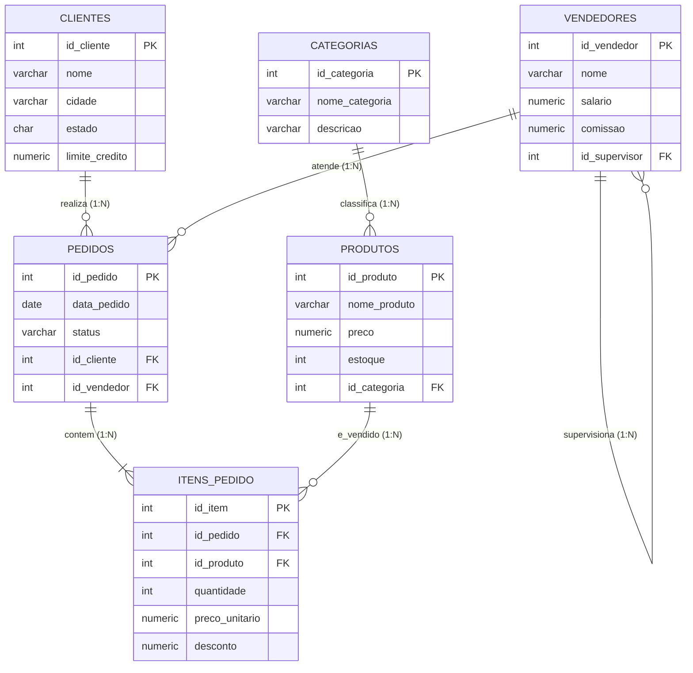
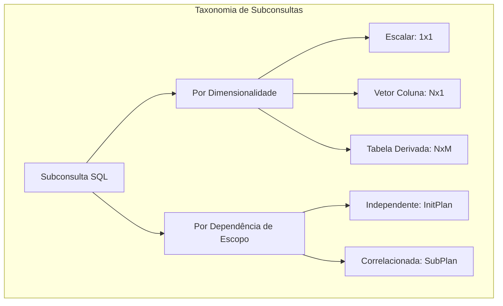
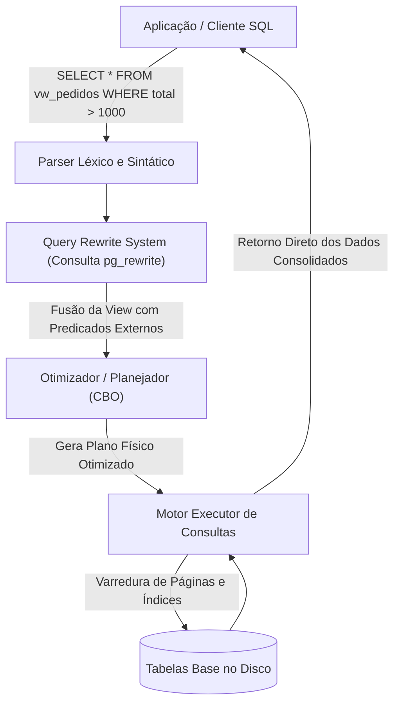
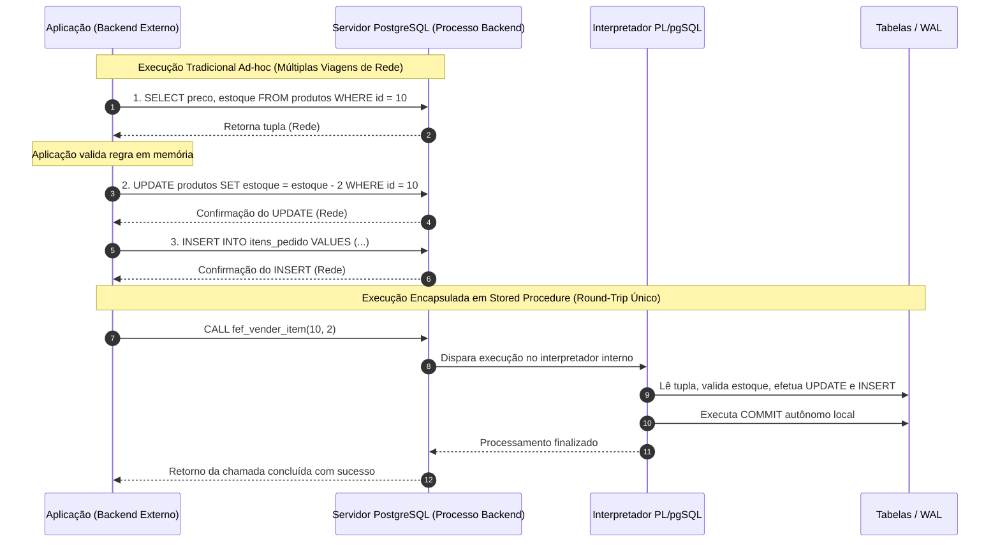
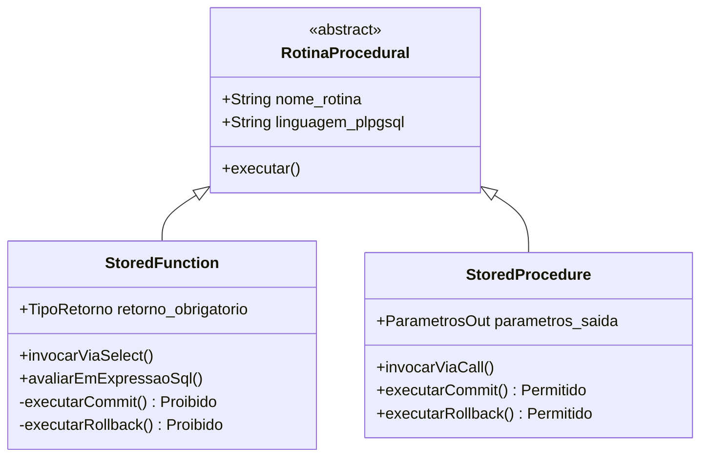
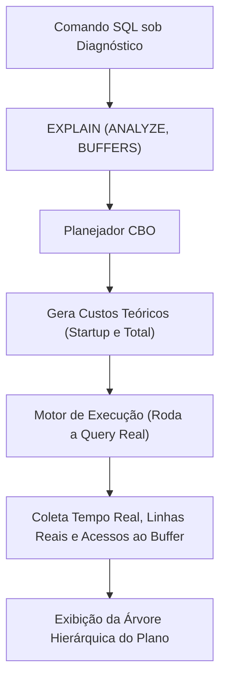
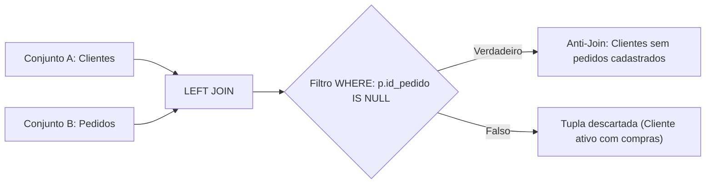
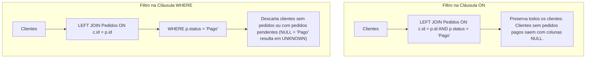

# Caderno Consolidado - Tópicos Avançados em Banco de Dados

> **Instituição:** Centro Universitário de Santa Fé do Sul (UniFEF)  
> **Curso:** Bacharelado em Sistemas de Informação (4º Semestre)  
> **Disciplina:** Tópicos Avançados em Banco de Dados  
> **Docente:** Prof. Welington Garcia  
> **Ambiente Tecnológico:** PostgreSQL 11+ / PL/pgSQL  

---

## Sumário

- [Resumo Executivo](#resumo-executivo)
- [Mapa de Conteúdo](#mapa-de-conteúdo)
- [Fundamentos e Arquitetura](#fundamentos-e-arquitetura)
  - [Álgebra Relacional e Teoria de Junções](#álgebra-relacional-e-teoria-de-junções)
  - [Subconsultas e Lógica Trivalente](#subconsultas-e-lógica-trivalente)
  - [Camada de Abstração com Views e Materialized Views](#camada-de-abstração-com-views-e-materialized-views)
  - [Programação Procedural com PL/pgSQL e Stored Procedures](#programação-procedural-com-plpgsql-e-stored-procedures)
  - [Otimização e Planos de Execução com EXPLAIN ANALYZE](#otimização-e-planos-de-execução-com-explain-analyze)
- [Sintaxe e Exemplos Práticos](#sintaxe-e-exemplos-práticos)
  - [Junções Relacionais Avançadas e Anti-Joins](#junções-relacionais-avançadas-e-anti-joins)
  - [Subconsultas Escalares, Multivaloradas e Correlacionadas](#subconsultas-escalares-multivaloradas-e-correlacionadas)
  - [Tabelas Derivadas na Cláusula FROM e CTEs](#tabelas-derivadas-na-cláusula-from-e-ctes)
  - [DML Avançado Orientado a Subconsultas](#dml-avançado-orientado-a-subconsultas)
  - [Criação e Gestão de Views Relacionais](#criação-e-gestão-de-views-relacionais)
  - [Views Atualizáveis e Restrições de Integridade](#views-atualizáveis-e-restrições-de-integridade)
  - [Materialized Views, Atualização Concorrente e Índices](#materialized-views-atualização-concorrente-e-índices)
  - [Construção de Stored Procedures em PL/pgSQL](#construção-de-stored-procedures-em-plpgsql)
  - [Diagnóstico de Execução com EXPLAIN ANALYZE](#diagnóstico-de-execução-com-explain-analyze)
- [Boas Práticas e Armadilhas Comuns](#boas-práticas-e-armadilhas-comuns)
  - [A Armadilha do Valor Nulo em Operadores NOT IN](#a-armadilha-do-valor-nulo-em-operadores-not-in)
  - [Filtragem no WHERE versus Filtragem no ON em Outer Joins](#filtragem-no-where-versus-filtragem-no-on-em-outer-joins)
  - [Agregação com COUNT sob Junções Externas](#agregação-com-count-sob-junções-externas)
  - [Destruição em Cascata com DROP VIEW CASCADE](#destruição-em-cascata-com-drop-view-cascade)
  - [Restrições de Transação em Blocos de Exceção PL/pgSQL](#restrições-de-transação-em-blocos-de-exceção-plpgsql)
- [Tabelas Comparativas](#tabelas-comparativas)
  - [Tabela Base versus View Comum versus Materialized View](#tabela-base-versus-view-comum-versus-materialized-view)
  - [Stored Functions versus Stored Procedures](#stored-functions-versus-stored-procedures)
  - [Operadores de Existência e Pertencimento](#operadores-de-existência-e-pertencimento)
  - [Algoritmos Físicos de Execução de Junção](#algoritmos-físicos-de-execução-de-junção)
- [Linha do Tempo da Disciplina](#linha-do-tempo-da-disciplina)
- [Glossário](#glossário)
- [Checklist de Revisão para Prova](#checklist-de-revisão-para-prova)

---

## Resumo Executivo

O curso de Tópicos Avançados em Banco de Dados conduz o estudante da transição do modelo estritamente declarativo do SQL padrão para a arquitetura relacional profunda, engenharia de desempenho e computação procedural interna no PostgreSQL. O conteúdo programático estrutura-se sobre a premissa de que o Sistema Gerenciador de Banco de Dados Relacional (SGBDR) atua como um motor de processamento ativo, responsável por garantir consistência transacional estrita (propriedades ACID), otimizar o acesso a dados massivos e desacoplar a lógica de negócio por meio de abstrações lógicas e físicas.

A disciplina concentra-se em cinco pilares fundamentais:
1. **Álgebra Relacional e Junções Complexas**: Composição de relações via `$ `INNER` $`, `$ `LEFT` $`, `$ `RIGHT` $`, `$ `FULL OUTER` $`, `$ `CROSS` $` e `$ `SELF JOIN` $`, com ênfase em resolução de ambiguidades, hierarquias de auto-relacionamento e padrões de anti-junção para isolamento de dados órfãos.
2. **Subconsultas e Teoria dos Conjuntos**: Construção de subconsultas escalares, correlacionadas e tabulares em diversas cláusulas SQL, além do domínio da lógica trivalente (*Three-Valued Logic - 3VL*) nos operadores `$ `IN` $`, `$ `NOT IN` $`, `$ `EXISTS` $`, `$ `NOT EXISTS` $`, `$ `ANY` $` e `$ `ALL` $`.
3. **Camada de Abstração de Visões**: Projeto de visões lógicas padrão (resolvidas via reescrita pelo `$ `pg_rewrite` $`), visões atualizáveis com integridade assegurada por `$ `WITH CHECK OPTION` $` e visões materializadas para aceleração analítica com indexação dedicada e recalculo concorrente.
4. **Programação Procedural em PL/pgSQL**: Desenvolvimento de Stored Procedures orientadas ao processamento transacional autônomo (`$ `COMMIT` $` e `$ `ROLLBACK` $`), manipulação de parâmetros (`$ `IN` $`, `$ `OUT` $`, `$ `INOUT` $`), tipagem dinâmica ancorada (`$ `%TYPE` $` e `$ `%ROWTYPE` $`) e gestão de concorrência com bloqueios pessimistas (`$ `SELECT FOR UPDATE` $`).
5. **Análise de Desempenho e Engenharia de Custos**: Inspeção e interpretação detalhada de planos físicos de execução gerados pelo otimizador de custos (*Cost-Based Optimizer - CBO*) através do comando `$ `EXPLAIN ANALYZE` $`.

---

## Mapa de Conteúdo

```mermaid
mindmap
  root("Tópicos Avançados em Banco de Dados")
    "Álgebra Relacional e Junções"
      "INNER JOIN e Equijunções"
      "LEFT e RIGHT OUTER JOIN"
      "FULL OUTER e CROSS JOIN"
      "SELF JOIN e Hierarquias"
      "Padrões de Anti-Join"
      "Tratamento de Nulos com COALESCE"
    "Subconsultas e 3VL"
      "Subconsultas Escalares"
      "Subconsultas no SELECT, WHERE e HAVING"
      "Operadores IN e NOT IN"
      "Armadilha do NULL com NOT IN"
      "Operadores EXISTS e NOT EXISTS"
      "Quantificadores ANY e ALL"
      "Subconsultas Correlacionadas"
      "Tabelas Derivadas no FROM"
      "DML com Subconsultas"
    "Camada de Abstração (Views)"
      "Views Lógicas e pg_rewrite"
      "CREATE OR REPLACE VIEW e Regras"
      "Dependências RESTRICT e CASCADE"
      "Views Atualizáveis e DML"
      "WITH CHECK OPTION (LOCAL e CASCADED)"
      "Materialized Views e Armazenamento Físico"
      "REFRESH MATERIALIZED VIEW CONCURRENTLY"
      "Indexação em Visões Materializadas"
    "Programação Procedural (PL/pgSQL)"
      "Diferenças entre Functions e Procedures"
      "Estrutura de Blocos DECLARE BEGIN EXCEPTION END"
      "Dollar Quoting e Delimitação"
      "Variáveis Escalares e Tipos Ancorados"
      "Parâmetros IN OUT INOUT"
      "Controle de Fluxo IF THEN ELSIF ELSE"
      "Variável Especial FOUND e GET DIAGNOSTICS"
      "Gestão Transacional COMMIT e ROLLBACK"
      "Concorrência com SELECT FOR UPDATE"
    "Engenharia de Desempenho"
      "Arquitetura do Otimizador (Parser, Rewriter, Planner, Executor)"
      "Algoritmos Físicos: Nested Loop, Hash Join, Merge Join"
      "Diagnóstico com EXPLAIN ANALYZE"
      "Métricas: Startup Cost, Total Cost, Actual Time"
```

---

## Fundamentos e Arquitetura

### Álgebra Relacional e Teoria de Junções

A fundamentação teórica dos bancos de dados relacionais apoia-se no modelo formal de Edgar F. Codd. Tabelas representam relações, isto é, conjuntos de tuplas com atributos tipados. Como a modelagem relacional orienta-se pela normalização (1FN, 2FN e 3FN) para erradicar anomalias de atualização, redundâncias e dados inconsistentes, as informações do negócio são intencionalmente fragmentadas em múltiplos esquemas tabulares associados por restrições de integridade referencial (chaves primárias e estrangeiras).

A junção de dados é a operação algébrica responsável por reconstruir as associações entre entidades em tempo de consulta.

```math
R \bowtie_\theta S = \sigma_\theta (R \times S)
```

A operação define-se a partir do produto cartesiano ($`R \times S`$), que gera todas as combinações possíveis entre as tuplas de duas relações, seguido pela aplicação de um operador de seleção ($`\sigma_\theta`$) sob a condição lógica $`\theta`$ (conhecida como teta-junção). Quando a comparação em $`\theta`$ emprega estritamente o operador de igualdade ($`=`$), a operação classifica-se como equijunção.



O otimizador de consultas do PostgreSQL (Cost-Based Optimizer - CBO) não executa produtos cartesianos reais para resolver equijunções em produção. Em vez disso, ele compila a consulta e escolhe dinamicamente um dos três algoritmos físicos de junção com base nas estatísticas das tabelas armazenadas no catálogo `$ `pg_statistic` $`:
- **Nested Loop Join**: Para cada tupla da relação externa, o motor executa uma varredura (preferencialmente indexada via B-Tree) na relação interna. Algoritmo ótimo para relações pequenas ou junções de altíssima seletividade. Complexidade: `$ `O(M \times \log N)` $`.
- **Hash Join**: O PostgreSQL lê a relação menor, projeta suas chaves de junção em uma tabela hash alocada na memória de trabalho (`$ `work_mem` $`) e, em seguida, varre a relação maior buscando correspondências diretas. Complexidade: `$ `O(M + N)` $`.
- **Merge Join**: Exige que ambas as relações estejam previamente ordenadas pelas chaves de junção. O motor avança cursores simultaneamente em ambas as tabelas em um único passo linear sequencial. Complexidade: `$ `O(M + N)` $` após ordenação.

### Subconsultas e Lógica Trivalente

Uma subconsulta (subselect ou consulta aninhada) é uma instrução `$ `SELECT` $` contida no interior de outra instrução SQL externa. A especificação ANSI/ISO SQL categoriza as subconsultas em duas dimensões estruturais:

1. **Dimensionalidade da Matriz de Retorno**:
   - *Escalar*: Retorna exatamente um único valor atômico (1 linha e 1 coluna). Pode ser posicionada em qualquer ponto onde um literal seja aceito (listas do `$ `SELECT` $`, cláusulas `$ `WHERE` $` e `$ `HAVING` $`).
   - *Multivalorada (Vetor Coluna)*: Retorna uma única coluna contendo múltiplas linhas ($`N \times 1`$). Utilizada com operadores relacionais de conjunto (`$ `IN` $`, `$ `NOT IN` $`, `$ `ANY` $`, `$ `ALL` $`).
   - *Relacional (Tabela Derivada)*: Retorna matriz bidimensional com múltiplas linhas e colunas ($`N \times M`$), devendo residir obrigatoriamente na cláusula `$ `FROM` $` ou alimentar cláusulas de existência (`$ `EXISTS` $`, `$ `NOT EXISTS` $`).

2. **Dependência de Escopo**:
   - *Independente (Não-Correlacionada)*: Não faz referência a elementos da consulta externa. É executada conceitualmente uma única vez, gerando um nó de plano `$ `InitPlan` $` cujo resultado é armazenado em memória cache.
   - *Correlacionada*: Contém referências contextuais a atributos da linha corrente da consulta externa. Conceitualmente, é reavaliada a cada iteração da consulta superior, gerando nós do tipo `$ `SubPlan` $`.



*[Complemento com conhecimento geral de engenharia de software e teoria relacional]*:
O tratamento de valores desconhecidos no modelo relacional fundamenta-se na **Lógica Trivalente (Three-Valued Logic - 3VL)**, na qual expressões booleanas podem avaliar para `TRUE`, `FALSE` ou `UNKNOWN`. A presença do valor especial `$ `NULL` $` representa ausência de informação ou dado não aplicável. Consequentemente, qualquer comparação direta com nulo (ex: `$ `salario = NULL` $` ou `$ `salario <> NULL` $`) não avalia para verdadeiro nem para falso, mas para `UNKNOWN`.

Essa semântica gera implicações críticas na avaliação de operadores de conjunto. O operador `$ `IN` $` testa a equivalência lógica por disjunção:

```math
v \in \{s_1, s_2, \dots, s_n\} \iff (v = s_1) \lor (v = s_2) \lor \dots \lor (v = s_n)
```

Por sua vez, o operador `$ `NOT IN` $` define-se pela conjunção das negações:

```math
v \notin \{s_1, s_2, \dots, s_n\} \iff (v \ne s_1) \land (v \ne s_2) \land \dots \land (v \ne s_n)
```

Se o conjunto retornado contiver ao menos uma tupla cujo valor seja `$ `NULL` $`, qualquer comparação `$ `v \ne \text{NULL}` $` resulta em `UNKNOWN`. Pelas regras da conjunção na 3VL:
- `$ `\text{TRUE} \land \text{UNKNOWN} \implies \text{UNKNOWN}` $`
- `$ `\text{FALSE} \land \text{UNKNOWN} \implies \text{FALSE}` $`

Portanto, a expressão com `$ `NOT IN` $` jamais avaliará para `TRUE`. Como as cláusulas de seleção (`$ `WHERE` $` e `$ `HAVING` $`) descartam tudo o que não seja estritamente `TRUE`, a consulta inteira retornará zero linhas.

### Camada de Abstração com Views e Materialized Views

No PostgreSQL, visões (*views*) são relações virtuais definidas a partir de uma consulta SQL armazenada no catálogo de metadados do sistema. Arquiteturalmente, as visões dividem-se em duas categorias mutuamente exclusivas quanto ao armazenamento físico:

1. **Visões Lógicas (Padrão / Não Materializadas)**:
   - Não possuem blocos físicos de armazenamento (*heap files*) nem ocupam espaço em disco para armazenar registros.
   - O SGBDR armazena sua definição gramatical e sua árvore de análise sintática nas tabelas internas `$ `pg_views` $` e `$ `pg_rewrite` $`.
   - Ao receber uma consulta contra uma visão, o subsistema **Query Rewrite Rule System** do PostgreSQL intercepta o comando e funde a definição da view com a consulta externa, gerando uma árvore sintática única submetida ao planejador de consultas.



2. **Visões Materializadas (Materialized Views)**:
   - Persistem fisicamente os resultados da consulta de definição em disco, alocando páginas de dados e arquivos de heap próprios no sistema de arquivos.
   - Isolam a leitura das tabelas base: consultas à visão materializada não tocam nas tabelas de origem, atingindo tempos de resposta ultrarrápidos para relatórios analíticos, junções massivas e agregações complexas.
   - Apresentam dados estáticos (*snapshots*): alterações ocorridas nas tabelas base não se propagam automaticamente para a visão materializada. A sincronização requer a execução explícita do comando `$ `REFRESH MATERIALIZED VIEW` $`.
   - Suportam criação direta de índices próprios (B-Tree, Hash, GIN, GiST, BRIN), acelerando a filtragem direta sobre a relação persistida.

### Programação Procedural com PL/pgSQL e Stored Procedures

O SQL padrão é uma linguagem eminentemente declarativa: especifica-se *o que* deve ser recuperado ou transformado, delegando ao motor relacional o planejamento de *como* fazê-lo. Entretanto, regras de negócio complexas, fluxos transacionais com validações interdependentes e manipulações condicionais exigem construções imperativas/procedurais (desvios condicionais, laços, tratamento estruturado de falhas e alocação de variáveis).

O PostgreSQL atende a essa demanda fornecendo a linguagem procedural **PL/pgSQL** (*Procedural Language / PostgreSQL Structured Query Language*). O código PL/pgSQL é compilado e executado diretamente nos processos de backend do PostgreSQL (*PostgreSQL backend server processes*).



Historicamente, até o lançamento do PostgreSQL 10, a programação procedural limitava-se exclusivamente a funções definidas pelo usuário (`$ `CREATE FUNCTION` $`). Uma função, por definição da arquitetura do PostgreSQL, executa acoplada à transação externa do comando SQL que a invocou (ex: uma expressão `$ `SELECT` $`). Consequentemente, o compilador proíbe categoricamente comandos de controle de transação dentro de funções, emitindo a falha `$ `ERROR: invalid transaction termination` $` caso encontre um `$ `COMMIT` $` ou `$ `ROLLBACK` $`.

A partir do **PostgreSQL 11** (em conformidade com o padrão SQL:2011), introduziu-se formalmente o objeto **`$ `CREATE PROCEDURE` $`**, invocado exclusivamente pela instrução `$ `CALL` $`. Procedures operam fora do ciclo de vida de uma expressão `$ `SELECT` $`, o que viabiliza o controle autônomo de transações com `$ `COMMIT` $` e `$ `ROLLBACK` $` intercalados. Essa capacidade é indispensável para processos em lote (*batch processing*), como atualizações cadastrais ou expurgo de logs massivos com liberação periódica de travas de concorrência (*locks*) e redução de pressão sobre os arquivos de log transacional (*WAL - Write-Ahead Logging*).



### Otimização e Planos de Execução com EXPLAIN ANALYZE

O comando `$ `EXPLAIN` $` expõe a estrutura do plano de execução construído pelo otimizador de consultas (CBO) para determinada instrução SQL, detalhando as operações físicas escolhidas, os custos computacionais estimados e a ordem de acesso às tabelas.

Quando utilizado em conjunto com o modificador `$ `ANALYZE` $` (`$ `EXPLAIN ANALYZE` $`), o PostgreSQL não apenas planeja, mas **executa fisicamente a consulta** no banco de dados, descartando o resultado final e exibindo uma comparação entre as estimativas estatísticas do planejador e os dados reais de telemetria da máquina.



O relatório estruturado do `$ `EXPLAIN ANALYZE` $` detalha quatro métricas capitais de engenharia:
1. **Startup Cost (Custo Inicial)**: Expressa em unidades arbitrárias de I/O de página de disco (onde a leitura sequencial de uma página padrão de 8 KB tem custo base de 1.0). Representa o esforço computacional despendido antes que a primeira tupla de resultado possa ser emitida (ex.: custo de preencher uma tabela hash em memória).
2. **Total Cost (Custo Total)**: Estimativa cumulativa do custo para executar o nó por completo e processar todas as tuplas previstas.
3. **Plan Rows e Actual Rows**: `rows=N` estima a cardinalidade que o otimizador previu com base nas estatísticas das tabelas; `actual rows=N` indica quantas tuplas foram efetivamente processadas pelo nó. Discrepâncias de ordens de magnitude entre essas métricas sinalizam tabelas desatualizadas demandando a execução de `$ `ANALYZE` $`.
4. **Execution Time (Tempo Real de Execução)**: Medição física em milissegundos ($`ms`$) consumida pelo executor da máquina para processar a consulta, excluindo os tempos de parsing e planejamento.

---

## Sintaxe e Exemplos Práticos

Para garantir a reprodutibilidade dos exemplos práticos deste caderno, os scripts a seguir baseiam-se nos esquemas comerciais e clínicos consolidados durante as aulas e listas de exercícios da disciplina.

### Junções Relacionais Avançadas e Anti-Joins

#### INNER JOIN com Múltiplas Entidades e Cálculo Linear
Associação entre quatro relações (`pedidos`, `clientes`, `itens_pedido` e `produtos`), calculando o subtotal da linha com base no preço praticado e na quantidade:

```sql
SELECT
    p.id_pedido,
    p.data_pedido,
    c.nome AS cliente,
    c.cidade,
    pr.nome_produto,
    ip.quantidade,
    ip.preco_unitario,
    (ip.quantidade * ip.preco_unitario) AS subtotal_bruto
FROM pedidos p
INNER JOIN clientes c ON p.id_cliente = c.id_cliente
INNER JOIN itens_pedido ip ON p.id_pedido = ip.id_pedido
INNER JOIN produtos pr ON ip.id_produto = pr.id_produto
ORDER BY p.id_pedido ASC, pr.nome_produto ASC;
```

#### SELF JOIN para Resolução de Hierarquias Organizacionais
Na tabela `vendedores`, o atributo `id_supervisor` estabelece uma chave estrangeira reflexiva apontando para a chave primária `id_vendedor` da própria tabela. Para recuperar simultaneamente o subordinado e seu respectivo gestor em uma única tupla, instanciam-se dois aliases de tabela na memória:

```sql
SELECT
    v.id_vendedor,
    v.nome AS vendedor,
    v.salario,
    COALESCE(s.nome, 'Sem Supervisor (Diretoria)') AS supervisor_imediato
FROM vendedores v
LEFT JOIN vendedores s ON v.id_supervisor = s.id_vendedor
ORDER BY v.id_vendedor ASC;
```

#### Anti-Join para Localização de Clientes Inativos (LEFT JOIN com IS NULL)
Identificação de entidades pai que não possuem registros dependentes associados na tabela filha. Como `pedidos.id_pedido` é chave primária, a única razão para assumir `$ `NULL` $` sob uma junção externa à esquerda é a ausência de correspondência relacional:

```sql
SELECT
    c.id_cliente,
    c.nome,
    c.cidade,
    c.estado
FROM clientes c
LEFT JOIN pedidos p ON c.id_cliente = p.id_cliente
WHERE p.id_pedido IS NULL
ORDER BY c.id_cliente ASC;
```



### Subconsultas Escalares, Multivaloradas e Correlacionadas

#### Subconsulta Escalar na Lista de Projeção (SELECT) e no Filtro (WHERE)
Comparação do preço individual de cada produto em relação à métrica média global calculada dinamicamente:

```sql
SELECT
    p.id_produto,
    p.nome_produto,
    p.preco,
    ROUND((SELECT AVG(preco) FROM produtos), 2) AS media_geral_precos,
    ROUND(p.preco - (SELECT AVG(preco) FROM produtos), 2) AS diferenca_da_media
FROM produtos p
WHERE p.preco > (SELECT AVG(preco) FROM produtos)
ORDER BY p.preco DESC;
```

#### Subconsulta Multivalorada com Operadores ANY e ALL
1. Listar produtos cujo preço unitário seja estritamente superior ao preço de **pelo menos um** produto pertencente à categoria "Telefonia":
```sql
SELECT nome_produto, preco
FROM produtos
WHERE preco > ANY (
    SELECT pr.preco
    FROM produtos pr
    INNER JOIN categorias ca ON pr.id_categoria = ca.id_categoria
    WHERE ca.nome_categoria = 'Telefonia'
)
ORDER BY preco ASC;
```

2. Listar produtos cujo valor de venda supere o preço de **todos** os produtos da categoria "Acessórios":
```sql
SELECT nome_produto, preco
FROM produtos
WHERE preco > ALL (
    SELECT pr.preco
    FROM produtos pr
    INNER JOIN categorias ca ON pr.id_categoria = ca.id_categoria
    WHERE ca.nome_categoria = 'Acessórios'
)
ORDER BY preco ASC;
```

#### Subconsulta Correlacionada Linha a Linha
Localização dos produtos cujo valor de catálogo seja superior à média de preços da **sua própria categoria**. A subconsulta interna depende contextual e dinamicamente do valor `p.id_categoria` da consulta externa:

```sql
SELECT
    p.id_produto,
    p.nome_produto,
    p.id_categoria,
    p.preco,
    ROUND((
        SELECT AVG(sub.preco)
        FROM produtos sub
        WHERE sub.id_categoria = p.id_categoria
    ), 2) AS media_da_categoria
FROM produtos p
WHERE p.preco > (
    SELECT AVG(sub.preco)
    FROM produtos sub
    WHERE sub.id_categoria = p.id_categoria
)
ORDER BY p.id_categoria ASC, p.preco DESC;
```

### Tabelas Derivadas na Cláusula FROM e CTEs

#### Tabela Derivada com Agregação Prévia e Junção Relacional
O uso de tabelas derivadas na cláusula `$ `FROM` $` viabiliza a execução de agrupamentos antes da junção com outras entidades, prevenindo a multiplicação indevida de linhas e permitindo a filtragem direta de métricas calculadas. No PostgreSQL, a atribuição de um alias à tabela derivada é obrigatória:

```sql
SELECT
    p.id_pedido,
    c.nome AS cliente,
    p.data_pedido,
    resumo_financeiro.total_pedido
FROM pedidos p
INNER JOIN clientes c ON p.id_cliente = c.id_cliente
INNER JOIN (
    SELECT
        ip.id_pedido,
        SUM(ip.quantidade * ip.preco_unitario) AS total_pedido
    FROM itens_pedido ip
    GROUP BY ip.id_pedido
) AS resumo_financeiro ON p.id_pedido = resumo_financeiro.id_pedido
WHERE resumo_financeiro.total_pedido > 3000.00
ORDER BY resumo_financeiro.total_pedido DESC;
```

#### Equivalência Estrutural com Common Table Expressions (CTE)
A instrução `$ `WITH` $` proporciona maior legibilidade e desacoplamento conceitual para cálculos tabulares intermediários:

```sql
WITH TotaisPorPedido AS (
    SELECT
        id_pedido,
        SUM(quantidade * preco_unitario) AS total_pedido
    FROM itens_pedido
    GROUP BY id_pedido
)
SELECT
    p.id_pedido,
    c.nome AS cliente,
    p.data_pedido,
    t.total_pedido
FROM pedidos p
INNER JOIN clientes c ON p.id_cliente = c.id_cliente
INNER JOIN TotaisPorPedido t ON p.id_pedido = t.id_pedido
WHERE t.total_pedido > 3000.00
ORDER BY t.total_pedido DESC;
```

### DML Avançado Orientado a Subconsultas

#### INSERT INTO ... SELECT com Cálculo de Desconto Condicional
Carga massiva de uma tabela de promoções alimentada exclusivamente por produtos com preço acima da média populacional:

```sql
-- Criação da estrutura de destino
CREATE TABLE IF NOT EXISTS produtos_promocao (
    id_produto INTEGER PRIMARY KEY,
    nome_produto VARCHAR(100) NOT NULL,
    preco NUMERIC(10,2) NOT NULL,
    preco_promocional NUMERIC(10,2) NOT NULL
);

-- Carga em lote orientada por subconsulta escalar
INSERT INTO produtos_promocao (id_produto, nome_produto, preco, preco_promocional)
SELECT
    id_produto,
    nome_produto,
    preco,
    ROUND(preco * 0.90, 2) AS preco_promocional
FROM produtos
WHERE preco > (SELECT AVG(preco) FROM produtos);
```

#### UPDATE Correlacionado com Bonificação de Estoque
Acréscimo de 5 unidades ao estoque de todos os produtos cujo preço unitário esteja acima da média da sua respectiva categoria:

```sql
UPDATE produtos p
SET estoque = estoque + 5
WHERE p.preco > (
    SELECT AVG(sub.preco)
    FROM produtos sub
    WHERE sub.id_categoria = p.id_categoria
);
```

#### DELETE com Anti-Junção Segura (NOT EXISTS)
Exclusão de clientes que nunca realizaram nenhum pedido de compra no sistema:

```sql
-- Validação prévia de segurança (Auditoria de Linhas Afetadas)
SELECT c.id_cliente, c.nome
FROM clientes c
WHERE NOT EXISTS (
    SELECT 1
    FROM pedidos p
    WHERE p.id_cliente = c.id_cliente
);

-- Execução da exclusão atômica
DELETE FROM clientes c
WHERE NOT EXISTS (
    SELECT 1
    FROM pedidos p
    WHERE p.id_cliente = c.id_cliente
);
```

### Criação e Gestão de Views Relacionais

#### Definição e Requisitos do CREATE OR REPLACE VIEW
Criação de visão gerencial que encapsula a normalização de clientes do estado de São Paulo:

```sql
CREATE OR REPLACE VIEW vw_clientes_sp AS
SELECT
    id_cliente,
    nome,
    cidade,
    limite_credito
FROM clientes
WHERE estado = 'SP';
```

Regras estritas impostas pelo PostgreSQL para o `$ `CREATE OR REPLACE VIEW` $`:
- Os nomes, tipos de dados e ordem posicional de todas as colunas existentes na definição anterior devem ser preservados identicamente.
- Novas colunas podem ser incluídas **exclusivamente ao final** da lista de projeção.
- Não é permitido remover colunas existentes ou alterar seus tipos primitivos. Caso seja necessário reestruturar a visão, deve-se emitir `$ `DROP VIEW nome_view` $` e recriá-la integralmente.

### Views Atualizáveis e Restrições de Integridade

O PostgreSQL permite a execução de operações DML (`$ `INSERT` $`, `$ `UPDATE` $`, `$ `DELETE` $`) diretamente contra visões, desde que a visão seja **automaticamente atualizável**:
1. A cláusula `$ `FROM` $` deve apontar exatamente para uma única tabela base (ou outra visão atualizável). Junções (`$ `JOIN` $`) desqualificam a atualização direta.
2. A consulta não pode conter cláusulas de agregação (`$ `GROUP BY` $`, `$ `HAVING` $`, `$ `SUM` $`, `$ `COUNT` $`).
3. Não pode conter operadores de conjunto (`$ `UNION` $`, `$ `INTERSECT` $`, `$ `EXCEPT` $`).
4. Não pode utilizar operadores de deduplicação (`$ `DISTINCT` $`) nem funções de janela (`$ `OVER / WINDOW` $`).

#### Garantia de Consistência com WITH CHECK OPTION
Sem a cláusula de checagem, um usuário com privilégio de escrita na view pode atualizar ou inserir registros que não atendem aos critérios de seleção da própria view (por exemplo, alterar o estado de um cliente para 'RJ' dentro de `vw_clientes_sp`), fazendo com que o registro desapareça da visão imediatamente após o comando.

A cláusula `$ `WITH CHECK OPTION` $` impede que modificações violem o predicado da visão:

```sql
CREATE OR REPLACE VIEW vw_clientes_sp_segura AS
SELECT
    id_cliente,
    nome,
    cidade,
    estado,
    limite_credito
FROM clientes
WHERE estado = 'SP'
WITH CHECK OPTION;

-- Teste de inserção válida
INSERT INTO vw_clientes_sp_segura (nome, cidade, estado, limite_credito)
VALUES ('Marcos Ferreira', 'Ribeirão Preto', 'SP', 4500.00);

-- Teste de violação de integridade bloqueada pelo PostgreSQL
-- Dispara: ERROR: new row violates check option for view "vw_clientes_sp_segura"
-- UPDATE vw_clientes_sp_segura SET estado = 'RJ' WHERE id_cliente = 1;
```

A cláusula suporta duas variações de escopo:
- `$ `WITH LOCAL CHECK OPTION` $`: Fiscaliza as condições de integridade definidas estritamente na própria view em edição, sem verificar filtros de visões ancestrais em uma cadeia de herança lógica.
- `$ `WITH CASCADED CHECK OPTION` $` (padrão): Aplica recursivamente todas as restrições da visão corrente e de todas as visões subjacentes que serviram de fonte no `$ `FROM` $`.

### Materialized Views, Atualização Concorrente e Índices

#### Criação com Snapshot Físico
Consolidação analítica de faturamento por categoria mercadológica:

```sql
CREATE MATERIALIZED VIEW mv_faturamento_categorias AS
SELECT
    c.id_categoria,
    c.nome_categoria,
    COUNT(DISTINCT p.id_pedido) AS volume_pedidos,
    SUM(ip.quantidade) AS total_pecas_vendidas,
    SUM(ip.quantidade * ip.preco_unitario) AS faturamento_bruto,
    ROUND(SUM(ip.quantidade * ip.preco_unitario * (1.0 - (ip.desconto / 100.0))), 2) AS faturamento_liquido
FROM categorias c
INNER JOIN produtos pr ON c.id_categoria = pr.id_categoria
INNER JOIN itens_pedido ip ON pr.id_produto = ip.id_produto
INNER JOIN pedidos p ON ip.id_pedido = p.id_pedido
WHERE p.status IN ('Pago', 'Enviado')
GROUP BY c.id_categoria, c.nome_categoria
WITH DATA;
```

#### Criação de Índice Exclusivo e Atualização Concorrente
O comando tradicional `$ `REFRESH MATERIALIZED VIEW nome_view` $` adquire uma trava de bloqueio exclusivo (`$ `AccessExclusiveLock` $`) sobre a visão materializada durante todo o tempo de recomputação da consulta, bloqueando quaisquer leituras concorrentes da aplicação.

Para viabilizar leituras ininterruptas em ambientes de produção 24/7, utiliza-se a opção `$ `CONCURRENTLY` $`. O PostgreSQL exige como pré-requisito mandatório a existência de pelo menos um **índice exclusivo (UNIQUE)** cobrindo uma ou mais colunas que não aceitem valores nulos:

```sql
-- Criação obrigatória de índice UNIQUE sem valores nulos
CREATE UNIQUE INDEX idx_mv_fat_cat_id ON mv_faturamento_categorias(id_categoria);

-- Atualização assíncrona não bloqueante de leitura
REFRESH MATERIALIZED VIEW CONCURRENTLY mv_faturamento_categorias;
```

### Construção de Stored Procedures em PL/pgSQL

#### Anatomia Estrutural de um Procedimento
Um bloco PL/pgSQL completo estrutura-se rigorosamente com seções declarativas, executáveis e de captura de exceções:

```sql
CREATE OR REPLACE PROCEDURE fef_ajustar_salario_vendedor(
    p_id_vendedor INTEGER,
    p_percentual_aumento NUMERIC(5,2)
)
LANGUAGE plpgsql
AS $$
DECLARE
    v_salario_atual NUMERIC(10,2);
    v_salario_novo NUMERIC(10,2);
    v_nome_vendedor VARCHAR(100);
BEGIN
    -- 1. Validação defensiva de parâmetros
    IF p_percentual_aumento IS NULL OR p_percentual_aumento <= 0 THEN
        RAISE EXCEPTION 'Parâmetro de percentual inválido: %. O aumento deve ser estritamente positivo.', p_percentual_aumento;
    END IF;

    -- 2. Verificação de existência com bloqueio de linha para atualização
    SELECT nome, salario INTO v_nome_vendedor, v_salario_atual
    FROM vendedores
    WHERE id_vendedor = p_id_vendedor
    FOR UPDATE;

    IF NOT FOUND THEN
        RAISE EXCEPTION 'Vendedor com identificador % inexistente.', p_id_vendedor;
    END IF;

    -- 3. Cálculo matemático e persistência DML
    v_salario_novo := v_salario_atual + (v_salario_atual * (p_percentual_aumento / 100.0));

    UPDATE vendedores
    SET salario = v_salario_novo
    WHERE id_vendedor = p_id_vendedor;

    RAISE NOTICE 'Salário do vendedor % (ID: %) reajustado de R$ % para R$ % (+ % %%)',
        v_nome_vendedor, p_id_vendedor, v_salario_atual, v_salario_novo, p_percentual_aumento;

EXCEPTION
    WHEN OTHERS THEN
        RAISE EXCEPTION 'Falha operacional ao atualizar salário do vendedor %: %', p_id_vendedor, SQLERRM;
END;
$$;
```

#### Orquestração Transacional Completa com Vendas e Estoque
Implementação de rotina transacional que agrega verificações condicionais, manipulações em múltiplas tabelas dependentes e recálculo financeiro consolidado:

```sql
CREATE OR REPLACE PROCEDURE fef_inserir_item_pedido(
    p_id_pedido INTEGER,
    p_id_produto INTEGER,
    p_quantidade INTEGER
)
LANGUAGE plpgsql
AS $$
DECLARE
    v_status_pedido VARCHAR(30);
    v_preco_unitario NUMERIC(10,2);
    v_estoque_atual INTEGER;
    v_subtotal NUMERIC(10,2);
BEGIN
    -- 1. Verificação de integridade dos parâmetros
    IF p_quantidade IS NULL OR p_quantidade <= 0 THEN
        RAISE EXCEPTION 'A quantidade solicitada deve ser maior que zero. Informado: %', p_quantidade;
    END IF;

    -- 2. Inspeção do ciclo de vida do pedido
    SELECT status INTO v_status_pedido
    FROM pedidos
    WHERE id_pedido = p_id_pedido;

    IF NOT FOUND THEN
        RAISE EXCEPTION 'Pedido ID % não encontrado.', p_id_pedido;
    END IF;

    IF v_status_pedido <> 'ABERTO' AND v_status_pedido <> 'Pendente' THEN
        RAISE EXCEPTION 'Operação rejeitada: o pedido % possui status %, impedindo novos itens.', p_id_pedido, v_status_pedido;
    END IF;

    -- 3. Verificação de disponibilidade física de estoque com lock pessimista
    SELECT preco, estoque INTO v_preco_unitario, v_estoque_atual
    FROM produtos
    WHERE id_produto = p_id_produto
    FOR UPDATE;

    IF NOT FOUND THEN
        RAISE EXCEPTION 'Produto ID % não cadastrado no catálogo.', p_id_produto;
    END IF;

    IF v_estoque_atual < p_quantidade THEN
        RAISE EXCEPTION 'Estoque insuficiente para o produto ID %. Disponível: %, Requisitado: %',
            p_id_produto, v_estoque_atual, p_quantidade;
    END IF;

    -- 4. Computação do subtotal do item
    v_subtotal := ROUND(p_quantidade * v_preco_unitario, 2);

    -- 5. Inserção na tabela de itens
    INSERT INTO itens_pedido (id_pedido, id_produto, quantidade, preco_unitario, desconto)
    VALUES (p_id_pedido, p_id_produto, p_quantidade, v_preco_unitario, 0.00);

    -- 6. Baixa física no estoque de produtos
    UPDATE produtos
    SET estoque = estoque - p_quantidade
    WHERE id_produto = p_id_produto;

    RAISE NOTICE 'Item inserido no pedido % com sucesso. Subtotal: R$ %. Estoque restante: %',
        p_id_pedido, v_subtotal, (v_estoque_atual - p_quantidade);
END;
$$;
```

### Diagnóstico de Execução com EXPLAIN ANALYZE

Execução comparativa de planos de execução para seleção de clientes que efetuaram pedidos, contrastando `$ `IN` $` versus `$ `EXISTS` $`:

```sql
-- Diagnóstico da consulta empregando IN
EXPLAIN (ANALYZE, BUFFERS, VERBOSE)
SELECT c.id_cliente, c.nome
FROM clientes c
WHERE c.id_cliente IN (SELECT p.id_cliente FROM pedidos p);

-- Diagnóstico da consulta empregando EXISTS
EXPLAIN (ANALYZE, BUFFERS, VERBOSE)
SELECT c.id_cliente, c.nome
FROM clientes c
WHERE EXISTS (SELECT 1 FROM pedidos p WHERE p.id_cliente = c.id_cliente);
```

Ambas as consultas são internamente reescritas pelo planejador do PostgreSQL para a operação física de **Hash Semi-Join** ou **Merge Semi-Join**. Como o operador semi-join interrompe a busca na tabela interna assim que a primeira correspondência é localizada (semântica de curto-circuito), ambas as formulações produzem planos idênticos em esquemas devidamente indexados.

---

## Boas Práticas e Armadilhas Comuns

### A Armadilha do Valor Nulo em Operadores NOT IN

#### Definição do Problema
Conforme estabelecido pela Lógica Trivalente, o operador `$ `NOT IN` $` avalia como conjunção de comparações com negação. Caso a subconsulta retorne uma única linha com valor `$ `NULL` $`, a expressão inteira assume estado de verdade `UNKNOWN`.

#### Exemplo e Contraexemplo
```sql
-- CONTRAEXEMPLO CRÍTICO (BUG SILENCIOSO EM PRODUÇÃO):
-- Suponha que a tabela 'pedidos' contenha uma linha onde 'id_cliente' seja NULL.
SELECT c.id_cliente, c.nome
FROM clientes c
WHERE c.id_cliente NOT IN (SELECT p.id_cliente FROM pedidos p);
-- RESULTADO: Retorna 0 linhas (conjunto vazio), mesmo havendo 10 clientes sem pedidos!

-- PADRÃO DEFENSIVO CORRETO 1: Filtrar explicitamente valores nulos na subconsulta
SELECT c.id_cliente, c.nome
FROM clientes c
WHERE c.id_cliente NOT IN (
    SELECT p.id_cliente 
    FROM pedidos p 
    WHERE p.id_cliente IS NOT NULL
);

-- PADRÃO DEFENSIVO CORRETO 2 (RECOMENDADO NA INDÚSTRIA): Utilizar NOT EXISTS
-- O operador EXISTS testa apenas a cardinalidade física (se rows > 0), sendo imune à 3VL.
SELECT c.id_cliente, c.nome
FROM clientes c
WHERE NOT EXISTS (
    SELECT 1
    FROM pedidos p
    WHERE p.id_cliente = c.id_cliente
);
```

### Filtragem no WHERE versus Filtragem no ON em Outer Joins

#### Definição do Problema
Em uma junção externa (`$ `LEFT JOIN` $`), a cláusula `$ `ON` $` define os critérios para relacionar as tuplas da direita às tuplas da esquerda. Caso não haja correspondência, a linha da esquerda é mantida e as colunas da direita são preenchidas com `$ `NULL` $`. Em contrapartida, a cláusula `$ `WHERE` $` atua **após** a fusão das relações. Se o `$ `WHERE` $` avaliar uma coluna da tabela da direita com predicados que rejeitam nulos, o `$ `LEFT JOIN` $` é sumariamente convertido em um `$ `INNER JOIN` $` disfarçado.



```sql
-- CONTRAEXEMPLO: Conversão acidental de LEFT JOIN em INNER JOIN
SELECT c.id_cliente, c.nome, p.id_pedido, p.status
FROM clientes c
LEFT JOIN pedidos p ON c.id_cliente = p.id_cliente
WHERE p.status = 'Pago'; -- Elimina todos os clientes sem compras!

-- SOLUÇÃO: Mover a restrição da entidade periférica para a cláusula ON
SELECT c.id_cliente, c.nome, p.id_pedido, p.status
FROM clientes c
LEFT JOIN pedidos p ON c.id_cliente = p.id_cliente AND p.status = 'Pago';
```

### Agregação com COUNT sob Junções Externas

#### Definição e Armadilha
A função agregadora `$ `COUNT(*)` $` calcula a cardinalidade física do grupo (quantidade de registros na partição), ao passo que `$ `COUNT(expressao)` $` incrementa o contador apenas quando o resultado da expressão avaliada for estritamente não-nulo.

```sql
-- CONTRAEXEMPLO (ERRO GRAVE DE RELATÓRIO):
-- Clientes sem compras terão 1 linha preenchida com nulos gerada pelo LEFT JOIN.
-- O COUNT(*) avaliará essa linha como presente e retornará '1 pedido' indevidamente!
SELECT c.id_cliente, c.nome, COUNT(*) AS total_pedidos
FROM clientes c
LEFT JOIN pedidos p ON c.id_cliente = p.id_cliente
GROUP BY c.id_cliente, c.nome;

-- SOLUÇÃO HOMOLOGADA: Contar a chave primária da tabela dependente
SELECT c.id_cliente, c.nome, COUNT(p.id_pedido) AS total_pedidos
FROM clientes c
LEFT JOIN pedidos p ON c.id_cliente = p.id_cliente
GROUP BY c.id_cliente, c.nome;
```

### Destruição em Cascata com DROP VIEW CASCADE

#### Risco de Engenharia
O comando `$ `DROP VIEW nome_view RESTRICT` $` (comportamento padrão) emite um erro de bloqueio caso existam outros objetos dependentes (visões subordinadas, funções ou triggers) cadastrados na tabela `$ `pg_depend` $`.

A adição da cláusula `$ `CASCADE` $` destrói a visão alvo e **elimina recursivamente todos os objetos dependentes** no banco de dados sem aviso prévio. Em ambientes de missão crítica, isso pode causar a queda inadvertida de rotinas de faturamento e visões de relatórios executivos.

> [!CAUTION]
> Nunca execute `$ `DROP VIEW ... CASCADE` $` em produção sem inspecionar previamente a árvore de dependências no catálogo `$ `pg_depend` $` e `$ `pg_rewrite` $`.

### Restrições de Transação em Blocos de Exceção PL/pgSQL

#### Armadilha em Stored Procedures
Embora o PostgreSQL 11+ suporte comandos `$ `COMMIT` $` e `$ `ROLLBACK` $` dentro de Stored Procedures, eles **não podem** ser executados no interior de um bloco que contenha uma cláusula `$ `EXCEPTION` $` ativa.

Quando um bloco abre uma seção `$ `EXCEPTION` $`, o interpretador PL/pgSQL inicia internamente uma subtransação (*savepoint*). O protocolo relacional proíbe a finalização de transações principais enquanto uma subtransação estiver aberta, disparando a falha `$ `ERROR: cannot commit while a subtransaction is active` $`. Caso necessite de controle transacional intermediário com `$ `COMMIT` $`, estruture a procedure em blocos normais (`$ `BEGIN ... END` $`) sem tratamento de exceção local acoplado ao passo de commit.

---

## Tabelas Comparativas

### Tabela Base versus View Comum versus Materialized View

| Critério de Engenharia | Tabela Base | View Comum (Lógica) | Materialized View |
| :--- | :--- | :--- | :--- |
| **Persistência Física de Dados** | Sim (arquivos de heap no disco) | Não (armazena apenas metadados e DDL no catálogo) | Sim (snapshot estático gravado fisicamente em disco) |
| **Espaço em Disco Consumido** | Proporcional à volumetria de dados | Mínimo (apenas registros de catálogo no `$ `pg_class` $`) | Proporcional ao conjunto resultante da consulta |
| **Frescor dos Dados (*Freshness*)** | Imediato (consistência estrita via ACID) | Imediato (reflete alterações das tabelas em tempo real) | Estático (defasado até o próximo `$ `REFRESH` $`) |
| **Custo de Processamento em Leitura** | Custo de varredura ou índice na tabela | Custo cumulativo de reexecução da consulta expandida | Custo direto de leitura das tuplas já materializadas |
| **Suporte a Índices Próprios** | Sim (B-Tree, Hash, GIN, GiST, BRIN) | Não (utiliza indiretamente os índices das tabelas base) | Sim (suporta índices próprios locais B-Tree, etc.) |
| **Capacidade de Atualização Direta (DML)** | Total (`$ `INSERT` $`, `$ `UPDATE` $`, `$ `DELETE` $`) | Apenas se for *Automatically Updatable View* | Não suportada (leitura estrita; alteração via `$ `REFRESH` $`) |
| **Impacto em Escritas Concorrentes** | Gera concorrência e I/O de escrita | Nenhum impacto direto nas tabelas | Nenhum até a execução periódica do `$ `REFRESH` $` |

### Stored Functions versus Stored Procedures

| Característica Técnica | Stored Function (`$ `CREATE FUNCTION` $`) | Stored Procedure (`$ `CREATE PROCEDURE` $`) |
| :--- | :--- | :--- |
| **Instrução de Invocação** | Invocada em comandos `$ `SELECT` $` ou expressões | Invocada exclusivamente via comando `$ `CALL` $` |
| **Acoplamento Sintático** | Pode ser integrada em `$ `WHERE` $`, `$ `JOIN` $` e projeção | Não pode ser inserida no interior de instruções `$ `SELECT` $` |
| **Cláusula de Retorno** | Obrigatória (`$ `RETURNS <tipo>` $` ou `$ `RETURNS void` $`) | Não possui cláusula `$ `RETURNS` $` |
| **Comunicação de Resultados** | Retorna escalar, tipos compostos ou `$ `TABLE(...)` $` | Comunica saídas através de parâmetros `$ `INOUT` $` ou `$ `OUT` $` |
| **Controle de Transação (`$ `COMMIT` $` / `$ `ROLLBACK` $`)** | Proibido (`$ `ERROR: invalid transaction termination` $`) | Totalmente permitido (controle de transação autônomo) |
| **Versão Mínima do PostgreSQL** | Suportada desde as primeiras versões | Introduzida formalmente no **PostgreSQL 11** |
| **Propósito Arquitetural** | Transformação de dados, funções matemáticas e cálculos | Orquestração de negócio, manutenções batch e DML massivo |

### Operadores de Existência e Pertencimento

| Operador | Tipo de Subconsulta Aceita | Semântica de Avaliação | Vulnerabilidade ao NULL (3VL) | Curto-Circuito (*Short-Circuit*) |
| :--- | :--- | :--- | :--- | :--- |
| **`$ `IN` $`** | Vetor Coluna ($`N \times 1`$) | Testa equivalência por disjunções (`$ `v=s_1 \lor v=s_2` $`) | Não causa falso-positivo com nulos na subquery | Sim (interrompe no primeiro match positivo) |
| **`$ `NOT IN` $`** | Vetor Coluna ($`N \times 1`$) | Testa negações por conjunção (`$ `v\ne s_1 \land v\ne s_2` $`) | **Crítica**: se houver 1 `$ `NULL` $`, retorna 0 linhas | Não em caso de presença de nulos |
| **`$ `EXISTS` $`** | Relação Arbitrária ($`N \times M`$) | Testa cardinalidade física (se tuplas > 0) | **Imune** (ignora conteúdo das colunas, avalia linhas) | Sim (interrompe assim que acha 1 registro) |
| **`$ `NOT EXISTS` $`** | Relação Arbitrária ($`N \times M`$) | Testa ausência física de registros (se tuplas = 0) | **Imune** (altamente estável para Anti-Joins) | Sim (interrompe assim que acha 1 registro) |
| **`$ `ANY / SOME` $`** | Vetor Coluna ($`N \times 1`$) | Compara com operadores escalares ($`>, <, =`$) | Propaga `UNKNOWN` se não houver match verdadeiro | Sim (basta uma condição ser verdadeira) |
| **`$ `ALL` $`** | Vetor Coluna ($`N \times 1`$) | Exige que a condição atenda todas as linhas | Propaga `UNKNOWN` caso algum elemento seja nulo | Não (precisa validar o conjunto integral) |

### Algoritmos Físicos de Execução de Junção

| Algoritmo | Mecanismo Interno de Operação | Melhores Cenários de Aplicação | Pré-requisitos Estruturais | Complexidade Assintótica |
| :--- | :--- | :--- | :--- | :--- |
| **Nested Loop** | Varre a tabela externa linha a linha e sonda a interna | Relação externa pequena e relação interna indexada | Índice na chave de junção da tabela interna | `$ `O(M \times \log N)` $` |
| **Hash Join** | Constrói tabela hash da menor relação e sonda com a maior | Equijunções com volumes médios/grandes não ordenados | Memória suficiente alocada no `$ `work_mem` $` | `$ `O(M + N)` $` |
| **Merge Join** | Percorre ponteiros paralelos em relações pré-ordenadas | Relações massivas já ordenadas fisicamente | Ambas as entradas ordenadas pela chave de junção | `$ `O(M + N)` $` |

---

## Linha do Tempo da Disciplina

```mermaid
timeline
  title "Evolução Temática e Marcos Práticos da Disciplina (2026)"
  section "Agosto: Álgebra e Consultas"
    "06/08/2026" : "Aulas Joins e Sub selects : Fundamentos de equijunções e subconsultas escalares"
    "12/08/2026" : "Exercícios Joins : Prática extensiva de INNER, LEFT, Anti-Joins e agregações"
    "20/08/2026" : "Exercicios SubSelects - parte 01 : Operadores IN, NOT IN, EXISTS, ANY e ALL"
    "27/08/2026" : "Exercicios SubSelects - parte 02 : Tabelas derivadas no FROM, DML e EXPLAIN ANALYZE"
  section "Setembro: Abstrações e Procedural"
    "02/09/2026" : "Views e Materialized Views : pg_rewrite, CHECK OPTION e indexação física"
    "03/09/2026" : "Lista de Exercícios Consolidada : Hierarquias com Self-Join e análise multirrelacional"
    "09/09/2026" : "Avaliação Oficial de TABD : Prova prática integrando Joins, Subconsultas e Views"
    "17/09/2026" : "Procedures PL/pgSQL : Evolução histórica, blocos estruturados e controle transacional"
    "30/09/2026" : "Lista de Procedures : Orquestração de negócio, controle de estoque e locks pessimistas"
```

### Síntese Cronológica dos Marcos Didáticos
- **06/08/2026**: Abertura das unidades avançadas. Estudo da álgebra relacional formal, estruturação de equijunções pelo padrão ANSI SQL e primeiras formulações de subconsultas independentes.
- **12/08/2026**: Consolidação prática sobre o esquema comercial `loja_joins`. Resolução dos 10 desafios de junções multitabelas, implementação de anti-joins e mitigação do erro de `$ `COUNT(*)` $` em junções externas.
- **20/08/2026**: Aprofundamento conceitual nos primeiros 20 slides de subconsultas. Resolução de 20 exercícios explorando a lógica trivalente, subconsultas na projeção e operadores de quantificação universal e existencial.
- **27/08/2026**: Introdução a tabelas derivadas no `$ `FROM` $`, subconsultas correlacionadas e aplicação de subqueries em comandos de transformação (`$ `INSERT INTO ... SELECT` $`, `$ `UPDATE` $` correlacionado e `$ `DELETE` $`). Introdução à análise física com `$ `EXPLAIN ANALYZE` $`.
- **02/09/2026**: Camada de abstração de dados. Diferenciação da arquitetura lógica (`$ `pg_rewrite` $`) e física das visões, implementação de regras de integridade com `$ `WITH CHECK OPTION` $` e criação de visões materializadas com atualização concorrente.
- **03/09/2026**: Publicação de lista consolidada abordando auto-relacionamento em árvore de supervisores (Self-Join), tratamento de descontos percentuais e criação de visões de comissionamento de vendas.
- **09/09/2026**: Aplicação da Avaliação Oficial de TABD sobre o domínio hospitalar (`clinica`), exigindo domínio de junções mistas, identificação de pacientes sem atendimento, filtros escalares de médias e visões operacionais.
- **17/09/2026**: Transição para o paradigma imperativo. Estudo detalhado da arquitetura PL/pgSQL, diferenças estruturais entre Functions e Stored Procedures e introdução do comando `$ `CALL` $`.
- **30/09/2026**: Entrega da lista exaustiva de Stored Procedures, implementando rotinas transacionais completas de alteração de limites de crédito, estornos, vendas orquestradas com controle de concorrência e baixas de estoque.

---

## Glossário

- **3VL (Three-Valued Logic)**: Lógica Trivalente relacional que admite os valores booleanos `TRUE`, `FALSE` e `UNKNOWN`. Governa a semântica de tratamento de nulos em operadores lógicos e cláusulas de filtragem SQL.
- **Anti-Join**: Padrão de consulta relacional derivado que retorna exclusivamente os registros de uma tabela que não possuem correspondência em outra relação associada.
- **Automatically Updatable View**: Visão simples que atende aos critérios formais do padrão SQL e do PostgreSQL para permitir a execução direta de comandos `$ `INSERT` $`, `$ `UPDATE` $` e `$ `DELETE` $` sobre a tabela base subjacente.
- **CBO (Cost-Based Optimizer)**: Componente do núcleo do PostgreSQL responsável por avaliar diferentes planos de execução para uma consulta e eleger aquele que demandar menor custo estimado de processamento e leitura de blocos de disco.
- **Common Table Expression (CTE)**: Expressão de tabela temporária declarada por meio da cláusula `$ `WITH` $`, existindo apenas no escopo de execução da instrução SQL que a define.
- **Dollar Quoting**: Mecanismo sintático do PostgreSQL (delimitado por `$tag$...$tag$`) que permite escrever blocos textuais extensos e corpos de rotinas procedurais sem necessidade de duplicar aspas simples literais.
- **Equijunção**: Operação de junção relacional em que o predicado lógico de acoplamento utiliza exclusivamente o operador de igualdade ($`=`$).
- **Hash Semi-Join**: Algoritmo físico otimizado de junção empregado para operadores `$ `IN` $` ou `$ `EXISTS` $`, no qual a busca na relação interna é interrompida assim que a primeira tupla correspondente é encontrada.
- **InitPlan**: Nó de plano de execução construído para subconsultas independentes, avaliado uma única vez no início da consulta e reaproveitado para as demais tuplas.
- **Materialized View**: Objeto de esquema que armazena fisicamente o resultado de uma consulta no disco, demandando execução manual ou agendada de `$ `REFRESH` $` para atualização dos dados.
- **PL/pgSQL**: Linguagem procedural proprietária do PostgreSQL que adiciona estruturas de controle de fluxo, laços, variáveis e tratamento de exceções à linguagem SQL.
- **Query Rewrite Rule System**: Subsistema interno do PostgreSQL responsável por processar regras lógicas de catálogo e fundir a definição de visões (`$ `VIEW` $`) diretamente na árvore de consulta do comando emitido pelo usuário.
- **Self-Join**: Operação em que uma tabela é juntada com ela mesma por meio de aliases distintos, muito utilizada para resolver relacionamentos unários e hierarquias estruturais.
- **SubPlan**: Nó de plano de execução construído para subconsultas correlacionadas, exigindo reavaliação iterativa para cada tupla processada da consulta externa.
- **WITH CHECK OPTION**: Cláusula de integridade declarativa aplicada a visões que impede que operações de `$ `INSERT` $` ou `$ `UPDATE` $` gravem tuplas que não atendam aos critérios de seleção da própria visão.

---

## Checklist de Revisão para Prova

### Álgebra Relacional e Junções
- [ ] Compreendo a diferença matemática entre equijunção, junção teta e produto cartesiano?
- [ ] Sei formular um **Anti-Join** utilizando `$ `LEFT JOIN` $` e filtrando pela chave primária da tabela direita com `$ `IS NULL` $`?
- [ ] Sei por que o filtro de atributos da relação dependente colocado no `$ `WHERE` $` descaracteriza o `$ `LEFT JOIN` $` e como corrigi-lo movendo a condição para o `$ `ON` $`?
- [ ] Sei por que o `$ `COUNT(*)` $` sob `$ `LEFT JOIN` $` introduz contagens errôneas de valor 1 para registros inexistentes e sei aplicar `$ `COUNT(tabela_direita.pk)` $`?
- [ ] Sei mapear auto-relacionamentos (estruturas hierárquicas de cargos e supervisores) através do `$ `SELF JOIN` $` instanciando dois aliases distintos da mesma tabela?
- [ ] Sei utilizar a função `$ `COALESCE` $` para prover substituições textuais e numéricas amigáveis a colunas que retornam `$ `NULL` $`?

### Subconsultas e Lógica Trivalente
- [ ] Compreendo a taxonomia de subconsultas (escalares, multivaloradas, tabulares e correlacionadas)?
- [ ] Sei identificar o erro de execução gerado quando uma subconsulta escalar retorna mais de uma linha?
- [ ] Entendo perfeitamente o risco do operador `$ `NOT IN` $` na presença de valores nulos na subconsulta e sei justificar o retorno de zero linhas através da Lógica Trivalente (3VL)?
- [ ] Sei reescrever com segurança qualquer consulta de exclusão relacional utilizando `$ `NOT EXISTS` $` com curto-circuito (`$ `SELECT 1` $`)?
- [ ] Sei diferenciar o comportamento semântico dos quantificadores `$ `ANY` $` (basta atender a um item) e `$ `ALL` $` (precisa atender a todo o conjunto)?
- [ ] Lembro-me de atribuir obrigatoriamente um **alias** formal para qualquer subconsulta declarada na cláusula `$ `FROM` $` (tabela derivada)?
- [ ] Sei estruturar comandos DML avançados (`$ `INSERT INTO ... SELECT` $`, `$ `UPDATE` $` correlacionado e `$ `DELETE` $` com `$ `NOT EXISTS` $`)?

### Camada de Visões (Views e Materialized Views)
- [ ] Compreendo a função do subsistema `$ `Query Rewrite Rule System` $` e das tabelas de catálogo `$ `pg_views` $` e `$ `pg_rewrite` $`?
- [ ] Sei quais são as restrições estritas do comando `$ `CREATE OR REPLACE VIEW` $` (não remover colunas, não alterar tipos e adicionar novas colunas estritamente ao final)?
- [ ] Sei a diferença crítica entre `$ `DROP VIEW ... RESTRICT` $` e `$ `DROP VIEW ... CASCADE` $` e os riscos deste último em produção?
- [ ] Sei identificar quando uma view é automaticamente atualizável (tabela única no `$ `FROM` $`, sem agregações, sem `$ `DISTINCT` $` e sem funções de janela)?
- [ ] Sei explicar e aplicar a cláusula `$ `WITH CHECK OPTION` $` para blindar visões atualizáveis contra tuplas que violem seus próprios predicados?
- [ ] Sei diferenciar visões padrão de **Materialized Views** em termos de armazenamento físico, frescor de dados e índices?
- [ ] Sei qual é a exigência estrutural mandatória para utilizar `$ `REFRESH MATERIALIZED VIEW CONCURRENTLY` $` (existência prévia de índice `$ `UNIQUE` $` sem nulos)?

### Programação Procedural com PL/pgSQL
- [ ] Sei justificar historicamente por que Stored Procedures nativas (`$ `CREATE PROCEDURE` $`) só surgiram no PostgreSQL a partir da versão 11?
- [ ] Consigo listar as três diferenças capitais entre Stored Functions e Stored Procedures (forma de chamada via `$ `CALL` $`, ausência de `$ `RETURNS` $` e suporte autônomo a `$ `COMMIT` $` / `$ `ROLLBACK` $`)?
- [ ] Sei estruturar a sintaxe canônica de um bloco PL/pgSQL utilizando Dollar Quoting (`$ `$$` $`) nas seções `$ `DECLARE` $`, `$ `BEGIN` $`, `$ `EXCEPTION` $` e `$ `END` $`?
- [ ] Sei declarar variáveis utilizando ancoragem dinâmica com `$ `%TYPE` $` (coluna) e `$ `%ROWTYPE` $` (registro de tabela)?
- [ ] Sei capturar tuplas de consultas relacionais para dentro de variáveis locais com `$ `SELECT ... INTO` $`?
- [ ] Sei validar a ocorrência de manipulação em registros utilizando a variável booleana de sistema `$ `FOUND` $`?
- [ ] Sei emitir mensagens informativas com `$ `RAISE NOTICE` $` e abortar transações com emissão de erros com `$ `RAISE EXCEPTION` $`?
- [ ] Sei aplicar bloqueios pessimistas de concorrência com a cláusula `$ `SELECT ... FOR UPDATE` $` antes de alterar dados críticos de saldo ou estoque?
- [ ] Sei por que não é permitido executar `$ `COMMIT` $` ou `$ `ROLLBACK` $` dentro de um bloco PL/pgSQL que possua seção `$ `EXCEPTION` $` ativa?

### Otimização e Diagnóstico de Consultas
- [ ] Sei interpretar a saída do comando `$ `EXPLAIN (ANALYZE, BUFFERS)` $`?
- [ ] Compreendo a diferença entre as métricas `$ `Startup Cost` $` e `$ `Total Cost` $`?
- [ ] Sei avaliar o impacto de desvios bruscos entre as linhas estimadas (`$ `rows` $`) e as linhas reais processadas (`$ `actual rows` $`)?
- [ ] Conheço os três métodos de acesso e junção física do PostgreSQL (Nested Loop Join, Hash Join e Merge Join) e as condições que levam o otimizador a escolher cada um?

---

## Fontes e Metadados

- Turma no Classroom: Tópicos Avançados em BD - FEF
- Itens processados: 3 materiais, 6 tarefas, 0 avisos
- Gerado em: 20/10/2026, 21:50:19 (BRT) via classroom-sync
