# Manual Universitário de Tópicos Avançados em Banco de Dados: PostgreSQL

**Instituição:** Centro Universitário de Santa Fé do Sul (UniFEF)  
**Curso:** Bacharelado em Sistemas de Informação (4º Semestre)  
**Disciplina:** Tópicos Avançados em Banco de Dados  
**Docente Responsável:** Prof. Welington Garcia  

---

## Sumário

- [Visão Geral e Arquitetura do Sistema de Banco de Dados](#visão-geral-e-arquitetura-do-sistema-de-banco-de-dados)
- [Módulo 1: Visões Relacionais e Visões Materializadas](#módulo-1-visões-relacionais-e-visões-materializadas)
  - [Conceito e Fundamentação Teórica de Views](#conceito-e-fundamentação-teórica-de-views)
  - [O Mecanismo Interno de Reescrita de Consultas](#o-mecanismo-interno-de-reescrita-de-consultas)
  - [Tabelas Base versus Visões Comuns versus Visões Materializadas](#tabelas-base-versus-visões-comuns-versus-visões-materializadas)
  - [Sintaxe Formal e Criação Passo a Passo](#sintaxe-formal-e-criação-passo-a-passo)
  - [Encapsulamento de Múltiplos JOINs e Agregações](#encapsulamento-de-múltiplos-joins-e-agregações)
  - [Evolução de Esquema com CREATE OR REPLACE VIEW](#evolução-de-esquema-com-create-or-replace-view)
  - [Grafo de Dependências e Descarte: RESTRICT versus CASCADE](#grafo-de-dependências-e-descarte-restrict-versus-cascade)
  - [Visões Atualizáveis e Restrições de DML Direto](#visões-atualizáveis-e-restrições-de-dml-direto)
  - [Integridade Referencial com WITH CHECK OPTION](#integridade-referencial-com-with-check-option)
  - [Segurança de Acesso e Princípio do Menor Privilégio](#segurança-de-acesso-e-princípio-do-menor-privilégio)
  - [Materialized Views: Armazenamento Físico, Atualização e Índices](#materialized-views-armazenamento-físico-atualização-e-índices)
- [Módulo 2: Álgebra Relacional, Técnicas de Junção e Anti-Joins](#módulo-2-álgebra-relacional-técnicas-de-junção-e-anti-joins)
  - [Fundamentos de Integridade Referencial: Chaves Primárias e Estrangeiras](#fundamentos-de-integridade-referencial-chaves-primárias-e-estrangeiras)
  - [Teoria das Junções: Teta-Junção e Equijunção](#teoria-das-junções-teta-junção-e-equijunção)
  - [INNER JOIN e Algoritmos de Execução Física](#inner-join-e-algoritmos-de-execução-física)
  - [Resolução de Ambiguidade e Engenharia de Aliases](#resolução-de-ambiguidade-e-engenharia-de-aliases)
  - [LEFT JOIN e Tratamento de Nulos com COALESCE](#left-join-e-tratamento-de-nulos-com-coalesce)
  - [O Padrão Estrutural Anti-Join](#o-padrão-estrutural-anti-join)
  - [RIGHT JOIN e Inversão Semântica](#right-join-e-inversão-semântica)
  - [FULL OUTER JOIN e Casos de Auditoria e Reconciliação](#full-outer-join-e-casos-de-auditoria-e-reconciliação)
  - [CROSS JOIN e Riscos de Explosão Cartesiana](#cross-join-e-riscos-de-explosão-cartesiana)
  - [SELF JOIN e Modelagem de Hierarquias em Árvore](#self-join-e-modelagem-de-hierarquias-em-árvore)
  - [Diferença Semântica Crítica: Filtros no ON versus Filtros no WHERE](#diferença-semântica-crítica-filtros-no-on-versus-filtros-no-where)
  - [Cláusula USING versus Desaconselhamento de NATURAL JOIN](#cláusula-using-versus-desaconselhamento-de-natural-join)
- [Módulo 3: Subconsultas, Lógica Trivalente e Expressões de Tabela Comuns](#módulo-3-subconsultas-lógica-trivalente-e-expressões-de-tabela-comuns)
  - [Conceito e Taxonomia Completa de Subconsultas](#conceito-e-taxonomia-completa-de-subconsultas)
  - [Subconsultas Escalares](#subconsultas-escalares)
  - [Operadores de Pertencimento: IN e a Armadilha do NOT IN com NULL](#operadores-de-pertencimento-in-e-a-armadilha-do-not-in-com-null)
  - [Operadores de Existência: Semântica de Curto-Circuito com EXISTS e NOT EXISTS](#operadores-de-existência-semântica-de-curto-circuito-com-exists-e-not-exists)
  - [Quantificadores Universais e Existenciais: ANY e ALL](#quantificadores-universais-e-existenciais-any-e-all)
  - [Subconsultas Correlacionadas versus Independentes](#subconsultas-correlacionadas-versus-independentes)
  - [Subconsultas no FROM (Tabelas Derivadas) e Obrigatoriedade de Alias](#subconsultas-no-from-tabelas-derivadas-e-obrigatoriedade-de-alias)
  - [Operações DML Guiadas por Subconsultas](#operações-dml-guiadas-por-subconsultas)
  - [Expressões de Tabela Comuns (CTEs com WITH)](#expressões-de-tabela-comuns-ctes-com-with)
  - [Critérios de Decisão de Engenharia: Subconsulta versus JOIN](#critérios-de-decisão-de-engenharia-subconsulta-versus-join)
- [Módulo 4: Programação Procedural em PL/pgSQL e Stored Procedures](#módulo-4-programação-procedural-em-plpgsql-e-stored-procedures)
  - [Transição do Paradigma Declarativo para o Imperativo](#transição-do-paradigma-declarativo-para-o-imperativo)
  - [Motivação Arquitetural: Redução de Round-Trips de Rede](#motivação-arquitetural-redução-de-round-trips-de-rede)
  - [Stored Functions versus Stored Procedures no PostgreSQL](#stored-functions-versus-stored-procedures-no-postgresql)
  - [Anatomia Estrutural do Bloco PL/pgSQL e Dollar Quoting](#anatomia-estrutural-do-bloco-plpgsql-e-dollar-quoting)
  - [Blocos Anônimos (DO) versus Procedimentos de Catálogo](#blocos-anônimos-do-versus-procedimentos-de-catálogo)
  - [Declaração de Variáveis e Tipagem Ancorada (%TYPE e %ROWTYPE)](#declaração-de-variáveis-e-tipagem-ancorada-type-e-rowtype)
  - [Modos de Parâmetros: IN, OUT e INOUT](#modos-de-parâmetros-in-out-e-inout)
  - [Controle de Fluxo Condicional e Emissão de Mensagens](#controle-de-fluxo-condicional-e-emissão-de-mensagens)
  - [Execução DML, FOUND, GET DIAGNOSTICS e Bloqueio Concorrente](#execução-dml-found-get-diagnostics-e-bloqueio-concorrente)
  - [Controle Transacional Autônomo com COMMIT e ROLLBACK](#controle-transacional-autônomo-com-commit-e-rollback)
- [Módulo 5: Triggers e Automação de Regras de Negócio](#módulo-5-triggers-e-automação-de-regras-de-negócio)
  - [Conceito Fundamental e o Paradigma Event-Condition-Action (ECA)](#conceito-fundamental-e-o-paradigma-event-condition-action-eca)
  - [Desacoplamento Arquitetural: Trigger Function e Trigger Binding](#desacoplamento-arquitetural-trigger-function-e-trigger-binding)
  - [Eventos Disparadores e Filtros com Cláusula WHEN](#eventos-disparadores-e-filtros-com-cláusula-when)
  - [Momentos de Disparo: BEFORE, AFTER e INSTEAD OF](#momentos-de-disparo-before-after-e-instead-of)
  - [Granularidade: FOR EACH ROW versus FOR EACH STATEMENT](#granularidade-for-each-row-versus-for-each-statement)
  - [Variáveis Especiais de Contexto: NEW, OLD, TG_OP e Afins](#variáveis-especiais-de-contexto-new-old-tg_op-e-afins)
  - [Validação Preventiva, Normalização em Trânsito e Abortamento Seguro](#validação-preventiva-normalização-em-trânsito-e-abortamento-seguro)
  - [Gatilhos Condicionais com UPDATE OF](#gatilhos-condicionais-com-update-of)
  - [Auditoria Forense e Backup Lógico Preventivo](#auditoria-forense-e-backup-lógico-preventivo)
  - [Atualizações em Cascata, Controle de Estoque e Recálculo Reativo](#atualizações-em-cascata-controle-de-estoque-e-recálculo-reativo)
  - [Triggers Multifuncionais com Multiplexação por TG_OP](#triggers-multifuncionais-com-multiplexação-por-tg_op)
- [Módulo 6: Resolução Integral dos Trabalhos e Listas Práticas](#módulo-6-resolução-integral-dos-trabalhos-e-listas-práticas)
  - [Trabalho 1: Lista de Exercícios de JOINs (10 Exercícios)](#trabalho-1-lista-de-exercícios-de-joins-10-exercícios)
  - [Trabalho 2: Lista de Exercícios de Subconsultas - Parte 01 (20 Exercícios)](#trabalho-2-lista-de-exercícios-de-subconsultas---parte-01-20-exercícios)
  - [Trabalho 3: Lista de Exercícios de Subconsultas Avançadas - Parte 02 (10 Exercícios)](#trabalho-3-lista-de-exercícios-de-subconsultas-avançadas---parte-02-10-exercícios)
  - [Trabalho 4: Lista de Exercícios Pontuados de JOINs, Subselects e Views (5 Exercícios)](#trabalho-4-lista-de-exercícios-pontuados-de-joins-subselects-e-views-5-exercícios)
  - [Trabalho 5: Lista de Stored Procedures em PL/pgSQL (10 Procedures)](#trabalho-5-lista-de-stored-procedures-em-plpgsql-10-procedures)
- [Mapa Conceitual Integrado da Disciplina](#mapa-conceitual-integrado-da-disciplina)
- [Glossário Técnico Consolidado](#glossário-técnico-consolidado)
- [Questões de Fixação e Avaliação Teórico-Prática](#questões-de-fixação-e-avaliação-teórico-prática)
- [Checklist de Prontidão Operacional](#checklist-de-prontidão-operacional)

---

## Visão Geral e Arquitetura do Sistema de Banco de Dados

O estudo avançado de Sistemas Gerenciadores de Banco de Dados Relacionais (SGBDR) exige a superação da visão do banco como um mero depósito passivo de tuplas. Em arquiteturas corporativas de alto desempenho, o SGBDR atua como um mecanismo computacional ativo, responsável por garantir a integridade matemática do modelo de dados, otimizar planos de acesso ao disco e à memória e executar regras de negócio críticas com latência mínima e conformidade transacional estrita (ACID).

No ecossistema PostgreSQL, essa capacidade computacional manifesta-se através de quatro pilares integrados:

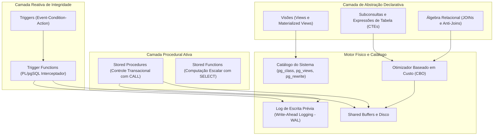

Ao longo deste manual, cada abstração é detalhada segundo seu fundamento na Álgebra Relacional de Codd, sua implementação sintática no dialeto PostgreSQL e suas implicações práticas na engenharia de software corporativa.

---

## Módulo 1: Visões Relacionais e Visões Materializadas

### Conceito e Fundamentação Teórica de Views

No modelo relacional estrito, uma visão (*view*) é uma relação derivada e virtual, computada a partir de relações base ou de outras visões previamente catalogadas. Na teoria dos conjuntos formulada por E. F. Codd, uma view representa a aplicação de operadores relacionais de projeção ($`\pi`$), seleção ($`\sigma`$), junção ($`\bowtie`$) e agregação ($`\gamma`$), mantendo a propriedade de fechamento relacional: o resultado da consulta é, ele próprio, uma relação.

Diferente de uma tabela base, a visão padrão não aloca espaço físico permanente para o armazenamento de tuplas em arquivos de dados (*heap files*). O SGBDR persiste exclusivamente a sua definição textual e seus metadados estruturais no catálogo do sistema (notadamente nas tabelas internas `pg_class`, `pg_views` e `pg_rewrite`).

### O Mecanismo Interno de Reescrita de Consultas

*[Complemento de Engenharia de Software / Otimizador de Consultas]*  
Quando uma aplicação submete um comando SQL consultando uma visão, o PostgreSQL não executa a visão de forma isolada na memória para só depois aplicar as condições da consulta externa. O subsistema denominado *Query Rewrite Rule System* intercepta a Árvore de Sintaxe Abstrata (AST) gerada pelo analisador léxico/sintático (*parser*) e funde a definição da visão com a requisição do usuário antes de repassar o plano para o Otimizador Baseado em Custo (*Cost-Based Optimizer* - CBO).

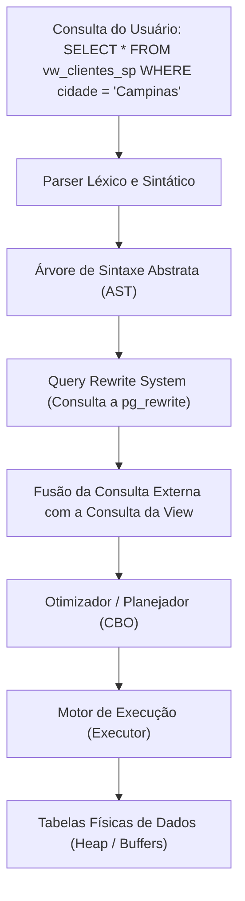

Essa reescrita viabiliza o aproveitamento integral de índices construídos nas tabelas base, pois os predicados da consulta externa são "empurrados" (*predicate pushdown*) para a consulta interna da view.

### Tabelas Base versus Visões Comuns versus Visões Materializadas

A tabela a seguir estabelece as distinções operacionais e físicas entre as estruturas de armazenamento e abstração no PostgreSQL:

| Dimensão Estrutural | Tabela Base | Visão Comum (Standard View) | Visão Materializada (Materialized View) |
| :--- | :--- | :--- | :--- |
| **Armazenamento Físico de Tuplas** | Sim (arquivos de dados em páginas de 8 KB) | Não (apenas metadados e DDL no catálogo) | Sim (snapshot estático persistido em disco) |
| **Definição Persistida** | DDL estrutural (`CREATE TABLE`) | Consulta declarativa (`CREATE VIEW AS SELECT`) | Consulta declarativa (`CREATE MATERIALIZED VIEW`) |
| **Frescor dos Dados (*Data Freshness*)** | Em tempo real (consistência imediata ACID) | Em tempo real (computada a cada invocação) | Estático/Assíncrono (depende de `REFRESH`) |
| **Custo de Escrita (DML nas Tabelas)** | Custo de I/O e manutenção de índices | Zero overhead em escritas nas tabelas base | Zero overhead imediato (custo adiado ao `REFRESH`) |
| **Custo de Leitura** | Acesso sequencial ou via índice | Custo integral da consulta subjacente expandida | Acesso direto ao snapshot, com suporte a índices |
| **Indexação Própria** | Sim (B-Tree, Hash, GIN, GiST, BRIN) | Não (utiliza índices das tabelas de origem) | Sim (suporta criação de índices independentes) |
| **Atualização via DML Direto** | Totalmente permitida | Condicionada a regras estritas ou Triggers | Proibida (leitura estrita, modificada via REFRESH) |

### Sintaxe Formal e Criação Passo a Passo

A instrução SQL para declaração de visões comuns obedece à seguinte gramática no PostgreSQL:

```sql
CREATE [ OR REPLACE ] [ TEMP | TEMPORARY ] [ RECURSIVE ] VIEW nome_da_visao [ ( alias_coluna [, ...] ) ]
AS consulta_select
[ WITH [ CASCADED | LOCAL ] CHECK OPTION ];
```

Considere o modelo comercial da disciplina. Para criar uma interface declarativa contendo apenas os clientes estabelecidos no estado de São Paulo, expõe-se uma visão com projeção controlada:

```sql
CREATE VIEW vw_clientes_sp AS
SELECT 
    id_cliente, 
    nome, 
    cidade
FROM clientes
WHERE estado = 'SP';
```

Ao executar `SELECT nome, cidade FROM vw_clientes_sp WHERE cidade = 'Campinas';`, o motor relacional reescreve a instrução para:

```sql
SELECT nome, cidade
FROM clientes
WHERE estado = 'SP' AND cidade = 'Campinas';
```

### Encapsulamento de Múltiplos JOINs e Agregações

Visões eliminam a complexidade acidental no consumo dos dados, abstraindo junções de alta cardinalidade e regras de negócio fiscais ou financeiras.

```sql
CREATE VIEW vw_detalhes_vendas AS
SELECT
    p.id_pedido,
    p.data_pedido,
    c.nome AS cliente,
    c.cidade,
    pr.nome_produto,
    ip.quantidade,
    ip.preco_unitario,
    ROUND(ip.quantidade * ip.preco_unitario, 2) AS subtotal
FROM pedidos p
INNER JOIN clientes c ON p.id_cliente = c.id_cliente
INNER JOIN itens_pedido ip ON p.id_pedido = ip.id_pedido
INNER JOIN produtos pr ON ip.id_produto = pr.id_produto;
```

A aplicação cliente agora consome a métrica consolidada sem manipular os quatro pontos de acoplamento relacional:

```sql
SELECT id_pedido, cliente, subtotal
FROM vw_detalhes_vendas
WHERE subtotal > 1000.00
ORDER BY subtotal DESC;
```

### Evolução de Esquema com CREATE OR REPLACE VIEW

O comando `CREATE OR REPLACE VIEW` permite redefinir a consulta interna sem descartar permissões de segurança concedidas previamente. Contudo, o PostgreSQL impõe invariantes rigorosas:
1. **Invariância de Colunas Anteriores:** Os atributos já existentes devem manter rigorosamente os mesmos nomes, tipos de dados e posição ordinal original.
2. **Adição Exclusivamente ao Final:** Novas colunas devem ser inseridas após a última coluna da definição precedente.
3. **Impossibilidade de Remoção:** Não é permitido excluir atributos ou reordená-los através deste comando.

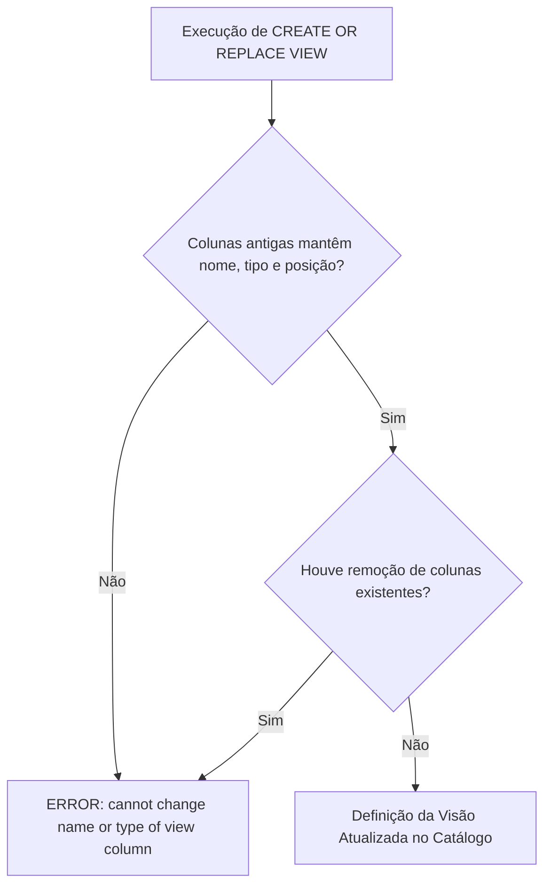

Caso seja mandatório reordenar colunas, alterar tipos de dados ou remover atributos, o administrador deve executar a exclusão explícita com `DROP VIEW` e recriar o objeto.

### Grafo de Dependências e Descarte: RESTRICT versus CASCADE

Objetos de esquema no PostgreSQL possuem relações de dependência monitoradas pela tabela de sistema `pg_depend`. Quando uma visão $`V_1`$ é referenciada por uma visão $`V_2`$ ou por uma função, a exclusão de $`V_1`$ afeta diretamente seus dependentes.

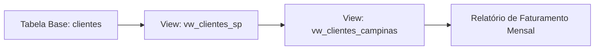

- **RESTRICT (Comportamento Padrão):** Aborta a destruição do objeto se houver qualquer elemento dependente registrado no catálogo, emitindo `ERROR: cannot drop view vw_clientes_sp because other objects depend on it`.
- **CASCADE:** Remove o objeto alvo e, recursivamente, descarta todos os objetos que dependem dele (visões filhas, triggers acopladas, funções de integração).

```sql
-- Exclusão segura em migrações controladas
DROP VIEW IF EXISTS vw_clientes_sp RESTRICT;

-- Exclusão recursiva (risco de indisponibilidade operacional)
DROP VIEW IF EXISTS vw_clientes_sp CASCADE;
```

### Visões Atualizáveis e Restrições de DML Direto

De acordo com o padrão ISO SQL e a implementação do PostgreSQL, uma visão é automaticamente atualizável (*automatically updatable*) para instruções `INSERT`, `UPDATE` e `DELETE` se, e somente se, atender cumulativamente aos seguintes critérios:
1. A cláusula `FROM` contém exatamente uma única relação (uma tabela base ou outra visão atualizável).
2. A consulta não contém cláusulas de agrupamento: `GROUP BY` ou `HAVING`.
3. A consulta não contém funções agregadoras (`SUM`, `AVG`, `COUNT`, `MAX`, `MIN`).
4. A consulta não faz uso de deduplicação (`DISTINCT`).
5. A consulta não realiza operações de conjunto (`UNION`, `INTERSECT`, `EXCEPT`).
6. A consulta não possui funções de janela (`OVER (...)`).
7. A lista de projeção é composta por referências diretas a colunas da tabela de origem, sem expressões computadas (por exemplo, `preco * 1.10`).

Caso a visão utilize junções ou agregações e ainda assim demande capacidade de escrita, é mandatória a criação de gatilhos do tipo `INSTEAD OF` para orquestrar manualmente a persistência dos dados nas tabelas correspondentes.

### Integridade Referencial com WITH CHECK OPTION

Uma visão atualizável que possui cláusula `WHERE` pode receber operações de `INSERT` ou `UPDATE` que violem seu próprio predicado de filtragem. Sem proteção, uma tupla inserida através da visão pode desaparecer imediatamente de sua própria listagem de seleção.

A cláusula `WITH CHECK OPTION` impede essa anomalia:

```sql
CREATE VIEW vw_clientes_sp_segura AS
SELECT id_cliente, nome, cidade, estado
FROM clientes
WHERE estado = 'SP'
WITH CHECK OPTION;
```

Se uma aplicação tentar executar:

```sql
INSERT INTO vw_clientes_sp_segura (nome, cidade, estado)
VALUES ('Roberto Santos', 'Curitiba', 'PR');
```

O PostgreSQL rejeita a transação com a mensagem:  
`ERROR: new row violates check option for view "vw_clientes_sp_segura"`  
`DETAIL: Failing row contains (Roberto Santos, Curitiba, PR).`

- **LOCAL CHECK OPTION:** Fiscaliza exclusivamente as restrições definidas na visão atual, ignorando restrições de visões subjacentes sobre as quais ela foi estruturada.
- **CASCADED CHECK OPTION (Padrão):** Fiscaliza hierarquicamente os predicados da visão atual e de todas as visões antecedentes envolvidas na cadeia de abstração.

### Segurança de Acesso e Princípio do Menor Privilégio

Visões constituem a principal ferramenta arquitetural para implementar o Princípio do Menor Privilégio (*Least Privilege*), operando em duas frentes de controle de acesso:
1. **Segurança a Nível de Coluna:** Omitir atributos sensíveis (como hashes de senhas, salários de funcionários ou limites de crédito de clientes).
2. **Segurança a Nível de Linha:** Restringir o conjunto de tuplas visíveis através de predicados na cláusula `WHERE` (por exemplo, expondo apenas registros do departamento do usuário conectado).

Para que o isolamento seja efetivo, o administrador de banco de dados revoga o acesso direto à tabela física e concede permissão estrita na visão:

```sql
-- 1. Revogação de acesso à tabela base para o perfil de analista
REVOKE ALL ON TABLE funcionarios FROM papel_analista;

-- 2. Concessão de leitura restrita à visão corporativa
GRANT SELECT ON vw_funcionarios_resumo TO papel_analista;
```

### Materialized Views: Armazenamento Físico, Atualização e Índices

Em cenários analíticos (OLAP) e painéis executivos de monitoramento, consultas agregando milhões de linhas e múltiplos relacionamentos tornam-se proibitivas em tempo real. A Visão Materializada (*Materialized View*) computa o resultado da instrução declarativa e grava as tuplas fisicamente em páginas de disco dedicadas.

```sql
CREATE MATERIALIZED VIEW mv_vendas_por_vendedor AS
SELECT
    v.id_vendedor,
    v.nome AS vendedor,
    COUNT(DISTINCT p.id_pedido) AS total_pedidos,
    COALESCE(SUM(ip.quantidade * ip.preco_unitario), 0.00) AS faturamento_total
FROM vendedores v
LEFT JOIN pedidos p ON v.id_vendedor = p.id_vendedor
LEFT JOIN itens_pedido ip ON p.id_pedido = ip.id_pedido
GROUP BY v.id_vendedor, v.nome;
```

#### Indexação em Materialized Views

Como possui persistência física de dados, a visão materializada suporta indexação própria para otimização de varreduras:

```sql
-- Criação de índice único (mandatório para atualização concorrente)
CREATE UNIQUE INDEX idx_mv_vendas_vendedor_id ON mv_vendas_por_vendedor (id_vendedor);

-- Criação de índice B-Tree para suporte a filtros de faturamento
CREATE INDEX idx_mv_vendas_faturamento ON mv_vendas_por_vendedor (faturamento_total DESC);
```

#### Atualização de Dados: REFRESH MATERIALIZED VIEW

A sincronização entre o snapshot físico da visão materializada e as modificações correntes nas tabelas base ocorre através da instrução `REFRESH`:

```sql
-- Atualização Bloqueante: Aloca trava ACCESS EXCLUSIVE, impedindo leituras concorrentes
REFRESH MATERIALIZED VIEW mv_vendas_por_vendedor;

-- Atualização Concorrente: Permite leituras concorrentes durante o processamento do recálculo
-- Exige obrigatoriamente a existência de pelo menos um índice UNIQUE na visão materializada
REFRESH MATERIALIZED VIEW CONCURRENTLY mv_vendas_por_vendedor;
```

---

## Módulo 2: Álgebra Relacional, Técnicas de Junção e Anti-Joins

### Fundamentos de Integridade Referencial: Chaves Primárias e Estrangeiras

O alicerce da modelagem relacional reside na correlação entre chaves primárias (*Primary Keys* - PK) e chaves estrangeiras (*Foreign Keys* - FK). A chave primária impõe unicidade matemática estrita e garantia de não-nulidade para identificar univocamente uma tupla na relação. A chave estrangeira formaliza a regra de dependência existencial: nenhum registro filho pode referenciar um identificador inexistente na relação pai.

A decomposição de dados em tabelas normalizadas segundo as Formas Normais de Codd (1FN, 2FN e 3FN) elimina redundâncias, mas impõe a necessidade algorítmica de reconstruir os vínculos associativos através do operador relacional de junção.

### Teoria das Junções: Teta-Junção e Equijunção

Na Álgebra Relacional, a junção de duas relações $`R`$ e $`S`$ com base em uma condição $`\theta`$ é definida formalmente como a seleção sobre o produto cartesiano das relações:

```math
R \bowtie_\theta S = \sigma_\theta (R \times S)
```

Onde:
- $`R \times S`$ representa o produto cartesiano contendo todas as tuplas $`(r, s)`$ com $`r \in R`$ e $`s \in S`$.
- $`\theta`$ representa a fórmula proposicional de comparação ($`=, \ne, <, \le, >, \ge`$).
- Quando o operador relacional contido em $`\theta`$ é exclusivamente a igualdade ($`=`$), a operação é classificada como **Equijunção**.

### INNER JOIN e Algoritmos de Execução Física

O `INNER JOIN` (ou junção interna) materializa a interseção pura entre dois conjuntos de dados associados. Uma linha da relação esquerda só fará parte do resultado se satisfizer integralmente a condição da cláusula `ON` contra pelo menos uma linha da relação direita.

*[Complemento de Engenharia de Software / Otimizador Baseado em Custo]*  
O PostgreSQL implementa internamente três estratégias de execução física para resolver operações de junção:

1. **Nested Loop Join:**
   - **Mecânica:** Percorre a relação externa linha por linha e, para cada registro, sonda a relação interna.
   - **Complexidade:** $`O(M \times \log N)`$ com índice B-Tree na tabela interna; $`O(M \times N)`$ em varredura sequencial.
   - **Aplicação Típica:** Ideal quando a relação externa é pequena e a relação interna possui índice altamente seletivo na chave de acoplamento.
2. **Hash Join:**
   - **Mecânica:** Varre a relação de menor dimensão estatística e constrói uma tabela de espalhamento (*hash table*) na memória de trabalho (`work_mem`). Em seguida, varre a relação maior aplicando a função de espalhamento sobre a chave de junção para localizar correspondências imediatas.
   - **Complexidade:** $`O(M + N)`$ no cenário ideal sem estouro de memória (*spill to disk*).
   - **Aplicação Típica:** Altamente eficiente para conjuntos médios e grandes em equijunções não ordenadas.
3. **Merge Join:**
   - **Mecânica:** Exige que ambas as relações estejam previamente ordenadas pelas chaves de junção. Percorre linearmente as duas entradas em paralelo através de ponteiros sincronizados.
   - **Complexidade:** $`O(M + N)`$ se as entradas já estiverem ordenadas por índice; $`O(M \log M + N \log N)`$ caso exija nó explícito de ordenação (`Sort`).
   - **Aplicação Típica:** Excelente para grandes volumes de dados onde índices B-Tree prévios eliminam o custo de ordenação.

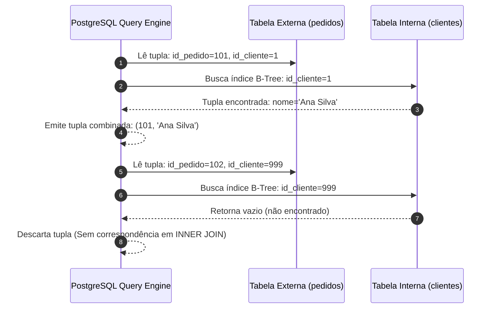

### Resolução de Ambiguidade e Engenharia de Aliases

Em esquemas normalizados, atributos homônimos (como `id_cliente` presente tanto em `clientes` quanto em `pedidos`) provocam a falha `ERROR: column reference is ambiguous` caso referenciados sem o devido qualificador relacional.

A prática recomendada de engenharia estabelece o uso de apelidos (*aliases*) mnemônicos curtos e explícitos:

```sql
SELECT
    p.id_pedido,
    p.data_pedido,
    c.id_cliente,
    c.nome AS nome_cliente
FROM pedidos AS p
INNER JOIN clientes AS c ON p.id_cliente = c.id_cliente;
```

### LEFT JOIN e Tratamento de Nulos com COALESCE

O `LEFT OUTER JOIN` (ou simplesmente `LEFT JOIN`) garante a preservação irrestrita de todas as tuplas da relação posicionada à esquerda da sintaxe. Caso uma tupla da relação esquerda não encontre correspondente na relação direita, todos os atributos originários da relação direita são sintetizados como valores nulos (`NULL`).

Em relatórios gerenciais, a exibição explícita do valor `NULL` degrada a experiência de consumo. A função escalar `COALESCE(val1, val2, ..., valN)` avalia os argumentos da esquerda para a direita e retorna o primeiro valor não nulo:

```sql
SELECT
    pr.id_produto,
    pr.nome_produto,
    COALESCE(cat.nome_categoria, 'Não Categorizado') AS categoria_exibicao
FROM produtos pr
LEFT JOIN categorias cat ON pr.id_categoria = cat.id_categoria;
```

### O Padrão Estrutural Anti-Join

O padrão de Anti-Junção destina-se a identificar elementos pertencentes ao conjunto $`A`$ que não possuem qualquer vínculo relacional com o conjunto $`B`$ ($`A \setminus B`$). No PostgreSQL, a implementação padrão apoia-se em um `LEFT JOIN` associado a uma restrição de nulidade no `WHERE`:

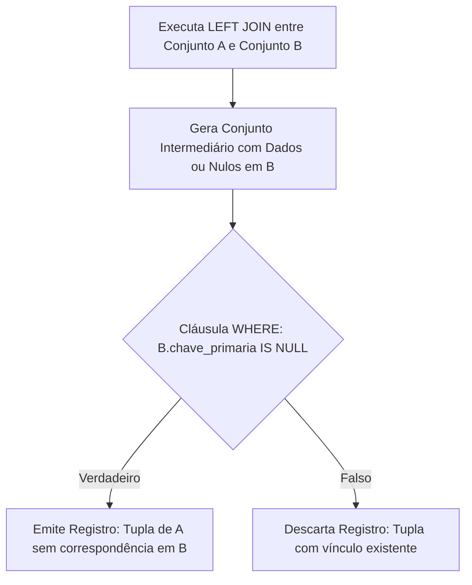

```sql
-- Localização de clientes que nunca emitiram pedidos
SELECT 
    c.id_cliente,
    c.nome
FROM clientes c
LEFT JOIN pedidos p ON c.id_cliente = p.id_cliente
WHERE p.id_pedido IS NULL;
```

> [!CRITICAL]
> O filtro `IS NULL` na cláusula `WHERE` deve ser aplicado obrigatoriamente sobre a **Chave Primária** da relação da direita (ou coluna com restrição `NOT NULL`). Se o desenvolvedor aplicar `WHERE p.observacao IS NULL`, e a coluna `observacao` admitir nulos originalmente na tabela de pedidos, a consulta gerará falsos positivos catastróficos.

### RIGHT JOIN e Inversão Semântica

A operação $`A \text{ RIGHT JOIN } B`$ preserva integralmente as tuplas da tabela $`B`$, preenchendo com nulos as colunas de $`A`$ quando não houver par. Na álgebra relacional, a operação é estritamente equivalente à inversão dos operandos:

```math
A \text{ RIGHT JOIN } B \equiv B \text{ LEFT JOIN } A
```

Em conformidade com os guias de estilo da indústria e boas práticas de legibilidade de código SQL, o uso de `RIGHT JOIN` deve ser evitado. A inversão para `LEFT JOIN` mantém o fluxo de leitura ocidental da esquerda para a direita, facilitando a manutenção e a rastreabilidade em cadeias com múltiplos acoplamentos.

### FULL OUTER JOIN e Casos de Auditoria e Reconciliação

O `FULL OUTER JOIN` realiza a união relacional completa entre dois conjuntos. Ele retorna todas as tuplas correspondentes e preserva todas as tuplas não correspondentes de ambos os lados, preenchendo os atributos faltantes com `NULL`.

Sua principal aplicação em sistemas corporativos ocorre em auditorias contábeis e reconciliações financeiras entre sistemas distintos (por exemplo, conferindo lançamentos do razão contábil contra extratos de gateways de pagamento):

```sql
SELECT
    l.id_lancamento,
    l.valor AS valor_contabil,
    g.id_transacao,
    g.valor AS valor_gateway
FROM lancamentos_internos l
FULL OUTER JOIN transacoes_gateway g ON l.codigo_conciliacao = g.codigo_conciliacao
WHERE l.id_lancamento IS NULL OR g.id_transacao IS NULL;
```

### CROSS JOIN e Riscos de Explosão Cartesiana

O `CROSS JOIN` calcula o produto cartesiano puro entre duas relações. Se a tabela $`A`$ contém $`M`$ tuplas e a tabela $`B`$ contém $`N`$ tuplas, a saída conterá exatamente $`M \times N`$ tuplas.

```sql
-- Geração de matriz dimensional: Todas as cores para todos os tamanhos
SELECT c.nome_cor, t.sigla_tamanho
FROM cores c
CROSS JOIN tamanhos t;
```

> [!WARNING]
> O produto cartesiano acidental provocado pela omissão da cláusula `ON` ou separação incorreta de tabelas por vírgula (`FROM tabela_a, tabela_b`) em tabelas de produção com $`100.000`$ e $`500.000`$ tuplas tentará produzir $`50.000.000.000`$ de registros na memória temporária do servidor, levando à exaustão de I/O e esgotamento do disco (*out-of-disk space*).

### SELF JOIN e Modelagem de Hierarquias em Árvore

O autorrelacionamento (*Self-Join*) ocorre quando uma tabela referencia a sua própria chave primária por meio de uma chave estrangeira, implementando o modelo de lista de adjacência (*Adjacency List*) para estruturas em árvore (como organogramas corporativos ou planos de contas).

Para processar o autorrelacionamento, o motor do PostgreSQL instancia logicamente duas imagens da tabela na memória, exigindo o uso de apelidos distintos para separar o nó filho do nó pai:

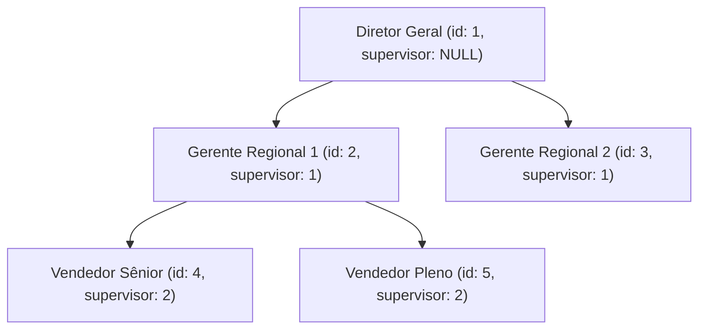

```sql
SELECT
    f.nome AS colaborador,
    COALESCE(s.nome, 'Diretoria / Raiz') AS supervisor_imediato
FROM funcionarios f
LEFT JOIN funcionarios s ON f.id_supervisor = s.id_funcionario;
```

### Diferença Semântica Crítica: Filtros no ON versus Filtros no WHERE

Um dos erros conceituais mais frequentes na engenharia de dados decorre da confusão entre filtrar atributos na cláusula `ON` versus filtrar na cláusula `WHERE` em junções externas (`LEFT JOIN`).

Considere o objetivo de listar **todos** os clientes cadastrados e, caso existam, apenas os pedidos realizados no ano de 2026:

```sql
-- ABORDAGEM CORRETA: O predicado integra o acoplamento do LEFT JOIN
SELECT c.id_cliente, c.nome, p.id_pedido, p.data_pedido
FROM clientes c
LEFT JOIN pedidos p ON c.id_cliente = p.id_cliente 
                   AND p.data_pedido >= '2026-01-01' 
                   AND p.data_pedido <= '2026-12-31';

-- ABORDAGEM INCORRETA: Converte o LEFT JOIN em um INNER JOIN disfarçado!
SELECT c.id_cliente, c.nome, p.id_pedido, p.data_pedido
FROM clientes c
LEFT JOIN pedidos p ON c.id_cliente = p.id_cliente
WHERE p.data_pedido >= '2026-01-01' AND p.data_pedido <= '2026-12-31';
```

**Análise Mecânica da Falha:**  
Na segunda consulta, para qualquer cliente que não possua pedidos em 2026 (ou que não possua pedido algum), a coluna `p.data_pedido` assume o valor `NULL` na etapa de junção. Posteriormente, quando a cláusula `WHERE` é avaliada, a expressão `NULL >= '2026-01-01'` resulta em `UNKNOWN`. A cláusula `WHERE` descarta sumariamente qualquer tupla que não seja estritamente `TRUE`, eliminando todos os clientes sem compras recentes e destruindo o propósito do `LEFT JOIN`.

### Cláusula USING versus Desaconselhamento de NATURAL JOIN

- **Cláusula USING:** Sintaxe que simplifica equijunções quando as tabelas compartilham exatamente o mesmo identificador de chave primária e estrangeira:
  ```sql
  SELECT c.nome, p.id_pedido
  FROM clientes c
  INNER JOIN pedidos p USING (id_cliente);
  ```
  O atributo `id_cliente` é fundido no resultado projetado, evitando duplicidade de colunas.
- **NATURAL JOIN (Antipattern de Produção):** O `NATURAL JOIN` realiza a junção automática cruzando **todas** as colunas com nomes idênticos entre as duas relações. Se ambas as tabelas possuírem colunas estruturais como `data_cadastro` ou `status`, o `NATURAL JOIN` acoplará essas colunas silenciosamente na cláusula `ON`, alterando o resultado sem aviso prévio e quebrando o determinismo do sistema caso o esquema sofra evolução futura. Seu uso em ambientes de engenharia é categoricamente vedado.

---

## Módulo 3: Subconsultas, Lógica Trivalente e Expressões de Tabela Comuns

### Conceito e Taxonomia Completa de Subconsultas

Uma subconsulta (*subquery*, *subselect* ou consulta aninhada) é uma instrução `SELECT` encapsulada no interior de uma instrução SQL externa (`SELECT`, `INSERT`, `UPDATE` ou `DELETE`).

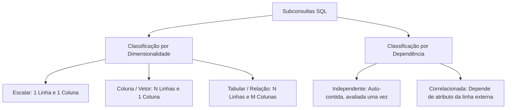

### Subconsultas Escalares

Uma subconsulta escalar deve produzir no máximo um valor atômico (uma linha e uma coluna). Se produzir zero linhas, seu resultado é avaliado como `NULL`. Caso produza mais de uma linha, o PostgreSQL aborta a transação com:  
`ERROR: more than one row returned by a subquery used as an expression`.

```sql
-- Subconsulta escalar aplicada na cláusula WHERE
SELECT nome_produto, preco
FROM produtos
WHERE preco > (SELECT AVG(preco) FROM produtos);

-- Subconsulta escalar aplicada na lista de projeção (SELECT)
SELECT 
    nome_produto, 
    preco,
    ROUND((SELECT AVG(preco) FROM produtos), 2) AS preco_medio_global,
    ROUND(preco - (SELECT AVG(preco) FROM produtos), 2) AS diferencial
FROM produtos;
```

### Operadores de Pertencimento: IN e a Armadilha do NOT IN com NULL

O operador `IN` verifica se um valor escalar pertence a uma lista gerada por uma subconsulta unicolunar:

```math
v \in S \iff \exists s \in S \mid v = s
```

O operador `NOT IN` é a negação lógica do pertencimento:

```math
v \notin S \iff \forall s \in S \mid v \ne s
```

#### A Armadilha da Lógica Trivalente (Three-Valued Logic - 3VL)

*[Complemento de Teoria Relacional e Fundamentos Matemáticos]*  
A Álgebra Relacional opera sobre a lógica trivalente (*Three-Valued Logic*), onde os valores de verdade são `TRUE`, `FALSE` e `UNKNOWN` (indeterminado). O valor `NULL` não é uma constante vazia ou zero; representa a ausência de valor ou a incognoscibilidade da informação.

Considere a expressão matemática:

```sql
v NOT IN (val1, val2, ..., valN)
```

Que o compilador traduz formalmente para:

```sql
(v <> val1) AND (v <> val2) AND ... AND (v <> valN)
```

Se o conjunto retornado pela subconsulta contiver **um único registro nulo** (por exemplo, `val2 IS NULL`), a comparação `v <> NULL` produz `UNKNOWN`. Pelas leis da álgebra booleana de três valores:
- `TRUE AND UNKNOWN` resulta em `UNKNOWN`.
- `FALSE AND UNKNOWN` resulta em `FALSE`.

Como a cláusula `WHERE` apenas retém registros cuja avaliação final seja estritamente `TRUE`, a expressão inteira **jamais retornará verdadeiro para nenhuma linha do banco**, resultando em um conjunto de dados vazio!

```sql
-- CENÁRIO DE RISCO CRÍTICO:
-- Se existir um único pedido com id_cliente NULL na base, esta consulta retorna 0 linhas!
SELECT nome FROM clientes WHERE id_cliente NOT IN (SELECT id_cliente FROM pedidos);

-- PADRÃO DEFENSIVO: Filtrar a nulidade expressamente na subconsulta
SELECT nome FROM clientes WHERE id_cliente NOT IN (SELECT id_cliente FROM pedidos WHERE id_cliente IS NOT NULL);
```

### Operadores de Existência: Semântica de Curto-Circuito com EXISTS e NOT EXISTS

O operador `EXISTS` avalia se a subconsulta retorna pelo menos uma tupla, retornando `TRUE` ou `FALSE`. Ele não manipula valores de atributos nem compara dados escalares; apenas afere a cardinalidade resultante ($`|S| > 0`$).

```sql
SELECT c.nome
FROM clientes c
WHERE EXISTS (
    SELECT 1 
    FROM pedidos p 
    WHERE p.id_cliente = c.id_cliente
);
```

#### Vantagens Estruturais de Engenharia do EXISTS
1. **Imunidade à Lógica Trivalente:** O operador `NOT EXISTS` não é afetado por valores `NULL` no conjunto interno, pois a presença de nulos ainda conta como linhas existentes, mantendo a consistência booleana.
2. **Avaliação por Curto-Circuito (*Short-Circuit Evaluation*):** O motor de execução interrompe a varredura interna assim que a primeira correspondência é localizada.
3. **Convenção `SELECT 1`:** Por convenção de engenharia, utiliza-se `SELECT 1` dentro de subconsultas com `EXISTS`, explicitando que a projeção de colunas da subconsulta é completamente irrelevante para o teste de existência.

### Quantificadores Universais e Existenciais: ANY e ALL

- **`> ANY (subconsulta)`:** Retorna verdadeiro se o elemento da consulta externa for maior que **pelo menos um** elemento gerado pela subconsulta (equivalente funcional a `> MIN(...)`).
- **`> ALL (subconsulta)`:** Retorna verdadeiro se o elemento da consulta externa for estritamente maior que **todos** os elementos gerados pela subconsulta (equivalente funcional a `> MAX(...)`).

```sql
-- Produtos com preço superior a pelo menos um produto da categoria 'Telefonia'
SELECT nome_produto, preco
FROM produtos
WHERE preco > ANY (
    SELECT pr.preco 
    FROM produtos pr 
    INNER JOIN categorias cat ON pr.id_categoria = cat.id_categoria 
    WHERE cat.nome_categoria = 'Telefonia'
);

-- Produtos com preço estritamente superior a todos os produtos de 'Acessórios'
SELECT nome_produto, preco
FROM produtos
WHERE preco > ALL (
    SELECT pr.preco 
    FROM produtos pr 
    INNER JOIN categorias cat ON pr.id_categoria = cat.id_categoria 
    WHERE cat.nome_categoria = 'Acessórios'
);
```

### Subconsultas Correlacionadas versus Independentes

- **Subconsulta Independente (Não-Correlacionada):** Não mantém nenhuma referência a colunas da consulta externa. É executada uma única vez pelo planejador do PostgreSQL, frequentemente gerando um nó de execução `InitPlan`, cujo resultado escalar é reutilizado em cache por todas as linhas da consulta principal.
- **Subconsulta Correlacionada:** Faz referência explícita a colunas da tupla corrente da consulta externa (através de um alias externo). Conceitualmente, a subconsulta precisa ser reavaliada para cada registro processado pela consulta externa.

```sql
-- Subconsulta correlacionada: Produtos com preço superior à média de sua respectiva categoria
SELECT p.id_produto, p.nome_produto, p.preco, p.id_categoria
FROM produtos p
WHERE p.preco > (
    SELECT AVG(sub.preco)
    FROM produtos sub
    WHERE sub.id_categoria = p.id_categoria
);
```

### Subconsultas no FROM (Tabelas Derivadas) e Obrigatoriedade de Alias

Uma subconsulta na cláusula `FROM` atua como uma visão transitória em memória (*inline view* ou tabela derivada). Ela viabiliza a execução de agregações intermediárias antes do acoplamento com outras entidades.

No PostgreSQL e no padrão SQL ANSI, **é obrigatório fornecer um alias formal** para qualquer subconsulta declarada no `FROM`. A omissão do alias resulta imediatamente no erro `ERROR: subquery in FROM must have an alias`.

```sql
-- Agregação prévia para cálculo de faturamento por pedido com relacionamento subsequente
SELECT
    sub.id_pedido,
    c.nome AS cliente,
    p.data_pedido,
    sub.total_pedido
FROM (
    SELECT id_pedido, SUM(quantidade * preco_unitario) AS total_pedido
    FROM itens_pedido
    GROUP BY id_pedido
) AS sub
INNER JOIN pedidos p ON sub.id_pedido = p.id_pedido
INNER JOIN clientes c ON p.id_cliente = c.id_cliente
WHERE sub.total_pedido > 3000.00;
```

### Operações DML Guiadas por Subconsultas

1. **INSERT em Lote (`INSERT INTO ... SELECT`):**
   ```sql
   INSERT INTO produtos_promocao (id_produto, nome_produto, preco, preco_promocional)
   SELECT id_produto, nome_produto, preco, ROUND(preco * 0.90, 2)
   FROM produtos
   WHERE preco > (SELECT AVG(preco) FROM produtos);
   ```
2. **UPDATE Correlacionado com Subconsultas:**
   ```sql
   UPDATE produtos p
   SET estoque = estoque + 5
   WHERE p.preco > (
       SELECT AVG(sub.preco)
       FROM produtos sub
       WHERE sub.id_categoria = p.id_categoria
   );
   ```
3. **DELETE com Anti-Junção (`NOT EXISTS`):**
   ```sql
   DELETE FROM clientes c
   WHERE NOT EXISTS (
       SELECT 1 
       FROM pedidos p 
       WHERE p.id_cliente = c.id_cliente
   );
   ```

### Expressões de Tabela Comuns (CTEs com WITH)

As Expressões de Tabela Comuns (*Common Table Expressions* - CTE), declaradas com a cláusula `WITH`, constituem o padrão moderno de legibilidade para queries aninhadas. Uma CTE define um conjunto de dados nomeado temporário que existe unicamente durante a execução da instrução SQL.

```sql
WITH ResumoFinanceiroCliente AS (
    SELECT 
        p.id_cliente,
        SUM(ip.quantidade * ip.preco_unitario) AS total_gasto
    FROM pedidos p
    INNER JOIN itens_pedido ip ON p.id_pedido = ip.id_pedido
    GROUP BY p.id_cliente
),
MediaGeralGasto AS (
    SELECT AVG(total_gasto) AS media_geral
    FROM ResumoFinanceiroCliente
)
SELECT 
    c.id_cliente,
    c.nome,
    rfc.total_gasto
FROM ResumoFinanceiroCliente rfc
CROSS JOIN MediaGeralGasto mgg
INNER JOIN clientes c ON rfc.id_cliente = c.id_cliente
WHERE rfc.total_gasto > mgg.media_geral
ORDER BY rfc.total_gasto DESC;
```

### Critérios de Decisão de Engenharia: Subconsulta versus JOIN

Embora muitas consultas possam ser formuladas tanto via junções quanto via subconsultas, a decisão arquitetural obedece a regras de clareza e desempenho:

| Cenário de Negócio | Mecanismo Recomendado | Justificativa Técnica |
| :--- | :--- | :--- |
| **Projeção de Colunas de Múltiplas Relações** | `JOIN` | Subconsultas no `SELECT` provocam multiplicação de planos escalares, degradando a performance. |
| **Filtro de Existência Sem Projeção de Dados Filhos** | `EXISTS` | Evita a duplicação de linhas causada por relacionamentos $`1:N`$, eliminando o custo de `DISTINCT`. |
| **Filtro de Não-Existência (Anti-Join)** | `NOT EXISTS` ou `LEFT JOIN ... IS NULL` | Imunidade contra falhas de lógica trivalente geradas por nulos no operador `NOT IN`. |
| **Agregações Multitabela Complexas** | `CTE` ou Tabela Derivada no `FROM` | Isola o escopo de agrupamento, prevenindo a inflação de valores agregados antes do `JOIN`. |

---

## Módulo 4: Programação Procedural em PL/pgSQL e Stored Procedures

### Transição do Paradigma Declarativo para o Imperativo

A linguagem SQL padrão é estritamente declarativa: o desenvolvedor descreve **o que** deseja recuperar ou alterar através de álgebra de conjuntos, delegando ao motor do banco a definição algorítmica de **como** a busca será efetuada. Contudo, operações de negócios complexas exigem estruturas procedurais clássicas: variáveis tipadas, bifurcações condicionais (`IF/ELSE`), laços de repetição (`WHILE/FOR`), captura de erros e controle de transação.

No PostgreSQL, a linguagem PL/pgSQL (*Procedural Language / PostgreSQL Structured Query Language*) supre essa necessidade, provendo uma plataforma de computação completa hospedada diretamente no processo do SGBDR.

### Motivação Arquitetural: Redução de Round-Trips de Rede

Em uma arquitetura clássica onde a lógica procedural reside exclusivamente na aplicação servidora (backend), uma transação de negócio envolvendo múltiplos passos gera intensa latência de rede (*network round-trips*):

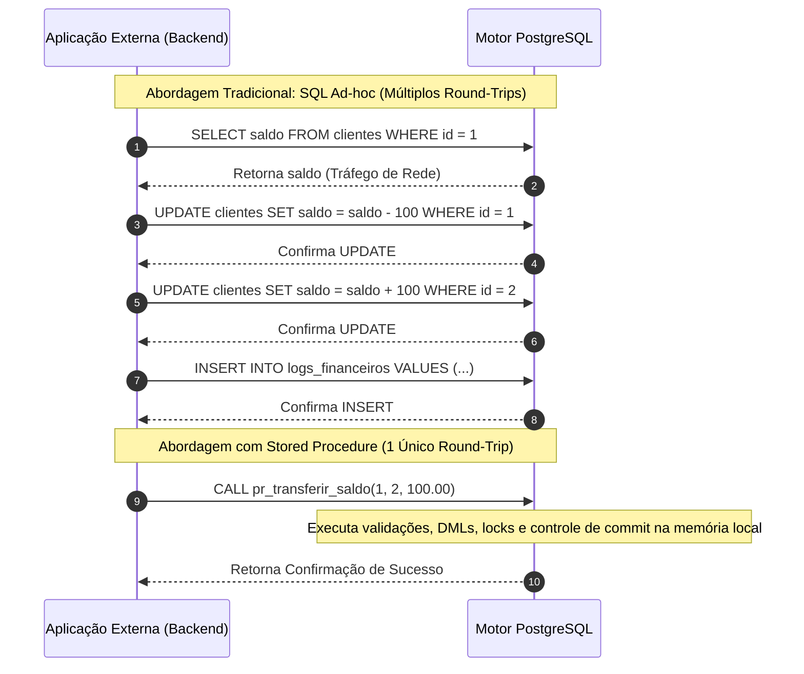

Com a utilização de Stored Procedures, toda a comunicação intermediária ocorre na memória compartilhada do servidor de dados com latência nula de rede.

### Stored Functions versus Stored Procedures no PostgreSQL

*[Complemento de Evolução Histórica do PostgreSQL]*  
Historicamente, até a versão 10, o PostgreSQL oferecia apenas `CREATE FUNCTION`. No entanto, funções executam obrigatoriamente sob o contexto de uma transação externa iniciada pelo comando chamador (como um `SELECT`). Isso impedia a execução de instruções explícitas de controle transacional no interior do código.

A partir do **PostgreSQL 11** (em conformidade com o padrão SQL:2011), introduziu-se formalmente o objeto `CREATE PROCEDURE`, invocado através do comando `CALL`.

| Critério de Comparação | Stored Function (`CREATE FUNCTION`) | Stored Procedure (`CREATE PROCEDURE`) |
| :--- | :--- | :--- |
| **Comando de Invocação** | `SELECT nome_funcao(...)` | `CALL nome_procedure(...)` |
| **Uso em Instruções SQL** | Permitido (em cláusulas `SELECT`, `WHERE`, `JOIN`) | Não permitido (deve ser chamada isoladamente via `CALL`) |
| **Cláusula de Retorno** | Obrigatória (`RETURNS tipo` ou `RETURNS void`) | Inexistente (retorno exclusivamente via `OUT` ou `INOUT`) |
| **Controle Transacional (`COMMIT` / `ROLLBACK`)** | **Expressamente Proibido** (abortaria a transação do SELECT) | **Plenamente Permitido** (autonomia transacional total) |
| **Objetivo Principal** | Cálculos, filtros e computação relacional pura | Orquestração de regras de negócio e rotinas em lote (*batch*) |

### Anatomia Estrutural do Bloco PL/pgSQL e Dollar Quoting

O PL/pgSQL é uma linguagem estruturada em blocos delimitados:

```sql
[ <<rotulo>> ]
[ DECLARE
    -- Seção declarativa: alocação de variáveis, constantes e tipos
]
BEGIN
    -- Seção executável: comandos procedurais e instruções DML SQL
[ EXCEPTION
    -- Seção de tratamento de exceções: interceptação de falhas em tempo de execução
]
END [ rotulo ];
```

#### O Mecanismo de Dollar Quoting

Em SQL padrão, o corpo de uma função precisaria ser envolvido por aspas simples (`'corpo'`), o que forçava o desenvolvedor a escapar qualquer aspa interna duplicando-a (`''''`). O mecanismo de **Dollar Quoting** resolve essa fragilidade envolvendo o código fonte com marcadores de cifrão (`$$` ou `$tag$`):

```sql
CREATE OR REPLACE PROCEDURE pr_demonstracao_quoting()
LANGUAGE plpgsql
AS $corpo_proc$
BEGIN
    RAISE NOTICE 'O uso de aspas simples ''aqui'' fica perfeitamente legível.';
END;
$corpo_proc$;
```

### Blocos Anônimos (DO) versus Procedimentos de Catálogo

1. **Blocos Anônimos (`DO`):** São fragmentos transitórios de código PL/pgSQL executados imediatamente pelo motor. Não são registrados de forma durável no catálogo e não aceitam parâmetros de chamada. São amplamente utilizados em migrações de dados e scripts administrativos:
   ```sql
   DO $$
   DECLARE
       v_agora TIMESTAMP := clock_timestamp();
   BEGIN
       RAISE NOTICE 'Execução de rotina transitória às: %', v_agora;
   END;
   $$;
   ```
2. **Procedimentos Catalogados (`CREATE PROCEDURE`):** Objetos duráveis de esquema, registrados no catálogo `pg_proc`, parametrizáveis e reutilizáveis por múltiplas conexões de aplicação.

### Declaração de Variáveis e Tipagem Ancorada (%TYPE e %ROWTYPE)

As variáveis em PL/pgSQL devem ser explicitamente tipadas na seção `DECLARE`. Se não forem inicializadas, assumem valor padrão `NULL`.

#### Tipagem Dinâmica Ancorada

Em sistemas sujeitos a refatorações de esquema, definir variáveis com tipos primitivos rígidos (ex: `VARCHAR(100)`) introduz fragilidade: se o tamanho da coluna na tabela for expandido, o procedimento procedural apresentará falha por truncamento.

O PostgreSQL fornece qualificadores de tipagem ancorada:
- **`%TYPE`:** Ancora o tipo de uma variável ao tipo exato de uma coluna existente no banco.
- **`%ROWTYPE`:** Cria uma variável do tipo registro (*record*) espelhando toda a estrutura de colunas de uma tabela.

```sql
DECLARE
    -- Tipagem ancorada a uma coluna específica
    v_saldo clientes.saldo%TYPE;
    
    -- Tipagem ancorada à linha inteira da tabela
    v_cliente_reg clientes%ROWTYPE;
BEGIN
    SELECT * INTO v_cliente_reg FROM clientes WHERE id_cliente = 1;
    v_saldo := v_cliente_reg.saldo;
END;
```

### Modos de Parâmetros: IN, OUT e INOUT

- **`IN` (Modo Padrão):** O argumento é recebido pelo procedimento apenas para leitura. O procedimento opera sobre uma cópia do valor e não consegue repassar modificações para o chamador.
- **`OUT`:** O parâmetro é puramente de saída. Ele não recebe valor de entrada da instrução de chamada, atuando como o canal formal de retorno de dados do procedimento para a aplicação.
- **`INOUT`:** O parâmetro recebe um valor inicial na invocação e, após o processamento procedural, exporta o valor modificado de volta para quem realizou a chamada.

```sql
CREATE OR REPLACE PROCEDURE pr_reajuste_com_retorno(
    IN p_id_funcionario INTEGER,
    IN p_percentual NUMERIC,
    OUT p_novo_salario NUMERIC
)
LANGUAGE plpgsql
AS $$
BEGIN
    UPDATE funcionarios
    SET salario = salario * (1 + (p_percentual / 100.0))
    WHERE id_funcionario = p_id_funcionario
    RETURNING salario INTO p_novo_salario;
END;
$$;
```

### Controle de Fluxo Condicional e Emissão de Mensagens

O PL/pgSQL fornece as estruturas de decisão `IF ... THEN ... ELSIF ... ELSE ... END IF;` para implementar a governança de regras.

Para comunicação de eventos e diagnóstico, utiliza-se o comando `RAISE`:
- **`RAISE NOTICE`:** Emite mensagens de diagnóstico e rastreabilidade para o cliente sem interromper o fluxo da transação.
- **`RAISE EXCEPTION`:** Aborta sumariamente o bloco de execução atual, revertendo todas as instruções executadas na transação corrente (*rollback* automático).

```sql
IF p_valor <= 0 THEN
    RAISE EXCEPTION 'Operação Rejeitada: O valor deve ser estritamente positivo. Valor informado: %', p_valor;
END IF;
```

### Execução DML, FOUND, GET DIAGNOSTICS e Bloqueio Concorrente

Ao executar instruções `INSERT`, `UPDATE` ou `DELETE` no PL/pgSQL, o desenvolvedor deve fiscalizar o resultado da operação:
- **Variável Booleana `FOUND`:** Assume `TRUE` se o comando DML afetou pelo menos uma linha ou se uma instrução `SELECT INTO` localizou registro. Assume `FALSE` caso contrário.
- **Instrução `GET DIAGNOSTICS`:** Extrai dados quantitativos detalhados, como a contagem exata de linhas manipuladas (`ROW_COUNT`).

```sql
UPDATE clientes SET saldo = saldo + p_valor WHERE id_cliente = p_id_cliente;

IF NOT FOUND THEN
    RAISE EXCEPTION 'Inconsistência Operacional: Cliente com ID % não localizado.', p_id_cliente;
END IF;
```

#### Bloqueio Concorrente com SELECT FOR UPDATE

Em operações transacionais que leem um saldo para posteriormente alterá-lo, o acesso concorrente simultâneo por duas conexões pode gerar a anomalia de atualização perdida (*Lost Update*). A cláusula `SELECT FOR UPDATE` impõe um bloqueio pessimista exclusivo na linha (*Row-Level Lock*), forçando conexões paralelas a aguardarem a conclusão da transação corrente:

```sql
SELECT saldo INTO v_saldo_atual
FROM clientes
WHERE id_cliente = p_id_cliente
FOR UPDATE;
```

### Controle Transacional Autônomo com COMMIT e ROLLBACK

A principal prerrogativa das Stored Procedures é a autonomia transacional. Em processos de carga em lote (*bulk processing*) que processam milhões de tuplas, manter uma única transação aberta causa saturação do log de escrita prévia (*WAL*) e mantém travas ativas por tempo excessivo. Com procedimentos, é possível persistir marcos intermediários:

```sql
CREATE OR REPLACE PROCEDURE pr_processamento_lote()
LANGUAGE plpgsql
AS $$
BEGIN
    -- Etapa 1
    UPDATE faturas SET status = 'PROCESSANDO' WHERE status = 'PENDENTE';
    COMMIT; -- Persiste alterações da Etapa 1 e libera travas no heap

    -- Etapa 2
    INSERT INTO historico_processamento (data_execucao) VALUES (NOW());
    COMMIT; -- Persiste Etapa 2
END;
$$;
```

---

## Módulo 5: Triggers e Automação de Regras de Negócio

### Conceito Fundamental e o Paradigma Event-Condition-Action (ECA)

Um gatilho (*trigger*) é um objeto do catálogo do banco de dados acoplado a uma tabela ou visão específica, cuja execução ocorre de maneira implícita e automática pelo motor relacional sempre que uma operação de manipulação de dados é detectada.

Os triggers respeitam rigorosamente o paradigma clássico **ECA** (*Event-Condition-Action*):

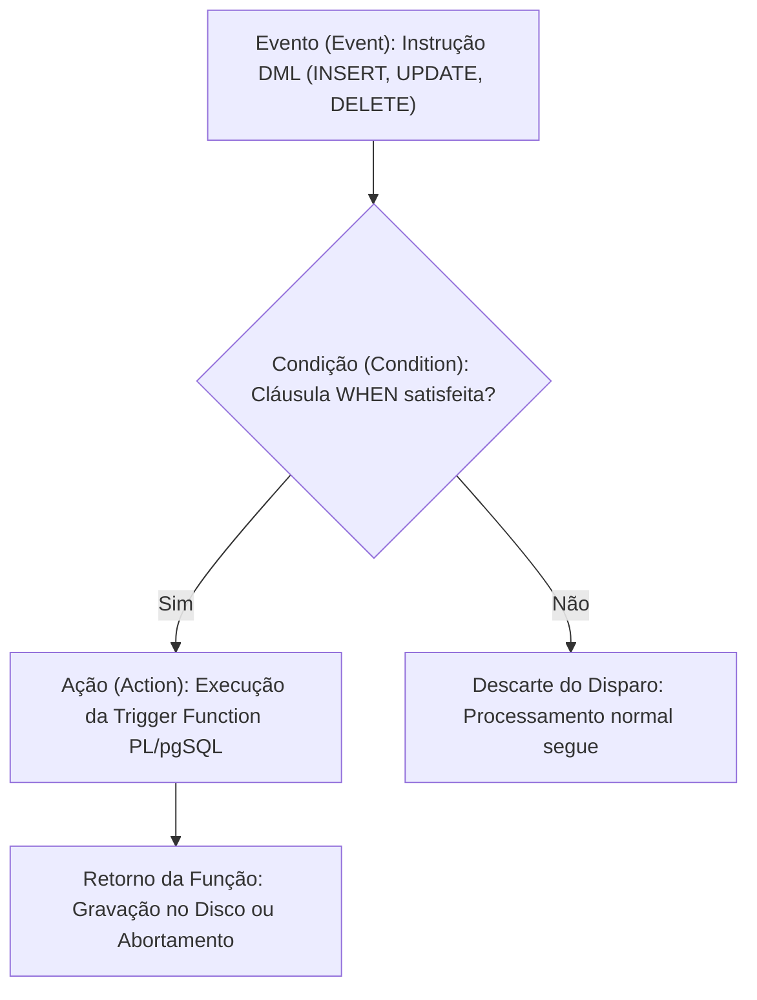

1. **Evento (*Event*):** O comando DML disparador (`INSERT`, `UPDATE`, `DELETE` ou `TRUNCATE`).
2. **Condição (*Condition*):** Um predicado booleano opcional avaliado na cláusula `WHEN`. Se for avaliado como falso, o interpretador PL/pgSQL sequer é inicializado, economizando ciclos de CPU.
3. **Ação (*Action*):** A execução imperativa do código contido na *Trigger Function*, capaz de transformar registros, atualizar tabelas satélites ou abortar a transação.

### Desacoplamento Arquitetural: Trigger Function e Trigger Binding

Diferente de SGBDs como MySQL ou Microsoft SQL Server, onde a definição do gatilho engloba seu próprio corpo procedural em uma única declaração, o PostgreSQL desacopla a arquitetura em dois componentes independentes:

1. **Trigger Function (Função de Gatilho):** Uma função escrita em PL/pgSQL que **não recebe argumentos formais** em sua assinatura e possui tipo de retorno obrigatório `trigger`.
2. **Trigger Binding (Vinculação do Gatilho):** A declaração DDL `CREATE TRIGGER` que conecta o evento de banco de dados, o momento de interceptação, o nível de granularidade e a tabela física à função previamente compilada.

```sql
-- 1. Criação da Função de Gatilho
CREATE OR REPLACE FUNCTION fn_trg_exemplo_log()
RETURNS trigger
LANGUAGE plpgsql
AS $$
BEGIN
    -- Lógica da regra
    RETURN NEW;
END;
$$;

-- 2. Vinculação à Tabela
CREATE TRIGGER trg_exemplo_log
BEFORE INSERT ON produtos
FOR EACH ROW
EXECUTE FUNCTION fn_trg_exemplo_log();
```

### Eventos Disparadores e Filtros com Cláusula WHEN

Um gatilho pode ser configurado para interceptar um único evento ou múltiplos eventos agregados com a conjunção `OR`:

```sql
CREATE TRIGGER trg_audita_clientes
AFTER INSERT OR UPDATE OR DELETE ON clientes
FOR EACH ROW
EXECUTE FUNCTION fn_audita_clientes_universal();
```

A cláusula `WHEN` adiciona uma condição de disparo prévia em nível de linha:

```sql
CREATE TRIGGER trg_alerta_estoque_baixo
AFTER UPDATE OF estoque ON produtos
FOR EACH ROW
WHEN (NEW.estoque <= NEW.estoque_minimo)
EXECUTE FUNCTION fn_notifica_reabastecimento();
```

### Momentos de Disparo: BEFORE, AFTER e INSTEAD OF

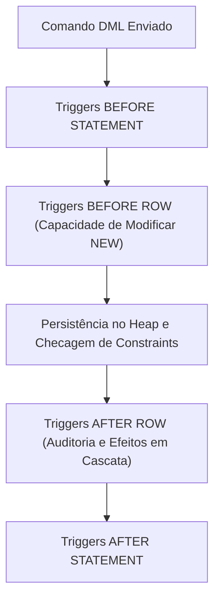

| Momento | Alvo | Capacidade de Mutação (`NEW`) | Efeito de `RETURN NULL` | Propósito Primário |
| :--- | :--- | :--- | :--- | :--- |
| **BEFORE** | Tabelas | Total (Altera dados antes da persistência) | Cancela silenciosamente a operação na linha | Validação, normalização, enriquecimento |
| **AFTER** | Tabelas | Nula (`NEW` já foi persistido no disco) | Nenhum impacto na gravação | Auditoria, recálculo em cascata, logs |
| **INSTEAD OF** | Visões (*Views*) | Total (Substitui completamente o comando) | Cancela a ação na visão | Viabilizar DML sobre visões complexas |

### Granularidade: FOR EACH ROW versus FOR EACH STATEMENT

- **`FOR EACH ROW` (Nível de Linha):** O gatilho é invocado individualmente para cada registro modificado pela instrução SQL. Se um comando `UPDATE` atualizar $`1.000`$ tuplas, a função executará $`1.000`$ vezes consecutivas, tendo acesso às variáveis estruturadas `NEW` e `OLD`.
- **`FOR EACH STATEMENT` (Nível de Instrução - Padrão):** O gatilho dispara exatamente uma única vez por comando SQL executado, independentemente de o comando ter afetado zero, dez ou cem mil registros. As variáveis `NEW` e `OLD` não estão disponíveis neste nível. Utilizado para auditorias de comandos e validações sistêmicas globais (ex: impedir operações fora do horário comercial).

### Variáveis Especiais de Contexto: NEW, OLD, TG_OP e Afins

O interpretador PL/pgSQL disponibiliza um conjunto de variáveis implícitas para as *Trigger Functions*:

| Variável | Tipo | Disponibilidade | Descrição |
| :--- | :--- | :--- | :--- |
| **`NEW`** | `record` | `INSERT`, `UPDATE` (em nível de linha) | Contém a nova imagem da linha proposta para gravação. Em `DELETE`, seu valor é `NULL`. |
| **`OLD`** | `record` | `UPDATE`, `DELETE` (em nível de linha) | Contém a imagem original da linha como existia no banco antes da instrução. Em `INSERT`, é `NULL`. |
| **`TG_OP`** | `text` | Todos os disparos | String indicando a operação disparadora: `'INSERT'`, `'UPDATE'`, `'DELETE'` ou `'TRUNCATE'`. |
| **`TG_WHEN`** | `text` | Todos os disparos | String indicando o momento: `'BEFORE'`, `'AFTER'` ou `'INSTEAD OF'`. |
| **`TG_LEVEL`** | `text` | Todos os disparos | Granularidade do disparo: `'ROW'` ou `'STATEMENT'`. |
| **`TG_TABLE_NAME`** | `name` | Todos os disparos | Nome da tabela que disparou a execução do gatilho. |

### Validação Preventiva, Normalização em Trânsito e Abortamento Seguro

Em gatilhos `BEFORE ROW`, a função pode validar regras de domínio e interromper a gravação com `RAISE EXCEPTION` ou higienizar atributos manipulando o registro `NEW`:

```sql
CREATE OR REPLACE FUNCTION fn_valida_e_normaliza_produto()
RETURNS trigger
LANGUAGE plpgsql
AS $$
BEGIN
    -- Validação de invariante de negócio
    IF NEW.preco <= 0 THEN
        RAISE EXCEPTION 'Violação de Domínio: O preço do produto deve ser maior que zero. Informado: %', NEW.preco;
    END IF;

    -- Normalização de string em trânsito antes do disco
    NEW.nome := UPPER(TRIM(NEW.nome));

    RETURN NEW; -- Libera a tupla alterada para persistência física
END;
$$;
```

### Gatilhos Condicionais com UPDATE OF

Para evitar sobrecarga de processamento, a cláusula `UPDATE OF` restringe a ativação do gatilho exclusivamente aos comandos que mencionem a coluna monitorada na cláusula `SET`:

```sql
CREATE TRIGGER trg_auditoria_reajuste_preco
AFTER UPDATE OF preco ON produtos
FOR EACH ROW
EXECUTE FUNCTION fn_audita_preco_produto();
```

> [!TIP]
> A cláusula `UPDATE OF preco` é ativada mesmo que o usuário execute `UPDATE produtos SET preco = preco`. Para certificar-se de que houve alteração real de valor, a função deve checar defensivamente:  
> `IF NEW.preco IS DISTINCT FROM OLD.preco THEN ...`

### Auditoria Forense e Backup Lógico Preventivo

Triggers `AFTER` são amplamente utilizadas para alimentar trilhas de auditoria imutáveis, enquanto triggers `BEFORE DELETE` viabilizam o arquivamento de tuplas antes da remoção física:

```sql
CREATE OR REPLACE FUNCTION fn_arquiva_cliente_excluido()
RETURNS trigger
LANGUAGE plpgsql
AS $$
BEGIN
    INSERT INTO clientes_excluidos (id_cliente, nome, email, telefone, data_exclusao)
    VALUES (OLD.id_cliente, OLD.nome, OLD.email, OLD.telefone, NOW());
    
    RETURN OLD; -- Permite a conclusão do DELETE na tabela original
END;
$$;

CREATE TRIGGER trg_backup_cliente_removido
BEFORE DELETE ON clientes
FOR EACH ROW
EXECUTE FUNCTION fn_arquiva_cliente_excluido();
```

### Atualizações em Cascata, Controle de Estoque e Recálculo Reativo

Triggers orquestram atualizações atômicas intertabelas, como a baixa de estoque na emissão de itens de pedido e o recálculo do cabeçalho de venda:

```sql
CREATE OR REPLACE FUNCTION fn_gerencia_estoque_item()
RETURNS trigger
LANGUAGE plpgsql
AS $$
BEGIN
    -- Baixa do estoque físico
    UPDATE produtos
    SET estoque = estoque - NEW.quantidade
    WHERE id_produto = NEW.id_produto;

    -- Recálculo do cabeçalho de venda
    UPDATE vendas
    SET valor_total = (
        SELECT COALESCE(SUM(subtotal), 0)
        FROM itens_venda
        WHERE id_venda = NEW.id_venda
    )
    WHERE id_venda = NEW.id_venda;

    RETURN NEW;
END;
$$;
```

### Triggers Multifuncionais com Multiplexação por TG_OP

Para otimizar a manutenibilidade, múltiplos eventos podem ser centralizados em uma única função estruturada sobre a variável de controle `TG_OP`:

```sql
CREATE OR REPLACE FUNCTION fn_auditoria_universal_produto()
RETURNS trigger
LANGUAGE plpgsql
AS $$
BEGIN
    IF TG_OP = 'INSERT' THEN
        INSERT INTO auditoria_produtos (id_produto, operacao, nome_novo, preco_novo, data_operacao)
        VALUES (NEW.id_produto, 'INSERT', NEW.nome, NEW.preco, clock_timestamp());
        RETURN NEW;
    ELSIF TG_OP = 'UPDATE' THEN
        INSERT INTO auditoria_produtos (id_produto, operacao, nome_antigo, nome_novo, preco_antigo, preco_novo, data_operacao)
        VALUES (NEW.id_produto, 'UPDATE', OLD.nome, NEW.nome, OLD.preco, NEW.preco, clock_timestamp());
        RETURN NEW;
    ELSIF TG_OP = 'DELETE' THEN
        INSERT INTO auditoria_produtos (id_produto, operacao, nome_antigo, preco_antigo, data_operacao)
        VALUES (OLD.id_produto, 'DELETE', OLD.nome, OLD.preco, clock_timestamp());
        RETURN OLD;
    END IF;
    RETURN NULL;
END;
$$;
```

---

## Módulo 6: Resolução Integral dos Trabalhos e Listas Práticas

### Trabalho 1: Lista de Exercícios de JOINs (10 Exercícios)

**Esquema de Referência:** `loja_joins` (`clientes`, `vendedores`, `categorias`, `produtos`, `pedidos`, `itens_pedido`).

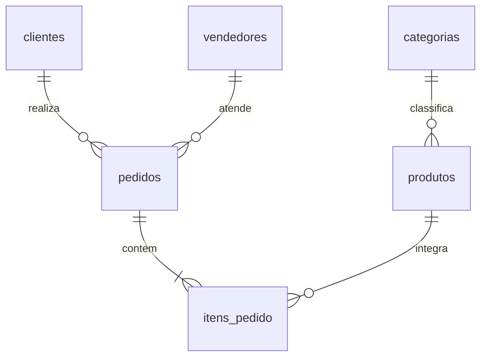

#### Exercício 1: Cliente e seus pedidos
- **Enunciado:** Apresentar código do pedido, data do pedido e nome do cliente utilizando `INNER JOIN`, ordenando pelo código do pedido.
- **Resolução Técnica:**
  ```sql
  SELECT
      p.id_pedido,
      p.data_pedido,
      c.nome AS nome_cliente
  FROM pedidos p
  INNER JOIN clientes c ON p.id_cliente = c.id_cliente
  ORDER BY p.id_pedido ASC;
  ```

#### Exercício 2: Relatório completo dos itens vendidos
- **Enunciado:** Apresentar código do pedido, nome do cliente, nome do produto, quantidade e preço unitário cruzando quatro tabelas.
- **Resolução Técnica:**
  ```sql
  SELECT
      p.id_pedido,
      c.nome AS cliente,
      pr.nome AS produto,
      ip.quantidade,
      ip.preco_unitario
  FROM pedidos p
  INNER JOIN clientes c ON p.id_cliente = c.id_cliente
  INNER JOIN itens_pedido ip ON p.id_pedido = ip.id_pedido
  INNER JOIN produtos pr ON ip.id_produto = pr.id_produto
  ORDER BY p.id_pedido, pr.nome;
  ```

#### Exercício 3: Clientes sem pedidos (Anti-Join)
- **Enunciado:** Listar exclusivamente clientes que nunca realizaram pedidos via `LEFT JOIN` e `IS NULL`.
- **Resolução Técnica:**
  ```sql
  SELECT
      c.id_cliente,
      c.nome
  FROM clientes c
  LEFT JOIN pedidos p ON c.id_cliente = p.id_cliente
  WHERE p.id_pedido IS NULL
  ORDER BY c.id_cliente;
  ```

#### Exercício 4: Produtos nunca vendidos
- **Enunciado:** Listar produtos que não aparecem em nenhum item de pedido via `LEFT JOIN`.
- **Resolução Técnica:**
  ```sql
  SELECT
      pr.id_produto,
      pr.nome,
      pr.preco
  FROM produtos pr
  LEFT JOIN itens_pedido ip ON pr.id_produto = ip.id_produto
  WHERE ip.id_item IS NULL
  ORDER BY pr.id_produto;
  ```

#### Exercício 5: Quantidade de pedidos por cliente
- **Enunciado:** Exibir nome de cada cliente e volume de pedidos, preservando clientes com zero compras via `LEFT JOIN`, `COUNT()` e `GROUP BY`.
- **Resolução Técnica:**
  ```sql
  SELECT
      c.id_cliente,
      c.nome,
      COUNT(p.id_pedido) AS quantidade_pedidos
  FROM clientes c
  LEFT JOIN pedidos p ON c.id_cliente = p.id_cliente
  GROUP BY c.id_cliente, c.nome
  ORDER BY quantidade_pedidos DESC, c.nome ASC;
  ```

#### Exercício 6: Faturamento por produto
- **Enunciado:** Calcular o faturamento total por produto (`quantidade * preco_unitario`), ordenado do maior para o menor.
- **Resolução Técnica:**
  ```sql
  SELECT
      pr.id_produto,
      pr.nome AS produto,
      ROUND(SUM(ip.quantidade * ip.preco_unitario), 2) AS faturamento_total
  FROM produtos pr
  INNER JOIN itens_pedido ip ON pr.id_produto = ip.id_produto
  GROUP BY pr.id_produto, pr.nome
  ORDER BY faturamento_total DESC;
  ```

#### Exercício 7: Total de cada pedido
- **Enunciado:** Calcular o total de cada pedido somando subtotais dos itens, exibindo código, data, cliente e valor total.
- **Resolução Técnica:**
  ```sql
  SELECT
      p.id_pedido,
      p.data_pedido,
      c.nome AS cliente,
      ROUND(SUM(ip.quantidade * ip.preco_unitario), 2) AS valor_total
  FROM pedidos p
  INNER JOIN clientes c ON p.id_cliente = c.id_cliente
  INNER JOIN itens_pedido ip ON p.id_pedido = ip.id_pedido
  GROUP BY p.id_pedido, p.data_pedido, c.nome
  ORDER BY p.id_pedido ASC;
  ```

#### Exercício 8: Produtos vendidos para clientes de São Paulo
- **Enunciado:** Listar produtos vendidos para clientes de São Paulo, exibindo cliente, cidade, produto e quantidade.
- **Resolução Técnica:**
  ```sql
  SELECT
      c.nome AS cliente,
      c.cidade,
      pr.nome AS produto,
      ip.quantidade
  FROM clientes c
  INNER JOIN pedidos p ON c.id_cliente = p.id_cliente
  INNER JOIN itens_pedido ip ON p.id_pedido = ip.id_pedido
  INNER JOIN produtos pr ON ip.id_produto = pr.id_produto
  WHERE c.cidade = 'São Paulo'
  ORDER BY c.nome, pr.nome;
  ```

#### Exercício 9: Faturamento por vendedor com COALESCE
- **Enunciado:** Listar vendedores e faturamento gerado em seus pedidos, exibindo zero quando não houver vendas.
- **Resolução Técnica:**
  ```sql
  SELECT
      v.id_vendedor,
      v.nome AS vendedor,
      COALESCE(ROUND(SUM(ip.quantidade * ip.preco_unitario), 2), 0.00) AS faturamento_total
  FROM vendedores v
  LEFT JOIN pedidos p ON v.id_vendedor = p.id_vendedor
  LEFT JOIN itens_pedido ip ON p.id_pedido = ip.id_pedido
  GROUP BY v.id_vendedor, v.nome
  ORDER BY faturamento_total DESC;
  ```

#### Exercício 10: Desafio – Relatório Geral de Vendas
- **Enunciado:** Cruzar as 6 tabelas exibindo pedido, data, cliente, cidade, estado, vendedor, produto, categoria, quantidade, preço e subtotal.
- **Resolução Técnica:**
  ```sql
  SELECT
      p.id_pedido,
      p.data_pedido,
      c.nome AS cliente,
      c.cidade,
      c.estado,
      v.nome AS vendedor,
      pr.nome AS produto,
      cat.nome AS categoria,
      ip.quantidade,
      ip.preco_unitario,
      ROUND(ip.quantidade * ip.preco_unitario, 2) AS subtotal
  FROM pedidos p
  INNER JOIN clientes c ON p.id_cliente = c.id_cliente
  INNER JOIN vendedores v ON p.id_vendedor = v.id_vendedor
  INNER JOIN itens_pedido ip ON p.id_pedido = ip.id_pedido
  INNER JOIN produtos pr ON ip.id_produto = pr.id_produto
  INNER JOIN categorias cat ON pr.id_categoria = cat.id_categoria
  ORDER BY p.id_pedido ASC, pr.nome ASC;
  ```

---

### Trabalho 2: Lista de Exercícios de Subconsultas - Parte 01 (20 Exercícios)

**Esquema de Referência:** `loja_subconsultas` (`clientes`, `vendedores`, `categorias`, `produtos`, `pedidos`, `itens_pedido`).

1. **Subconsulta Escalar (Preço > Média):**
   ```sql
   SELECT nome_produto, preco
   FROM produtos
   WHERE preco > (SELECT AVG(preco) FROM produtos);
   ```
2. **Subconsulta Escalar (Maior Preço Cadastrado):**
   ```sql
   SELECT nome_produto, preco
   FROM produtos
   WHERE preco = (SELECT MAX(preco) FROM produtos);
   ```
3. **Subconsulta Escalar (Menor Preço Cadastrado):**
   ```sql
   SELECT nome_produto, preco
   FROM produtos
   WHERE preco = (SELECT MIN(preco) FROM produtos);
   ```
4. **Subconsulta no SELECT (Exibir Média Global):**
   ```sql
   SELECT 
       nome_produto, 
       preco, 
       ROUND((SELECT AVG(preco) FROM produtos), 2) AS media_geral
   FROM produtos;
   ```
5. **Subconsulta no SELECT (Diferença para a Média):**
   ```sql
   SELECT 
       nome_produto, 
       preco, 
       ROUND((SELECT AVG(preco) FROM produtos), 2) AS media_geral,
       ROUND(preco - (SELECT AVG(preco) FROM produtos), 2) AS diferenca
   FROM produtos;
   ```
6. **Operador IN (Clientes com Pedidos):**
   ```sql
   SELECT id_cliente, nome
   FROM clientes
   WHERE id_cliente IN (SELECT id_cliente FROM pedidos);
   ```
7. **Operador IN (Produtos em Itens de Pedido):**
   ```sql
   SELECT id_produto, nome_produto
   FROM produtos
   WHERE id_produto IN (SELECT id_produto FROM itens_pedido);
   ```
8. **Operador NOT IN (Clientes sem Pedidos):**
   ```sql
   SELECT id_cliente, nome
   FROM clientes
   WHERE id_cliente NOT IN (SELECT id_cliente FROM pedidos WHERE id_cliente IS NOT NULL);
   ```
9. **Operador NOT EXISTS (Clientes sem Pedidos):**
   ```sql
   SELECT c.id_cliente, c.nome
   FROM clientes c
   WHERE NOT EXISTS (
       SELECT 1 FROM pedidos p WHERE p.id_cliente = c.id_cliente
   );
   ```
10. **Operador EXISTS (Vendedores com Pedidos):**
    ```sql
    SELECT v.id_vendedor, v.nome
    FROM vendedores v
    WHERE EXISTS (
        SELECT 1 FROM pedidos p WHERE p.id_vendedor = v.id_vendedor
    );
    ```
11. **Operador NOT EXISTS (Produtos Nunca Vendidos):**
    ```sql
    SELECT pr.id_produto, pr.nome_produto
    FROM produtos pr
    WHERE NOT EXISTS (
        SELECT 1 FROM itens_pedido ip WHERE ip.id_produto = pr.id_produto
    );
    ```
12. **Operador IN com Mais de uma Tabela (Compradores de Notebook Dell):**
    ```sql
    SELECT id_cliente, nome
    FROM clientes
    WHERE id_cliente IN (
        SELECT p.id_cliente
        FROM pedidos p
        INNER JOIN itens_pedido ip ON p.id_pedido = ip.id_pedido
        INNER JOIN produtos pr ON ip.id_produto = pr.id_produto
        WHERE pr.nome_produto = 'Notebook Dell'
    );
    ```
13. **Operador ANY (Preço > Algum de Telefonia):**
    ```sql
    SELECT nome_produto, preco
    FROM produtos
    WHERE preco > ANY (
        SELECT pr.preco
        FROM produtos pr
        INNER JOIN categorias c ON pr.id_categoria = c.id_categoria
        WHERE c.nome_categoria = 'Telefonia'
    );
    ```
14. **Operador ALL (Preço > Todos de Acessórios):**
    ```sql
    SELECT nome_produto, preco
    FROM produtos
    WHERE preco > ALL (
        SELECT pr.preco
        FROM produtos pr
        INNER JOIN categorias c ON pr.id_categoria = c.id_categoria
        WHERE c.nome_categoria = 'Acessorios'
    );
    ```
15. **Operador ANY (Salário > Algum Vendedor):**
    ```sql
    SELECT nome, salario
    FROM vendedores
    WHERE salario > ANY (SELECT salario FROM vendedores);
    ```
16. **Operador ALL (Maior Salário Cadastrado):**
    ```sql
    SELECT nome, salario
    FROM vendedores
    WHERE salario >= ALL (SELECT salario FROM vendedores);
    ```
17. **Subconsulta Correlacionada (Preço > Média da Categoria):**
    ```sql
    SELECT p.nome_produto, p.preco, p.id_categoria
    FROM produtos p
    WHERE p.preco > (
        SELECT AVG(sub.preco)
        FROM produtos sub
        WHERE sub.id_categoria = p.id_categoria
    );
    ```
18. **Subconsulta Correlacionada (Estoque > Média da Categoria):**
    ```sql
    SELECT p.nome_produto, p.estoque, p.id_categoria
    FROM produtos p
    WHERE p.estoque > (
        SELECT AVG(sub.estoque)
        FROM produtos sub
        WHERE sub.id_categoria = p.id_categoria
    );
    ```
19. **Subconsulta Correlacionada (Limite de Crédito > Média do Estado):**
    ```sql
    SELECT c.nome, c.limite_credito, c.estado
    FROM clientes c
    WHERE c.limite_credito > (
        SELECT AVG(sub.limite_credito)
        FROM clientes sub
        WHERE sub.estado = c.estado
    );
    ```
20. **Subconsulta Correlacionada (Maior Preço por Categoria):**
    ```sql
    SELECT p.id_categoria, p.nome_produto, p.preco
    FROM produtos p
    WHERE p.preco = (
        SELECT MAX(sub.preco)
        FROM produtos sub
        WHERE sub.id_categoria = p.id_categoria
    )
    ORDER BY p.id_categoria;
    ```

---

### Trabalho 3: Lista de Exercícios de Subconsultas Avançadas - Parte 02 (10 Exercícios)

1. **Subconsulta no FROM (Média por Categoria > R$ 1.000,00):**
   ```sql
   SELECT c.nome_categoria, cat_media.media_preco
   FROM (
       SELECT id_categoria, ROUND(AVG(preco), 2) AS media_preco
       FROM produtos
       GROUP BY id_categoria
   ) AS cat_media
   INNER JOIN categorias c ON cat_media.id_categoria = c.id_categoria
   WHERE cat_media.media_preco > 1000.00;
   ```
2. **Tabela Derivada (Total do Pedido > R$ 3.000,00):**
   ```sql
   SELECT ped_total.id_pedido, ped_total.valor_total
   FROM (
       SELECT id_pedido, ROUND(SUM(quantidade * preco_unitario), 2) AS valor_total
       FROM itens_pedido
       GROUP BY id_pedido
   ) AS ped_total
   WHERE ped_total.valor_total > 3000.00;
   ```
3. **Subconsulta no FROM Combinada com JOIN:**
   ```sql
   SELECT
       totais.id_pedido,
       c.nome AS cliente,
       p.data_pedido,
       totais.valor_total
   FROM (
       SELECT id_pedido, ROUND(SUM(quantidade * preco_unitario), 2) AS valor_total
       FROM itens_pedido
       GROUP BY id_pedido
   ) AS totais
   INNER JOIN pedidos p ON totais.id_pedido = p.id_pedido
   INNER JOIN clientes c ON p.id_cliente = c.id_cliente;
   ```
4. **Clientes que Gastaram Acima da Média Geral:**
   ```sql
   WITH GastosPorCliente AS (
       SELECT p.id_cliente, SUM(ip.quantidade * ip.preco_unitario) AS total_gasto
       FROM pedidos p
       INNER JOIN itens_pedido ip ON p.id_pedido = ip.id_pedido
       GROUP BY p.id_cliente
   )
   SELECT c.nome, ROUND(gpc.total_gasto, 2) AS total_comprado
   FROM GastosPorCliente gpc
   INNER JOIN clientes c ON gpc.id_cliente = c.id_cliente
   WHERE gpc.total_gasto > (SELECT AVG(total_gasto) FROM GastosPorCliente);
   ```
5. **Categoria com Maior Preço Médio:**
   ```sql
   WITH MediasCategoria AS (
       SELECT id_categoria, AVG(preco) AS media_preco
       FROM produtos
       GROUP BY id_categoria
   )
   SELECT c.nome_categoria, ROUND(mc.media_preco, 2) AS maior_media
   FROM MediasCategoria mc
   INNER JOIN categorias c ON mc.id_categoria = c.id_categoria
   WHERE mc.media_preco = (SELECT MAX(media_preco) FROM MediasCategoria);
   ```
6. **INSERT em Lote Utilizando Subconsulta:**
   ```sql
   CREATE TABLE produtos_promocao (
       id_produto INT PRIMARY KEY,
       nome_produto VARCHAR(100),
       preco NUMERIC(10,2),
       preco_promocional NUMERIC(10,2)
   );

   INSERT INTO produtos_promocao (id_produto, nome_produto, preco, preco_promocional)
   SELECT 
       id_produto, 
       nome_produto, 
       preco, 
       ROUND(preco * 0.90, 2)
   FROM produtos
   WHERE preco > (SELECT AVG(preco) FROM produtos);
   ```
7. **UPDATE com Subconsulta (Aumento de Limite com 2+ Pedidos):**
   ```sql
   UPDATE clientes
   SET limite_credito = limite_credito * 1.10
   WHERE id_cliente IN (
       SELECT id_cliente
       FROM pedidos
       GROUP BY id_cliente
       HAVING COUNT(id_pedido) >= 2
   );
   ```
8. **UPDATE Correlacionado com Base na Categoria (+5 no Estoque):**
   ```sql
   UPDATE produtos p
   SET estoque = estoque + 5
   WHERE p.preco > (
       SELECT AVG(sub.preco)
       FROM produtos sub
       WHERE sub.id_categoria = p.id_categoria
   );
   ```
9. **DELETE com NOT EXISTS (Remoção de Clientes sem Compras):**
   ```sql
   -- Verificação de segurança prévia
   SELECT id_cliente, nome FROM clientes c WHERE NOT EXISTS (SELECT 1 FROM pedidos p WHERE p.id_cliente = c.id_cliente);

   -- Exclusão atômica
   DELETE FROM clientes c
   WHERE NOT EXISTS (
       SELECT 1 FROM pedidos p WHERE p.id_cliente = c.id_cliente
   );
   ```
10. **Análise de Desempenho com EXPLAIN ANALYZE (IN vs EXISTS):**
    ```sql
    -- Consulta 1: IN
    EXPLAIN ANALYZE
    SELECT * FROM clientes WHERE id_cliente IN (SELECT id_cliente FROM pedidos);

    -- Consulta 2: EXISTS
    EXPLAIN ANALYZE
    SELECT * FROM clientes c WHERE EXISTS (SELECT 1 FROM pedidos p WHERE p.id_cliente = c.id_cliente);
    ```
    *Diagnóstico de Engenharia:* O otimizador de consultas do PostgreSQL (versão 14+) reescreve internamente ambas as instruções para nós do tipo `Hash Semi Join` contra a tabela `pedidos`, gerando custo inicial e tempo de execução idênticos em esquemas com índices válidos.

---

### Trabalho 4: Lista de Exercícios Pontuados de JOINs, Subselects e Views (5 Exercícios)

**Esquema de Referência:** `loja_exercicios` (`clientes`, `vendedores`, `categorias`, `produtos`, `pedidos`, `itens_pedido`).

#### Exercício 1: Relatório de Vendas e Hierarquia de Vendedores (Self-Join)
```sql
SELECT
    v.id_vendedor,
    v.nome AS vendedor,
    COALESCE(s.nome, 'Sem Supervisor') AS supervisor,
    COUNT(DISTINCT p.id_pedido) AS total_pedidos,
    COALESCE(ROUND(SUM(ip.quantidade * ip.preco_unitario * (1.0 - (COALESCE(ip.desconto, 0) / 100.0))), 2), 0.00) AS faturamento_liquido
FROM vendedores v
LEFT JOIN vendedores s ON v.id_supervisor = s.id_vendedor
LEFT JOIN pedidos p ON v.id_vendedor = p.id_vendedor
LEFT JOIN itens_pedido ip ON p.id_pedido = ip.id_pedido
GROUP BY v.id_vendedor, v.nome, s.nome
ORDER BY faturamento_liquido DESC;
```

#### Exercício 2: Produtos com Preço Acima da Média de sua Categoria
```sql
SELECT
    p.id_produto,
    p.nome_produto,
    c.nome_categoria,
    p.preco,
    ROUND(cat_media.media_preco, 2) AS media_categoria,
    ROUND(p.preco - cat_media.media_preco, 2) AS diferenca_acima_media
FROM produtos p
INNER JOIN categorias c ON p.id_categoria = c.id_categoria
CROSS JOIN LATERAL (
    SELECT AVG(sub.preco) AS media_preco
    FROM produtos sub
    WHERE sub.id_categoria = p.id_categoria
) AS cat_media
WHERE p.preco > cat_media.media_preco
ORDER BY c.nome_categoria, p.preco DESC;
```

#### Exercício 3: Identificação de Clientes sem Compras Efetivas (Duas Abordagens)
```sql
-- Abordagem A: LEFT JOIN com IS NULL
SELECT c.id_cliente, c.nome, c.cidade
FROM clientes c
LEFT JOIN pedidos p ON c.id_cliente = p.id_cliente AND p.status IN ('Pago', 'Enviado')
WHERE p.id_pedido IS NULL;

-- Abordagem B: NOT EXISTS
SELECT c.id_cliente, c.nome, c.cidade
FROM clientes c
WHERE NOT EXISTS (
    SELECT 1 
    FROM pedidos p 
    WHERE p.id_cliente = c.id_cliente AND p.status IN ('Pago', 'Enviado')
);
```

#### Exercício 4: Performance Financeira por Categoria com HAVING
```sql
SELECT
    cat.nome_categoria,
    SUM(ip.quantidade) AS total_pecas_vendidas,
    ROUND(SUM(ip.quantidade * ip.preco_unitario), 2) AS faturamento_bruto,
    ROUND(SUM(ip.quantidade * ip.preco_unitario * (1.0 - (COALESCE(ip.desconto, 0) / 100.0))), 2) AS faturamento_liquido
FROM categorias cat
INNER JOIN produtos pr ON cat.id_categoria = pr.id_categoria
INNER JOIN itens_pedido ip ON pr.id_produto = ip.id_produto
INNER JOIN pedidos p ON ip.id_pedido = p.id_pedido
WHERE p.status IN ('Pago', 'Enviado')
GROUP BY cat.id_categoria, cat.nome_categoria
HAVING SUM(ip.quantidade * ip.preco_unitario * (1.0 - (COALESCE(ip.desconto, 0) / 100.0))) > 5000.00
ORDER BY faturamento_liquido DESC;
```

#### Exercício 5: Criação e Validação de Visão Gerencial de Comissões
```sql
CREATE OR REPLACE VIEW vw_faturamento_vendedores AS
SELECT
    TO_CHAR(p.data_pedido, 'YYYY-MM') AS competencia,
    v.id_vendedor,
    v.nome AS vendedor,
    ROUND(SUM(ip.quantidade * ip.preco_unitario * (1.0 - (COALESCE(ip.desconto, 0) / 100.0))), 2) AS faturamento_liquido,
    ROUND(SUM(ip.quantidade * ip.preco_unitario * (1.0 - (COALESCE(ip.desconto, 0) / 100.0))) * (v.comissao / 100.0), 2) AS comissao_devida
FROM pedidos p
INNER JOIN vendedores v ON p.id_vendedor = v.id_vendedor
INNER JOIN itens_pedido ip ON p.id_pedido = ip.id_pedido
WHERE p.status IN ('Pago', 'Enviado')
GROUP BY TO_CHAR(p.data_pedido, 'YYYY-MM'), v.id_vendedor, v.nome, v.comissao;

-- Validação para o 1º Trimestre de 2026
SELECT *
FROM vw_faturamento_vendedores
WHERE competencia BETWEEN '2026-01' AND '2026-03'
ORDER BY competencia ASC, comissao_devida DESC;
```

---

### Trabalho 5: Lista de Stored Procedures em PL/pgSQL (10 Procedures)

**Esquema de Referência:** `loja_procedures` (`clientes`, `funcionarios`, `produtos`, `pedidos`, `itens_pedido`).

#### Procedure 1: aumentar_salario_funcionario
```sql
CREATE OR REPLACE PROCEDURE aumentar_salario_funcionario(
    p_id_funcionario INT,
    p_percentual NUMERIC
)
LANGUAGE plpgsql
AS $$
BEGIN
    IF p_percentual <= 0 THEN
        RAISE EXCEPTION 'O percentual de reajuste deve ser positivo. Informado: %', p_percentual;
    END IF;

    UPDATE funcionarios
    SET salario = ROUND(salario * (1.0 + (p_percentual / 100.0)), 2)
    WHERE id_funcionario = p_id_funcionario;

    IF NOT FOUND THEN
        RAISE EXCEPTION 'Funcionário com ID % não encontrado.', p_id_funcionario;
    END IF;
END;
$$;
```

#### Procedure 2: atualizar_estoque_produto
```sql
CREATE OR REPLACE PROCEDURE atualizar_estoque_produto(
    p_id_produto INT,
    p_novo_estoque INT
)
LANGUAGE plpgsql
AS $$
BEGIN
    IF p_novo_estoque < 0 THEN
        RAISE EXCEPTION 'A quantidade em estoque não pode ser negativa. Informado: %', p_novo_estoque;
    END IF;

    UPDATE produtos
    SET estoque = p_novo_estoque
    WHERE id_produto = p_id_produto;

    IF NOT FOUND THEN
        RAISE EXCEPTION 'Produto com ID % não encontrado.', p_id_produto;
    END IF;
END;
$$;
```

#### Procedure 3: adicionar_saldo_cliente
```sql
CREATE OR REPLACE PROCEDURE adicionar_saldo_cliente(
    p_id_cliente INT,
    p_valor NUMERIC
)
LANGUAGE plpgsql
AS $$
BEGIN
    IF p_valor <= 0 THEN
        RAISE EXCEPTION 'O valor a adicionar deve ser positivo. Informado: %', p_valor;
    END IF;

    UPDATE clientes
    SET saldo = saldo + p_valor
    WHERE id_cliente = p_id_cliente;

    IF NOT FOUND THEN
        RAISE EXCEPTION 'Cliente com ID % não encontrado.', p_id_cliente;
    END IF;
END;
$$;
```

#### Procedure 4: descontar_saldo_cliente
```sql
CREATE OR REPLACE PROCEDURE descontar_saldo_cliente(
    p_id_cliente INT,
    p_valor NUMERIC
)
LANGUAGE plpgsql
AS $$
DECLARE
    v_saldo_atual NUMERIC;
BEGIN
    IF p_valor <= 0 THEN
        RAISE EXCEPTION 'O valor a descontar deve ser positivo. Informado: %', p_valor;
    END IF;

    -- Bloqueio pessimista para controle de concorrência
    SELECT saldo INTO v_saldo_atual
    FROM clientes
    WHERE id_cliente = p_id_cliente
    FOR UPDATE;

    IF NOT FOUND THEN
        RAISE EXCEPTION 'Cliente com ID % não encontrado.', p_id_cliente;
    END IF;

    IF v_saldo_atual < p_valor THEN
        RAISE EXCEPTION 'Saldo insuficiente. Saldo atual: %, Valor solicitado: %', v_saldo_atual, p_valor;
    END IF;

    UPDATE clientes
    SET saldo = saldo - p_valor
    WHERE id_cliente = p_id_cliente;
END;
$$;
```

#### Procedure 5: cadastrar_produto
```sql
CREATE OR REPLACE PROCEDURE cadastrar_produto(
    p_nome VARCHAR,
    p_categoria VARCHAR,
    p_preco NUMERIC,
    p_estoque INT
)
LANGUAGE plpgsql
AS $$
BEGIN
    IF p_preco <= 0 THEN
        RAISE EXCEPTION 'O preço deve ser maior que zero.';
    END IF;
    IF p_estoque < 0 THEN
        RAISE EXCEPTION 'O estoque inicial não pode ser negativo.';
    END IF;

    INSERT INTO produtos (nome, categoria, preco, estoque)
    VALUES (TRIM(p_nome), TRIM(p_categoria), p_preco, p_estoque);
END;
$$;
```

#### Procedure 6: cancelar_pedido
```sql
CREATE OR REPLACE PROCEDURE cancelar_pedido(
    p_id_pedido INT
)
LANGUAGE plpgsql
AS $$
BEGIN
    UPDATE pedidos
    SET status = 'CANCELADO'
    WHERE id_pedido = p_id_pedido;

    IF NOT FOUND THEN
        RAISE EXCEPTION 'Pedido com ID % não encontrado.', p_id_pedido;
    END IF;
END;
$$;
```

#### Procedure 7: fechar_pedido
```sql
CREATE OR REPLACE PROCEDURE fechar_pedido(
    p_id_pedido INT
)
LANGUAGE plpgsql
AS $$
DECLARE
    v_status_atual VARCHAR;
BEGIN
    SELECT status INTO v_status_atual
    FROM pedidos
    WHERE id_pedido = p_id_pedido
    FOR UPDATE;

    IF NOT FOUND THEN
        RAISE EXCEPTION 'Pedido com ID % não encontrado.', p_id_pedido;
    END IF;

    IF v_status_atual <> 'ABERTO' THEN
        RAISE EXCEPTION 'Apenas pedidos com status ABERTO podem ser fechados. Status atual: %', v_status_atual;
    END IF;

    UPDATE pedidos
    SET status = 'FECHADO'
    WHERE id_pedido = p_id_pedido;
END;
$$;
```

#### Procedure 8: recalcular_valor_pedido
```sql
CREATE OR REPLACE PROCEDURE recalcular_valor_pedido(
    p_id_pedido INT
)
LANGUAGE plpgsql
AS $$
DECLARE
    v_total NUMERIC;
BEGIN
    SELECT COALESCE(SUM(subtotal), 0.00) INTO v_total
    FROM itens_pedido
    WHERE id_pedido = p_id_pedido;

    UPDATE pedidos
    SET valor_total = v_total
    WHERE id_pedido = p_id_pedido;

    IF NOT FOUND THEN
        RAISE EXCEPTION 'Pedido com ID % não encontrado.', p_id_pedido;
    END IF;
END;
$$;
```

#### Procedure 9: inserir_item_pedido (Orquestração Transacional Completa)
```sql
CREATE OR REPLACE PROCEDURE inserir_item_pedido(
    p_id_pedido INT,
    p_id_produto INT,
    p_quantidade INT
)
LANGUAGE plpgsql
AS $$
DECLARE
    v_preco NUMERIC;
    v_estoque_atual INT;
    v_subtotal NUMERIC;
BEGIN
    IF p_quantidade <= 0 THEN
        RAISE EXCEPTION 'A quantidade informada deve ser maior que zero.';
    END IF;

    -- 1. Busca e bloqueio concorrente do produto
    SELECT preco, estoque INTO v_preco, v_estoque_atual
    FROM produtos
    WHERE id_produto = p_id_produto
    FOR UPDATE;

    IF NOT FOUND THEN
        RAISE EXCEPTION 'Produto com ID % não encontrado.', p_id_produto;
    END IF;

    IF v_estoque_atual < p_quantidade THEN
        RAISE EXCEPTION 'Estoque insuficiente. Disponível: %, Solicitado: %', v_estoque_atual, p_quantidade;
    END IF;

    -- 2. Cálculo do subtotal
    v_subtotal := ROUND(v_preco * p_quantidade, 2);

    -- 3. Inserção na tabela de itens
    INSERT INTO itens_pedido (id_pedido, id_produto, quantidade, preco_unitario, subtotal)
    VALUES (p_id_pedido, p_id_produto, p_quantidade, v_preco, v_subtotal);

    -- 4. Abatimento físico no estoque
    UPDATE produtos
    SET estoque = estoque - p_quantidade
    WHERE id_produto = p_id_produto;

    -- 5. Recalcular valor total no cabeçalho do pedido
    CALL recalcular_valor_pedido(p_id_pedido);
END;
$$;
```

#### Procedure 10: remover_cliente_sem_pedidos
```sql
CREATE OR REPLACE PROCEDURE remover_cliente_sem_pedidos(
    p_id_cliente INT
)
LANGUAGE plpgsql
AS $$
BEGIN
    IF EXISTS (SELECT 1 FROM pedidos WHERE id_cliente = p_id_cliente) THEN
        RAISE EXCEPTION 'Impossível excluir: O cliente com ID % possui pedidos vinculados.', p_id_cliente;
    END IF;

    DELETE FROM clientes
    WHERE id_cliente = p_id_cliente;

    IF NOT FOUND THEN
        RAISE EXCEPTION 'Cliente com ID % não encontrado.', p_id_cliente;
    END IF;
END;
$$;
```

---

## Mapa Conceitual Integrado da Disciplina

```mermaid
mindmap
  root("Tópicos Avançados em Banco de Dados (PostgreSQL)")
    "Visões Relacionais"
      "Visão Comum (Standard View)"
        "Reescrita com pg_rewrite"
        "Abstração de Segurança e Menor Privilégio"
        "WITH CHECK OPTION (LOCAL / CASCADED)"
        "Updatable Views e Regras de DML"
      "Visão Materializada"
        "Persistência em Disco"
        "Indexação Própria (B-Tree/Unique)"
        "REFRESH CONCURRENTLY"
    "Técnicas de Junção"
      "INNER JOIN (Interseção e CBO)"
        "Nested Loop"
        "Hash Join"
        "Merge Join"
      "Outer Joins"
        "LEFT JOIN e COALESCE"
        "Anti-Join com IS NULL"
        "FULL OUTER JOIN para Auditoria"
      "Casos Especiais"
        "SELF JOIN em Árvores Hierárquicas"
        "CROSS JOIN e Risco Cartesiano"
    "Subconsultas e Expressões"
      "Dimensionalidade"
        "Escalar (1x1)"
        "Coluna (Nx1 com IN, ANY, ALL)"
        "Tabela Derivada (NxM no FROM com Alias)"
      "Lógica Tri-Valorada (3VL)"
        "Impacto de NULL no NOT IN"
        "Proteção Defensiva com NOT EXISTS"
      "Common Table Expressions (WITH)"
    "Programação Procedural (PL/pgSQL)"
      "Stored Functions vs Stored Procedures"
        "Invocação: SELECT vs CALL"
        "Controle de Transação: Proibido vs COMMIT/ROLLBACK"
      "Estrutura do Bloco"
        "Dollar Quoting"
        "Variáveis Ancoradas (%TYPE e %ROWTYPE)"
        "FOUND e GET DIAGNOSTICS"
        "Concorrência com SELECT FOR UPDATE"
    "Triggers e Regras de Negócio"
      "Arquitetura Desacoplada"
        "Trigger Function (RETURNS trigger)"
        "Trigger Binding (CREATE TRIGGER)"
      "Momentos e Níveis"
        "BEFORE (Modificação de NEW)"
        "AFTER (Auditoria e Efeito em Cascata)"
        "FOR EACH ROW vs FOR EACH STATEMENT"
      "Variáveis Contextuais"
        "NEW, OLD e TG_OP"
        "UPDATE OF e Cláusula WHEN"
```

---

## Glossário Técnico Consolidado

- **Anti-Join:** Padrão relacional que identifica tuplas de uma relação que não encontram nenhuma correspondência em outra relação ($`A \setminus B`$).
- **Árvore de Sintaxe Abstrata (AST):** Representação hierárquica em árvore gerada pelo analisador sintático (*parser*) a partir de uma instrução SQL textual.
- **Cost-Based Optimizer (CBO):** Subsistema do SGBD que calcula custos de CPU e I/O com base em estatísticas de catálogo para selecionar o plano de execução físico mais eficiente.
- **Common Table Expression (CTE):** Conjunto temporário nomeado declarado na cláusula `WITH`, que existe unicamente durante o ciclo de vida da instrução SQL.
- **Dollar Quoting:** Mecanismo do PostgreSQL que utiliza pares de cifrões (`$$` ou `$tag$`) para delimitar blocos textuais sem exigir o escape de aspas simples.
- **Equijunção:** Operação de junção na qual o predicado relacional utiliza estritamente o operador de igualdade ($`=`$).
- **Hash Join:** Algoritmo físico que carrega uma relação em uma tabela de espalhamento em memória (`work_mem`) e sonda a segunda relação em tempo linear.
- **Heap File:** Arquivo físico no disco organizado em blocos ou páginas (tipicamente de 8 KB no PostgreSQL) onde as tuplas de uma tabela são armazenadas sem ordenação inerente.
- **Materialized View:** Visão que persiste o resultado de sua consulta fisicamente no disco, comportando-se como uma tabela estática sujeita a recálculos sob demanda.
- **Merge Join:** Algoritmo de junção que percorre em paralelo duas relações previamente ordenadas por suas chaves de junção.
- **Nested Loop Join:** Algoritmo de junção que percorre a relação externa linha por linha e, para cada registro, sonda a relação interna.
- **Paradigma ECA (Event-Condition-Action):** Modelo arquitetural de automação reativa onde um evento de DML avalia uma condição opcional e dispara uma ação procedural imperativa.
- **Predicate Pushdown:** Otimização do compilador SQL que desloca predicados de filtragem da consulta externa para o nível mais profundo de acesso às tabelas físicas.
- **Query Rewrite Rule System:** Mecanismo do PostgreSQL que intercepta a AST e substitui nós que referenciam visões pela própria subárvore da consulta contida na visão.
- **Short-Circuit Evaluation:** Interrupção imediata da avaliação de uma condição lógica assim que o resultado final torna-se determinístico (ex: parada do `EXISTS` ao achar a primeira tupla).
- **Three-Valued Logic (3VL):** Lógica relacional trivalente baseada nos estados de verdade `TRUE`, `FALSE` e `UNKNOWN` (decorrente de operações com `NULL`).
- **Tipagem Ancorada:** Prática de atrelar o tipo de dado de uma variável procedural ao tipo de uma coluna (`%TYPE`) ou estrutura de linha (`%ROWTYPE`) do catálogo.
- **Updatable View:** Visão que satisfaz os requisitos formais que autorizam a execução direta de instruções de modificação de dados (`INSERT`, `UPDATE`, `DELETE`).
- **Write-Ahead Logging (WAL):** Técnica de tolerância a falhas onde todas as mutações no banco de dados são gravadas sequencialmente em disco antes de serem aplicadas às páginas de dados.

---

## Questões de Fixação e Avaliação Teórico-Prática

#### Questão 1
Qual a distinção operacional fundamental no PostgreSQL entre o comando `DROP VIEW ... RESTRICT` e `DROP VIEW ... CASCADE`?  
- **A)** O `RESTRICT` impede o descarte caso a view possua dados físicos, enquanto o `CASCADE` remove a view e apaga os dados da tabela base subjacente.
- **B)** O `RESTRICT` é a cláusula padrão que bloqueia a remoção caso outros objetos de esquema dependam da view; o `CASCADE` exclui recursivamente a view alvo e todos os objetos dependentes. *(Correta)*
- **C)** O `CASCADE` converte a view em uma tabela base antes de apagá-la, enquanto o `RESTRICT` gera apenas um aviso no log sem excluir o objeto.
- **D)** Ambos realizam a mesma operação, mas o `CASCADE` ignora permissões de segurança de usuários comuns.  
*Justificativa:* O PostgreSQL mantém a rastreabilidade via `pg_depend`. O modo `RESTRICT` aborta caso existam visões filhas ou funções dependentes. O modo `CASCADE` propaga recursivamente a deleção para toda a cadeia descendente.

#### Questão 2
Por que uma consulta contendo a cláusula `WHERE coluna NOT IN (SELECT ...)` pode retornar um conjunto completamente vazio caso a subconsulta contenha um registro com valor `NULL`?  
- **A)** Devido a um bug histórico no analisador sintático do PostgreSQL que interrompe a varredura ao encontrar blocos de memória nulos.
- **B)** Porque o operador `NOT IN` expande para uma cadeia de comparações com `AND` e `<>`; qualquer comparação `<> NULL` resulta em `UNKNOWN`, fazendo com que a conjunção jamais avalie como `TRUE`. *(Correta)*
- **C)** Porque o PostgreSQL converte automaticamente consultas com `NOT IN` para `CROSS JOIN`, gerando estouro de memória quando encontra nulos.
- **D)** Porque a presença de `NULL` desativa o índice B-Tree da tabela externa, forçando o otimizador a abortar a execução.  
*Justificativa:* Pela Lógica Trivalente (3VL), `(v <> val1) AND (v <> NULL)` resulta em `TRUE AND UNKNOWN = UNKNOWN`. Como o `WHERE` só aprova linhas que avaliam como `TRUE`, zero linhas são retornadas.

#### Questão 3
Qual a diferença arquitetural crítica introduzida no PostgreSQL 11 entre uma Stored Function (`CREATE FUNCTION`) e uma Stored Procedure (`CREATE PROCEDURE`)?  
- **A)** Funções são compiladas em C, enquanto procedures são interpretadas exclusivamente em Python.
- **B)** Procedures podem executar comandos autônomos de controle transacional (`COMMIT` e `ROLLBACK`), o que é expressamente proibido no interior de Funções. *(Correta)*
- **C)** Funções rodam no cliente e procedures executam no servidor de banco de dados.
- **D)** Procedures são chamadas dentro de comandos `SELECT`, enquanto funções exigem o comando `CALL`.  
*Justificativa:* Funções executam estritamente no escopo da transação da consulta chamadora (`SELECT func()`). Procedures (`CALL proc()`) têm controle total sobre o ciclo transacional, podendo comitar e reverter etapas intermediárias.

#### Questão 4
Em uma Trigger Function associada a um gatilho `BEFORE INSERT FOR EACH ROW`, o que ocorre caso o corpo da função execute a instrução `RETURN NULL;`?  
- **A)** A transação inteira é abortada com uma mensagem de erro fatal emitida pelo SGBD.
- **B)** A inserção daquela linha específica é cancelada silenciosamente pelo PostgreSQL, sem abortar a transação nem gerar exceção. *(Correta)*
- **C)** A tupla é gravada no disco preenchida inteiramente com valores nulos em todas as colunas.
- **D)** A função é reiniciada recursivamente até que retorne uma tupla válida no registro `NEW`.  
*Justificativa:* Em gatilhos `BEFORE ROW`, retornar `NULL` funciona como um filtro de supressão silenciosa: o motor descarta a linha corrente e prossegue sem lançar erro.

#### Questão 5
Para executar o comando `REFRESH MATERIALIZED VIEW CONCURRENTLY`, qual requisito de infraestrutura relacional é mandatório?  
- **A)** A visão materializada não pode possuir mais de $`10.000`$ registros persistidos.
- **B)** A visão materializada deve possuir obrigatoriamente pelo menos um índice exclusivo (`UNIQUE INDEX`) que cubra todas as linhas sem cláusula `WHERE`. *(Correta)*
- **C)** O banco de dados deve estar configurado em modo monousuário (*Single-User Mode*).
- **D)** A tabela base referenciada deve ser desprovida de chaves primárias para evitar deadlocks.  
*Justificativa:* O PostgreSQL precisa do índice único para comparar as tuplas vigentes no disco com as novas tuplas computadas pelo `REFRESH`, realizando operações cirúrgicas de `UPDATE`, `INSERT` e `DELETE` em segundo plano sem bloquear leituras.

---

## Checklist de Prontidão Operacional

- [x] **Compreensão de Views:** Distinção clara entre tabela física, visão lógica e visão materializada persistida em disco.
- [x] **Segurança com Views:** Aplicação do Princípio do Menor Privilégio via concessão de `GRANT SELECT` em visões e revogação na tabela base.
- [x] **Integridade com Check Option:** Domínio da sintaxe `WITH CHECK OPTION` para prevenção de inserções e atualizações inconsistentes através de visões.
- [x] **Técnicas de Junção:** Diferenciação operacional e semântica entre `INNER`, `LEFT`, `RIGHT`, `FULL OUTER`, `CROSS` e `SELF JOIN`.
- [x] **Engenharia de Anti-Joins:** Emprego correto de `LEFT JOIN ... WHERE chave IS NULL` versus `NOT EXISTS`.
- [x] **Lógica Trivalente:** Domínio da armadilha de valores `NULL` no operador `NOT IN` e adoção do `EXISTS` como padrão defensivo.
- [x] **Tabelas Derivadas:** Uso obrigatório de aliases formais em subconsultas localizadas na cláusula `FROM`.
- [x] **Programação PL/pgSQL:** Criação de rotinas com tratamento de blocos, variáveis escalares, tipagem `%TYPE` e `%ROWTYPE`.
- [x] **Gestão Transacional:** Execução e controle de `COMMIT` e `ROLLBACK` no corpo de Stored Procedures acionadas via `CALL`.
- [x] **Controle de Concorrência:** Aplicação de bloqueios pessimistas por linha através de `SELECT ... FOR UPDATE`.
- [x] **Ciclo de Vida de Triggers:** Domínio do desacoplamento entre *Trigger Function* (`RETURNS trigger`) e *Trigger Binding* (`CREATE TRIGGER`).
- [x] **Momentos e Granularidade:** Escolha criteriosa entre `BEFORE` e `AFTER`, bem como `FOR EACH ROW` e `FOR EACH STATEMENT`.
- [x] **Variáveis de Contexto:** Manipulação cirúrgica de `NEW`, `OLD`, `TG_OP` e cláusula condicional `UPDATE OF`.

---

## Fontes e Metadados

- Turma no Classroom: Tópicos Avançados em BD - FEF
- Itens processados: 5 materiais, 7 tarefas, 0 avisos
- Gerado em: 13/11/2026, 15:43:37 (BRT) via classroom-sync
