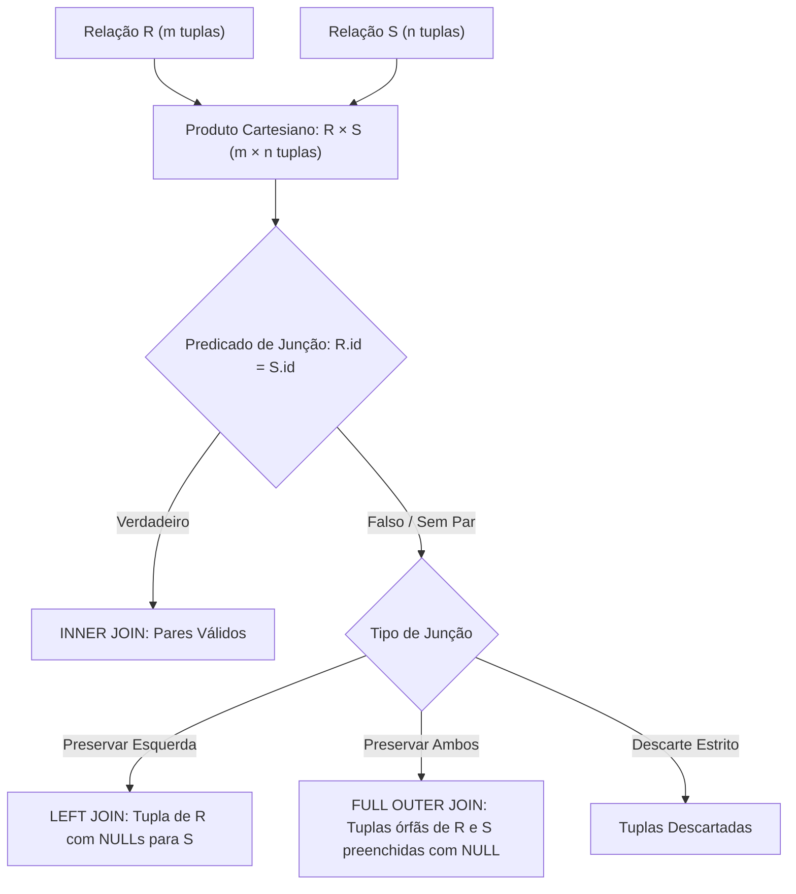
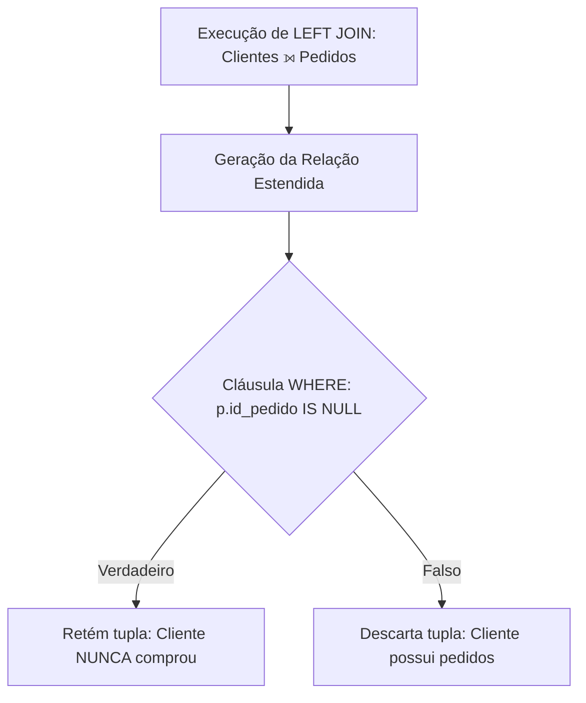
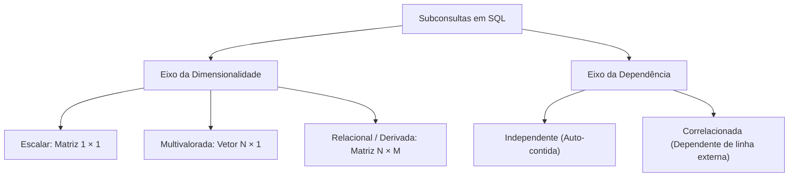
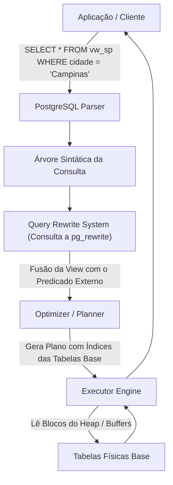
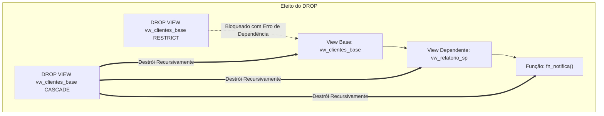
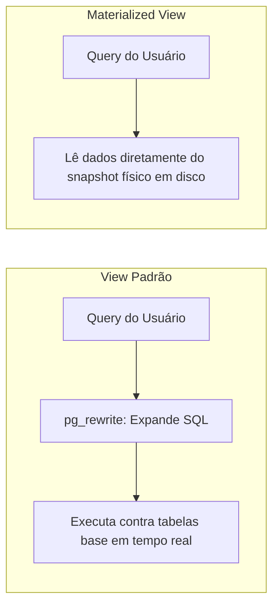
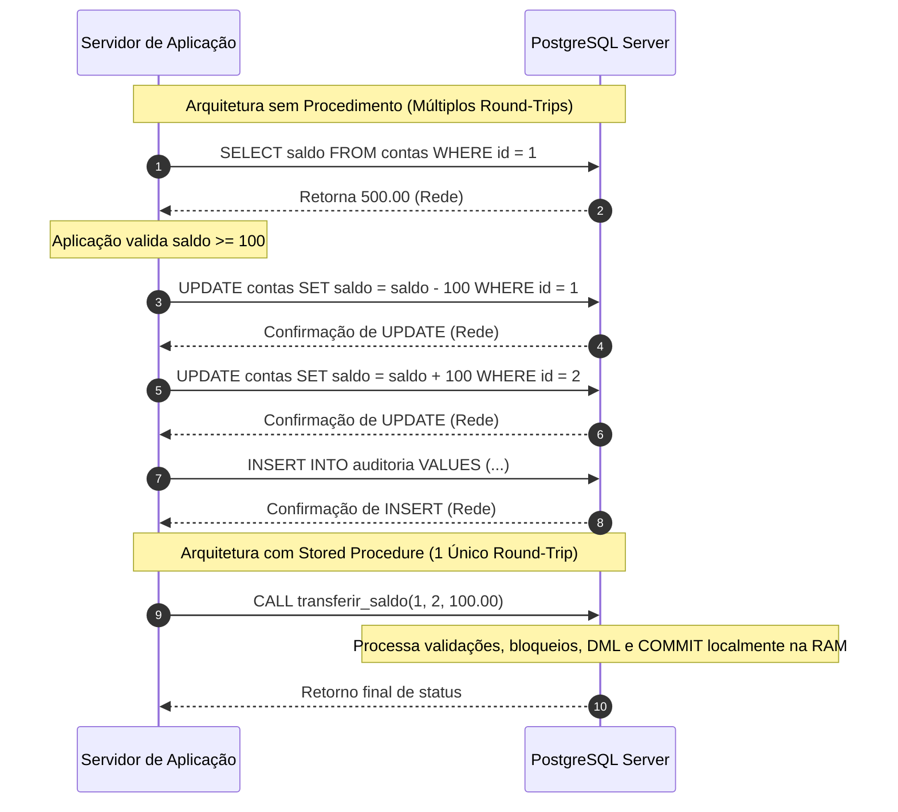
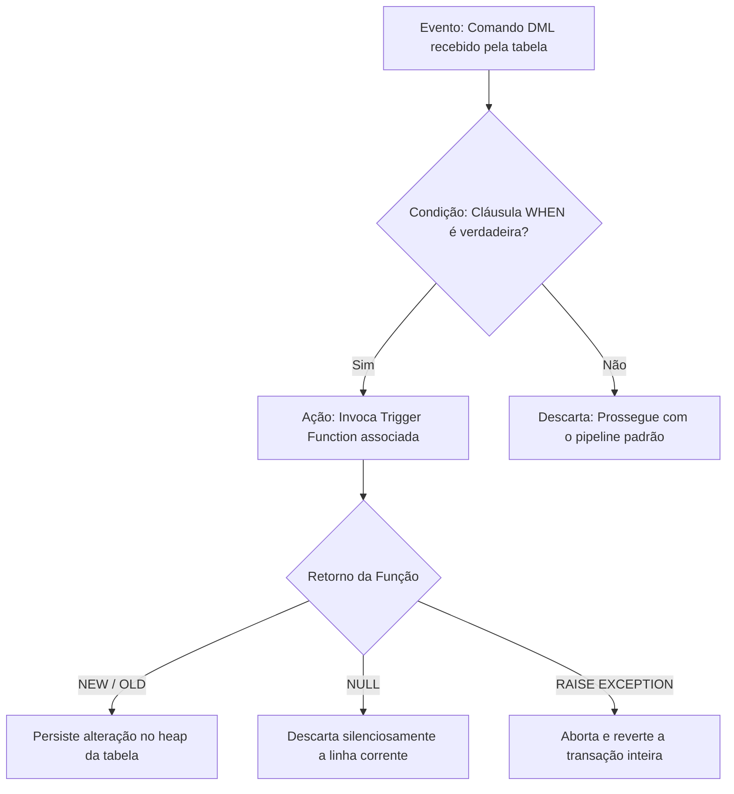
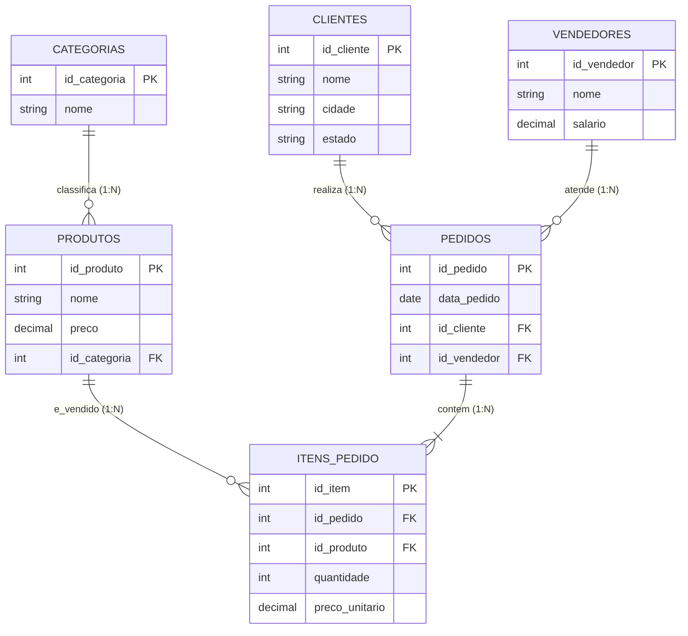
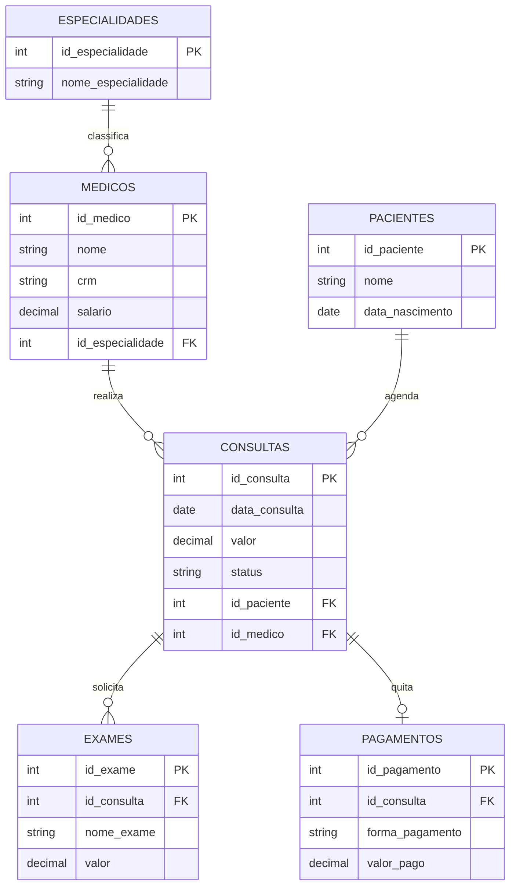

# Guia de Estudos Definitivo: Tópicos Avançados em Banco de Dados

**Instituição:** Centro Universitário de Educação de Fernandópolis (UniFEF)  
**Curso:** Bacharelado em Sistemas de Informação (4º Semestre)  
**Disciplina:** Tópicos Avançados em Banco de Dados  
**Docente:** Prof. Welington Garcia  

---

## Sumário

- [Fundamentos da Modelagem Relacional e Álgebra de Conjuntos](#fundamentos-da-modelagem-relacional-e-álgebra-de-conjuntos)
- [Junções Relacionais Avançadas e Tratamento de Nulos](#junções-relacionais-avançadas-e-tratamento-de-nulos)
- [Subconsultas: Taxonomia, Semântica e Otimização](#subconsultas-taxonomia-semântica-e-otimização)
- [Visões Relacionais e Visões Materializadas](#visões-relacionais-e-visões-materializadas)
- [Programação Procedural em PostgreSQL: Funções e Procedimentos em PL/pgSQL](#programação-procedural-em-postgresql-funções-e-procedimentos-em-plpgsql)
- [Gatilhos Reativos em PL/pgSQL](#gatilhos-reativos-em-plpgsql)
- [Caderno de Resoluções: Trabalho de JOINs](#caderno-de-resoluções-trabalho-de-joins)
- [Caderno de Resoluções: Trabalho de SubSelects - Parte 1](#caderno-de-resoluções-trabalho-de-subselects---parte-1)
- [Caderno de Resoluções: Trabalho de SubSelects Avançados - Parte 2](#caderno-de-resoluções-trabalho-de-subselects-avançados---parte-2)
- [Caderno de Resoluções: Lista Avaliativa de Exercícios](#caderno-de-resoluções-lista-avaliativa-de-exercícios)
- [Caderno de Resoluções: Lista de Stored Procedures](#caderno-de-resoluções-lista-de-stored-procedures)
- [Caderno de Resoluções: Avaliação Oficial de TABD](#caderno-de-resoluções-avaliação-oficial-de-tabd)
- [Engenharia de Desempenho e Diagnóstico com EXPLAIN ANALYZE](#engenharia-de-desempenho-e-diagnóstico-com-explain-analyze)
- [Guia de Armadilhas, Antipatterns e Boas Práticas](#guia-de-armadilhas-antipatterns-e-boas-práticas)
- [Glossário Técnico Consolidado](#glossário-técnico-consolidado)
- [Pontos-Chave para Exames e Concursos](#pontos-chave-para-exames-e-concursos)
- [Banco de Questões de Revisão em Formato JSONL](#banco-de-questões-de-revisão-em-formato-jsonl)
- [Checklist de Autoavaliação e Revisão Pré-Exame](#checklist-de-autoavaliação-e-revisão-pré-exame)

---

## Fundamentos da Modelagem Relacional e Álgebra de Conjuntos

### Definição Formal e Modelo de E. F. Codd

O modelo relacional fundamenta-se na teoria matemática dos conjuntos e na lógica de predicados de primeira ordem. Uma relação $`R`$ é formalmente definida como um subconjunto do produto cartesiano de uma lista de domínios $`D_1, D_2, \dots, D_n`$:

```math
R \subseteq D_1 \times D_2 \times \dots \times D_n
```

Cada elemento pertencente à relação $`R`$ é denominado tupla (linha no contexto físico), e cada domínio corresponde a um atributo (coluna). Na especificação relacional estrita:
- As tuplas em uma relação não possuem ordem intrínseca.
- Os atributos não possuem ordenação posicional dependente para a semântica.
- Todas as tuplas em uma relação matemática são distintas entre si (ausência de duplicatas puras, garantida pela presença de chaves primárias candidatas).

### Operações Primitivas e Derivadas da Álgebra Relacional

A manipulação dos dados ocorre por meio de operadores formais que recebem uma ou duas relações como entrada e produzem invariavelmente uma nova relação como saída (propriedade do fechamento relacional):

1. **Seleção ($`\sigma_\varphi(R)`$):** Filtra tuplas da relação $`R`$ que satisfazem a proposição lógica $`\varphi`$. Mapeia diretamente para a cláusula `WHERE` do SQL.
2. **Projeção ($`\pi_{A_1, \dots, A_k}(R)`$):** Isola os atributos especificados e descarta os demais, eliminando tuplas duplicadas resultantes no modelo matemático. Mapeia para a lista de expressões da cláusula `SELECT`.
3. **Produto Cartesiano ($`R \times S`$):** Combina de forma exaustiva cada tupla da relação $`R`$ com todas as tuplas da relação $`S`$.
4. **União ($`R \cup S`$):** Produz um conjunto contendo todas as tuplas que pertencem a $`R`$, a $`S`$ ou a ambas. Requer compatibilidade de união (mesmo grau e domínios compatíveis).
5. **Diferença de Conjuntos ($`R \setminus S`$ ou $`R - S`$):** Retorna as tuplas que pertencem a $`R`$ e não pertencem a $`S`$.
6. **Junção Teta ($`R \bowtie_\theta S`$):** Operação derivada definida matematicamente por uma seleção aplicada sobre um produto cartesiano:

```math
R \bowtie_\theta S = \sigma_\theta(R \times S)
```

Quando a condição $`\theta`$ utiliza estritamente o operador de igualdade ($`=`$), a operação é classificada como uma **Equijunção**.



### Integridade Estrutural: PK, FK e Restrições Declarativas

No PostgreSQL, a integridade do modelo relacional é fiscalizada por estruturas físicas e declarativas:

- **Chave Primária (Primary Key - PK):** Impõe unicidade estrita ($`\text{UNIQUE}`$) e obrigatoriedade ($`\text{NOT NULL}`$). O motor cria automaticamente um índice estruturado em árvore B (*B-Tree*) para garantir validações em tempo logarítmico $`O(\log N)`$.
- **Chave Estrangeira (Foreign Key - FK):** Estabelece o vínculo de integridade referencial entre uma relação dependente e uma relação referenciada. Impede que a relação dependente aponte para registros inexistentes.
- **Ações de Disparo Referencial:** Ao atualizar ou excluir registros pais, o PostgreSQL permite configurar comportamentos determinísticos:
  - `ON DELETE RESTRICT` / `NO ACTION`: Aborta a transação emitindo violação de integridade caso existam registros filhos.
  - `ON DELETE CASCADE`: Remove recursivamente as tuplas filhas vinculadas.
  - `ON DELETE SET NULL`: Atribui `NULL` às colunas de chave estrangeira nas tuplas filhas.
  - `ON DELETE SET DEFAULT`: Restaura o valor padrão definido na coluna.

### Contraexemplo e Armadilhas de Modelagem

- **Contraexemplo:** Criar uma coluna `id_cliente INTEGER` na tabela `pedidos` sem declarar explicitamente `CONSTRAINT fk_pedidos_clientes FOREIGN KEY (id_cliente) REFERENCES clientes(id_cliente)`. A ausência da restrição permite a inserção de pedidos órfãos, degradando a confiabilidade do banco e forçando o uso de lógicas de limpeza reativa.
- **Armadilha:** Presumir que chaves estrangeiras geram índices automaticamente no PostgreSQL. Ao contrário de chaves primárias e restrições de unicidade, o PostgreSQL **não cria índices automáticos sobre colunas de chave estrangeira**. Sem um índice secundário explicitamente criado na coluna de chave estrangeira, operações de `DELETE` na tabela pai exigirão varreduras sequenciais completas (*Sequential Scans*) na tabela filha para verificar a ausência de órfãos, gerando travamentos de tabela e quedas drásticas de vazão.

---

## Junções Relacionais Avançadas e Tratamento de Nulos

### INNER JOIN: Mecânica Interna e Álgebra

O `INNER JOIN` retorna a interseção lógica exata entre dois conjuntos. Registros da tabela à esquerda ou à direita que não satisfizerem o predicado da cláusula `ON` são descartados da projeção final.

Internamente, o otimizador baseado em custos (*Cost-Based Optimizer* - CBO) do PostgreSQL decide a estratégia física de execução avaliando as estatísticas da tabela mantidas em `pg_statistic`:
1. **Nested Loop Join:** Varre a relação externa e busca chaves na relação interna. Ideal para pequenos volumes com índice na tabela interna ($`O(M \log N)`$).
2. **Hash Join:** Carrega a tabela menor em uma tabela de espalhamento (*hash table*) na memória (`work_mem`). Em seguida, varre a tabela maior testando colisões ($`O(M + N)`$).
3. **Merge Join:** Exige ordenação prévia das relações pela chave de junção. Percorre as duas tabelas em paralelo com ponteiros sequenciais ($`O(M + N)`$).

```sql
SELECT 
    p.id_pedido,
    p.data_pedido,
    c.nome AS nome_cliente
FROM pedidos p
INNER JOIN clientes c ON p.id_cliente = c.id_cliente;
```

### LEFT OUTER JOIN e RIGHT OUTER JOIN

O `LEFT JOIN` preserva a integridade de todas as tuplas da relação à esquerda. Quando uma tupla à esquerda não encontra correspondentes à direita, os atributos projetados da relação à direita assumem o valor `NULL`.

O `RIGHT JOIN` preserva integralmente a relação à direita. Matematicamente:

```math
A \text{ RIGHT JOIN } B \equiv B \text{ LEFT JOIN } A
```

Por convenção de engenharia de software e manutenibilidade, prioriza-se a padronização em `LEFT JOIN`, acompanhando o fluxo ocidental de leitura estruturada.

```sql
SELECT 
    c.id_cliente,
    c.nome,
    p.id_pedido
FROM clientes c
LEFT JOIN pedidos p ON c.id_cliente = p.id_cliente;
```

### Detecção de Órfãos: O Padrão Anti-Join

O *Anti-Join* isola os elementos do conjunto $`A`$ que não possuem correspondência no conjunto $`B`$ ($`A \setminus B`$). No PostgreSQL, a técnica tradicional consiste em combinar `LEFT JOIN` com um predicado de filtragem que atesta a nulidade da chave primária da relação da direita.



```sql
SELECT 
    c.id_cliente,
    c.nome
FROM clientes c
LEFT JOIN pedidos p ON c.id_cliente = p.id_cliente
WHERE p.id_pedido IS NULL;
```

> [!CRITICAL]
> O filtro `WHERE` deve ser aplicado obrigatoriamente sobre uma coluna garantidamente `NOT NULL` da tabela à direita (preferencialmente a sua Chave Primária). Filtrar por uma coluna opcional que aceite nulos por natureza de cadastro gera falsos positivos graves.

### FULL OUTER JOIN: Reconciliação Contábil e Auditoria

O `FULL OUTER JOIN` realiza a união externa bidirecional: tuplas de ambos os lados que não possuem correspondência são preservadas e completadas com valores nulos. É amplamente empregado em processos de auditoria financeira, detecção de divergências entre sistemas legados e conciliação bancária.

```sql
SELECT 
    coalesce(c.id_cliente, p.id_cliente) AS id_unificado,
    c.nome,
    p.id_pedido
FROM clientes c
FULL OUTER JOIN pedidos p ON c.id_cliente = p.id_cliente;
```

### CROSS JOIN e Riscos de Explosão Combinatória

O `CROSS JOIN` calcula o produto cartesiano puro entre duas relações. Se a tabela $`A`$ possui $`1.000`$ registros e a tabela $`B`$ possui $`10.000`$ registros, o resultado conterá exatamente $`10.000.000`$ de tuplas ($`|A| \times |B|`$).

Aplicações legítimas do `CROSS JOIN`:
- Geração de matrizes de dimensões para relatórios gerenciais (ex.: cruzar todos os meses do ano com todas as filiais para preencher tabelas com valores zero).
- Geração de testes de carga e populações sintéticas em laboratório.

```sql
-- Geração de calendário operacional cruzado por departamento
SELECT d.nome_departamento, m.mes
FROM departamentos d
CROSS JOIN generate_series(1, 12) AS m(mes);
```

### SELF JOIN e Modelagem de Hierarquias em Árvore

O `SELF JOIN` ocorre quando uma tabela é relacionada consigo mesma. É aplicado quando uma entidade expressa um autorrelacionamento (estrutura de lista de adjacência), como a relação entre um funcionário e seu supervisor imediato.

```sql
SELECT 
    f.nome AS funcionario,
    coalesce(s.nome, 'Diretoria / Sem Supervisor') AS supervisor
FROM funcionarios f
LEFT JOIN funcionarios s ON f.id_supervisor = s.id_funcionario;
```

### A Função Escalar COALESCE

A função `COALESCE(val_1, val_2, ..., val_n)` retorna o primeiro argumento não nulo da lista fornecida, avaliando as expressões com semântica de curto-circuito. Em operações de junção externa, substitui os `NULL`s estruturais por literais informativos ou valores numéricos neutros (`0`).

```sql
SELECT 
    pr.nome_produto,
    coalesce(c.nome_categoria, 'Não Categorizado') AS categoria
FROM produtos pr
LEFT JOIN categorias c ON pr.id_categoria = c.id_categoria;
```

### Ponto Crítico Semântico: ON versus WHERE em Junções Externas

Uma das armadilhas mais frequentes em consultas SQL avançadas reside na confusão conceitual entre aplicar um predicado na cláusula `ON` ou na cláusula `WHERE` sob um `LEFT JOIN`:

- **Filtro no `ON`:** Condiciona a realização da junção. Se a linha da direita não atender ao critério do `ON`, a linha da esquerda **continua aparecendo** no resultado, com colunas da direita preenchidas por `NULL`.
- **Filtro no `WHERE`:** Avalia o predicado após a realização da junção externa completa. Como a condição testa uma coluna da direita (ex.: `WHERE p.status = 'Pago'`), as linhas preservadas pela junção onde a coluna é `NULL` serão avaliadas como `UNKNOWN` e descartadas pelo motor, convertendo silenciosamente o `LEFT JOIN` em um `INNER JOIN`.

```sql
-- Caso 1: Filtro no ON (Preserva todos os clientes, pareando apenas pedidos 'Pago')
SELECT c.nome, p.id_pedido, p.status
FROM clientes c
LEFT JOIN pedidos p ON c.id_cliente = p.id_cliente AND p.status = 'Pago';

-- Caso 2: Filtro no WHERE (Descarta clientes sem pedidos ou cujos pedidos não sejam 'Pago')
SELECT c.nome, p.id_pedido, p.status
FROM clientes c
LEFT JOIN pedidos p ON c.id_cliente = p.id_cliente
WHERE p.status = 'Pago';
```

---

## Subconsultas: Taxonomia, Semântica e Otimização

### Taxonomia por Cardinalidade e Dependência de Escopo

Uma subconsulta (*subquery*) é uma instrução `SELECT` aninhada no corpo de outra instrução SQL. Sua categorização formal obedece a dois eixos ortogonais:



1. **Subconsulta Escalar:** Retorna exatamente um valor atômico (uma linha e uma coluna). Pode ser posicionada em qualquer ponto sintático onde uma constante literal seja válida.
2. **Subconsulta Multivalorada:** Retorna uma coluna com zero, uma ou múltiplas linhas. É consumida por operadores de conjunto (`IN`, `NOT IN`, `ANY`, `ALL`).
3. **Subconsulta Relacional (Tabela Derivada / Inline View):** Retorna uma matriz bidimensional ($`N \times M`$). É posicionada na cláusula `FROM` e exige obrigatoriamente um identificador de *alias* no PostgreSQL.
4. **Subconsulta Independente:** Não faz referência a colunas da consulta externa. É executada uma única vez pelo planejador, sendo encapsulada frequentemente em um nó `InitPlan`.
5. **Subconsulta Correlacionada:** Faz referência a colunas da linha em avaliação na consulta externa. Conceitualmente, é reavaliada para cada linha processada externamente (nó `SubPlan`), exigindo técnicas de descorrelação (*subquery unnesting*) pelo otimizador.

### Operadores de Pertencimento: IN e NOT IN

O operador `IN` avalia se um valor escalar pertence ao conjunto gerado pela subconsulta:

```math
v \in S \iff \exists s \in S \mid v = s
```

O operador `NOT IN` expressa o complemento booleano:

```math
v \notin S \iff \forall s \in S \mid v \neq s
```

### A Armadilha do Three-Valued Logic com NOT IN e Valores NULL

*[Complemento de Teoria Relacional e Engenharia]*  
No SQL padrão e no PostgreSQL, a álgebra opera sob a lógica trivalente (*Three-Valued Logic - 3VL*), cujos estados lógicos são `TRUE`, `FALSE` e `UNKNOWN`. Qualquer comparação direta envolvendo `NULL` através de operadores convencionais ($`=, \neq, <, >`$) resulta em `UNKNOWN`.

Considere a validação da expressão:

```sql
v NOT IN (SELECT coluna FROM tabela)
```

Matematicamente, a expressão expande para uma conjunção lógica de desigualdades:

```math
(v \neq s_1) \land (v \neq s_2) \land \dots \land (v \neq s_n)
```

Se o conjunto $`S`$ contiver ao menos um elemento com valor `NULL`, digamos $`s_k = \text{NULL}`$:
- A comparação $`v \neq \text{NULL}`$ avalia para `UNKNOWN`.
- Pela tabela-verdade do conectivo lógico `AND`:
  - $`\text{TRUE} \land \text{UNKNOWN} \equiv \text{UNKNOWN}`$.
  - $`\text{FALSE} \land \text{UNKNOWN} \equiv \text{FALSE}`$.

Portanto, a expressão geral **jamais avaliará como `TRUE`**. Como a cláusula `WHERE` só aprova tuplas cuja condição booleana final seja estritamente `TRUE`, a consulta retornará invariavelmente **zero linhas** caso haja um único `NULL` na subconsulta, mesmo que existam centenas de tuplas legítimas que satisfaçam a intenção do usuário.

```sql
-- DEMONSTRAÇÃO DO COMPORTAMENTO CRÍTICO
-- Suponha que a tabela 'pedidos' contenha uma linha com id_cliente NULL
-- Esta consulta retornará VAZIO (0 linhas), falhando silenciosamente na regra de negócio!
SELECT nome FROM clientes WHERE id_cliente NOT IN (SELECT id_cliente FROM pedidos);

-- SOLUÇÃO DEFENSIVA 1: Filtrar explicitamente os nulos
SELECT nome FROM clientes WHERE id_cliente NOT IN (SELECT id_cliente FROM pedidos WHERE id_cliente IS NOT NULL);

-- SOLUÇÃO DEFENSIVA 2 (PADRÃO PROFISSIONAL): Utilizar NOT EXISTS
SELECT c.nome FROM clientes c WHERE NOT EXISTS (SELECT 1 FROM pedidos p WHERE p.id_cliente = c.id_cliente);
```

### Operadores de Existência: EXISTS e NOT EXISTS

O operador `EXISTS` avalia se a subconsulta associada produz ao menos uma tupla. Diferente de `IN`, o `EXISTS` opera sob semântica de curto-circuito (*short-circuit evaluation*): assim que o motor do PostgreSQL encontra a primeira linha correspondente, o processamento da subconsulta é interrompido imediatamente para aquela iteração, sem consumir memória para acumular o restante do conjunto.

Convenciona-se utilizar `SELECT 1` no corpo da subconsulta sob `EXISTS`, pois o otimizador ignora a lista de projeção interna, avaliando estritamente a cardinalidade do nó:

```sql
SELECT c.id_cliente, c.nome
FROM clientes c
WHERE EXISTS (
    SELECT 1 
    FROM pedidos p 
    WHERE p.id_cliente = c.id_cliente
);
```

### Quantificadores Universais e Existenciais: ANY e ALL

- `v operador ANY (subquery)`: Retorna `TRUE` se a comparação for verdadeira para **pelo menos um** valor do conjunto. A expressão `= ANY (...)` é exatamente equivalente a `IN (...)`.
- `v operador ALL (subquery)`: Retorna `TRUE` se a comparação for verdadeira para **todos** os elementos retornados pela subconsulta.

```sql
-- Produtos com preço maior que pelo menos um produto de Telefonia
SELECT nome_produto, preco
FROM produtos
WHERE preco > ANY (
    SELECT pr.preco 
    FROM produtos pr 
    INNER JOIN categorias ca ON pr.id_categoria = ca.id_categoria 
    WHERE ca.nome_categoria = 'Telefonia'
);

-- Produtos com preço maior que todos os produtos de Acessórios
SELECT nome_produto, preco
FROM produtos
WHERE preco > ALL (
    SELECT pr.preco 
    FROM produtos pr 
    INNER JOIN categorias ca ON pr.id_categoria = ca.id_categoria 
    WHERE ca.nome_categoria = 'Acessórios'
);
```

### Tabelas Derivadas na Cláusula FROM (Inline Views)

Uma tabela derivada é uma subconsulta inserida na cláusula `FROM` que sintetiza uma relação virtual transitória para a consulta consumidora.

> [!IMPORTANT]
> No PostgreSQL, toda subconsulta na cláusula `FROM` deve obrigatoriamente receber um apelido formal de tabela (*alias*). O não cumprimento desta regra dispara erro sintático imediato: `ERROR: subquery in FROM must have an alias`.

```sql
SELECT 
    resumo.id_categoria,
    resumo.media_preco
FROM (
    SELECT id_categoria, round(avg(preco), 2) AS media_preco
    FROM produtos
    GROUP BY id_categoria
) AS resumo
WHERE resumo.media_preco > 1000.00;
```

---

## Visões Relacionais e Visões Materializadas

### Arquitetura Interna: O Mecanismo pg_rewrite

No PostgreSQL, uma visão relacional padrão (`CREATE VIEW`) é uma relação puramente lógica (tabela virtual). Ela não aloca blocos de disco nem arquivos de dados (*heap files*) para armazenar tuplas. O SGBD armazena apenas a sua definição textual e metadados estruturais no catálogo do sistema (tabelas `pg_views`, `pg_class` e `pg_rewrite`).

Quando uma aplicação executa um `SELECT` contra uma visão, o PostgreSQL não executa a visão separadamente para depois filtrar os dados em memória. O subsistema **Query Rewrite Rule System** intercepta a árvore de sintaxe abstrata (*Abstract Syntax Tree* - AST) gerada pelo analisador léxico/sintático (*parser*) e funde a consulta externa com a definição interna da visão. O otimizador de consultas gera então um **plano de execução único e integrado**, viabilizando a propagação de predicados (*predicate pushdown*) e o uso de índices criados nas tabelas base.



### Modificação de Definições: CREATE OR REPLACE VIEW

O comando `CREATE OR REPLACE VIEW` permite atualizar a consulta interna de uma visão sem destruí-la. Contudo, para não violar dependências de esquema no catálogo, o PostgreSQL impõe regras severas:

1. **Invariância de Colunas Anteriores:** As colunas pré-existentes devem ser preservadas com os mesmos nomes, mesmos tipos de dados e na mesma ordem ordinal.
2. **Inclusão Exclusiva ao Fim:** Novas colunas adicionadas à consulta só podem ser inseridas **após a última coluna** da definição anterior.
3. **Impossibilidade de Remoção:** Não é permitido excluir colunas pré-existentes ou renomeá-las via `CREATE OR REPLACE VIEW`.

Caso seja necessário reordenar ou remover colunas, deve-se emitir `DROP VIEW` e recriar o objeto, gerenciando as dependências.

### Gerenciamento de Dependências: DROP VIEW CASCADE versus RESTRICT

As relações de dependência entre visões, funções e tabelas são registradas no catálogo `pg_depend`.

- **`DROP VIEW nome_view RESTRICT;` (Padrão):** Aborta a destruição da visão caso exista outro objeto (uma segunda visão, uma função ou uma restrição) que dependa dela.
- **`DROP VIEW nome_view CASCADE;`:** Remove a visão solicitada e, recursivamente, **destrói todos os objetos dependentes** sem confirmação adicional.



> [!WARNING]
> A utilização de `CASCADE` em bancos de dados de produção constitui alto risco de indisponibilidade operacional (*outage*). Sempre inspecione a visão administrativa `pg_depend` antes de invocar a cláusula `CASCADE`.

### Visões Automaticamente Atualizáveis e Restrições de Escrita

Uma visão é considerada automaticamente atualizável (*automatically updatable*) pelo PostgreSQL, aceitando comandos DML (`INSERT`, `UPDATE`, `DELETE`), se satisfizer cumulativamente às seguintes condições estruturais:
1. Conter exatamente uma tabela base (ou outra visão atualizável) na cláusula `FROM`.
2. Não conter junções (`JOIN`).
3. Não conter cláusulas de agregação ou agrupamento (`GROUP BY`, `HAVING`, `SUM`, `AVG`, `COUNT`).
4. Não conter operadores de conjunto (`UNION`, `INTERSECT`, `EXCEPT`).
5. Não conter a cláusula `DISTINCT`.
6. Não utilizar funções de janela (*Window Functions* via `OVER`).
7. Suas colunas projetadas devem ser referências diretas a colunas da tabela base, e não expressões calculadas ou literais.

### A Cláusula WITH CHECK OPTION

Quando uma visão atualizável possui uma cláusula `WHERE`, é possível que um comando de escrita altere os dados de modo que o registro modificado deixe de satisfazer ao filtro da própria visão. A cláusula `WITH CHECK OPTION` impede essa anomalia:

- **`WITH LOCAL CHECK OPTION`:** Fiscaliza apenas os predicados de filtragem declarados na visão imediata.
- **`WITH CASCADED CHECK OPTION` (Padrão):** Fiscaliza os predicados da visão atual e de todas as visões subjacentes que ela venha a encapsular.

```sql
CREATE OR REPLACE VIEW vw_clientes_sp_segura AS
SELECT id_cliente, nome, estado
FROM clientes
WHERE estado = 'SP'
WITH CHECK OPTION;

-- Esta operação será abortada pelo PostgreSQL com erro de violação de check option:
-- UPDATE vw_clientes_sp_segura SET estado = 'RJ' WHERE id_cliente = 1;
```

### Segurança e Controle de Acesso: O Modelo de Blindagem de Dados

Visões funcionam como barreiras de segurança física e lógica (*Data Abstraction Layer*). É possível retirar privilégios de acesso direto dos usuários sobre tabelas físicas sensíveis e conceder acesso unicamente à visão autorizada:

```sql
-- Revoga privilégios diretos sobre a tabela física
REVOKE ALL ON TABLE funcionarios FROM analista_rh;

-- Cria visão com omissão de atributos sigilosos (ex.: oculta dados bancários e senhas)
CREATE VIEW vw_funcionarios_resumo AS
SELECT id_funcionario, nome, departamento, cargo
FROM funcionarios;

-- Concede privilégio de leitura estritamente sobre a visão
GRANT SELECT ON vw_funcionarios_resumo TO analista_rh;
```

### Visões Materializadas: Armazenamento Físico e Otimização

Diferente de visões normais, a **Visão Materializada** (`MATERIALIZED VIEW`) executa a consulta declarada e grava fisicamente o conjunto resultante em disco como uma tabela real de snapshot.



Vantagens e Trade-offs de Engenharia:
- **Latência de Leitura Baixa:** Elimina o custo computacional de junções complexas e agregações massivas durante a leitura.
- **Indexação Própria:** Suporta a criação de índices locais (`CREATE INDEX`) dedicados, como B-Tree, Hash ou GIN.
- **Obsolescência de Dados (*Staleness*):** Os dados não são atualizados automaticamente quando as tabelas base sofrem DML.
- **Custo de Sincronização:** Exige a execução explícita de `REFRESH MATERIALIZED VIEW`.

```sql
-- Criação de Visão Materializada
CREATE MATERIALIZED VIEW mv_faturamento_mensal AS
SELECT 
    to_char(p.data_pedido, 'YYYY-MM') AS competencia,
    sum(ip.quantidade * ip.preco_unitario) AS faturamento_total
FROM pedidos p
INNER JOIN itens_pedido ip ON p.id_pedido = ip.id_pedido
GROUP BY to_char(p.data_pedido, 'YYYY-MM');

-- Criação de índice próprio sobre a visão materializada
CREATE INDEX idx_mv_fat_competencia ON mv_faturamento_mensal(competencia);

-- Atualização bloqueante (trava leitura concorrente na view)
REFRESH MATERIALIZED VIEW mv_faturamento_mensal;

-- Atualização concorrente (exige índice único preliminar; permite leitura durante refresh)
CREATE UNIQUE INDEX idx_mv_fat_unique ON mv_faturamento_mensal(competencia);
REFRESH MATERIALIZED VIEW CONCURRENTLY mv_faturamento_mensal;
```

---

## Programação Procedural em PostgreSQL: Funções e Procedimentos em PL/pgSQL

### Arquitetura e Mitigação de Latência de Rede

Nas arquiteturas corporativas tradicionais, quando uma regra de negócio que demanda validações intermediárias é executada exclusivamente na camada de aplicação, o sistema sofre com a latência de tráfego de rede (*round-trips* sucessivos de ida e volta).



O código compilado em PL/pgSQL executa no próprio processo de backend do PostgreSQL, compartilhando a memória do servidor e reduzindo o consumo de banda de rede ao tráfego de chamada e resposta.

### Matriz de Diferenças: Stored Functions versus Stored Procedures

A distinção conceitual e operacional entre funções e procedimentos no PostgreSQL consolidou-se a partir do PostgreSQL 11:

| Característica | Stored Function (`CREATE FUNCTION`) | Stored Procedure (`CREATE PROCEDURE`) |
| :--- | :--- | :--- |
| **Comando de Invocação** | `SELECT nome_funcao();` ou integrado em queries. | `CALL nome_procedure();`. |
| **Uso em Comandos SQL** | Pode compor cláusulas `WHERE`, `JOIN` ou `SELECT`. | Não pode ser chamada dentro de expressões SQL. |
| **Declaração de Retorno** | Obrigatória (`RETURNS tipo_dado` ou `RETURNS void`). | Proibida (não possui cláusula `RETURNS`). |
| **Retorno de Múltiplos Valores**| `RETURNS TABLE(...)` ou tipos compostos. | Parâmetros de saída (`OUT` e `INOUT`). |
| **Controle Transacional** | Proibido. Executa na transação externa da query. | **Permitido.** Pode gerenciar `COMMIT` e `ROLLBACK`. |
| **Objetivo Primário** | Computação matemática, processamento de dados funcional. | Orquestração de tarefas, operações batch, DML complexo. |

### Estrutura Formal de um Bloco PL/pgSQL

O PL/pgSQL é uma linguagem estruturada em blocos delimitados. A estrutura completa divide-se em quatro seções principais:

```sql
[ <<rotulo>> ]
[ DECLARE
    -- Declaração de variáveis locais, tipos ancorados e cursores
]
BEGIN
    -- Seção executável de instruções SQL e controle procedural
[ EXCEPTION
    -- Seção de captura e tratamento de falhas em tempo de execução
]
END [ rotulo ];
```

Para encapsular o código fonte sem a necessidade de duplicar caracteres de aspas simples, adota-se o delimitador **Dollar Quoting** (`$$` ou `$tag$`).

### Tipagem Ancorada com %TYPE e %ROWTYPE

Para manter o código imune a alterações em esquemas relacionais de banco de dados, utiliza-se a ancoragem estática de tipos:

- `%TYPE`: Vincula o tipo de dado de uma variável ao tipo exato de uma coluna existente.
- `%ROWTYPE`: Aloca uma estrutura composta (registro) contendo a representação de uma linha inteira de uma tabela.

```sql
DECLARE
    v_salario funcionarios.salario%TYPE;     -- Assume o tipo exato da coluna salario
    v_funcionario_rec funcionarios%ROWTYPE;  -- Registrador que armazena todas as colunas da tabela
```

### Variáveis Especiais de Diagnóstico: FOUND e GET DIAGNOSTICS

O interpretador PL/pgSQL injeta e mantém variáveis internas de estado:

- `FOUND`: Variável booleana redefinida automaticamente após instruções de manipulação de dados ou busca. Torna-se `TRUE` se um comando `SELECT INTO` localizou dados ou se uma instrução DML (`INSERT`, `UPDATE`, `DELETE`) alterou ao menos uma linha; caso contrário, assume `FALSE`.
- `GET DIAGNOSTICS`: Permite inspecionar metadados avançados, como a contagem exata de linhas modificadas pelo comando DML imediatamente precedente:

```sql
GET DIAGNOSTICS v_linhas_afetadas = ROW_COUNT;
```

### Concorrência e Bloqueio de Registros: SELECT FOR UPDATE

Em rotinas financeiras e de controle de estoque concorrente, leituras de registros seguidas de cálculo e posterior gravação sofrem do problema de condição de corrida (*race condition*). Para assegurar isolamento transacional estrito, utiliza-se o bloqueio pessimista via `SELECT FOR UPDATE`, retendo uma trava exclusiva de escrita (*RowExclusiveLock*) sobre a tupla até a finalização da transação corrente:

```sql
SELECT saldo INTO v_saldo_atual
FROM contas
WHERE id_conta = p_id_conta
FOR UPDATE;
```

---

## Gatilhos Reativos em PL/pgSQL

### Paradigma Evento-Condição-Ação (ECA)

Um gatilho (*trigger*) é um objeto do esquema de banco de dados associado a uma tabela ou visão, cuja ativação ocorre de maneira implícita e automática pelo motor relacional perante a ocorrência de operações de modificação de dados (`INSERT`, `UPDATE`, `DELETE`, `TRUNCATE`).



### Desacoplamento entre Trigger Function e Trigger

Diferente de sistemas de banco de dados como Oracle ou SQL Server, onde o corpo do gatilho é acoplado diretamente à instrução de criação, o PostgreSQL adota um padrão arquitetural de desacoplamento rigoroso em dois passos:

1. **Definição da Trigger Function:** Criação de uma função estruturada em PL/pgSQL sem parâmetros formais, declarando explicitamente a cláusula `RETURNS trigger`.
2. **Declaração do Gatilho:** Vinculação da *trigger function* a uma tabela específica por meio da instrução `CREATE TRIGGER`, definindo o momento, os eventos, a granularidade e a cláusula condicional `WHEN`.

```sql
-- 1. Criação da Trigger Function
CREATE OR REPLACE FUNCTION fn_trg_valida_estoque()
RETURNS trigger
LANGUAGE plpgsql
AS $$
BEGIN
    IF NEW.estoque < 0 THEN
        RAISE EXCEPTION 'A quantidade em estoque não pode ser negativa. Valor informado: %', NEW.estoque;
    END IF;
    RETURN NEW;
END;
$$;

-- 2. Vinculação do Gatilho à Tabela
CREATE TRIGGER trg_produtos_valida_estoque
BEFORE INSERT OR UPDATE ON produtos
FOR EACH ROW
EXECUTE FUNCTION fn_trg_valida_estoque();
```

### Variáveis Especiais de Contexto em Triggers

Durante a execução da função de gatilho, o interpretador PL/pgSQL disponibiliza um conjunto de variáveis contextuais nativas:

| Variável | Tipo | Descrição e Disponibilidade |
| :--- | :--- | :--- |
| `NEW` | `RECORD` | Imagem da nova tupla que está sendo inserida ou atualizada. Disponível em `INSERT` e `UPDATE` (`NULL` em `DELETE`). |
| `OLD` | `RECORD` | Imagem da tupla original precedente antes da modificação. Disponível em `UPDATE` e `DELETE` (`NULL` em `INSERT`). |
| `TG_OP` | `TEXT` | Identificador da operação DML que disparou o gatilho (`'INSERT'`, `'UPDATE'`, `'DELETE'`). |
| `TG_WHEN` | `TEXT` | Momento do disparo do gatilho (`'BEFORE'`, `'AFTER'`, `'INSTEAD OF'`). |
| `TG_LEVEL` | `TEXT` | Granularidade do disparo (`'ROW'` ou `'STATEMENT'`). |
| `TG_NAME` | `NAME` | Nome declarado do gatilho que acionou a função. |
| `TG_TABLE_NAME`| `NAME` | Nome da tabela física sobre a qual o evento foi disparado. |

### Momentos de Disparo: BEFORE, AFTER e INSTEAD OF

- **`BEFORE`:** Dispara antes que os dados sejam validados contra restrições relacionais de tabela e antes da gravação física na página de heap. Se retornar `NEW`, a tupla retornada é gravada; se retornar `NULL`, a operação sobre aquela tupla específica é descartada silenciosamente.
- **`AFTER`:** Dispara após a escrita física e após a satisfação de todas as restrições relacionais. É imutável em relação à linha (o retorno é ignorado pelo motor). Destina-se ao registro de auditorias e sincronização de dados agregados.
- **`INSTEAD OF`:** Declarado **exclusivamente sobre Visões**. Substitui integralmente o comando DML recebido pela visão, permitindo que o desenvolvedor implemente rotinas manuais de distribuição de dados nas tabelas base subjacentes.

### Granularidade: FOR EACH ROW versus FOR EACH STATEMENT

- `FOR EACH ROW`: Executa a função uma vez para cada tupla modificada. Permite acesso a `NEW` e `OLD`.
- `FOR EACH STATEMENT`: Executa a função exatamente uma vez por comando SQL emitido, independentemente do número de linhas modificadas. Não possui acesso individual a `NEW` e `OLD`. Indicado para validações em lote ou bloqueios corporativos de horário comercial.

---

## Caderno de Resoluções: Trabalho de JOINs

Nesta seção, resolvemos integralmente os 10 exercícios propostos na lista oficial de JOINs do Prof. Welington Garcia, baseada no esquema `loja_joins`.



### Exercício 1: Cliente e seus pedidos
**Enunciado:** Utilizando `INNER JOIN`, apresente o código do pedido, a data do pedido e o nome do cliente. Ordene o resultado pelo código do pedido.

```sql
SELECT 
    p.id_pedido,
    p.data_pedido,
    c.nome AS nome_cliente
FROM pedidos p
INNER JOIN clientes c ON p.id_cliente = c.id_cliente
ORDER BY p.id_pedido ASC;
```

### Exercício 2: Relatório completo dos itens vendidos
**Enunciado:** Apresente o código do pedido, o nome do cliente, o nome do produto, a quantidade e o preço unitário. Será necessário relacionar as tabelas `clientes`, `pedidos`, `itens_pedido` e `produtos`.

```sql
SELECT 
    p.id_pedido,
    c.nome AS nome_cliente,
    pr.nome AS nome_produto,
    ip.quantidade,
    ip.preco_unitario
FROM pedidos p
INNER JOIN clientes c ON p.id_cliente = c.id_cliente
INNER JOIN itens_pedido ip ON p.id_pedido = ip.id_pedido
INNER JOIN produtos pr ON ip.id_produto = pr.id_produto
ORDER BY p.id_pedido ASC, pr.nome ASC;
```

### Exercício 3: Clientes sem pedidos
**Enunciado:** Utilizando `LEFT JOIN`, liste somente os clientes que nunca realizaram pedidos. Exiba o código e o nome do cliente.

```sql
SELECT 
    c.id_cliente,
    c.nome AS nome_cliente
FROM clientes c
LEFT JOIN pedidos p ON c.id_cliente = p.id_cliente
WHERE p.id_pedido IS NULL
ORDER BY c.id_cliente ASC;
```

### Exercício 4: Produtos nunca vendidos
**Enunciado:** Utilizando `LEFT JOIN`, liste os produtos que ainda não aparecem em nenhum item de pedido. Exiba o código do produto, nome e preço.

```sql
SELECT 
    pr.id_produto,
    pr.nome AS nome_produto,
    pr.preco
FROM produtos pr
LEFT JOIN itens_pedido ip ON pr.id_produto = ip.id_produto
WHERE ip.id_item IS NULL
ORDER BY pr.id_produto ASC;
```

### Exercício 5: Quantidade de pedidos por cliente
**Enunciado:** Mostre o nome de cada cliente e a quantidade de pedidos realizados. Todos os clientes devem aparecer, inclusive os que possuem zero pedidos. Utilize `LEFT JOIN`, `COUNT()` e `GROUP BY`.

```sql
SELECT 
    c.nome AS nome_cliente,
    count(p.id_pedido) AS total_pedidos
FROM clientes c
LEFT JOIN pedidos p ON c.id_cliente = p.id_cliente
GROUP BY c.id_cliente, c.nome
ORDER BY total_pedidos DESC, c.nome ASC;
```
> [!NOTE]
> Deve-se utilizar categoricamente `COUNT(p.id_pedido)` em vez de `COUNT(*)`. A função `COUNT(*)` contabilizaria a linha de preenchimento nulo gerada pela junção externa, resultando incorretamente em 1 pedido para clientes sem compras.

### Exercício 6: Faturamento por produto
**Enunciado:** Calcule quanto cada produto gerou em vendas. O valor de cada item é `quantidade * preco_unitario`. Exiba produto e faturamento total, ordenando do maior para o menor.

```sql
SELECT 
    pr.nome AS nome_produto,
    sum(ip.quantidade * ip.preco_unitario) AS faturamento_total
FROM produtos pr
INNER JOIN itens_pedido ip ON pr.id_produto = ip.id_produto
GROUP BY pr.id_produto, pr.nome
ORDER BY faturamento_total DESC;
```

### Exercício 7: Total de cada pedido
**Enunciado:** Calcule o valor total de cada pedido somando os subtotais de seus itens. Exiba código do pedido, data, nome do cliente e valor total.

```sql
SELECT 
    p.id_pedido,
    p.data_pedido,
    c.nome AS nome_cliente,
    sum(ip.quantidade * ip.preco_unitario) AS valor_total
FROM pedidos p
INNER JOIN clientes c ON p.id_cliente = c.id_cliente
INNER JOIN itens_pedido ip ON p.id_pedido = ip.id_pedido
GROUP BY p.id_pedido, p.data_pedido, c.nome
ORDER BY p.id_pedido ASC;
```

### Exercício 8: Produtos vendidos para clientes de São Paulo
**Enunciado:** Liste os produtos vendidos para clientes cuja cidade seja São Paulo. Exiba cliente, cidade, produto e quantidade comprada.

```sql
SELECT 
    c.nome AS nome_cliente,
    c.cidade,
    pr.nome AS nome_produto,
    ip.quantidade
FROM clientes c
INNER JOIN pedidos p ON c.id_cliente = p.id_cliente
INNER JOIN itens_pedido ip ON p.id_pedido = ip.id_pedido
INNER JOIN produtos pr ON ip.id_produto = pr.id_produto
WHERE c.cidade = 'São Paulo'
ORDER BY c.nome ASC, pr.nome ASC;
```

### Exercício 9: Faturamento por vendedor
**Enunciado:** Mostre o nome do vendedor e seu faturamento total. Todos os vendedores devem aparecer; quando não houver venda, o faturamento deverá ser apresentado como 0. Utilize `COALESCE()`.

```sql
SELECT 
    v.nome AS nome_vendedor,
    coalesce(sum(ip.quantidade * ip.preco_unitario), 0.00) AS faturamento_total
FROM vendedores v
LEFT JOIN pedidos p ON v.id_vendedor = p.id_vendedor
LEFT JOIN itens_pedido ip ON p.id_pedido = ip.id_pedido
GROUP BY v.id_vendedor, v.nome
ORDER BY faturamento_total DESC;
```

### Exercício 10: Desafio – Relatório geral de vendas
**Enunciado:** Monte uma consulta que apresente: pedido, data, cliente, cidade, estado, vendedor, produto, categoria, quantidade, preço unitário e subtotal (`quantidade * preco_unitario`). Ordene por código do pedido e nome do produto.

```sql
SELECT 
    p.id_pedido,
    p.data_pedido,
    c.nome AS nome_cliente,
    c.cidade,
    c.estado,
    v.nome AS nome_vendedor,
    pr.nome AS nome_produto,
    cat.nome AS nome_categoria,
    ip.quantidade,
    ip.preco_unitario,
    (ip.quantidade * ip.preco_unitario) AS subtotal
FROM pedidos p
INNER JOIN clientes c ON p.id_cliente = c.id_cliente
INNER JOIN vendedores v ON p.id_vendedor = v.id_vendedor
INNER JOIN itens_pedido ip ON p.id_pedido = ip.id_pedido
INNER JOIN produtos pr ON ip.id_produto = pr.id_produto
INNER JOIN categorias cat ON pr.id_categoria = cat.id_categoria
ORDER BY p.id_pedido ASC, pr.nome ASC;
```

---

## Caderno de Resoluções: Trabalho de SubSelects - Parte 1

Resolução formal dos 20 exercícios correspondentes aos conceitos fundamentais de subconsultas (escalares, `IN`, `NOT IN`, `EXISTS`, `NOT EXISTS`, `ANY`, `ALL` e correlacionadas).

```sql
-- 1. Subconsulta escalar: Produtos com preço acima da média geral
SELECT id_produto, nome_produto, preco
FROM produtos
WHERE preco > (SELECT avg(preco) FROM produtos)
ORDER BY preco DESC;

-- 2. Subconsulta escalar: Produto com o maior preço cadastrado
SELECT id_produto, nome_produto, preco
FROM produtos
WHERE preco = (SELECT max(preco) FROM produtos);

-- 3. Subconsulta escalar: Produto com o menor preço cadastrado
SELECT id_produto, nome_produto, preco
FROM produtos
WHERE preco = (SELECT min(preco) FROM produtos);

-- 4. Subconsulta no SELECT: Nome, preço e a média geral de preços
SELECT 
    nome_produto,
    preco,
    round((SELECT avg(preco) FROM produtos), 2) AS media_geral
FROM produtos;

-- 5. Subconsulta no SELECT: Diferença entre o preço do produto e a média geral
SELECT 
    nome_produto,
    preco,
    round((SELECT avg(preco) FROM produtos), 2) AS media_geral,
    round(preco - (SELECT avg(preco) FROM produtos), 2) AS diferenca_da_media
FROM produtos;

-- 6. Operador IN: Clientes que realizaram pelo menos um pedido
SELECT id_cliente, nome
FROM clientes
WHERE id_cliente IN (SELECT id_cliente FROM pedidos)
ORDER BY id_cliente ASC;

-- 7. Operador IN: Produtos que já apareceram em itens de pedido
SELECT id_produto, nome_produto
FROM produtos
WHERE id_produto IN (SELECT id_produto FROM itens_pedido)
ORDER BY id_produto ASC;

-- 8. Operador NOT IN: Clientes que não aparecem em nenhum pedido
SELECT id_cliente, nome
FROM clientes
WHERE id_cliente NOT IN (SELECT id_cliente FROM pedidos)
ORDER BY id_cliente ASC;

-- 9. Operador NOT EXISTS: Clientes sem pedidos (reescrita com correlação)
SELECT c.id_cliente, c.nome
FROM clientes c
WHERE NOT EXISTS (
    SELECT 1 
    FROM pedidos p 
    WHERE p.id_cliente = c.id_cliente
)
ORDER BY c.id_cliente ASC;

-- 10. Operador EXISTS: Vendedores com pelo menos um pedido registrado
SELECT v.id_vendedor, v.nome
FROM vendedores v
WHERE EXISTS (
    SELECT 1 
    FROM pedidos p 
    WHERE p.id_vendedor = v.id_vendedor
)
ORDER BY v.id_vendedor ASC;

-- 11. Operador NOT EXISTS: Produtos que nunca foram vendidos
SELECT pr.id_produto, pr.nome_produto
FROM produtos pr
WHERE NOT EXISTS (
    SELECT 1 
    FROM itens_pedido ip 
    WHERE ip.id_produto = pr.id_produto
)
ORDER BY pr.id_produto ASC;

-- 12. IN com mais de uma tabela: Clientes que compraram 'Notebook Dell'
SELECT id_cliente, nome
FROM clientes
WHERE id_cliente IN (
    SELECT p.id_cliente
    FROM pedidos p
    WHERE p.id_pedido IN (
        SELECT ip.id_pedido
        FROM itens_pedido ip
        WHERE ip.id_produto IN (
            SELECT pr.id_produto
            FROM produtos pr
            WHERE pr.nome_produto = 'Notebook Dell'
        )
    )
);

-- 13. Operador ANY: Preço superior a pelo menos um item da categoria Telefonia
SELECT nome_produto, preco
FROM produtos
WHERE preco > ANY (
    SELECT pr.preco
    FROM produtos pr
    INNER JOIN categorias c ON pr.id_categoria = c.id_categoria
    WHERE c.nome_categoria = 'Telefonia'
);

-- 14. Operador ALL: Preço superior a todos os itens da categoria Acessórios
SELECT nome_produto, preco
FROM produtos
WHERE preco > ALL (
    SELECT pr.preco
    FROM produtos pr
    INNER JOIN categorias c ON pr.id_categoria = c.id_categoria
    WHERE c.nome_categoria = 'Acessórios'
);

-- 15. Operador ANY: Vendedores com salário maior que pelo menos um colega
SELECT nome, salario
FROM vendedores
WHERE salario > ANY (SELECT salario FROM vendedores);

-- 16. Operador ALL: Vendedor com o maior salário (maior ou igual a todos)
SELECT nome, salario
FROM vendedores
WHERE salario >= ALL (SELECT salario FROM vendedores);

-- 17. Correlacionada: Produtos com preço superior à média de sua própria categoria
SELECT p.id_produto, p.nome_produto, p.preco, p.id_categoria
FROM produtos p
WHERE p.preco > (
    SELECT avg(sub.preco)
    FROM produtos sub
    WHERE sub.id_categoria = p.id_categoria
);

-- 18. Correlacionada: Produtos com estoque superior à média de sua própria categoria
SELECT p.id_produto, p.nome_produto, p.estoque, p.id_categoria
FROM produtos p
WHERE p.estoque > (
    SELECT avg(sub.estoque)
    FROM produtos sub
    WHERE sub.id_categoria = p.id_categoria
);

-- 19. Correlacionada: Clientes com limite superior à média do seu estado
SELECT c.id_cliente, c.nome, c.estado, c.limite_credito
FROM clientes c
WHERE c.limite_credito > (
    SELECT avg(sub.limite_credito)
    FROM clientes sub
    WHERE sub.estado = c.estado
);

-- 20. Correlacionada: Produtos com o maior preço dentro de sua categoria
SELECT p.id_produto, p.nome_produto, p.id_categoria, p.preco
FROM produtos p
WHERE p.preco = (
    SELECT max(sub.preco)
    FROM produtos sub
    WHERE sub.id_categoria = p.id_categoria
)
ORDER BY p.id_categoria ASC;
```

---

## Caderno de Resoluções: Trabalho de SubSelects Avançados - Parte 2

Esta lista aborda tabelas derivadas na cláusula `FROM`, comandos DML orientados por subconsultas e análise comparativa de planos de execução.

### Exercício 1: Subconsulta no FROM — Média por Categoria
```sql
SELECT 
    c.nome_categoria,
    resumo.media_preco
FROM (
    SELECT id_categoria, round(avg(preco), 2) AS media_preco
    FROM produtos
    GROUP BY id_categoria
) AS resumo
INNER JOIN categorias c ON resumo.id_categoria = c.id_categoria
WHERE resumo.media_preco > 1000.00;
```

### Exercício 2: Tabela Derivada — Total de Cada Pedido
```sql
SELECT 
    totais.id_pedido,
    totais.valor_total
FROM (
    SELECT id_pedido, sum(quantidade * preco_unitario) AS valor_total
    FROM itens_pedido
    GROUP BY id_pedido
) AS totais
WHERE totais.valor_total > 3000.00
ORDER BY totais.valor_total DESC;
```

### Exercício 3: Subconsulta no FROM Combinada com JOIN
```sql
SELECT 
    p.id_pedido,
    c.nome AS nome_cliente,
    p.data_pedido,
    sub_pedidos.valor_total
FROM (
    SELECT id_pedido, sum(quantidade * preco_unitario) AS valor_total
    FROM itens_pedido
    GROUP BY id_pedido
) AS sub_pedidos
INNER JOIN pedidos p ON sub_pedidos.id_pedido = p.id_pedido
INNER JOIN clientes c ON p.id_cliente = c.id_cliente
ORDER BY sub_pedidos.valor_total DESC;
```

### Exercício 4: Clientes que Gastaram Acima da Média Geral
```sql
SELECT 
    c.nome,
    gastos.total_gasto
FROM (
    SELECT p.id_cliente, sum(ip.quantidade * ip.preco_unitario) AS total_gasto
    FROM pedidos p
    INNER JOIN itens_pedido ip ON p.id_pedido = ip.id_pedido
    GROUP BY p.id_cliente
) AS gastos
INNER JOIN clientes c ON gastos.id_cliente = c.id_cliente
WHERE gastos.total_gasto > (
    SELECT avg(sub_totais.total_por_cliente)
    FROM (
        SELECT sum(ip2.quantidade * ip2.preco_unitario) AS total_por_cliente
        FROM pedidos p2
        INNER JOIN itens_pedido ip2 ON p2.id_pedido = ip2.id_pedido
        GROUP BY p2.id_cliente
    ) AS sub_totais
);
```

### Exercício 5: Categoria com Maior Preço Médio
```sql
SELECT 
    c.nome_categoria,
    medias.preco_medio
FROM (
    SELECT id_categoria, avg(preco) AS preco_medio
    FROM produtos
    GROUP BY id_categoria
) AS medias
INNER JOIN categorias c ON medias.id_categoria = c.id_categoria
WHERE medias.preco_medio = (
    SELECT max(sub_medias.preco_medio)
    FROM (
        SELECT avg(preco) AS preco_medio
        FROM produtos
        GROUP BY id_categoria
    ) AS sub_medias
);
```

### Exercício 6: INSERT em Lote Utilizando Subconsulta
```sql
-- Criação da tabela de destino
CREATE TABLE produtos_promocao (
    id_produto INTEGER PRIMARY KEY,
    nome_produto VARCHAR(100) NOT NULL,
    preco NUMERIC(10,2) NOT NULL,
    preco_promocional NUMERIC(10,2) NOT NULL
);

-- Inserção em lote a partir de filtro estatístico
INSERT INTO produtos_promocao (id_produto, nome_produto, preco, preco_promocional)
SELECT 
    id_produto,
    nome_produto,
    preco,
    round(preco * 0.90, 2) AS preco_promocional
FROM produtos
WHERE preco > (SELECT avg(preco) FROM produtos);
```

### Exercício 7: UPDATE com Subconsulta em Clientes Qualificados
```sql
-- Concede 10% de aumento de limite para clientes com 2 ou mais pedidos
UPDATE clientes
SET limite_credito = round(limite_credito * 1.10, 2)
WHERE id_cliente IN (
    SELECT id_cliente
    FROM pedidos
    GROUP BY id_cliente
    HAVING count(id_pedido) >= 2
);
```

### Exercício 8: UPDATE Correlacionado Baseado na Média da Categoria
```sql
-- Incrementa 5 unidades de estoque para produtos acima da média de sua categoria
UPDATE produtos p
SET estoque = estoque + 5
WHERE p.preco > (
    SELECT avg(sub.preco)
    FROM produtos sub
    WHERE sub.id_categoria = p.id_categoria
);
```

### Exercício 9: DELETE com NOT EXISTS e Validação Prévia
```sql
-- 1. Consulta de Auditoria Preliminar (Inspeção antes do comando destrutivo)
SELECT c.id_cliente, c.nome
FROM clientes c
WHERE NOT EXISTS (
    SELECT 1 
    FROM pedidos p 
    WHERE p.id_cliente = c.id_cliente
);

-- 2. Exclusão formal e segura
DELETE FROM clientes c
WHERE NOT EXISTS (
    SELECT 1 
    FROM pedidos p 
    WHERE p.id_cliente = c.id_cliente
);
```

### Exercício 10: Engenharia de Desempenho e Tuning com EXPLAIN ANALYZE
```sql
-- Abordagem com IN
EXPLAIN ANALYZE
SELECT id_cliente, nome 
FROM clientes 
WHERE id_cliente IN (SELECT id_cliente FROM pedidos);

-- Abordagem com EXISTS
EXPLAIN ANALYZE
SELECT id_cliente, nome 
FROM clientes c 
WHERE EXISTS (SELECT 1 FROM pedidos p WHERE p.id_cliente = c.id_cliente);
```

---

## Caderno de Resoluções: Lista Avaliativa de Exercícios

Resoluções aplicadas sobre o banco `loja_exercicios`, contemplando hierarquia corporativa, filtros estatísticos em subqueries correlacionadas, anti-joins e visões comissionadas.

### Exercício 1: Relatório de Vendas e Hierarquia de Vendedores (Self-Join e Agrupamento)
```sql
SELECT 
    v.nome AS vendedor,
    coalesce(s.nome, 'Sem Supervisor') AS supervisor,
    count(DISTINCT p.id_pedido) AS total_pedidos,
    coalesce(sum(ip.quantidade * ip.preco_unitario * (1.0 - (ip.desconto / 100.0))), 0.00) AS total_faturado
FROM vendedores v
LEFT JOIN vendedores s ON v.id_supervisor = s.id_vendedor
LEFT JOIN pedidos p ON v.id_vendedor = p.id_vendedor AND p.status IN ('Pago', 'Enviado')
LEFT JOIN itens_pedido ip ON p.id_pedido = ip.id_pedido
GROUP BY v.id_vendedor, v.nome, s.nome
ORDER BY total_faturado DESC;
```

### Exercício 2: Produtos com Preço Acima da Média de sua Categoria
```sql
SELECT 
    p.id_produto,
    p.nome_produto,
    c.nome_categoria,
    p.preco,
    round(cat_media.media_categoria, 2) AS media_categoria,
    round(p.preco - cat_media.media_categoria, 2) AS diferenca_acima_media
FROM produtos p
INNER JOIN categorias c ON p.id_categoria = c.id_categoria
CROSS JOIN LATERAL (
    SELECT avg(sub.preco) AS media_categoria
    FROM produtos sub
    WHERE sub.id_categoria = p.id_categoria
) AS cat_media
WHERE p.preco > cat_media.media_categoria
ORDER BY c.nome_categoria ASC, p.preco DESC;
```

### Exercício 3: Identificação de Clientes sem Compras Efetivas
```sql
-- Abordagem A: LEFT JOIN com IS NULL
SELECT c.id_cliente, c.nome, c.cidade, c.estado
FROM clientes c
LEFT JOIN pedidos p ON c.id_cliente = p.id_cliente AND p.status IN ('Pago', 'Enviado')
WHERE p.id_pedido IS NULL
ORDER BY c.id_cliente ASC;

-- Abordagem B: NOT EXISTS
SELECT c.id_cliente, c.nome, c.cidade, c.estado
FROM clientes c
WHERE NOT EXISTS (
    SELECT 1 
    FROM pedidos p 
    WHERE p.id_cliente = c.id_cliente AND p.status IN ('Pago', 'Enviado')
)
ORDER BY c.id_cliente ASC;
```

### Exercício 4: Performance Financeira por Categoria com Filtro de Grupo (HAVING)
```sql
SELECT 
    c.nome_categoria,
    sum(ip.quantidade) AS total_itens_vendidos,
    sum(ip.quantidade * ip.preco_unitario) AS faturamento_bruto,
    round(sum(ip.quantidade * ip.preco_unitario * (1.0 - (ip.desconto / 100.0))), 2) AS faturamento_liquido,
    round(avg(ip.desconto), 2) AS percentual_medio_desconto
FROM categorias c
INNER JOIN produtos pr ON c.id_categoria = pr.id_categoria
INNER JOIN itens_pedido ip ON pr.id_produto = ip.id_produto
INNER JOIN pedidos p ON ip.id_pedido = p.id_pedido
WHERE p.status IN ('Pago', 'Enviado')
GROUP BY c.id_categoria, c.nome_categoria
HAVING sum(ip.quantidade * ip.preco_unitario * (1.0 - (ip.desconto / 100.0))) > 5000.00
ORDER BY faturamento_liquido DESC;
```

### Exercício 5: Criação e Análise de Visão Gerencial de Comissões
```sql
CREATE OR REPLACE VIEW vw_faturamento_vendedores AS
SELECT 
    to_char(p.data_pedido, 'YYYY-MM') AS competencia,
    v.id_vendedor,
    v.nome AS nome_vendedor,
    v.comissao AS taxa_comissao,
    round(sum(ip.quantidade * ip.preco_unitario * (1.0 - (ip.desconto / 100.0))), 2) AS faturamento_liquido_mensal,
    round(sum(ip.quantidade * ip.preco_unitario * (1.0 - (ip.desconto / 100.0))) * (v.comissao / 100.0), 2) AS comissao_devida
FROM vendedores v
INNER JOIN pedidos p ON v.id_vendedor = p.id_vendedor
INNER JOIN itens_pedido ip ON p.id_pedido = ip.id_pedido
WHERE p.status IN ('Pago', 'Enviado')
GROUP BY to_char(p.data_pedido, 'YYYY-MM'), v.id_vendedor, v.nome, v.comissao;

-- Consulta de auditoria do primeiro trimestre
SELECT * 
FROM vw_faturamento_vendedores
WHERE competencia BETWEEN '2026-01' AND '2026-03'
ORDER BY competencia ASC, comissao_devida DESC;
```

---

## Caderno de Resoluções: Lista de Stored Procedures

Implementação exaustiva das 10 Stored Procedures solicitadas pelo Prof. Welington Garcia, com tratamento de parâmetros nulos, validação de integridade e notificação via `FOUND`.

```sql
-- 1. aumentar_salario_funcionario
CREATE OR REPLACE PROCEDURE aumentar_salario_funcionario(
    p_id_funcionario INT,
    p_percentual DECIMAL(5,2)
)
LANGUAGE plpgsql
AS $$
BEGIN
    IF p_percentual IS NULL OR p_percentual <= 0 THEN
        RAISE EXCEPTION 'Percentual deve ser estritamente positivo. Informado: %', p_percentual;
    END IF;

    UPDATE funcionarios
    SET salario = salario + (salario * (p_percentual / 100.0))
    WHERE id_funcionario = p_id_funcionario;

    IF NOT FOUND THEN
        RAISE EXCEPTION 'Funcionário com ID % não encontrado.', p_id_funcionario;
    END IF;
    RAISE NOTICE 'Salário do funcionário % atualizado com sucesso.', p_id_funcionario;
END;
$$;

-- 2. atualizar_estoque_produto
CREATE OR REPLACE PROCEDURE atualizar_estoque_produto(
    p_id_produto INT,
    p_novo_estoque INT
)
LANGUAGE plpgsql
AS $$
BEGIN
    IF p_novo_estoque IS NULL OR p_novo_estoque < 0 THEN
        RAISE EXCEPTION 'Quantidade de estoque não pode ser negativa. Informado: %', p_novo_estoque;
    END IF;

    UPDATE produtos
    SET estoque = p_novo_estoque
    WHERE id_produto = p_id_produto;

    IF NOT FOUND THEN
        RAISE EXCEPTION 'Produto com ID % não encontrado.', p_id_produto;
    END IF;
    RAISE NOTICE 'Estoque do produto % atualizado para %.', p_id_produto, p_novo_estoque;
END;
$$;

-- 3. adicionar_saldo_cliente
CREATE OR REPLACE PROCEDURE adicionar_saldo_cliente(
    p_id_cliente INT,
    p_valor DECIMAL(10,2)
)
LANGUAGE plpgsql
AS $$
BEGIN
    IF p_valor IS NULL OR p_valor <= 0 THEN
        RAISE EXCEPTION 'Valor de crédito deve ser superior a zero. Informado: %', p_valor;
    END IF;

    UPDATE clientes
    SET saldo = saldo + p_valor
    WHERE id_cliente = p_id_cliente;

    IF NOT FOUND THEN
        RAISE EXCEPTION 'Cliente com ID % não encontrado.', p_id_cliente;
    END IF;
    RAISE NOTICE 'Saldo do cliente % incrementado em %.', p_id_cliente, p_valor;
END;
$$;

-- 4. descontar_saldo_cliente
CREATE OR REPLACE PROCEDURE descontar_saldo_cliente(
    p_id_cliente INT,
    p_valor DECIMAL(10,2)
)
LANGUAGE plpgsql
AS $$
DECLARE
    v_saldo_atual DECIMAL(10,2);
BEGIN
    IF p_valor IS NULL OR p_valor <= 0 THEN
        RAISE EXCEPTION 'Valor de débito deve ser superior a zero. Informado: %', p_valor;
    END IF;

    SELECT saldo INTO v_saldo_atual
    FROM clientes
    WHERE id_cliente = p_id_cliente
    FOR UPDATE;

    IF NOT FOUND THEN
        RAISE EXCEPTION 'Cliente com ID % não encontrado.', p_id_cliente;
    END IF;

    IF v_saldo_atual < p_valor THEN
        RAISE EXCEPTION 'Saldo insuficiente. Atual: %, Tentativa de débito: %', v_saldo_atual, p_valor;
    END IF;

    UPDATE clientes
    SET saldo = saldo - p_valor
    WHERE id_cliente = p_id_cliente;

    RAISE NOTICE 'Saldo descontado com sucesso. Novo saldo: %', (v_saldo_atual - p_valor);
END;
$$;

-- 5. cadastrar_produto
CREATE OR REPLACE PROCEDURE cadastrar_produto(
    p_nome VARCHAR(100),
    p_categoria VARCHAR(50),
    p_preco DECIMAL(10,2),
    p_estoque INT
)
LANGUAGE plpgsql
AS $$
BEGIN
    IF p_nome IS NULL OR trim(p_nome) = '' THEN
        RAISE EXCEPTION 'Nome do produto não pode ser nulo ou vazio.';
    END IF;
    IF p_preco IS NULL OR p_preco <= 0 THEN
        RAISE EXCEPTION 'Preço do produto deve ser estritamente positivo.';
    END IF;
    IF p_estoque IS NULL OR p_estoque < 0 THEN
        RAISE EXCEPTION 'Estoque inicial não pode ser negativo.';
    END IF;

    INSERT INTO produtos (nome, categoria, preco, estoque)
    VALUES (p_nome, p_categoria, p_preco, p_estoque);

    RAISE NOTICE 'Produto % cadastrado com sucesso.', p_nome;
END;
$$;

-- 6. cancelar_pedido
CREATE OR REPLACE PROCEDURE cancelar_pedido(
    p_id_pedido INT
)
LANGUAGE plpgsql
AS $$
BEGIN
    UPDATE pedidos
    SET status = 'CANCELADO'
    WHERE id_pedido = p_id_pedido;

    IF NOT FOUND THEN
        RAISE EXCEPTION 'Pedido com ID % não encontrado.', p_id_pedido;
    END IF;
    RAISE NOTICE 'Pedido % alterado para CANCELADO.', p_id_pedido;
END;
$$;

-- 7. fechar_pedido
CREATE OR REPLACE PROCEDURE fechar_pedido(
    p_id_pedido INT
)
LANGUAGE plpgsql
AS $$
DECLARE
    v_status VARCHAR(30);
BEGIN
    SELECT status INTO v_status
    FROM pedidos
    WHERE id_pedido = p_id_pedido;

    IF NOT FOUND THEN
        RAISE EXCEPTION 'Pedido com ID % não encontrado.', p_id_pedido;
    END IF;

    IF v_status <> 'ABERTO' THEN
        RAISE EXCEPTION 'Apenas pedidos com status ABERTO podem ser fechados. Status atual: %', v_status;
    END IF;

    UPDATE pedidos
    SET status = 'FECHADO'
    WHERE id_pedido = p_id_pedido;

    RAISE NOTICE 'Pedido % fechado com sucesso.', p_id_pedido;
END;
$$;

-- 8. recalcular_valor_pedido
CREATE OR REPLACE PROCEDURE recalcular_valor_pedido(
    p_id_pedido INT
)
LANGUAGE plpgsql
AS $$
DECLARE
    v_total DECIMAL(10,2);
BEGIN
    SELECT coalesce(sum(subtotal), 0.00) INTO v_total
    FROM itens_pedido
    WHERE id_pedido = p_id_pedido;

    UPDATE pedidos
    SET valor_total = v_total
    WHERE id_pedido = p_id_pedido;

    IF NOT FOUND THEN
        RAISE EXCEPTION 'Pedido com ID % não encontrado.', p_id_pedido;
    END IF;
    RAISE NOTICE 'Valor total do pedido % recalculado para %.', p_id_pedido, v_total;
END;
$$;

-- 9. inserir_item_pedido (Orquestração Transacional Completa)
CREATE OR REPLACE PROCEDURE inserir_item_pedido(
    p_id_pedido INT,
    p_id_produto INT,
    p_quantidade INT
)
LANGUAGE plpgsql
AS $$
DECLARE
    v_status VARCHAR(30);
    v_preco DECIMAL(10,2);
    v_estoque INT;
    v_subtotal DECIMAL(10,2);
BEGIN
    IF p_quantidade IS NULL OR p_quantidade <= 0 THEN
        RAISE EXCEPTION 'Quantidade de itens deve ser maior que zero.';
    END IF;

    SELECT status INTO v_status FROM pedidos WHERE id_pedido = p_id_pedido;
    IF NOT FOUND THEN
        RAISE EXCEPTION 'Pedido % inexistente.', p_id_pedido;
    END IF;
    IF v_status <> 'ABERTO' THEN
        RAISE EXCEPTION 'Itens só podem ser inseridos em pedidos ABERTO. Status: %', v_status;
    END IF;

    SELECT preco, estoque INTO v_preco, v_estoque 
    FROM produtos 
    WHERE id_produto = p_id_produto 
    FOR UPDATE;

    IF NOT FOUND THEN
        RAISE EXCEPTION 'Produto % inexistente.', p_id_produto;
    END IF;
    IF v_estoque < p_quantidade THEN
        RAISE EXCEPTION 'Estoque insuficiente para o produto %. Atual: %, Solicitado: %', p_id_produto, v_estoque, p_quantidade;
    END IF;

    v_subtotal := round(p_quantidade * v_preco, 2);

    INSERT INTO itens_pedido (id_pedido, id_produto, quantidade, preco_unitario, subtotal)
    VALUES (p_id_pedido, p_id_produto, p_quantidade, v_preco, v_subtotal);

    UPDATE produtos
    SET estoque = estoque - p_quantidade
    WHERE id_produto = p_id_produto;

    CALL recalcular_valor_pedido(p_id_pedido);

    RAISE NOTICE 'Item inserido e estoque debitado com sucesso no pedido %.', p_id_pedido;
END;
$$;

-- 10. remover_cliente_sem_pedidos
CREATE OR REPLACE PROCEDURE remover_cliente_sem_pedidos(
    p_id_cliente INT
)
LANGUAGE plpgsql
AS $$
DECLARE
    v_qtd_pedidos INT;
BEGIN
    SELECT count(*) INTO v_qtd_pedidos
    FROM pedidos
    WHERE id_cliente = p_id_cliente;

    IF v_qtd_pedidos > 0 THEN
        RAISE EXCEPTION 'Cliente % possui % pedido(s) associado(s) e não pode ser removido.', p_id_cliente, v_qtd_pedidos;
    END IF;

    DELETE FROM clientes
    WHERE id_cliente = p_id_cliente;

    IF NOT FOUND THEN
        RAISE EXCEPTION 'Cliente % não encontrado para exclusão.', p_id_cliente;
    END IF;
    RAISE NOTICE 'Cliente % removido com sucesso.', p_id_cliente;
END;
$$;
```

---

## Caderno de Resoluções: Avaliação Oficial de TABD

Gabarito analítico completo da prova prática oficial da disciplina de Tópicos Avançados em Banco de Dados, estruturada sobre o domínio clínico hospitalar.



### Exercício 1: Consultas com paciente, médico e especialidade (2,0 Pontos)
**Enunciado:** Crie uma consulta que exiba código da consulta, data da consulta, nome do paciente, nome do médico, nome da especialidade e status da consulta. Utilize `INNER JOIN`.

```sql
SELECT 
    c.id_consulta,
    c.data_consulta,
    p.nome AS nome_paciente,
    m.nome AS nome_medico,
    e.nome_especialidade,
    c.status
FROM consultas c
INNER JOIN pacientes p ON c.id_paciente = p.id_paciente
INNER JOIN medicos m ON c.id_medico = m.id_medico
INNER JOIN especialidades e ON m.id_especialidade = e.id_especialidade
ORDER BY c.id_consulta ASC;
```

### Exercício 2: Pacientes sem consultas (1,0 Ponto)
**Enunciado:** Exiba todos os pacientes e suas consultas. Depois filtre o resultado para mostrar somente os pacientes que nunca realizaram nenhuma consulta. Utilize `LEFT JOIN`.

```sql
SELECT 
    p.id_paciente,
    p.nome AS nome_paciente
FROM pacientes p
LEFT JOIN consultas c ON p.id_paciente = c.id_paciente
WHERE c.id_consulta IS NULL
ORDER BY p.id_paciente ASC;
```

### Exercício 3: Consultas, exames e pagamentos (2,0 Pontos)
**Enunciado:** Crie um relatório que apresente código da consulta, nome do paciente, nome do médico, nome do exame, valor do exame, forma de pagamento e valor pago. Todas as consultas devem aparecer, mesmo que ainda não possuam exame ou pagamento. Utilize `INNER JOIN` e `LEFT JOIN`.

```sql
SELECT 
    c.id_consulta,
    p.nome AS nome_paciente,
    m.nome AS nome_medico,
    ex.nome_exame,
    ex.valor AS valor_exame,
    pg.forma_pagamento,
    pg.valor_pago
FROM consultas c
INNER JOIN pacientes p ON c.id_paciente = p.id_paciente
INNER JOIN medicos m ON c.id_medico = m.id_medico
LEFT JOIN exames ex ON c.id_consulta = ex.id_consulta
LEFT JOIN pagamentos pg ON c.id_consulta = pg.id_consulta
ORDER BY c.id_consulta ASC, ex.nome_exame ASC;
```

### Exercício 4: Consultas acima da média de valor (1,5 Pontos)
**Enunciado:** Exiba todas as consultas cujo valor seja maior que a média de valor de todas as consultas. Apresente código, data, valor e status. A média deverá ser calculada por subconsulta.

```sql
SELECT 
    id_consulta,
    data_consulta,
    valor,
    status
FROM consultas
WHERE valor > (SELECT avg(valor) FROM consultas)
ORDER BY valor DESC;
```

### Exercício 5: Médicos com salário acima da média (1,5 Pontos)
**Enunciado:** Exiba os médicos cujo salário seja superior à média salarial de todos os médicos cadastrados. Apresente código, nome, CRM e salário. Utilize subconsulta no `WHERE`.

```sql
SELECT 
    id_medico,
    nome,
    crm,
    salario
FROM medicos
WHERE salario > (SELECT avg(salario) FROM medicos)
ORDER BY salario DESC;
```

### Exercício 6: View operacional e consulta derivada (2,0 Pontos)
**Enunciado:** Crie uma view chamada `vw_consultas_realizadas` com status igual a `'Realizada'`. A view deverá exibir código, data, paciente, médico, especialidade e valor. Depois, consulte sobre ela apenas consultas com valor superior a R$ 350,00, ordenadas do maior para o menor.

```sql
-- 1. Criação da Visão Operacional
CREATE OR REPLACE VIEW vw_consultas_realizadas AS
SELECT 
    c.id_consulta,
    c.data_consulta,
    p.nome AS nome_paciente,
    m.nome AS nome_medico,
    e.nome_especialidade,
    c.valor
FROM consultas c
INNER JOIN pacientes p ON c.id_paciente = p.id_paciente
INNER JOIN medicos m ON c.id_medico = m.id_medico
INNER JOIN especialidades e ON m.id_especialidade = e.id_especialidade
WHERE c.status = 'Realizada';

-- 2. Consulta derivada com predicado e ordenação
SELECT * 
FROM vw_consultas_realizadas
WHERE valor > 350.00
ORDER BY valor DESC;
```

---

## Engenharia de Desempenho e Diagnóstico com EXPLAIN ANALYZE

### Anatomia da Saída do Planejador de Consultas

O comando `EXPLAIN` expõe o plano estático formulado pelo otimizador (*Planner*). O comando `EXPLAIN ANALYZE` instrui o PostgreSQL a executar a consulta na prática, coletando métricas de tempo real de relógio e memória:

```text
Hash Join (cost=15.20..42.85 rows=120 width=64) (actual time=0.085..0.312 rows=115 loops=1)
  Hash Cond: (p.id_cliente = c.id_cliente)
  -> Seq Scan on pedidos p (cost=0.00..22.00 rows=1200 width=16) (actual time=0.012..0.110 rows=1200 loops=1)
  -> Hash (cost=12.50..12.50 rows=216 width=48) (actual time=0.060..0.060 rows=216 loops=1)
        Buckets: 1024 Batches: 1 Memory Usage: 24kB
        -> Seq Scan on clientes c (cost=0.00..12.50 rows=216 width=48) (actual time=0.005..0.035 rows=216 loops=1)
Planning Time: 0.142 ms
Execution Time: 0.355 ms
```

### Decomposição das Métricas Técnicas

- `cost=15.20..42.85`:
  - **Custo Inicial (*Startup Cost* - 15.20):** Custo arbitrário de I/O e CPU estimado para produzir a primeira linha (ex.: tempo gasto montando a tabela hash em memória).
  - **Custo Total (*Total Cost* - 42.85):** Custo total acumulado para transferir todas as tuplas até o encerramento do nó.
- `rows=120`: Estimativa estatística calculada pelo planejador baseada nos histogramas de `pg_statistic`.
- `width=64`: Tamanho médio em bytes de cada tupla projetada pelo nó.
- `actual time=0.085..0.312`: Tempo real decorrido em milissegundos para gerar a primeira tupla e todas as tuplas.
- `loops=1`: Quantidade de iterações executadas pelo nó (crucial em nós `Nested Loop`, onde os tempos reais devem ser multiplicados pelos loops para se obter a duração total).

### Métodos de Acesso Físico

1. **Seq Scan (Sequential Scan):** Varredura sequencial direta lendo todas as páginas de disco da tabela. Eficiente para tabelas minúsculas ou quando a seletividade exige ler mais de 10% a 20% das tuplas.
2. **Index Scan:** Consulta a árvore B do índice para encontrar ponteiros de tuplas (*TIDs - Tuple Identifiers*) e faz acessos pontuais aleatórios ao heap da tabela. Ideal para alta seletividade.
3. **Index Only Scan:** A consulta é inteiramente resolvida pelas colunas presentes no índice, recorrendo ao mapa de visibilidade (*Visibility Map*) para atestar que as páginas não contêm alterações não comitadas, dispensando a leitura do arquivo de tabela base.
4. **Bitmap Index Scan / Bitmap Heap Scan:** Utilizado quando a consulta retorna um volume intermediário de dados. O índice cria um mapa de bits em memória com os blocos físicos necessários e o `Bitmap Heap Scan` os acessa em ordem sequencial no disco, minimizando buscas de cabeça de I/O.

---

## Guia de Armadilhas, Antipatterns e Boas Práticas

### Antipatterns Críticos de Banco de Dados

1. **Uso de `SELECT *` em Código de Produção:**
   - Quebra aplicações quando novas colunas são adicionadas à tabela base.
   - Inviabiliza a utilização de nós `Index Only Scan`, forçando o motor a ler o arquivo de heap em disco para buscar atributos desnecessários.
   - Esgota a largura de banda de rede entre o banco e a camada de aplicação.
2. **Filtragem de Colunas da Direita no `WHERE` de um `LEFT JOIN`:**
   - Destrói a semântica da junção externa, transformando-a silenciosamente em um `INNER JOIN` e descartando linhas órfãs legítimas.
3. **Uso de `COUNT(*)` sob `LEFT JOIN`:**
   - Retorna o valor 1 para registros sem associação, mascarando cardinalidades zeradas. Sempre utilize `COUNT(tabela_direita.chave_primaria)`.
4. **Chamadas de Rede Dentro de Triggers ou Procedures:**
   - Emitir requisições HTTP, enviar e-mails ou invocar brokers de mensagem dentro de blocos PL/pgSQL bloqueia transações no banco, induz latência de rede nos travamentos de linha e exaure o pool de conexões. Use tabelas de fila (*Outbox Pattern*) para consumo desacoplado e assíncrono.
5. **Comparações Não SARGable na Cláusula `WHERE`:**
   - Envolver colunas indexadas em funções impede o otimizador de utilizar índices:

```sql
-- RUIM (Invalida o índice B-Tree existente na coluna data_pedido):
WHERE to_char(data_pedido, 'YYYY') = '2026';

-- BOM (SARGable: Range Scan indexado direto):
WHERE data_pedido >= '2026-01-01' AND data_pedido < '2027-01-01';
```

---

## Glossário Técnico Consolidado

- **Anti-Join:** Operação relacional que seleciona tuplas de uma relação para as quais não existem tuplas correspondentes em outra relação ($`A \setminus B`$).
- **Cost-Based Optimizer (CBO):** Subsistema do SGBD que analisa estatísticas matemáticas de tabelas e índices para selecionar o plano de execução físico de menor custo estimado de I/O e CPU.
- **Dollar Quoting:** Mecanismo de sintaxe do PostgreSQL que permite delimitar literais de texto (como corpos de rotinas PL/pgSQL) através de marcadores `$$`, dispensando o escape de aspas simples.
- **Equijunção:** Caso particular da junção relacional em que a condição de correspondência baseia-se unicamente no operador de igualdade ($`=`$).
- **Heap File:** Arquivo de blocos de disco onde as tuplas de uma tabela base são fisicamente armazenadas de forma desordenada no PostgreSQL.
- **Materialized View:** Objeto relacional que persiste fisicamente o resultado de uma consulta em disco, oferecendo leituras rápidas ao custo de desatualização assíncrona.
- **pg_rewrite:** Tabela do catálogo do PostgreSQL que armazena regras de reescrita de consultas utilizadas para expandir definições de visões virtuais.
- **SARGable:** Acrônimo para *Search Argument Able*. Expressão de filtro na cláusula `WHERE` estruturada de modo a viabilizar o uso direto de índices pelo otimizador.
- **Three-Valued Logic (3VL):** Sistema lógico relacional fundamentado nos valores `TRUE`, `FALSE` e `UNKNOWN`, derivado do tratamento de valores `NULL`.
- **Trigger Function:** Função especializada que retorna o pseudotipo `trigger` e é acionada por gatilhos de eventos DML no motor relacional.
- **Updatable View:** Visão relacional virtual que satisfaz restrições estruturais que permitem a execução direta de comandos `INSERT`, `UPDATE` e `DELETE`.
- **WITH CHECK OPTION:** Modificador de visões que proíbe comandos DML que alterem tuplas para valores que não satisfaçam os predicados da própria visão.

---

## Pontos-Chave para Exames e Concursos

1. **Functions vs Procedures no PostgreSQL 11+:**
   - Funções são chamadas com `SELECT`, exigem `RETURNS`, não gerenciam `COMMIT`/`ROLLBACK`.
   - Procedures são chamadas com `CALL`, não possuem `RETURNS`, gerenciam `COMMIT`/`ROLLBACK`.
2. **Comportamento do `NOT IN` com `NULL`:**
   - Se a subconsulta contiver um único valor `NULL`, a expressão geral avalia para `UNKNOWN` e a consulta externa retorna zero tuplas. A alternativa defensiva padrão é o `NOT EXISTS`.
3. **Diferença entre `COUNT(*)` e `COUNT(coluna)`:**
   - `COUNT(*)` contabiliza a existência física de linhas no grupo (inclusive linhas com todos os campos nulos de um `LEFT JOIN`). `COUNT(coluna)` computa apenas valores não nulos.
4. **Visões Padrão não fazem cache de dados:**
   - Visões comuns não melhoram latência por armazenamento em cache; a consulta subjacente é reexecutada via fusão de regras pelo `pg_rewrite`. Apenas `MATERIALIZED VIEW` armazena dados físicos em disco.
5. **Comportamento do `REFRESH MATERIALIZED VIEW CONCURRENTLY`:**
   - Permite a leitura concomitante da visão materializada durante o recálculo do snapshot, exigindo a existência prévia de um índice exclusivo (*Unique Index*) sobre a visão.
6. **Trigger `BEFORE` com retorno `NULL`:**
   - Aborta silenciosamente a operação sobre a tupla corrente sem cancelar a transação ou emitir erros.
7. **CREATE OR REPLACE VIEW não remove colunas:**
   - Novas colunas devem ser adicionadas estritamente após a última coluna pré-existente.

---

## Banco de Questões de Revisão em Formato JSONL

```jsonl
{"id": 1, "tema": "Views", "pergunta": "Qual mecanismo interno do PostgreSQL é responsável por fundir a consulta do usuário com a definição da view?", "resposta": "O subsistema Query Rewrite Rule System, consultando os metadados gravados na tabela de catálogo pg_rewrite."}
{"id": 2, "tema": "Subconsultas", "pergunta": "Por que a cláusula NOT IN retorna zero registros quando a subconsulta retorna pelo menos um valor NULL?", "resposta": "Porque a comparação v <> NULL resulta em UNKNOWN na lógica trivalente. Conectada por AND, toda a expressão avalia como UNKNOWN ou FALSE, nunca satisfazendo o WHERE."}
{"id": 3, "tema": "Procedures", "pergunta": "A partir de qual versão do PostgreSQL foram introduzidas formalmente as Stored Procedures gerenciadoras de transações autônomas?", "resposta": "PostgreSQL 11, em conformidade com o padrão internacional SQL:2011."}
{"id": 4, "tema": "Triggers", "pergunta": "Qual o efeito prático de uma Trigger Function BEFORE disparada FOR EACH ROW retornar o valor NULL?", "resposta": "A operação DML para aquela tupla específica é descartada silenciosamente pelo PostgreSQL, sem gerar exceção nem persistir no disco."}
{"id": 5, "tema": "Materialized Views", "pergunta": "Qual é o pré-requisito técnico mandatório para executar o comando REFRESH MATERIALIZED VIEW CONCURRENTLY?", "resposta": "A visão materializada deve possuir pelo menos um índice único (UNIQUE INDEX) cobrindo uma ou mais de suas colunas."}
{"id": 6, "tema": "Joins", "pergunta": "Qual a diferença funcional entre COUNT(*) e COUNT(tabela.id) após a execução de um LEFT JOIN?", "resposta": "COUNT(*) conta a linha sintetizada com nulos retornando 1; COUNT(tabela.id) avalia que a chave é NULL e retorna 0 corretamente."}
{"id": 7, "tema": "PL/pgSQL", "pergunta": "Para que serve a tipagem ancorada com %TYPE na declaração de variáveis locais?", "resposta": "Garante que a variável herde exatamente o mesmo tipo de dado da coluna da tabela referenciada, tornando o código resiliente a alterações de esquema."}
{"id": 8, "tema": "Segurança", "pergunta": "Como implementar controle de acesso em nível de coluna utilizando recursos nativos de Views?", "resposta": "Revoga-se a permissão direta sobre a tabela base e concede-se GRANT SELECT sobre uma View que projeta apenas as colunas não sigilosas."}
```

---

## Checklist de Autoavaliação e Revisão Pré-Exame

- [ ] Sei demonstrar formalmente a equivalência entre $`R \bowtie_\theta S`$ e $`\sigma_\theta(R \times S)`$.
- [ ] Compreendo a diferença de comportamento entre predicados na cláusula `ON` e na cláusula `WHERE` em junções `LEFT JOIN`.
- [ ] Sei explicar por que o `NOT EXISTS` é mais seguro e previsível do que o `NOT IN` perante valores `NULL`.
- [ ] Sei a regra de inclusão de colunas em comandos `CREATE OR REPLACE VIEW`.
- [ ] Sei quando aplicar `REFRESH MATERIALIZED VIEW CONCURRENTLY` e qual índice é exigido.
- [ ] Dominei a distinção entre `FUNCTION` (chamada via `SELECT`, sem controle transacional) e `PROCEDURE` (chamada via `CALL`, com suporte a `COMMIT` e `ROLLBACK`).
- [ ] Compreendo o pipeline de execução e o papel das variáveis `NEW`, `OLD`, `FOUND` e `TG_OP`.
- [ ] Sei montar o padrão Anti-Join combinando `LEFT JOIN` com `IS NULL` na chave primária da tabela dependente.
- [ ] Sei interpretar custos (`cost=init..total`), tempos reais (`actual time`) e nós de varredura (`Seq Scan`, `Index Scan`, `Bitmap Scan`) no `EXPLAIN ANALYZE`.

---

## Fontes e Metadados

- Turma no Classroom: Tópicos Avançados em BD - FEF
- Itens processados: 5 materiais, 6 tarefas, 0 avisos
- Gerado em: 03/11/2026, 21:10:58 (BRT) via classroom-sync
