# Guia de Estudos Avancado: Topicos Avancados em Banco de Dados (PostgreSQL)

> **Instituicao:** Centro Universitario de Santa Fe do Sul (UniFEF)  
> **Curso:** Bacharelado em Sistemas de Informacao (4º Semestre)  
> **Disciplina:** Topicos Avancados em Banco de Dados (TABD)  
> **Professor:** Prof. Welington Garcia  
> **Ambiente Tecnologico:** PostgreSQL 11+ / PL/pgSQL  

---

## Sumario

- [Apresentacao e Objetivos Pedagogicos](#apresentacao-e-objetivos-pedagogicos)
- [Modulo 1 - Visoes e Visoes Materializadas em PostgreSQL](#modulo-1---visoes-e-visoes-materializadas-em-postgresql)
  - [Conceito e Arquitetura de Views](#conceito-e-arquitetura-de-views)
  - [Mecanismo de Reescrita de Consultas (pg_rewrite)](#mecanismo-de-reescrita-de-consultas-pg_rewrite)
  - [Sintaxe de Criacao e Manipulacao (CREATE VIEW)](#sintaxe-de-criacao-e-manipulacao-create-view)
  - [Substituicao Segura (CREATE OR REPLACE VIEW)](#substituicao-segura-create-or-replace-view)
  - [Exclusao e Gerenciamento de Dependencias (CASCADE e RESTRICT)](#exclusao-e-gerenciamento-de-dependencias-cascade-e-restrict)
  - [Views Atualizaveis e a Clausula WITH CHECK OPTION](#views-atualizaveis-e-a-clausula-with-check-option)
  - [Seguranca e Camada de Abstracao (GRANT em Views)](#seguranca-e-camada-de-abstracao-grant-em-views)
  - [Visoes Materializadas (Materialized Views)](#visoes-materializadas-materialized-views)
  - [Atualizacao de Dados (REFRESH MATERIALIZED VIEW)](#atualizacao-de-dados-refresh-materialized-view)
  - [Indexacao Fisica e Tuning em Materialized Views](#indexacao-fisica-e-tuning-em-materialized-views)
- [Modulo 2 - Algebra Relacional Aplicada e Juncoes (JOINs)](#modulo-2---algebra-relacional-aplicada-e-juncoes-joins)
  - [Fundamentos Relacionais e Integridade Referencial](#fundamentos-relacionais-e-integridade-referencial)
  - [Classificacao das Operacoes de Juncao](#classificacao-das-operacoes-de-juncao)
  - [Mecanica do INNER JOIN](#mecanica-do-inner-join)
  - [LEFT OUTER JOIN e Preservacao de Tuplas](#left-outer-join-e-preservacao-de-tuplas)
  - [Padrao Anti-Join (LEFT JOIN com IS NULL)](#padrao-anti-join-left-join-com-is-null)
  - [Tratamento de Nulos com COALESCE](#tratamento-de-nulos-com-coalesce)
  - [RIGHT JOIN, FULL OUTER JOIN e CROSS JOIN](#right-join-full-outer-join-e-cross-join)
  - [Auto-Relacionamento e Hierarquias (SELF JOIN)](#auto-relacionamento-e-hierarquias-self-join)
  - [Ponto Critico Semantico: Clausula ON versus WHERE](#ponto-critico-semantico-clausula-on-versus-where)
  - [Agregacoes sobre Juncoes e a Armadilha do COUNT](#agregacoes-sobre-juncoes-e-a-armadilha-do-count)
- [Modulo 3 - Subconsultas Avancadas (Subqueries)](#modulo-3---subconsultas-avancadas-subqueries)
  - [Taxonomia e Escopo das Subconsultas](#taxonomia-e-escopo-das-subconsultas)
  - [Subconsultas Escalares](#subconsultas-escalares)
  - [Operadores de Pertencimento: IN e NOT IN](#operadores-de-pertencimento-in-e-not-in)
  - [A Armadilha da Logica Trivalente (3VL) com NULL no NOT IN](#a-armadilha-da-logica-trivalente-3vl-com-null-no-not-in)
  - [Operadores de Existencia: EXISTS e NOT EXISTS](#operadores-de-existencia-exists-e-not-exists)
  - [Operadores Quantificadores: ANY e ALL](#operadores-quantificadores-any-e-all)
  - [Subconsultas Correlacionadas](#subconsultas-correlacionadas)
  - [Tabelas Derivadas na Clausula FROM (Inline Views)](#tabelas-derivadas-na-clausula-from-inline-views)
  - [Manipulacao de Dados Guiada por Subconsultas (DML Avancado)](#manipulacao-de-dados-guiada-por-subconsultas-dml-avancado)
  - [Expressoes de Tabela Comuns (CTEs / WITH)](#expressoes-de-tabela-comuns-ctes--with)
- [Modulo 4 - Programacao Procedural com PL/pgSQL (Procedures)](#modulo-4---programacao-procedural-com-plpgsql-procedures)
  - [Transicao do Paradigma Declarativo para o Procedural](#transicao-do-paradigma-declarativo-para-o-procedural)
  - [Diferencas Estruturais entre Functions e Procedures](#diferencas-estruturais-entre-functions-e-procedures)
  - [Anatomia do Bloco PL/pgSQL e Dollar Quoting](#anatomia-do-bloco-plpgsql-e-dollar-quoting)
  - [Variaveis, Tipos Escalares e Tipagem Ancorada (%TYPE e %ROWTYPE)](#variaveis-tipos-escalares-e-tipagem-ancorada-type-e-rowtype)
  - [Captura de Resultados com SELECT INTO](#captura-de-resultados-com-select-into)
  - [Parametros de Entrada e Saida (IN, OUT, INOUT)](#parametros-de-entrada-e-saida-in-out-inout)
  - [Estruturas de Controle de Fluxo Condicional](#estruturas-de-controle-de-fluxo-condicional)
  - [Variaveis de Diagnostico: FOUND e GET DIAGNOSTICS](#variaveis-de-diagnostico-found-e-get-diagnostics)
  - [Controle de Concorrencia com SELECT FOR UPDATE](#controle-de-concorrencia-com-select-for-update)
  - [Gestao Transacional Autonoma (COMMIT e ROLLBACK em Procedures)](#gestao-transacional-autonoma-commit-e-rollback-em-procedures)
- [Modulo 5 - Automacao Reativa com Triggers em PL/pgSQL](#modulo-5---automacao-reativa-com-triggers-em-plpgsql)
  - [Conceito Fundamental e o Paradigma ECA](#conceito-fundamental-e-o-paradigma-eca)
  - [Desacoplamento: Trigger Function versus Trigger](#desacoplamento-trigger-function-versus-trigger)
  - [Eventos Disparadores (INSERT, UPDATE, DELETE)](#eventos-disparadores-insert-update-delete)
  - [Momentos de Disparo (BEFORE, AFTER, INSTEAD OF)](#momentos-de-disparo-before-after-instead-of)
  - [Granularidade: FOR EACH ROW versus FOR EACH STATEMENT](#granularidade-for-each-row-versus-for-each-statement)
  - [Variaveis de Contexto Especiais (NEW, OLD, TG_OP)](#variaveis-de-contexto-especiais-new-old-tg_op)
  - [Pipeline de Execucao Fisiologica de DML no PostgreSQL](#pipeline-de-execucao-fisiologica-de-dml-no-postgresql)
  - [Trilhas de Auditoria Imutaveis e Validacoes Complexas](#trilhas-de-auditoria-imutaveis-e-validacoes-complexas)
  - [Armadilhas de Engenharia: Recursao Infinita e Sobrecarga de I/O](#armadilhas-de-engenharia-recursao-infinita-e-sobrecarga-de-io)
- [Modulo 6 - Engenharia de Desempenho e Planos de Execucao](#modulo-6---engenharia-de-desempenho-e-planos-de-execucao)
  - [Otimizador de Consultas Baseado em Custo (CBO)](#otimizador-de-consultas-baseado-em-custo-cbo)
  - [Diagnostico Pratico com EXPLAIN e EXPLAIN ANALYZE](#diagnostico-pratico-com-explain-e-explain-analyze)
  - [Algoritmos Fisicos de Juncao (Nested Loop, Hash Join, Merge Join)](#algoritmos-fisicos-de-juncao-nested-loop-hash-join-merge-join)
  - [Comparativo de Execucao: IN versus EXISTS](#comparativo-de-execucao-in-versus-exists)
- [Modulo 7 - Caderno de Resolucoes Praticas e Exercicios UniFEF](#modulo-7---caderno-de-resolucoes-praticas-e-exercicios-unifef)
  - [Resolucao: Exercicios Joins (10 Questoes)](#resolucao-exercicios-joins-10-questoes)
  - [Resolucao: SubSelects - Parte 01 (20 Questoes)](#resolucao-subselects---parte-01-20-questoes)
  - [Resolucao: SubSelects - Parte 02 (10 Questoes Avancadas)](#resolucao-subselects---parte-02-10-questoes-avancadas)
  - [Resolucao: Lista de Exercicios Pontos (Loja Exercicios)](#resolucao-lista-de-exercicios-pontos-loja-exercicios)
  - [Resolucao: Lista de Procedures (10 Procedures Corporativas)](#resolucao-lista-de-procedures-10-procedures-corporativas)
  - [Resolucao: Avaliacao Oficial de TABD (Dominio Clinico)](#resolucao-avaliacao-oficial-de-tabd-dominio-clinico)
- [Modulo 8 - Sintese, Glossario e Preparacao para Avaliacoes](#modulo-8---sintese-glossario-e-preparacao-para-avaliacoes)
  - [Mapa Conceitual da Disciplina](#mapa-conceitual-da-disciplina)
  - [Pontos-Chave para Fixacao e Prova](#pontos-chave-para-fixacao-e-prova)
  - [Glossario Tecnico Exaustivo](#glossario-tecnico-exaustivo)
  - [Banco de Questoes em Formato JSONL](#banco-de-questoes-em-formato-jsonl)
  - [Checklist de Revisao Pre-Exame](#checklist-de-revisao-pre-exame)

---

## Apresentacao e Objetivos Pedagogicos

O presente material didatico e tecnico consolida o conteudo programatico da disciplina de **Topicos Avancados em Banco de Dados (TABD)**, ministrada no 4º Semestre do curso de Bacharelado em Sistemas de Informacao do **Centro Universitario de Santa Fe do Sul (UniFEF)** pelo **Prof. Welington Garcia**.

A evolucao de um desenvolvedor de software para um engenheiro de dados ou arquiteto de solucoes exige a superacao do paradigma de banco de dados como mero repositorio passivo de tabelas. Em sistemas corporativos modernos de alta volumetria e concorrencia, o Sistema Gerenciador de Banco de Dados Relacional (SGBDR) atua como um motor ativo de processamento de regras de negocio, integridade transacional, agregacao em larga escala e governanca de dados.

### Objetivos Gerais do Curso

1. **Dominar a Manipulacao Declarativa Avancada:** Projetar consultas complexas combinando multiplas relacoes, subconsultas em diferentes clausulas SQL, expressoes analiticas e construcao de camadas de abstracao atraves de visoes relacionais e visoes materializadas.
2. **Dominar a Programacao Procedural no SGBD:** Implementar logica de negocios diretamente na camada de persistencia utilizando a linguagem estruturada **PL/pgSQL**, reduzindo o overhead de comunicacao entre aplicacao e banco atraves de *Stored Procedures* e controle autonomo de transacoes.
3. **Garantir a Integridade e Reatividade Operacional:** Desenvolver gatilhos (*triggers*) capazes de interceptar comandos de manipulacao de dados (DML), orquestrar auditorias imutaveis e validar invariantes de negocio antes ou depois da gravacao fisica.
4. **Compreender o Motor de Otimizacao Fisica:** Interpretar planos de execucao gerados pelo PostgreSQL atraves da instrucao `EXPLAIN ANALYZE`, identificando gargalos computacionais, custos de I/O em disco e a escolha algoritmica entre juncoes fisicas e indices.

---

## Modulo 1 - Visoes e Visoes Materializadas em PostgreSQL

### Conceito e Arquitetura de Views

No modelo relacional fundado por Edgar F. Codd e padronizado pela norma ANSI/ISO SQL, uma **Visao (*View*)** e uma relacao virtual derivada a partir de uma consulta declarativa (`SELECT`) pre-armazenada no catalogo de metadados do SGBD.

Diferente de uma tabela base, uma view padrao nao possui alocacao de blocos fisicos de disco (*heap files*) para armazenar tuplas de dados. Em vez disso, o PostgreSQL persiste exclusivamente sua arvore de sintaxe e sua definicao textual nas tabelas internas do catalogo do sistema, especificamente em `pg_views` e `pg_rewrite`.

```sql
-- Definicao estrutural basica de uma view padrao
CREATE VIEW vw_produtos_ativos AS
SELECT id_produto, nome_produto, preco
FROM produtos
WHERE estoque > 0;
```

#### Motivacao Arquitetural
1. **Camada de Abstracao e Desacoplamento Lógico:** Isola as aplicacoes clientes das alteracoes fisicas das tabelas subjacentes (refatoracoes, divisoes de tabelas ou normalizacoes).
2. **Centralizacao de Regras de Negocio:** Evita a replicacao de juncoes complexas de 4 ou mais tabelas e condicoes de filtragem em multiplos pontos do backend.
3. **Seguranca por Menor Privilegio:** Permite conceder acesso a projecoes estritas de dados (colunas ou linhas autorizadas) sem liberar a leitura direta da tabela base, preservando dados sensiveis.

### Mecanismo de Reescrita de Consultas (pg_rewrite)

[Complemento de Engenharia de Software] Quando uma aplicacao cliente submete uma requisicao consultando uma view comum, o PostgreSQL nao executa a consulta da view de forma isolada para carregar os dados em memoria intermediaria e entao aplicar os filtros externos. 

O componente interno denominado **Query Rewrite Rule System** intercepta a arvore sintatica gerada pelo *Parser* e funde a definicao da view diretamente com a consulta principal. O *Planner/Optimizer* gera um plano de execucao unico, permitindo que indices existentes nas tabelas base sejam reaproveitados eficientemente pelos filtros passados na consulta externa.

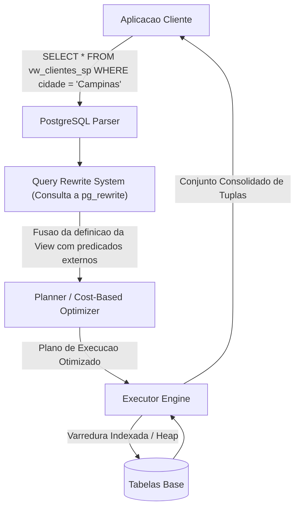

### Sintaxe de Criacao e Manipulacao (CREATE VIEW)

A sintaxe formal no dialeto PostgreSQL segue a gramatica:

```sql
CREATE [ OR REPLACE ] [ TEMP | TEMPORARY ] [ RECURSIVE ] VIEW nome_da_view [ ( coluna_alias [, ...] ) ]
AS consulta_select
[ WITH [ CASCADED | LOCAL ] CHECK OPTION ];
```

#### Exemplo Pratico de Aplicacao

Considere a criacao de uma interface padronizada para consolidar o faturamento por pedido a partir de tabelas normalizadas em 3FN:

```sql
CREATE VIEW vw_total_pedidos AS
SELECT
    p.id_pedido,
    p.data_pedido,
    c.nome AS cliente,
    SUM(ip.quantidade * ip.preco_unitario) AS valor_total
FROM pedidos p
INNER JOIN clientes c ON p.id_cliente = c.id_cliente
INNER JOIN itens_pedido ip ON p.id_pedido = ip.id_pedido
GROUP BY p.id_pedido, p.data_pedido, c.nome;
```

Ao consultar a view com uma condicao externa, a fusao relacional opera:

```sql
SELECT cliente, valor_total
FROM vw_total_pedidos
WHERE valor_total > 5000.00
ORDER BY valor_total DESC;
```

### Substituicao Segura (CREATE OR REPLACE VIEW)

O comando `CREATE OR REPLACE VIEW` permite redefinir a consulta estruturante de uma visao existente sem a necessidade de destrui-la com `DROP VIEW`. Isso preserva as permissoes de seguranca (`GRANT`) ja concedidas sobre o objeto e mantem as conexoes ativas.

#### Regras Estritas de Compatibilidade no PostgreSQL
O PostgreSQL impoe restricao de integridade sobre a reescrita de visoes:
1. **Preservacao de Colunas Originais:** As colunas preexistentes devem manter os **mesmos nomes**, os **mesmos tipos de dados** e a **mesma posicao ordinal** (ordem sequencial de definicao).
2. **Inclusao Exclusiva ao Final:** Novas colunas calculadas ou projetadas podem ser adicionadas **exclusivamente apos a ultima coluna** da definicao original.
3. **Proibicao de Reducao:** Nao e permitido remover colunas existentes ou alterar a tipagem de dados das projecoes ja existentes.

Caso seja necessario remover atributos ou reordenar projecoes, e mandatorio executar a remocao do objeto (`DROP VIEW`) e recria-lo do zero.

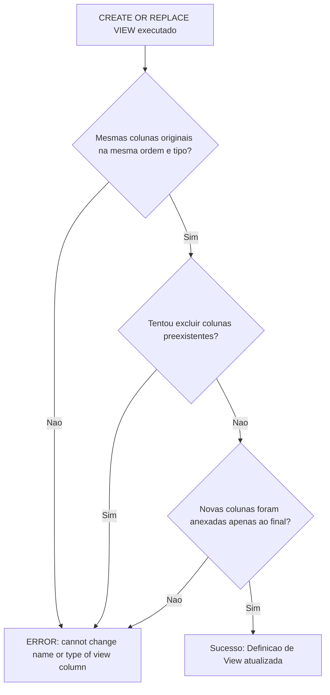

### Exclusao e Gerenciamento de Dependencias (CASCADE e RESTRICT)

Objetos relacionais mantem arvore de dependencias no catalogo do sistema, rastreada pela tabela interna `pg_depend`. Quando uma view $`V_1`$ e referenciada na definicao de outra view $`V_2`$, cria-se um acoplamento hierarquico.

```sql
-- Criacao de dependencia
CREATE VIEW vw_clientes_ativos AS
SELECT id_cliente, nome, estado FROM clientes WHERE status = 'ATIVO';

CREATE VIEW vw_clientes_sp AS
SELECT id_cliente, nome FROM vw_clientes_ativos WHERE estado = 'SP';
```

Ao tentar destruir o objeto pai:

1. **Clausula RESTRICT (Padrao do SGBD):**
   ```sql
   DROP VIEW vw_clientes_ativos RESTRICT;
   -- Aborta com erro: O objeto 'vw_clientes_sp' depende de 'vw_clientes_ativos'.
   ```
2. **Clausula CASCADE:**
   ```sql
   DROP VIEW vw_clientes_ativos CASCADE;
   -- Remove 'vw_clientes_ativos' e, recursivamente, elimina 'vw_clientes_sp'
   -- e quaisquer outros objetos dependentes (triggers, regras ou funcoes).
   ```

> **Aviso de Engenharia:** Em bancos corporativos em producao, o uso do modificador `CASCADE` representa elevado risco de seguranca operacional e indisponibilidade. A execucao pode purgar silenciosamente funcoes, gatilhos de integridade e visoes satelites. Inspecione sempre as dependencias via `pg_depend` antes de empregar a remocao em cascata.

### Views Atualizaveis e a Clausula WITH CHECK OPTION

O padrao SQL e o PostgreSQL suportam instrucoes de modificacao de dados (`INSERT`, `UPDATE`, `DELETE`) direcionadas diretamente contra visoes, desde que estas sejam categorizadas como **Automaticamente Atualizaveis (*Automatically Updatable Views*)**.

#### Requisitos Estruturais para Atualizacao Direta
Para que uma view aceite comandos DML de forma nativa sem a necessidade de triggers auxiliares, todas as condicoes abaixo devem ser estritamente atendidas:
- A clausula `FROM` deve referenciar exatamente **uma unica tabela base** (ou outra view atualizavel). Nao sao permitidos `JOINs`.
- A consulta nao pode conter agregacoes: sem `GROUP BY`, `HAVING`, `SUM()`, `AVG()`, `COUNT()`, etc.
- A consulta nao pode conter operadores de conjunto: sem `UNION`, `INTERSECT` ou `EXCEPT`.
- A consulta nao pode conter remocao de duplicidade: sem a palavra-chave `DISTINCT`.
- A consulta nao pode conter funcoes de janela: sem a clausula `OVER / WINDOW`.
- As colunas manipuladas devem ser mapeamentos literais de atributos da tabela base, e nao expressoes computadas (ex: `salario * 1.10` impede escrita direta).

#### A Invariante da Clausula WITH CHECK OPTION
Ao executar comandos DML atraves de uma view com predicado de filtro (`WHERE`), surge uma brecha operacional: a aplicacao pode inserir ou atualizar uma tupla que nao satisfaz o filtro da propria view. O registro e persistido na tabela base, mas desaparece imediatamente da view que o originou.

A clausula `WITH CHECK OPTION` impede essa anomalia:

```sql
CREATE VIEW vw_vendedores_comissao_alta AS
SELECT id_vendedor, nome, salario, comissao
FROM vendedores
WHERE comissao >= 5.00
WITH CHECK OPTION;
```

Se uma aplicacao tentar executar a insercao:

```sql
-- Dispara violacao: new row violates check option for view "vw_vendedores_comissao_alta"
INSERT INTO vw_vendedores_comissao_alta (nome, salario, comissao)
VALUES ('Marcos Lima', 3000.00, 3.50);
```

#### Variacoes: LOCAL versus CASCADED
- `WITH LOCAL CHECK OPTION`: Valida unicamente as restricoes impostas na definicao da view atual, sem checar predicados de visoes intermediarias subjacentes das quais ela possa derivar.
- `WITH CASCADED CHECK OPTION` (Padrao ANSI): Valida recursivamente as restricoes da view corrente e de todas as visoes antecessoras que compoem sua hierarquia.

### Seguranca e Camada de Abstracao (GRANT em Views)

As visoes sao instrumentos fundamentais para a implementacao do **Principio do Menor Privilegio (PoLP)** em sistemas relacionais. 

Considere um esquema corporativo onde a tabela `funcionarios` contem informacoes publicas (`nome`, `departamento`) e dados criticos/sigilosos (`salario`, `cpf`, `dados_bancarios`). Em vez de expor a tabela fisica, o DBA projeta uma view restrita e ajusta o catalogo de permissoes:

```sql
-- 1. Criacao da camada de visualizacao restrita
CREATE VIEW vw_quadro_colaboradores AS
SELECT id_funcionario, nome, departamento
FROM funcionarios;

-- 2. Revogacao de privilégios publicos da tabela base
REVOKE ALL ON TABLE funcionarios FROM PUBLIC;
REVOKE ALL ON TABLE funcionarios FROM role_estagiario;

-- 3. Concessao exclusiva sobre a view
GRANT SELECT ON TABLE vw_quadro_colaboradores TO role_estagiario;
```

Quando o usuario associado a `role_estagiario` executa `SELECT * FROM vw_quadro_colaboradores`, o motor do PostgreSQL avalia a permissao sobre a view e permite o acesso aos dados projetados, mantendo as colunas restritas completamente inacessiveis.

### Visoes Materializadas (Materialized Views)

Uma **Visao Materializada (*Materialized View*)** e um objeto de banco de dados que executa a consulta declarativa associada e **persiste fisicamente os dados resultantes em disco**, alocando espaco real em paginas de dados (*heap storage*).

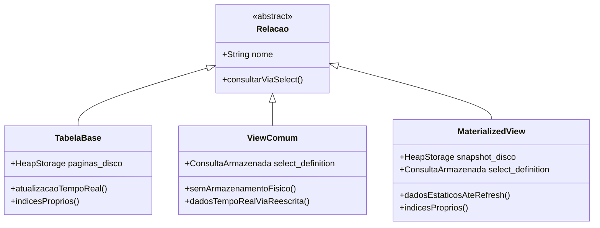

#### Trade-offs de Engenharia de Dados
- **Vantagem de Latencia de Leitura:** Elimina a necessidade de recalcular agregacoes pesadas (`SUM`, `AVG`, `GROUP BY`), produtos cartesianos e multiplas juncoes a cada leitura. Leituras na materialized view operam como varreduras em tabela estatica, com tempos de resposta ordens de grandeza inferiores.
- **Desvantagem de Frescor de Dados (*Data Staleness*):** Os dados materializados tornam-se estaticos a partir do instante da geracao. Mutacoes ocorridas nas tabelas base (`INSERT`, `UPDATE`, `DELETE`) nao sao propagadas automaticamente para a materialized view em tempo real.
- **Sobrecarga de Espaco em Disco:** Requer espaco em disco para alocacao do heap da visao e de seus indices auxiliares.

### Atualizacao de Dados (REFRESH MATERIALIZED VIEW)

Para sincronizar o snapshot fisico da visao materializada com o estado mais recente das tabelas base, o comando de atualizacao deve ser disparado:

```sql
-- Atualizacao Padrao: Bloqueia leituras concorrentes durante o recalculo
REFRESH MATERIALIZED VIEW mvw_faturamento_mensal;
```

#### O Mecanismo CONCURRENTLY (Atualizacao Concorrente)
Por padrao, a instrucao `REFRESH MATERIALIZED VIEW` adquire uma trava de exclusao compartilhada (*AccessExclusiveLock*), bloqueando todas as leituras concorrentes na visao ate que todo o conjunto de dados seja recomputado e reescrito em disco.

Para contornar o bloqueio em sistemas que operam 24/7 sem janelas de manutencao, o PostgreSQL oferece a clausula `CONCURRENTLY`:

```sql
REFRESH MATERIALIZED VIEW CONCURRENTLY mvw_faturamento_mensal;
```

#### Requisito Mandatorio para Atualizacao Concorrente
Para que a clausula `CONCURRENTLY` opere com sucesso, a visao materializada deve possuir **obrigatoriamente pelo menos um indice unico (*UNIQUE INDEX*) sem predicado `WHERE` (nao parcial)** cobrindo uma ou mais colunas que identifiquem univocamente cada linha da visao. O PostgreSQL utiliza esse indice para executar operacoes internas de comparacao (*diff*) entre o snapshot antigo e o novo, aplicando deltas sem travar as leituras.

### Indexacao Fisica e Tuning em Materialized Views

Diferente de visoes comuns (que dependem exclusivamente dos indices existentes nas tabelas base), **Materialized Views suportam a criacao direta de indices secundarios** (B-Tree, GIN, GiST, BRIN), proporcionando capacidade total de tuning.

```sql
-- Criacao de Materialized View analitica
CREATE MATERIALIZED VIEW mvw_detalhes_pedidos AS
SELECT
    p.id_pedido,
    p.data_pedido,
    c.id_cliente,
    c.nome AS cliente,
    c.cidade,
    SUM(ip.quantidade * ip.preco_unitario) AS valor_pedido
FROM pedidos p
INNER JOIN clientes c ON p.id_cliente = c.id_cliente
INNER JOIN itens_pedido ip ON p.id_pedido = ip.id_pedido
GROUP BY p.id_pedido, p.data_pedido, c.id_cliente, c.nome, c.cidade;

-- 1. Criacao do indice unico mandatorio para atualizacao concorrente
CREATE UNIQUE INDEX idx_mvw_detalhes_pedidos_pk ON mvw_detalhes_pedidos (id_pedido);

-- 2. Criacao de indices secundarios para acelerar consultas analiticas
CREATE INDEX idx_mvw_detalhes_pedidos_cidade ON mvw_detalhes_pedidos (cidade);
CREATE INDEX idx_mvw_detalhes_pedidos_data ON mvw_detalhes_pedidos (data_pedido);
```

---

## Modulo 2 - Algebra Relacional Aplicada e Juncoes (JOINs)

### Fundamentos Relacionais e Integridade Referencial

O modelo de dados relacional organiza entidades e fatos em relacoes (tabelas), tuplas (linhas) e atributos (colunas). O principio da normalizacao (especialmente a 3ª Forma Normal - 3FN) estabelece a fragmentacao logica das informacoes para eliminar anomalias de gravacao e redundancias de armazenamento.

Para garantir que as entidades se conectem validamente, o PostgreSQL fiscaliza restricoes estruturais:
- **Chave Primaria (Primary Key - PK):** Garante unicidade absoluta e nao-nulidade para identificacao de tuplas, implementada internamente via indice B-Tree exclusivo.
- **Chave Estrangeira (Foreign Key - FK):** Estabelece integridade referencial apontando para a PK de outra tabela, garantindo que nao existam registros dependentes com ponteiros para dados inexistentes.

A operacao de **Juncao (*Join*)**, matematicamente expressa pelo operador $`R \bowtie_\theta S`$, e a operacao derivada que combina tuplas de duas relacoes com base em um predicado booleano de correspondencia ($`\theta`$).

### Classificacao das Operacoes de Juncao

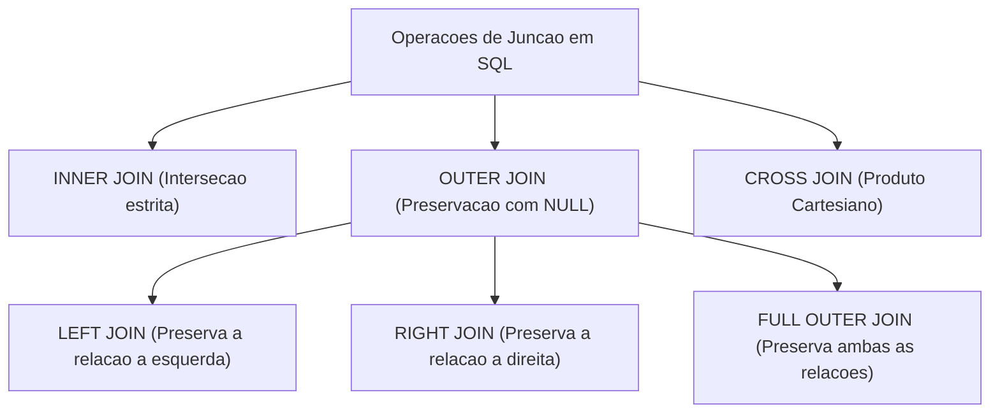

### Mecanica do INNER JOIN

O `INNER JOIN` (juncao interna) retorna exclusivamente a intersecao relacional entre duas tabelas. Uma tupla da tabela $`A`$ so integrara o conjunto de saida se houver correspondencia valida com ao menos uma tupla da tabela $`B`$ conforme a condicao estipulada na clausula `ON`.

```sql
SELECT
    p.id_pedido,
    p.data_pedido,
    c.nome AS cliente
FROM pedidos p
INNER JOIN clientes c ON p.id_cliente = c.id_cliente;
```

Se um cliente acabou de ser cadastrado e ainda nao gerou nenhum pedido, ele e descartado da projecao do `INNER JOIN`.

### LEFT OUTER JOIN e Preservacao de Tuplas

O `LEFT OUTER JOIN` (ou simplesmente `LEFT JOIN`) preserva integralmente todas as linhas pertencentes a tabela declarada a esquerda da clausula de juncao.

- Caso haja registros associados na tabela a direita, eles sao combinados linearmente.
- Caso **nao** haja registros correspondentes na tabela da direita, a linha da esquerda permanece no resultado final, e todas as colunas originadas da tabela da direita sao preenchidas com o valor nulo (`NULL`).

```sql
SELECT
    c.id_cliente,
    c.nome,
    p.id_pedido,
    p.data_pedido
FROM clientes c
LEFT JOIN pedidos p ON c.id_cliente = p.id_cliente;
```

### Padrao Anti-Join (LEFT JOIN com IS NULL)

O padrão arquitetural de **Anti-Join** isola elementos que pertencem exclusivamente a uma relacao e nao possuem nenhum vinculo com outra relacao ($`A \setminus B`$).

A tecnica canonica no PostgreSQL combina o `LEFT JOIN` com uma clausula `WHERE` que filtra explicitamente valores nulos na **chave primaria** da tabela a direita:

```sql
SELECT
    c.id_cliente,
    c.nome,
    c.cidade
FROM clientes c
LEFT JOIN pedidos p ON c.id_cliente = p.id_cliente
WHERE p.id_pedido IS NULL;
```

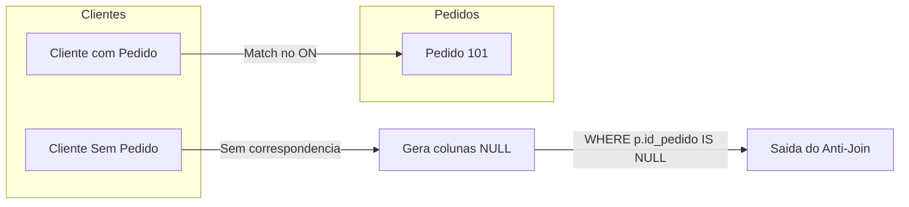

> **Armadilha Critica de Engenharia:** Sempre utilize a **Chave Primaria** (ou uma coluna garantidamente definida como `NOT NULL`) da tabela a direita no filtro `WHERE coluna IS NULL`. Se filtrar uma coluna opcional que aceite nulos por natureza (ex: `observacoes IS NULL`), clientes que compraram produtos com observacao vazia serao erroneamente classificados como clientes sem compras (falso positivo).

### Tratamento de Nulos com COALESCE

A funcao escalar `COALESCE(val_1, val_2, ..., val_n)` avalia seus argumentos da esquerda para a direita e retorna o primeiro valor diferente de `NULL`. Em cenarios de relatorios gerados por juncoes externas, e uma boa pratica substituir `NULL` por marcadores legiveis ou valores numericos neutros:

```sql
SELECT
    pr.nome_produto,
    COALESCE(cat.nome_categoria, 'Sem Categoria') AS categoria,
    COALESCE(SUM(ip.quantidade), 0) AS total_vendido
FROM produtos pr
LEFT JOIN categorias cat ON pr.id_categoria = cat.id_categoria
LEFT JOIN itens_pedido ip ON pr.id_produto = ip.id_produto
GROUP BY pr.nome_produto, cat.nome_categoria;
```

### RIGHT JOIN, FULL OUTER JOIN e CROSS JOIN

1. **RIGHT OUTER JOIN:** Preserva todas as tuplas da relacao a direita. A operacao $`A \text{ RIGHT JOIN } B`$ e equivalente a $`B \text{ LEFT JOIN } A`$. Na engenharia de software, adota-se como boa pratica padronizar consultas com `LEFT JOIN`, que acompanha a direcao de leitura ocidental e simplifica a manutencao.
2. **FULL OUTER JOIN:** Retorna a uniao total das relacoes, preservando linhas da esquerda sem correspondencia (preenchendo a direita com `NULL`) e linhas da direita sem correspondencia (preenchendo a esquerda com `NULL`). Utilizado predominantemente em processos de auditoria, reconciliacao de migracao de bases e contabilidade de estoques divergentes.
3. **CROSS JOIN:** Computa o **Produto Cartesiano** irrestrito entre duas relacoes ($`A \times B`$). Se a tabela $`A`$ contem $`M`$ linhas e a tabela $`B`$ contem $`N`$ linhas, o resultado contera rigorosamente $`M \times N`$ linhas.
   - *Uso Legítimo:* Geracao de combinacoes matriciais completas (ex: combinar todos os tamanhos de roupas com todas as cores disponiveis).
   - *Risco:* Um `CROSS JOIN` acidental entre duas tabelas com 100.000 tuplas produz 10 bilhoes de linhas, provocando travamento por exaustao de memoria ou I/O.

### Auto-Relacionamento e Hierarquias (SELF JOIN)

Um `SELF JOIN` ocorre quando uma tabela relacional e unida consigo mesma. Essa tecnica modela hierarquias de estruturas em arvore (*Adjacency List*), como relacoes de subordinacao funcional entre funcionarios e supervisores.

Para viabilizar a operacao, o motor relacional exige que cada instancia da tabela receba um alias (apelido) distinto:

```sql
SELECT
    func.nome AS colaborador,
    func.cargo,
    COALESCE(sup.nome, 'Diretoria Executiva / Sem Supervisor') AS superior_imediato
FROM funcionarios func
LEFT JOIN funcionarios sup ON func.id_supervisor = sup.id_funcionario;
```

### Ponto Critico Semantico: Clausula ON versus WHERE

Um dos erros conceituais mais comuns em bancos relacionais e a distincao entre posicionar um predicado de filtro dentro da clausula `ON` ou na clausula `WHERE` ao utilizar juncoes externas (`LEFT JOIN`).

#### Comportamento da Regra
- **Predicado na clausula `ON`:** Define a regra de **acoplamento** entre as duas tabelas. Se a condicao for falsa, ela impede apenas a associacao com a tabela da direita, mas a linha da esquerda **continua presente no resultado**, com a direita preenchida por `NULL`.
- **Predicado na clausula `WHERE`:** Define a regra de **filtragem de saida** aplicada sobre o resultado global da juncao. Se a expressao avaliar como falsa ou nula, a linha **e categoricamente descartada** do conjunto final.

```sql
-- CENARIO 1: Filtro no ON (Preserva todos os clientes, traz apenas pedidos de 2026)
SELECT c.nome, p.id_pedido, p.data_pedido
FROM clientes c
LEFT JOIN pedidos p ON c.id_cliente = p.id_cliente AND p.data_pedido >= '2026-01-01';

-- CENARIO 2: Filtro no WHERE (Transforma silenciosamente o LEFT JOIN em INNER JOIN!)
SELECT c.nome, p.id_pedido, p.data_pedido
FROM clientes c
LEFT JOIN pedidos p ON c.id_cliente = p.id_cliente
WHERE p.data_pedido >= '2026-01-01';
-- Clientes sem pedidos geram p.data_pedido = NULL.
-- A expressao 'NULL >= 2026-01-01' avalia como UNKNOWN no WHERE, eliminando o cliente!
```

### Agregacoes sobre Juncoes e a Armadilha do COUNT

Ao combinar `LEFT JOIN` com a funcao agregadora de contagem, o desenvolvedor deve diferenciar a semantica de `COUNT(*)` e `COUNT(coluna)`.

- `COUNT(*)`: Computa a cardinalidade fisica da particao (quantas linhas compoem o grupo), independentemente do conteudo dos campos ser nulo ou nao.
- `COUNT(expressao)`: Avalia o campo e incrementa o somatorio **apenas se o valor for diferente de NULL**.

```sql
-- INCORRETO: Clientes sem pedidos aparecem com quantidade 1!
SELECT c.nome, COUNT(*) AS total_pedidos
FROM clientes c
LEFT JOIN pedidos p ON c.id_cliente = p.id_cliente
GROUP BY c.id_cliente, c.nome;

-- CORRETO: Clientes sem pedidos aparecem com quantidade 0!
SELECT c.nome, COUNT(p.id_pedido) AS total_pedidos
FROM clientes c
LEFT JOIN pedidos p ON c.id_cliente = p.id_cliente
GROUP BY c.id_cliente, c.nome;
```

---

## Modulo 3 - Subconsultas Avancadas (Subqueries)

### Taxonomia e Escopo das Subconsultas

Uma **Subconsulta (*Subquery* ou *Subselect*)** e uma instrucao `SELECT` encapsulada dentro de outra instrucao SQL principal (`SELECT`, `INSERT`, `UPDATE` ou `DELETE`).

```mermaid
mindmap
  root("Taxonomia de Subconsultas SQL")
    "Por Dimensionalidade de Saida"
      "Escalar (1x1)"
      "Vetor / Lista (Nx1)"
      "Matriz / Tabela (NxM)"
    "Por Dependencia Contextual"
      "Nao-Correlacionada (Independente)"
      "Correlacionada (Avaliada linha a linha)"
    "Por Localizacao Sintatica"
      "No SELECT (Coluna de projecao)"
      "No FROM (Tabela derivada / Inline View)"
      "No WHERE (Predicado de selecao)"
      "No HAVING (Filtro de agregacao)"
```

### Subconsultas Escalares

Uma subconsulta e dita escalar quando projeta obrigatoriamente **uma unica linha e uma unica coluna** ($`1 \times 1`$). Pode ser empregada em qualquer expressao onde literais numericos, strings ou datas sao aceitos.

- Se a subconsulta escalar retornar zero tuplas, seu resultado avalia formalmente como `NULL`.
- Se retornar duas ou mais tuplas, o PostgreSQL interrompe a execucao e aborta a transacao com o erro:  
  `ERROR: more than one row returned by a subquery used as an expression`.

```sql
-- Subconsulta escalar no WHERE comparando contra aggregate
SELECT nome_produto, preco
FROM produtos
WHERE preco > (SELECT AVG(preco) FROM produtos);
```

### Operadores de Pertencimento: IN e NOT IN

O operador `IN` avalia se um valor escalar pertence a uma lista de valores gerada por uma subconsulta unicolunar ($`N \times 1`$):

```math
\text{expressao} \in S \iff \exists s \in S \mid \text{expressao} = s
```

```sql
SELECT nome, cidade
FROM clientes
WHERE id_cliente IN (
    SELECT DISTINCT id_cliente
    FROM pedidos
    WHERE status = 'Pago'
);
```

### A Armadilha da Logica Trivalente (3VL) com NULL no NOT IN

[Complemento de Engenharia de Software e Teoria Relacional] O modelo relacional de Edgar F. Codd opera sob o sistema da **Logica Trivalente (*Three-Valued Logic - 3VL*)**, cujos valores de verdade sao `TRUE`, `FALSE` e `UNKNOWN`.

Considere a avaliacao algebrica de uma expressao contendo `NOT IN`:

```sql
v NOT IN (val_1, val_2, ..., val_n)
```

Por definicao formal da semantica SQL, essa instrucao e desdobrada em uma conjuncao de desigualdades:

```sql
(v <> val_1) AND (v <> val_2) AND ... AND (v <> val_n)
```

Se o conjunto resultante da subconsulta contiver **pelo menos um unico valor `NULL`**, digamos que $`val_2 = \text{NULL}`$, a operacao de comparacao $`v <> \text{NULL}`$ resulta estritamente em `UNKNOWN`. 

Aplicando a algebra booleana:
- $`\text{TRUE} \land \text{UNKNOWN} \implies \text{UNKNOWN}`$
- $`\text{FALSE} \land \text{UNKNOWN} \implies \text{FALSE}`$

Como resultado direto, a expressao inteira **jamais avaliara como `TRUE`**. Uma clausula `WHERE` so mantem linhas cuja condicao final avalia estritamente como `TRUE`. Portanto, se a subconsulta do `NOT IN` retornar um unico valor nulo, a consulta inteira retornara **zero registros (conjunto vazio)**, introduzindo bugs silenciosos em sistemas produtivos.

> **Regra de Ouro da Engenharia de Dados:** Nunca utilize `NOT IN` contra colunas que aceitem nulos. Adote como padrao defensivo obrigatorio o uso de **`NOT EXISTS`** ou faca a purga explicita via `WHERE coluna IS NOT NULL` dentro da subquery.

### Operadores de Existencia: EXISTS e NOT EXISTS

O operador `EXISTS` avalia se a subconsulta associada produz **ao menos uma linha**. Ele nao transporta dados para o escopo externo nem compara valores diretamente; avalia apenas a cardinalidade do conjunto resultante.

Por convencao semantica e otimizacao, utiliza-se a projecao `SELECT 1` no interior do `EXISTS`. O motor relacional do PostgreSQL nao le as colunas reais; ele utiliza mecanismo de **curto-circuito (*short-circuit evaluation*)**: assim que o primeiro registro e localizado na varredura da subconsulta, a busca e interrompida e o operador retorna imediatamente `TRUE`.

```sql
SELECT c.id_cliente, c.nome
FROM clientes c
WHERE NOT EXISTS (
    SELECT 1
    FROM pedidos p
    WHERE p.id_cliente = c.id_cliente
);
```

### Operadores Quantificadores: ANY e ALL

Permitem a comparacao escalar contra vetores de resultados utilizando operadores relacionais ($`=, <>, >, <, >=, <=`$):

1. **Operador `ANY` (ou `SOME`):** A condicao e satisfeita se a comparacao for verdadeira para **pelo menos um elemento** do conjunto.
   - `preco > ANY (subquery)`: O preco deve ser maior que o **menor** elemento retornado pela subconsulta.
   - `= ANY (subquery)` e semanticamente identico ao operador `IN`.
2. **Operador `ALL`:** A condicao e satisfeita se a comparacao for verdadeira para **todos os elementos** do conjunto sem excecao.
   - `preco > ALL (subquery)`: O preco deve ser maior que o **maior** elemento retornado pela subconsulta.

```sql
-- Produtos mais caros que TODOS os produtos da categoria de Acessorios
SELECT nome_produto, preco
FROM produtos
WHERE preco > ALL (
    SELECT p2.preco
    FROM produtos p2
    INNER JOIN categorias c2 ON p2.id_categoria = c2.id_categoria
    WHERE c2.nome_categoria = 'Acessorios'
);
```

### Subconsultas Correlacionadas

Uma subconsulta e classificada como **correlacionada** quando referencia diretamente uma ou mais colunas pertencentes a consulta externa.

Diferente das subconsultas independentes (que sao resolvidas uma unica vez pelo SGBD antes da consulta externa rodar), a subconsulta correlacionada e, conceitualmente, **reavaliada dinamicamente para cada linha processada pela consulta externa**.

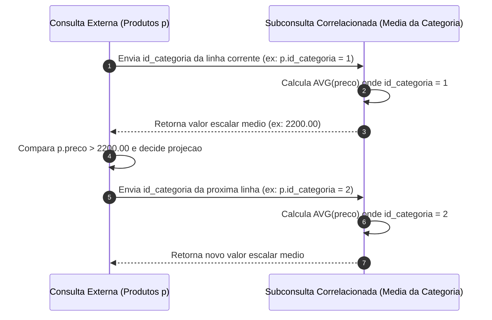

```sql
-- Produtos com preco acima da media de sua respectiva categoria
SELECT p.id_produto, p.nome_produto, p.preco, p.id_categoria
FROM produtos p
WHERE p.preco > (
    SELECT AVG(sub.preco)
    FROM produtos sub
    WHERE sub.id_categoria = p.id_categoria
);
```

### Tabelas Derivadas na Clausula FROM (Inline Views)

Uma subconsulta inserida dentro da clausula `FROM` e denominada **Tabela Derivada (*Derived Table*)** ou visao em linha (*inline view*). Ela cria uma relacao temporaria avaliada em memoria no escopo da execucao principal.

#### Exigencia Sintatica no PostgreSQL
No PostgreSQL, em estrita conformidade com a norma ANSI SQL, **toda subconsulta posicionada na clausula `FROM` deve obrigatoriamente possuir um identificador de alias**. Omitir o alias lanca o erro imediato: `ERROR: subquery in FROM must have an alias`.

```sql
-- Calculo do total de cada pedido em tabela derivada antes da filtragem
SELECT
    resumo.id_pedido,
    resumo.valor_total
FROM (
    SELECT id_pedido, SUM(quantidade * preco_unitario) AS valor_total
    FROM itens_pedido
    GROUP BY id_pedido
) AS resumo
WHERE resumo.valor_total > 3000.00;
```

### Manipulacao de Dados Guiada por Subconsultas (DML Avancado)

As subconsultas operam como motores de decisao para comandos de transformacao:

1. **INSERT INTO ... SELECT:** Realiza cargas em lote baseadas em regras de negócio analiticas:
   ```sql
   INSERT INTO produtos_promocao (id_produto, nome_produto, preco, preco_promocional)
   SELECT
       id_produto,
       nome_produto,
       preco,
       ROUND(preco * 0.90, 2)
   FROM produtos
   WHERE preco > (SELECT AVG(preco) FROM produtos);
   ```

2. **UPDATE Correlacionado:** Aplica atualizacoes linha a linha derivadas de computacoes externas:
   ```sql
   UPDATE produtos p
   SET estoque = estoque + 5
   WHERE p.preco > (
       SELECT AVG(sub.preco)
       FROM produtos sub
       WHERE sub.id_categoria = p.id_categoria
   );
   ```

3. **DELETE com Anti-Juncao:** Exclusao cirurgica de entidades sem vinculos operacionais:
   ```sql
   DELETE FROM clientes c
   WHERE NOT EXISTS (
       SELECT 1
       FROM pedidos p
       WHERE p.id_cliente = c.id_cliente
   );
   ```

### Expressoes de Tabela Comuns (CTEs / WITH)

As **Expressoes de Tabela Comuns (*Common Table Expressions - CTEs*)**, declaradas atraves da clausula `WITH`, permitem encapsular subconsultas complexas em blocos nomeados legiveis no topo da instrucao SQL. 

```sql
WITH media_por_categoria AS (
    SELECT id_categoria, AVG(preco) AS media_preco
    FROM produtos
    GROUP BY id_categoria
)
SELECT
    p.nome_produto,
    p.preco,
    mpc.media_preco,
    ROUND(p.preco - mpc.media_preco, 2) AS diferenca
FROM produtos p
INNER JOIN media_por_categoria mpc ON p.id_categoria = mpc.id_categoria
WHERE p.preco > mpc.media_preco;
```

CTEs substituem subconsultas aninhadas profundas, decompondo problemas analiticos em etapas sequenciais com suporte inclusive a recursao (`WITH RECURSIVE`).

---

## Modulo 4 - Programacao Procedural com PL/pgSQL (Procedures)

### Transicao do Paradigma Declarativo para o Procedural

O SQL padrao e uma linguagem puramente **declarativa**: o desenvolvedor especifica *qual* conjunto de dados deseja extrair ou modificar, delegando ao otimizador do SGBD as decisoes de *como* efetuar a busca.

Entretanto, fluxos operacionais corporativos demandam logica imperativa estruturada: bifurcacoes condicionais (`IF/THEN`), lacos de iteracao (`FOR/WHILE`), tratamento de excecoes e, fundamentalmente, **controle autonomo de transacoes**. A linguagem procedural **PL/pgSQL** (*Procedural Language/PostgreSQL Structured Query Language*) estende o motor do PostgreSQL com esse poder computacional.

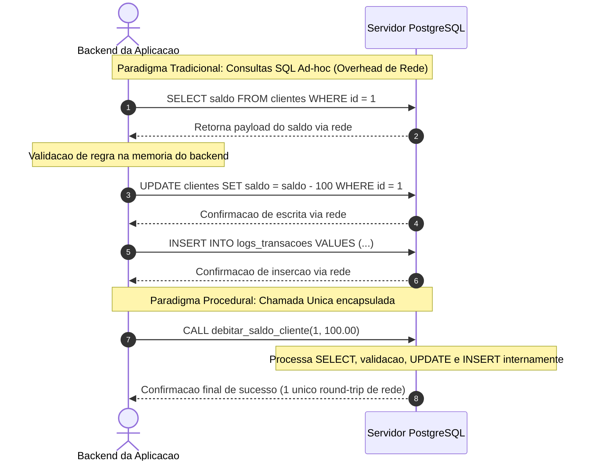

### Diferencas Estruturais entre Functions e Procedures

A evolucao do PostgreSQL estabeleceu uma divisao semantica formal entre funcoes e procedimentos:

| Caracteristica Arquitetural | Stored Function (`CREATE FUNCTION`) | Stored Procedure (`CREATE PROCEDURE`) |
| :--- | :--- | :--- |
| **Comando de Invocacao** | Executada via `SELECT func()` ou em expressoes. | Invocada isoladamente via comando `CALL proc()`. |
| **Clausula de Retorno** | Obrigatoria (`RETURNS <tipo>` ou `RETURNS void`). | Nao possui clausula `RETURNS`. |
| **Retorno de Parametros** | Retorna escalar, tabela (`SETOF`, `TABLE`) ou objeto. | Retorna dados exclusivamente via `INOUT` ou `OUT`. |
| **Controle de Transacao** | **Proibido:** Nao pode executar `COMMIT` ou `ROLLBACK`. | **Permitido:** Gerenciamento autonomo com `COMMIT` e `ROLLBACK`. |
| **Proposito Tecnico** | Calculo funcional, transformacoes e fontes para `JOIN`. | Orquestracao de regras de negocio e processos em lote (*batch*). |

### Anatomia do Bloco PL/pgSQL e Dollar Quoting

O codigo procedural PL/pgSQL e organizado em blocos delimitados:

```sql
[ <<rotulo>> ]
[ DECLARE
    -- Declaracao de variaveis, tipos ancorados e cursores
]
BEGIN
    -- Secao executavel: instrucoes procedurais e comandos DML
[ EXCEPTION
    -- Captura e tratamento estruturado de erros e excecoes
]
END [ rotulo ];
```

#### Dollar Quoting ($$)
Em SQL padrao, o corpo de funcoes exigia delimitacao por aspas simples literais (`'...'`), obrigando o desenvolvedor a duplicar qualquer aspa contida no texto (`''''`). O mecanismo de **Dollar Quoting** envolve o bloco de codigo entre dois marcadores de cifrao (`$$` ou `$tag$`), tornando o codigo limpo e imune a erros de escape de strings.

```sql
CREATE OR REPLACE PROCEDURE pr_exemplo_log(p_mensagem TEXT)
LANGUAGE plpgsql
AS $corpo$
BEGIN
    RAISE NOTICE 'Mensagem formatada: "%"', p_mensagem;
END;
$corpo$;
```

### Variaveis, Tipos Escalares e Tipagem Ancorada (%TYPE e %ROWTYPE)

As variaveis declaradas na secao `DECLARE` podem assumir tipos primitivos (`INTEGER`, `NUMERIC`, `TEXT`, `BOOLEAN`, `TIMESTAMP`). Caso nao recebam atribuicao explicita via `DEFAULT` ou `:=`, inicializam-se compulsoriamente com o valor `NULL`.

#### Tipagem Ancorada
Para evitar que alteracoes no DDL de tabelas quebrem procedimentos proceduralmente acoplados, o PL/pgSQL oferece a tipagem dinamica ancorada:
- `%TYPE`: Vincula o tipo de dado da variavel diretamente ao tipo de uma coluna de tabela existente no catalogo.
- `%ROWTYPE`: Aloca uma estrutura composta (registro) capaz de armazenar uma tupla inteira de uma tabela ou visao.

```sql
DECLARE
    v_saldo clientes.saldo%TYPE;          -- Herda exatamente o tipo da coluna 'saldo'
    v_cliente_reg clientes%ROWTYPE;       -- Herda a estrutura completa da linha de 'clientes'
BEGIN
    SELECT * INTO v_cliente_reg FROM clientes WHERE id_cliente = 1;
    v_saldo := v_cliente_reg.saldo;
END;
```

### Captura de Resultados com SELECT INTO

Para carregar dados extraidos da base diretamente para dentro de variaveis de memoria local no bloco executavel, utiliza-se a clausula `SELECT ... INTO`:

```sql
DECLARE
    v_nome VARCHAR(100);
    v_preco NUMERIC(10,2);
BEGIN
    SELECT nome_produto, preco 
    INTO STRICT v_nome, v_preco
    FROM produtos 
    WHERE id_produto = 10;
END;
```

> **Aviso de Engenharia:** Ao utilizar `SELECT INTO STRICT`, o motor relacional exige que a consulta retorne rigorosamente **uma linha**. Se retornar zero tuplas, lanca a excecao `NO_DATA_FOUND`. Se retornar multiplas tuplas, lanca `TOO_MANY_ROWS`. Sem o modificador `STRICT`, em caso de multiplas linhas, a primeira e capturada e as demais descartadas silenciosamente.

### Parametros de Entrada e Saida (IN, OUT, INOUT)

Os parametros definidos no cabecalho de uma *Stored Procedure* controlam o fluxo de dados bidirecional:
1. `IN` (Modo Padrao): O parametro recebe um valor fornecido por quem chamou e atua como constante ou variavel somente-leitura dentro da rotina.
2. `OUT`: O parametro nao recebe valores de entrada; e utilizado para enviar valores calculados de volta a aplicacao chamadora ao termino do procedimento.
3. `INOUT`: Combina ambos os modos; recebe um valor de entrada e permite que o procedimento altere e devolva o valor atualizado na saida.

```sql
CREATE OR REPLACE PROCEDURE calcular_reajuste_lote(
    IN p_percentual NUMERIC,
    OUT p_total_afetado INTEGER
)
LANGUAGE plpgsql
AS $$
BEGIN
    UPDATE produtos
    SET preco = preco + (preco * (p_percentual / 100.0));
    
    GET DIAGNOSTICS p_total_afetado = ROW_COUNT;
END;
$$;
```

Para invocar e receber parametros `OUT` no console:
```sql
CALL calcular_reajuste_lote(10.0, NULL);
```

### Estruturas de Controle de Fluxo Condicional

A construcao de logica imperativa baseia-se na estrutura `IF-THEN-ELSIF-ELSE`:

```sql
IF condicao_1 THEN
    -- Acoes executadas se condicao_1 for verdadeira
ELSIF condicao_2 THEN
    -- Acoes executadas se condicao_2 for verdadeira
ELSE
    -- Acoes de fallback caso nenhuma condicao seja atendida
END IF;
```

Para emitir alertas informativos ou cancelar operacoes:
- `RAISE NOTICE 'Texto de log: %', variavel;`: Grava aviso na saida padrao do cliente sem interromper a transacao.
- `RAISE EXCEPTION 'Descricao da falha';`: Aborta imediatamente a execucao, gera mensagem de erro e forca a reversao (*rollback*) da transacao corrente.

### Variaveis de Diagnostico: FOUND e GET DIAGNOSTICS

O PL/pgSQL fornece mecanismos para aferir o impacto de instrucoes DML recem-executadas:

1. **Variavel Especial `FOUND`:** Variavel booleana interna cujo estado e modificado imediatamente apos comandos relacionais.
   - Retorna `TRUE` se um comando `SELECT INTO` localizou registro ou se um `INSERT`, `UPDATE` ou `DELETE` afetou pelo menos uma linha.
   - Retorna `FALSE` caso nenhuma linha tenha sido encontrada ou manipulada.

```sql
UPDATE funcionarios SET salario = salario * 1.05 WHERE id_funcionario = p_id;
IF NOT FOUND THEN
    RAISE EXCEPTION 'Funcionario % nao localizado para reajuste.', p_id;
END IF;
```

2. **Instrucao `GET DIAGNOSTICS`:** Permite inspecionar o numero exato de linhas modificadas pela ultima operacao:

```sql
DECLARE
    v_linhas_removidas INTEGER;
BEGIN
    DELETE FROM clientes WHERE status = 'INATIVO';
    GET DIAGNOSTICS v_linhas_removidas = ROW_COUNT;
    RAISE NOTICE 'Total de cadastros inativos expurgados: %', v_linhas_removidas;
END;
```

### Controle de Concorrencia com SELECT FOR UPDATE

Em sistemas com multiplas requisicoes concorrentes (ex: sistemas bancarios ou emissao de ingressos), duas transacoes simultaneas podem ler o mesmo registro de saldo ao mesmo tempo, gerando a anomalia de **Atualizacao Perdida (*Lost Update*)**.

Para mitigar condicoes de corrida, o procedimento deve aplicar trava pessimista de exclusao de linha atraves da instrucao `SELECT ... FOR UPDATE`:

```sql
DECLARE
    v_saldo NUMERIC(10,2);
BEGIN
    -- Adquire trava exclusiva de linha (RowExclusiveLock) ate o termino da transacao
    SELECT saldo INTO v_saldo
    FROM clientes
    WHERE id_cliente = p_id_cliente
    FOR UPDATE;

    IF v_saldo < p_valor THEN
        RAISE EXCEPTION 'Saldo insuficiente.';
    END IF;

    UPDATE clientes SET saldo = saldo - p_valor WHERE id_cliente = p_id_cliente;
END;
```

Enquanto a transacao nao for concluida com `COMMIT` ou `ROLLBACK`, nenhuma outra transacao concorrente conseguira modificar a mesma tupla.

### Gestao Transacional Autonoma (COMMIT e ROLLBACK em Procedures)

A grande vantagem de engenharia das *Stored Procedures* reside na capacidade de orquestrar transacoes explicitas durante o processamento de grandes lotes (*batch processing*):

```sql
CREATE OR REPLACE PROCEDURE pr_processamento_massivo()
LANGUAGE plpgsql
AS $$
DECLARE
    v_cursor CURSOR FOR SELECT id_pedido FROM pedidos_antigos;
    v_contador INTEGER := 0;
BEGIN
    FOR reg IN v_cursor LOOP
        PERFORM arquivar_pedido(reg.id_pedido);
        v_contador := v_contador + 1;
        
        -- Commit intermediario a cada 1.000 iteracoes
        IF v_contador % 1000 = 0 THEN
            COMMIT; -- Efetiva gravacoes intermediarias e libera locks de heap e WAL
        END IF;
    END LOOP;
END;
$$;
```

Essa abordagem previne o esgotamento do log de transacoes (*Write-Ahead Logging - WAL*) e reduz a pressao sobre a memoria compartilhada (*buffer pool*).

---

## Modulo 5 - Automacao Reativa com Triggers em PL/pgSQL

### Conceito Fundamental e o Paradigma ECA

Um gatilho (**Trigger**) e um objeto declarativo de esquema associado a uma tabela ou visao que define a execucao automatica e implicita de uma rotina de codigo sempre que um evento de modificacao de dados ocorre.

Enquanto procedimentos exigem chamada manual explicita (`CALL`), os gatilhos obedecem estritamente ao paradigma **ECA (Event-Condition-Action)**:

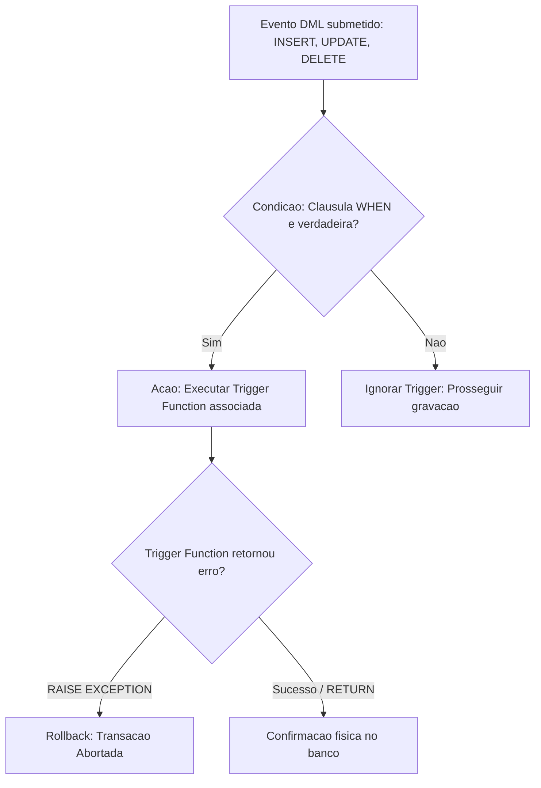

1. **Evento (*Event*):** A mutacao de dados no banco (`INSERT`, `UPDATE`, `DELETE` ou `TRUNCATE`).
2. **Condicao (*Condition*):** Um predicado logico opcional configurado na clausula `WHEN` da trigger. Se falso, o interpretador PL/pgSQL sequer e instanciado, economizando CPU.
3. **Acao (*Action*):** O bloco de codigo procedural compilado dentro da *Trigger Function*.

### Desacoplamento: Trigger Function versus Trigger

No PostgreSQL, a implementacao de gatilhos e estruturada em **dois componentes desacoplados**:

1. **A Funcao de Gatilho (*Trigger Function*):** Criada via `CREATE FUNCTION ... RETURNS trigger`. Contem a logica imperativa, variaveis e calculos. Nao recebe parametros formais de assinatura e retorna obrigatoriamente o pseudotipo `trigger`.
2. **O Objeto Gatilho (*Trigger*):** Criado via `CREATE TRIGGER`. Define em qual tabela a funcao sera acoplada, o momento de disparo (`BEFORE`, `AFTER`, `INSTEAD OF`), a granularidade (`ROW` ou `STATEMENT`) e as condicoes de ativacao.

Uma unica *Trigger Function* generica (ex: auditoria de datas) pode ser acoplada a dezenas de tabelas diferentes atraves de multiplas declaracoes de `CREATE TRIGGER`.

### Eventos Disparadores (INSERT, UPDATE, DELETE)

Uma trigger pode ser configurada para interceptar um unico evento ou multiplos eventos combinados via operador `OR`:

```sql
CREATE TRIGGER trg_auditoria_pedidos
AFTER INSERT OR UPDATE OR DELETE ON pedidos
FOR EACH ROW
EXECUTE FUNCTION fn_auditar_pedidos();
```

### Momentos de Disparo (BEFORE, AFTER, INSTEAD OF)

O momento de disparo dita o instante do pipeline em que o SGBD invoca a rotina procedural:

| Momento | Alvo Valido | Capacidade de Alterar `NEW` | Efeito do Retorno `NULL` | Casos de Uso Predominantes |
| :--- | :--- | :--- | :--- | :--- |
| **BEFORE** | Tabelas | Sim, em nivel de linha | Cancela a operacao na tupla silenciosamente | Higienizacao de dados, validacao de regras e valores default |
| **AFTER** | Tabelas | Nao (imutavel) | Sem efeito | Trilhas de auditoria, sincronizacao e metricas satelites |
| **INSTEAD OF** | Somente Visoes | Nao aplicavel | Desvia o comando DML | Viabilizar DML em visoes complexas com `JOIN` |

### Granularidade: FOR EACH ROW versus FOR EACH STATEMENT

- **`FOR EACH ROW` (Nivel de Linha):** Dispara a rotina individualmente para cada tupla individual afetada pelo comando DML. Se um `UPDATE` alterar 5.000 linhas, a trigger function e invocada exatamente 5.000 vezes. Tem acesso as variaveis de linha `NEW` e `OLD`.
- **`FOR EACH STATEMENT` (Nivel de Instrucao - Padrao):** Dispara a rotina apenas **uma unica vez por comando**, independentemente do volume de linhas modificadas (mesmo que afete zero linhas). Nao possui variaveis contextuais `NEW` e `OLD`. Utilizada para verificacoes globais de integridade (ex: proibir mutacoes na tabela fora do horario comercial).

### Variaveis de Contexto Especiais (NEW, OLD, TG_OP)

O interpretador PL/pgSQL injeta variaveis contextuais especiais em tempo de execucao dentro de uma trigger function:

| Variavel | Tipo | Descricao e Disponibilidade |
| :--- | :--- | :--- |
| **`NEW`** | `RECORD` | Imagem da nova tupla a ser persistida. Disponivel no `INSERT` e no `UPDATE`. Nula em `DELETE`. |
| **`OLD`** | `RECORD` | Imagem original da tupla preexistente em disco. Disponivel no `UPDATE` e no `DELETE`. Nula em `INSERT`. |
| **`TG_OP`** | `TEXT` | String contendo a operacao disparadora: `'INSERT'`, `'UPDATE'` ou `'DELETE'`. |
| **`TG_WHEN`** | `TEXT` | String contendo o momento de ativacao: `'BEFORE'` ou `'AFTER'`. |
| **`TG_TABLE_NAME`** | `NAME` | Nome da tabela que sofreu a mutacao e acionou a trigger. |

```sql
-- Exemplo de uso de NEW, OLD e TG_OP
CREATE OR REPLACE FUNCTION fn_trg_valida_e_audita()
RETURNS trigger
LANGUAGE plpgsql
AS $$
BEGIN
    IF TG_OP = 'INSERT' THEN
        NEW.criado_em := clock_timestamp();
        RETURN NEW;
    ELSIF TG_OP = 'UPDATE' THEN
        IF NEW.salario < OLD.salario THEN
            RAISE EXCEPTION 'Reducao salarial ilicita: atual %, proposto %', OLD.salario, NEW.salario;
        END IF;
        NEW.atualizado_em := clock_timestamp();
        RETURN NEW;
    ELSIF TG_OP = 'DELETE' THEN
        INSERT INTO auditoria_exclusoes (tabela, registro_id, momento)
        VALUES (TG_TABLE_NAME, OLD.id_funcionario, clock_timestamp());
        RETURN OLD;
    END IF;
    RETURN NULL;
END;
$$;
```

### Pipeline de Execucao Fisiologica de DML no PostgreSQL

A sequencia cronologica estrita respeitada pelo nucleo do PostgreSQL para cada comando DML envolve os seguintes estagios:

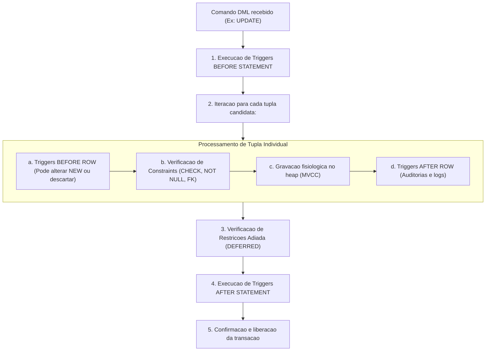

### Trilhas de Auditoria Imutaveis e Validacoes Complexas

Triggers constituem a infraestrutura definitiva para conformidade com normas fiscais e de auditoria de seguranca (ex: LGPD, SOX, BACEN). Ao acoplar uma trigger `AFTER INSERT OR UPDATE OR DELETE` gravando em uma tabela satelite, garante-se que qualquer operacao manual via terminal ou aplicacao registre a mudanca, o autor (`SESSION_USER`) e o instante exato (`clock_timestamp()`).

### Armadilhas de Engenharia: Recursao Infinita e Sobrecarga de I/O

- **Recursao em Cascata (*Stack Depth Limit Exceeded*):** Se uma trigger `AFTER UPDATE` na tabela $`A`$ executa um `UPDATE` na tabela $`B`$, e a tabela $`B`$ possui uma trigger que dispara um `UPDATE` na tabela $`A`$, estabelece-se um ciclo recursivo infinito. O PostgreSQL detecta o esgotamento da pilha e aborta a transacao lancando `ERROR: stack depth limit exceeded`.
- **Sobrecarga em Cargas Batch:** Triggers em nivel de linha (`FOR EACH ROW`) multiplicam linearmente o tempo de processamento. Para cargas massivas de dados via `COPY` ou scripts de integracao de bilhoes de registros, recomenda-se desabilitar temporariamente as triggers (`ALTER TABLE nome DISABLE TRIGGER ALL;`), executando a validacao em lote no encerramento da carga.

---

## Modulo 6 - Engenharia de Desempenho e Planos de Execucao

### Otimizador de Consultas Baseado em Custo (CBO)

O PostgreSQL implementa um **Otimizador Baseado em Custo (*Cost-Based Optimizer - CBO*)**. Para qualquer consulta declarativa recebida, o otimizador gera dezenas de arvores de execucao algebricas alternativas, atribuindo a cada no um custo computacional estimado. O plano com menor custo total e escolhido para execucao.

O custo e uma unidade dimensional aditiva baseada em paginas de I/O lidas e esforco de CPU:
- Custo de leitura de pagina sequencial de disco (`seq_page_cost = 1.0`).
- Custo de leitura aleatoria indexada em disco (`random_page_cost = 4.0`).
- Custo de processamento de tupla em CPU (`cpu_tuple_cost = 0.01`).
- Custo de avaliacao de operador relacional em CPU (`cpu_operator_cost = 0.0025`).

### Diagnostico Pratico com EXPLAIN e EXPLAIN ANALYZE

- `EXPLAIN consulta;`: Apresenta unicamente o **plano teorico estimado** pelo otimizador com base nas estatisticas armazenadas nas tabelas de catalogo `pg_statistic` (coletadas via `ANALYZE`). A consulta **nao e executada**.
- `EXPLAIN ANALYZE consulta;`: **Executa fisicamente a consulta**, medindo com cronometros internos de precisao o tempo real consumido em cada no, a memoria gasta e o volume exato de linhas processadas versus as linhas estimadas.

```sql
EXPLAIN ANALYZE
SELECT c.nome, p.id_pedido
FROM clientes c
INNER JOIN pedidos p ON c.id_cliente = p.id_cliente
WHERE c.estado = 'SP';
```

#### Estrutura de Metricas do EXPLAIN
```text
Hash Join (cost=15.20..42.85 rows=120 width=48) (actual time=0.085..0.210 rows=115 loops=1)
  Hash Cond: (p.id_cliente = c.id_cliente)
  -> Seq Scan on pedidos p (cost=0.00..22.00 rows=1000 width=8) (actual time=0.010..0.050 rows=1000 loops=1)
  -> Hash (cost=14.50..14.50 rows=56 width=44) (actual time=0.060..0.060 rows=56 loops=1)
        Buckets: 1024 Batches: 1 Memory Usage: 12kB
        -> Seq Scan on clientes c (cost=0.00..14.50 rows=56 width=44) (actual time=0.005..0.045 rows=56 loops=1)
              Filter: (estado = 'SP'::bpchar)
              Rows Removed by Filter: 144
Planning Time: 0.180 ms
Execution Time: 0.260 ms
```
- `cost=15.20..42.85`: `15.20` representa o **Startup Cost** (custo computacional ate a geracao da primeira tupla de saida); `42.85` representa o **Total Cost** (custo somado para retornar todas as tuplas).
- `rows=120`: Estimativa estatistica de cardinalidade versus `actual rows=115` obtidas no mundo real.
- `loops=1`: Quantidade de vezes que aquele no de plano foi iterado.

### Algoritmos Fisicos de Juncao (Nested Loop, Hash Join, Merge Join)

O otimizador escolhe entre tres operadores fundamentais de juncao fisica:

1. **Nested Loop Join:**
   - *Algoritmo:* Percorre a relacao externa tupla a tupla e, para cada tupla, efetua uma busca (preferencialmente indexada via Index Scan) na relacao interna.
   - *Complexidade:* $`O(M \times \log N)`$ com indice na tabela interna; $`O(M \times N)`$ sem indice.
   - *Ideal para:* Relacoes pequenas combinadas com tabelas grandes fortemente indexadas.
2. **Hash Join:**
   - *Algoritmo:* Le a relacao menor inteiramente e monta uma tabela hash na memoria de trabalho (`work_mem`). Em seguida, varre linearmente a tabela maior, calculando o hash de suas chaves e sondando (*probe*) correspondencias imediatas.
   - *Complexidade:* $`O(M + N)`$ em condicoes de memoria suficiente.
   - *Ideal para:* Equijuncoes de relacoes medias a grandes sem ordenacao previa.
3. **Merge Join:**
   - *Algoritmo:* Exige que ambas as tabelas estejam previamente ordenadas pelas chaves de juncao (via indices B-Tree ou ordenacao previa via `Sort`). Percorre ambas as relacoes de forma paralela em passo linear continuo.
   - *Complexidade:* $`O(M + N)`$ se pre-ordenadas; $`O(M \log M + N \log N)`$ se demandar ordenacao.
   - *Ideal para:* Juncoes massivas de tabelas muito grandes que excedem o tamanho da `work_mem`.

### Comparativo de Execucao: IN versus EXISTS

Em muitas literaturas legadas, afirma-se genericamente que `EXISTS` e sempre mais rapido que `IN`. No PostgreSQL moderno, essa assercao e tecnicamente incompleta.

[Complemento de Engenharia de Software] O otimizador do PostgreSQL possui heuristicas de **Subquery Unnesting (Desaninhameto de Subconsultas)**. Em consultas onde a subconsulta de um `IN` e independente e o predicado opera sobre colunas unicas ou nao nulas, o otimizador reescreve internamente tanto o `IN` quanto o `EXISTS` para o mesmo no fisico de execucao: o **`Hash Semi-Join`**.

Contudo, se a coluna da subconsulta puder conter valores `NULL`, o operador `IN` e impedido de converter para Semi-Join puro devido a obrigacao de respeitar a semantica da logica trivalente (3VL), forçando a manutencao de nos caros de execucao (`SubPlan`), enquanto o `EXISTS` mantem a operacao indexada e de curto-circuito de alta performance.

---

## Modulo 7 - Caderno de Resolucoes Praticas e Exercicios UniFEF

A seguir, apresentam-se as resolucoes comentadas, estruturadas e com analise de engenharia de software para todos os blocos de exercicios e avaliacoes aplicados pelo Prof. Welington Garcia no ecossistema da disciplina.

---

### Resolucao: Exercicios Joins (10 Questoes)

**Dominio de Dados:** Banco `loja_joins` contendo `clientes`, `vendedores`, `categorias`, `produtos`, `pedidos` e `itens_pedido`.

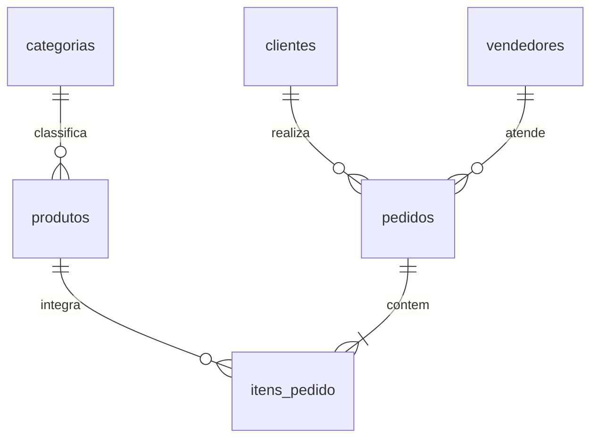

#### Questao 1: Cliente e seus Pedidos
*Enunciado:* Apresente o codigo do pedido, data do pedido e o nome do cliente. Ordene pelo codigo do pedido.
```sql
SELECT
    p.id_pedido,
    p.data_pedido,
    c.nome AS cliente
FROM pedidos p
INNER JOIN clientes c ON p.id_cliente = c.id_cliente
ORDER BY p.id_pedido ASC;
```

#### Questao 2: Relatorio Completo dos Itens Vendidos
*Enunciado:* Apresente o codigo do pedido, nome do cliente, nome do produto, quantidade e preco unitario. Relacione clientes, pedidos, itens_pedido e produtos.
```sql
SELECT
    p.id_pedido,
    c.nome AS cliente,
    pr.nome_produto,
    ip.quantidade,
    ip.preco_unitario
FROM pedidos p
INNER JOIN clientes c ON p.id_cliente = c.id_cliente
INNER JOIN itens_pedido ip ON p.id_pedido = ip.id_pedido
INNER JOIN produtos pr ON ip.id_produto = pr.id_produto
ORDER BY p.id_pedido ASC, pr.nome_produto ASC;
```

#### Questao 3: Clientes Sem Pedidos (Anti-Join)
*Enunciado:* Utilizando LEFT JOIN, liste somente os clientes que nunca realizaram pedidos (codigo e nome).
```sql
SELECT
    c.id_cliente,
    c.nome
FROM clientes c
LEFT JOIN pedidos p ON c.id_cliente = p.id_cliente
WHERE p.id_pedido IS NULL
ORDER BY c.id_cliente ASC;
```

#### Questao 4: Produtos Nunca Vendidos (Anti-Join)
*Enunciado:* Utilizando LEFT JOIN, liste os produtos que ainda nao aparecem em nenhum item de pedido (codigo, nome e preco).
```sql
SELECT
    pr.id_produto,
    pr.nome_produto,
    pr.preco
FROM produtos pr
LEFT JOIN itens_pedido ip ON pr.id_produto = ip.id_produto
WHERE ip.id_item IS NULL
ORDER BY pr.id_produto ASC;
```

#### Questao 5: Quantidade de Pedidos por Cliente
*Enunciado:* Mostre o nome de cada cliente e a quantidade de pedidos realizados. Todos devem aparecer, inclusive com zero pedidos.
```sql
SELECT
    c.nome AS cliente,
    COUNT(p.id_pedido) AS quantidade_pedidos
FROM clientes c
LEFT JOIN pedidos p ON c.id_cliente = p.id_cliente
GROUP BY c.id_cliente, c.nome
ORDER BY quantidade_pedidos DESC, c.nome ASC;
```

#### Questao 6: Faturamento por Produto
*Enunciado:* Calcule quanto cada produto gerou em vendas (`quantidade * preco_unitario`). Exiba produto e faturamento total, ordenando do maior para o menor.
```sql
SELECT
    pr.nome_produto,
    SUM(ip.quantidade * ip.preco_unitario) AS faturamento_total
FROM produtos pr
INNER JOIN itens_pedido ip ON pr.id_produto = ip.id_produto
GROUP BY pr.id_produto, pr.nome_produto
ORDER BY faturamento_total DESC;
```

#### Questao 7: Total de Cada Pedido
*Enunciado:* Calcule o valor total de cada pedido somando os subtotais dos itens. Exiba codigo do pedido, data, nome do cliente e valor total.
```sql
SELECT
    p.id_pedido,
    p.data_pedido,
    c.nome AS cliente,
    SUM(ip.quantidade * ip.preco_unitario) AS valor_total
FROM pedidos p
INNER JOIN clientes c ON p.id_cliente = c.id_cliente
INNER JOIN itens_pedido ip ON p.id_pedido = ip.id_pedido
GROUP BY p.id_pedido, p.data_pedido, c.nome
ORDER BY p.id_pedido ASC;
```

#### Questao 8: Produtos Vendidos para Clientes de Sao Paulo
*Enunciado:* Liste os produtos vendidos para clientes de Sao Paulo. Exiba cliente, cidade, produto e quantidade comprada.
```sql
SELECT
    c.nome AS cliente,
    c.cidade,
    pr.nome_produto,
    ip.quantidade
FROM clientes c
INNER JOIN pedidos p ON c.id_cliente = p.id_cliente
INNER JOIN itens_pedido ip ON p.id_pedido = ip.id_pedido
INNER JOIN produtos pr ON ip.id_produto = pr.id_produto
WHERE c.cidade = 'São Paulo'
ORDER BY c.nome ASC, pr.nome_produto ASC;
```

#### Questao 9: Faturamento por Vendedor
*Enunciado:* Mostre o nome do vendedor e seu faturamento total. Todos os vendedores devem aparecer (usar COALESCE para exibir 0 quando nao houver vendas).
```sql
SELECT
    v.nome AS vendedor,
    COALESCE(SUM(ip.quantidade * ip.preco_unitario), 0.00) AS faturamento_total
FROM vendedores v
LEFT JOIN pedidos p ON v.id_vendedor = p.id_vendedor
LEFT JOIN itens_pedido ip ON p.id_pedido = ip.id_pedido
GROUP BY v.id_vendedor, v.nome
ORDER BY faturamento_total DESC, v.nome ASC;
```

#### Questao 10: Desafio - Relatorio Geral de Vendas
*Enunciado:* Relatorio consolidando pedido, data, cliente, cidade, estado, vendedor, produto, categoria, quantidade, preco unitario e subtotal.
```sql
SELECT
    p.id_pedido,
    p.data_pedido,
    c.nome AS cliente,
    c.cidade,
    c.estado,
    v.nome AS vendedor,
    pr.nome_produto,
    cat.nome AS categoria,
    ip.quantidade,
    ip.preco_unitario,
    (ip.quantidade * ip.preco_unitario) AS subtotal
FROM pedidos p
INNER JOIN clientes c ON p.id_cliente = c.id_cliente
INNER JOIN vendedores v ON p.id_vendedor = v.id_vendedor
INNER JOIN itens_pedido ip ON p.id_pedido = ip.id_pedido
INNER JOIN produtos pr ON ip.id_produto = pr.id_produto
LEFT JOIN categorias cat ON pr.id_categoria = cat.id_categoria
ORDER BY p.id_pedido ASC, pr.nome_produto ASC;
```

---

### Resolucao: SubSelects - Parte 01 (20 Questoes)

**Dominio de Dados:** Banco de testes comercial (Slide 20 da disciplina de Subconsultas).

#### Exercicio 1: Subconsulta Escalar com Media
*Enunciado:* Liste os produtos com preco maior que a media de todos os produtos.
```sql
SELECT id_produto, nome_produto, preco
FROM produtos
WHERE preco > (SELECT AVG(preco) FROM produtos)
ORDER BY preco DESC;
```

#### Exercicio 2: Maior Preco Cadastrado
*Enunciado:* Liste o produto ou produtos com o maior preco cadastrado.
```sql
SELECT id_produto, nome_produto, preco
FROM produtos
WHERE preco = (SELECT MAX(preco) FROM produtos);
```

#### Exercicio 3: Menor Preco Cadastrado
*Enunciado:* Liste o produto ou produtos com o menor preco cadastrado.
```sql
SELECT id_produto, nome_produto, preco
FROM produtos
WHERE preco = (SELECT MIN(preco) FROM produtos);
```

#### Exercicio 4: Subconsulta no SELECT (Media Geral)
*Enunciado:* Exiba nome e preco de cada produto e, em terceira coluna, a media geral de precos.
```sql
SELECT
    nome_produto,
    preco,
    ROUND((SELECT AVG(preco) FROM produtos), 2) AS media_geral
FROM produtos;
```

#### Exercicio 5: Diferenca entre Preco e Media Geral
*Enunciado:* Exiba nome, preco, media geral e a diferenca entre o preco do produto e a media geral.
```sql
SELECT
    nome_produto,
    preco,
    ROUND((SELECT AVG(preco) FROM produtos), 2) AS media_geral,
    ROUND(preco - (SELECT AVG(preco) FROM produtos), 2) AS diferenca_da_media
FROM produtos;
```

#### Exercicio 6: Clientes Ativos com IN
*Enunciado:* Liste os clientes que realizaram pelo menos um pedido utilizando IN.
```sql
SELECT id_cliente, nome, cidade
FROM clientes
WHERE id_cliente IN (SELECT id_cliente FROM pedidos);
```

#### Exercicio 7: Produtos Vendidos com IN
*Enunciado:* Liste os produtos que ja apareceram em algum item de pedido utilizando IN.
```sql
SELECT id_produto, nome_produto, preco
FROM produtos
WHERE id_produto IN (SELECT id_produto FROM itens_pedido);
```

#### Exercicio 8: Clientes Sem Pedidos com NOT IN
*Enunciado:* Liste os clientes que nao aparecem em nenhum pedido utilizando NOT IN.
```sql
SELECT id_cliente, nome, cidade
FROM clientes
WHERE id_cliente NOT IN (SELECT id_cliente FROM pedidos);
```

#### Exercicio 9: Reescrevendo com NOT EXISTS
*Enunciado:* Reescreva a busca de clientes sem compras utilizando NOT EXISTS.
```sql
SELECT c.id_cliente, c.nome, c.cidade
FROM clientes c
WHERE NOT EXISTS (
    SELECT 1
    FROM pedidos p
    WHERE p.id_cliente = c.id_cliente
);
```

#### Exercicio 10: Vendedores Ativos com EXISTS
*Enunciado:* Liste os vendedores que possuem pelo menos um pedido registrado usando EXISTS.
```sql
SELECT v.id_vendedor, v.nome
FROM vendedores v
WHERE EXISTS (
    SELECT 1
    FROM pedidos p
    WHERE p.id_vendedor = v.id_vendedor
);
```

#### Exercicio 11: Produtos Nunca Vendidos com NOT EXISTS
*Enunciado:* Liste os produtos que nunca foram vendidos utilizando NOT EXISTS.
```sql
SELECT pr.id_produto, pr.nome_produto, pr.preco
FROM produtos pr
WHERE NOT EXISTS (
    SELECT 1
    FROM itens_pedido ip
    WHERE ip.id_produto = pr.id_produto
);
```

#### Exercicio 12: Compradores de Notebook Dell com IN
*Enunciado:* Liste os clientes que compraram o produto "Notebook Dell" utilizando IN em cadeia.
```sql
SELECT id_cliente, nome, cidade
FROM clientes
WHERE id_cliente IN (
    SELECT p.id_cliente
    FROM pedidos p
    WHERE p.id_pedido IN (
        SELECT ip.id_pedido
        FROM itens_pedido ip
        WHERE ip.id_produto IN (
            SELECT pr.id_produto
            FROM produtos pr
            WHERE pr.nome_produto = 'Notebook Dell'
        )
    )
);
```

#### Exercicio 13: Comparador Quantificado ANY
*Enunciado:* Liste produtos com preco maior que pelo menos um produto da categoria 'Telefonia' (> ANY).
```sql
SELECT id_produto, nome_produto, preco
FROM produtos
WHERE preco > ANY (
    SELECT pr.preco
    FROM produtos pr
    INNER JOIN categorias cat ON pr.id_categoria = cat.id_categoria
    WHERE cat.nome_categoria = 'Telefonia'
);
```

#### Exercicio 14: Comparador Quantificado ALL
*Enunciado:* Liste produtos com preco maior que todos os produtos da categoria 'Acessorios' (> ALL).
```sql
SELECT id_produto, nome_produto, preco
FROM produtos
WHERE preco > ALL (
    SELECT pr.preco
    FROM produtos pr
    INNER JOIN categorias cat ON pr.id_categoria = cat.id_categoria
    WHERE cat.nome_categoria = 'Acessorios'
);
```

#### Exercicio 15: Vendedores com Salario Acima de Outro Vendedor (> ANY)
*Enunciado:* Liste vendedores com salario maior que pelo menos um vendedor cadastrado.
```sql
SELECT id_vendedor, nome, salario
FROM vendedores
WHERE salario > ANY (SELECT salario FROM vendedores);
```

#### Exercicio 16: Maior Salario da Corporacao (>= ALL)
*Enunciado:* Liste o vendedor ou vendedores com salario maior ou igual a todos os salarios.
```sql
SELECT id_vendedor, nome, salario
FROM vendedores
WHERE salario >= ALL (SELECT salario FROM vendedores);
```

#### Exercicio 17: Subconsulta Correlacionada (Preco vs Categoria)
*Enunciado:* Liste produtos com preco maior que a media de precos de sua propria categoria.
```sql
SELECT p.id_produto, p.nome_produto, p.preco, p.id_categoria
FROM produtos p
WHERE p.preco > (
    SELECT AVG(sub.preco)
    FROM produtos sub
    WHERE sub.id_categoria = p.id_categoria
);
```

#### Exercicio 18: Subconsulta Correlacionada (Estoque vs Categoria)
*Enunciado:* Liste produtos cujo estoque seja maior que a media de estoque de sua propria categoria.
```sql
SELECT p.id_produto, p.nome_produto, p.estoque, p.id_categoria
FROM produtos p
WHERE p.estoque > (
    SELECT AVG(sub.estoque)
    FROM produtos sub
    WHERE sub.id_categoria = p.id_categoria
);
```

#### Exercicio 19: Limite de Credito Acima da Media Estadual
*Enunciado:* Liste clientes com limite de credito maior que a media dos clientes do mesmo estado.
```sql
SELECT c.id_cliente, c.nome, c.estado, c.limite_credito
FROM clientes c
WHERE c.limite_credito > (
    SELECT AVG(sub.limite_credito)
    FROM clientes sub
    WHERE sub.estado = c.estado
);
```

#### Exercicio 20: Produto Mais Caro de Cada Categoria
*Enunciado:* Para cada categoria, liste o produto de maior preco.
```sql
SELECT p.id_produto, p.nome_produto, p.id_categoria, p.preco
FROM produtos p
WHERE p.preco = (
    SELECT MAX(sub.preco)
    FROM produtos sub
    WHERE sub.id_categoria = p.id_categoria
);
```

---

### Resolucao: SubSelects - Parte 02 (10 Questoes Avancadas)

#### Exercicio 1: Subconsulta no FROM com Media por Categoria
*Enunciado:* Na subconsulta no FROM, calcule o preco medio de cada categoria. Na consulta externa, filtre medias superiores a R$ 1.000,00.
```sql
SELECT
    resumo.id_categoria,
    ROUND(resumo.media_preco, 2) AS preco_medio
FROM (
    SELECT id_categoria, AVG(preco) AS media_preco
    FROM produtos
    WHERE id_categoria IS NOT NULL
    GROUP BY id_categoria
) AS resumo
WHERE resumo.media_preco > 1000.00;
```

#### Exercicio 2: Tabela Derivada - Total de Cada Pedido
*Enunciado:* Subconsulta no FROM calculando o total do pedido. Consulta externa filtrando totais > R$ 3.000,00.
```sql
SELECT
    sub.id_pedido,
    ROUND(sub.valor_total, 2) AS total_pedido
FROM (
    SELECT id_pedido, SUM(quantidade * preco_unitario) AS valor_total
    FROM itens_pedido
    GROUP BY id_pedido
) AS sub
WHERE sub.valor_total > 3000.00;
```

#### Exercicio 3: Subconsulta no FROM Combinada com JOIN
*Enunciado:* Relacione a tabela derivada de total de pedidos com pedidos e clientes (codigo, cliente, data e total).
```sql
SELECT
    totais.id_pedido,
    c.nome AS cliente,
    p.data_pedido,
    totais.valor_total
FROM (
    SELECT id_pedido, SUM(quantidade * preco_unitario) AS valor_total
    FROM itens_pedido
    GROUP BY id_pedido
) AS totais
INNER JOIN pedidos p ON totais.id_pedido = p.id_pedido
INNER JOIN clientes c ON p.id_cliente = c.id_cliente
ORDER BY totais.id_pedido ASC;
```

#### Exercicio 4: Clientes que Gastaram Acima da Media Geral
*Enunciado:* Calcule o gasto de cada cliente e exiba apenas quem gastou acima da media geral de compras.
```sql
WITH gastos_clientes AS (
    SELECT
        p.id_cliente,
        SUM(ip.quantidade * ip.preco_unitario) AS total_gasto
    FROM pedidos p
    INNER JOIN itens_pedido ip ON p.id_pedido = ip.id_pedido
    GROUP BY p.id_cliente
)
SELECT
    c.id_cliente,
    c.nome AS cliente,
    gc.total_gasto
FROM gastos_clientes gc
INNER JOIN clientes c ON gc.id_cliente = c.id_cliente
WHERE gc.total_gasto > (SELECT AVG(total_gasto) FROM gastos_clientes)
ORDER BY gc.total_gasto DESC;
```

#### Exercicio 5: Categoria com Maior Preco Medio
*Enunciado:* Determine qual categoria possui o maior preco medio utilizando subconsultas.
```sql
WITH medias_categoria AS (
    SELECT
        id_categoria,
        AVG(preco) AS media_preco
    FROM produtos
    WHERE id_categoria IS NOT NULL
    GROUP BY id_categoria
)
SELECT
    cat.nome_categoria,
    ROUND(mc.media_preco, 2) AS maior_media
FROM medias_categoria mc
INNER JOIN categorias cat ON mc.id_categoria = cat.id_categoria
WHERE mc.media_preco = (SELECT MAX(media_preco) FROM medias_categoria);
```

#### Exercicio 6: INSERT em Lote com Subconsulta
*Enunciado:* Crie `produtos_promocao` e insira os produtos com preco acima da media geral, aplicando 10% de desconto promocional.
```sql
DROP TABLE IF EXISTS produtos_promocao;
CREATE TABLE produtos_promocao (
    id_produto INT PRIMARY KEY,
    nome_produto VARCHAR(100) NOT NULL,
    preco NUMERIC(10,2) NOT NULL,
    preco_promocional NUMERIC(10,2) NOT NULL
);

INSERT INTO produtos_promocao (id_produto, nome_produto, preco, preco_promocional)
SELECT
    id_produto,
    nome_produto,
    preco,
    ROUND(preco * 0.90, 2) AS preco_promocional
FROM produtos
WHERE preco > (SELECT AVG(preco) FROM produtos);
```

#### Exercicio 7: UPDATE com Subconsulta em Lote
*Enunciado:* Aumente em 10% o limite de credito de clientes que realizaram pelo menos 2 pedidos.
```sql
UPDATE clientes
SET limite_credito = ROUND(limite_credito * 1.10, 2)
WHERE id_cliente IN (
    SELECT id_cliente
    FROM pedidos
    GROUP BY id_cliente
    HAVING COUNT(id_pedido) >= 2
);
```

#### Exercicio 8: UPDATE Correlacionado Baseado na Categoria
*Enunciado:* Adicione 5 unidades ao estoque de produtos com preco acima da media de sua propria categoria.
```sql
UPDATE produtos p
SET estoque = estoque + 5
WHERE p.preco > (
    SELECT AVG(sub.preco)
    FROM produtos sub
    WHERE sub.id_categoria = p.id_categoria
);
```

#### Exercicio 9: DELETE com NOT EXISTS e Auditoria Previa
*Enunciado:* Remova clientes sem pedidos utilizando NOT EXISTS. Faca a consulta de verificacao previa.
```sql
-- 1. Inspecao previa dos alvos
SELECT id_cliente, nome, cidade
FROM clientes c
WHERE NOT EXISTS (
    SELECT 1
    FROM pedidos p
    WHERE p.id_cliente = c.id_cliente
);

-- 2. Exclusao segura
DELETE FROM clientes c
WHERE NOT EXISTS (
    SELECT 1
    FROM pedidos p
    WHERE p.id_cliente = c.id_cliente
);
```

#### Exercicio 10: Analise de Desempenho com EXPLAIN ANALYZE
*Enunciado:* Compare planos de execucao de clientes com pedidos usando IN vs EXISTS.
```sql
-- Abordagem com IN
EXPLAIN ANALYZE
SELECT id_cliente, nome FROM clientes
WHERE id_cliente IN (SELECT id_cliente FROM pedidos);

-- Abordagem com EXISTS
EXPLAIN ANALYZE
SELECT id_cliente, nome FROM clientes c
WHERE EXISTS (SELECT 1 FROM pedidos p WHERE p.id_cliente = c.id_cliente);
```

---

### Resolucao: Lista de Exercicios Pontos (Loja Exercicios)

**Dominio de Dados:** Banco `loja_exercicios` com hierarquia de supervisao (`id_supervisor`) e descontos em `itens_pedido`.

#### Exercicio 1: Relatorio de Vendas e Hierarquia de Vendedores
```sql
SELECT
    v.id_vendedor,
    v.nome AS vendedor,
    COALESCE(sup.nome, 'Sem Supervisor') AS supervisor,
    COUNT(DISTINCT p.id_pedido) AS total_pedidos,
    COALESCE(SUM(ROUND(ip.quantidade * ip.preco_unitario * (1.0 - (COALESCE(ip.desconto, 0.0) / 100.0)), 2)), 0.00) AS faturamento_liquido
FROM vendedores v
LEFT JOIN vendedores sup ON v.id_supervisor = sup.id_vendedor
LEFT JOIN pedidos p ON v.id_vendedor = p.id_vendedor AND p.status IN ('Pago', 'Enviado')
LEFT JOIN itens_pedido ip ON p.id_pedido = ip.id_pedido
GROUP BY v.id_vendedor, v.nome, sup.nome
ORDER BY faturamento_liquido DESC, v.nome ASC;
```

#### Exercicio 2: Produtos com Preco Acima da Media da Categoria
```sql
SELECT
    p.id_produto,
    p.nome_produto,
    cat.nome_categoria,
    p.preco,
    ROUND(cat_avg.media_preco, 2) AS media_categoria,
    ROUND(p.preco - cat_avg.media_preco, 2) AS diferenca_acima_media
FROM produtos p
INNER JOIN categorias cat ON p.id_categoria = cat.id_categoria
CROSS JOIN LATERAL (
    SELECT AVG(sub.preco) AS media_preco
    FROM produtos sub
    WHERE sub.id_categoria = p.id_categoria
) AS cat_avg
WHERE p.preco > cat_avg.media_preco
ORDER BY cat.nome_categoria ASC, diferenca_acima_media DESC;
```

#### Exercicio 3: Clientes Sem Compras Efetivadas (Dupla Abordagem)
```sql
-- Abordagem A: LEFT JOIN com IS NULL
SELECT c.id_cliente, c.nome, c.cidade, c.limite_credito
FROM clientes c
LEFT JOIN pedidos p ON c.id_cliente = p.id_cliente AND p.status IN ('Pago', 'Enviado')
WHERE p.id_pedido IS NULL
ORDER BY c.id_cliente ASC;

-- Abordagem B: NOT EXISTS
SELECT c.id_cliente, c.nome, c.cidade, c.limite_credito
FROM clientes c
WHERE NOT EXISTS (
    SELECT 1
    FROM pedidos p
    WHERE p.id_cliente = c.id_cliente
      AND p.status IN ('Pago', 'Enviado')
)
ORDER BY c.id_cliente ASC;
```

#### Exercicio 4: Performance por Categoria com Filtro de Grupo (HAVING)
```sql
SELECT
    cat.id_categoria,
    cat.nome_categoria,
    SUM(ip.quantidade) AS total_pecas_vendidas,
    SUM(ROUND(ip.quantidade * ip.preco_unitario, 2)) AS faturamento_bruto,
    SUM(ROUND(ip.quantidade * ip.preco_unitario * (1.0 - (COALESCE(ip.desconto, 0.0) / 100.0)), 2)) AS faturamento_liquido
FROM categorias cat
INNER JOIN produtos pr ON cat.id_categoria = pr.id_categoria
INNER JOIN itens_pedido ip ON pr.id_produto = ip.id_produto
INNER JOIN pedidos p ON ip.id_pedido = p.id_pedido
WHERE p.status IN ('Pago', 'Enviado')
GROUP BY cat.id_categoria, cat.nome_categoria
HAVING SUM(ROUND(ip.quantidade * ip.preco_unitario * (1.0 - (COALESCE(ip.desconto, 0.0) / 100.0)), 2)) > 5000.00
ORDER BY faturamento_liquido DESC;
```

#### Exercicio 5: Visao Gerencial de Comissoes (VIEW)
```sql
CREATE OR REPLACE VIEW vw_faturamento_vendedores AS
SELECT
    TO_CHAR(p.data_pedido, 'YYYY-MM') AS competencia,
    v.id_vendedor,
    v.nome AS vendedor,
    v.comissao AS taxa_comissao,
    SUM(ROUND(ip.quantidade * ip.preco_unitario * (1.0 - (COALESCE(ip.desconto, 0.0) / 100.0)), 2)) AS faturamento_liquido_mensal,
    ROUND(SUM(ROUND(ip.quantidade * ip.preco_unitario * (1.0 - (COALESCE(ip.desconto, 0.0) / 100.0)), 2)) * (v.comissao / 100.0), 2) AS comissao_devida
FROM pedidos p
INNER JOIN vendedores v ON p.id_vendedor = v.id_vendedor
INNER JOIN itens_pedido ip ON p.id_pedido = ip.id_pedido
WHERE p.status IN ('Pago', 'Enviado')
GROUP BY TO_CHAR(p.data_pedido, 'YYYY-MM'), v.id_vendedor, v.nome, v.comissao;

-- Consulta sobre a View no primeiro trimestre de 2026
SELECT competencia, vendedor, faturamento_liquido_mensal, comissao_devida
FROM vw_faturamento_vendedores
WHERE competencia BETWEEN '2026-01' AND '2026-03'
ORDER BY competencia ASC, comissao_devida DESC;
```

---

### Resolucao: Lista de Procedures (10 Procedures Corporativas)

**Dominio de Dados:** Esquema com `clientes`, `funcionarios`, `produtos`, `pedidos` e `itens_pedido`.

#### Procedure 1: aumentar_salario_funcionario
```sql
CREATE OR REPLACE PROCEDURE aumentar_salario_funcionario(
    p_id_funcionario INT,
    p_percentual DECIMAL(5,2)
)
LANGUAGE plpgsql
AS $$
BEGIN
    IF p_percentual IS NULL OR p_percentual <= 0 THEN
        RAISE EXCEPTION 'Percentual de reajuste deve ser positivo. Informado: %', p_percentual;
    END IF;

    UPDATE funcionarios
    SET salario = ROUND(salario + (salario * (p_percentual / 100.0)), 2)
    WHERE id_funcionario = p_id_funcionario;

    IF NOT FOUND THEN
        RAISE EXCEPTION 'Funcionario % nao localizado.', p_id_funcionario;
    END IF;
END;
$$;
```

#### Procedure 2: atualizar_estoque_produto
```sql
CREATE OR REPLACE PROCEDURE atualizar_estoque_produto(
    p_id_produto INT,
    p_novo_estoque INT
)
LANGUAGE plpgsql
AS $$
BEGIN
    IF p_novo_estoque IS NULL OR p_novo_estoque < 0 THEN
        RAISE EXCEPTION 'Estoque nao pode ser negativo. Informado: %', p_novo_estoque;
    END IF;

    UPDATE produtos
    SET estoque = p_novo_estoque
    WHERE id_produto = p_id_produto;

    IF NOT FOUND THEN
        RAISE EXCEPTION 'Produto % nao localizado.', p_id_produto;
    END IF;
END;
$$;
```

#### Procedure 3: adicionar_saldo_cliente
```sql
CREATE OR REPLACE PROCEDURE adicionar_saldo_cliente(
    p_id_cliente INT,
    p_valor DECIMAL(10,2)
)
LANGUAGE plpgsql
AS $$
BEGIN
    IF p_valor IS NULL OR p_valor <= 0 THEN
        RAISE EXCEPTION 'Valor de credito deve ser maior que zero: %', p_valor;
    END IF;

    UPDATE clientes
    SET saldo = saldo + p_valor
    WHERE id_cliente = p_id_cliente;

    IF NOT FOUND THEN
        RAISE EXCEPTION 'Cliente % nao localizado.', p_id_cliente;
    END IF;
END;
$$;
```

#### Procedure 4: descontar_saldo_cliente
```sql
CREATE OR REPLACE PROCEDURE descontar_saldo_cliente(
    p_id_cliente INT,
    p_valor DECIMAL(10,2)
)
LANGUAGE plpgsql
AS $$
DECLARE
    v_saldo_atual DECIMAL(10,2);
BEGIN
    IF p_valor IS NULL OR p_valor <= 0 THEN
        RAISE EXCEPTION 'Valor a debitar deve ser maior que zero: %', p_valor;
    END IF;

    SELECT saldo INTO v_saldo_atual
    FROM clientes
    WHERE id_cliente = p_id_cliente
    FOR UPDATE;

    IF NOT FOUND THEN
        RAISE EXCEPTION 'Cliente % nao localizado.', p_id_cliente;
    END IF;

    IF v_saldo_atual < p_valor THEN
        RAISE EXCEPTION 'Saldo insuficiente (Disponivel: %, Solicitado: %)', v_saldo_atual, p_valor;
    END IF;

    UPDATE clientes
    SET saldo = saldo - p_valor
    WHERE id_cliente = p_id_cliente;
END;
$$;
```

#### Procedure 5: cadastrar_produto
```sql
CREATE OR REPLACE PROCEDURE cadastrar_produto(
    p_nome VARCHAR(100),
    p_categoria VARCHAR(50),
    p_preco DECIMAL(10,2),
    p_estoque INT
)
LANGUAGE plpgsql
AS $$
BEGIN
    IF p_preco <= 0 THEN
        RAISE EXCEPTION 'Preco do produto deve ser positivo: %', p_preco;
    END IF;
    IF p_estoque < 0 THEN
        RAISE EXCEPTION 'Estoque inicial nao pode ser negativo: %', p_estoque;
    END IF;

    INSERT INTO produtos (nome, categoria, preco, estoque)
    VALUES (p_nome, p_categoria, p_preco, p_estoque);
END;
$$;
```

#### Procedure 6: cancelar_pedido
```sql
CREATE OR REPLACE PROCEDURE cancelar_pedido(
    p_id_pedido INT
)
LANGUAGE plpgsql
AS $$
BEGIN
    UPDATE pedidos
    SET status = 'CANCELADO'
    WHERE id_pedido = p_id_pedido;

    IF NOT FOUND THEN
        RAISE EXCEPTION 'Pedido % nao localizado para cancelamento.', p_id_pedido;
    END IF;
END;
$$;
```

#### Procedure 7: fechar_pedido
```sql
CREATE OR REPLACE PROCEDURE fechar_pedido(
    p_id_pedido INT
)
LANGUAGE plpgsql
AS $$
DECLARE
    v_status VARCHAR(30);
BEGIN
    SELECT status INTO v_status
    FROM pedidos
    WHERE id_pedido = p_id_pedido;

    IF NOT FOUND THEN
        RAISE EXCEPTION 'Pedido % inexistente.', p_id_pedido;
    END IF;

    IF v_status <> 'ABERTO' THEN
        RAISE EXCEPTION 'Apenas pedidos com status ABERTO podem ser fechados. Atual: %', v_status;
    END IF;

    UPDATE pedidos
    SET status = 'FECHADO'
    WHERE id_pedido = p_id_pedido;
END;
$$;
```

#### Procedure 8: recalcular_valor_pedido
```sql
CREATE OR REPLACE PROCEDURE recalcular_valor_pedido(
    p_id_pedido INT
)
LANGUAGE plpgsql
AS $$
DECLARE
    v_novo_total DECIMAL(10,2);
BEGIN
    SELECT COALESCE(SUM(subtotal), 0.00)
    INTO v_novo_total
    FROM itens_pedido
    WHERE id_pedido = p_id_pedido;

    UPDATE pedidos
    SET valor_total = v_novo_total
    WHERE id_pedido = p_id_pedido;

    IF NOT FOUND THEN
        RAISE EXCEPTION 'Pedido % nao localizado para recalculado.', p_id_pedido;
    END IF;
END;
$$;
```

#### Procedure 9: inserir_item_pedido (Orquestracao Transacional)
```sql
CREATE OR REPLACE PROCEDURE inserir_item_pedido(
    p_id_pedido INT,
    p_id_produto INT,
    p_quantidade INT
)
LANGUAGE plpgsql
AS $$
DECLARE
    v_status_pedido VARCHAR(30);
    v_preco_prod DECIMAL(10,2);
    v_estoque_prod INT;
    v_subtotal DECIMAL(10,2);
BEGIN
    IF p_quantidade <= 0 THEN
        RAISE EXCEPTION 'Quantidade solicitada deve ser maior que zero: %', p_quantidade;
    END IF;

    -- 1. Validar status do pedido
    SELECT status INTO v_status_pedido
    FROM pedidos WHERE id_pedido = p_id_pedido;
    
    IF NOT FOUND THEN
        RAISE EXCEPTION 'Pedido % inexistente.', p_id_pedido;
    END IF;
    IF v_status_pedido <> 'ABERTO' THEN
        RAISE EXCEPTION 'Nao e permitido adicionar itens a um pedido fechado/cancelado (%s).', v_status_pedido;
    END IF;

    -- 2. Consultar produto com lock
    SELECT preco, estoque INTO v_preco_prod, v_estoque_prod
    FROM produtos WHERE id_produto = p_id_produto
    FOR UPDATE;

    IF NOT FOUND THEN
        RAISE EXCEPTION 'Produto % inexistente.', p_id_produto;
    END IF;
    IF v_estoque_prod < p_quantidade THEN
        RAISE EXCEPTION 'Estoque insuficiente para produto % (Disponivel: %, Solicitado: %)',
            p_id_produto, v_estoque_prod, p_quantidade;
    END IF;

    -- 3. Calcular subtotal e inserir item
    v_subtotal := ROUND(v_preco_prod * p_quantidade, 2);

    INSERT INTO itens_pedido (id_pedido, id_produto, quantidade, preco_unitario, subtotal)
    VALUES (p_id_pedido, p_id_produto, p_quantidade, v_preco_prod, v_subtotal);

    -- 4. Debitar estoque
    UPDATE produtos
    SET estoque = estoque - p_quantidade
    WHERE id_produto = p_id_produto;

    -- 5. Atualizar totalizador do pedido
    UPDATE pedidos
    SET valor_total = valor_total + v_subtotal
    WHERE id_pedido = p_id_pedido;
END;
$$;
```

#### Procedure 10: remover_cliente_sem_pedidos
```sql
CREATE OR REPLACE PROCEDURE remover_cliente_sem_pedidos(
    p_id_cliente INT
)
LANGUAGE plpgsql
AS $$
DECLARE
    v_possui_pedidos BOOLEAN;
BEGIN
    SELECT EXISTS (
        SELECT 1 FROM pedidos WHERE id_cliente = p_id_cliente
    ) INTO v_possui_pedidos;

    IF v_possui_pedidos THEN
        RAISE EXCEPTION 'Impossivel remover: Cliente % possui historico de pedidos.', p_id_cliente;
    END IF;

    DELETE FROM clientes WHERE id_cliente = p_id_cliente;

    IF NOT FOUND THEN
        RAISE EXCEPTION 'Cliente % nao localizado.', p_id_cliente;
    END IF;
END;
$$;
```

---

### Resolucao: Avaliacao Oficial de TABD (Dominio Clinico)

**Dominio da Prova:** Sistema hospitalar com `especialidades`, `medicos`, `pacientes`, `consultas`, `exames` e `pagamentos`.

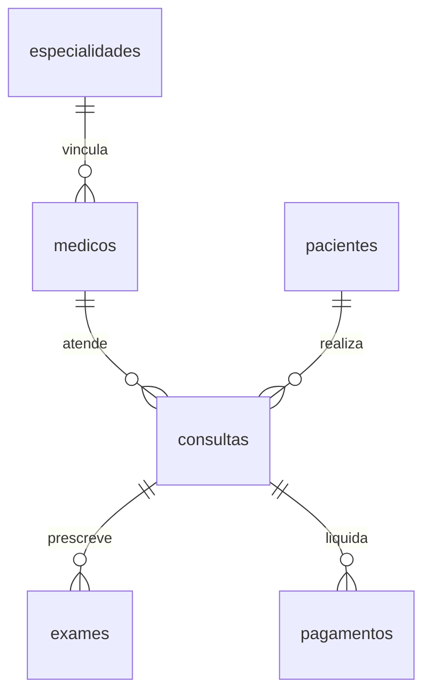

#### Exercicio 1: Consultas com Paciente, Medico e Especialidade (INNER JOIN)
*Enunciado:* Exiba codigo da consulta, data, paciente, medico, especialidade e status com INNER JOIN.
```sql
SELECT
    c.id_consulta,
    c.data_consulta,
    p.nome AS paciente,
    m.nome AS medico,
    e.nome AS especialidade,
    c.status
FROM consultas c
INNER JOIN pacientes p ON c.id_paciente = p.id_paciente
INNER JOIN medicos m ON c.id_medico = m.id_medico
INNER JOIN especialidades e ON m.id_especialidade = e.id_especialidade
ORDER BY c.id_consulta ASC;
```

#### Exercicio 2: Pacientes Sem Consultas (LEFT JOIN Anti-Join)
*Enunciado:* Exiba os pacientes e filtre para apresentar somente quem nunca realizou consulta.
```sql
SELECT
    p.id_paciente,
    p.nome AS paciente,
    p.cidade,
    p.telefone
FROM pacientes p
LEFT JOIN consultas c ON p.id_paciente = c.id_paciente
WHERE c.id_consulta IS NULL
ORDER BY p.id_paciente ASC;
```

#### Exercicio 3: Relatorio Integrado com INNER JOIN e LEFT JOIN
*Enunciado:* Relatorio com consulta, paciente, medico, exame, valor do exame, forma de pagamento e valor pago. Todas as consultas devem aparecer, mesmo sem exames ou pagamentos.
```sql
SELECT
    c.id_consulta,
    p.nome AS paciente,
    m.nome AS medico,
    ex.nome_exame,
    ex.valor AS valor_exame,
    pag.forma_pagamento,
    pag.valor_pago
FROM consultas c
INNER JOIN pacientes p ON c.id_paciente = p.id_paciente
INNER JOIN medicos m ON c.id_medico = m.id_medico
LEFT JOIN exames ex ON c.id_consulta = ex.id_consulta
LEFT JOIN pagamentos pag ON c.id_consulta = pag.id_consulta
ORDER BY c.id_consulta ASC;
```

#### Exercicio 4: Consultas Acima da Media Geral de Valor
*Enunciado:* Exiba codigo da consulta, data, valor e status das consultas cujo valor seja maior que a media calculada via subconsulta.
```sql
SELECT
    id_consulta,
    data_consulta,
    valor,
    status
FROM consultas
WHERE valor > (SELECT AVG(valor) FROM consultas)
ORDER BY valor DESC;
```

#### Exercicio 5: Medicos com Salario Acima da Media da Corporacao
*Enunciado:* Exiba codigo, nome, CRM e salario dos medicos com salario acima da media geral via subconsulta no WHERE.
```sql
SELECT
    id_medico,
    nome,
    crm,
    salario
FROM medicos
WHERE salario > (SELECT AVG(salario) FROM medicos)
ORDER BY salario DESC;
```

#### Exercicio 6: View Operacional e Consulta Filtrada
*Enunciado:* Crie a view `vw_consultas_realizadas` para consultas com status 'Realizada'. Apos criar, consulte na view os registros com valor > R$ 350,00, ordenando do maior para o menor.
```sql
-- Criacao da View
CREATE OR REPLACE VIEW vw_consultas_realizadas AS
SELECT
    c.id_consulta,
    c.data_consulta,
    p.nome AS paciente,
    m.nome AS medico,
    e.nome AS especialidade,
    c.valor AS valor_consulta
FROM consultas c
INNER JOIN pacientes p ON c.id_paciente = p.id_paciente
INNER JOIN medicos m ON c.id_medico = m.id_medico
INNER JOIN especialidades e ON m.id_especialidade = e.id_especialidade
WHERE c.status = 'Realizada';

-- Consulta analitica sobre a View
SELECT
    id_consulta,
    data_consulta,
    paciente,
    medico,
    especialidade,
    valor_consulta
FROM vw_consultas_realizadas
WHERE valor_consulta > 350.00
ORDER BY valor_consulta DESC;
```

---

## Modulo 8 - Sintese, Glossario e Preparacao para Avaliacoes

### Mapa Conceitual da Disciplina

```mermaid
mindmap
  root("Topicos Avancados em Banco de Dados")
    "Camada de Abstracao"
      "Views Padrao (Reescrita via pg_rewrite)"
      "Views Materializadas (Snapshot fisico em disco)"
      "WITH CHECK OPTION (Integridade em DML)"
    "Algebra Relacional"
      "INNER JOIN (Intersecao estrita)"
      "LEFT JOIN (Anti-Join com IS NULL)"
      "SELF JOIN (Estruturas em arvore)"
    "Subconsultas"
      "Escalares (1x1)"
      "IN vs EXISTS (Curto-circuito)"
      "Perigo do NULL no NOT IN (3VL)"
      "Tabelas Derivadas (FROM com alias)"
      "Expressoes CTE (Clausula WITH)"
    "PL/pgSQL Procedural"
      "Stored Procedures (Invocacao CALL)"
      "Controle Transacional (COMMIT e ROLLBACK)"
      "Tipagem Dinamica (%TYPE e %ROWTYPE)"
      "Diagnostico (FOUND e GET DIAGNOSTICS)"
    "Automacao Reativa"
      "Triggers (Paradigma ECA)"
      "Momentos (BEFORE e AFTER)"
      "Granularidade (ROW vs STATEMENT)"
      "Variaveis (NEW, OLD, TG_OP)"
    "Engenharia de Performance"
      "EXPLAIN ANALYZE"
      "Algoritmos (Nested Loop, Hash, Merge)"
```

### Pontos-Chave para Fixacao e Prova

1. **Functions versus Procedures:** Funcoes usam `SELECT`, tem `RETURNS` compulsorio e **nao podem** dar `COMMIT/ROLLBACK`. Procedures usam `CALL`, devolvem dados por `OUT/INOUT` e **podem gerenciar transacoes**.
2. **Armadilha do NOT IN com Nulos:** Se a subconsulta retornar um unico `NULL`, a expressao global avalia como `UNKNOWN`, e a consulta externa retorna zero registros. A solucao e usar **`NOT EXISTS`**.
3. **Contagem em Juncao Externa:** Em `LEFT JOIN`, nunca utilize `COUNT(*)`, pois linhas com `NULL` serao contadas como 1. Utilize `COUNT(tabela_direita.pk)` para retornar 0 quando nao houver vinculo.
4. **Trigger BEFORE versus AFTER:** `BEFORE` roda antes da escrita no heap e pode modificar a tupla `NEW` ou vetar a operacao retornando `NULL`. `AFTER` roda apos a persistencia e nao pode alterar `NEW`, sendo ideal para trilhas de auditoria.
5. **Atualizacao de Materialized View:** O comando `REFRESH MATERIALIZED VIEW CONCURRENTLY` exige compulsoriamente a existencia de um **indice unico (`UNIQUE INDEX`)** sem condicao `WHERE`.
6. **Alias Mandatorio no FROM:** Toda subconsulta declarada dentro de uma clausula `FROM` no PostgreSQL deve possuir compulsoriamente um alias associado.

### Glossario Tecnico Exaustivo

- **Anti-Join:** Operacao da algebra relacional que identifica elementos pertencentes exclusivamente a uma relacao que nao possuem associacao com outra relacao ($`A \setminus B`$).
- **Cost-Based Optimizer (CBO):** Subsistema do SGBD que calcula custos de CPU e I/O de disco para determinar o plano fisico otimizado de execucao de uma consulta.
- **Dollar Quoting:** Mecanismo de escape de strings do PostgreSQL (`$$`) que dispensa o uso de aspas simples duplicadas em corpos de codigo PL/pgSQL.
- **Heap File:** Arquivo fisico alocado em disco onde o PostgreSQL grava as tuplas de tabelas bases e de visoes materializadas.
- **Nested Loop Join:** Algoritmo fisico que itera sobre a relacao externa e executa buscas pontuais linha a linha na relacao interna.
- **Paradigma ECA:** Estrutura arquitetural de processamento de eventos dividida em Evento (*Event*), Condicao (*Condition*) e Acao (*Action*).
- **pg_rewrite:** Tabela interna do catalogo do sistema onde residem as regras de reescrita de visoes relacionais.
- **Subquery Unnesting:** Tecnica do otimizador de consultas que transforma subconsultas correlacionadas ou independentes em juncoes semi-join equivalentes.
- **Three-Valued Logic (3VL):** Modelo de avaliacao logica relacional operando sobre os estados de verdade `TRUE`, `FALSE` e `UNKNOWN`.
- **WITH CHECK OPTION:** Clausula de restricao de escrita em visoes atualizaveis que rejeita gravacoes de linhas que violem o predicado da propria visao.

### Banco de Questoes em Formato JSONL

```json
{"id": 1, "modulo": "Views", "pergunta": "Qual e a principal diferenca fisica entre uma View padrao e uma Materialized View no PostgreSQL?", "resposta": "A View padrao armazena apenas a definicao SQL no catalogo (pg_rewrite) e e recalculada a cada execucao via reescrita. A Materialized View grava fisicamente o snapshot dos dados em disco (heap storage) e suporta indices proprios, exigindo comando REFRESH para sincronizacao."}
{"id": 2, "modulo": "PL/pgSQL", "pergunta": "Por que o PostgreSQL introduziu o objeto CREATE PROCEDURE no PostgreSQL 11?", "resposta": "Para permitir o controle transacional autonomo diretamente dentro da rotina procedural, possibilitando comandos explicitos de COMMIT e ROLLBACK durante a execucao, o que e proibido em Stored Functions."}
{"id": 3, "modulo": "Subconsultas", "pergunta": "Qual anomalia ocorre ao executar uma subconsulta com NOT IN cujo resultado contenha ao menos um valor NULL?", "resposta": "Pelas regras da logica trivalente (3VL), qualquer comparacao com NULL resulta em UNKNOWN. Uma conjuncao com UNKNOWN jamais avalia como TRUE, fazendo com que a consulta principal retorne zero linhas (conjunto vazio)."}
{"id": 4, "modulo": "Joins", "pergunta": "Qual e o risco de utilizar COUNT(*) em uma consulta com LEFT JOIN para apurar pedidos por cliente?", "resposta": "O COUNT(*) conta o numero fisico de linhas da particao gerada. Para um cliente sem pedidos, a juncao sintetiza uma linha preenchida com NULLs, fazendo com que o COUNT(*) retorne 1 erroneamente. Deve-se usar COUNT(p.id_pedido)."}
{"id": 5, "modulo": "Triggers", "pergunta": "Em qual momento de disparo (BEFORE ou AFTER) e possivel alterar o conteudo da variavel NEW para normalizacao de dados?", "resposta": "No momento BEFORE em nivel de linha (FOR EACH ROW). O valor retornado em RETURN NEW sera o registro fisicamente persistido na tabela."}
{"id": 6, "modulo": "Triggers", "pergunta": "Qual e a finalidade de uma trigger configurada com o momento INSTEAD OF?", "resposta": "Ela e utilizada exclusivamente sobre Visoes (Views) nao-atualizaveis para interceptar comandos DML e redirecionar as operacoes manualmente para as tabelas bases correspondentes."}
{"id": 7, "modulo": "Views", "pergunta": "Qual requisito mandatorio e exigido para executar REFRESH MATERIALIZED VIEW CONCURRENTLY?", "resposta": "A Materialized View deve possuir obrigatoriamente um indice exclusivo (UNIQUE INDEX) criado sobre uma ou mais de suas colunas, cobrindo todo o conjunto de dados sem clausula WHERE parcial."}
{"id": 8, "modulo": "Performance", "pergunta": "O que indica a presenca de um no 'Seq Scan' em uma tabela grande no relatorio do EXPLAIN ANALYZE?", "resposta": "Indica uma varredura sequencial completa em disco, sugerindo que nao ha indice adequado para a condicao de filtro ou que o otimizador estimou que ler a tabela inteira e mais barato que leituras aleatorias indexadas."}
```

### Checklist de Revisao Pre-Exame

- [ ] Sei criar visoes com multiplos `JOINs` e agregações com `GROUP BY`.
- [ ] Compreendo as regras restritivas do `CREATE OR REPLACE VIEW` (inclusao de colunas apenas ao final).
- [ ] Sei quando utilizar `WITH CHECK OPTION` e as diferencas entre `LOCAL` e `CASCADED`.
- [ ] Sei criar `MATERIALIZED VIEW`, configurar seu `UNIQUE INDEX` e executar o `REFRESH CONCURRENTLY`.
- [ ] Sei implementar o padrao Anti-Join utilizando `LEFT JOIN` combinado com `WHERE pk IS NULL`.
- [ ] Reconheco a diferenca semantica de filtros posicionados no `ON` versus filtros no `WHERE` sob `LEFT JOIN`.
- [ ] Domino a substituicao de `NOT IN` por `NOT EXISTS` para evitar a armadilha do `NULL` na logica 3VL.
- [ ] Sei diferenciar `ANY/SOME` de `ALL` em operacoes de comparacao quantificada.
- [ ] Sei construir subconsultas na clausula `FROM` e lembro de fornecer sempre um alias obrigatorio.
- [ ] Sei quando usar `%TYPE` e `%ROWTYPE` para tipagem dinâmica em blocos PL/pgSQL.
- [ ] Sei a diferenca funcional entre `FUNCTION` (UDF via `SELECT`) e `PROCEDURE` (`CALL` com `COMMIT/ROLLBACK`).
- [ ] Domino a captura de registros procedurais com `SELECT INTO` e a validacao com `FOUND`.
- [ ] Sei proteger secoes criticas contra condicoes de corrida utilizando `SELECT FOR UPDATE`.
- [ ] Sei separar formalmente a criacao da *Trigger Function* (`RETURNS trigger`) da declaracao do `CREATE TRIGGER`.
- [ ] Conheco as diferencas praticas entre `BEFORE`, `AFTER` e `INSTEAD OF`.
- [ ] Sei manipular as variaveis contextuais `NEW`, `OLD`, `TG_OP` e `TG_TABLE_NAME`.
- [ ] Sei ler a saida de um `EXPLAIN ANALYZE`, identificando custos de *startup*, tempo total e o algoritmo de juncao fisica escolhido.

---

## Fontes e Metadados

- Turma no Classroom: Tópicos Avançados em BD - FEF
- Itens processados: 4 materiais, 6 tarefas, 0 avisos
- Gerado em: 28/10/2026, 20:00:50 (BRT) via classroom-sync
