# Manual Integrado de Tópicos Avançados em Banco de Dados: PostgreSQL, Álgebra Relacional e Engenharia Procedural

> **Instituição:** Centro Universitário de Santa Fé do Sul (UniFEF)  
> **Curso:** Bacharelado em Sistemas de Informação  
> **Disciplina:** Tópicos Avançados em Banco de Dados (4º Semestre)  
> **Docente:** Prof. Welington Garcia  
> **Propósito:** Material didático exaustivo, guia prático de laboratório e caderno de soluções comentadas para engenharia de software e administração de dados corporativos.

---

## Sumário

- [Visão Geral e Arquitetura Pedagógica](#visão-geral-e-arquitetura-pedagógica)
- [Fundamentos Relacionais e Modelagem de Dados](#fundamentos-relacionais-e-modelagem-de-dados)
  - [Teoria Relacional e Formas Normais](#teoria-relacional-e-formas-normais)
  - [Integridade Referencial e Constraints Declarativas](#integridade-referencial-e-constraints-declarativas)
  - [Esquemas Canônicos da Disciplina](#esquemas-canônicos-da-disciplina)
- [Álgebra Relacional e Técnicas de Junção](#álgebra-relacional-e-técnicas-de-junção)
  - [Fundamentos Matemáticos: Produto Cartesiano e Teta-Junção](#fundamentos-matemáticos-produto-cartesiano-e-teta-junção)
  - [INNER JOIN e Mecanismos Físicos do PostgreSQL](#inner-join-e-mecanismos-físicos-do-postgresql)
  - [LEFT OUTER JOIN e Preservação de Tuplas](#left-outer-join-e-preservação-de-tuplas)
  - [Padrão Anti-Join e Tratamento de Nulos](#padrão-anti-join-e-tratamento-de-nulos)
  - [RIGHT OUTER JOIN e Equivalência Operacional](#right-outer-join-e-equivalência-operacional)
  - [FULL OUTER JOIN e Casos de Auditoria](#full-outer-join-e-casos-de-auditoria)
  - [CROSS JOIN e Aplicações Analíticas](#cross-join-e-aplicações-analíticas)
  - [SELF JOIN e Modelagem de Hierarquias](#self-join-e-modelagem-de-hierarquias)
  - [Semântica Crítica: Filtragem no ON versus Filtragem no WHERE](#semântica-crítica-filtragem-no-on-versus-filtragem-no-where)
  - [Agregações com OUTER JOIN: A Armadilha de COUNT](#agregações-com-outer-join-a-armadilha-de-count)
- [Taxonomia e Otimização de Subconsultas](#taxonomia-e-otimização-de-subconsultas)
  - [Classificação por Cardinalidade e Dependência](#classificação-por-cardinalidade-e-dependência)
  - [Subconsultas Escalares](#subconsultas-escalares)
  - [Operadores de Conjunto: IN e a Armadilha da Lógica Trivalente com NOT IN](#operadores-de-conjunto-in-e-a-armadilha-da-lógica-trivalente-com-not-in)
  - [Operadores de Existência: Semântica de Curto-Circuito com EXISTS e NOT EXISTS](#operadores-de-existência-semântica-de-curto-circuito-com-exists-e-not-exists)
  - [Operadores Quantificados: ANY e ALL](#operadores-quantificados-any-e-all)
  - [Subconsultas Correlacionadas e Planos de Execução](#subconsultas-correlacionadas-e-planos-de-execução)
  - [Tabelas Derivadas na Cláusula FROM](#tabelas-derivadas-na-cláusula-from)
  - [Subconsultas em Instruções DML](#subconsultas-em-instruções-dml)
  - [Expressões de Tabela Comuns (CTEs)](#expressões-de-tabela-comuns-ctes)
- [Visões Relacionais e Visões Materializadas](#visões-relacionais-e-visões-materializadas)
  - [Conceito e Mecanismo de Reescrita de Consultas](#conceito-e-mecanismo-de-reescrita-de-consultas)
  - [Comparativo Estrutural: Tabela, View e Materialized View](#comparativo-estrutural-tabela-view-e-materialized-view)
  - [Manutenção e Dependências: CREATE OR REPLACE VIEW e DROP VIEW](#manutenção-e-dependências-create-or-replace-view-e-drop-view)
  - [Visões Atualizáveis e Consistência com WITH CHECK OPTION](#visões-atualizáveis-e-consistência-com-with-check-option)
  - [Segurança de Acesso e Abstração de Esquema](#segurança-de-acesso-e-abstração-de-esquema)
  - [Materialized Views: Estratégias de Atualização e Indexação Física](#materialized-views-estratégias-de-atualização-e-indexação-física)
- [Programação Procedural em PL/pgSQL e Stored Procedures](#programação-procedural-em-plpgsql-e-stored-procedures)
  - [Paradigma Declarativo versus Procedural](#paradigma-declarativo-versus-procedural)
  - [Diferenças Críticas entre Functions e Procedures](#diferenças-críticas-entre-functions-e-procedures)
  - [Anatomia de um Bloco PL/pgSQL](#anatomia-de-um-bloco-plpgsql)
  - [Tipagem Ancorada e Atribuição de Dados](#tipagem-ancorada-e-atribuição-de-dados)
  - [Controle de Fluxo e Sinalização de Exceções](#controle-de-fluxo-e-sinalização-de-exceções)
  - [Execução DML, Variável FOUND e Diagnósticos](#execução-dml-variável-found-e-diagnósticos)
  - [Gerenciamento Transacional Autônomo com COMMIT e ROLLBACK](#gerenciamento-transacional-autônomo-com-commit-e-rollback)
- [Gatilhos e Automação Reativa de Banco de Dados](#gatilhos-e-automação-reativa-de-banco-de-dados)
  - [O Paradigma Event-Condition-Action (ECA)](#o-paradigma-event-condition-action-eca)
  - [Desacoplamento entre Trigger Function e Trigger](#desacoplamento-entre-trigger-function-e-trigger)
  - [Momentos de Disparo: BEFORE, AFTER e INSTEAD OF](#momentos-de-disparo-before-after-e-instead-of)
  - [Níveis de Disparo: Linha versus Instrução](#níveis-de-disparo-linha-versus-instrução)
  - [Variáveis Especiais de Contexto](#variáveis-especiais-de-contexto)
  - [Pipeline Completo de Processamento DML](#pipeline-completo-de-processamento-dml)
  - [Trilhas de Auditoria e Validações de Integridade](#trilhas-de-auditoria-e-validações-de-integridade)
- [Resolução Analítica dos Cadernos de Exercícios](#resolução-analítica-dos-cadernos-de-exercícios)
  - [Caderno 1: Exercícios de JOINs no PostgreSQL](#caderno-1-exercícios-de-joins-no-postgresql)
  - [Caderno 2: Subconsultas - Parte 1](#caderno-2-subconsultas---parte-1)
  - [Caderno 3: Subconsultas Avançadas - Parte 2](#caderno-3-subconsultas-avançadas---parte-2)
  - [Caderno 4: Lista de Exercícios Integrada de Pontos](#caderno-4-lista-de-exercícios-integrada-de-pontos)
  - [Caderno 5: Stored Procedures em PL/pgSQL](#caderno-5-stored-procedures-em-plpgsql)
  - [Caderno 6: Avaliação Oficial de TABD](#caderno-6-avaliação-oficial-de-tabd)
- [Diagnóstico de Desempenho e Engenharia com EXPLAIN ANALYZE](#diagnóstico-de-desempenho-e-engenharia-com-explain-analyze)
- [Armadilhas de Prova e Boas Práticas](#armadilhas-de-prova-e-boas-práticas)
- [Glossário Técnico](#glossário-técnico)

---

## Visão Geral e Arquitetura Pedagógica

A disciplina de Tópicos Avançados em Banco de Dados (TABD), ministrada pelo Prof. Welington Garcia no curso de Sistemas de Informação da UniFEF, consolida a transição entre o consumo básico de bancos relacionais e a engenharia de dados corporativa de alto desempenho. O foco central reside em transformar o Sistema Gerenciador de Banco de Dados Relacional (SGBDR) — especificamente o PostgreSQL — de um mero depósito passivo de tabelas em uma plataforma computacional ativa, atômica e segura.

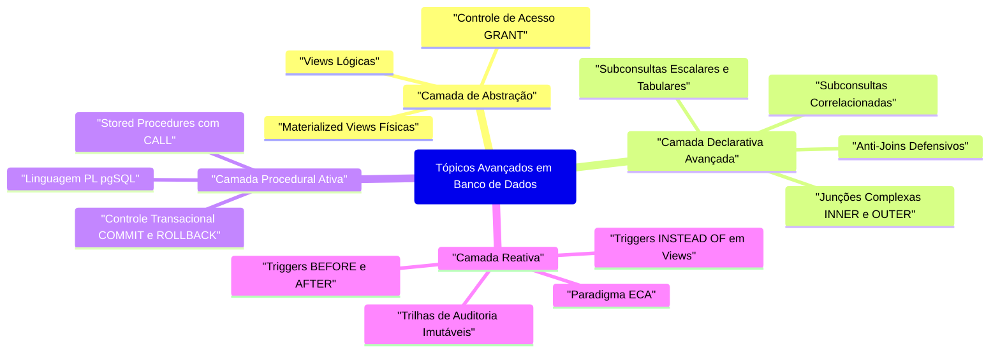

O conteúdo programático fundamenta-se em quatro pilares interligados:
1. **Recomposição e Isolamento Lógico:** Uso de junções complexas, subconsultas aninhadas e visões relacionais para recuperar dados normalizados sem gerar anomalias ou expor estruturas físicas sensíveis.
2. **Otimização de Leituras Analíticas:** Aplicação de visões materializadas, indexação dedicada e avaliação de custos algorítmicos via planos de execução (`EXPLAIN ANALYZE`).
3. **Orquestração Transacional Próxima aos Dados:** Programação procedural em PL/pgSQL encapsulando regras de negócio críticas dentro de procedimentos armazenados, reduzindo drasticamente a latência de rede decorrente de múltiplas idas e vindas (*network round-trips*).
4. **Governança e Integridade Reativa:** Implementação de regras de negócio intransponíveis por meio de gatilhos (*triggers*), assegurando conformidade de dados mesmo diante de acessos manuais de administradores ou falhas em microsserviços externos.

---

## Fundamentos Relacionais e Modelagem de Dados

### Teoria Relacional e Formas Normais

O modelo relacional de Edgar F. Codd estrutura os dados sob o conceito de relações (tabelas), tuplas (linhas) e atributos (colunas). A normalização formal busca eliminar redundâncias de armazenamento e anomalias de atualização, inserção e exclusão:
- **Primeira Forma Normal (1FN):** Exige atomicidade dos valores dos atributos. Colunas multivaloradas ou vetores aninhados são proibidos; cada célula deve conter apenas um dado atômico.
- **Segunda Forma Normal (2FN):** Exige a 1FN e estabelece que todos os atributos não-chave devem depender funcionalmente da totalidade da chave primária, e não de parte dela (aplicável em chaves compostas).
- **Terceira Forma Normal (3FN):** Exige a 2FN e impõe que nenhum atributo não-chave dependa transitivamente de outro atributo não-chave. Todo campo não-chave deve derivar exclusivamente da chave primária.

Embora a decomposição em 3FN garanta consistência estrita, ela fragmenta os dados em múltiplos esquemas especializados. Em cenários reais de engenharia de software, a recomposição desses fragmentos para responder às necessidades de relatórios e interfaces demanda operações de junção e subconsultas sofisticadas.

### Integridade Referencial e Constraints Declarativas

O PostgreSQL garante a consistência atômica e referencial dos esquemas através de restrições nativas declaradas na linguagem de definição de dados (DDL):
- `PRIMARY KEY (PK)`: Define o identificador único universal da tupla. Impõe automaticamente as propriedades `UNIQUE` e `NOT NULL`, materializando um índice B-Tree exclusivo subjacente.
- `FOREIGN KEY (FK)`: Estabelece o vínculo referencial direcionado à chave primária (ou única) de outra relação. Impede a inserção de registros filhos órfãos e restringe a remoção de registros pais que possuam dependências ativas, a menos que ações em cascata (`ON DELETE CASCADE`) sejam explicitamente programadas.
- `CHECK`: Valida predicados booleanos locais em nível de coluna ou tupla antes da persistência física (ex.: `CHECK (salario > 0)`).
- `UNIQUE`: Garante a não repetição de valores em colunas secundárias (ex.: `email`), aceitando múltiplos valores nulos no padrão ANSI SQL a menos que configurado como `UNIQUE NULLS NOT DISTINCT`.

### Esquemas Canônicos da Disciplina

Para a sedimentação dos conceitos e reprodução fiel dos exercícios das aulas, listas e exames do Prof. Welington Garcia, quatro esquemas relacionais são adotados nesta obra:

#### Esquema 1: Comércio e Vendas (loja_joins)

Utilizado nos exercícios fundamentais de junção e no desafio de relatórios.

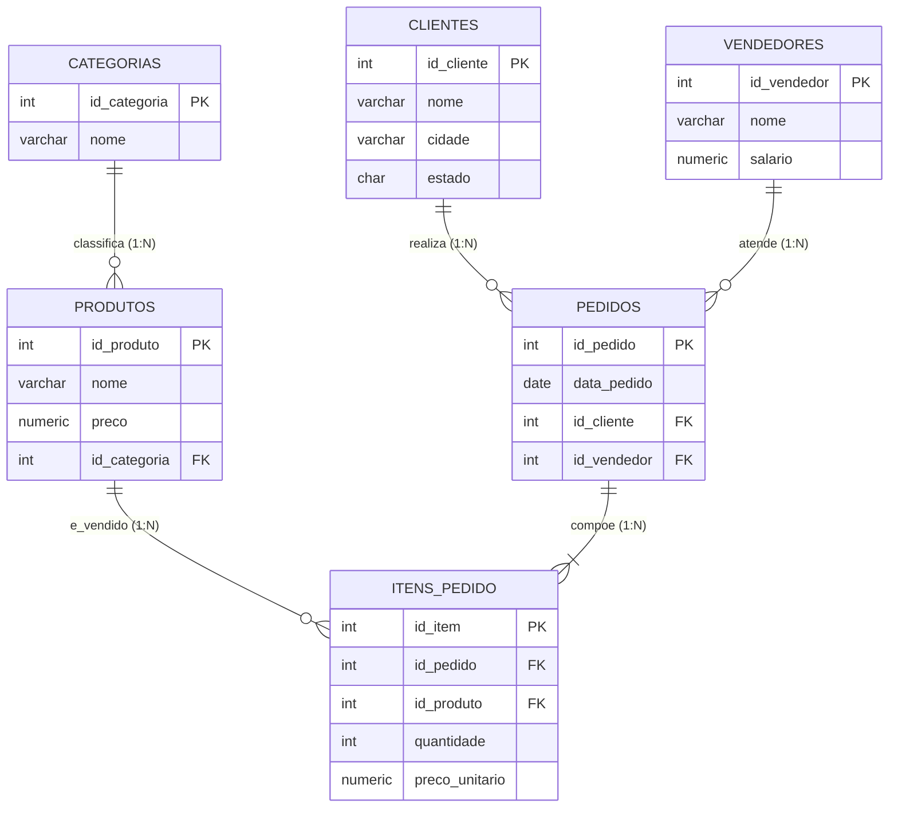

#### Esquema 2: Varejo com Descontos e Supervisão (loja_exercicios)

Utilizado na lista de exercícios integrados, incluindo autorrelacionamento hierárquico e colunas de controle financeiro.

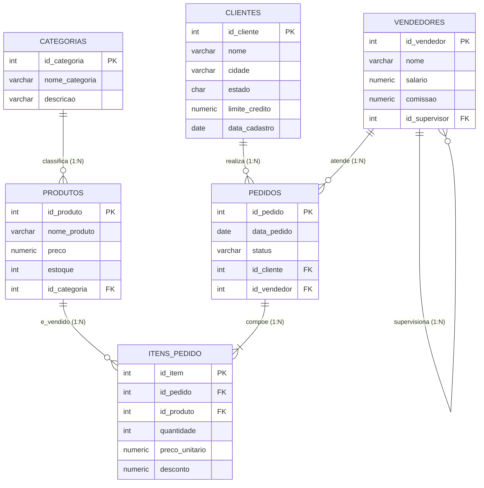

#### Esquema 3: Gestão Transacional e Estoque (banco_procedures)

Utilizado no desenvolvimento de procedimentos armazenados complexos em PL/pgSQL.

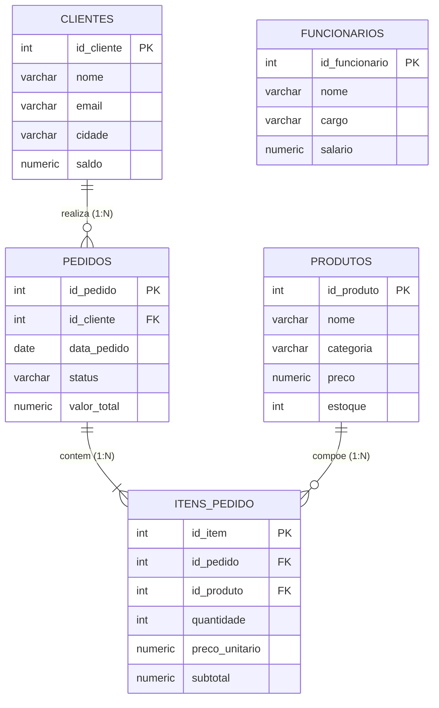

#### Esquema 4: Domínio Clínico-Hospitalar (avaliacao_tabd)

Utilizado na avaliação prática oficial da disciplina.

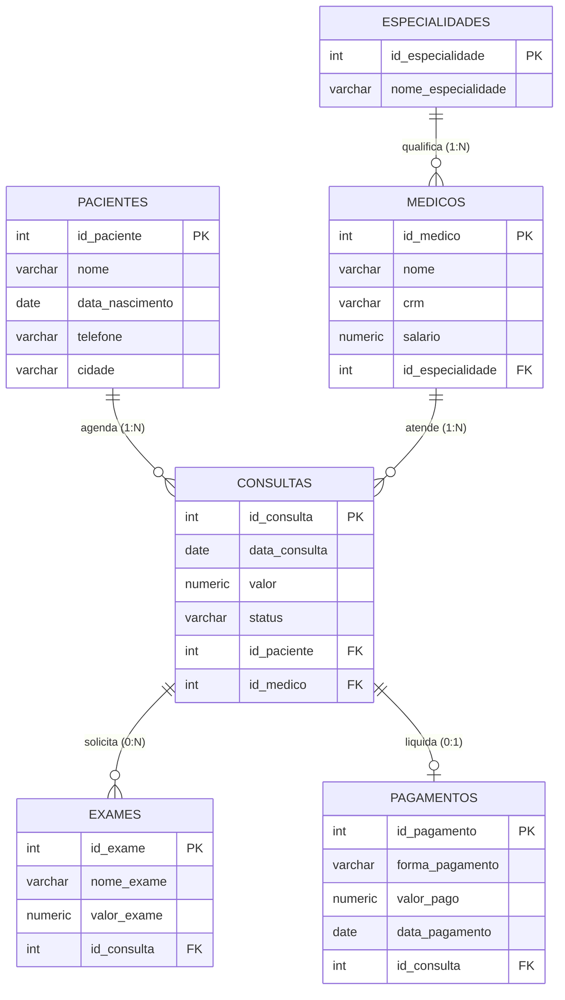

---

## Álgebra Relacional e Técnicas de Junção

### Fundamentos Matemáticos: Produto Cartesiano e Teta-Junção

Na teoria matemática formulada por Codd, a junção relacional não é uma operação primitiva, mas sim uma operação composta. O ponto de partida é o **Produto Cartesiano** ($`R \times S`$), que associa cada tupla da relação $`R`$ a todas as tuplas da relação $`S`$. Se $`R`$ possui $`m`$ tuplas e $`S`$ possui $`n`$ tuplas, a cardinalidade de $`R \times S`$ é expressa exatamente por:

```math
|R \times S| = m \cdot n
```

A partir do produto cartesiano, a **Teta-Junção** ($`R \bowtie_\theta S`$) aplica um operador de restrição ou seleção algébrica ($`\sigma_\theta`$) sob uma condição booleana arbitrária $`\theta`$:

```math
R \bowtie_\theta S = \sigma_\theta(R \times S)
```

Quando o operador contido no predicado $`\theta`$ é estritamente o operador de igualdade ($`=`$), a operação é formalmente denominada **Equijunção**.

### INNER JOIN e Mecanismos Físicos do PostgreSQL

#### Definição e Motivação
O `INNER JOIN` (junção interna) é a implementação SQL direta da equijunção. Sua finalidade é recuperar a interseção exata de informações entre dois conjuntos relacionados. Se uma linha da tabela à esquerda não encontrar correspondência idêntica com ao menos uma linha da tabela à direita segundo o predicado da cláusula `ON`, essa linha é sumariamente descartada do conjunto de resultados.

#### Mecânica de Execução no Otimizador
[Complemento Técnico: Motores de Execução de Banco de Dados]  
O PostgreSQL não computa o produto cartesiano físico para depois filtrar tuplas em memória. Seu otimizador baseado em custos (*Cost-Based Optimizer* - CBO) inspeciona as estatísticas das tabelas armazenadas no catálogo `pg_statistic` e escolhe entre três algoritmos físicos de junção:

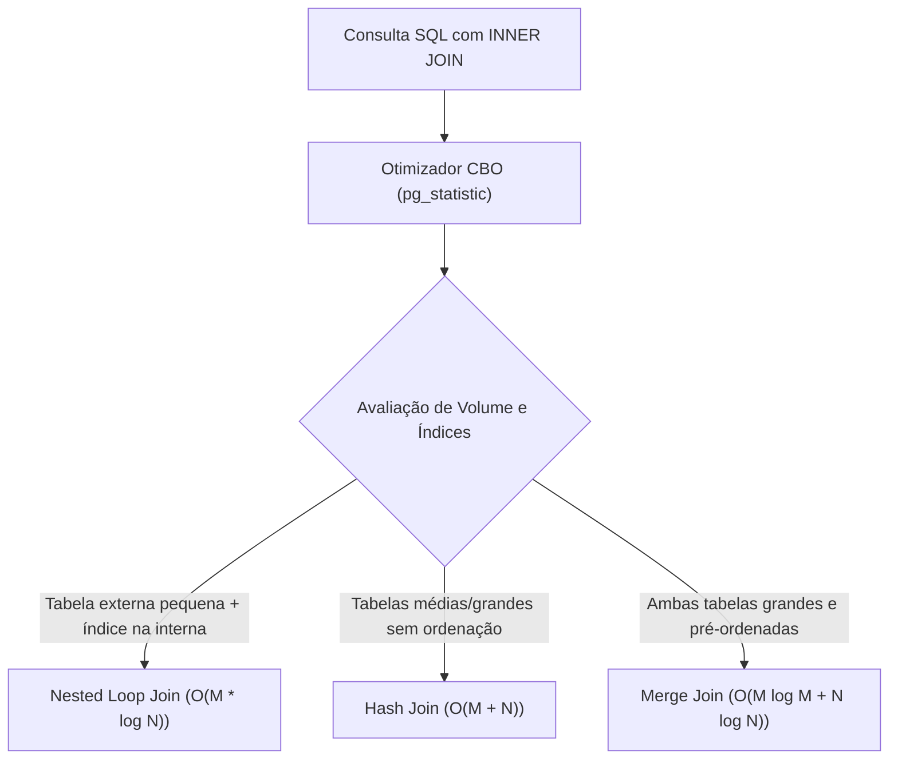

1. **Nested Loop Join:** Varre a relação externa tupla a tupla e, para cada registro, executa uma busca (idealmente via índice B-Tree) na relação interna. Possui complexidade $`O(m \cdot \log n)`$ com índice e $`O(m \cdot n)`$ sem índice.
2. **Hash Join:** Lê a relação de menor cardinalidade e constrói uma tabela hash dinâmica alocada na memória de trabalho (`work_mem`). Em seguida, percorre sequencialmente a relação maior consultando o hash da chave em tempo constante $`O(1)`$. A complexidade global converge para $`O(m + n)`$.
3. **Merge Join:** Exige que ambos os conjuntos estejam ordenados pela chave de junção. O motor percorre ambas as tabelas de maneira sincronizada e paralela. Ideal para operações que já contam com índices B-Tree cobrindo as chaves.

#### Exemplo Prático
```sql
SELECT 
    p.id_pedido,
    p.data_pedido,
    c.nome AS cliente,
    v.nome AS vendedor
FROM pedidos p
INNER JOIN clientes c ON p.id_cliente = c.id_cliente
INNER JOIN vendedores v ON p.id_vendedor = v.id_vendedor;
```

#### Contraexemplo e Armadilha
- **Contraexemplo:** Utilizar a sintaxe legada do padrão ANSI SQL-89 separando tabelas por vírgula no `FROM` e inserindo condições de junção no `WHERE` (`FROM pedidos p, clientes c WHERE p.id_cliente = c.id_cliente`). O esquecimento acidental de uma condição no `WHERE` dispara um produto cartesiano inadvertido em produção.
- **Armadilha:** Chaves com tipos incompatíveis que impedem o uso de índices (ex.: junção entre `VARCHAR` e `INTEGER`), forçando conversões de tipo implícitas e gerando varreduras sequenciais completas (*Sequential Scans*).

### LEFT OUTER JOIN e Preservação de Tuplas

#### Definição e Motivação
O `LEFT OUTER JOIN` (ou simplesmente `LEFT JOIN`) assegura a preservação integral de todas as tuplas da relação posicionada à esquerda da sintaxe, independentemente da existência de pares correspondentes na tabela à direita. Sempre que uma linha da esquerda não encontra par na direita, os atributos derivados da tabela direita são preenchidos com o marcador relacional `NULL`.

A operação algébrica de junção externa esquerda ($`R \ \sqsubset\!\bowtie_\theta \ S`$) é formalizada por:

```math
R \ \sqsubset\!\bowtie_\theta \ S = (R \bowtie_\theta S) \cup \left( (R - \pi_{R}(R \bowtie_\theta S)) \times \{ (\text{null}, \dots, \text{null}) \} \right)
```

Essa operação é fundamental em relatórios gerenciais onde entidades sem movimentação (clientes sem pedidos, vendedores sem metas atingidas, produtos sem vendas) precisam constar obrigatoriamente no resultado.

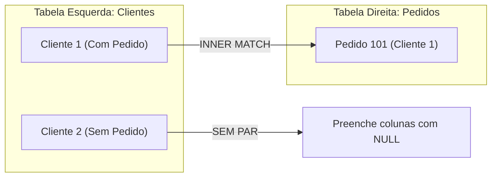

#### Exemplo Prático
```sql
SELECT 
    c.id_cliente,
    c.nome,
    p.id_pedido,
    p.status
FROM clientes c
LEFT JOIN pedidos p ON c.id_cliente = p.id_cliente;
```

### Padrão Anti-Join e Tratamento de Nulos

#### Definição e Motivação
Um **Anti-Join** é a operação relacional destinada a isolar elementos que residem exclusivamente em um conjunto $`A`$ e não possuem qualquer relação com o conjunto $`B`$, correspondendo à diferença clássica de conjuntos ($`A \setminus B`$). No PostgreSQL, a modelagem canônica do anti-join utiliza o `LEFT JOIN` associado a uma verificação de nulidade (`IS NULL`) na cláusula `WHERE`.

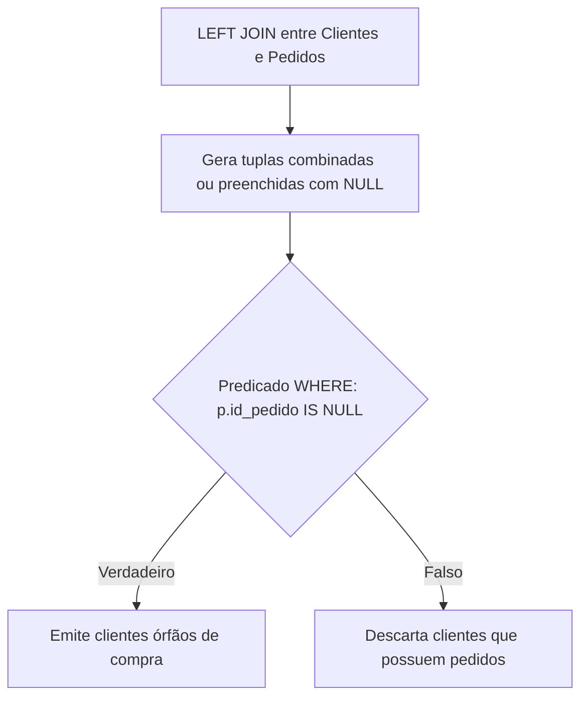

#### Exemplo Prático
```sql
SELECT 
    c.id_cliente,
    c.nome,
    c.cidade
FROM clientes c
LEFT JOIN pedidos p ON c.id_cliente = p.id_cliente
WHERE p.id_pedido IS NULL;
```

#### Armadilha Crítica
- **Armadilha:** Aplicar a verificação `IS NULL` sobre uma coluna da tabela à direita que seja opcional (permita nulos nativamente no esquema, como `observacao` ou `desconto`). Se o registro filho existir mas possuir a coluna opcional como nula, a linha será erroneamente classificada como inexistente.
- **Regra de Engenharia:** A cláusula `WHERE ... IS NULL` em um anti-join deve recair categoricamente sobre a **chave primária** da tabela dependente ou sobre uma coluna com restrição estrita de `NOT NULL`.

#### O Uso de COALESCE
Para substituir visualmente a representação nula gerada por junções externas, a função escalar `COALESCE(v1, v2, ...)` avalia a lista sequencial de argumentos e retorna o primeiro valor não-nulo encontrado:

```sql
SELECT 
    pr.nome_produto,
    COALESCE(c.nome_categoria, 'Sem Categoria') AS categoria
FROM produtos pr
LEFT JOIN categorias c ON pr.id_categoria = c.id_categoria;
```

### RIGHT OUTER JOIN e Equivalência Operacional

O `RIGHT OUTER JOIN` preserva integralmente as tuplas da relação à direita, preenchendo as colunas da esquerda com `NULL` diante da ausência de pares. Do ponto de vista algébrico, as operações são estritamente comutativas:

```math
R \text{ RIGHT JOIN } S \equiv S \text{ LEFT JOIN } R
```

> **Diretriz de Engenharia de Software:** O uso de `RIGHT JOIN` é desaconselhado nos manuais formais de engenharia de software e nos padrões da comunidade PostgreSQL. A direção ocidental de leitura (da esquerda para a direita e de cima para baixo) faz com que cadeias de `LEFT JOIN` preservem a linearidade cognitiva do modelo mental do desenvolvedor.

### FULL OUTER JOIN e Casos de Auditoria

O `FULL OUTER JOIN` realiza a união bidirecional dos dados: preserva todas as linhas da tabela à esquerda e todas as linhas da tabela à direita. Registros que não encontram pares em ambos os lados são projetados com seus atributos correspondentes preenchidos com `NULL`.

Sua aplicação típica ocorre em conciliações contábeis e auditorias fiscais, onde se deseja identificar discrepâncias entre dois registros que deveriam estar sincronizados:

```sql
-- Identificação de inconsistências entre lançamentos contábeis e extratos bancários
SELECT 
    l.id_lancamento,
    l.valor AS valor_sistema,
    e.id_extrato,
    e.valor AS valor_bancario
FROM lancamentos_contabeis l
FULL OUTER JOIN extratos_bancarios e ON l.documento = e.documento
WHERE l.id_lancamento IS NULL OR e.id_extrato IS NULL;
```

### CROSS JOIN e Aplicações Analíticas

O `CROSS JOIN` materializa deliberadamente o produto cartesiano ($`R \times S`$), combinando cada linha da primeira relação com todas as linhas da segunda.

- **Risco de Engenharia:** Executar um `CROSS JOIN` entre tabelas volumosas sem filtros adicionais causa explosão combinatória, sobrecarregando a memória e o disco.
- **Aplicação Válida:** Construção de grades analíticas completas para matrizes de decisão ou relatórios de vendas onde é necessário projetar todos os vendedores combinados com todos os meses do ano, consolidando métricas via `LEFT JOIN` posterior.

```sql
-- Geração de grade de acompanhamento anual por vendedor
SELECT 
    v.nome AS vendedor,
    m.mes
FROM vendedores v
CROSS JOIN (
    VALUES (1), (2), (3), (4), (5), (6), (7), (8), (9), (10), (11), (12)
) AS m(mes);
```

### SELF JOIN e Modelagem de Hierarquias

Um `SELF JOIN` (auto-junção) ocorre quando uma relação é unida a si mesma. Esse padrão é a solução relacional para modelar árvores e hierarquias usando a técnica de **Lista de Adjacências** (*Adjacency List*), onde um atributo chave estrangeira referencia a própria chave primária da tabela.

No banco `loja_exercicios`, a tabela `vendedores` possui o atributo `id_supervisor` apontando para `vendedores(id_vendedor)`.

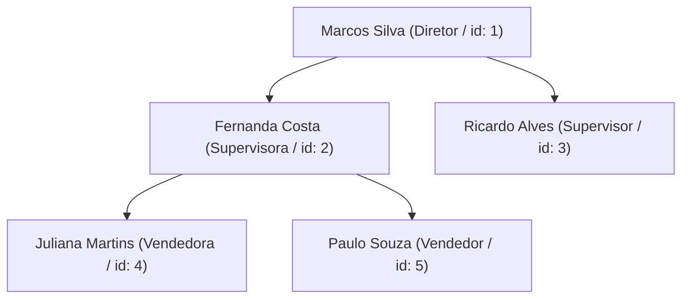

Para recuperar o colaborador e seu respectivo superior na mesma linha, atribuem-se aliases distintos para instanciar a tabela duas vezes na memória lógica:

```sql
SELECT 
    f.nome AS funcionario,
    COALESCE(s.nome, 'Diretoria / Sem Superior') AS supervisor
FROM vendedores f
LEFT JOIN vendedores s ON f.id_supervisor = s.id_vendedor;
```

### Semântica Crítica: Filtragem no ON versus Filtragem no WHERE

Este é um dos tópicos de maior taxa de erro em exames e sistemas em produção: a distinção entre aplicar predicados na cláusula `ON` versus aplicá-los na cláusula `WHERE` durante operações de `OUTER JOIN`.

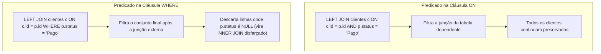

1. **Predicado no `ON`:** O predicado atua como critério de qualificação para o acoplamento da tabela da direita. Caso a condição falhe, as tuplas da tabela à esquerda **não são descartadas**; os campos da direita são simplesmente preenchidos com `NULL`.
2. **Predicado no `WHERE`:** O predicado atua após a montagem da relação unificada. Se uma linha não correspondente gerou valores `NULL` nas colunas da direita, qualquer predicado que exija um valor estrito (ex.: `WHERE p.status = 'Pago'`) avalia para `UNKNOWN` ou `FALSE`, descartando a linha inteira da esquerda e transformando silenciosamente o `LEFT JOIN` em um `INNER JOIN`.

### Agregações com OUTER JOIN: A Armadilha de COUNT

Ao consolidar métricas com funções de grupo (`GROUP BY`), a função `COUNT` apresenta comportamentos divergentes vitais:
- `COUNT(*)`: Conta a cardinalidade física do bloco ou partição de linhas, sem verificar o conteúdo dos atributos.
- `COUNT(expressao)`: Avalia a expressão para cada tupla e incrementa o contador apenas se o resultado da expressão for diferente de `NULL`.

Considere a contagem de pedidos por cliente em um `LEFT JOIN`:

```sql
-- INCORRETO: Retorna 1 para clientes sem nenhum pedido!
SELECT c.nome, COUNT(*) AS total_pedidos
FROM clientes c
LEFT JOIN pedidos p ON c.id_cliente = p.id_cliente
GROUP BY c.nome;

-- CORRETO: Retorna 0 para clientes sem pedidos
SELECT c.nome, COUNT(p.id_pedido) AS total_pedidos
FROM clientes c
LEFT JOIN pedidos p ON c.id_cliente = p.id_cliente
GROUP BY c.nome;
```

---

## Taxonomia e Otimização de Subconsultas

### Classificação por Cardinalidade e Dependência

Uma subconsulta (*subquery* ou *subselect*) é uma instrução `SELECT` aninhada no corpo de outra instrução SQL externa. A taxonomia divide as subconsultas em duas dimensões independentes:

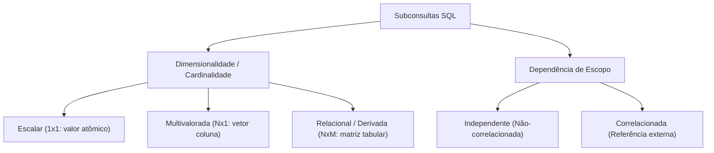

1. **Dimensionalidade:**
   - **Escalar:** Produz no máximo uma linha e uma coluna ($`1 \times 1`$). Utilizável em expressões aritméticas, projeções e comparações unitárias.
   - **Multivalorada:** Produz uma lista unidimensional de valores ($`n \times 1`$). Manipulada com operadores de conjunto (`IN`, `NOT IN`, `ANY`, `ALL`).
   - **Relacional:** Produz uma matriz bidimensional ($`n \times m`$). Opera na cláusula `FROM` (tabelas derivadas) ou alimenta operadores de existência (`EXISTS`).
2. **Dependência de Escopo:**
   - **Não-correlacionada:** É autocontida. Não possui referências às tabelas da consulta externa. É executada uma única vez pelo otimizador.
   - **Correlacionada:** Faz referência a colunas da tupla corrente da consulta externa. É conceituada e avaliada linha a linha pelo motor.

### Subconsultas Escalares

Uma subconsulta escalar deve produzir impreterivelmente um único elemento. Caso a consulta interna retorne zero linhas, o PostgreSQL a avalia como `NULL`. Caso retorne duas ou mais linhas, o sistema aborta a operação com o erro: `ERROR: more than one row returned by a subquery used as an expression`.

```sql
-- Subconsulta escalar aplicada no predicado WHERE
SELECT nome_produto, preco
FROM produtos
WHERE preco > (SELECT AVG(preco) FROM produtos);

-- Subconsulta escalar aplicada na projeção do SELECT
SELECT 
    nome_produto,
    preco,
    ROUND((SELECT AVG(preco) FROM produtos), 2) AS media_geral,
    ROUND(preco - (SELECT AVG(preco) FROM produtos), 2) AS diferenca
FROM produtos;
```

### Operadores de Conjunto: IN e a Armadilha da Lógica Trivalente com NOT IN

O operador `IN` avalia a pertinência de um operando escalar em relação a um conjunto retornado por uma subconsulta unicolunar:

```math
v \in S \iff \exists s \in S \mid v = s
```

O operador `NOT IN` expressa o complemento booleano:

```math
v \notin S \iff \forall s \in S \mid v \neq s
```

#### A Armadilha da Lógica Trivalente (Three-Valued Logic - 3VL)
No padrão ANSI SQL e no PostgreSQL, comparações envolvendo o marcador `NULL` não resultam em `TRUE` nem `FALSE`, mas sim em `UNKNOWN`. 

Considere a expressão:
```sql
v NOT IN (val_1, val_2, NULL)
```
Essa instrução é expandida internamente pelo compilador como:
```sql
(v <> val_1) AND (v <> val_2) AND (v <> NULL)
```
Pela álgebra da lógica trivalente:
- Qualquer comparação direta com `NULL` (`v <> NULL`) avalia estritamente como `UNKNOWN`.
- A conjunção booleana `TRUE AND UNKNOWN` resulta em `UNKNOWN`.
- A conjunção booleana `FALSE AND UNKNOWN` resulta em `FALSE`.

Portanto, se a subconsulta contiver um único valor `NULL`, a expressão **jamais** poderá ser avaliada como `TRUE` para qualquer registro. Como a cláusula `WHERE` só preserva tuplas com avaliação estritamente verdadeira (`TRUE`), o resultado final será **sempre um conjunto vazio** (zero linhas).

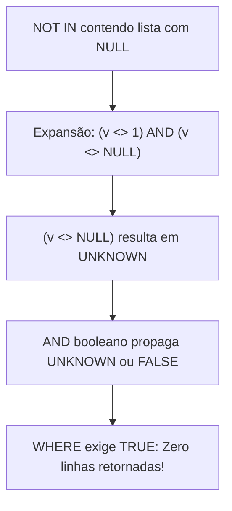

> **Diretriz de Segurança de Dados:** Para mitigar essa armadilha, garanta que a coluna pesquisada na subconsulta possua a restrição `NOT NULL`, filtre explicitamente com `WHERE coluna IS NOT NULL` na subquery ou prefira o operador robusto `NOT EXISTS`.

### Operadores de Existência: Semântica de Curto-Circuito com EXISTS e NOT EXISTS

O operador `EXISTS` avalia se a subconsulta subordinada retorna ao menos uma tupla. Diferente de `IN`, o `EXISTS` não extrai nem compara valores de dados em memória; ele avalia unicamente a cardinalidade da subconsulta ($`|S| > 0`$).

- **Semântica de Curto-Circuito:** O motor do PostgreSQL interrompe a busca na subconsulta no momento exato em que a primeira linha satisfatória é encontrada no disco ou buffer, não computando o restante do conjunto.
- **Convenção `SELECT 1`:** Por convenção de engenharia, declara-se `SELECT 1` no interior do `EXISTS`, deixando claro que as colunas projetadas pela subconsulta são completamente ignoradas pelo motor.
- **Imunidade a Nulos:** O operador `EXISTS` é totalmente imune à armadilha de valores nulos, pois a presença de tuplas compostas exclusivamente por `NULL` ainda constitui a existência física de uma linha.

```sql
-- Vendedores que possuem ao menos uma venda registrada
SELECT v.id_vendedor, v.nome
FROM vendedores v
WHERE EXISTS (
    SELECT 1 
    FROM pedidos p 
    WHERE p.id_vendedor = v.id_vendedor
);

-- Produtos que nunca foram vendidos (Anti-Join seguro)
SELECT pr.id_produto, pr.nome_produto
FROM produtos pr
WHERE NOT EXISTS (
    SELECT 1 
    FROM itens_pedido ip 
    WHERE ip.id_produto = pr.id_produto
);
```

### Operadores Quantificados: ANY e ALL

Os operadores `ANY` (sinônimo de `SOME`) e `ALL` realizam comparações relacionais escalares contra coleções de valores:

1. **`expressao operador ANY (subconsulta)`:** Retorna verdadeiro se a comparação for verdadeira para ao menos um dos valores retornados pela subconsulta.
   - `> ANY (sub)` equivale a ser maior que o **menor valor** do conjunto.
   - `= ANY (sub)` é a equivalência sintática e operacional exata do operador `IN`.
2. **`expressao operador ALL (subconsulta)`:** Retorna verdadeiro se a comparação for verdadeira para a totalidade dos elementos retornados.
   - `> ALL (sub)` equivale a ser maior que o **maior valor** do conjunto.
   - `<> ALL (sub)` é a equivalência sintática do operador `NOT IN`.

```sql
-- Produtos com preço maior que pelo menos um produto de Telefonia
SELECT nome_produto, preco
FROM produtos
WHERE preco > ANY (
    SELECT p.preco 
    FROM produtos p 
    INNER JOIN categorias c ON p.id_categoria = c.id_categoria 
    WHERE c.nome_categoria = 'Telefonia'
);

-- Produtos com preço maior que todos os produtos de Acessórios
SELECT nome_produto, preco
FROM produtos
WHERE preco > ALL (
    SELECT p.preco 
    FROM produtos p 
    INNER JOIN categorias c ON p.id_categoria = c.id_categoria 
    WHERE c.nome_categoria = 'Acessórios'
);
```

### Subconsultas Correlacionadas e Planos de Execução

Uma subconsulta é correlacionada quando suas instruções internas dependem de valores transmitidos pela tupla atualmente inspecionada pela consulta externa.

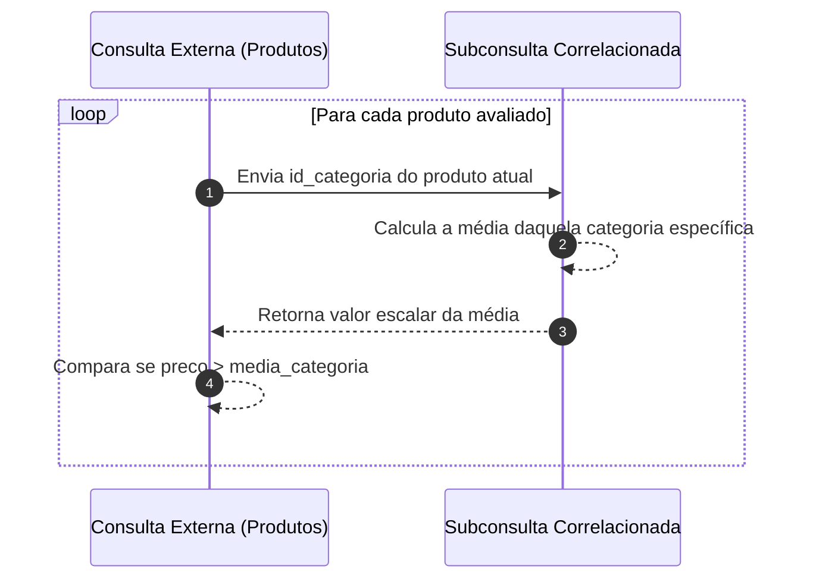

Embora conceitualmente o processador avalie a subconsulta linha a linha com complexidade algorítmica $`O(m \cdot n)`$, o otimizador avançado do PostgreSQL com frequência descorrelaciona a subconsulta (*subquery unnesting*), transformando-a internamente em um `Hash Semi-Join` ou `Merge Join` para alcançar tempo linear $`O(m + n)`$.

```sql
-- Produtos com preço superior à média da sua própria categoria
SELECT p.id_produto, p.nome_produto, p.preco, p.id_categoria
FROM produtos p
WHERE p.preco > (
    SELECT AVG(sub.preco)
    FROM produtos sub
    WHERE sub.id_categoria = p.id_categoria
);
```

### Tabelas Derivadas na Cláusula FROM

Uma tabela derivada (conhecida como *inline view*) é uma subconsulta inserida na cláusula `FROM`, gerando uma relação temporária em memória durante o plano de execução.

- **Obrigatoriedade de Alias:** O padrão ANSI SQL e o PostgreSQL exigem categoricamente a definição de um alias para toda tabela derivada. A omissão causa: `ERROR: subquery in FROM must have an alias`.
- **Motivação:** Executar agregações intermediárias antes da realização de junções, prevenindo distorções provocadas pela multiplicação de tuplas em relacionamentos $`1:N`$.

```sql
-- Total por pedido associado aos dados cadastrais
SELECT 
    p.id_pedido,
    c.nome AS cliente,
    totais.valor_total
FROM pedidos p
INNER JOIN clientes c ON p.id_cliente = c.id_cliente
INNER JOIN (
    SELECT id_pedido, SUM(quantidade * preco_unitario) AS valor_total
    FROM itens_pedido
    GROUP BY id_pedido
) AS totais ON p.id_pedido = totais.id_pedido;
```

### Subconsultas em Instruções DML

O poder das subconsultas estende-se aos comandos de manipulação de dados:

```sql
-- 1. INSERT em lote via subconsulta
INSERT INTO produtos_promocao (id_produto, nome_produto, preco, preco_promocional)
SELECT 
    id_produto,
    nome_produto,
    preco,
    ROUND(preco * 0.90, 2)
FROM produtos
WHERE preco > (SELECT AVG(preco) FROM produtos);

-- 2. UPDATE correlacionado com base na média da categoria
UPDATE produtos p
SET estoque = estoque + 5
WHERE p.preco > (
    SELECT AVG(sub.preco)
    FROM produtos sub
    WHERE sub.id_categoria = p.id_categoria
);

-- 3. DELETE seguro com Anti-Join
DELETE FROM clientes c
WHERE NOT EXISTS (
    SELECT 1 
    FROM pedidos p 
    WHERE p.id_cliente = c.id_cliente
);
```

### Expressões de Tabela Comuns (CTEs)

As Expressões de Tabela Comuns (*Common Table Expressions* - CTEs), declaradas através da cláusula `WITH`, proporcionam modularidade ao código SQL, decompondo instruções complexas em blocos encadeados legíveis:

```sql
WITH media_categorias AS (
    SELECT id_categoria, AVG(preco) AS media_preco
    FROM produtos
    GROUP BY id_categoria
),
produtos_destaque AS (
    SELECT p.id_produto, p.nome_produto, p.preco, p.id_categoria
    FROM produtos p
    INNER JOIN media_categorias mc ON p.id_categoria = mc.id_categoria
    WHERE p.preco > mc.media_preco
)
SELECT pd.nome_produto, pd.preco, c.nome_categoria
FROM produtos_destaque pd
INNER JOIN categorias c ON pd.id_categoria = c.id_categoria;
```

---

## Visões Relacionais e Visões Materializadas

### Conceito e Mecanismo de Reescrita de Consultas

Uma visão relacional padrão (*view*) é uma tabela virtual cujo resultado é gerado dinamicamente a partir de uma consulta SQL armazenada. Ela não aloca blocos de armazenamento físico (*heap files*) para tuplas; o PostgreSQL persiste apenas seus metadados e DDL no catálogo do sistema (tabelas `pg_views` e `pg_rewrite`).

#### O Query Rewrite Rule System
[Complemento Técnico: Otimizador de Consultas do PostgreSQL]  
Quando uma aplicação consulta uma view, o PostgreSQL não executa a view isoladamente para materializá-la em memória intermediária. O subsistema *Query Rewrite Rule System* intercepta a árvore sintática gerada pelo *parser*, localiza a regra `_RETURN` no catálogo `pg_rewrite` e substitui o nó que referencia a view pela subárvore da consulta que a define. Em seguida, a consulta externa e a view são fundidas em um plano de execução único e otimizado.

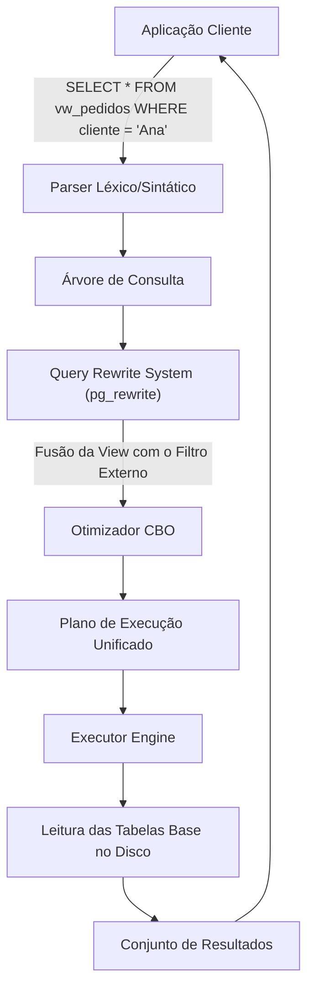

### Comparativo Estrutural: Tabela, View e Materialized View

| Característica de Engenharia | Tabela Base | Visão Padrão (View) | Visão Materializada (Materialized View) |
| :--- | :--- | :--- | :--- |
| **Armazenamento de Tuplas no Disco** | Sim (páginas de dados em heap) | Não (apenas metadados de consulta) | Sim (snapshot estático em disco) |
| **Custo de Recomputação na Leitura** | Zero (apenas custo de I/O) | Total (reexecuta a consulta subjacente) | Zero (lê o snapshot gravado) |
| **Frescor dos Dados (*Freshness*)** | Tempo Real (ACID imediato) | Tempo Real (lê o estado atual das tabelas) | Estático (defasado até o próximo REFRESH) |
| **Suporte a Índices Próprios** | Sim (B-Tree, Hash, GIN, GiST) | Não (utiliza índices das tabelas de origem) | Sim (B-Tree, Hash, GIN, GiST, BRIN) |
| **Comportamento em DML Direto** | Atualizável por padrão | Atualizável sob restrições estritas | Somente Leitura via SQL (DML proibido) |
| **Impacto de Escrita na Origem** | Imediato | Inexistente | Inexistente até o recálculo explícito |

### Manutenção e Dependências: CREATE OR REPLACE VIEW e DROP VIEW

O comando `CREATE OR REPLACE VIEW` permite redefinir a lógica de uma visão sem eliminá-la do catálogo. Todavia, o PostgreSQL impõe regras de invariância para proteger objetos dependentes:
1. **Preservação de Colunas Existentes:** As colunas originais devem manter rigorosamente os mesmos nomes, mesmos tipos de dados e a mesma ordem sequencial.
2. **Inclusão Exclusiva no Final:** Novas colunas só podem ser adicionadas após a última coluna da definição original.
3. **Impossibilidade de Remoção:** Não é permitido excluir colunas anteriores nem alterar seus tipos via `CREATE OR REPLACE VIEW`.

Se for imperativo remover colunas ou reorganizar a estrutura, a view deve ser destruída com `DROP VIEW`.

#### CASCADE versus RESTRICT
O catálogo do PostgreSQL rastreia rigorosamente a árvore de dependência entre objetos na tabela `pg_depend`:
- `DROP VIEW nome RESTRICT`: (Comportamento padrão) O comando é bloqueado se outros objetos (outras views, triggers ou funções) dependerem da visão.
- `DROP VIEW nome CASCADE`: Remove recursivamente a visão informada e **todos** os objetos subordinados que dependem dela.

> **Alerta de Engenharia:** A execução desatenta de `DROP VIEW ... CASCADE` em ambientes produtivos pode destruir dezenas de relatórios, visões dependentes e gatilhos corporativos sem aviso prévio.

### Visões Atualizáveis e Consistência com WITH CHECK OPTION

Uma visão é nativamente atualizável (*automatically updatable*) pelo PostgreSQL se obedecer a todas as seguintes condições:
1. Possuir exatamente uma relação base (tabela ou outra view atualizável) na cláusula `FROM`.
2. Não conter cláusulas `DISTINCT`, `GROUP BY`, `HAVING` ou funções agregadoras.
3. Não conter operações de conjunto (`UNION`, `INTERSECT`, `EXCEPT`).
4. Não utilizar funções de janela (`OVER (...)`).
5. As colunas modificadas devem ser referências diretas a colunas da tabela base, e não expressões calculadas.

#### Garantia de Integridade com WITH CHECK OPTION
Quando uma view atualizável filtra registros (ex.: `WHERE estado = 'SP'`), uma operação de `INSERT` ou `UPDATE` através da view poderia inserir um registro com `estado = 'RJ'`. O registro seria gravado na tabela base, mas desapareceria imediatamente da visualização da própria view.

A cláusula `WITH CHECK OPTION` impede essa anomalia:

```sql
CREATE VIEW vw_clientes_sp AS
SELECT id_cliente, nome, estado
FROM clientes
WHERE estado = 'SP'
WITH CHECK OPTION;

-- Esta instrução falhará com erro de integridade:
-- ERROR: new row violates check option for view "vw_clientes_sp"
INSERT INTO vw_clientes_sp (nome, estado) VALUES ('Carlos', 'RJ');
```

- **`WITH LOCAL CHECK OPTION`:** Fiscaliza apenas as restrições definidas no corpo da view atual.
- **`WITH CASCADED CHECK OPTION`:** (Padrão) Fiscaliza as restrições da view atual e propaga a validação para todas as visões subordinadas subjacentes.

### Segurança de Acesso e Abstração de Esquema

Visões constituem uma barreira arquitetural de isolamento conforme o Princípio do Menor Privilégio (*Principle of Least Privilege*). Um perfil de usuário pode receber privilégios de acesso restrito a uma view enquanto tem seus privilégios totalmente revogados sobre a tabela base física:

```sql
-- 1. Criação de visão com ocultação de dados sensíveis
CREATE VIEW vw_dados_publicos_clientes AS
SELECT id_cliente, nome, cidade, estado
FROM clientes;

-- 2. Revogação de acesso à tabela física e permissão concedida na visão
REVOKE ALL ON clientes FROM usuario_atendimento;
GRANT SELECT ON vw_dados_publicos_clientes TO usuario_atendimento;
```

### Materialized Views: Estratégias de Atualização e Indexação Física

Consultas analíticas pesadas que processam milhões de registros com junções múltiplas e agregações tornam-se inviáveis quando executadas dinamicamente via views comuns. A **Materialized View** computa o resultado e grava as tuplas fisicamente em disco, permitindo acesso instantâneo.

```sql
-- Criação da visão materializada
CREATE MATERIALIZED VIEW mv_vendas_consolidada AS
SELECT 
    pr.id_categoria,
    c.nome_categoria,
    COUNT(DISTINCT p.id_pedido) AS total_pedidos,
    SUM(ip.quantidade * ip.preco_unitario) AS faturamento_total
FROM categorias c
INNER JOIN produtos pr ON c.id_categoria = pr.id_categoria
INNER JOIN itens_pedido ip ON pr.id_produto = ip.id_produto
INNER JOIN pedidos p ON ip.id_pedido = p.id_pedido
GROUP BY pr.id_categoria, c.nome_categoria;
```

#### Atualização de Dados: Bloqueante vs Concorrente
Como a visão materializada não reflete atualizações da tabela base em tempo real, ela precisa ser recalculada periodicamente:
1. **`REFRESH MATERIALIZED VIEW nome`:** Tranca a visão materializada com um bloqueio exclusivo de leitura (`AccessExclusiveLock`). Durante o processamento, nenhuma aplicação consegue realizar consultas sobre a view.
2. **`REFRESH MATERIALIZED VIEW CONCURRENTLY nome`:** Atualiza os dados sem bloquear as leituras concorrentes da aplicação. Para viabilizar a execução concorrente, o PostgreSQL exige a existência de pelo menos um índice exclusivo (`UNIQUE`) cobrindo uma ou mais colunas da visão materializada.

```sql
-- Criação obrigatória de índice exclusivo para permitir atualização concorrente
CREATE UNIQUE INDEX idx_mv_vendas_cat ON mv_vendas_consolidada(id_categoria);

-- Atualização sem travamento de consultas concorrentes
REFRESH MATERIALIZED VIEW CONCURRENTLY mv_vendas_consolidada;
```

---

## Programação Procedural em PL/pgSQL e Stored Procedures

### Paradigma Declarativo versus Procedural

O SQL tradicional é declarativo: o desenvolvedor especifica *o que* deseja obter, delegando ao otimizador do SGBD a responsabilidade de traçar o plano de execução (*como* fazer). Contudo, regras corporativas complexas demandam algoritmos sequenciais, estruturas de decisão condicional (`IF/ELSE`), laços de repetição e manipulação explícita de exceções.

O PostgreSQL atende a esse requisito através de sua linguagem procedural proprietária **PL/pgSQL** (*Procedural Language / PostgreSQL Structured Query Language*).

#### Redução Drástica de Tráfego de Rede (Round-Trips)
Ao executar regras de negócio dentro da camada de aplicação backend, múltiplas consultas trafegam pela rede, gerando latência cumulativa e retenção de bloqueios (*locks*) no banco. Encapsular o processo em uma rotina PL/pgSQL executa todo o fluxo na memória do servidor de banco em uma única transação atômica.

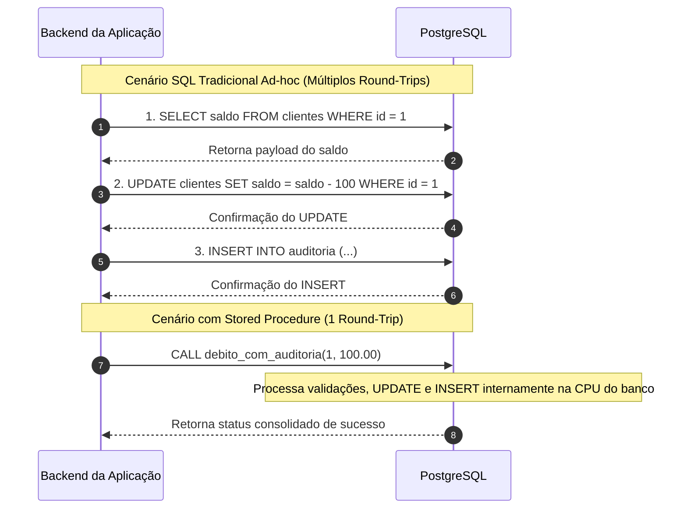

### Diferenças Críticas entre Functions e Procedures

Até a versão 10, o PostgreSQL suportava apenas funções (`CREATE FUNCTION`). A introdução de `CREATE PROCEDURE` no PostgreSQL 11 (em conformidade com o padrão internacional SQL:2011) resolveu restrições funcionais determinantes:

| Critério Arquitetural | Stored Function (`CREATE FUNCTION`) | Stored Procedure (`CREATE PROCEDURE`) |
| :--- | :--- | :--- |
| **Comando de Invocação** | Invocada em consultas: `SELECT func()` | Chamada isolada: `CALL proc()` |
| **Cláusula de Retorno** | Obrigatória (`RETURNS tipo` ou `RETURNS void`) | Inexistente (não possui cláusula `RETURNS`) |
| **Retorno de Múltiplos Dados** | `RETURNS TABLE(...)` ou tipos compostos | Parâmetros com modificadores `INOUT` ou `OUT` |
| **Gerenciamento Transacional** | **Proibido.** Não pode executar `COMMIT` ou `ROLLBACK`. | **Permitido.** Controle total de transações intermediárias. |
| **Propósito Predominante** | Cálculos, filtros e projeções integráveis a queries | Processamento em lote, manutenções e orquestrações |

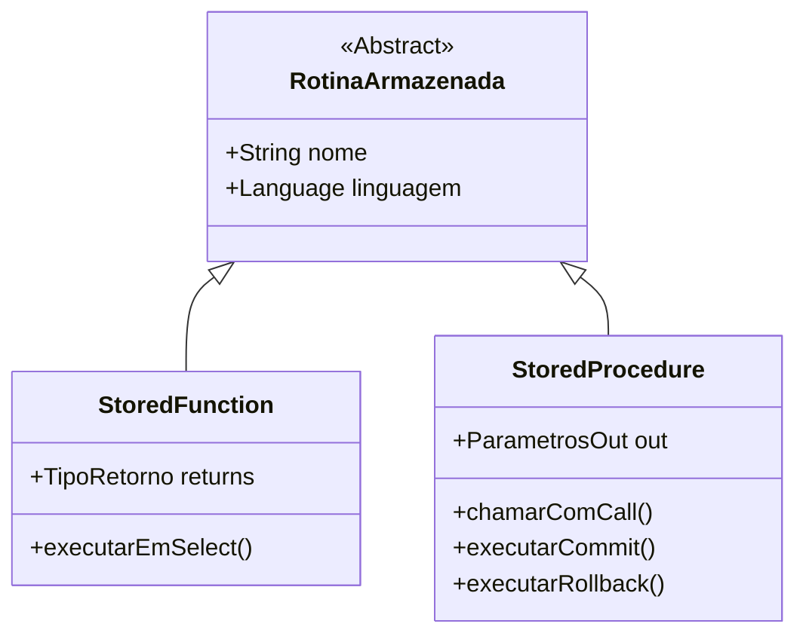

### Anatomia de um Bloco PL/pgSQL

O código PL/pgSQL é delimitado por marcadores de string (*Dollar Quoting* — convencionalmente `$$`) e estruturado em blocos bem definidos:

```sql
CREATE OR REPLACE PROCEDURE sp_exemplo_estrutura(
    p_parametro1 INTEGER,
    p_parametro2 NUMERIC
)
LANGUAGE plpgsql
AS $$
DECLARE
    -- 1. Seção de Declaração de Variáveis e Tipos
    v_variavel_local NUMERIC(10,2) := 0.00;
BEGIN
    -- 2. Seção Executável: Lógica Procedural e DML
    IF p_parametro1 IS NULL THEN
        RAISE EXCEPTION 'Parâmetro obrigatório nulo.';
    END IF;

    -- Instrução DML integrada
    UPDATE contas SET saldo = saldo + p_parametro2 WHERE id = p_parametro1;

EXCEPTION
    -- 3. Seção de Tratamento de Exceções
    WHEN OTHERS THEN
        RAISE NOTICE 'Falha capturada no bloco: %', SQLERRM;
        RAISE; -- Relança a exceção para provocar o rollback externo
END;
$$;
```

- **Dollar Quoting (`$$`):** Elimina a necessidade de duplicar aspas simples no código procedural, garantindo que literais de texto e comandos SQL sejam escritos de forma limpa.
- **Blocos Anônimos (`DO $$ ... $$`):** Permitem a execução pontual e imediata de código PL/pgSQL para rotinas de manutenção ou migração, sem cadastrar um objeto permanente no catálogo.

### Tipagem Ancorada e Atribuição de Dados

Para evitar discrepâncias entre as definições de tipos das tabelas e as variáveis locais do código PL/pgSQL, utilizam-se os operadores de tipagem ancorada:
- `%TYPE`: Ancola o tipo da variável ao tipo exato de uma coluna de tabela ou de outra variável previamente declarada.
- `%ROWTYPE`: Aloca uma variável composta (registro) cuja estrutura reflete integralmente uma linha completa da tabela informada.

```sql
DECLARE
    -- Tipagem ancorada escalar
    v_saldo clientes.saldo%TYPE;
    
    -- Tipagem ancorada em linha completa
    v_cliente_reg clientes%ROWTYPE;
BEGIN
    -- Captura atômica de tupla via SELECT INTO
    SELECT * INTO v_cliente_reg
    FROM clientes
    WHERE id_cliente = 1;
    
    v_saldo := v_cliente_reg.saldo;
END;
```

- **Atribuição:** Realiza-se pelo operador `:=` (ou `=` por compatibilidade).
- **`SELECT ... INTO`:** Transfere dados retornados por uma consulta SQL diretamente para variáveis do bloco. Se a consulta retornar múltiplas linhas, apenas a primeira é capturada a menos que um cursor seja empregado.

### Controle de Fluxo e Sinalização de Exceções

O controle de bifurcação condicional opera pela estrutura `IF ... THEN ... ELSIF ... ELSE ... END IF`:

```sql
IF v_saldo >= p_valor THEN
    UPDATE clientes SET saldo = saldo - p_valor WHERE id_cliente = p_id;
ELSIF v_limite_especial >= p_valor THEN
    RAISE NOTICE 'Utilizando limite de cheque especial.';
    UPDATE clientes SET saldo = saldo - p_valor WHERE id_cliente = p_id;
ELSE
    RAISE EXCEPTION 'Transação recusada: Saldo insuficiente. Saldo atual: %', v_saldo;
END IF;
```

#### Mensagens e Níveis de Gravidade
- `RAISE NOTICE`: Imprime mensagens no console de depuração sem interferir no fluxo transacional.
- `RAISE EXCEPTION`: Aborta imediatamente o bloco executável, cancela as operações pendentes e dispara o rollback da transação corrente.

### Execução DML, Variável FOUND e Diagnósticos

Após a emissão de instruções DML (`INSERT`, `UPDATE`, `DELETE`) ou consultas com `SELECT INTO`, o PL/pgSQL disponibiliza mecanismos internos para auditoria do resultado:

1. **Variável Especial `FOUND`:** Variável booleana de sistema. Assume `TRUE` se ao menos uma linha foi afetada ou retornada pelo comando imediatamente anterior; caso contrário, assume `FALSE`.
2. **Instrução `GET DIAGNOSTICS`:** Extrai com precisão a contagem exata de registros afetados na última operação DML.

```sql
UPDATE produtos 
SET preco = preco * 1.10 
WHERE id_categoria = p_categoria;

GET DIAGNOSTICS v_linhas_afetadas = ROW_COUNT;

IF NOT FOUND THEN
    RAISE NOTICE 'Nenhum produto foi atualizado para a categoria informada.';
ELSE
    RAISE NOTICE 'Sucesso: % produtos sofreram reajuste.', v_linhas_afetadas;
END IF;
```

### Gerenciamento Transacional Autônomo com COMMIT e ROLLBACK

A prerrogativa técnica mais relevante das *Stored Procedures* no PostgreSQL é a capacidade de invocar `COMMIT` e `ROLLBACK` diretamente no interior do código. Essa funcionalidade é crucial em processamento em lote (*batch processing*), onde transações astronômicas esgotariam a memória do subsistema de log de escrita adiantada (*Write-Ahead Logging* - WAL).

```sql
CREATE OR REPLACE PROCEDURE sp_expurgo_em_lotes(p_limite_lote INT)
LANGUAGE plpgsql
AS $$
DECLARE
    v_total_deletado INT := 0;
BEGIN
    LOOP
        DELETE FROM logs_antigos
        WHERE id IN (
            SELECT id FROM logs_antigos 
            WHERE data_log < CURRENT_DATE - INTERVAL '1 year' 
            LIMIT p_limite_lote
        );
        
        GET DIAGNOSTICS v_total_deletado = ROW_COUNT;
        
        -- Confirma o lote atual e libera os locks de disco
        COMMIT;
        
        -- Condição de saída: quando não houver mais registros antigos
        EXIT WHEN v_total_deletado = 0;
    END LOOP;
    
    RAISE NOTICE 'Expurgo em lote finalizado com sucesso.';
END;
$$;
```

---

## Gatilhos e Automação Reativa de Banco de Dados

### O Paradigma Event-Condition-Action (ECA)

Um gatilho (*trigger*) é um objeto do esquema de banco associado a uma tabela ou visão, cuja ativação ocorre de maneira automática pelo núcleo do PostgreSQL em resposta a eventos de modificação de dados (`INSERT`, `UPDATE`, `DELETE`, `TRUNCATE`).

Ao contrário de procedures ou functions, os gatilhos obedecem rigorosamente ao paradigma **ECA**:

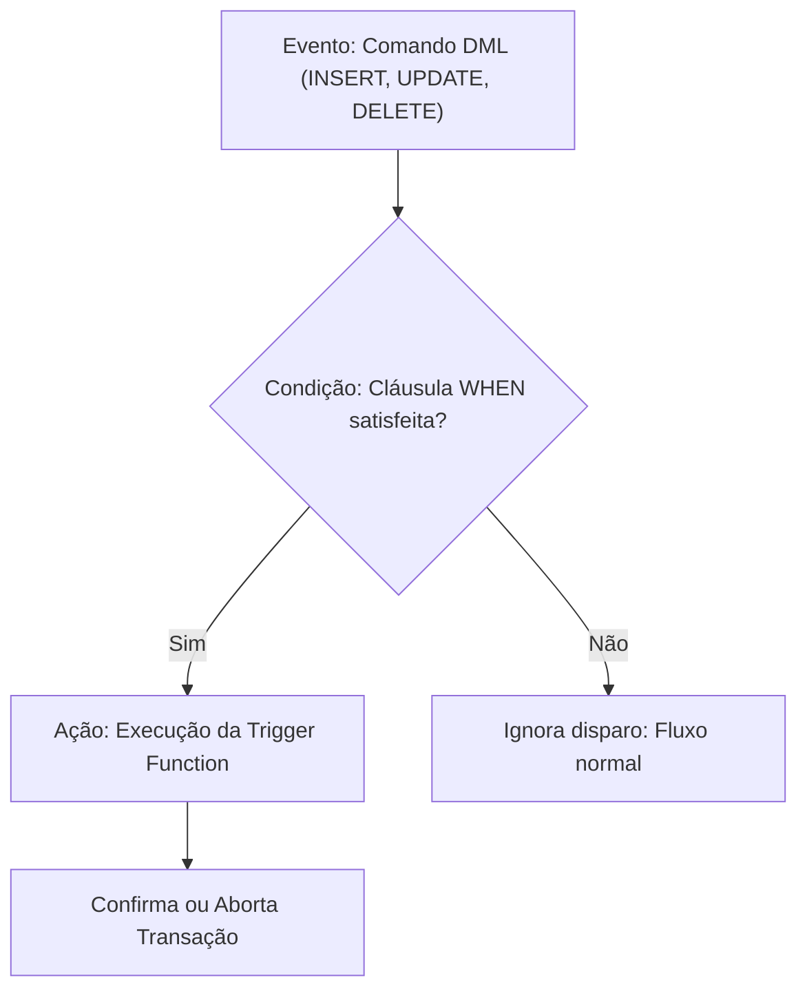

1. **Evento (*Event*):** A instrução DML submetida contra a tabela.
2. **Condição (*Condition*):** Um predicado booleano opcional expresso na cláusula `WHEN` do `CREATE TRIGGER`. Se avaliado como falso, o PostgreSQL nem sequer instancia o interpretador PL/pgSQL, economizando CPU.
3. **Ação (*Action*):** A execução do corpo da função de gatilho compilada.

### Desacoplamento entre Trigger Function e Trigger

Diferente de sistemas como MySQL ou Oracle, o PostgreSQL implementa um desacoplamento formal de duas fases:
1. **Trigger Function:** Uma função declarada sem parâmetros de entrada, cujo tipo de retorno deve ser categoricamente o pseudotipo `trigger`.
2. **Declaração do Gatilho (`CREATE TRIGGER`):** A instrução DDL que amarra a tabela, o evento, o momento de disparo e o nível de granularidade à respectiva *Trigger Function*.

```sql
-- Fase 1: Criação da função de gatilho
CREATE OR REPLACE FUNCTION fn_trg_validar_horario()
RETURNS trigger
LANGUAGE plpgsql
AS $$
BEGIN
    IF EXTRACT(DOW FROM CURRENT_TIMESTAMP) IN (0, 6) THEN
        RAISE EXCEPTION 'Operações cadastrais são proibidas aos fins de semana.';
    END IF;
    RETURN NEW;
END;
$$;

-- Fase 2: Associação da função à tabela via trigger
CREATE TRIGGER trg_bloqueio_fim_de_semana
BEFORE INSERT OR UPDATE OR DELETE ON clientes
FOR EACH STATEMENT
EXECUTE FUNCTION fn_trg_validar_horario();
```

### Momentos de Disparo: BEFORE, AFTER e INSTEAD OF

| Momento | Alvo | Capacidade de Mutação | Efeito do Retorno `NULL` | Casos de Uso Típicos |
| :--- | :--- | :--- | :--- | :--- |
| **BEFORE** | Tabelas | Modifica o registro através de `NEW` | **Cancela silenciosamente** a gravação daquela tupla | Sanitização de dados, validação de regras de negócio, criptografia de senhas |
| **AFTER** | Tabelas | Registro já persistido (imutável) | Nenhum (retorno da função é ignorado) | Trilhas de auditoria, replicação para tabelas satélites, cálculo de totais |
| **INSTEAD OF** | Apenas Visões | Substitui integralmente a instrução DML | Interrompe o processamento na visão | Tornar visões relacionais complexas (com JOINs) totalmente editáveis |

### Níveis de Disparo: Linha versus Instrução

1. **Nível de Linha (`FOR EACH ROW`):** O gatilho dispara para **cada tupla individual** impactada pelo comando DML. Se um `UPDATE` alterar 5.000 registros, o gatilho executa 5.000 vezes. É o único nível que tem acesso às variáveis de tupla `NEW` e `OLD`.
2. **Nível de Instrução (`FOR EACH STATEMENT`):** O gatilho dispara **uma única vez por comando DML**, independentemente da quantidade de linhas afetadas (mesmo que zero linhas satisfaçam o critério). As variáveis `NEW` e `OLD` não estão disponíveis neste modo.

### Variáveis Especiais de Contexto

Dentro do corpo de uma *Trigger Function*, o compilador PL/pgSQL disponibiliza variáveis implícitas essenciais:
- `NEW`: Variável do tipo `RECORD` contendo os dados da tupla que está sendo inserida ou atualizada (disponível em `INSERT` e `UPDATE` em nível de linha; é `NULL` em `DELETE`).
- `OLD`: Variável do tipo `RECORD` contendo os dados da tupla pré-existente antes da mutação (disponível em `UPDATE` e `DELETE` em nível de linha; é `NULL` em `INSERT`).
- `TG_OP`: Variável de texto que indica a operação em execução: `'INSERT'`, `'UPDATE'`, `'DELETE'` ou `'TRUNCATE'`.
- `TG_WHEN`: Texto indicando o momento de disparo: `'BEFORE'`, `'AFTER'` ou `'INSTEAD OF'`.
- `TG_TABLE_NAME`: Nome da tabela sobre a qual o gatilho disparou.

### Pipeline Completo de Processamento DML

O diagrama a seguir sintetiza a sequência exata de etapas executadas pelo motor relacional do PostgreSQL ao receber uma instrução DML:

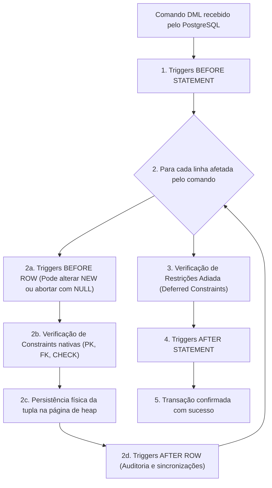

### Trilhas de Auditoria e Validações de Integridade

```sql
-- Implementação profissional de trilha de auditoria completa
CREATE TABLE auditoria_geral (
    id_log SERIAL PRIMARY KEY,
    tabela VARCHAR(50) NOT NULL,
    operacao VARCHAR(10) NOT NULL,
    usuario VARCHAR(50) NOT NULL,
    momento TIMESTAMP NOT NULL DEFAULT clock_timestamp(),
    dados_antigos JSONB,
    dados_novos JSONB
);

CREATE OR REPLACE FUNCTION fn_auditar_mutacao()
RETURNS trigger
LANGUAGE plpgsql
AS $$
BEGIN
    IF TG_OP = 'INSERT' THEN
        INSERT INTO auditoria_geral (tabela, operacao, usuario, dados_novos)
        VALUES (TG_TABLE_NAME, TG_OP, session_user, to_jsonb(NEW));
        RETURN NEW;
    ELSIF TG_OP = 'UPDATE' THEN
        INSERT INTO auditoria_geral (tabela, operacao, usuario, dados_antigos, dados_novos)
        VALUES (TG_TABLE_NAME, TG_OP, session_user, to_jsonb(OLD), to_jsonb(NEW));
        RETURN NEW;
    ELSIF TG_OP = 'DELETE' THEN
        INSERT INTO auditoria_geral (tabela, operacao, usuario, dados_antigos)
        VALUES (TG_TABLE_NAME, TG_OP, session_user, to_jsonb(OLD));
        RETURN OLD;
    END IF;
    RETURN NULL;
END;
$$;
```

---

## Resolução Analítica dos Cadernos de Exercícios

Esta seção consolida a totalidade das atividades práticas da disciplina de TABD, apresentando para cada exercício: o enunciado formal, a motivação técnica e arquitetural, a consulta SQL canônica homologada, a análise conceitual detalhada e as armadilhas clássicas associadas.

---

### Caderno 1: Exercícios de JOINs no PostgreSQL

Base de Dados: `loja_joins` (`clientes`, `vendedores`, `categorias`, `produtos`, `pedidos`, `itens_pedido`).

#### Exercício 1.1: Cliente e seus Pedidos
- **Enunciado:** Utilizando `INNER JOIN`, apresente o código do pedido, a data do pedido e o nome do cliente. Ordene o resultado pelo código do pedido.
- **Motivação:** Integrar uma relação $`1:N`$ exibindo apenas pedidos com clientes íntegros, excluindo clientes sem histórico de compras.
- **Solução SQL:**
  ```sql
  SELECT 
      p.id_pedido,
      p.data_pedido,
      c.nome AS cliente
  FROM pedidos p
  INNER JOIN clientes c ON p.id_cliente = c.id_cliente
  ORDER BY p.id_pedido ASC;
  ```
- **Detalhamento:** O otimizador utiliza o índice de chave primária em `clientes.id_cliente` para cruzar os dados via *Nested Loop* ou *Hash Join*.
- **Armadilha:** Omitir a cláusula de ordenação explícita (`ORDER BY`), gerando resultados com ordenação física instável dependente do plano de varredura.

#### Exercício 1.2: Relatório Completo dos Itens Vendidos
- **Enunciado:** Apresente o código do pedido, o nome do cliente, o nome do produto, a quantidade e o preço unitário. Envolva as tabelas `clientes`, `pedidos`, `itens_pedido` e `produtos`.
- **Motivação:** Desnormalizar o modelo para a granularidade do item faturado, permitindo auditoria comercial minuciosa.
- **Solução SQL:**
  ```sql
  SELECT 
      p.id_pedido,
      c.nome AS cliente,
      pr.nome AS produto,
      ip.quantidade,
      ip.preco_unitario
  FROM pedidos p
  INNER JOIN clientes c ON p.id_cliente = c.id_cliente
  INNER JOIN itens_pedido ip ON p.id_pedido = ip.id_pedido
  INNER JOIN produtos pr ON ip.id_produto = pr.id_produto;
  ```
- **Detalhamento:** O PostgreSQL estabelece um plano em árvore unindo as quatro tabelas através de suas respectivas chaves primárias e estrangeiras.

#### Exercício 1.3: Clientes sem Pedidos
- **Enunciado:** Utilizando `LEFT JOIN`, liste somente os clientes que nunca realizaram pedidos. Exiba o código e o nome do cliente.
- **Motivação:** Executar a operação de diferença de conjuntos ($`\text{Clientes} \setminus \text{Pedidos}`$) via padrão anti-join.
- **Solução SQL:**
  ```sql
  SELECT 
      c.id_cliente,
      c.nome
  FROM clientes c
  LEFT JOIN pedidos p ON c.id_cliente = p.id_cliente
  WHERE p.id_pedido IS NULL;
  ```
- **Armadilha:** Filtrar `WHERE p.id_cliente IS NULL` em vez de avaliar a chave primária `p.id_pedido`. Embora funcione caso `id_cliente` seja não-nulo, a boa prática exige filtrar a chave primária da relação dependente.

#### Exercício 1.4: Produtos Nunca Vendidos
- **Enunciado:** Utilizando `LEFT JOIN`, liste os produtos que ainda não aparecem em nenhum item de pedido. Exiba o código do produto, nome e preço.
- **Motivação:** Identificar produtos sem saída comercial (*slow moving* ou estoque inativo).
- **Solução SQL:**
  ```sql
  SELECT 
      pr.id_produto,
      pr.nome,
      pr.preco
  FROM produtos pr
  LEFT JOIN itens_pedido ip ON pr.id_produto = ip.id_produto
  WHERE ip.id_item IS NULL;
  ```

#### Exercício 1.5: Quantidade de Pedidos por Cliente
- **Enunciado:** Mostre o nome de cada cliente e a quantidade de pedidos realizados. Todos os clientes devem aparecer, inclusive os que possuem zero pedidos. Utilize `LEFT JOIN`, `COUNT()` e `GROUP BY`.
- **Motivação:** Agrupamento analítico preservando a dimensão base.
- **Solução SQL:**
  ```sql
  SELECT 
      c.nome AS cliente,
      COUNT(p.id_pedido) AS quantidade_pedidos
  FROM clientes c
  LEFT JOIN pedidos p ON c.id_cliente = p.id_cliente
  GROUP BY c.id_cliente, c.nome;
  ```
- **Armadilha Fatal:** Utilizar `COUNT(*)`. Para clientes sem pedidos, uma linha com campos nulos de pedidos é gerada pela junção externa, fazendo com que `COUNT(*)` retorne erroneamente `1` em vez de `0`.

#### Exercício 1.6: Faturamento por Produto
- **Enunciado:** Calcule quanto cada produto gerou em vendas (`quantidade * preco_unitario`). Exiba produto e faturamento total, ordenando do maior para o menor.
- **Motivação:** Agregação financeira com produto de atributos da linha.
- **Solução SQL:**
  ```sql
  SELECT 
      pr.nome AS produto,
      SUM(ip.quantidade * ip.preco_unitario) AS faturamento_total
  FROM produtos pr
  INNER JOIN itens_pedido ip ON pr.id_produto = ip.id_produto
  GROUP BY pr.id_produto, pr.nome
  ORDER BY faturamento_total DESC;
  ```

#### Exercício 1.7: Total de Cada Pedido
- **Enunciado:** Calcule o valor total de cada pedido somando os subtotais de seus itens. Exiba código do pedido, data, nome do cliente e valor total.
- **Motivação:** Consolidação na granularidade do cabeçalho de venda.
- **Solução SQL:**
  ```sql
  SELECT 
      p.id_pedido,
      p.data_pedido,
      c.nome AS cliente,
      SUM(ip.quantidade * ip.preco_unitario) AS valor_total
  FROM pedidos p
  INNER JOIN clientes c ON p.id_cliente = c.id_cliente
  INNER JOIN itens_pedido ip ON p.id_pedido = ip.id_pedido
  GROUP BY p.id_pedido, p.data_pedido, c.nome
  ORDER BY p.id_pedido ASC;
  ```

#### Exercício 1.8: Produtos Vendidos para Clientes de São Paulo
- **Enunciado:** Liste os produtos vendidos para clientes cuja cidade seja São Paulo. Exiba cliente, cidade, produto e quantidade comprada.
- **Motivação:** Junção encadeada combinada com filtragem de predicado escalar em dimensão periférica.
- **Solução SQL:**
  ```sql
  SELECT 
      c.nome AS cliente,
      c.cidade,
      pr.nome AS produto,
      ip.quantidade
  FROM clientes c
  INNER JOIN pedidos p ON c.id_cliente = p.id_cliente
  INNER JOIN itens_pedido ip ON p.id_pedido = ip.id_pedido
  INNER JOIN produtos pr ON ip.id_produto = pr.id_produto
  WHERE c.cidade = 'São Paulo';
  ```

#### Exercício 1.9: Faturamento por Vendedor
- **Enunciado:** Mostre o nome do vendedor e seu faturamento total. Todos os vendedores devem aparecer; quando não houver venda, o faturamento deve ser 0. Utilize `COALESCE()`.
- **Motivação:** Junção externa multitabelas preservando a entidade inicial com sanitização de somas nulas.
- **Solução SQL:**
  ```sql
  SELECT 
      v.nome AS vendedor,
      COALESCE(SUM(ip.quantidade * ip.preco_unitario), 0.00) AS faturamento_total
  FROM vendedores v
  LEFT JOIN pedidos p ON v.id_vendedor = p.id_vendedor
  LEFT JOIN itens_pedido ip ON p.id_pedido = ip.id_pedido
  GROUP BY v.id_vendedor, v.nome
  ORDER BY faturamento_total DESC;
  ```
- **Armadilha:** Inserir um `INNER JOIN` entre `pedidos` e `itens_pedido`. Se um `INNER JOIN` for encadeado após um `LEFT JOIN`, os vendedores sem pedidos serão totalmente descartados. Toda a cadeia dependente deve ser externa (`LEFT JOIN`).

#### Exercício 1.10: Desafio – Relatório Geral de Vendas
- **Enunciado:** Monte uma consulta que apresente: pedido, data, cliente, cidade, estado, vendedor, produto, categoria, quantidade, preço unitário e subtotal (`quantidade * preco_unitario`). Ordene por pedido e produto.
- **Motivação:** Reconstrução integral da estrela relacional envolvendo todas as 6 tabelas do esquema.
- **Solução SQL:**
  ```sql
  SELECT 
      p.id_pedido AS pedido,
      p.data_pedido AS data,
      c.nome AS cliente,
      c.cidade,
      c.estado,
      v.nome AS vendedor,
      pr.nome AS produto,
      cat.nome AS categoria,
      ip.quantidade,
      ip.preco_unitario,
      (ip.quantidade * ip.preco_unitario) AS subtotal
  FROM pedidos p
  INNER JOIN clientes c ON p.id_cliente = c.id_cliente
  INNER JOIN vendedores v ON p.id_vendedor = v.id_vendedor
  INNER JOIN itens_pedido ip ON p.id_pedido = ip.id_pedido
  INNER JOIN produtos pr ON ip.id_produto = pr.id_produto
  INNER JOIN categorias cat ON pr.id_categoria = cat.id_categoria
  ORDER BY p.id_pedido ASC, pr.nome ASC;
  ```

---

### Caderno 2: Subconsultas - Parte 1

Base de Dados: Esquema comercial de subconsultas (`clientes`, `vendedores`, `categorias`, `produtos`, `pedidos`, `itens_pedido`).

#### Exercício 2.1: Subconsulta Escalar com Média Geral
- **Enunciado:** Liste todos os produtos cujo preço seja maior que a média de preços de todos os produtos.
- **Solução SQL:**
  ```sql
  SELECT id_produto, nome_produto, preco
  FROM produtos
  WHERE preco > (SELECT AVG(preco) FROM produtos);
  ```

#### Exercício 2.2: Subconsulta Escalar com Preço Máximo
- **Enunciado:** Liste o produto ou os produtos que possuem o maior preço cadastrado via `MAX()`.
- **Solução SQL:**
  ```sql
  SELECT id_produto, nome_produto, preco
  FROM produtos
  WHERE preco = (SELECT MAX(preco) FROM produtos);
  ```
- **Detalhamento:** Retorna empates caso múltiplos produtos compartilhem o valor teto.

#### Exercício 2.3: Subconsulta Escalar com Preço Mínimo
- **Enunciado:** Liste o produto ou os produtos que possuem o menor preço cadastrado via `MIN()`.
- **Solução SQL:**
  ```sql
  SELECT id_produto, nome_produto, preco
  FROM produtos
  WHERE preco = (SELECT MIN(preco) FROM produtos);
  ```

#### Exercício 2.4: Subconsulta no SELECT (Média Geral)
- **Enunciado:** Exiba nome e preço de cada produto e, em uma terceira coluna, apresente a média geral de preços.
- **Solução SQL:**
  ```sql
  SELECT 
      nome_produto,
      preco,
      ROUND((SELECT AVG(preco) FROM produtos), 2) AS media_geral
  FROM produtos;
  ```

#### Exercício 2.5: Subconsulta no SELECT com Cálculo de Diferencial
- **Enunciado:** Exiba nome, preço, média geral e a diferença entre o preço do produto e a média geral.
- **Solução SQL:**
  ```sql
  SELECT 
      nome_produto,
      preco,
      ROUND((SELECT AVG(preco) FROM produtos), 2) AS media_geral,
      ROUND(preco - (SELECT AVG(preco) FROM produtos), 2) AS diferenca
  FROM produtos;
  ```

#### Exercício 2.6: Operador IN com Clientes Ativos
- **Enunciado:** Liste os clientes que realizaram pelo menos um pedido utilizando `IN`.
- **Solução SQL:**
  ```sql
  SELECT id_cliente, nome
  FROM clientes
  WHERE id_cliente IN (SELECT id_cliente FROM pedidos);
  ```

#### Exercício 2.7: Operador IN com Produtos Vendidos
- **Enunciado:** Liste os produtos que já apareceram em algum item de pedido utilizando `IN`.
- **Solução SQL:**
  ```sql
  SELECT id_produto, nome_produto
  FROM produtos
  WHERE id_produto IN (SELECT id_produto FROM itens_pedido);
  ```

#### Exercício 2.8: Operador NOT IN com Clientes sem Pedidos
- **Enunciado:** Liste os clientes que não aparecem em nenhum pedido utilizando `NOT IN`.
- **Solução SQL:**
  ```sql
  SELECT id_cliente, nome
  FROM clientes
  WHERE id_cliente NOT IN (SELECT id_cliente FROM pedidos);
  ```
- **Nota Teórica:** Seguro neste banco pois `pedidos.id_cliente` possui constraint `NOT NULL`.

#### Exercício 2.9: Operador NOT EXISTS (Equivalente Defensivo)
- **Enunciado:** Reescreva o exercício anterior utilizando `NOT EXISTS`.
- **Solução SQL:**
  ```sql
  SELECT c.id_cliente, c.nome
  FROM clientes c
  WHERE NOT EXISTS (
      SELECT 1 
      FROM pedidos p 
      WHERE p.id_cliente = c.id_cliente
  );
  ```

#### Exercício 2.10: Operador EXISTS com Vendedores Ativos
- **Enunciado:** Liste os vendedores que possuem pelo menos um pedido registrado utilizando `EXISTS`.
- **Solução SQL:**
  ```sql
  SELECT v.id_vendedor, v.nome
  FROM vendedores v
  WHERE EXISTS (
      SELECT 1 
      FROM pedidos p 
      WHERE p.id_vendedor = v.id_vendedor
  );
  ```

#### Exercício 2.11: Operador NOT EXISTS com Produtos Nunca Vendidos
- **Enunciado:** Liste os produtos que nunca foram vendidos utilizando `NOT EXISTS`.
- **Solução SQL:**
  ```sql
  SELECT pr.id_produto, pr.nome_produto
  FROM produtos pr
  WHERE NOT EXISTS (
      SELECT 1 
      FROM itens_pedido ip 
      WHERE ip.id_produto = pr.id_produto
  );
  ```

#### Exercício 2.12: Operador IN com Múltiplas Tabelas
- **Enunciado:** Liste os clientes que compraram o produto "Notebook Dell".
- **Solução SQL:**
  ```sql
  SELECT id_cliente, nome
  FROM clientes
  WHERE id_cliente IN (
      SELECT p.id_cliente
      FROM pedidos p
      WHERE p.id_pedido IN (
          SELECT ip.id_pedido
          FROM itens_pedido ip
          WHERE ip.id_produto = (
              SELECT pr.id_produto 
              FROM produtos pr 
              WHERE pr.nome_produto = 'Notebook Dell'
          )
      )
  );
  ```

#### Exercício 2.13: Operador ANY com Categoria Telefonia
- **Enunciado:** Liste os produtos cujo preço seja maior que o preço de pelo menos um produto da categoria Telefonia (`> ANY`).
- **Solução SQL:**
  ```sql
  SELECT nome_produto, preco
  FROM produtos
  WHERE preco > ANY (
      SELECT p.preco
      FROM produtos p
      INNER JOIN categorias c ON p.id_categoria = c.id_categoria
      WHERE c.nome_categoria = 'Telefonia'
  );
  ```

#### Exercício 2.14: Operador ALL com Categoria Acessórios
- **Enunciado:** Liste os produtos cujo preço seja maior que o preço de todos os produtos da categoria Acessórios (`> ALL`).
- **Solução SQL:**
  ```sql
  SELECT nome_produto, preco
  FROM produtos
  WHERE preco > ALL (
      SELECT p.preco
      FROM produtos p
      INNER JOIN categorias c ON p.id_categoria = c.id_categoria
      WHERE c.nome_categoria = 'Acessórios'
  );
  ```

#### Exercício 2.15: Operador ANY com Disparidade Salarial
- **Enunciado:** Liste os vendedores cujo salário seja maior que pelo menos um salário existente entre os demais vendedores.
- **Solução SQL:**
  ```sql
  SELECT nome, salario
  FROM vendedores
  WHERE salario > ANY (SELECT salario FROM vendedores);
  ```
- **Detalhamento:** Exclui unicamente o vendedor que detém o menor salário de toda a equipe.

#### Exercício 2.16: Operador ALL com Teto Salarial
- **Enunciado:** Liste o vendedor ou os vendedores cujo salário seja maior ou igual a todos os salários cadastrados (`>= ALL`).
- **Solução SQL:**
  ```sql
  SELECT nome, salario
  FROM vendedores
  WHERE salario >= ALL (SELECT salario FROM vendedores);
  ```

#### Exercício 2.17: Subconsulta Correlacionada de Preço por Categoria
- **Enunciado:** Liste os produtos cujo preço seja maior que a média de preços de sua própria categoria.
- **Solução SQL:**
  ```sql
  SELECT p.id_produto, p.nome_produto, p.preco, p.id_categoria
  FROM produtos p
  WHERE p.preco > (
      SELECT AVG(sub.preco)
      FROM produtos sub
      WHERE sub.id_categoria = p.id_categoria
  );
  ```

#### Exercício 2.18: Subconsulta Correlacionada de Estoque por Categoria
- **Enunciado:** Liste os produtos cujo estoque seja maior que a média de estoque de sua própria categoria.
- **Solução SQL:**
  ```sql
  SELECT p.id_produto, p.nome_produto, p.estoque, p.id_categoria
  FROM produtos p
  WHERE p.estoque > (
      SELECT AVG(sub.estoque)
      FROM produtos sub
      WHERE sub.id_categoria = p.id_categoria
  );
  ```

#### Exercício 2.19: Subconsulta Correlacionada de Limite de Crédito Regional
- **Enunciado:** Liste os clientes cujo limite de crédito seja maior que a média de limite de crédito dos clientes do mesmo estado.
- **Solução SQL:**
  ```sql
  SELECT c.id_cliente, c.nome, c.estado, c.limite_credito
  FROM clientes c
  WHERE c.limite_credito > (
      SELECT AVG(sub.limite_credito)
      FROM clientes sub
      WHERE sub.estado = c.estado
  );
  ```

#### Exercício 2.20: Subconsulta Correlacionada de Preço Máximo por Categoria
- **Enunciado:** Liste, para cada categoria, o produto ou os produtos de maior preço daquela categoria.
- **Solução SQL:**
  ```sql
  SELECT p.id_produto, p.nome_produto, p.preco, p.id_categoria
  FROM produtos p
  WHERE p.preco = (
      SELECT MAX(sub.preco)
      FROM produtos sub
      WHERE sub.id_categoria = p.id_categoria
  );
  ```

---

### Caderno 3: Subconsultas Avançadas - Parte 2

#### Exercício 3.1: Subconsulta no FROM — Média por Categoria
- **Enunciado:** Calcule, em uma subconsulta no `FROM`, o preço médio dos produtos de cada categoria. Na consulta externa, exiba apenas as categorias com média superior a R$ 1.000,00.
- **Solução SQL:**
  ```sql
  SELECT 
      cat.nome_categoria,
      ROUND(resumo.media_preco, 2) AS media_preco
  FROM (
      SELECT id_categoria, AVG(preco) AS media_preco
      FROM produtos
      GROUP BY id_categoria
  ) AS resumo
  INNER JOIN categorias cat ON resumo.id_categoria = cat.id_categoria
  WHERE resumo.media_preco > 1000.00;
  ```

#### Exercício 3.2: Tabela Derivada — Total de Cada Pedido
- **Enunciado:** Crie uma subconsulta no `FROM` que calcule o valor total de cada pedido via `SUM(quantidade * preco_unitario)`. Na externa, exiba os pedidos cujo total supere R$ 3.000,00.
- **Solução SQL:**
  ```sql
  SELECT 
      totais.id_pedido,
      totais.total_pedido
  FROM (
      SELECT id_pedido, SUM(quantidade * preco_unitario) AS total_pedido
      FROM itens_pedido
      GROUP BY id_pedido
  ) AS totais
  WHERE totais.total_pedido > 3000.00
  ORDER BY totais.total_pedido DESC;
  ```

#### Exercício 3.3: Tabela Derivada Combinada com Múltiplos JOINs
- **Enunciado:** Utilizando uma tabela derivada, calcule o total de cada pedido. Relacione o resultado com `pedidos` e `clientes` para exibir: código do pedido, nome do cliente, data do pedido e valor total.
- **Solução SQL:**
  ```sql
  SELECT 
      p.id_pedido,
      c.nome AS cliente,
      p.data_pedido,
      totais.valor_total
  FROM (
      SELECT id_pedido, SUM(quantidade * preco_unitario) AS valor_total
      FROM itens_pedido
      GROUP BY id_pedido
  ) AS totais
  INNER JOIN pedidos p ON totais.id_pedido = p.id_pedido
  INNER JOIN clientes c ON p.id_cliente = c.id_cliente
  ORDER BY p.id_pedido ASC;
  ```

#### Exercício 3.4: Clientes que Gastaram Acima da Média Geral
- **Enunciado:** Calcule o total gasto por cada cliente via subconsulta. Exiba os clientes cujo total gasto seja superior à média de gastos de todos os clientes que compraram.
- **Solução SQL:**
  ```sql
  WITH gastos_cliente AS (
      SELECT p.id_cliente, SUM(ip.quantidade * ip.preco_unitario) AS total_gasto
      FROM pedidos p
      INNER JOIN itens_pedido ip ON p.id_pedido = ip.id_pedido
      GROUP BY p.id_cliente
  )
  SELECT 
      c.id_cliente,
      c.nome AS cliente,
      gc.total_gasto
  FROM gastos_cliente gc
  INNER JOIN clientes c ON gc.id_cliente = c.id_cliente
  WHERE gc.total_gasto > (SELECT AVG(total_gasto) FROM gastos_cliente);
  ```

#### Exercício 3.5: Categoria com Maior Preço Médio
- **Enunciado:** Determine qual categoria possui o maior preço médio. Utilize uma subconsulta no `FROM` para calcular as médias e outra para identificar o maior valor.
- **Solução SQL:**
  ```sql
  SELECT 
      c.nome_categoria,
      ROUND(medias.media_preco, 2) AS maior_media
  FROM (
      SELECT id_categoria, AVG(preco) AS media_preco
      FROM produtos
      GROUP BY id_categoria
  ) AS medias
  INNER JOIN categorias c ON medias.id_categoria = c.id_categoria
  WHERE medias.media_preco = (
      SELECT MAX(sub_medias.media_preco)
      FROM (
          SELECT AVG(preco) AS media_preco
          FROM produtos
          GROUP BY id_categoria
      ) AS sub_medias
  );
  ```

#### Exercício 3.6: INSERT com Subconsulta
- **Enunciado:** Crie a tabela `produtos_promocao` (`id_produto`, `nome_produto`, `preco`, `preco_promocional`). Insira todos os produtos com preço acima da média geral, aplicando 10% de desconto no campo promocional.
- **Solução SQL:**
  ```sql
  CREATE TABLE produtos_promocao (
      id_produto INTEGER PRIMARY KEY,
      nome_produto VARCHAR(100) NOT NULL,
      preco NUMERIC(10,2) NOT NULL,
      preco_promocional NUMERIC(10,2) NOT NULL
  );

  INSERT INTO produtos_promocao (id_produto, nome_produto, preco, preco_promocional)
  SELECT 
      id_produto,
      nome_produto,
      preco,
      ROUND(preco * 0.90, 2)
  FROM produtos
  WHERE preco > (SELECT AVG(preco) FROM produtos);
  ```

#### Exercício 3.7: UPDATE com Subconsulta em Múltiplos Pedidos
- **Enunciado:** Aumente em 10% o limite de crédito dos clientes que já realizaram pelo menos dois pedidos.
- **Solução SQL:**
  ```sql
  -- Consulta de conferência prévia
  SELECT id_cliente, nome, limite_credito
  FROM clientes
  WHERE id_cliente IN (
      SELECT id_cliente
      FROM pedidos
      GROUP BY id_cliente
      HAVING COUNT(*) >= 2
  );

  -- Atualização atômica
  UPDATE clientes
  SET limite_credito = limite_credito * 1.10
  WHERE id_cliente IN (
      SELECT id_cliente
      FROM pedidos
      GROUP BY id_cliente
      HAVING COUNT(*) >= 2
  );
  ```

#### Exercício 3.8: UPDATE Correlacionado por Média de Categoria
- **Enunciado:** Atualize o estoque dos produtos cujo preço seja superior à média de preço de sua própria categoria, acrescentando 5 unidades.
- **Solução SQL:**
  ```sql
  UPDATE produtos p
  SET estoque = estoque + 5
  WHERE p.preco > (
      SELECT AVG(sub.preco)
      FROM produtos sub
      WHERE sub.id_categoria = p.id_categoria
  );
  ```

#### Exercício 3.9: DELETE com NOT EXISTS e Validação Prévia
- **Enunciado:** Remova todos os clientes que nunca realizaram pedidos via `NOT EXISTS`. Escreva um `SELECT` equivalente de validação prévia.
- **Solução SQL:**
  ```sql
  -- Validação prévia
  SELECT c.id_cliente, c.nome
  FROM clientes c
  WHERE NOT EXISTS (
      SELECT 1 
      FROM pedidos p 
      WHERE p.id_cliente = c.id_cliente
  );

  -- Exclusão segura
  DELETE FROM clientes c
  WHERE NOT EXISTS (
      SELECT 1 
      FROM pedidos p 
      WHERE p.id_cliente = c.id_cliente
  );
  ```

#### Exercício 3.10: Análise de Desempenho com EXPLAIN ANALYZE
- **Enunciado:** Compare duas consultas que retornam clientes com pedidos: uma com `IN` e outra com `EXISTS`. Avalie planos de execução via `EXPLAIN ANALYZE`.
- **Solução SQL:**
  ```sql
  -- Consulta A: Operador IN
  EXPLAIN ANALYZE
  SELECT id_cliente, nome
  FROM clientes
  WHERE id_cliente IN (SELECT id_cliente FROM pedidos);

  -- Consulta B: Operador EXISTS
  EXPLAIN ANALYZE
  SELECT c.id_cliente, c.nome
  FROM clientes c
  WHERE EXISTS (SELECT 1 FROM pedidos p WHERE p.id_cliente = c.id_cliente);
  ```
- **Conclusão de Engenharia:** Em versões modernas do PostgreSQL, o planejador CBO reescreve ambas as formulações para o mesmo nó de execução físico: um `Hash Semi Join` (ou `Merge Semi Join`), equiparando o custo computacional e o tempo de resposta.

---

### Caderno 4: Lista de Exercícios Integrada de Pontos

Base de Dados: `loja_exercicios`.

#### Exercício 4.1: Hierarquia de Vendedores e Faturamento Líquido
- **Enunciado:** Relacione vendedores e seus respectivos supervisores via self-join (tratando nulos como `'Sem Supervisor'`). Calcule a quantidade de pedidos e o faturamento total líquido (aplicando a coluna percentual `desconto` de `itens_pedido`). Vendedores sem vendas devem constar com valores zerados. Ordene por faturamento decrescente.
- **Solução SQL:**
  ```sql
  SELECT 
      v.id_vendedor,
      v.nome AS vendedor,
      COALESCE(sup.nome, 'Sem Supervisor') AS supervisor,
      COUNT(DISTINCT p.id_pedido) AS total_pedidos,
      COALESCE(SUM(ip.quantidade * ip.preco_unitario * (1.0 - (COALESCE(ip.desconto, 0) / 100.0))), 0.00) AS faturamento_liquido
  FROM vendedores v
  LEFT JOIN vendedores sup ON v.id_supervisor = sup.id_vendedor
  LEFT JOIN pedidos p ON v.id_vendedor = p.id_vendedor
  LEFT JOIN itens_pedido ip ON p.id_pedido = ip.id_pedido
  GROUP BY v.id_vendedor, v.nome, sup.nome
  ORDER BY faturamento_liquido DESC;
  ```

#### Exercício 4.2: Produtos Acima da Média de Categoria com Diferencial
- **Enunciado:** Compare o preço de cada produto com a média de sua respectiva categoria usando subconsulta correlacionada no `WHERE`. Exiba: código do produto, nome do produto, nome da categoria, preço unitário, média da categoria e o diferencial acima da média. Desconsidere produtos sem categoria.
- **Solução SQL:**
  ```sql
  SELECT 
      p.id_produto,
      p.nome_produto,
      c.nome_categoria,
      p.preco,
      ROUND((
          SELECT AVG(sub.preco)
          FROM produtos sub
          WHERE sub.id_categoria = p.id_categoria
      ), 2) AS media_categoria,
      ROUND(p.preco - (
          SELECT AVG(sub.preco)
          FROM produtos sub
          WHERE sub.id_categoria = p.id_categoria
      ), 2) AS diferenca
  FROM produtos p
  INNER JOIN categorias c ON p.id_categoria = c.id_categoria
  WHERE p.id_categoria IS NOT NULL
    AND p.preco > (
        SELECT AVG(sub.preco)
        FROM produtos sub
        WHERE sub.id_categoria = p.id_categoria
    )
  ORDER BY diferenca DESC;
  ```

#### Exercício 4.3: Clientes sem Compras Efetivas (Dupla Abordagem)
- **Enunciado:** Identifique clientes que não possuem pedidos válidos (status `'Pago'` ou `'Enviado'`). Resolva por duas técnicas: `LEFT JOIN` com `IS NULL` e `NOT EXISTS`.
- **Solução SQL (Abordagem A - LEFT JOIN):**
  ```sql
  SELECT c.id_cliente, c.nome, c.cidade
  FROM clientes c
  LEFT JOIN pedidos p ON c.id_cliente = p.id_cliente 
                     AND p.status IN ('Pago', 'Enviado')
  WHERE p.id_pedido IS NULL;
  ```
- **Solução SQL (Abordagem B - NOT EXISTS):**
  ```sql
  SELECT c.id_cliente, c.nome, c.cidade
  FROM clientes c
  WHERE NOT EXISTS (
      SELECT 1 
      FROM pedidos p 
      WHERE p.id_cliente = c.id_cliente 
        AND p.status IN ('Pago', 'Enviado')
  );
  ```

#### Exercício 4.4: Desempenho por Categoria com Filtro de Grupo (HAVING)
- **Enunciado:** Integre `categorias`, `produtos`, `itens_pedido` e `pedidos`. Considere apenas pedidos `'Pago'` ou `'Enviado'`. Calcule: quantidade total de peças, faturamento bruto e faturamento líquido após desconto. Exiba apenas categorias com faturamento líquido superior a R$ 5.000,00, ordenando decrescentemente.
- **Solução SQL:**
  ```sql
  SELECT 
      cat.id_categoria,
      cat.nome_categoria,
      SUM(ip.quantidade) AS total_pecas,
      SUM(ip.quantidade * ip.preco_unitario) AS faturamento_bruto,
      ROUND(SUM(ip.quantidade * ip.preco_unitario * (1.0 - (COALESCE(ip.desconto, 0) / 100.0))), 2) AS faturamento_liquido
  FROM categorias cat
  INNER JOIN produtos pr ON cat.id_categoria = pr.id_categoria
  INNER JOIN itens_pedido ip ON pr.id_produto = ip.id_produto
  INNER JOIN pedidos p ON ip.id_pedido = p.id_pedido
  WHERE p.status IN ('Pago', 'Enviado')
  GROUP BY cat.id_categoria, cat.nome_categoria
  HAVING SUM(ip.quantidade * ip.preco_unitario * (1.0 - (COALESCE(ip.desconto, 0) / 100.0))) > 5000.00
  ORDER BY faturamento_liquido DESC;
  ```

#### Exercício 4.5: Visão de Comissões e Validação Trimestral
- **Enunciado:** Crie a visão `vw_faturamento_vendedores` consolidando faturamento mensal líquido e comissões devidas (`faturamento_liquido * (comissao / 100.0)`) para pedidos efetivados (`'Pago'` e `'Enviado'`), com formato de competência `YYYY-MM`. Em seguida, consulte o primeiro trimestre de 2026.
- **Solução SQL:**
  ```sql
  CREATE OR REPLACE VIEW vw_faturamento_vendedores AS
  SELECT 
      v.id_vendedor,
      v.nome AS vendedor,
      TO_CHAR(p.data_pedido, 'YYYY-MM') AS competencia,
      ROUND(SUM(ip.quantidade * ip.preco_unitario * (1.0 - (COALESCE(ip.desconto, 0) / 100.0))), 2) AS faturamento_liquido,
      v.comissao AS taxa_comissao,
      ROUND(SUM(ip.quantidade * ip.preco_unitario * (1.0 - (COALESCE(ip.desconto, 0) / 100.0))) * (v.comissao / 100.0), 2) AS comissao_devida
  FROM vendedores v
  INNER JOIN pedidos p ON v.id_vendedor = p.id_vendedor
  INNER JOIN itens_pedido ip ON p.id_pedido = ip.id_pedido
  WHERE p.status IN ('Pago', 'Enviado')
  GROUP BY v.id_vendedor, v.nome, TO_CHAR(p.data_pedido, 'YYYY-MM'), v.comissao;

  -- Consulta de validação para o 1º Trimestre de 2026
  SELECT *
  FROM vw_faturamento_vendedores
  WHERE competencia BETWEEN '2026-01' AND '2026-03'
  ORDER BY competencia ASC, comissao_devida DESC;
  ```

---

### Caderno 5: Stored Procedures em PL/pgSQL

Base de Dados: `banco_procedures` (`clientes`, `funcionarios`, `produtos`, `pedidos`, `itens_pedido`).

#### Exercício 5.1: aumentar_salario_funcionario
```sql
CREATE OR REPLACE PROCEDURE aumentar_salario_funcionario(
    p_id_funcionario INT,
    p_percentual DECIMAL(5,2)
)
LANGUAGE plpgsql
AS $$
BEGIN
    IF p_percentual IS NULL OR p_percentual <= 0 THEN
        RAISE EXCEPTION 'Percentual de reajuste deve ser positivo. Informado: %', p_percentual;
    END IF;

    UPDATE funcionarios
    SET salario = salario + (salario * (p_percentual / 100.0))
    WHERE id_funcionario = p_id_funcionario;

    IF NOT FOUND THEN
        RAISE EXCEPTION 'Funcionário com ID % inexistente.', p_id_funcionario;
    END IF;

    RAISE NOTICE 'Reajuste de % por cento aplicado ao funcionário %.', p_percentual, p_id_funcionario;
END;
$$;
```

#### Exercício 5.2: atualizar_estoque_produto
```sql
CREATE OR REPLACE PROCEDURE atualizar_estoque_produto(
    p_id_produto INT,
    p_novo_estoque INT
)
LANGUAGE plpgsql
AS $$
BEGIN
    IF p_novo_estoque IS NULL OR p_novo_estoque < 0 THEN
        RAISE EXCEPTION 'A quantidade em estoque não pode ser negativa: %', p_novo_estoque;
    END IF;

    UPDATE produtos
    SET estoque = p_novo_estoque
    WHERE id_produto = p_id_produto;

    IF NOT FOUND THEN
        RAISE EXCEPTION 'Produto com ID % inexistente.', p_id_produto;
    END IF;

    RAISE NOTICE 'Estoque do produto % redefinido para % unidades.', p_id_produto, p_novo_estoque;
END;
$$;
```

#### Exercício 5.3: adicionar_saldo_cliente
```sql
CREATE OR REPLACE PROCEDURE adicionar_saldo_cliente(
    p_id_cliente INT,
    p_valor DECIMAL(10,2)
)
LANGUAGE plpgsql
AS $$
BEGIN
    IF p_valor IS NULL OR p_valor <= 0 THEN
        RAISE EXCEPTION 'Valor a adicionar deve ser estritamente positivo: %', p_valor;
    END IF;

    UPDATE clientes
    SET saldo = saldo + p_valor
    WHERE id_cliente = p_id_cliente;

    IF NOT FOUND THEN
        RAISE EXCEPTION 'Cliente com ID % inexistente.', p_id_cliente;
    END IF;

    RAISE NOTICE 'Crédito de % adicionado ao saldo do cliente %.', p_valor, p_id_cliente;
END;
$$;
```

#### Exercício 5.4: descontar_saldo_cliente
```sql
CREATE OR REPLACE PROCEDURE descontar_saldo_cliente(
    p_id_cliente INT,
    p_valor DECIMAL(10,2)
)
LANGUAGE plpgsql
AS $$
DECLARE
    v_saldo_atual DECIMAL(10,2);
BEGIN
    IF p_valor IS NULL OR p_valor <= 0 THEN
        RAISE EXCEPTION 'Valor de débito deve ser estritamente positivo: %', p_valor;
    END IF;

    SELECT saldo INTO v_saldo_atual
    FROM clientes
    WHERE id_cliente = p_id_cliente
    FOR UPDATE; -- Bloqueio pessimista de concorrência

    IF NOT FOUND THEN
        RAISE EXCEPTION 'Cliente com ID % inexistente.', p_id_cliente;
    END IF;

    IF v_saldo_atual < p_valor THEN
        RAISE EXCEPTION 'Operação cancelada: Saldo insuficiente (Atual: %, Débito: %).', v_saldo_atual, p_valor;
    END IF;

    UPDATE clientes
    SET saldo = saldo - p_valor
    WHERE id_cliente = p_id_cliente;

    RAISE NOTICE 'Débito de % realizado com sucesso para o cliente %.', p_valor, p_id_cliente;
END;
$$;
```

#### Exercício 5.5: cadastrar_produto
```sql
CREATE OR REPLACE PROCEDURE cadastrar_produto(
    p_nome VARCHAR(100),
    p_categoria VARCHAR(50),
    p_preco DECIMAL(10,2),
    p_estoque INT
)
LANGUAGE plpgsql
AS $$
BEGIN
    IF p_nome IS NULL OR TRIM(p_nome) = '' THEN
        RAISE EXCEPTION 'Nome do produto não pode ser vazio.';
    END IF;
    IF p_preco IS NULL OR p_preco <= 0 THEN
        RAISE EXCEPTION 'Preço do produto deve ser positivo: %', p_preco;
    END IF;
    IF p_estoque IS NULL OR p_estoque < 0 THEN
        RAISE EXCEPTION 'Estoque inicial não pode ser negativo: %', p_estoque;
    END IF;

    INSERT INTO produtos (nome, categoria, preco, estoque)
    VALUES (p_nome, p_categoria, p_preco, p_estoque);

    RAISE NOTICE 'Produto "%" cadastrado com sucesso.', p_nome;
END;
$$;
```

#### Exercício 5.6: cancelar_pedido
```sql
CREATE OR REPLACE PROCEDURE cancelar_pedido(
    p_id_pedido INT
)
LANGUAGE plpgsql
AS $$
BEGIN
    UPDATE pedidos
    SET status = 'CANCELADO'
    WHERE id_pedido = p_id_pedido;

    IF NOT FOUND THEN
        RAISE EXCEPTION 'Pedido com ID % inexistente.', p_id_pedido;
    END IF;

    RAISE NOTICE 'Pedido % alterado para o status CANCELADO.', p_id_pedido;
END;
$$;
```

#### Exercício 5.7: fechar_pedido
```sql
CREATE OR REPLACE PROCEDURE fechar_pedido(
    p_id_pedido INT
)
LANGUAGE plpgsql
AS $$
DECLARE
    v_status_atual VARCHAR(30);
BEGIN
    SELECT status INTO v_status_atual
    FROM pedidos
    WHERE id_pedido = p_id_pedido;

    IF NOT FOUND THEN
        RAISE EXCEPTION 'Pedido com ID % inexistente.', p_id_pedido;
    END IF;

    IF v_status_atual <> 'ABERTO' THEN
        RAISE EXCEPTION 'Transição ilegal: Apenas pedidos no status ABERTO podem ser fechados. Status atual: %', v_status_atual;
    END IF;

    UPDATE pedidos
    SET status = 'FECHADO'
    WHERE id_pedido = p_id_pedido;

    RAISE NOTICE 'Pedido % fechado com sucesso.', p_id_pedido;
END;
$$;
```

#### Exercício 5.8: recalcular_valor_pedido
```sql
CREATE OR REPLACE PROCEDURE recalcular_valor_pedido(
    p_id_pedido INT
)
LANGUAGE plpgsql
AS $$
DECLARE
    v_novo_total DECIMAL(10,2);
BEGIN
    -- Validação de existência do cabeçalho
    IF NOT EXISTS (SELECT 1 FROM pedidos WHERE id_pedido = p_id_pedido) THEN
        RAISE EXCEPTION 'Pedido com ID % inexistente.', p_id_pedido;
    END IF;

    -- Cálculo agregado de subtotais
    SELECT COALESCE(SUM(subtotal), 0.00) INTO v_novo_total
    FROM itens_pedido
    WHERE id_pedido = p_id_pedido;

    UPDATE pedidos
    SET valor_total = v_novo_total
    WHERE id_pedido = p_id_pedido;

    RAISE NOTICE 'Valor total do pedido % recalculado para R$ %.', p_id_pedido, v_novo_total;
END;
$$;
```

#### Exercício 5.9: inserir_item_pedido (Orquestração Atômica)
```sql
CREATE OR REPLACE PROCEDURE inserir_item_pedido(
    p_id_pedido INT,
    p_id_produto INT,
    p_quantidade INT
)
LANGUAGE plpgsql
AS $$
DECLARE
    v_status_pedido VARCHAR(30);
    v_preco_unitario DECIMAL(10,2);
    v_estoque_atual INT;
    v_subtotal DECIMAL(10,2);
BEGIN
    -- 1. Validações preliminares de parâmetros
    IF p_quantidade IS NULL OR p_quantidade <= 0 THEN
        RAISE EXCEPTION 'Quantidade de itens deve ser positiva: %', p_quantidade;
    END IF;

    -- 2. Inspeção do pedido
    SELECT status INTO v_status_pedido
    FROM pedidos
    WHERE id_pedido = p_id_pedido;

    IF NOT FOUND THEN
        RAISE EXCEPTION 'Pedido % inexistente.', p_id_pedido;
    END IF;

    IF v_status_pedido <> 'ABERTO' THEN
        RAISE EXCEPTION 'Itens só podem ser inseridos em pedidos ABERTOS. Status: %', v_status_pedido;
    END IF;

    -- 3. Inspeção e bloqueio de concorrência do produto
    SELECT preco, estoque INTO v_preco_unitario, v_estoque_atual
    FROM produtos
    WHERE id_produto = p_id_produto
    FOR UPDATE;

    IF NOT FOUND THEN
        RAISE EXCEPTION 'Produto % inexistente.', p_id_produto;
    END IF;

    IF v_estoque_atual < p_quantidade THEN
        RAISE EXCEPTION 'Estoque insuficiente para o produto %. Atual: %, Solicitado: %', 
            p_id_produto, v_estoque_atual, p_quantidade;
    END IF;

    -- 4. Cálculo aritmético do subtotal
    v_subtotal := v_preco_unitario * p_quantidade;

    -- 5. Inserção na tabela associativa
    INSERT INTO itens_pedido (id_pedido, id_produto, quantidade, preco_unitario, subtotal)
    VALUES (p_id_pedido, p_id_produto, p_quantidade, v_preco_unitario, v_subtotal);

    -- 6. Baixa física de estoque
    UPDATE produtos
    SET estoque = estoque - p_quantidade
    WHERE id_produto = p_id_produto;

    -- 7. Atualização do totalizador do cabeçalho
    CALL recalcular_valor_pedido(p_id_pedido);

    RAISE NOTICE 'Item inserido com sucesso no pedido %.', p_id_pedido;
END;
$$;
```

#### Exercício 5.10: remover_cliente_sem_pedidos
```sql
CREATE OR REPLACE PROCEDURE remover_cliente_sem_pedidos(
    p_id_cliente INT
)
LANGUAGE plpgsql
AS $$
BEGIN
    IF NOT EXISTS (SELECT 1 FROM clientes WHERE id_cliente = p_id_cliente) THEN
        RAISE EXCEPTION 'Cliente com ID % inexistente.', p_id_cliente;
    END IF;

    IF EXISTS (SELECT 1 FROM pedidos WHERE id_cliente = p_id_cliente) THEN
        RAISE EXCEPTION 'Operação recusada: O cliente % possui pedidos vinculados.', p_id_cliente;
    END IF;

    DELETE FROM clientes
    WHERE id_cliente = p_id_cliente;

    RAISE NOTICE 'Cliente % removido com sucesso.', p_id_cliente;
END;
$$;
```

---

### Caderno 6: Avaliação Oficial de TABD

Base de Dados: Domínio Clínico-Hospitalar (`pacientes`, `especialidades`, `medicos`, `consultas`, `exames`, `pagamentos`).

#### Questão 1: Consultas com Paciente, Médico e Especialidade (2,0 pts)
- **Enunciado:** Crie uma consulta que exiba: código da consulta, data da consulta, nome do paciente, nome do médico, nome da especialidade e status da consulta. Utilize `INNER JOIN`.
- **Solução SQL:**
  ```sql
  SELECT 
      c.id_consulta,
      c.data_consulta,
      p.nome AS paciente,
      m.nome AS medico,
      e.nome_especialidade AS especialidade,
      c.status
  FROM consultas c
  INNER JOIN pacientes p ON c.id_paciente = p.id_paciente
  INNER JOIN medicos m ON c.id_medico = m.id_medico
  INNER JOIN especialidades e ON m.id_especialidade = e.id_especialidade;
  ```

#### Questão 2: Pacientes sem Consultas (1,0 pt)
- **Enunciado:** Exiba todos os pacientes e suas respectivas consultas via `LEFT JOIN`, filtrando o resultado para mostrar somente os pacientes que nunca realizaram nenhuma consulta.
- **Solução SQL:**
  ```sql
  SELECT 
      p.id_paciente,
      p.nome AS paciente,
      p.telefone,
      p.cidade
  FROM pacientes p
  LEFT JOIN consultas c ON p.id_paciente = c.id_paciente
  WHERE c.id_consulta IS NULL;
  ```

#### Questão 3: Consultas, Exames e Pagamentos (2,0 pts)
- **Enunciado:** Crie um relatório apresentando: código da consulta, nome do paciente, nome do médico, nome do exame, valor do exame, forma de pagamento e valor pago. Todas as consultas devem aparecer, mesmo que ainda não possuam exame ou pagamento. Combine `INNER JOIN` e `LEFT JOIN`.
- **Solução SQL:**
  ```sql
  SELECT 
      c.id_consulta,
      p.nome AS paciente,
      m.nome AS medico,
      e.nome_exame,
      e.valor_exame,
      pg.forma_pagamento,
      pg.valor_pago
  FROM consultas c
  INNER JOIN pacientes p ON c.id_paciente = p.id_paciente
  INNER JOIN medicos m ON c.id_medico = m.id_medico
  LEFT JOIN exames e ON c.id_consulta = e.id_consulta
  LEFT JOIN pagamentos pg ON c.id_consulta = pg.id_consulta;
  ```

#### Questão 4: Consultas Acima da Média de Valor (1,5 pts)
- **Enunciado:** Exiba todas as consultas cujo valor seja maior que a média de valor de todas as consultas. Apresente: código, data, valor e status. Calcule a média por subconsulta.
- **Solução SQL:**
  ```sql
  SELECT 
      id_consulta,
      data_consulta,
      valor,
      status
  FROM consultas
  WHERE valor > (SELECT AVG(valor) FROM consultas);
  ```

#### Questão 5: Médicos com Salário Acima da Média (1,5 pts)
- **Enunciado:** Exiba os médicos cujo salário seja superior à média salarial de todos os médicos cadastrados. Apresente: código, nome, CRM e salário. Utilize subconsulta no `WHERE`.
- **Solução SQL:**
  ```sql
  SELECT 
      id_medico,
      nome,
      crm,
      salario
  FROM medicos
  WHERE salario > (SELECT AVG(salario) FROM medicos);
  ```

#### Questão 6: View Operacional de Consultas e Consulta Derivada (2,0 pts)
- **Enunciado:** Crie a view `vw_consultas_realizadas` exibindo somente consultas com status igual a `'Realizada'` contendo: código, data, nome do paciente, nome do médico, especialidade e valor. Depois, consulte a view exibindo consultas com valor superior a R$ 350,00, ordenadas do maior para o menor valor.
- **Solução SQL:**
  ```sql
  -- 1. Criação da Visão Operacional
  CREATE OR REPLACE VIEW vw_consultas_realizadas AS
  SELECT 
      c.id_consulta,
      c.data_consulta,
      p.nome AS paciente,
      m.nome AS medico,
      e.nome_especialidade AS especialidade,
      c.valor AS valor_consulta
  FROM consultas c
  INNER JOIN pacientes p ON c.id_paciente = p.id_paciente
  INNER JOIN medicos m ON c.id_medico = m.id_medico
  INNER JOIN especialidades e ON m.id_especialidade = e.id_especialidade
  WHERE c.status = 'Realizada';

  -- 2. Consulta Filtrada e Ordenada sobre a View
  SELECT *
  FROM vw_consultas_realizadas
  WHERE valor_consulta > 350.00
  ORDER BY valor_consulta DESC;
  ```

---

## Diagnóstico de Desempenho e Engenharia com EXPLAIN ANALYZE

O comando `EXPLAIN ANALYZE` instrui o PostgreSQL a planejar, **executar fisicamente** a instrução SQL e recolher métricas exatas de telemetria de runtime.

```sql
EXPLAIN (ANALYZE, BUFFERS, VERBOSE)
SELECT c.nome, COUNT(p.id_pedido)
FROM clientes c
LEFT JOIN pedidos p ON c.id_cliente = p.id_cliente
GROUP BY c.id_cliente, c.nome;
```

### Anatomia da Saída do Plano de Execução

```text
HashAggregate  (cost=35.50..37.50 rows=200 width=108) (actual time=0.150..0.180 rows=10 loops=1)
  Group Key: c.id_cliente, c.nome
  Batches: 1  Memory Usage: 40kB
  Buffers: shared hit=4
  ->  Hash Right Join  (cost=12.25..32.50 rows=400 width=108) (actual time=0.045..0.085 rows=20 loops=1)
        Hash Cond: (p.id_cliente = c.id_cliente)
        Buffers: shared hit=3
        ->  Seq Scan on pedidos p  (cost=0.00..15.00 rows=500 width=8) (actual time=0.005..0.015 rows=20 loops=1)
              Buffers: shared hit=1
        ->  Hash  (cost=10.00..10.00 rows=180 width=104) (actual time=0.025..0.025 rows=12 loops=1)
              Buckets: 1024  Batches: 1  Memory Usage: 9kB
              Buffers: shared hit=2
              ->  Seq Scan on clientes c  (cost=0.00..10.00 rows=180 width=104) (actual time=0.004..0.012 rows=12 loops=1)
                    Buffers: shared hit=2
Planning Time: 0.210 ms
Execution Time: 0.245 ms
```

### Decodificação das Métricas de Engenharia
1. **`cost=A..B`:** 
   - `A` (*Startup Cost*): Unidades arbitrárias de custo de I/O e CPU antes de emitir a primeira tupla.
   - `B` (*Total Cost*): Custo total acumulado para retornar todas as tuplas do nó.
2. **`rows=X width=Y`:** Estimativa estatística de tuplas emitidas (`X`) e a largura média em bytes por linha (`Y`).
3. **`actual time=C..D`:** Tempo real de relógio (em milissegundos) para emitir a primeira tupla (`C`) e concluir o nó (`D`).
4. **`loops=N`:** Quantidade de iterações executadas pelo nó. O tempo real total é dado por $`D \times N`$.
5. **`Buffers: shared hit=K`:** Páginas de 8 KB encontradas diretamente na memória RAM (*Buffer Pool* do PostgreSQL), sem demandar leituras físicas em disco.

---

## Armadilhas de Prova e Boas Práticas

| Conceito Crítico | Erro Comum / Armadilha | Consequência | Solução de Engenharia |
| :--- | :--- | :--- | :--- |
| **`NOT IN` com `NULL`** | Executar `NOT IN` contra subconsulta contendo `NULL` | Retorna zero linhas devido à lógica trivalente ($`\text{UNKNOWN}`$) | Usar `NOT EXISTS` ou filtrar `IS NOT NULL` na subquery |
| **`COUNT` sob `LEFT JOIN`** | Usar `COUNT(*)` para contar itens associados | Clientes/produtos sem dados pontuam `1` em vez de `0` | Usar `COUNT(tabela_dependente.id_pk)` |
| **Filtro em `LEFT JOIN`** | Colocar predicado da tabela direita no `WHERE` | Converte o `LEFT JOIN` em `INNER JOIN` disfarçado | Mover o predicado da tabela direita para a cláusula `ON` |
| **`CREATE OR REPLACE VIEW`** | Remover colunas ou alterar a ordem sequencial | Erro: `cannot change name or type of view column` | Adicionar novas colunas apenas ao final ou usar `DROP VIEW` |
| **`DROP VIEW CASCADE`** | Usar `CASCADE` sem checar dependências no catálogo | Exclusão em cadeia de views, triggers e rotinas | Inspecionar `pg_depend` e priorizar `RESTRICT` |
| **`REFRESH MATERIALIZED`** | Rodar `CONCURRENTLY` sem índice exclusivo | Erro: exige índice `UNIQUE` nas colunas da view | Criar `CREATE UNIQUE INDEX` antes do refresh concorrente |
| **Procedures vs Functions** | Tentar executar `COMMIT` dentro de `FUNCTION` | Erro: `invalid transaction termination` | Migrar para `PROCEDURE` invocada via comando `CALL` |
| **Variáveis em PL/pgSQL** | Variável local com o mesmo nome de coluna da tabela | Ambiguidade e comportamento errático (*shadowing*) | Adotar prefixos formais: `p_` (parâmetro) e `v_` (variável) |
| **Gatilhos BEFORE** | Esquecer a instrução `RETURN NEW` na função | Operação na linha é descartada silenciosamente (`NULL`) | Finalizar a função `BEFORE ROW` com `RETURN NEW` |
| **Recursão em Triggers** | Trigger que faz `UPDATE` na própria tabela sem trava | Loop infinito e erro `stack depth limit exceeded` | Tratar via momento `BEFORE` alterando `NEW`, ou usar `WHEN` |

---

## Glossário Técnico

- **Anti-Join:** Operação relacional que retorna as tuplas do conjunto à esquerda que não possuem nenhuma correspondência no conjunto à direita ($`A \setminus B`$).
- **Buffer Pool (Shared Buffers):** Região de memória RAM alocada pelo PostgreSQL para armazenar em cache páginas de dados e índices lidos do disco rígido.
- **Cost-Based Optimizer (CBO):** Subsistema inteligente do SGBD que estima o custo de planos de execução alternativos com base em estatísticas e escolhe o mais eficiente.
- **Dollar Quoting (`$$`):** Notação de delimitação de strings do PostgreSQL que dispensa o escape de aspas simples no corpo de funções e procedimentos.
- **Equijunção:** Caso particular da junção relacional em que o predicado de comparação é unicamente o operador de igualdade ($`=`$).
- **Heap File:** Arquivo físico de armazenamento em disco no qual as tuplas de uma tabela ou visão materializada são gravadas em blocos padronizados de 8 KB.
- **Mecanismo de Reescrita (pg_rewrite):** Componente do PostgreSQL que expande definições de views lógicas fundindo-as diretamente na árvore da consulta principal.
- **Nested Loop Join:** Algoritmo físico de junção que itera linearmente sobre uma relação externa e realiza buscas pontuais na relação interna.
- **PL/pgSQL:** Linguagem procedural estruturada em blocos, integrada nativamente ao núcleo computacional do PostgreSQL.
- **Procedimento Armazenado (Stored Procedure):** Objeto de esquema que encapsula lógica procedural, invocado via `CALL` e dotado de autonomia transacional (`COMMIT`/`ROLLBACK`).
- **Three-Valued Logic (3VL):** Modelo lógico relacional que opera com três estados de verdade: `TRUE`, `FALSE` e `UNKNOWN` (indeterminado, fruto de manipulações com `NULL`).
- **Trigger Function:** Função especializada que retorna o tipo abstrato `trigger`, acionada reativamente pelo despachante de eventos DML do banco.
- **Visão Materializada (Materialized View):** Objeto de esquema que persiste fisicamente o resultado de uma consulta em disco, exigindo comandos de sincronização (`REFRESH`).
- **WITH CHECK OPTION:** Restrição de integridade declarada em visões atualizáveis que impede a inserção ou alteração de dados que violem as condições de filtragem da própria visão.

---

## Fontes e Metadados

- Turma no Classroom: Tópicos Avançados em BD - FEF
- Itens processados: 4 materiais, 6 tarefas, 0 avisos
- Gerado em: 28/10/2026, 20:00:50 (BRT) via classroom-sync
