# Guia de Estudos Definitivo: Tópicos Avançados em Banco de Dados (PostgreSQL)

> **Instituição:** Centro Universitário de Educação de Jales (UniFEF)  
> **Curso:** Bacharelado em Sistemas de Informação (4º Semestre)  
> **Disciplina:** Tópicos Avançados em Banco de Dados (TABD)  
> **Docente:** Prof. Welington Garcia  
> **Material:** Compilação e aprofundamento das Aulas 02, 03, 04 e 05, listas práticas de exercícios e avaliações oficiais.

---

## Sumário

- [Visões Relacionais e Visões Materializadas](#visões-relacionais-e-visões-materializadas)
  - [Conceito e Arquitetura do Mecanismo de Reescrita](#conceito-e-arquitetura-do-mecanismo-de-reescrita)
  - [Tabelas Base versus Visões Padrão versus Visões Materializadas](#tabelas-base-versus-visões-padrão-versus-visões-materializadas)
  - [Sintaxe DDL e Operações Fundamentais](#sintaxe-ddl-e-operações-fundamentais)
  - [Regras de Evolução Estrutural com CREATE OR REPLACE VIEW](#regras-de-evolução-estrutural-com-create-or-replace-view)
  - [Gestão de Dependências com DROP VIEW: CASCADE versus RESTRICT](#gestão-de-dependências-com-drop-view-cascade-versus-restrict)
  - [Visões Atualizáveis e Restrições de Modificação](#visões-atualizáveis-e-restrições-de-modificação)
  - [Garantia de Integridade Transacional com WITH CHECK OPTION](#garantia-de-integridade-transacional-com-with-check-option)
  - [Camada de Segurança e Mascaramento com GRANT](#camada-de-segurança-e-mascaramento-com-grant)
  - [Visões Materializadas, Ciclo de Atualização e Indexação Própria](#visões-materializadas-ciclo-de-atualização-e-indexação-própria)
- [Álgebra Relacional e Técnicas Avançadas de Junção](#álgebra-relacional-e-técnicas-avançadas-de-junção)
  - [Fundamentos Relacionais e Mecânica dos Algoritmos de Junção](#fundamentos-relacionais-e-mecânica-dos-algoritmos-de-junção)
  - [Junção Interna: INNER JOIN](#junção-interna-inner-join)
  - [Junções Externas: LEFT JOIN e RIGHT JOIN](#junções-externas-left-join-e-right-join)
  - [Técnica de Anti-Join para Detecção de Lacunas Relacionais](#técnica-de-anti-join-para-detecção-de-lacunas-relacionais)
  - [Junção Externa Total: FULL OUTER JOIN](#junção-externa-total-full-outer-join)
  - [Produto Cartesiano: CROSS JOIN](#produto-cartesiano-cross-join)
  - [Autorrelacionamento: SELF JOIN e Estruturas Hierárquicas](#autorrelacionamento-self-join-e-estruturas-hierárquicas)
  - [Semântica Crítica: Filtragem no ON versus Filtragem no WHERE](#semântica-crítica-filtragem-no-on-versus-filtragem-no-where)
  - [Armadilhas de Agregação sob Junções Externas: COUNT(*) versus COUNT(coluna)](#armadilhas-de-agregação-sob-junções-externas-count-versus-countcoluna)
- [Subconsultas, Expressões de Tabela Comuns e Otimização](#subconsultas-expressões-de-tabela-comuns-e-otimização)
  - [Taxonomia Formal de Subconsultas](#taxonomia-formal-de-subconsultas)
  - [Subconsultas Escalares](#subconsultas-escalares)
  - [Operadores de Pertencimento a Conjuntos: IN e NOT IN](#operadores-de-pertencimento-a-conjuntos-in-e-not-in)
  - [A Armadilha do Valor NULL e a Lógica Tri-valorada](#a-armadilha-do-valor-null-e-a-lógica-tri-valorada)
  - [Operadores de Existência: EXISTS e NOT EXISTS](#operadores-de-existência-exists-e-not-exists)
  - [Operadores Quantificados: ANY e ALL](#operadores-quantificados-any-e-all)
  - [Subconsultas Correlacionadas](#subconsultas-correlacionadas)
  - [Tabelas Derivadas na Cláusula FROM (Inline Views)](#tabelas-derivadas-na-cláusula-from-inline-views)
  - [DML Guiado por Subconsultas](#dml-guiado-por-subconsultas)
  - [Expressões de Tabela Comuns (CTEs)](#expressões-de-tabela-comuns-ctes)
  - [Diagnóstico de Planos Físicos com EXPLAIN ANALYZE](#diagnóstico-de-planos-físicos-com-explain-analyze)
- [Programação Procedural com PL/pgSQL e Stored Procedures](#programação-procedural-com-plpgsql-e-stored-procedures)
  - [Arquitetura de Execução Procedural no PostgreSQL](#arquitetura-de-execução-procedural-no-postgresql)
  - [Diferenças Essenciais entre Stored Functions e Stored Procedures](#diferenças-essenciais-entre-stored-functions-e-stored-procedures)
  - [Anatomia Estrutural de um Bloco PL/pgSQL](#anatomia-estrutural-de-um-bloco-plpgsql)
  - [Declaração de Variáveis, Tipagem Escalar e Tipagem Ancorada](#declaração-de-variáveis-tipagem-escalar-e-tipagem-ancorada)
  - [Modos de Parâmetros: IN, OUT e INOUT](#modos-de-parâmetros-in-out-e-inout)
  - [Controle de Fluxo Condicional e Emissão de Diagnósticos](#controle-de-fluxo-condicional-e-emissão-de-diagnósticos)
  - [Manipulação DML, Variável FOUND e GET DIAGNOSTICS](#manipulação-dml-variável-found-e-get-diagnostics)
  - [Controle Transacional Autônomo com COMMIT e ROLLBACK](#controle-transacional-autônomo-com-commit-e-rollback)
- [Gatilhos e Automação Reativa de Banco de Dados](#gatilhos-e-automação-reativa-de-banco-de-dados)
  - [Conceito Fundamental e o Paradigma Evento-Condição-Ação](#conceito-fundamental-e-o-paradigma-evento-condição-ação)
  - [Desacoplamento entre Trigger Function e Objeto Trigger](#desacoplamento-entre-trigger-function-e-objeto-trigger)
  - [Eventos Disparadores DML: INSERT, UPDATE e DELETE](#eventos-disparadores-dml-insert-update-e-delete)
  - [Momentos de Disparo: BEFORE, AFTER e INSTEAD OF](#momentos-de-disparo-before-after-e-instead-of)
  - [Níveis de Granularidade: FOR EACH ROW versus FOR EACH STATEMENT](#níveis-de-granularidade-for-each-row-versus-for-each-statement)
  - [Variáveis Especiais de Execução](#variáveis-especiais-de-execução)
  - [Ciclo de Execução Transacional e Armadilhas de Cascata](#ciclo-de-execução-transacional-e-armadilhas-de-cascata)
- [Caderno de Resoluções e Laboratórios Práticos](#caderno-de-resoluções-e-laboratórios-práticos)
  - [Laboratório 1: Exercícios de Junções Relacionais](#laboratório-1-exercícios-de-junções-relacionais)
  - [Laboratório 2: Subconsultas - Parte 01](#laboratório-2-subconsultas---parte-01)
  - [Laboratório 3: Subconsultas Avançadas e DML - Parte 02](#laboratório-3-subconsultas-avançadas-e-dml---parte-02)
  - [Laboratório 4: Lista Consolidada com Hierarquia e Views](#laboratório-4-lista-consolidada-com-hierarquia-e-views)
  - [Laboratório 5: Stored Procedures Transacionais](#laboratório-5-stored-procedures-transacionais)
  - [Laboratório 6: Simulado da Avaliação de TABD](#laboratório-6-simulado-da-avaliação-de-tabd)
- [Mapa Conceitual Integrado da Disciplina](#mapa-conceitual-integrado-da-disciplina)
- [Glossário Terminológico e Técnico de Engenharia de Dados](#glossário-terminológico-e-técnico-de-engenharia-de-dados)
- [Pontos Críticos e Guia de Revisão para a Prova](#pontos-críticos-e-guia-de-revisão-para-a-prova)

---

## Visões Relacionais e Visões Materializadas

### Conceito e Arquitetura do Mecanismo de Reescrita

No modelo relacional e na especificação formal SQL (ANSI/ISO SQL), uma visão (*view*) é definida como uma relação virtual derivada cujo conteúdo resulta da avaliação de uma consulta declarativa armazenada. 

Diferentemente de uma tabela base, a visão padrão não aloca estruturas persistentes de armazenamento (*heap pages*) para armazenar tuplas. O Sistema Gerenciador de Banco de Dados Relacional (SGBDR) mantém apenas os metadados e a representação textual do comando `SELECT` registrado nos catálogos de sistema (`pg_views` e `pg_rewrite`).

```sql
CREATE VIEW vw_produtos_ativos AS
SELECT id_produto, nome_produto, preco
FROM produtos
WHERE status = 'ATIVO';
```

*[Complemento com conhecimento geral de engenharia de software / arquitetura interna de banco de dados]*  
Quando uma consulta é disparada contra uma visão comum, o PostgreSQL não processa a visão como uma etapa isolada em memória para depois filtrar seus dados. O subsistema interno denominado *Query Rewrite Rule System* intercepta a árvore de análise sintática (*parse tree*) e funde a definição da visão com a instrução SQL invocada pela aplicação client.

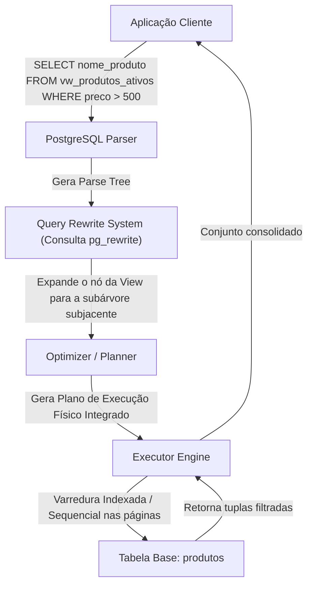

### Tabelas Base versus Visões Padrão versus Visões Materializadas

A análise comparativa entre as três estruturas de armazenamento relacional define a modelagem lógica e física em arquiteturas de dados:

| Dimensão Estrutural | Tabela Base | Visão Padrão (*Standard View*) | Visão Materializada (*Materialized View*) |
| :--- | :--- | :--- | :--- |
| **Armazenamento Físico de Tuplas** | Sim (arquivos de dados em blocos de disco). | Não (persistência exclusiva da árvore no catálogo). | Sim (estrutura de dados física alocada em disco). |
| **Persistência de Metadados** | Estrutural (definição DDL de colunas e constraints). | Textual (definição DDL da query `SELECT`). | Estrutural e Textual (snapshot dos dados e query). |
| **Latência na Recuperação** | Custo de varredura ou acesso indexado direto. | Soma do custo de processamento da query subjacente. | Custo de leitura dos blocos pré-computados gravados. |
| **Frescor dos Dados (*Data Freshness*)** | Transacional em tempo real (consistência ACID imediata). | Transacional em tempo real (avalia o estado corrente). | Estático/Assíncrono (defasagem até o próximo refresh). |
| **Suporte a Índices Próprios** | Sim (B-Tree, Hash, GIN, GiST, BRIN). | Não (utiliza índices das tabelas de origem). | Sim (permite criação independente de índices). |
| **Impacto em Escritas (DML)** | Atualização direta de tuplas e índices associados. | Sem impacto (operação afeta apenas as tabelas base). | Sem impacto em escrita nas tabelas base (refresh assíncrono). |

### Sintaxe DDL e Operações Fundamentais

A sintaxe canônica no PostgreSQL para materialização lógica de visões é formalizada conforme o padrão:

```sql
CREATE [ OR REPLACE ] [ TEMP | TEMPORARY ] [ RECURSIVE ] VIEW nome_da_visao [ ( alias_coluna [, ...] ) ]
AS consulta_select
[ WITH [ CASCADED | LOCAL ] CHECK OPTION ];
```

#### Exemplo Prático Funcional
Criação de uma visão para segregar os clientes com limite financeiro expressivo residentes no estado de São Paulo:

```sql
CREATE VIEW vw_clientes_prime_sp AS
SELECT 
    id_cliente,
    nome,
    cidade,
    limite_credito
FROM clientes
WHERE estado = 'SP' AND limite_credito >= 5000.00;

-- Invocação parametrizada pela aplicação
SELECT nome, limite_credito
FROM vw_clientes_prime_sp
WHERE cidade = 'Campinas'
ORDER BY limite_credito DESC;
```

#### Contraexemplo e Armadilhas
- **Contraexemplo:** Criar uma visão padrão para tentar acelerar relatórios analíticos volumosos que realizam múltiplos `JOINs` e agregações complexas. Como a visão comum recalcula a consulta subjacente a cada execução, não há ganho de velocidade por armazenamento em cache de dados.
- **Armadilha (*Pitfall*):** Utilizar funções voláteis ou não-determinísticas (como `random()`, `clock_timestamp()` ou chamadas a sequências) dentro de visões e esperar que seus valores permaneçam constantes em leituras sucessivas ou subconsultas aninhadas.

### Regras de Evolução Estrutural com CREATE OR REPLACE VIEW

O comando `CREATE OR REPLACE VIEW` permite atualizar a lógica declarativa de uma visão sem exigir sua destruição prévia via `DROP VIEW`. No entanto, o motor do PostgreSQL impõe restrições estritas para garantir que dependências do catálogo não se rompam:

1. **Invariância de Colunas Anteriores:** Os atributos projetados originalmente devem ser mantidos com os mesmos identificadores, tipos de dados estritos e ordem sequencial original.
2. **Adição Exclusiva ao Final:** Quaisquer novas colunas devem ser adicionadas obrigatoriamente após a última coluna da especificação original.
3. **Proibição de Exclusão e Renomeação:** Não é permitido remover atributos preexistentes, alterar nomes de colunas ou modificar a tipagem de dados sem recriar o objeto via `DROP VIEW`.

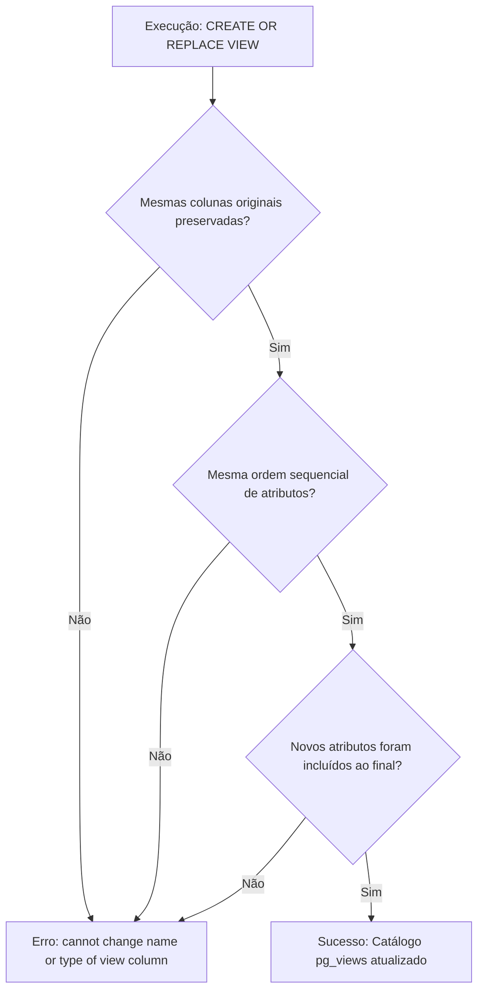

### Gestão de Dependências com DROP VIEW: CASCADE versus RESTRICT

Quando a exclusão física da definição de uma visão é necessária, o PostgreSQL avalia os vínculos registrados no catálogo `pg_depend`.

```sql
DROP VIEW [ IF EXISTS ] nome_da_visao [ CASCADE | RESTRICT ];
```

- **RESTRICT (Comportamento Padrão):** O comando é abortado se qualquer objeto de banco de dados (outras visões, triggers, funções ou regras) depender da visão alvo:
```sql
DROP VIEW vw_clientes_base RESTRICT;
-- Retorna: ERROR: cannot drop view vw_clientes_base because other objects depend on it
```
- **CASCADE:** Remove a visão indicada e destrói recursivamente todos os objetos dependentes diretos e indiretos:
```sql
DROP VIEW vw_clientes_base CASCADE;
-- Remove vw_clientes_base, visões derivadas e triggers dependentes
```

> **Alerta de Engenharia de Dados:** O uso de `CASCADE` em ambientes corporativos introduz risco crítico de indisponibilidade. Uma exclusão em cascata pode eliminar silenciosamente visões analíticas de produção e triggers de auditoria. Recomenda-se auditar previamente as dependências em `pg_depend` e `pg_rewrite` antes de empregar a cláusula.

### Visões Atualizáveis e Restrições de Modificação

O PostgreSQL permite a execução direta de comandos DML (`INSERT`, `UPDATE`, `DELETE`) sobre visões sem necessidade de gatilhos intermediários, desde que a visão seja classificada como automaticamente atualizável (*Automatically Updatable View*).

#### Condições Mandatórias de Atualizabilidade Automática
1. A cláusula `FROM` da definição da visão deve conter exatamente **uma única** tabela base (ou outra visão atualizável). Não pode conter `JOIN`.
2. A consulta não pode conter cláusulas de agrupamento ou resumo: `GROUP BY` ou `HAVING`.
3. A consulta não pode empregar funções agregadoras (`SUM`, `AVG`, `COUNT`, `MAX`, `MIN`).
4. A instrução não pode conter operadores de conjunto (`UNION`, `UNION ALL`, `INTERSECT`, `EXCEPT`).
5. A instrução não pode conter deduplicação explícita (`DISTINCT`).
6. A projeção não pode conter funções de janela (*Window Functions* via cláusula `OVER`).
7. Todas as colunas manipuladas no DML devem referenciar diretamente colunas físicas da tabela base, vedando colunas computadas ou literais.

### Garantia de Integridade Transacional com WITH CHECK OPTION

Ao executar DML em uma visão atualizável dotada de filtro `WHERE`, existe o risco de inserir ou modificar registros de modo que eles deixem de atender aos critérios da própria visão (anomalia de registro fantasma). A cláusula `WITH CHECK OPTION` impede essa inconsistência.

```sql
CREATE OR REPLACE VIEW vw_funcionarios_ti AS
SELECT id_funcionario, nome, departamento, salario
FROM funcionarios
WHERE departamento = 'TI'
WITH CHECK OPTION;
```

#### Modos de Restrição: LOCAL versus CASCADED
- **CASCADED (Padrão):** Valida as restrições da visão atual e propaga a verificação para todas as visões subjacentes que serviram de base para a construção da visão.
- **LOCAL:** Valida estritamente as restrições declaradas na visão local imediata, ignorando predicados das visões base sobre as quais ela foi construída, a menos que estas também possuam `WITH CHECK OPTION`.

```sql
-- Tentativa de inserção violando o predicado
INSERT INTO vw_funcionarios_ti (nome, departamento, salario)
VALUES ('Lucas Mendes', 'RH', 4500.00);

-- Comportamento do motor:
-- ERROR: new row violates check option for view "vw_funcionarios_ti"
-- DETAIL: Failing row contains (Lucas Mendes, RH, 4500.00).
```

### Camada de Segurança e Mascaramento com GRANT

Visões funcionam como uma barreira arquitetural de isolamento lógico (*Row-Level and Column-Level Security Abstraction*), viabilizando o princípio do menor privilégio (*Principle of Least Privilege*).

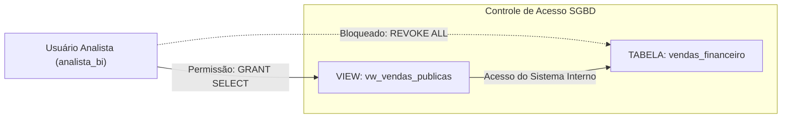

#### Mecanismo de Implementação
```sql
-- 1. Criação da visão mascarando atributos confidenciais
CREATE VIEW vw_vendedores_publico AS
SELECT id_vendedor, nome, email
FROM vendedores;

-- 2. Concessão e revogação de acessos no PostgreSQL
REVOKE ALL ON TABLE vendedores FROM grupo_operacional;
GRANT SELECT ON TABLE vw_vendedores_publico TO grupo_operacional;
```

O usuário pertencente a `grupo_operacional` tem acesso garantido à projeção de `vw_vendedores_publico`, enquanto tentativas de consultar diretamente dados salariais em `vendedores` são negadas com `ERROR: permission denied for table vendedores`.

### Visões Materializadas, Ciclo de Atualização e Indexação Própria

Uma Visão Materializada (*Materialized View*) armazena fisicamente o resultado de uma consulta em disco, desacoplando o tempo de resposta da leitura em relação ao custo computacional da consulta que gera os dados.

#### Sintaxe de Criação e Indexação
```sql
CREATE MATERIALIZED VIEW mv_faturamento_categoria AS
SELECT 
    c.nome_categoria,
    COUNT(ip.id_item) AS total_itens_vendidos,
    SUM(ip.quantidade * ip.preco_unitario) AS receita_total
FROM categorias c
JOIN produtos pr ON c.id_categoria = pr.id_categoria
JOIN itens_pedido ip ON pr.id_produto = ip.id_produto
GROUP BY c.nome_categoria
WITH DATA;

-- Criação de índice próprio sobre a estrutura materializada
CREATE UNIQUE INDEX idx_mv_fat_categoria ON mv_faturamento_categoria(nome_categoria);
```

#### Atualização de Dados: REFRESH MATERIALIZED VIEW
O conteúdo físico gravado em disco não se atualiza automaticamente quando as tabelas base sofrem DML. Torna-se obrigatória a invocação do comando de recarga:

1. **Atualização Padrão (Exclusiva):**
```sql
REFRESH MATERIALIZED VIEW mv_faturamento_categoria;
```
*Mecânica:* Aplica trava exclusiva de leitura (`AccessExclusiveLock`). Durante o processamento do refresh, nenhuma aplicação consegue realizar `SELECT` na visão materializada.

2. **Atualização Não-Bloqueante (Concorrente):**
```sql
REFRESH MATERIALIZED VIEW CONCURRENTLY mv_faturamento_categoria;
```
*Mecânica:* Atualiza os dados permitindo leituras simultâneas sem bloqueio de concorrência.  
*Exigência Mandatória:* Para utilizar `CONCURRENTLY`, a visão materializada deve possuir **obrigatoriamente um índice exclusivo (`UNIQUE INDEX`)** cobrindo uma ou mais colunas que identifiquem univocamente cada tupla.

---

## Álgebra Relacional e Técnicas Avançadas de Junção

### Fundamentos Relacionais e Mecânica dos Algoritmos de Junção

Na álgebra relacional proposta por Edgar F. Codd, relações são conjuntos de tuplas. A junção teta ($`R \bowtie_\theta S`$) é definida formalmente pela projeção e seleção aplicadas sobre o produto cartesiano das relações:

```math
R \bowtie_\theta S = \sigma_\theta (R \times S)
```

No núcleo do processador de consultas do PostgreSQL, o Otimizador Baseado em Custos (*Cost-Based Optimizer* - CBO) traduz a abstração declarativa da instrução SQL em um de três algoritmos fundamentais:

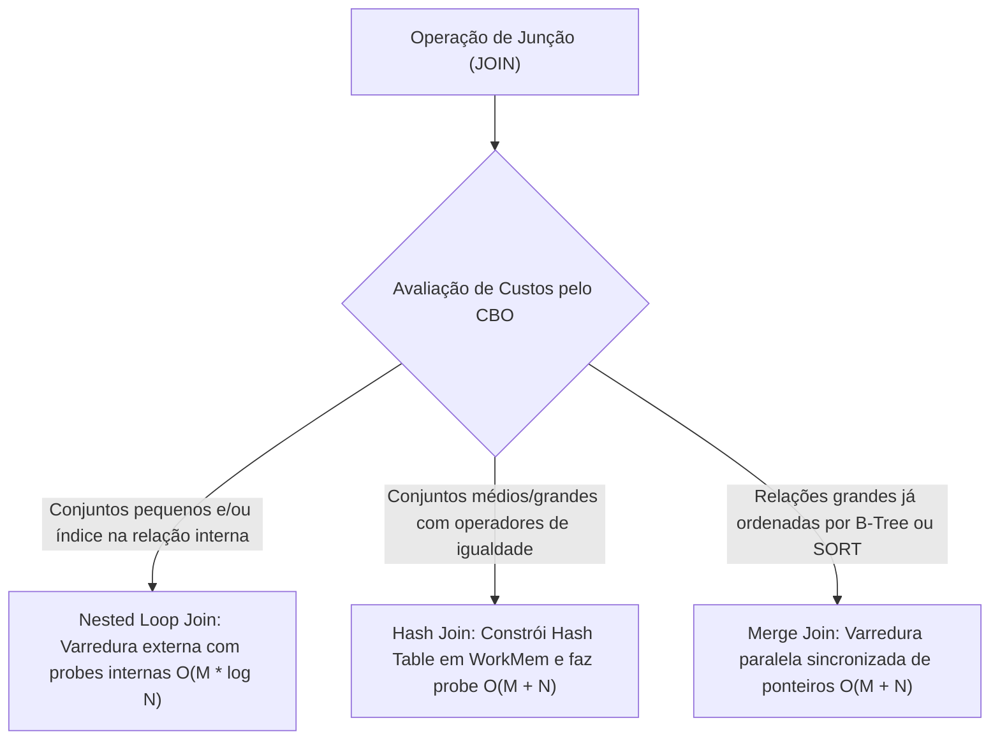

### Junção Interna: INNER JOIN

O `INNER JOIN` retorna a interseção estrita entre dois conjuntos. Apenas as tuplas que atendem ao predicado da cláusula `ON` compõem o conjunto final de saída.

```sql
SELECT 
    p.id_pedido,
    p.data_pedido,
    c.nome AS nome_cliente
FROM pedidos p
INNER JOIN clientes c ON p.id_cliente = c.id_cliente;
```

Se um registro em `pedidos` apontar para um `id_cliente` inexistente (caso não houvesse integridade referencial ativa), ou se um registro em `clientes` não possuir compras, essas tuplas são descartadas do resultado.

### Junções Externas: LEFT JOIN e RIGHT JOIN

As junções externas preservam tuplas de uma das relações mesmo quando não há correspondência com a relação oposta, preenchendo os atributos faltantes com `NULL`.

- **LEFT OUTER JOIN ($`R \ \sqsubset\!\bowtie S`$):** Preserva todas as tuplas da relação posicionada à esquerda da sintaxe.
- **RIGHT OUTER JOIN ($`R \bowtie\!\sqsupset S`$):** Preserva todas as tuplas da relação posicionada à direita da sintaxe.

```sql
SELECT 
    c.id_cliente,
    c.nome AS cliente,
    p.id_pedido,
    p.status
FROM clientes c
LEFT JOIN pedidos p ON c.id_cliente = p.id_cliente;
```

*[Complemento com diretriz de qualidade de código corporativo]*  
A instrução $`A \text{ RIGHT JOIN } B`$ é logicamente idêntica a $`B \text{ LEFT JOIN } A`$. Todavia, o uso de `RIGHT JOIN` é desaconselhado nos manuais de engenharia de software SQL, pois o encadeamento textual da esquerda para a direita com `LEFT JOIN` reflete o fluxo de leitura natural, reduzindo erros de interpretação em consultas com muitas tabelas.

### Técnica de Anti-Join para Detecção de Lacunas Relacionais

O padrão *Anti-Join* tem por finalidade isolar tuplas da relação $`A`$ que não possuem correspondência na relação $`B`$ ($`A \setminus B`$). No PostgreSQL, a implementação clássica combina `LEFT JOIN` com um predicado de teste de nulidade (`IS NULL`) na cláusula `WHERE`.

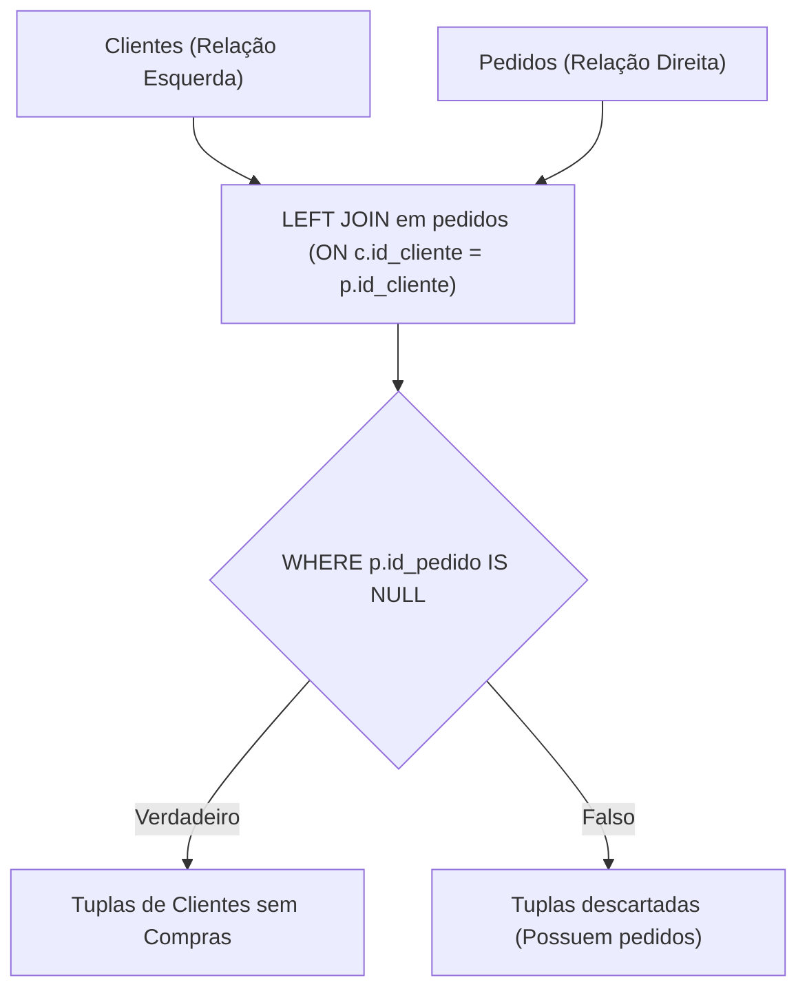

```sql
-- Localização de clientes inativos (sem compras)
SELECT 
    c.id_cliente,
    c.nome
FROM clientes c
LEFT JOIN pedidos p ON c.id_cliente = p.id_cliente
WHERE p.id_pedido IS NULL;
```

> **Regra de Ouro da Anti-Junção:** O predicado `IS NULL` deve ser aplicado obrigatoriamente sobre a **Chave Primária** ou sobre uma coluna com restrição `NOT NULL` da tabela à direita. Se for aplicado sobre uma coluna opcional que aceite valores nulos de forma legítima, registros que possuem correspondência válida, mas contêm `NULL` nessa coluna específica, serão retornados incorretamente (falso positivo).

### Junção Externa Total: FULL OUTER JOIN

O `FULL OUTER JOIN` ($`R \ \sqsubset\!\bowtie\!\sqsupset S`$) retém todas as tuplas de ambas as relações. Quando há correspondência, as linhas são unificadas; quando não há, os lados deficientes são preenchidos com `NULL`. É utilizado em rotinas de conciliação e auditoria contábil.

```sql
SELECT 
    COALESCE(c.nome, 'Sem Cliente Associado') AS cliente,
    p.id_pedido,
    p.valor_total
FROM clientes c
FULL OUTER JOIN pedidos p ON c.id_cliente = p.id_cliente;
```

### Produto Cartesiano: CROSS JOIN

O `CROSS JOIN` ($`R \times S`$) gera a combinação de cada tupla da primeira relação com todas as tuplas da segunda relação. Se $`R`$ contém $`M`$ linhas e $`S`$ contém $`N`$ linhas, a cardinalidade final é expressa por:

```math
|R \times S| = |R| \cdot |S|
```

```sql
-- Matriz de alocação de vendedores por filial
SELECT v.nome AS vendedor, f.cidade AS filial
FROM vendedores v
CROSS JOIN filiais f;
```

- **Risco de Volumetria:** O produto cartesiano acidental provocado pela omissão da cláusula `ON` ou junção com predicados incompletos pode gerar exaustão de memória no servidor (`Out of Memory`) e consumo descontrolado de I/O de disco.

### Autorrelacionamento: SELF JOIN e Estruturas Hierárquicas

Um *Self-Join* ocorre quando uma relação é unificada a si mesma. É utilizado para resolver o padrão relacional de Lista de Adjacência (*Adjacency List*), no qual uma chave estrangeira referencia a própria chave primária da tabela.

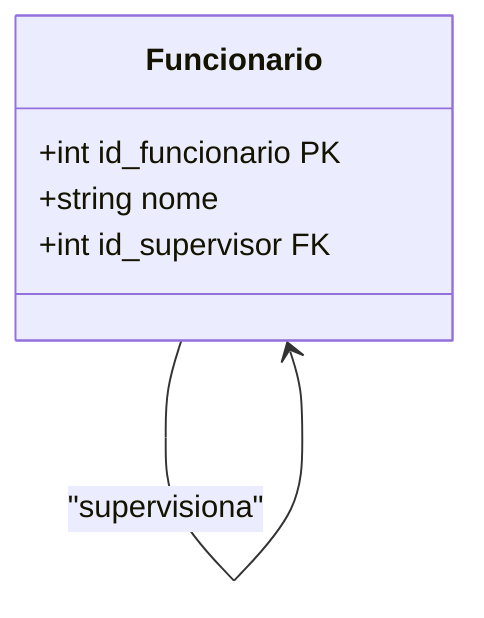

```sql
-- Resolução da hierarquia corporativa de supervisão
SELECT 
    colaborador.nome AS funcionario,
    COALESCE(gestor.nome, 'Diretoria / Sem Supervisor') AS supervisor
FROM vendedores colaborador
LEFT JOIN vendedores gestor ON colaborador.id_supervisor = gestor.id_vendedor;
```

### Semântica Crítica: Filtragem no ON versus Filtragem no WHERE

Compreender o momento da avaliação dos predicados em junções externas é fundamental para evitar a alteração acidental da semântica da consulta.

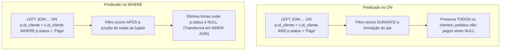

- **Predicado na Cláusula `ON`:** Define a condição para que o registro da tabela à direita seja acoplado à tabela à esquerda. Se a condição falhar, a linha da esquerda permanece na saída com valores nulos à direita.
- **Predicado na Cláusula `WHERE`:** Avalia o conjunto consolidado após a junção. Condições como `WHERE p.status = 'Pago'` forçam o descarte de linhas nas quais `p.status` seja `NULL`, convertendo acidentalmente o `LEFT JOIN` em um `INNER JOIN`.

### Armadilhas de Agregação sob Junções Externas: COUNT(*) versus COUNT(coluna)

Ao calcular o quantitativo de transações associadas a uma entidade usando `LEFT JOIN`, o uso de `COUNT(*)` induz a falhas métricas severas:

```sql
-- ABORDAGEM ERRÔNEA: Retorna 1 para clientes com ZERO pedidos
SELECT c.id_cliente, c.nome, COUNT(*) AS total_pedidos
FROM clientes c
LEFT JOIN pedidos p ON c.id_cliente = p.id_cliente
GROUP BY c.id_cliente, c.nome;

-- ABORDAGEM CORRETA: Retorna 0 para clientes com ZERO pedidos
SELECT c.id_cliente, c.nome, COUNT(p.id_pedido) AS total_pedidos
FROM clientes c
LEFT JOIN pedidos p ON c.id_cliente = p.id_cliente
GROUP BY c.id_cliente, c.nome;
```

- **Explicação:** `COUNT(*)` conta a cardinalidade das linhas produzidas no agrupamento. Como o `LEFT JOIN` sintetiza uma linha preenchida com `NULL` para clientes sem pedidos, `COUNT(*)` contabiliza essa linha fantasma como 1. Já `COUNT(p.id_pedido)` avalia a coluna informada: ao detectar o valor `NULL`, não incrementa o acumulador, retornando o valor 0.

---

## Subconsultas, Expressões de Tabela Comuns e Otimização

### Taxonomia Formal de Subconsultas

Uma subconsulta é uma instrução `SELECT` aninhada no corpo de outra instrução SQL externa (`SELECT`, `INSERT`, `UPDATE` ou `DELETE`).

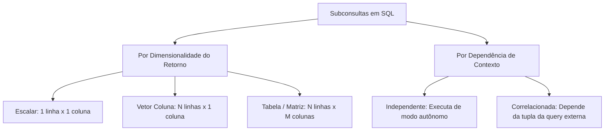

### Subconsultas Escalares

Uma subconsulta escalar retorna rigorosamente um único valor ($`1 \times 1`$). Se a subconsulta retornar zero registros, o PostgreSQL avalia a expressão como `NULL`. Se retornar mais de uma tupla, o motor aborta a execução:

```text
ERROR: more than one row returned by a subquery used as an expression
```

#### Aplicação na Cláusula SELECT
```sql
SELECT 
    nome_produto,
    preco,
    ROUND((SELECT AVG(preco) FROM produtos), 2) AS media_global,
    ROUND(preco - (SELECT AVG(preco) FROM produtos), 2) AS diferenca_media
FROM produtos;
```

#### Aplicação na Cláusula WHERE
```sql
SELECT nome_produto, preco
FROM produtos
WHERE preco > (SELECT AVG(preco) FROM produtos);
```

### Operadores de Pertencimento a Conjuntos: IN e NOT IN

O operador `IN` verifica se um valor atômico pertence ao conjunto retornado por uma subconsulta unicolunar ($`N \times 1`$):

```math
v \in S \iff \exists s \in S \mid v = s
```

O operador `NOT IN` expressa o complemento booleano:

```math
v \notin S \iff \forall s \in S \mid v \neq s
```

### A Armadilha do Valor NULL e a Lógica Tri-valorada

*[Complemento com conhecimento geral de álgebra relacional e padrões SQL]*  
No padrão SQL, a presença de valores `NULL` aciona a lógica tri-valorada (*Three-Valued Logic* - 3VL), com os estados lógicos `TRUE`, `FALSE` e `UNKNOWN`.

Considere a expressão:
```sql
v NOT IN (SELECT coluna FROM tabela);
```
Que equivale semanticamente a:
```sql
(v <> c1) AND (v <> c2) AND ... AND (v <> NULL)
```
Se a subconsulta contiver ao menos uma tupla cujo valor seja `NULL`:
1. A comparação escalar `v <> NULL` avalia como `UNKNOWN`.
2. Pelas tabelas-verdade da 3VL, `TRUE AND UNKNOWN` resulta em `UNKNOWN`.
3. A cláusula `WHERE` apenas aprova tuplas cuja condição final seja estritamente `TRUE`.
4. Consequentemente, **a consulta inteira retorna zero tuplas**, mascarando dados reais e gerando comportamentos inesperados em relatórios de produção.

> **Padrão Defensivo de Engenharia:** Sempre que houver possibilidade de valores nulos na relação secundária, substitua `NOT IN` por `NOT EXISTS` ou adicione explicitamente o filtro `WHERE coluna IS NOT NULL` na subconsulta.

### Operadores de Existência: EXISTS e NOT EXISTS

O operador `EXISTS` avalia se a subconsulta subordinada retorna **ao menos uma linha**. Opera sob o mecanismo de curto-circuito (*short-circuit evaluation*): tão logo a primeira tupla satisfatória é detectada, a execução da subconsulta para aquela linha é encerrada.

```sql
SELECT c.id_cliente, c.nome
FROM clientes c
WHERE NOT EXISTS (
    SELECT 1 
    FROM pedidos p 
    WHERE p.id_cliente = c.id_cliente
);
```

- **Imunidade a Nulos:** O operador `EXISTS` é imune à armadilha da 3VL. Ele avalia se existem tuplas resultantes ($`\text{cardinalidade} > 0`$), sendo irrelevante se o valor retornado na projeção interna é `NULL` ou literal `1`.

### Operadores Quantificados: ANY e ALL

- **`expressão operador ANY (subquery)`:** Avalia como verdadeira se a relação de comparação for satisfeita para **pelo menos um** elemento do conjunto retornado.
  - `> ANY (10, 20, 30)` equivale a `> 10` (maior que o mínimo).
  - `= ANY (conjunto)` equivale ao operador `IN`.
- **`expressão operador ALL (subquery)`:** Avalia como verdadeira se a relação de comparação for satisfeita para **todos** os elementos do conjunto.
  - `> ALL (10, 20, 30)` equivale a `> 30` (maior que o máximo).

```sql
-- Produtos com preço estritamente superior a todos os itens de Telefonia
SELECT nome_produto, preco
FROM produtos
WHERE preco > ALL (
    SELECT pr.preco 
    FROM produtos pr
    JOIN categorias cat ON pr.id_categoria = cat.id_categoria
    WHERE cat.nome_categoria = 'Telefonia'
);
```

### Subconsultas Correlacionadas

Uma subconsulta é dita correlacionada quando depende de um ou mais atributos fornecidos pela linha corrente da consulta externa. Em termos teóricos, ela é parametrizada e reavaliada linha a linha.

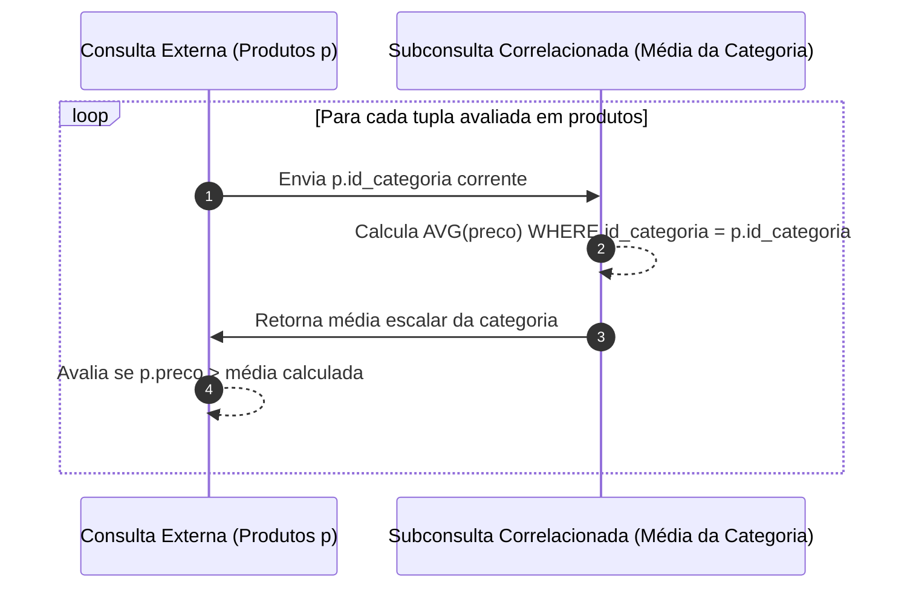

```sql
-- Produtos com preço acima da média da sua própria categoria
SELECT p.id_produto, p.nome_produto, p.preco, p.id_categoria
FROM produtos p
WHERE p.preco > (
    SELECT AVG(sub.preco)
    FROM produtos sub
    WHERE sub.id_categoria = p.id_categoria
);
```

### Tabelas Derivadas na Cláusula FROM (Inline Views)

Uma subconsulta posicionada na cláusula `FROM` atua como uma visão transitória em memória. 

```sql
SELECT 
    resumo.id_categoria,
    ROUND(resumo.preco_medio, 2) AS media_categoria
FROM (
    SELECT id_categoria, AVG(preco) AS preco_medio
    FROM produtos
    GROUP BY id_categoria
) AS resumo
WHERE resumo.preco_medio > 1000.00;
```

> **Exigência Mandatória de Gramática:** O PostgreSQL impõe que toda tabela derivada contenha um identificador de alias explícito (`AS identificador`). A omissão do alias dispara a falha: `ERROR: subquery in FROM must have an alias`.

### DML Guiado por Subconsultas

As subconsultas fornecem dinamismo e controle de integridade a operações de manipulação massiva:

```sql
-- 1. Carga seletiva baseada em limiar estatístico (INSERT INTO ... SELECT)
INSERT INTO produtos_promocao (id_produto, nome_produto, preco, preco_promocional)
SELECT 
    id_produto, 
    nome_produto, 
    preco, 
    ROUND(preco * 0.90, 2)
FROM produtos
WHERE preco > (SELECT AVG(preco) FROM produtos);

-- 2. Atualização condicionada por subconsulta correlacionada (UPDATE)
UPDATE produtos p
SET estoque = estoque + 5
WHERE p.preco > (
    SELECT AVG(sub.preco)
    FROM produtos sub
    WHERE sub.id_categoria = p.id_categoria
);

-- 3. Exclusão segura de registros órfãos com anti-junção (DELETE)
DELETE FROM clientes c
WHERE NOT EXISTS (
    SELECT 1 
    FROM pedidos p 
    WHERE p.id_cliente = c.id_cliente
);
```

### Expressões de Tabela Comuns (CTEs)

As Expressões de Tabela Comuns (*Common Table Expressions* - CTEs) decompõem instruções relacionais complexas em blocos modulares legíveis declarados por meio da cláusula `WITH`.

```sql
WITH media_por_categoria AS (
    SELECT id_categoria, AVG(preco) AS media_preco
    FROM produtos
    GROUP BY id_categoria
),
produtos_destaque AS (
    SELECT 
        p.id_produto,
        p.nome_produto,
        p.preco,
        p.id_categoria,
        m.media_preco
    FROM produtos p
    JOIN media_por_categoria m ON p.id_categoria = m.id_categoria
    WHERE p.preco > m.media_preco
)
SELECT * FROM produtos_destaque ORDER BY preco DESC;
```

### Diagnóstico de Planos Físicos com EXPLAIN ANALYZE

O comando `EXPLAIN ANALYZE` instrui o PostgreSQL a planejar, executar a consulta em tempo real e exibir os nós de execução física juntamente com as métricas reais de tempo e I/O consumidas.

```sql
EXPLAIN ANALYZE
SELECT c.nome 
FROM clientes c 
WHERE c.id_cliente IN (SELECT p.id_cliente FROM pedidos p);
```

#### Métricas Primárias de Análise
1. **Startup Cost:** Custo computacional estimado pelo otimizador antes de retornar a primeira tupla do nó.
2. **Total Cost:** Custo computacional estimado para processar e retornar todas as tuplas do nó.
3. **Actual Time:** Tempo medido em milissegundos para a primeira e para a última tupla retornada.
4. **Nós de Junção Otimizados:** O otimizador reescreve frequentemente consultas construídas com `IN` ou `EXISTS` em operações de `Hash Semi Join` ou `Merge Semi Join`.

---

## Programação Procedural com PL/pgSQL e Stored Procedures

### Arquitetura de Execução Procedural no PostgreSQL

O PL/pgSQL (*Procedural Language / PostgreSQL Structured Query Language*) estende o paradigma relacional declarativo, viabilizando o controle algorítmico estruturado próximo aos dados.

Em arquiteturas convencionais, regras de negócio multi-etapas geram elevado tráfego de ida e volta na rede (*round-trips*). A execução de lógicas proceduralmente no servidor centraliza o processamento em memória compartilhada com latência de rede nula entre os passos.

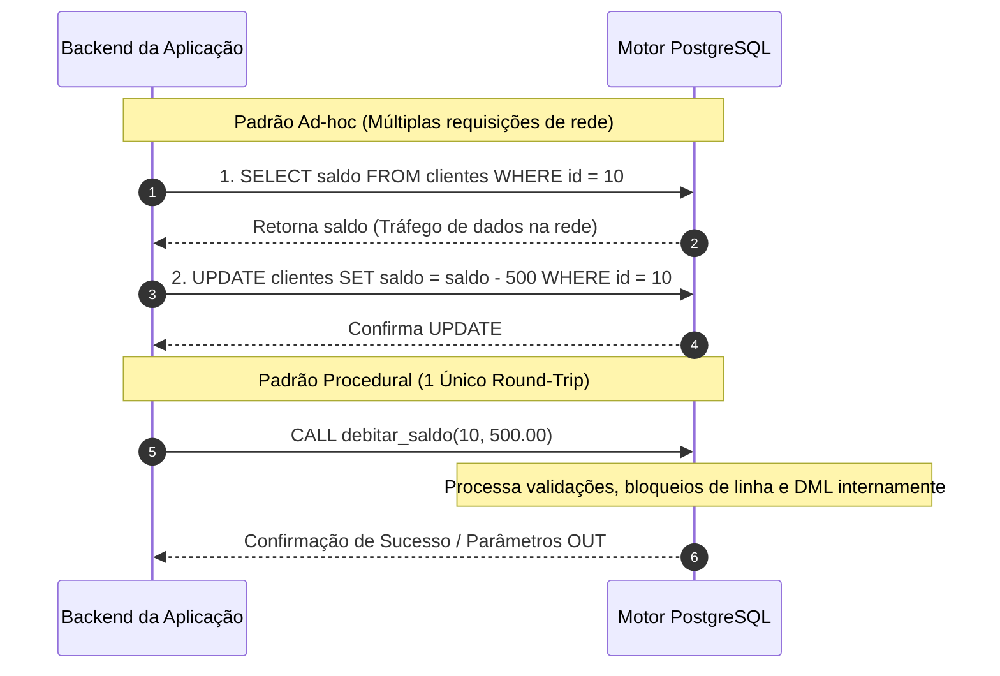

### Diferenças Essenciais entre Stored Functions e Stored Procedures

A inclusão formal do comando `CREATE PROCEDURE` no PostgreSQL 11 alinhou o SGBD ao padrão SQL:2011, estabelecendo fronteiras operacionais com as funções tradicionais:

| Propriedade Funcional | Stored Function (`CREATE FUNCTION`) | Stored Procedure (`CREATE PROCEDURE`) |
| :--- | :--- | :--- |
| **Comando de Chamada** | Invocada em consultas: `SELECT func();` | Invocada isoladamente: `CALL proc();` |
| **Integração Relacional** | Pode ser incorporada em `WHERE`, `SELECT`, `JOIN`. | Não pode ser acoplada em instruções `SELECT` ou `WHERE`. |
| **Declaração de Retorno** | Obrigatória: cláusula `RETURNS <tipo>` (ou `VOID`). | Não possui cláusula `RETURNS`. |
| **Retorno de Múltiplos Valores** | Tipos compostos, tabelas (`RETURNS TABLE`). | Parâmetros de saída: `OUT` ou `INOUT`. |
| **Gerenciamento de Transações** | **Proibido.** Não suporta `COMMIT` ou `ROLLBACK`. | **Permitido.** Controle transacional autônomo. |
| **Caso de Uso Primário** | Computação de valores, regras determinísticas de cálculo. | Processamento em lote (*batch*), orquestração de rotinas DML. |

### Anatomia Estrutural de um Bloco PL/pgSQL

O PL/pgSQL é estruturado em blocos delimitados. O encapsulamento textual utiliza o delimitador *Dollar-Quoting* (`$$`), dispensando o escape de aspas simples:

```sql
CREATE OR REPLACE PROCEDURE nome_procedimento(parametros)
LANGUAGE plpgsql
AS $$
DECLARE
    -- Seção de Declaração de Variáveis e Tipos
BEGIN
    -- Seção Executável (Instruções SQL e Lógica Imperativa)
EXCEPTION
    -- Seção de Tratamento e Captura de Falhas
END;
$$;
```

### Declaração de Variáveis, Tipagem Escalar e Tipagem Ancorada

Variáveis declaradas em PL/pgSQL assumem `NULL` caso não sejam explicitamente inicializadas:

```sql
DECLARE
    v_contador   INTEGER := 0;
    v_taxa       NUMERIC(5,2) DEFAULT 10.50;
    v_nome       VARCHAR(100);
```

#### Tipagem Ancorada com %TYPE e %ROWTYPE
Garante a estabilidade do código diante de manutenções evolutivas no esquema físico do banco:

```sql
DECLARE
    -- Ancoragem a uma coluna específica
    v_saldo clientes.saldo%TYPE;
    
    -- Ancoragem à estrutura completa de uma linha da tabela
    v_registro_cliente clientes%ROWTYPE;
BEGIN
    SELECT * INTO v_registro_cliente FROM clientes WHERE id_cliente = 1;
    v_saldo := v_registro_cliente.saldo;
END;
```

### Modos de Parâmetros: IN, OUT e INOUT

- **`IN` (Padrão):** O valor é fornecido pelo chamador como parâmetro de entrada; a variável é tratada como somente leitura pelo procedimento.
- **`OUT`:** O procedimento popula essa variável para devolver informações à aplicação chamadora.
- **`INOUT`:** O parâmetro ingressa com um valor inicial fornecido pelo chamador, pode sofrer mutação dentro da procedure e tem seu valor final exposto de volta ao chamador.

```sql
CREATE OR REPLACE PROCEDURE pr_calcular_reajuste(
    IN p_id_produto INT,
    INOUT p_preco NUMERIC(10,2),
    OUT p_diferenca NUMERIC(10,2)
)
LANGUAGE plpgsql
AS $$
DECLARE
    v_preco_antigo NUMERIC(10,2);
BEGIN
    SELECT preco INTO v_preco_antigo FROM produtos WHERE id_produto = p_id_produto;
    p_diferenca := p_preco - v_preco_antigo;
    UPDATE produtos SET preco = p_preco WHERE id_produto = p_id_produto;
END;
$$;
```

### Controle de Fluxo Condicional e Emissão de Diagnósticos

O controle de fluxo segue a estrutura condicional:

```sql
IF condicao_1 THEN
    -- Ações bloco 1
ELSIF condicao_2 THEN
    -- Ações bloco 2
ELSE
    -- Bloco alternativo
END IF;
```

#### Sinalização com RAISE NOTICE e RAISE EXCEPTION
- **`RAISE NOTICE`:** Emite mensagens informativas para a aplicação cliente sem interromper a execução do bloco transacional.
- **`RAISE EXCEPTION`:** Aborta a execução do bloco corrente, revertendo as alterações pendentes da transação (*rollback* imediato).

```sql
IF p_valor <= 0 THEN
    RAISE EXCEPTION 'Operação inválida: O montante informado (%) deve ser positivo.', p_valor;
END IF;
```

### Manipulação DML, Variável FOUND e GET DIAGNOSTICS

Imediatamente após a execução de comandos DML ou instruções `SELECT INTO`, o motor PL/pgSQL alimenta variáveis de diagnóstico interno:

1. **Variável Especial `FOUND`:** Assume `TRUE` caso a instrução precedente tenha encontrado ou alterado pelo menos uma tupla; caso contrário, assume `FALSE`.
2. **Instrução `GET DIAGNOSTICS`:** Extrai com precisão a quantidade exata de linhas manipuladas pelo último comando SQL.

```sql
UPDATE produtos SET preco = preco * 1.05 WHERE id_categoria = 3;

IF NOT FOUND THEN
    RAISE NOTICE 'Nenhum produto associado à categoria foi localizado.';
END IF;

GET DIAGNOSTICS v_linhas_afetadas = ROW_COUNT;
RAISE NOTICE 'Total de registros alterados: %', v_linhas_afetadas;
```

### Controle Transacional Autônomo com COMMIT e ROLLBACK

Ao contrário de funções e gatilhos, as *Stored Procedures* suportam comandos de demarcação transacional explícita:

```sql
CREATE OR REPLACE PROCEDURE pr_processar_lote_pedidos()
LANGUAGE plpgsql
AS $$
DECLARE
    r RECORD;
    v_contador INT := 0;
BEGIN
    FOR r IN SELECT id_pedido FROM pedidos WHERE status = 'PENDENTE' LOOP
        UPDATE pedidos SET status = 'PROCESSANDO' WHERE id_pedido = r.id_pedido;
        v_contador := v_contador + 1;
        
        -- Efetiva o commit intermediário a cada 500 registros para evitar o esgotamento do WAL
        IF v_contador % 500 = 0 THEN
            COMMIT;
        END IF;
    END LOOP;
    COMMIT; -- Efetivação das tuplas finais
END;
$$;
```

---

## Gatilhos e Automação Reativa de Banco de Dados

### Conceito Fundamental e o Paradigma Evento-Condição-Ação

Um gatilho (*trigger*) é um objeto do esquema de banco de dados vinculado a uma tabela ou visão, cuja ativação ocorre de maneira automática quando comandos DML específicos são emitidos contra o alvo.

O funcionamento dos gatilhos segue o paradigma **ECA (Evento-Condição-Ação)**:

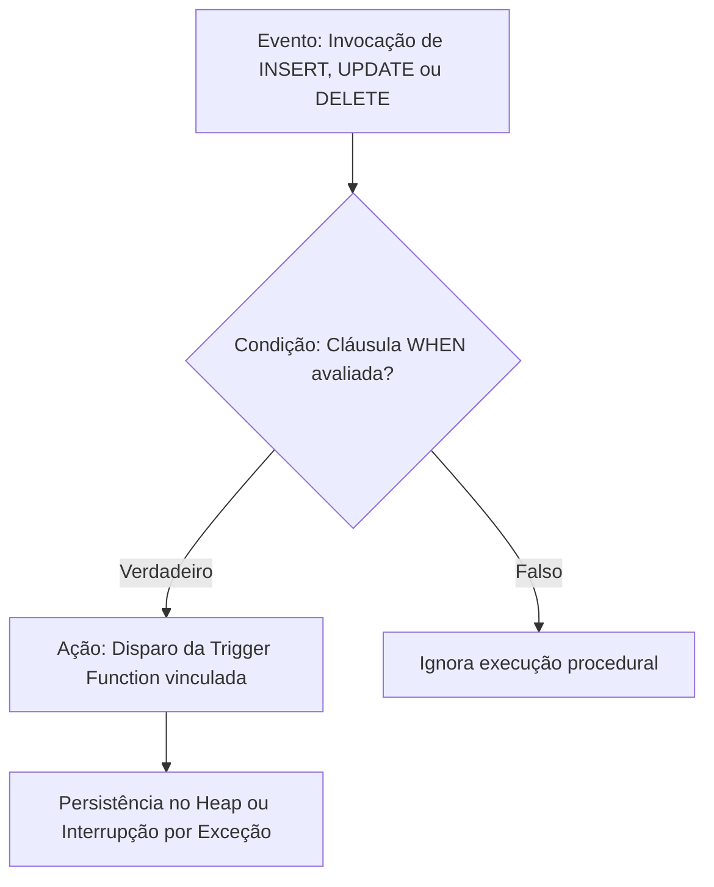

### Desacoplamento entre Trigger Function e Objeto Trigger

No PostgreSQL, a implementação de gatilhos é dividida em duas estruturas independentes:

1. **A Função do Gatilho (*Trigger Function*):** Função sem parâmetros formais que declara obrigatoriamente retorno do tipo especial `trigger`.
2. **A Declaração do Gatilho (*Trigger Binding*):** O comando `CREATE TRIGGER` que conecta a função à tabela, definindo evento, momento e nível de execução.

```sql
-- 1. Definição da Função de Gatilho
CREATE OR REPLACE FUNCTION fn_trg_auditoria_clientes()
RETURNS trigger
LANGUAGE plpgsql
AS $$
BEGIN
    INSERT INTO logs_auditoria (tabela_afetada, operacao, usuario, momento)
    VALUES ('clientes', TG_OP, session_user, clock_timestamp());
    RETURN NEW;
END;
$$;

-- 2. Vinculação do Gatilho à Tabela Base
CREATE TRIGGER trg_auditar_clientes
AFTER INSERT OR UPDATE OR DELETE ON clientes
FOR EACH ROW
EXECUTE FUNCTION fn_trg_auditoria_clientes();
```

### Eventos Disparadores DML: INSERT, UPDATE e DELETE

A tabela a seguir sistematiza a disponibilidade das tuplas contextuais em relação ao tipo de operação DML executada:

| Evento Disparador | Conteúdo da Variável `OLD` | Conteúdo da Variável `NEW` | Finalidade Típica |
| :--- | :--- | :--- | :--- |
| **`INSERT`** | `NULL` (não há registro anterior). | Tupla projetada com os novos valores. | Validação de formato, enriquecimento e saneamento. |
| **`UPDATE`** | Tupla com o estado anterior em disco. | Tupla contendo os valores pretendidos. | Rastreamento de alteração de estado e auditoria de deltas. |
| **`DELETE`** | Tupla com os dados antes do descarte. | `NULL` (não há registro posterior). | Bloqueio de exclusão e arquivamento em tabelas históricas. |

### Momentos de Disparo: BEFORE, AFTER e INSTEAD OF

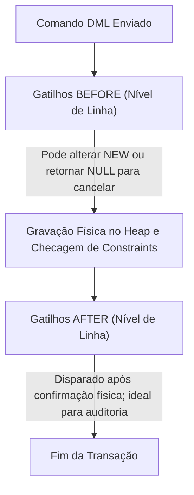

1. **`BEFORE`:** Dispara antes que as alterações sejam efetivadas fisicamente nas páginas de dados e antes da avaliação de constraints imediatas da tabela.
   - Permite que a função altere valores de `NEW` antes da gravação.
   - Caso a função retorne `NULL`, o PostgreSQL cancela a operação silenciosamente para a tupla corrente.
   - Um `RAISE EXCEPTION` aborta a transação integralmente.
2. **`AFTER`:** Dispara após a linha ter sido escrita no heap e após as restrições relacionais terem sido validadas.
   - A operação na linha é um fato consumado.
   - O retorno da função (`RETURN NEW` ou `RETURN NULL`) é ignorado pelo motor.
   - Ideal para emissão de logs e sincronização de dados agregados.
3. **`INSTEAD OF`:** Exclusivo para visões (*Views*). Substitui a instrução DML direcionada à visão, delegando à *trigger function* a tarefa de redirecionar os comandos para as tabelas subjacentes.

### Níveis de Granularidade: FOR EACH ROW versus FOR EACH STATEMENT

- **`FOR EACH ROW`:** A função dispara individualmente para cada tupla processada pelo comando DML. Se um `UPDATE` alterar 5.000 tuplas, o gatilho é executado 5.000 vezes sequenciais. Variáveis `NEW` e `OLD` ficam acessíveis.
- **`FOR EACH STATEMENT` (Padrão caso omitido):** A função dispara apenas uma única vez para o comando DML como um todo, independentemente da quantidade de tuplas afetadas (0, 1 ou 10.000). As variáveis `NEW` e `OLD` são nulas.

### Variáveis Especiais de Execução

Dentro do corpo de uma *Trigger Function*, o interpretador disponibiliza variáveis contextuais:
- **`NEW`:** Tupla com o novo registro (`INSERT`/`UPDATE` em nível de linha).
- **`OLD`:** Tupla com o registro anterior (`UPDATE`/`DELETE` em nível de linha).
- **`TG_OP`:** String indicando o tipo de operação: `'INSERT'`, `'UPDATE'`, `'DELETE'` ou `'TRUNCATE'`.
- **`TG_WHEN`:** String com o momento de ativação: `'BEFORE'`, `'AFTER'` ou `'INSTEAD OF'`.
- **`TG_LEVEL`:** String com o nível: `'ROW'` ou `'STATEMENT'`.
- **`TG_TABLE_NAME`:** Identificador da tabela que acionou o gatilho.

### Ciclo de Execução Transacional e Armadilhas de Cascata

- **Recursão Infinita e Cascata Descontrolada:** Uma trigger na tabela $`A`$ que altera a tabela $`B`$, que por sua vez dispara uma trigger alterando $`A`$, consome a pilha de execução do PostgreSQL, abortando com o erro:
```text
ERROR: stack depth limit exceeded
```
- **Chamadas de Serviços Externos:** O uso de triggers para consumir Webhooks HTTP ou filas de mensageria externas quebra as propriedades ACID do banco. Caso a transação sofra *rollback* subsequente, o evento externo já terá sido despachado, tornando os sistemas inconsistentes.

---

## Caderno de Resoluções e Laboratórios Práticos

Nesta seção, consolidam-se os esquemas de dados, requisitos de modelagem e as resoluções técnicas exaustivas de todas as listas e avaliações oficiais da disciplina.

---

### Laboratório 1: Exercícios de Junções Relacionais

O banco de dados de apoio para esta atividade é o `loja_joins`.

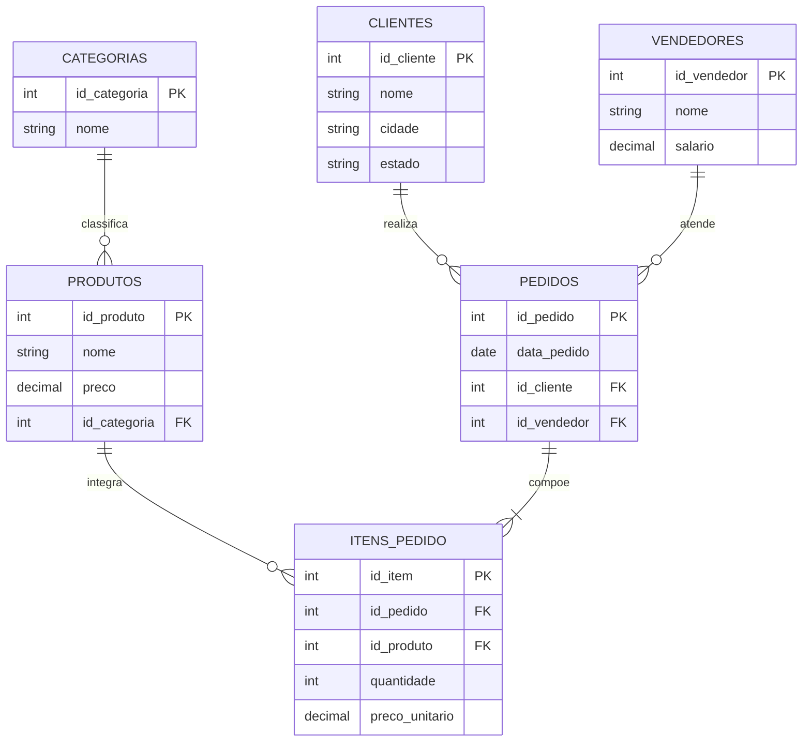

#### Resoluções das Questões do Laboratório 1

**Exercício 1 — Cliente e seus pedidos:**
```sql
SELECT 
    p.id_pedido,
    p.data_pedido,
    c.nome AS nome_cliente
FROM pedidos p
INNER JOIN clientes c ON p.id_cliente = c.id_cliente
ORDER BY p.id_pedido ASC;
```

**Exercício 2 — Relatório completo dos itens vendidos:**
```sql
SELECT 
    p.id_pedido,
    c.nome AS nome_cliente,
    pr.nome AS nome_produto,
    ip.quantidade,
    ip.preco_unitario
FROM pedidos p
INNER JOIN clientes c ON p.id_cliente = c.id_cliente
INNER JOIN itens_pedido ip ON p.id_pedido = ip.id_pedido
INNER JOIN produtos pr ON ip.id_produto = pr.id_produto
ORDER BY p.id_pedido ASC, pr.nome ASC;
```

**Exercício 3 — Clientes sem pedidos (Anti-Join):**
```sql
SELECT 
    c.id_cliente,
    c.nome
FROM clientes c
LEFT JOIN pedidos p ON c.id_cliente = p.id_cliente
WHERE p.id_pedido IS NULL
ORDER BY c.id_cliente ASC;
```

**Exercício 4 — Produtos nunca vendidos:**
```sql
SELECT 
    pr.id_produto,
    pr.nome,
    pr.preco
FROM produtos pr
LEFT JOIN itens_pedido ip ON pr.id_produto = ip.id_produto
WHERE ip.id_pedido IS NULL
ORDER BY pr.id_produto ASC;
```

**Exercício 5 — Quantidade de pedidos por cliente:**
```sql
SELECT 
    c.nome,
    COUNT(p.id_pedido) AS quantidade_pedidos
FROM clientes c
LEFT JOIN pedidos p ON c.id_cliente = p.id_cliente
GROUP BY c.id_cliente, c.nome
ORDER BY c.nome ASC;
```

**Exercício 6 — Faturamento por produto:**
```sql
SELECT 
    pr.nome AS produto,
    SUM(ip.quantidade * ip.preco_unitario) AS faturamento_total
FROM produtos pr
INNER JOIN itens_pedido ip ON pr.id_produto = ip.id_produto
GROUP BY pr.id_produto, pr.nome
ORDER BY faturamento_total DESC;
```

**Exercício 7 — Total de cada pedido:**
```sql
SELECT 
    p.id_pedido,
    p.data_pedido,
    c.nome AS nome_cliente,
    SUM(ip.quantidade * ip.preco_unitario) AS valor_total
FROM pedidos p
INNER JOIN clientes c ON p.id_cliente = c.id_cliente
INNER JOIN itens_pedido ip ON p.id_pedido = ip.id_pedido
GROUP BY p.id_pedido, p.data_pedido, c.nome
ORDER BY p.id_pedido ASC;
```

**Exercício 8 — Produtos vendidos para clientes de São Paulo:**
```sql
SELECT 
    c.nome AS cliente,
    c.cidade,
    pr.nome AS produto,
    ip.quantidade
FROM clientes c
INNER JOIN pedidos p ON c.id_cliente = p.id_cliente
INNER JOIN itens_pedido ip ON p.id_pedido = ip.id_pedido
INNER JOIN produtos pr ON ip.id_produto = pr.id_produto
WHERE c.cidade = 'São Paulo'
ORDER BY c.nome ASC, pr.nome ASC;
```

**Exercício 9 — Faturamento por vendedor:**
```sql
SELECT 
    v.nome AS vendedor,
    COALESCE(SUM(ip.quantidade * ip.preco_unitario), 0.00) AS faturamento_total
FROM vendedores v
LEFT JOIN pedidos p ON v.id_vendedor = p.id_vendedor
LEFT JOIN itens_pedido ip ON p.id_pedido = ip.id_pedido
GROUP BY v.id_vendedor, v.nome
ORDER BY faturamento_total DESC;
```

**Exercício 10 — Desafio: Relatório geral de vendas:**
```sql
SELECT 
    p.id_pedido,
    p.data_pedido,
    c.nome AS cliente,
    c.cidade,
    c.estado,
    v.nome AS vendedor,
    pr.nome AS produto,
    cat.nome AS categoria,
    ip.quantidade,
    ip.preco_unitario,
    (ip.quantidade * ip.preco_unitario) AS subtotal
FROM pedidos p
INNER JOIN clientes c ON p.id_cliente = c.id_cliente
INNER JOIN vendedores v ON p.id_vendedor = v.id_vendedor
INNER JOIN itens_pedido ip ON p.id_pedido = ip.id_pedido
INNER JOIN produtos pr ON ip.id_produto = pr.id_produto
INNER JOIN categorias cat ON pr.id_categoria = cat.id_categoria
ORDER BY p.id_pedido ASC, pr.nome ASC;
```

---

### Laboratório 2: Subconsultas - Parte 01

Trabalho prático focado na aplicação estrita dos operadores de subconsultas conforme o escopo delimitado pelo Prof. Welington Garcia.

**Exercício 1 — Subconsulta escalar no WHERE:**
```sql
SELECT nome_produto, preco
FROM produtos
WHERE preco > (SELECT AVG(preco) FROM produtos);
```

**Exercício 2 — Subconsulta escalar com MAX():**
```sql
SELECT nome_produto, preco
FROM produtos
WHERE preco = (SELECT MAX(preco) FROM produtos);
```

**Exercício 3 — Subconsulta escalar com MIN():**
```sql
SELECT nome_produto, preco
FROM produtos
WHERE preco = (SELECT MIN(preco) FROM produtos);
```

**Exercício 4 — Subconsulta na lista de projeção do SELECT:**
```sql
SELECT 
    nome_produto, 
    preco, 
    (SELECT AVG(preco) FROM produtos) AS media_geral
FROM produtos;
```

**Exercício 5 — Cálculo derivado com subconsulta no SELECT:**
```sql
SELECT 
    nome_produto, 
    preco, 
    (SELECT AVG(preco) FROM produtos) AS media_geral,
    (preco - (SELECT AVG(preco) FROM produtos)) AS diferenca_media
FROM produtos;
```

**Exercício 6 — Operador IN com tabela de pedidos:**
```sql
SELECT id_cliente, nome
FROM clientes
WHERE id_cliente IN (SELECT id_cliente FROM pedidos);
```

**Exercício 7 — Operador IN com itens do pedido:**
```sql
SELECT id_produto, nome_produto
FROM produtos
WHERE id_produto IN (SELECT id_produto FROM itens_pedido);
```

**Exercício 8 — Operador NOT IN seguro:**
```sql
SELECT id_cliente, nome
FROM clientes
WHERE id_cliente NOT IN (SELECT id_cliente FROM pedidos);
```

**Exercício 9 — Reescrita do NOT IN com NOT EXISTS:**
```sql
SELECT c.id_cliente, c.nome
FROM clientes c
WHERE NOT EXISTS (
    SELECT 1 
    FROM pedidos p 
    WHERE p.id_cliente = c.id_cliente
);
```

**Exercício 10 — Operador EXISTS correlacionado:**
```sql
SELECT v.id_vendedor, v.nome
FROM vendedores v
WHERE EXISTS (
    SELECT 1 
    FROM pedidos p 
    WHERE p.id_vendedor = v.id_vendedor
);
```

**Exercício 11 — NOT EXISTS aplicado a produtos:**
```sql
SELECT pr.id_produto, pr.nome_produto
FROM produtos pr
WHERE NOT EXISTS (
    SELECT 1 
    FROM itens_pedido ip 
    WHERE ip.id_produto = pr.id_produto
);
```

**Exercício 12 — IN aninhado em múltiplas tabelas:**
```sql
SELECT id_cliente, nome
FROM clientes
WHERE id_cliente IN (
    SELECT id_cliente 
    FROM pedidos 
    WHERE id_pedido IN (
        SELECT id_pedido 
        FROM itens_pedido 
        WHERE id_produto = (
            SELECT id_produto 
            FROM produtos 
            WHERE nome_produto = 'Notebook Dell'
        )
    )
);
```

**Exercício 13 — Operador quantificado ANY:**
```sql
SELECT nome_produto, preco
FROM produtos
WHERE preco > ANY (
    SELECT pr.preco 
    FROM produtos pr
    JOIN categorias cat ON pr.id_categoria = cat.id_categoria
    WHERE cat.nome_categoria = 'Telefonia'
);
```

**Exercício 14 — Operador quantificado ALL:**
```sql
SELECT nome_produto, preco
FROM produtos
WHERE preco > ALL (
    SELECT pr.preco 
    FROM produtos pr
    JOIN categorias cat ON pr.id_categoria = cat.id_categoria
    WHERE cat.nome_categoria = 'Acessorios'
);
```

**Exercício 15 — Operador ANY aplicado a remunerações:**
```sql
SELECT nome, salario
FROM vendedores
WHERE salario > ANY (SELECT salario FROM vendedores);
```

**Exercício 16 — Operador ALL para identificação do topo:**
```sql
SELECT nome, salario
FROM vendedores
WHERE salario >= ALL (SELECT salario FROM vendedores);
```

**Exercício 17 — Subconsulta correlacionada comparando à média da própria categoria:**
```sql
SELECT p.nome_produto, p.preco, p.id_categoria
FROM produtos p
WHERE p.preco > (
    SELECT AVG(sub.preco)
    FROM produtos sub
    WHERE sub.id_categoria = p.id_categoria
);
```

**Exercício 18 — Estoque superior à média setorial correlacionada:**
```sql
SELECT p.nome_produto, p.estoque, p.id_categoria
FROM produtos p
WHERE p.estoque > (
    SELECT AVG(sub.estoque)
    FROM produtos sub
    WHERE sub.id_categoria = p.id_categoria
);
```

**Exercício 19 — Limite de crédito correlacionado por unidade federativa:**
```sql
SELECT c.nome, c.limite_credito, c.estado
FROM clientes c
WHERE c.limite_credito > (
    SELECT AVG(sub.limite_credito)
    FROM clientes sub
    WHERE sub.estado = c.estado
);
```

**Exercício 20 — Preço máximo correlacionado por categoria:**
```sql
SELECT p.id_categoria, p.nome_produto, p.preco
FROM produtos p
WHERE p.preco = (
    SELECT MAX(sub.preco)
    FROM produtos sub
    WHERE sub.id_categoria = p.id_categoria
)
ORDER BY p.id_categoria ASC;
```

---

### Laboratório 3: Subconsultas Avançadas e DML - Parte 02

**Exercício 1 — Subconsulta no FROM: Média por categoria:**
```sql
SELECT 
    sub.id_categoria,
    sub.media_preco
FROM (
    SELECT id_categoria, AVG(preco) AS media_preco
    FROM produtos
    GROUP BY id_categoria
) AS sub
WHERE sub.media_preco > 1000.00;
```

**Exercício 2 — Tabela derivada: Total de cada pedido:**
```sql
SELECT 
    totais.id_pedido,
    totais.valor_total
FROM (
    SELECT id_pedido, SUM(quantidade * preco_unitario) AS valor_total
    FROM itens_pedido
    GROUP BY id_pedido
) AS totais
WHERE totais.valor_total > 3000.00;
```

**Exercício 3 — Subconsulta no FROM combinada com JOIN:**
```sql
SELECT 
    p.id_pedido,
    c.nome AS nome_cliente,
    p.data_pedido,
    totais.valor_total
FROM (
    SELECT id_pedido, SUM(quantidade * preco_unitario) AS valor_total
    FROM itens_pedido
    GROUP BY id_pedido
) AS totais
INNER JOIN pedidos p ON totais.id_pedido = p.id_pedido
INNER JOIN clientes c ON p.id_cliente = c.id_cliente;
```

**Exercício 4 — Clientes que gastaram acima da média:**
```sql
SELECT 
    gastos.id_cliente,
    c.nome,
    gastos.total_gasto
FROM (
    SELECT p.id_cliente, SUM(ip.quantidade * ip.preco_unitario) AS total_gasto
    FROM pedidos p
    INNER JOIN itens_pedido ip ON p.id_pedido = ip.id_pedido
    GROUP BY p.id_cliente
) AS gastos
INNER JOIN clientes c ON gastos.id_cliente = c.id_cliente
WHERE gastos.total_gasto > (
    SELECT AVG(sub_gastos.total_gasto)
    FROM (
        SELECT SUM(ip2.quantidade * ip2.preco_unitario) AS total_gasto
        FROM pedidos p2
        INNER JOIN itens_pedido ip2 ON p2.id_pedido = ip2.id_pedido
        GROUP BY p2.id_cliente
    ) AS sub_gastos
);
```

**Exercício 5 — Categoria com maior preço médio:**
```sql
SELECT 
    medias.id_categoria,
    medias.preco_medio
FROM (
    SELECT id_categoria, AVG(preco) AS preco_medio
    FROM produtos
    GROUP BY id_categoria
) AS medias
WHERE medias.preco_medio = (
    SELECT MAX(sub_medias.preco_medio)
    FROM (
        SELECT AVG(preco) AS preco_medio
        FROM produtos
        GROUP BY id_categoria
    ) AS sub_medias
);
```

**Exercício 6 — INSERT em lote utilizando subconsulta:**
```sql
-- DDL preparatória da tabela receptora
CREATE TABLE produtos_promocao (
    id_produto INT PRIMARY KEY,
    nome_produto VARCHAR(100) NOT NULL,
    preco NUMERIC(10,2) NOT NULL,
    preco_promocional NUMERIC(10,2) NOT NULL
);

-- Carga guiada por filtro estatístico
INSERT INTO produtos_promocao (id_produto, nome_produto, preco, preco_promocional)
SELECT 
    id_produto,
    nome_produto,
    preco,
    ROUND(preco * 0.90, 2)
FROM produtos
WHERE preco > (SELECT AVG(preco) FROM produtos);
```

**Exercício 7 — UPDATE utilizando subconsulta de agregação:**
```sql
UPDATE clientes
SET limite_credito = limite_credito * 1.10
WHERE id_cliente IN (
    SELECT id_cliente
    FROM pedidos
    GROUP BY id_cliente
    HAVING COUNT(id_pedido) >= 2
);
```

**Exercício 8 — UPDATE baseado na média da própria categoria:**
```sql
UPDATE produtos p
SET estoque = estoque + 5
WHERE p.preco > (
    SELECT AVG(sub.preco)
    FROM produtos sub
    WHERE sub.id_categoria = p.id_categoria
);
```

**Exercício 9 — DELETE seguro utilizando NOT EXISTS:**
```sql
-- Verificação prévia mandatória
SELECT id_cliente, nome 
FROM clientes c
WHERE NOT EXISTS (
    SELECT 1 
    FROM pedidos p 
    WHERE p.id_cliente = c.id_cliente
);

-- Execução da exclusão das tuplas órfãs
DELETE FROM clientes c
WHERE NOT EXISTS (
    SELECT 1 
    FROM pedidos p 
    WHERE p.id_cliente = c.id_cliente
);
```

**Exercício 10 — Análise de desempenho com EXPLAIN ANALYZE:**
```sql
-- Consulta A: Avaliação via Operador IN
EXPLAIN ANALYZE
SELECT id_cliente, nome
FROM clientes
WHERE id_cliente IN (SELECT id_cliente FROM pedidos);

-- Consulta B: Avaliação via Operador EXISTS
EXPLAIN ANALYZE
SELECT c.id_cliente, c.nome
FROM clientes c
WHERE EXISTS (
    SELECT 1 
    FROM pedidos p 
    WHERE p.id_cliente = c.id_cliente
);
```

---

### Laboratório 4: Lista Consolidada com Hierarquia e Views

Base de dados de referência: `loja_exercicios`.

**Exercício 1 — Relatório de vendas e hierarquia de supervisão (Self-Join):**
```sql
SELECT 
    v.id_vendedor,
    v.nome AS vendedor,
    COALESCE(s.nome, 'Sem Supervisor') AS supervisor,
    COUNT(DISTINCT p.id_pedido) AS total_pedidos,
    COALESCE(SUM(ip.quantidade * ip.preco_unitario * (1.0 - (COALESCE(ip.desconto, 0.0) / 100.0))), 0.00) AS faturamento_liquido
FROM vendedores v
LEFT JOIN vendedores s ON v.id_supervisor = s.id_vendedor
LEFT JOIN pedidos p ON v.id_vendedor = p.id_vendedor
LEFT JOIN itens_pedido ip ON p.id_pedido = ip.id_pedido
GROUP BY v.id_vendedor, v.nome, s.nome
ORDER BY faturamento_liquido DESC;
```

**Exercício 2 — Produtos com preço acima da média de sua categoria:**
```sql
SELECT 
    p.id_produto,
    p.nome_produto,
    c.nome_categoria,
    p.preco,
    ROUND(cat_avg.media_preco, 2) AS media_categoria,
    ROUND(p.preco - cat_avg.media_preco, 2) AS diferenca
FROM produtos p
INNER JOIN categorias c ON p.id_categoria = c.id_categoria
INNER JOIN (
    SELECT id_categoria, AVG(preco) AS media_preco
    FROM produtos
    GROUP BY id_categoria
) AS cat_avg ON p.id_categoria = cat_avg.id_categoria
WHERE p.preco > cat_avg.media_preco
ORDER BY c.nome_categoria ASC, diferenca DESC;
```

**Exercício 3 — Identificação de clientes sem compras efetivas:**
```sql
-- Abordagem A: LEFT JOIN com checagem de NULL
SELECT 
    c.id_cliente,
    c.nome,
    c.cidade,
    c.estado
FROM clientes c
LEFT JOIN pedidos p ON c.id_cliente = p.id_cliente AND p.status IN ('Pago', 'Enviado')
WHERE p.id_pedido IS NULL
ORDER BY c.id_cliente ASC;

-- Abordagem B: NOT EXISTS correlacionado
SELECT 
    c.id_cliente,
    c.nome,
    c.cidade,
    c.estado
FROM clientes c
WHERE NOT EXISTS (
    SELECT 1 
    FROM pedidos p 
    WHERE p.id_cliente = c.id_cliente 
      AND p.status IN ('Pago', 'Enviado')
)
ORDER BY c.id_cliente ASC;
```

**Exercício 4 — Performance financeira por categoria com filtro de grupo (HAVING):**
```sql
SELECT 
    cat.nome_categoria,
    SUM(ip.quantidade) AS total_pecas_vendidas,
    SUM(ip.quantidade * ip.preco_unitario) AS faturamento_bruto,
    SUM(ip.quantidade * ip.preco_unitario * (1.0 - (COALESCE(ip.desconto, 0.0) / 100.0))) AS faturamento_liquido,
    ROUND(AVG(COALESCE(ip.desconto, 0.0)), 2) AS media_desconto_concedido
FROM categorias cat
INNER JOIN produtos pr ON cat.id_categoria = pr.id_categoria
INNER JOIN itens_pedido ip ON pr.id_produto = ip.id_produto
INNER JOIN pedidos p ON ip.id_pedido = p.id_pedido
WHERE p.status IN ('Pago', 'Enviado')
GROUP BY cat.id_categoria, cat.nome_categoria
HAVING SUM(ip.quantidade * ip.preco_unitario * (1.0 - (COALESCE(ip.desconto, 0.0) / 100.0))) > 5000.00
ORDER BY faturamento_liquido DESC;
```

**Exercício 5 — Criação e consulta da visão gerencial de faturamento:**
```sql
-- DDL de materialização lógica da View
CREATE OR REPLACE VIEW vw_faturamento_vendedores AS
SELECT 
    v.id_vendedor,
    v.nome AS vendedor,
    TO_CHAR(p.data_pedido, 'YYYY-MM') AS competencia,
    SUM(ip.quantidade * ip.preco_unitario * (1.0 - (COALESCE(ip.desconto, 0.0) / 100.0))) AS faturamento_liquido_mensal,
    ROUND(SUM(ip.quantidade * ip.preco_unitario * (1.0 - (COALESCE(ip.desconto, 0.0) / 100.0))) * (v.comissao / 100.0), 2) AS comissao_devida
FROM vendedores v
INNER JOIN pedidos p ON v.id_vendedor = p.id_vendedor
INNER JOIN itens_pedido ip ON p.id_pedido = ip.id_pedido
WHERE p.status IN ('Pago', 'Enviado')
GROUP BY v.id_vendedor, v.nome, TO_CHAR(p.data_pedido, 'YYYY-MM'), v.comissao;

-- Consulta subordinada à visão para o primeiro trimestre de 2026
SELECT 
    vendedor,
    competencia,
    faturamento_liquido_mensal,
    comissao_devida
FROM vw_faturamento_vendedores
WHERE competencia BETWEEN '2026-01' AND '2026-03'
ORDER BY competencia ASC, comissao_devida DESC;
```

---

### Laboratório 5: Stored Procedures Transacionais

Implementação de procedimentos com validações rigorosas de consistência e diagnóstico em PL/pgSQL.

**Exercício 1 — aumentar_salario_funcionario:**
```sql
CREATE OR REPLACE PROCEDURE aumentar_salario_funcionario(
    p_id_funcionario INT,
    p_percentual DECIMAL(5,2)
)
LANGUAGE plpgsql
AS $$
BEGIN
    IF p_percentual IS NULL OR p_percentual <= 0 THEN
        RAISE EXCEPTION 'Percentual de reajuste deve ser positivo. Informado: %', p_percentual;
    END IF;

    UPDATE funcionarios
    SET salario = salario + (salario * (p_percentual / 100.0))
    WHERE id_funcionario = p_id_funcionario;

    IF NOT FOUND THEN
        RAISE EXCEPTION 'Funcionário com ID % não localizado.', p_id_funcionario;
    END IF;

    RAISE NOTICE 'Salário do funcionário % atualizado com sucesso.', p_id_funcionario;
END;
$$;
```

**Exercício 2 — atualizar_estoque_produto:**
```sql
CREATE OR REPLACE PROCEDURE atualizar_estoque_produto(
    p_id_produto INT,
    p_novo_estoque INT
)
LANGUAGE plpgsql
AS $$
BEGIN
    IF p_novo_estoque IS NULL OR p_novo_estoque < 0 THEN
        RAISE EXCEPTION 'Quantidade de estoque não pode ser negativa: %', p_novo_estoque;
    END IF;

    UPDATE produtos
    SET estoque = p_novo_estoque
    WHERE id_produto = p_id_produto;

    IF NOT FOUND THEN
        RAISE EXCEPTION 'Produto com ID % inexistente.', p_id_produto;
    END IF;

    RAISE NOTICE 'Estoque do produto % atualizado para % unidades.', p_id_produto, p_novo_estoque;
END;
$$;
```

**Exercício 3 — adicionar_saldo_cliente:**
```sql
CREATE OR REPLACE PROCEDURE adicionar_saldo_cliente(
    p_id_cliente INT,
    p_valor DECIMAL(10,2)
)
LANGUAGE plpgsql
AS $$
BEGIN
    IF p_valor IS NULL OR p_valor <= 0 THEN
        RAISE EXCEPTION 'Montante a ser creditado deve ser estritamente positivo: %', p_valor;
    END IF;

    UPDATE clientes
    SET saldo = saldo + p_valor
    WHERE id_cliente = p_id_cliente;

    IF NOT FOUND THEN
        RAISE EXCEPTION 'Cliente % não encontrado para crédito.', p_id_cliente;
    END IF;

    RAISE NOTICE 'Crédito de R$ % consolidado para o cliente %.', p_valor, p_id_cliente;
END;
$$;
```

**Exercício 4 — descontar_saldo_cliente:**
```sql
CREATE OR REPLACE PROCEDURE descontar_saldo_cliente(
    p_id_cliente INT,
    p_valor DECIMAL(10,2)
)
LANGUAGE plpgsql
AS $$
DECLARE
    v_saldo_atual clientes.saldo%TYPE;
BEGIN
    IF p_valor IS NULL OR p_valor <= 0 THEN
        RAISE EXCEPTION 'Montante a debitar deve ser estritamente positivo: %', p_valor;
    END IF;

    SELECT saldo INTO v_saldo_atual
    FROM clientes
    WHERE id_cliente = p_id_cliente
    FOR UPDATE;

    IF NOT FOUND THEN
        RAISE EXCEPTION 'Cliente com ID % inexistente.', p_id_cliente;
    END IF;

    IF v_saldo_atual < p_valor THEN
        RAISE EXCEPTION 'Operação abortada: Saldo insuficiente (Atual: %, Débito: %)', v_saldo_atual, p_valor;
    END IF;

    UPDATE clientes
    SET saldo = saldo - p_valor
    WHERE id_cliente = p_id_cliente;

    RAISE NOTICE 'Débito processado com sucesso para o cliente %.', p_id_cliente;
END;
$$;
```

**Exercício 5 — cadastrar_produto:**
```sql
CREATE OR REPLACE PROCEDURE cadastrar_produto(
    p_nome VARCHAR(100),
    p_categoria VARCHAR(50),
    p_preco DECIMAL(10,2),
    p_estoque INT
)
LANGUAGE plpgsql
AS $$
BEGIN
    IF p_preco IS NULL OR p_preco <= 0 THEN
        RAISE EXCEPTION 'Preço unitário deve ser estritamente positivo: %', p_preco;
    END IF;

    IF p_estoque IS NULL OR p_estoque < 0 THEN
        RAISE EXCEPTION 'Estoque não pode assumir valores negativos: %', p_estoque;
    END IF;

    INSERT INTO produtos (nome, categoria, preco, estoque)
    VALUES (TRIM(p_nome), TRIM(p_categoria), p_preco, p_estoque);

    RAISE NOTICE 'Produto "%" incluído com sucesso.', p_nome;
END;
$$;
```

**Exercício 6 — cancelar_pedido:**
```sql
CREATE OR REPLACE PROCEDURE cancelar_pedido(
    p_id_pedido INT
)
LANGUAGE plpgsql
AS $$
BEGIN
    UPDATE pedidos
    SET status = 'CANCELADO'
    WHERE id_pedido = p_id_pedido;

    IF NOT FOUND THEN
        RAISE EXCEPTION 'Pedido com ID % não localizado.', p_id_pedido;
    END IF;

    RAISE NOTICE 'Pedido % cancelado com sucesso.', p_id_pedido;
END;
$$;
```

**Exercício 7 — fechar_pedido:**
```sql
CREATE OR REPLACE PROCEDURE fechar_pedido(
    p_id_pedido INT
)
LANGUAGE plpgsql
AS $$
DECLARE
    v_status_atual pedidos.status%TYPE;
BEGIN
    SELECT status INTO v_status_atual
    FROM pedidos
    WHERE id_pedido = p_id_pedido
    FOR UPDATE;

    IF NOT FOUND THEN
        RAISE EXCEPTION 'Pedido com ID % inexistente.', p_id_pedido;
    END IF;

    IF v_status_atual <> 'ABERTO' THEN
        RAISE EXCEPTION 'O pedido % não pode ser fechado pois seu status atual é %.', p_id_pedido, v_status_atual;
    END IF;

    UPDATE pedidos
    SET status = 'FECHADO'
    WHERE id_pedido = p_id_pedido;

    RAISE NOTICE 'Pedido % encerrado e faturado.', p_id_pedido;
END;
$$;
```

**Exercício 8 — recalcular_valor_pedido:**
```sql
CREATE OR REPLACE PROCEDURE recalcular_valor_pedido(
    p_id_pedido INT
)
LANGUAGE plpgsql
AS $$
DECLARE
    v_novo_total DECIMAL(10,2);
BEGIN
    SELECT COALESCE(SUM(subtotal), 0.00) INTO v_novo_total
    FROM itens_pedido
    WHERE id_pedido = p_id_pedido;

    UPDATE pedidos
    SET valor_total = v_novo_total
    WHERE id_pedido = p_id_pedido;

    IF NOT FOUND THEN
        RAISE EXCEPTION 'Pedido com ID % inexistente.', p_id_pedido;
    END IF;

    RAISE NOTICE 'Valor total do pedido % recalculado para R$ %.', p_id_pedido, v_novo_total;
END;
$$;
```

**Exercício 9 — inserir_item_pedido:**
```sql
CREATE OR REPLACE PROCEDURE inserir_item_pedido(
    p_id_pedido INT,
    p_id_produto INT,
    p_quantidade INT
)
LANGUAGE plpgsql
AS $$
DECLARE
    v_status_pedido pedidos.status%TYPE;
    v_preco produtos.preco%TYPE;
    v_estoque produtos.estoque%TYPE;
    v_subtotal DECIMAL(10,2);
BEGIN
    IF p_quantidade IS NULL OR p_quantidade <= 0 THEN
        RAISE EXCEPTION 'A quantidade comprada deve ser positiva: %', p_quantidade;
    END IF;

    SELECT status INTO v_status_pedido
    FROM pedidos
    WHERE id_pedido = p_id_pedido;

    IF NOT FOUND THEN
        RAISE EXCEPTION 'Pedido com ID % inexistente.', p_id_pedido;
    END IF;

    IF v_status_pedido <> 'ABERTO' THEN
        RAISE EXCEPTION 'Itens só podem ser incorporados a pedidos com status ABERTO. Atual: %', v_status_pedido;
    END IF;

    SELECT preco, estoque INTO v_preco, v_estoque
    FROM produtos
    WHERE id_produto = p_id_produto
    FOR UPDATE;

    IF NOT FOUND THEN
        RAISE EXCEPTION 'Produto com ID % não localizado.', p_id_produto;
    END IF;

    IF v_estoque < p_quantidade THEN
        RAISE EXCEPTION 'Estoque insuficiente para o produto %. Disponível: %, Requisitado: %', 
            p_id_produto, v_estoque, p_quantidade;
    END IF;

    v_subtotal := p_quantidade * v_preco;

    INSERT INTO itens_pedido (id_pedido, id_produto, quantidade, preco_unitario, subtotal)
    VALUES (p_id_pedido, p_id_produto, p_quantidade, v_preco, v_subtotal);

    UPDATE produtos
    SET estoque = estoque - p_quantidade
    WHERE id_produto = p_id_produto;

    CALL recalcular_valor_pedido(p_id_pedido);

    RAISE NOTICE 'Item incluído e pedido % consolidado.', p_id_pedido;
END;
$$;
```

**Exercício 10 — remover_cliente_sem_pedidos:**
```sql
CREATE OR REPLACE PROCEDURE remover_cliente_sem_pedidos(
    p_id_cliente INT
)
LANGUAGE plpgsql
AS $$
DECLARE
    v_possui_pedidos BOOLEAN;
BEGIN
    SELECT EXISTS (
        SELECT 1 
        FROM pedidos 
        WHERE id_cliente = p_id_cliente
    ) INTO v_possui_pedidos;

    IF v_possui_pedidos THEN
        RAISE EXCEPTION 'Exclusão negada: Cliente com ID % possui histórico de pedidos.', p_id_cliente;
    END IF;

    DELETE FROM clientes
    WHERE id_cliente = p_id_cliente;

    IF NOT FOUND THEN
        RAISE EXCEPTION 'Cliente com ID % não encontrado.', p_id_cliente;
    END IF;

    RAISE NOTICE 'Cliente % removido com sucesso.', p_id_cliente;
END;
$$;
```

---

### Laboratório 6: Simulado da Avaliação de TABD

O banco de dados de referência da avaliação modela uma instituição clínica.

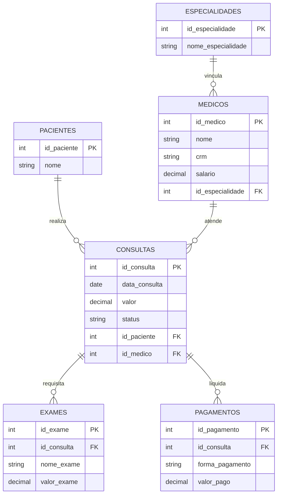

#### Resolução Formal das Questões da Avaliação

**Questão 1 — Consultas com paciente, médico e especialidade (2,0 pontos):**
```sql
SELECT 
    c.id_consulta AS codigo_consulta,
    c.data_consulta,
    p.nome AS nome_paciente,
    m.nome AS nome_medico,
    e.nome_especialidade AS especialidade,
    c.status AS status_consulta
FROM consultas c
INNER JOIN pacientes p ON c.id_paciente = p.id_paciente
INNER JOIN medicos m ON c.id_medico = m.id_medico
INNER JOIN especialidades e ON m.id_especialidade = e.id_especialidade;
```

**Questão 2 — Pacientes sem consultas via Anti-Join (1,0 ponto):**
```sql
SELECT 
    p.id_paciente,
    p.nome AS nome_paciente
FROM pacientes p
LEFT JOIN consultas c ON p.id_paciente = c.id_paciente
WHERE c.id_consulta IS NULL;
```

**Questão 3 — Relatório integrado de consultas, exames e pagamentos (2,0 pontos):**
```sql
SELECT 
    c.id_consulta AS codigo_consulta,
    p.nome AS nome_paciente,
    m.nome AS nome_medico,
    ex.nome_exame,
    ex.valor_exame,
    pg.forma_pagamento,
    pg.valor_pago
FROM consultas c
INNER JOIN pacientes p ON c.id_paciente = p.id_paciente
INNER JOIN medicos m ON c.id_medico = m.id_medico
LEFT JOIN exames ex ON c.id_consulta = ex.id_consulta
LEFT JOIN pagamentos pg ON c.id_consulta = pg.id_consulta;
```

**Questão 4 — Consultas acima da média de valor (1,5 pontos):**
```sql
SELECT 
    id_consulta AS codigo_consulta,
    data_consulta,
    valor,
    status
FROM consultas
WHERE valor > (SELECT AVG(valor) FROM consultas);
```

**Questão 5 — Médicos com salário acima da média corporativa (1,5 pontos):**
```sql
SELECT 
    id_medico AS codigo_medico,
    nome,
    crm,
    salario
FROM medicos
WHERE salario > (SELECT AVG(salario) FROM medicos);
```

**Questão 6 — Criação e exploração da View vw_consultas_realizadas (2,0 pontos):**
```sql
-- Etapa A: Definição da Visão no Catálogo
CREATE OR REPLACE VIEW vw_consultas_realizadas AS
SELECT 
    c.id_consulta AS codigo_consulta,
    c.data_consulta,
    p.nome AS nome_paciente,
    m.nome AS nome_medico,
    e.nome_especialidade AS especialidade_medico,
    c.valor AS valor_consulta
FROM consultas c
INNER JOIN pacientes p ON c.id_paciente = p.id_paciente
INNER JOIN medicos m ON c.id_medico = m.id_medico
INNER JOIN especialidades e ON m.id_especialidade = e.id_especialidade
WHERE c.status = 'Realizada';

-- Etapa B: Consulta parametrizada sobre a Visão
SELECT *
FROM vw_consultas_realizadas
WHERE valor_consulta > 350.00
ORDER BY valor_consulta DESC;
```

---

## Mapa Conceitual Integrado da Disciplina

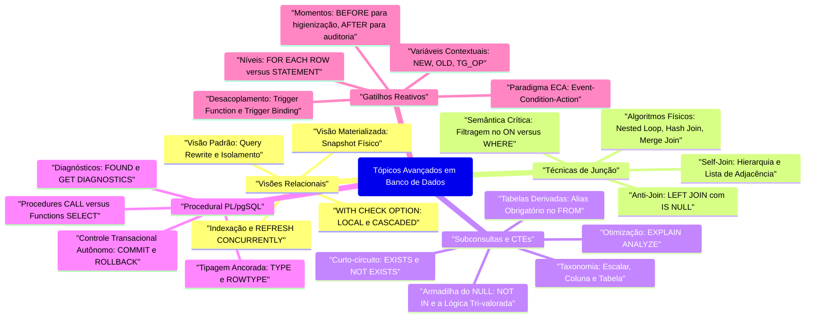

---

## Glossário Terminológico e Técnico de Engenharia de Dados

- **Anti-Join:** Operação relacional que retorna registros da relação principal para os quais não existem registros associados na relação secundária.
- **Cost-Based Optimizer (CBO):** Subsistema do PostgreSQL que analisa estatísticas de colunas para estimar o custo de I/O e CPU, escolhendo o melhor plano de execução.
- **Dollar Quoting (`$$`):** Notação de delimitação de strings que evita o escape manual de aspas simples no corpo de funções e procedimentos.
- **EXPLAIN ANALYZE:** Comando DDL/DML que executa a instrução fornecida e exibe o plano de execução com tempos reais e nós operacionais.
- **Gatilho (*Trigger*):** Objeto de esquema que dispara a execução de uma *Trigger Function* em resposta a eventos DML.
- **Hash Join:** Algoritmo de junção que monta uma tabela hash em memória com as chaves da tabela menor e varre a tabela maior buscando correspondências diretas.
- **Merge Join:** Algoritmo de junção que percorre simultaneamente duas relações ordenadas pelas chaves de ligação.
- **Nested Loop Join:** Algoritmo que itera sobre a relação externa e realiza buscas individuais na relação interna para cada registro.
- **Query Rewrite Rule System:** Subsistema do PostgreSQL que reescreve a árvore de sintaxe abstrata, expandindo referências a visões diretamente nas tabelas base.
- **REFRESH MATERIALIZED VIEW CONCURRENTLY:** Operação que recarrega os dados de uma visão materializada sem bloquear consultas concorrentes de leitura, exigindo a existência prévia de um índice exclusivo.
- **Stored Procedure:** Objeto procedural introduzido no PostgreSQL 11 invocado via `CALL` com suporte nativo a controle transacional explícito (`COMMIT`/`ROLLBACK`).
- **Three-Valued Logic (3VL):** Lógica booleana adotada pelo SQL contendo os estados `TRUE`, `FALSE` e `UNKNOWN`, este último resultante de comparações com `NULL`.
- **Tipagem Ancorada (`%TYPE` e `%ROWTYPE`):** Técnica de declaração que amarra o tipo de uma variável ao tipo de uma coluna ou à estrutura de uma linha inteira de uma tabela física.
- **Visão (*View*):** Relação virtual armazenada apenas como uma query nos catálogos de metadados, reconstruída dinamicamente a cada leitura.
- **Visão Materializada (*Materialized View*):** Tabela virtual cujos dados são computados e gravados fisicamente em disco, demandando sincronizações periódicas.
- **WITH CHECK OPTION:** Cláusula em visões atualizáveis que impede que instruções `INSERT` ou `UPDATE` alterem tuplas para valores que violem as condições do `WHERE` da visão.

---

## Pontos Críticos e Guia de Revisão para a Prova

1. **Diferença Primária entre Functions e Procedures:** Funções são invocadas via `SELECT`, exigem `RETURNS` e **não podem** executar `COMMIT` ou `ROLLBACK`. Procedures são invocadas via `CALL`, não possuem `RETURNS` (usam `OUT`/`INOUT`) e **podem gerenciar transações autônomas** com `COMMIT` e `ROLLBACK`.
2. **A Armadilha do `NOT IN` com `NULL`:** Se a subconsulta contiver uma única tupla nula, a avaliação da condição cai em `UNKNOWN`, fazendo com que a cláusula `WHERE` descarte todas as linhas e a consulta retorne vazio. Solução segura: usar `NOT EXISTS`.
3. **Comportamento do `COUNT(*)` sob `LEFT JOIN`:** Clientes sem pedidos geram uma linha sintetizada com atributos nulos à direita. O comando `COUNT(*)` contabiliza essa linha como 1, gerando falso positivo. Para contar transações de modo correto sob junções externas, conte a chave primária da tabela filha: `COUNT(p.id_pedido)`.
4. **Filtragem no `ON` versus Filtragem no `WHERE` em `LEFT JOIN`:** Filtrar no `ON` restringe o acoplamento da tabela secundária preservando todas as linhas da tabela primária. Filtrar colunas da tabela secundária no `WHERE` descarta os registros onde essas colunas são nulas, convertendo a junção em um `INNER JOIN` disfarçado.
5. **Regras do `CREATE OR REPLACE VIEW`:** Permite alterar uma visão existente apenas se os atributos originais mantiverem nomes, tipos e ordenação idênticos. Novas colunas devem ser inseridas obrigatoriamente ao final da projeção.
6. **Requisito para `REFRESH MATERIALIZED VIEW CONCURRENTLY`:** A visão materializada deve possuir **obrigatoriamente um índice exclusivo (`UNIQUE INDEX`)** criado sobre colunas com valores não-nulos.
7. **Momentos de Disparo de Triggers:**
   - `BEFORE`: Executa antes da gravação no disco; pode alterar os campos da variável `NEW` ou vetar a operação retornando `NULL`.
   - `AFTER`: Executa após a gravação; ideal para logs de auditoria; o retorno da função é irrelevante.
   - `INSTEAD OF`: Exclusivo para visões (*Views*), interceptando o DML para redistribuí-lo às tabelas de origem.
8. **Variáveis `NEW` e `OLD` em Triggers:**
   - `INSERT`: `NEW` populada, `OLD` é `NULL`.
   - `UPDATE`: `NEW` e `OLD` populadas.
   - `DELETE`: `NEW` é `NULL`, `OLD` populada.
   - Em nível de instrução (`FOR EACH STATEMENT`), ambas são estritamente `NULL`.
9. **Tabelas Derivadas na Cláusula `FROM`:** Toda subconsulta declarada dentro do `FROM` deve receber obrigatoriamente um alias textual explícito no PostgreSQL (`AS meu_alias`), sob pena de erro de compilação.

---

## Fontes e Metadados

- Turma no Classroom: Tópicos Avançados em BD - FEF
- Itens processados: 5 materiais, 6 tarefas, 0 avisos
- Gerado em: 03/11/2026, 21:10:58 (BRT) via classroom-sync
