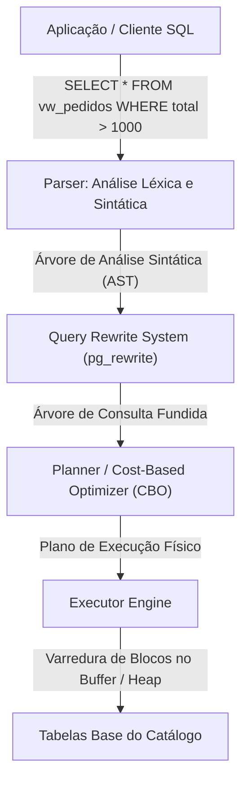
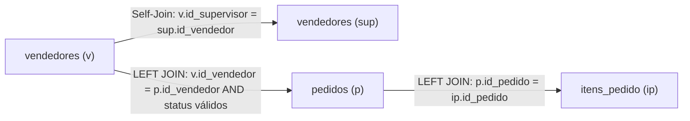
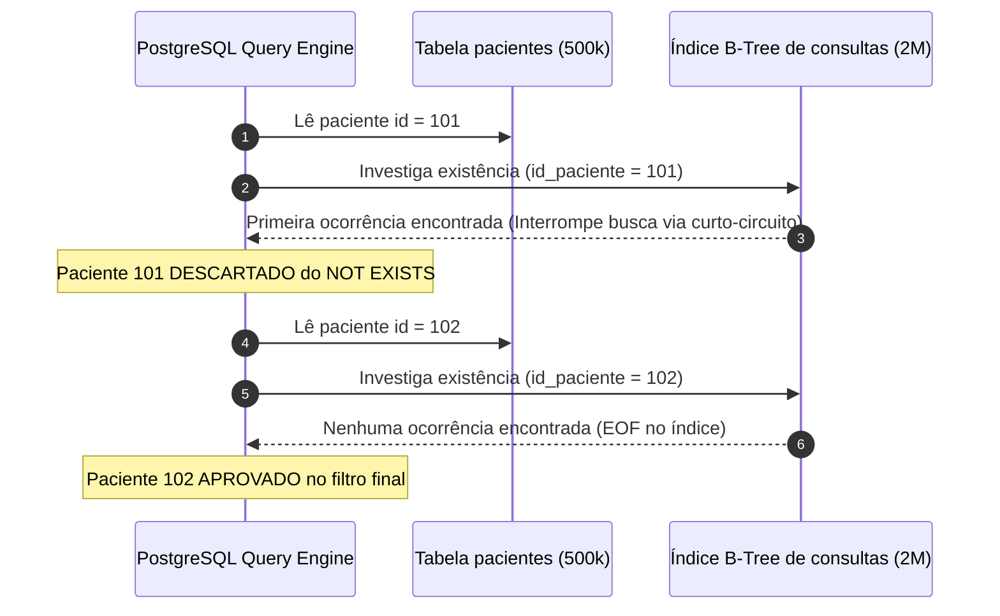

# Simulados Comentados - Tópicos Avançados em Banco de Dados

> **Instituição:** Centro Universitário de Santa Fé do Sul (UniFEF)  
> **Curso:** Bacharelado em Sistemas de Informação (4º Semestre)  
> **Disciplina:** Tópicos Avançados em Banco de Dados  
> **Docente:** Prof. Welington Garcia  
> **Material de Referência:** Aulas 02 a 04, Trabalhos Práticos e Avaliações Oficiais de TABD  

---

## Sumário Geral

- [Simulado 1 - Questões Objetivas](#simulado-1---questões-objetivas)
  - [Questão 01: Atualizabilidade de Views e WITH CHECK OPTION](#questão-01-atualizabilidade-de-views-e-with-check-option)
  - [Questão 02: Materialized Views e Concorrência com REFRESH CONCURRENTLY](#questão-02-materialized-views-e-concorrência-com-refresh-concurrently)
  - [Questão 03: Mecanismo de Reescrita de Consultas e pg_rewrite](#questão-03-mecanismo-de-reescrita-de-consultas-e-pg_rewrite)
  - [Questão 04: Diferenças Arquiteturais entre Functions e Procedures](#questão-04-diferenças-arquiteturais-entre-functions-e-procedures)
  - [Questão 05: Diagnóstico de Execução DML em PL/pgSQL com FOUND e GET DIAGNOSTICS](#questão-05-diagnóstico-de-execução-dml-em-plpgsql-com-found-e-get-diagnostics)
  - [Questão 06: Concorrência e Bloqueio Pessimista com SELECT FOR UPDATE](#questão-06-concorrência-e-bloqueio-pessimista-com-select-for-update)
  - [Questão 07: Algoritmos Físicos de Junção do Otimizador Baseado em Custo](#questão-07-algoritmos-físicos-de-junção-do-otimizador-baseado-em-custo)
  - [Questão 08: Semântica de Predicados em Outer Joins: ON versus WHERE](#questão-08-semântica-de-predicados-em-outer-joins-on-versus-where)
  - [Questão 09: Agregação em Junções Externas: COUNT(*) versus COUNT(coluna)](#questão-09-agregação-em-junções-externas-count-versus-countcoluna)
  - [Questão 10: Lógica Trivalente e a Armadilha de Valores NULL com NOT IN](#questão-10-lógica-trivalente-e-a-armadilha-de-valores-null-com-not-in)
  - [Questão 11: Subconsultas Correlacionadas versus Tabelas Derivadas no FROM](#questão-11-subconsultas-correlacionadas-versus-tabelas-derivadas-no-from)
  - [Questão 12: Operadores Quantificados ANY e ALL na Álgebra Relacional](#questão-12-operadores-quantificados-any-e-all-na-álgebra-relacional)
- [Simulado 2 - Questões Discursivas](#simulado-2---questões-discursivas)
  - [Questão Discursiva 01: Arquitetura de Segurança e Views Atualizáveis](#questão-discursiva-01-arquitetura-de-segurança-e-views-atualizáveis)
  - [Questão Discursiva 02: Otimização Física com Materialized Views e Índices Dedicados](#questão-discursiva-02-otimização-física-com-materialized-views-e-índices-dedicados)
  - [Questão Discursiva 03: Orquestração Transacional em Lote com Stored Procedures](#questão-discursiva-03-orquestração-transacional-em-lote-com-stored-procedures)
  - [Questão Discursiva 04: Hierarquias Corporativas via Self-Join e Agregações Ponderadas](#questão-discursiva-04-hierarquias-corporativas-via-self-join-e-agregações-ponderadas)
  - [Questão Discursiva 05: Diagnóstico de Desempenho com EXPLAIN ANALYZE: Anti-Join versus NOT EXISTS](#questão-discursiva-05-diagnóstico-de-desempenho-com-explain-analyze-anti-join-versus-not-exists)
- [Gabarito Comentado - Simulado 1 (Questões Objetivas)](#gabarito-comentado---simulado-1-questões-objetivas)
- [Gabarito Comentado e Rubricas - Simulado 2 (Questões Discursivas)](#gabarito-comentado-e-rubricas---simulado-2-questões-discursivas)

---

## Simulado 1 - Questões Objetivas

### Questão 01: Atualizabilidade de Views e WITH CHECK OPTION

Considere o seguinte cenário em um banco de dados PostgreSQL 14+, modelado para gerenciar contas de clientes:

```sql
CREATE TABLE clientes (
    id_cliente SERIAL PRIMARY KEY,
    nome VARCHAR(100) NOT NULL,
    cidade VARCHAR(100) NOT NULL,
    estado CHAR(2) NOT NULL,
    limite_credito NUMERIC(10,2) NOT NULL
);

CREATE VIEW vw_clientes_sp AS
SELECT id_cliente, nome, cidade, estado, limite_credito
FROM clientes
WHERE estado = 'SP';

CREATE VIEW vw_clientes_sp_vip AS
SELECT id_cliente, nome, cidade, estado, limite_credito
FROM vw_clientes_sp
WHERE limite_credito >= 5000.00
WITH LOCAL CHECK OPTION;
```

Um desenvolvedor executa as duas operações DML a seguir através da visão `vw_clientes_sp_vip`:

```sql
-- Operação 1:
INSERT INTO vw_clientes_sp_vip (nome, cidade, estado, limite_credito)
VALUES ('Marcos Andrade', 'Campinas', 'SP', 4000.00);

-- Operação 2:
INSERT INTO vw_clientes_sp_vip (nome, cidade, estado, limite_credito)
VALUES ('Renata Silveira', 'Curitiba', 'PR', 7000.00);
```

Considerando as regras de integridade do padrão SQL e a implementação do PostgreSQL para a cláusula `WITH CHECK OPTION`, assinale a alternativa que descreve corretamente o comportamento do motor relacional:

- A) Ambas as operações são rejeitadas pelo PostgreSQL, pois nenhuma visão definida sobre outra visão pode aceitar operações de inserção direta (`INSERT`).
- B) A Operação 1 falha devido à violação do predicado local (`limite_credito >= 5000.00`), enquanto a Operação 2 é executada com sucesso, persistindo um registro com `estado = 'PR'` na tabela base `clientes`.
- C) A Operação 1 é executada com sucesso porque a cláusula `LOCAL` ignora validações numéricas, mas a Operação 2 falha porque o predicado da visão subjacente (`estado = 'SP'`) é herdado compulsoriamente.
- D) Ambas as operações falham: a Operação 1 viola o predicado da própria visão (`vw_clientes_sp_vip`) e a Operação 2 viola a regra de integridade herdada implicitamente da visão raiz (`vw_clientes_sp`).
- E) A Operação 1 é aceita e o limite de crédito é truncado para o valor mínimo permitido, enquanto a Operação 2 é abortada por incompatibilidade geográfica de esquema.

---

### Questão 02: Materialized Views e Concorrência com REFRESH CONCURRENTLY

Em sistemas analíticos de alta transacionalidade OLTP/OLAP, a manutenção de relatórios consolidados demanda a utilização de visões materializadas. Considere a criação da visão materializada a seguir:

```sql
CREATE MATERIALIZED VIEW mv_vendas_consolidadas AS
SELECT 
    p.id_vendedor,
    DATE_TRUNC('month', p.data_pedido) AS mes_ano,
    COUNT(p.id_pedido) AS total_pedidos,
    SUM(ip.quantidade * ip.preco_unitario) AS faturamento_bruto
FROM pedidos p
INNER JOIN itens_pedido ip ON p.id_pedido = ip.id_pedido
WHERE p.status = 'Pago'
GROUP BY p.id_vendedor, DATE_TRUNC('month', p.data_pedido);
```

A equipe de banco de dados planeja agendar uma rotina automatizada que execute o comando:

```sql
REFRESH MATERIALIZED VIEW CONCURRENTLY mv_vendas_consolidadas;
```

Para que este comando seja executado com sucesso e sem gerar erros de execução no PostgreSQL, qual pré-requisito físico de esquema é estritamente obrigatório?

- A) A visão materializada deve conter ao menos uma coluna declarada formalmente com a restrição `PRIMARY KEY` durante a sua instrução `CREATE MATERIALIZED VIEW`.
- B) A tabela base `pedidos` deve possuir um índice do tipo Hash ativo sobre a coluna `status`.
- C) Deve existir na visão materializada pelo menos um índice exclusivo (`UNIQUE INDEX`) cobrindo uma ou mais colunas que identifiquem univocamente cada linha, sem cláusula `WHERE` (índice não parcial).
- D) A visão materializada deve ser convertida previamente em tabela temporária com o comando `ALTER MATERIALIZED VIEW ... SET WITHOUT DATA`.
- E) É necessário conceder privilégio explícito de `SUPERUSER` ao usuário que invoca o comando `REFRESH`, independentemente de índices existentes.

---

### Questão 03: Mecanismo de Reescrita de Consultas e pg_rewrite

Sobre o ciclo de processamento de consultas no PostgreSQL e o funcionamento interno de visões relacionais padrão (não materializadas), considere o diagrama a seguir:



Com base na arquitetura interna exibida e no comportamento do catálogo `pg_rewrite`, analise as seguintes asserções:

I. Uma visão padrão funciona como um cache residente de tuplas em memória compartilhada (`shared_buffers`), evitando operações de I/O em leituras repetidas.  
II. O *Query Rewrite Rule System* expande a regra `_RETURN` associada à visão, fundindo a consulta do usuário com a definição da visão antes da fase de geração e otimização do plano de execução.  
III. O otimizador de consultas (CBO) pode realizar o *pushdown* de predicados da consulta externa diretamente para a varredura das tabelas base, viabilizando o uso de índices criados nas tabelas de origem.  

É correto o que se afirma em:

- A) I, apenas.
- B) I e II, apenas.
- C) II e III, apenas.
- D) I e III, apenas.
- E) I, II e III.

---

### Questão 04: Diferenças Arquiteturais entre Functions e Procedures

No PostgreSQL 11, foi introduzido o comando formal `CREATE PROCEDURE`, em conformidade com o padrão SQL:2011. Antes dessa versão, rotinas procedurais eram implementadas exclusivamente via `CREATE FUNCTION`.

Em relação à gestão transacional e mecânica de invocação que diferenciam funções e procedimentos no PostgreSQL, assinale a afirmativa correta:

- A) Procedimentos armazenados (`CREATE PROCEDURE`) devem obrigatoriamente especificar um tipo de retorno primitivo ou a cláusula `RETURNS void`.
- B) Funções armazenadas (`CREATE FUNCTION`) suportam o gerenciamento autônomo de transações, permitindo a execução de `COMMIT` e `ROLLBACK` explícitos dentro de seu corpo de execução.
- C) Procedimentos armazenados são invocados por meio da instrução de controle `CALL`, não possuem cláusula `RETURNS` e têm capacidade de executar comandos `COMMIT` e `ROLLBACK` intermediários.
- D) Funções armazenadas podem ser invocadas isoladamente pelo comando `CALL`, enquanto procedimentos só podem ser executados dentro de cláusulas `SELECT` e `WHERE`.
- E) O uso de parâmetros do tipo `OUT` ou `INOUT` é permitido exclusivamente em funções escalares, sendo terminantemente proibido na assinatura de procedimentos armazenados.

---

### Questão 05: Diagnóstico de Execução DML em PL/pgSQL com FOUND e GET DIAGNOSTICS

Considere o seguinte trecho de código em um procedimento PL/pgSQL:

```sql
CREATE OR REPLACE PROCEDURE sp_ajustar_contas(p_cidade VARCHAR)
LANGUAGE plpgsql
AS $$
DECLARE
    v_total_afetado INT := 0;
BEGIN
    UPDATE clientes 
    SET limite_credito = limite_credito * 1.10
    WHERE cidade = p_cidade;

    GET DIAGNOSTICS v_total_afetado = ROW_COUNT;

    IF FOUND THEN
        RAISE NOTICE 'Linhas afetadas via FOUND: Sim. Contagem exata: %', v_total_afetado;
    ELSE
        RAISE NOTICE 'Nenhum cliente modificado para a cidade: %', p_cidade;
    END IF;
END;
$$;
```

A respeito das variáveis de diagnóstico de execução no PL/pgSQL, analise as afirmativas a seguir:

I. A variável booleana `FOUND` é mantida internamente pelo PL/pgSQL e assume valor `TRUE` se a instrução `UPDATE` modificou ao menos uma tupla.  
II. O comando `GET DIAGNOSTICS v_total_afetado = ROW_COUNT` extrai o número exato de tuplas inspecionadas na tabela base, mesmo que seus valores não tenham sofrido alteração de conteúdo.  
III. Caso o comando `UPDATE` afete zero linhas, a variável `FOUND` avalia para `FALSE` e o fluxo é direcionado para a cláusula `ELSE`.  

Assinale a alternativa correta:

- A) Apenas a afirmativa I está correta.
- B) Apenas a afirmativa II está correta.
- C) Apenas as afirmativas I e III estão corretas.
- D) Apenas as afirmativas II e III estão corretas.
- E) Todas as afirmativas (I, II e III) estão corretas.

---

### Questão 06: Concorrência e Bloqueio Pessimista com SELECT FOR UPDATE

Em um sistema de comércio eletrônico altamente concorrente, dois processos executam simultaneamente uma rotina de fechamento de pedido que envolve a verificação e o decremento do estoque de um determinado item.

Observe a implementação abaixo:

```sql
CREATE OR REPLACE PROCEDURE sp_baixar_estoque(p_id_produto INT, p_qtd INT)
LANGUAGE plpgsql
AS $$
DECLARE
    v_estoque_atual INT;
BEGIN
    -- Seleção protegida
    SELECT estoque INTO v_estoque_atual
    FROM produtos
    WHERE id_produto = p_id_produto
    FOR UPDATE;

    IF v_estoque_atual < p_qtd THEN
        RAISE EXCEPTION 'Estoque insuficiente para o produto %.', p_id_produto;
    END IF;

    UPDATE produtos
    SET estoque = estoque - p_qtd
    WHERE id_produto = p_id_produto;
END;
$$;
```

Qual é o efeito do modificador `FOR UPDATE` na integridade transacional do PostgreSQL?

- A) Impede que qualquer outra transação leia o registro na tabela `produtos`, mesmo que utilize um `SELECT` simples sem cláusula de travamento.
- B) Adquire um bloqueio exclusivo de linha (*RowExclusiveLock / Exclusive tuple lock*), enfileirando transações concorrentes que tentem ler o mesmo registro via `FOR UPDATE` ou modificá-lo via `UPDATE`/`DELETE` até a conclusão da transação corrente.
- C) Converte o nível de isolamento da transação automaticamente para `READ UNCOMMITTED`, acelerando a leitura sem consumir memória de locks.
- D) Bloqueia a tabela inteira `produtos` contra novas operações de `INSERT`, prevenindo a anomalia de inserções fantasmas.
- E) Executa uma cópia transitória da linha para a memória privada da sessão, descartando alterações caso ocorra colisão de escrita.

---

### Questão 07: Algoritmos Físicos de Junção do Otimizador Baseado em Custo

O Otimizador de Consultas Baseado em Custo (*Cost-Based Optimizer* - CBO) do PostgreSQL seleciona algoritmos físicos para executar operações de junção relacional (`JOIN`).

Considere as seguintes características operacionais:

1. Constrói uma tabela hash em memória (`work_mem`) a partir da relação interna (menor) e varre sequencialmente a relação externa comparando as chaves de equijunção em tempo médio $`O(M + N)`$.
2. Percorre a relação externa linha por linha e, para cada tupla, executa uma busca (preferencialmente indexada via B-Tree) na relação interna.
3. Exige que ambas as relações estejam ordenadas pelas chaves de junção, percorrendo as duas tabelas de forma simultânea e linear.

A correspondência exata entre os mecanismos descritos e os operadores físicos exibidos no `EXPLAIN ANALYZE` é, respectivamente:

- A) 1 - Merge Join; 2 - Nested Loop; 3 - Hash Join.
- B) 1 - Hash Join; 2 - Merge Join; 3 - Nested Loop.
- C) 1 - Hash Join; 2 - Nested Loop; 3 - Merge Join.
- D) 1 - Nested Loop; 2 - Hash Join; 3 - Merge Join.
- E) 1 - Bitmap Index Scan; 2 - Hash Join; 3 - Merge Join.

---

### Questão 08: Semântica de Predicados em Outer Joins: ON versus WHERE

Considere as duas relações a seguir em um sistema hospitalar:

- `pacientes` (com 10 registros, onde o paciente com `id_paciente = 10` reside na cidade de 'Jales').
- `consultas` (com registros vinculados a pacientes; o paciente 10 não realizou nenhuma consulta).

Um analista elabora as seguintes consultas para emitir um relatório de acompanhamento clínico:

```sql
-- Consulta A:
SELECT p.id_paciente, p.nome, c.id_consulta, c.valor
FROM pacientes p
LEFT JOIN consultas c ON p.id_paciente = c.id_paciente AND p.cidade = 'Jales';

-- Consulta B:
SELECT p.id_paciente, p.nome, c.id_consulta, c.valor
FROM pacientes p
LEFT JOIN consultas c ON p.id_paciente = c.id_paciente
WHERE p.cidade = 'Jales';
```

Assinale a alternativa que compara corretamente o comportamento semântico das Consultas A e B:

- A) As Consultas A e B produzem resultados rigorosamente idênticos em todas as circunstâncias, pois o otimizador sempre rebaixa filtros do `ON` para o `WHERE`.
- B) Na Consulta A, todos os 10 pacientes serão retornados na saída (com dados de consultas nulos para quem não atender à condição do `ON`), enquanto na Consulta B apenas os pacientes residentes em 'Jales' serão exibidos.
- C) A Consulta A falha sintaticamente, pois o PostgreSQL não permite predicados sobre a tabela à esquerda na cláusula `ON` de um `LEFT JOIN`.
- D) A Consulta B transforma o `LEFT JOIN` em um `CROSS JOIN`, multiplicando todas as linhas de pacientes pelo total de consultas de 'Jales'.
- E) Na Consulta B, o paciente 10 é descartado do resultado porque não possui consultas registradas no sistema.

---

### Questão 09: Agregação em Junções Externas: COUNT(*) versus COUNT(coluna)

Considere um banco de dados comercial onde a tabela `clientes` possui 5 registros e a tabela `pedidos` possui movimentações registradas apenas para os clientes de ID 1, 2 e 3. Os clientes 4 e 5 nunca efetuaram nenhum pedido.

Um desenvolvedor submete a seguinte consulta para consolidar o total de vendas por cliente:

```sql
SELECT 
    c.id_cliente, 
    c.nome, 
    COUNT(*) AS total_a,
    COUNT(p.id_pedido) AS total_b
FROM clientes c
LEFT JOIN pedidos p ON c.id_cliente = p.id_cliente
GROUP BY c.id_cliente, c.nome
ORDER BY c.id_cliente;
```

Quais serão os valores projetados nas colunas `total_a` e `total_b` para o cliente de ID 4?

- A) `total_a = 0` e `total_b = 0`.
- B) `total_a = 1` e `total_b = 0`.
- C) `total_a = 0` e `total_b = 1`.
- D) `total_a = 1` e `total_b = 1`.
- E) `total_a = NULL` e `total_b = 0`.

---

### Questão 10: Lógica Trivalente e a Armadilha de Valores NULL com NOT IN

*(Com base nos fundamentos da álgebra relacional e lógica trivalente de E. F. Codd)*

Considere o esquema simplificado de funcionários e dependentes:

- Tabela `funcionarios`: IDs 1, 2, 3, 4.
- Tabela `dependentes`: IDs de funcionários vinculados são `(1, 2, NULL)`. O valor `NULL` ocorreu por erro de integridade em uma carga legada que permitia valores nulos na chave estrangeira `id_funcionario`.

Um engenheiro de software precisa identificar os funcionários que **não possuem** dependentes e executa a seguinte instrução:

```sql
SELECT id_funcionario, nome
FROM funcionarios
WHERE id_funcionario NOT IN (SELECT id_funcionario FROM dependentes);
```

Qual é o resultado retornado por esta consulta no PostgreSQL e qual é a justificativa relacional estrita?

- A) Retorna os funcionários 3 e 4, pois o operador `NOT IN` ignora silenciosamente registros nulos contidos na lista do subselect.
- B) Aborta imediatamente com a mensagem de erro: `ERROR: null value in subquery is not permitted in NOT IN construct`.
- C) Retorna um conjunto vazio (zero linhas), porque a presença de um único valor `NULL` no conjunto faz com que a avaliação lógica resulte em `UNKNOWN` para todas as comparações com tuplas não correspondentes, e a cláusula `WHERE` apenas aceita condições avaliadas estritamente como `TRUE`.
- D) Retorna todos os funcionários (1, 2, 3 e 4), pois a comparação contra `NULL` inverte a polaridade da consulta.
- E) Retorna apenas o funcionário 3, adotando curto-circuito na primeira linha não coincidente.

---

### Questão 11: Subconsultas Correlacionadas versus Tabelas Derivadas no FROM

Ao analisar o desempenho de consultas analíticas em bases volumosas, um administrador de banco de dados identifica a seguinte consulta correlacionada:

```sql
SELECT p.id_produto, p.nome_produto, p.preco
FROM produtos p
WHERE p.preco > (
    SELECT AVG(sub.preco)
    FROM produtos sub
    WHERE sub.id_categoria = p.id_categoria
);
```

Deseja-se reescrever esta consulta utilizando uma **Tabela Derivada na cláusula FROM** (subconsulta no `FROM`), visando eliminar o processamento conceitual linha a linha (*SubPlan*).

Assinale a alternativa que implementa a reescrita correta, em estrita conformidade com as regras sintáticas do PostgreSQL:

- A)  
```sql
SELECT p.id_produto, p.nome_produto, p.preco
FROM produtos p
JOIN (
    SELECT id_categoria, AVG(preco) AS media_cat
    FROM produtos
    GROUP BY id_categoria
) ON p.id_categoria = id_categoria AND p.preco > media_cat;
```
- B)  
```sql
SELECT p.id_produto, p.nome_produto, p.preco
FROM produtos p
JOIN (
    SELECT id_categoria, AVG(preco) AS media_cat
    FROM produtos
    GROUP BY id_categoria
) AS medias ON p.id_categoria = medias.id_categoria
WHERE p.preco > medias.media_cat;
```
- C)  
```sql
SELECT p.id_produto, p.nome_produto, p.preco
FROM produtos p
WHERE p.preco > (
    SELECT media_cat FROM (
        SELECT id_categoria, AVG(preco) AS media_cat FROM produtos GROUP BY id_categoria
    )
);
```
- D)  
```sql
SELECT p.id_produto, p.nome_produto, p.preco
FROM produtos p
WHERE p.id_categoria IN (
    SELECT id_categoria, AVG(preco) FROM produtos GROUP BY id_categoria
);
```
- E)  
```sql
SELECT p.id_produto, p.nome_produto, p.preco
FROM produtos p, (
    SELECT id_categoria, AVG(preco) AS media_cat FROM produtos GROUP BY id_categoria
)
WHERE p.preco > media_cat;
```

---

### Questão 12: Operadores Quantificados ANY e ALL na Álgebra Relacional

Considere as duas tabelas a seguir em um esquema de vendas:

- Tabela `produtos` com a coluna `preco`.
- Produtos da categoria 'Telefonia' possuem os preços: `R$ 1.800,00` e `R$ 2.500,00`.

Analise os dois predicados lógicos a seguir, aplicados individualmente em cláusulas `WHERE`:

```sql
-- Predicado 1:
WHERE preco > ANY (SELECT preco FROM produtos WHERE id_categoria = 2)

-- Predicado 2:
WHERE preco > ALL (SELECT preco FROM produtos WHERE id_categoria = 2)
```

Considerando que `id_categoria = 2` representa a categoria 'Telefonia', os Predicados 1 e 2 são semanticamente equivalentes, respectivamente, a:

- A) `preco > 2500.00` (maior que o máximo) e `preco > 1800.00` (maior que o mínimo).
- B) `preco > 1800.00` (maior que o mínimo) e `preco > 2500.00` (maior que o máximo).
- C) `preco >= 1800.00 AND preco <= 2500.00` e `preco < 1800.00 OR preco > 2500.00`.
- D) `preco = 1800.00 OR preco = 2500.00` e `preco <> 1800.00 AND preco <> 2500.00`.
- E) Ambos equivalem estritamente a `preco > 2150.00` (média aritmética dos elementos do conjunto).

---

## Simulado 2 - Questões Discursivas

### Questão Discursiva 01: Arquitetura de Segurança e Views Atualizáveis

Uma operadora de planos de saúde armazena o cadastro clínico e funcional dos seus prestadores de serviço na tabela `medicos`:

```sql
CREATE TABLE medicos (
    id_medico SERIAL PRIMARY KEY,
    nome VARCHAR(100) NOT NULL,
    crm VARCHAR(20) NOT NULL UNIQUE,
    salario NUMERIC(10,2) NOT NULL,
    comissao NUMERIC(5,2) DEFAULT 0.00,
    cidade VARCHAR(80) NOT NULL,
    estado CHAR(2) NOT NULL,
    status VARCHAR(20) DEFAULT 'Ativo'
);
```

A equipe de segurança da informação estabeleceu os seguintes requisitos de governança de dados:
1. Os analistas de atendimento devem ter acesso apenas aos médicos situados no estado de São Paulo (`estado = 'SP'`) e que estejam com o cadastro `'Ativo'`.
2. As colunas de remuneração (`salario` e `comissao`) representam dados altamente confidenciais e não podem ser visíveis sob hipótese alguma para os analistas de atendimento.
3. Os analistas de atendimento devem ter permissão para inserir e atualizar médicos dessa região, mas o banco de dados deve rejeitar compulsoriamente qualquer tentativa de modificação que altere o estado para fora de `'SP'` ou desative o médico (`status <> 'Ativo'`).
4. Os analistas não devem possuir permissões diretas de acesso à tabela base `medicos`.

Com base nos conceitos de **Views Relacionais**, **Mecanismos de Segurança (GRANT)** e na cláusula **WITH CHECK OPTION**, faça o que se pede:

1. Escreva o comando DDL de criação da visão relacional `vw_medicos_atendimento_sp` que atenda integralmente aos requisitos de ocultação vertical (colunas) e restrição horizontal (linhas).
2. Adicione a cláusula de integridade mandatória para impedir anomalias de escrita fora do domínio da visão.
3. Demonstre os comandos DCL (`GRANT`) necessários para conceder acesso restrito ao papel corporativo `atendimento_role`.
4. Apresente um exemplo de comando `INSERT` válido e um exemplo de comando `INSERT` ou `UPDATE` que será abortado pelo PostgreSQL, explicando o mecanismo interno acionado pelo motor relacional.

---

### Questão Discursiva 02: Otimização Física com Materialized Views e Índices Dedicados

Em um ambiente corporativo de grande porte, o sistema de faturamento processa milhões de transações consolidadas na tabela `pedidos` (cabeçalho) e `itens_pedido` (detalhe). O dashboard executivo da diretoria consome com alta frequência uma consulta que cruza 5 tabelas relacionais (`clientes`, `pedidos`, `itens_pedido`, `produtos` e `categorias`), realizando agregações financeiras e volumétricas.

A execução contínua dessa consulta diretamente sobre as tabelas base provocou gargalos severos de I/O em disco e exaustão de CPU.

Como Engenheiro de Banco de Dados:
1. Explique por que a criação de uma `VIEW` convencional não resolve o problema de desempenho relatado.
2. Formule o script DDL completo para criar uma visão materializada chamada `mv_desempenho_vendas_categoria`, contendo:
   - Código e nome da categoria.
   - Ano e mês da venda (extraído de `pedidos.data_pedido`).
   - Quantidade total de itens vendidos.
   - Faturamento bruto consolidado ($ `quantidade \times preco\_unitario` $).
   - Faturamento líquido consolidado considerando a dedução percentual de descontos.
3. Projete e justifique a criação dos índices físicos necessários na `MATERIALIZED VIEW` para garantir que ela suporte consultas filtradas por período e que possa ser atualizada concorrentemente através de `REFRESH MATERIALIZED VIEW CONCURRENTLY` sem bloquear leituras.

---

### Questão Discursiva 03: Orquestração Transacional em Lote com Stored Procedures

Um dos maiores desafios em rotinas de processamento em lote (*batch processing*) em bancos de dados relacionais é evitar o crescimento excessivo dos arquivos de log de transação (*Write-Ahead Logging* - WAL) e o represamento de bloqueios (*locks*) em tabelas de grande cardinalidade.

Considere a necessidade de aplicar um reajuste salarial escalonado em lote na tabela `funcionarios`:

```sql
CREATE TABLE funcionarios (
    id_funcionario SERIAL PRIMARY KEY,
    nome VARCHAR(100) NOT NULL,
    cargo VARCHAR(50) NOT NULL,
    salario NUMERIC(10,2) NOT NULL,
    departamento VARCHAR(50) NOT NULL,
    ultima_atualizacao TIMESTAMP DEFAULT CURRENT_TIMESTAMP
);
```

Implemente uma Stored Procedure estruturada em PL/pgSQL chamada `sp_reajustar_salarios_lote` que atenda às seguintes exigências de engenharia:
1. Receba três parâmetros de entrada: `p_departamento VARCHAR`, `p_percentual NUMERIC` e `p_tamanho_lote INT`.
2. Receba um parâmetro de saída (`OUT p_total_processado INT`) que retorne à aplicação chamadora a quantidade exata de funcionários contemplados.
3. Valide os parâmetros: o percentual de aumento deve ser maior que zero e não pode exceder 50%; o tamanho do lote deve ser no mínimo 10. Em caso de infração, dispare uma exceção explícita (`RAISE EXCEPTION`).
4. Utilize um cursor ou laço de iteração procedural para atualizar os funcionários elegíveis em blocos (*batches*) correspondentes ao tamanho informado em `p_tamanho_lote`, emitindo um `COMMIT` intermediário a cada bloco finalizado.
5. Emita mensagens de progresso via console do PostgreSQL (`RAISE NOTICE`) a cada lote persistido.

---

### Questão Discursiva 04: Hierarquias Corporativas via Self-Join e Agregações Ponderadas

O departamento de Recursos Humanos de uma corporação comercial gerencia seus vendedores por meio de uma estrutura hierárquica baseada no padrão de Lista de Adjacência (*Adjacency List*), onde a tabela referencia a si própria.

O esquema físico é composto por:

```sql
CREATE TABLE vendedores (
    id_vendedor SERIAL PRIMARY KEY,
    nome VARCHAR(100) NOT NULL,
    salario NUMERIC(10,2) NOT NULL,
    comissao NUMERIC(5,2),
    id_supervisor INTEGER REFERENCES vendedores(id_vendedor)
);

CREATE TABLE pedidos (
    id_pedido SERIAL PRIMARY KEY,
    data_pedido DATE NOT NULL,
    status VARCHAR(30) NOT NULL,
    id_vendedor INTEGER REFERENCES vendedores(id_vendedor)
);

CREATE TABLE itens_pedido (
    id_item SERIAL PRIMARY KEY,
    id_pedido INTEGER REFERENCES pedidos(id_pedido),
    id_produto INTEGER,
    quantidade INTEGER NOT NULL,
    preco_unitario NUMERIC(10,2) NOT NULL,
    desconto NUMERIC(5,2) DEFAULT 0.00
);
```

Escreva uma consulta SQL padronizada que gere um relatório analítico consolidado contendo:
1. O código e o nome de cada vendedor.
2. O nome do respectivo supervisor direto. Caso o vendedor seja o líder máximo da hierarquia (raiz sem supervisor), o relatório deve exibir textualmente `'Diretoria Geral'` (utilizando a função `COALESCE`).
3. A quantidade total de pedidos emitidos pelo vendedor que se encontrem com o status `'Pago'` ou `'Enviado'`.
4. O faturamento líquido total gerado pelo vendedor, calculado como a somatória do valor de cada item deduzido de seu desconto percentual:

```math
\text{Faturamento Líquido} = \sum \left( \text{quantidade} \times \text{preco\_unitario} \times \left(1 - \frac{\text{desconto}}{100}\right) \right)
```

5. O valor total de comissão em moeda que o vendedor acumulou no período, aplicando sua alíquota percentual de comissão sobre o faturamento líquido.

**Restrições Obrigatórias de Engenharia:**
- Todos os vendedores cadastrados devem constar no relatório, inclusive supervisores ou recém-contratados que não possuam nenhum pedido registrado (neste caso, as somatórias devem exibir `0.00`).
- O resultado deve ser ordenado de forma decrescente pelo faturamento líquido total.

---

### Questão Discursiva 05: Diagnóstico de Desempenho com EXPLAIN ANALYZE: Anti-Join versus NOT EXISTS

Considere o banco de dados de uma clínica médica onde a tabela `pacientes` possui 500.000 tuplas e a tabela `consultas` possui 2.000.000 de tuplas. Deseja-se identificar todos os pacientes que **nunca realizaram nenhuma consulta**.

Duas abordagens foram propostas por diferentes membros do time de desenvolvimento:

```sql
-- Abordagem 1: Anti-Join Tradicional com LEFT JOIN
SELECT p.id_paciente, p.nome
FROM pacientes p
LEFT JOIN consultas c ON p.id_paciente = c.id_paciente
WHERE c.id_consulta IS NULL;

-- Abordagem 2: Subconsulta Correlacionada com NOT EXISTS
SELECT p.id_paciente, p.nome
FROM pacientes p
WHERE NOT EXISTS (
    SELECT 1 
    FROM consultas c 
    WHERE c.id_paciente = p.id_paciente
);
```

Com base na teoria de otimização de consultas do PostgreSQL e na interpretação de planos de execução (`EXPLAIN ANALYZE`):

1. Explique detalhadamente por que a Abordagem 1 exige rigorosamente que a condição do `WHERE` avalie uma coluna com restrição `NOT NULL` (como `c.id_consulta`), apontando a falha funcional caso fosse utilizada uma coluna anulável qualquer.
2. Apresente os nós de execução físicos (*Plan Nodes*) que o PostgreSQL costuma gerar para ambas as consultas (ex.: `Hash Anti Join`, `Seq Scan`, `Index Scan`). Explique o conceito de avaliação por curto-circuito (*short-circuit*) proporcionado pelo operador `EXISTS / NOT EXISTS`.
3. Compare o comportamento e a segurança de engenharia de dados da Abordagem 2 frente ao uso do operador `NOT IN`, demonstrando o impacto de valores `NULL` na álgebra relacional da consulta.

---

## Gabarito Comentado - Simulado 1 (Questões Objetivas)

### Questão 01
- **Alternativa Correta:** B
- **Justificativa Técnica:**  
  A visão `vw_clientes_sp_vip` foi criada com a cláusula `WITH LOCAL CHECK OPTION`. O modificador `LOCAL` determina que o predicado a ser validado compulsoriamente nas operações de inserção ou atualização é **exclusivamente o predicado declarado na própria visão** (`limite_credito >= 5000.00`).  
  - Na **Operação 1**, o valor fornecido para `limite_credito` é `4000.00`. O motor relacional valida a condição `4000.00 >= 5000.00`, que resulta em `FALSE`, abortando o comando com erro de violação da check option.  
  - Na **Operação 2**, o limite é `7000.00` (atende a `limite_credito >= 5000.00`). Como a cláusula utilizada foi `LOCAL` e a visão intermediária `vw_clientes_sp` não possuía `WITH CHECK OPTION`, o predicado dela (`estado = 'SP'`) **não é imposto recursivamente**. Dessa forma, o registro é gravado com sucesso na tabela base com `estado = 'PR'`. Caso tivesse sido utilizada a cláusula `WITH CASCADED CHECK OPTION`, ambas as visões teriam suas restrições avaliadas e a Operação 2 também seria rejeitada.
- **Análise das Distratoras:**
  - A) *Incorreta.* Visões definidas sobre outras visões atualizáveis permanecem atualizáveis de forma automática no PostgreSQL, desde que respeitem as condições formais de tabela única e ausência de agregações.
  - C) *Incorreta.* A cláusula `LOCAL` não ignora validações numéricas; pelo contrário, fiscaliza rigorosamente os filtros locais. Além disso, a herança compulsória só ocorre quando se utiliza `CASCADED`.
  - D) *Incorreta.* Conforme fundamentado, `WITH LOCAL CHECK OPTION` não herda predicados de visões subjacentes que não possuam sua própria definição de check option.
  - E) *Incorreta.* O PostgreSQL jamais trunca ou ajusta silenciosamente valores numéricos para satisfazer restrições lógicas; ele emite uma exceção abortiva de transação.

---

### Questão 02
- **Alternativa Correta:** C
- **Justificativa Técnica:**  
  O comando `REFRESH MATERIALIZED VIEW CONCURRENTLY` permite a atualização física dos dados gravados em disco sem bloquear leituras concorrentes na visão. Enquanto a atualização padrão adquire um bloqueio exclusivo de leitura e escrita (`AccessExclusiveLock`), a atualização concorrente adquire apenas um bloqueio compartilhado transitório. Para sincronizar as linhas alteradas, inseridas ou deletadas sem indisponibilizar a relação, o motor do PostgreSQL utiliza uma tabela transitória de comparação e exige obrigatoriamente a presença de pelo menos um índice exclusivo (`UNIQUE INDEX`) criado sobre colunas que identifiquem de forma unívoca cada tupla da visão. Esse índice deve ser total (não pode conter cláusula `WHERE` / índice parcial).
- **Análise das Distratoras:**
  - A) *Incorreta.* O PostgreSQL não suporta a declaração de restrições de integridade formais como `PRIMARY KEY` na instrução `CREATE MATERIALIZED VIEW`. A unicidade deve ser garantida por meio de um comando `CREATE UNIQUE INDEX` emitido posteriormente.
  - B) *Incorreta.* Índices Hash em tabelas base não têm qualquer relação com a capacidade de refresh concorrente da visão materializada.
  - D) *Incorreta.* `ALTER MATERIALIZED VIEW ... SET WITHOUT DATA` serve para descarregar o conteúdo físico inicial da visão, tornando-a temporariamente ilegível até o próximo refresh, o que é o oposto da alta disponibilidade.
  - E) *Incorreta.* O privilégio de `SUPERUSER` é dispensável; o proprietário (*owner*) da visão ou qualquer usuário com privilégios delegados pode executar o refresh, contanto que o índice exclusivo exista.

---

### Questão 03
- **Alternativa Correta:** C
- **Justificativa Técnica:**  
  - A afirmativa I é falsa porque visões relacionais padrão **não armazenam dados** nem realizam cache de tuplas em disco ou no `shared_buffers`. Elas são tabelas virtuais resolvidas em tempo de execução.
  - A afirmativa II é verdadeira. O catálogo `pg_rewrite` armazena as árvores de regras sintáticas associadas aos objetos de esquema. Quando uma consulta referencia uma visão, o *Query Rewriter* intercepta a árvore da consulta e a funde com a subárvore da visão.
  - A afirmativa III é verdadeira. Uma das maiores vantagens do mecanismo de reescrita em conjunto com o Cost-Based Optimizer (CBO) é a capacidade de transferir condições de filtro da consulta externa para a varredura da tabela base (*Predicate Pushdown*), viabilizando o uso de índices B-Tree existentes nas tabelas subjacentes.
- **Análise das Distratoras:**
  - A, B, D, E) *Incorretas*, pois contêm a assertiva I (que descreve erroneamente a visão comum como um mecanismo de cache de dados) ou omitem as assertivas II e III, que descrevem rigorosamente o funcionamento do otimizador do PostgreSQL.

---

### Questão 04
- **Alternativa Correta:** C
- **Justificativa Técnica:**  
  Historicamente até a versão 10, o PostgreSQL oferecia apenas `CREATE FUNCTION`. Toda função executa necessariamente no contexto de uma transação circundante (geralmente aberta pelo comando que a chamou, como `SELECT func()`), o que proíbe comandos explícitos de `COMMIT` ou `ROLLBACK` sob pena de erro de terminação inválida de transação (`ERROR: invalid transaction termination`). Com a chegada do PostgreSQL 11 e o suporte a `CREATE PROCEDURE` (invocado com `CALL`), tornou-se possível orquestrar transações de forma autônoma, abrindo e fechando transações intermediárias no decorrer de rotinas em lote. Procedures não possuem a cláusula `RETURNS`, comunicando dados externos exclusivamente através de parâmetros `OUT` ou `INOUT`.
- **Análise das Distratoras:**
  - A) *Incorreta.* Stored Procedures no PostgreSQL **não possuem** a cláusula `RETURNS`. Tentar definir `RETURNS void` em uma procedure resulta em erro de sintaxe.
  - B) *Incorreta.* Funções não podem executar controle transacional explícito.
  - D) *Incorreta.* Inverte os comandos de chamada: procedures usam `CALL`, enquanto functions são integradas em comandos relacionais como `SELECT`.
  - E) *Incorreta.* Parâmetros `OUT` e `INOUT` são suportados tanto em funções quanto em procedimentos.

---

### Questão 05
- **Alternativa Correta:** C
- **Justificativa Técnica:**  
  - A afirmativa I é verdadeira: `FOUND` é uma variável booleana de escopo local mantida automaticamente pelo interpretador PL/pgSQL. Ela é setada para `TRUE` se comandos DML (`INSERT`, `UPDATE`, `DELETE`) alteraram ao menos um registro, ou se `SELECT INTO` retornou tupla.
  - A afirmativa II é falsa: `GET DIAGNOSTICS ... = ROW_COUNT` retorna a contagem de registros que atenderam ao predicado e **foram efetivamente afetados** pela instrução DML na engine, e não o número de linhas fisicamente inspecionadas durante o scan sequencial.
  - A afirmativa III é verdadeira: Se zero tuplas forem modificadas pelo `UPDATE`, a variável especial `FOUND` recebe `FALSE`, direcionando o fluxo procedural para o bloco `ELSE`.
- **Análise das Distratoras:**
  - A, B, D, E) *Incorretas* por falharem na identificação da falsidade da asserção II e da veracidade das asserções I e III.

---

### Questão 06
- **Alternativa Correta:** B
- **Justificativa Técnica:**  
  A cláusula `FOR UPDATE` instrui o motor relacional a aplicar uma trava exclusiva sobre as linhas recuperadas pelo `SELECT` (`RowExclusiveLock` no nível das tuplas). Caso outra transação concorrente tente submeter um `SELECT ... FOR UPDATE`, um `UPDATE` ou um `DELETE` que envolva as mesmas tuplas, o processo concorrente é suspenso (fica em estado de espera) até que a primeira transação finalize seu ciclo através de `COMMIT` ou `ROLLBACK`. Essa técnica constitui a base do bloqueio pessimista (*pessimistic locking*), indispensável para evitar anomalias de atualização perdida (*lost updates*) em rotinas de controle de estoque e saldos bancários.
- **Análise das Distratoras:**
  - A) *Incorreta.* Transações concorrentes que executem `SELECT` comum (leitura não bloqueante baseada em MVCC) continuam lendo a versão anterior consistente da linha sem nenhum enfileiramento.
  - C) *Incorreta.* O PostgreSQL sequer possui o modo de leitura suja `READ UNCOMMITTED` (trata-o internamente como `READ COMMITTED`), e `FOR UPDATE` não altera o nível de isolamento transacional da sessão.
  - D) *Incorreta.* O bloqueio ocorre estritamente a nível de linha (*row level*), e não de tabela inteira.
  - E) *Incorreta.* Descreve superficialmente o mecanismo de controle de concorrência otimista (OCC), e não o comportamento físico do bloqueio pessimista.

---

### Questão 07
- **Alternativa Correta:** C
- **Justificativa Técnica:**  
  - **Item 1: Hash Join.** O algoritmo de junção por hash carrega a relação interna na memória de trabalho (`work_mem`) montando uma tabela hash baseada na chave de equijunção. Em seguida, varre a relação externa consultando o hash em complexidade linear esperada $`O(M + N)`$.
  - **Item 2: Nested Loop Join.** Percorre a relação externa linha por linha e, para cada registro, varre ou realiza busca indexada na relação interna. Excelente para relações onde a tabela externa possui poucas linhas e a interna possui índice B-Tree na chave.
  - **Item 3: Merge Join.** Exige que ambas as relações estejam ordenadas pelas chaves de junção. O algoritmo caminha ordenadamente por ambas as tabelas em paralelo, mesclando as linhas que coincidem.
- **Análise das Distratoras:**
  - A, B, D, E) *Incorretas*, pois associam erroneamente os conceitos fundamentais da álgebra relacional aos nomes dos operadores de execução física do PostgreSQL.

---

### Questão 08
- **Alternativa Correta:** B
- **Justificativa Técnica:**  
  Em junções externas (`LEFT JOIN`), a cláusula `ON` dita a condição para que colunas da tabela à direita sejam acopladas à linha da tabela à esquerda.
  - Na **Consulta A**, a condição `AND p.cidade = 'Jales'` reside na cláusula `ON`. Por se tratar de um `LEFT JOIN`, todas as 10 tuplas da relação esquerda `pacientes` são preservadas. Aquelas que não atenderem à condição do `ON` simplesmente receberão valores `NULL` nas colunas de `consultas`.
  - Na **Consulta B**, a condição `WHERE p.cidade = 'Jales'` é avaliada na fase de filtragem pós-junção. Qualquer paciente cuja cidade seja diferente de `'Jales'` é sumariamente eliminado do conjunto resultante. Dessa forma, apenas pacientes de Jales comporão o relatório.
- **Análise das Distratoras:**
  - A) *Incorreta.* Confunde as fases lógicas do processamento SQL. O otimizador só pode realizar pushdown de predicados quando eles não alteram a cardinalidade estrutural de uma junção externa.
  - C) *Incorreta.* A sintaxe da Consulta A é plenamente válida na especificação ANSI SQL e no PostgreSQL.
  - D) *Incorreta.* A Consulta B permanece sendo uma junção externa esquerda filtrada, não havendo produto cartesiano irrestrito.
  - E) *Incorreta.* O paciente 10 é de 'Jales', logo ele é retornado na Consulta B com `c.id_consulta` como `NULL`.

---

### Questão 09
- **Alternativa Correta:** B
- **Justificativa Técnica:**  
  Esta é uma das armadilhas mais recorrentes em relatórios SQL com junções externas:
  - `COUNT(*)` computa o número total de tuplas físicas no grupo, independentemente do conteúdo das colunas. Como o cliente 4 foi preservado pelo `LEFT JOIN`, uma linha sintética preenchida com nulos nos campos de pedidos foi gerada para ele. O `COUNT(*)` identifica 1 linha presente no agrupamento e retorna `1` (falso positivo).
  - `COUNT(expressao)` avalia a expressão e incrementa o acumulador **apenas se o valor for diferente de NULL**. Como o cliente 4 não tem compras, o valor de `p.id_pedido` na linha gerada é `NULL`. Logo, `COUNT(p.id_pedido)` avalia para `0`, refletindo com precisão a realidade do negócio.
- **Análise das Distratoras:**
  - A, C, D, E) *Incorretas*, pois falham na distinção matemática entre a cardinalidade física do conjunto agrupado (`COUNT(*)`) e a contagem de elementos não nulos de uma projeção (`COUNT(coluna)`).

---

### Questão 10
- **Alternativa Correta:** C
- **Justificativa Técnica:**  
  O SQL adota a Lógica Trivalente (*Three-Valued Logic* - 3VL), com valores booleanos `TRUE`, `FALSE` e `UNKNOWN`.  
  A expressão `x NOT IN (v1, v2, ..., vn)` é semanticamente traduzida para:
  ```sql
  (x <> v1) AND (x <> v2) AND ... AND (x <> vn)
  ```
  Se o subselect contiver pelo menos um valor `NULL`, teremos uma subexpressão da forma `(x <> NULL)`. Na lógica relacional, qualquer comparação aritmética ou de igualdade contra `NULL` resulta em `UNKNOWN`.  
  Pela tabela-verdade do conectivo `AND`:
  - `TRUE AND UNKNOWN` avalia para `UNKNOWN`.
  - `FALSE AND UNKNOWN` avalia para `FALSE`.  
  Como a cláusula `WHERE` só aprova linhas cuja expressão final avalie estritamente como `TRUE`, **nenhuma linha jamais será retornada**. Por essa razão de engenharia de software, o uso de `NOT IN` contra colunas anuláveis deve ser abolido em favor de `NOT EXISTS`.
- **Análise das Distratoras:**
  - A) *Incorreta.* O operador `NOT IN` não descarta nulos automaticamente; ele propaga a nulidade pela álgebra booleana.
  - B) *Incorreta.* O PostgreSQL não emite erro de sintaxe ou execução; ele executa a consulta e retorna 0 tuplas.
  - D, E) *Incorretas.* Violam a tabela-verdade formal da lógica trivalente de E. F. Codd.

---

### Questão 11
- **Alternativa Correta:** B
- **Justificativa Técnica:**  
  A alternativa B resolve a agregação através de uma tabela derivada na cláusula `FROM`, atribuindo o alias obrigatório `AS medias`. Em conformidade com o padrão ANSI/ISO SQL e as regras estritas do analisador gramatical do PostgreSQL, toda subconsulta posicionada no `FROM` deve receber compulsoriamente um alias (*subquery in FROM must have an alias*). A junção é feita pela chave `id_categoria`, e a filtragem comparativa `p.preco > medias.media_cat` é aplicada com sucesso. Isso permite que o otimizador construa um plano do tipo `Hash Join` em vez de reavaliar um nó `SubPlan` para cada linha da tabela `produtos`.
- **Análise das Distratoras:**
  - A) *Incorreta.* A subconsulta na cláusula `JOIN` não possui alias formal (`AS medias`), o que provoca o erro clássico: `ERROR: subquery in FROM must have an alias`.
  - C) *Incorreta.* Continua utilizando uma subconsulta escalar não correlacionada no `WHERE`, que falhará por retornar mais de uma linha se houver múltiplas categorias.
  - D) *Incorreta.* O operador `IN` compara uma coluna com outra coluna de mesmo tipo, sendo incapaz de avaliar expressões relacionais compostas com agregações.
  - E) *Incorreta.* Realiza produto cartesiano no `FROM` sem apelido e tenta referenciar uma coluna da subconsulta de forma ambígua e inválida.

---

### Questão 12
- **Alternativa Correta:** B
- **Justificativa Técnica:**  
  Os operadores quantificados `ANY` (ou `SOME`) e `ALL` operam sobre listas de valores retornados por subconsultas:
  - `v > ANY (conjunto)` avalia como `TRUE` se existir pelo menos um elemento no conjunto para o qual a condição seja verdadeira. Matematicamente, isso equivale a dizer que o valor de `v` deve ser estritamente superior ao **menor elemento** do conjunto:
  
  ```math
  v > \min(S)
  ```
  
  Como os preços de Telefonia são 1.800,00 e 2.500,00, a condição torna-se `preco > 1800.00`.
  - `v > ALL (conjunto)` avalia como `TRUE` se e somente se a condição for verdadeira para todos os elementos do conjunto. Matematicamente, equivale a dizer que `v` deve ser superior ao **maior elemento** do conjunto:
  
  ```math
  v > \max(S)
  ```
  
  Portanto, a condição equivale a `preco > 2500.00`.
- **Análise das Distratoras:**
  - A) *Incorreta.* Inverte a semântica de `ANY` e `ALL`.
  - C, D, E) *Incorretas.* Formulam raciocínios equivocados associando quantificadores existenciais a intervalos contínuos ou médias estatísticas.

---

## Gabarito Comentado e Rubricas - Simulado 2 (Questões Discursivas)

### Questão Discursiva 01: Arquitetura de Segurança e Views Atualizáveis

#### Resposta Modelo

##### 1. Criação da Visão Relacional com Restrição Horizontal e Vertical
Para atender aos princípios do menor privilégio e de ocultação de dados, a visão projeta apenas os atributos cadastrais autorizados (excluindo explicitamente `salario` e `comissao`) e restringe as tuplas aos registros de médicos ativos em São Paulo:

```sql
CREATE OR REPLACE VIEW vw_medicos_atendimento_sp AS
SELECT 
    id_medico,
    nome,
    crm,
    cidade,
    estado,
    status
FROM medicos
WHERE estado = 'SP' 
  AND status = 'Ativo'
WITH CASCADED CHECK OPTION;
```

##### 2. Adição da Cláusula de Integridade
A cláusula adicionada foi `WITH CASCADED CHECK OPTION`. Sua finalidade é assegurar que toda instrução de escrita (`INSERT` ou `UPDATE`) submetida através da visão satisfaça obrigatoriamente as condições declaradas no predicado `WHERE` (`estado = 'SP' AND status = 'Ativo'`), bem como eventuais predicados de visões subjacentes.

##### 3. Concessão de Privilégios (DCL)
Para que os analistas operem exclusivamente sobre a visão sem ter acesso direto à tabela subjacente `medicos`, revoga-se privilégios diretos e concede-se privilégios de manipulação na visão:

```sql
-- Revogação defensiva de acesso direto à tabela base
REVOKE ALL ON medicos FROM atendimento_role;

-- Concessão de acesso DML estritamente na interface lógica da visão
GRANT SELECT, INSERT, UPDATE ON vw_medicos_atendimento_sp TO atendimento_role;

-- Concessão de uso na sequência para viabilizar auto-incremento de chaves
GRANT USAGE, SELECT ON SEQUENCE medicos_id_medico_seq TO atendimento_role;
```

##### 4. Demonstração e Mecânica Interna

```sql
-- Exemplo de INSERT VÁLIDO:
-- Atende a todos os predicados da visão
INSERT INTO vw_medicos_atendimento_sp (nome, crm, cidade, estado, status)
VALUES ('Dra. Camila Toledo', 'CRM/SP 987654', 'São Paulo', 'SP', 'Ativo');

-- Exemplo de INSERT / UPDATE que será REJEITADO:
-- Tenta cadastrar médico inativo ou de outro estado
INSERT INTO vw_medicos_atendimento_sp (nome, crm, cidade, estado, status)
VALUES ('Dr. Fábio Lima', 'CRM/RJ 123456', 'Niterói', 'RJ', 'Ativo');
```

**Mecanismo Interno Acionado:**  
Quando a operação inválida é disparada, o *Query Rewrite System* do PostgreSQL intercepta o comando e identifica a restrição de integridade `WITH CHECK OPTION`. O motor relacional sintetiza uma validação booleana das colunas afetadas antes de gravar os dados nas páginas físicas de heap. Ao detectar que o valor fornecido (`estado = 'RJ'`) avalia a condição `estado = 'SP'` para `FALSE`, o PostgreSQL interrompe a transação e lança uma exceção:

```text
ERROR: new row violates check option for view "vw_medicos_atendimento_sp"
DETAIL: Failing row contains (id, Dra. Camila Toledo, ..., RJ, Ativo).
```

---

#### Rubrica Analítica de Correção

| Critério de Avaliação | Pontuação Máxima | Descrição e Distribuição de Pontos |
| :--- | :--- | :--- |
| **Sintaxe DDL e Projeção Correta** | 25 pontos | Projeção explícita de colunas sem `salario` e `comissao` (15 pts); filtro no `WHERE` com `estado = 'SP'` e `status = 'Ativo'` (10 pts). Se usou `SELECT *`, zerar este item. |
| **Uso da Cláusula WITH CHECK OPTION** | 25 pontos | Utilizou formalmente `WITH CASCADED CHECK OPTION` ou `WITH LOCAL CHECK OPTION` (15 pts); justificou o papel na preservação de integridade de escrita (10 pts). |
| **Definição de Permissões DCL** | 25 pontos | Concedeu `GRANT SELECT, INSERT, UPDATE` na visão para o papel (15 pts); tratou privilégios da tabela base ou da sequence (10 pts). |
| **Exemplos e Mecânica Interna** | 25 pontos | Apresentou exemplo válido e inválido coerentes (10 pts); explicou com precisão o papel do motor relacional e da cláusula check option na emissão da exceção (15 pts). |

---

### Questão Discursiva 02: Otimização Física com Materialized Views e Índices Dedicados

#### Resposta Modelo

##### 1. Por que uma View Convencional Não Resolve o Problema
Uma visão comum (`CREATE VIEW`) é apenas uma consulta armazenada no catálogo de sistema (`pg_views`/`pg_rewrite`). Ela não aloca espaço físico em disco nem materializa os dados. Toda vez que a diretoria abre o dashboard, o PostgreSQL expande a árvore da visão e executa novamente os múltiplos `JOINs`, varreduras de tabelas e operações pesadas de agrupamento (`HashAggregate`) sobre as tabelas base, consumindo os mesmos recursos de I/O e CPU.

##### 2. Script DDL da Visão Materializada

```sql
CREATE MATERIALIZED VIEW mv_desempenho_vendas_categoria AS
SELECT 
    c.id_categoria,
    c.nome_categoria,
    DATE_TRUNC('month', p.data_pedido)::DATE AS periodo_mes,
    SUM(ip.quantidade) AS total_itens_vendidos,
    SUM(ip.quantidade * ip.preco_unitario) AS faturamento_bruto,
    ROUND(
        SUM(ip.quantidade * ip.preco_unitario * (1.0 - (COALESCE(ip.desconto, 0.0) / 100.0))), 
        2
    ) AS faturamento_liquido
FROM categorias c
INNER JOIN produtos pr ON c.id_categoria = pr.id_categoria
INNER JOIN itens_pedido ip ON pr.id_produto = ip.id_produto
INNER JOIN pedidos p ON ip.id_pedido = p.id_pedido
WHERE p.status IN ('Pago', 'Enviado')
GROUP BY 
    c.id_categoria, 
    c.nome_categoria, 
    DATE_TRUNC('month', p.data_pedido)::DATE
WITH DATA;
```

##### 3. Estratégia de Indexação e Atualização Concorrente

```sql
-- 1. Índice Exclusivo Mandatório para permitir REFRESH CONCURRENTLY
-- Deve cobrir uma chave composta que identifique univocamente a linha consolidada
CREATE UNIQUE INDEX idx_mv_vendas_cat_periodo_uk
ON mv_desempenho_vendas_categoria (id_categoria, periodo_mes);

-- 2. Índice B-Tree de cobertura para acelerar consultas analíticas filtradas por período
CREATE INDEX idx_mv_vendas_periodo_mes
ON mv_desempenho_vendas_categoria (periodo_mes DESC);
```

**Justificativa de Engenharia:**  
- O índice `idx_mv_vendas_cat_periodo_uk` é **estritamente obrigatório** para que o comando administrativo `REFRESH MATERIALIZED VIEW CONCURRENTLY mv_desempenho_vendas_categoria;` seja aceito pelo PostgreSQL. A engine utiliza este índice para comparar a nova versão calculada contra o snapshot antigo em disco, aplicando operações pontuais de inserção, deleção e atualização sem impor travas de leitura (`AccessExclusiveLock`).
- O índice `idx_mv_vendas_periodo_mes` otimiza o tempo de resposta do dashboard gerencial, permitindo que consultas do tipo `WHERE periodo_mes BETWEEN '2026-01-01' AND '2026-06-01'` realizem varreduras indexadas (`Index Scan`) de custo reduzido.

---

#### Rubrica Analítica de Correção

| Critério de Avaliação | Pontuação Máxima | Descrição e Distribuição de Pontos |
| :--- | :--- | :--- |
| **Diagnóstico Técnico de Views** | 20 pontos | Explicou com precisão a ausência de persistência física da view padrão e o custo de reprocessamento a cada invocação (20 pts). |
| **Modelagem DDL da Materialized View** | 40 pontos | Junção correta das 5 tabelas (15 pts); cálculo de faturamento bruto e líquido considerando desconto percentual e nulos com `COALESCE` (15 pts); agrupamento coerente por categoria e mês truncado (10 pts). |
| **Projeto de Indexação Obrigatória** | 30 pontos | Criação de índice único composto (`UNIQUE INDEX`) indispensável para refresh concorrente (20 pts); criação de índice analítico de período (10 pts). |
| **Comando REFRESH e Concorrência** | 10 pontos | Demonstrou o comando `REFRESH MATERIALIZED VIEW CONCURRENTLY` e explicou o isolamento de travas (10 pts). |

---

### Questão Discursiva 03: Orquestração Transacional em Lote com Stored Procedures

#### Resposta Modelo

```sql
CREATE OR REPLACE PROCEDURE sp_reajustar_salarios_lote(
    p_departamento VARCHAR,
    p_percentual NUMERIC,
    p_tamanho_lote INT,
    OUT p_total_processado INT
)
LANGUAGE plpgsql
AS $$
DECLARE
    -- Cursor explícito para percorrer os registros de forma controlada
    cur_funcionarios CURSOR FOR
        SELECT id_funcionario, salario
        FROM funcionarios
        WHERE departamento = p_departamento
        ORDER BY id_funcionario;

    v_id_funcionario INT;
    v_salario_atual NUMERIC(10,2);
    v_contador_lote INT := 0;
BEGIN
    -- 1. Validação estrita de parâmetros de negócio
    IF p_percentual IS NULL OR p_percentual <= 0 OR p_percentual > 50 THEN
        RAISE EXCEPTION 'Percentual de reajuste inválido (deve estar entre 0.01 e 50.00). Informado: %', p_percentual;
    END IF;

    IF p_tamanho_lote IS NULL OR p_tamanho_lote < 10 THEN
        RAISE EXCEPTION 'O tamanho do lote deve ser de no mínimo 10 registros. Informado: %', p_tamanho_lote;
    END IF;

    -- Inicialização do acumulador de saída
    p_total_processado := 0;

    -- 2. Abertura do cursor e processamento em lote
    OPEN cur_funcionarios;

    LOOP
        FETCH cur_funcionarios INTO v_id_funcionario, v_salario_atual;
        EXIT WHEN NOT FOUND;

        -- Atualização do registro pontual
        UPDATE funcionarios
        SET salario = ROUND(salario * (1.0 + (p_percentual / 100.0)), 2),
            ultima_atualizacao = CURRENT_TIMESTAMP
        WHERE id_funcionario = v_id_funcionario;

        p_total_processado := p_total_processado + 1;
        v_contador_lote := v_contador_lote + 1;

        -- 3. Verificação do tamanho do bloco e execução do COMMIT intermediário
        IF v_contador_lote >= p_tamanho_lote THEN
            COMMIT;
            RAISE NOTICE 'Lote processado com sucesso: % registros comitados. Total acumulado: %', 
                         v_contador_lote, p_total_processado;
            v_contador_lote := 0;
        END IF;
    END LOOP;

    CLOSE cur_funcionarios;

    -- Persistência de registros remanescentes do último bloco incompleto
    IF v_contador_lote > 0 THEN
        COMMIT;
        RAISE NOTICE 'Último lote residual processado: % registros comitados.', v_contador_lote;
    END IF;

    RAISE NOTICE 'Processamento em lote finalizado. Total geral de funcionários reajustados: %', p_total_processado;
END;
$$;
```

**Mecânica de Execução e Chamada:**
```sql
DO $$
DECLARE
    v_afetados INT;
BEGIN
    CALL sp_reajustar_salarios_lote('Tecnologia da Informação', 12.50, 100, v_afetados);
    RAISE NOTICE 'Retorno capturado na aplicação: % funcionários processados.', v_afetados;
END;
$$;
```

---

#### Rubrica Analítica de Correção

| Critério de Avaliação | Pontuação Máxima | Descrição e Distribuição de Pontos |
| :--- | :--- | :--- |
| **Assinatura, Estrutura e Parâmetro OUT** | 20 pontos | Declaração correta de `CREATE PROCEDURE`, `LANGUAGE plpgsql`, parâmetros `IN` e parâmetro `OUT` (20 pts). Se utilizou `FUNCTION`, penalizar em 15 pontos. |
| **Validações Defensivas de Parâmetros** | 20 pontos | Bloqueio de percentual menor/igual a zero ou maior que 50 e lote menor que 10 com `RAISE EXCEPTION` (20 pts). |
| **Mecanismo de Paginação / Cursor** | 25 pontos | Uso de cursor ou controle sequencial por ID sem carregar todas as linhas descontroladamente na memória (25 pts). |
| **Controle Transacional Explícito (COMMIT)**| 25 pontos | Aplicação correta do `COMMIT` a cada fechamento de bloco e commit residual no final do loop (25 pts). |
| **Instrumentação e Feedback (RAISE NOTICE)**| 10 pontos | Notificações informativas claras durante os lotes e retorno coerente no parâmetro de saída (10 pts). |

---

### Questão Discursiva 04: Hierarquias Corporativas via Self-Join e Agregações Ponderadas

#### Resposta Modelo

```sql
SELECT 
    v.id_vendedor,
    v.nome AS vendedor,
    COALESCE(sup.nome, 'Diretoria Geral') AS supervisor,
    COUNT(DISTINCT p.id_pedido) AS total_pedidos,
    COALESCE(
        ROUND(
            SUM(ip.quantidade * ip.preco_unitario * (1.0 - (COALESCE(ip.desconto, 0.0) / 100.0))), 
            2
        ), 
        0.00
    ) AS faturamento_liquido,
    COALESCE(
        ROUND(
            SUM(ip.quantidade * ip.preco_unitario * (1.0 - (COALESCE(ip.desconto, 0.0) / 100.0))) * (COALESCE(v.comissao, 0.0) / 100.0), 
            2
        ), 
        0.00
    ) AS comissao_acumulada
FROM vendedores v
-- 1. Auto-relacionamento (Self-Join) para obter o nome do supervisor direto
LEFT JOIN vendedores sup 
    ON v.id_supervisor = sup.id_vendedor

-- 2. Junção externa com pedidos filtrados por status válido
-- Ponto crítico: a restrição de status DEVE residir na cláusula ON do LEFT JOIN
LEFT JOIN pedidos p 
    ON v.id_vendedor = p.id_vendedor 
   AND p.status IN ('Pago', 'Enviado')

-- 3. Junção externa com itens de pedido para acesso a quantidades e preços
LEFT JOIN itens_pedido ip 
    ON p.id_pedido = ip.id_pedido

GROUP BY 
    v.id_vendedor, 
    v.nome, 
    sup.nome, 
    v.comissao
ORDER BY 
    faturamento_liquido DESC, 
    v.nome ASC;
```

#### Diagrama de Grafo Relacional da Consulta



#### Detalhamento dos Pontos Críticos de Engenharia:
1. **Auto-Relacionamento com LEFT JOIN:** O uso de `LEFT JOIN` entre `vendedores v` e `vendedores sup` é compulsório para evitar a exclusão do líder de vendas (que tem `id_supervisor IS NULL`). A função `COALESCE(sup.nome, 'Diretoria Geral')` garante a legibilidade corporativa.
2. **Cadeia de Preservação Externa:** A ligação com `pedidos` e `itens_pedido` deve ser invariavelmente `LEFT JOIN`. Caso fosse utilizado um `INNER JOIN` em qualquer elo subsequente, vendedores sem movimentação comercial no período seriam descartados.
3. **Filtro de Status na Cláusula ON:** Se o predicado `p.status IN ('Pago', 'Enviado')` fosse colocado na cláusula `WHERE`, ele descartaria as linhas com `NULL`, transformando involuntariamente a consulta em um `INNER JOIN`. Sua alocação na cláusula `ON` preserva todos os vendedores.
4. **Armadilha do COUNT:** O uso de `COUNT(DISTINCT p.id_pedido)` é mandatório para evitar a multiplicação artificial de pedidos decorrente da junção $`1:N`$ com a tabela `itens_pedido`.

---

#### Rubrica Analítica de Correção

| Critério de Avaliação | Pontuação Máxima | Descrição e Distribuição de Pontos |
| :--- | :--- | :--- |
| **Auto-Relacionamento (Self-Join)** | 25 pontos | Uso de `LEFT JOIN` entre instâncias da tabela vendedores com aliases distintos (15 pts); substituição de nulo com `COALESCE` por 'Diretoria Geral' (10 pts). |
| **Cadeia de Outer Joins e Filtro de Status**| 25 pontos | Encadeamento com `LEFT JOIN` para `pedidos` e `itens_pedido` (15 pts); colocação do filtro de status na cláusula `ON` em vez do `WHERE` (10 pts). |
| **Cálculo Matemático e Fórmulas** | 25 pontos | Cálculo correto de faturamento líquido deduzindo percentual de desconto (15 pts); cálculo de comissão sobre a base líquida (10 pts). |
| **Agrupamento, Desduplicação e Tratamento de Nulos** | 25 pontos | Uso de `COUNT(DISTINCT p.id_pedido)` ou contagem não multiplicada (10 pts); tratamento de valores nulos com `COALESCE(..., 0.00)` para somatórias (10 pts); ordenação final decrescente (5 pts). |

---

### Questão Discursiva 05: Diagnóstico de Desempenho com EXPLAIN ANALYZE: Anti-Join versus NOT EXISTS

#### Resposta Modelo

##### 1. A Necessidade de Chave NOT NULL na Abordagem 1
A técnica clássica de Anti-Join com `LEFT JOIN` funciona ao projetar todas as linhas da tabela esquerda (`pacientes`) e sintetizar colunas da tabela direita (`consultas`) preenchidas com `NULL` sempre que não houver correspondência relacional.  
A cláusula de filtragem subsequente `WHERE c.id_consulta IS NULL` tem por objetivo isolar apenas as tuplas onde a junção falhou.  
- Como `id_consulta` é a **Chave Primária** da tabela `consultas`, o motor relacional garante contratualmente que ela jamais possuirá um valor nulo originário de gravação física (`NOT NULL constraint`).
- Caso o engenheiro filtrasse por uma coluna opcional que aceite nulos (como `observacoes` ou `data_retorno`), ocorreria um grave **falso positivo**: pacientes que possuem consultas registradas, mas cuja consulta possua a coluna nula, seriam incorretamente exibidos como se nunca tivessem realizado nenhuma consulta.

##### 2. Análise de Planos de Execução e Mecânica de Curto-Circuito (*Short-Circuit*)

Em termos de álgebra física do PostgreSQL:
- **Plano Físico Típico da Abordagem 1 (`LEFT JOIN` + `IS NULL`):**  
  O planejador gera frequentemente um nó de execução **`Hash Anti Join`** ou executa um `Hash Left Join` completo carregando toda a tabela de consultas na memória hash para depois aplicar um nó de filtro `Filter: (c.id_consulta IS NULL)`. Em tabelas com milhões de linhas, isso consome alta quantidade de memória compartilhada (`work_mem`).
- **Plano Físico Típico da Abordagem 2 (`NOT EXISTS`):**  
  O PostgreSQL reescreve internamente a subconsulta correlacionada com `NOT EXISTS` em um operador especializado **`HashSetOp`** ou diretamente em um **`Hash Anti Join`** / **`Nested Loop Anti Join`**.  
  A grande vantagem computacional da semântica de `EXISTS / NOT EXISTS` reside na sua natureza de **Curto-Circuito (*Short-Circuit Evaluation*)**: o motor do banco de dados não necessita contar quantas consultas o paciente possui ou somar seus valores. Ao varrer o índice B-Tree da tabela de consultas na coluna `id_paciente`, assim que a primeira tupla correspondente é detectada, o motor aborta a busca para aquele paciente e o descarta imediatamente. O uso de `SELECT 1` deixa explícito que nenhuma projeção de atributo é requerida.



##### 3. Comparativo de Segurança com o Operador NOT IN e a Lógica Trivalente
A substituição da Abordagem 2 por `NOT IN` representa um risco crítico em bancos de dados de produção:

```sql
-- Abordagem Perigosa:
SELECT p.id_paciente, p.nome
FROM pacientes p
WHERE p.id_paciente NOT IN (SELECT c.id_paciente FROM consultas c);
```

Se a coluna `consultas.id_paciente` contiver um único registro com valor `NULL` (decorrente de transações legadas, consultas canceladas desvinculadas ou ausência de restrição `NOT NULL`), o operador `NOT IN` colapsa:
1. Pela definição da álgebra relacional do padrão SQL (lógica trivalente de Codd), `p.id_paciente NOT IN (1, 2, NULL)` é transformado em:

```math
(p.id\_paciente \neq 1) \text{ AND } (p.id\_paciente \neq 2) \text{ AND } (p.id\_paciente \neq \text{NULL})
```

2. A comparação `p.id_paciente <> NULL` avalia invariavelmente para `UNKNOWN`.
3. Pela tabela-verdade do conectivo booleano `AND`, qualquer expressão combinada com `UNKNOWN` resulta em `UNKNOWN` ou `FALSE`, nunca em `TRUE`.
4. Consequentemente, a consulta inteira retorna **zero linhas** (conjunto vazio), induzindo a tomada de decisões corporativas com base em dados incorretos.
5. Em contrapartida, o operador `NOT EXISTS` avalia unicamente se o conjunto retornado possui cardinalidade igual a zero ($`|S| = 0`$), sendo **completamente imune** à presença de valores nulos nas tuplas internas.

---

#### Rubrica Analítica de Correção

| Critério de Avaliação | Pontuação Máxima | Descrição e Distribuição de Pontos |
| :--- | :--- | :--- |
| **Explicação do Predicado NOT NULL no Anti-Join** | 30 pontos | Explicou a síntese de nulos pelo `LEFT JOIN` e a obrigatoriedade de filtrar coluna `PRIMARY KEY` / `NOT NULL` para evitar falsos positivos (30 pts). |
| **Análise de Plano Físico e Curto-Circuito** | 35 pontos | Identificou os operadores físicos (`Hash Anti Join`, `Nested Loop Anti Join`) e explicou a semântica de parada na primeira correspondência (*short-circuit*) do `EXISTS` (35 pts). |
| **Armadilha do NOT IN e Lógica Trivalente (3VL)** | 35 pontos | Demonstrou formalmente a equivalência de `NOT IN` com conjunções `AND`, o colapso para `UNKNOWN` na presença de `NULL` e justificou por que `NOT EXISTS` é o padrão defensivo de engenharia (35 pts). |

---

## Checklist de Revisão e Fechamento

Para consolidar a preparação para as avaliações da disciplina de Tópicos Avançados em Banco de Dados, certifique-se de dominar os seguintes tópicos práticos:

- [x] **Views Virtuais:** Reescrita via catálogo `pg_rewrite`, simplificação de consultas e segurança lógica.
- [x] **Cláusula WITH CHECK OPTION:** Diferença operacional entre as opções `LOCAL` e `CASCADED`.
- [x] **Materialized Views:** Armazenamento em tabelas físicas de heap, sintaxe `REFRESH CONCURRENTLY` e exigência de índices exclusivos (`UNIQUE INDEX`).
- [x] **Stored Procedures (PL/pgSQL):** Diferenças frente a Functions (introdução no PG 11, comando `CALL`, parâmetros `OUT/INOUT`, gestão de `COMMIT` e `ROLLBACK`).
- [x] **Controle Concorrente:** Bloqueio pessimista com `SELECT ... FOR UPDATE` para proteção contra *lost updates*.
- [x] **Álgebra de Junções:** Comportamento físico dos algoritmos `Hash Join`, `Merge Join` e `Nested Loop`.
- [x] **Semântica de Outer Joins:** Ponto crítico da filtragem de predicados na cláusula `ON` versus cláusula `WHERE`.
- [x] **Agregação Defensiva:** Diferença conceitual e de resultado entre `COUNT(*)` e `COUNT(coluna)` sob junções externas.
- [x] **Subconsultas e 3VL:** A armadilha de valores `NULL` com o operador `NOT IN` e a superioridade de engenharia de `NOT EXISTS`.
- [x] **Análise com EXPLAIN ANALYZE:** Identificação de custos (`startup` e `total`), nós de varredura sequencial versus indexada e identificação de nós de Anti-Join.

---

## Fontes e Metadados

- Turma no Classroom: Tópicos Avançados em BD - FEF
- Itens processados: 3 materiais, 6 tarefas, 0 avisos
- Gerado em: 20/10/2026, 21:50:19 (BRT) via classroom-sync
