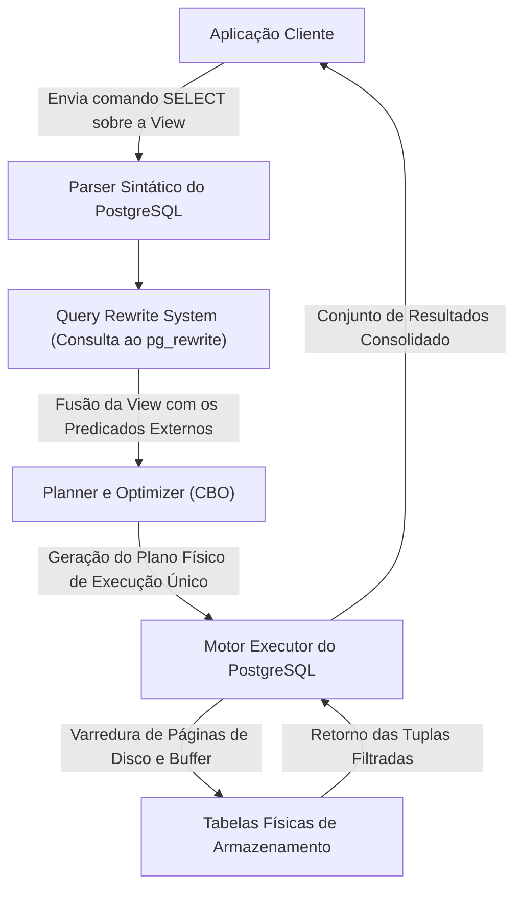
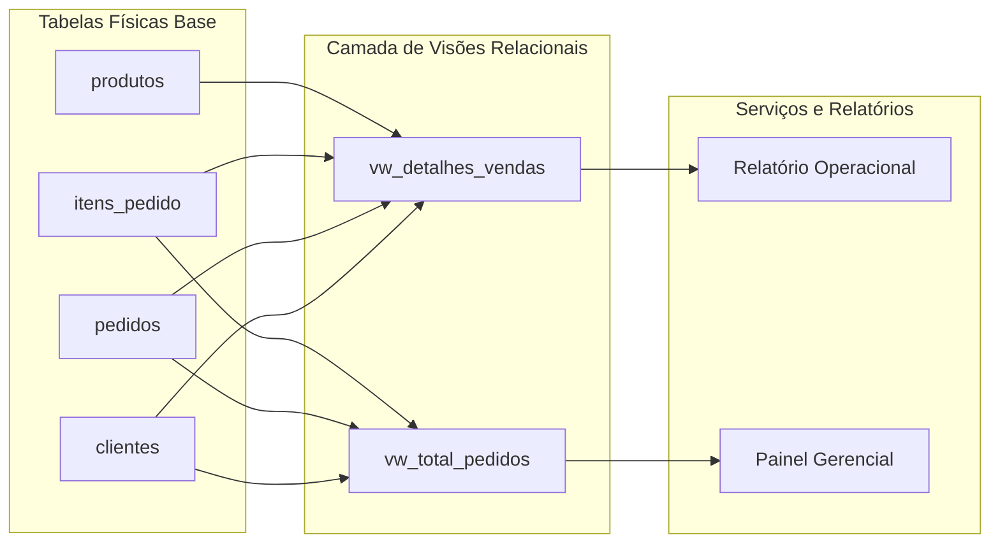
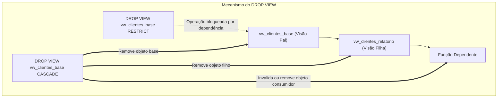
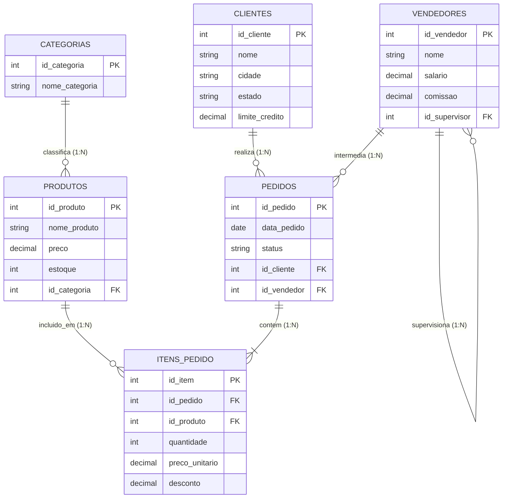
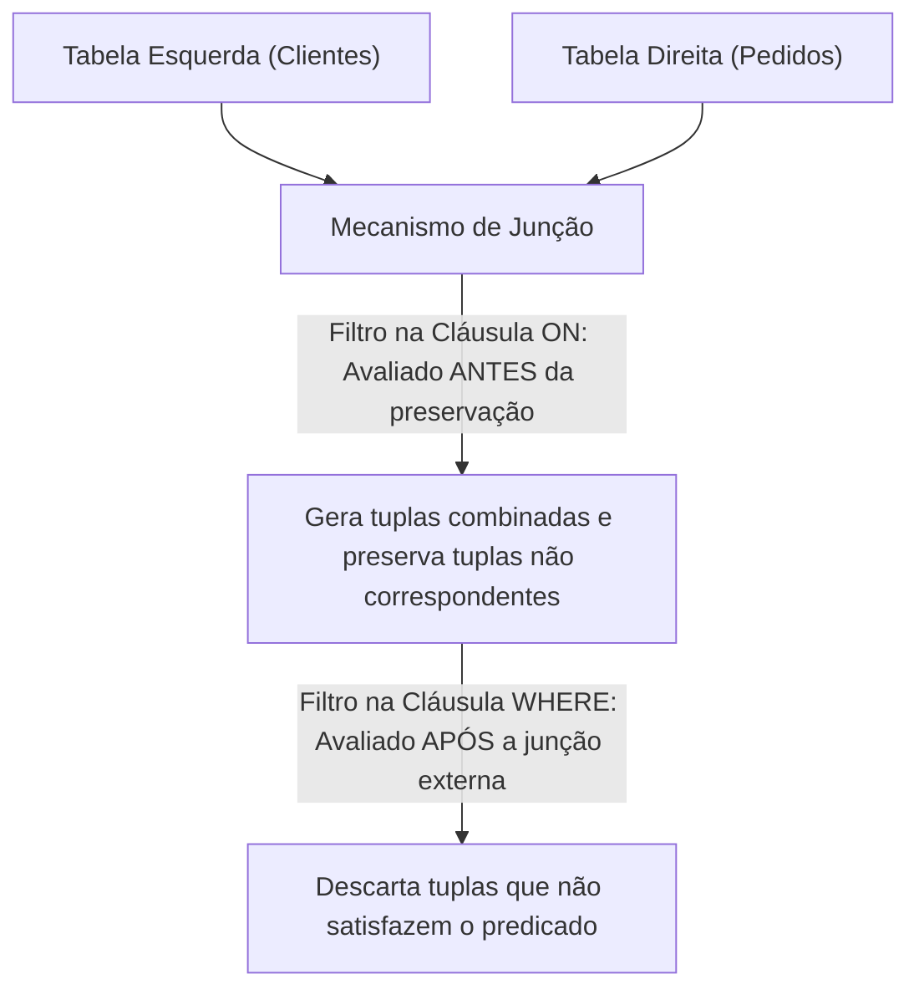
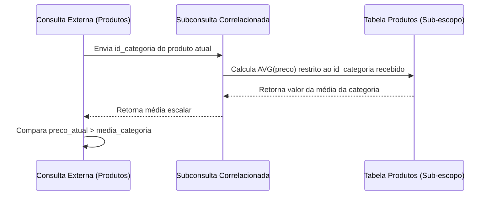
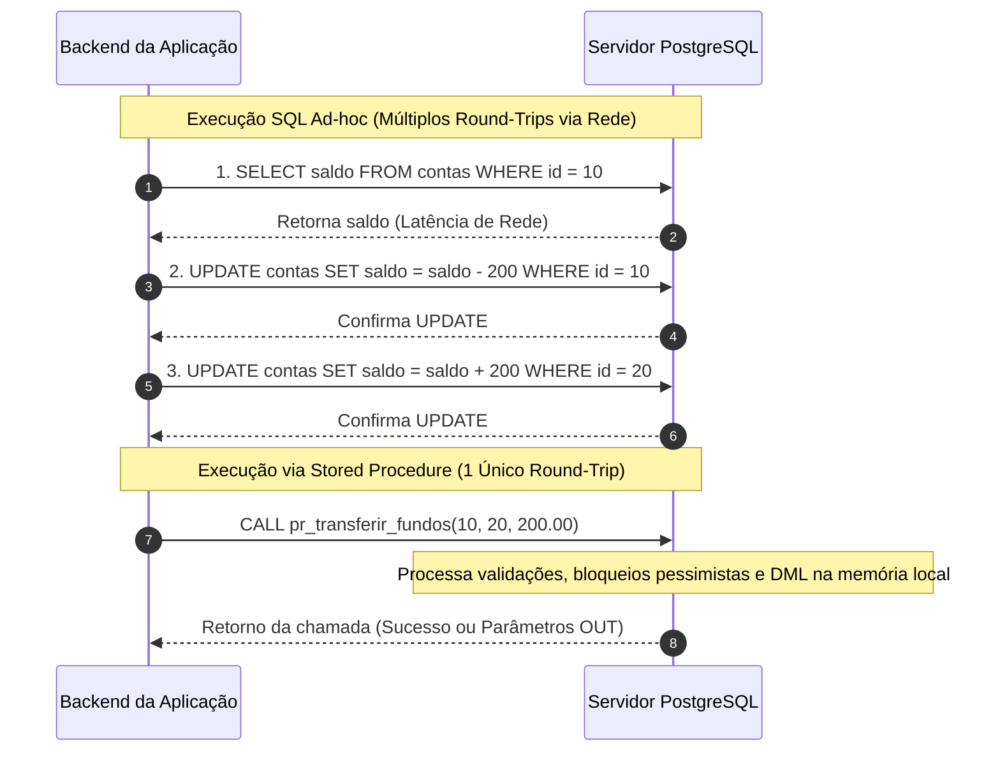
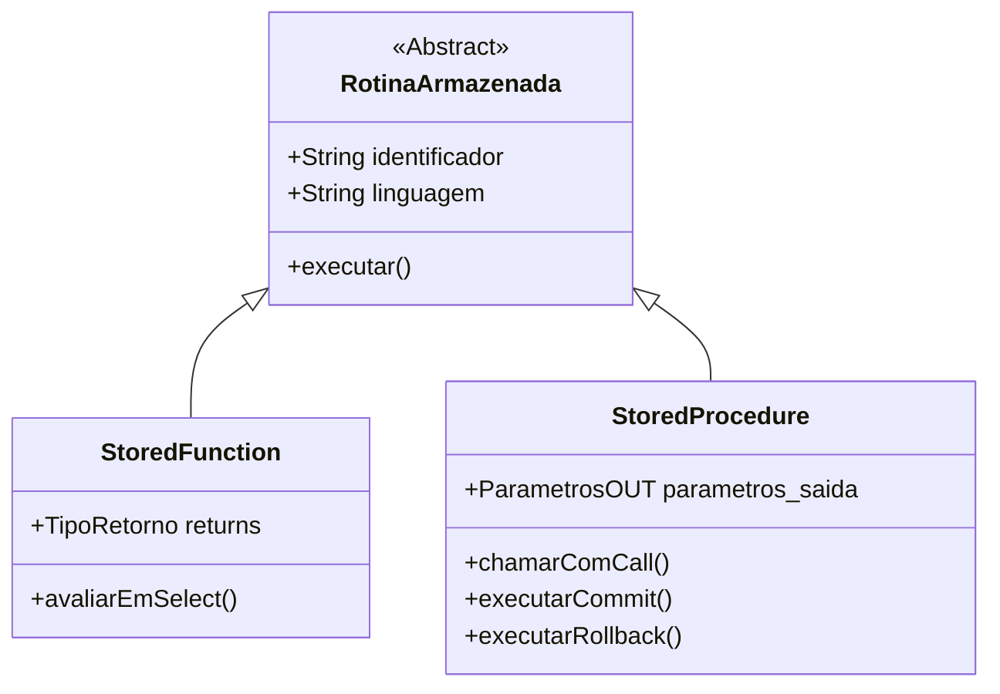
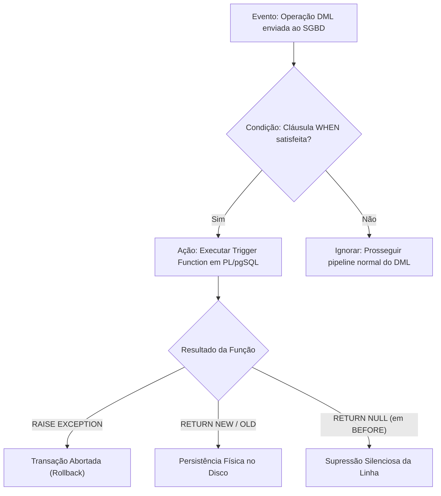
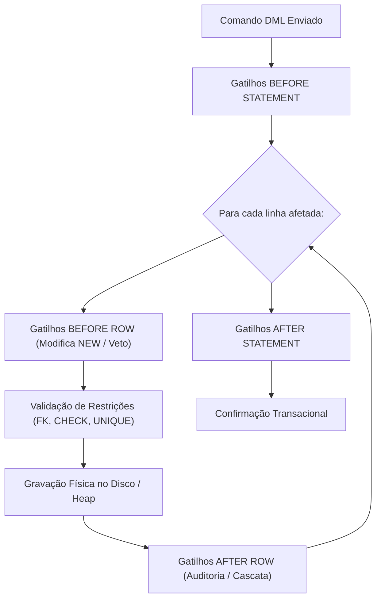

# Guia Completo de Tópicos Avançados em Banco de Dados: Arquitetura Relacional, Otimização e Programação Procedural em PostgreSQL

**Instituição:** Centro Universitário de Santa Fé do Sul (UniFEF)  
**Curso:** Bacharelado em Sistemas de Informação  
**Disciplina:** Tópicos Avançados em Banco de Dados (4º Semestre)  
**Professor:** Prof. Welington Garcia  
**Tema:** Visões Relacionais e Materializadas, Junções e Subconsultas Avançadas, Programação Procedural em PL/pgSQL, Triggers de Negócio e Engenharia de Desempenho

---

## Sumário

- [Objetivo do Guia de Estudos](#objetivo-do-guia-de-estudos)
- [Módulo 1: Visões Relacionais e Visões Materializadas](#módulo-1-visões-relacionais-e-visões-materializadas)
  - [Conceito e Arquitetura do Mecanismo de Reescrita de Consultas](#conceito-e-arquitetura-do-mecanismo-de-reescrita-de-consultas)
  - [Diferenças Estruturais: Tabela Base, View e Materialized View](#diferenças-estruturais-tabela-base-view-e-materialized-view)
  - [Sintaxe Formal e Criação Passo a Passo](#sintaxe-formal-e-criação-passo-a-passo)
  - [Views com Junções Múltiplas e Agregações Analíticas](#views-com-junções-múltiplas-e-agregações-analíticas)
  - [Substituição e Evolução Estrutural com CREATE OR REPLACE VIEW](#substituição-e-evolução-estrutural-com-create-or-replace-view)
  - [Gestão de Dependências no Catálogo: DROP VIEW, RESTRICT e CASCADE](#gestão-de-dependências-no-catálogo-drop-view-restrict-e-cascade)
  - [Visões Atualizáveis e a Cláusula WITH CHECK OPTION](#visões-atualizáveis-e-a-cláusula-with-check-option)
  - [Segurança da Informação e Controle de Acesso com GRANT e REVOKE](#segurança-da-informação-e-controle-de-acesso-com-grant-e-revoke)
  - [Visões Materializadas, Sincronização e Indexação Física Dedicada](#visões-materializadas-sincronização-e-indexação-física-dedicada)
- [Módulo 2: Álgebra Relacional e Técnicas Avançadas de Junção](#módulo-2-álgebra-relacional-e-técnicas-avançadas-de-junção)
  - [Integridade Referencial e Modelagem Entidade-Relacionamento](#integridade-referencial-e-modelagem-entidade-relacionamento)
  - [Algoritmos Físicos de Execução no PostgreSQL: Nested Loop, Hash Join e Merge Join](#algoritmos-físicos-de-execução-no-postgresql-nested-loop-hash-join-e-merge-join)
  - [INNER JOIN e Descarte de Tuplas não Correspondentes](#inner-join-e-descarte-de-tuplas-não-correspondentes)
  - [LEFT OUTER JOIN e a Mecânica de Preservação com Preenchimento NULL](#left-outer-join-e-a-mecânica-de-preservação-com-preenchimento-null)
  - [Padrão Anti-Join: Identificação de Registros Sem Correspondência](#padrão-anti-join-identificação-de-registros-sem-correspondência)
  - [Substituição Escalar de Nulos com COALESCE](#substituição-escalar-de-nulos-com-coalesce)
  - [RIGHT OUTER JOIN e Simetria Relacional](#right-outer-join-e-simetria-relacional)
  - [FULL OUTER JOIN: Aplicações em Conciliação de Dados e Auditoria](#full-outer-join-aplicações-em-conciliação-de-dados-e-auditoria)
  - [CROSS JOIN e os Riscos de Explosão Combinatória](#cross-join-e-os-riscos-de-explosão-combinatória)
  - [SELF JOIN: Autorrelacionamento e Resolução de Hierarquias em Árvore](#self-join-autorrelacionamento-e-resolução-de-hierarquias-em-árvore)
  - [Ponto Crítico Semântico: Filtragem na Cláusula ON versus Cláusula WHERE](#ponto-crítico-semântico-filtragem-na-cláusula-on-versus-cláusula-where)
  - [Simplificações Sintáticas: Cláusula USING versus Riscos do NATURAL JOIN](#simplificações-sintáticas-cláusula-using-versus-riscos-do-natural-join)
  - [Agregações em Junções: Discrepância Semântica entre COUNT Asterisco e COUNT de Coluna](#agregações-em-junções-discrepância-semântica-entre-count-asterisco-e-count-de-coluna)
- [Módulo 3: Subconsultas, Tabelas Derivadas e Expressões de Tabela Comuns](#módulo-3-subconsultas-tabelas-derivadas-e-expressões-de-tabela-comuns)
  - [Taxonomia Formal e Dimensões Estruturais de Subconsultas](#taxonomia-formal-e-dimensões-estruturais-de-subconsultas)
  - [Subconsultas Escalares nas Cláusulas SELECT e WHERE](#subconsultas-escalares-nas-cláusulas-select-e-where)
  - [Pertencimento a Conjuntos: Operadores IN e NOT IN](#pertencimento-a-conjuntos-operadores-in-e-not-in)
  - [A Lógica Tri-Valorada e a Falha Catastrófica de NOT IN com Nulos](#a-lógica-tri-valorada-e-a-falha-catastrófica-de-not-in-com-nulos)
  - [Operadores de Existência: Mecânica de Curto-Circuito com EXISTS e NOT EXISTS](#operadores-de-existência-mecânica-de-curto-circuito-com-exists-e-not-exists)
  - [Quantificadores Universais e Existenciais: ANY e ALL](#quantificadores-universais-e-existenciais-any-e-all)
  - [Subconsultas Correlacionadas e Ciclo de Execução Linha a Linha](#subconsultas-correlacionadas-e-ciclo-de-execução-linha-a-linha)
  - [Tabelas Derivadas na Cláusula FROM e a Obrigatoriedade de Alias](#tabelas-derivadas-na-cláusula-from-e-a-obrigatoriedade-de-alias)
  - [Filtragem de Grupos Agregados com Subconsultas no HAVING](#filtragem-de-grupos-agregados-com-subconsultas-no-having)
  - [Comandos DML Guiados por Subconsultas: INSERT, UPDATE e DELETE](#comandos-dml-guiados-por-subconsultas-insert-update-e-delete)
  - [Expressões de Tabela Comuns: Common Table Expressions com a Cláusula WITH](#expressões-de-tabela-comuns-common-table-expressions-com-a-cláusula-with)
- [Módulo 4: Programação Procedural em PL/pgSQL e Stored Procedures](#módulo-4-programação-procedural-em-plpgsql-e-stored-procedures)
  - [Transição de Paradigma: Declarativo versus Procedural](#transição-de-paradigma-declarativo-versus-procedural)
  - [Evolução Histórica e Distinção entre Stored Functions e Stored Procedures](#evolução-histórica-e-distinção-entre-stored-functions-e-stored-procedures)
  - [Anatomia Estrutural de um Bloco PL/pgSQL e Dollar Quoting](#anatomia-estrutural-de-um-bloco-plpgsql-e-dollar-quoting)
  - [Blocos Anônimos e Procedimentos Nomeados](#blocos-anônimos-e-procedimentos-nomeados)
  - [Declaração de Variáveis, Tipagem Escalar e Ancoragem Dinâmica](#declaração-de-variáveis-tipagem-escalar-e-ancoragem-dinâmica)
  - [Atribuição de Valores e Captura com SELECT INTO](#atribuição-de-valores-e-captura-com-select-into)
  - [Parâmetros de Entrada, Saída e Mistos: IN, OUT e INOUT](#parâmetros-de-entrada-saída-e-mistos-in-out-e-inout)
  - [Estruturas de Controle de Fluxo Condicional](#estruturas-de-controle-de-fluxo-condicional)
  - [Comunicação e Tratamento de Exceções: RAISE NOTICE e RAISE EXCEPTION](#comunicação-e-tratamento-de-exceções-raise-notice-e-raise-exception)
  - [Diagnóstico de DML: Variável FOUND e Instrução GET DIAGNOSTICS](#diagnóstico-de-dml-variável-found-e-instrução-get-diagnostics)
  - [Concorrência e Bloqueio Pessimista de Linhas com SELECT FOR UPDATE](#concorrência-e-bloqueio-pessimista-de-linhas-com-select-for-update)
  - [Gestão Autônoma de Transações com COMMIT e ROLLBACK em Procedures](#gestão-autônoma-de-transações-com-commit-e-rollback-em-procedures)
- [Módulo 5: Triggers e Automação de Regras de Negócio](#módulo-5-triggers-e-automação-de-regras-de-negócio)
  - [O Paradigma Event-Condition-Action no Núcleo do SGBD](#o-paradigma-event-condition-action-no-núcleo-do-sgbd)
  - [Arquitetura em Duas Etapas no PostgreSQL](#arquitetura-em-duas-etapas-no-postgresql)
  - [Eventos Disparadores de DML: INSERT, UPDATE, DELETE e TRUNCATE](#eventos-disparadores-de-dml-insert-update-delete-e-truncate)
  - [Momentos de Interceptação: BEFORE, AFTER e INSTEAD OF](#momentos-de-interceptação-before-after-e-instead-of)
  - [Granularidade de Execução: FOR EACH ROW versus FOR EACH STATEMENT](#granularidade-de-execução-for-each-row-versus-for-each-statement)
  - [Variáveis Especiais de Contexto de Execução](#variáveis-especiais-de-contexto-de-execução)
  - [Validação, Sanitização e Normalização Preventiva com BEFORE](#validação-sanitização-e-normalização-preventiva-com-before)
  - [Otimização com Condição de Disparo e UPDATE OF de Colunas](#otimização-com-condição-de-disparo-e-update-of-de-colunas)
  - [Trilhas de Auditoria Imutáveis e Histórico de Alterações com AFTER](#trilhas-de-auditoria-imutáveis-e-histórico-de-alterações-com-after)
  - [Sincronização em Cascata: Baixa de Estoque e Recálculo Automático de Totais](#sincronização-em-cascata-baixa-de-estoque-e-recálculo-automático-de-totais)
  - [Triggers Multifuncionais e Multiplexação Condicional via TG_OP](#triggers-multifuncionais-e-multiplexação-condicional-via-tg_op)
  - [Armadilhas de Engenharia: Recursão Infinita e Efeitos Colaterais Ocultos](#armadilhas-de-engenharia-recursão-infinita-e-efeitos-colaterais-ocultos)
- [Módulo 6: Caderno de Exercícios e Casos Práticos Homologados](#módulo-6-caderno-de-exercícios-e-casos-práticos-homologados)
  - [Lista 1: Exercícios de Junções Relacionais](#lista-1-exercícios-de-junções-relacionais)
  - [Lista 2: Exercícios de Subconsultas - Parte 1](#lista-2-exercícios-de-subconsultas---parte-1)
  - [Lista 3: Exercícios de Subconsultas Avançadas - Parte 2](#lista-3-exercícios-de-subconsultas-avançadas---parte-2)
  - [Lista 4: Exercícios Integrados de Pontos](#lista-4-exercícios-integrados-de-pontos)
  - [Lista 5: Exercícios de Stored Procedures Corporativas](#lista-5-exercícios-de-stored-procedures-corporativas)
- [Módulo 7: Engenharia de Desempenho e Diagnóstico com EXPLAIN ANALYZE](#módulo-7-engenharia-de-desempenho-e-diagnóstico-com-explain-analyze)
- [Módulo 8: Glossário Técnico de Engenharia de Dados](#módulo-8-glossário-técnico-de-engenharia-de-dados)
- [Módulo 9: Banco de Questões com Respostas em Formato Estruturado](#módulo-9-banco-de-questões-com-respostas-em-formato-estruturado)
- [Módulo 10: Checklist de Verificação e Prática em Laboratório](#módulo-10-checklist-de-verificação-e-prática-em-laboratório)

---

## Objetivo do Guia de Estudos

Este material didático e técnico tem como objetivo consolidar a formação em nível avançado dos estudantes do curso de Sistemas de Informação da UniFEF na disciplina de Tópicos Avançados em Banco de Dados, ministrada pelo Prof. Welington Garcia. 

O conteúdo abrange os fundamentos teóricos, matemáticos e arquiteturais do modelo relacional, bem como sua implementação de alto desempenho no sistema gerenciador de banco de dados PostgreSQL. Ao concluir este material, o estudante será capaz de projetar esquemas normalizados, construir visões otimizadas, diagnosticar custos computacionais com o otimizador do SGBD, orquestrar rotinas transacionais robustas com PL/pgSQL e garantir integridade corporativa e auditoria utilizando gatilhos reativos.

---

## Módulo 1: Visões Relacionais e Visões Materializadas

### Conceito e Arquitetura do Mecanismo de Reescrita de Consultas

No modelo relacional e na especificação ANSI/ISO SQL, uma visão (*view*) é definida como uma relação virtual. Diferentemente de uma tabela base, uma visão comum não aloca páginas de dados no subsistema de armazenamento em disco (*heap files*) para guardar tuplas. Ela persiste exclusivamente metadados estruturais e sua respectiva definição textual no catálogo do sistema (no PostgreSQL, primariamente nas tabelas de sistema `pg_views` e `pg_rewrite`).

Quando um comando `SELECT` referencia uma visão, o PostgreSQL não executa a consulta da visão isoladamente para filtrar os dados em memória posteriormente. Em vez disso, o componente denominado *Query Rewrite Rule System* intercepta a árvore sintática gerada pelo analisador (*parser*) e substitui o nó correspondente à visão pela subárvore da consulta contida na sua definição original.



### Diferenças Estruturais: Tabela Base, View e Materialized View

A diferenciação física e operacional entre essas três abstrações dita o desenho de arquitetura de persistência:

| Dimensão Estrutural | Tabela Base | View Comum (Padrão) | Materialized View |
| :--- | :--- | :--- | :--- |
| **Armazenamento de Dados** | Físico em arquivos de disco (*heap*) | Inexistente (virtual) | Físico em arquivos de disco (*snapshot*) |
| **Persistência de Definição** | Definição DDL estrutural | Consulta declarativa no catálogo | Consulta declarativa no catálogo |
| **Frescor dos Dados (*Data Freshness*)** | Imediato (conforme isolamento transacional) | Imediato (lê em tempo real) | Assíncrono/Estático (depende de `REFRESH`) |
| **Custo de Processamento na Leitura** | Custo de varredura ou índice | Custo da consulta subjacente expandida | Custo de varredura ou índice próprio |
| **Suporte a Índices Dedicados** | Completo (B-Tree, Hash, GIN, GiST, BRIN) | Inexistente (depende das tabelas base) | Completo (B-Tree, Hash, GIN, GiST, BRIN) |
| **Capacidade de DML Direto** | Total (`INSERT`, `UPDATE`, `DELETE`) | Condicional (apenas em views simples) | Nula (somente leitura via DML) |

### Sintaxe Formal e Criação Passo a Passo

A instrução SQL para registrar uma visão no catálogo respeita a seguinte gramática formal:

```sql
CREATE [ OR REPLACE ] [ TEMP | TEMPORARY ] [ RECURSIVE ] VIEW nome_da_view [ ( alias_coluna [, ...] ) ]
AS consulta_select
[ WITH [ CASCADED | LOCAL ] CHECK OPTION ];
```

Considere o isolamento de clientes de uma determinada região geográfica:

```sql
-- Criação de uma visão delimitando o escopo geográfico para o estado de São Paulo
CREATE VIEW vw_clientes_sp AS
SELECT 
    id_cliente, 
    nome, 
    cidade
FROM clientes
WHERE estado = 'SP';
```

Quando um predicado adicional é aplicado pelo cliente:

```sql
SELECT nome, cidade
FROM vw_clientes_sp
WHERE cidade = 'Campinas'
ORDER BY nome ASC;
```

O mecanismo de reescrita funde os predicados, submetendo ao otimizador de custos (*Cost-Based Optimizer* - CBO) uma consulta equivalente a:

```sql
SELECT nome, cidade
FROM clientes
WHERE estado = 'SP' AND cidade = 'Campinas'
ORDER BY nome ASC;
```

Essa operação permite ao planejador utilizar eventuais índices compostos existentes na tabela `clientes` (por exemplo, um índice B-Tree cobrindo as colunas `estado` e `cidade`).

### Views com Junções Múltiplas e Agregações Analíticas

A encapsulação de regras relacionais evita duplicação de lógica entre múltiplos microsserviços ou aplicações consumidoras.

```sql
-- Visão analítica consolidando quatro relações com subtotal por item
CREATE VIEW vw_detalhes_vendas AS
SELECT
    p.id_pedido,
    c.nome AS cliente,
    pr.nome_produto,
    ip.quantidade,
    ip.preco_unitario,
    (ip.quantidade * ip.preco_unitario) AS subtotal
FROM pedidos p
INNER JOIN clientes c ON p.id_cliente = c.id_cliente
INNER JOIN itens_pedido ip ON p.id_pedido = ip.id_pedido
INNER JOIN produtos pr ON ip.id_produto = pr.id_produto;

-- Visão agregada calculando faturamento consolidado por pedido
CREATE VIEW vw_total_pedidos AS
SELECT
    p.id_pedido,
    c.nome AS cliente,
    SUM(ip.quantidade * ip.preco_unitario) AS valor_total
FROM pedidos p
INNER JOIN clientes c ON p.id_cliente = c.id_cliente
INNER JOIN itens_pedido ip ON p.id_pedido = ip.id_pedido
GROUP BY p.id_pedido, c.nome;
```



### Substituição e Evolução Estrutural com CREATE OR REPLACE VIEW

O comando `CREATE OR REPLACE VIEW` permite redefinir a consulta interna de uma visão sem destruí-la previamente, preservando permissões concedidas. Contudo, o motor do PostgreSQL impõe restrições severas para proteger objetos dependentes:

1. **Invariância de Colunas Prévias:** Todas as colunas existentes na versão anterior devem ser mantidas na nova definição, preservando exatamente os mesmos nomes, os mesmos tipos de dados estruturais e a mesma ordem sequencial.
2. **Inclusão Exclusiva no Final:** Novas colunas podem ser adicionadas somente ao final da lista de projeção.
3. **Proibição de Exclusão e Renomeação:** A remoção de colunas existentes ou a alteração de seus tipos de dados resulta em erro imediato emitido pelo SGBD.

```sql
-- VÁLIDO: Adição de uma nova coluna ao final da projeção
CREATE OR REPLACE VIEW vw_clientes_sp AS
SELECT
    id_cliente,
    nome,
    cidade,
    limite_credito
FROM clientes
WHERE estado = 'SP';
```

Caso seja necessário reordenar ou remover colunas, deve-se utilizar `DROP VIEW` seguido de `CREATE VIEW`.

### Gestão de Dependências no Catálogo: DROP VIEW, RESTRICT e CASCADE

O catálogo do PostgreSQL fiscaliza dependências através da tabela de sistema `pg_depend`. Quando outros objetos (visões filhas, gatilhos, regras ou funções) dependem de uma visão pai, o comportamento de remoção é ditado pelas opções:

- **RESTRICT (Comportamento Padrão):** Aborta a instrução caso exista qualquer objeto dependente cadastrado no sistema.
- **CASCADE:** Remove a visão indicada e elimina recursivamente todos os objetos dependentes da árvore estrutural.

```sql
-- Cenário de dependência encadeada
CREATE VIEW vw_clientes_base AS 
SELECT id_cliente, nome, estado FROM clientes;

CREATE VIEW vw_clientes_relatorio AS 
SELECT id_cliente, nome FROM vw_clientes_base WHERE estado = 'SP';

-- Falha com erro de dependência:
-- DROP VIEW vw_clientes_base RESTRICT;

-- Remoção em cascata (remove vw_clientes_base E vw_clientes_relatorio):
DROP VIEW vw_clientes_base CASCADE;
```



### Visões Atualizáveis e a Cláusula WITH CHECK OPTION

Uma visão comum pode receber operações DML (`INSERT`, `UPDATE`, `DELETE`) de forma automática se obedecer rigorosamente a todas as regras da especificação relacional:

1. A cláusula `FROM` deve referenciar exatamente uma única tabela base (ou outra visão atualizável).
2. Não pode conter cláusulas `GROUP BY`, `HAVING` ou funções de agregação (`SUM`, `AVG`, `COUNT`).
3. Não pode conter operadores de conjunto (`UNION`, `INTERSECT`, `EXCEPT`).
4. Não pode conter a palavra-chave `DISTINCT`.
5. Não pode conter funções de janela (*Window Functions* via cláusula `OVER`).
6. As colunas manipuladas devem ser referências diretas a colunas da tabela base (não podem ser expressões calculadas).

#### A Garantia de Consistência com WITH CHECK OPTION

Quando uma visão atualizável possui uma cláusula `WHERE`, uma operação de `INSERT` ou `UPDATE` pode fornecer valores que violem essa condição, fazendo com que a tupla seja gravada na tabela base, mas "desapareça" da própria visão que a inseriu. A cláusula `WITH CHECK OPTION` impede essa anomalia:

- **LOCAL:** Fiscaliza exclusivamente as restrições definidas na visão atual, sem verificar filtros de visões subjacentes das quais ela possa derivar.
- **CASCADED (Padrão quando não especificado):** Valida recursivamente os predicados de toda a cadeia hierárquica de visões.

```sql
-- Criação de visão protegida com WITH CHECK OPTION
CREATE VIEW vw_clientes_sp_segura AS
SELECT id_cliente, nome, cidade, estado
FROM clientes
WHERE estado = 'SP'
WITH CHECK OPTION;

-- SUCESSO: A tupla atende à condição estado = 'SP'
INSERT INTO vw_clientes_sp_segura (nome, cidade, estado)
VALUES ('Roberto Prado', 'Ribeirão Preto', 'SP');

-- ERRO DE RUNTIME: new row violates check option for view "vw_clientes_sp_segura"
-- INSERT INTO vw_clientes_sp_segura (nome, cidade, estado)
-- VALUES ('Carlos Santos', 'Belo Horizonte', 'MG');
```

### Segurança da Informação e Controle de Acesso com GRANT e REVOKE

Visões atuam como camadas de segurança lógica no PostgreSQL, viabilizando o controle de acesso a nível de coluna (*column-level security*) e a nível de linha (*row-level security*). 

Pelo princípio do menor privilégio, revogam-se os privilégios diretos sobre a tabela física e concedem-se privilégios de `SELECT` estritamente sobre a visão intermediária:

```sql
-- 1. Criação do papel (role) restrito
CREATE ROLE relatorios_usuario WITH LOGIN PASSWORD 'SenhaForte123';

-- 2. Revogação de acesso direto à tabela de funcionários (contém salários e dados sensíveis)
REVOKE ALL ON TABLE funcionarios FROM relatorios_usuario;

-- 3. Criação de visão projetando apenas colunas não sensíveis
CREATE VIEW vw_quadro_colaboradores AS
SELECT id_funcionario, nome, cargo, departamento
FROM funcionarios
WHERE ativo = TRUE;

-- 4. Concessão de leitura sobre a visão
GRANT SELECT ON vw_quadro_colaboradores TO relatorios_usuario;
```

### Visões Materializadas, Sincronização e Indexação Física Dedicada

Em cenários analíticos e relatórios de inteligência de negócios (BI), recalcular agregações complexas sobre tabelas com milhões de registros a cada requisição é inviável em termos de latência e consumo de I/O. As visões materializadas (*Materialized Views*) resolvem esse gargalo persistindo o resultado da consulta fisicamente no disco.

```sql
-- Criação de uma visão materializada
CREATE MATERIALIZED VIEW mv_desempenho_vendas_ano AS
SELECT 
    pr.id_categoria,
    ca.nome_categoria,
    DATE_TRUNC('month', p.data_pedido) AS mes_ano,
    COUNT(DISTINCT p.id_pedido) AS volume_pedidos,
    SUM(ip.quantidade * ip.preco_unitario) AS faturamento_bruto
FROM pedidos p
INNER JOIN itens_pedido ip ON p.id_pedido = ip.id_pedido
INNER JOIN produtos pr ON ip.id_produto = pr.id_produto
INNER JOIN categorias ca ON pr.id_categoria = ca.id_categoria
GROUP BY pr.id_categoria, ca.nome_categoria, DATE_TRUNC('month', p.data_pedido);
```

#### Criação de Índices Físicos Dedicados

Como uma visão materializada possui representação física em disco com páginas de heap, é possível construir índices para otimizar leituras:

```sql
-- Criação de índice B-Tree na visão materializada
CREATE INDEX idx_mv_vendas_categoria 
ON mv_desempenho_vendas_ano (id_categoria, mes_ano);
```

#### Atualização de Dados: REFRESH MATERIALIZED VIEW

A visão materializada não reflete automaticamente alterações em tempo real das tabelas base. Sua sincronização exige o comando `REFRESH MATERIALIZED VIEW`:

1. **Atualização Padrão (Exclusiva):**
   ```sql
   REFRESH MATERIALIZED VIEW mv_desempenho_vendas_ano;
   ```
   *Mecânica:* Bloqueia a visão materializada para operações de leitura (`AccessExclusiveLock`) durante todo o processo de recomputação.

2. **Atualização Concorrente (Sem Bloqueio de Leitura):**
   ```sql
   REFRESH MATERIALIZED VIEW CONCURRENTLY mv_desempenho_vendas_ano;
   ```
   *Requisito Obrigatório:* Para utilizar a cláusula `CONCURRENTLY`, a visão materializada deve possuir obrigatoriamente pelo menos um índice exclusivo (`UNIQUE INDEX`) cobrindo uma ou mais colunas que identifiquem unicamente cada registro, sem cláusula `WHERE` (índice total):

   ```sql
   -- Criação do índice único obrigatório para refresh concorrente
   CREATE UNIQUE INDEX uidx_mv_desempenho_vendas 
   ON mv_desempenho_vendas_ano (id_categoria, mes_ano);
   ```

---

## Módulo 2: Álgebra Relacional e Técnicas Avançadas de Junção

### Integridade Referencial e Modelagem Entidade-Relacionamento

A decomposição de dados em formas normais (1FN, 2FN e 3FN) previne anomalias de redundância, exclusão e alteração. No PostgreSQL, a relação de integridade é assegurada declarativamente por chaves primárias (`PRIMARY KEY`) e chaves estrangeiras (`FOREIGN KEY`).



### Algoritmos Físicos de Execução no PostgreSQL: Nested Loop, Hash Join e Merge Join

O otimizador de consultas por custo (CBO) do PostgreSQL avalia o catálogo estatístico gerado pelo utilitário `ANALYZE` e seleciona o algoritmo de junção mais adequado:

1. **Nested Loop Join:**
   - *Mecânica:* Percorre a relação externa linha por linha e, para cada registro, sonda a relação interna.
   - *Custo Assintótico:* $`O(M \times N)`$ sem índice; $`O(M \times \log N)`$ com índice B-Tree na chave de junção da tabela interna.
   - *Indicação:* Conjuntos de dados pequenos ou junções altamente restritivas alimentadas por índices.

2. **Hash Join:**
   - *Mecânica:* Lê a tabela de menor cardinalidade e constrói uma tabela hash estruturada em memória RAM (`work_mem`). Em seguida, varre a tabela maior efetuando buscas $`O(1)`$ contra a tabela hash.
   - *Custo Assintótico:* $`O(M + N)`$ em cenário de memória suficiente.
   - *Indicação:* Conjuntos de dados médios a grandes, em condições de igualdade (equijunções), sem necessidade de pré-ordenação.

3. **Merge Join:**
   - *Mecânica:* Exige que ambas as relações estejam ordenadas pelas chaves de junção. O motor avança cursores simultâneos pelas tabelas em uma única passagem sequencial.
   - *Custo Assintótico:* $`O(M \log M + N \log N)`$ quando a ordenação for necessária; $`O(M + N)`$ se as tabelas já estiverem fisicamente ordenadas via índice ou passo anterior.
   - *Indicação:* Conjuntos volumosos de dados que excedem o espaço de memória da tabela hash.

### INNER JOIN e Descarte de Tuplas não Correspondentes

O `INNER JOIN` representa a interseção relacional estrita entre dois conjuntos. Uma tupla de $`R`$ é associada a $`S`$ se, e somente se, o predicado booleano na cláusula `ON` avaliar como verdadeiro (`TRUE`):

```sql
SELECT 
    p.id_pedido, 
    p.data_pedido, 
    c.nome AS nome_cliente
FROM pedidos p
INNER JOIN clientes c ON p.id_cliente = c.id_cliente
ORDER BY p.id_pedido ASC;
```

Se um cliente não efetuou pedidos, ou se um pedido apontar para um cliente inexistente (violando a integridade), esses registros não compõem a saída.

### LEFT OUTER JOIN e a Mecânica de Preservação com Preenchimento NULL

O `LEFT OUTER JOIN` preserva a totalidade das tuplas da relação declarada à esquerda da cláusula, independentemente da existência de pares na relação à direita. Quando não houver correspondência, as colunas originárias da tabela da direita são preenchidas com `NULL`:

```sql
SELECT 
    c.id_cliente, 
    c.nome AS cliente, 
    p.id_pedido, 
    p.data_pedido
FROM clientes c
LEFT JOIN pedidos p ON c.id_cliente = p.id_cliente
ORDER BY c.id_cliente ASC;
```

### Padrão Anti-Join: Identificação de Registros Sem Correspondência

O padrão de engenharia denominado *Anti-Join* tem por finalidade isolar elementos de um conjunto $`A`$ que não mantêm vínculo com elementos de $`B`$ ($`A \setminus B`$). No PostgreSQL, a implementação clássica combina `LEFT JOIN` com um predicado `WHERE` restrito à nulidade da chave primária da relação direita:

```sql
SELECT 
    c.id_cliente, 
    c.nome, 
    c.cidade
FROM clientes c
LEFT JOIN pedidos p ON c.id_cliente = p.id_cliente
WHERE p.id_pedido IS NULL;
```

> [!CAUTION]
> **Armadilha de Implementação (Pitfall):** Nunca aplique a cláusula `WHERE coluna IS NULL` sobre uma coluna opcional que aceite nulos por modelagem (ex.: `observacoes`). A condição deve recair estritamente sobre a **chave primária** da relação direita ou sobre uma coluna com restrição `NOT NULL`, garantindo que o valor `NULL` seja decorrência exclusiva da ausência de correspondência na junção.

### Substituição Escalar de Nulos com COALESCE

A função escalar `COALESCE(expressao_1, expressao_2, ..., expressao_n)` avalia seus argumentos sequencialmente da esquerda para a direita e retorna o primeiro valor não nulo:

```sql
SELECT 
    v.id_vendedor,
    v.nome AS vendedor,
    COALESCE(SUM(ip.quantidade * ip.preco_unitario), 0.00) AS faturamento_total
FROM vendedores v
LEFT JOIN pedidos p ON v.id_vendedor = p.id_vendedor
LEFT JOIN itens_pedido ip ON p.id_pedido = ip.id_pedido
GROUP BY v.id_vendedor, v.nome
ORDER BY faturamento_total DESC;
```

### RIGHT OUTER JOIN e Simetria Relacional

O `RIGHT OUTER JOIN` preserva todos os registros da tabela da direita, preenchendo colunas da esquerda com `NULL` quando não houver correspondência. Matematicamente:

```math
A \text{ RIGHT JOIN } B \equiv B \text{ LEFT JOIN } A
```

Guias corporativos de estilo SQL recomendam priorizar `LEFT JOIN`, mantendo a leitura contínua da esquerda para a direita.

### FULL OUTER JOIN: Aplicações em Conciliação de Dados e Auditoria

O `FULL OUTER JOIN` realiza a união externa total, preservando registros de ambas as tabelas mesmo na ausência mútua de correspondência. É amplamente empregado em rotinas de conciliação contábil e auditoria de dados:

```sql
SELECT 
    c.id_cliente AS id_cliente_base,
    c.nome AS nome_cliente,
    p.id_pedido AS id_pedido_transacao,
    p.status
FROM clientes c
FULL OUTER JOIN pedidos p ON c.id_cliente = p.id_cliente;
```

### CROSS JOIN e os Riscos de Explosão Combinatória

O `CROSS JOIN` materializa o produto cartesiano formal entre duas relações ($`R \times S`$). A cardinalidade resultante é calculada por:

```math
|R \times S| = |R| \times |S|
```

```sql
-- Geração de matriz dimensional: Todas as categorias combinadas com todas as filiais
SELECT 
    ca.nome_categoria, 
    f.nome_filial
FROM categorias ca
CROSS JOIN filiais f;
```

> [!WARNING]
> O uso acidental de `CROSS JOIN` em tabelas operacionais volumosas pode saturar a memória temporária do banco (`work_mem`) e esgotar o espaço em disco de arquivos temporários, provocando lentidão acentuada ou travamento de sessões.

### SELF JOIN: Autorrelacionamento e Resolução de Hierarquias em Árvore

O `SELF JOIN` consiste na associação de uma tabela consigo mesma. O cenário clássico modela o padrão de lista de adjacência (*Adjacency List*) para estruturas hierárquicas, onde uma chave estrangeira aponta para a chave primária da própria relação:

```sql
SELECT 
    v.id_vendedor,
    v.nome AS colaborador,
    COALESCE(sup.nome, 'Diretoria / Sem Supervisor') AS superior_imediato
FROM vendedores v
LEFT JOIN vendedores sup ON v.id_supervisor = sup.id_vendedor
ORDER BY sup.nome ASC NULLS FIRST, v.nome ASC;
```

### Ponto Crítico Semântico: Filtragem na Cláusula ON versus Cláusula WHERE

A compreensão da ordem lógica de avaliação das cláusulas SQL em junções externas é fundamental:



#### Exemplo Comparativo

```sql
-- CASO 1: Predicado no ON
-- Preserva todos os clientes, trazendo apenas pedidos de 2026 para os clientes que os possuem
SELECT c.id_cliente, c.nome, p.id_pedido, p.data_pedido
FROM clientes c
LEFT JOIN pedidos p ON c.id_cliente = p.id_cliente AND p.data_pedido >= '2026-01-01';

-- CASO 2: Predicado no WHERE
-- Transforma o LEFT JOIN em um INNER JOIN implícito, descartando clientes que não tenham pedidos em 2026!
SELECT c.id_cliente, c.nome, p.id_pedido, p.data_pedido
FROM clientes c
LEFT JOIN pedidos p ON c.id_cliente = p.id_cliente
WHERE p.data_pedido >= '2026-01-01';
```

### Simplificações Sintáticas: Cláusula USING versus Riscos do NATURAL JOIN

Quando duas tabelas compartilham exatamente o mesmo nome de coluna para a chave de ligação:

- **Cláusula USING:** `JOIN pedidos USING (id_cliente)` simplifica a instrução e projeta a coluna de junção apenas uma vez.
- **NATURAL JOIN:** Realiza a junção automaticamente comparando todas as colunas que possuam o mesmo identificador em ambas as tabelas.

> [!CAUTION]
> **Antipadrão Crítico:** O `NATURAL JOIN` é fortemente desaconselhado em ambientes corporativos. Se uma coluna técnica como `data_criacao` ou `status` for adicionada futuramente a ambas as tabelas, o `NATURAL JOIN` incorporará essa coluna à condição de junção de forma silenciosa, alterando drasticamente o plano de execução e o conjunto de resultados da aplicação.

### Agregações em Junções: Discrepância Semântica entre COUNT Asterisco e COUNT de Coluna

Ao combinar `LEFT JOIN` com agrupamento e funções de contagem:

- `COUNT(*)`: Computa o número físico de linhas na partição, sem inspecionar o conteúdo. Se um cliente não possui pedidos, ele recebe uma linha preenchida com valores nulos para pedidos; logo, `COUNT(*)` retornará `1` (incorreto para contagem de pedidos).
- `COUNT(p.id_pedido)`: Avalia estritamente a coluna indicada e só incrementa o contador se o valor for diferente de `NULL`, retornando `0` para clientes sem pedidos (comportamento correto).

---

## Módulo 3: Subconsultas, Tabelas Derivadas e Expressões de Tabela Comuns

### Taxonomia Formal e Dimensões Estruturais de Subconsultas

Uma subconsulta (consulta aninhada ou *subquery*) é uma expressão de consulta `SELECT` embutida no interior de outra instrução SQL externa.

```mermaid
mindmap
  root("Subconsultas SQL")
    "Dimensionalidade da Saída"
      "Escalar (1 linha, 1 coluna)"
      "Multivalorada (N linhas, 1 coluna)"
      "Relacional / Tabular (N linhas, M colunas)"
    "Dependência de Escopo"
      "Independente (Auto-contida)"
      "Correlacionada (Referencia o escopo externo)"
    "Posição Sintática"
      "Cláusula SELECT (Projeção)"
      "Cláusulas WHERE e HAVING (Filtragem)"
      "Cláusula FROM (Tabela Derivada)"
      "Instruções DML (INSERT, UPDATE, DELETE)"
```

### Subconsultas Escalares nas Cláusulas SELECT e WHERE

Uma subconsulta escalar retorna rigorosamente no máximo uma linha e uma coluna ($`1 \times 1`$). Caso produza mais de um registro em tempo de execução, o motor aborta o comando com erro: `ERROR: more than one row returned by a subquery used as an expression`. Se retornar zero tuplas, seu resultado é computado como `NULL`.

```sql
-- Subconsulta escalar aplicada no predicado WHERE
SELECT id_produto, nome_produto, preco
FROM produtos
WHERE preco > (SELECT AVG(preco) FROM produtos);

-- Subconsulta escalar projetada na cláusula SELECT
SELECT 
    nome_produto, 
    preco, 
    ROUND((SELECT AVG(preco) FROM produtos), 2) AS media_global,
    ROUND(preco - (SELECT AVG(preco) FROM produtos), 2) AS diferenca_da_media
FROM produtos;
```

### Pertencimento a Conjuntos: Operadores IN e NOT IN

O operador `IN` avalia se uma expressão corresponde a pelo menos um elemento do conjunto gerado pela subconsulta:

```math
v \in S \iff \exists s \in S \mid v = s
```

```sql
-- Clientes com pelo menos um pedido registrado
SELECT id_cliente, nome
FROM clientes
WHERE id_cliente IN (SELECT id_cliente FROM pedidos);
```

### A Lógica Tri-Valorada e a Falha Catastrófica de NOT IN com Nulos

No modelo relacional fundado sobre a lógica tri-valorada (*Three-Valued Logic* - 3VL), o resultado de uma expressão pode ser `TRUE`, `FALSE` ou `UNKNOWN`.

Considere a expressão:

```math
v \notin \{s_1, s_2, \dots, s_n\} \iff (v \neq s_1) \land (v \neq s_2) \land \dots \land (v \neq s_n)
```

Se o conjunto retornado pela subconsulta contiver ao menos um elemento com valor `NULL`, por exemplo $`s_2 = \text{NULL}`$:

```math
v \neq \text{NULL} \implies \text{UNKNOWN}
```

Pela tabela-verdade do operador lógico `AND`:

```math
\text{TRUE} \land \text{UNKNOWN} \implies \text{UNKNOWN}
```

```math
\text{FALSE} \land \text{UNKNOWN} \implies \text{FALSE}
```

A expressão composta jamais será avaliada como `TRUE`. Como a cláusula `WHERE` só preserva linhas cuja condição seja estritamente `TRUE`, a consulta retornará **zero registros**, mesmo que existam centenas de linhas elegíveis.

```sql
-- COMPORTAMENTO DEFENSIVO: Filtrar valores nulos explicitamente ao usar NOT IN
SELECT id_cliente, nome
FROM clientes
WHERE id_cliente NOT IN (
    SELECT id_cliente 
    FROM pedidos 
    WHERE id_cliente IS NOT NULL
);
```

### Operadores de Existência: Mecânica de Curto-Circuito com EXISTS e NOT EXISTS

O operador `EXISTS` avalia se a subconsulta produz pelo menos uma linha. Ele opera por curto-circuito (*short-circuit evaluation*): o PostgreSQL interrompe a varredura da subconsulta assim que a primeira linha correspondente é localizada, sem processar o restante do conjunto de dados.

A convenção técnica padronizada emprega `SELECT 1` no interior de `EXISTS`, enfatizando que a lista de projeção é desconsiderada pelo otimizador:

```sql
-- Identificação segura de produtos nunca faturados via NOT EXISTS
SELECT pr.id_produto, pr.nome_produto
FROM produtos pr
WHERE NOT EXISTS (
    SELECT 1 
    FROM itens_pedido ip 
    WHERE ip.id_produto = pr.id_produto
);
```

### Quantificadores Universais e Existenciais: ANY e ALL

- **Operador ANY (ou SOME):** Retorna `TRUE` se a comparação for verdadeira para ao menos um valor da lista.
  - `$ `v > \text{ANY}(S)` $`: O valor deve ser maior do que o **mínimo** valor contido em $`S`$.
  - `$ `v = \text{ANY}(S)` $`: Operacionalmente equivalente a `$ `v \in S` $` (`IN`).
- **Operador ALL:** Retorna `TRUE` se a comparação for verdadeira para todos os valores da lista.
  - `$ `v > \text{ALL}(S)` $`: O valor deve ser maior do que o **máximo** valor contido em $`S`$.

```sql
-- Produtos com preço estritamente superior ao mais caro da categoria Acessórios
SELECT nome_produto, preco
FROM produtos
WHERE preco > ALL (
    SELECT pr.preco 
    FROM produtos pr
    INNER JOIN categorias ca ON pr.id_categoria = ca.id_categoria
    WHERE ca.nome_categoria = 'Acessórios'
);
```

### Subconsultas Correlacionadas e Ciclo de Execução Linha a Linha

Uma subconsulta correlacionada depende contextualmente de atributos da linha corrente da consulta externa. Em termos conceituais, ela é reavaliada para cada registro processado:



```sql
-- Produtos cujo preço supera a média da sua própria categoria
SELECT p.id_produto, p.nome_produto, p.preco, p.id_categoria
FROM produtos p
WHERE p.preco > (
    SELECT AVG(sub.preco)
    FROM produtos sub
    WHERE sub.id_categoria = p.id_categoria
);
```

### Tabelas Derivadas na Cláusula FROM e a Obrigatoriedade de Alias

Uma subconsulta posicionada na cláusula `FROM` é formalmente classificada como uma tabela derivada (*derived table* ou *inline view*). Ela atua como uma relação temporária em memória, avaliada no escopo do comando.

> [!IMPORTANT]
> O padrão ANSI SQL e o interpretador sintático do PostgreSQL exigem **obrigatoriamente** que toda subconsulta na cláusula `FROM` seja nomeada por meio de um identificador (*alias*). A omissão gera a exceção: `ERROR: subquery in FROM must have an alias`.

```sql
SELECT 
    resumo.id_categoria, 
    resumo.media_preco
FROM (
    SELECT id_categoria, AVG(preco) AS media_preco
    FROM produtos
    GROUP BY id_categoria
) AS resumo
WHERE resumo.media_preco > 1000.00;
```

### Filtragem de Grupos Agregados com Subconsultas no HAVING

A cláusula `HAVING` avalia condições sobre grupos já agregados por um `GROUP BY`. Uma subconsulta pode ser aplicada para filtrar partições contra limites dinâmicos:

```sql
-- Categorias cuja média de preços seja superior à média de preços de todos os produtos do catálogo
SELECT 
    id_categoria, 
    ROUND(AVG(preco), 2) AS media_categoria
FROM produtos
WHERE id_categoria IS NOT NULL
GROUP BY id_categoria
HAVING AVG(preco) > (SELECT AVG(preco) FROM produtos);
```

### Comandos DML Guiados por Subconsultas: INSERT, UPDATE e DELETE

A combinação de subconsultas com instruções de modificação de dados assegura atualizações e inserções atômicas baseadas no estado da base:

```sql
-- 1. INSERT em lote alimentado por subconsulta relacional
INSERT INTO produtos_promocao (id_produto, nome_produto, preco, preco_promocional)
SELECT 
    id_produto, 
    nome_produto, 
    preco, 
    ROUND(preco * 0.90, 2)
FROM produtos
WHERE preco > (SELECT AVG(preco) FROM produtos);

-- 2. UPDATE condicionado por agregação correlacionada
UPDATE clientes
SET limite_credito = limite_credito * 1.10
WHERE id_cliente IN (
    SELECT id_cliente 
    FROM pedidos 
    GROUP BY id_cliente 
    HAVING COUNT(id_pedido) >= 2
);

-- 3. DELETE limpo utilizando NOT EXISTS
DELETE FROM clientes c
WHERE NOT EXISTS (
    SELECT 1 
    FROM pedidos p 
    WHERE p.id_cliente = c.id_cliente
);
```

### Expressões de Tabela Comuns: Common Table Expressions com a Cláusula WITH

Uma Expressão de Tabela Comum (CTE) permite modularizar consultas SQL extensas, decompondo problemas analíticos em blocos lógicos legíveis:

```sql
WITH faturamento_por_cliente AS (
    SELECT 
        p.id_cliente,
        SUM(ip.quantidade * ip.preco_unitario) AS total_gasto
    FROM pedidos p
    INNER JOIN itens_pedido ip ON p.id_pedido = ip.id_pedido
    GROUP BY p.id_cliente
),
media_geral_faturamento AS (
    SELECT AVG(total_gasto) AS media_gastos 
    FROM faturamento_por_cliente
)
SELECT 
    c.id_cliente,
    c.nome,
    fpc.total_gasto
FROM faturamento_por_cliente fpc
INNER JOIN clientes c ON fpc.id_cliente = c.id_cliente
CROSS JOIN media_geral_faturamento mgf
WHERE fpc.total_gasto > mgf.media_gastos
ORDER BY fpc.total_gasto DESC;
```

---

## Módulo 4: Programação Procedural em PL/pgSQL e Stored Procedures

### Transição de Paradigma: Declarativo versus Procedural

O SQL tradicional é estritamente **declarativo**: o engenheiro especifica *o que* deve ser retornado, e o motor de banco de dados determina *como* obter os dados. 

Contudo, processos transacionais complexos demandam controle de fluxo, validações em etapas, tratamento de erros, variáveis e iterações. A linguagem procedural **PL/pgSQL** (*Procedural Language/PostgreSQL Structured Query Language*) estende o SQL com o paradigma **imperativo/estruturado**, executando código diretamente no processo do servidor PostgreSQL (*backend process*), eliminando tráfego de rede desnecessário.



### Evolução Histórica e Distinção entre Stored Functions e Stored Procedures

Historicamente, até a versão 10, o PostgreSQL oferecia apenas `CREATE FUNCTION` (UDFs). As funções no PostgreSQL são forçadas a executar dentro do contexto de uma única transação circundante (gerada pelo comando invocador, como um `SELECT`), o que impedia comandos explícitos de `COMMIT` ou `ROLLBACK`.

A partir do **PostgreSQL 11** (em conformidade com o padrão SQL:2011), introduziu-se o comando nativo `CREATE PROCEDURE`, invocado exclusivamente por meio da instrução de controle `CALL`.

| Critério de Engenharia | Stored Function (`CREATE FUNCTION`) | Stored Procedure (`CREATE PROCEDURE`) |
| :--- | :--- | :--- |
| **Comando de Invocação** | `SELECT nome_funcao();` | `CALL nome_procedure();` |
| **Uso em Expressões SQL** | Permitido (`SELECT`, `WHERE`, `JOIN`) | Proibido (invocação estritamente isolada) |
| **Cláusula de Retorno** | Obrigatória (`RETURNS tipo_dado` ou `VOID`) | Inexistente (não possui `RETURNS`) |
| **Retorno de Resultados** | Tipo escalar, composto ou conjunto (`TABLE`) | Via parâmetros `OUT` ou `INOUT` |
| **Controle de Transação** | Proibido executar `COMMIT` ou `ROLLBACK` | **Permitido** executar `COMMIT` e `ROLLBACK` |
| **Propósito Arquitetural** | Computação funcional, transformações e filtros | Processamento em lote (*batch*), orquestrações e regras DML |



### Anatomia Estrutural de um Bloco PL/pgSQL e Dollar Quoting

O PL/pgSQL é uma linguagem estruturada em blocos delimitados. A estrutura canônica respeita a seguinte composição:

```sql
[ <<rotulo>> ]
[ DECLARE
    -- Declaração de variáveis, tipos ancorados e cursores
]
BEGIN
    -- Seção de instruções imperativas e comandos SQL
[ EXCEPTION
    -- Seção de tratamento de exceções e erros de execução
]
END [ rotulo ];
```

#### O Delimitador Dollar Quoting

Para evitar o escape excessivo de aspas simples literais no corpo do código (`''''`), o PostgreSQL disponibiliza a sintaxe de *Dollar Quoting* (`$$` ou `$tag$`):

```sql
CREATE OR REPLACE PROCEDURE pr_exemplo_aspas()
LANGUAGE plpgsql
AS $corpo$
BEGIN
    RAISE NOTICE 'Texto contendo aspas simples ''aqui'' manipulado com clareza.';
END;
$corpo$;
```

### Blocos Anônimos e Procedimentos Nomeados

1. **Blocos Anônimos (`DO`):** Instruções PL/pgSQL não compiladas permanentemente no catálogo, sem nome e sem parâmetros. Úteis para migrações e testes rápidos:
   ```sql
   DO $$
   DECLARE
       v_agora TIMESTAMP := clock_timestamp();
   BEGIN
       RAISE NOTICE 'Execução de teste em: %', v_agora;
   END;
   $$;
   ```

2. **Procedimentos Nomeados (`CREATE PROCEDURE`):** Objetos de catálogo duráveis, vinculados a esquemas, parametrizáveis e invocáveis via `CALL`.

### Declaração de Variáveis, Tipagem Escalar e Ancoragem Dinâmica

Todas as variáveis manipuladas devem ser declaradas na seção `DECLARE`. Se não forem inicializadas explicitamente, assumem o valor `NULL`.

#### Tipagem Ancorada (%TYPE e %ROWTYPE)

Para desacoplar as rotinas procedurais de alterações estruturais na largura ou precisão de colunas, utilizam-se qualificadores de ancoragem:

- `%TYPE`: Ancora o tipo de dado de uma variável ao tipo exato de uma coluna existente.
- `%ROWTYPE`: Ancora a variável à estrutura de registro completa de uma tabela ou visão.

```sql
DECLARE
    v_limite clientes.limite_credito%TYPE; -- Herda NUMERIC(10,2) de clientes
    v_cliente_reg clientes%ROWTYPE;        -- Herda toda a estrutura de linha de clientes
    v_contador INTEGER := 0;
```

### Atribuição de Valores e Captura com SELECT INTO

A atribuição em PL/pgSQL pode ser realizada com o operador `:=` (ou `=`) e pela cláusula `SELECT ... INTO`:

```sql
DECLARE
    v_nome VARCHAR(100);
    v_saldo NUMERIC(10,2);
BEGIN
    -- Atribuição direta
    v_saldo := 1500.00;

    -- Captura via consulta SQL (espera exatamente uma linha)
    SELECT nome, saldo INTO v_nome, v_saldo
    FROM clientes
    WHERE id_cliente = 1;
END;
```

### Parâmetros de Entrada, Saída e Mistos: IN, OUT e INOUT

- **IN (Padrão):** O argumento é passado pelo chamador para leitura no corpo da rotina. É imutável.
- **OUT:** O parâmetro não recebe valores na entrada; ele atua como canal de retorno de dados para o chamador.
- **INOUT:** Recebe um valor na chamada, pode ser modificado internamente e seu valor final é devolvido ao chamador.

```sql
CREATE OR REPLACE PROCEDURE pr_calcular_reajuste(
    IN p_id_produto INT,
    IN p_percentual NUMERIC,
    OUT p_preco_novo NUMERIC
)
LANGUAGE plpgsql
AS $$
BEGIN
    UPDATE produtos
    SET preco = preco * (1.0 + (p_percentual / 100.0))
    WHERE id_produto = p_id_produto
    RETURNING preco INTO p_preco_novo;
END;
$$;
```

Invocação no `psql` declarando uma variável de sessão para capturar o parâmetro de saída:

```sql
CALL pr_calcular_reajuste(1, 10.0, NULL);
```

### Estruturas de Controle de Fluxo Condicional

A tomada de decisões em PL/pgSQL é governada pela instrução `IF ... THEN ... ELSIF ... ELSE ... END IF`:

```sql
IF v_estoque <= 0 THEN
    RAISE EXCEPTION 'Produto com estoque esgotado.';
ELSIF v_estoque < 10 THEN
    RAISE NOTICE 'Estoque em nível de alerta crítico.';
ELSE
    RAISE NOTICE 'Estoque operacional regular.';
END IF;
```

### Comunicação e Tratamento de Exceções: RAISE NOTICE e RAISE EXCEPTION

- `RAISE NOTICE`: Emite mensagens informativas para o console do cliente sem interromper a execução transacional.
- `RAISE EXCEPTION`: Aborta o processamento imediatamente, desfazendo todas as modificações pendentes (*rollback* automático) caso o erro não seja interceptado por um bloco `EXCEPTION`.

```sql
CREATE OR REPLACE PROCEDURE pr_validar_limite(p_id_cliente INT, p_valor NUMERIC)
LANGUAGE plpgsql
AS $$
DECLARE
    v_limite NUMERIC(10,2);
BEGIN
    SELECT limite_credito INTO v_limite FROM clientes WHERE id_cliente = p_id_cliente;

    IF p_valor > v_limite THEN
        RAISE EXCEPTION 'Operação negada: O valor % excede o limite disponível de %.', p_valor, v_limite;
    END IF;
END;
$$;
```

### Diagnóstico de DML: Variável FOUND e Instrução GET DIAGNOSTICS

O interpretador PL/pgSQL disponibiliza mecanismos automáticos para fiscalizar o resultado do último comando SQL executado:

1. **Variável Booleana FOUND:**
   - Retorna `TRUE` se um comando `SELECT INTO` encontrou ao menos uma linha, ou se um `INSERT`, `UPDATE` ou `DELETE` afetou pelo menos uma tupla.
   - Retorna `FALSE` caso nenhuma tupla tenha sido afetada ou encontrada.

2. **Instrução GET DIAGNOSTICS:**
   - Permite inspecionar o quantitativo exato de registros afetados por comandos DML (`ROW_COUNT`).

```sql
CREATE OR REPLACE PROCEDURE pr_remover_produto_inativo(p_id_produto INT)
LANGUAGE plpgsql
AS $$
DECLARE
    v_linhas_afetadas INT;
BEGIN
    DELETE FROM produtos WHERE id_produto = p_id_produto AND estoque = 0;
    
    GET DIAGNOSTICS v_linhas_afetadas = ROW_COUNT;
    
    IF v_linhas_afetadas = 0 THEN
        RAISE NOTICE 'Nenhum produto inativo foi removido com o código %.', p_id_produto;
    ELSE
        RAISE NOTICE 'Sucesso: % produto(s) excluído(s).', v_linhas_afetadas;
    END IF;
END;
$$;
```

### Concorrência e Bloqueio Pessimista de Linhas com SELECT FOR UPDATE

Em sistemas com concorrência acentuada, leituras seguidas de atualizações podem ocasionar anomalias de condição de corrida (*race conditions*). Para assegurar que nenhum outro processo modifique o registro entre a verificação e a escrita, aplica-se o bloqueio exclusivo de linha (*Row-Level Lock*) por meio da cláusula `FOR UPDATE`:

```sql
CREATE OR REPLACE PROCEDURE pr_debitar_saldo_seguro(p_id_cliente INT, p_valor NUMERIC)
LANGUAGE plpgsql
AS $$
DECLARE
    v_saldo_atual NUMERIC(10,2);
BEGIN
    -- Bloqueia a linha do cliente até a finalização da transação corrente
    SELECT saldo INTO v_saldo_atual
    FROM clientes
    WHERE id_cliente = p_id_cliente
    FOR UPDATE;

    IF v_saldo_atual < p_valor THEN
        RAISE EXCEPTION 'Saldo insuficiente para efetivar o débito de %.', p_valor;
    END IF;

    UPDATE clientes
    SET saldo = saldo - p_valor
    WHERE id_cliente = p_id_cliente;
END;
$$;
```

### Gestão Autônoma de Transações com COMMIT e ROLLBACK em Procedures

A capacidade de controlar explicitamente os limites transacionais viabiliza o processamento em lote (*batch processing*), prevenindo a exaustão dos arquivos de log de transação do PostgreSQL (*WAL - Write-Ahead Logging*):

```sql
CREATE OR REPLACE PROCEDURE pr_processamento_massivo()
LANGUAGE plpgsql
AS $$
DECLARE
    v_reg RECORD;
    v_contador INT := 0;
BEGIN
    FOR v_reg IN SELECT id_pedido FROM pedidos WHERE status = 'PENDENTE_ARQUIVAMENTO' LOOP
        UPDATE pedidos SET status = 'ARQUIVADO' WHERE id_pedido = v_reg.id_pedido;
        v_contador := v_contador + 1;

        -- A cada 500 registros, efetiva a gravação física e libera os locks acumulados
        IF (v_contador % 500) = 0 THEN
            COMMIT;
            RAISE NOTICE 'Lote de 500 registros persistido com sucesso.';
        END IF;
    END LOOP;
    
    -- Confirma os registros restantes do último lote
    COMMIT;
END;
$$;
```

> [!NOTE]
> Comandos `COMMIT` e `ROLLBACK` são proibidos no interior de blocos que contenham uma seção de tratamento de erro `EXCEPTION`, pois subblocos protegidos por exceções operam internamente através de pontos de salvamento transacional (*Savepoints*).

---

## Módulo 5: Triggers e Automação de Regras de Negócio

### O Paradigma Event-Condition-Action no Núcleo do SGBD

Um gatilho (*trigger*) é um objeto do esquema de banco de dados vinculado a uma relação (tabela ou visão), cuja invocação ocorre de forma automática e implícita pelo motor do PostgreSQL sempre que uma operação de manipulação de dados é detectada. 

O modelo segue rigorosamente o paradigma **ECA (*Event-Condition-Action*)**:



### Arquitetura em Duas Etapas no PostgreSQL

Diferente de SGBDs como MySQL ou Microsoft SQL Server, onde a declaração do gatilho inclui seu corpo de código procedural, o PostgreSQL exige a segregação em duas estruturas totalmente desacopladas:

1. **Trigger Function (Função de Gatilho):** Uma função sem parâmetros formais, declarada com o tipo de retorno pseudotipo `trigger`.
2. **Trigger Binding (Associação de Gatilho):** O comando `CREATE TRIGGER` que amarra a função ao evento, momento e tabela de destino.

```sql
-- 1. Definição da Função de Gatilho
CREATE OR REPLACE FUNCTION fn_trg_exemplo()
RETURNS trigger
LANGUAGE plpgsql
AS $$
BEGIN
    -- Lógica da regra
    RETURN NEW;
END;
$$;

-- 2. Associação do Gatilho à Tabela
CREATE TRIGGER trg_exemplo_vigilante
BEFORE INSERT ON produtos
FOR EACH ROW
EXECUTE FUNCTION fn_trg_exemplo();
```

### Eventos Disparadores de DML: INSERT, UPDATE, DELETE e TRUNCATE

- `INSERT`: Criação de registros físicos.
- `UPDATE`: Transição entre o estado antigo e o novo estado de um registro.
- `DELETE`: Remoção de uma tupla do armazenamento.
- `TRUNCATE`: Esvaziamento rápido de uma relação (suportado apenas em nível de instrução).

Os eventos podem ser combinados na declaração do gatilho utilizando a conjunção `OR`:

```sql
CREATE TRIGGER trg_auditoria_geral
AFTER INSERT OR UPDATE OR DELETE ON produtos
FOR EACH ROW
EXECUTE FUNCTION fn_auditar_produtos();
```

### Momentos de Interceptação: BEFORE, AFTER e INSTEAD OF

A escolha do momento de disparo define o ponto exato da máquina de estados transacional em que o código procedural é acionado:

| Momento | Alvo | Modificação de `NEW` | Efeito do Retorno `NULL` | Aplicações Típicas |
| :--- | :--- | :--- | :--- | :--- |
| **BEFORE** | Tabelas | **Permitida** (altera em memória) | Cancela silenciosamente a operação na linha | Validação, normalização, enriquecimento |
| **AFTER** | Tabelas | **Proibida** (`NEW` já gravado) | Nenhum (retorno é ignorado) | Auditoria, histórico, efeitos em cascata |
| **INSTEAD OF** | Visões (*Views*) | Conforme desmembramento | Cancela redirecionamento do DML | Viabilizar escrita em visões complexas |



### Granularidade de Execução: FOR EACH ROW versus FOR EACH STATEMENT

- **FOR EACH ROW (Nível de Linha):** Dispara individualmente para cada registro alterado. Se uma instrução `UPDATE` atualizar $`1.000`$ tuplas, a função de gatilho será executada exatamente $`1.000`$ vezes consecutivas, com acesso aos registros estruturados `NEW` e `OLD`.
- **FOR EACH STATEMENT (Nível de Instrução - Padrão):** Executa uma única vez por instrução SQL, independentemente de ela afetar zero, dez ou um milhão de linhas. Não disponibiliza as variáveis de linha `NEW` e `OLD` (ambas assumem `NULL`). Indicado para verificações globais (ex.: bloquear operações fora do horário comercial).

### Variáveis Especiais de Contexto de Execução

Durante a execução da função de gatilho, o PostgreSQL instancia variáveis contextuais no ambiente de runtime:

| Variável | Tipo | Disponibilidade | Descrição |
| :--- | :--- | :--- | :--- |
| `NEW` | `RECORD` | `INSERT`, `UPDATE` (`ROW`) | Contém os novos dados propostos para gravação |
| `OLD` | `RECORD` | `UPDATE`, `DELETE` (`ROW`) | Contém os dados originais existentes antes da alteração |
| `TG_OP` | `TEXT` | Todos | Operação que disparou o gatilho (`'INSERT'`, `'UPDATE'`, `'DELETE'`, `'TRUNCATE'`) |
| `TG_WHEN` | `TEXT` | Todos | Momento da execução (`'BEFORE'`, `'AFTER'`, `'INSTEAD OF'`) |
| `TG_LEVEL` | `TEXT` | Todos | Nível de granularidade (`'ROW'`, `'STATEMENT'`) |
| `TG_NAME` | `NAME` | Todos | Nome do gatilho disparado |
| `TG_TABLE_NAME` | `NAME` | Todos | Nome da tabela sobre a qual o gatilho foi disparado |

### Validação, Sanitização e Normalização Preventiva com BEFORE

Gatilhos `BEFORE INSERT OR UPDATE FOR EACH ROW` são ideais para validação de integridade e tratamento preventivo de dados:

```sql
CREATE OR REPLACE FUNCTION fn_trg_validar_sanitizar_produto()
RETURNS trigger
LANGUAGE plpgsql
AS $$
BEGIN
    -- 1. Validação defensiva de regras corporativas
    IF NEW.preco < 0 THEN
        RAISE EXCEPTION 'Operação abortada: O preço não pode ser negativo. Valor informado: %', NEW.preco;
    END IF;

    IF NEW.estoque < 0 THEN
        RAISE EXCEPTION 'Operação abortada: O estoque não pode ser negativo. Valor informado: %', NEW.estoque;
    END IF;

    -- 2. Normalização de dados em trânsito
    NEW.nome := UPPER(TRIM(NEW.nome));

    RETURN NEW;
END;
$$;

CREATE TRIGGER trg_produtos_validacao_sanitizacao
BEFORE INSERT OR UPDATE ON produtos
FOR EACH ROW
EXECUTE FUNCTION fn_trg_validar_sanitizar_produto();
```

### Otimização com Condição de Disparo e UPDATE OF de Colunas

A invocação de código procedural para cada linha alterada introduz sobrecarga computacional. O PostgreSQL disponibiliza dois mecanismos de otimização no `CREATE TRIGGER`:

1. **Cláusula UPDATE OF:** Limita a ativação do gatilho estritamente a instruções que declarem colunas específicas na cláusula `SET`.
2. **Cláusula WHEN:** Avalia uma expressão booleana no motor relacional antes de carregar o ambiente procedural do PL/pgSQL.

```sql
-- O gatilho só é executado se a coluna preco estiver no comando e se o novo preço for diferente do antigo
CREATE TRIGGER trg_auditar_preco_otimizado
AFTER UPDATE OF preco ON produtos
FOR EACH ROW
WHEN (OLD.preco IS DISTINCT FROM NEW.preco)
EXECUTE FUNCTION fn_gravar_historico_preco();
```

### Trilhas de Auditoria Imutáveis e Histórico de Alterações com AFTER

Em auditorias de conformidade (*compliance*), sistemas exigem rastreabilidade de quem alterou, quando e quais foram os valores anteriores e atuais:

```sql
CREATE TABLE auditoria_produtos (
    id_auditoria SERIAL PRIMARY KEY,
    id_produto INT NOT NULL,
    operacao VARCHAR(10) NOT NULL,
    preco_antigo NUMERIC(10,2),
    preco_novo NUMERIC(10,2),
    usuario_bd VARCHAR(50) DEFAULT CURRENT_USER,
    data_operacao TIMESTAMP DEFAULT clock_timestamp()
);

CREATE OR REPLACE FUNCTION fn_trg_auditoria_produtos()
RETURNS trigger
LANGUAGE plpgsql
AS $$
BEGIN
    INSERT INTO auditoria_produtos (
        id_produto, 
        operacao, 
        preco_antigo, 
        preco_novo
    )
    VALUES (
        NEW.id_produto, 
        TG_OP, 
        OLD.preco, 
        NEW.preco
    );
    RETURN NULL; -- Retorno ignorado em AFTER
END;
$$;

CREATE TRIGGER trg_auditoria_produtos_after
AFTER UPDATE OF preco ON produtos
FOR EACH ROW
EXECUTE FUNCTION fn_trg_auditoria_produtos();
```

### Sincronização em Cascata: Baixa de Estoque e Recálculo Automático de Totais

A automação de efeitos colaterais atômicos garante consistência transacional entre tabelas dependentes sem intervenção da aplicação:

```sql
CREATE OR REPLACE FUNCTION fn_trg_sincronizar_item_pedido()
RETURNS trigger
LANGUAGE plpgsql
AS $$
DECLARE
    v_estoque_atual INT;
BEGIN
    IF TG_OP = 'INSERT' THEN
        -- 1. Verificação de saldo de estoque com bloqueio
        SELECT estoque INTO v_estoque_atual
        FROM produtos
        WHERE id_produto = NEW.id_produto
        FOR UPDATE;

        IF v_estoque_atual < NEW.quantidade THEN
            RAISE EXCEPTION 'Saldo de estoque insuficiente para o produto %. Disponível: %, Solicitado: %', 
                NEW.id_produto, v_estoque_atual, NEW.quantidade;
        END IF;

        -- 2. Baixa atômica de estoque físico
        UPDATE produtos
        SET estoque = estoque - NEW.quantidade
        WHERE id_produto = NEW.id_produto;

        -- 3. Recálculo reativo do total do pedido
        UPDATE pedidos
        SET valor_total = valor_total + (NEW.quantidade * NEW.preco_unitario)
        WHERE id_pedido = NEW.id_pedido;

        RETURN NEW;
    END IF;
    RETURN NULL;
END;
$$;

CREATE TRIGGER trg_itens_pedido_sincronizacao
AFTER INSERT ON itens_pedido
FOR EACH ROW
EXECUTE FUNCTION fn_trg_sincronizar_item_pedido();
```

### Triggers Multifuncionais e Multiplexação Condicional via TG_OP

Para simplificar a manutenção do esquema, centralizam-se eventos correlacionados em uma única função estruturada sobre a variável `TG_OP`:

```sql
CREATE OR REPLACE FUNCTION fn_trg_historico_exclusoes()
RETURNS trigger
LANGUAGE plpgsql
AS $$
BEGIN
    IF TG_OP = 'DELETE' THEN
        INSERT INTO clientes_excluidos (id_cliente, nome, data_exclusao)
        VALUES (OLD.id_cliente, OLD.nome, clock_timestamp());
        RETURN OLD;
    ELSIF TG_OP = 'INSERT' THEN
        RAISE NOTICE 'Novo cliente inserido: ID %', NEW.id_cliente;
        RETURN NEW;
    END IF;
    RETURN NULL;
END;
$$;
```

### Armadilhas de Engenharia: Recursão Infinita e Efeitos Colaterais Ocultos

1. **Recursão Infinita e Estouro de Pilha:** Se um gatilho `AFTER UPDATE` na tabela $`A`$ executa um `UPDATE` na tabela $`B`$, que por sua vez executa um `UPDATE` na tabela $`A`$, o PostgreSQL abortará a transação ao atingir o limite de profundidade de pilha: `ERROR: stack depth limit exceeded`.
2. **Modificação Inválida de `NEW` em Gatilhos AFTER:** Tentar atribuir valores a campos de `NEW` dentro de um gatilho `AFTER` não surte nenhum efeito prático sobre a linha persistida, pois o registro já foi gravado nas páginas de disco.

---

## Módulo 6: Caderno de Exercícios e Casos Práticos Homologados

Nesta seção, consolidam-se as resoluções técnicas integrais das listas de exercícios propostas pelo Prof. Welington Garcia, com análise de requisitos, motivação relacional e código SQL padronizado.

### Lista 1: Exercícios de Junções Relacionais

*Contexto:* Banco de dados `loja_joins` contendo `clientes`, `vendedores`, `categorias`, `produtos`, `pedidos` e `itens_pedido`.

#### Exercício 1: Cliente e seus Pedidos (INNER JOIN)
```sql
SELECT 
    p.id_pedido, 
    p.data_pedido, 
    c.nome AS nome_cliente
FROM pedidos p
INNER JOIN clientes c ON p.id_cliente = c.id_cliente
ORDER BY p.id_pedido ASC;
```

#### Exercício 2: Relatório Completo dos Itens Vendidos (Junção Múltipla)
```sql
SELECT 
    p.id_pedido, 
    c.nome AS nome_cliente, 
    pr.nome_produto, 
    ip.quantidade, 
    ip.preco_unitario
FROM pedidos p
INNER JOIN clientes c ON p.id_cliente = c.id_cliente
INNER JOIN itens_pedido ip ON p.id_pedido = ip.id_pedido
INNER JOIN produtos pr ON ip.id_produto = pr.id_produto
ORDER BY p.id_pedido ASC, pr.nome_produto ASC;
```

#### Exercício 3: Clientes sem Pedidos (Anti-Join via LEFT JOIN)
```sql
SELECT 
    c.id_cliente, 
    c.nome AS nome_cliente
FROM clientes c
LEFT JOIN pedidos p ON c.id_cliente = p.id_cliente
WHERE p.id_pedido IS NULL
ORDER BY c.id_cliente ASC;
```

#### Exercício 4: Produtos Nunca Vendidos (Anti-Join)
```sql
SELECT 
    pr.id_produto, 
    pr.nome_produto, 
    pr.preco
FROM produtos pr
LEFT JOIN itens_pedido ip ON pr.id_produto = ip.id_produto
WHERE ip.id_item IS NULL
ORDER BY pr.id_produto ASC;
```

#### Exercício 5: Quantidade de Pedidos por Cliente (Preservação de Nulos)
```sql
SELECT 
    c.nome AS nome_cliente, 
    COUNT(p.id_pedido) AS total_pedidos
FROM clientes c
LEFT JOIN pedidos p ON c.id_cliente = p.id_cliente
GROUP BY c.id_cliente, c.nome
ORDER BY total_pedidos DESC, c.nome ASC;
```

#### Exercício 6: Faturamento Acumulado por Produto
```sql
SELECT 
    pr.nome_produto, 
    SUM(ip.quantidade * ip.preco_unitario) AS faturamento_total
FROM produtos pr
INNER JOIN itens_pedido ip ON pr.id_produto = ip.id_produto
GROUP BY pr.id_produto, pr.nome_produto
ORDER BY faturamento_total DESC;
```

#### Exercício 7: Total Consolidado de Cada Pedido
```sql
SELECT 
    p.id_pedido, 
    p.data_pedido, 
    c.nome AS nome_cliente, 
    SUM(ip.quantidade * ip.preco_unitario) AS valor_total_pedido
FROM pedidos p
INNER JOIN clientes c ON p.id_cliente = c.id_cliente
INNER JOIN itens_pedido ip ON p.id_pedido = ip.id_pedido
GROUP BY p.id_pedido, p.data_pedido, c.nome
ORDER BY p.id_pedido ASC;
```

#### Exercício 8: Produtos Vendidos para Clientes de São Paulo
```sql
SELECT 
    c.nome AS nome_cliente, 
    c.cidade, 
    pr.nome_produto, 
    ip.quantidade
FROM clientes c
INNER JOIN pedidos p ON c.id_cliente = p.id_cliente
INNER JOIN itens_pedido ip ON p.id_pedido = ip.id_pedido
INNER JOIN produtos pr ON ip.id_produto = pr.id_produto
WHERE c.cidade = 'São Paulo'
ORDER BY c.nome ASC, pr.nome_produto ASC;
```

#### Exercício 9: Faturamento por Vendedor com COALESCE
```sql
SELECT 
    v.nome AS nome_vendedor, 
    COALESCE(SUM(ip.quantidade * ip.preco_unitario), 0.00) AS faturamento_total
FROM vendedores v
LEFT JOIN pedidos p ON v.id_vendedor = p.id_vendedor
LEFT JOIN itens_pedido ip ON p.id_pedido = ip.id_pedido
GROUP BY v.id_vendedor, v.nome
ORDER BY faturamento_total DESC, v.nome ASC;
```

#### Exercício 10: Desafio – Relatório Geral Integrado de Vendas
```sql
SELECT 
    p.id_pedido, 
    p.data_pedido, 
    c.nome AS nome_cliente, 
    c.cidade, 
    c.estado, 
    v.nome AS nome_vendedor, 
    pr.nome_produto, 
    cat.nome AS nome_categoria, 
    ip.quantidade, 
    ip.preco_unitario, 
    (ip.quantidade * ip.preco_unitario) AS subtotal
FROM pedidos p
INNER JOIN clientes c ON p.id_cliente = c.id_cliente
INNER JOIN vendedores v ON p.id_vendedor = v.id_vendedor
INNER JOIN itens_pedido ip ON p.id_pedido = ip.id_pedido
INNER JOIN produtos pr ON ip.id_produto = pr.id_produto
INNER JOIN categorias cat ON pr.id_categoria = cat.id_categoria
ORDER BY p.id_pedido ASC, pr.nome_produto ASC;
```

---

### Lista 2: Exercícios de Subconsultas - Parte 1

*Escopo:* Subconsultas escalares, no `SELECT`, no `WHERE`, operadores `IN`, `NOT IN`, `EXISTS`, `NOT EXISTS`, `ANY`, `ALL` e correlação.

#### Exercício 1: Produtos com Preço Acima da Média Geral (Subconsulta Escalar)
```sql
SELECT id_produto, nome_produto, preco
FROM produtos
WHERE preco > (SELECT AVG(preco) FROM produtos)
ORDER BY preco DESC;
```

#### Exercício 2: Produto(s) com Maior Preço Cadastrado
```sql
SELECT id_produto, nome_produto, preco
FROM produtos
WHERE preco = (SELECT MAX(preco) FROM produtos);
```

#### Exercício 3: Produto(s) com Menor Preço Cadastrado
```sql
SELECT id_produto, nome_produto, preco
FROM produtos
WHERE preco = (SELECT MIN(preco) FROM produtos);
```

#### Exercício 4: Projeção de Preço e Média Global no SELECT
```sql
SELECT 
    nome_produto, 
    preco, 
    ROUND((SELECT AVG(preco) FROM produtos), 2) AS media_geral_precos
FROM produtos
ORDER BY nome_produto ASC;
```

#### Exercício 5: Cálculo do Diferencial em Relação à Média
```sql
SELECT 
    nome_produto, 
    preco, 
    ROUND((SELECT AVG(preco) FROM produtos), 2) AS media_geral,
    ROUND(preco - (SELECT AVG(preco) FROM produtos), 2) AS diferenca_media
FROM produtos
ORDER BY diferenca_media DESC;
```

#### Exercício 6: Clientes com Pedidos via Operador IN
```sql
SELECT id_cliente, nome
FROM clientes
WHERE id_cliente IN (SELECT id_cliente FROM pedidos)
ORDER BY id_cliente ASC;
```

#### Exercício 7: Produtos Vendidos via Operador IN
```sql
SELECT id_produto, nome_produto
FROM produtos
WHERE id_produto IN (SELECT id_produto FROM itens_pedido)
ORDER BY id_produto ASC;
```

#### Exercício 8: Clientes sem Pedidos via NOT IN
```sql
SELECT id_cliente, nome
FROM clientes
WHERE id_cliente NOT IN (SELECT id_cliente FROM pedidos)
ORDER BY id_cliente ASC;
```

#### Exercício 9: Clientes sem Pedidos Reescritos com NOT EXISTS
```sql
SELECT c.id_cliente, c.nome
FROM clientes c
WHERE NOT EXISTS (
    SELECT 1 
    FROM pedidos p 
    WHERE p.id_cliente = c.id_cliente
)
ORDER BY c.id_cliente ASC;
```

#### Exercício 10: Vendedores com Pedidos via EXISTS
```sql
SELECT v.id_vendedor, v.nome
FROM vendedores v
WHERE EXISTS (
    SELECT 1 
    FROM pedidos p 
    WHERE p.id_vendedor = v.id_vendedor
)
ORDER BY v.id_vendedor ASC;
```

#### Exercício 11: Produtos Nunca Vendidos via NOT EXISTS
```sql
SELECT pr.id_produto, pr.nome_produto
FROM produtos pr
WHERE NOT EXISTS (
    SELECT 1 
    FROM itens_pedido ip 
    WHERE ip.id_produto = pr.id_produto
)
ORDER BY pr.id_produto ASC;
```

#### Exercício 12: Clientes que Compraram Notebook Dell (IN Aninhado)
```sql
SELECT id_cliente, nome
FROM clientes
WHERE id_cliente IN (
    SELECT p.id_cliente
    FROM pedidos p
    WHERE p.id_pedido IN (
        SELECT ip.id_pedido
        FROM itens_pedido ip
        WHERE ip.id_produto = (
            SELECT id_produto 
            FROM produtos 
            WHERE nome_produto = 'Notebook Dell'
        )
    )
)
ORDER BY nome ASC;
```

#### Exercício 13: Preço Superior a Qualquer Produto de Telefonia (> ANY)
```sql
SELECT nome_produto, preco
FROM produtos
WHERE preco > ANY (
    SELECT pr.preco
    FROM produtos pr
    INNER JOIN categorias ca ON pr.id_categoria = ca.id_categoria
    WHERE ca.nome_categoria = 'Telefonia'
)
ORDER BY preco ASC;
```

#### Exercício 14: Preço Superior a Todos os Produtos de Acessórios (> ALL)
```sql
SELECT nome_produto, preco
FROM produtos
WHERE preco > ALL (
    SELECT pr.preco
    FROM produtos pr
    INNER JOIN categorias ca ON pr.id_categoria = ca.id_categoria
    WHERE ca.nome_categoria = 'Acessórios'
)
ORDER BY preco ASC;
```

#### Exercício 15: Vendedores com Salário Superior a Pelo Menos Um Colega (> ANY)
```sql
SELECT id_vendedor, nome, salario
FROM vendedores
WHERE salario > ANY (SELECT salario FROM vendedores)
ORDER BY salario ASC;
```

#### Exercício 16: Vendedor(es) com Maior Salário (>= ALL)
```sql
SELECT id_vendedor, nome, salario
FROM vendedores
WHERE salario >= ALL (SELECT salario FROM vendedores);
```

#### Exercício 17: Preço Superior à Média da Própria Categoria (Correlacionada)
```sql
SELECT p.id_produto, p.nome_produto, p.preco, p.id_categoria
FROM produtos p
WHERE p.preco > (
    SELECT AVG(sub.preco)
    FROM produtos sub
    WHERE sub.id_categoria = p.id_categoria
)
ORDER BY p.id_categoria ASC, p.preco DESC;
```

#### Exercício 18: Estoque Superior à Média de Estoque da Própria Categoria
```sql
SELECT p.id_produto, p.nome_produto, p.estoque, p.id_categoria
FROM produtos p
WHERE p.estoque > (
    SELECT AVG(sub.estoque)
    FROM produtos sub
    WHERE sub.id_categoria = p.id_categoria
)
ORDER BY p.id_categoria ASC, p.estoque DESC;
```

#### Exercício 19: Limite de Crédito Acima da Média Estadual
```sql
SELECT c.id_cliente, c.nome, c.estado, c.limite_credito
FROM clientes c
WHERE c.limite_credito > (
    SELECT AVG(sub.limite_credito)
    FROM clientes sub
    WHERE sub.estado = c.estado
)
ORDER BY c.estado ASC, c.limite_credito DESC;
```

#### Exercício 20: Produto(s) com Maior Preço em Cada Categoria
```sql
SELECT p.id_produto, p.nome_produto, p.preco, p.id_categoria
FROM produtos p
WHERE p.preco = (
    SELECT MAX(sub.preco)
    FROM produtos sub
    WHERE sub.id_categoria = p.id_categoria
)
ORDER BY p.id_categoria ASC;
```

---

### Lista 3: Exercícios de Subconsultas Avançadas - Parte 2

*Escopo:* Tabelas derivadas na cláusula `FROM`, DML guiado por subconsultas e análise comparativa.

#### Exercício 1: Subconsulta no FROM – Média por Categoria Superior a R$ 1.000,00
```sql
SELECT 
    tab_medias.id_categoria, 
    ROUND(tab_medias.preco_medio, 2) AS preco_medio
FROM (
    SELECT 
        id_categoria, 
        AVG(preco) AS preco_medio
    FROM produtos
    WHERE id_categoria IS NOT NULL
    GROUP BY id_categoria
) AS tab_medias
WHERE tab_medias.preco_medio > 1000.00
ORDER BY tab_medias.preco_medio DESC;
```

#### Exercício 2: Tabela Derivada – Pedidos com Valor Total Superior a R$ 3.000,00
```sql
SELECT 
    ped_totais.id_pedido, 
    ped_totais.valor_total
FROM (
    SELECT 
        id_pedido, 
        SUM(quantidade * preco_unitario) AS valor_total
    FROM itens_pedido
    GROUP BY id_pedido
) AS ped_totais
WHERE ped_totais.valor_total > 3000.00
ORDER BY ped_totais.valor_total DESC;
```

#### Exercício 3: Subconsulta no FROM Combinada com JOIN
```sql
SELECT 
    p.id_pedido, 
    c.nome AS nome_cliente, 
    p.data_pedido, 
    totais.valor_total
FROM (
    SELECT 
        id_pedido, 
        SUM(quantidade * preco_unitario) AS valor_total
    FROM itens_pedido
    GROUP BY id_pedido
) AS totais
INNER JOIN pedidos p ON totais.id_pedido = p.id_pedido
INNER JOIN clientes c ON p.id_cliente = c.id_cliente
ORDER BY totais.valor_total DESC;
```

#### Exercício 4: Clientes que Gastaram Acima da Média Geral dos Compradores
```sql
SELECT 
    c.id_cliente, 
    c.nome, 
    gastos_cli.total_gasto
FROM (
    SELECT 
        p.id_cliente, 
        SUM(ip.quantidade * ip.preco_unitario) AS total_gasto
    FROM pedidos p
    INNER JOIN itens_pedido ip ON p.id_pedido = ip.id_pedido
    GROUP BY p.id_cliente
) AS gastos_cli
INNER JOIN clientes c ON gastos_cli.id_cliente = c.id_cliente
WHERE gastos_cli.total_gasto > (
    SELECT AVG(totais_individuais.total_gasto)
    FROM (
        SELECT SUM(ip2.quantidade * ip2.preco_unitario) AS total_gasto
        FROM pedidos p2
        INNER JOIN itens_pedido ip2 ON p2.id_pedido = ip2.id_pedido
        GROUP BY p2.id_cliente
    ) AS totais_individuais
)
ORDER BY gastos_cli.total_gasto DESC;
```

#### Exercício 5: Categoria com Maior Preço Médio Global
```sql
SELECT 
    medias_cat.id_categoria, 
    medias_cat.preco_medio
FROM (
    SELECT 
        id_categoria, 
        AVG(preco) AS preco_medio
    FROM produtos
    WHERE id_categoria IS NOT NULL
    GROUP BY id_categoria
) AS medias_cat
WHERE medias_cat.preco_medio = (
    SELECT MAX(sub_medias.preco_medio)
    FROM (
        SELECT AVG(preco) AS preco_medio
        FROM produtos
        WHERE id_categoria IS NOT NULL
        GROUP BY id_categoria
    ) AS sub_medias
);
```

#### Exercício 6: Carga em Lote com Desconto (INSERT INTO ... SELECT)
```sql
-- DDL da tabela destino
CREATE TABLE IF NOT EXISTS produtos_promocao (
    id_produto INT PRIMARY KEY,
    nome_produto VARCHAR(100) NOT NULL,
    preco NUMERIC(10,2) NOT NULL,
    preco_promocional NUMERIC(10,2) NOT NULL
);

-- Carga em lote
INSERT INTO produtos_promocao (id_produto, nome_produto, preco, preco_promocional)
SELECT 
    id_produto, 
    nome_produto, 
    preco, 
    ROUND(preco * 0.90, 2) AS preco_promocional
FROM produtos
WHERE preco > (SELECT AVG(preco) FROM produtos);
```

#### Exercício 7: UPDATE com Subconsulta em Clientes com 2 ou Mais Pedidos
```sql
UPDATE clientes
SET limite_credito = ROUND(limite_credito * 1.10, 2)
WHERE id_cliente IN (
    SELECT id_cliente
    FROM pedidos
    GROUP BY id_cliente
    HAVING COUNT(id_pedido) >= 2
);
```

#### Exercício 8: UPDATE Correlacionado Baseado na Média da Categoria
```sql
UPDATE produtos p
SET estoque = estoque + 5
WHERE p.preco > (
    SELECT AVG(sub.preco)
    FROM produtos sub
    WHERE sub.id_categoria = p.id_categoria
);
```

#### Exercício 9: DELETE com NOT EXISTS e Consulta de Auditoria Prévia
```sql
-- 1. Consulta prévia de auditoria
SELECT id_cliente, nome
FROM clientes c
WHERE NOT EXISTS (
    SELECT 1 
    FROM pedidos p 
    WHERE p.id_cliente = c.id_cliente
);

-- 2. Comando definitivo de exclusão
DELETE FROM clientes c
WHERE NOT EXISTS (
    SELECT 1 
    FROM pedidos p 
    WHERE p.id_cliente = c.id_cliente
);
```

#### Exercício 10: Comparação de Planos entre IN e EXISTS
```sql
-- Abordagem com IN
EXPLAIN ANALYZE
SELECT id_cliente, nome
FROM clientes
WHERE id_cliente IN (SELECT id_cliente FROM pedidos);

-- Abordagem com EXISTS
EXPLAIN ANALYZE
SELECT c.id_cliente, c.nome
FROM clientes c
WHERE EXISTS (
    SELECT 1 
    FROM pedidos p 
    WHERE p.id_cliente = c.id_cliente
);
```

---

### Lista 4: Exercícios Integrados de Pontos

*Contexto:* Banco de dados `loja_exercicios` contendo auto-relacionamento na tabela `vendedores` e descontos em `itens_pedido`.

#### Exercício 1: Relatório de Vendas e Hierarquia de Vendedores (Self-Join e Agrupamento)
```sql
SELECT 
    v.id_vendedor,
    v.nome AS vendedor,
    COALESCE(sup.nome, 'Sem Supervisor') AS supervisor,
    COUNT(DISTINCT p.id_pedido) AS volume_pedidos,
    COALESCE(SUM(ip.quantidade * ip.preco_unitario * (1.0 - (COALESCE(ip.desconto, 0.0) / 100.0))), 0.00) AS total_faturado_liquido
FROM vendedores v
LEFT JOIN vendedores sup ON v.id_supervisor = sup.id_vendedor
LEFT JOIN pedidos p ON v.id_vendedor = p.id_vendedor AND p.status IN ('Pago', 'Enviado')
LEFT JOIN itens_pedido ip ON p.id_pedido = ip.id_pedido
GROUP BY v.id_vendedor, v.nome, sup.nome
ORDER BY total_faturado_liquido DESC, v.nome ASC;
```

#### Exercício 2: Produtos Acima da Média de sua Categoria (Subquery Correlacionada)
```sql
SELECT 
    p.id_produto,
    p.nome_produto,
    COALESCE(c.nome_categoria, 'Sem Categoria') AS categoria,
    p.preco AS preco_unitario,
    ROUND(sub.media_categoria, 2) AS media_categoria,
    ROUND(p.preco - sub.media_categoria, 2) AS diferenca_acima_media
FROM produtos p
LEFT JOIN categorias c ON p.id_categoria = c.id_categoria
CROSS JOIN LATERAL (
    SELECT AVG(p2.preco) AS media_categoria
    FROM produtos p2
    WHERE p2.id_categoria = p.id_categoria
) sub
WHERE p.preco > sub.media_categoria
ORDER BY c.nome_categoria ASC, p.preco DESC;
```

#### Exercício 3: Clientes Sem Compras Efetivas (Comparação LEFT JOIN vs NOT EXISTS)
```sql
-- Abordagem A: LEFT JOIN com verificação de nulos
SELECT 
    c.id_cliente, 
    c.nome, 
    c.cidade, 
    c.estado
FROM clientes c
LEFT JOIN pedidos p ON c.id_cliente = p.id_cliente AND p.status IN ('Pago', 'Enviado')
WHERE p.id_pedido IS NULL
ORDER BY c.id_cliente ASC;

-- Abordagem B: NOT EXISTS correlacionado
SELECT 
    c.id_cliente, 
    c.nome, 
    c.cidade, 
    c.estado
FROM clientes c
WHERE NOT EXISTS (
    SELECT 1 
    FROM pedidos p 
    WHERE p.id_cliente = c.id_cliente AND p.status IN ('Pago', 'Enviado')
)
ORDER BY c.id_cliente ASC;
```

#### Exercício 4: Performance Financeira por Categoria com Filtro de Grupo (HAVING)
```sql
SELECT 
    c.id_categoria,
    c.nome_categoria,
    SUM(ip.quantidade) AS total_pecas_vendidas,
    SUM(ip.quantidade * ip.preco_unitario) AS faturamento_bruto,
    ROUND(SUM(ip.quantidade * ip.preco_unitario * (1.0 - (COALESCE(ip.desconto, 0.0) / 100.0))), 2) AS faturamento_liquido
FROM categorias c
INNER JOIN produtos p ON c.id_categoria = p.id_categoria
INNER JOIN itens_pedido ip ON p.id_produto = ip.id_produto
INNER JOIN pedidos ped ON ip.id_pedido = ped.id_pedido
WHERE ped.status IN ('Pago', 'Enviado')
GROUP BY c.id_categoria, c.nome_categoria
HAVING SUM(ip.quantidade * ip.preco_unitario * (1.0 - (COALESCE(ip.desconto, 0.0) / 100.0))) > 5000.00
ORDER BY faturamento_liquido DESC;
```

#### Exercício 5: Criação e Análise de Visão Gerencial de Comissões (VIEW)
```sql
-- 1. Criação da Visão Gerencial
CREATE OR REPLACE VIEW vw_faturamento_vendedores AS
SELECT 
    v.id_vendedor,
    v.nome AS vendedor,
    TO_CHAR(p.data_pedido, 'YYYY-MM') AS competencia,
    ROUND(SUM(ip.quantidade * ip.preco_unitario * (1.0 - (COALESCE(ip.desconto, 0.0) / 100.0))), 2) AS faturamento_liquido_mensal,
    ROUND(SUM(ip.quantidade * ip.preco_unitario * (1.0 - (COALESCE(ip.desconto, 0.0) / 100.0))) * (v.comissao / 100.0), 2) AS comissao_devida
FROM vendedores v
INNER JOIN pedidos p ON v.id_vendedor = p.id_vendedor
INNER JOIN itens_pedido ip ON p.id_pedido = ip.id_pedido
WHERE p.status IN ('Pago', 'Enviado')
GROUP BY v.id_vendedor, v.nome, TO_CHAR(p.data_pedido, 'YYYY-MM'), v.comissao;

-- 2. Consulta Analítica: Primeiro Trimestre de 2026
SELECT 
    competencia, 
    vendedor, 
    faturamento_liquido_mensal, 
    comissao_devida
FROM vw_faturamento_vendedores
WHERE competencia BETWEEN '2026-01' AND '2026-03'
ORDER BY competencia ASC, comissao_devida DESC;
```

---

### Lista 5: Exercícios de Stored Procedures Corporativas

*Contexto:* Rotinas de RH, Catálogo, Controle Financeiro e Compras em PL/pgSQL.

#### Exercício 1: Reajuste Salarial de Funcionários
```sql
CREATE OR REPLACE PROCEDURE aumentar_salario_funcionario(
    p_id_funcionario INT,
    p_percentual NUMERIC
)
LANGUAGE plpgsql
AS $$
BEGIN
    IF p_percentual <= 0 THEN
        RAISE EXCEPTION 'Percentual de reajuste deve ser positivo. Informado: %', p_percentual;
    END IF;

    UPDATE funcionarios
    SET salario = ROUND(salario * (1.0 + (p_percentual / 100.0)), 2)
    WHERE id_funcionario = p_id_funcionario;

    IF NOT FOUND THEN
        RAISE EXCEPTION 'Funcionário com ID % não localizado.', p_id_funcionario;
    END IF;
END;
$$;
```

#### Exercício 2: Atualização de Estoque Físico
```sql
CREATE OR REPLACE PROCEDURE atualizar_estoque_produto(
    p_id_produto INT,
    p_novo_estoque INT
)
LANGUAGE plpgsql
AS $$
BEGIN
    IF p_novo_estoque < 0 THEN
        RAISE EXCEPTION 'O estoque físico não pode ser negativo. Informado: %', p_novo_estoque;
    END IF;

    UPDATE produtos
    SET estoque = p_novo_estoque
    WHERE id_produto = p_id_produto;

    IF NOT FOUND THEN
        RAISE EXCEPTION 'Produto com ID % não localizado.', p_id_produto;
    END IF;
END;
$$;
```

#### Exercício 3: Adição de Saldo em Conta de Cliente
```sql
CREATE OR REPLACE PROCEDURE adicionar_saldo_cliente(
    p_id_cliente INT,
    p_valor NUMERIC
)
LANGUAGE plpgsql
AS $$
BEGIN
    IF p_valor <= 0 THEN
        RAISE EXCEPTION 'O valor de recarga deve ser estritamente positivo: %', p_valor;
    END IF;

    UPDATE clientes
    SET saldo = saldo + p_valor
    WHERE id_cliente = p_id_cliente;

    IF NOT FOUND THEN
        RAISE EXCEPTION 'Cliente com ID % não localizado.', p_id_cliente;
    END IF;
END;
$$;
```

#### Exercício 4: Desconto de Saldo com Bloqueio Defensivo contra Negativação
```sql
CREATE OR REPLACE PROCEDURE descontar_saldo_cliente(
    p_id_cliente INT,
    p_valor NUMERIC
)
LANGUAGE plpgsql
AS $$
DECLARE
    v_saldo_atual NUMERIC(10,2);
BEGIN
    IF p_valor <= 0 THEN
        RAISE EXCEPTION 'O valor para desconto deve ser positivo: %', p_valor;
    END IF;

    -- Bloqueio pessimista de linha para prevenir concorrência
    SELECT saldo INTO v_saldo_atual
    FROM clientes
    WHERE id_cliente = p_id_cliente
    FOR UPDATE;

    IF NOT FOUND THEN
        RAISE EXCEPTION 'Cliente com ID % não localizado.', p_id_cliente;
    END IF;

    IF v_saldo_atual < p_valor THEN
        RAISE EXCEPTION 'Operação negada: Saldo insuficiente. Saldo: %, Débito Solicitado: %', v_saldo_atual, p_valor;
    END IF;

    UPDATE clientes
    SET saldo = saldo - p_valor
    WHERE id_cliente = p_id_cliente;
END;
$$;
```

#### Exercício 5: Cadastro de Produtos com Validações
```sql
CREATE OR REPLACE PROCEDURE cadastrar_produto(
    p_nome VARCHAR(100),
    p_categoria VARCHAR(50),
    p_preco NUMERIC,
    p_estoque INT
)
LANGUAGE plpgsql
AS $$
BEGIN
    IF p_preco <= 0 THEN
        RAISE EXCEPTION 'Preço unitário deve ser maior que zero: %', p_preco;
    END IF;

    IF p_estoque < 0 THEN
        RAISE EXCEPTION 'Estoque não pode ser negativo: %', p_estoque;
    END IF;

    INSERT INTO produtos (nome, categoria, preco, estoque)
    VALUES (TRIM(p_nome), TRIM(p_categoria), p_preco, p_estoque);
END;
$$;
```

#### Exercício 6: Cancelamento de Pedido
```sql
CREATE OR REPLACE PROCEDURE cancelar_pedido(p_id_pedido INT)
LANGUAGE plpgsql
AS $$
BEGIN
    UPDATE pedidos
    SET status = 'CANCELADO'
    WHERE id_pedido = p_id_pedido;

    IF NOT FOUND THEN
        RAISE EXCEPTION 'Pedido com ID % não localizado.', p_id_pedido;
    END IF;
END;
$$;
```

#### Exercício 7: Fechamento Seguro de Pedidos Abertos
```sql
CREATE OR REPLACE PROCEDURE fechar_pedido(p_id_pedido INT)
LANGUAGE plpgsql
AS $$
DECLARE
    v_status_atual VARCHAR(30);
BEGIN
    SELECT status INTO v_status_atual
    FROM pedidos
    WHERE id_pedido = p_id_pedido
    FOR UPDATE;

    IF NOT FOUND THEN
        RAISE EXCEPTION 'Pedido com ID % não localizado.', p_id_pedido;
    END IF;

    IF v_status_atual <> 'ABERTO' THEN
        RAISE EXCEPTION 'Apenas pedidos com status ABERTO podem ser fechados. Status atual: %', v_status_atual;
    END IF;

    UPDATE pedidos
    SET status = 'FECHADO'
    WHERE id_pedido = p_id_pedido;
END;
$$;
```

#### Exercício 8: Recálculo do Valor Total do Pedido
```sql
CREATE OR REPLACE PROCEDURE recalcular_valor_pedido(p_id_pedido INT)
LANGUAGE plpgsql
AS $$
DECLARE
    v_total NUMERIC(10,2);
BEGIN
    SELECT COALESCE(SUM(subtotal), 0.00) INTO v_total
    FROM itens_pedido
    WHERE id_pedido = p_id_pedido;

    UPDATE pedidos
    SET valor_total = v_total
    WHERE id_pedido = p_id_pedido;

    IF NOT FOUND THEN
        RAISE EXCEPTION 'Pedido com ID % não localizado.', p_id_pedido;
    END IF;
END;
$$;
```

#### Exercício 9: Inserção Atômica de Item, Baixa de Estoque e Recálculo
```sql
CREATE OR REPLACE PROCEDURE inserir_item_pedido(
    p_id_pedido INT,
    p_id_produto INT,
    p_quantidade INT
)
LANGUAGE plpgsql
AS $$
DECLARE
    v_preco NUMERIC(10,2);
    v_estoque INT;
    v_subtotal NUMERIC(10,2);
BEGIN
    IF p_quantidade <= 0 THEN
        RAISE EXCEPTION 'Quantidade de itens deve ser maior que zero: %', p_quantidade;
    END IF;

    -- Busca preço e estoque com trava pessimista
    SELECT preco, estoque INTO v_preco, v_estoque
    FROM produtos
    WHERE id_produto = p_id_produto
    FOR UPDATE;

    IF NOT FOUND THEN
        RAISE EXCEPTION 'Produto com ID % não localizado.', p_id_produto;
    END IF;

    IF v_estoque < p_quantidade THEN
        RAISE EXCEPTION 'Estoque insuficiente para o produto ID %. Disponível: %, Solicitado: %',
            p_id_produto, v_estoque, p_quantidade;
    END IF;

    -- Cálculo do subtotal
    v_subtotal := ROUND(v_preco * p_quantidade, 2);

    -- Inserção na tabela de itens
    INSERT INTO itens_pedido (id_pedido, id_produto, quantidade, preco_unitario, subtotal)
    VALUES (p_id_pedido, p_id_produto, p_quantidade, v_preco, v_subtotal);

    -- Atualização do estoque físico
    UPDATE produtos
    SET estoque = estoque - p_quantidade
    WHERE id_produto = p_id_produto;

    -- Recálculo do cabeçalho do pedido
    CALL recalcular_valor_pedido(p_id_pedido);
END;
$$;
```

#### Exercício 10: Purga Condicional de Cliente sem Histórico de Compras
```sql
CREATE OR REPLACE PROCEDURE remover_cliente_sem_pedidos(p_id_cliente INT)
LANGUAGE plpgsql
AS $$
DECLARE
    v_existe_pedido BOOLEAN;
BEGIN
    -- Verifica se o cliente possui pedidos
    SELECT EXISTS (
        SELECT 1 
        FROM pedidos 
        WHERE id_cliente = p_id_cliente
    ) INTO v_existe_pedido;

    IF v_existe_pedido THEN
        RAISE EXCEPTION 'Operação negada: O cliente % possui pedidos registrados e não pode ser excluído.', p_id_cliente;
    END IF;

    DELETE FROM clientes WHERE id_cliente = p_id_cliente;

    IF NOT FOUND THEN
        RAISE EXCEPTION 'Cliente com ID % não localizado.', p_id_cliente;
    END IF;
END;
$$;
```

---

## Módulo 7: Engenharia de Desempenho e Diagnóstico com EXPLAIN ANALYZE

### Interpretação do Plano Físico de Execução

O comando `EXPLAIN ANALYZE` instrui o PostgreSQL a planejar, executar efetivamente a consulta e coletar métricas instrumentadas em tempo real:

- **Startup Cost:** Custo computacional estimado antes que a primeira linha seja produzida (tempo de inicialização de índices ou criação de tabelas hash).
- **Total Cost:** Custo estimado acumulado para produzir todas as tuplas.
- **Rows:** Quantitativo de linhas estimadas pelas estatísticas versus linhas reais processadas (`actual rows`).
- **Loops:** Quantidade de iterações executadas em nós repetitivos (frequente em *Nested Loops*).
- **Planning Time / Execution Time:** Tempos reais decorridos no planejamento sintático e na execução dos motores de I/O.

### Estudo de Caso: Comparação IN versus EXISTS

Ao analisar duas formulações logicamente equivalentes:

```sql
-- Formulação A
EXPLAIN ANALYZE
SELECT id_cliente, nome FROM clientes WHERE id_cliente IN (SELECT id_cliente FROM pedidos);

-- Formulação B
EXPLAIN ANALYZE
SELECT c.id_cliente, c.nome FROM clientes c WHERE EXISTS (SELECT 1 FROM pedidos p WHERE p.id_cliente = c.id_cliente);
```

#### Mecânica Interna no Otimizador
Em versões modernas do PostgreSQL, o planejador descorrelaciona ambas as instruções, transformando-as em um plano idêntico estruturado sobre um nó **Hash Semi Join**. O motor relacional reconhece que cada tupla da tabela de clientes necessita de apenas uma correspondência na tabela de pedidos para satisfazer o predicado, dispensando multiplicações cartesianas.

---

## Módulo 8: Glossário Técnico de Engenharia de Dados

- **3VL (Three-Valued Logic):** Lógica relacional tri-valorada formalizada por E. F. Codd, cujos valores de verdade compreendem `TRUE`, `FALSE` e `UNKNOWN`.
- **Anti-Join:** Operação relacional que retorna exclusivamente tuplas da relação esquerda que não possuem correspondentes na relação direita.
- **Cost-Based Optimizer (CBO):** Subsistema do SGBD encarregado de calcular o menor custo de execução avaliando combinações de algoritmos de junção e índices físicos.
- **Dollar Quoting:** Mecanismo do PostgreSQL para delimitar strings e corpos procedurais utilizando tags como `$$` ou `$tag$`, dispensando o escape de aspas simples.
- **Heap File:** Arquivo de armazenamento não ordenado no disco onde as tuplas de tabelas físicas e visões materializadas são persistidas em blocos de páginas (tipicamente de 8 KB).
- **InitPlan:** Nó de plano de execução associado a subconsultas independentes não correlacionadas, avaliado apenas uma vez antes da consulta externa.
- **Materialized View:** Relação estática que persiste fisicamente o resultado de uma consulta no disco, demandando sincronização explícita via `REFRESH`.
- **Row-Level Lock:** Bloqueio transacional pessimista adquirido sobre uma tupla física específica (`SELECT ... FOR UPDATE`), prevenindo concorrência descontrolada.
- **SubPlan:** Nó de plano de execução associado a subconsultas correlacionadas, avaliado iterativamente para cada tupla processada no escopo externo.
- **Trigger Binding:** Associação formal entre uma *Trigger Function* compilada e os eventos DML de uma tabela via instrução `CREATE TRIGGER`.
- **View:** Relação virtual armazenada apenas como consulta declarativa no catálogo (`pg_rewrite`), expandida dinamicamente em tempo de análise sintática.
- **WITH CHECK OPTION:** Cláusula que fiscaliza alterações em visões atualizáveis, impedindo que tuplas modificadas deixem de atender aos filtros da visão.

---

## Módulo 9: Banco de Questões com Respostas em Formato Estruturado

O conjunto a seguir consolida os conceitos teóricos e práticos abordados no formato JSON Lines (JSONL), ideal para revisão automatizada:

```jsonl
{"pergunta": "Qual é a principal diferença estrutural entre uma View comum e uma Materialized View no PostgreSQL?", "resposta": "Uma View comum armazena apenas a definição da consulta no catálogo do sistema (relação virtual sem persistência física), enquanto a Materialized View persiste fisicamente os dados resultantes no disco em páginas de heap, suportando criação de índices próprios e exigindo o comando REFRESH para sincronização."}
{"pergunta": "Por que a cláusula WITH CHECK OPTION é empregada em visões atualizáveis?", "resposta": "Para garantir integridade de dados, impedindo que operações de INSERT ou UPDATE persistam registros na tabela base que violem a condição do predicado WHERE da visão, o que faria a linha inserida 'desaparecer' da visão consumidora."}
{"pergunta": "O que ocorre quando se executa uma consulta com NOT IN e a subconsulta retorna pelo menos um valor NULL?", "resposta": "Devido às regras da lógica tri-valorada (3VL), qualquer comparação com NULL resulta em UNKNOWN; concatenada com ANDs lógicos, a expressão inteira nunca avalia como TRUE, fazendo com que a consulta externa retorne zero linhas (conjunto vazio)."}
{"pergunta": "Qual a distinção funcional entre Stored Functions e Stored Procedures no PostgreSQL a partir da versão 11?", "resposta": "Functions são invocadas via SELECT, requerem cláusula de retorno tipado e não podem gerenciar transações autônomas; Procedures são invocadas exclusivamente com CALL, não possuem cláusula de retorno tradicional (utilizam parâmetros OUT/INOUT) e podem executar explicitamente comandos de COMMIT e ROLLBACK."}
{"pergunta": "Em qual momento de disparo de gatilhos é permitido alterar os valores da variável especial NEW antes da gravação no disco?", "resposta": "Exclusivamente no momento BEFORE (em nível de linha: FOR EACH ROW). Em momentos AFTER a linha já foi escrita fisicamente nas páginas de dados e NEW é estritamente imutável."}
{"pergunta": "Qual a diferença comportamental entre COUNT(*) e COUNT(coluna) sob um LEFT JOIN?", "resposta": "COUNT(*) contabiliza a existência física de linhas no grupo (retornando 1 mesmo para registros sem correspondência preenchidos com nulos), enquanto COUNT(coluna) só incrementa o contador se a coluna indicada contiver valor não nulo (retornando 0 para ausência de correspondência)."}
{"pergunta": "Por que o uso do NATURAL JOIN é considerado um antipadrão em engenharia de banco de dados corporativo?", "resposta": "Porque ele vincula tabelas comparando implicitamente todas as colunas de nomes idênticos; a adição futura de uma coluna técnica com nome comum em ambas as tabelas (como status ou data_cadastro) alterará a semântica da junção de forma invisível, quebrando consultas em produção."}
{"pergunta": "Qual é o requisito obrigatório para executar o comando REFRESH MATERIALIZED VIEW CONCURRENTLY?", "resposta": "A Materialized View deve possuir obrigatoriamente pelo menos um índice exclusivo (UNIQUE INDEX) criado sobre uma ou mais colunas que identifiquem unicamente cada registro, cobrindo a totalidade da visão (sem predicado WHERE)."}
{"pergunta": "O que caracteriza uma subconsulta correlacionada e qual seu impacto potencial de desempenho?", "resposta": "É uma subconsulta que faz referência a atributos da consulta externa, exigindo conceitualmente reavaliação para cada linha processada; se o otimizador não conseguir descorrelacioná-la em um semi-join, a complexidade algorítmica escala para O(M x N)."}
{"pergunta": "Qual a finalidade da instrução SELECT ... FOR UPDATE em procedimentos PL/pgSQL?", "resposta": "Implementar bloqueio pessimista de linha (Row-Level Lock) durante transações concorrentes, assegurando que nenhum outro processo altere ou delete os registros lidos até a conclusão ou rollback da transação corrente."}
```

---

## Módulo 10: Checklist de Verificação e Prática em Laboratório

Utilize esta lista de controle de engenharia antes de submeter códigos, migrações de esquemas ou consultas analíticas em ambientes de produção:

- [ ] **Views e Catálogo:**
  - [ ] A visão foi testada com filtros adicionais para verificar se o predicado se funde eficientemente com a tabela base no `EXPLAIN`.
  - [ ] Ao utilizar `CREATE OR REPLACE VIEW`, garantiu-se que nenhuma coluna anterior foi removida, renomeada ou teve seu tipo alterado.
  - [ ] Em visões atualizáveis com cláusula `WHERE`, avaliou-se a necessidade da cláusula `WITH CHECK OPTION`.
  - [ ] Em visões materializadas sujeitas a `REFRESH CONCURRENTLY`, foi criado um `UNIQUE INDEX` abrangendo chaves não nulas.

- [ ] **Junções e Álgebra Relacional:**
  - [ ] Todo predicado de junção na cláusula `ON` faz correspondência com índices adequados nas tabelas subjacentes.
  - [ ] Em operações de *Anti-Join* via `LEFT JOIN`, o filtro `IS NULL` foi aplicado com exclusividade na **chave primária** da tabela direita.
  - [ ] Em agregações com junções externas, utilizou-se `COUNT(tabela_direita.pk)` em vez do ingênuo `COUNT(*)`.
  - [ ] O uso de `NATURAL JOIN` foi totalmente eliminado do projeto.
  - [ ] Filtros em tabelas da direita de um `LEFT JOIN` foram posicionados na cláusula `ON` quando o objetivo era preservar as tuplas da esquerda.

- [ ] **Subconsultas e Expressões:**
  - [ ] Subconsultas escalares no `SELECT` ou no `WHERE` possuem garantia matemática de retornar no máximo uma linha (ou utilizam funções agregadoras como `AVG`, `MAX`, `MIN`).
  - [ ] Todas as subconsultas na cláusula `FROM` possuem **alias obrigatório**.
  - [ ] O operador `NOT IN` foi protegido contra valores nulos (`WHERE coluna IS NOT NULL`) ou substituído por `NOT EXISTS`.
  - [ ] Subconsultas complexas foram modularizadas utilizando Expressões de Tabela Comuns (`WITH` / CTEs) para aumentar a legibilidade e a manutenibilidade.

- [ ] **Procedimentos Armazenados e Transações:**
  - [ ] Rotinas que realizam operações de negócio e que necessitam de `COMMIT`/`ROLLBACK` intermediários foram criadas com `CREATE PROCEDURE` (invocadas com `CALL`).
  - [ ] Variáveis que recebem dados de colunas de tabelas foram declaradas utilizando tipagem ancorada (`%TYPE` ou `%ROWTYPE`).
  - [ ] Leituras críticas seguidas de atualizações concorrentes foram blindadas com `SELECT ... FOR UPDATE`.
  - [ ] A variável `FOUND` ou a instrução `GET DIAGNOSTICS ... ROW_COUNT` foi verificada após instruções DML para validar se linhas foram de fato afetadas.

- [ ] **Triggers e Integridade Reativa:**
  - [ ] Validações de domínio, sanitizações de strings e bloqueios preventivos foram associados a gatilhos `BEFORE ... FOR EACH ROW`.
  - [ ] Gravação de trilhas de auditoria e propagações em cascata foram associadas a gatilhos `AFTER ... FOR EACH ROW`.
  - [ ] Gatilhos de atualização utilizam a cláusula `UPDATE OF` ou a cláusula `WHEN` para evitar execuções desnecessárias quando colunas relevantes não sofrem mutação.
  - [ ] Funções de gatilho que tratam múltiplos eventos realizam multiplexação condicional avaliando a variável `TG_OP`.
  - [ ] Foi verificado se as operações em cascata de gatilhos possuem pontos de parada definidos, eliminando qualquer risco de recursão infinita e estouro de pilha (*stack depth limit exceeded*).

---

## Fontes e Metadados

- Turma no Classroom: Tópicos Avançados em BD - FEF
- Itens processados: 5 materiais, 7 tarefas, 0 avisos
- Gerado em: 13/11/2026, 15:43:37 (BRT) via classroom-sync
