# Aula 10 — Modelagem de Interação Estados e Atividades

> **Professor:** Wesley Soares
> **Disciplina:** Engenharia de Software II (4º Semestre)
> **Tema:** Modelagem comportamental na UML: ciclo de vida com Diagramas de Estados, orquestração de processos com Diagramas de Atividades e dinâmicas de colaboração via Diagramas de Comunicação e Sequência

---

## Sumário

- [Objetivo da aula](#objetivo-da-aula)
- [Contexto e pré-requisitos](#contexto-e-pré-requisitos)
- [Compreensão do Diagrama de Estados na modelagem orientada a objetos](#compreensão-do-diagrama-de-estados-na-modelagem-orientada-a-objetos)
- [Ciclo de vida do objeto e resposta a eventos e transições](#ciclo-de-vida-do-objeto-e-resposta-a-eventos-e-transições)
- [Contextualização no fluxo de modelagem: dos Casos de Uso aos Estados](#contextualização-no-fluxo-de-modelagem-dos-casos-de-uso-aos-estados)
- [Elementos principais do Diagrama de Estados: Estado, Transição, Evento, Estado Inicial e Final](#elementos-principais-do-diagrama-de-estados-estado-transição-evento-estado-inicial-e-final)
- [Conexão do Diagrama de Estados com Metodologias Ágeis (Scrum, Kanban, Histórias de Usuário, DoD e Testes)](#conexão-do-diagrama-de-estados-com-metodologias-ágeis-scrum-kanban-histórias-de-usuário-dod-e-testes)
- [Boas práticas na elaboração do Diagrama de Estados](#boas-práticas-na-elaboração-do-diagrama-de-estados)
- [Introdução e características essenciais do Diagrama de Atividades](#introdução-e-características-essenciais-do-diagrama-de-atividades)
- [Estrutura de atividades, ações não atômicas e subatividades](#estrutura-de-atividades-ações-não-atômicas-e-subatividades)
- [Diferenças conceituais: Diagrama de Estados versus Diagrama de Atividades](#diferenças-conceituais-diagrama-de-estados-versus-diagrama-de-atividades)
- [Etapas do projeto de software e documentação interativa (Método MoSCoW e MVC)](#etapas-do-projeto-de-software-e-documentação-interativa-método-moscow-e-mvc)
- [Modelagem conceitual de classes e especificação de casos de uso](#modelagem-conceitual-de-classes-e-especificação-de-casos-de-uso)
- [Fundamentos do Diagrama de Comunicação: Objetos (Entity, Control, Boundary), ligações e mensagens](#fundamentos-do-diagrama-de-comunicação-objetos-entity-control-boundary-ligações-e-mensagens)
- [Finalidade e critérios de uso do Diagrama de Comunicação na documentação](#finalidade-e-critérios-de-uso-do-diagrama-de-comunicação-na-documentação)
- [Fundamentos do Diagrama de Sequência: Atores, linhas de vida, mensagens e progressão temporal](#fundamentos-do-diagrama-de-sequência-atores-linhas-de-vida-mensagens-e-progressão-temporal)
- [Roteiro prático para conversão de cenários em diagramas de interação](#roteiro-prático-para-conversão-de-cenários-em-diagramas-de-interação)
- [Mapeamento do Diagrama de Comunicação para o Diagrama de Sequência](#mapeamento-do-diagrama-de-comunicação-para-o-diagrama-de-sequência)
- [Elementos avançados no Diagrama de Sequência: criação dinâmica, destruição com término de linha de vida, mensagens de retorno e auto-chamadas](#elementos-avançados-no-diagrama-de-sequência-criação-dinâmica-destruição-com-término-de-linha-de-vida-mensagens-de-retorno-e-auto-chamadas)
- [Código da aula](#código-da-aula)
- [Exercícios](#exercícios)
- [Erros comuns e boas práticas](#erros-comuns-e-boas-práticas)
- [Links e materiais complementares](#links-e-materiais-complementares)
- [Mapa da aula](#mapa-da-aula)
- [Glossário](#glossário)
- [Pontos-chave para a prova](#pontos-chave-para-a-prova)
- [Perguntas e respostas (JSONL)](#perguntas-e-respostas-jsonl)
- [Checklist de revisão](#checklist-de-revisão)

---

## Objetivo da aula

- Compreender a transição sistemática entre os modelos estruturais (Diagrama de Classes) e os modelos comportamentais (Comunicação, Sequência, Estados e Atividades) na Unified Modeling Language (UML).
- Dominar o Diagrama de Estados como instrumento para rastrear o ciclo de vida completo de uma entidade de domínio sensível a eventos temporais e transicionais.
- Integrar a modelagem de estados aos ciclos de vida ágeis (Scrum e Kanban), utilizando estados discretos como marcos de validação técnica, critérios de pronto (Definition of Done — DoD) e subsídio para testes orientados a comportamento.
- Diferenciar a semântica reativa do Diagrama de Estados da semântica de fluxo de controle procedural do Diagrama de Atividades.
- Projetar interações completas de software aplicando os estereótipos da arquitetura em três camadas (Boundary-Control-Entity) a partir da especificação de casos de uso e matrizes de priorização MoSCoW.
- Construir Diagramas de Comunicação e convertê-los metodologicamente para Diagramas de Sequência com ordenação temporal explícita.
- Empregar notações avançadas de sequência: instanciação dinâmica, mensagens de retorno, auto-delegação e destruição explícita de objetos.

---

## Contexto e pré-requisitos

Esta aula consolida a visão dinâmica da Engenharia de Software. Até o momento, o aluno domina a análise de requisitos funcionais e não funcionais, a elaboração de Casos de Uso estruturados e a modelagem estrutural estática expressa pelo Diagrama de Classes.

Para acompanhar esta etapa, o estudante deve resgatar os seguintes conceitos fundamentais:
- **Programação Orientada a Objetos (POO):** Encapsulamento, polimorfismo, atributos, métodos, instanciação e visibilidade de membros (público, protegido e privado).
- **Relações Estruturais:** Associação simples, agregação, composição e herança (generalização/especialização).
- **Arquitetura em Camadas (MVC):** Separação entre apresentação visual, lógica de controle de aplicação e modelos persistentes de domínio.
- **Teoria de Autômatos Finitos (conhecimento complementar):** Noções de estados discretos, alfabetos de entrada (eventos), transições e estados de aceitação/parada.

---

## Compreensão do Diagrama de Estados na modelagem orientada a objetos

### Definição e fundamentação teórica

O Diagrama de Máquina de Estados (State Machine Diagram) da UML modela o comportamento dinâmico e reativo de uma entidade computacional individual ao longo de sua existência no sistema. Diferente dos diagramas estruturais que respondem a "como o sistema é composto", o diagrama de estados responde a "como esta entidade se comporta quando submetida a estímulos externos e internos".

Ele formaliza uma máquina de estados finitos, onde o objeto transita por um conjunto discreto de situações mutuamente exclusivas. Em qualquer instante observável de tempo, um objeto reside em exatamente um estado básico ativo.

### Motivação na engenharia de software

Objetos de domínio complexos — tais como pedidos de e-commerce, faturas bancárias, conexões de rede e atuadores industriais — possuem regras de negócio rígidas vinculadas à sua fase de vida. Executar um método fora da fase permitida (por exemplo, invocar `estornar()` em um pedido ainda não faturado) resulta em falha de consistência ou corrupção de dados. O diagrama de estados mapeia essas restrições antes da escrita do código.

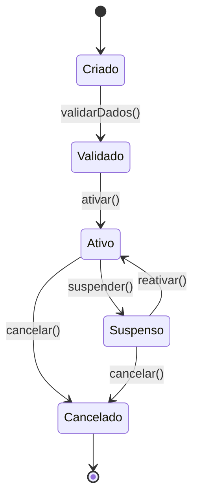

### Exemplo, contraexemplo e armadilhas

- **Exemplo Real:** O ciclo de um chamado de suporte técnico em um service desk: `Aberto` $`\rightarrow`$ `Em_Analise` $`\rightarrow`$ `Aguardando_Usuario` $`\rightarrow`$ `Resolvido` $`\rightarrow`$ `Fechado`. Cada salto exige um evento disparador claro.
- **Contraexemplo:** Criar um diagrama de estados para tentar representar o fluxo de telas de um aplicativo móvel (Login $`\rightarrow`$ Home $`\rightarrow`$ Carrinho). Fluxo de telas envolve múltiplos subsistemas e atores, sendo formalmente um processo de negócio que deve ser modelado via Diagrama de Atividades.
- **Armadilha Arquitetural:** Modelar estados para classes puramente operacionais ou utilitárias (ex.: classes de formatação de string ou classes Boundary de interface gráfica). O diagrama de estados deve ser reservado prioritariamente para **Entity Objects** que possuem ciclo de vida relevante e persistente no banco de dados.

| Critério de Análise | Abordagem Estrutural (Classes) | Abordagem Reativa (Estados) |
|---|---|---|
| Foco Primário | Estrutura de memória, tipos e ligações | Condições mutáveis e regras de transição temporal |
| Granularidade | Sistema, pacotes ou módulos completos | Instância de um único objeto de domínio |
| Gatilho | Associações estáticas e herança | Eventos, mensagens recebidas e temporizadores |
| Expressão Temporal | Estática (válida para todo o ciclo do software) | Dinâmica (dependente do histórico de eventos da instância) |

---

## Ciclo de vida do objeto e resposta a eventos e transições

### Mecânica de eventos, guardas e ações

O ciclo de vida de uma entidade é governado pela quádrupla formal de transição:

```math
T = (E_{origem}, Evento, Guarda, Acao, E_{destino})
```

Onde:
- $`E_{origem}`$: O estado atual em que o objeto reside.
- $`Evento`$: O estímulo ou sinal assíncrono que provoca a avaliação da transição.
- $`Guarda`$ (opcional): Uma expressão booleana anotada entre colchetes `[ ]`. A transição só é efetivada se a guarda for verdadeira no instante da ocorrência do evento.
- $`Acao`$ (opcional): Uma operação executada de forma atômica e instantânea durante a passagem de estado, anotada após uma barra `/`.
- $`E_{destino}`$: O novo estado resultante da transição.

### Destruição de objetos no ciclo de vida

Conforme abordado nos materiais da aula, os objetos devem ser destruídos ou liberados quando não estão mais em uso no sistema. No diagrama de estados, a destruição definitiva ou o descarte de uma entidade é indicado pela transição direta para o pseudo-estado final. Quando o objeto atinge esse estado, sua vida útil é encerrada, seus recursos de memória podem ser recolhidos pelo coletor de lixo (Garbage Collector) ou seu registro persistente é marcado com status terminal no armazenamento relacional.

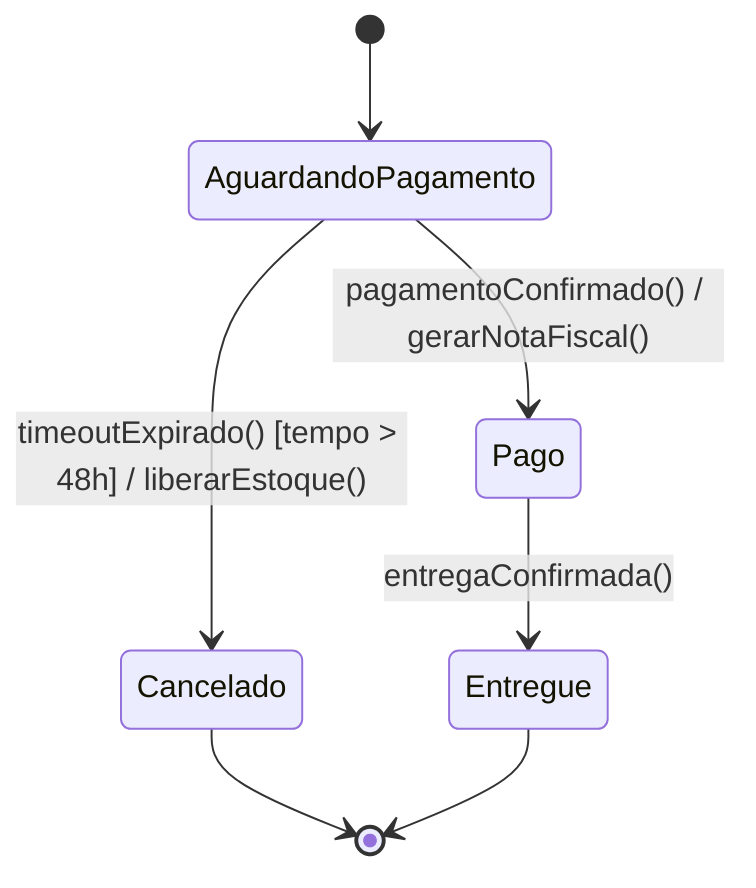

### Análise de comportamento reativo

Considere a transição:
`AguardandoPagamento --> Cancelado : timeoutExpirado() [tempo > 48h] / liberarEstoque()`

Se o evento `timeoutExpirado()` chegar, mas a expressão de guarda $`tempo > 48h`$ avaliar como falsa, o evento é descartado silenciosamente e o objeto permanece no estado `AguardandoPagamento`. Essa semântica garante determinismo operacional absoluto.

---

## Contextualização no fluxo de modelagem: dos Casos de Uso aos Estados

### Rastreabilidade no processo de engenharia

A engenharia de requisitos e modelagem de software obedece a uma cadeia evolutiva de refinamento. Cada artefato alimenta diretamente o seguinte, reduzindo ambiguidades e transformando intenções de negócio em restrições arquiteturais concretas:

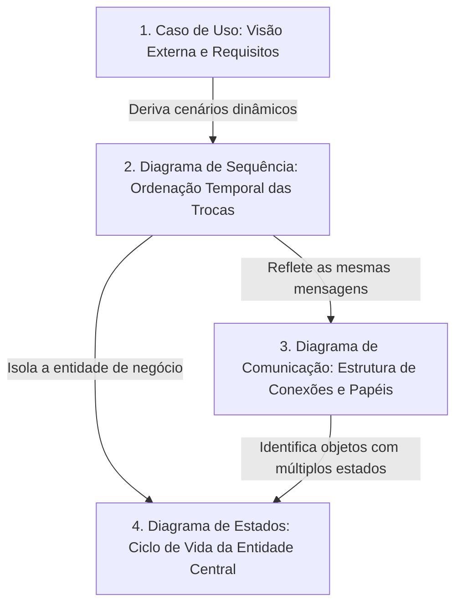

### O papel de cada diagrama no fluxo

1. **Caso de Uso:** Captura a interação entre atores externos e os limites do sistema, sem expor como o software funciona por dentro.
2. **Diagramas de Interação (Sequência e Comunicação):** Detalham a mecânica interna da execução do caso de uso. Revelam quais classes cooperam, que métodos são invocados e em que sequência as mensagens transitam.
3. **Diagrama de Estados:** Isola uma das classes centrais identificadas nas interações (tipicamente uma classe de entidade persistente, como `Pedido` ou `Pagamento`) e traça exaustivamente como os dados internos e os status dessa classe mudam em resposta a todas as mensagens que ela recebe ao longo de todos os casos de uso do sistema.

| Etapa de Modelagem | Entrada Principal | Saída Produzida | Foco de Investigação |
|---|---|---|---|
| Requisitos | Entrevistas com Stakeholders | Especificação de Caso de Uso | O que o usuário deseja alcançar |
| Interação | Cenário textual de Caso de Uso | Sequência e Comunicação | Como os objetos trocam mensagens |
| Ciclo de Vida | Mensagens recebidas pela Entidade | Diagrama de Máquinas de Estados | Como a entidade reage internamente |

---

## Elementos principais do Diagrama de Estados: Estado, Transição, Evento, Estado Inicial e Final

### Detalhamento dos elementos sintáticos

A UML padroniza símbolos rigorosos para a representação do ciclo de vida:

1. **Estado:** Representa uma situação ou condição na vida de um objeto durante a qual ele satisfaz determinada condição, executa uma atividade ou aguarda um evento externo. É visualmente expresso por um retângulo com cantos arredondados.
2. **Transição:** Uma relação entre dois estados indicando que um objeto no primeiro estado executará certas ações e entrará no segundo estado quando um evento especificado ocorrer e condições de guarda forem satisfeitas. Graficamente é uma seta orientada.
3. **Evento:** O estímulo externo ou interno que ativa a transição (ex.: chamada de método, sinal de relógio, mudança em variável booleana).
4. **Estado Inicial:** O ponto de partida obrigatório do ciclo de vida do objeto no momento de sua instanciação. Representado por um círculo preenchido sólido (`[*]`).
5. **Estado Final:** O encerramento definitivo do ciclo de vida ou a destruição formal da entidade no contexto do sistema. Representado por um círculo preenchido envolto por um círculo vazado.

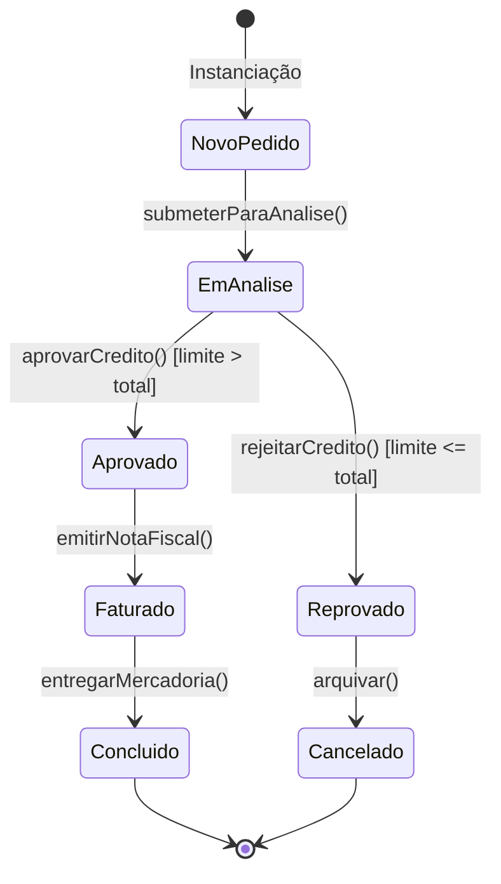

### Tabela canônica de elementos da máquina de estados

| Elemento | Notação Gráfica UML | Descrição Semântica | Exemplo Prático |
|---|---|---|---|
| **Estado Inicial** | Círculo preto sólido | Vértice de partida da máquina no instante de criação | `[*] --> NovoPedido` |
| **Estado** | Retângulo com cantos arredondados | Condição ou situação contínua mantida pelo objeto | `EmAnalise`, `Aprovado` |
| **Evento** | Texto sobre a seta | Estímulo que aciona a avaliação da transição | `submeterParaAnalise()` |
| **Guarda** | Expressão entre colchetes `[ ]` | Condição booleana necessária para efetivação | `[limite > total]` |
| **Ação** | Texto precedido por barra `/` | Operação atômica executada no disparo da transição | `/ debitarConta()` |
| **Estado Final** | Círculo concêntrico (olho de boi) | Término definitivo do ciclo de vida do objeto | `Cancelado --> [*]` |

---

## Conexão do Diagrama de Estados com Metodologias Ágeis (Scrum, Kanban, Histórias de Usuário, DoD e Testes)

### O diagrama de estados como artefato de engenharia ágil

Em ambientes ágeis modernos, a documentação pesada foi substituída pela documentação intencional e viva. O Diagrama de Estados conecta diretamente os requisitos funcionais descritos em Histórias de Usuário (User Stories) à arquitetura de software e aos controles de processo.

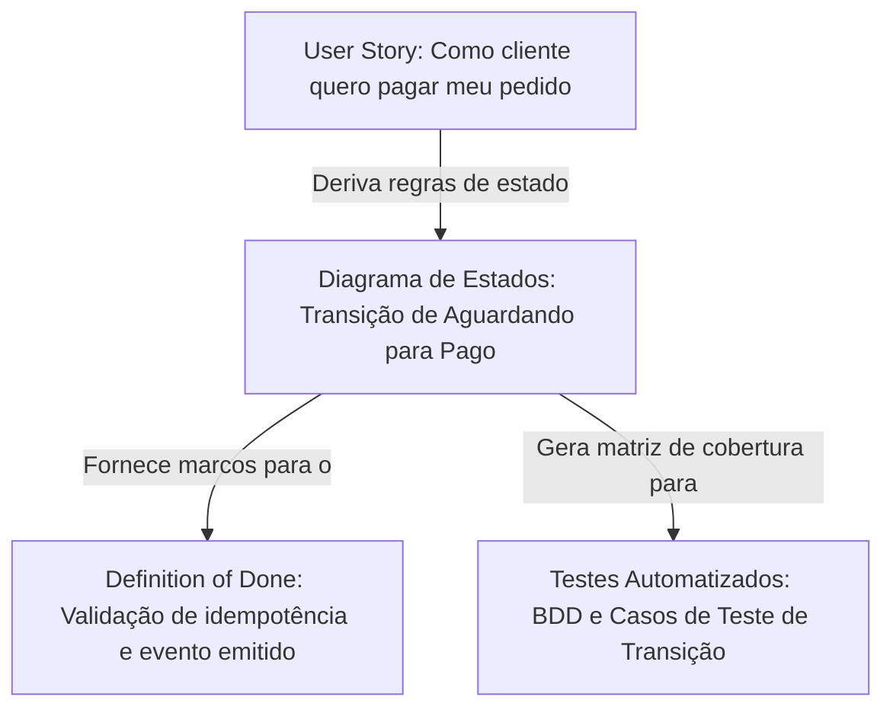

### Aplicações diretas no ciclo ágil

1. **Refinamento de Histórias de Usuário:** Cada estado discreto identificado em uma entidade central (ex.: `Pedido`) mapeia uma fatia de valor vertical entregue ao cliente. Histórias grandes (Épicos) podem ser divididas em torno de transições de estado bem delimitadas.
2. **Definição de Critérios de Pronto (Definition of Done — DoD):** Um incremento de software só pode ser considerado "Pronto" (Done) se todas as regras de proteção de transição daquele estado estiverem validadas. Por exemplo: *"Para o estado mudar para `Faturado`, a nota fiscal deve ter sido assinada digitalmente e o evento `NotaFiscalEmitida` deve estar publicado no barramento de mensageria"*.
3. **Modelagem de Testes Baseados em Modelo (Model-Based Testing):** Os estados fornecem a matriz completa para testes funcionais e de aceitação automatizados (como BDD com Cucumber/Gherkin). Garante-se que o sistema é testado para transições válidas e rejeita veementemente transições inválidas (ex.: testar que um pedido no estado `Cancelado` lança exceção se receber um comando de `pagar()`).
4. **Alinhamento entre PO e Engenharia:** Oferece uma linguagem visual compartilhada (Ubiquitous Language) onde o Product Owner valida se os status de negócio atendem às necessidades comerciais, enquanto os desenvolvedores asseguram que o modelo de domínio é coeso e livre de estados inconsistentes.

---

## Boas práticas na elaboração do Diagrama de Estados

Para garantir que o diagrama cumpra seu papel de comunicação inequívoca, a equipe de engenharia deve seguir diretrizes rigorosas de clareza semântica:

- **Nomenclatura Clara e Padronizada:** Estados representam condições contínuas e estáveis; portanto, utilize substantivos ou particípios passados que denotem situação terminada ou contínua (ex.: `Validado`, `AguardandoConfirmacao`, `Suspenso`). Evite verbos no infinitivo como nomes de estados (ex.: evite nomear um estado como `ValidarDados`; prefira `EmValidacao` ou `Validado`). Verbos pertencem às transições e ações!
- **Explicitação de Guardas Condicionais:** Transições alternativas que partem do mesmo estado disparadas pelo mesmo evento DEVEM possuir guardas mutualmente exclusivas (ex.: `[valor <= limite]` e `[valor > limite]`), impedindo comportamentos não determinísticos.
- **Evitar o "Estado Deus" (God-State):** Evite criar estados genéricos que acumulam múltiplas responsabilidades (ex.: `ProcessandoTudo`). Decomponha em estados específicos com fronteiras semânticas bem delineadas.
- **Revisão Colaborativa em Cerimônias:** Valide a máquina de estados durante as reuniões de refinamento técnico (Backlog Refinement) e utilize o diagrama como artefato de apoio na Sprint Review para demonstrar as regras de transição implementadas.
- **Documentação Viva (Living Documentation):** O diagrama não deve morrer no início do projeto. Sempre que uma nova regra de negócio alterar as transições permitidas da entidade, o modelo de estados deve ser versionado junto ao repositório de código.

---

## Introdução e características essenciais do Diagrama de Atividades

### Conceito geral

O Diagrama de Atividades da UML é um diagrama comportamental fundamentalmente voltado a capturar a lógica de um procedimento, processo de negócio ou fluxo de trabalho (workflow). Ele detalha a sequência ordenada de ações que o software ou os usuários desempenham para atingir um resultado de negócio mensurável.

Originado a partir de uma especialização da semântica das máquinas de estados e redes de Petri, o diagrama de atividades foca no fluxo de controle impulsionado pelo processamento interno, onde a conclusão de uma ação dispara automaticamente o início da próxima ação.

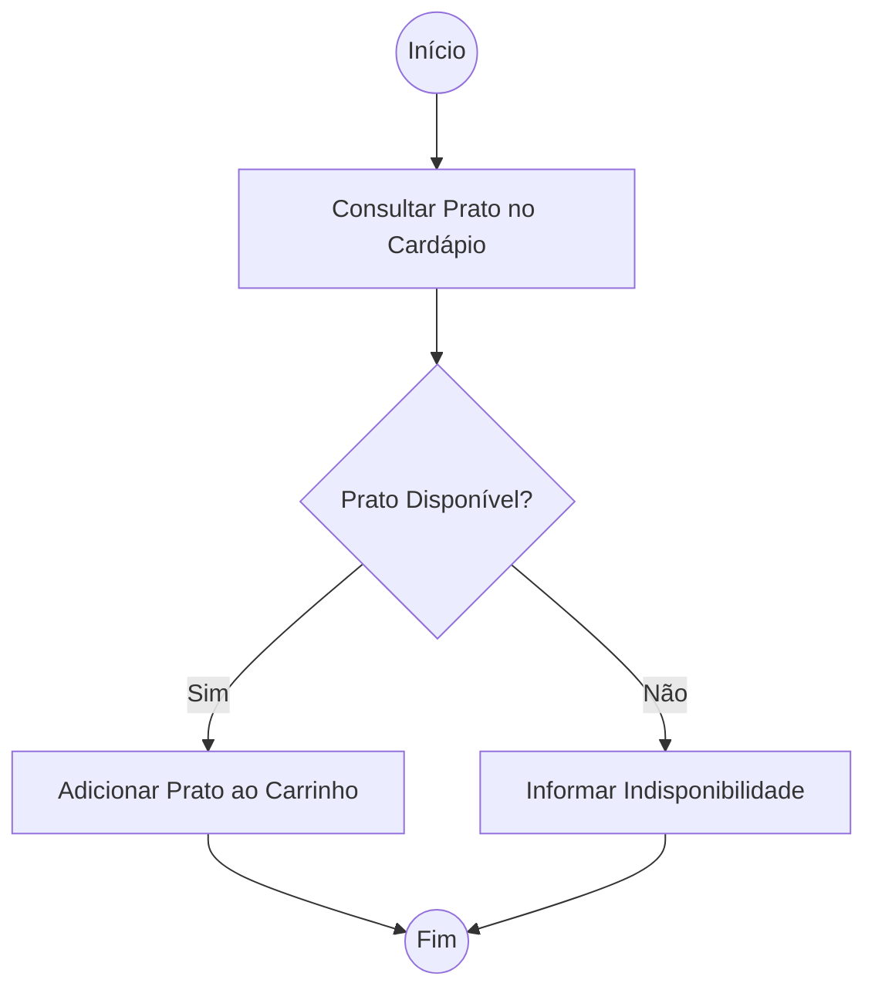

### Características fundamentais

1. **Estados de Atividade:** Diferente do diagrama de estados tradicional, onde o objeto fica passivamente aguardando um sinal externo, no diagrama de atividades os nós representam ações em execução contínua.
2. **Transições Automáticas:** A transição entre duas ações em um diagrama de atividades geralmente não depende de um evento externo assíncrono; ela ocorre por "conclusão de processamento" (completion transition).
3. **Foco no Comportamento Dinâmico Geral:** Não está restrito à vida de uma única instância de classe; pode mapear passos que atravessam sistemas distribuídos, módulos heterogêneos e múltiplos operadores humanos.

---

## Estrutura de atividades, ações não atômicas e subatividades

### Ações atômicas versus atividades não atômicas

Na taxonomia formal da UML:
- **Ação Atômica:** É uma operação básica e indivisível dentro da granularidade do modelo (ex.: incrementar um contador, atribuir um valor de variável ou disparar um pulso de clock). Uma ação não pode sofrer interrupção lógica significativa.
- **Atividade (Não Atômica):** Representa a execução continuada de uma coleção estruturada de ações. Uma atividade consome tempo significativo, pode ser suspensa ou cancelada e produz efeitos de borda acumulados até que seu nó final seja alcançado.

### Decomposição hierárquica e subatividades

Para evitar que modelos de processos industriais ou corporativos se tornem monolíticos e ilegíveis, adota-se o particionamento hierárquico. Uma atividade complexa pode conter nós que fazem referência a **subatividades** completas, modeladas em seus próprios diagramas subordinados.

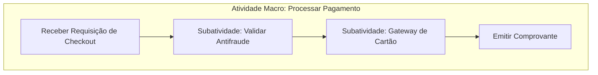

### Nós de controle estrutural em atividades

O diagrama de atividades emprega símbolos canônicos para governar a topologia do fluxo:
- **Nó de Decisão e Junção (Decision / Merge):** Representado por um losango. Uma decisão recebe um fluxo de entrada e avalia guardas em múltiplos fluxos de saída alternativos. A junção recebe múltiplos fluxos alternativos e os unifica em uma única saída sem sincronização temporal.
- **Nó de Bifurcação e Sincronização (Fork / Join):** Representado por barras horizontais ou verticais espessas. O *Fork* divide um fluxo sequencial em múltiplos caminhos executados concorrentemente ou em paralelo. O *Join* bloqueia o avanço até que todos os fluxos concorrentes cheguem ao ponto de sincronização, unificando-os em um fluxo subsequente.

---

## Diferenças conceituais: Diagrama de Estados versus Diagrama de Atividades

### Confronto conceitual e semântico

A distinção entre esses dois diagramas é um dos tópicos de maior incidência de equívocos conceituais em projetos de software. Ambos são modelos comportamentais da UML, mas atacam dimensões ortogonais do sistema:

- O **Diagrama de Estados** foca na **entidade**: mostra as mutações qualitativas no estado de um único objeto provocadas por eventos exógenos. O objeto é primordialmente *reativo*.
- O **Diagrama de Atividades** foca no **processo**: mostra a cadeia de tarefas, transformações e transferência de controle necessárias para concretizar um procedimento. É primordialmente *operacional e computacional*.

```mermaid
stateDiagram-v2
    note right of [*]
        Foco: O que o Pedido É (Entidade)
    end note
    [*] --> Aberto
    Aberto --> Pago : processarPagamento()
    Pago --> Enviado : despachar()
    Enviado --> Entregue : confirmarRecebimento()
    Entregue --> [*]
```

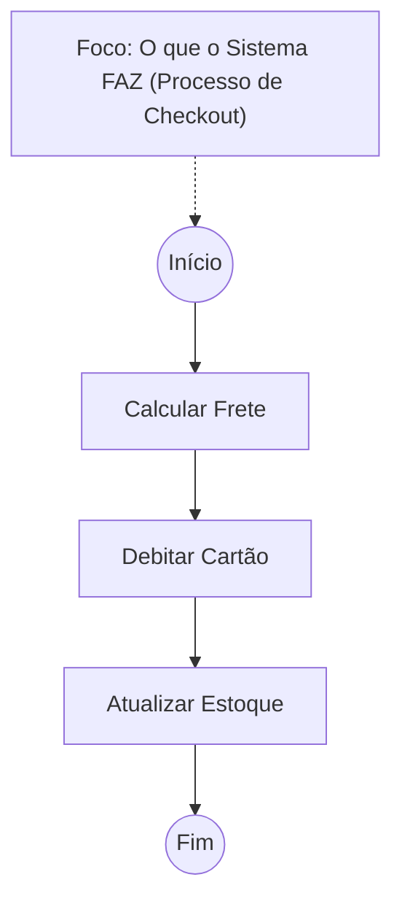

### Tabela comparativa definitiva

| Critério de Comparação | Diagrama de Estados | Diagrama de Atividades |
|---|---|---|
| **Alvo Principal da Modelagem** | O ciclo de vida de um objeto ou componente específico | O fluxo de trabalho de um caso de uso ou processo de negócio |
| **Gatilho de Transição** | Ocorrência de um Evento externo/interno explícito | Conclusão natural da ação precedente (Completion Event) |
| **Ponto Central de Interesse** | Como a entidade *muda sua condição* | O que está *sendo executado* a cada passo |
| **Paralelismo e Concorrência** | Representado por estados ortogonais (subestados concorrentes) | Representado nativamente por nós de Fork e Join |
| **Estrutura Típica de Nós** | Situações passivas de espera ou estabilidade | Verbos no infinitivo descrevendo transformações operacionais |
| **Relação com o Código** | Mapeado no padrão de projeto *State* ou atributos `status` | Mapeado em métodos de orquestração, serviços ou scripts de fluxo |

---

## Etapas do projeto de software e documentação interativa (Método MoSCoW e MVC)

### Roteiro estruturado de engenharia de software

Conforme formalizado na metodologia de projeto do curso, a construção de sistemas segue sete etapas encadeadas:

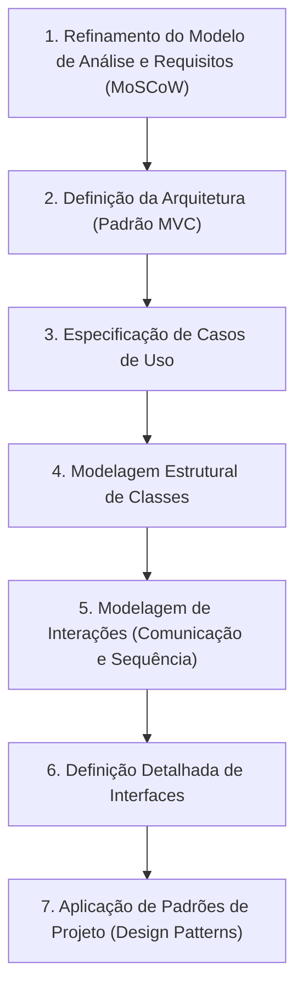

### Método MoSCoW na gestão de escopo e análise

O método MoSCoW atua como filtro de engenharia de valor, segregando os requisitos em quatro categorias hierárquicas rigorosas:
- **Must Have (Obrigatório):** Funcionalidades sem as quais o produto não possui viabilidade técnica ou jurídica (ex.: o sistema de pedidos precisa obrigatoriamente registrar o pagamento).
- **Should Have (Desejável):** Requisitos de alto valor agregado, essenciais no médio prazo, mas que não impedem a entrega da primeira versão funcional (ex.: cálculo automático de desconto via cupom promocional).
- **Could Have (Possível):** Melhorias incrementais implementadas caso haja folga no cronograma (ex.: integração com assistente de voz para listar restaurantes).
- **Won't Have (Não prioritário no momento):** Funcionalidades explicitamente acordadas como fora do escopo da iteração atual (ex.: split de conta automático entre múltiplos clientes).

### A separação de responsabilidades no padrão MVC

A arquitetura MVC divide o sistema em três subsistemas essenciais:
1. **Model (Modelo):** Representa o estado do domínio e as regras de negócio puras (ex.: classes `Pedido`, `Prato`).
2. **View (Visão):** Camada de apresentação e interação humana (ex.: telas do app móvel ou formulários web).
3. **Controller (Controlador):** Atua como interceptador, mediando as requisições da interface visual e delegando as chamadas para os objetos do modelo.

Essa segregação prepara o terreno para a tipagem dos objetos nos diagramas de interação.

---

## Modelagem conceitual de classes e especificação de casos de uso

### O modelo estrutural de domínio

Antes de desenhar as interações dinâmicas, é mandatório estabelecer o vocabulário conceitual através do Diagrama de Classes. No estudo de caso do sistema de restaurante e pedidos apresentado nas aulas:

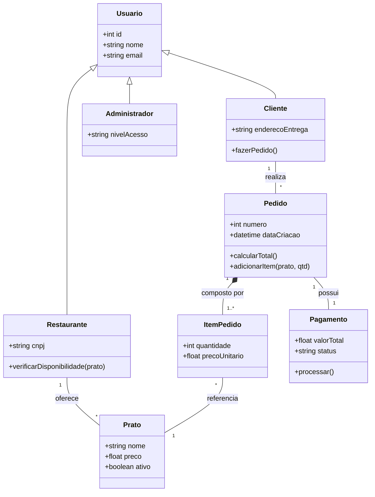

### Regras de associação observadas

- **Generalização/Especialização:** A classe `Usuario` centraliza as credenciais de identificação e é herdada por `Cliente`, `Restaurante` e `Administrador`.
- **Composição Forte:** `Pedido` mantém uma relação de composição com `ItemPedido`. Itens de pedido não possuem existência independente fora do ciclo do pedido pai.
- **Relacionamentos Múltiplos:** Um prato faz parte de um restaurante e pode ser referenciado em múltiplos itens de pedidos distintos.

### Especificação estruturada do Caso de Uso "Fazer Pedido"

| Campo da Especificação | Detalhamento do Projeto |
|---|---|
| **Nome / Objeto** | Fazer Pedido |
| **Atores** | Cliente (iniciador primário) |
| **Resumo** | Descreve o processo operacional para selecionar itens de refeição pelo aplicativo e registrar a intenção de compra. |
| **Pré-condição** | Existir refeição cadastrada e disponível em restaurante credenciado ativo. |
| **Pós-condição** | O pedido é gerado no sistema com status pendente de pagamento e os itens ficam reservados. |

#### Fluxo de eventos principal

| Passo | Ações do Ator (Cliente) | Ações do Sistema |
|---|---|---|
| 1 | Seleciona uma refeição no catálogo do app | Identifica a intenção de compra do item |
| 2 | - | Consulta a disponibilidade do prato no restaurante credenciado |
| 2.1 | [Fluxo de Exceção] | Se não houver disponibilidade, exibe alerta e encerra o caso de uso |
| 3 | - | Apresenta locais disponíveis e custos de entrega |
| 4 | Confirma o restaurante e solicita fechar pedido | Instancia o pedido, calcula o total e solicita o registro de pagamento |

---

## Fundamentos do Diagrama de Comunicação: Objetos (Entity, Control, Boundary), ligações e mensagens

### Conceito e elementos estruturais

O Diagrama de Comunicação (antigamente denominado Diagrama de Colaboração na UML 1.x) é um diagrama comportamental focado em destacar a **organização estrutural dos objetos que trocam mensagens** durante a execução de um cenário.

Ele é composto estritamente por três elementos:
1. **Objetos (Instâncias):** Representam os nós que processam a informação. Adotam a sintaxe de sublinhado ou indicação explícita `nomeInstancia : NomeClasse`.
2. **Ligações (Links):** Linhas sólidas que conectam dois objetos. Uma ligação entre duas instâncias só pode existir se houver um relacionamento prévio (associação, agregação ou dependência) entre as classes correspondentes no Diagrama de Classes.
3. **Mensagens com Numeração Sequencial:** Setas posicionadas ao lado das ligações indicando a direção do tráfego de dados, precedidas por rótulos numéricos que indicam a ordem lógica da operação (ex.: `1: criarPedido()`, `2: consultarDisponibilidade()`).

### Estereótipos de análise arquitetural (Boundary, Control, Entity)

Para garantir desacoplamento conforme ensinado pelo padrão de análise robusta da UML:
- **Boundary Object (Fronteira):** Representa a interface entre o sistema e o mundo externo (ex.: telas de UI, formulários, APIs REST). Captura as interações diretas do ator.
- **Control Object (Controle):** Encapsula a lógica de coordenação, orquestração e fluxo de uma funcionalidade específica. Desacopla as telas das entidades de banco.
- **Entity Object (Entidade):** Modela os dados de negócio persistentes e as regras intrínsecas a esses dados (ex.: tabelas mapeadas via ORM).

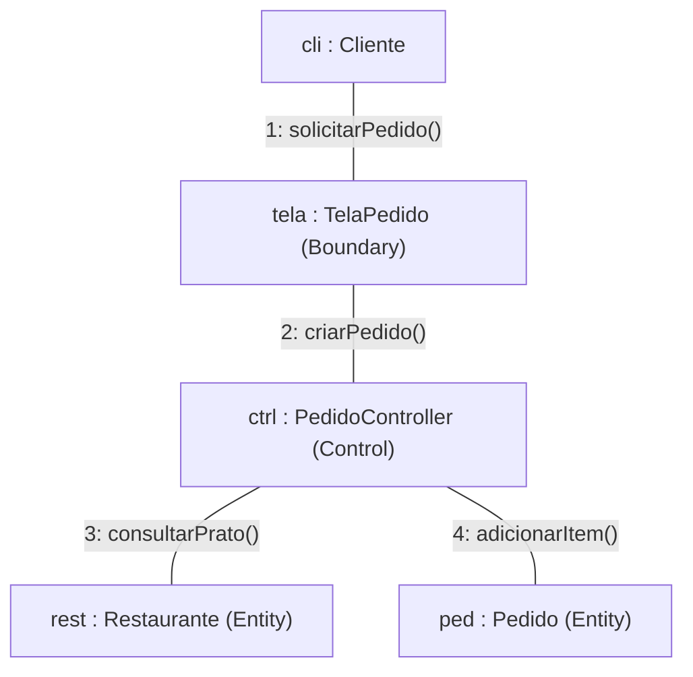

---

## Finalidade e critérios de uso do Diagrama de Comunicação na documentação

### Quando priorizar o Diagrama de Comunicação

O Diagrama de Comunicação deve ser selecionado pela equipe de engenharia quando a principal pergunta técnica a ser respondida não for a sequência fina de milissegundos, mas sim a **topologia da colaboração**.

Utilize o Diagrama de Comunicação para:
- Mapear a distribuição de responsabilidades e avaliar acoplamento estrutural excessivo (ex.: identificar se um objeto está se tornando um nó centralizado que conversa com classes demais — problema conhecido como *God Object*).
- Confirmar se o Diagrama de Classes forneceu todas as associações necessárias para que as classes possam conversar em tempo de execução.
- Validar se a arquitetura em camadas (MVC) está sendo rigorosamente respeitada, impedindo que classes Boundary conversem diretamente com Entity Objects sem a mediação de um Control Object.

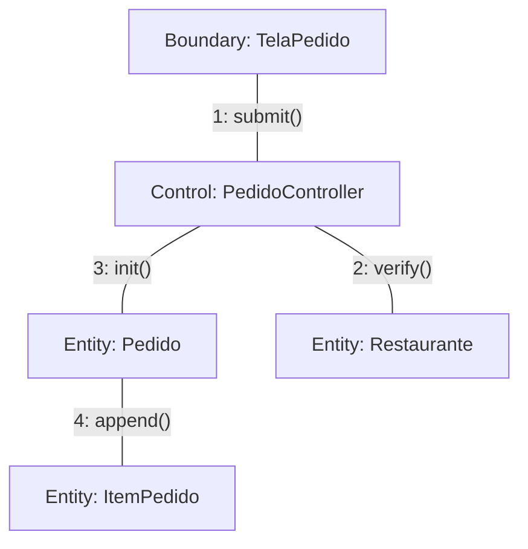

---

## Fundamentos do Diagrama de Sequência: Atores, linhas de vida, mensagens e progressão temporal

### Anatomia do Diagrama de Sequência

O Diagrama de Sequência da UML prioriza a dimensão **tempo**. Ele organiza os objetos horizontalmente ao longo da borda superior e projeta a execução cronológica para baixo, ao longo do eixo vertical.

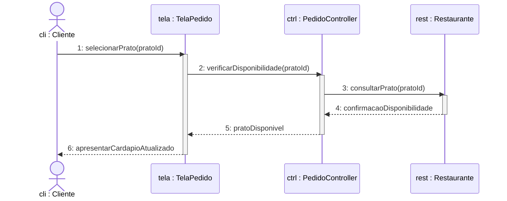

### Componentes estruturais do diagrama

1. **Atores e Participantes:** Posicionados no topo do diagrama. Representam os usuários ou componentes de software instanciados envolvidos no cenário.
2. **Linhas de Vida (Lifelines):** Linhas tracejadas verticais que descem a partir dos participantes. Representam a existência temporal do elemento ao longo da execução daquela funcionalidade.
3. **Barras de Ativação (Focus of Control):** Retângulos finos sobrepostos à linha de vida que indicam o período durante o qual o objeto está ativamente executando uma operação interna ou aguardando o retorno de uma chamada delegada.
4. **Mensagens (Setas Horizontais):** Indicam a transmissão de sinais ou a invocação de métodos entre participantes.

---

## Roteiro prático para conversão de cenários em diagramas de interação

### As quatro etapas canônicas

A passagem da linguagem natural de um caso de uso para a modelagem UML obedece a um algoritmo estruturado em quatro etapas:

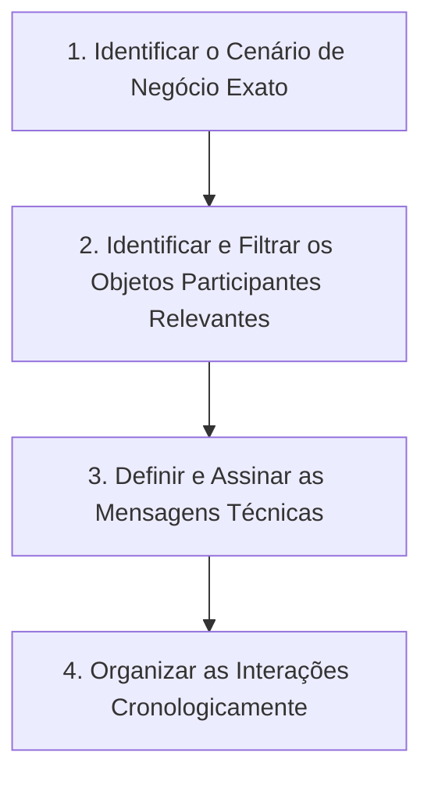

1. **Identificar o Cenário:** Isolar um fluxo atômico (ex.: "Realização de Pedido com Pagamento Aprovado"). Nunca tente modelar múltiplos casos de uso concorrentes no mesmo diagrama de interação.
2. **Identificar os Objetos Participantes:** Consultar o modelo de classes e escolher exclusivamente as instâncias necessárias para cumprir a funcionalidade.
   > **Regra Crucial da Aula:** Não é necessário, nem correto, incluir todas as classes do sistema em cada diagrama. Utilize apenas os participantes estritamente relevantes para o cenário documentado.
3. **Definir as Mensagens:** Transformar ações narrativas do caso de uso em métodos executáveis tipados com nomes adequados (ex.: a frase "o sistema calcula o valor total" é convertida no método `calcularValorTotal()`).
4. **Organizar as Interações:** Ordenar as chamadas obedecendo às dependências funcionais de negócio (não se pode calcular o total antes de registrar os itens).

---

## Mapeamento do Diagrama de Comunicação para o Diagrama de Sequência

### Algoritmo de tradução sistemática

Existe equivalência isomórfica entre o Diagrama de Comunicação e o Diagrama de Sequência: ambos capturam a mesma dinâmica, mas sob eixos visuais distintos.

Para converter uma comunicação em sequência:
1. **Identificação dos Nós:** Cada caixa de objeto do Diagrama de Comunicação é projetada para o topo horizontal do Diagrama de Sequência.
2. **Criação das Linhas de Vida:** Desenha-se uma linha vertical pontilhada abaixo de cada participante.
3. **Mapeamento de Mensagens:** Para cada mensagem numerada associada a uma ligação no diagrama de comunicação, traça-se uma seta horizontal no diagrama de sequência partindo da linha de vida do remetente e atingindo a linha de vida do destinatário.
4. **Alinhamento Temporal Vertical:** A posição vertical no diagrama de sequência reflete com exatidão a numeração cardinal e hierárquica das mensagens (`1`, `2`, `3`...).

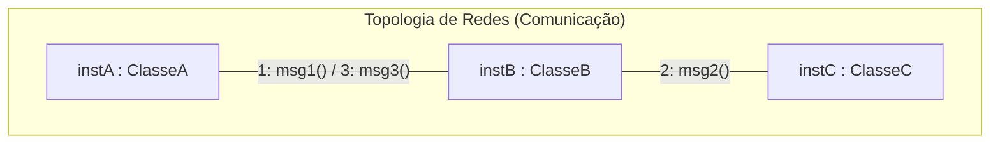

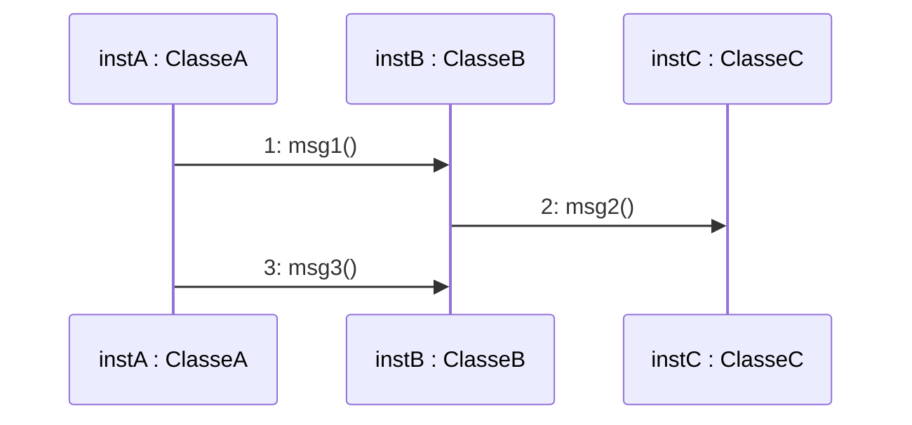

### Tabela comparativa estruturada

| Característica de Engenharia | Diagrama de Comunicação | Diagrama de Sequência |
|---|---|---|
| **Eixo Principal de Organização** | Espaço (Organização e topologia dos nós) | Tempo (Progressão linear de cima para baixo) |
| **Representação de Ordem** | Numeração explícita nas mensagens (`1.1`, `1.2`) | Altura física vertical no traçado do diagrama |
| **Visualização de Acoplamento** | Imediata (percebe-se a quantidade de ligações físicas) | Moderada (requer varredura de setas horizontais) |
| **Visualização de Retornos Assíncronos** | Complexa e de baixa expressividade | Altamente expressiva via setas tracejadas |
| **Indicação de Tempo de Vida** | Não suporta graficamente | Suporta criação e destruição explicita na linha de vida |

---

## Elementos avançados no Diagrama de Sequência: criação dinâmica, destruição com término de linha de vida, mensagens de retorno e auto-chamadas

### Modelagem de casos operacionais sofisticados

Em cenários reais de engenharia, sistemas orientados a objetos instanciam classes dinamicamente, destroem recursos da memória, processam métodos internos privados e recebem confirmações de retorno:

1. **Criação Dinâmica de Objeto:** No início do cenário, nem todos os objetos existem. Para demonstrar a instanciação em tempo de execução, a seta de mensagem (frequentemente anotada como `<<create>>` ou chamada de construtor `new`) aponta diretamente contra a caixa retangular da entidade, que é desenhada no meio da altura do diagrama, e não no topo.
2. **Destruição de Objeto com Término de Linha de Vida:** Quando o objeto deixa de ser necessário e é explicitamente desalocado ou destruído, a mensagem de término atinge sua linha de vida e esta é finalizada abruptamente por um grande **"X"**, indicando que a entidade cessou sua existência naquele instante.
3. **Mensagem de Retorno:** Quando uma operação invocada entrega uma resposta ou dado para quem a invocou, utiliza-se uma seta horizontal tracejada com ponta aberta (`-->>`), explicitando a saída do controle.
4. **Auto-chamada (Self-Call):** Para representar a invocação de métodos privados ou operações internas que a própria classe executa sobre si mesma sem intermédio de terceiros, desenha-se uma seta que parte da linha de vida da classe, dá uma volta em ângulo reto e atinge a sua própria barra de ativação.

```mermaid
sequenceDiagram
    actor cli as cli : Cliente
    participant ctrl as ctrl : PedidoController
    participant ped as ped : Pedido
    participant val as val : ValidadorTemp

    cli->>ctrl: 1: confirmarCheckout()
    activate ctrl
    
    create participant val
    ctrl->>val: 2: new()
    activate val
    val-->>ctrl: 3: statusValido
    destroy val
    ctrl->>val: 4: dispose()
    
    create participant ped
    ctrl->>ped: 5: new(itens, total)
    activate ped
    
    ped->>ped: 6: aplicarDescontosInternos()
    
    ped-->>ctrl: 7: pedidoCriadoConfirmado
    deactivate ped
    ctrl-->>cli: 8: exibirSucesso()
    deactivate ctrl
```

---

## Código da aula

Embora os materiais originais da aula não tragam arquivos de código-fonte anexos, o rigor da engenharia de software exige que os modelos conceituais abstratos se reflitam fielmente na arquitetura de implementação. 

Apresenta-se a seguir a estrutura de implementação de referência em linguagem Python (orientação a objetos pura), refletindo com exatidão a modelagem dos objetos de Análise Robusta (Boundary, Control, Entity), os métodos de ciclo de vida com auto-chamada e as regras de transição discutidas.

### Mapeamento arquitetural das classes (MVC e BCE)

```python
"""
Módulo de Domínio e Controle para o Estudo de Caso de Pedidos UniFEF.
Demonstra a aplicação dos padrões de projeto e estruturas discutidas na UML.
"""

from datetime import datetime
from typing import List, Optional


class Prato:
    """Entity: Representa o prato ofertado no cardápio."""
    def __init__(self, id_prato: int, nome: str, preco: float, disponivel: bool = True):
        self.id_prato = id_prato
        self.nome = nome
        self.preco = preco
        self.disponivel = disponivel


class Restaurante:
    """Entity: Responsável pela validação de disponibilidade física do prato."""
    def __init__(self, id_restaurante: int, nome: str):
        self.id_restaurante = id_restaurante
        self.nome = nome
        self.cardapio: List[Prato] = []

    def adicionar_prato(self, prato: Prato) -> None:
        self.cardapio.append(prato)

    def verificar_disponibilidade(self, id_prato: int) -> bool:
        for prato in self.cardapio:
            if prato.id_prato == id_prato:
                return prato.disponivel
        return False


class ItemPedido:
    """Entity: Componente fraco do Pedido (relação de composição forte)."""
    def __init__(self, prato: Prato, quantidade: int):
        self.prato = prato
        self.quantidade = quantidade
        self.preco_unitario = prato.preco

    def subtotal(self) -> float:
        return self.quantidade * self.preco_unitario


class Pedido:
    """
    Entity: Centraliza o ciclo de vida e a máquina de estados interna.
    Estados possíveis: 'CRIADO', 'AGUARDANDO_PAGAMENTO', 'PAGO', 'CANCELADO'.
    """
    def __init__(self, numero: int, cliente_id: int):
        self.numero = numero
        self.cliente_id = cliente_id
        self.itens: List[ItemPedido] = []
        self.data_criacao = datetime.now()
        self.estado = "CRIADO"
        self.valor_total = 0.0

    def adicionar_item(self, prato: Prato, quantidade: int) -> None:
        item = ItemPedido(prato, quantidade)
        self.itens.append(item)
        self._calcular_valor_total()  # Auto-chamada interna privada

    def _calcular_valor_total(self) -> None:
        """Operação interna (Auto-chamada) para recalcular montante."""
        self.valor_total = sum(item.subtotal() for item in self.itens)

    def transitar_para_aguardando_pagamento(self) -> None:
        if self.estado == "CRIADO" and len(self.itens) > 0:
            self.estado = "AGUARDANDO_PAGAMENTO"
        else:
            raise ValueError("Não é possível transitar: pedido vazio ou em estado inconsistente.")

    def registrar_pagamento_concluido(self) -> None:
        if self.estado == "AGUARDANDO_PAGAMENTO":
            self.estado = "PAGO"
        else:
            raise ValueError(f"Transição inválida: Não é possível pagar um pedido no estado {self.estado}.")


class PedidoController:
    """Control Object: Orquestrador da lógica de interação e negócio."""
    def __init__(self, restaurante: Restaurante):
        self.restaurante = restaurante
        self.pedidos_ativos = {}
        self._contador_pedidos = 1000

    def processar_solicitacao_pedido(self, cliente_id: int, prato_id: int, quantidade: int) -> dict:
        # Passo 2: Consulta disponibilidade do prato no restaurante
        disponivel = self.restaurante.verificar_disponibilidade(prato_id)
        if not disponivel:
            return {"sucesso": False, "mensagem": "Prato indisponível no momento."}

        # Localiza o objeto de prato
        prato = next(p for p in self.restaurante.cardapio if p.id_prato == prato_id)

        # Passo 3 e 4: Instanciação dinâmica do Pedido e adição de item
        self._contador_pedidos += 1
        novo_pedido = Pedido(self._contador_pedidos, cliente_id)
        novo_pedido.adicionar_item(prato, quantidade)
        novo_pedido.transitar_para_aguardando_pagamento()

        self.pedidos_ativos[novo_pedido.numero] = novo_pedido

        # Passo 5 e 6: Solicita pagamento e entrega resultado
        return {
            "sucesso": True,
            "pedido_numero": novo_pedido.numero,
            "valor_total": novo_pedido.valor_total,
            "status": novo_pedido.estado
        }


class TelaPedidoView:
    """Boundary Object: Camada de visualização e contato com o Ator."""
    def __init__(self, controller: PedidoController):
        self.controller = controller

    def clicar_botao_confirmar_pedido(self, cliente_id: int, prato_id: int, qtd: int):
        print(f"[Boundary] Solicitando pedido para cliente {cliente_id}...")
        resposta = self.controller.processar_solicitacao_pedido(cliente_id, prato_id, qtd)
        if resposta["sucesso"]:
            print(f"[Boundary] Pedido #{resposta['pedido_numero']} gerado com sucesso!")
            print(f"[Boundary] Total: R$ {resposta['valor_total']:.2f} | Status: {resposta['status']}")
        else:
            print(f"[Boundary] Falha na operação: {resposta['mensagem']}")
```

---

## Exercícios

### Exercício 1: Diagrama de Estados de Máquina de Lavar Roupa

#### Enunciado oficial
> Faça um diagrama de Estados para a situação: Uma máquina de lavar roupa: depois da passagem de um determinado período de tempo, a máquina de lavar termina o seu programa de lavagem, e inicia o de secagem.

#### Raciocínio de engenharia
1. **Identificação da Entidade:** O objeto cujo ciclo de vida está sob observação é a `MaquinaDeLavar`.
2. **Identificação dos Estados Discretos:**
   - Estado Inicial: momento em que a máquina é energizada e configurada (`AguardandoInicio` ou `Desligada`).
   - Estado Operacional 1: `Lavando` (execução do ciclo de limpeza com sabão e água).
   - Estado Operacional 2: `Secando` (centrifugação ou ar quente).
   - Estado Final: encerramento do ciclo completo (`LavagemFinalizada` ou desligamento).
3. **Identificação dos Eventos e Temporizadores:**
   - O primeiro disparo é a intervenção do usuário (`iniciarCiclo()`).
   - A transição entre lavagem e secagem não exige clique do usuário: ocorre por passagem pura de tempo cronológico, caracterizando um evento temporal de expiração (notação UML: `after(tempo_lavagem)` ou passagem explícita de tempo).
   - O término da secagem também é governado por evento temporal `after(tempo_secagem)`, conduzindo ao estado de parada.

#### Resolução gráfica completa

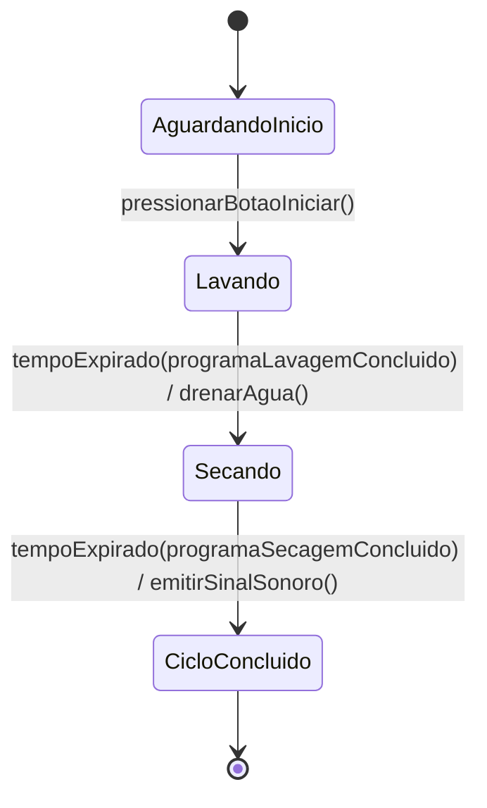

#### Comentário técnico
Observe que o evento entre `Lavando` e `Secando` é um evento de tempo (temporizador interno do controlador embarcado). Durante a transição, uma ação atômica de saída pode ser acionada (`/ drenarAgua()`), demonstrando como a máquina física altera seu comportamento antes de estabilizar no novo estado `Secando`.

---

### Exercício 2: Modelagem de Interação para o Cenário de Realização de Pedido

#### Enunciado oficial
> Com base no estudo de caso apresentado, modele as interações das classes envolvidas na realização de um pedido utilizando as seguintes etapas:
> 1. O cliente solicita a criação do pedido;
> 2. O pedido consulta o restaurante e verifica a disponibilidade do prato;
> 3. O pedido registra o item selecionado;
> 4. O sistema calcula o valor total;
> 5. O sistema solicita o registro do pagamento;
> 6. O resultado é apresentado ao cliente.
> 
> Construa o Diagrama de Comunicação e, em seguida, converta-o para o Diagrama de Sequência correspondente.

#### Raciocínio de engenharia
1. **Identificação dos Participantes:**
   - Ator: `cli:Cliente`
   - Boundary: `tela:TelaPedido`
   - Control / Entity Coordenadora: `ped:Pedido`
   - Entity de Suporte: `rest:Restaurante`, `item:ItemPedido`, `pag:Pagamento`
2. **Análise das Etapas e Mapeamento de Mensagens:**
   - Etapa 1: `cli` envia mensagem para criar pedido (`1: solicitarCriacaoPedido()`).
   - Etapa 2: A instância de `ped` consulta a instância de `rest` (`2: verificarDisponibilidadePrato()`).
   - Etapa 3: Confirmada a disponibilidade, instancia-se/registra-se o `item` (`3: adicionarItem()`).
   - Etapa 4: O pedido recalcula internamente seu montante (`4: calcularValorTotal()`).
   - Etapa 5: O sistema coordena o registro da entidade de cobrança (`5: registrarPagamento()`).
   - Etapa 6: A resposta com o status consolidado é devolvida ao ator (`6: exibirResultado()`).

#### Resolução — Parte A: Diagrama de Comunicação

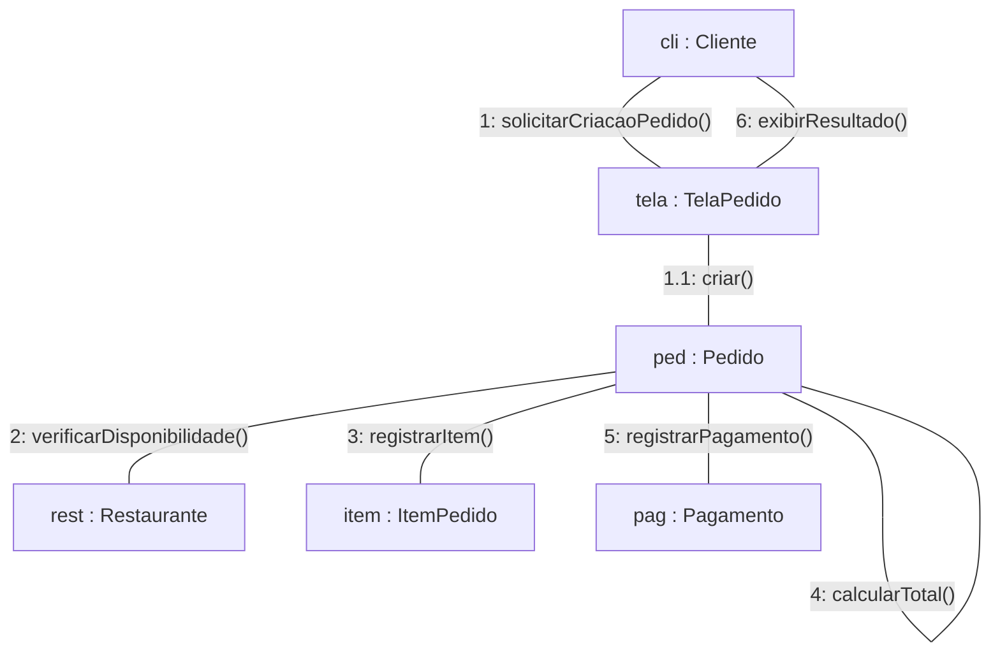

#### Resolução — Parte B: Diagrama de Sequência correspondente

```mermaid
sequenceDiagram
    actor cli as cli : Cliente
    participant tela as tela : TelaPedido
    participant ped as ped : Pedido
    participant rest as rest : Restaurante
    participant item as item : ItemPedido
    participant pag as pag : Pagamento

    cli->>tela: 1: solicitarCriacaoPedido(pratoId, qtd)
    activate tela
    
    tela->>ped: 1.1: criar()
    activate ped
    
    ped->>rest: 2: verificarDisponibilidade(pratoId)
    activate rest
    rest-->>ped: 2.1: disponibilidadeConfirmada
    deactivate rest
    
    create participant item
    ped->>item: 3: new(prato, qtd)
    activate item
    item-->>ped: 3.1: itemRegistrado
    deactivate item
    
    ped->>ped: 4: calcularTotal()
    
    create participant pag
    ped->>pag: 5: registrarPagamento(valorTotal)
    activate pag
    pag-->>ped: 5.1: pagamentoRegistradoPendente
    deactivate pag
    
    ped-->>tela: 5.2: pedidoPronto(status)
    deactivate ped
    
    tela-->>cli: 6: exibirResultado(sucesso, numeroPedido)
    deactivate tela
```

---

## Erros comuns e boas práticas

### Principais equívocos identificados em provas e projetos

1. **Poluição de Classes em Diagramas de Interação:** O aluno tenta desenhar todas as 15 classes do Diagrama de Classes dentro do mesmo Diagrama de Sequência.
   - *Correção:* Isole estritamente os participantes necessários para executar o cenário em questão.
2. **Confundir Diagrama de Estados com Fluxograma:** Tratar os retângulos de estado como caixas de ação procedurais contendo comandos imperativos (ex.: criar um estado chamado `Verificar Senha no Banco`).
   - *Correção:* Estados são substantivos ou particípios que descrevem a situação passiva ou contínua da entidade (ex.: `EmAutenticacao`, `Autenticado`, `Bloqueado`).
3. **Falta de Numeração no Diagrama de Comunicação:** Traçar ligações com setas sem colocar a numeração da sequência temporal. Sem números, o Diagrama de Comunicação perde sua capacidade de explicar a ordem lógica das mensagens.
4. **Vigência Indefinida de Linhas de Vida:** Não indicar a destruição (`X`) de objetos voláteis que deveriam ter sido desalocados da memória após a conclusão de uma tarefa temporária.
5. **Transições Não Determinísticas no Diagrama de Estados:** Ter duas setas saindo do mesmo estado com o mesmo evento sem usar expressões de guarda (`[ ]`) para garantir que apenas uma transição possa ser acionada por vez.

---

## Links e materiais complementares

- **OMG Unified Modeling Language (UML) Specification:** Norma internacional mantida pelo Object Management Group documentando as especificações formais de metamodelos e notações da UML 2.5.
- **Visual Paradigm Online (Mencionado pelo Prof. Wesley):** Ferramenta web recomendada em aula para desenho colaborativo e ágil de diagramas de interação, classes e máquinas de estados.
- **Padrão de Análise de Robustez (Robustness Analysis - Ivar Jacobson):** Artigos e referências clássicas sobre a segregação de responsabilidades entre classes *Boundary*, *Control* e *Entity*.
- **Martin Fowler — UML Distilled (UML Gota a Gota):** Leitura de referência essencial para o uso pragmático dos diagramas comportamentais da UML no desenvolvimento moderno de software corporativo.

---

## Mapa da aula

```mermaid
mindmap
  root("Engenharia de Software II: Modelagem Comportamental")
    "Diagramas de Interação"
      "Diagrama de Comunicação"
        "Organização Estrutural"
        "Ligações Físicas"
        "Mensagens Numeradas"
        "BCE: Boundary, Control, Entity"
      "Diagrama de Sequência"
        "Foco no Tempo Vertical"
        "Linhas de Vida e Ativação"
        "Criação Dinâmica"
        "Destruição Explícita com X"
        "Auto-chamadas Privadas"
    "Ciclo de Vida do Objeto"
      "Diagrama de Estados"
        "Estados Finitos"
        "Eventos e Guardas"
        "Ações Atômicas"
        "Conexão Ágil: Histórias de Usuário, DoD e Testes"
    "Fluxo de Processos"
      "Diagrama de Atividades"
        "Foco no Procedimento"
        "Ações Não Atômicas"
        "Paralelismo: Fork e Join"
        "Decisões e Junções"
```

---

## Glossário

| Termo Técnico | Definição Padronizada |
|---|---|
| **Boundary Object** | Objeto estereotipado de interface encarregado de mediar a comunicação entre atores externos e o interior do sistema. |
| **Control Object** | Objeto de controle que encapsula e orquestra a lógica de coordenação e as regras de negócio de um caso de uso específico. |
| **Entity Object** | Objeto que modela dados e conceitos de domínio persistentes do sistema, centralizando atributos e comportamentos vitais. |
| **Linha de Vida (Lifeline)** | Notação vertical tracejada no diagrama de sequência que expressa a existência contínua de um objeto ao longo da linha do tempo. |
| **Barra de Ativação** | Retângulo vertical sobreposto à linha de vida que demarca o exato intervalo em que um objeto detém o foco de controle de execução. |
| **Evento de Tempo (After)** | Estímulo de transição acionado não por uma mensagem externa, mas pela expiração cronológica de um temporizador pré-definido. |
| **Guarda (Guard Condition)** | Expressão booleana entre colchetes que precisa avaliar como verdadeira no instante do evento para autorizar uma transição de estado. |
| **Auto-chamada (Self-Call)** | Invocação em que um método de um objeto executa outro método pertencente à sua própria interface privada ou pública. |
| **Fork / Join** | Construtos de sincronização em diagramas de atividades que governam a bifurcação de fluxos paralelos e sua posterior convergência. |
| **DoD (Definition of Done)** | Acordo de engenharia em métodos ágeis que estabelece os critérios técnicos e de negócio para que uma entrega seja aceita como concluída. |

---

## Pontos-chave para a prova

- **Isomorfismo entre Sequência e Comunicação:** Ambos descrevem as mesmas interações e trocas de mensagens; contudo, Comunicação prioriza a **topologia e ligações estruturais**, enquanto Sequência prioriza a **progressão temporal linear de cima para baixo**.
- **Regra de Seleção de Classes:** Em diagramas de interação, é expressamente proibido colocar todas as classes do sistema; apenas os objetos que colaboram diretamente para o cenário em foco devem ser incluídos.
- **Estados vs. Atividades:** O Diagrama de Estados modela a evolução interna reativa de uma **entidade de dados única** (ex.: `Pedido`). O Diagrama de Atividades modela o **fluxo sequencial de passos de uma operação** ou processo de negócio mais amplo.
- **Notação de Criação e Destruição:** No Diagrama de Sequência, criação dinâmica é indicada posicionando o bloco do participante na altura exata em que a mensagem chega; a destruição definitiva da linha de vida é marcada com um **"X"** maiúsculo.
- **Relação com Metodologias Ágeis:** O Diagrama de Estados serve como insumo direto para fatiamento de Histórias de Usuário, definição de critérios de pronto (DoD) e estruturação de testes automatizados baseados em comportamento de transições.
- **Nomenclatura Correta:** Estados devem receber nomes que indiquem condições ou particípios passados (`Aprovado`, `AguardandoPagamento`). Verbos imperativos ou infinitivos (`Aprovar`, `Pagar`) são próprios de mensagens, transições e atividades.

---

## Perguntas e respostas (JSONL)

```jsonl
{"pergunta": "Qual a principal diferença de ênfase entre o Diagrama de Comunicação e o Diagrama de Sequência na UML?", "resposta": "O Diagrama de Comunicação enfatiza a organização estrutural e as ligações entre os objetos que colaboram, enquanto o Diagrama de Sequência enfatiza explicitamente a ordem temporal em que as mensagens são trocadas de cima para baixo.", "dificuldade": "baixa"}
{"pergunta": "Por que não se deve incluir todas as classes do sistema em um único Diagrama de Sequência?", "resposta": "Porque os diagramas de interação são projetados para documentar cenários específicos de casos de uso; incluir classes irrelevantes para o cenário sobrecarrega o modelo, prejudica a legibilidade e viola o princípio de foco arquitetural.", "dificuldade": "baixa"}
{"pergunta": "O que representa o símbolo 'X' posicionado no final de uma linha de vida no Diagrama de Sequência?", "resposta": "Representa a destruição explícita do objeto e o encerramento definitivo de sua linha de vida na execução daquele cenário.", "dificuldade": "baixa"}
{"pergunta": "Como uma mensagem de retorno é graficamente representada no Diagrama de Sequência?", "resposta": "É representada através de uma seta horizontal tracejada com ponta aberta apontando de volta para o participante que originou a chamada.", "dificuldade": "baixa"}
{"pergunta": "Qual é a função de uma auto-chamada (self-call) em um Diagrama de Sequência?", "resposta": "Indicar que um objeto está invocando uma operação interna ou método privado sobre si próprio.", "dificuldade": "baixa"}
{"pergunta": "O que caracteriza um Entity Object no padrão de análise arquitetural Boundary-Control-Entity?", "resposta": "Representa dados persistentes do domínio e as regras de negócio intrínsecas a esses dados, como clientes, produtos e pedidos.", "dificuldade": "media"}
{"pergunta": "Como o Diagrama de Estados apoia a definição de critérios de pronto (Definition of Done - DoD) no Scrum?", "resposta": "Ao fornecer marcos claros e objetivos de validação técnica para cada estado discreto da entidade, permitindo checar se todas as regras exigidas para atingir aquele estado foram satisfeitas.", "dificuldade": "media"}
{"pergunta": "Qual a distinção fundamental de foco entre o Diagrama de Estados e o Diagrama de Atividades?", "resposta": "O Diagrama de Estados foca nas mudanças de situação de um único objeto reagindo a eventos externos, enquanto o Diagrama de Atividades foca no encadeamento de ações e no fluxo de trabalho de um processo completo.", "dificuldade": "media"}
{"pergunta": "O que é uma condição de guarda no Diagrama de Estados e qual a sua notação?", "resposta": "É uma expressão booleana anotada entre colchetes que condiciona a efetivação da transição apenas se o seu valor for verdadeiro no instante da ocorrência do evento.", "dificuldade": "media"}
{"pergunta": "Em um Diagrama de Comunicação, como se determina a ordem de ocorrência das operações?", "resposta": "Através da numeração sequencial e hierárquica prefixada nos rótulos de cada mensagem que acompanha as linhas de ligação.", "dificuldade": "media"}
{"pergunta": "Qual a diferença entre uma ação atômica e uma atividade no Diagrama de Atividades?", "resposta": "A ação atômica é uma instrução indivisível que ocorre de forma instantânea sem interrupção; a atividade é uma execução continuada não atômica, composta por um conjunto encadeado de ações que demanda tempo.", "dificuldade": "media"}
{"pergunta": "Como a criação dinâmica de um objeto é graficamente representada no Diagrama de Sequência?", "resposta": "A caixa retangular do participante é desenhada verticalmente rebaixada no corpo do diagrama, e a seta da mensagem que o instancia aponta diretamente para ela.", "dificuldade": "media"}
{"pergunta": "Em metodologias ágeis, de que forma o Diagrama de Estados pode acelerar o refino de Histórias de Usuário?", "resposta": "Permitindo que o time fatiar épicos grandes em histórias menores cujos limites de entrega correspondam a transições de estado bem delimitadas de uma entidade central.", "dificuldade": "media"}
{"pergunta": "O que constitui um evento de tempo em uma máquina de estados e como ele opera?", "resposta": "É uma transição disparada automaticamente pela passagem de um intervalo temporal configurado (ex.: after), sem necessidade de sinal ou mensagem de um usuário externo.", "dificuldade": "alta"}
{"pergunta": "Qual erro semântico grave ocorre quando um desenvolvedor utiliza verbos no infinitivo para nomear estados?", "resposta": "Confunde-se o estado (uma situação durável ou passiva mantida pela entidade) com uma ação operacional ou atividade executada pelo sistema.", "dificuldade": "alta"}
{"pergunta": "Como os nós de Fork e Join no Diagrama de Atividades garantem a integridade de fluxos concorrentes?", "resposta": "O Fork bifurca um fluxo único em ramos concorrentes paralelos, e o Join atua como uma barreira de sincronização que só libera o fluxo seguinte após a conclusão integral de todos os ramos concorrentes.", "dificuldade": "alta"}
{"pergunta": "Como se assegura o determinismo em uma máquina de estados quando múltiplas transições partem do mesmo estado pelo mesmo evento?", "resposta": "Atribuindo condições de guarda mutuamente exclusivas para cada transição de saída, garantindo que apenas uma condição seja avaliada como verdadeira.", "dificuldade": "alta"}
{"pergunta": "Qual a correlação estrutural direta entre as ligações do Diagrama de Comunicação e o Diagrama de Classes?", "resposta": "Uma ligação só pode existir validamente entre duas instâncias no Diagrama de Comunicação se houver um relacionamento estrutural correspondente entre suas respectivas classes no Diagrama de Classes.", "dificuldade": "alta"}
```

---

## Checklist de revisão

- [ ] Sei explicar a diferença de propósito entre o Diagrama de Sequência e o Diagrama de Comunicação.
- [ ] Sei interpretar e desenhar a criação dinâmica e a destruição de objetos no Diagrama de Sequência.
- [ ] Compreendo a aplicação do padrão Boundary-Control-Entity (BCE) na modelagem das interações.
- [ ] Consigo mapear as etapas narrativas de um Caso de Uso em mensagens e métodos técnicos.
- [ ] Compreendo o que é um estado e sei nomeá-lo adequadamente (evitando verbos no infinitivo).
- [ ] Sei a diferença conceitual e semântica estrita entre Diagrama de Estados e Diagrama de Atividades.
- [ ] Sei utilizar eventos de tempo (`after` / passagem de tempo) para transições automáticas.
- [ ] Sei explicar como o Diagrama de Estados apoia critérios de aceite, Definition of Done (DoD) e testes ágeis.
- [ ] Domino o uso de nós de decisão, junção, bifurcação (Fork) e sincronização (Join) em atividades.
- [ ] Consigo resolver problemas de modelagem convertendo diagramas de comunicação em sequência de forma consistente.
