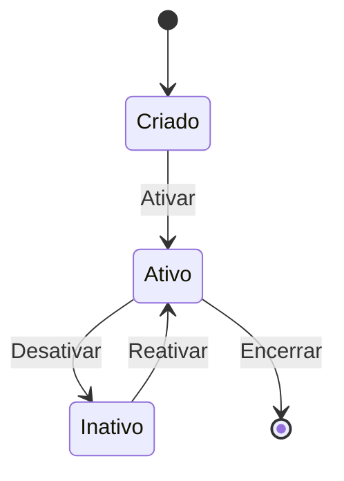
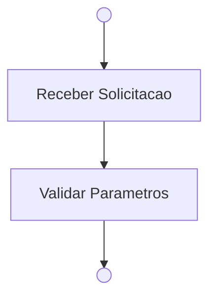
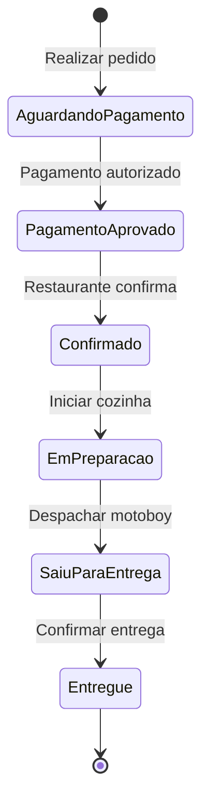
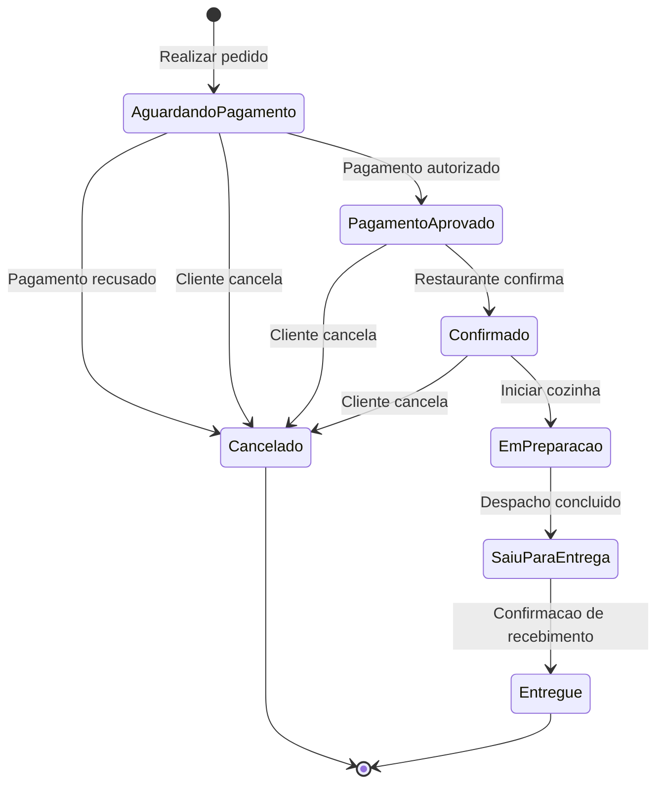
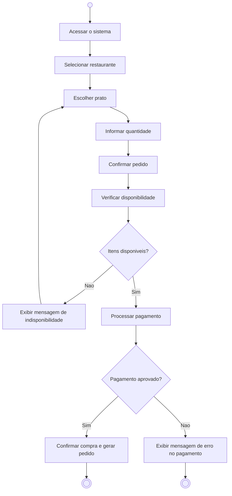
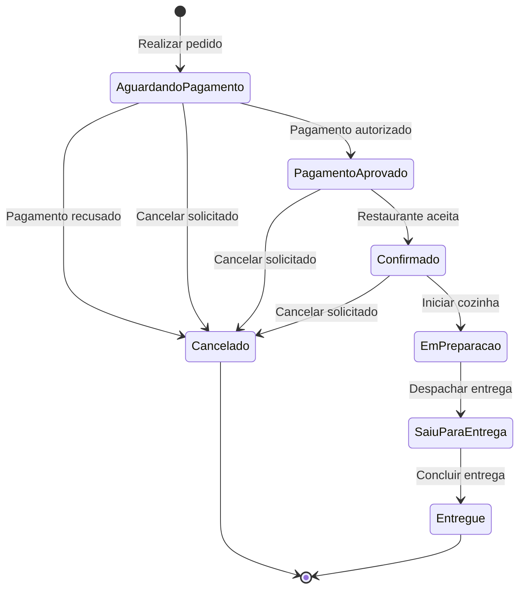
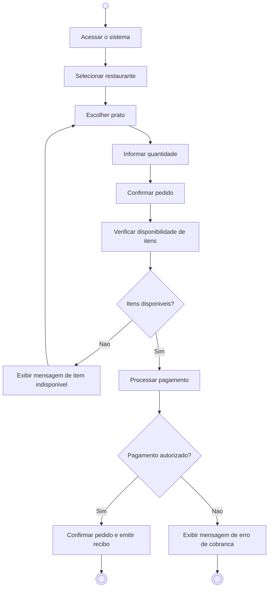
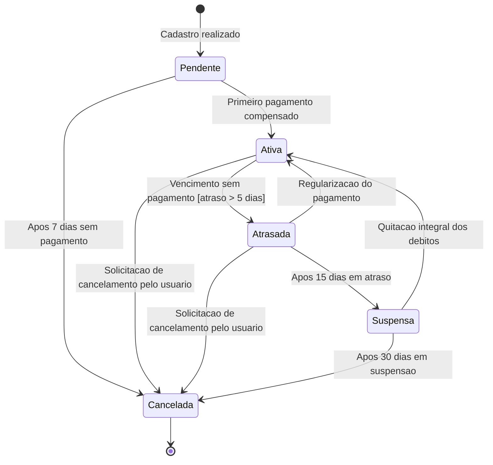
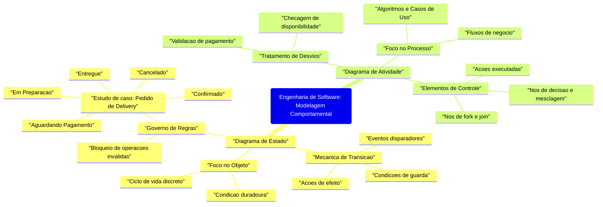

# Aula 11 — Diagramas de Estado e de Atividade

> **Professor:** Wesley Soares
> **Disciplina:** Engenharia de Software II (4º Semestre)
> **Tema:** Modelagem comportamental prática com Diagramas de Estado e de Atividade na UML, focando no ciclo de vida de entidades e na orquestração de processos de negócio em sistemas orientados a objetos.

---

## Sumário

- [Objetivo da aula](#objetivo-da-aula)
- [Contexto e pré-requisitos](#contexto-e-pre-requisitos)
- [Conceito e finalidade do Diagrama de Estado na UML](#conceito-e-finalidade-do-diagrama-de-estado-na-uml)
- [Identificação de estados e eventos de transição no ciclo de vida de objetos](#identificacao-de-estados-e-eventos-de-transicao-no-ciclo-de-vida-de-objetos)
- [Conceito e finalidade do Diagrama de Atividade na UML](#conceito-e-finalidade-do-diagrama-de-atividade-na-uml)
- [Representação de fluxos de execução, ações, decisões e ramificações](#representacao-de-fluxos-de-execucao-acoes-decisoes-e-ramificacoes)
- [Diferenciação arquitetural entre Diagrama de Estado e Diagrama de Atividade](#diferenciacao-arquitetural-entre-diagrama-de-estado-e-diagrama-de-atividade)
- [Estudo de caso prático: ciclo de vida e estados de um pedido de delivery](#estudo-de-caso-pratico-ciclo-de-vida-e-estados-de-um-pedido-de-delivery)
- [Restrições e regras de negócio baseadas no estado atual do objeto](#restricoes-e-regras-de-negocio-baseadas-no-estado-atual-do-objeto)
- [Mapeamento de fluxos alternativos e transições de cancelamento](#mapeamento-de-fluxos-alternativos-e-transicoes-de-cancelamento)
- [Estudo de caso prático: fluxo do processo de realização de compra](#estudo-de-caso-pratico-fluxo-do-processo-de-realizacao-de-compra)
- [Tratamento de decisões em processos: verificação de disponibilidade e validação de pagamento](#tratamento-de-decisoes-em-processos-verificacao-de-disponibilidade-e-validacao-de-pagamento)
- [Código da aula](#codigo-da-aula)
- [Exercícios](#exercicios)
- [Erros comuns e boas práticas](#erros-comuns-e-boas-praticas)
- [Links e materiais complementares](#links-e-materiais-complementares)
- [Mapa da aula](#mapa-da-aula)
- [Glossário](#glossario)
- [Pontos-chave para a prova](#pontos-chave-para-a-prova)
- [Perguntas e respostas (JSONL)](#perguntas-e-respostas-jsonl)
- [Checklist de revisão](#checklist-de-revisao)

---

## Objetivo da aula

Ao término desta aula, o estudante de Sistemas de Informação deverá ser capaz de:

1. Compreender a fundamentação teórica e a finalidade prática do Diagrama de Máquina de Estados (*State Machine Diagram*) na UML.
2. Identificar com precisão os estados discretos que compõem o ciclo de vida temporal de um objeto de domínio.
3. Modelar transições direcionadas entre estados disparadas por eventos externos, temporais ou condicionais (guardas).
4. Compreender a finalidade e a sintaxe do Diagrama de Atividades (*Activity Diagram*) na especificação de fluxos procedurais e processos de negócio.
5. Projetar fluxos de execução utilizando ações sequenciais, nós de decisão/mesclagem e bifurcações de controle.
6. Estabelecer a distinção arquitetural definitiva entre a perspectiva centrada na entidade (Estado) e a perspectiva centrada no processo operacional (Atividade).
7. Mapear fluxos alternativos e exceções em diagramas comportamentais, garantindo a integridade transacional e o cumprimento das regras de negócio do software.

---

## Contexto e pré-requisitos

Na Engenharia de Software orientada a objetos, a modelagem de sistemas divide-se classicamente em duas visões complementares padronizadas pela OMG (*Object Management Group*):

- **Visão Estrutural:** Captura a organização estática do sistema (classes, atributos, métodos, pacotes e relacionamentos de dependência, associação ou herança).
- **Visão Comportamental:** Captura a dinâmica temporal do sistema em tempo de execução, dividindo-se entre interações de troca de mensagens (Diagramas de Sequência e Comunicação) e transformações de estado/processo (Diagramas de Estado e Atividade).

Para acompanhar com sucesso esta aula, o estudante deve dominar os conceitos básicos de:
- Classes, instâncias e encapsulamento em Orientação a Objetos.
- Requisitos funcionais e especificação de casos de uso (*Use Cases*).
- Noções fundamentais de lógica condicional e fluxos de controle estruturados.

---

## Conceito e finalidade do Diagrama de Estado na UML

### Definição formal e motivação

O Diagrama de Estado (formalmente denominado *State Machine Diagram* na especificação UML 2.x) é um modelo comportamental que descreve os estados finitos pelos quais um objeto específico pode passar durante todo o seu ciclo de vida dentro do sistema, em resposta a estímulos e eventos discretos.

Formalmente, na teoria da computação aplicada à engenharia de software, uma máquina de estados finitos que fundamenta este diagrama pode ser descrita matematicamente pela quintupla:

```math
M = (S, \Sigma, \delta, s_0, F)
```

Onde:
- $`S`$ representa o conjunto finito de estados possíveis do objeto;
- $`\Sigma`$ representa o alfabeto de eventos de entrada aceitos pelo sistema;
- $`\delta: S \times \Sigma \to S`$ é a função de transição de estados;
- $`s_0 \in S`$ é o estado inicial de instanciação;
- $`F \subseteq S`$ é o conjunto de estados finais (conclusão do ciclo de vida).

A motivação primordial para a utilização do Diagrama de Estado reside na necessidade de governar **objetos reativos complexos**. Em domínios de negócio reais, uma entidade não aceita qualquer comando a qualquer momento; suas operações permitidas dependem intrinsecamente da sua condição atual.

### Exemplo conceitual

Considere uma conexão TCP ou um pedido de comércio eletrônico. Um pedido recém-criado pode ser pago; contudo, um pedido já entregue não pode receber uma ordem de pagamento, tampouco uma ordem de preparação. O Diagrama de Estado documenta visualmente e contratualmente essa máquina de estados.



### Contraexemplo e armadilhas conceituais

- **Contraexemplo:** Modelar as telas de uma aplicação web ("Tela de Login" $`\to`$ "Tela de Perfil") em um Diagrama de Estado. Telas não são estados de uma entidade de domínio; são interfaces de apresentação de um processo de navegação.
- **Armadilha clássica:** Tratar verbos ou ações passageiras como estados. Por exemplo, modelar "Calculando Frete" como um estado persistente da classe Pedido, quando na verdade o cálculo é uma ação pontual ou transitória pertencente a um fluxo de atividade.

---

## Identificação de estados e eventos de transição no ciclo de vida de objetos

### Anatomia de um estado e de uma transição

Um **Estado** na UML é uma condição ou situação na vida de um objeto durante a qual ele satisfaz uma condição prévia, executa uma atividade ou aguarda por um ou mais eventos externos. 

Uma **Transição** é um relacionamento entre dois estados, indicando que um objeto no primeiro estado passará para o segundo quando ocorrer um evento especificado e determinadas condições de guarda forem satisfeitas.

A sintaxe canônica completa de uma transição na especificação UML é dada por:

```text
evento [condição_de_guarda] / ação_de_efeito
```

- **Evento:** O gatilho que sensibiliza a transição (ex.: `pagamentoRecebido()`, `timeoutExpira()`).
- **Condição de guarda:** Uma expressão booleana que deve ser estritamente verdadeira para que a transição ocorra (ex.: `[valorPago >= total]`).
- **Ação de efeito:** Uma operação executada atomicamente durante a ocorrência da transição (ex.: `/ emitirRecibo()`).

### Tabela: Elementos de uma transição de estado

| Elemento | Papel no Ciclo de Vida | Obrigatoriedade | Exemplo Prático |
| :--- | :--- | :--- | :--- |
| **Estado de Origem** | Ponto de partida da transição | Obrigatório | `Aguardando Pagamento` |
| **Evento Disparador** | Gatilho externo ou interno que ativa o teste | Quase sempre presente | `notificacaoGatewayRecebida` |
| **Guarda (*Guard*)** | Condição lógica que valida a transição | Opcional | `[status == APROVADO]` |
| **Ação / Efeito** | Operação rápida executada na troca | Opcional | `notificarRestaurante()` |
| **Estado de Destino** | Novo estado atingido pela entidade | Obrigatório | `Pagamento Aprovado` |

### Identificação de estados candidatos

Para identificar os estados legítimos de uma entidade durante a análise de requisitos:
1. Examine os atributos de status da classe no modelo de dados.
2. Identifique regras que impeçam ou habilitem operações com base em atributos históricos.
3. Verifique se o objeto precisa esperar por agentes externos (gateways, usuários, tempo cronológico).

---

## Conceito e finalidade do Diagrama de Atividade na UML

### Definição e propósito

O Diagrama de Atividade é uma especialização comportamental da UML voltada para a modelagem dos aspectos dinâmicos de um sistema, enfatizando o fluxo sequencial e concorrente de controle e dados entre atividades passo a passo.

Enquanto o Diagrama de Estado foca em *como um objeto muda de condição*, o Diagrama de Atividade foca em *como um processo de negócio é executado do início ao fim*.

### Aplicações primárias na engenharia de software

- **Modelagem de Processos de Negócio (BPM):** Descrever como uma organização realiza uma tarefa de ponta a ponta (ex.: processar devolução de mercadoria).
- **Especificação de Casos de Uso:** Detalhar a lógica operacional interna de um caso de uso complexo, evidenciando o caminho feliz e os fluxos de exceção.
- **Engenharia de Algoritmos e Métodos:** Modelar rotinas complexas de cálculo ou validação com múltiplas ramificações antes da codificação.



---

## Representação de fluxos de execução, ações, decisões e ramificações

### Elementos sintáticos fundamentais

O Diagrama de Atividade compõe-se de nós e arestas direcionadas:

1. **Nó Inicial:** Indica o ponto de entrada da execução (círculo preenchido).
2. **Ação (*Action*):** Etapa elementar e atômica de trabalho que não pode ser subdividida no nível atual de abstração (retângulo com cantos arredondados).
3. **Nó de Decisão (*Decision Node*):** Ponto onde o fluxo de controle bifurca em múltiplos caminhos mutuamente exclusivos com base em condições de guarda (representado por um losango com uma entrada e múltiplas saídas).
4. **Nó de Mesclagem (*Merge Node*):** Ponto onde caminhos alternativos se unem novamente sem sincronização temporal (representado por um losango com múltiplas entradas e uma única saída).
5. **Nó de Bifurcação (*Fork Node*):** Divide um fluxo único em múltiplos fluxos concorrentes/paralelos (barra sólida com uma entrada e múltiplas saídas).
6. **Nó de União (*Join Node*):** Sincroniza fluxos concorrentes; o fluxo subsequente só avança quando todas as entradas chegarem (barra sólida com múltiplas entradas e uma saída).
7. **Nó Final de Atividade:** Encerra completamente todo o fluxo do diagrama (círculo preenchido envolvido por uma borda externa).

### Tabela comparativa dos nós de controle

| Símbolo Gráfico | Nome do Elemento | Entradas | Saídas | Comportamento Lógico |
| :--- | :--- | :--- | :--- | :--- |
| Círculo sólido | Nó Inicial | 0 | 1 | Inicia a emissão do token de controle. |
| Retângulo arredondado | Ação | 1 | 1 | Consome token de entrada, executa trabalho e emite token de saída. |
| Losango (1 para N) | Nó de Decisão | 1 | $`N \ge 2`$ | Avalia guardas mutuamente exclusivas e despacha token para apenas um ramo. |
| Losango (N para 1) | Nó de Mesclagem | $`N \ge 2`$ | 1 | Recebe token de qualquer ramo ativo e o encaminha imediatamente adiante. |
| Barra espessa (1 para N)| Fork | 1 | $`N \ge 2`$ | Duplica o token, disparando execuções em paralelo/concorrentes. |
| Barra espessa (N para 1)| Join | $`N \ge 2`$ | 1 | Aguarda a chegada de tokens de todas as arestas de entrada para prosseguir. |
| Círculo com borda | Nó Final | 1 | 0 | Destrói todos os tokens do diagrama e encerra a atividade. |

---

## Diferenciação arquitetural entre Diagrama de Estado e Diagrama de Atividade

Uma das confusões mais recorrentes entre engenheiros de software juniores é a incapacidade de discernir quando utilizar um Diagrama de Estado ou um Diagrama de Atividade. Conforme enfatizado pelo Prof. Wesley Soares em aula:

> *"O ponto principal é entender que o Diagrama de Estado não representa o fluxo completo de um processo. Ele representa as mudanças de estado de um objeto ao longo do seu ciclo de vida."*

### Matriz de Comparação Arquitetural

| Dimensão de Análise | Diagrama de Estado (*State Machine*) | Diagrama de Atividade (*Activity Diagram*) |
| :--- | :--- | :--- |
| **Foco Principal** | O ciclo de vida de uma entidade específica | O fluxo operacional de um processo ou algoritmo |
| **Centro de Atenção** | Um único objeto / instância ao longo do tempo | Múltiplos atores, serviços e objetos orquestrados |
| **Unidade Básica** | Estado (situação estocástica/estável de espera) | Ação (trabalho ou operação em execução contínua) |
| **Gatilho de Passagem** | Eventos externos discretos e guardas | Conclusão natural da ação anterior (*completion*) |
| **Persistência dos Dados** | Reflete alterações diretas nos atributos da entidade | Reflete a passagem de parâmetros e tokens de controle |
| **Escopo Típico** | Classes de domínio ricas (ex.: Pedido, Fatura) | Casos de uso complexos (ex.: Efetuar Compra) |
| **Pergunta-chave respondida** | *"Quais operações este objeto aceita agora?"* | *"Qual é o próximo passo a ser executado?"* |

### Regra prática de escolha

- Se você estiver se perguntando: *"Quais são os status possíveis desta fatura e quando ela pode ser cancelada?"*, construa um **Diagrama de Estado**.
- Se você estiver se perguntando: *"Quais etapas o cliente e a aplicação percorrem desde o catálogo até a finalização do pedido?"*, construa um **Diagrama de Atividade**.

---

## Estudo de caso prático: ciclo de vida e estados de um pedido de delivery

No estudo de caso apresentado pelo Prof. Wesley Soares, analisamos o comportamento da classe `Pedido` em uma aplicação de delivery de comida.

### Especificação dos estados nominais

O ciclo de vida canônico do pedido percorre a seguinte sequência de estados primários:
1. **Aguardando Pagamento:** O pedido foi montado pelo cliente e registrado na base de dados, aguardando resposta da instituição bancária ou gateway de pagamentos.
2. **Pagamento Aprovado:** A transação financeira foi autorizada pelo gateway, permitindo o avanço operacional.
3. **Confirmado:** O restaurante recebeu o pedido e validou sua capacidade de atendimento.
4. **Em Preparação:** A cozinha do restaurante iniciou a confecção dos pratos.
5. **Saiu para Entrega:** O pedido foi despachado e encontra-se sob posse do entregador.
6. **Entregue:** O pedido foi repassado com sucesso ao cliente final (estado terminal com êxito).



---

## Restrições e regras de negócio baseadas no estado atual do objeto

### A necessidade de documentação formal de estados

Por que é mandatório documentar e modelar os estados de um objeto? Conforme destacado em aula:
- O sistema de software necessita saber de forma inequívoca **quais operações são permitidas e quais devem ser bloqueadas** em cada instante.
- Um software corporativo não pode permitir inconsistências no mundo físico provocadas por falhas na camada digital.

### Exemplos práticos de restrições de domínio

1. **Tentativa de Preparação Indevida:** Um pedido no estado `Entregue` jamais deve permitir a invocação do método `iniciarPreparacao()`. Isso causaria prejuízo financeiro ao restaurante (duplicação de produção física).
2. **Cancelamento Indevido:** Um cliente não pode clicar em "Cancelar Pedido" quando este já se encontra `Saiu para Entrega` ou `Em Preparação` (a menos que haja intervenção de suporte com políticas de ressarcimento específicas), pois os insumos já foram consumidos e o entregador já está em trânsito.
3. **Reenvio de Cobrança:** Um pedido no estado `Pagamento Aprovado` deve rejeitar qualquer nova requisição de cobrança para prevenir cobranças em duplicidade no cartão do cliente.

### Tabela de permissões operacionais por estado do pedido

| Operação do Sistema | Aguardando Pagamento | Pagamento Aprovado | Confirmado | Em Preparação | Saiu para Entrega | Entregue | Cancelado |
| :--- | :---: | :---: | :---: | :---: | :---: | :---: | :---: |
| `processarPagamento()` | Permitido | Bloqueado | Bloqueado | Bloqueado | Bloqueado | Bloqueado | Bloqueado |
| `cancelarPeloCliente()`| Permitido | Permitido | Permitido | Bloqueado | Bloqueado | Bloqueado | Bloqueado |
| `iniciarCozinha()` | Bloqueado | Bloqueado | Permitido | Bloqueado | Bloqueado | Bloqueado | Bloqueado |
| `despachar()` | Bloqueado | Bloqueado | Bloqueado | Permitido | Bloqueado | Bloqueado | Bloqueado |
| `confirmarEntrega()` | Bloqueado | Bloqueado | Bloqueado | Bloqueado | Permitido | Bloqueado | Bloqueado |

---

## Mapeamento de fluxos alternativos e transições de cancelamento

Na engenharia de software do mundo real, os sistemas operam frequentemente fora do "caminho feliz" (*happy path*). A robustez do software reside na capacidade de lidar com exceções, desistências e falhas transacionais.

### Regras de negócio para cancelamento do pedido

O material de aula especifica duas situações capitais de desvio no ciclo de vida do pedido:

1. **Recusa da Operação Financeira:** Se a operadora de cartão ou a instituição bancária recusar a transação, o pedido não pode prosseguir para a esteira operacional do restaurante. A transição deve mover o objeto imediatamente de `Aguardando Pagamento` para o estado terminal `Cancelado`.
2. **Cancelamento Voluntário pelo Cliente:** O cliente tem o direito de desistir da compra, desde que o faça **antes** do início da preparação do alimento pelo restaurante. Dessa forma, as transições para `Cancelado` só são disparáveis a partir dos estados `Aguardando Pagamento`, `Pagamento Aprovado` e `Confirmado`.



---

## Estudo de caso prático: fluxo do processo de realização de compra

O segundo grande eixo da aula prática ministrada pelo Prof. Wesley Soares é a modelagem do processo de negócio "Realizar uma Compra" utilizando o Diagrama de Atividades.

### Roteiro operacional do processo

O processo de compra na plataforma de delivery obedece à seguinte sequência canônica de ações:
1. O cliente acessa o sistema.
2. O cliente seleciona um restaurante parceiro.
3. O cliente escolhe um prato do cardápio.
4. O cliente informa a quantidade desejada.
5. O cliente confirma o pedido no carrinho de compras.
6. O sistema verifica a disponibilidade física dos itens no estoque do restaurante.
7. O sistema processa o pagamento junto ao gateway financeiro.
8. O pedido é confirmado com sucesso OU o cliente recebe uma mensagem de erro apropriada.

Este encadeamento de passos evidencia claramente a diferença de abordagem: não estamos acompanhando uma única variável de status de um objeto, mas orquestrando uma sucessão de ações cooperadas entre usuário, backend, restaurante e gateway.

---

## Tratamento de decisões em processos: verificação de disponibilidade e validação de pagamento

Na execução do processo de compra, duas validações críticas atuam como pontos de decisão (representados por losangos na notação UML), ramificando o fluxo de controle com base em testes lógicos.

### Decisão 1: Verificação de disponibilidade de pratos e ingredientes

Após a confirmação inicial do pedido pelo cliente, o sistema executa a ação automatizada `Verificar disponibilidade`.
- **Caminho Positivo (`[Disponível]`):** O fluxo prossegue para o processamento da transação financeira.
- **Caminho Negativo (`[Indisponível]`):** O sistema exibe um alerta de item esgotado e redireciona o fluxo de controle de volta para a ação `Escolher prato`, permitindo ao cliente selecionar outro item sem abortar sua sessão.

### Decisão 2: Processamento do pagamento

Após a confirmação da disponibilidade, o sistema invoca a ação `Processar pagamento`.
- **Caminho Positivo (`[Aprovado]`):** O sistema executa a ação `Confirmar pedido` e emite o comprovante ao cliente, finalizando o processo com êxito.
- **Caminho Negativo (`[Recusado]`):** O sistema executa a ação `Exibir mensagem de erro de pagamento` e encerra o fluxo no nó final de atividade.



---

## Código da aula

*(Complemento técnico didático: Embora a aula de Engenharia de Software II tenha foco primordialmente analítico e de modelagem conceitual sem entrega de arquivos-fonte originais, a implementação das duas técnicas em código ilustra de maneira cabal a materialização dos diagramas em arquitetura de software).*

Abaixo apresentamos duas implementações conceituais em Python para fixar o padrão de projeto comportamental correspondente a cada modelo:

### 1. Implementação da Máquina de Estados do Pedido (`State Pattern`)

O código a seguir materializa o Diagrama de Estados do Pedido utilizando o padrão GoF *State*, demonstrando como a entidade restringe operações inválidas com base no seu estado em tempo de execução.

```python
# pedido_state_machine.py
# Complemento didático: Demonstração prática do Diagrama de Estados do Pedido

class EstadoPedidoException(Exception):
    """Exceção levantada quando uma transição inválida é tentada."""
    pass


class EstadoPedido:
    """Classe base abstrata para todos os estados do pedido."""
    def __init__(self, pedido):
        self.pedido = pedido

    def pagar(self):
        raise EstadoPedidoException(f"Operacao pagar() invalida no estado {self.__class__.__name__}")

    def confirmar(self):
        raise EstadoPedidoException(f"Operacao confirmar() invalida no estado {self.__class__.__name__}")

    def iniciar_preparacao(self):
        raise EstadoPedidoException(f"Operacao iniciar_preparacao() invalida no estado {self.__class__.__name__}")

    def despachar(self):
        raise EstadoPedidoException(f"Operacao despachar() invalida no estado {self.__class__.__name__}")

    def entregar(self):
        raise EstadoPedidoException(f"Operacao entregar() invalida no estado {self.__class__.__name__}")

    def cancelar(self, motivo: str):
        raise EstadoPedidoException(f"Operacao cancelar() invalida no estado {self.__class__.__name__}")


class AguardandoPagamento(EstadoPedido):
    def pagar(self):
        print("[Evento] Pagamento aprovado pelo gateway.")
        self.pedido.mudar_estado(PagamentoAprovado(self.pedido))

    def cancelar(self, motivo: str):
        print(f"[Evento] Pedido cancelado em pagamento: {motivo}")
        self.pedido.mudar_estado(Cancelado(self.pedido))


class PagamentoAprovado(EstadoPedido):
    def confirmar(self):
        print("[Evento] Restaurante confirmou a recepcao do pedido.")
        self.pedido.mudar_estado(Confirmado(self.pedido))

    def cancelar(self, motivo: str):
        print(f"[Evento] Cancelamento antes da confirmacao: {motivo}")
        self.pedido.mudar_estado(Cancelado(self.pedido))


class Confirmado(EstadoPedido):
    def iniciar_preparacao(self):
        print("[Evento] Cozinha iniciou o preparo dos pratos.")
        self.pedido.mudar_estado(EmPreparacao(self.pedido))

    def cancelar(self, motivo: str):
        print(f"[Evento] Cliente cancelou antes do inicio do preparo: {motivo}")
        self.pedido.mudar_estado(Cancelado(self.pedido))


class EmPreparacao(EstadoPedido):
    def despachar(self):
        print("[Evento] Pedido empacotado e retirado pelo motoboy.")
        self.pedido.mudar_estado(SaiuParaEntrega(self.pedido))
    # Note que cancelar() nao foi sobrescrito: chamara a excecao da classe base!


class SaiuParaEntrega(EstadoPedido):
    def entregar(self):
        print("[Evento] Entrega realizada no endereco do cliente.")
        self.pedido.mudar_estado(Entregue(self.pedido))


class Entregue(EstadoPedido):
    pass  # Estado terminal: nenhuma operacao permitida


class Cancelado(EstadoPedido):
    pass  # Estado terminal: nenhuma operacao permitida


class Pedido:
    """Classe de contexto que mantém a referência para o estado atual."""
    def __init__(self, id_pedido: int):
        self.id_pedido = id_pedido
        self.estado_atual: EstadoPedido = AguardandoPagamento(self)

    def mudar_estado(self, novo_estado: EstadoPedido):
        print(f"[Transicao] Pedido #{self.id_pedido}: {self.estado_atual.__class__.__name__} -> {novo_estado.__class__.__name__}")
        self.estado_atual = novo_estado

    def pagar(self):
        self.estado_atual.pagar()

    def confirmar(self):
        self.estado_atual.confirmar()

    def iniciar_preparacao(self):
        self.estado_atual.iniciar_preparacao()

    def despachar(self):
        self.estado_atual.despachar()

    def entregar(self):
        self.estado_atual.entregar()

    def cancelar(self, motivo: str):
        self.estado_atual.cancelar(motivo)


if __name__ == "__main__":
    # Teste 1: Caminho Feliz
    print("--- Teste 1: Executando Fluxo Nominal ---")
    p1 = Pedido(101)
    p1.pagar()
    p1.confirmar()
    p1.iniciar_preparacao()
    p1.despachar()
    p1.entregar()

    # Teste 2: Tentativa de violar regra de negocio (cancelar durante preparacao)
    print("\n--- Teste 2: Violando Regra de Negocio ---")
    p2 = Pedido(102)
    p2.pagar()
    p2.confirmar()
    p2.iniciar_preparacao()
    try:
        p2.cancelar("Cliente mudou de ideia")
    except EstadoPedidoException as e:
        print(f"Bloqueio com sucesso: {e}")
```

---

## Exercícios

### Exercício 1: Modelagem do Ciclo de Vida de um Pedido com Fluxos Alternativos

#### Enunciado
Com base no estudo de caso apresentado na aula pelo Prof. Wesley Soares, elabore a especificação de um Diagrama de Estado para a classe `Pedido` de uma plataforma de delivery. O modelo deve contemplar:
- Nó inicial e nós finais;
- Estados nominais: `Aguardando Pagamento`, `Pagamento Aprovado`, `Confirmado`, `Em Preparação`, `Saiu para Entrega` e `Entregue`;
- Estado alternativo de encerramento: `Cancelado`;
- Eventos de transição nominais com rotulagem clara;
- Fluxos alternativos explícitos: (a) recusa de pagamento pela instituição financeira levando a `Cancelado`; e (b) solicitação de cancelamento pelo cliente, com a regra de que o cancelamento voluntário só é permitido antes do estado `Em Preparação`.
- Justifique tecnicamente por que operações como nova preparação são terminantemente bloqueadas após a entrega.

#### Raciocínio pedagógico
1. Identificar todos os estados possíveis da entidade e desenhá-los como vértices de um grafo direcionado.
2. Traçar a espinha dorsal do ciclo de vida (o caminho feliz).
3. Avaliar as saídas para o estado de exceção `Cancelado`. O cancelamento antes da preparação é permitido; logo, deve haver arestas saindo de `Aguardando Pagamento`, `Pagamento Aprovado` e `Confirmado` em direção a `Cancelado`.
4. Uma vez que o pedido entra em `Em Preparação`, os ingredientes foram consumidos; portanto, não há aresta de cancelamento partindo deste estado no modelo padrão.
5. `Entregue` é um nó terminal. A invocação de `iniciarPreparacao()` geraria inconsistência grave no inventário e custo duplicado sem lastro financeiro.

#### Resolução completa



**Justificativa Técnica:**
O bloqueio de novas operações de preparação após o estado `Entregue` decorre da invariante de integridade do domínio de negócio. Uma vez que um pedido atinge o estado final `Entregue`, seu contrato de serviço foi integralmente adimplido. Permitir uma transição de retorno ou re-execução violaria o princípio de transição unidirecional em máquinas de estado de faturamento/estoque, acarretando inconsistência contábil, perda de rastreabilidade física de motoboys e pedidos fantasmas na cozinha.

---

### Exercício 2: Diagrama de Atividades para o Processo de Compra e Verificação de Disponibilidade

#### Enunciado
Modele o Diagrama de Atividades para o fluxo de execução do processo "Realizar uma Compra" conforme a sequência apresentada pelo professor em aula:
1. O cliente acessa o sistema;
2. Seleciona um restaurante;
3. Escolhe um prato;
4. Informa a quantidade;
5. Confirma o pedido;
6. O sistema verifica a disponibilidade de itens;
7. O sistema processa o pagamento;
8. O pedido é confirmado ou uma mensagem de erro é exibida.

Utilize nós de decisão (losangos) para representar explicitamente o teste de disponibilidade dos pratos (retornando à seleção de prato caso indisponível) e o resultado da transação de pagamento (aprovado ou recusado).

#### Raciocínio pedagógico
1. O processo inicia em um único nó inicial e avança linearmente através de ações executadas pelo cliente até a confirmação do pedido no carrinho.
2. Na etapa 6, o fluxo deixa de ser uma ação simples e exige uma ramificação condicional: o sistema deve checar o banco de dados / estoque.
3. Se indisponível, o cliente não deve ser expulso do sistema; o fluxo deve retornar a uma ação anterior (`Escolher prato`), demonstrando um ciclo de repetição (*loop*) em atividades.
4. Se disponível, avança-se para o processamento de pagamento.
5. O pagamento é outro ponto de decisão com dois desfechos possíveis: sucesso (confirmação da compra) ou fracasso (exibição de erro). Ambos terminam em nós finais.

#### Resolução completa



---

### Exercício 3: Diferenciação Conceitual entre Ciclo de Vida de Objeto e Fluxo de Processo

#### Enunciado
Explique detalhadamente por que um analista de sistemas não deve utilizar o Diagrama de Estado para descrever as telas navegadas pelo usuário em um checkout e por que não deve utilizar o Diagrama de Atividade para definir quais operações um registro financeiro aceita ao longo do tempo. Construa uma tabela comparativa abordando: foco principal da modelagem, unidade básica de representação (estado de objeto vs. ação de processo), elemento disparador de transição e o critério definitivo para escolher qual dos dois diagramas utilizar em uma especificação de software.

#### Raciocínio pedagógico
- O estudante deve compreender o princípio da separação de preocupações (*Separation of Concerns*) na UML. Telas de interface gráfica e fluxos procedurais mudam rapidamente e representam ações encadeadas de um usuário. Modelá-las como estados de uma entidade polui a modelagem orientada a objetos com detalhes efêmeros de interface.
- Por outro lado, faturas, títulos bancários e assinaturas possuem regras de transição estritas de longa duração (dias, meses), onde a entidade repousa passivamente esperando por eventos. Tentar modelar isso como um diagrama de atividades gera fluxos que parecem procedimentos infinitos rodando em segundo plano, mascarando as restrições comportamentais da classe.

#### Resolução completa

Um analista de sistemas não deve utilizar o **Diagrama de Estado** para modelar o fluxo de telas de navegação porque interfaces visuais representam passos de interação procedural transitória (ações com token ativo), e não estados discretos de persistência de uma entidade de negócio. Modelar telas em diagramas de estado gera uma "explosão combinatória de estados artificiais", acoplando a lógica de domínio a detalhes voláteis de layout (UI).

Da mesma forma, o analista não deve utilizar o **Diagrama de Atividade** para ditar as operações aceitas por um registro financeiro porque o Diagrama de Atividade assume fluxo contínuo orientado a ações em execução (*completion events*). Um registro financeiro (como uma fatura ou duplicata) não está executando uma ação contínua; ele permanece **inerte** em um estado de espera (ex.: `Em Aberto`) durante 30 dias até que um evento externo assíncrono (ex.: compensação via PIX ou decurso de prazo de prescrição) aconteça. O Diagrama de Estado é o único capaz de modelar formalmente esse confinamento de operações permitidas com base na condição interna do registro.

#### Tabela comparativa formal

| Critério de Comparação | Diagrama de Estado | Diagrama de Atividade |
| :--- | :--- | :--- |
| **Foco Principal** | Ciclo de vida e conformidade de uma entidade de domínio | Orquestração sequencial/paralela de um processo de negócio |
| **Unidade Básica** | **Estado** (situação estável de um objeto) | **Ação** (trabalho executado pelo sistema/ator) |
| **Elemento Disparador** | Evento externo discreto + condição de guarda | Término da execução da ação antecedente (*completion*) |
| **Perspectiva Arquitetural** | Centrada no Objeto / Entidade (*Data/Entity-Centric*) | Centrada na Função / Processo (*Control-Flow-Centric*) |
| **Critério Definitivo de Escolha** | Use quando precisar documentar **quais métodos uma classe pode ou não executar** em função de seu histórico | Use quando precisar documentar **a sequência de passos, ramificações e atores** envolvidos na entrega de um valor de negócio |

---

### Exercício 4: Modelagem de Estados para Assinatura de Usuário com Transições Temporais

#### Enunciado
Projete o Diagrama de Estado para o ciclo de vida da entidade `Assinatura` em uma plataforma SaaS de software. A assinatura deve navegar pelos seguintes estados:
- `Pendente` (criada, aguardando primeiro pagamento);
- `Ativa` (serviço liberado);
- `Atrasada` (inadimplência recente);
- `Suspensa` (serviço bloqueado temporariamente por falta de pagamento);
- `Cancelada` (vínculo extinto).

Especifique os eventos de transição que causam cada alteração (ex.: compensação de pagamento, atraso superior a 5 dias, regularização de pendência, cancelamento voluntário pelo usuário e decurso de prazo de 30 dias no estado suspensa). Identifique quais ações de sistema são bloqueadas quando o objeto se encontra nos estados `Suspensa` e `Cancelada`.

#### Raciocínio pedagógico
- Demonstrar a aplicação de eventos baseados em tempo (*time events*, iniciados com a palavra-chave `after` ou descritos textualmente como decurso de prazo) em diagramas de estado.
- Relacionar o estado do objeto com o controle de acesso e permissões de uso do software (segurança e regras de negócio).

#### Resolução completa



**Restrições Operacionais Associadas aos Estados:**
- **No estado `Suspensa`:**
  - *Ações permitidas:* `acessarFaturas()`, `realizarPagamento()`, `solicitarCancelamento()`.
  - *Ações bloqueadas:* `executarJobDeCalculo()`, `exportarRelatorios()`, `adicionarNovosUsuarios()`, `consumirAPIPaga()`. O login na plataforma pode ocorrer, mas com redirecionamento forçado para a tela de regularização financeira.
- **No estado `Cancelada`:**
  - *Ações permitidas:* Nenhuma ação funcional da aplicação. Permitida apenas a consulta de dados históricos por exigência fiscal/jurídica (via painel administrativo).
  - *Ações bloqueadas:* Qualquer tentativa de autenticação nas APIs operacionais, agendamento de tarefas ou emissão de faturamento recorrente.

---

## Erros comuns e boas práticas

### Erros comuns cometidos por estudantes

1. **Confundir Ação com Estado:** Rotular nós do Diagrama de Estado com nomes verbais transitórios, como `Enviando E-mail` ou `Verificando Cartao`. Estados devem representar condições duradouras ou substantivos particípios (`E-mail Enviado`, `Cartao Verificado`).
2. **Esquecer Nós Finais em Atividades:** Desenhar fluxos de atividade que terminam abruptamente em ações sem alcançar um nó final de atividade ou nó final de fluxo.
3. **Pipes e Sintaxe Inválida:** Inserir caracteres como pipes (`|`) ou tags HTML dentro de rótulos de nós em ferramentas de modelagem, gerando erros de renderização ou quebrando a interoperabilidade da ferramenta.
4. **Modelar Telas de UI em Diagramas de Máquina de Estado:** Misturar o ciclo de vida do domínio com a navegação visual da interface do usuário.
5. **Ramificações sem Guardas Mutuamente Exclusivas:** No Diagrama de Atividade, criar saídas de um nó de decisão cujas condições de guarda possam ser verdadeiras simultaneamente, gerando ambiguidade e não-determinismo na execução do fluxo.
6. **Esquecer o Fluxo Alternativo:** Projetar apenas o caminho feliz em diagramas de atividade e de estado, desconsiderando cartões recusados, estouro de tempo limite (*timeout*) e desistências de usuários.

### Boas práticas de modelagem

- **Nomenclatura Consistente:**
  - No Diagrama de Estado: utilize adjetivos, particípios ou locuções que indiquem situação (ex.: `Em Processamento`, `Aprovado`, `Despachado`).
  - No Diagrama de Atividade: utilize verbos no infinitivo associados ao objeto da ação (ex.: `Validar Cadastro`, `Emitir Nota Fiscal`, `Debitar Cartao`).
- **Completude das Guardas:** Sempre garanta que a união de todas as guardas de uma decisão cubra todas as possibilidades lógicas (ex.: `[x > 0]` e `[x <= 0]`).
- **Simplicidade e Modularização:** Se um diagrama de atividade tiver mais de 15 ações, divida-o utilizando chamadas para subatividades ou decomposição hierárquica.
- **Evitar o "Espaguete":** Minimize o cruzamento de arestas direcionadas mantendo o fluxo preferencialmente em orientação top-down (de cima para baixo) ou left-to-right (da esquerda para a direita).

---

## Links e materiais complementares

- **OMG Unified Modeling Language (OMG UML) Superstructure Version 2.5.1:** Documentação canônica internacional que define rigorosamente a gramática, semântica e metamodelo dos Diagramas de Atividade e Máquinas de Estado.
- **Martin Fowler — UML Distilled (3ª Edição):** Guia conciso e consagrado pelo mercado que aborda a distinção pragmática entre os diagramas comportamentais da UML aplicados ao desenvolvimento ágil.
- **Craig Larman — Utilizando UML e Padrões (3ª Edição):** Obra fundamental para entender a transição entre a análise de requisitos de negócio e o design de classes orientado a objetos utilizando o padrão GoF *State*.

---

## Mapa da aula



---

## Glossário

| Termo | Definição no Contexto da Engenharia de Software |
| :--- | :--- |
| **Diagrama de Estado (*State Machine*)** | Diagrama comportamental da UML que modela os estados finitos e transições de uma instância de classe ao longo de sua existência. |
| **Diagrama de Atividade (*Activity Diagram*)** | Diagrama comportamental da UML que modela o fluxo procedural de ações, decisões e concorrência em um processo de negócio. |
| **Estado (*State*)** | Situação ou condição qualitativa na vida de um objeto durante a qual ele satisfaz uma condição ou aguarda um evento. |
| **Ação (*Action*)** | Uma etapa fundamental de trabalho executável em um diagrama de atividade que consome recursos e transfere o controle. |
| **Transição (*Transition*)** | A passagem de um estado para outro disparada por um evento e validada por uma expressão de guarda. |
| **Condição de Guarda (*Guard*)** | Expressão lógica booleana associada a uma transição ou nó de decisão que precisa ser verdadeira para liberar a passagem do token. |
| **Evento (*Event*)** | Acontecimento notável com localização no tempo que pode disparar uma mudança de estado ou ativar um processo. |
| **Nó de Decisão (*Decision Node*)** | Elemento em formato de losango que ramifica um fluxo único de atividade em múltiplos caminhos alternativos excludentes. |
| **Nó de Mesclagem (*Merge Node*)** | Elemento em formato de losango que reúne caminhos alternativos em um único fluxo contínuo sem exigir sincronização. |
| **Nó de Bifurcação (*Fork Node*)** | Elemento de barra sólida que duplica o fluxo de controle em múltiplas trilhas paralelas/concorrentes. |
| **Nó de União (*Join Node*)** | Elemento de barra sólida que sincroniza e aguarda o término de todas as trilhas concorrentes antes de prosseguir. |
| **Token de Controle** | Conceito abstrato que modela a presença e a movimentação da execução ativa em nós de atividade. |
| **Padrão State (GoF)** | Padrão de projeto comportamental que encapsula os estados de um objeto em classes polimórficas separadas. |
| **Fluxo Alternativo** | Caminho percorrido por um processo ou ciclo de vida quando ocorrem falhas, exceções ou escolhas secundárias. |

---

## Pontos-chave para a prova

1. **A diferença crucial de foco:**
   - Diagrama de **Estado** $`\to`$ Foco no **objeto** (como a entidade muda suas propriedades internas ao longo do tempo).
   - Diagrama de **Atividade** $`\to`$ Foco no **processo** (quais etapas operacionais são executadas para atingir uma meta de negócio).
2. **Nomenclatura correta:** Estados não usam verbos no infinitivo de forma ativa. Use `Aguardando Pagamento` ou `Pago`, e nunca `Pagar Pedido`.
3. **Decisão vs. Fork:**
   - Losango de Decisão divide em caminhos **alternativos** (apenas um é percorrido).
   - Barra de Fork divide em caminhos **paralelos/concorrentes** (todos são percorridos).
4. **Controle de regras de negócio via estado:** O estado atual determina quais métodos da classe são legalmente executáveis. Exemplo: um pedido `Entregue` bloqueia a operação de `preparar()`.
5. **Cancelamento do pedido:** No estudo de caso da aula, o cancelamento voluntário pelo cliente só é permitido **antes** da fase de preparação culinária (`Em Preparação`).

---

## Perguntas e respostas (JSONL)

```jsonl
{"pergunta": "Qual é a finalidade precípua do Diagrama de Estado na UML?", "resposta": "Modelar os estados finitos e o ciclo de vida temporal de um objeto específico, evidenciando como eventos externos provocam transições entre esses estados.", "dificuldade": "facil"}
{"pergunta": "Qual é a finalidade principal do Diagrama de Atividades na UML?", "resposta": "Modelar o fluxo procedimental e operacional de um processo de negócio ou caso de uso, detalhando ações, decisões e concorrência.", "dificuldade": "facil"}
{"pergunta": "Por que não se deve modelar telas de navegação de um sistema web em um Diagrama de Estado de domínio?", "resposta": "Porque telas representam etapas de interação visual de um processo (ações de fluxo), e não estados qualitativos de uma entidade de negócio persistente.", "dificuldade": "medio"}
{"pergunta": "O que é uma condição de guarda em uma transição de estado?", "resposta": "É uma expressão booleana entre colchetes que precisa ser verdadeira no momento do disparo do evento para que a transição ocorra.", "dificuldade": "facil"}
{"pergunta": "Em que momento o cancelamento de um pedido de delivery pelo cliente é bloqueado no estudo de caso da aula?", "resposta": "A partir do momento em que o pedido atinge o estado 'Em Preparação', pois os insumos físicos do restaurante já começaram a ser manipulados.", "dificuldade": "medio"}
{"pergunta": "Qual é a representação visual de um nó de decisão em um Diagrama de Atividade?", "resposta": "Um losango contendo uma única aresta de entrada e duas ou mais arestas de saída rotuladas com guardas mutuamente exclusivas.", "dificuldade": "facil"}
{"pergunta": "Qual é a diferença funcional entre um nó de mesclagem (merge) e um nó de união (join)?", "resposta": "O merge recebe caminhos alternativos e passa o controle adiante imediatamente; o join sincroniza fluxos concorrentes e exige a chegada de todos os tokens.", "dificuldade": "dificil"}
{"pergunta": "Por que um pedido no estado 'Entregue' não permite a execução da ação 'iniciar preparo'?", "resposta": "Para manter a integridade do domínio, evitando inconsistência financeira e duplicidade na produção física de um pedido já concluído.", "dificuldade": "medio"}
{"pergunta": "No fluxo de compra modelado, o que acontece se o prato selecionado estiver indisponível?", "resposta": "O sistema exibe uma mensagem de indisponibilidade e retorna o fluxo de controle para a etapa de seleção de pratos.", "dificuldade": "medio"}
{"pergunta": "Qual padrão de projeto orientado a objetos é tradicionalmente utilizado para implementar um Diagrama de Estados?", "resposta": "O padrão comportamental State (do catálogo GoF - Gang of Four).", "dificuldade": "medio"}
{"pergunta": "O que caracteriza um estado terminal em um Diagrama de Máquina de Estados?", "resposta": "É um estado do qual não partem novas transições de saída, representando o encerramento definitivo do ciclo de vida da entidade.", "dificuldade": "facil"}
{"pergunta": "No estudo de caso, quais eventos conduzem o pedido ao estado 'Cancelado'?", "resposta": "A recusa de pagamento pela operadora financeira ou o cancelamento solicitado pelo cliente antes do estado 'Em Preparação'.", "dificuldade": "medio"}
{"pergunta": "Como é disparada uma transição em um Diagrama de Atividades quando não há guardas explicitadas?", "resposta": "Pelo chamado 'completion event' (evento de término), que ocorre espontaneamente assim que a ação interna do nó é concluída.", "dificuldade": "dificil"}
{"pergunta": "O que é um nó de bifurcação (fork) em um Diagrama de Atividade?", "resposta": "Uma barra horizontal ou vertical espessa que divide um único fluxo de controle em dois ou mais fluxos executados de maneira concorrente.", "dificuldade": "medio"}
{"pergunta": "Quais são os estados do caminho feliz do pedido de delivery apresentados pelo Prof. Wesley Soares?", "resposta": "Aguardando Pagamento, Pagamento Aprovado, Confirmado, Em Preparação, Saiu para Entrega e Entregue.", "dificuldade": "facil"}
{"pergunta": "Qual é a principal consequência de não documentar formalmente os estados de uma entidade em sistemas complexos?", "resposta": "A permissão indevida de operações fora de contexto, levando a inconsistências no banco de dados e violações graves de regras de negócio.", "dificuldade": "medio"}
{"pergunta": "Por que um analista não deve usar o Diagrama de Atividade para reger as operações válidas de uma entidade financeira?", "resposta": "Porque entidades financeiras ficam longos períodos em espera inerte por eventos externos, algo nativamente expressado por estados, e não por ações procedurais.", "dificuldade": "dificil"}
{"pergunta": "Qual elemento encerra completamente todas as execuções de um Diagrama de Atividades?", "resposta": "O Nó Final de Atividade (Activity Final Node), representado graficamente por um círculo com uma borda externa.", "dificuldade": "facil"}
```

---

## Checklist de revisão

- [ ] Definir com precisão o conceito de máquina de estados finitos aplicada à UML.
- [ ] Explicar a sintaxe completa de uma transição de estado: `evento [guarda] / acao`.
- [ ] Listar todos os estados canônicos do ciclo de vida do pedido de delivery abordado em aula.
- [ ] Justificar por que a transição para `Cancelado` só pode ocorrer antes de `Em Preparação`.
- [ ] Compreender o propósito e a anatomia visual do Diagrama de Atividade.
- [ ] Diferenciar de forma conclusiva um nó de **Decisão** de um nó de **Bifurcação (Fork)**.
- [ ] Explicar a diferença entre nó de **Mesclagem (Merge)** e nó de **União (Join)**.
- [ ] Identificar os loops de retorno no processo de compra quando itens estão indisponíveis.
- [ ] Saber indicar o diagrama apropriado para modelar o ciclo de uma conta bancária vs. o processo de onboarding de um usuário.
- [ ] Revisar a implementação prática do padrão de projeto *State* em código.
