# Engenharia de Software II — Guia Integral de Estudos e Referência Técnica

**Instituição:** Centro Universitário de Fernandópolis (UniFEF)  
**Curso:** Bacharelado em Sistemas de Informação (4º Semestre)  
**Docente:** Prof. Ms. Wesley Soares de Souza  
**Material de Referência:** Compêndio Unificado de Aulas, Trabalhos e Modelagens  

---

## Sumário

- [Apresentação e Governança da Disciplina](#apresentacao-e-governanca-da-disciplina)
  - [Perfil Docente e Abordagem Pedagógica](#perfil-docente-e-abordagem-pedagogica)
  - [Critérios Formais de Avaliação e Composição de Notas](#criterios-formais-de-avaliacao-e-composicao-de-notas)
  - [Projeto Integrador da Disciplina (PJ)](#projeto-integrador-da-disciplina-pj)
  - [Bibliografia Básica e Complementar](#bibliografia-basica-e-complementar)
- [O Ciclo de Vida do Projeto de Software](#o-ciclo-de-vida-do-projeto-de-software)
  - [O Paradoxo "Pastelaria" versus Engenharia Rigorosa](#o-paradoxo-pastelaria-versus-engenharia-rigorosa)
  - [Análise versus Projeto: Fazer a Coisa Certa e Fazer Certo a Coisa](#analise-versus-projeto-fazer-a-coisa-certa-e-fazer-certo-a-coisa)
  - [As Dez Fases do Projeto de Software](#as-dez-fases-do-projeto-de-software)
  - [O Pipeline em Sete Etapas da Modelagem Orientada a Objetos](#o-pipeline-em-sete-etapas-da-modelagem-orientada-a-objetos)
- [Fundamentos de Projeto Orientado a Objetos](#fundamentos-de-projeto-orientado-a-objetos)
  - [Visão Geral dos Pilares de Design Orientado a Objetos](#visao-geral-dos-pilares-de-design-orientado-a-objetos)
  - [Abstração e Encapsulamento em Nível de Engenharia](#abstracao-e-encapsulamento-em-nivel-de-engenharia)
  - [Herança versus Composição e Polimorfismo Dinâmico](#heranca-versus-composicao-e-polimorfismo-dinamico)
  - [Acoplamento e Coesão: Métricas Estruturais](#acoplamento-e-coesao-metricas-estruturais)
  - [Introdução aos Princípios SOLID e Padrões GoF](#introducao-aos-principios-solid-e-padroes-gof)
- [Engenharia e Elicitação de Requisitos de Software](#engenharia-e-elicitacao-de-requisitos-de-software)
  - [Distinção Epistemológica: Coleta versus Elicitação Ativa](#distincao-epistemologica-coleta-versus-elicitacao-ativa)
  - [A Cadeia Causal da Elicitação](#a-cadeia-causal-da-elicitacao)
  - [As Seis Perguntas Cardinais da Elicitação](#as-seis-perguntas-cardinais-da-elicitacao)
  - [Análise da Premissa de Desenvolvimento Prematuro](#analise-da-premissa-de-desenvolvimento-prematuro)
  - [Dificuldades Intrínsecas e a Desconstrução da Ambiguidade](#dificuldades-intrinsecas-e-a-desconstrucao-da-ambiguidade)
  - [Taxonomia Exaustiva das Técnicas de Elicitação](#taxonomia-exaustiva-das-tecnicas-de-elicitacao)
  - [Priorização de Requisitos via Método MoSCoW](#priorizacao-de-requisitos-via-metodo-moscow)
  - [Estudo de Caso Prático: Diagnóstico Hospitalar (Atividade 3)](#estudo-de-caso-pratico-diagnostico-hospitalar-atividade-3)
- [Modelagem Comportamental com Diagramas de Casos de Uso UML](#modelagem-comportamental-com-diagramas-de-casos-de-uso-uml)
  - [Fundamentos e Abordagem Caixa-Preta](#fundamentos-e-abordagem-caixa-preta)
  - [Elementos Básicos: Atores, Casos de Uso e Fronteira](#elementos-basicos-atores-casos-de-uso-e-fronteira)
  - [Relacionamentos: Associação, Include, Extend e Generalização](#relacionamentos-associacao-include-extend-e-generalizacao)
  - [Especificação Textual Canônica de Casos de Uso](#especificacao-textual-canonica-de-casos-de-uso)
  - [Estudo de Caso: Plataforma de Comércio Eletrônico e Food Delivery](#estudo-de-caso-plataforma-de-comercio-eletronico-e-food-delivery)
- [Modelagem Estrutural com Diagramas de Classes UML](#modelagem-estrutural-com-diagramas-de-classes-uml)
  - [UML como Linguagem de Notação versus Processos e Metodologias](#uml-como-linguagem-de-notacao-versus-processos-e-metodologias)
  - [Integração da Modelagem no Framework Ágil Scrum](#integracao-da-modelagem-no-framework-agil-scrum)
  - [Anatomia Estrutural da Classe: Os Três Compartimentos](#anatomia-estrutural-da-classe-os-tres-compartimentos)
  - [Modificadores de Visibilidade e Mapeamento para Código](#modificadores-de-visibilidade-e-mapeamento-para-codigo)
  - [Multiplicidade, Papéis e Navegabilidade](#multiplicidade-papeis-e-navegabilidade)
  - [Relacionamentos Estruturais: Associação, Agregação e Composição](#relacionamentos-estruturais-associacao-agregacao-e-composicao)
  - [Generalização e Dependência Estrutural Transitória](#generalizacao-e-dependencia-estrutural-transitoria)
- [A Arquitetura Model-View-Controller Clássica no Smalltalk-80](#a-arquitetura-model-view-controller-classica-no-smalltalk-80)
  - [Contexto Histórico: Xerox PARC e a Classe Pen](#contexto-historico-xerox-parc-e-a-classe-pen)
  - [Divisão Estrita de Responsabilidades na Tríade MVC](#divisao-estrita-de-responsabilidades-na-triade-mvc)
  - [Modelos Passivos versus Modelos Ativos](#modelos-passivos-versus-modelos-ativos)
  - [Mecanismo de Notificação Reativa: changed e update](#mecanismo-de-notificacao-reativa-changed-e-update)
  - [Hierarquia Visual de Janelas e Pipeline de Renderização](#hierarquia-visual-de-janelas-e-pipeline-de-renderizacao)
  - [Hierarquia de Controle Cooperativo e Despacho de Eventos](#hierarquia-de-controle-cooperativo-e-despacho-de-eventos)
  - [Implementação de Referência do MVC Smalltalk em Java](#implementacao-de-referencia-do-mvc-smalltalk-em-java)
- [Arquitetura de Software e Estilos Arquiteturais Corporativos](#arquitetura-de-software-e-estilos-arquiteturais-corporativos)
  - [Definição Normativa Internacional: ISO/IEC/IEEE 42010:2022](#definicao-normativa-internacional-isoicieee-420102022)
  - [Padrão Arquitetural versus Padrão de Projeto GoF](#padrao-arquitetural-versus-padrao-de-projeto-gof)
  - [Modelos de Distribuição: SaaS versus On-Premises](#modelos-de-distribuicao-saas-versus-on-premises)
  - [Arquitetura Cliente-Servidor e suas Limitações](#arquitetura-cliente-servidor-e-suas-limitacoes)
  - [Arquitetura Orientada a Serviços (SOA)](#arquitetura-orientada-a-servicos-soa)
  - [Arquitetura Hexagonal (Ports and Adapters)](#arquitetura-hexagonal-ports-and-adapters)
  - [Arquitetura de Microserviços e Governança Distribuída](#arquitetura-de-microservicos-e-governanca-distribuida)
  - [Critérios Estratégicos e Combate ao Desenvolvimento Orientado a Modismos](#criterios-estrategicos-e-combate-ao-desenvolvimento-orientado-a-modismos)
- [Exercícios Resolvidos e Questões de Exame](#exercicios-resolvidos-e-questoes-de-exame)
- [Glossário Terminológico Consolidado](#glossario-terminologico-consolidado)
- [Checklist de Revisão para Avaliações Formais](#checklist-de-revisao-para-avaliacoes-formais)

---

## Apresentacao e Governanca da Disciplina

### Perfil Docente e Abordagem Pedagogica
A disciplina de Engenharia de Software II do quarto semestre do curso de Bacharelado em Sistemas de Informação da UniFEF é conduzida pelo **Prof. Ms. Wesley Soares de Souza**. Sua trajetória integra a atuação contínua no mercado corporativo de tecnologia à prática docente no ensino superior:
- **Experiência Profissional:** Engenheiro de Software Sênior com mais de 15 anos de vivência no ciclo completo de desenvolvimento, sustentação e governança de sistemas corporativos escaláveis e de missão crítica.
- **Carreira Acadêmica:** Docente no ensino superior desde 2014, acumulando passagens por instituições como o Grupo Kroton (Faculdade Anhanguera), Faculdade de Tecnologia de Jales (FATEC Jales) e Instituto Federal de Educação, Ciência e Tecnologia de São Paulo (IFSP – Câmpus Votuporanga).
- **Formação:** 
  - Bacharel em Sistemas de Informação pela Fundação Educacional de Fernandópolis (F.E.F / UniFEF).
  - Pós-graduado em Gestão de Banco de Dados.
  - Mestre em Engenharia de Software pela Universidade Federal do Pampa (UNIPAMPA - RS).

A condução pedagógica da disciplina fundamenta-se na simulação do ambiente industrial contemporâneo, eliminando a dissociação entre abstrações conceituais e as restrições práticas de custo, escalabilidade, acoplamento e manutenibilidade vivenciadas por times de alta performance.

### Criterios Formais de Avaliacao e Composicao de Notas
A avaliação semestral foi projetada para mensurar simultaneamente a assimilação conceitual individual do estudante e sua proficiência técnica colaborativa por meio de artefatos de engenharia entregues em equipe.

O desempenho do estudante compõe-se de três instrumentos avaliativos:
1. **AV1 (Avaliação 1):** Prova individual presencial contendo questões teóricas, discursivas e estudos de caso práticos, focada no domínio do conteúdo programático do primeiro bimestre (Ciclo de vida, Engenharia de Requisitos, Elicitação, MoSCoW e Modelagem Comportamental com Casos de Uso).
2. **AV2 (Avaliação 2):** Prova individual presencial contendo questões aplicadas sobre os tópicos do segundo bimestre (Modelagem Estrutural de Classes, Arquitetura MVC Clássica, Estilos Arquiteturais, SOLID e Padrões GoF).
3. **PJ (Projeto de Software):** Trabalho prático de engenharia desenvolvido em grupo, avaliado continuamente através da entrega de artefatos formais ao longo dos dois bimestres letivos.

A nota final da disciplina é calculada pela média aritmética ponderada dos dois bimestres, aplicando peso de 60% à avaliação individual e peso de 40% ao projeto coletivo:

```math
\text{Nota Final} = \frac{[(\text{AV\_1} \times 0.6) + (\text{PJ} \times 0.4)] + [(\text{AV\_2} \times 0.6) + (\text{PJ} \times 0.4)]}{2}
```

A composição matemática garante que o aluno precise demonstrar tanto autonomia teórica nas avaliações individuais ($ `\text{AV\_1}` $ e $ `\text{AV\_2}` $`) quanto competência de entrega de engenharia em equipe (`$ `\text{PJ}` $).

### Projeto Integrador da Disciplina (PJ)
O Projeto Integrador estrutura-se em equipes compostas estritamente por **3 integrantes**. O trabalho simula a execução de um contrato formal de desenvolvimento de software, dividindo-se em duas etapas de entrega eliminatórias:

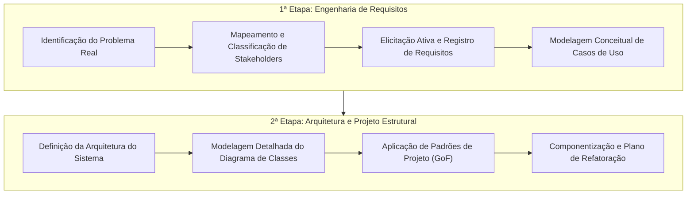

As equipes devem selecionar um domínio corporativo dentre os seis eixos temáticos propostos pelo docente:
- **Comércio:** Plataformas de Marketplace B2B/B2C, Gestão de Pedidos (OMS) ou Gestão de Centros de Distribuição e Armazéns (WMS).
- **Serviços Públicos:** Protocolo Municipal Integrado, Gestão Inteligente de Iluminação Pública ou Ouvidoria com Triagem Georreferenciada.
- **Negócios:** Gestão Colaborativa de Projetos, Rastreamento de Candidatos (ATS) ou Plataforma de Governança Financeira.
- **Saúde:** Regulação de Leitos Hospitalares, Prontuário Eletrônico do Paciente (PEP) ou Gestão de Clínicas com Telemedicina.
- **Educação:** Ambientes Virtuais de Aprendizagem (LMS), Gestão Acadêmica Integrada ou Sistemas de Avaliação Contínua.
- **Logística:** Rastreabilidade de Cargas em Tempo Real, Telemetria e Gestão de Frotas ou Roteirização de Entregas.

### Bibliografia Basica e Complementar
O arcabouço bibliográfico da disciplina reúne os clássicos da engenharia de software orientada a objetos e manuais práticos de modelagem com UML:
- **GUEDES, Gilleanes T. A.** *UML 2: Uma Abordagem Prática*. 2. ed. São Paulo: Novatec, 2011.
- **BOOCH, Grady; RUMBAUGH, James; JACOBSON, Ivar.** *UML: Guia do Usuário*. 1. ed. Rio de Janeiro: Campus, 2000.
- **FURLAN, José Davi.** *Modelagem de Objetos através da UML*. 1. ed. São Paulo: Makron Books, 1998.
- **BEZERRA, Eduardo.** *Princípios de Análise e Projeto de Sistemas com UML*. 4. ed. Rio de Janeiro: Elsevier, 2007.
- **MEDEIROS, Ernani.** *Desenvolvendo Software com UML 2.0*. 1. ed. São Paulo: Pearson Makron Books, 2004.
- **O'NEILL, Henrique; NUNES, Mauro; RAMOS, Pedro.** *Exercícios de UML*. 1. ed. Lisboa/São Paulo: FCA / Editora Informática, 2010.
- **GÓES, Wilson Moraes.** *Aprenda UML por Meio de Estudo de Caso*. 1. ed. São Paulo: Novatec, 2014.
- **BORATTI, Isaias Camilo.** *Programação Orientada a Objetos em Java*. 1. ed. Florianópolis: Visual Books, 2007.

---

## O Ciclo de Vida do Projeto de Software

### O Paradoxo "Pastelaria" versus Engenharia Rigorosa
Uma das metáforas centrais introduzidas pelo Prof. Wesley Soares alerta para a armadilha do desenvolvimento de software operado como uma "pastelaria". Na pastelaria, o cliente posiciona-se no balcão, requisita um produto padronizado e exige a entrega em escassos minutos para consumo imediato. 

A transposição ingênua desse comportamento para a tecnologia resulta no desenvolvimento amador: programadores abrem a IDE e codificam de forma reativa a cada solicitação impulsiva do cliente, sem análise prévia de impacto, especificação de requisitos, planejamento arquitetural ou modelagem de dados.

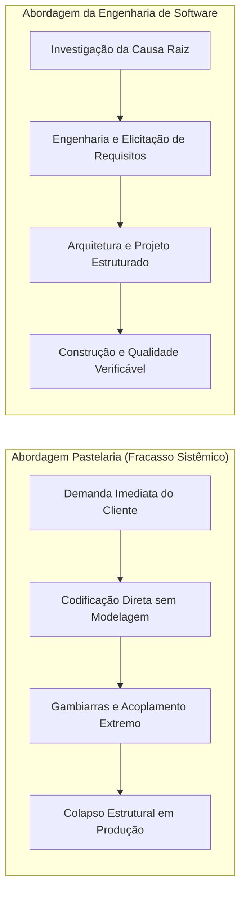

Construir software sob a disciplina da engenharia é uma atividade técnica e científica. Sistemas corporativos operam como o sistema circulatório das instituições modernas; sua interrupção gera perdas financeiras diretas, vulnerabilidades de segurança, sanções legais e paralisia operacional.

### Analise versus Projeto: Fazer a Coisa Certa e Fazer Certo a Coisa
A governança de projetos de software fundamenta-se no equilíbrio rigoroso entre duas disciplinas complementares:

> *"Faça a coisa certa (análise) e faça certo a coisa (projeto)."*

- **Análise de Requisitos (Fazer a coisa certa):** Concentra-se integralmente no espaço do problema. O analista investiga se a solução concebida atende à dor factual dos usuários e aos objetivos estratégicos da organização contratante. Produzir com excelência técnica uma ferramenta que não resolve o problema do negócio representa desperdício total de capital.
- **Projeto de Software (Fazer certo a coisa):** Concentra-se no espaço da solução técnica. O engenheiro e o arquiteto estruturam o sistema com baixo acoplamento, alta coesão, modularidade, segurança, eficiência computacional e facilidade de manutenção. Construir o software correto sob uma estrutura frágil e desorganizada condena o produto ao colapso por débito técnico.

| Dimensão de Análise | Disciplina de Análise de Sistemas | Disciplina de Projeto de Software |
| :--- | :--- | :--- |
| **Pergunta Diretiva** | O que o sistema deve fazer? | Como o sistema deve ser construído? |
| **Espaço de Domínio** | Domínio do Problema (Negócio) | Domínio da Solução (Tecnologia) |
| **Ponto de Vista Central** | Usuário final, cliente e analista de negócio | Arquiteto de software, engenheiro e desenvolvedor |
| **Independência Tecnológica** | Agnóstico a bancos, frameworks e linguagens | Decisões vinculadas a plataformas, protocolos e padrões |
| **Artefatos Primários** | Documento de Requisitos, Casos de Uso, Glossário | Diagramas de Classes, Diagramas de Sequência, APIs |

### As Dez Fases do Projeto de Software
O ciclo de vida integral do desenvolvimento corporativo percorre dez fases iterativas, complementares e retroalimentadas:

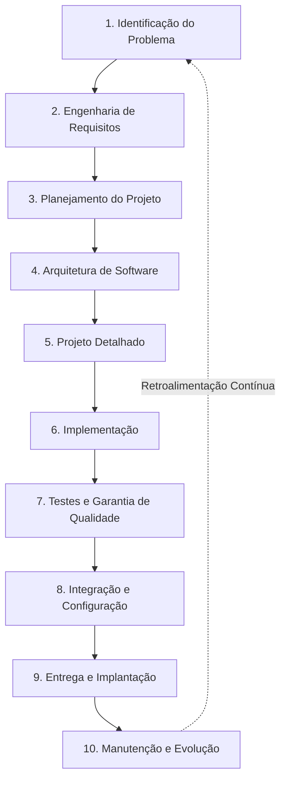

1. **Identificação do Problema:** Isolamento analítico da dor raiz vivenciada pelos stakeholders, separando-a dos sintomas superficiais.
2. **Engenharia de Requisitos:** Elicitação sistemática, documentação e validação formal dos requisitos funcionais, não funcionais e regras de negócio.
3. **Planejamento do Projeto:** Dimensionamento de escopo, estimativa de custos, estruturação do cronograma de entregas, alocação de equipe e matriz de riscos.
4. **Arquitetura de Software:** Seleção do estilo arquitetural (Hexagonal, Microserviços, Camadas), divisão em subsistemas e definição dos contratos de comunicação.
5. **Projeto Detalhado:** Modelagem estrutural estática (Diagrama de Classes), comportamental dinâmica (Diagrama de Sequência) e aplicação de padrões GoF.
6. **Implementação:** Tradução dos modelos técnicos em código-fonte executável, aplicando princípios de código limpo e padrões de estilo da linguagem.
7. **Testes e Garantia da Qualidade:** Execução de baterias automatizadas de testes unitários, testes de integração estrutural e testes de aceitação ponta a ponta (*E2E*).
8. **Integração e Configuração:** Automação de compilação, análise estática de código (*linters* e segurança) e montagem de imagens de contêineres via pipelines de CI.
9. **Entrega e Implantação:** Publicação do software em ambiente de produção utilizando estratégias automatizadas de liberação contínua (CD).
10. **Manutenção e Evolução:** Monitoramento telemétrico contínuo, correção de defeitos em regime operacional e planejamento de novas capacidades funcionais.

### O Pipeline em Sete Etapas da Modelagem Orientada a Objetos
No âmbito estrito da modelagem de software, as dez fases do ciclo de vida desdobram-se em um pipeline técnico disciplinado de sete etapas sucessivas:

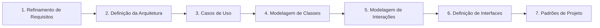

1. **Refinamento do Modelo de Análise e Requisitos:** Extração, lapidação textual e priorização dos requisitos (técnicas de elicitação e matriz MoSCoW).
2. **Definição da Arquitetura:** Seleção dos padrões macroestruturais, definição da infraestrutura de dados e delimitação de contextos do sistema.
3. **Modelagem de Casos de Uso:** Mapeamento do comportamento externo observável sob o prisma dos atores humanos e sistemas externos.
4. **Modelagem de Classes:** Mapeamento estrutural estático das entidades de negócio, seus atributos, operações e relacionamentos conceituais.
5. **Modelagem de Interações:** Representação dinâmica no tempo da troca de mensagens entre os objetos para satisfazer os fluxos dos casos de uso (Diagramas de Sequência).
6. **Definição de Interfaces:** Especificação estrita dos contratos de comunicação externa (APIs REST, endpoints gRPC) e contratos de classes abstratas/interfaces em código.
7. **Aplicação de Padrões de Projeto (Design Patterns):** Refinamento do acoplamento local utilizando padrões consolidados do catálogo GoF (*Gang of Four*).

---

## Fundamentos de Projeto Orientado a Objetos

### Visao Geral dos Pilares de Design Orientado a Objetos
O projeto orientado a objetos não se limita à sintaxe formal de instanciação de classes; constitui uma filosofia de engenharia que visa modelar a complexidade do mundo real em componentes de software reutilizáveis, modulares e resilientes a modificações.

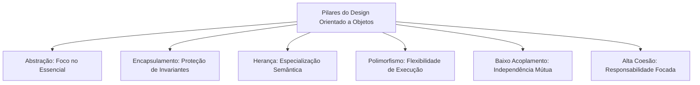

### Abstracao e Encapsulamento em Nivel de Engenharia

#### 1. Abstração
- **Definição:** Mecanismo cognitivo e técnico que permite isolar e representar as propriedades e operações essenciais de uma entidade para o contexto do domínio, descartando detalhes irrelevantes de infraestrutura ou hardware.
- **Motivação:** Gerenciar e reduzir a carga cognitiva do desenvolvedor. Em um sistema de pagamento, modelar o conceito de `Transacao` exige valor, moeda, pagador e recebedor; detalhes sobre os registradores da CPU ou alocação física de memória no disco são abstraídos.
- **Exemplo Prático:** A interface `RepositorioPedidos` expõe métodos como `salvar(Pedido p)` e `buscarPorId(UUID id)`. A lógica chamadora consome essa abstração sem conhecer se a persistência subjacente utiliza PostgreSQL, Redis ou arquivos binários.
- **Contraexemplo:** Criar métodos que forçam o chamador a controlar detalhes internos, como obrigar o consumidor de uma classe `Relatorio` a abrir sockets TCP manualmente e alocar buffers de bytes antes de solicitar a geração do relatório.
- **Armadilhas Comuns:** Superabstração (*over-abstraction*). Criar camadas excessivas de interfaces e classes genéricas para casos de uso triviais que nunca serão estendidos, introduzindo complexidade desnecessária.

#### 2. Encapsulamento
- **Definição:** Prática de isolar os atributos de uma classe através de modificadores restritivos (`private`, `protected`) e conceder acesso exclusivamente através de métodos operacionais que impõem regras de validação (invariantes de domínio).
- **Motivação:** Preservar a consistência do estado interno do objeto. Se um atributo for público, qualquer trecho externo do código poderá corromper sua integridade sem que a classe tome conhecimento.
- **Exemplo Prático (Java):**
```java
package br.unifef.engenharia.dominio;

import java.math.BigDecimal;
import java.util.Collections;
import java.util.ArrayList;
import java.util.List;

public class ContaCorrente {
    private final String numeroConta;
    private BigDecimal saldo;
    private final List<String> historicoTransacoes;

    public ContaCorrente(String numeroConta, BigDecimal saldoInicial) {
        if (numeroConta == null || numeroConta.isBlank()) {
            throw new IllegalArgumentException("Identificador de conta invalido.");
        }
        if (saldoInicial.compareTo(BigDecimal.ZERO) < 0) {
            throw new IllegalArgumentException("Saldo inicial nao pode ser negativo.");
        }
        this.numeroConta = numeroConta;
        this.saldo = saldoInicial;
        this.historicoTransacoes = new ArrayList<>();
        this.historicoTransacoes.add("Abertura de conta com saldo: " + saldoInicial);
    }

    public void sacar(BigDecimal valor) {
        if (valor.compareTo(BigDecimal.ZERO) <= 0) {
            throw new IllegalArgumentException("Valor de saque deve ser estritamente positivo.");
        }
        if (this.saldo.compareTo(valor) < 0) {
            throw new IllegalStateException("Saldo insuficiente para efetivar a operacao.");
        }
        this.saldo = this.saldo.subtract(valor);
        this.historicoTransacoes.add("Saque realizado: " + valor);
    }

    public BigDecimal getSaldo() {
        return this.saldo;
    }

    // Retorna colecao somente-leitura impedindo mutacao externa (Escaping Reference)
    public List<String> getHistoricoTransacoes() {
        return Collections.unmodifiableList(this.historicoTransacoes);
    }
}
```
- **Contraexemplo:** O Modelo Anêmico e a Exposição Estrutural:
```java
package br.unifef.engenharia.antipattern;

import java.math.BigDecimal;
import java.util.List;

// Antipadrao: Objeto anemico com atributos publicos ou getters/setters cegos
public class ContaCorrenteInsegura {
    public String numeroConta;
    public BigDecimal saldo; // Qualquer classe pode atribuir valor negativo
    public List<String> historicoTransacoes; // Qualquer classe pode invocar .clear()
}
```
- **Armadilhas Comuns:**
  - *Getters e Setters Automáticos:* Gerar métodos `get` e `set` de forma indiscriminada por meio de atalhos da IDE apenas simula o encapsulamento, mantendo o objeto vulnerável a alterações arbitrárias de estado.
  - *Vazamento de Referências Mutáveis (Escaping References):* Retornar referências diretas a listas ou objetos mutáveis através de métodos `get`. Classes externas podem invocar `getItens().clear()`, alterando o estado da entidade sem passar por seus métodos de controle. Deve-se retornar cópias defensivas ou coleções imutáveis (`Collections.unmodifiableList`).

### Heranca versus Composicao e Polimorfismo Dinamico

#### 1. Herança
- **Definição:** Mecanismo estrutural pelo qual uma classe derivada (subclasse) herda campos e métodos de uma classe base (superclasse), estabelecendo um relacionamento de generalização e especialização do tipo "É UM" (*is-a*).
- **Motivação:** Promover o reúso formal de código compartilhado e estruturar hierarquias taxonômicas coesas.
- **Armadilha Crítica (Herança de Fragilidade):** O uso indevido de herança para mero reaproveitamento utilitário de código causa acoplamento severo. Modificações na superclasse propagam comportamentos colaterais imprevistos nas subclasses. A engenharia de software preconiza a diretriz clássica: *"Prefira Composição à Herança"* (*Favor composition over inheritance*).

#### 2. Polimorfismo
- **Definição:** Princípio que permite tratar objetos de diferentes classes especializadas através de uma referência comum de sua superclasse ou interface, despachando a execução dinamicamente para o método concreto da instância em tempo de execução (*late binding*).
- **Motivação:** Eliminar blocos condicionais encadeados (`if/else` ou `switch/case`) que verificam tipos em tempo de execução. A adição de um novo tipo ao sistema é realizada adicionando uma nova classe, sem alterar o código que consome a abstração.
- **Exemplo Prático (Java):**
```java
package br.unifef.engenharia.polimorfismo;

import java.math.BigDecimal;

public interface MeioPagamento {
    void processar(BigDecimal valor);
}

public class PagamentoPix implements MeioPagamento {
    @Override
    public void processar(BigDecimal valor) {
        // Implementa comunicacao com o Banco Central via chave Pix
    }
}

public class PagamentoBoleto implements MeioPagamento {
    @Override
    public void processar(BigDecimal valor) {
        // Implementa registro de boleto na Camara Interbancaria de Pagamentos
    }
}

public class CheckoutService {
    public void finalizarVenda(MeioPagamento meio, BigDecimal total) {
        // Codigo desacoplado e polimorfico: nao ha instrucoes if/switch
        meio.processar(total);
    }
}
```
- **Contraexemplo:**
```java
// Antipadrao de violacao de polimorfismo
public class CheckoutServiceProcedural {
    public void processar(String tipo, double valor) {
        if (tipo.equals("PIX")) {
            // logica pix
        } else if (tipo.equals("BOLETO")) {
            // logica boleto
        } else if (tipo.equals("CARTAO")) {
            // logica cartao
        } // Cada novo meio exige violar e modificar esta classe
    }
}
```

### Acoplamento e Coesao: Metricas Estruturais

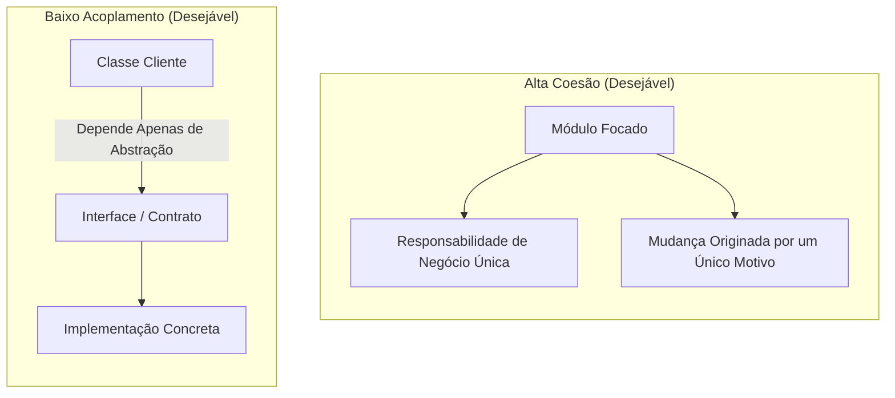

#### 1. Alta Coesão
- **Definição:** Grau de aderência semântica e funcional entre os membros de um módulo ou classe. Uma classe de alta coesão realiza um conjunto estreito de tarefas estritamente correlacionadas.
- **Motivação:** Facilidade de compreensão, testabilidade e manutenibilidade. Classes coesas possuem menor propensão a defeitos decorrentes de efeitos colaterais.
- **Contraexemplo:** A classe "Deus" (*God Class*), que acumula centenas de responsabilidades: persiste dados no banco, formata HTML, envia e-mails e executa cálculos contábeis.

#### 2. Baixo Acoplamento
- **Definição:** Medida do nível de dependência e interconexão entre diferentes classes ou módulos do sistema.
- **Motivação:** Permitir que uma classe seja modificada, testada ou substituída sem provocar uma quebra em cadeia nos demais componentes.
- **Aplicação:** Redução de acoplamento por meio da Lei de Demeter (Princípio do Menor Conhecimento), que estabelece que um método de um objeto deve invocar apenas métodos pertencentes a: si próprio, parâmetros que recebeu, objetos que instanciou ou seus próprios atributos. Evita-se a navegação estrutural invasiva como `cliente.getEndereco().getCidade().getCep().validar()`.

### Introducao aos Principios SOLID e Padroes GoF

A estruturação técnica da disciplina fundamenta-se nos princípios **SOLID**:
- **S (Single Responsibility Principle):** Uma classe deve possuir um único motivo para ser modificada (Alta Coesão).
- **O (Open/Closed Principle):** As entidades de software devem estar abertas para extensão, mas fechadas para modificação.
- **L (Liskov Substitution Principle):** Os tipos derivados devem ser capazes de substituir seus tipos base sem alterar a correção do comportamento do sistema.
- **I (Interface Segregation Principle):** Muitas interfaces específicas são preferíveis a uma interface genérica inflada.
- **D (Dependency Inversion Principle):** Módulos de alto nível não devem depender de módulos de baixo nível; ambos devem depender de abstrações.

Em conjunto com o SOLID, destacam-se os cinco padrões estruturantes do catálogo GoF (*Gang of Four*):
- **Strategy:** Permite definir uma família de algoritmos, encapsular cada um deles e torná-los intercambiáveis em tempo de execução sem acoplamento à classe cliente.
- **Factory Method:** Fornece uma interface para criação de objetos, delegando a decisão de qual classe concreta instanciar para as subclasses.
- **Observer:** Estabelece uma dependência um-para-muitos entre objetos, de forma que quando um objeto muda de estado, todos os seus dependentes são notificados e atualizados automaticamente.
- **Adapter:** Converte a interface de uma classe para outra interface esperada pelo cliente, permitindo a cooperação entre interfaces incompatíveis.
- **Facade:** Oferece uma interface simplificada e unificada para um conjunto complexo de subsistemas, ocultando detalhes de implementação.

---

## Engenharia e Elicitacao de Requisitos de Software

### Distincao Epistemologica: Coleta versus Elicitacao Ativa
No vocabulário leigo, as expressões "levantamento de requisitos" e "elicitação de requisitos" são frequentemente tratadas como sinônimos. Contudo, sob o rigor do SWEBOK (*Software Engineering Body of Knowledge*), há uma distinção conceitual determinante:

- **Coleta de Requisitos (Gathering):** Postura passiva na qual o analista assume que os requisitos residem prontos, organizados e consistentes na mente dos usuários, bastando recolhê-los mecanicamente por meio de anotações.
- **Elicitação Ativa (Elicitation):** Oriunda do latim *elicitare* ("fazer brotar", "trazer à tona", "provocar"). Postura ativa, dialética e investigativa do analista de sistemas. Os stakeholders possuem dores financeiras, gargalos operacionais, expectativas confusas e rotinas tácitas, mas não especificações de software. Cabe ao engenheiro investigar, questionar, correlacionar informações e construir os requisitos em parceria com o cliente.

### A Cadeia Causal da Elicitacao
A transformação de uma queixa comercial em especificação formal obedece à cadeia causal da engenharia de requisitos:

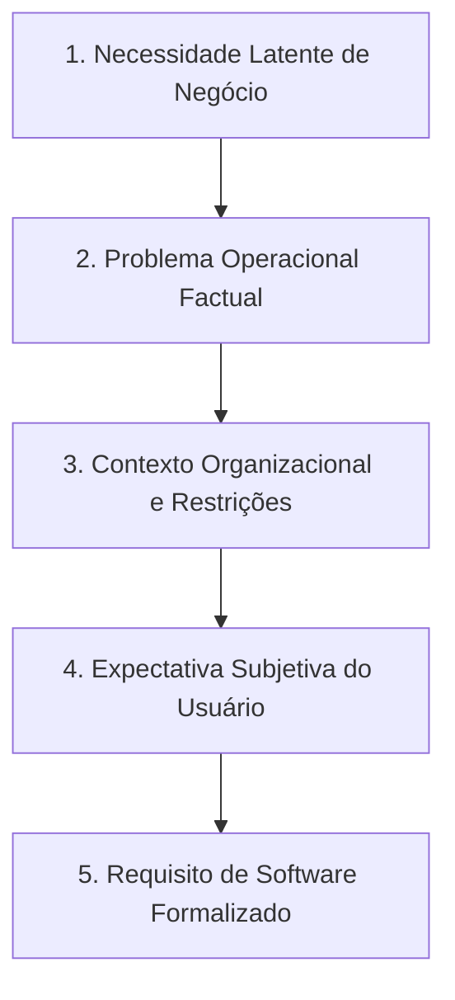

| Elemento Causal | Definição Metodológica | Exemplo no Setor Varejista |
| :--- | :--- | :--- |
| **Necessidade** | Sobrevivência, sustentabilidade ou vantagem econômica do negócio. | Eliminar a perda de clientes na fila de espera do caixa. |
| **Problema** | Obstáculo factual que impede o atendimento da necessidade. | Lentidão de 4 minutos no fechamento da venda com cartão. |
| **Contexto** | Cenário ambiental, tecnológico, humano e de processos existentes. | Terminais antigos com rede sem fio oscilante e conferência em papel. |
| **Expectativa** | Construção mental do usuário sobre a atuação do sistema futuro. | "Quero um sistema moderno que passe as compras na hora." |
| **Requisito** | Especificação verificável e precisa da solução computacional. | O sistema deve processar a transação TEF em menos de 3 segundos sob carga de 50 requisições simultâneas. |

### As Seis Perguntas Cardinais da Elicitacao
Durante a investigação preliminar de qualquer módulo ou sistema, o analista deve responder de forma exaustiva a seis perguntas fundamentais:

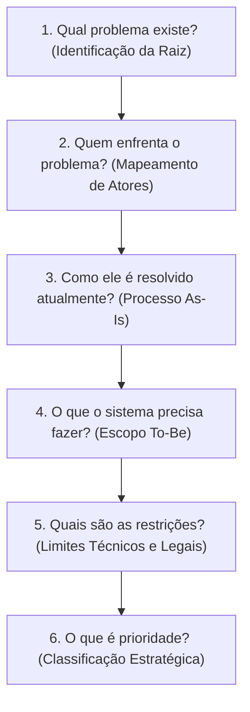

1. **Qual problema existe?** O foco deve recair sobre o problema gerador, não sobre seus efeitos secundários.
2. **Quem enfrenta o problema?** Identificação de usuários primários (operadores diretos), secundários (consumidores de relatórios) e terciários (órgãos reguladores e auditorias).
3. **Como ele é resolvido atualmente?** Análise do processo atual (*As-Is*), que frequentemente apoia-se em planilhas dispersas, anotações físicas ou sistemas legados.
4. **O que o sistema precisa fazer?** Declaração explícita das capacidades que a nova solução (*To-Be*) deve prover.
5. **Quais são as restrições?** Mapeamento de limitações de prazo, orçamento, normas regulatórias (como LGPD) e interoperabilidade com sistemas legados.
6. **O que é prioridade?** Separação categórica entre o que é indispensável para o lançamento e o que compõe conveniências secundárias.

### Analise da Premissa de Desenvolvimento Prematuro
O Prof. Wesley Soares propõe a seguinte reflexão crítica:

> *"Se um cliente disser: 'Preciso de um sistema para melhorar meu negócio', isso é suficiente para começar a desenvolver?"*

A resposta técnica é categoricamente **não**. Iniciar o desenvolvimento sobre tal afirmação acarreta riscos severos para o projeto:
- **Inexistência de Critérios de Aceite (Acceptance Criteria):** A expressão "melhorar" é puramente subjetiva. Sem indicadores quantitativos (ex.: reduzir custos em 15%, diminuir o tempo de atendimento para 2 minutos), o projeto nunca atingirá um encerramento formal aprovado pelo cliente.
- **Corrupção Contínua de Escopo (Scope Creep):** A ausência de delimitação permite ao cliente alegar que qualquer funcionalidade concebida posteriormente deveria estar inclusa no escopo contratado.
- **Automatização do Caos:** Informatizar processos desordenados e mal dimensionados apenas acelera a geração de falhas operacionais e custos desnecessários.

### Dificuldades Intrinsecas e a Desconstrucao da Ambiguidade

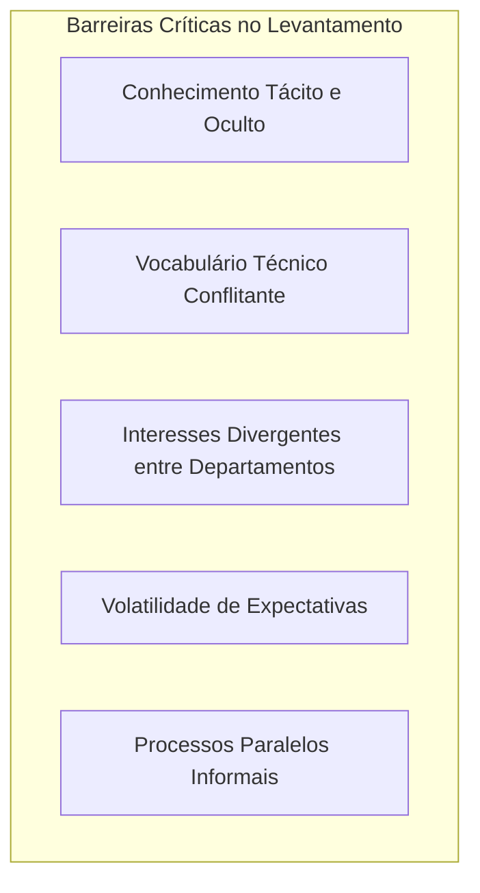

A linguagem natural é inerentemente imprecisa. Afirmações como "o sistema deve ser rápido", "a tela deve ser fácil" ou "a aplicação deve ser segura" atuam como **anti-requisitos**. Cabe à engenharia desconstruir a ambiguidade e traduzi-la em requisitos técnicos mensuráveis e testáveis:

| Afirmação Amígua do Usuário | Interpretação Ingênua | Requisito Não Funcional Mensurável (Refatoração de Engenharia) |
| :--- | :--- | :--- |
| "O sistema precisa ser rápido." | Incluir paginação visual básica. | **RNF-01 (Desempenho):** O tempo de resposta para a consulta de clientes com filtros ativos deve ser inferior a 1,2 segundos para o percentil 95 (p95) sob concorrência de 150 requisições simultâneas. |
| "A tela deve ser simples e fácil." | Deixar a interface minimalista. | **RNF-02 (Usabilidade):** Um operador recém-contratado deve ser capaz de concluir uma venda padrão em até 90 segundos após receber no máximo 20 minutos de instrução formal, com taxa de erro inferior a 1%. |
| "O sistema precisa ser seguro." | Proteger o acesso com senha simples. | **RNF-03 (Segurança):** O sistema deve implementar controle de acesso baseado em papéis (RBAC), exigir autenticação multifator (MFA) para operações administrativas e armazenar senhas utilizando o algoritmo de hashing Argon2id com parâmetro de memória mínimo de 64 MB. |

### Taxonomia Exaustiva das Tecnicas de Elicitacao
Não existe uma técnica universal aplicável a todos os cenários corporativos; a seleção metodológica depende da cultura organizacional, do perfil dos stakeholders e da criticidade do sistema.

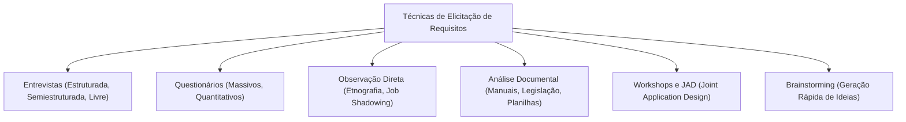

#### 1. Entrevistas
- **Definição:** Conversação direcionada entre o analista e os atores do domínio para coletar informações contextuais e comportamentais.
- **Tipos:**
  - *Estruturada:* Questionário rígido predeterminado. Garante uniformidade em respostas de múltiplos respondentes, mas restringe a descoberta de novos tópicos.
  - *Semiestruturada (Recomendada):* Roteiro flexível contendo perguntas centrais e total liberdade para explorações investigativas durante o diálogo.
  - *Não Estruturada:* Diálogo aberto focado na exploração de áreas corporativas desconhecidas.
- **Dinâmica de Investigação:**
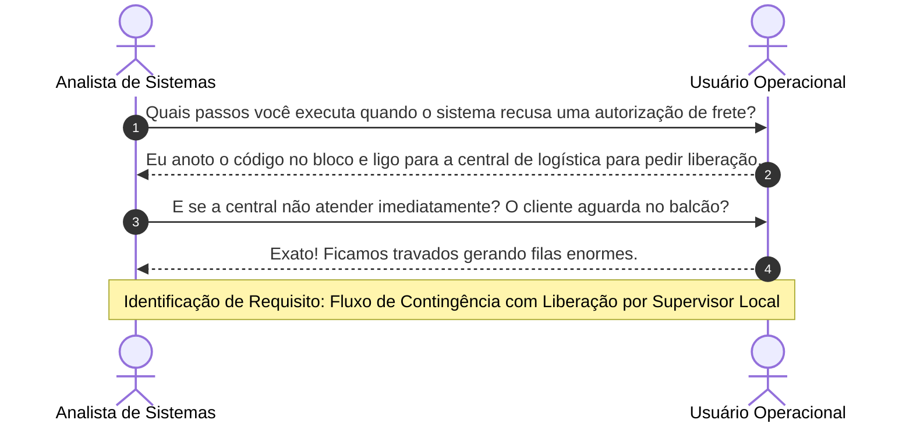

#### 2. Questionários
- **Definição:** Conjunto de perguntas escritas distribuídas eletronicamente para coleta simultânea de respostas.
- **Indicação:** Grandes populações dispersas geograficamente.
- **Desvantagens:** Baixa taxa de resposta e impossibilidade de esclarecer dúvidas sobre as questões formuladas.

#### 3. Observação Direta (Job Shadowing)
- **Definição:** O analista atua como observador silencioso no ambiente físico de trabalho do usuário, registrando o fluxo real de tarefas.
- **Vantagem Central:** Revela conhecimentos tácitos e procedimentos informais que os usuários esquecem de relatar nas entrevistas formais.
- **Atenção Metodológica:** Mitigar o *Efeito Hawthorne* (tendência do indivíduo de alterar seu comportamento habitual quando sabe que está sendo observado).

#### 4. Análise Documental
- **Definição:** Exame técnico de manuais de procedimentos, planilhas existentes, relatórios legados e normas regulatórias governamentais.

#### 5. Workshops e JAD (Joint Application Design)
- **Definição:** Sessões intensivas de trabalho estruturado reunindo usuários, patrocinadores e equipe técnica na mesma sala para deliberar sobre funcionalidades e resolver conflitos de requisitos em tempo real.

### Priorizacao de Requisitos via Metodo MoSCoW
O método **MoSCoW** é uma técnica estruturada de priorização que auxilia equipes e stakeholders a estabelecerem consensos práticos sobre a alocação de esforço em cada release:

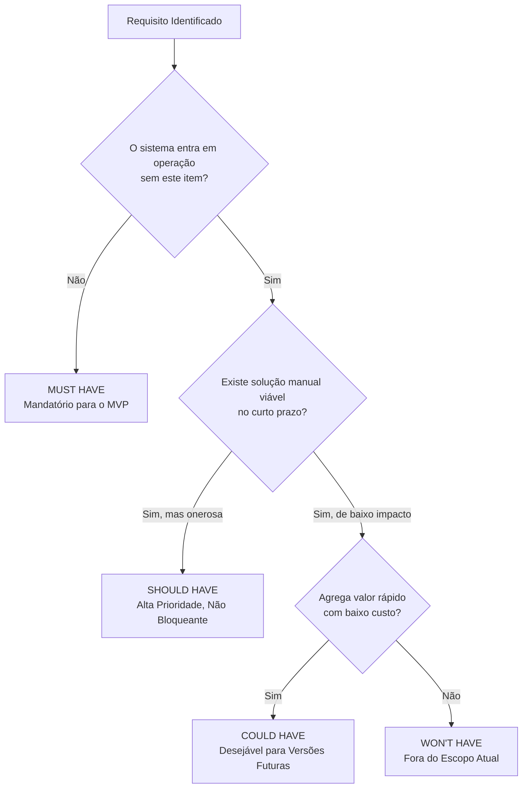

| Classificação | Nomeclatura Formal | Descrição e Critério Técnico de Alocação | Exemplo em E-Commerce |
| :--- | :--- | :--- | :--- |
| **M** | *Must Have* (Deve ter) | Requisitos vitais e inegociáveis. Se ausentes, o sistema não é funcional ou torna-se inviável perante a lei. | Processamento do pagamento e persistência do pedido. |
| **S** | *Should Have* (Deveria ter) | Requisitos de alta relevância que trazem alto valor agregado, mas que contam com rotinas alternativas manuais temporárias. | Notificação do cliente via WhatsApp ou SMS sobre despacho de mercadoria. |
| **C** | *Could Have* (Poderia ter) | Recursos desejáveis de conveniência que só serão desenvolvidos caso haja folga técnica de prazo e custos. | Seleção de temas visuais na interface (Dark Mode). |
| **W** | *Won't Have* (Não terá desta vez) | Funcionalidades formalmente acordadas como fora do escopo da iteração atual, postergadas para ciclos futuros. | Recomendação preditiva de produtos via inteligência artificial. |

### Estudo de Caso Pratico: Diagnostico Hospitalar (Atividade 3)
A aplicação das técnicas de elicitação e diagnóstico causal é demonstrada no estudo corporativo desenvolvido na Atividade 3 da disciplina:

#### 1. Equipe e Divisão Formal de Papéis
- **Stakeholders (Visão de Negócio):** 
  - *Carlos Eduardo Lima:* Diretor de Operações e Logística Hospitalar (foco em custos, rotas e cumprimento de SLAs).
  - *Mariana Albuquerque:* Gestora de Almoxarifado Clínico (foco no recebimento físico e verificação de calibração).
- **Analistas de Sistemas (Visão Técnica):**
  - *Lucas Gabriel Martins:* Engenheiro de Requisitos Líder (condução das entrevistas e extração da causa raiz).
  - *Beatriz Helena Souza:* Arquiteta de Software (modelagem de casos de uso e especificações técnicas).

#### 2. Investigação Causal através dos 5 Porquês
- *Problema Declarado:* Extravio e atraso de manutenção em ventiladores pulmonares locados.
- *Por que 1:* A locadora não sabe onde os equipamentos estão fisicamente localizados.
- *Por que 2:* Porque a equipe de transporte assina canhotos de papel e não confere o número de série.
- *Por que 3:* Porque a ordem de coleta é enviada impressa sem validação em tempo real por dispositivo móvel.
- *Por que 4:* Porque as solicitações dos hospitais chegam de forma desestruturada por mensagens informais no WhatsApp.
- *Por que 5 (Causa Raiz):* Ausência de uma plataforma centralizada e transacional de logística reversa que integre os chamados dos hospitais à validação biométrica de números de série via aplicativo móvel offline-first.

---

## Modelagem Comportamental com Diagramas de Casos de Uso UML

### Fundamentos e Abordagem Caixa-Preta
O **Diagrama de Casos de Uso** é um modelo comportamental estático padronizado pela OMG (Object Management Group) que apresenta os serviços que o sistema oferece ao ambiente externo.

A premissa da modelagem reside na abordagem **Caixa-Preta** (*Black-Box Modeling*): o diagrama descreve com exatidão **o que** o software realiza sob a perspectiva dos atores externos, abstraindo detalhes internos de banco de dados, lógica procedural, algoritmos ou interface visual.

### Elementos Basicos: Atores, Casos de Uso e Fronteira
- **Ator:** Entidade externa (pessoa, cargo, equipamento ou outro software) que interage ativamente com o sistema. Representado visualmente por um boneco palito (*stick man*) ou por um retângulo com o estereótipo `<<actor>>`. Um ator especifica um papel contextual, nunca um indivíduo específico. Classificam-se em:
  - *Primários:* Disparam a interação para satisfazer um objetivo de negócio imediato.
  - *Secundários:* Sistemas de suporte ou infraestrutura que reagem a comandos do software (ex.: Gateways de Pagamento, Serviços de Autenticação LDAP).
- **Caso de Uso:** Unidade funcional atômica que entrega um resultado observável e mensurável de valor para o ator. Representado por uma elipse contendo sua descrição textual. A nomenclatura deve iniciar por um **verbo no infinitivo**, seguido pelo complemento direto (ex.: `Cadastrar Aluno`, `Emitir Fatura`).
- **Fronteira do Sistema (Subject Boundary):** Retângulo delimitador que segrega o que reside dentro do escopo do software daquilo que pertence ao ambiente externo.

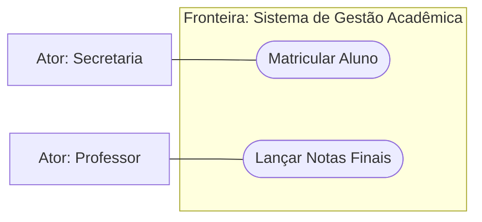

### Relacionamentos: Associacao, Include, Extend e Generalizacao
A expressividade da modelagem de casos de uso depende do domínio das quatro relações fundamentais:

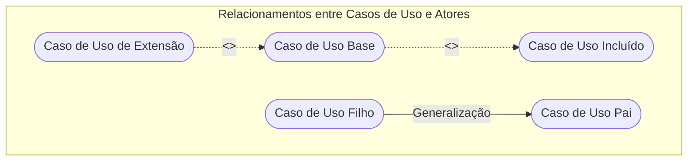

#### 1. Associação
Linha sólida simples conectando um ator a um caso de uso. Indica a existência de comunicação bidirecional entre o agente externo e a funcionalidade do sistema.

#### 2. Include (`<<include>>`)
- **Definição:** Relação de dependência na qual o caso de uso base incorpora obrigatoriamente a execução do caso de uso incluído como parte de seu fluxo.
- **Obrigatoriedade:** Incondicional. O caso de uso base não pode ser finalizado com sucesso sem que o incluído seja executado.
- **Direção da Seta:** A linha tracejada parte do caso de uso base e aponta para o caso de uso incluído (`Base -.->|<<include>>| Incluído`).
- **Exemplo:** `Realizar Transferência Bancária` inclui compulsoriamente `Autenticar Usuário`.

#### 3. Extend (`<<extend>>`)
- **Definição:** Relação de dependência na qual o caso de uso de extensão expande condicionalmente o comportamento do caso de uso base em um ponto pré-definido (Ponto de Extensão / *Extension Point*).
- **Obrigatoriedade:** Opcional. O fluxo base é completo em si mesmo; a extensão ocorre apenas se uma condição de guarda for satisfeita.
- **Direção da Seta:** A linha tracejada parte do caso de uso acessório (extensão) e aponta para o caso de uso base (`Extensão -.->|<<extend>>| Base`).
- **Exemplo:** Durante a execução de `Finalizar Compra`, o caso de uso `Aplicar Cupom de Desconto` estende o fluxo base unicamente caso o cliente forneça um cupom promocional válido.

#### 4. Generalização / Especialização
Relação de herança taxonômica aplicável tanto entre atores quanto entre casos de uso. Representada por uma linha sólida contínua terminada em uma ponta de seta triangular vazada apontando do filho para o pai.
- *Entre Atores:* O ator especializado herda o acesso a todos os casos de uso associados ao ator genérico, agregando privilégios exclusivos.
- *Entre Casos de Uso:* O caso de uso pai define o objetivo geral (ex.: `Efetuar Pagamento`); os casos de uso filhos provêm implementações concretas (ex.: `Efetuar Pagamento via Pix`, `Efetuar Pagamento via Boleto`).

### Especificacao Textual Canonica de Casos de Uso
Um diagrama visual de casos de uso deve ser acompanhado de sua documentação textual correspondente para detalhar o comportamento do sistema. O modelo canônico de engenharia compõe-se de:

```markdown
CASO DE USO: UC-04 - Realizar Pedido
Ator Primário: Cliente da Plataforma
Atores Secundários: Gateway de Processamento de Cartões, Sistema de Cálculo de Frete
Resumo: Permite ao cliente autenticado selecionar itens do carrinho, escolher o tipo de envio e submeter a compra.
Pré-condições: O cliente deve estar devidamente autenticado e possuir itens válidos em seu carrinho.
Pós-condições: O pedido é persistido no banco com status "Pendente", o estoque dos itens é reservado e a transação financeira é submetida ao gateway.

Fluxo Principal (Caminho Feliz):
1. O cliente aciona a opção "Avançar para o Checkout".
2. O sistema calcula o valor total dos itens e solicita o CEP de entrega.
3. O cliente digita o endereço de destino.
4. O sistema consulta o Sistema de Cálculo de Frete e exibe as modalidades disponíveis.
5. O cliente seleciona a transportadora desejada e escolhe o meio de pagamento "Cartão de Crédito".
6. O cliente preenche os dados do cartão de crédito.
7. O sistema executa o caso de uso <<include>> Processar Pagamento via Cartão.
8. O gateway autoriza a transação com sucesso.
9. O sistema atualiza o status do pedido para "Confirmado", debita o inventário e emite o comprovante na tela.

Fluxos Alternativos:
- 5a. O cliente seleciona pagamento via Pix:
  1. O sistema gera a chave dinâmica (QR Code) com tempo de expiração de 15 minutos.
  2. O sistema aguarda a notificação assíncrona do banco para efetivar a baixa.

Fluxos de Exceção:
- 8a. Transação recusada pela operadora financeira:
  1. O sistema notifica o cliente sobre a falha na aprovação da operadora.
  2. O sistema libera o estoque que havia sido retido temporariamente.
  3. O sistema retorna o cliente para a etapa de seleção de meio de pagamento mantendo o carrinho ativo.
```

### Estudo de Caso: Plataforma de Comercio Eletronico e Food Delivery
Consolidando o domínio explorado nas Aulas 04 e 06, apresenta-se o diagrama de casos de uso do ecossistema multilateral de delivery:

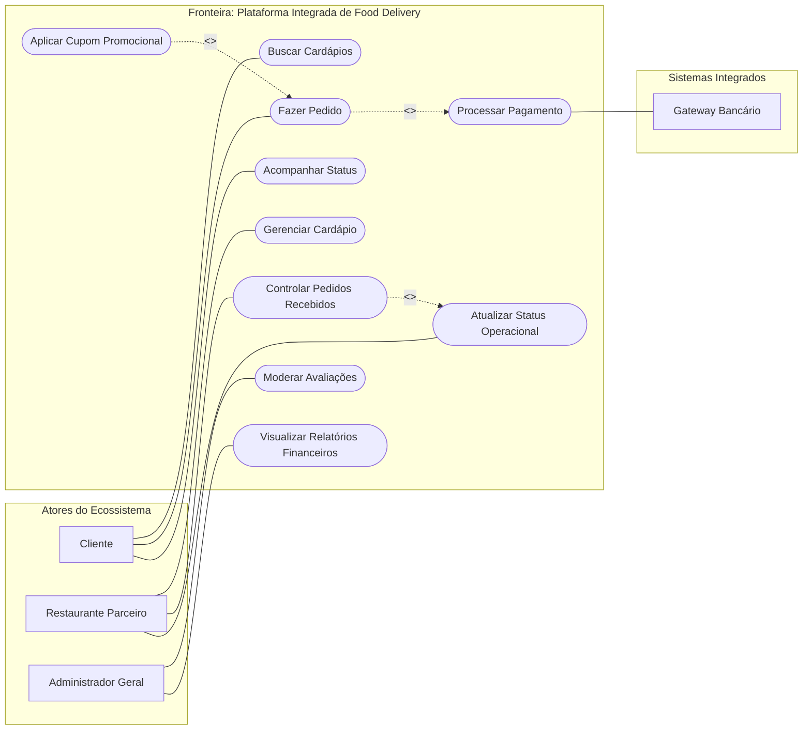

---

## Modelagem Estrutural com Diagramas de Classes UML

### UML como Linguagem de Notacao versus Processos e Metodologias
Uma das distinções conceituais centrais cobradas na disciplina é a separação entre linguagem gráfica e metodologia de trabalho:

- **A UML NÃO É um processo de desenvolvimento:** A UML não define etapas cronológicas, cerimônias de equipe, papéis gerenciais ou regras contratuais de entrega.
- **A UML É uma linguagem de modelagem:** Trata-se de um conjunto formal de símbolos gráficos, vocabulários e regras sintáticas e semânticas padronizadas pela OMG para visualizar, especificar, construir e documentar artefatos de software.

A UML pode ser aplicada em processos preditivos (como o Modelo em Cascata ou RUP) ou integrada organicamente a processos empíricos ágeis (como Scrum e Extreme Programming).

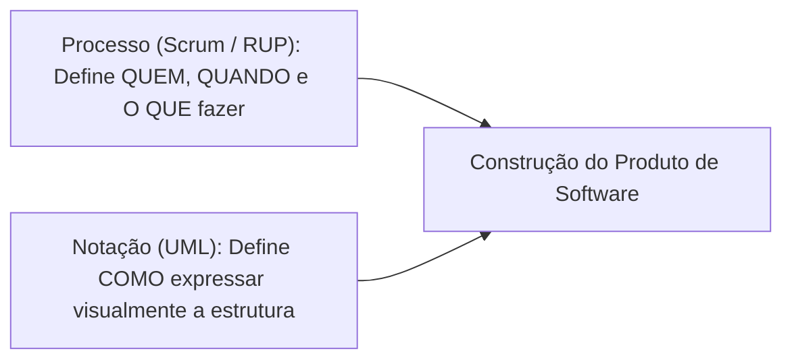

### Integracao da Modelagem no Framework Agil Scrum
No desenvolvimento tradicional, incorria-se no antipadrão BDUF (*Big Design Up Front*): a equipe gastava meses produzindo dezenas de diagramas estáticos extensos que se tornavam desatualizados assim que o código-fonte começava a ser alterado.

No ambiente ágil contemporâneo guiado pelo framework Scrum, a modelagem com UML adota os princípios de entrega contínua:
- **Modelagem Just-in-Time (JIT) e Just-Enough:** O time modela apenas o necessário para alinhar a visão estrutural da Sprint atual. 
- Durante a cerimônia de *Sprint Planning*, arquitetos e desenvolvedores esboçam diagramas de classes e sequências para estabelecer a divisão técnica das tarefas.
- Os modelos atuam como documentos vivos, orientando a construção de testes e sendo atualizados de forma síncrona com as refatorações da base de código.

### Anatomia Estrutural da Classe: Os Tres Compartimentos
O **Diagrama de Classes** descreve a visão estrutural estática do sistema de software. Uma classe é formalmente representada por um retângulo segmentado horizontalmente em **três compartimentos**:

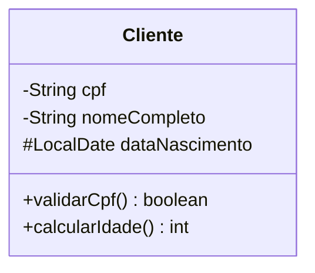

1. **Compartimento Superior (Nome da Classe):** Contém o nome da classe. Deve ser formulado como um **substantivo no singular**, em padrão **PascalCase** (iniciando com maiúscula), derivado da Linguagem Ubíqua do domínio (ex.: `NotaFiscal`, `ItemPedido`).
2. **Compartimento Intermediário (Atributos):** Declara o estado estrutural encapsulado. Segue a sintaxe:
   `[visibilidade] nomeAtributo : TipoDeDado [multiplicidade] = [valorPadrao]`
   Utiliza a convenção **camelCase** (ex.: `- saldoDisponivel : BigDecimal = 0.0`).
3. **Compartimento Inferior (Operações / Métodos):** Descreve o comportamento oferecido pelos objetos da classe. Segue a sintaxe:
   `[visibilidade] nomeMetodo(parametro : Tipo) : TipoRetorno`
   Utiliza **verbos no infinitivo** sob a convenção **camelCase** (ex.: `+ creditarValor(valor : BigDecimal) : boolean`).

### Modificadores de Visibilidade e Mapeamento para Codigo
A UML estabelece quatro símbolos padronizados para representar o nível de proteção do encapsulamento:

| Visibilidade UML | Símbolo | Palavra-chave Java | Nível de Acesso Permitido |
| :--- | :---: | :--- | :--- |
| **Pública (Public)** | `+` | `public` | Acessível por qualquer classe em qualquer pacote do sistema. |
| **Protegida (Protected)** | `#` | `protected` | Acessível pela própria classe, suas subclasses e classes do mesmo pacote. |
| **Privada (Private)** | `-` | `private` | Acessível estritamente pelo código interno da própria classe declarante. |
| **Pacote (Package)** | `~` | *(sem modificador)* | Acessível apenas por classes pertencentes ao mesmo pacote lógico. |

### Multiplicidade, Papeis e Navegabilidade
A multiplicidade estabelece o número mínimo e máximo de instâncias de uma classe que podem associar-se a uma única instância de outra classe:
- `1`: Exatamente uma instância obrigatória.
- `0..1`: Nenhuma ou no máximo uma instância (opcional).
- `*` ou `0..*`: Zero, uma ou múltiplas instâncias associadas.
- `1..*`: Pelo menos uma ou múltiplas instâncias associadas.
- `m..n`: Intervalo explícito especificado (ex.: `2..4`).

A navegabilidade é expressa por pontas de seta nas arestas: uma associação sem setas indica navegabilidade bidirecional; uma seta simples indica que a classe de origem conhece a classe de destino, mas o inverso não se aplica.

### Relacionamentos Estruturais: Associacao, Agregacao e Composicao

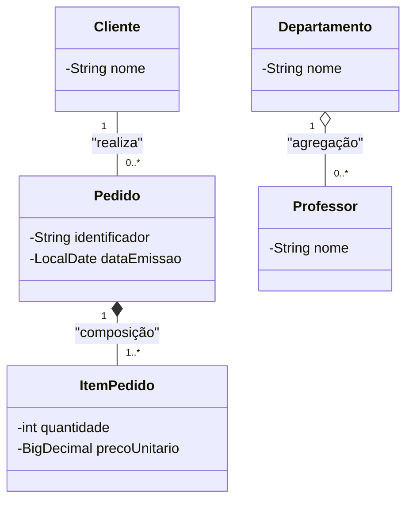

#### 1. Associação Simples
- **Definição:** Relação estrutural básica entre duas classes independentes, indicando que objetos de uma mantêm referência para objetos da outra.
- **Ciclo de Vida:** Ambas as instâncias possuem ciclos de vida completamente desacoplados.

#### 2. Agregação (Todo-Parte Fraco)
- **Definição:** Relação especializada de composição do tipo "todo-parte", onde uma classe ("todo") contém uma coleção de instâncias de outra classe ("parte").
- **Notação Visual:** Linha terminada em um **losango vazio (não preenchido)** adjacente à classe "todo".
- **Semântica de Ciclo de Vida:** **Desacoplado**. A destruição do objeto "todo" **NÃO** acarreta a destruição dos objetos "parte". As partes continuam existindo de forma independente na memória do sistema.
- **Exemplo:** `Departamento` e `Professor`. Se o departamento de computação for extinto, os professores continuam existindo funcionalmente na universidade e podem ser alocados em outros departamentos.

#### 3. Composição (Todo-Parte Forte)
- **Definição:** Relação rígida de agregação onde o ciclo de vida da "parte" é estritamente subordinado à existência do "todo".
- **Notação Visual:** Linha terminada em um **losango preenchido (sólido)** adjacente à classe "todo".
- **Semântica de Ciclo de Vida:** **Acoplado**. A "parte" não possui existência funcional fora do "todo". A destruição ou expurgo do "todo" no banco ou na memória destrói compulsoriamente todas as suas partes vinculadas.
- **Exemplo:** `Pedido` e `ItemPedido`. Uma linha de item de pedido não faz sentido isoladamente no sistema se o pedido for deletado.

### Generalizacao e Dependencia Estrutural Transitoria

#### 1. Generalização
Mapeia a herança em linguagens orientadas a objetos. A subclasse herda os atributos e operações públicas e protegidas da superclasse. Representada por linha sólida com triângulo vazado na extremidade da superclasse.

#### 2. Dependência Estrutural Transitória
- **Definição:** Uma dependência transitória ocorre quando uma classe faz uso temporário de outra classe dentro do corpo de um de seus métodos (como tipo de um parâmetro recebido, como tipo de retorno de método ou como variável local instanciada temporariamente).
- **Notação Visual:** Linha **tracejada** terminada em ponta de seta aberta (`A ..> B`).
- **Semântica:** Diferencia-se da associação porque a classe `A` não mantém uma variável de instância persistente da classe `B`.
- **Exemplo em Código Java:**
```java
package br.unifef.engenharia.dependencia;

public class RelatorioFinanceiro {
    // RelatorioFinanceiro depende transitóriamente de FormatadorPDF
    public byte[] exportar(FormatadorPDF formatador) {
        return formatador.gerarBytes(this);
    }
}
```

---

## A Arquitetura Model-View-Controller Classica no Smalltalk-80

### Contexto Historico: Xerox PARC e a Classe Pen
No final da década de 1970, no laboratório Xerox PARC (*Palo Alto Research Center*), a equipe liderada por Alan Kay, Adele Goldberg e Dan Ingalls concebeu as interfaces gráficas modernas baseadas em janelas, ícones e mouse.

Até então, programas desenhavam primitivas diretamente no *framebuffer* global da tela. No Smalltalk, a classe `Pen` permitia traçar linhas na tela inteira. No entanto, se programas concorrentes utilizassem a classe `Pen` de forma desordenada, eles sobrescreveriam a área visual uns dos outros, impedindo a sobreposição harmoniosa de múltiplas janelas.

O padrão **Model-View-Controller (MVC)** foi formalizado por Trygve Reenskaug e consolidado na implementação do ambiente Smalltalk-80 (documentado tecnicamente por Steve Burbeck). Ele surgiu como um mecanismo de engenharia para viabilizar a divisão de espaço e o controle compartilhado de periféricos de entrada (teclado e mouse) em uma arquitetura unithread.

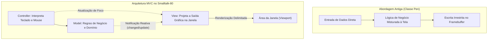

### Divisao Estrita de Responsabilidades na Triade MVC

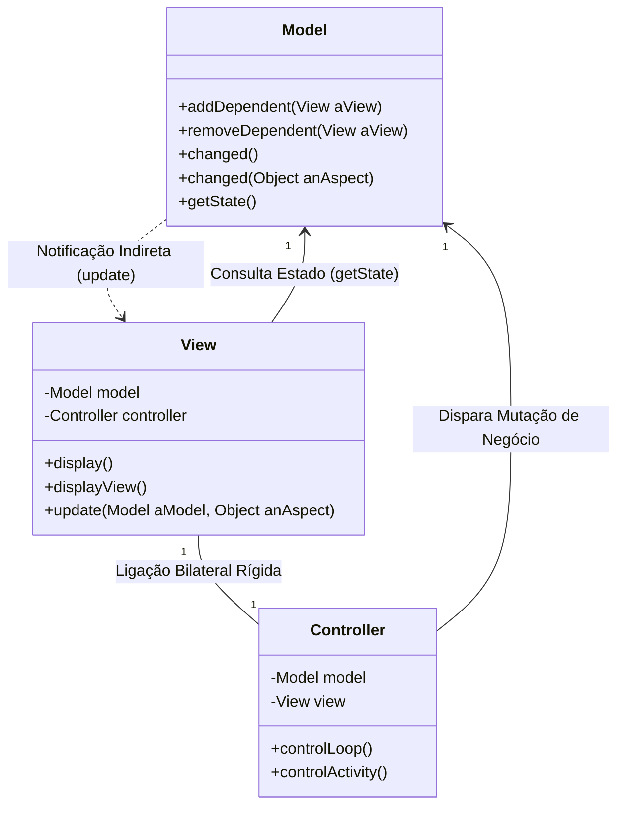

1. **Model (Modelo):** Encapsula os dados de negócio e as regras operacionais. É totalmente independente da interface gráfica e desconhece a geometria da tela. Mantém uma lista de observadores (*dependents*) para notificá-los quando seu estado se altera.
2. **View (Visão):** Gerencia a apresentação gráfica de uma área retangular da tela alocada para a janela. Consulta o modelo para obter os dados atualizados e traduz as informações em primitivas de desenho.
3. **Controller (Controlador):** Lida com a interação física de entrada do usuário. Captura as coordenadas do cursor, os cliques dos botões do mouse e as teclas pressionadas, traduzindo esses sinais brutos em comandos de domínio para o Modelo ou comandos de rolagem para a Visão.

**Acoplamento Estrutural da Tríade:**
- A ligação entre **View e Controller** é **bilateral, direta e rígida (1:1)**. Toda visão possui exatamente um controlador associado, e todo controlador referencia diretamente sua respectiva visão.
- A ligação entre **Model e View** é **indireta**, estruturada sobre o padrão **Observer**. O modelo não possui dependência direta de compilação com as visões que o observam.

### Modelos Passivos versus Modelos Ativos
Steve Burbeck cataloga formalmente duas categorias de modelos no Smalltalk-80:

| Dimensão de Comparação | Modelos Passivos | Modelos Ativos |
| :--- | :--- | :--- |
| **Origem da Modificação** | Modificado unicamente pelo `Controller` de sua própria tríade. | Modificado por processos externos, threads concorrentes ou outros controladores. |
| **Orquestração da Atualização** | O próprio controlador pode ordenar o redesenho da visão diretamente. | O modelo é o único que sabe quando seu estado mudou e deve disparar `self changed`. |
| **Exemplo Típico no Smalltalk** | Editor de texto com uma instância simples de `String`. | O `SystemTranscript` (console do sistema) modificado por qualquer rotina concorrente. |

```mermaid
sequenceDiagram
    autonumber
    participant ProcExt as Processo Concorrente em Segundo Plano
    participant Mod as Modelo Ativo (SystemTranscript)
    participant Viw as Visão Dependente (TextCollectorView)

    ProcExt->>Mod: appendString("Log da Operacao")
    Mod->>Mod: processarMutacaoInterna()
    Mod->>Mod: self changed
    Note over Mod,Viw: Disparo Reativo via Mecanismo Observer
    Mod->>Viw: update: self
    Viw->>Mod: consultarConteudoAtualizado()
    Mod-->>Viw: retorna strings
    Viw->>Viw: display()
```

### Mecanismo de Notificacao Reativa: changed e update
No Smalltalk-80 v2.0, todo objeto herdava de `Object` o comportamento de modelo através de uma tabela hash global de identidade chamada `DependentFields`. Essa abordagem gerava gargalos de contenção e vazamento de memória caso a desinscrição não fosse efetuada.

Na versão **Smalltalk-80 v2.5**, introduziu-se a classe abstrata especializada `Model`. A classe `Model` implementa uma variável de instância dedicada denominada `dependents`, otimizada para consumir memória apenas quando observadores reais são registrados.

O protocolo reativo clássico fundamenta-se nas chamadas:
- `self changed:` Executado pelo modelo para alertar modificações genéricas.
- `self changed: #aspect:` Executado pelo modelo informando o símbolo da propriedade alterada, permitindo que as visões filtrem o redesenho.
- `update: aModel:` Método disparado na Visão em resposta ao `changed`.
- `update: aModel with: anAspect:` Método disparado na Visão quando um aspecto explícito é transmitido.

### Hierarquia Visual de Janelas e Pipeline de Renderizacao
As interfaces do Smalltalk-80 são compostas como árvores hierárquicas através do padrão **Composite**:
- **TopView:** Instância raiz da janela, responsável por interagir com o gerenciador do sistema operacional, renderizar a moldura externa e gerenciar o título.
- **SubViews:** Painéis visuais internos aninhados que renderizam listas, campos de texto ou botões.

O pipeline canônico de renderização é executado em quatro etapas encadeadas:
1. `display`: Método de entrada principal invocado para desenhar a janela inteira.
2. `displayBorder`: Pinta as bordas delimitadoras retangulares da área gráfica.
3. `displayView`: Pinta o conteúdo gráfico e textual da visão corrente.
4. `displaySubviews`: Itera recursivamente sobre as subvisões filhas, invocando o `display` de cada uma.

A correspondência de pontos da janela para coordenadas físicas do monitor é calculada matematicamente pela classe `WindowingTransformation`, que efetua o escalonamento e translação bidirecional entre o espaço visual local (*viewport*) e as coordenadas do monitor.

### Hierarquia de Controle Cooperativo e Despacho de Eventos
Em sistemas modernos preemptivos, o sistema operacional despacha eventos diretamente para a janela sob o foco. No Smalltalk-80, o ambiente operava em **unithread cooperativo**.

O controle global da máquina era gerido por um singleton chamado `ScheduledControllers` (instância de `ControlManager`):
1. O `ControlManager` varre a lista de janelas ativas procurando qual `TopView` contém a coordenada atual do cursor do mouse.
2. A janela sob o mouse assume a liderança e invoca o método `controlLoop` do seu respectivo `Controller`.
3. O controlador consulta hierarquicamente seus subcontroladores para repassar a atenção da interação.
4. O mouse clássico do Smalltalk-80 dispunha de **três botões**, cada um com atribuição semântica rígida:
   - **Botão Vermelho (Red Button - Esquerdo):** Interação primária da visão (seleção de texto, arraste de cursores, acionamento de itens na janela).
   - **Botão Amarelo (Yellow Button - Central):** Abre o menu de contexto local da aplicação daquela janela.
   - **Botão Azul (Blue Button - Direito):** Abre o menu global de controle do sistema gerenciado pelo `ScreenController` (redimensionar janela, fechar, mover ou colapsar janela).

### Implementacao de Referencia do MVC Smalltalk em Java
O exemplo estrutural em Java a seguir reproduz a fidelidade arquitetural do padrão clássico do Smalltalk-80 v2.5:

```java
package br.unifef.engenharia.smalltalkmvc;

import java.util.ArrayList;
import java.util.List;

// Modelo abstrato conforme especificação da v2.5 do Smalltalk-80
abstract class SmalltalkModel {
    private final List<SmalltalkView> dependents = new ArrayList<>();

    public synchronized void addDependent(SmalltalkView view) {
        if (!dependents.contains(view)) {
            dependents.add(view);
        }
    }

    public synchronized void removeDependent(SmalltalkView view) {
        dependents.remove(view);
    }

    public void changed() {
        changed(null);
    }

    public void changed(Object aspect) {
        for (SmalltalkView view : dependents) {
            view.update(this, aspect);
        }
    }
}

// Modelo concreto representando um acumulador numérico
class ContadorModel extends SmalltalkModel {
    private int valor = 0;

    public int getValor() {
        return valor;
    }

    public void incrementar() {
        this.valor++;
        this.changed("valor"); // Notifica o aspecto alterado
    }
}

// Visão clássica acoplada bilateralmente ao seu Controller
class ContadorView implements SmalltalkView {
    private final ContadorModel model;
    private ContadorController controller;

    public ContadorView(ContadorModel model) {
        this.model = model;
        this.model.addDependent(this);
    }

    public void setController(ContadorController controller) {
        this.controller = controller;
    }

    @Override
    public void update(SmalltalkModel source, Object aspect) {
        if ("valor".equals(aspect)) {
            display();
        }
    }

    public void display() {
        System.out.println("[View Render] Conteúdo Atualizado do Contador: " + model.getValor());
    }
}

// Controlador clássico que traduz entradas e orquestra o modelo
class ContadorController {
    private final ContadorModel model;
    private final ContadorView view;

    public ContadorController(ContadorModel model, ContadorView view) {
        this.model = model;
        this.view = view;
        this.view.setController(this);
    }

    // Simula a captura de um evento de clique de botão
    public void handleMouseRedButtonClick() {
        System.out.println("[Controller] Evento capturado: Incremento solicitado.");
        model.incrementar();
    }
}

interface SmalltalkView {
    void update(SmalltalkModel source, Object aspect);
}
```

---

## Arquitetura de Software e Estilos Arquiteturais Corporativos

### Definicao Normativa Internacional: ISO/IEC/IEEE 42010:2022
A norma internacional **ISO/IEC/IEEE 42010:2022** (*Software, systems and enterprise — Architecture description*) estabelece as diretrizes normativas para a representação de sistemas de software:

> *"Arquitetura de software é a estrutura fundamental ou esqueleto de um sistema, corporificada em seus componentes, seus relacionamentos entre si e com o ambiente, e os princípios que guiam o seu projeto e evolução contínua."*

```mermaid
classDiagram
    class SistemaSoftware {
        +String identificador
        +String missaoCorporativa
    }
    class ArquiteturaSoftware {
        +List~Principio~ principiosProjeto
        +List~Diretriz~ diretrizesEvolucao
    }
    class Componente {
        +String nome
        +String responsabilidade
    }
    class ConectorRelacionamento {
        +String protocoloComunicacao
        +String topologia
    }
    class Stakeholder {
        +String papel
        +List~Preocupacao~ concerns
    }

    SistemaSoftware "1" --> "1" ArquiteturaSoftware : possui
    ArquiteturaSoftware "1" *-- "1..*" Componente : organiza
    ArquiteturaSoftware "1" *-- "1..*" ConectorRelacionamento : estabelece
    ArquiteturaSoftware ..> Stakeholder : endereça preocupações de
    Componente "1..*" -- "1..*" ConectorRelacionamento : interligado via
```

**Analogia e Limitações em Relação à Arquitetura Civil:**
- *Imaterialidade e Invisibilidade:* Na engenharia civil, as tensões mecânicas e vigas são visíveis. No software, os acoplamentos e fluxos de dependência são lógicos e imateriais, tornando a arquitetura propensa a sofrer **erosão arquitetural silenciosa** (*architectural drift*).
- *Maleabilidade e Taxa de Evolução:* Um edifício concluído dificilmente sofre reestruturação de suas fundações. O software, contudo, é maleável por definição: regras de negócio e integrações fiscais mudam semanalmente.
- *Desgaste Físico versus Envelhecimento Lógico:* Prédios sofrem degradação por agentes físicos e climáticos. O software não sofre desgaste mecânico; ele "envelhece" quando o ambiente ao seu redor evolui (novos sistemas operacionais, novas ameaças de segurança) e sua base de código permanece estática.

### Padrao Arquitetural versus Padrao de Projeto GoF

```mermaid
flowchart TD
    subgraph MacroNivel["Padrões Arquiteturais (Visão Sistêmica Global)"]
        direction TB
        A1["Governa a topologia, subsistemas e distribuição física"]
        A2["Exemplos: Microserviços, Arquitetura Hexagonal, SOA, Event-Driven"]
    end

    subgraph MicroNivel["Padrões de Projeto GoF (Visão Tática Local)"]
        direction TB
        P1["Governa a organização interna de classes e objetos no código"]
        P2["Exemplos: Strategy, Factory Method, Adapter, Observer, Facade"]
    end

    MacroNivel -->|"Governa e delimita o contexto de"| MicroNivel
```

| Critério Comparativo | Padrão Arquitetural | Padrão de Projeto (GoF) |
| :--- | :--- | :--- |
| **Escopo e Granularidade** | Sistêmico, macro e global. | Tático, local e micro. |
| **Elemento Governado** | Subsistemas, serviços, bancos e barramentos. | Classes, métodos, variáveis e interfaces. |
| **Impacto de Modificação** | Altíssimo custo; mudar a arquitetura pode inviabilizar o projeto. | Baixo a médio custo; alteração contida por meio de refatoração local. |
| **Momento de Decisão** | Fases preliminares de arquitetura e viabilidade. | Durante a escrita do código na iteração de desenvolvimento. |

### Modelos de Distribuicao: SaaS versus On-Premises

```mermaid
flowchart LR
    subgraph OnPremises["Modelo On-Premises (Instalação Local)"]
        direction TB
        OP1["Servidores Físicos Próprios"]
        OP2["Equipe Interna de Infraestrutura e TI"]
        OP3["Investimento Inicial Elevado (CapEx)"]
        OP2 -->|"Gerencia"| OP1
    end

    subgraph SaaS["Modelo SaaS (Software as a Service)"]
        direction TB
        SA1["Nuvem Gerenciada pelo Provedor"]
        SA2["Equipe Especializada do Fornecedor"]
        SA3["Assinatura Periódica Recorrente (OpEx)"]
        SA2 -->|"Gerencia"| SA1
    end
```

| Parâmetro de Avaliação | SaaS (Software as a Service) | On-Premises (Instalação Local) |
| :--- | :--- | :--- |
| **Modelo Financeiro** | **OpEx** (*Operational Expenditure*): Custos operacionais contínuos e previsíveis de assinatura. | **CapEx** (*Capital Expenditure*): Investimento inicial massivo em servidores, ar condicionado e licenças. |
| **Gestão de Infraestrutura** | Fornecida, administrada e dimensionada pelo provedor na nuvem. | Mantida integralmente pela equipe interna de TI do cliente. |
| **Atualização e Segurança** | Patches e melhorias aplicados de forma transparente e contínua. | Atualizações manuais lentas, dependentes de paradas programadas. |
| **Custódia dos Dados** | Armazenados em provedores externos sob acordos de nível de serviço (SLA). | Controle físico e lógico absoluto da base de dados dentro da organização. |

### Arquitetura Cliente-Servidor e suas Limitacoes
O modelo **Cliente-Servidor de Duas Camadas** marcou a transição da computação centralizada (*mainframes*) para as redes distribuídas de computadores.
- **Estrutura:** Divide o processamento entre um cliente rico (*fat client*) e um servidor de banco de dados relacional.
- **Gargalos e Limitações Estruturais:**
  - *Acoplamento de Regras no Cliente:* As regras de negócio eram frequentemente codificadas diretamente nas telas ou em rotinas de *stored procedures* no banco.
  - *Crise de Distribuição de Patches:* Cada atualização exigia a reinstalação física do aplicativo em centenas de computadores da empresa.
  - *Esgotamento de Conexões:* O banco de dados sofria sobrecarga por manter conexões ativas persistentes com cada terminal em operação.

### Arquitetura Orientada a Servicos (SOA)
A **Arquitetura Orientada a Serviços (SOA)** surgiu para estruturar grandes ecossistemas corporativos através de serviços de negócio autônomos e fracamente acoplados:
- **Barramento de Serviços Corporativo (Enterprise Service Bus - ESB):** Atua como o elemento integrador central, realizando roteamento dinâmico, transformação de protocolos (como XML para JSON) e transações distribuídas.
- **Comunicação Baseada em Contratos:** Serviços expõem suas operações por meio de interfaces rígidas (ex.: WSDL/SOAP ou REST) agnósticas de linguagem.
- **Comunicação Stateless:** As requisições não dependem de sessões mantidas na memória do servidor para serem processadas.

```mermaid
flowchart TD
    subgraph SOA["Arquitetura Orientada a Serviços com ESB"]
        ESB["Enterprise Service Bus (ESB)"]
        S_Vendas["Serviço de Vendas"] <--> ESB
        S_Estoque["Serviço de Estoque"] <--> ESB
        S_Fiscal["Serviço de Faturamento"] <--> ESB
        S_CRM["Serviço de Clientes"] <--> ESB
    end
```

### Arquitetura Hexagonal (Ports and Adapters)
Concebida por Alistair Cockburn, a **Arquitetura Hexagonal** (ou *Ports and Adapters*) isola o domínio central da aplicação das tecnologias de interface, persistência e rede externa.

```mermaid
flowchart TD
    subgraph MundoExterno_Entrada["Borda Primária / Conduzida (Driver)"]
        UI["Interface Web / App"]
        API["Controlador REST"]
        CLI["Terminal / Script"]
    end

    subgraph HexagonoInterno["Núcleo da Aplicação (Core)"]
        PortaEntrada["Portas Primárias (Interfaces de Entrada)"]
        Dominio["Lógica de Negócio e Entidades de Domínio"]
        PortaSaida["Portas Secundárias (Interfaces de Saída)"]
        PortaEntrada --> Dominio
        Dominio --> PortaSaida
    end

    subgraph MundoExterno_Saida["Borda Secundária / Conduzida (Driven)"]
        DB["Adaptador PostgreSQL"]
        Msg["Adaptador RabbitMQ"]
        Sms["Adaptador Gateway SMS"]
    end

    UI --> PortaEntrada
    API --> PortaEntrada
    CLI --> PortaEntrada

    PortaSaida --> DB
    PortaSaida --> Msg
    PortaSaida --> Sms
```

- **A Regra de Ouro (Inversão de Dependências):** O núcleo da aplicação conhece apenas a si mesmo. O domínio **NUNCA** referencia frameworks, bancos de dados ou bibliotecas externas.
- **Portas (Ports):** Interfaces formais de entrada e saída.
  - *Portas Condutoras (Driver Ports):* Definem as capacidades que o núcleo expõe para o mundo externo (casos de uso da aplicação).
  - *Portas Conduzidas (Driven Ports):* Definem os contratos que o núcleo exige de recursos externos (ex.: uma interface `SalvarPedidoPort`).
- **Adaptadores (Adapters):** Classes situadas nas bordas externas do hexágono que convertem comandos do mundo exterior para as portas da aplicação e adaptam chamadas das portas de saída para os drivers externos de banco, rede ou mensageria.

### Arquitetura de Microservicos e Governanca Distribuida
A arquitetura de **Microserviços** decompõe a solução em um ecossistema de múltiplos serviços autônomos, cada um focado em um contexto de negócio delimitado (*Bounded Context*):
- **Banco de Dados Descentralizado (Database per Service):** Cada microsserviço é proprietário de sua própria base de dados física ou lógica. É estritamente proibido que um microsserviço acesse diretamente as tabelas do banco de outro microsserviço.
- **Implantação Independente:** Equipes possuem autonomia para construir, testar e publicar seus microsserviços sem depender do ciclo de release dos demais componentes.

```mermaid
flowchart LR
    subgraph Microservicos["Ecossistema Descentralizado de Microserviços"]
        direction TB
        subgraph MS_Pedidos["Microsserviço de Pedidos"]
            P_Code["Lógica de Pedidos"]
            P_DB[(Banco Pedidos)]
            P_Code --> P_DB
        end
        subgraph MS_Catalogo["Microsserviço de Catálogo"]
            C_Code["Lógica de Catálogo"]
            C_DB[(Banco Catálogo)]
            C_Code --> C_DB
        end
        subgraph MS_Faturamento["Microsserviço de Faturamento"]
            F_Code["Lógica Fiscal"]
            F_DB[(Banco Fiscal)]
            F_Code --> F_DB
        end
    end
    MS_Pedidos <-->|"Mensageria Assíncrona (Event-Driven)"| MS_Faturamento
```

**Trade-offs Críticos dos Microserviços:**
- *Resiliência e Escalabilidade Fina:* A falha em um microsserviço secundário não interrompe os demais. Serviços de alta demanda podem ser escalados de forma pontual na nuvem.
- *Complexidade Operacional e Transacional:* Não há transações ACID globais distribuídas. O time deve adotar consistência eventual por meio de padrões complexos, como o padrão **Saga**, além de exigir observabilidade distribuída avançada (*distributed tracing*, métricas e agregação de logs).

### Criterios Estrategicos e Combate ao Desenvolvimento Orientado a Modismos
Um dos pontos centrais da formação técnica na UniFEF reside no combate ao **Hype-Driven Development (HDD)** (desenvolvimento orientado a modismos):
- **O Mito da Bala de Prata:** Não existe padrão arquitetural perfeito em termos absolutos; toda decisão de arquitetura é uma negociação deliberada de vantagens e desvantagens (*trade-offs*).
- **Adequação ao Domínio:** Adotar microserviços em uma equipe enxuta de 3 desenvolvedores concebendo um sistema inicial de escopo reduzido introduz uma sobrecarga operacional que frequentemente inviabiliza o projeto. O arquiteto sênior seleciona a arquitetura que atende às restrições financeiras, humanas e técnicas do negócio no momento presente, desenhando componentes modulares que permitam uma evolução orgânica futura.

---

## Exercicios Resolvidos e Questoes de Exame

### Questao 01: Priorizacao MoSCoW e Decisao de Escopo
**Enunciado:** Em uma reunião de refinamento de escopo para a entrega da primeira versão funcional (MVP) de uma plataforma de telemedicina clínica, o diretor de marketing exige a inclusão imediata de um mecanismo de recomendação preditiva por inteligência artificial para sugerir exames ao médico. Em contrapartida, a equipe de desenvolvimento alerta que a funcionalidade de assinatura digital de receitas com certificado ICP-Brasil ainda não foi concluída. 

Utilizando os princípios do método MoSCoW, classifique as duas funcionalidades e justifique tecnicamente a decisão do arquiteto responsável perante a diretoria.

**Resolucao Analitica:**
1. **Assinatura Digital de Receitas com ICP-Brasil:** Deve ser categorizada como **MUST HAVE (Deve ter)**. 
   - *Justificativa:* Trata-se de um requisito regulatório e legal mandatório imposto pelo Conselho Federal de Medicina e pela legislação sanitária nacional. Sem essa funcionalidade, as farmácias rejeitarão as prescrições expedidas, tornando o sistema de telemedicina inoperante e ilegal no mercado.
2. **Recomendação Preditiva de Exames por IA:** Deve ser categorizada como **WON'T HAVE (Não terá desta vez)** para o MVP (podendo tornar-se *Could Have* em ciclos futuros).
   - *Justificativa:* Trata-se de uma melhoria de valor agregado complexa que exige treino de modelos, validação ética de dados e homologação científica. Sua ausência não impede a consulta clínica remota nem coloca em risco a legalidade das transações médicas. Incluí-la na fase inicial geraria corrupção de escopo (*scope creep*) e atrasaria a entrada do produto em operação.

---

### Questao 02: Relacionamentos em Casos de Uso UML
**Enunciado:** Analise as seguintes assertivas sobre os relacionamentos da UML em diagramas de casos de uso e aponte se são Verdadeiras (V) ou Falsas (F), justificando as falsas:
1. O relacionamento `<<include>>` representa uma extensão condicional do caso de uso base, dependendo da validação de uma regra de negócio em tempo de execução.
2. No relacionamento `<<extend>>`, o vetor da seta pontilhada aponta do caso de uso de extensão (acessório) em direção ao caso de uso base.
3. Se o ator `Administrador` herda do ator `Funcionario`, ele perde o acesso aos casos de uso operacionais do funcionário, mantendo acesso exclusivo às funcionalidades executivas.

**Resolucao Analitica:**
1. **FALSA.** O relacionamento `<<include>>` define uma inclusão obrigatória e incondicional. Quem expressa expansão condicional dependente de regras de negócio em tempo de execução é o relacionamento `<<extend>>`.
2. **VERDADEIRA.** Na especificação formal da OMG UML, a linha tracejada do `<<extend>>` parte da extensão e aponta para o caso de uso base que está sendo expandido no ponto de extensão (*extension point*).
3. **FALSA.** A generalização entre atores aplica os princípios da herança: o ator filho (`Administrador`) herda todas as associações a casos de uso do ator pai (`Funcionario`), agregando ainda o acesso aos casos de uso exclusivos de gestão.

---

### Questao 03: Modelagem Estrutural de Classes (Agregacao versus Composicao)
**Enunciado:** Um sistema acadêmico universitário gerencia `Departamentos`, `Cursos`, `Disciplinas` e `Matriculas`. Quando um departamento é encerrado pela reitoria, as disciplinas de grade podem ser remanejadas para novos departamentos. Por outro lado, caso um registro de matrícula de um estudante seja cancelado e expurgado, todas as suas notas e frequências registradas exclusivamente vinculadas àquela matrícula devem ser destruídas de forma imediata e permanente.

Esboce a modelagem conceitual em notação Mermaid e classifique tecnicamente os relacionamentos envolvidos.

**Resolucao Analitica:**
```mermaid
classDiagram
    class Departamento {
        -String codigo
        -String nome
    }
    class Disciplina {
        -String codigo
        -String ementa
    }
    class Matricula {
        -UUID idMatricula
        -LocalDate dataEfetivacao
    }
    class RegistroNotaFrequencia {
        -double notaParcial
        -int totalFaltas
    }

    Departamento "1" o-- "1..*" Disciplina : Agregação (Todo-Parte Fraco)
    Matricula "1" *-- "1..*" RegistroNotaFrequencia : Composição (Todo-Parte Forte)
```
- **Departamento e Disciplina (Agregação):** Relação todo-parte fraca simbolizada por losango vazio. O ciclo de vida da `Disciplina` é independente; caso o `Departamento` seja excluído, a disciplina sobrevive e é transferida.
- **Matrícula e RegistroNotaFrequencia (Composição):** Relação todo-parte forte simbolizada por losango preenchido. O ciclo de vida do `RegistroNotaFrequencia` é subordinado à `Matricula`. Com o cancelamento e expurgo da matrícula, suas notas e frequências associadas são destruídas em cascata.

---

### Questao 04: Mecanismo de Notificacao no Smalltalk-80
**Enunciado:** No ambiente clássico do Smalltalk-80, explique a diferença fundamental entre as implementações do mecanismo de notificação nas versões v2.0 e v2.5, detalhando as razões de engenharia de software que motivaram essa refatoração estrutural.

**Resolucao Analitica:**
- **Na versão Smalltalk-80 v2.0:** Qualquer objeto do sistema podia atuar como modelo porque a infraestrutura de dependências era provida pela variável de classe global `DependentFields` declarada na superclasse `Object`. `DependentFields` era uma tabela hash de identidade (`IdentityDictionary`) onde a chave era o objeto modelo e o valor era uma lista com seus dependentes.
  - *Problemas de Engenharia:* Alta contenção de concorrência no acesso à tabela global, custo de busca por chave hash a cada notificação e grave vulnerabilidade de vazamento de memória (*memory leaks*) caso uma visão fosse fechada sem executar sua desinscrição explícita na tabela global.
- **Na versão Smalltalk-80 v2.5:** O design foi refatorado com a criação da classe abstrata dedicada `Model`. As subclasses de `Model` passaram a encapsular sua própria lista de dependentes através da variável de instância `dependents`.
  - *Vantagens de Engenharia:* Eliminação da dependência de um dicionário global centralizado, acesso imediato aos observadores sem buscas por hash e liberação automática da memória de observadores coletada pelo garbage collector quando o modelo era descartado.

---

## Glossario Terminologico Consolidado

- **Abstração:** Operação de engenharia que captura os atributos e operações indispensáveis de uma entidade, descartando detalhes de infraestrutura irrelevantes ao domínio.
- **Agregação:** Associação do tipo "todo-parte" fraca na qual as classes componentes possuem ciclos de vida independentes da classe agregadora.
- **Associação Simples:** Relação estrutural básica entre classificadores que estabelece troca de dados ou conhecimento mútuo entre instâncias.
- **BDUF (Big Design Up Front):** Prática tradicional que visava modelar exaustivamente toda a arquitetura de software antes do início da codificação.
- **CapEx (Capital Expenditure):** Despesas de capital investidas antecipadamente na aquisição de bens duráveis físicos (como servidores e infraestrutura de rede local).
- **Composição:** Associação do tipo "todo-parte" forte na qual as partes dependem estritamente da existência da classe principal para sobreviverem.
- **Controller (MVC):** Componente do padrão MVC que interpreta os estímulos de entrada do usuário (teclado e mouse) e orquestra mutações no modelo ou ajustes na visão.
- **Dependência Estrutural Transitória:** Relação na qual uma classe utiliza outra de forma temporária durante a execução de um método (como parâmetro ou tipo local).
- **Elicitação de Requisitos:** Abordagem dialética e investigativa do analista para descobrir as necessidades ocultas e regras de negócio junto aos stakeholders.
- **Encapsulamento:** Princípio de proteção estrutural que agrupa o estado e comportamento de uma classe, ocultando sua representação interna contra acessos diretos.
- **Escaping Reference:** Defeito de segurança e encapsulamento em que uma classe retorna a referência direta de uma coleção ou objeto mutável através de um método get.
- **Fronteira do Sistema (Subject Boundary):** Limite gráfico e conceitual que define o que faz parte do software em desenvolvimento em oposição ao ambiente externo.
- **Hype-Driven Development (HDD):** Prática equivocada de guiar decisões arquiteturais e seleção de ferramentas por modismos da indústria em vez de requisitos concretos.
- **Include (`<<include>>`):** Relacionamento obrigatório no qual um caso de uso base executa compulsoriamente a funcionalidade provida por outro caso de uso.
- **Extend (`<<extend>>`):** Relacionamento no qual um caso de uso acessório expande condicionalmente o comportamento de um caso de uso base em um ponto de extensão.
- **Model (MVC):** Componente do padrão MVC que encapsula os dados de domínio, o estado persistente e as regras de negócio de uma aplicação.
- **MoSCoW:** Técnica de priorização de requisitos que distribui o escopo em quatro categorias: *Must Have*, *Should Have*, *Could Have* e *Won't Have*.
- **OpEx (Operational Expenditure):** Despesas operacionais recorrentes de manutenção de serviços (como assinaturas de software na nuvem e servidores elásticos).
- **Polimorfismo:** Capacidade de invocar uma operação sobre uma referência genérica e ter o comportamento executado conforme a subclasse concreta em tempo de execução.
- **Ports and Adapters:** Sinônimo da Arquitetura Hexagonal, que isola o núcleo de domínio do software por meio de portas abstratas e adaptadores periféricos.
- **Scope Creep:** Fenômeno patológico de expansão descontrolada e contínua do escopo de um projeto de software sem os devidos ajustes de custo e prazo.
- **Smalltalk-80:** Linguagem e ambiente puramente orientados a objetos concebidos no Xerox PARC, berço do padrão MVC, interfaces gráficas e janelas sobrepostas.
- **SOA (Service-Oriented Architecture):** Estilo arquitetural corporativo baseado em serviços autônomos, barramentos de mensageria (ESB) e comunicação por contratos.
- **TopView:** Classe do Smalltalk-80 que representa a janela gráfica de nível raiz gerenciada pelo sistema operacional.
- **View (MVC):** Componente do padrão MVC encarregado de mapear e renderizar graficamente os dados do modelo no mapa de bits da tela.

---

## Checklist de Revisao para Avaliacoes Formais

Ao se preparar para as avaliações da disciplina de Engenharia de Software II ministrada pelo Prof. Wesley Soares, certifique-se de validar os seguintes pontos críticos:

- [ ] Sei calcular a nota final do semestre utilizando a fórmula oficial:  
  `$ `\text{Nota Final} = \frac{[(\text{AV\_1} \times 0.6) + (\text{PJ} \times 0.4)] + [(\text{AV\_2} \times 0.6) + (\text{PJ} \times 0.4)]}{2}` $`
- [ ] Compreendo o significado prático da premissa "Software não é feito em pastelaria" e a divisão entre Análise ("fazer a coisa certa") e Projeto ("fazer certo a coisa").
- [ ] Conheço as dez fases consecutivas do ciclo de vida do projeto de software, desde a Identificação do Problema até a Manutenção e Evolução.
- [ ] Sei diferenciar com precisão conceitual a Coleta passiva de requisitos da Elicitação investigativa ativa.
- [ ] Sei aplicar as seis perguntas cardinais da elicitação diante de um problema de negócio novo.
- [ ] Domino a refatoração de declarações ambíguas ("sistema rápido", "sistema seguro") em requisitos não funcionais formais, testáveis e com métricas de engenharia.
- [ ] Sei aplicar os quatro níveis da matriz MoSCoW (*Must*, *Should*, *Could*, *Won't*) para dimensionar releases e o Produto Mínimo Viável (MVP).
- [ ] Conheço a sintaxe formal de Casos de Uso na UML: atores primários/secundários, convenção verbal no infinitivo e a abordagem Caixa-Preta (*Black-Box*).
- [ ] Sei diferenciar e desenhar a direção correta das setas em relações `<<include>>` (da base para o incluído) e `<<extend>>` (da extensão para a base).
- [ ] Domino a estrutura completa da especificação textual de casos de uso: identificação, atores, pré-condições, pós-condições, fluxo principal, fluxos alternativos e fluxos de exceção.
- [ ] Compreendo a afirmação fundamental: A UML é uma linguagem de notação gráfica e NÃO um processo ou metodologia de desenvolvimento.
- [ ] Conheço a anatomia de uma classe na UML: os três compartimentos (Nome em PascalCase singular, Atributos em camelCase, Operações em camelCase).
- [ ] Sei mapear os modificadores de visibilidade da UML (`+`, `#`, `-`, `~`) para os modificadores de acesso correspondentes da linguagem Java.
- [ ] Sei diferenciar formalmente uma Agregação (losango vazio, ciclo de vida desacoplado) de uma Composição (losango preenchido, ciclo de vida acoplado).
- [ ] Sei identificar uma dependência estrutural transitória (linha tracejada) em código Java e em diagramas de classes.
- [ ] Compreendo as origens históricas do padrão MVC no Smalltalk-80 (Xerox PARC, limites da classe `Pen` e compartilhamento de tela multi-janelas).
- [ ] Sei mapear as responsabilidades da tríade MVC e suas conexões: relação direta 1:1 entre View e Controller versus notificação indireta via Observer entre Model e View.
- [ ] Sei diferenciar Modelos Passivos de Modelos Ativos e a evolução do `DependentFields` (v2.0) para a classe `Model` com `dependents` (v2.5) no Smalltalk-80.
- [ ] Conheço a função dos três botões do mouse clássico do Smalltalk-80: Vermelho (ação/seleção), Amarelo (menu da aplicação) e Azul (menu de controle de janela do sistema).
- [ ] Domino a definição normativa de Arquitetura de Software segundo a ISO/IEC/IEEE 42010:2022.
- [ ] Sei diferenciar um Padrão Arquitetural (macro, global, topológico) de um Padrão de Projeto GoF (micro, local, granularidade de classes).
- [ ] Sei analisar os trade-offs entre o modelo de distribuição SaaS (OpEx, nuvem, centralizado) e o modelo On-Premises (CapEx, infraestrutura local, controle absoluto de dados).
- [ ] Compreendo a estrutura da Arquitetura Hexagonal: núcleo de domínio isolado no centro, portas primárias e secundárias, e adaptadores nas bordas para persistência e interfaces.
- [ ] Compreendo os trade-offs da Arquitetura de Microserviços: banco de dados descentralizado (*database per service*), escalabilidade independente versus complexidade operacional e consistência eventual.

---

## Fontes e Metadados

- Turma no Classroom: Engenharia de Software 2 - 2026/02
- Itens processados: 0 materiais, 3 tarefas, 8 avisos
- Gerado em: 19/10/2026, 02:08:56 (BRT) via classroom-sync
