# Guia Acadêmico e Caderno de Estudos: Engenharia de Software II

**Instituição:** Centro Universitário de Santa Fé do Sul (UniFEF)  
**Curso:** Bacharelado em Sistemas de Informação — 4º Semestre  
**Docente Responsável:** Prof. Ms. Wesley Soares de Souza  
**Objetivo do Documento:** Compêndio exaustivo de teoria, modelagem orientada a objetos, padrões arquiteturais, notação UML e engenharia de requisitos para subsidiar as avaliações teóricas (AV1 e AV2) e a execução do Projeto Integrador da Disciplina (PJ).

---

## Sumário

- [Apresentação da Disciplina, Corpo Docente e Avaliação](#apresentacao-da-disciplina-corpo-docente-e-avaliacao)
  - [Trajetória do Docente](#trajetoria-do-docente)
  - [Estrutura Curricular e Critérios Avaliativos](#estrutura-curricular-e-criterios-avaliativos)
  - [O Projeto Integrador da Disciplina](#o-projeto-integrador-da-disciplina)
- [Fundamentos do Ciclo de Vida do Projeto de Software](#fundamentos-do-ciclo-de-vida-do-projeto-de-software)
  - [A Filosofia da Engenharia versus o Antipadrão Pastelaria](#a-filosofia-da-engenharia-versus-o-antipadrao-pastelaria)
  - [O Paradoxo da Análise e do Projeto](#o-paradoxo-da-analise-e-do-projeto)
  - [As Dez Fases do Ciclo de Vida de Software](#as-dez-fases-do-ciclo-de-vida-de-software)
- [Engenharia e Elicitação de Requisitos](#engenharia-e-elicitacao-de-requisitos)
  - [Levantamento versus Elicitação Ativa](#levantamento-versus-elicitacao-ativa)
  - [A Cadeia Causal da Elicitação](#a-cadeia-causal-da-elicitacao)
  - [As Seis Perguntas Cardinais](#as-seis-perguntas-cardinais)
  - [Taxonomia das Barreiras de Elicitação](#taxonomia-das-barreiras-de-elicitacao)
  - [Tratamento da Ambiguidade: Requisitos Funcionais e Não Funcionais](#tratamento-da-ambiguidade-requisitos-funcionais-e-nao-funcionais)
  - [Técnicas de Elicitação Tradicionais e de Campo](#tecnicas-de-elicitacao-tradicionais-e-de-campo)
- [Priorização de Escopo com o Método MoSCoW](#priorizacao-de-escopo-com-o-metodo-moscow)
  - [Definição e Categorias do MoSCoW](#definicao-e-categorias-do-moscow)
  - [Critérios e Árvore de Decisão para Alocação](#criterios-e-arvore-de-decisao-para-alocacao)
  - [Aplicações Práticas e Prevenção de Escopo Corrompido](#aplicacoes-praticas-e-prevencao-de-escopo-corrompido)
- [Fundamentos da UML e Integração com Métodos Ágeis](#fundamentos-da-uml-e-integracao-com-metodos-ageis)
  - [Definição, Histórico e Objetivos da UML](#definicao-historico-e-objetivos-da-uml)
  - [Notação versus Processos e Metodologias](#notacao-versus-processos-e-metodologias)
  - [A Modelagem Ágil no Framework Scrum](#a-modelagem-agil-no-framework-scrum)
  - [Ferramentas de Modelagem](#ferramentas-de-modelagem)
- [Modelagem de Casos de Uso na UML](#modelagem-de-casos-de-uso-na-uml)
  - [Conceito de Caixa-Preta e Fronteira do Sistema](#conceito-de-caixa-preta-e-fronteira-do-sistema)
  - [Atores Primários e Secundários](#atores-primarios-e-secundarios)
  - [Casos de Uso e Convenções de Nomenclatura](#casos-de-uso-e-convencoes-de-nomenclatura)
  - [Relacionamentos: Associação, Inclusão, Extensão e Generalização](#relacionamentos-associacao-inclusao-extensao-e-generalizacao)
  - [Especificação Textual Formal de Casos de Uso](#especificacao-textual-formal-de-casos-de-uso)
- [Modelagem Estrutural com o Diagrama de Classes](#modelagem-estrutural-com-o-diagrama-de-classes)
  - [Anatomia da Classe: Compartimentos, Nomenclatura e Tipagem](#anatomia-da-classe-compartimentos-nomenclatura-e-tipagem)
  - [Modificadores de Visibilidade e Níveis de Encapsulamento](#modificadores-de-visibilidade-e-niveis-de-encapsulamento)
  - [Multiplicidades, Papéis e Navegabilidade](#multiplicidades-papeis-e-navegabilidade)
  - [Relacionamentos Estruturais e Ciclo de Vida](#relacionamentos-estruturais-e-ciclo-de-vida)
  - [Mapeamento Direto do Modelo Estrutural para Java](#mapeamento-direto-do-modelo-estrutural-para-java)
- [Arquitetura de Software e Padrões Arquiteturais](#arquitetura-de-software-e-padroes-arquiteturais)
  - [Conceito Formal Segundo a ISO/IEC/IEEE 42010:2022](#conceito-formal-segundo-a-isoicieee-420102022)
  - [Diferença entre Padrões Arquiteturais e Padrões de Projeto](#diferenca-entre-padroes-arquiteturais-e-padroes-de-projeto)
  - [Modelos de Distribuição: SaaS versus On-Premises](#modelos-de-distribuicao-saas-versus-on-premises)
  - [Estilos Arquiteturais Fundamentais](#estilos-arquiteturais-fundamentais)
- [Arquitetura Model-View-Controller Clássica no Smalltalk-80](#arquitetura-model-view-controller-classica-no-smalltalk-80)
  - [Gênese no Xerox PARC e Desafios de Interfaces Gráficas](#genese-no-xerox-parc-e-desafios-de-interfaces-graficas)
  - [A Tríade Model-View-Controller e seus Vínculos](#a-triade-model-view-controller-e-seus-vinculos)
  - [Modelos Passivos versus Modelos Ativos](#modelos-passivos-versus-modelos-ativos)
  - [O Mecanismo de Dependências: Protocolo changed e update](#o-mecanismo-de-dependencias-protocolo-changed-e-update)
  - [Estruturas de Apresentação e Controle Cooperativo](#estruturas-de-apresentacao-e-controle-cooperativo)
- [Modelagem de Interação: Sequência e Comunicação](#modelagem-de-interacao-sequencia-e-comunicacao)
  - [Arquitetura Boundary-Control-Entity](#arquitetura-boundary-control-entity)
  - [Diagrama de Comunicação: Vínculos Estruturais e Mensagens](#diagrama-de-comunicacao-vinculos-estruturais-e-mensagens)
  - [Diagrama de Sequência: Linhas de Vida e Ordenação Temporal](#diagrama-de-sequencia-linhas-de-vida-e-ordenacao-temporal)
  - [Elementos Avançados de Sequência](#elementos-avancados-de-sequencia)
- [Modelagem Comportamental Reativa: Diagramas de Máquinas de Estados](#modelagem-comportamental-reativa-diagramas-de-maquinas-de-estados)
  - [Fundamentação Matemática das Máquinas de Estados Finitos](#fundamentacao-matematica-das-maquinas-de-estados-finitos)
  - [A Quádrupla e Quíntupla de Transição: Estados, Eventos, Guardas e Ações](#a-quadrupla-e-quintupla-de-transicao-estados-eventos-guardas-e-acoes)
  - [Ciclo de Vida e Destruição de Objetos](#ciclo-de-vida-e-destruicao-de-objetos)
  - [Conexão dos Estados com Metodologias Ágeis, DoD e BDD](#conexao-dos-estados-com-metodologias-ageis-dod-e-bdd)
- [Modelagem de Processos de Negócio: Diagramas de Atividades](#modelagem-de-processos-de-negocio-diagramas-de-atividades)
  - [Conceito e Semântica de Fluxo Contínuo](#conceito-e-semantica-de-fluxo-continuo)
  - [Elementos Notacionais: Ações, Decisões, Mesclagens e Concorrência](#elementos-notacionais-acoes-decisoes-mesclagens-e-concorrencia)
  - [Distinção Arquitetural Definitiva: Estado versus Atividade](#distincao-arquitetural-definitiva-estado-versus-atividade)
- [Estudo de Caso Integrador: Plataforma de Food Delivery](#estudo-de-caso-integrador-plataforma-de-food-delivery)
  - [Visão do Negócio Multilateral](#visao-do-negocio-multilateral)
  - [Mapeamento MoSCoW do Ecossistema](#mapeamento-moscow-do-ecossistema)
  - [Modelagem Integrada de Casos de Uso, Classes, Estados e Atividades](#modelagem-integrada-de-casos-de-uso-classes-estados-e-atividades)
- [Questões Dissertativas e Práticas para Fixação](#questoes-dissertativas-e-praticas-para-fixacao)

---

## Apresentação da Disciplina, Corpo Docente e Avaliação

### Trajetória do Docente

A disciplina de Engenharia de Software II é ministrada pelo **Prof. Ms. Wesley Soares de Souza**. O docente possui atuação simultânea na liderança técnica do mercado de tecnologia e na formação acadêmica superior:
- **Experiência na Indústria:** Atua como Engenheiro de Software Sênior com mais de 15 anos de vivência em desenvolvimento de arquiteturas corporativas escaláveis, seguras e distribuídas.
- **Carreira Acadêmica:** Docente no ensino superior desde 2014, com passagens pelo Grupo Kroton (Anhanguera), FATEC Jales e Instituto Federal de São Paulo (IFSP) — Câmpus Votuporanga.
- **Formação Acadêmica:**
  - Bacharel em Sistemas de Informação pela Fundação Educacional de Fernandópolis (F.E.F. / UniFEF).
  - Pós-graduado em Gestão de Banco de Dados.
  - Mestre em Engenharia de Software pela Universidade Federal do Pampa (UNIPAMPA - RS).

A combinação de rigor acadêmico com experiência de mercado estrutura a disciplina com foco em práticas de engenharia que resistem às pressões de escala, manutenibilidade e entrega corporativa.

### Estrutura Curricular e Critérios Avaliativos

A disciplina ocorre no 4º semestre da graduação em Sistemas de Informação, sucedendo os fundamentos de Engenharia de Software I e Programação Orientada a Objetos. O conteúdo é distribuído em dois bimestres complementares:

1. **Primeiro Bimestre:** Fundamentos da fase de projeto; engenharia e processos de requisitos; técnicas investigativas de elicitação; modelagem conceitual e comportamental com UML (Casos de Uso); introdução à arquitetura de software e seus estilos canônicos.
2. **Segundo Bimestre:** Projeto detalhado orientado a objetos; Diagrama de Classes e mapeamento de código; padrões de projeto do GoF (*Gang of Four*); métricas de coesão e acoplamento; análise estática e refatoração de *code smells*; automação de testes (unitários, integração, ponta a ponta); contêineres e pipelines de integração e entrega contínua (CI/CD).

A avaliação semestral integra o desempenho teórico-técnico individual com a capacidade de entrega técnica coletiva. A pontuação é regida pelas seguintes avaliações:
- $`\text{AV}_1`$: Avaliação individual teórica e prática do 1º bimestre.
- $`\text{AV}_2`$: Avaliação individual teórica e prática do 2º bimestre.
- $`\text{PJ}`$: Nota do Projeto Integrador da Disciplina, desenvolvido em equipe ao longo de todo o semestre.

A nota final é calculada por meio da média aritmética ponderada dos bimestres, atribuindo peso de 60% às provas individuais e 40% ao projeto prático de engenharia:

```math
\text{Nota Final} = \frac{[(\text{AV\_1} \times 0.6) + (\text{PJ} \times 0.4)] + [(\text{AV\_2} \times 0.6) + (\text{PJ} \times 0.4)]}{2}
```

### O Projeto Integrador da Disciplina

O Projeto Integrador (PJ) simula um ciclo corporativo de desenvolvimento de software de alta fidelidade. As equipes são formadas obrigatoriamente por **3 integrantes**, sem flexibilização individual ou acréscimo de membros, espelhando a dinâmica de pequenos times ágeis de engenharia (*squads*).

O trabalho é particionado em duas grandes etapas de entrega:

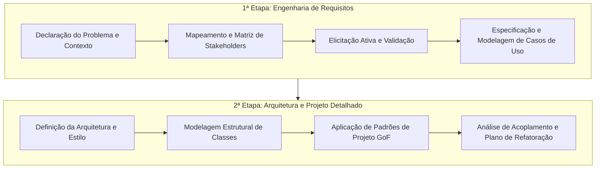

Os domínios temáticos sugeridos abrangem problemas com alta densidade transacional:
- **Comércio Eletrônico:** Marketplaces B2B/B2C, controle de SKUs, checkout concorrente, conciliação de frete e gestão de inventário.
- **Serviços Públicos:** Protocolo municipal, georreferenciamento de chamados de iluminação pública, controle de SLA de atendimento ao cidadão e transparência ativa.
- **Sistemas Corporativos:** Plataformas de alocação de projetos, rastreamento de candidatos (ATS) e módulos de conciliação financeira de fluxo de caixa.
- **Saúde:** Prontuário eletrônico de pacientes, telemedicina síncrona, conformidade com a LGPD e prescrição digital controlada.
- **Educação:** Ambientes de gestão acadêmica (SGA/LMS), controle de diário de classe, submissão de artefatos e cálculo ponderado de notas.
- **Logística:** Roteirização de frotas com grafos, monitoramento telemétrico e comprovação digital de entrega (*Proof of Delivery*).

---

## Fundamentos do Ciclo de Vida do Projeto de Software

### A Filosofia da Engenharia versus o Antipadrão Pastelaria

O professor Wesley Soares introduz a disciplina enfatizando uma advertência fundamental para a formação profissional: **"Software não é feito em pastelaria"**.

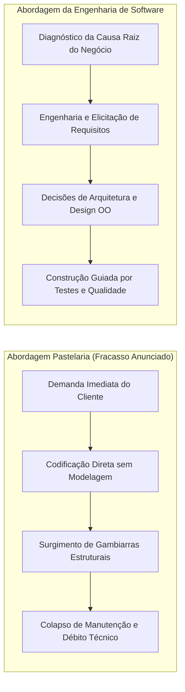

- **Definição:** A abordagem "pastelaria" é o vício operacional em que o profissional encara o software como uma linha de produção sob demanda simplória, na qual o cliente solicita um produto pronto e espera sua entrega imediata sem estudo de viabilidade, mapeamento de efeitos colaterais ou desenho arquitetural.
- **Motivação da Crítica:** Softwares modernos controlam transações bancárias, prontuários de saúde e infraestruturas industriais. Construí-los por impulso gera débito técnico exponencial, vulnerabilidades graves de segurança e retrabalho contínuo.
- **Exemplo Real:** Uma empresa demanda com urgência um "botão de cancelamento de pedido" no sistema. O desenvolvedor implementa a alteração alterando o status da tabela diretamente para `CANCELADO`. No primeiro dia de uso, o sistema corrompe o estoque (que não foi devolvido), deixa de notificar a adquirente de cartão de crédito e gera multas fiscais por falta de emissão de nota de estorno.
- **Contraexemplo:** Uma equipe de engenharia recebe o pedido de cancelamento, mapeia o caso de uso, especifica os fluxos de estorno financeiro, estorno logístico e emissão fiscal, atualiza o diagrama de estados da entidade `Pedido` e programa a funcionalidade com cobertura completa de testes automatizados.
- **Armadilhas:** Ceder à pressão de gerentes ou clientes para "apenas programar logo", acreditando que o projeto e os testes podem ser compensados depois. Na prática industrial, código sem design prévio nunca é corrigido; ele é substituído com prejuízos expressivos.

### O Paradoxo da Análise e do Projeto

Um dos princípios orientadores da disciplina é a divisão de responsabilidades expressa pelo lema:

> *"Faça a coisa certa (análise) e faça certo a coisa (projeto)."*

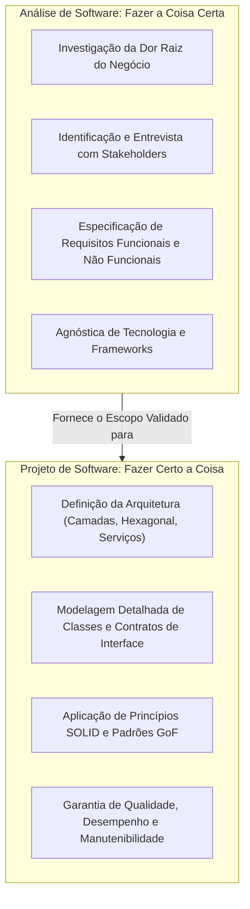

- **Análise de Requisitos (Fazer a Coisa Certa):** Concentra-se no domínio do problema. Investiga as regras do negócio, as restrições operacionais e os objetivos dos usuários finais. Um software perfeitamente escrito em Java que resolve o problema errado é um fracasso financeiro e operacional total.
- **Projeto de Software (Fazer Certo a Coisa):** Concentra-se no domínio da solução técnica. Especifica como a arquitetura, as classes, os padrões de projeto, a persistência e as redes se estruturam para entregar a solução com baixo acoplamento, alta coesão e resiliência.

### As Dez Fases do Ciclo de Vida de Software

O desenvolvimento de soluções de software corporativas estrutura-se ao longo de dez etapas iterativas e complementares:

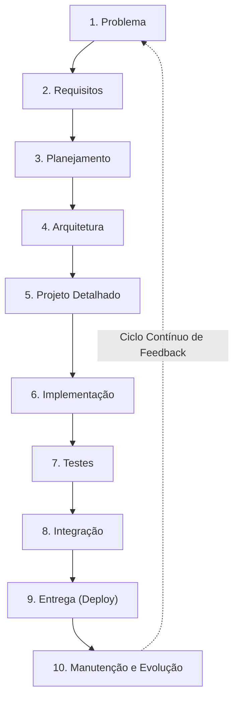

A tabela abaixo sintetiza a finalidade de cada etapa, discriminando seus artefatos canônicos de entrada e saída:

| Fase | Objetivo Principal | Artefato de Entrada | Artefato de Saída Produzido |
| :--- | :--- | :--- | :--- |
| **1. Problema** | Isolar a dor raiz do negócio e as ineficiências do processo atual. | Reclamações de usuários, gargalos operacionais e metas de negócio. | Declaração do Problema, Visão do Produto e Proposta de Valor. |
| **2. Requisitos** | Elicitar o que a aplicação deve fazer e quais restrições deve respeitar. | Declaração do Problema e sessões de levantamento com stakeholders. | Especificação de Requisitos de Software (SRS), Casos de Uso. |
| **3. Planejamento** | Dimensionar escopo, cronograma, alocação de equipe e matriz de riscos. | Backlog de requisitos priorizado e capacidade técnica do time. | Cronograma de marcos (*milestones*), plano de sprints e riscos. |
| **4. Arquitetura** | Definir o esqueleto do sistema e a estratégia de distribuição física/lógica. | Requisitos não funcionais críticos e restrições organizacionais. | Documento de Arquitetura de Software (SAD), diagramas estruturais. |
| **5. Projeto** | Modelar a interação de objetos, diagramas estruturais e padrões táticos. | Visão de arquitetura aprovada e especificações de casos de uso. | Diagrama de Classes detalhado, Diagramas de Sequência e APIs. |
| **6. Implementação** | Codificar a solução em linguagem estruturada com boas práticas de código. | Modelos de classes, especificações de endpoints e contratos de interface. | Código-fonte versionado (Git), branches limpas e pull requests. |
| **7. Testes** | Validar a exatidão das regras de negócio e testar limites de carga e falha. | Código compilável executável e critérios de aceitação formalizados. | Planos e suítes de testes unitários, integração e E2E executados. |
| **8. Integração** | Unificar os artefatos de código garantindo compatibilidade entre módulos. | Pull requests aprovados e branches de desenvolvimento. | Builds automatizados validados e imagens de contêiner geradas. |
| **9. Entrega** | Disponibilizar os artefatos nos ambientes de produção com segurança. | Imagens de contêiner aprovadas em homologação e scripts de migração. | Release em produção, changelog publicado e infraestrutura ativa. |
| **10. Manutenção** | Monitorar métricas operacionais, corrigir defeitos e acomodar novas regras. | Logs de telemetria, chamados de incidentes e métricas de uso. | Patches de segurança, correções de bugs e novos requisitos. |

---

## Engenharia e Elicitação de Requisitos

### Levantamento versus Elicitação Ativa

A literatura tradicional de Engenharia de Software e o SWEBOK (*Software Engineering Body of Knowledge*) estabelecem uma distinção entre "levantar" e "elicitar":

- **Levantamento de Requisitos (Abordagem Passiva):** Pressupõe ingenuamente que os requisitos já existem formalizados, lapidados e organizados na mente dos clientes, cabendo ao engenheiro apenas comparecer ao local de trabalho e anotar passivamente o que lhe é relatado.
- **Elicitação de Requisitos (Abordagem Ativa e Dialética):** Do latim *elicitare* ("fazer brotar", "trazer à luz", "extrair algo latente"). Reconhece que os clientes conhecem suas dores cotidianas, mas não sabem expressá-las na forma de requisitos computacionais formais. O analista atua como um investigador técnico que realiza perguntas estratégicas, analisa contradições e auxilia o cliente a explicitar necessidades que ele próprio desconhecia.

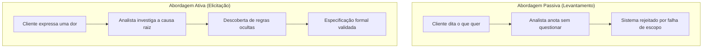

### A Cadeia Causal da Elicitação

A transformação de uma carência empresarial em uma especificação de engenharia segue uma progressão causal de cinco elos:

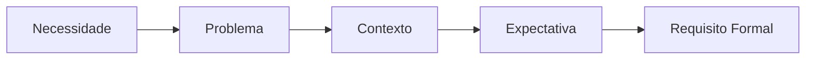

1. **Necessidade:** O estado de carência financeira ou de sustentabilidade da organização (ex.: a empresa precisa reduzir despesas operacionais no processamento de compras).
2. **Problema:** O obstáculo factual que impede o atendimento da necessidade (ex.: compras acima de R$ 5.000,00 levam 15 dias paradas aguardando assinaturas físicas de diretores em trânsito).
3. **Contexto:** As condições ambientais, culturais, humanas e tecnológicas do cenário (ex.: diretores trabalham em viagens corporativas internacionais e usam smartphones sem acesso a VPN corporativa).
4. **Expectativa:** A projeção mental simplificada do usuário sobre como o software deveria agir (ex.: "Quero poder autorizar compras direto do meu celular em qualquer lugar").
5. **Requisito Formal:** A declaração de engenharia verificável, mensurável e testável (ex.: "O sistema deve prover endpoint protegido por TLS 1.3 e autenticação multifator para aprovação de ordens de compra em até 3 segundos, registrando hash da assinatura digital e geolocalização do dispositivo para auditoria").

### As Seis Perguntas Cardinais

Diante de qualquer novo projeto ou módulo de software, o analista deve responder exaustivamente a seis perguntas de orientação cardinal:

1. **Qual problema existe?** Isolar a causa raiz das manifestações superficiais. Falta de receita é sintoma; a lentidão na emissão da nota fiscal que impede o caminhão de sair para entrega é o problema.
2. **Quem enfrenta o problema?** Identificar os stakeholders: atores primários (operadores diretos da interface), atores secundários (gestores que recebem relatórios) e atores terciários (sistemas fiscais e auditorias).
3. **Como ele é resolvido atualmente?** O processo *As-Is* (como as coisas funcionam hoje). Sistemas raramente nascem no vazio; eles substituem planilhas manuais, anotações em blocos ou rotinas mantidas por mensagens de texto.
4. **O que o sistema precisa fazer?** As rotinas funcionais, transformações de dados e regras de negócio obrigatórias para resolver o problema.
5. **Quais são as restrições?** Limitações tecnológicas (hardware legado, conexões intermitentes), jurídicas (LGPD, normas da Receita Federal) e operacionais (prazos e orçamentos).
6. **O que é prioridade?** A determinação das funcionalidades indispensáveis para a sustentação do produto (*Must Have*) versus melhorias cosméticas adiáveis.

### Taxonomia das Barreiras de Elicitação

O levantamento de requisitos enfrenta dificuldades humanas e organizacionais que demandam técnicas maduras de mediação:

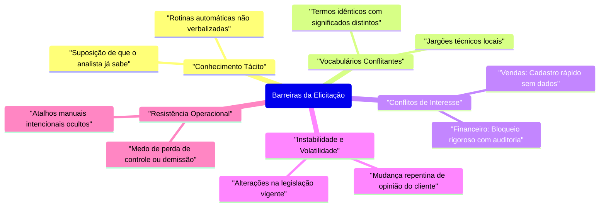

- **Necessidades Não Explícitas (Conhecimento Tácito):** O operador executa validações manuais há anos e julga que "todo mundo sabe que isso deve ser feito", esquecendo-se de relatar a etapa ao analista.
- **Vocabulários Dissonantes:** Setores diferentes usam o mesmo substantivo para realidades distintas (ex.: para o setor de Vendas, "Pedido Fechado" significa que o cliente aceitou a proposta; para o setor Fiscal, "Pedido Fechado" só existe após autorização da Nota Fiscal Eletrônica).
- **Conflito de Requisitos:** Demandas mutuamente exclusivas originadas de departamentos distintos. O setor comercial exige cadastro com um único campo obrigatório; o setor jurídico e tributário exige 15 documentos anexos e consulta de antecedentes.

### Tratamento da Ambiguidade: Requisitos Funcionais e Não Funcionais

A engenharia de requisitos rejeita categoricamente declarações subjetivas, poéticas ou imprecisas. Termos como "rápido", "intuitivo", "moderno", "seguro" e "robusto" constituem **anti-requisitos** enquanto não forem traduzidos em métricas físicas comprováveis.

A especificação técnica exige a separação estrutural entre:
- **Requisito Funcional (RF):** Descreve as funções, cálculos, serviços, comportamentos e transformações de dados que o software deve executar em resposta a estímulos externos.
- **Requisito Não Funcional (RNF):** Descreve os atributos de qualidade, padrões técnicos, níveis de serviço (SLA), restrições arquiteturais e limites de desempenho sob os quais os requisitos funcionais devem operar.

A tabela a seguir exemplifica o processo de refatoração de ambiguidades para a elaboração de especificações técnicas rigorosas:

| Fala Informal do Cliente | Defeito Metodológico | Refatoração Técnica da Engenharia (Requisito Formal Verificável) |
| :--- | :--- | :--- |
| "O sistema precisa ser rápido na consulta de clientes." | Subjetividade total. Não define tempo, volume de dados nem carga simultânea de usuários. | **RNF-001 (Desempenho):** O tempo de resposta para a consulta de clientes por CPF ou Razão Social deve ser inferior a 800 milissegundos para o percentil 95 ($`p95`$), sob uma carga de até 500 requisições simultâneas em uma base de 1.000.000 de registros. |
| "A tela deve ser simples e intuitiva para quem opera o caixa." | Ambiguidade de usabilidade. Não fornece critérios para aceite ou validação em testes de campo. | **RNF-002 (Usabilidade):** Um operador de caixa com ensino médio completo deve ser capaz de concluir uma venda padrão de até 5 itens em no máximo 90 segundos, após treinamento formal de no máximo 20 minutos, registrando taxa de erro de operação inferior a 1%. |
| "O banco de dados precisa ser completamente seguro." | Generalismo ingênuo. Não estabelece normas, ameaças, algoritmos de cifra nem limites de acesso. | **RNF-003 (Segurança):** Todas as senhas de usuários devem ser armazenadas utilizando função criptográfica de derivação de chaves Argon2id com custo de memória de 64 MB. Todas as comunicações em rede devem exigir protocolo TLS 1.3 com cifras seguras. |

### Técnicas de Elicitação Tradicionais e de Campo

A seleção das técnicas depende da cultura organizacional, do número de usuários impactados e da acessibilidade aos postos operacionais:

1. **Entrevistas (Estruturadas, Semiestruturadas e Não Estruturadas):**
   - *Estruturada:* Roteiro fixo e padronizado; ideal para comparar opiniões de múltiplos gerentes com perfil idêntico.
   - *Semiestruturada (Recomendada):* O analista possui metas claras e perguntas nucleares, mas mantém flexibilidade investigativa para explorar caminhos abertos pelas respostas do usuário.
   - *Não Estruturada:* Diálogo aberto e exploratório; recomendada apenas nas semanas iniciais para compreensão geral de domínios corporativos desconhecidos.
2. **Questionários:** Aplicação de formulários estruturados para populações extensas ou geograficamente dispersas. Apresenta baixo custo marginal por respondente, mas sofre com taxas históricas baixas de devolução e impossibilidade de esclarecer dúvidas de redação em tempo real.
3. **Observação Direta (*Job Shadowing* / Etnografia):** O analista acompanha presencialmente a jornada diária do operador, posicionando-se como um observador silencioso. Permite capturar "gambiarras operacionais", rotinas não documentadas em manuais e atalhos manuais essenciais que o operador esquece de relatar nas entrevistas formais.
4. **Análise Documental (*Document Analysis*):** Leitura de manuais de procedimentos, relatórios fiscais, telas de sistemas legados, modelos de planilhas e normas regulatórias. Revela as regras formais e formatos de dados consolidados na empresa.
5. **Workshops Conjuntos (*JAD - Joint Application Development*):** Reuniões estruturadas que reúnem no mesmo espaço analistas de software, desenvolvedores e decisores de diferentes departamentos. Conflitos de escopo que levariam meses de trocas de e-mails são resolvidos e documentados em poucos encontros presenciais.

---

## Priorização de Escopo com o Método MoSCoW

### Definição e Categorias do MoSCoW

O método **MoSCoW** foi concebido por Dai Clegg no framework ágil DSDM (*Dynamic Systems Development Method*) com o objetivo de alinhar as expectativas de entrega dos stakeholders com as restrições reais de prazo e capacidade da equipe técnica.

As quatro letras representam níveis estritos de compromisso com o escopo:

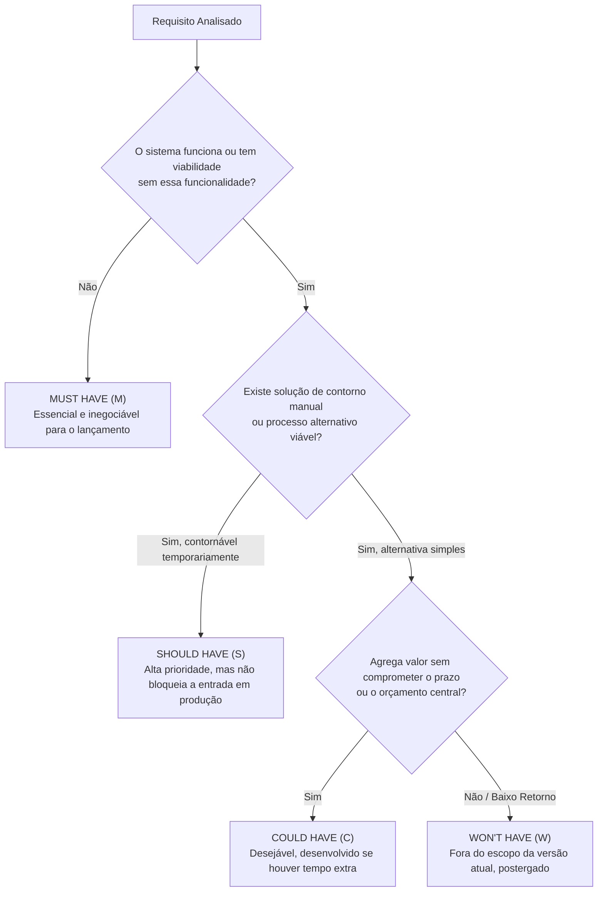

- **M — Must Have (Deve Ter):** Requisitos inegociáveis. Se um único requisito desta categoria não for entregue, o sistema não cumpre seu propósito legal ou operacional, tornando o lançamento inviável. Representa o núcleo duro do Produto Mínimo Viável (MVP).
- **S — Should Have (Deveria Ter):** Requisitos de alta prioridade que entregam valor crítico ao negócio. Devem ser implementados se houver estabilidade, mas sua ausência no dia do lançamento pode ser mitigada temporariamente por procedimentos manuais sem paralisar a empresa.
- **C — Could Have (Poderia Ter):** Funcionalidades de conveniência ou diferenciais cosméticos que enriquecem a experiência do usuário. Só entram em desenvolvimento se os itens *Must* e *Should* estiverem rigorosamente concluídos e testados antes do prazo final.
- **W — Won't Have this time (Não Terá Desta Vez):** Funcionalidades consensualmente reconhecidas como importantes, mas que a equipe e os stakeholders concordaram em deixar fora da iteração ou release atual. Protege o time contra o desvio de foco e previne estouros orçamentários.

### Critérios e Árvore de Decisão para Alocação

Para mitigar a tendência dos clientes de classificar todos os requisitos como *Must Have*, o analista deve aplicar perguntas de contraste:
- "Se o sistema for para o ar na sexta-feira sem esta funcionalidade, a empresa é autuada pela fiscalização ou para de operar?" Se a resposta for "Não", o item não é *Must Have*.
- "O operador consegue realizar este cálculo manualmente em uma planilha durante as duas primeiras semanas de implantação enquanto estabilizamos o módulo?" Se a resposta for "Sim", o item classifica-se tecnicamente como *Should Have*.

### Aplicações Práticas e Prevenção de Escopo Corrompido

A corrosão ou expansão desordenada de escopo (*Scope Creep*) ocorre quando novas funcionalidades são incorporadas continuamente ao projeto sem ampliação proporcional do prazo ou do orçamento. O MoSCoW atua como uma barreira de engenharia: caso um novo requisito surja no meio do projeto e seja classificado como indispensável (*Must Have*), outro requisito previamente acordado deve ser rebaixado para *Could* ou *Won't*, preservando o cronograma de entrega.

---

## Fundamentos da UML e Integração com Métodos Ágeis

### Definição, Histórico e Objetivos da UML

A **Unified Modeling Language (UML)** é uma linguagem visual padronizada para especificação, construção, visualização e documentação de artefatos de sistemas orientados a objetos. Ela foi consolidada na década de 1990 pela fusão dos métodos concebidos pelos chamados "Three Amigos" da engenharia de software:
- **Grady Booch:** Criador do método Booch, focado na modelagem estrutural detalhada e abstrações de classes.
- **James Rumbaugh:** Idealizador da técnica OMT (*Object Modeling Technique*), focada na análise de domínio e estados.
- **Ivar Jacobson:** Criador do método OOSE (*Object-Oriented Software Engineering*), responsável pela introdução do conceito e da técnica de Casos de Uso (*Use Cases*).

A unificação dos três métodos deu origem à UML 1.0, submetida e adotada pela OMG (*Object Management Group*) em 1997. A versão moderna (UML 2.x) expande essa semântica, dividindo seus diagramas em duas macrofamílias: diagramas estruturais e diagramas comportamentais.

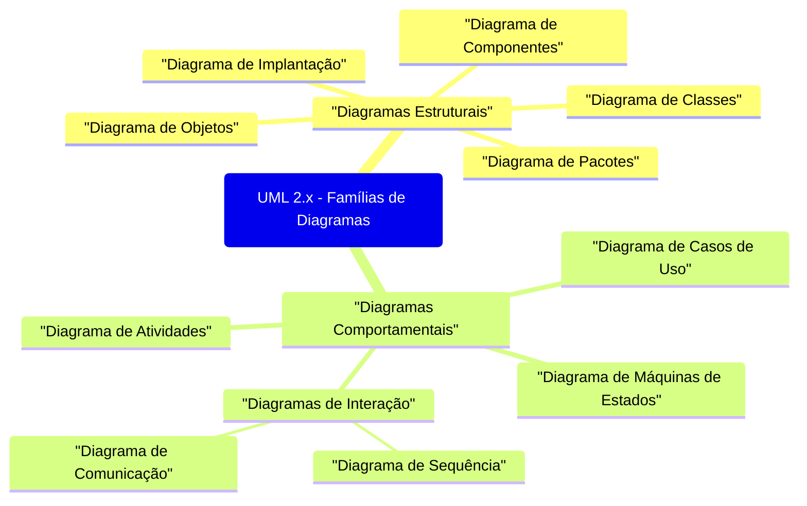

Os objetivos centrais da UML na engenharia moderna são:
1. Prover aos arquitetos e desenvolvedores um vocabulário visual padronizado e rigoroso para expressar designs de sistemas sem ambiguidades de linguagem natural.
2. Permitir a compreensão ágil e o mapeamento conceitual de sistemas legados ou em concepção.
3. Servir como base para a construção direta de código-fonte tipado em linguagens como Java, C# ou C++.
4. Estabelecer mecanismos de rastreabilidade entre os requisitos de negócio e os modelos técnicos de execução.

### Notação versus Processos e Metodologias

Um dos erros mais recorrentes em exames acadêmicos e discussões industriais é confundir a UML com uma metodologia ou processo de desenvolvimento de software. A disciplina do Prof. Wesley Soares desfaz essa confusão:

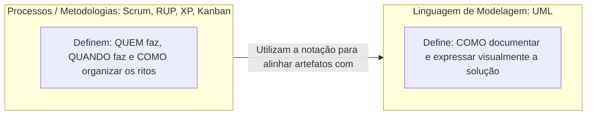

- **A UML NÃO É:** Um processo de desenvolvimento; uma metodologia ágil ou cascata; uma receita passo a passo de como conduzir uma equipe de desenvolvimento; ou um conjunto de regras de negócio.
- **A UML É:** Uma **linguagem de notação gráfica** neutra em relação a processos. Ela pode ser utilizada com igual eficácia dentro de um processo prescritivo tradicional (como o RUP — *Rational Unified Process*) ou em ciclos iterativos ágeis (como Scrum e XP).

| Dimensão de Comparação | Processo de Software (Ex.: Scrum, RUP) | Notação de Modelagem (UML) |
| :--- | :--- | :--- |
| **Pergunta Principal Respondida** | "Quem faz o quê, em qual momento e sob qual controle de entrega?" | "Como representar visualmente e tecnicamente a estrutura e o comportamento?" |
| **Componentes Principais** | Sprints, reuniões diárias, papéis (Product Owner, Scrum Master), backlog. | Formas geométricas, estereótipos, linhas de dependência, multiplicidades. |
| **Aderência Metodológica** | Prescreve como a equipe trabalha, planeja e inspeciona. | Agnóstica a processos; adapta-se a qualquer ciclo de vida de desenvolvimento. |

### A Modelagem Ágil no Framework Scrum

No desenvolvimento ágil contemporâneo, a modelagem de software com UML afasta-se da prática de projetos tradicionais pesados (BDUF — *Big Design Up Front*), nos quais centenas de páginas de diagramas eram desenhadas antes do início da codificação.

Em equipes Scrum, a modelagem é orientada pelos princípios de **Just-in-Time** (modelar no momento oportuno) e **Just-Enough** (modelar apenas com o nível de detalhe necessário para guiar a implementação). Durante o refinamento de itens do Product Backlog e no planejamento de Sprints (*Sprint Planning*), os desenvolvedores e arquitetos utilizam diagramas de classes e de sequência em quadros brancos ou ferramentas de diagramação rápida para:
- Mapear a arquitetura antes da escrita dos testes unitários.
- Estabelecer a divisão equilibrada de tarefas entre membros da equipe.
- Antecipar impactos em entidades de banco de dados e contratos de interfaces.

### Ferramentas de Modelagem

O projeto técnico exige ferramentas que respeitem as normas formais da OMG. Entre as principais plataformas adotadas no ensino e na indústria, destacam-se:
- **Visual Paradigm Online:** Ferramenta baseada em nuvem que facilita o desenho ágil e compartilhado de diagramas UML sem a sobrecarga de instalações locais complexas.
- **Enterprise Architect (Sparx Systems):** Plataforma desktop avançada para modelagem corporativa, engenharia reversa e rastreabilidade ampla de modelos.
- **Astah UML:** Ambiente acadêmico e profissional clássico focado na validação de sintaxe e clareza didática.
- **Mermaid.js:** Notação baseada em texto para inclusão direta de diagramas em documentos Markdown e repositórios Git, facilitando a manutenção de "documentação viva" (*Docs-as-Code*).

---

## Modelagem de Casos de Uso na UML

### Conceito de Caixa-Preta e Fronteira do Sistema

O Diagrama de Casos de Uso é um diagrama comportamental cujo propósito central é representar a **fronteira do sistema** (*System Boundary*) e os serviços observáveis que este fornece ao ambiente externo.

A premissa fundamental desta modelagem é a abordagem **Caixa-Preta** (*Black-Box Modeling*). O modelo não deve expor tabelas de banco de dados relacionais, queries SQL, trechos de código-fonte, frameworks ou componentes de interfaces com o usuário (telas ou botões). Ele responde unicamente à questão:

> *"O que o sistema deve fazer para o seu usuário externo?"*

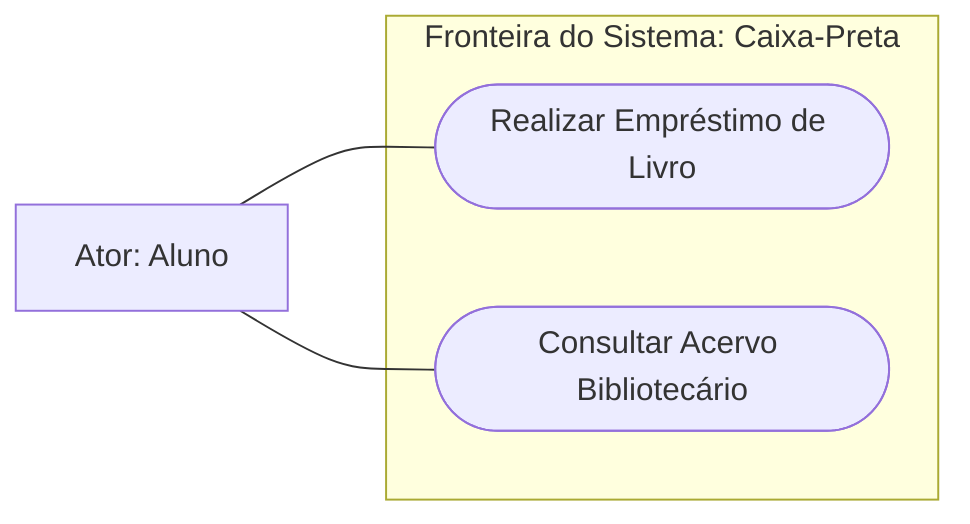

- **Exemplo Correto:** Um caso de uso intitulado `Efetuar Reserva de Exemplar`, conectado ao ator `Aluno`.
- **Contraexemplo:** Modelar casos de uso sequenciais chamados `Clicar no Botão Reservar`, `Executar SELECT na TB_LIVRO` e `Exibir Mensagem de Alerta`. Esses passos representam detalhes transientes de interface e infraestrutura interna, e não objetivos de negócio.
- **Armadilha Frequente:** Transformar o diagrama de casos de uso em um fluxograma de execução procedimental, interligando elipses por setas para indicar a ordem em que os botões serão acionados na interface gráfica.

### Atores Primários e Secundários

Um **Ator** especifica um papel desempenhado por um usuário humano ou por um sistema externo de computação que interage com o sistema em desenvolvimento:

- **Atores Primários:** Disparam a interação com o sistema para atingir um objetivo de negócio mensurável. Posicionam-se convencionalmente à esquerda do diagrama (ex.: `Cliente`, `Atendente`, `Bibliotecário`).
- **Atores Secundários:** Auxiliam o sistema na execução de rotinas ou fornecem serviços de infraestrutura e processamento sob solicitação do software. Posicionam-se convencionalmente à direita do diagrama (ex.: `Gateway de Pagamento`, `Servidor de E-mail`, `Serviço SEFAZ`).

### Casos de Uso e Convenções de Nomenclatura

Um **Caso de Uso** representa uma sequência atômica e completa de ações realizadas pelo sistema que gera um resultado observável e mensurável de valor para um ator específico.

A convenção de nomenclatura exige:
1. Utilização de **verbos no infinitivo** que denotem ações objetivas.
2. Presença de um **substantivo complementar** que especifique o alvo da ação no domínio.
3. Exemplos recomendados: `Cadastrar Aluno`, `Emitir Extrato`, `Processar Pagamento`, `Cancelar Pedido`.
4. Nomes proibidos: `Tela de Login` (é interface gráfica), `Aluno` (é ator ou classe estrutural), `Processamento` (não possui verbo direto de ação).

### Relacionamentos: Associação, Inclusão, Extensão e Generalização

O poder descritivo do modelo decorre do emprego correto de quatro relacionamentos canônicos:

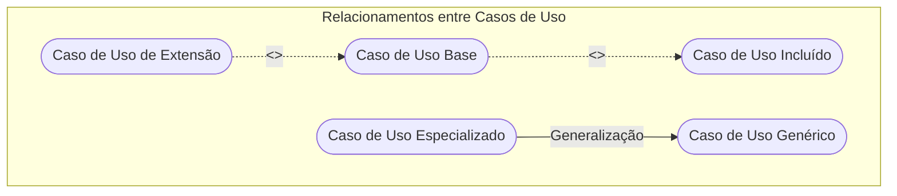

#### 1. Associação de Comunicação
- **Definição:** Linha contínua que conecta um ator a um caso de uso, denotando fluxo bidirecional ou unidirecional de informações e permissão de acionamento.
- **Regra:** Conecta apenas atores a casos de uso. É proibido ligar atores diretamente entre si por linhas de associação comum.

#### 2. Relacionamento Include (`<<include>>`)
- **Definição:** Relação de dependência na qual o caso de uso base executa **obrigatoriamente e incondicionalmente** as ações descritas no caso de uso incluído como parte de seu fluxo.
- **Motivação:** Promover o reúso sistemático de passos de regras de negócio compartilhados por múltiplos casos de uso, evitando duplicidade documental (princípio DRY — *Don't Repeat Yourself*).
- **Direção da Seta:** Linha tracejada partindo do caso de uso **Base** em direção ao caso de uso **Incluído** (`Base -.->|<<include>>| Incluído`).
- **Exemplo:** `Emitir Transferência Bancária` e `Pagar Fatura` contêm a seta `<<include>>` apontando para `Autenticar Usuário`. Sem autenticação bem-sucedida, o fluxo principal não pode ser concluído.
- **Armadilha:** Inverter o sentido da seta. Quem precisa do serviço complementar é a base; portanto, é a base que aponta para o serviço incluído.

#### 3. Relacionamento Extend (`<<extend>>`)
- **Definição:** Relação de dependência na qual um caso de uso de extensão pode ampliar **opcionalmente e condicionalmente** o comportamento do caso de uso base em um local pré-definido, denominado **ponto de extensão** (*Extension Point*).
- **Motivação:** Isolar comportamentos acessórios, regras de exceção ou fluxos opcionais complexos, preservando a clareza e a simplicidade do caso de uso central.
- **Direção da Seta:** Linha tracejada partindo do caso de uso **Opcional (Extensão)** em direção ao caso de uso **Base** (`Extensão -.->|<<extend>>| Base`).
- **Exemplo:** Durante a execução do caso de uso `Finalizar Compra`, o cliente pode opcionalmente disparar `Aplicar Cupom de Desconto`. A compra ocorre sem desconto normalmente, mas a extensão é acionada caso a condição de existência do cupom seja satisfeita.
- **Armadilha:** Tratar ações obrigatórias como extensão ou inverter a orientação da seta. No extend, o módulo acessório aponta para a base que ele amplia.

#### 4. Relacionamento de Generalização / Especialização
- **Definição:** Relação análoga ao conceito de herança em linguagens orientadas a objetos. O elemento filho (especializado) herda o comportamento, atributos e associações do elemento pai (genérico), podendo acrescentar novos fluxos ou sobrescrever ações.
- **Aplicação Entre Atores:** O ator especializado possui todos os privilégios do ator genérico mais seus próprios casos de uso exclusivos (ex.: `Gerente` herda de `Funcionário`).
- **Aplicação Entre Casos de Uso:** O caso de uso genérico estabelece a intenção geral, enquanto os filhos oferecem execuções concretas (ex.: `Pagar Pedido` especializado por `Pagar com Cartão de Crédito` e `Pagar com Pix`).

| Relacionamento | Representação Gráfica | Obrigatoriedade de Execução | Direção da Conexão | Propósito Principal |
| :--- | :--- | :--- | :--- | :--- |
| **Associação** | Linha sólida simples | Variável | Sem seta (ou bidirecional) | Mapear o canal de comunicação entre ator e funcionalidade. |
| **Include** | Linha tracejada com `<<include>>` | Obrigatório (100% das execuções) | Do Caso Base para o Incluído | Reúso sistemático de comportamento compartilhado. |
| **Extend** | Linha tracejada com `<<extend>>` | Opcional (sujeito à guarda) | Da Extensão para o Caso Base | Desacoplamento de fluxos condicionais ou de exceção. |
| **Generalização** | Linha sólida com triângulo vazado | Herança polimórfica | Do Especializado para o Genérico | Compartilhamento e especialização de comportamento de tipos. |

### Especificação Textual Formal de Casos de Uso

O diagrama gráfico exibe apenas o esqueleto do sistema. O comportamento dinâmico e o detalhamento das regras de negócio residem na **especificação textual do caso de uso**, estruturada conforme o padrão da engenharia de requisitos:

- **Identificador e Nome:** Código e verbo no infinitivo (ex.: `UC-001: Realizar Matrícula de Aluno`).
- **Ator Primário:** O agente responsável por iniciar o caso de uso.
- **Pré-condições:** Condições de sistema que devem ser verdadeiras antes do início do fluxo.
- **Pós-condições:** O estado final em que o sistema deve se encontrar após a execução bem-sucedida.
- **Fluxo Principal (Caminho Feliz):** Sequência numerada e alternada de passos entre as ações do ator e as respostas do sistema, assumindo ausência de erros.
- **Fluxos Alternativos:** Desvios planejados da lógica padrão que também chegam a uma conclusão de sucesso.
- **Fluxos de Exceção:** Respostas do sistema diante de falhas técnicas ou violações de regras que impedem o alcance do objetivo principal.

---

## Modelagem Estrutural com o Diagrama de Classes

### Anatomia da Classe: Compartimentos, Nomenclatura e Tipagem

O **Diagrama de Classes** é o modelo estrutural estático central da UML. Ele exibe as classes que compõem a solução, seus estados encapsulados (atributos), seus comportamentos executáveis (operações/métodos) e os relacionamentos que unem seus objetos.

Visualmente, a classe é modelada por um retângulo dividido horizontalmente em **três compartimentos**:

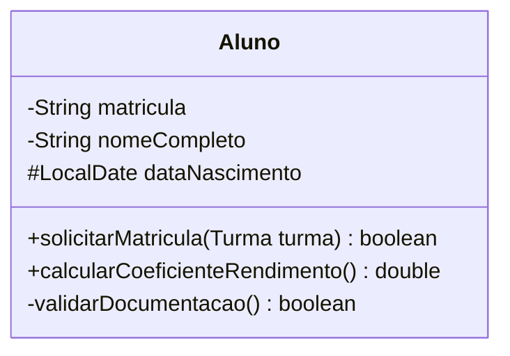

1. **Compartimento Superior (Identificador da Classe):** Contém o nome da classe em **PascalCase** (substantivo no singular). Classes abstratas são grafadas com o nome em *itálico* ou acompanhadas da propriedade `{abstract}`.
2. **Compartimento Central (Atributos):** Define a estrutura de dados encapsulada. Obedece à sintaxe formal:
   ```text
   [visibilidade] nomeAtributo : tipoDado [multiplicidade] = [valorPadrao]
   ```
3. **Compartimento Inferior (Operações / Métodos):** Define a interface de comportamento e serviços que a classe expõe ou executa internamente. Obedece à sintaxe formal:
   ```text
   [visibilidade] nomeMetodo(parametro : tipo) : tipoRetorno
   ```

### Modificadores de Visibilidade e Níveis de Encapsulamento

A visibilidade determina o nível de proteção do estado interno da classe, concretizando o princípio de encapsulamento da orientação a objetos:

| Símbolo UML | Modificador | Equivalente em Java | Regra de Acesso e Restrição |
| :---: | :--- | :--- | :--- |
| **`+`** | Público (*Public*) | `public` | Acessível irrestritamente por qualquer classe de qualquer pacote do sistema. |
| **`#`** | Protegido (*Protected*) | `protected` | Acessível pela própria classe, por suas subclasses herdeiras e por classes do mesmo pacote. |
| **`-`** | Privado (*Private*) | `private` | Acessível estrita e unicamente pelos métodos internos da própria classe declarante. |
| **`~`** | Pacote (*Package*) | *(default/sem modificador)* | Acessível apenas por classes pertencentes ao mesmo diretório/pacote lógico. |

### Multiplicidades, Papéis e Navegabilidade

A multiplicidade define os limites inferior e superior da quantidade de instâncias de uma classe que podem se relacionar com uma única instância da classe oposta:

- `1`: Exatamente uma instância obrigatória.
- `0..1`: Zero ou uma instância (relacionamento opcional).
- `*` ou `0..*`: Zero, uma ou múltiplas instâncias (coleção irrestrita).
- `1..*`: No mínimo uma instância, até muitas (coleção obrigatória não vazia).
- `m..n`: Intervalo fixo e fechado de instâncias (ex.: `2..4`).

### Relacionamentos Estruturais e Ciclo de Vida

A UML define cinco relações estruturais e dinâmicas principais entre classes:

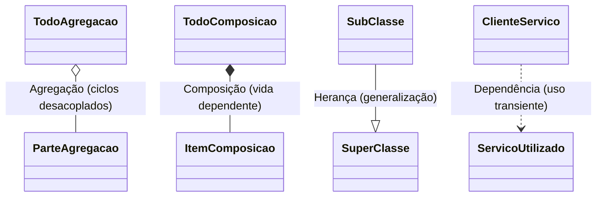

#### 1. Associação Simples
- Relacionamento estrutural neutro que indica que objetos de uma classe conhecem ou mantêm referência para objetos de outra classe.
- Pode ser bidirecional (sem setas) ou unidirecional (com seta indicando navegabilidade).

#### 2. Agregação (Todo-Parte Fraco / Losango Vazio)
- **Definição:** Relação estrutural onde uma classe representa um agrupador ("Todo") e outra representa seus constituintes ("Parte").
- **Independência de Ciclo de Vida:** A "Parte" existe de forma independente do "Todo". A destruição da instância do "Todo" não acarreta a destruição das suas "Partes".
- **Símbolo:** Losango vazado anexado à classe que representa o "Todo".
- **Exemplo Real:** Uma `Universidade` e seus `Professores`. Se a universidade encerrar suas operações jurídicas, os professores continuam existindo e podem lecionar em outras instituições.

#### 3. Composição (Todo-Parte Forte / Losango Preenchido)
- **Definição:** Forma rigorosa de associação todo-parte caracterizada por forte acoplamento de propriedade e dependência existencial.
- **Dependência de Ciclo de Vida:** A "Parte" não tem razão de existir fora do contexto do "Todo". A destruição da instância do "Todo" implica a aniquilação obrigatória e imediata de todas as instâncias das suas "Partes".
- **Símbolo:** Losango preenchido sólido anexado à classe proprietária ("Todo").
- **Exemplo Real:** Um `Pedido` e seus `ItensPedido`. Se o pedido for expurgado da base de dados, os itens que descrevem quantidade e preço daquele pedido específico deixam de fazer sentido conceitual e devem ser excluídos.

#### 4. Generalização / Especialização (Herança)
- Estabelece a clássica relação orientada a objetos "É UM" (*is-a*). A subclasse herda automaticamente todos os atributos e métodos não privados da superclasse, podendo adicionar novos comportamentos ou sobrescrever implementações existentes.
- **Símbolo:** Linha sólida com uma ponta em forma de triângulo vazado apontando para a superclasse.

#### 5. Dependência (Uso Transitório)
- **Definição:** Relação semântica fraca que denota que uma classe utiliza temporariamente serviços de outra, sem manter uma referência permanente em seus atributos de instância.
- **Símbolo:** Linha tracejada com uma ponta de seta aberta direcionada à classe utilizada.
- **Cenários Canônicos:** Ocorre quando uma classe recebe outra como parâmetro de um método, instancia um objeto localmente dentro do escopo de uma função ou invoca métodos estáticos de uma classe utilitária.

### Mapeamento Direto do Modelo Estrutural para Java

A transição de modelos conceituais para código-fonte exige disciplina para refletir as regras de multiplicidade e ciclo de vida:

```java
package br.unifef.engenharia.dominio;

import java.util.ArrayList;
import java.util.Collections;
import java.util.List;

// Composição: Pedido é o Todo, ItemPedido é a Parte dependente
public class Pedido {
    private final String codigoIdentificador;
    private final List<ItemPedido> itens; // Multiplicidade 1..*
    private StatusPedido status;

    public Pedido(String codigoIdentificador) {
        if (codigoIdentificador == null || codigoIdentificador.isBlank()) {
            throw new IllegalArgumentException("Identificador do pedido é obrigatório.");
        }
        this.codigoIdentificador = codigoIdentificador;
        this.itens = new ArrayList<>();
        this.status = StatusPedido.CRIADO;
    }

    // A composição é garantida pela criação e encapsulamento dos itens dentro da classe pai
    public void adicionarItem(String nomeProduto, int quantidade, double precoUnitario) {
        ItemPedido novoItem = new ItemPedido(nomeProduto, quantidade, precoUnitario);
        this.itens.add(novoItem);
    }

    public double calcularTotal() {
        return this.itens.stream()
                .mapToDouble(ItemPedido::calcularSubtotal)
                .sum();
    }

    public List<ItemPedido> getItens() {
        return Collections.unmodifiableList(this.itens);
    }

    public String getCodigoIdentificador() {
        return this.codigoIdentificador;
    }
}
```

```java
package br.unifef.engenharia.dominio;

// Classe que atua como Parte na composição com Pedido
public class ItemPedido {
    private final String nomeProduto;
    private final int quantidade;
    private final double precoUnitario;

    // Construtor com visibilidade de pacote: instanciado prioritariamente pelo Pedido
    ItemPedido(String nomeProduto, int quantidade, double precoUnitario) {
        if (quantidade <= 0) {
            throw new IllegalArgumentException("Quantidade deve ser superior a zero.");
        }
        if (precoUnitario < 0.0) {
            throw new IllegalArgumentException("Preço unitário não pode ser negativo.");
        }
        this.nomeProduto = nomeProduto;
        this.quantidade = quantidade;
        this.precoUnitario = precoUnitario;
    }

    public double calcularSubtotal() {
        return this.quantidade * this.precoUnitario;
    }

    public String getNomeProduto() {
        return this.nomeProduto;
    }

    public int getQuantidade() {
        return this.quantidade;
    }

    public double getPrecoUnitario() {
        return this.precoUnitario;
    }
}
```

---

## Arquitetura de Software e Padrões Arquiteturais

### Conceito Formal Segundo a ISO/IEC/IEEE 42010:2022

A norma internacional **ISO/IEC/IEEE 42010:2022** estabelece a base teórica para a especificação de arquiteturas computacionais. A norma define arquitetura de software como:

> *"A estrutura fundamental ou esqueleto de um sistema de software, que define seus componentes, suas relações mútuas e seus princípios de projeto e evolução contínua."*

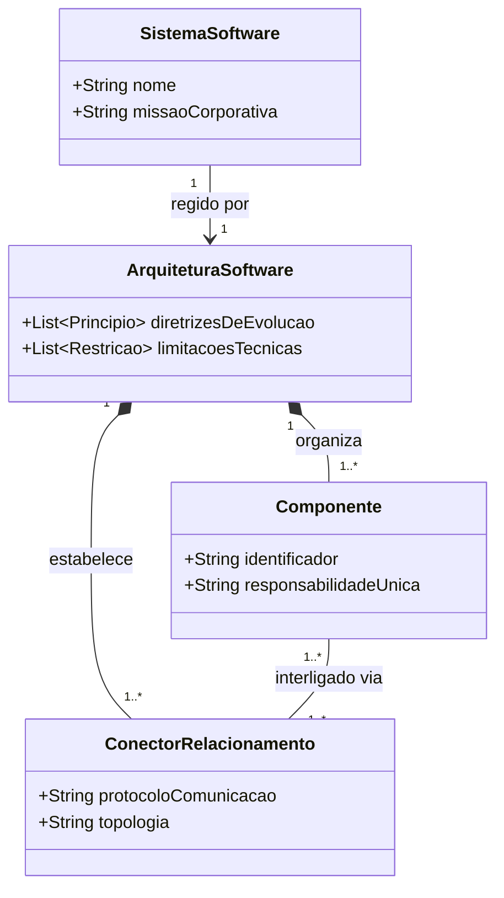

A arquitetura governa três pilares indispensáveis:
1. **Componentes:** Os módulos de processamento e armazenamento (microsserviços, subsistemas, bibliotecas compartilhadas, bancos de dados).
2. **Relacionamentos e Conectores:** Os protocolos e caminhos pelos quais as informações trafegam (chamadas REST/HTTP, chamadas remotas gRPC, filas AMQP, sockets de memória).
3. **Princípios de Evolução:** As regras arquiteturais que impedem que o software se degrade ao longo dos anos diante de mudanças de mercado.

### Diferença entre Padrões Arquiteturais e Padrões de Projeto

A literatura técnica e as provas de engenharia exigem a distinção do nível de granularidade entre padrões arquiteturais e de projeto:

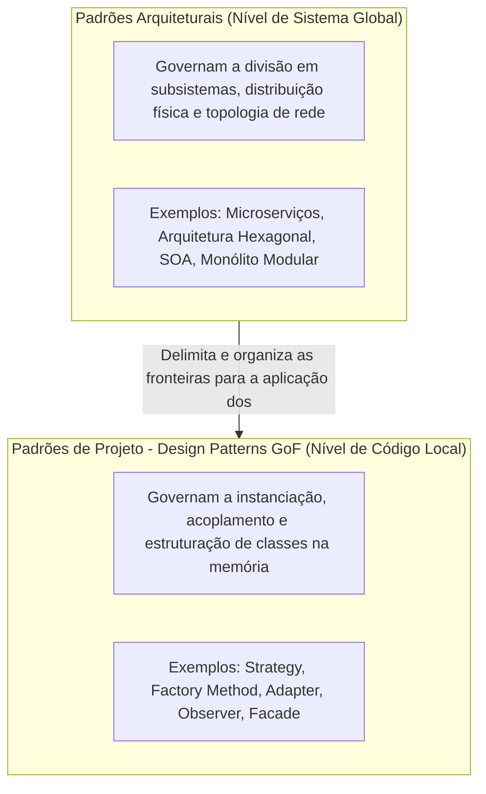

| Critério de Comparação | Padrão Arquitetural | Padrão de Projeto (*Design Pattern GoF*) |
| :--- | :--- | :--- |
| **Escopo e Abrangência** | Macro. Governa todo o sistema corporativo e seus nós de rede. | Micro. Governa um grupo restrito de classes e interfaces no código. |
| **Custo de Mudança** | Altíssimo. Mudar de microsserviços para monólito consome meses. | Baixo. Mudar de *Factory Method* para *Strategy* resolve-se com refatoração local. |
| **Momento de Decisão** | Definido nas etapas iniciais de concepção e análise de requisitos. | Definido durante a codificação detalhada e os ciclos diários de engenharia. |

### Modelos de Distribuição: SaaS versus On-Premises

A escolha do modelo de distribuição afeta diretamente os requisitos de escalabilidade, alta disponibilidade e a estrutura de custos da organização:

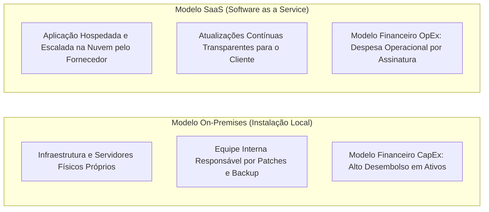

| Parâmetro de Comparação | Software como Serviço (SaaS) | Instalação Local (On-Premises) |
| :--- | :--- | :--- |
| **Estrutura Contábil** | **OpEx** (*Operational Expenditure*): Custos operacionais previsíveis por assinatura mensal ou consumo. | **CapEx** (*Capital Expenditure*): Investimento massivo antecipado em servidores, nobreaks e climatização. |
| **Custódia dos Dados** | Fica sob a guarda do provedor de nuvem (exige rigor contratual com SLAs e conformidade LGPD). | Controle físico absoluto nos servidores internos da empresa (ideal para setores militares e bancários restritos). |
| **Atualizações de Versão** | Transparentes e centralizadas. Toda a base opera simultaneamente na versão estável mais recente. | Fragmentadas. Exige visitas de campo ou instalações individuais em cada servidor do cliente. |
| **Elasticidade e Carga** | Alta escalabilidade horizontal sob demanda através de provedores em nuvem. | Limitada pela capacidade computacional do hardware físico previamente adquirido e instalado. |

### Estilos Arquiteturais Fundamentais

#### 1. Arquitetura Cliente-Servidor Clássica
- **Estrutura:** Divide a computação em dois nós: clientes (solicitantes) e servidor central (processador e repositório de dados).
- **Limitações:** O servidor central torna-se um gargalo de desempenho e um **Ponto Único de Falha** (*Single Point of Failure — SPOF*). O acoplamento rígido de rede impede a evolução independente de regras de negócio.

#### 2. Arquitetura Orientada a Serviços (SOA)
- **Estrutura:** Decompõe sistemas corporativos em serviços fracamente acoplados, autônomos e reutilizáveis, integrados por meio de protocolos padronizados de comunicação (frequentemente coordenados por um Barramento de Serviços Corporativo — *Enterprise Service Bus / ESB*).
- **Características:** Comunicação orientada a mensagens e contratos de interface bem documentados (SOAP/WSDL ou REST/JSON), permitindo a convivência de sistemas legados heterogêneos.

#### 3. Arquitetura Hexagonal (*Ports and Adapters*)
- Concebida por Alistair Cockburn, propõe o isolamento das regras de negócio no núcleo da aplicação. O domínio não conhece bancos de dados, interfaces web ou filas de mensageria.
- A comunicação com o exterior ocorre unicamente por meio de:
  - **Portas Condutoras (*Driving Ports*):** Interfaces que expõem os serviços do domínio para o mundo externo (ex.: controllers web, CLI).
  - **Portas Conduzidas (*Driven Ports*):** Interfaces definidas pelo domínio que demandam serviços externos (ex.: persistência em banco, envio de e-mails).
  - **Adaptadores (*Adapters*):** Classes concretas nas bordas que implementam as portas ou traduzem estímulos externos (ex.: repositório JPA, cliente REST, driver de mensageria).

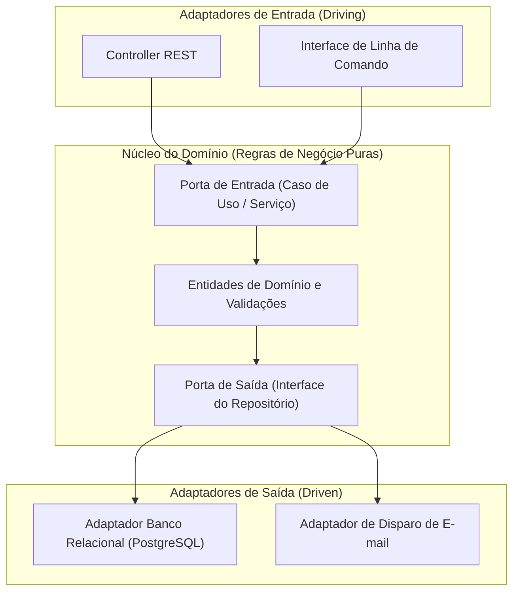

#### 4. Arquitetura de Microserviços
- **Definição:** Estilo arquitetural que estrutura a aplicação como uma coleção de serviços autônomos, de baixa granularidade, fracamente acoplados e implantáveis de forma independente (*independent deployability*).
- **Princípio:** Cada microsserviço é dono de seu próprio banco de dados (*Database per Service*), impedindo acoplamento em nível de esquema relacional.
- **Trade-offs (Vantagens versus Complexidade):**
  - *Vantagens:* Escalabilidade seletiva (escalar apenas o serviço sob carga), autonomia de equipes e resiliência a falhas parciais.
  - *Desafios:* Complexidade operacional de orquestração de rede, consistência eventual de dados, rastreamento distribuído de requisições e latência de chamadas entre processos.

---

## Arquitetura Model-View-Controller Clássica no Smalltalk-80

### Gênese no Xerox PARC e Desafios de Interfaces Gráficas

No final da década de 1970, no prestigiado laboratório **Xerox PARC** (*Palo Alto Research Center*), cientistas como Alan Kay, Adele Goldberg e Dan Ingalls revolucionaram a computação ao desenvolver as primeiras interfaces gráficas do usuário (GUI), o mouse como periférico de apontamento e a linguagem **Smalltalk-80**.

Antes dessa inovação, os sistemas operavam em modo texto sequencial e processamento em lotes (*batch*). Nos primeiros ambientes gráficos com mapas de bits (*bitmaps*), comandos como `Pen` permitiam desenhar linhas diretamente no buffer de exibição (*framebuffer*). Contudo, em uma interface com múltiplas janelas sobrepostas (*Browsers*, *Workspaces*, *Transcripts*), o desenho descontrolado de um programa corrompia os pixels das janelas adjacentes.

Steve Burbeck, em publicação técnica clássica sobre o Smalltalk-80, explicou que o padrão **Model-View-Controller (MVC)** foi projetado para permitir que múltiplos programas compartilhassem a mesma tela, o mesmo teclado e o mesmo mouse de forma cooperativa e modular.

### A Tríade Model-View-Controller e seus Vínculos

O padrão divide o processamento interativo em três tipos de classes de objetos com responsabilidades bem demarcadas:

```mermaid
classDiagram
  class Model {
    +dependents : Collection
    +addDependent(View aView)
    +removeDependent(View aView)
    +changed()
    +changed(Object aspect)
    +getState()
  }
  class View {
    +model : Model
    +controller : Controller
    +superView : View
    +subViews : Collection
    +display()
    +update(Model aModel, Object aspect)
  }
  class Controller {
    +model : Model
    +view : View
    +controlLoop()
    +controlActivity()
  }

  View "1" o-- "1" Controller : Ligação Bilateral Rígida (1:1)
  Controller "1" o-- "1" View : Ligação Bilateral Rígida (1:1)
  View --> "1" Model : Consulta Estado Diretamente (getState)
  Controller --> "1" Model : Modifica Estado Diretamente (mutators)
  Model ..> View : Notificação Indireta Reativa (Observer: update)
```

1. **Model (Modelo):** Representa o domínio do problema e a consistência das regras de negócio. O modelo desconhece aspectos visuais, pixels ou coordenadas de tela. Ele responde a consultas de estado (enviadas pela View) e a solicitações de alteração de dados (enviadas pelo Controller).
2. **View (Visão):** Gerencia a apresentação gráfica de uma área delimitada da tela. A visão consulta as variáveis de estado do modelo para projetar linhas, textos e formas geométricas. Ela mantém a hierarquia de janelas (*TopView* e *SubViews*).
3. **Controller (Controlador):** Captura e interpreta os eventos físicos disparados pelo usuário por meio do mouse e do teclado. O controlador converte estímulos de hardware em ordens semânticas para o modelo (ex.: "salvar registro") ou para a visão (ex.: "rolar texto").

A arquitetura estabelece dois canais de comunicação com acoplamentos distintos:
- **Canal Direto (Acoplamento Forte/Síncrono):** A `View` e o `Controller` mantêm referências diretas e bilaterais (1:1). O controlador manipula a visão e o modelo de forma direta. A visão consulta o modelo de forma direta.
- **Canal Indireto (Acoplamento Fraco/Reativo):** O `Model` **não** mantém referências nominais diretas às visões ou controladores. Ele se comunica unicamente por meio de uma lista abstrata de observadores (Padrão *Observer*), disparando notificações de alteração.

### Modelos Passivos versus Modelos Ativos

Steve Burbeck classifica os modelos do Smalltalk-80 em duas categorias fundamentais quanto ao comportamento de atualização:

- **Modelo Passivo:** É aquele cujo estado interno é alterado exclusivamente sob comando do controlador pertencente à sua própria tríade MVC. O exemplo canônico é um editor de texto simples baseado na classe `String`. Quando o usuário digita uma letra, o controlador captura a tecla e altera a string. Como o controlador é o único agente causador da alteração, ele próprio pode ordenar a repintura da visão. O modelo não precisa disparar notificações.
- **Modelo Ativo:** É aquele cujo estado é modificado por processos de segundo plano (*background threads*), dispositivos de telemetria ou múltiplos controladores concorrentes. O exemplo canônico no Smalltalk é o `SystemTranscript` (console do sistema operacional). Qualquer rotina no ambiente pode enviar uma mensagem `Transcript show: 'Log'`. Como a visão não tem como prever em qual instante uma thread externa alterará os dados, a responsabilidade de notificação recai sobre o próprio modelo ativo, que dispara obrigatoriamente a mensagem de mudança para todos os seus dependentes registrados.

### O Mecanismo de Dependências: Protocolo changed e update

No Smalltalk-80 v2.0, todo objeto herdava de `Object` a capacidade de ser observado por meio de uma variável de classe global chamada `DependentFields` (um `IdentityDictionary`). Como essa tabela hash global gerava gargalos de contenção e vazamentos de memória, o Smalltalk-80 v2.5 introduziu a classe abstrata otimizada `Model`, que gerencia uma coleção de dependentes local em sua própria variável de instância.

O protocolo de sincronização reativa opera da seguinte forma:

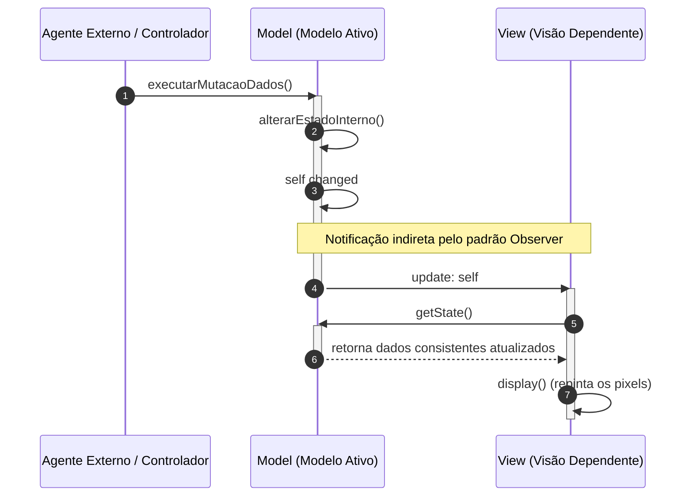

1. O estado do modelo sofre mutação.
2. O modelo invoca internamente `self changed` (ou `self changed: #aspectoParametro`).
3. O método `changed` itera sobre a coleção de dependentes e dispara `update: aModel` para cada visão inscrita.
4. A visão recebe a notificação, invoca métodos de consulta no modelo (`getState()`) para ler o novo estado e redesenha sua porção de tela através da rotina `display()`.

### Estruturas de Apresentação e Controle Cooperativo

A infraestrutura gráfica do Smalltalk-80 organiza janelas e periféricos por meio de componentes especializados:

- **TopView e SubViews:** Estrutura em árvore baseada no padrão *Composite*. A `TopView` gerencia a janela principal, a barra de título e as bordas. As `SubViews` representam áreas internas (painéis de texto, botões de ação e listas de seleção).
- **WindowingTransformation:** Classe que realiza o cálculo matricial de mapeamento geométrico entre as coordenadas de desenho relativas da janela (*Window Coordinates*) e as coordenadas físicas absolutas da tela em pixels (*Screen Viewport*).
- **ControlManager e ScheduledControllers:** Como o Smalltalk-80 operava com modelo cooperativo monothread para a interface gráfica, o `ControlManager` mantinha uma lista hierárquica (`ScheduledControllers`). O controlador da janela que continha o cursor do mouse assumia o controle do processamento de entrada e o cedia cooperativamente para as subvisões correspondentes.
- **Mouse de Três Botões:**
  - *Red Button (Botão Esquerdo):* Destinado à seleção de objetos, movimentação de cursores e desenho de texto.
  - *Yellow Button (Botão Central):* Acionava menus de comandos locais específicos do contexto da visão ativa (*View-specific context menu*).
  - *Blue Button (Botão Direito):* Acionava o menu de controle de janelas gerenciado pela `TopView` (mover, redimensionar, fechar, colapsar).

---

## Modelagem de Interação: Sequência e Comunicação

### Arquitetura Boundary-Control-Entity

Na transição dos requisitos textuais para a modelagem dinâmica, a engenharia de software adota o padrão de estereótipos **BCE** (*Boundary-Control-Entity*), originado do método OOSE de Ivar Jacobson:

```mermaid
flowchart LR
  Ator((Ator Externo)) <--> Boundary["Boundary <<boundary>>:<br/>Interface de Comunicação"]
  Boundary <--> Control["Control <<control>>:<br/>Orquestrador de Regra de Negócio"]
  Control <--> Entity["Entity <<entity>>:<br/>Dados de Domínio e Persistência"]
```

1. **Boundary (Fronteira):** Objetos responsáveis pela mediação entre o ambiente externo (usuários humanos ou sistemas integrados) e o interior do software. Encapsulam formulários, telas, endpoints HTTP, adaptadores de mensageria e consoles.
2. **Control (Controle / Aplicação):** Objetos que coordenam o fluxo de execução das regras de negócio e controlam as transações. Eles não retêm estado corporativo de longo prazo; orquestram a obtenção de dados de entidades, acionam cálculos e comandam persistências.
3. **Entity (Entidade):** Objetos do domínio que retêm o estado do negócio e as regras operacionais intrínsecas (ex.: `Cliente`, `Pedido`, `ContaBancaria`). Geralmente possuem mapeamento direto em tabelas de bancos de dados.

### Diagrama de Comunicação: Vínculos Estruturais e Mensagens

O **Diagrama de Comunicação** (antigamente chamado de Diagrama de Colaboração na UML 1.x) é um modelo de interação que enfatiza a **organização estrutural** dos objetos participantes e os caminhos de ligação entre eles.

- **Características:** As classes ou instâncias são representadas por retângulos interligados por linhas sólidas (vínculos). O tráfego de mensagens é indicado por setas rotuladas com uma numeração hierárquica sequencial decimal (ex.: `1.`, `1.1.`, `1.2.`, `2.`), expressando a ordem das invocações.
- **Vantagem:** Excelente para visualizar o acoplamento estrutural em nível de código (quais classes precisam manter referências para outras).
- **Desvantagem:** Torna-se complexo e de difícil interpretação visual quando o fluxo envolve muitas mensagens ou ramificações condicionais extensas.

```mermaid
flowchart LR
  A["c : Cliente"] ---|"1: solicitarEmprestimo(livroId)"| B["b : LivroBoundary"]
  B ---|"1.1: processarEmprestimo(livroId)"| C["ctrl : EmprestimoControl"]
  C ---|"1.1.1: verificarDisponibilidade()"| D["l : LivroEntity"]
  C ---|"1.1.2: criarRegistro(aluno, livro)"| E["e : EmprestimoEntity"]
```

### Diagrama de Sequência: Linhas de Vida e Ordenação Temporal

O **Diagrama de Sequência** é o modelo de interação que enfatiza a **ordenação temporal** das mensagens trocadas entre os participantes durante a execução de um cenário específico de caso de uso.

- **Eixo Horizontal:** Representa os objetos e subsistemas participantes da interação.
- **Eixo Vertical:** Representa a passagem contínua e linear do tempo, progredindo de cima para baixo.
- **Linha de Vida (*Lifeline*):** Linha vertical tracejada que desce a partir da caixa do objeto, representando a existência da entidade durante o cenário.
- **Foco de Controle / Barra de Ativação:** Retângulo vertical sobreposto à linha de vida que expressa o período exato em que a entidade está executando uma operação ou aguardando resposta de terceiros.

```mermaid
sequenceDiagram
  autonumber
  actor Aluno as Aluno
  participant Tela as EmprestimoBoundary
  participant Ctrl as EmprestimoControl
  participant Livro as LivroEntity
  participant Emp as EmprestimoEntity

  Aluno->>Tela: selecionarLivro(id)
  activate Tela
  Tela->>Ctrl: validarSolicitacao(alunoId, id)
  activate Ctrl
  Ctrl->>Livro: isDisponivel()
  activate Livro
  Livro-->>Ctrl: true
  deactivate Livro
  Ctrl->>Emp: criarRegistro(alunoId, id)
  activate Emp
  Emp-->>Ctrl: confirmacaoRegistro
  deactivate Emp
  Ctrl-->>Tela: sucessoEmprestimo
  deactivate Ctrl
  Tela-->>Aluno: emitirComprovante
  deactivate Tela
```

### Elementos Avançados de Sequência

Cenários industriais complexos exigem notações que representem condições, instanciações e liberações de recursos:

- **Criação Dinâmica de Objetos:** Representada por uma mensagem com seta aberta direcionada à própria caixa do objeto criado (e não à sua linha de vida intermediária), denotando invocação do construtor (`new`).
- **Destruição Explícita de Objetos:** Marcada com um grande símbolo "X" sobre a linha de vida do objeto, indicando o encerramento do seu ciclo no cenário e a liberação de recursos correspondentes.
- **Mensagens Síncronas versus Assíncronas:**
  - *Síncrona:* Seta com ponta preenchida sólida (`->>`). O chamador bloqueia a execução até que o destinatário termine o processamento e devolva o controle.
  - *Assíncrona:* Seta aberta (`-)`). O chamador despacha a mensagem para processamento em segundo plano e continua executando sem aguardar resposta.
- **Mensagem de Retorno:** Linha tracejada com seta aberta (`-->>`), indicando a devolução explícita de um dado computado ao chamador.
- **Fragmentos Combinados (Operadores de Controle):**
  - `alt` (*Alternative*): Representa desvios condicionais mutualmente exclusivos (equivalente ao bloco `if-else`).
  - `opt` (*Optional*): Representa fluxo executado unicamente se uma condição for verdadeira (equivalente a um `if` sem `else`).
  - `loop`: Representa repetições e laços iterativos de processamento (`for`/`while`).
  - `par` (*Parallel*): Representa o disparo simultâneo de execuções concorrentes em múltiplas threads.

---

## Modelagem Comportamental Reativa: Diagramas de Máquinas de Estados

### Fundamentação Matemática das Máquinas de Estados Finitos

O Diagrama de Máquinas de Estados modela o ciclo de vida dinâmico e reativo de uma entidade computacional individual quando submetida a estímulos externos e eventos temporais.

Na ciência da computação formal, a máquina de estados finitos subjacente a esse diagrama é descrita pela quíntupla matemática:

```math
M = (S, \Sigma, \delta, s_0, F)
```

Onde:
- $`S`$: Conjunto finito e discreto de estados possíveis em que a entidade pode se encontrar.
- $`\Sigma`$: Alfabeto finito de eventos de entrada aceitos pelo sistema.
- $`\delta: S \times \Sigma \to S`$: Função de transição que mapeia o par (estado atual, evento) no próximo estado válido.
- $`s_0 \in S`$: Estado inicial de instanciação da entidade.
- $`F \subseteq S`$: Conjunto de estados terminais ou finais que marcam o encerramento da existência da entidade.

### A Quádrupla e Quíntupla de Transição: Estados, Eventos, Guardas e Ações

A dinâmica do diagrama obedece à especificação formal de transição expressa pela regra:

```math
T = (E_{\text{origem}}, \text{Evento}, [\text{Guarda}], /\text{Ação}, E_{\text{destino}})
```

- **Estado de Origem ($`E_{\text{origem}}`$):** O estado estável no qual o objeto reside aguardando um estímulo. Graficamente representado por um retângulo com cantos arredondados.
- **Evento:** O estímulo externo ou temporizador que desperta a avaliação da transição (ex.: `receberPagamento()`, `expirarTempo()`).
- **Condição de Guarda ($`[\text{Guarda}]`$):** Expressão booleana entre colchetes. A transição só se consolida se a guarda avaliar como verdadeira no instante exato da recepção do evento. Se a guarda for falsa, o evento é descartado e o objeto permanece no estado de origem.
- **Ação ($`/\text{Ação}`$):** Efeito colateral computacional atômico e instantâneo executado durante o salto de estado (ex.: `/ emitirRecibo()`, `/ liberarEstoque()`).
- **Estado de Destino ($`E_{\text{destino}}`$):** O novo estado estável assumido pelo objeto.

```mermaid
stateDiagram-v2
  [*] --> Criado : Instanciação
  Criado --> EmAnalise : submeterParaAprovacao()
  EmAnalise --> Aprovado : validarDocumentos() [limiteCredito >= valorTotal] / notificarCliente()
  EmAnalise --> Rejeitado : validarDocumentos() [limiteCredito < valorTotal] / registrarMotivo()
  Aprovado --> Cancelado : cancelar() / estornarReserva()
  Aprovado --> Faturado : emitirNotaFiscal()
  Faturado --> [*]
  Rejeitado --> [*]
  Cancelado --> [*]
```

### Ciclo de Vida e Destruição de Objetos

No diagrama de estados, a destruição definitiva ou encerramento funcional da entidade é modelada pela transição para o **Estado Final** (círculo preto envolto por uma borda circular concêntrica). Uma vez atingido esse vértice terminal, o objeto não aceita mais nenhum evento de entrada e sua linha de ciclo é descarregada da memória ou marcada com status de conclusão no banco de dados.

### Conexão dos Estados com Metodologias Ágeis, DoD e BDD

Em equipes de alta maturidade técnica, o Diagrama de Estados é utilizado para subsidiar entregas ágeis:
- **Critério de Aceite e DoD (*Definition of Done*):** Uma funcionalidade associada a um estado só é considerada "Pronta" (*Done*) se a integridade de todas as transições de entrada e saída daquele estado estiver coberta por testes automatizados.
- **Desenvolvimento Orientado a Comportamento (BDD):** Os estados fornecem a base para a criação de cenários Gherkin (estruturados em `Dado que`, `Quando`, `Então`). Por exemplo: *"Dado que um pedido está no estado Aprovado, Quando receber o evento cancelar(), Então o sistema deve transicionar para Cancelado e estornar o estoque"*.
- **Cobertura de Testes de Caixa-Preta:** Permite derivar matrizes completas de testes de transição de estado, testando tanto os caminhos válidos quanto rejeições de chamadas inválidas (ex.: verificar que invocar `emitirNotaFiscal()` em um pedido `Rejeitado` lança uma exceção de negócio).

---

## Modelagem de Processos de Negócio: Diagramas de Atividades

### Conceito e Semântica de Fluxo Contínuo

O **Diagrama de Atividades** é um modelo comportamental da UML que captura a lógica sequencial e concorrente de procedimentos computacionais, fluxos de trabalho empresariais (*workflows*) ou a execução interna de casos de uso complexos.

Diferente do diagrama de estados (que é orientado a estímulos externos assíncronos), o diagrama de atividades baseia-se na semântica de **redes de Petri e fluxo de dados contínuo**. Uma ação é iniciada imediatamente após o término da ação anterior, progredindo autonomamente ao longo de nós de controle até atingir um nó terminal.

### Elementos Notacionais: Ações, Decisões, Mesclagens e Concorrência

```mermaid
flowchart TD
  Inicio(["Início"]) --> Acao1["Ação 1: Processar Solicitação"]
  Acao1 --> Decisao{"Verificação de Limite"}
  Decisao -->|"Limite Aprovado"| Fork[["Barra de Bifurcação (Fork)"]]
  Decisao -->|"Limite Rejeitado"| AcaoRejeicao["Ação: Enviar Notificação de Rejeição"]
  
  Fork --> Acao2["Ação Concorrente: Reservar Estoque"]
  Fork --> Acao3["Ação Concorrente: Cobrar Cartão"]

  Acao2 --> Join[["Barra de Junção (Join)"]]
  Acao3 --> Join

  Join --> Fim(["Fim"])
  AcaoRejeicao --> Fim
```

1. **Nó Inicial:** Ponto de partida do fluxo de atividades.
2. **Ação:** Unidade de processamento atômica e não interrompível (ex.: `Cobrar Cartão`, `Calcular Imposto`).
3. **Nó de Decisão / Mesclagem (*Decision / Merge*):** Representado por um losango:
   - *Decisão:* Recebe um fluxo de entrada e avalia expressões de guarda mutualmente exclusivas para direcionar o fluxo para caminhos alternativos.
   - *Mesclagem:* Reúne múltiplos fluxos alternativos que não demandam sincronização temporal em um único caminho subsequente.
4. **Bifurcação e Junção Concorrente (*Fork / Join*):** Representado por uma barra sólida preenchida horizontal ou vertical:
   - *Fork (Bifurcação):* Divide um fluxo sequencial único em dois ou mais caminhos paralelos ou concorrentes (executados simultaneamente ou em qualquer ordem).
   - *Join (Junção / Sincronização):* Reúne caminhos paralelos abertos por um *Fork*. O fluxo de saída só é liberado quando **todas** as ações concorrentes anteriores tiverem concluído suas respectivas execuções.
5. **Nó de Término de Fluxo e Nó Final:** Círculo com uma cruz no centro encerra uma ramificação concorrente específica; o círculo duplo concêntrico (*Final Activity*) encerra toda a atividade do processo.

### Distinção Arquitetural Definitiva: Estado versus Atividade

A tabela a seguir consolida a distinção metodológica e de engenharia entre os dois diagramas comportamentais da UML:

| Critério de Comparação | Diagrama de Máquinas de Estados | Diagrama de Atividades |
| :--- | :--- | :--- |
| **Pergunta Central Respondida** | "Em qual situação o objeto está e a quais eventos ele reage?" | "Quais passos e ações o software executa em sequência ou em paralelo?" |
| **Foco Central de Modelagem** | Entidade de domínio individual reativa (ex.: `Pedido`, `Chamado`). | Processo de negócio, algoritmo ou fluxo de trabalho transversal. |
| **Mecanismo de Transição** | Reativo e assíncrono: depende da chegada de um evento externo. | Contínuo e autônomo: a conclusão de uma ação dispara a próxima. |
| **Representação Semântica** | Condições contínuas e estáveis mantidas pela entidade. | Ações executáveis computacionais e transformações operacionais. |
| **Uso Canônico na Indústria** | Máquinas de ciclo de vida de pedidos, conexões de socket, regras BDD. | Modelagem do fluxo do caso de uso, esteiras de CI/CD, aprovação financeira. |

---

## Estudo de Caso Integrador: Plataforma de Food Delivery

### Visão do Negócio Multilateral

Para consolidar os conceitos trabalhados nas aulas da disciplina, o estudo prático integra os modelos em uma **Plataforma Digital de Food Delivery**. O domínio caracteriza-se como um mercado multifacetado (*multilateral marketplace*) sustentado pela colaboração de três papéis essenciais:

```mermaid
flowchart TD
  subgraph Marketplace["Plataforma Central de Delivery"]
    App["Core de Orquestração, Pagamentos e Catálogo"]
  end

  C["Cliente (Consumidor Final)"] <-->|"Busca pratos, realiza pedidos e efetua pagamentos"| App
  R["Restaurante (Parceiro Comercial)"] <-->|"Mantém cardápio, aceita comandas e despacha itens"| App
  A["Administrador (Operador de Governança)"] <-->|"Modera avaliações, audita transações e extrai relatórios"| App
```

1. **Cliente:** Busca conveniência, catálogo transparente, checkout seguro com confirmação imediata e rastreamento de entrega.
2. **Restaurante:** Busca maximizar o volume de vendas, sincronizar a produção da cozinha com o tempo dos entregadores e manter controle de cardápio.
3. **Administrador:** Busca garantir a conformidade dos parceiros, prevenir fraudes, moderar avaliações públicas ofensivas e monitorar a disponibilidade operacional.

### Mapeamento MoSCoW do Ecossistema

A análise de escopo do sistema de delivery resultou na seguinte distribuição técnica priorizada para a primeira versão de lançamento (MVP):

| Categoria | Funcionalidades Alocadas | Justificativa de Engenharia e Negócio |
| :--- | :--- | :--- |
| **Must Have (M)** | Autenticação básica de atores; catálogo de restaurantes e pratos; carrinho de compras; processamento de pagamento via cartão/Pix; transição de status do pedido na cozinha. | Constitui a espinha dorsal indispensável. Sem essas rotinas, a plataforma é incapaz de concretizar uma única transação comercial. |
| **Should Have (S)** | Notificações de mudança de status (*push notifications*); rastreamento de entrega; moderação de avaliações pelo administrador; emissão de relatórios de comissões. | Requisitos de alto valor agregado para retenção e gestão contábil. Em caso de atraso na release, o cliente pode consultar o status atualizando a tela manualmente. |
| **Could Have (C)** | Chat em tempo real entre cliente e restaurante; programa gamificado de pontos e fidelidade; cálculo dinâmico de cupons promocionais. | Recursos que agregam valor e comodidade, mas cuja ausência não inviabiliza a operação básica de compras na primeira versão. |
| **Won't Have (W)** | Entrega com telemetria preditiva baseada em visão computacional; roteirização com otimização dinâmica por IA de múltiplos pontos de entrega. | Complexidade operacional e matemática desproporcional para o lançamento inicial; adiado para ciclos futuros. |

### Modelagem Integrada de Casos de Uso, Classes, Estados e Atividades

#### 1. Diagrama de Casos de Uso do Ecossistema de Delivery

```mermaid
flowchart LR
  subgraph Clientes[" "]
    Cliente((Cliente))
  end

  subgraph FronteiraDelivery["Sistema Central de Food Delivery"]
    UC1(["Consultar Cardápio e Restaurantes"])
    UC2(["Fazer Pedido de Comida"])
    UC3(["Processar Pagamento Digital"])
    UC4(["Acompanhar Status da Entrega"])
    UC5(["Atualizar Status da Produção"])
    UC6(["Gerenciar Catálogo de Pratos"])
    UC7(["Moderar Conteúdo de Avaliações"])
    UC8(["Autenticar Credenciais"])
  end

  subgraph Gestores[" "]
    Restaurante((Restaurante))
    Admin((Administrador))
    GatewayPagamento((Gateway Bancário))
  end

  Cliente --> UC1
  Cliente --> UC2
  Cliente --> UC4

  Restaurante --> UC5
  Restaurante --> UC6

  Admin --> UC7

  UC2 -.->|"<<include>>"| UC3
  UC2 -.->|"<<include>>"| UC8
  UC6 -.->|"<<include>>"| UC8
  UC7 -.->|"<<include>>"| UC8
  UC3 --- GatewayPagamento
```

#### 2. Diagrama de Classes do Domínio de Delivery

```mermaid
classDiagram
  class Usuario {
    -String idIdentificador
    -String nomeCompleto
    -String credencialLogin
    -String senhaHash
    +autenticar(String senhaInformada) boolean
  }

  class Cliente {
    -String enderecoEntregaPrincipal
    -String telefoneContato
    +adicionarAoCarrinho(Prato prato, int quantidade) void
    +submeterPedido() Pedido
  }

  class Restaurante {
    -String registroCnpj
    -String razaoSocial
    -boolean abertoParaPedidos
    +atualizarStatusPedido(Pedido pedido, StatusPedido status) void
  }

  class Pedido {
    -String codigoPedido
    -LocalDateTime dataHoraCriacao
    -StatusPedido statusAtual
    +calcularValorTotal() double
    +transicionarStatus(StatusPedido novoStatus) void
  }

  class ItemPedido {
    -int quantidadeSolicitada
    -double precoCobrado
    +calcularSubtotalItem() double
  }

  class Prato {
    -String nomePrato
    -String descricaoIngredientes
    -double precoTabela
    -boolean ativo
  }

  Usuario <|-- Cliente : herança
  Usuario <|-- Restaurante : herança
  Restaurante "1" *-- "0..*" Prato : Composição (Cardápio)
  Cliente "1" -- "0..*" Pedido : realiza
  Restaurante "1" -- "0..*" Pedido : recebe
  Pedido "1" *-- "1..*" ItemPedido : Composição
  ItemPedido "0..*" --> "1" Prato : referencia
```

#### 3. Diagrama de Estados: Ciclo de Vida da Entidade Pedido

```mermaid
stateDiagram-v2
  [*] --> Criado : checkoutIniciado()
  Criado --> Pago : pagamentoAprovado() / emitirComanda()
  Criado --> Cancelado : pagamentoRejeitado() / notificarCliente()
  
  Pago --> EmPreparo : aceitarPedidoRestaurante()
  EmPreparo --> ProntoParaEntrega : finalizarCozinha()
  
  ProntoParaEntrega --> EmTransito : despacharParaEntregador()
  EmTransito --> Entregue : confirmarRecebimentoCliente()
  
  Pago --> Cancelado : cancelarPorFaltaInsumo() / estornarCartao()
  
  Entregue --> [*]
  Cancelado --> [*]
```

#### 4. Diagrama de Atividades: Processo de Realização de Compra pelo Cliente

```mermaid
flowchart TD
  Inicio(["Início"]) --> Buscar["Consultar Restaurantes e Itens"]
  Buscar --> MontarCarrinho["Adicionar Pratos ao Carrinho"]
  MontarCarrinho --> Checkout["Revisar Itens e Solicitar Checkout"]
  
  Checkout --> ValidarDisponibilidade{"Itens Disponíveis<br/>na Cozinha?"}
  ValidarDisponibilidade -->|"Não"| NotificarIndisponibilidade["Notificar Item Esgotado"]
  NotificarIndisponibilidade --> MontarCarrinho

  ValidarDisponibilidade -->|"Sim"| Cobranca["Disparar Cobrança no Gateway"]
  Cobranca --> ChecarPagamento{"Pagamento<br/>Autorizado?"}
  
  ChecarPagamento -->|"Não"| RejeicaoPagamento["Exibir Falha de Cobrança"]
  RejeicaoPagamento --> OpcaoPagamento{"Tentar Outro<br/>Cartão?"}
  OpcaoPagamento -->|"Sim"| Cobranca
  OpcaoPagamento -->|"Não"| CancelarFluxo["Abortar Compra"] --> FimCancelado(["Fim"])

  ChecarPagamento -->|"Sim"| Sincronizacao[["Barra de Bifurcação (Fork)"]]
  
  Sincronizacao --> ImprimirComanda["Emitir Comanda no Restaurante"]
  Sincronizacao --> EnviarRecibo["Enviar Recibo Digital ao Cliente"]

  ImprimirComanda --> Juncao[["Barra de Junção (Join)"]]
  EnviarRecibo --> Juncao

  Juncao --> Monitoramento["Disponibilizar Rastreamento do Pedido"]
  Monitoramento --> FimSucesso(["Fim"])
```

---

## Questões Dissertativas e Práticas para Fixação

Com o intuito de apoiar os estudos para as avaliações individuais (**AV1** e **AV2**) e fundamentar os relatórios do **Projeto Integrador**, as questões a seguir sintetizam cenários de análise e projeto:

### Questão 1: Transição de Análise para Projeto e Filosofia de Engenharia
Em reunião de alinhamento com a diretoria de um hospital particular, o superintendente administrativo afirma: *"Precisamos de um sistema novo para gerenciar as internações, pois o atual é muito confuso. Quero que a equipe comece a programar as telas nesta semana para termos resultados rápidos."*  
- **Análise Requerida:** À luz dos conceitos de Engenharia de Software abordados pelo Prof. Wesley Soares (o antipadrão "pastelaria" e o paradoxo entre análise e projeto), justifique por que a equipe técnica não deve iniciar a codificação de telas imediatamente. Explique a diferença de papéis entre a Análise de Software ("fazer a coisa certa") e o Projeto de Software ("fazer certo a coisa"), indicando os riscos operacionais caso essa separação seja ignorada.

### Questão 2: Elicitação Ativa e Desconstrução de Ambiguidade
Um analista de sistemas recém-formado entrevistou o gerente de uma distribuidora logística e obteve a seguinte declaração textual de requisito:  
*"O módulo de rastreamento de cargas precisa ser muito rápido e intuitivo para que nossos motoristas façam o apontamento de entregas sem falhas na estrada."*  
- **Análise Requerida:** Explique por que essa declaração não atende aos padrões de especificação técnica da Engenharia de Requisitos. Em seguida, decomponha e refatore a fala do gerente em pelo menos um Requisito Funcional (RF) e dois Requisitos Não Funcionais (RNF) verificáveis e testáveis, cobrindo aspectos de desempenho e disponibilidade técnica em condições de conectividade intermitente.

### Questão 3: Priorização de Escopo com o Método MoSCoW
Uma equipe de três estudantes da UniFEF está desenvolvendo o Projeto Integrador de um sistema de gestão de prontuários eletrônicos para clínicas médicas. A equipe possui um prazo de 8 semanas para a entrega do primeiro incremento utilizável (MVP). Durante o levantamento, surgiram os seguintes requisitos:
1. Agendamento de consultas com controle de horários dos médicos.
2. Reconhecimento de voz para transcrição automática de diagnósticos clínicos.
3. Prescrição de medicamentos integrada com base externa de farmácias.
4. Histórico clínico do paciente com assinatura digital de conformidade com o CFM.
5. Sistema preditivo baseado em inteligência artificial para sugerir probabilidade de cancelamento de consulta.
6. Notificação do paciente via SMS ou aplicativo de mensagens 24 horas antes da consulta.
- **Análise Requerida:** Classifique cada um dos 6 requisitos nas quatro categorias do método MoSCoW (*Must*, *Should*, *Could*, *Won't*), fundamentando a decisão de engenharia para cada alocação e justificando como essa priorização previne a corrupção de escopo (*scope creep*).

### Questão 4: Semântica de Relacionamentos em Diagramas de Casos de Uso
Em um diagrama de casos de uso para um sistema de gestão bancária, um aluno realizou a seguinte modelagem: ligou o caso de uso base `Realizar Pagamento de Título` ao caso de uso `Validar Saldo da Conta` por meio de um conector `<<extend>>`. Além disso, ligou o caso de uso `Emitir Comprovante de Pagamento` ao caso de uso base através de um conector `<<include>>`.  
- **Análise Requerida:** Avalie criticamente essa modelagem. Identifique os erros semânticos conceituais cometidos quanto à obrigatoriedade e condicionalidade dos relacionamentos. Corrija o modelo explicando como os conectores `<<include>>` e `<<extend>>` devem ser formalmente aplicados nesse cenário de negócio.

### Questão 5: Estrutura de Classes, Acoplamento e Composição
Explique com detalhes técnicos a distinção entre uma **Associação por Agregação** e uma **Associação por Composição** no Diagrama de Classes da UML. Ilustre sua resposta desenhando a sintaxe textual dos conectores e apresente um exemplo em código Java demonstrando como o desenvolvedor implementa a destruição de ciclo de vida e a proteção de estado na Composição em comparação com a Agregação.

### Questão 6: A Tríade MVC no Smalltalk-80 e o Mecanismo Reativo
Na arquitetura Model-View-Controller clássica implementada no Smalltalk-80 (conforme documentado por Steve Burbeck), o Model não conhece as classes concretas das suas Views, comunicando-se por meio do protocolo `changed` e `update:`.  
- **Análise Requerida:** Explique qual padrão de projeto do GoF fundamenta essa mecânica de sincronização. Diferencie um **Modelo Passivo** de um **Modelo Ativo**, explicando por que modelos ativos (como o `SystemTranscript`) demandam obrigatoriamente a invocação de `self changed` em sua lógica interna de mutação de dados.

### Questão 7: Fronteiras Arquiteturais na Arquitetura Hexagonal
Explique os princípios fundamentais da Arquitetura Hexagonal (*Ports and Adapters*), demonstrando como ela protege as regras de negócio de um sistema contra mudanças em tecnologias de banco de dados, interfaces web e bibliotecas de terceiros. Diferencie formalmente **Portas Condutoras (*Driving Ports*)** de **Portas Conduzidas (*Driven Ports*)** e detalhe o papel desempenhado pelos Adaptadores (*Adapters*) nas bordas da aplicação.

### Questão 8: Comparativo Arquitetural: Diagrama de Estados versus Diagrama de Atividades
Um desenvolvedor júnior da equipe modelou o fluxo de um processo de compras utilizando o Diagrama de Máquinas de Estados, criando estados como `Digitar Senha`, `Consultar Banco` e `Exibir Tela de Sucesso`.  
- **Análise Requerida:** Explique por que essa abordagem constitui um erro clássico de modelagem comportamental. Estabeleça a distinção conceitual e semântica definitiva entre o Diagrama de Estados (centrado no ciclo de vida de uma entidade reativa a eventos) e o Diagrama de Atividades (centrado no fluxo procedural de execução de um processo), orientando o desenvolvedor sobre como corrigir o artefato.

---

## Fontes e Metadados

- Turma no Classroom: Engenharia de Software 2 - 2026/02
- Itens processados: 0 materiais, 6 tarefas, 11 avisos
- Gerado em: 13/11/2026, 15:15:41 (BRT) via classroom-sync
