# Guia Completo de Estudos: Engenharia de Software II

**Instituição:** Centro Universitário de Santa Fé do Sul (UniFEF)  
**Curso:** Bacharelado em Sistemas de Informação (4º Semestre)  
**Docente:** Prof. Ms. Wesley Soares de Souza  
**Componente Curricular:** Engenharia de Software II  

---

## Sumário

- [1. Apresentação da Disciplina, Governança e Critérios de Avaliação](#1-apresentação-da-disciplina-governança-e-critérios-de-avaliação)
  - [1.1 Corpo Docente e Filosofia de Ensino](#11-corpo-docente-e-filosofia-de-ensino)
  - [1.2 Estrutura do Projeto Integrador da Disciplina](#12-estrutura-do-projeto-integrador-da-disciplina)
  - [1.3 Critérios e Fórmulas de Avaliação](#13-critérios-e-fórmulas-de-avaliação)
  - [1.4 Bibliografia de Referência](#14-bibliografia-de-referência)
- [2. O Ciclo de Vida do Projeto de Software](#2-o-ciclo-de-vida-do-projeto-de-software)
  - [2.1 A Premissa Fundamental da Engenharia](#21-a-premissa-fundamental-da-engenharia)
  - [2.2 O Paradoxo entre Análise e Projeto](#22-o-paradoxo-entre-análise-e-projeto)
  - [2.3 As Dez Fases Estruturais do Ciclo de Vida](#23-as-dez-fases-estruturais-do-ciclo-de-vida)
- [3. Fundamentos de Projeto Orientado a Objetos e Pilares de Design](#3-fundamentos-de-projeto-orientado-a-objetos-e-pilares-de-design)
  - [3.1 Transição da Análise para o Projeto](#31-transição-da-análise-para-o-projeto)
  - [3.2 Abstração e Encapsulamento Rigoroso](#32-abstração-e-encapsulamento-rigoroso)
  - [3.3 Herança e Polimorfismo Dinâmico](#33-herança-e-polimorfismo-dinâmico)
  - [3.4 Acoplamento Fraco e Alta Coesão](#34-acoplamento-fraco-e-alta-coesão)
  - [3.5 Introdução aos Princípios SOLID e Padrões GoF](#35-introdução-aos-princípios-solid-e-padrões-gof)
- [4. Engenharia e Elicitação de Requisitos](#4-engenharia-e-elicitação-de-requisitos)
  - [4.1 Levantamento versus Elicitação Ativa](#41-levantamento-versus-elicitação-ativa)
  - [4.2 A Cadeia Causal da Elicitação](#42-a-cadeia-causal-da-elicitação)
  - [4.3 As Seis Perguntas Cardinais](#43-as-seis-perguntas-cardinais)
  - [4.4 Desconstrução de Ambiguidade e Formalização de RNF](#44-desconstrução-de-ambiguidade-e-formalização-de-rnf)
  - [4.5 Técnicas Tradicionais de Coleta e Elicitação](#45-técnicas-tradicionais-de-coleta-e-elicitação)
- [5. Priorização de Requisitos com o Método MoSCoW](#5-priorização-de-requisitos-com-o-método-moscow)
  - [5.1 Fundamentos e Categorias da Técnica](#51-fundamentos-e-categorias-da-técnica)
  - [5.2 Árvore de Tomada de Decisão MoSCoW](#52-árvore-de-tomada-de-decisão-moscow)
  - [5.3 Aplicação Comparativa em Domínios Reais](#53-aplicação-comparativa-em-domínios-reais)
- [6. Fundamentos da UML e Processos de Software](#6-fundamentos-da-uml-e-processos-de-software)
  - [7.1 Notação de Modelagem versus Processo de Desenvolvimento](#61-notação-de-modelagem-versus-processo-de-desenvolvimento)
  - [6.2 Origem Histórica e o Papel da OMG](#62-origem-histórica-e-o-papel-da-omg)
  - [6.3 A Modelagem Just-Enough em Ambientes Ágeis Scrum](#63-a-modelagem-just-enough-em-ambientes-ágeis-scrum)
- [7. Modelagem Comportamental com Diagrama de Casos de Uso](#7-modelagem-comportamental-com-diagrama-de-casos-de-uso)
  - [7.1 Filosofia da Modelagem Caixa-Preta](#71-filosofia-da-modelagem-caixa-preta)
  - [7.2 Elementos Básicos: Atores, Casos de Uso e Fronteiras](#72-elementos-básicos-atores-casos-de-uso-e-fronteiras)
  - [7.3 Relacionamentos: Associação, Include, Extend e Generalização](#73-relacionamentos-associação-include-extend-e-generalização)
  - [7.4 Especificação Textual Canônica de Casos de Uso](#74-especificação-textual-canônica-de-casos-de-uso)
  - [7.5 Estudos de Caso: E-Commerce, Delivery e Biblioteca](#75-estudos-de-caso-e-commerce-delivery-e-biblioteca)
- [8. Modelagem Estrutural com Diagrama de Classes UML](#8-modelagem-estrutural-com-diagrama-de-classes-uml)
  - [8.1 Anatomia e Compartimentos da Classe](#81-anatomia-e-compartimentos-da-classe)
  - [8.2 Padrões de Nomenclatura e Linguagem Ubíqua](#82-padrões-de-nomenclatura-e-linguagem-ubíqua)
  - [8.3 Modificadores de Visibilidade e Mapeamento Java](#83-modificadores-de-visibilidade-e-mapeamento-java)
  - [8.4 Navegabilidade, Papéis e Multiplicidades](#84-navegabilidade-papéis-e-multiplicidades)
  - [8.5 Taxonomia dos Relacionamentos Estruturais](#85-taxonomia-dos-relacionamentos-estruturais)
  - [8.6 Mapeamento Objeto-Estrutural em Código Executável](#86-mapeamento-objeto-estrutural-em-código-executável)
- [9. Arquitetura de Software e Padrões Arquiteturais](#9-arquitetura-de-software-e-padrões-arquiteturais)
  - [9.1 Definição Conforme ISO/IEC/IEEE 42010:2022](#91-definição-conforme-isoicieee-420102022)
  - [9.2 Padrões Arquiteturais versus Padrões de Projeto (GoF)](#92-padrões-arquiteturais-versus-padrões-de-projeto-gof)
  - [9.3 Modelos de Distribuição: SaaS versus On-Premises](#93-modelos-de-distribuição-saas-versus-on-premises)
  - [9.4 Arquitetura Cliente-Servidor e suas Limitações](#94-arquitetura-cliente-servidor-e-suas-limitações)
  - [9.5 Arquitetura Orientada a Serviços (SOA)](#95-arquitetura-orientada-a-serviços-soa)
  - [9.6 Arquitetura Hexagonal (Ports and Adapters)](#96-arquitetura-hexagonal-ports-and-adapters)
  - [9.7 Arquitetura de Microserviços e Governança](#97-arquitetura-de-microserviços-e-governança)
- [10. O Padrão Arquitetural Model-View-Controller no Smalltalk-80](#10-o-padrão-arquitetural-model-view-controller-no-smalltalk-80)
  - [10.1 Origem no Xerox PARC e Desafios Multi-Janela](#101-origem-no-xerox-parc-e-desafios-multi-janela)
  - [10.2 A Tríade Canônica Model-View-Controller](#102-a-tríade-canônica-model-view-controller)
  - [10.3 Modelos Ativos versus Modelos Passivos](#103-modelos-ativos-versus-modelos-passivos)
  - [10.4 Protocolo de Notificação Reativa](#104-protocolo-de-notificação-reativa)
  - [10.5 Hierarquia Visual, Pluggable Views e Transformações de Coordenadas](#105-hierarquia-visual-pluggable-views-e-transformações-de-coordenadas)
  - [10.6 Controle Cooperativo e Despacho de Eventos](#106-controle-cooperativo-e-despacho-de-eventos)
  - [10.7 Transposição Estrutural do MVC Clássico para Java Moderno](#107-transposição-estrutural-do-mvc-clássico-para-java-moderno)
- [11. Síntese dos Trabalhos Práticos e Dinâmica de Papéis](#11-síntese-dos-trabalhos-práticos-e-dinâmica-de-papéis)
  - [11.1 A Dinâmica Stakeholder versus Analista de Sistemas](#111-a-dinâmica-stakeholder-versus-analista-de-sistemas)
  - [11.2 Estudo Prático da Atividade Aula 3: Rastreabilidade Logística](#112-estudo-prático-da-atividade-aula-3-rastreabilidade-logística)
  - [11.3 Estudo Prático da Atividade Classe: Formalização de Casos de Uso](#113-estudo-prático-da-atividade-classe-formalização-de-casos-de-uso)
- [12. Caderno de Fixação e Avaliação Integrada](#12-caderno-de-fixação-e-avaliação-integrada)
  - [12.1 Matrizes de Comparação Rápida](#121-matrizes-de-comparação-rápida)
  - [12.2 Catálogo de Falhas, Contraexemplos e Soluções](#122-catálogo-de-falhas-contraexemplos-e-soluções)
  - [12.3 Exercícios Resolvidos de Fixação](#123-exercícios-resolvidos-de-fixação)
  - [12.4 Glossário Técnico Unificado](#124-glossário-técnico-unificado)

---

## 1. Apresentação da Disciplina, Governança e Critérios de Avaliação

### 1.1 Corpo Docente e Filosofia de Ensino

A disciplina de Engenharia de Software II do curso de Bacharelado em Sistemas de Informação da UniFEF é conduzida pelo **Prof. Ms. Wesley Soares de Souza**. A abordagem pedagógica estabelecida fundamenta-se na simbiose entre o rigor técnico da academia e a experiência pragmática da engenharia corporativa de missão crítica.

- **Trajetória Profissional:** Engenheiro de Software Sênior com mais de 15 anos de atuação contínua no mercado corporativo, liderando a concepção de arquiteturas escaláveis e sistemas transacionais.
- **Formação Acadêmica:** 
  - Bacharel em Sistemas de Informação pelo Centro Universitário de Santa Fé do Sul (UniFEF).
  - Pós-graduado em Gestão e Modelagem de Bancos de Dados.
  - Mestre em Engenharia de Software pela Universidade Federal do Pampa (UNIPAMPA - RS).
- **Atuação no Ensino Superior:** Docente desde 2014, com passagens pelo Grupo Kroton (Anhanguera), FATEC Jales e Instituto Federal de São Paulo (IFSP) – Câmpus Votuporanga.

A diretriz central da disciplina rejeita o academicismo puramente descritivo: toda teoria de modelagem (UML), arquitetura de software e governança de requisitos deve se refletir diretamente em artefatos verificáveis, código limpo, contratos de interface estáveis e facilidade de manutenção no longo prazo.

---

### 1.2 Estrutura do Projeto Integrador da Disciplina

O aprendizado prático é estruturado em torno do Projeto Integrador da Disciplina (PJ), desenvolvido em **equipes obrigatórias de 3 alunos**. O projeto simula o ciclo de engenharia corporativo real, dividido em dois marcos cumulativos:

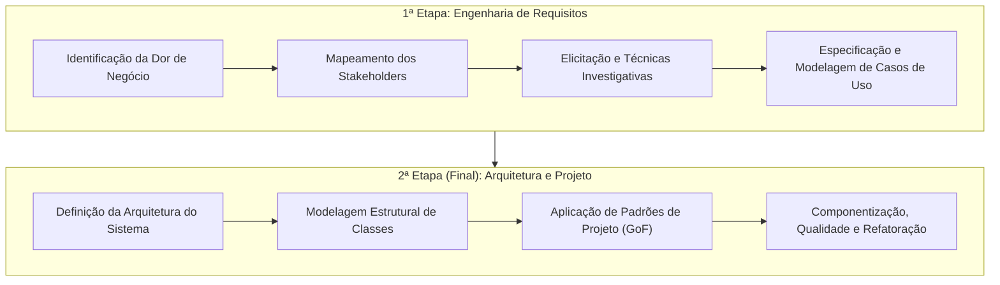

As áreas temáticas disponibilizadas para o projeto cobrem domínios com restrições arquiteturais distintas:

| Domínio Temático | Aplicações Típicas | Requisitos Críticos de Domínio |
| :--- | :--- | :--- |
| **Comércio** | Marketplaces B2B/B2C, OMS, WMS | Concorrência de estoque, conciliação transacional e checkout distribuído. |
| **Serviços Públicos** | Atendimento ao Cidadão, Ouvidoria | Conformidade regulatória, auditoria pública e SLAs municipais. |
| **Negócios** | ATS (Recrutamento), ERP Financeiro | Pipelines de processamento, cálculo de folhas e segregação de funções. |
| **Saúde** | Prontuário Eletrônico, Telemedicina | Criptografia em repouso, conformidade HIPAA/LGPD e integridade estrita. |
| **Educação** | LMS, Gestão Acadêmica Corporativa | Matrícula concorrente, fechamento contábil e avaliação contínua. |
| **Logística** | Rastreamento de Frotas, Gestão de Cargas | Telemetria assíncrona, tolerância a falhas e roteirização em grafos. |

---

### 1.3 Critérios e Fórmulas de Avaliação

A aferição do rendimento escolar balanceia a avaliação individual conceitual com o desempenho coletivo de engenharia:

- **AV1 (Avaliação 1):** Prova individual presencial (1º Bimestre), cobrindo Fundamentos de Ciclo de Vida, Elicitação, Requisitos, MoSCoW e Modelagem de Casos de Uso.
- **AV2 (Avaliação 2):** Prova individual presencial (2º Bimestre), focando em Diagramas de Classes, Princípios de Design OO, Padrões Arquiteturais, MVC clássico e Padrões GoF.
- **PJ (Projeto Integrador):** Avaliação em equipe da entrega e sustentação técnica dos artefatos das Fases 1 e 2.

A composição da nota semestral consolida-se por:

```math
\text{Nota Final} = \frac{[(\text{AV}_1 \times 0.6) + (\text{PJ} \times 0.4)] + [(\text{AV}_2 \times 0.6) + (\text{PJ} \times 0.4)]}{2}
```

A aprovação regimental exige que a média final seja igual ou superior a $`6.0`$ pontos, combinada à frequência mínima obrigatória de $`75\%`$ das aulas.

---

### 1.4 Bibliografia de Referência

1. **GUEDES, Gilleanes T. A.** *UML 2: Uma Abordagem Prática*. 2. ed. São Paulo: Novatec, 2011.
2. **BOOCH, Grady; RUMBAUGH, James; JACOBSON, Ivar.** *UML: Guia do Usuário*. Rio de Janeiro: Campus, 2000.
3. **BEZERRA, Eduardo.** *Princípios de Análise e Projeto de Sistemas com UML*. 4. ed. Rio de Janeiro: Elsevier, 2007.
4. **FURLAN, José Davi.** *Modelagem de Objetos através da UML*. São Paulo: Makron Books, 1998.
5. **BORATTI, Isaias Camilo.** *Programação Orientada a Objetos em Java*. Florianópolis: Visual Books, 2007.
6. **GAMMA, Erich et al.** *Padrões de Projeto: Soluções Reutilizáveis de Software Orientado a Objetos*. Porto Alegre: Bookman, 2000.
7. **BURBECK, Steve.** *Applications Programming in Smalltalk-80: How to use Model-View-Controller (MVC)*. Softsmarts Inc., 1987.
8. **ISO/IEC/IEEE 42010:2022.** *Software, systems and enterprise — Architecture description*. Genebra: ISO, 2022.

---

## 2. O Ciclo de Vida do Projeto de Software

### 2.1 A Premissa Fundamental da Engenharia

> *"Software não é feito em pastelaria."* — Prof. Wesley Soares

A metáfora da "pastelaria" sintetiza o erro de conceber o desenvolvimento de software como um processo de confecção instantânea, no qual o cliente faz o pedido no balcão e aguarda a entrega imediata de código pronto, sem estudo de impacto, projeto estrutural ou testes de robustez.

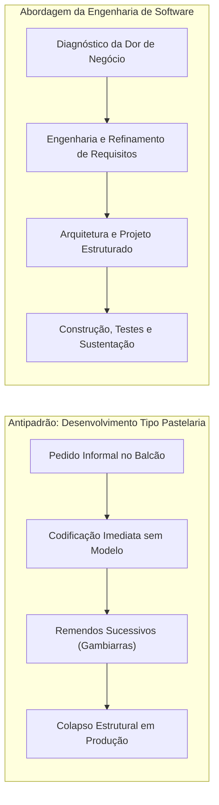

Sistemas corporativos operam como o sistema nervoso de organizações. Falhas estruturais geram perda de dados, litígios judiciais, multas fiscais (ex.: LGPD, SEFAZ) e paralisações operacionais. Tratar software sob engenharia significa aplicar processos sistemáticos, mensuráveis e reprodutíveis.

---

### 2.2 O Paradoxo entre Análise e Projeto

A engenharia de software equilibra duas responsabilidades que se interconectam ao longo do ciclo de desenvolvimento:

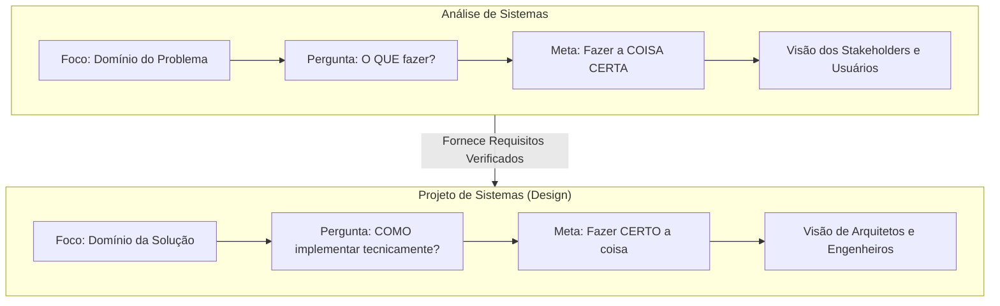

- **Fazer a coisa certa (Análise):** Garante que o software resolva a verdadeira necessidade do cliente. Construir com perfeição técnica uma funcionalidade desnecessária representa desperdício total de esforço.
- **Fazer certo a coisa (Projeto):** Garante que a solução seja construída com arquitetura limpa, manutenível, segura, extensível e desacoplada. Resolver o problema correto com uma arquitetura caótica cria um passivo de débitos técnicos que inviabiliza o produto no médio prazo.

---

### 2.3 As Dez Fases Estruturais do Ciclo de Vida

O desenvolvimento corporativo moderno percorre dez fases iterativas:

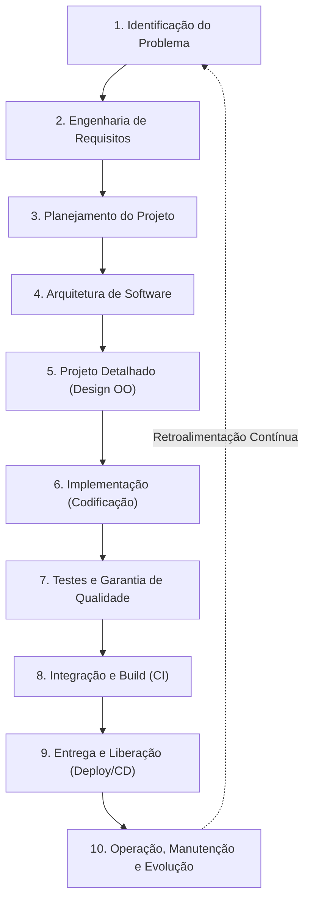

| Fase | Foco Central | Artefato de Entrada | Artefato de Saída |
| :--- | :--- | :--- | :--- |
| **1. Problema** | Compreender a carência e a dor real de negócio. | Relatos operacionais, queixas, ineficiências. | Declaração do Problema e Proposta de Valor. |
| **2. Requisitos** | Elicitar, refinar e classificar funções e restrições. | Declaração do Problema, entrevistas e observações. | Especificação de Requisitos (SRS), Casos de Uso. |
| **3. Planejamento** | Dimensionar prazos, custos, escopo (MoSCoW) e riscos. | Requisitos priorizados, capacidade da equipe. | Backlog da Release, Matriz de Riscos, Cronograma. |
| **4. Arquitetura** | Definir macroestruturas e atributos de qualidade. | Requisitos Não Funcionais (segurança, latência). | Documento de Arquitetura (SAD), Diagramas C4/UML. |
| **5. Projeto** | Modelar classes, atributos, operações e padrões. | Diretrizes de arquitetura, contratos de serviço. | Diagramas de Classes, Diagramas de Sequência. |
| **6. Implementação** | Escrever código limpo, tipado e auditável. | Modelos de classes, especificações técnicas. | Código-fonte versionado em repositório (Git). |
| **7. Testes** | Validar requisitos funcionais e não funcionais. | Código compilável, suítes de testes automatizados. | Relatórios de cobertura, logs de execução de testes. |
| **8. Integração** | Unificar módulos em pipelines automatizados de build. | Pull requests integrados, branches locais. | Builds testados, artefatos e imagens de contêiner. |
| **9. Entrega** | Disponibilizar a aplicação em produção. | Imagens de contêiner validadas em homologação. | Release em produção, changelogs documentados. |
| **10. Manutenção** | Corrigir defeitos, monitorar e evoluir o sistema. | Métricas de telemetria, chamados operacionais. | Patches corretivos, planos de refatoração contínua. |

---

## 3. Fundamentos de Projeto Orientado a Objetos e Pilares de Design

### 3.1 Transição da Análise para o Projeto

A transição entre os modelos de análise e projeto marca o abandono gradual da linguagem de negócios abstrata em prol de estruturas de computação executáveis:

| Dimensão de Comparação | Modelo de Análise | Modelo de Projeto Orientado a Objetos |
| :--- | :--- | :--- |
| **Questão Central** | O que o sistema deve fornecer? | Como a arquitetura computacional operará? |
| **Perspectiva** | Stakeholders, usuários e analistas de negócio. | Engenheiros de software, arquitetos e desenvolvedores. |
| **Tecnologia** | Agnóstico de tecnologia, plataformas e bancos de dados. | Acoplado a linguagens (Java), frameworks e padrões. |
| **Vocabulário** | Termos do domínio: `Pedido`, `Item`, `Produtor`. | Termos de engenharia: `PedidoService`, `Repository`, `DTO`. |
| **Artefatos Gerados** | Casos de Uso, Matriz MoSCoW, Glossário de Domínio. | Diagramas de Classes detalhados, Sequência e Pacotes. |

---

### 3.2 Abstração e Encapsulamento Rigoroso

#### Abstração
- **Definição:** Operação conceitual que isola as propriedades e comportamentos essenciais de uma entidade sob a ótica do sistema, ignorando intencionalmente detalhes e peculiaridades de baixo nível irrelevantes ao negócio.
- **Motivação:** Redução de complexidade cognitiva. O sistema processa transações de venda manipulando identificadores, quantidades e totais, sem necessitar conhecer a física dos circuitos de memória ou a estrutura de trilhas do disco rígido.
- **Exemplo:** A entidade `Venda` expõe a operação `adicionarItem(ItemVenda item)` e computa internamente seus valores consolidados.
- **Contraexemplo:** Criar uma classe de domínio que mistura o cálculo de impostos de faturamento com manipulação direta de conexões TCP via sockets de baixo nível.
- **Armadilhas Comuns:** Supermodelagem (*over-abstraction*), criando hierarquias excessivas para entidades que não possuem variação semântica real no domínio.

#### Encapsulamento
- **Definição:** Técnica de agrupar o estado interno e as rotinas comportamentais de um objeto, restringindo o acesso direto aos campos internos para proteger a coerência das regras de negócio (*invariantes de classe*).
- **Motivação:** Impedir que clientes externos manipulem atributos diretamente e conduzam o objeto a estados corrompidos ou inconsistentes.
- **Exemplo:** Declarar atributos como privados (`private`) e disponibilizar métodos de domínio que aplicam validações atômicas.
- **Contraexemplo:** Declarar campos como públicos (`public double saldo`) ou implementar getters e setters indiscriminados sem validação de regras de domínio.
- **Armadilhas Comuns:** Vazamento de referências mutáveis (*escaping references*). Retornar instâncias puras de coleções internas (`return this.itens;`) permite que código externo adicione ou limpe elementos ignorando as regras da classe. O correto é retornar envoltórios imutáveis (`Collections.unmodifiableList(this.itens)`).

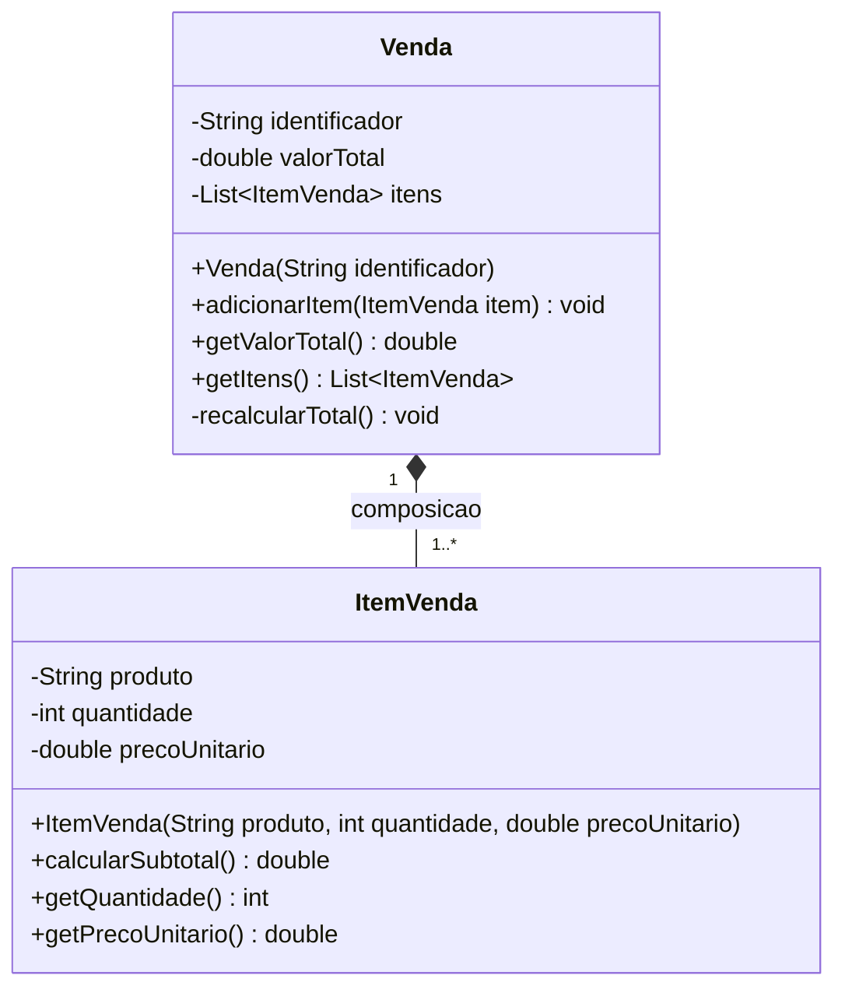

---

### 3.3 Herança e Polimorfismo Dinâmico

#### Herança
- **Definição:** Mecanismo estrutural de reaproveitamento e classificação que estabelece uma relação taxonômica do tipo "É UM" (*is-a*). Uma subclasse herda o contrato e a estrutura de dados de uma superclasse, podendo especializar comportamentos.
- **Motivação:** Compartilhar código comum e estabelecer contratos tipados para famílias polimórficas.
- **Exemplo:** `ContaPoupanca` e `ContaCorrente` herdam de uma classe abstrata `ContaBancaria`.
- **Contraexemplo:** Utilizar herança apenas para reaproveitar métodos utilitários sem vínculo conceitual (ex.: fazer `RelatorioFinanceiro` herdar de `ConexaoBancoDados`). Esse antipadrão destrói a coesão.
- **Armadilhas Comuns:** Violação do Princípio da Substituição de Liskov (LSP). Se a subclasse lança exceções inesperadas ao executar operações herdadas da classe-base, a hierarquia é inválida.

#### Polimorfismo
- **Definição:** Capacidade de objetos de diferentes classes concretas responderem a uma mesma mensagem de interface por meio de implementações específicas em tempo de execução (*late binding* / despacho dinâmico).
- **Motivação:** Eliminar cadeias complexas e frágeis de desvios condicionais (`if/else` ou `switch/case`), permitindo a inclusão de novos comportamentos sem alterar código consumidor consolidado.
- **Exemplo:** Um método de liquidação que invoca `pagamento.processar(valor)` sobre uma referência abstrata `FormaPagamento`, executando polimorficamente implementações como `CartaoCredito`, `Pix` ou `BoletoBancario`.
- **Contraexemplo:** Verificar o tipo da subclasse manualmente via `instanceof` para decidir qual bloco de código executar.

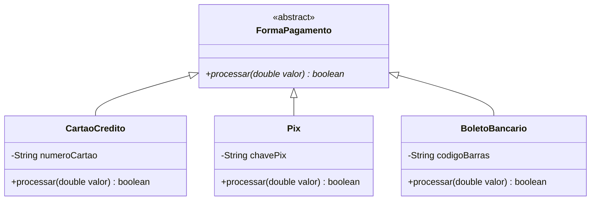

---

### 3.4 Acoplamento Fraco e Alta Coesão

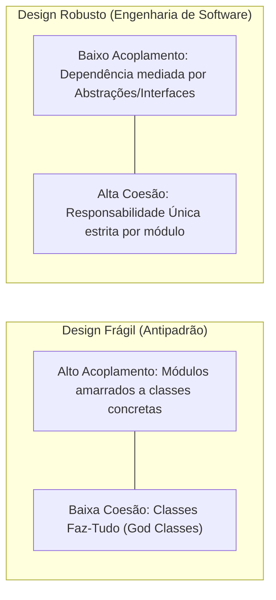

#### Baixo Acoplamento
- **Definição:** Nível de interdependência e conhecimento mútuo entre dois ou mais módulos de software. Um sistema fracamente acoplado permite que alterações internas em um módulo ocorram sem propagar quebras em outras partes.
- **Motivação:** Manutenibilidade e testabilidade. Classes desacopladas podem ser isoladas por meio de dublês de testes (*mocks*).
- **Exemplo:** Uma classe de negócio `ProcessadorVenda` que depende de uma interface `NotificadorFiscal`, e não de uma implementação concreta `EmissorNotaFiscalPaulista`.
- **Contraexemplo:** Uma classe que referencia diretamente variáveis globais ou instancia internamente dependências concretas usando `new` de forma rígida, impossibilitando a substituição da infraestrutura.
- **Armadilhas Comuns:** Criar acoplamento temporal implícito, no qual a chamada de um método depende obrigatoriamente da execução prévia de outro método sem que a interface torne essa restrição evidente.

#### Alta Coesão
- **Definição:** Grau em que os atributos e métodos de uma classe colaboram para atender a um propósito conceitual único e bem delimitado.
- **Motivação:** Legibilidade, reutilização e redução de impactos colaterais. Uma classe altamente coesa possui poucos motivos para ser alterada.
- **Exemplo:** Uma classe `CalculadoraTributaria` que se dedica unicamente a apurar alíquotas fiscais, sem conter regras de tela ou comandos SQL.
- **Contraexemplo:** Uma classe `GerenciadorSistema` que contém rotinas de autenticação, persistência em disco, cálculo de frete e envio de e-mails corporativos (*God Class*).
- **Armadilhas Comuns:** Coesão coincidental, na qual funções não relacionadas são reunidas em uma classe apenas por estarem no mesmo arquivo (ex.: pacotes utilitários genéricos do tipo `Utils` ou `Helper`).

---

### 3.5 Introdução aos Princípios SOLID e Padrões GoF

Os pilares do projeto orientado a objetos estruturam-se formalmente nos princípios SOLID e nos padrões consolidados pelo *Gang of Four* (GoF):

```mermaid
mindmap
  root("Princípios e Padrões de Projeto")
    "Princípios SOLID"
      "S - Responsabilidade Única (Alta Coesão)"
      "O - Aberto/Fechado (Extensão sem Modificação)"
      "L - Substituição de Liskov (Herança Válida)"
      "I - Segregação de Interfaces (Contratos Enxutos)"
      "D - Inversão de Dependências (Baixo Acoplamento)"
    "Padrões GoF Selecionados"
      "Strategy: Famílias de algoritmos intercambiáveis"
      "Factory Method: Encapsulamento da instanciação"
      "Observer: Notificação reativa de um para muitos"
      "Adapter: Conversão de interfaces incompatíveis"
      "Facade: Ponto único simplificado para subsistemas"
```

---

## 4. Engenharia e Elicitação de Requisitos

### 4.1 Levantamento versus Elicitação Ativa

A literatura clássica de Engenharia de Software (SWEBOK) estabelece uma distinção essencial entre o ato passivo de coletar dados e o processo ativo de elicitar:

- **Levantamento (Gathering):** Postura passiva na qual o analista assume que os requisitos existem lapidados e documentados na mente do cliente, cabendo apenas anotá-los. Essa presunção falha, pois clientes expressam sintomas e desejos pontuais, e não especificações formais de software.
- **Elicitação (Elicitation):** Do latim *elicitare* ("fazer emergir", "trazer à luz"). Abordagem ativa, dialética e investigativa na qual o analista aplica técnicas estruturadas para desvendar processos ocultos, regras de negócio tácitas, contradições organizacionais e restrições técnicas.

---

### 4.2 A Cadeia Causal da Elicitação

A formalização de um requisito decorre de uma progressão causal estrita:

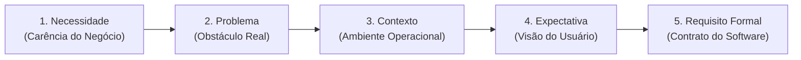

| Nível Causal | Conceito Teórico | Exemplo em Gestão Agrícola |
| :--- | :--- | :--- |
| **1. Necessidade** | Sustentabilidade financeira e produtiva do negócio. | Aumentar a margem líquida e o giro de hortaliças. |
| **2. Problema** | Obstáculo factual que impede a necessidade. | Venda de produtos em feiras já esgotados no galpão. |
| **3. Contexto** | Condições tecnológicas e operacionais reais. | Feira livre sem internet contínua, usando cadernos de papel. |
| **4. Expectativa** | A imagem mental da solução criada pelo cliente. | "Quero um aplicativo no celular para não perder vendas." |
| **5. Requisito Formal** | Especificação atômica, mensurável e testável. | O sistema deve sincronizar o estoque local em menos de 5s após reconexão. |

---

### 4.3 As Seis Perguntas Cardinais

Diante de qualquer sistema ou funcionalidade, o analista deve responder exaustivamente a seis perguntas de orientação cardinal:

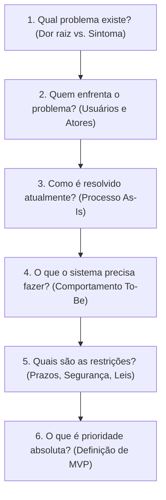

#### Crítica da Premissa do Desenvolvimento Prematuro
Se um cliente disser: *"Preciso de um sistema para melhorar meu negócio"*, iniciar a implementação imediata constitui falha grave de engenharia:
1. **Ausência de Critério de Aceite:** Não há definição mensurável do que representa "melhorar", inviabilizando a homologação formal do produto.
2. **Escopo Infinito (*Scope Creep*):** Sem fronteiras acordadas, qualquer modificação futura será cobrada pelo cliente como parte integrante da promessa original de "melhorar o negócio".
3. **Automatização do Caos:** Informatizar um processo operacional confuso, burocrático e repleto de retrabalho produz apenas um processo caótico automatizado, amplificando erros operacionais em escala digital.

---

### 4.4 Desconstrução de Ambiguidade e Formalização de RNF

Termos qualitativos são anti-requisitos. A engenharia exige a conversão de adjetivos vagos em parâmetros físicos observáveis e mensuráveis:

| Fala Informal do Usuário | Interpretação Errada do Desenvolvedor | Especificação Formal de Engenharia (Requisito Não Funcional) |
| :--- | :--- | :--- |
| "O sistema precisa ser rápido." | Adicionar índices simples e assumir conformidade. | **RNF-01 (Desempenho):** O tempo de resposta para a consulta de pedidos não deve exceder $`1.2`$ segundos para o percentil 95 ($`p95`$) sob carga simultânea de 300 requisições concorrentes. |
| "A interface deve ser intuitiva." | Manter telas com poucos botões e cores neutras. | **RNF-02 (Usabilidade):** Um novo atendente deve ser capaz de concluir um cadastro completo em até 2 minutos, após treinamento de 15 minutos, com taxa de erro inferior a $`1\%`$. |
| "O sistema deve ser seguro." | Proteger tabelas com senha comum no banco de dados. | **RNF-03 (Segurança):** O sistema deve exigir autenticação multifator (MFA) para operações financeiras e aplicar o algoritmo de hash Argon2id com parâmetro de memória de 64MB. |

---

### 4.5 Técnicas Tradicionais de Coleta e Elicitação

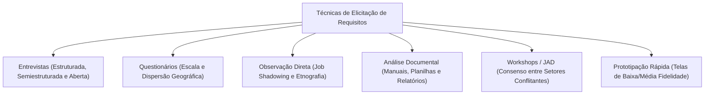

#### Comparativo de Técnicas de Elicitação

| Técnica | Melhor Cenário de Uso | Principais Vantagens | Armadilhas e Riscos Críticos |
| :--- | :--- | :--- | :--- |
| **Entrevista Semiestruturada** | Compreensão de regras de negócio com tomadores de decisão. | Aprofundamento investigativo e esclarecimento dinâmico de dúvidas. | Demanda tempo e analistas experientes para evitar perda de foco. |
| **Questionários** | Mapeamento de preferências em grandes bases de usuários. | Baixo custo por participante e rápida tabulação estatística. | Baixa taxa de retorno e incapacidade de aprofundar respostas superficiais. |
| **Observação Direta** | Mapeamento de rotinas operacionais no ambiente de trabalho. | Revela rotinas manuais que o usuário esquece de verbalizar. | Efeito Hawthorne (o usuário altera o comportamento ao ser observado). |
| **Análise Documental** | Substituição de sistemas legados e auditorias regulatórias. | Identificação precisa de regras fiscais e esquemas de dados preexistentes. | Documentação frequentemente defasada em relação à operação real. |
| **Workshops (JAD)** | Alinhamento e resolução de conflitos entre departamentos. | Resolução rápida de divergências entre requisitos de diferentes áreas. | Risco de domínio da dinâmica por participantes com maior hierarquia corporativa. |
| **Prototipação** | Validação prévia de fluxos visuais e interfaces de usuário. | Redução de ruídos de comunicação sobre navegação e layout. | O cliente pode confundir a maquete com o sistema funcional final. |

---

## 5. Priorização de Requisitos com o Método MoSCoW

### 5.1 Fundamentos e Categorias da Técnica

O método **MoSCoW** é uma técnica consagrada para a gestão analítica do escopo de software, concebida para mitigar o risco de estouro de prazos e orçamentos através da classificação dos requisitos em quatro níveis de prioridade:

- **Must have (Deve ter):** Requisitos inegociáveis que formam a espinha dorsal do produto (MVP). A ausência de qualquer item classificado como *Must* impede o lançamento operacional do sistema por inviabilidade técnica, operacional ou legal.
- **Should have (Deveria ter):** Requisitos críticos de alto valor de negócio que devem ser implementados na entrega corrente, mas que admitem contornos manuais temporários caso ocorra escassez de prazo.
- **Could have (Poderia ter):** Requisitos desejáveis que agregam conveniência ou diferenciação competitiva, incorporados ao projeto somente se houver folga de cronograma e orçamento após o término dos itens *Must* e *Should*.
- **Won't have this time (Não terá desta vez):** Requisitos explicitamente descartados do escopo da iteração atual, documentados no backlog para avaliações futuras, bloqueando a corrupção do escopo (*scope creep*).

---

### 5.2 Árvore de Tomada de Decisão MoSCoW

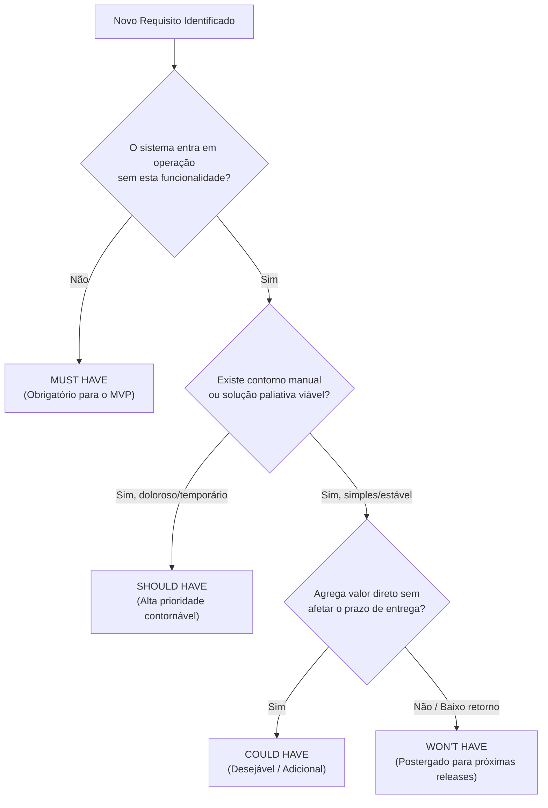

---

### 5.3 Aplicação Comparativa em Domínios Reais

| Categoria | Plataforma de E-Commerce | Aplicativo de Food Delivery | Gestão Hospitalar |
| :--- | :--- | :--- | :--- |
| **Must have** | Processar pagamento com cartão e reserva atômica de estoque. | Autenticação, listagem de cardápio e despacho do pedido. | Emissão de prescrição digital com validação posológica. |
| **Should have** | Rastreamento de encomenda integrado a transportadoras. | Atualização do status em tempo real via WebSocket. | Alerta visual de expiração de calibração metrológica. |
| **Could have** | Compartilhamento social de listas de presentes/desejos. | Chat interativo em tempo real entre cliente e cozinha. | Portal de autoatendimento para pré-agendamento de leitos. |
| **Won't have** | Sistema preditivo de busca baseado em visão computacional. | Roteirização autônoma de entregadores por inteligência artificial. | Reconhecimento facial de pacientes na portaria via drones. |

---

## 6. Fundamentos da UML e Processos de Software

### 6.1 Notação de Modelagem versus Processo de Desenvolvimento

Uma distinção crítica na Engenharia de Software é a separação formal entre a **linguagem de modelagem** e a **metodologia de processo**:

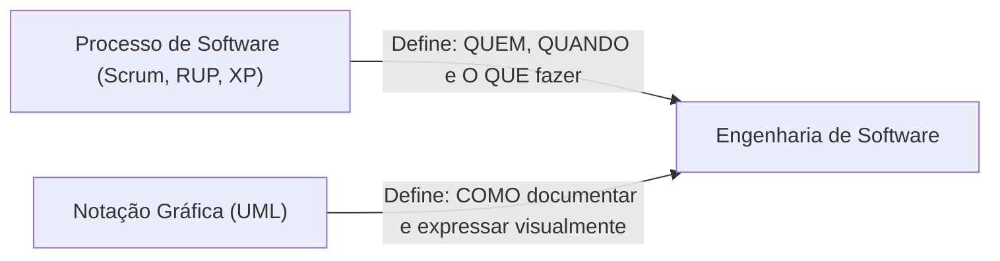

- **A UML NÃO é um processo:** Ela não estipula prazos, papéis de equipe, sequência de sprints ou ritos corporativos. Trata-se de uma linguagem visual padronizada contendo sintaxe e semântica estritas para expressar artefatos de software.
- **Processos de Software:** Estruturas metodológicas (como Scrum, Kanban, Extreme Programming ou Processo Unificado) que governam o fluxo de trabalho humano, o planejamento das entregas e as cerimônias de inspeção e adaptação.

---

### 6.2 Origem Histórica e o Papel da OMG

A **Unified Modeling Language (UML)** nasceu na década de 1990 para unificar a chamada "guerra dos métodos" na orientação a objetos, sintetizando os trabalhos pioneiros dos "Três Amigos" (*Three Amigos*):
- **Grady Booch:** Notação do método Booch (foco em projeto detalhado e classes).
- **James Rumbaugh:** OMT (*Object Modeling Technique*, foco em análise de domínio e modelos relacionais).
- **Ivar Jacobson:** OOSE (*Object-Oriented Software Engineering*, pioneiro na criação dos Casos de Uso).

A linguagem foi adotada e padronizada pelo consórcio industrial **OMG (Object Management Group)**, estabelecendo as quatro metas primárias da modelagem:
1. **Visualizar:** Tornar as estruturas de objetos e fluxos explícitos visualmente.
2. **Especificar:** Construir descrições precisas e não ambíguas da arquitetura.
3. **Construir:** Servir de base direta para a geração ou implementação do código-fonte.
4. **Documentar:** Preservar decisões arquiteturais para a governança do ciclo de vida.

---

### 6.3 A Modelagem Just-Enough em Ambientes Ágeis Scrum

Na engenharia de software contemporânea orientada a frameworks ágeis (como o Scrum), a UML não é empregada como documentação burocrática exaustiva antes da codificação (*Big Design Up Front - BDUF*). Ela adota o princípio **Just-in-Time** e **Just-Enough**:

- **Modelagem Enxuta:** Diagramas de classes e sequências são traçados colaborativamente no início das Sprints para alinhar os contratos de interface entre desenvolvedores de backend e frontend.
- **Ferramentas Ágeis:** O uso de plataformas baseadas em navegador (como Visual Paradigm Online) viabiliza a criação rápida de diagramas que são anexados a cartões de tarefas e repositórios Git, eliminando o atrito da documentação desconectada.

---

## 7. Modelagem Comportamental com Diagrama de Casos de Uso

### 7.1 Filosofia da Modelagem Caixa-Preta

O Diagrama de Casos de Uso é um diagrama comportamental estático da UML cujo objetivo primário consiste em mapear os serviços observáveis oferecidos pelo sistema aos seus agentes externos.

> **Princípio da Caixa-Preta (*Black-Box Modeling*):** O diagrama não deve exibir comandos SQL, métodos internos, chamadas de framework ou janelas da interface gráfica. Ele modela exclusivamente **o que** o sistema faz em favor de um ator, preservando o desacoplamento de detalhes internos de implementação.

---

### 7.2 Elementos Básicos: Atores, Casos de Uso e Fronteiras

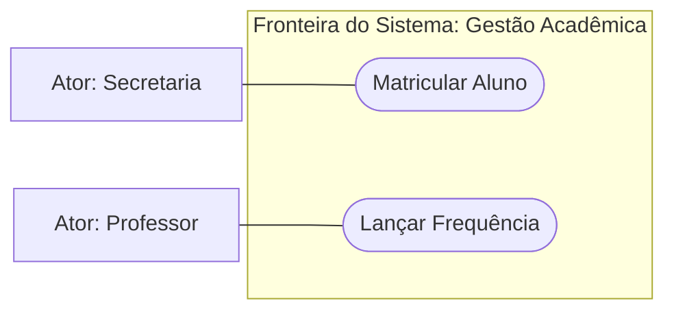

1. **Atores:** Representam papéis lógicos assumidos por usuários humanos, dispositivos de hardware ou sistemas de software externos que trocam informações com a aplicação.
   - *Atores Primários:* Iniciam o caso de uso para alcançar uma meta mensurável de negócio (ex.: `Cliente`).
   - *Atores Secundários:* Fornecem serviços de suporte ou processamento ao sistema (ex.: `GatewayPagamento`, `SEFAZ`).
2. **Casos de Uso:** Representam uma unidade atômica de funcionalidade que entrega valor ao ator. Expressos graficamente por elipses contendo obrigatoriamente um **verbo no infinitivo** seguido de complemento direto (ex.: `Emitir Nota Fiscal`, `Consultar Saldo`).
3. **Fronteira do Sistema (*System Boundary*):** Caixa retangular que delimita o escopo do que faz parte do software a ser construído, separando-o do ecossistema externo.

---

### 7.3 Relacionamentos: Associação, Include, Extend e Generalização

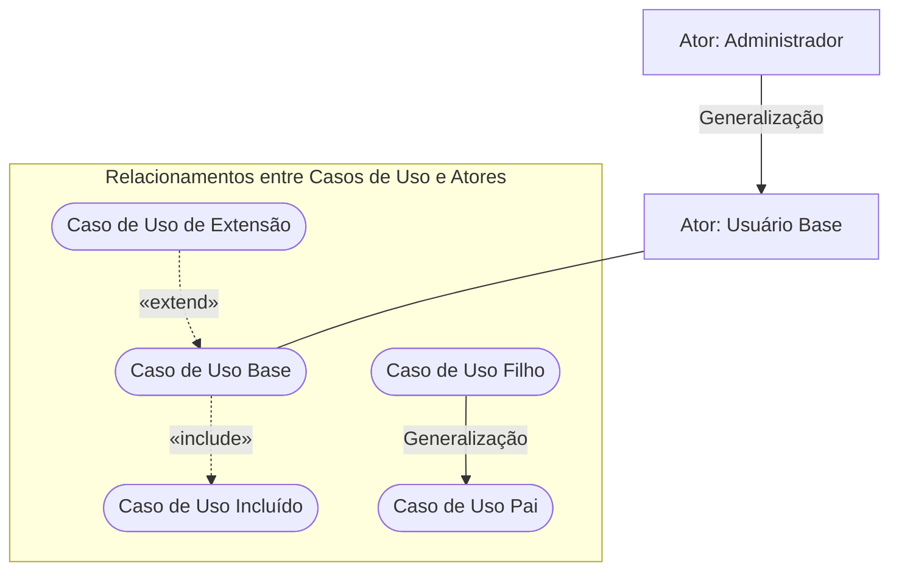

| Relacionamento | Notação UML | Obrigatoriedade | Direção da Seta | Significado Semântico |
| :--- | :--- | :--- | :--- | :--- |
| **Associação** | Linha sólida contínua | Variável | Sem seta (bidirecional) | Habilita a comunicação de mensagens entre ator e caso de uso. |
| **Include (`«include»`)** | Linha tracejada aberta | Obrigatório (incondicional) | Do Caso Base para o Incluído | Reaproveitamento estrutural; a funcionalidade incluída é parte mandatória da base. |
| **Extend (`«extend»`)** | Linha tracejada aberta | Opcional (condicional) | Da Extensão para o Caso Base | Comportamento que amplia a base apenas quando uma condição de guarda for atendida. |
| **Generalização** | Linha sólida com triângulo vazado | Herança conceitual | Do Especializado (Filho) para o Genérico (Pai) | Compartilhamento e especialização de comportamento de atores ou casos de uso. |

#### Regra Prática para Diferenciação de Setas
- No **`«include»`**, o caso de uso base precisa do serviço para concluir sua meta: a seta **parte da base e aponta para o incluído**.
- No **`«extend»`**, o caso acessório amplia condicionalmente o fluxo de uma rotina pré-existente: a seta **parte do caso que estende e aponta para a base**.

---

### 7.4 Especificação Textual Canônica de Casos de Uso

O diagrama de casos de uso constitui apenas um mapa visual. A especificação completa do comportamento reside na documentação textual padronizada:

#### Especificação do Caso de Uso: UC-04 Realizar Pedido
- **Identificador:** UC-04
- **Nome:** Realizar Pedido
- **Ator Primário:** Cliente
- **Atores Secundários:** Gateway de Pagamento, Sistema de Estoque
- **Pré-condições:** 
  1. O cliente deve estar autenticado no sistema.
  2. O carrinho de compras deve conter ao menos um item válido.
- **Pós-condições:** 
  1. O pedido é registrado com status inicial `Pendente`.
  2. A reserva temporária dos itens de estoque é confirmada por 15 minutos.
- **Fluxo Principal (Caminho Feliz):**
  1. O cliente acessa a tela de checkout e confirma o endereço de entrega.
  2. O sistema calcula a taxa de entrega e o prazo com base no CEP.
  3. O cliente seleciona a modalidade de pagamento (Cartão de Crédito).
  4. O sistema executa o caso de uso `«include»` UC-05 (Processar Pagamento).
  5. O sistema registra o pedido no banco de dados com número localizador.
  6. O sistema emite notificação de sucesso e esvazia o carrinho do cliente.
- **Fluxos Alternativos:**
  - *FA-01: Pagamento via Pix:* No passo 3, o cliente seleciona a opção Pix. O sistema gera a chave de pagamento rápida (QR Code estático) com expiração em 10 minutos e aguarda o webhook de conciliação bancária.
  - *FA-02: Aplicação de Cupom (`«extend»` UC-08):* No passo 2, o cliente insere um código promocional válido. O sistema aplica o abatimento percentual sobre o valor bruto antes de chamar o UC-05.
- **Fluxos de Exceção:**
  - *FE-01: Transação Negada pela Operadora:* No passo 4, o gateway rejeita a transação. O sistema avisa o cliente sobre a recusa, mantém os itens no carrinho e solicita a inserção de um novo método de pagamento sem gerar o pedido.
  - *FE-02: Esgotamento Concorrente de Estoque:* No passo 4, um item do carrinho atinge quantidade zero antes da autorização financeira. O sistema notifica o cliente, remove o item esgotado e recalcula o total da venda.

---

### 7.5 Estudos de Caso: E-Commerce, Delivery e Biblioteca

#### Estudo de Caso: Plataforma de Food Delivery
A aplicação prática demonstra como orquestrar múltiplos atores operando em um mercado multifacetado (*multilateral marketplace*):

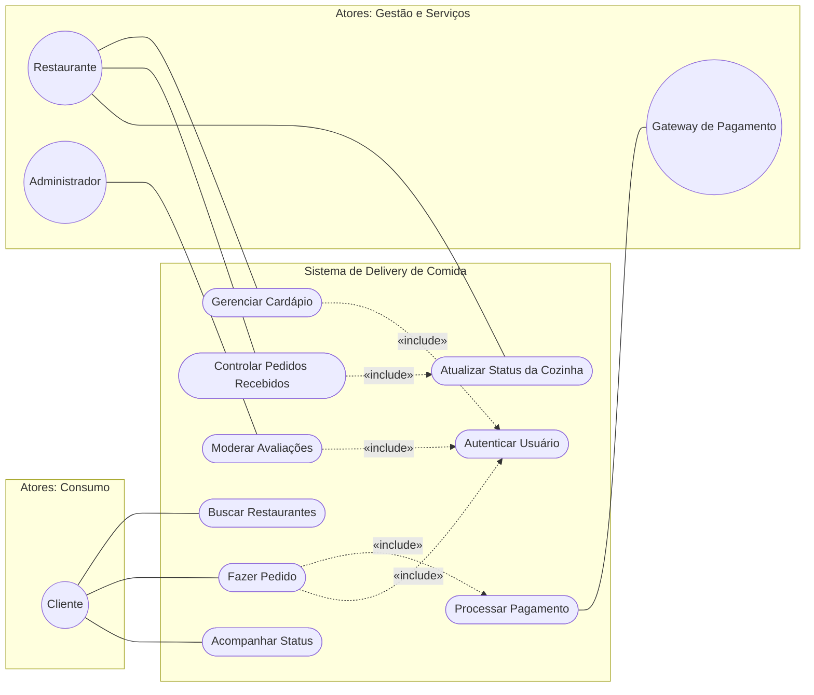

---

## 8. Modelagem Estrutural com Diagrama de Classes UML

### 8.1 Anatomia e Compartimentos da Classe

O Diagrama de Classes descreve a visualização estática do modelo de domínio, mapeando os tipos conceituais, seu estado interno e as operações computacionais. Cada classe é expressa graficamente por um retângulo segmentado em três compartimentos obrigatórios:

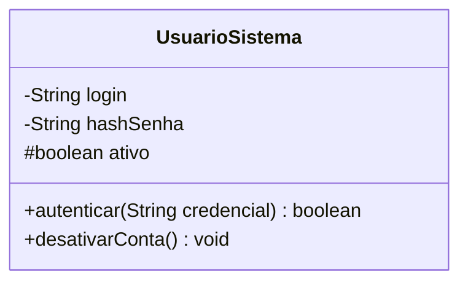

1. **Compartimento Superior (Identificador):** Contém o nome da classe, escrito como substantivo no singular, adotando **PascalCase** (ex.: `PedidoVenda`, `RegistroAuditoria`).
2. **Compartimento Central (Atributos):** Define a estrutura dos dados encapsulados:  
   `[visibilidade] nomeAtributo : TipoDado [multiplicidade] = [valorPadrao]`
3. **Compartimento Inferior (Operações / Métodos):** Especifica a assinatura dos comportamentos que o objeto sabe executar:  
   `[visibilidade] nomeOperacao(parametro : Tipo) : TipoRetorno`

---

### 8.2 Padrões de Nomenclatura e Linguagem Ubíqua

A nomenclatura deve espelhar a **Linguagem Ubíqua** (conceito central do *Domain-Driven Design*): os termos utilizados no código e na modelagem devem ser exatamente os mesmos falados pelos especialistas de negócio da empresa.

| Elemento | Padrão Estrutural | Formato | Exemplo Correto | Exemplo Incorreto |
| :--- | :--- | :--- | :--- | :--- |
| **Classe** | Substantivo Singular | PascalCase | `NotaFiscal`, `Cliente` | `FaturarNota`, `NotasFiscais` |
| **Atributo** | Substantivo/Adjetivo | camelCase | `dataVencimento`, `ativo` | `Data_Venc`, `calcularTotal()` |
| **Operação** | Verbo no Infinitivo | camelCase | `cancelarPedido()`, `emitir()` | `Cancelamento()`, `status()` |

---

### 8.3 Modificadores de Visibilidade e Mapeamento Java

A UML padroniza quatro níveis de controle de encapsulamento:

| Visibilidade UML | Símbolo | Palavra-chave Java | Escopo de Acessibilidade |
| :--- | :---: | :--- | :--- |
| **Público (Public)** | `+` | `public` | Acessível por qualquer classe em qualquer pacote da aplicação. |
| **Protegido (Protected)** | `#` | `protected` | Acessível na própria classe, por suas subclasses e no mesmo pacote. |
| **Privado (Private)** | `-` | `private` | Acessível estritamente dentro dos limites da própria classe declarante. |
| **Pacote (Package)** | `~` | *(padrão - default)* | Acessível exclusivamente por classes situadas dentro do mesmo pacote. |

---

### 8.4 Navegabilidade, Papéis e Multiplicidades

As associações entre classes especificam se um objeto conhece o outro (navegabilidade unidirecional indicada por ponta de seta, ou bidirecional por ausência de setas) e quantos objetos participam da relação:

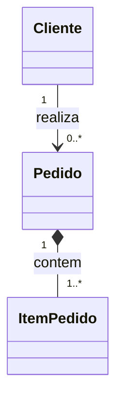

- `1`: Exatamente uma instância obrigatória.
- `0..1`: Zero ou no máximo uma instância (associação opcional).
- `*` ou `0..*`: De zero a muitas instâncias associadas.
- `1..*`: No mínimo uma e potencialmente muitas instâncias.
- `n..m`: Limites específicos estabelecidos pelas regras de negócio.

---

### 8.5 Taxonomia dos Relacionamentos Estruturais

A modelagem de classes estrutura-se em cinco relacionamentos canônicos:

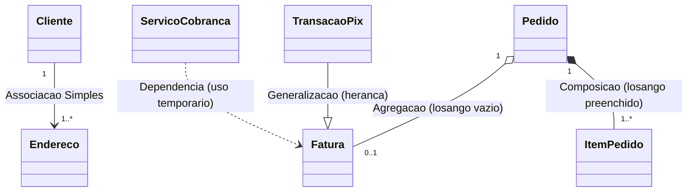

1. **Associação Simples:** Conexão semântica entre objetos que possuem ciclos de vida completamente independentes.
2. **Agregação (Todo-Parte Fraco - Losango Vazio):** A classe "todo" mantém referências para instâncias da classe "parte", mas a destruição da classe "todo" **não** acarreta a destruição das suas partes agregadas.
3. **Composição (Todo-Parte Forte - Losango Preenchido):** Relação existencial de dependência estrita de ciclo de vida. A parte pertence com exclusividade àquele todo específico; se o objeto pai for destruído, todas as suas partes compostas são compulsoriamente destruídas na mesma transação.
4. **Generalização (Herança):** Relação taxonômica onde subclasses herdam atributos, operações e contratos da superclasse, indicada por linha com triângulo fechado apontando para a classe-base.
5. **Dependência (Uso Transitório):** Relação circunstancial na qual uma classe utiliza outra transitoriamente durante a execução de um método (como parâmetro de entrada, variável local ou retorno), indicada por linha tracejada com seta aberta.

---

### 8.6 Mapeamento Objeto-Estrutural em Código Executável

O trecho em linguagem Java a seguir ilustra a implementação rigorosa dos conceitos de encapsulamento, composição, métodos imutáveis e cálculo desacoplado:

```java
package br.unifef.engenharia.modelo;

import java.util.ArrayList;
import java.util.Collections;
import java.util.List;
import java.util.Objects;

/**
 * Entidade central representando a agregação de itens sob regras de negócio estritas.
 * Demonstra encapsulamento de listas e ciclo de vida composto.
 */
public class Pedido {
    private final String identificador;
    private final List<ItemPedido> itens;
    private StatusPedido status;

    public Pedido(String identificador) {
        if (identificador == null || identificador.isBlank()) {
            throw new IllegalArgumentException("Identificador do pedido nao pode ser nulo ou vazio.");
        }
        this.identificador = identificador;
        this.itens = new ArrayList<>();
        this.status = StatusPedido.PENDENTE;
    }

    /**
     * Adiciona item aplicando regra de composição forte (o item nasce e se conecta ao pedido).
     */
    public void adicionarItem(String nomeProduto, double valorUnitario, int quantidade) {
        if (this.status != StatusPedido.PENDENTE) {
            throw new IllegalStateException("Nao e permitido alterar itens de um pedido consolidado.");
        }
        ItemPedido novoItem = new ItemPedido(nomeProduto, valorUnitario, quantidade);
        this.itens.add(novoItem);
    }

    public double calcularValorTotal() {
        return this.itens.stream()
                .mapToDouble(ItemPedido::calcularSubtotal)
                .sum();
    }

    public String getIdentificador() {
        return this.identificador;
    }

    public StatusPedido getStatus() {
        return this.status;
    }

    public void confirmarPagamento() {
        if (this.itens.isEmpty()) {
            throw new IllegalStateException("Nao e possivel processar pagamento de um pedido sem itens.");
        }
        this.status = StatusPedido.PAGO;
    }

    /**
     * Retorna colecao encapsulada protegida contra mutacao externa (evita escaping reference).
     */
    public List<ItemPedido> getItens() {
        return Collections.unmodifiableList(this.itens);
    }

    public enum StatusPedido {
        PENDENTE, PAGO, CANCELADO
    }

    /**
     * Classe interna representando o elemento de composição (ciclo de vida amarrado ao Pedido).
     */
    public static final class ItemPedido {
        private final String produto;
        private final double precoUnitario;
        private final int quantidade;

        private ItemPedido(String produto, double precoUnitario, int quantidade) {
            if (produto == null || produto.isBlank()) {
                throw new IllegalArgumentException("Nome do produto e mandatorio.");
            }
            if (precoUnitario <= 0.0) {
                throw new IllegalArgumentException("Preco unitario deve ser estritamente positivo.");
            }
            if (quantidade <= 0) {
                throw new IllegalArgumentException("Quantidade deve ser superior a zero.");
            }
            this.produto = produto;
            this.precoUnitario = precoUnitario;
            this.quantidade = quantidade;
        }

        public double calcularSubtotal() {
            return this.precoUnitario * this.quantidade;
        }

        public String getProduto() {
            return this.produto;
        }

        public double getPrecoUnitario() {
            return this.precoUnitario;
        }

        public int getQuantidade() {
            return this.quantidade;
        }
    }
}
```

---

## 9. Arquitetura de Software e Padrões Arquiteturais

### 9.1 Definição Conforme ISO/IEC/IEEE 42010:2022

A norma internacional **ISO/IEC/IEEE 42010:2022** define formalmente a arquitetura de software como:

> *"Estrutura fundamental ou esqueleto de um sistema de software, que define seus componentes, suas relações e seus princípios de projeto e evolução."*

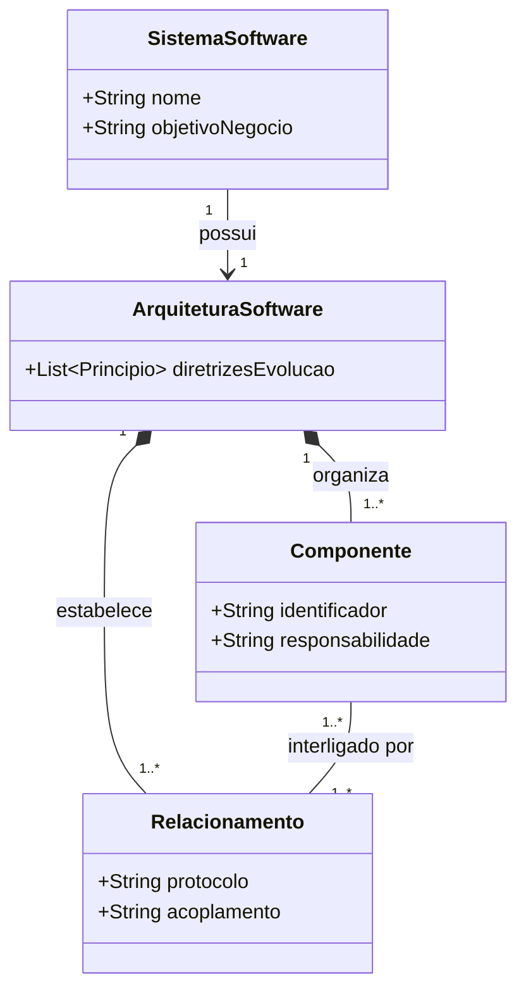

A arquitetura governa as decisões técnicas mais difíceis de reverter ao longo do tempo. Enquanto um algoritmo inadequado pode ser refatorado em poucas horas de trabalho, um modelo de dados incorreto ou a escolha de um padrão de comunicação incompatível pode comprometer a sobrevivência financeira de um produto.

---

### 9.2 Padrões Arquiteturais versus Padrões de Projeto (GoF)

```mermaid
flowchart TD
  subgraph NivelMacro["Padrões Arquiteturais (Visão Sistêmica Global)"]
    PA["Organizam grandes subsistemas, fronteiras de rede e distribuição de dados."]
    PA1["Exemplos: Microserviços, Arquitetura Hexagonal, SOA, Model-View-Controller"]
  end

  subgraph NivelMicro["Padrões de Projeto GoF (Visão Tática Local)"]
    PP["Estruturam colaborações pontuais entre classes e objetos no código-fonte."]
    PP1["Exemplos: Strategy, Factory Method, Adapter, Observer, Facade"]
  end

  NivelMacro -->|"Governa e delimita"| NivelMicro
```

---

### 9.3 Modelos de Distribuição: SaaS versus On-Premises

```mermaid
flowchart LR
  subgraph OnPremises["Modelo On-Premises"]
    OP1["Data Center Físico Próprio"]
    OP2["Custos de Capital (CapEx)"]
    OP3["Equipe Interna Mantém Backups e Hardware"]
    OP1 --- OP2 --- OP3
  end

  subgraph SaaS["Modelo SaaS (Software as a Service)"]
    SS1["Provedor de Nuvem Centralizado"]
    SS2["Despesas Operacionais Recorrentes (OpEx)"]
    SS3["Atualizações e Elasticidade Gerenciadas"]
    SS1 --- SS2 --- SS3
  end
```

| Critério de Engenharia | Software as a Service (SaaS) | On-Premises (Instalação Local) |
| :--- | :--- | :--- |
| **Natureza Contábil** | **OpEx** (Despesa Operacional por assinatura). | **CapEx** (Investimento pesado em infraestrutura física). |
| **Custódia dos Dados** | Armazenados na nuvem do fornecedor. | Armazenados localmente sob controle direto da organização. |
| **Distribuição de Versão** | Base única atualizada continuamente para todos. | Múltiplas versões defasadas instaladas em clientes. |
| **Disponibilidade** | Garantida por acordos formais de SLA pelo provedor. | Dependente exclusiva da equipe interna de infraestrutura. |

---

### 9.4 Arquitetura Cliente-Servidor e suas Limitações

A arquitetura clássica de duas camadas (Client-Server) aloca a interface e regras parciais no executável cliente (computador de mesa) e as regras transacionais e persistência em um servidor de banco de dados centralizado.

- **Limitações Estruturais:**
  1. *Falta de Escalabilidade:* Cada cliente estabelece uma conexão persistente e pesada com o banco de dados, esgotando o *pool* de conexões sob cargas volumétricas elevadas.
  2. *Débito Técnico de Manutenção:* Atualizar regras de negócio exige a reinstalação física ou distribuição de novos binários em todas as estações de trabalho de usuários.
  3. *Segurança Frágil:* A dependência de conexões de banco expostas diretamente a redes locais favorece ataques de injeção e interceptação de tráfego.

---

### 9.5 Arquitetura Orientada a Serviços (SOA)

A Arquitetura Orientada a Serviços estrutura o sistema corporativo como um ecossistema de serviços reutilizáveis, fracamente acoplados e interoperáveis, que se comunicam através de protocolos neutros e mensagens *stateless* (sem retenção de estado de sessão no servidor):

```mermaid
flowchart TD
  Consumidor["Camada Consumidora (Web / Mobile / B2B)"]
  ESB["Barramento de Serviços Corporativos (Enterprise Service Bus)"]
  
  Consumidor --> ESB
  ESB --> S1["Serviço de Faturamento"]
  ESB --> S2["Serviço de Estoque"]
  ESB --> S3["Serviço de Logística"]
```

---

### 9.6 Arquitetura Hexagonal (Ports and Adapters)

Idealizada por Alistair Cockburn, a Arquitetura Hexagonal posiciona o **Domínio e as Regras de Negócio no centro geométrico**, isolando-os compulsoriamente de bibliotecas externas, frameworks, bancos de dados e interfaces visuais:

```mermaid
flowchart TD
  subgraph AdaptadoresConduzidos["Adaptadores Externos de Entrada (Primários)"]
    API["API REST Controller"]
    CLI["Interface de Linha de Comando"]
  end

  subgraph NucleoHexagono["Núcleo da Aplicação (Independente)"]
    PortIn["Porta de Entrada (Driving Port)"]
    CasosUso["Casos de Uso e Regras de Negócio"]
    PortOut["Porta de Saída (Driven Port)"]
    PortIn --> CasosUso --> PortOut
  end

  subgraph AdaptadoresSecundarios["Adaptadores Externos de Saída (Secundários)"]
    DB["Adaptador PostgreSQL (JPA)"]
    Queue["Adaptador RabbitMQ / Mensageria"]
  end

  API --> PortIn
  CLI --> PortIn
  PortOut --> DB
  PortOut --> Queue
```

- **Portas (Ports):** Interfaces puras de contrato (linguagem de domínio). Definem a forma de entrada ou consumo de dados sem conhecer classes concretas.
- **Adaptadores (Adapters):** Classes concretas de infraestrutura que convertem requisições de agentes externos (ex.: JSON recebido via HTTP) no formato exigido pela porta de entrada, ou traduzem comandos da porta de saída em comandos técnicos (ex.: instruções SQL).

---

### 9.7 Arquitetura de Microserviços e Governança

A arquitetura de microserviços decompõe a aplicação em múltiplos serviços de granularidade fina, cada qual executando seu próprio processo independente, mantendo sua própria base de dados (*Database-per-Service*) e comunicando-se via APIs REST leves ou mensageria de eventos assíncrona:

```mermaid
flowchart LR
  Gateway["API Gateway Corporativo"]
  Gateway --> MS1["Microsserviço: Usuários (DB Próprio)"]
  Gateway --> MS2["Microsserviço: Pedidos (DB Próprio)"]
  Gateway --> MS3["Microsserviço: Catálogo (DB Próprio)"]
```

#### Balanço de Trade-offs na Engenharia de Software
- **Vantagens Reais:** Escalabilidade elástica individualizada (escalar somente o serviço com gargalo), isolamento de falhas e flexibilidade na escolha da pilha tecnológica.
- **Desafios e Sobrecarga:** Complexidade de transações distribuídas (necessidade de implementar padrões como *Saga* em vez de transações ACID puras), latência de rede acumulada, necessidade de orquestração automatizada (Kubernetes) e observabilidade distribuída complexa (*tracing* com OpenTelemetry).

---

## 10. O Padrão Arquitetural Model-View-Controller no Smalltalk-80

### 10.1 Origem no Xerox PARC e Desafios Multi-Janela

O padrão Model-View-Controller (MVC) foi formulado no **Xerox Palo Alto Research Center (PARC)** na virada dos anos 1970 para os 1980 por cientistas da computação como **Trygve Reenskaug**, **Dan Ingalls**, **Alan Kay** e **Adele Goldberg** durante a concepção do ambiente Smalltalk-76 e Smalltalk-80.

#### O Problema das Aplicações Primitivas e a Classe `Pen`
Antes do MVC, sistemas gráficos operavam como programas monolíticos que desenhavam primitivas diretamente no *framebuffer* global da tela por meio da classe `Pen`. Esse modelo impedia que múltiplos programas dividissem o espaço do monitor de forma simultânea:
- Um programa malcomportado escrevia livremente nas posições de memória gráfica alocadas para outras janelas, corrompendo as saídas visuais vizinhas.
- A entrada de periféricos físicos (teclado e mouse) ocorria por laços bloqueantes procedurais de leitura de hardware.

O MVC clássico nasceu para viabilizar **interfaces multi-janelas cooperativas**, estabelecendo regras para compartilhar tela, mouse e teclado de modo seguro e modular.

---

### 10.2 A Tríade Canônica Model-View-Controller

No Smalltalk-80, o padrão divide a interação interativa em três classes de objetos com acoplamentos muito bem delimitados:

```mermaid
classDiagram
  class Model {
    +dependents: Collection
    +changed()
    +changed(aspect)
    +addDependent(View aView)
  }
  class View {
    +model: Model
    +controller: Controller
    +display()
    +update(aModel, anAspect)
  }
  class Controller {
    +model: Model
    +view: View
    +controlLoop()
    +controlActivity()
  }

  View "1" o-- "1" Controller : Ligação Bilateral Rígida
  Controller "1" o-- "1" View : Ligação Bilateral Rígida
  View --> "1" Model : Consulta Estado (Leitura)
  Controller --> "1" Model : Dispara Comandos (Mutação)
  Model ..> View : Notificação Indireta (Observer)
```

- **Model (Modelo):** Encapsula os dados e as regras do domínio. O modelo é puramente agnóstico de apresentação gráfica; ele ignora completamente como suas informações serão desenhadas na tela.
- **View (Visão):** Constrói a saída gráfica na porção de tela delimitada para sua janela (*viewport*). Consulta o modelo para desenhar e implementa o método `update:` para reagir a notificações.
- **Controller (Controlador):** Interpreta as ações físicas originadas dos periféricos (movimento de mouse, cliques de botões e teclas digitadas), transformando dados brutos de hardware em comandos semânticos para o modelo ou para a visão.

#### Natureza dos Canais de Comunicação
1. **Canal Bilateral Direto (Rígido):** A View conhece seu Controller e o Controller conhece sua View e seu Model de modo explícito por referências diretas de instância.
2. **Canal Indireto Reativo (Desacoplado):** O Model **não** referencia nomes concretos de Visões ou Controladores. Ele interage com o ecossistema visual utilizando exclusivamente a lista abstrata de observadores do padrão *Observer*.

---

### 10.3 Modelos Ativos versus Modelos Passivos

Steve Burbeck (1987) classifica os modelos do Smalltalk-80 em duas categorias funcionais:

```mermaid
sequenceDiagram
  autonumber
  actor User as Periférico Físico / Usuário
  participant Ctrl as Controller
  participant ModPassivo as Modelo Passivo (ex: String)
  participant ViewP as View

  User->>Ctrl: Tecla digitada
  Ctrl->>ModPassivo: mutacaoDados()
  Ctrl->>ViewP: redesenharDireto()
  Note over Ctrl,ViewP: Modelo Passivo: Controller orquestra tudo
```

```mermaid
sequenceDiagram
  autonumber
  participant ThreadExt as Processo em Background
  participant ModAtivo as Modelo Ativo (ex: SystemTranscript)
  participant ViewA as View Dependente

  ThreadExt->>ModAtivo: appendTexto("Novo Log")
  ModAtivo->>ModAtivo: changed(#texto)
  ModAtivo->>ViewA: update(self, #texto)
  ViewA->>ModAtivo: consultarNovosDados()
  ViewA->>ViewA: display()
  Note over ModAtivo,ViewA: Modelo Ativo: Notificação reativa originada do Model
```

- **Modelo Passivo:** O modelo é alterado exclusivamente pelo controlador de sua própria tríade MVC. O controlador assume a responsabilidade de ordenar a repintura da tela ou repassar o dado modificado.
- **Modelo Ativo:** O estado do modelo pode ser modificado por processos de segundo plano (*background threads*), outros controladores ou agentes de rede. Apenas o próprio modelo tem conhecimento de quando seu estado interno foi violado ou modificado, tornando mandatória a emissão reativa de notificações para seus dependentes registrados.

---

### 10.4 Protocolo de Notificação Reativa

#### A Evolução: de `DependentFields` para a classe `Model`
- **Smalltalk-80 v2.0:** Qualquer objeto podia ser observado. Para evitar que classes simples alocassem ponteiros extras em memória sem necessidade, o sistema mantinha uma tabela global hash de identidade chamada `DependentFields` associada à classe `Object`. Essa abordagem gerava concorrência de acesso e vazamentos de memória caso dependentes não fossem explicitamente removidos.
- **Smalltalk-80 v2.5:** O arquiteto Frank Zdybel introduziu a classe abstrata `Model`, inserindo a variável de instância `dependents` diretamente nos modelos. Essa variável implementava otimizações cirúrgicas:
  - `nil`: sem observadores cadastrados (gasto nulo de memória).
  - Uma referência direta: quando havia apenas uma visão dependente.
  - Instância de `DependentsCollection`: quando dois ou mais dependentes estavam vinculados.

O ciclo reativo fundamenta-se nos pares de mensagens em Smalltalk:

```smalltalk
"Disparo de Notificação (no Modelo):"
self changed.                  "Notificação genérica sem parâmetros"
self changed: #aspecto.        "Notificação granular identificando o que mudou"

"Recepção do Evento (na Visão):"
update: aModel
    self display.

update: aModel with: anAspect
    (anAspect == #aspecto) ifTrue: [ self displayView. ].
```

---

### 10.5 Hierarquia Visual, Pluggable Views e Transformações de Coordenadas

```mermaid
flowchart TD
  TopView["TopView (Janela Principal: Título, Bordas, Botões)"]
  TopView --> SV1["SubView 1: Painel Lateral de Navegação"]
  TopView --> SV2["SubView 2: Editor Textual (ParagraphEditor)"]
  TopView --> SV3["SubView 3: Terminal de Execução (Transcript)"]
```

#### Pipeline Canônico de Renderização Gráfica
A renderização em cascata (padrão *Composite*) processa recursivamente a árvore gráfica:
1. `display`: Método de entrada principal invocado pelo gerenciador de janelas.
2. `displayBorder`: Desenha os contornos da janela utilizando as transformações de tela.
3. `displayView`: Pinta os elementos gráficos e textuais próprios da visão corrente.
4. `displaySubviews`: Varre recursivamente a coleção `subViews`, invocando `display` em cascata para cada painel filho.

#### Transformações com `WindowingTransformation`
O Smalltalk-80 isola a geometria das janelas do monitor físico através da classe matemática `WindowingTransformation`. O desenvolvedor calcula gráficos em um espaço abstrato de modelo (*window layout*); a classe aplica translação e escalonamento vetorial bidirecional para projetar os pixels exatos no plano do monitor físico (*viewport*).

---

### 10.6 Controle Cooperativo e Despacho de Eventos

Em uma máquina com apenas um processador e ausência de *preemptive multithreading* na interface, o ambiente utilizava um modelo de **multitarefa cooperativa** governado pelo objeto global `ScheduledControllers` (instância de `ControlManager`):

```mermaid
flowchart TD
  CM["ControlManager (ScheduledControllers)"]
  TopCtrl["TopController da Janela Ativa"]
  SubCtrl["SubController sob a Posição do Mouse"]

  CM -->|"Verifica qual janela intercepta o cursor"| TopCtrl
  TopCtrl -->|"Delega evento de entrada para a área de foco"| SubCtrl
  SubCtrl -->|"Invoca rotinas de controle"| Loop["controlLoop -> controlActivity"]
```

#### A Convenção do Mouse de Três Botões
O ambiente Xerox Smalltalk padronizou os botões físicos do mouse por cores semânticas:
- **Botão Vermelho (Red Button - Esquerdo):** Interação primária e seleção de texto ou objetos na tela (`redButtonActivity`).
- **Botão Amarelo (Yellow Button - Central):** Abre o menu de contexto contendo operações específicas da visão ativa (`yellowButtonActivity`).
- **Botão Azul (Blue Button - Direito):** Abre o menu global de janelas gerenciado pela `TopView` para enquadramento, fechamento, colapso e redimensionamento (`blueButtonActivity`).

---

### 10.7 Transposição Estrutural do MVC Clássico para Java Moderno

A implementação abaixo transpõe os conceitos estruturantes do Smalltalk-80 (modelo ativo com notificações granulares, separação rígida de responsabilidades e controlador cooperativo) para a linguagem Java:

```java
package br.unifef.engenharia.mvc;

import java.util.ArrayList;
import java.util.List;
import java.util.Objects;

/**
 * Interface de atualizacao reativa equivalente ao protocolo update:anAspect do Smalltalk.
 */
interface ModelListener {
    void modelChanged(ObservableModel origin, String aspect);
}

/**
 * Superclasse base para Modelos Ativos, emulando a classe Model do Smalltalk-80 v2.5.
 */
abstract class ObservableModel {
    private final List<ModelListener> dependents = new ArrayList<>();

    public synchronized void addDependent(ModelListener listener) {
        if (listener != null && !this.dependents.contains(listener)) {
            this.dependents.add(listener);
        }
    }

    public synchronized void removeDependent(ModelListener listener) {
        this.dependents.remove(listener);
    }

    protected void changed(String aspect) {
        List<ModelListener> snapshot;
        synchronized (this) {
            snapshot = new ArrayList<>(this.dependents);
        }
        for (ModelListener listener : snapshot) {
            listener.modelChanged(this, aspect);
        }
    }
}

/**
 * Modelo de Dominio Concreto (Contador de Producao).
 */
class ContadorModel extends ObservableModel {
    private int contagem;

    public ContadorModel(int valorInicial) {
        this.contagem = valorInicial;
    }

    public synchronized int getContagem() {
        return this.contagem;
    }

    public synchronized void incrementar() {
        this.contagem++;
        this.changed("contagem");
    }

    public synchronized void reiniciar() {
        this.contagem = 0;
        this.changed("contagem");
    }
}

/**
 * Visao (View) especializada em renderizar o estado textual na saida de tela.
 */
class ConsoleView implements ModelListener {
    private final ContadorModel model;
    private ConsoleController controller;

    public ConsoleView(ContadorModel model) {
        this.model = Objects.requireNonNull(model, "Modelo e obrigatorio.");
        this.model.addDependent(this);
    }

    public void setController(ConsoleController controller) {
        this.controller = controller;
    }

    public void display() {
        System.out.println("[View Render] Valor Atual da Producao: " + this.model.getContagem());
    }

    @Override
    public void modelChanged(ObservableModel origin, String aspect) {
        if ("contagem".equals(aspect)) {
            this.display();
        }
    }
}

/**
 * Controlador (Controller) que interpreta entradas semanticas do operador.
 */
class ConsoleController {
    private final ContadorModel model;
    private final ConsoleView view;

    public ConsoleController(ContadorModel model, ConsoleView view) {
        this.model = Objects.requireNonNull(model, "Modelo e mandatorio.");
        this.view = Objects.requireNonNull(view, "Visao e mandatoria.");
        this.view.setController(this);
    }

    public void requisitarIncremento() {
        this.model.incrementar();
    }

    public void requisitarZerar() {
        this.model.reiniciar();
    }
}
```

---

## 11. Síntese dos Trabalhos Práticos e Dinâmica de Papéis

### 11.1 A Dinâmica Stakeholder versus Analista de Sistemas

Nas atividades práticas avaliativas (como a Atividade Aula 3 e Atividade Classe), os estudantes devem assumir com rigor metodológico a separação dos papéis corporativos:

```mermaid
flowchart TD
  subgraph Negocio["Visão de Negócio (Papel do Stakeholder)"]
    S1["Vivencia a dor operacional diária"]
    S2["Menciona prejuízos financeiros e atrasos"]
    S3["Usa vocabulário do setor (médico, financeiro, agro)"]
    S4["Apresenta expectativas vagas de tecnologia"]
  end

  subgraph Engenharia["Visão Técnica (Papel do Analista de Sistemas)"]
    A1["Aplica escuta ativa e perguntas cardinais"]
    A2["Isola a causa raiz dos sintomas aparentes"]
    A3["Formaliza Requisitos Funcionais e Não Funcionais"]
    A4["Desenvolve Modelos Estruturais e Comportamentais UML"]
  end

  Negocio -->|"Elicitação e Tradução"| Engenharia
```

- **O Stakeholder não define requisitos formais:** Ele relata problemas humanos, perdas contábeis e rotinas defeituosas.
- **O Analista de Sistemas atua como tradutor e estruturador:** Ele transforma relatos não estruturados em especificações verificáveis, modelos conceituais sem ambiguidade e arquitetura de classes estável.

---

### 11.2 Estudo Prático da Atividade Aula 3: Rastreabilidade Logística

A Atividade 3 propôs o projeto de automação corporativa da *HealthTech Solutions*, especializada na locação de equipamentos hospitalares de alto valor:

```mermaid
flowchart TD
  Sintoma["Sintoma Aparente: Equipamentos biomédicos extraviados em trânsito"]
  P1["Causa Nível 1: Comunicação fragmentada via aplicativos de mensagem"]
  P2["Causa Nível 2: Ordens de coleta manuais em papel sem validação"]
  P3["Causa Nível 3: Falta de confirmação biométrica ou serial no ato da retirada"]
  CausaRaiz["Causa Raiz: Inexistência de um sistema digital unificado com conferência de número de série e rastreamento atômico de custódia"]

  Sintoma --> P1
  P1 --> P2
  P2 --> P3
  P3 --> CausaRaiz
```

#### Rastreabilidade Entre Problema, RF e RNF
- **Problema Diagnosticado:** Risco de multas sanitárias por expiração da calibração metrológica (RDC ANVISA nº 63/2011).
- **Requisito Funcional (RF-04):** O sistema deve emitir alertas automáticos com 30 dias de antecedência para equipamentos com certificado de calibração próximo ao vencimento.
- **Requisito Não Funcional (RNF-02):** A consulta à situação metrológica do equipamento por leitura ótica de QR Code deve responder em tempo inferior a 800 milissegundos em conexões 4G móveis.

---

### 11.3 Estudo Prático da Atividade Classe: Formalização de Casos de Uso

A Atividade Classe exigiu a transcrição rigorosa dos diagramas discutidos em sala de aula, aplicando:
1. **Delimitação Estrita da Fronteira do Sistema:** Nenhum caso de uso pode residir fora do retângulo delimitador da aplicação; nenhum ator pode residir dentro dele.
2. **Direcionalidade Impecável das Dependências:**
   - Inclusão (`«include»`): O caso de uso principal `Finalizar Compra` aponta para `Autenticar Cliente`.
   - Extensão (`«extend»`): O caso acessório `Aplicar Cupom Promocional` aponta para `Finalizar Compra`.
3. **Ausência de Comandos Procedurais no Diagrama:** Eliminação do antipadrão de criar elipses com nomes do tipo "Abrir Banco de Dados" ou "Carregar Tela de Login".

---

## 12. Caderno de Fixação e Avaliação Integrada

### 12.1 Matrizes de Comparação Rápida

#### Matriz: Paradigmas Arquiteturais Modernos

| Critério Técnico | Monólito em Camadas | Arquitetura Hexagonal | Microserviços |
| :--- | :--- | :--- | :--- |
| **Complexidade Operacional** | Baixa (deploy simples em arquivo único). | Média (exige disciplina de interfaces e inversão). | Muito Alta (orquestração de containers, rede e tracing). |
| **Isolamento de Negócio** | Médio (risco de contaminação por dependências). | Excelente (domínio no centro geométrico isolado). | Excelente (isolamento físico por processos e repositórios). |
| **Modelo de Dados** | Banco relacional centralizado unificado. | Agnóstico no centro; plugável nos adaptadores. | Banco de dados descentralizado por serviço. |
| **Adequação de Equipe** | Equipes pequenas a médias (3 a 10 desenvolvedores). | Equipes focadas em domínio de negócio robusto. | Múltiplos times autônomos distribuídos (50+ devs). |

---

### 12.2 Catálogo de Falhas, Contraexemplos e Soluções

#### Falha 1: Transformar Casos de Uso em Fluxogramas de Telas
- **Antipadrão:** Conectar elipses com setas sequenciais: `Digitar Senha` --> `Clicar Botão Entrar` --> `Exibir Tela Principal`.
- **Impacto:** O modelo perde o foco nos objetivos de negócio e acopla a documentação a detalhes transitórios de interface visual.
- **Solução Correta:** Unificar todo o procedimento em um único caso de uso abrangente intitulado `Autenticar Usuário`, detalhando as etapas de tela na especificação textual.

#### Falha 2: Uso Indiscriminado de Getters e Setters (Modelo Anêmico)
- **Antipadrão:** Declarar campos privados e gerar setters automáticos para todos eles sem validação:
  ```java
  public void setValorTotal(double valor) { this.valorTotal = valor; }
  ```
- **Impacto:** Permite que código externo injete valores negativos ou burle cálculos de descontos, destruindo o encapsulamento real da classe.
- **Solução Correta:** Fechar o setter e prover operações de domínio:
  ```java
  public void registrarItem(ItemVenda item) {
      // validação e cálculo interno seguro
  }
  ```

#### Falha 3: Inversão de Setas de Inclusão e Extensão na UML
- **Antipadrão:** Desenhar a dependência `«include»` partindo do caso de autenticação em direção ao checkout de compras.
- **Impacto:** Modifica o sentido da dependência de software; dá a entender que a autenticação obriga o usuário a comprar um produto.
- **Solução Correta:** A seta do `«include»` sempre parte da funcionalidade que necessita daquele serviço auxiliar (`Realizar Compra -.->|«include»| Autenticar`).

---

### 12.3 Exercícios Resolvidos de Fixação

#### Exercício 1: Modelagem e Priorização em Comércio Eletrônico
**Enunciado:** Uma empresa varejista deseja lançar seu MVP comercial em 60 dias. Foram elicitadas as seguintes funcionalidades:
1. Fechamento de pedidos com cartão de crédito.
2. Recomendação de produtos com inteligência artificial baseada em navegação prévia.
3. Cadastro de produtos e controle básico de estoque.
4. Notificação push de promoções no celular do cliente.

*Aplique o método MoSCoW, justificando a alocação de cada funcionalidade sob a ótica do prazo de 60 dias.*

**Resolução Técnica:**
- **Must have:** *Fechamento de pedidos com cartão* e *Cadastro de produtos com controle de estoque*. Sem esses itens, a loja não é capaz de comercializar produtos; o sistema inexiste operacionalmente.
- **Should have:** *Notificação push de promoções*. Agrega valor relevante ao marketing, mas a venda imediata pode operar sem notificações ativas no lançamento.
- **Won't have:** *Recomendação de produtos via IA*. Exige coleta massiva prévia de telemetria, pipeline de machine learning e testes estatísticos, desviando o time do prazo rígido de 60 dias do MVP.

---

#### Exercício 2: Análise da Tríade MVC no Smalltalk-80
**Enunciado:** Explique por que, no padrão MVC original do Smalltalk-80, o Modelo (Model) utiliza comunicação indireta (padrão Observer) para interagir com a Visão (View), enquanto a Visão interage com o Controlador (Controller) por referências diretas de objeto.

**Resolução Técnica:**
A separação fundamenta-se no princípio de desacoplamento do domínio de negócio em relação à interface do usuário. O Modelo encapsula a essência do problema (dados e regras matemáticas), devendo ser completamente agnóstico sobre a forma como seus dados são exibidos na tela. Ao utilizar o padrão Observer (`changed`/`update:`), múltiplos observadores visuais (ex.: um gráfico de pizza e uma tabela de texto simultâneos) podem se conectar ao mesmo modelo sem que nenhuma linha do modelo seja modificada. Em contrapartida, a View e o Controller mantêm uma relação de dependência bilateral direta (1:1) porque operam em conjunto para gerenciar o mesmo espaço físico na tela: a visão define as fronteiras geométricas do componente e o controlador interpreta as coordenadas dos cliques de mouse e teclas dentro dessa exata área delimitada.

---

### 12.4 Glossário Técnico Unificado

- **Acceptance Criteria (Critérios de Aceite):** Conjunto de condições estritas que um software deve cumprir para ser homologado e aceito pelo cliente.
- **Antipadrão (Anti-Pattern):** Solução recorrente para um problema que, embora pareça vantajosa inicialmente, introduz consequências colaterais danosas e inviabiliza a manutenção.
- **CapEx (Capital Expenditure):** Despesas em bens de capital e ativos permanentes, como a aquisição física de servidores e equipamentos de infraestrutura.
- **Code Smell (Anomalia de Código):** Sintoma superficial no código-fonte que sinaliza uma fraqueza mais profunda no design estrutural da aplicação (ex.: métodos excessivamente longos, classes gigantes).
- **Despacho Dinâmico (Late Binding):** Mecanismo computacional onde a chamada de um método polimórfico é vinculada ao endereço de memória de código em tempo de execução, e não durante a compilação estática.
- **Escaping Reference:** Falha de encapsulamento em que uma classe retorna a referência direta de um atributo mutável privado, permitindo modificações descontroladas por agentes externos.
- **God Class:** Classe inflada com dezenas de métodos e atributos, acumulando múltiplas responsabilidades descorrelacionadas e violando o Princípio da Responsabilidade Única.
- **Linguagem Ubíqua:** Prática de engenharia de adotar um vocabulário único e consistente compartilhado entre desenvolvedores e especialistas de negócio em todos os artefatos.
- **OpEx (Operational Expenditure):** Despesas contínuas operacionais de um negócio, como assinaturas mensais de serviços em nuvem (SaaS).
- **Scope Creep (Corrupção de Escopo):** Crescimento desordenado e descontrolado das funcionalidades de um projeto sem a correspondente ampliação de prazos, equipe e orçamento.
- **SLA (Service Level Agreement):** Acordo formal de nível de serviço que estipula parâmetros mínimos aceitáveis de disponibilidade, desempenho e tempo de reparo de um sistema.
- **SWEBOK:** *Software Engineering Body of Knowledge*, guia consolidado pelo IEEE com as práticas e fundamentos consagrados da engenharia de software mundial.

---

## Fontes e Metadados

- Turma no Classroom: Engenharia de Software 2 - 2026/02
- Itens processados: 0 materiais, 4 tarefas, 8 avisos
- Gerado em: 27/10/2026, 20:39:56 (BRT) via classroom-sync
