# Engenharia de Software II — Manual Integrado de Engenharia e Modelagem de Software

> **Instituição:** Centro Universitário de Fernandópolis (UniFEF)  
> **Curso:** Bacharelado em Sistemas de Informação (4º Semestre)  
> **Disciplina:** Engenharia de Software II  
> **Docente:** Prof. Ms. Wesley Soares de Souza  
> **Finalidade:** Material Didático Exaustivo e Caderno de Estudos para Avaliações (AV1, AV2 e Projeto Integrador)

---

## Sumário

- [Informações Acadêmicas e Governança da Disciplina](#informações-acadêmicas-e-governança-da-disciplina)
- [Módulo 1: Fundamentos do Ciclo de Vida e Projeto de Software](#módulo-1-fundamentos-do-ciclo-de-vida-e-projeto-de-software)
- [Módulo 2: Engenharia e Elicitação de Requisitos](#módulo-2-engenharia-e-elicitação-de-requisitos)
- [Módulo 3: Priorização de Requisitos com o Método MoSCoW](#módulo-3-priorização-de-requisitos-com-o-método-moscow)
- [Módulo 4: Modelagem Comportamental com Diagramas de Casos de Uso](#módulo-4-modelagem-comportamental-com-diagramas-de-casos-de-uso)
- [Módulo 5: Modelagem Estrutural: Fundamentos da UML e Diagrama de Classes](#módulo-5-modelagem-estrutural-fundamentos-da-uml-e-diagrama-de-classes)
- [Módulo 6: Princípios de Design OO, Padrões GoF e Boas Práticas](#módulo-6-princípios-de-design-oo-padrões-gof-e-boas-práticas)
- [Módulo 7: Arquitetura de Software e Estilos Arquiteturais](#módulo-7-arquitetura-de-software-e-estilos-arquiteturais)
- [Módulo 8: Modelagem Dinâmica: Diagramas de Sequência e Comunicação](#módulo-8-modelagem-dinâmica-diagramas-de-sequência-e-comunicação)
- [Módulo 9: Modelagem de Ciclo de Vida e Processos: Estados e Atividades](#módulo-9-modelagem-de-ciclo-de-vida-e-processos-estados-e-atividades)
- [Módulo 10: Caderno de Exercícios, Casos Práticos e Questões de Revisão](#módulo-10-caderno-de-exercícios-casos-práticos-e-questões-de-revisão)
- [Glossário Geral de Engenharia de Software](#glossário-geral-de-engenharia-de-software)

---

## Informações Acadêmicas e Governança da Disciplina

### Corpo Docente
A disciplina é estruturada e ministrada pelo **Prof. Ms. Wesley Soares de Souza**:
- **Experiência na Indústria:** Engenheiro de Software Sênior com mais de 15 anos de atuação profissional prática na liderança técnica e concepção de sistemas distribuídos de grande porte e missão crítica.
- **Carreira Acadêmica:** Atuação no ensino superior desde 2014, com passagens pelo Grupo Kroton (Anhanguera), FATEC Jales e Instituto Federal de São Paulo (IFSP) – Câmpus Votuporanga.
- **Titulação e Formação:**
  - Bacharel em Sistemas de Informação pela Fundação Educacional de Fernandópolis (F.E.F. / UniFEF).
  - Pós-graduado em Gestão de Banco de Dados.
  - Mestre em Engenharia de Software pela Universidade Federal do Pampa (UNIPAMPA - RS).

### Critérios de Avaliação e Composição de Notas
A composição da média semestral equilibra o desempenho individual teórico-prático com a capacidade de entrega técnica em equipe por meio da fórmula:

```math
\text{Nota Final} = \frac{[(\text{AV}_1 \times 0.6) + (\text{PJ} \times 0.4)] + [(\text{AV}_2 \times 0.6) + (\text{PJ} \times 0.4)]}{2}
```

Onde:
- **AV1 (Avaliação Individual 1):** Prova individual com questões conceituais, analíticas e modelagem prática correspondente ao conteúdo programático do primeiro bimestre.
- **AV2 (Avaliação Individual 2):** Prova individual focada na aplicação prática de arquitetura, padrões estruturais/comportamentais, diagramas de interação e engenharia de qualidade do segundo bimestre.
- **PJ (Projeto Integrador de Software):** Projeto técnico contínuo em equipe avaliado ao longo de dois marcos de entrega cumulativos.

### Estrutura do Projeto Integrador da Disciplina
O Projeto Integrador simula o ciclo real da engenharia corporativa, sendo desenvolvido estritamente em **equipes de 3 integrantes**:

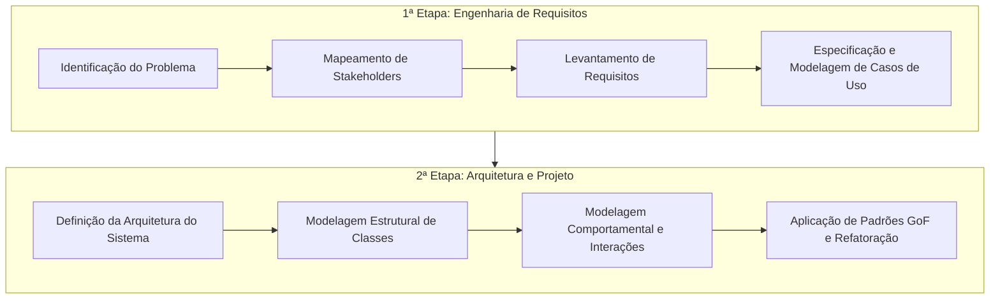

As áreas temáticas fixadas para os projetos fictícios compreendem:
- **Comércio:** Marketplaces B2B/B2C, sistemas de gestão de pedidos (OMS) e controle de estoques (WMS).
- **Serviços Públicos:** Atendimento ao cidadão, gestão de solicitações municipais e ouvidorias.
- **Negócios:** Gestão corporativa de tarefas, recrutamento e seleção (ATS) e fluxo financeiro.
- **Saúde:** Gestão de clínicas, agendamento ambulatorial e prontuário eletrônico.
- **Educação:** Plataformas de aprendizagem (LMS) e gestão acadêmica (SGA).
- **Logística:** Rastreamento veicular, roteirização e comprovação de entregas.

### Bibliografia Recomendada
- **GUEDES, Gilleanes T. A.** *UML 2: Uma Abordagem Prática*. 2. ed. São Paulo: Novatec, 2011.
- **BOOCH, Grady; RUMBAUGH, James; JACOBSON, Ivar.** *UML: Guia do Usuário*. 1. ed. Rio de Janeiro: Campus, 2000.
- **FURLAN, José Davi.** *Modelagem de Objetos através da UML*. 1. ed. São Paulo: Makron Books, 1998.
- **BEZERRA, Eduardo.** *Princípios de Análise e Projeto de Sistemas com UML*. 4. ed. Rio de Janeiro: Editora Elsevier, 2007.
- **MEDEIROS, Ernani.** *Desenvolvendo Software com UML 2.0*. 1. ed. São Paulo: Makron Books, 2004.
- **O'NEILL, Henrique; NUNES, Mauro; RAMOS, Pedro.** *Exercícios de UML*. 1. ed. Lisboa/São Paulo: Editora Informática / FCA, 2010.
- **GÓES, Wilson Moraes.** *Aprenda UML por Meio de Estudo de Caso*. 1. ed. São Paulo: Novatec, 2014.
- **BORATTI, Isaias Camilo.** *Programação Orientada a Objetos em Java*. 1. ed. Florianópolis: Visual Books, 2007.

---

## Módulo 1: Fundamentos do Ciclo de Vida e Projeto de Software

### A Premissa Fundamental: Software não é feito em pastelaria
Na abertura da disciplina, o Prof. Wesley Soares destaca uma analogia crucial da engenharia de software: **o antipadrão da "pastelaria"**. No modelo informal, o cliente se aproxima do balcão, faz um pedido apressado e espera a entrega imediata de uma solução pronta em poucos minutos, sem documentação, sem análise de viabilidade e sem arquitetura definida.

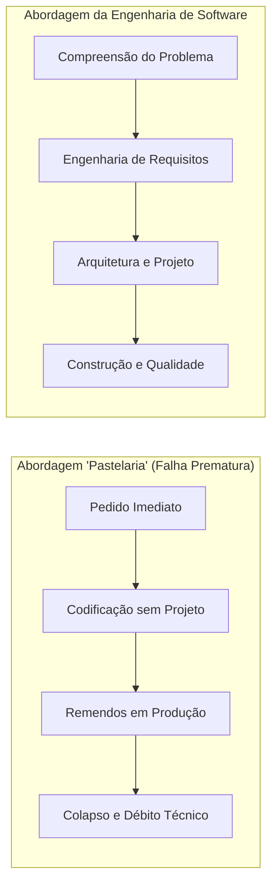

A engenharia de software contrapõe-se a essa mentalidade amadora estabelecendo processos sistemáticos, mensuráveis e reprodutíveis. Sistemas de informação sustentam infraestruturas financeiras, médicas, governamentais e comerciais; falhas estruturais resultam em colapso operacional, prejuízos financeiros severos e riscos legais.

### O Equilíbrio entre Análise e Projeto

> *"Faça a coisa certa (análise) e faça certo a coisa (projeto)."*

Esta máxima resume a segregação de responsabilidades no ciclo de vida de desenvolvimento:
- **Análise (Fazer a coisa certa):** Foco orientado ao **domínio do problema**. Identifica quem são os atores, quais as necessidades de negócio reais e que restrições operacionais existem. Construir um software tecnicamente impecável que resolve o problema errado é uma falha de análise.
- **Projeto (Fazer certo a coisa):** Foco orientado ao **domínio da solução**. Transforma as necessidades em estruturas computacionais seguras, desacopladas, extensíveis e manuteníveis. Construir o sistema correto com uma arquitetura frágil gerará um passivo de manutenção insustentável.

| Critério de Comparação | Modelo de Análise | Modelo de Projeto |
| :--- | :--- | :--- |
| **Questão Orientadora** | O que o sistema deve fazer? | Como o sistema fará tecnicamente? |
| **Perspectiva Principal** | Usuário, cliente e especialista de domínio | Arquiteto de software e engenheiro |
| **Vocabulário** | Termos de negócio (ex.: Pedido, Cliente, Titular) | Termos técnicos (ex.: Controller, Repository, Pool) |
| **Nível de Abstração** | Agnóstico de tecnologia, banco ou linguagem | Específico, acoplado a frameworks e padrões |
| **Entregáveis Centrais** | Declaração do Problema, Casos de Uso, RF/RNF | Diagramas de Classes de Projeto, Sequência, APIs |

### As Dez Fases do Projeto de Software
O desenvolvimento profissional percorre dez fases iterativas:

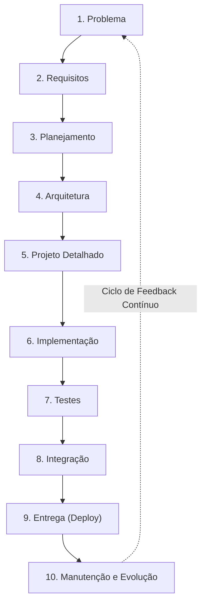

1. **Problema:** Isolar a dor do negócio antes de cogitar qualquer tecnologia.
2. **Requisitos:** Elicitar, refinar e classificar necessidades funcionais e restrições de qualidade.
3. **Planejamento:** Estimar escopo, cronograma, riscos, alocação de equipe e marcos (*milestones*).
4. **Arquitetura:** Selecionar estilos estruturais macro (monólito, microsserviços, hexagonal) e infraestrutura.
5. **Projeto Detalhado:** Modelar classes, interfaces, padrões GoF e diagramas dinâmicos.
6. **Implementação:** Escrever código limpo seguindo normas de estilo, testes e controle de versão.
7. **Testes:** Validar isolamento unitário, integração entre módulos e fluxos de ponta a ponta (E2E).
8. **Integração:** Unificar alterações via pipelines automatizados de CI (*Continuous Integration*).
9. **Entrega:** Disponibilizar o incremento em produção via automações de CD (*Continuous Delivery*).
10. **Manutenção:** Monitorar métricas operacionais, corrigir defeitos e refatorar anomalias.

### O Pipeline em Sete Etapas da Modelagem
Sob a perspectiva da modelagem e design, o ciclo se traduz em sete passos metodológicos:

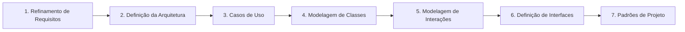

---

## Módulo 2: Engenharia e Elicitação de Requisitos

### Levantar versus Elicitar
No vocabulário corrente, "levantar" e "elicitar" são frequentemente tratados como sinônimos. Contudo, a engenharia de software fundamentada pelo SWEBOK estabelece uma distinção rigorosa:

- **Levantamento (Gathering):** Postura passiva. Pressupõe que os requisitos já estão prontos, claros e organizados na cabeça do cliente, bastando ao analista coletá-los como quem recolhe frutos caídos.
- **Elicitação (Elicitation):** Do latim *elicitare* ("provocar", "fazer sair", "trazer à luz"). Postura ativa e investigativa. O cliente conhece suas dores e rotinas operacionais, mas não sabe expressar requisitos formais. Cabe ao engenheiro investigar processos ocultos e desmascarar necessidades não declaradas.

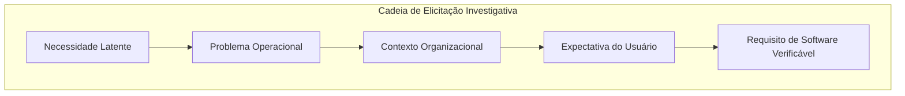

### O Ciclo Causal da Elicitação
A transição de uma queixa para uma especificação de engenharia segue cinco níveis causais:
1. **Necessidade:** Sobrevivência ou sustentabilidade da organização (ex.: diminuir custos de estocagem).
2. **Problema:** O obstáculo factual (ex.: falta de visibilidade do estoque em tempo real).
3. **Contexto:** O ambiente operacional, técnico e humano (ex.: armazém físico sem conectividade contínua).
4. **Expectativa:** A visão idealizada do cliente (ex.: "quero ver tudo atualizado na tela do celular").
5. **Requisito:** A declaração formal, testável e inequívoca (ex.: "O sistema deve sincronizar o saldo de itens via fila assíncrona com latência máxima de 3 segundos quando a rede for restabelecida").

### As Seis Perguntas Cardinais da Elicitação
Diante de qualquer sistema ou funcionalidade, o analista deve responder:
1. **Qual problema existe?** (Foco na dor raiz, e não no sintoma aparente).
2. **Quem enfrenta o problema?** (Identificação de stakeholders primários, secundários e regulatórios).
3. **Como ele é resolvido atualmente?** (Análise do processo *As-Is*, mesmo que manual ou via planilhas).
4. **O que o sistema precisa fazer?** (O comportamento computacional esperado e regras de negócio).
5. **Quais são as restrições?** (Limitações técnicas, prazos, orçamento, segurança e legislações como LGPD).
6. **O que é prioridade?** (O núcleo indispensável para o primeiro lançamento viável — MVP).

### Crítica ao Início Prematuro de Desenvolvimento
> *"Se um cliente disser: 'Preciso de um sistema para melhorar meu negócio', isso é suficiente para começar a desenvolver?"*

A resposta da engenharia é taxativamente **não**:
- **Ausência de Critérios de Aceite:** Não há métrica para definir o que significa "melhorar".
- **Corrupção de Escopo (*Scope Creep*):** O projeto não possui fronteiras; qualquer pedido futuro será cobrado como parte de "melhorar meu negócio".
- **Automatização do Caos:** Informatizar um processo de trabalho manual desorganizado gera apenas um processo caótico automatizado em alta velocidade.

### A Fala Incompleta e a Ambiguidade
Expressões qualitativas como "o sistema deve ser rápido", "a tela deve ser fácil" e "a plataforma deve ser segura" são consideradas **anti-requisitos**. Elas transferem a responsabilidade da definição para o desenvolvedor, criando frustrações na entrega.

| Termo Ambíguo do Cliente | Interpretação Ingênua | Requisito Não Funcional Refatorado (Formal) |
| :--- | :--- | :--- |
| "O sistema precisa ser rápido." | "Adicionei índices no banco." | **RNF-01 (Desempenho):** O tempo de resposta para a consulta paginada de pedidos deve ser inferior a 1,5 segundos no percentil 95 (p95) sob uma carga simultânea de 300 requisições concorrentes. |
| "A interface deve ser intuitiva." | "Coloquei poucos botões." | **RNF-02 (Usabilidade):** Um operador recém-contratado deve ser capaz de concluir o cadastro de um produto em menos de 2 minutos após treinamento introdutório de 15 minutos, com taxa de erro inferior a 3%. |
| "Os dados devem ser seguros." | "Criei senha de login." | **RNF-03 (Segurança):** Todas as credenciais de acesso devem ser armazenadas com hash Argon2id (custo de memória de 64MB) e o tráfego de rede deve ser protegido exclusivamente via TLS 1.3. |

### Técnicas Tradicionais e Complementares de Elicitação
Não existe técnica universal; o analista seleciona o instrumento conforme o perfil organizacional:

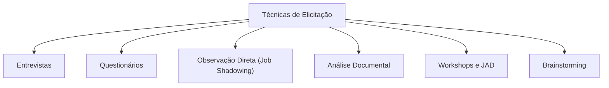

- **Entrevistas:**
  - *Estruturada:* Roteiro rígido e sequencial. Excelente para padronização estatística, mas bloqueia a descoberta de problemas imprevistos.
  - *Semiestruturada (Recomendada):* Possui tópicos centrais pré-definidos, mas mantém flexibilidade investigativa para explorar ramificações reveladas pelo entrevistado.
  - *Não Estruturada:* Totalmente livre e exploratória. Útil apenas na fase embrionária em domínios desconhecidos.
- **Questionários:** Aplicados a grandes contingentes de usuários dispersos geograficamente. Vantagem: custo reduzido e anonimato. Desvantagem: taxa de retorno historicamente baixa (< 20%) e impossibilidade de esclarecer dúvidas em tempo real.
- **Observação Direta (*Job Shadowing*):** O analista acompanha o trabalho diário do operador. Revela "atalhos", vícios operacionais e etapas que os usuários realizam por automatismo motor e esquecem de mencionar em entrevistas.
- **Análise Documental:** Inspeção de formulários em papel, relatórios legados, planilhas e manuais de conformidade regulatória.

---

## Módulo 3: Priorização de Requisitos com o Método MoSCoW

### Fundamentação Teórica da Priorização
O método MoSCoW foi criado por Dai Clegg no framework DSDM (*Dynamic Systems Development Method*). Trata-se de uma ferramenta analítica para mitigar os riscos de atraso e estouro orçamentário, alinhando as expectativas dos patrocinadores com a capacidade real de vazão da equipe técnica.

As quatro letras representam níveis estritos de compromisso com a entrega:

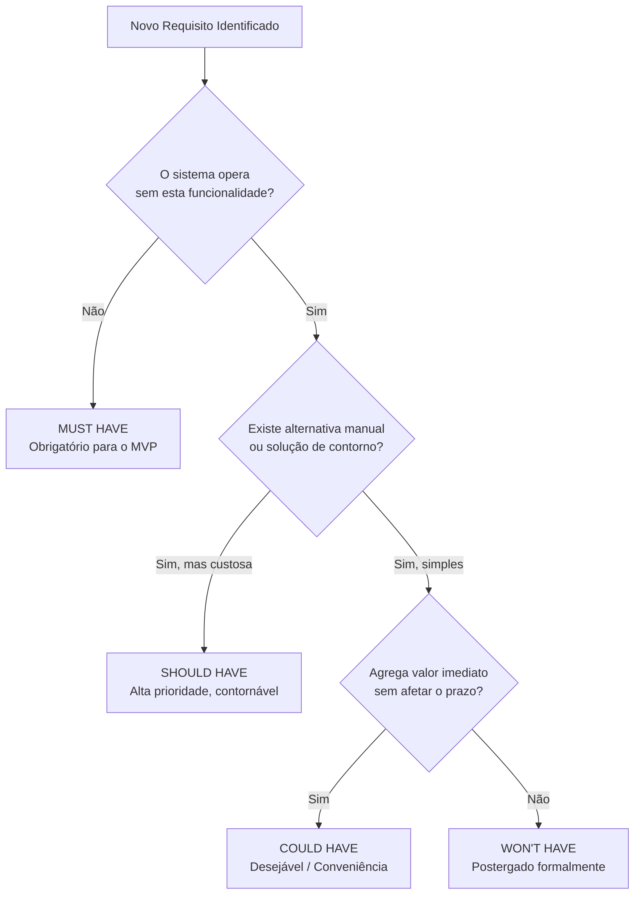

### Detalhamento das Categorias MoSCoW
1. **Must Have (Deve Ter):** Requisitos vitais e inegociáveis. Se qualquer item dessa categoria for omitido, o sistema não pode ser lançado em produção, pois falha legalmente, financeiramente ou funcionalmente.
2. **Should Have (Deveria Ter):** Requisitos de alta prioridade que agregam elevado valor de negócio. Devem ser implementados se houver estabilidade, mas sua ausência no dia de lançamento pode ser suprida temporariamente por procedimentos manuais.
3. **Could Have (Poderia Ter):** Funcionalidades de melhoria ou conveniência. São incorporadas apenas se sobrar tempo e capacidade de engenharia após a garantia total dos itens *Must* e *Should*.
4. **Won't Have [this time] (Não Terá Desta Vez):** Requisitos explicitamente excluídos da iteração atual por consenso de negócios. Evita desperdício de tempo e blinda a equipe contra corrupção de escopo.

### Estudo de Caso Prático: Matriz MoSCoW para Plataforma de Delivery

| Categoria | Funcionalidades do Domínio | Justificativa de Engenharia e Negócio |
| :--- | :--- | :--- |
| **Must Have (M)** | Cadastro/Login de atores; Catálogo de pratos do restaurante; Montagem de carrinho; Processamento de pagamento; Transição básica do status do pedido. | Sem essa espinha dorsal, não existe transação comercial de delivery. O produto é inviável sem este núcleo operacional. |
| **Should Have (S)** | Rastreamento em tempo real do pedido; Notificações push de status; Moderação administrativa de avaliações; Relatórios consolidados de vendas. | Essenciais para governança e retenção de usuários. O sistema opera sem notificações push (usando recarregamento manual), mas com atrito. |
| **Could Have (C)** | Chat em tempo real entre cliente e restaurante; Programa de fidelidade e pontos; Cupons de desconto parametrizados. | Diferenciais de engajamento que não bloqueiam o fluxo primário de realização e expedição de pedidos. |
| **Won't Have (W)** | Entrega colaborativa por motoristas terceiros via telemetria GPS avançada; Sugestão preditiva de pedidos por inteligência artificial. | Exigem complexidade algorítmica e integrações externas que comprometeriam os prazos do primeiro lançamento comercial. |

---

## Módulo 4: Modelagem Comportamental com Diagramas de Casos de Uso

### Abordagem Caixa-Preta (Black-Box Modeling)
O Diagrama de Casos de Uso da UML modela os serviços e comportamentos que o sistema provê ao seu ambiente externo a partir da perspectiva dos atores.
- **Premissa Central:** Modela-se **o que** o sistema faz, e **nunca como** ele implementa internamente.
- **Fronteira do Sistema (*System Boundary*):** Retângulo delimitador que segrega o que pertence ao software em desenvolvimento do que reside no ambiente externo.
- **Regra de Nomenclatura dos Casos de Uso:** Devem ser nomeados obrigatoriamente com o verbo inicial no **infinitivo**, seguido pelo complemento direto da ação (ex.: `Cadastrar Aluno`, `Realizar Pagamento`, `Consultar Acervo`).

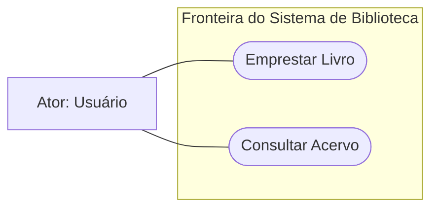

### Classificação de Atores
- **Ator Primário:** Aquele que inicia a interação com o sistema para atingir um objetivo de negócio mensurável (ex.: `Cliente` ao fazer um pedido). Fica tradicionalmente à esquerda do diagrama.
- **Ator Secundário:** Sistema externo ou serviço de retaguarda que reage a solicitações do sistema modelado ou fornece infraestrutura de apoio (ex.: `Gateway de Pagamento`, `Serviço de CEP`). Fica tradicionalmente posicionado à direita do diagrama.

### Os Quatro Relacionamentos em Casos de Uso

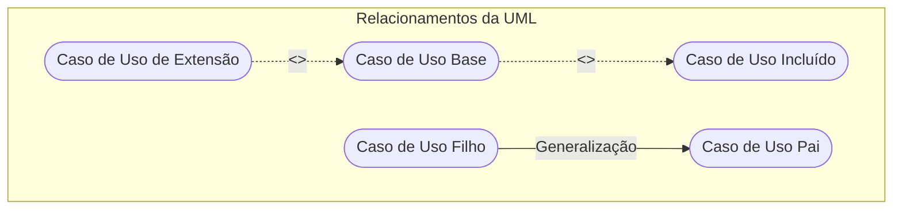

#### 1. Associação
Linha sólida contínua que une um Ator a um Caso de Uso. Expressa caminho de comunicação e tráfego de dados bidirecional entre as entidades.

#### 2. Inclusão (`<<include>>`)
- **Definição:** Mecanismo pelo qual o Caso de Uso Base incorpora **obrigatoriamente e incondicionalmente** o comportamento do Caso de Uso Incluído.
- **Direção da Seta:** Parte do Caso de Uso Base e aponta para o Caso de Uso Incluído.
- **Motivação:** Reutilização de rotinas comuns entre múltiplos casos de uso (princípio DRY — *Don't Repeat Yourself*).
- **Exemplo:** `Finalizar Compra` inclui incondicionalmente `Processar Pagamento`.

#### 3. Extensão (`<<extend>>`)
- **Definição:** Mecanismo pelo qual o Caso de Uso de Extensão expande **condicionalmente e opcionalmente** o fluxo do Caso de Uso Base em um Ponto de Extensão (*Extension Point*).
- **Direção da Seta:** Parte do Caso de Uso de Extensão (opcional) e aponta para o Caso de Uso Base.
- **Motivação:** Desacoplar fluxos excepcionais ou opcionais, mantendo o caso de uso base limpo.
- **Exemplo:** `Aplicar Cupom Promocional` estende condicionalmente `Finalizar Compra` (apenas se o cliente tiver o código).

#### 4. Generalização / Especialização
Relação de herança representada por seta com triângulo vazado na ponta:
- **Entre Atores:** O ator filho herda todas as associações do ator pai e ganha acesso a novos casos de uso privativos (ex.: `Administrador` herda de `Usuário`).
- **Entre Casos de Uso:** O caso de uso especializado sobrescreve ou detalha a estratégia do caso de uso abstrato (ex.: `Pagar com Cartão` e `Pagar com Pix` especializam `Realizar Pagamento`).

| Relacionamento | Conector UML | Condição de Execução | Direção da Seta | Propósito Técnico |
| :--- | :--- | :--- | :--- | :--- |
| **Associação** | Linha sólida | Início de diálogo | Sem ponta de seta | Conectar atores externos aos serviços |
| **Include** | Linha tracejada aberta | Obrigatório (100% das vezes) | Base $`\to`$ Incluído | Reúso de lógica compartilhada |
| **Extend** | Linha tracejada aberta | Opcional (depende de guarda) | Extensão $`\to`$ Base | Desacoplar fluxos acessórios |
| **Generalização** | Linha sólida com triângulo vazado | Polimórfico / Estrutural | Filho $`\to`$ Pai | Herança de comportamento e permissão |

### Estudo de Caso Modelado: Plataforma Geral de Delivery

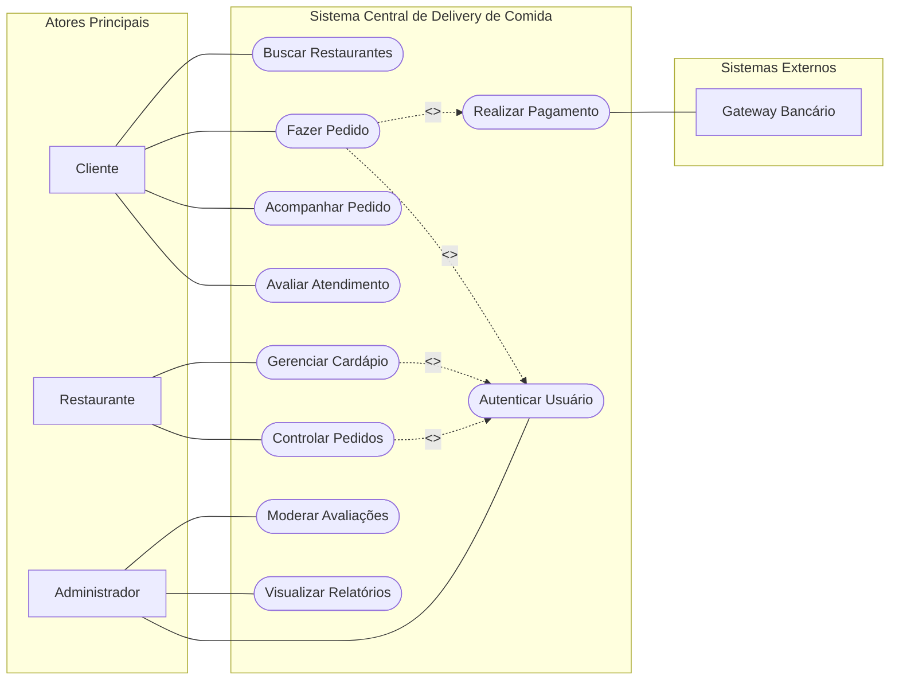

### Especificação Textual Estruturada de Caso de Uso
O diagrama visual não é autossuficiente; ele exige uma especificação textual rigorosa:

#### Caso de Uso: Fazer Pedido (UC-02)
- **Ator Primário:** Cliente.
- **Atores Secundários:** Restaurante e Gateway Bancário.
- **Pré-condições:** O cliente deve estar autenticado e possuir ao menos um item adicionado ao carrinho de compras.
- **Pós-condições:** O pedido é gravado no banco de dados com status `Pendente`, o valor financeiro é reservado junto à operadora e o restaurante é notificado na cozinha.
- **Fluxo Principal (Caminho Feliz):**
  1. O cliente acessa a tela de checkout e revisa o endereço de entrega e os itens do carrinho.
  2. O sistema calcula a taxa de frete e o valor total da compra.
  3. O cliente seleciona a forma de pagamento (Cartão de Crédito) e aciona `Confirmar Pedido`.
  4. O sistema executa o caso de uso `Realizar Pagamento` (`<<include>>`).
  5. O gateway bancário autoriza a transação financeira.
  6. O sistema altera o status do pedido para `Pendente`.
  7. O sistema envia a comanda para o painel do restaurante e exibe a tela de acompanhamento ao cliente.
- **Fluxos Alternativos:**
  - *FA-01 (Pagamento via Pix):* No passo 3, o cliente opta por Pix. O sistema gera a chave Copia e Cola e o QR Code dinâmico com temporizador de 10 minutos. Após a compensação do webhook do banco, o fluxo retorna ao passo 6.
  - *FA-02 (Cupom de Desconto — `<<extend>>`):* No passo 2, o cliente insere um código promocional. O sistema valida as regras de vigência e recalcula o valor total antes do passo 3.
- **Fluxos de Exceção:**
  - *FE-01 (Transação Recusada pela Operadora):* No passo 5, o gateway recusa o pagamento por saldo insuficiente ou suspeita de fraude. O sistema mantém os itens no carrinho, cancela a pré-reserva, exibe a mensagem de recusa e permite que o cliente escolha outra forma de pagamento.
  - *FE-02 (Restaurante Fechado Durante o Checkout):* No passo 4, antes da cobrança, o sistema identifica que o restaurante encerrou o expediente. A transação é abortada e uma notificação de encerramento é exibida.

---

## Módulo 5: Modelagem Estrutural: Fundamentos da UML e Diagrama de Classes

### Definição, Origem e Princípios da UML
A **Unified Modeling Language (UML)** é uma linguagem gráfica padronizada para visualizar, especificar, construir e documentar artefatos de sistemas orientados a objetos. 
- **Criação e Padronização:** Criada na década de 1990 pela fusão dos trabalhos dos "Three Amigos" da engenharia de software: **Grady Booch** (método Booch), **James Rumbaugh** (técnica OMT) e **Ivar Jacobson** (método OOSE), sendo incorporada e padronizada pela Object Management Group (OMG).
- **Distinção Essencial:** A UML **não é um processo e não é uma metodologia**. Scrum e RUP são processos (definem quem faz o quê, quando e como entregar valor). A UML é exclusivamente a **notação técnica** que expressa visualmente os conceitos concebidos durante as fases de análise e projeto.

### Anatomia da Classe no Diagrama Estrutural
Uma classe é expressa visualmente por um retângulo dividido horizontalmente em **três compartimentos obrigatórios**:

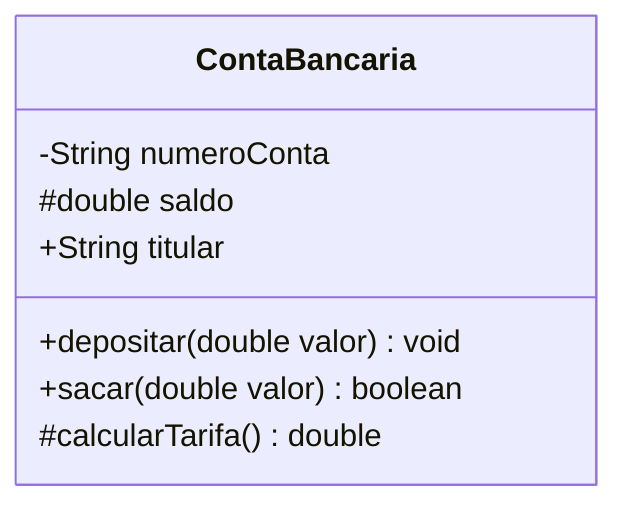

1. **Compartimento Superior (Identificador):** Contém o nome da classe em **PascalCase** (substantivo no singular).
2. **Compartimento Central (Atributos):** Contém os dados que representam o estado encapsulado dos objetos.
3. **Compartimento Inferior (Operações / Métodos):** Contém os comportamentos e funções computacionais expressos em **camelCase** (iniciados por verbos no infinitivo).

### Modificadores de Visibilidade e Níveis de Encapsulamento
A proteção dos membros contra acessos indevidos obedece à notação universal:
- `+` **Público (Public):** Acessível irrestritamente por qualquer classe do sistema.
- `-` **Privado (Private):** Acessível estritamente dentro da própria classe em que foi declarado.
- `#` **Protegido (Protected):** Acessível pela própria classe, por suas subclasses (herança) e por classes do mesmo pacote.
- `~` **Pacote (Package-Private):** Acessível exclusivamente por classes que residem no mesmo pacote lógico.

### Multiplicidades Estruturais
Definem os limites quantitativos de instâncias associadas:
- `1`: Exatamente uma instância obrigatória.
- `0..1`: Zero ou uma instância (associação opcional).
- `*` ou `0..*`: Zero, uma ou muitas instâncias.
- `1..*`: Ao menos uma instância obrigatória (uma ou muitas).
- `n..m`: Limite fixo no intervalo entre $`n`$ e $`m`$.

### Taxonomia Completa de Relacionamentos Estruturais

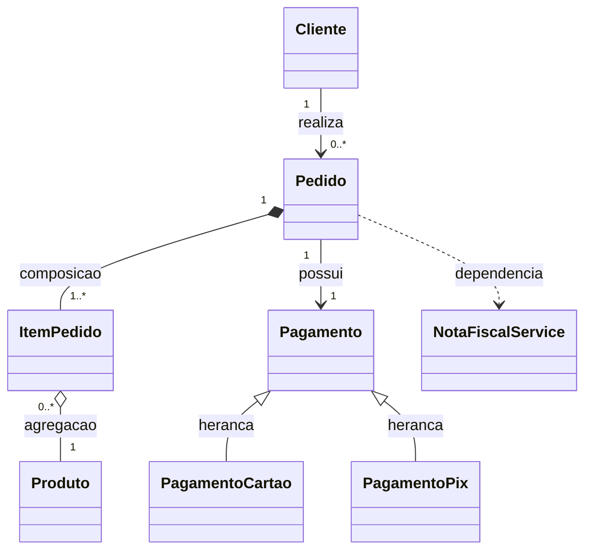

#### 1. Associação Simples
Relação estrutural básica onde objetos colaboram trocando referências. A navegabilidade pode ser bidirecional (linha sem seta) ou unidirecional (linha com seta na ponta).

#### 2. Agregação (Todo-Parte Fraco — Losango Vazio)
- **Definição:** Uma classe representa o "Todo" e agrega objetos "Parte". O ciclo de vida da parte é **independente** do ciclo de vida do todo. Se o objeto todo for destruído, a parte continua existindo na memória ou no banco.
- **Símbolo:** Losango vazado posicionado junto à classe que representa o "Todo".
- **Exemplo:** `ItemPedido` e `Produto`. Se o `ItemPedido` for apagado da memória, o `Produto` continua existindo no estoque do sistema.

#### 3. Composição (Todo-Parte Forte — Losango Preenchido)
- **Definição:** Relação estrita onde o objeto "Parte" pertence exclusivamente a um único "Todo" e seu ciclo de vida é **acoplado e dependente**. Se o todo for deletado, todas as suas partes agregadas devem ser eliminadas em cascata.
- **Símbolo:** Losango preenchido (sólido) junto à classe que representa o "Todo".
- **Exemplo:** `Pedido` e `ItemPedido`. Não faz sentido computacional manter linhas de itens de um pedido que foi fisicamente expurgado.

#### 4. Generalização / Especialização (Herança)
- **Definição:** Mecanismo pelo qual uma subclasse herda todos os atributos e métodos de uma superclasse, podendo adicionar novos comportamentos ou aplicar polimorfismo.
- **Símbolo:** Linha sólida com uma ponta de seta triangular vazada apontando para a classe mãe.

#### 5. Dependência Transitória
- **Definição:** Relação fraca e transitória na qual uma classe utiliza outra temporariamente durante a execução de uma operação (como um parâmetro de método ou variável local), sem manter uma referência permanente de atributo.
- **Símbolo:** Linha tracejada simples com ponta aberta.

---

## Módulo 6: Princípios de Design OO, Padrões GoF e Boas Práticas

### Os Quatro Pilares da Orientação a Objetos
1. **Abstração:** Capacidade de isolar os aspectos essenciais de uma entidade para o contexto do sistema, descartando detalhes supérfluos de implementação.
2. **Encapsulamento:** Prática de ocultar dados internos (`private`) e fornecer métodos públicos semânticos para garantir a inviolabilidade das regras de negócio (invariantes de classe).
3. **Herança:** Compartilhamento e especialização de atributos e comportamentos com semântica estrita do tipo "É UM" (*is-a*).
4. **Polimorfismo:** Capacidade de múltiplos objetos responderem à mesma mensagem por meio de comportamentos distintos em tempo de execução.

### Coesão e Acoplamento
- **Alta Coesão:** Uma classe possui uma responsabilidade única, clara e bem delimitada. Todas as suas operações convergem para o mesmo objetivo conceitual.
- **Baixo Acoplamento:** Grau mínimo de dependência entre módulos independentes. Alterações no interior de uma classe não propagam quebras em cascata no restante do sistema.

### Princípios SOLID
- **S — Single Responsibility Principle (SRP):** Uma classe deve ter apenas um motivo para mudar.
- **O — Open/Closed Principle (OCP):** Entidades de software devem estar abertas para extensão, mas fechadas para modificação direta.
- **L — Liskov Substitution Principle (LSP):** Objetos de subclasses devem substituir instâncias de superclasses sem quebrar a consistência lógica da aplicação.
- **I — Interface Segregation Principle (ISP):** Muitas interfaces específicas são melhores do que uma única interface genérica e inflada.
- **D — Dependency Inversion Principle (DIP):** Módulos de alto nível não devem depender de módulos de baixo nível; ambos devem depender de abstrações (interfaces).

### Padrões de Projeto GoF (Gang of Four) Fundamentais

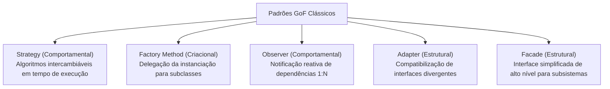

#### Implementação Rigorosa em Java: Strategy e Encapsulamento
O exemplo a seguir demonstra a aplicação prática de baixo acoplamento e polimorfismo para processamento de cobranças:

```java
package br.unifef.engenharia.pagamento;

import java.util.Objects;

// 1. Contrato Abstrato (DIP e Strategy)
public interface EstrategiaPagamento {
    boolean processar(double valor);
}

// 2. Implementação Concreta: Cartão de Crédito
public class PagamentoCartaoCredito implements EstrategiaPagamento {
    private final String numeroCartao;
    private final String codigoSeguranca;

    public PagamentoCartaoCredito(String numeroCartao, String codigoSeguranca) {
        this.numeroCartao = Objects.requireNonNull(numeroCartao, "Número do cartão é obrigatório");
        this.codigoSeguranca = Objects.requireNonNull(codigoSeguranca, "CVV é obrigatório");
    }

    @Override
    public boolean processar(double valor) {
        if (valor <= 0.0) {
            throw new IllegalArgumentException("O valor para cobrança deve ser positivo");
        }
        // Simulação de autorização junto ao gateway
        return !numeroCartao.isBlank() && codigoSeguranca.length() == 3;
    }
}

// 3. Implementação Concreta: Pix
public class PagamentoPix implements EstrategiaPagamento {
    private final String chavePix;

    public PagamentoPix(String chavePix) {
        this.chavePix = Objects.requireNonNull(chavePix, "Chave Pix não pode ser nula");
    }

    @Override
    public boolean processar(double valor) {
        if (valor <= 0.0) {
            throw new IllegalArgumentException("O valor para cobrança deve ser positivo");
        }
        return !chavePix.isBlank();
    }
}

// 4. Contexto com Encapsulamento e Alta Coesão
public class ProcessadorTransacao {
    private final EstrategiaPagamento estrategia;

    public ProcessadorTransacao(EstrategiaPagamento estrategia) {
        this.estrategia = Objects.requireNonNull(estrategia, "Estratégia de pagamento é obrigatória");
    }

    public boolean executarCobranca(double valorTotal) {
        return this.estrategia.processar(valorTotal);
    }
}
```

---

## Módulo 7: Arquitetura de Software e Estilos Arquiteturais

### Definição pela Norma ISO/IEC/IEEE 42010:2022
A norma internacional define arquitetura de software como:

> *"A estrutura fundamental ou esqueleto de um sistema de software, expressa por seus componentes, pelos relacionamentos entre eles e com o ambiente, e pelos princípios que governam seu projeto e evolução contínua."*

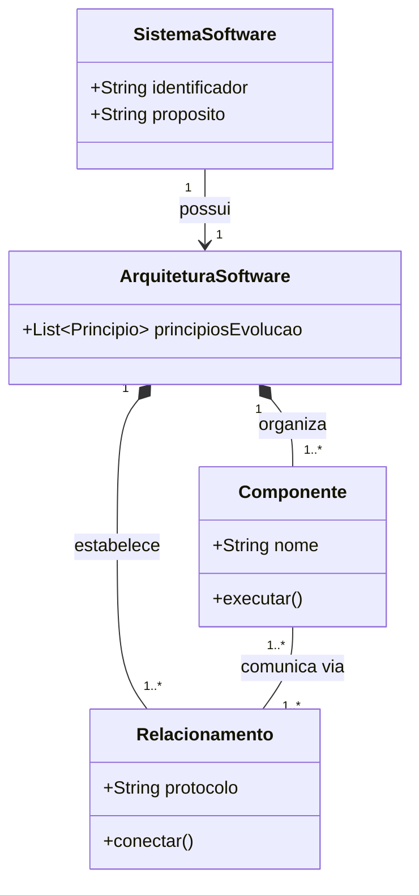

### Contrastes: Arquitetura Civil versus Arquitetura de Software
- **Imaterialidade:** O software não tem massa nem presença física; suas falhas estruturais deterioram silenciosamente (*arquitetural erosion*).
- **Taxa de Transformação:** Um edifício dificilmente tem sua fundação reconstruída após a entrega; o software é inerentemente adaptativo e evolui com o negócio.
- **Envelhecimento:** O concreto envelhece por ação do tempo; o software torna-se obsoleto quando o ambiente externo (segurança, carga, bibliotecas) avança e ele permanece estático.

### Modelos de Distribuição: SaaS versus On-Premises

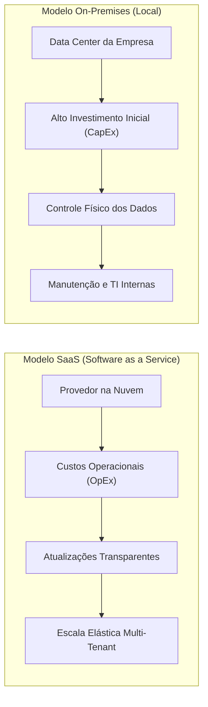

| Dimensão de Análise | SaaS (Software as a Service) | On-Premises (Instalação Local) |
| :--- | :--- | :--- |
| **Modelo Financeiro** | **OpEx** (*Operational Expenditure*): assinaturas periódicas contínuas. | **CapEx** (*Capital Expenditure*): alto investimento inicial em licenças perpétuas e hardware. |
| **Responsabilidade de TI** | O fornecedor gerencia backups, patches, banco e segurança. | A equipe interna de TI assume toda a infraestrutura física e mitigação de desastres. |
| **Atualizações** | Contínuas e universais para todos os clientes sem custo local. | Complexas, manuais e frequentemente postergadas por receio de quebras. |
| **Soberania dos Dados** | Dados residem em nuvens de terceiros (exige conformidade com LGPD). | Dados armazenados fisicamente dentro dos muros da própria organização. |

### Panorama de Estilos Arquiteturais

#### 1. Cliente-Servidor Clássico (Duas Camadas)
- *Estrutura:* Um executável pesado ("cliente gordo") instalado em cada estação de trabalho, comunicando-se diretamente com o banco de dados corporativo via rede local.
- *Gargalos Históricos:* Se uma regra contábil mudar, todos os computadores da empresa precisam de reinstalação manual; além disso, a abertura de centenas de portas SQL simultâneas satura o servidor de dados.

#### 2. Arquitetura Orientada a Serviços (SOA)
- *Estrutura:* Decomposição do sistema em serviços corporativos reutilizáveis, desacoplados e sem estado (*stateless*), tradicionalmente orquestrados por um barramento corporativo (ESB).
- *Aplicação:* Integração de sistemas legados heterogêneos em bancos e grandes seguradoras.

#### 3. O Padrão Arquitetural MVC Clássico no Smalltalk-80
Concebido no Xerox PARC por Steve Burbeck, Alan Kay e Dan Ingalls para viabilizar interfaces gráficas sobrepostas:
- **Origem Histórica:** Antes do MVC, a classe primitiva `Pen` desenhava diretamente no *framebuffer* global. Se dois programas escrevessem ao mesmo tempo, uma janela destruía o desenho da outra. O MVC organizou a cooperação no espaço da tela.
- **A Tríade Fundamental:**
  - *Model:* Dados puros de domínio e regras de negócio. Totalmente agnóstico quanto à representação visual.
  - *View:* Desenha a interface na área alocada (`display`, `displayView`) e consulta o modelo.
  - *Controller:* Escuta e traduz eventos do mouse de três botões e teclado, disparando mutações no modelo ou rolagens na visão.
- **Modelos Passivos versus Ativos:**
  - *Passivo:* O estado muda exclusivamente via chamadas de seu próprio controlador (ex.: editor de texto com instância de `String`). O controlador sabe quando mudar a tela.
  - *Ativo:* O estado é alterado por processos externos em segundo plano (ex.: console `SystemTranscript`). O próprio modelo precisa gerenciar uma lista de observadores e disparar `self changed` para acionar `update:` nas visões.
- **Evolução da Estrutura de Dependências:**
  - No *Smalltalk-80 v2.0*, a dependência era armazenada em uma tabela global pesada (`DependentFields` em `Object`).
  - No *Smalltalk-80 v2.5*, foi introduzida a classe abstrata dedicada `Model`, trazendo a variável de instância `dependents` para otimizar alocação de memória e desempenho de busca.
- **Gerenciamento Cooperativo:** O `ControlManager` coordena a árvore de controladores ativos (`ScheduledControllers`), alternando o foco do mouse de três botões (Red: seleção; Yellow: menu contextual da visão; Blue: operações de janela como redimensionamento e fechamento).

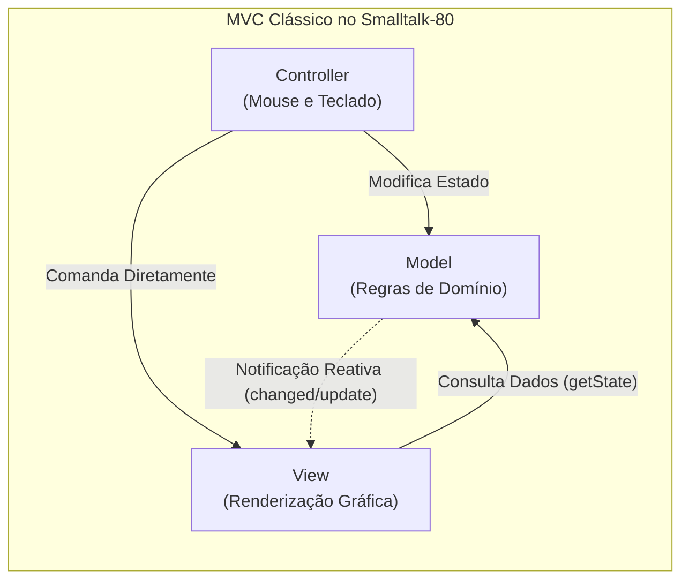

#### 4. Arquitetura Hexagonal (Ports and Adapters)
Concebida por Alistair Cockburn:
- **Regra de Ouro:** O domínio do negócio reside no centro absoluto e **não conhece** bibliotecas externas, bancos de dados, protocolos web ou frameworks.
- **Portas Condutoras (*Driving / Primary Ports*):** Interfaces expostas pelo domínio para permitir que o mundo externo acione os casos de uso (ex.: interfaces de serviços de aplicação acionadas por Controllers REST ou CLI).
- **Portas Conduzidas (*Driven / Secondary Ports*):** Interfaces declaradas pelo domínio especificando o que ele necessita da infraestrutura externa (ex.: repositórios de dados, gateways de mensageria).
- **Adaptadores (*Adapters*):** Componentes técnicos na borda que convertem sinais tecnológicos para o formato das portas (ex.: `PostgreSQLRepositoryAdapter`, `RabbitMQNotificationAdapter`).

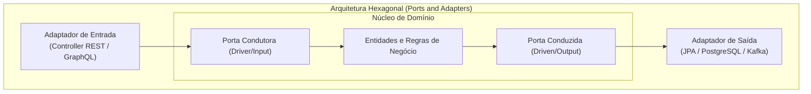

#### 5. Arquitetura de Microsserviços
- **Características:** Aplicação dividida em serviços independentes, implantáveis isoladamente, cada qual mantendo sua própria base de dados exclusiva (*Database-per-Service*).
- **Trade-offs Críticos:** Proporciona escala elástica e autonomia organizacional, mas introduz alta complexidade operacional (latência de rede, necessidade de rastreamento distribuído, transações distribuídas e consistência eventual).
- **Antipadrão do Modismo Tecnológico:** Adotar microsserviços em equipes reduzidas para sistemas com baixa volumetria gera sobrecarga de infraestrutura sem retorno de valor.

---

## Módulo 8: Modelagem Dinâmica: Diagramas de Sequência e Comunicação

### O Padrão BCE (Boundary-Control-Entity)
Introduzido por Ivar Jacobson no método OOSE, o estereótipo BCE organiza a colaboração dinâmica dos objetos dividindo-os em três camadas semânticas:
- **Boundary (Fronteira):** Elementos que intermediam o contato com os atores externos (telas, formulários, rotas HTTP).
- **Control (Controle):** Orquestradores que coordenam a lógica da aplicação, fluxos transacionais e regras de caso de uso.
- **Entity (Entidade):** Objetos de domínio que encapsulam o estado persistente e as regras fundamentais do negócio.

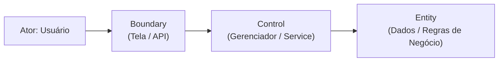

### Diagrama de Comunicação versus Diagrama de Sequência
Ambos são diagramas de interação isomórficos (representam o mesmo processamento computacional sob ópticas distintas):
- **Diagrama de Comunicação:** Enfatiza a **organização estrutural** dos objetos e os caminhos de ligação física/lógica. As mensagens são ordenadas por numeração sequencial hierárquica (ex.: `1.`, `1.1.`, `1.2.`, `2.`).
- **Diagrama de Sequência:** Enfatiza a **ordenação temporal estrita** dos eventos. A passagem do tempo transcorre verticalmente de cima para baixo.

### Elementos Avançados do Diagrama de Sequência
- **Linhas de Vida (*Lifelines*):** Retângulos verticais pontilhados que representam a existência contínua do participante durante a interação.
- **Barras de Ativação (*Activation Bars*):** Retângulos preenchidos sobrepostos à linha de vida que indicam o período em que o objeto retém controle de processamento.
- **Mensagem Síncrona:** Seta sólida com ponta preenchida; o remetente bloqueia até obter retorno.
- **Mensagem de Retorno:** Seta tracejada com ponta aberta; indica devolução de valor.
- **Criação Dinâmica:** A seta de mensagem aponta diretamente para o corpo do cabeçalho da nova instância.
- **Destruição Explícita:** Marcada por um grande "X" no término da linha de vida, liberando o recurso.

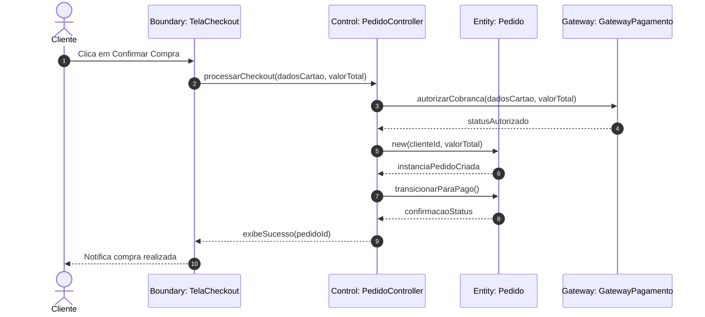

---

## Módulo 9: Modelagem de Ciclo de Vida e Processos: Estados e Atividades

### Diagrama de Máquina de Estados (State Machine Diagram)

#### Fundamentação Teórica
O Diagrama de Estados modela o comportamento reativo de uma entidade persistente individual sensível a eventos temporais e transicionais. Matematicamente, a máquina de estados finitos que rege o modelo é expressa por:

```math
M = (S, \Sigma, \delta, s_0, F)
```

Onde:
- $`S`$: Conjunto finito de estados possíveis da entidade.
- $`\Sigma`$: Alfabeto de estímulos ou eventos aceitos.
- $`\delta: S \times \Sigma \to S`$: Função de transição de estados.
- $`s_0 \in S`$: Estado inicial de instanciação.
- $`F \subseteq S`$: Conjunto de estados terminais.

A dinâmica da transição obedece à quádrupla formal:

```math
T = (E_{origem}, Evento, Guarda, Acao, E_{destino})
```

Sendo anotada sintaticamente na seta por:  
`Evento [Guarda] / Ação`

Onde:
- `Evento`: O estímulo recebido (ex.: chamada de método).
- `[Guarda]`: Expressão booleana avaliada em tempo de execução; a transição só ocorre se for verdadeira.
- `/ Ação`: Processamento atômico e instantâneo executado durante o salto transicional.

#### Estudo de Caso Prático: Ciclo de Vida do Pedido de Delivery

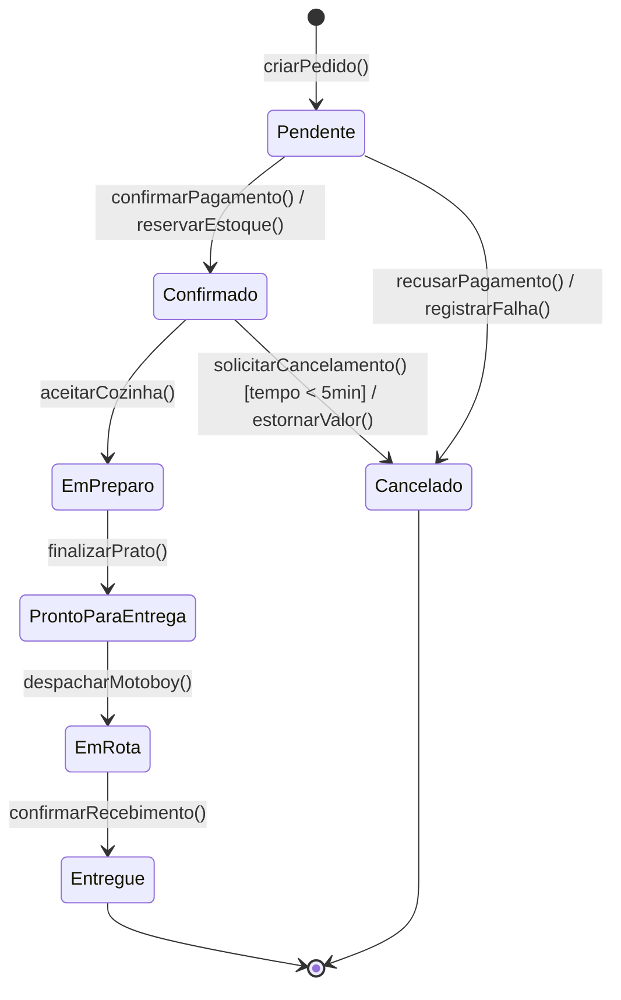

#### Conexão com Práticas Ágeis (Scrum, Kanban, DoD e Testes)
- **Refinamento de Histórias de Usuário:** Estados discretos delimitam a quebra vertical de histórias grandes (Épicos).
- **Critérios de Pronto (*Definition of Done — DoD*):** Uma transição de estado serve como barreira formal de aceitação técnica (ex.: "O pedido só transita para `Confirmado` após o log de idempotência ser registrado").
- **Testes Baseados em Modelo (*Model-Based Testing*):** Mapeia os caminhos de testes automatizados (BDD/TDD), validando cenários permitidos e garantindo que requisições ilegais sejam bloqueadas (ex.: proibir cancelamento de pedido no estado `EmRota`).

---

### Diagrama de Atividades (Activity Diagram)

#### Conceito e Sintaxe Operacional
O Diagrama de Atividades modela fluxos de trabalho procedurais, algoritmos e orquestrações de processos de negócio. Foca na coordenação de ações sequenciais e paralelas orientadas à conclusão de uma tarefa.

- **Nós de Execução:**
  - *Estado Inicial:* Círculo preto sólido.
  - *Ação:* Retângulo com cantos arredondados contendo a descrição da operação.
  - *Decisão / Mesclagem:* Losango vazado; avalia condições de guarda mutualmente exclusivas.
  - *Bifurcação Paralela (*Fork*):* Barra horizontal sólida que divide uma entrada em múltiplas trilhas de execução concorrentes.
  - *Junção Paralela (*Join*):* Barra horizontal sólida que sincroniza múltiplas trilhas paralelas antes de prosseguir.
  - *Estado Final:* Círculo preto sólido envolto por uma borda circular vazada.

#### Estudo de Caso Prático: Fluxo de Realização de Compra com Raias de Piscina

```mermaid
flowchart TD
    subgraph Cliente["Raia do Cliente"]
        Inicio(("Início")) --> A1["Selecionar Itens e Ir ao Checkout"]
        A1 --> A2["Informar Dados de Pagamento"]
        A5["Receber Pedido em Casa"] --> Fim(("Fim"))
    end

    subgraph Plataforma["Raia do Sistema de E-Commerce"]
        A2 --> D1{"Estoque Disponível?"}
        D1 -- "Não" --> E1["Exibir Notificação de Ruptura"]
        E1 --> A1
        D1 -- "Sim" --> A3["Reservar Lotes de Produtos"]
        A3 --> B1["Disparar Cobrança Bancária"]
        B1 --> D2{"Pagamento Aprovado?"}
        D2 -- "Não" --> E2["Liberar Reserva de Lote"]
        E2 --> A2
        D2 -- "Sim" --> ForkBar["Bifurcação Paralela (Fork)"]
        ForkBar --> T1["Emitir Nota Fiscal Digital"]
        ForkBar --> T2["Notificar Equipe de Separação"]
        T1 --> JoinBar["Sincronização Paralela (Join)"]
        T2 --> JoinBar
        JoinBar --> A4["Despachar Pacote para Rota"]
    end

    subgraph Logistica["Raia da Logística / Transportadora"]
        A4 --> L1["Efetuar Transporte Rodoviário"]
        L1 --> A5
    end
```

### Diferenciação Arquitetural Definitiva: Estados versus Atividades

```mermaid
flowchart LR
    subgraph VisaoEstado["Diagrama de Estados"]
        E_Foco["Foco: Entidade Individual"]
        E_Dinamica["Reativo: Responde a Estímulos Externos"]
        E_Evolucao["Ciclo de Vida Persistente no Tempo"]
    end

    subgraph VisaoAtividade["Diagrama de Atividades"]
        A_Foco["Foco: Processo de Negócio Global"]
        A_Dinamica["Procedural: Transição Automática por Conclusão"]
        A_Evolucao["Fluxo de Passos e Coordenação de Múltiplos Atores"]
    end
```

| Critério Comparativo | Diagrama de Máquina de Estados | Diagrama de Atividades |
| :--- | :--- | :--- |
| **Ponto Focal da Análise** | A vida de um único objeto de domínio (ex.: `Pedido`, `Chamado`). | Um processo de negócio abrangente ou algoritmo multitarefa. |
| **Origem do Disparo** | Eventos externos, sinais ou métodos chamados por outros objetos. | Conclusão natural e sequencial da ação imediatamente anterior. |
| **Representação Gráfica** | Retângulos com nomes de estados (substantivos / particípios). | Retângulos arredondados com verbos de ação procedurais. |
| **Paralelismo** | Subestados ortogonais (incomuns na análise básica). | Nativo via barras de bifurcação (*fork*) e sincronização (*join*). |
| **Organização Estrutural** | Caixa estrita de transições de um classificador. | Raias de natação (*swimlanes*) delimitando múltiplos papéis. |

---

## Módulo 10: Caderno de Exercícios, Casos Práticos e Questões de Revisão

### Exercício 1: Aplicação Analítica da Matriz MoSCoW
**Enunciado:** Uma rede de saúde privada contratou sua equipe para conceber o sistema de Prontuário Eletrônico do Paciente (PEP). Os patrocinadores listaram as seguintes funcionalidades pretendidas para a primeira fase de lançamento:
1. Assinatura digital do médico via certificado ICP-Brasil em prescrições controladas.
2. Reconhecimento de voz para transcrição automática de consultas por inteligência artificial.
3. Registro das anotações de evolução clínica e sinais vitais do paciente internado.
4. Consulta ao histórico de alergias e alertas visuais de contraindicação medicamentosa.
5. Integração com relógios inteligentes de terceiros para monitorar passos do paciente em casa.
6. Notificação via SMS para o paciente lembrando o horário do retorno da consulta.

**Tarefa:** Como engenheiro de software líder, classifique cada um dos seis requisitos nas categorias **Must Have**, **Should Have**, **Could Have** e **Won't Have**, justificando formalmente cada escolha sob o prisma de conformidade legal, segurança clínica e escopo do MVP.

#### Gabarito Comentado
- **Must Have (M):**
  - *Item 3 (Registro de evolução clínica e sinais vitais):* É o núcleo funcional sem o qual o prontuário eletrônico inexiste.
  - *Item 4 (Histórico de alergias e contraindicação medicamentosa):* Crítico para segurança do paciente e prevenção de óbitos hospitalares por choque anafilático.
  - *Item 1 (Assinatura digital ICP-Brasil):* Exigência regulatória indispensável imposta pelo Conselho Federal de Medicina (CFM) e legislação federal para validade jurídica das prescrições.
- **Should Have (S):**
  - *Item 6 (Notificação SMS de retorno de consulta):* Altamente recomendável para redução de absenteísmo ambulatorial, mas o sistema pode operar no primeiro dia com confirmações manuais por telefone.
- **Could Have (C):**
  - *Item 2 (Reconhecimento de voz via IA para transcrição):* Conveniência de produtividade para o corpo clínico, mas os médicos podem digitar os dados no formulário padrão sem bloquear a operação.
- **Won't Have (W):**
  - *Item 5 (Integração com relógios inteligentes para contagem de passos):* Totalmente fora do escopo crítico de internação hospitalar; exige desenvolvimento de drivers específicos e consome orçamento que deve focar na estabilização do núcleo do PEP.

---

### Exercício 2: Modelagem de Casos de Uso com Relacionamentos
**Enunciado:** Um sistema bancário corporativo prevê as operações de `Transferência Pix` e `Pagamento de Fatura`. Para qualquer uma dessas operações monetárias, o sistema exige obrigatoriamente a verificação de credenciais e biometria por meio do serviço `Autenticar Correntista`. Caso o saldo da conta seja insuficiente durante a transferência, o correntista que possui limite pré-aprovado pode, por opção voluntária, acionar o serviço `Contratar Limite Emergencial`. Modelos de pagamentos especializados incluem `Pagamento com Leitor de Código de Barras` e `Pagamento com Digitação Manual da Linha Digitável`.

**Tarefa:** Apresente o diagrama Mermaid do caso de uso aplicando rigorosamente as notações de `<<include>>`, `<<extend>>` e generalização.

#### Gabarito Comentado

```mermaid
flowchart TD
    Correntista["Ator: Correntista"]

    subgraph ModuloBancario["Sistema Bancário"]
        UC_Pix(["Transferência Pix"])
        UC_Fatura(["Pagamento de Fatura"])
        UC_Auth(["Autenticar Correntista"])
        UC_Limite(["Contratar Limite Emergencial"])
        
        UC_FatBarra(["Pagamento via Código de Barras"])
        UC_FatManual(["Pagamento via Linha Digitável"])

        UC_Pix -.->|"<<include>>"| UC_Auth
        UC_Fatura -.->|"<<include>>"| UC_Auth

        UC_Limite -.->|"<<extend>>"| UC_Pix

        UC_FatBarra -->|"Generalização"| UC_Fatura
        UC_FatManual -->|"Generalização"| UC_Fatura
    end

    Correntista --- UC_Pix
    Correntista --- UC_Fatura
```

*Análise Técnica:* A autenticação é inclusão obrigatória (`<<include>>`), pois nenhuma das transações pode ocorrer sem identidade confirmada. A contratação de limite emergencial é condicional e opcional (`<<extend>>`), disparada apenas sob condição de guarda de saldo insuficiente e mediante aceite do cliente. As formas de pagamento de fatura herdam e especializam a assinatura comportamental do caso base.

---

### Exercício 3: Implementação de Domínio com Diagrama de Classes e Java
**Enunciado:** Projete a estrutura orientada a objetos de uma plataforma acadêmica universitária contendo as seguintes entidades e restrições:
1. Uma `Universidade` agrega zero ou muitos `Departamentos`.
2. Um `Departamento` é composto por um ou muitos `Cursos` (se o departamento for extinto, seus cursos associados deixam de existir estruturalmente).
3. Cada `Curso` mantém uma coleção de `Alunos` matriculados.
4. Todo `Aluno` possui número de matrícula único, nome completo e pontuação semestral acumulada, com métodos para registrar notas que validam que a nota não pode ser negativa nem superior a 10,0.

**Tarefa:** Elabore o Diagrama de Classes na notação Mermaid indicando a anatomia dos relacionamentos e implemente a classe `Aluno` em código Java puro, garantindo encapsulamento irrestrito.

#### Gabarito Comentado (Diagrama Estrutural)

```mermaid
classDiagram
    class Universidade {
        -String nome
        -String cnpj
        +adicionarDepartamento(Departamento dep) void
    }
    class Departamento {
        -String centroCusto
        -String nome
        +adicionarCurso(Curso curso) void
    }
    class Curso {
        -String codigoMEC
        -String nome
        +matricularAluno(Aluno aluno) void
    }
    class Aluno {
        -String matricula
        -String nomeCompleto
        -double notaAcumulada
        +Aluno(String matricula, String nomeCompleto)
        +adicionarNota(double notaAvaliacao) void
        +getMatricula() String
        +getNomeCompleto() String
        +getNotaAcumulada() double
    }

    Universidade "1" o-- "0..*" Departamento : agregacao
    Departamento "1" *-- "1..*" Curso : composicao
    Curso "1" --> "0..*" Aluno : matricula
```

#### Gabarito Comentado (Implementação Java com Invariantes Blindadas)

```java
package br.unifef.academico;

import java.util.Objects;

public final class Aluno {
    private final String matricula;
    private final String nomeCompleto;
    private double notaAcumulada;
    private int quantidadeAvaliacoes;

    public Aluno(String matricula, String nomeCompleto) {
        if (matricula == null || matricula.isBlank()) {
            throw new IllegalArgumentException("Matrícula acadêmica é obrigatória e não pode ser vazia.");
        }
        if (nomeCompleto == null || nomeCompleto.isBlank()) {
            throw new IllegalArgumentException("Nome completo do discente é obrigatório.");
        }
        this.matricula = matricula.trim();
        this.nomeCompleto = nomeCompleto.trim();
        this.notaAcumulada = 0.0;
        this.quantidadeAvaliacoes = 0;
    }

    public synchronized void adicionarNota(double notaAvaliacao) {
        if (notaAvaliacao < 0.0 || notaAvaliacao > 10.0) {
            throw new IllegalArgumentException("A nota de avaliação deve residir estritamente no intervalo [0.0, 10.0].");
        }
        this.notaAcumulada += notaAvaliacao;
        this.quantidadeAvaliacoes++;
    }

    public synchronized double calcularMedia() {
        if (this.quantidadeAvaliacoes == 0) {
            return 0.0;
        }
        return this.notaAcumulada / this.quantidadeAvaliacoes;
    }

    public String getMatricula() {
        return this.matricula;
    }

    public String getNomeCompleto() {
        return this.nomeCompleto;
    }

    public synchronized double getNotaAcumulada() {
        return this.notaAcumulada;
    }
}
```

---

### Exercício 4: Análise Comparativa de Arquiteturas de Software
**Enunciado:** Avalie o seguinte cenário corporativo: Uma startup de serviços contábeis opera um sistema monolítico Cliente-Servidor em duas camadas instalado fisicamente em 80 escritórios franqueados. A diretoria executiva propõe migrar a solução diretamente para uma malha distribuída de 35 microsserviços conteinerizados na nuvem, justificando que "microsserviços são o padrão moderno de empresas como Netflix e Uber".

**Tarefa:** Com base nos princípios da ISO/IEC/IEEE 42010:2022 e nos conceitos ministrados pelo Prof. Wesley Soares sobre decisões estruturais e antipadrões de modismos, escreva um parecer técnico alertando sobre os riscos dessa decisão e proponha uma evolução arquitetural intermediária balanceada.

#### Gabarito Comentado
- **Diagnóstico Crítico:** A proposta da diretoria sofre do clássico antipadrão de engenharia conhecido como **Desenvolvimento Guiado por Modismos** (*Hype-Driven Development*). A escala de operação de 80 escritórios franqueados de pequeno e médio porte não possui volumetria transacional que justifique a sobrecarga operacional, a complexidade de redes distribuídas e os custos de infraestrutura de 35 microsserviços. O resultado imediato dessa decisão ingênua seria:
  1. *Latência Excessiva:* O overhead de rede nas comunicações HTTP/gRPC entre 35 serviços degradará o tempo de resposta em operações contábeis transacionais.
  2. *Complexidade de Governança:* Necessidade de orquestradores (Kubernetes), rastreamento distribuído (Jaeger/Zipkin), consolidação de logs (ELK) e transações compensatórias complexas (Saga Pattern) para garantir a integridade fiscal.
  3. *Inviabilidade de Equipe:* A startup precisará de uma equipe avançada de SRE/DevOps para manter a sustentação da infraestrutura, consumindo orçamento que deveria ser alocado no produto.
- **Proposta de Evolução Técnica Equilibrada:**
  1. *Fase 1 (Isolamento de Domínio):* Refatorar o monolito legado adotando a **Arquitetura Hexagonal (*Ports and Adapters*)**, segregando o domínio das regras fiscais das tecnologias de banco de dados e frameworks visuais.
  2. *Fase 2 (Monólito Modular na Nuvem - SaaS):* Migrar o sistema do modelo On-Premises para um **Monólito Modular** distribuído como SaaS. Centraliza-se a base de dados, eliminando custos de manutenção nos 80 escritórios locais e garantindo atualizações automáticas via pipelines de CI/CD.
  3. *Fase 3 (Extração Pontual de Serviços):* Apenas se um módulo específico sofrer gargalo real de processamento assíncrono (ex.: geração massiva de notas fiscais eletrônicas em lote no encerramento de mês), extrai-se cirurgicamente este componente em um serviço independente orientado a eventos.

---

### Banco de Questões de Revisão para Prova Individual (AV1 e AV2)

#### Questão 1 (Dissertativa - AV1)
*Explique a diferença fundamental entre as abordagens de Análise e de Projeto em Engenharia de Software, correlacionando-as com a citação: "Faça a coisa certa e faça certo a coisa".*
- **Resposta Esperada:** A análise dedica-se a "fazer a coisa certa", investigando o domínio do problema, as dores de negócio dos stakeholders e as restrições operacionais para garantir que o software atenda às necessidades reais da empresa. O projeto dedica-se a "fazer certo a coisa", convertendo as necessidades elucidadas em estruturas de software robustas, escaláveis e desacopladas no domínio da solução técnica (modelagem de classes, arquiteturas em camadas e padrões de design). Resolver o problema errado com uma arquitetura perfeita é um fracasso de análise; resolver o problema certo com uma arquitetura frágil cria um passivo insustentável de projeto.

#### Questão 2 (Múltipla Escolha - AV1)
*Durante a modelagem de casos de uso de um sistema de comércio eletrônico, o analista identificou que o caso de uso "Finalizar Compra" necessita obrigatoriamente que o sistema realize o processamento financeiro no caso de uso "Efetuar Pagamento", enquanto a aplicação de "Utilizar Cupom Promocional" ocorre de forma opcional, caso o usuário tenha um código ativo. Assinale a alternativa que mapeia correta e respectivamente as relações e a orientação das setas:*
- A) `Finalizar Compra` aponta com `<<extend>>` para `Efetuar Pagamento`; `Finalizar Compra` aponta com `<<include>>` para `Utilizar Cupom Promocional`.
- B) `Finalizar Compra` aponta com `<<include>>` para `Efetuar Pagamento`; `Utilizar Cupom Promocional` aponta com `<<extend>>` para `Finalizar Compra`.
- C) `Efetuar Pagamento` aponta com `<<include>>` para `Finalizar Compra`; `Utilizar Cupom Promocional` aponta com `<<extend>>` para `Finalizar Compra`.
- D) `Finalizar Compra` aponta com generalização para `Efetuar Pagamento`; `Finalizar Compra` aponta com associação para `Utilizar Cupom Promocional`.
- **Gabarito Oficial:** **Alternativa B**. O caso base aponta para o incluído obrigatório via `<<include>>`, e a funcionalidade acessória/opcional aponta para a base via `<<extend>>`.

#### Questão 3 (Dissertativa - AV2)
*No contexto da arquitetura MVC clássica do Smalltalk-80, qual a diferença essencial de comportamento e de estrutura de código entre um Modelo Passivo e um Modelo Ativo? Exemplifique cada um com instâncias reais do ambiente Xerox PARC.*
- **Resposta Esperada:** Um Modelo Passivo tem seu estado mutado exclusivamente por ordens diretas do controlador da sua própria tríade MVC (como uma instância de `String` em um editor WYSIWYG simples). Como o controlador causou a mutação, ele próprio comanda a atualização da visão, dispensando listas de observadores no modelo. Já um Modelo Ativo sofre mutações originadas por agentes externos, múltiplos controladores ou threads de segundo plano em momentos imprevisíveis (como o console `SystemTranscript`). Nessas condições, apenas o próprio modelo sabe quando seus dados mudaram, exigindo que ele herde a infraestrutura de dependências e envie autonomamente a mensagem `self changed` para disparar a atualização reativa `update:` em todas as visões observadoras.

#### Questão 4 (Dissertativa - AV2)
*Diferencie Agregação de Composição no Diagrama de Classes da UML com base no acoplamento temporal e ciclo de vida das partes. Forneça o símbolo gráfico de cada uma e um exemplo no domínio de faturamento comercial.*
- **Resposta Esperada:** A Agregação representa um relacionamento todo-parte fraco, indicado por um losango vazado junto à classe todo; nela, o ciclo de vida das partes é independente do todo (se o todo for deletado, a parte continua viva, como a relação entre um `ItemPedido` e um `Produto` no estoque). A Composição representa um relacionamento todo-parte forte e indissociável, indicado por um losango preenchido; nela, o ciclo de vida das partes é estritamente subordinado ao todo (se o todo for eliminado, todas as partes são apagadas em cascata, como a relação entre a `NotaFiscal` e suas instâncias de `ItemNotaFiscal`).

---

## Glossário Geral de Engenharia de Software

- **Ator Primário:** Pessoa ou entidade externa que inicia uma interação direta com o sistema para cumprir uma tarefa de valor mensurável.
- **Ator Secundário:** Sistema externo, serviço ou papel de retaguarda que reage a comandos do software ou fornece apoio de infraestrutura computacional.
- **Baixo Acoplamento:** Princípio de design que prega a dependência mínima entre módulos de software, permitindo evolução independente sem efeitos colaterais.
- **CapEx (*Capital Expenditure*):** Despesas de capital vinculadas à aquisição de bens duráveis e infraestrutura de hardware em modelos locais (On-Premises).
- **Caso de Uso (*Use Case*):** Descrição estruturada de uma sequência de ações atômicas realizadas pelo sistema que entregam um resultado observável e de valor para um ator.
- **Coesão:** Medida da clareza e convergência de propósitos das operações e atributos mantidos por uma classe ou módulo.
- **Composição:** Vínculo estrutural todo-parte rigoroso com acoplamento estrito de ciclo de vida entre a entidade agregadora e suas partes dependentes.
- **Diagrama de Atividades:** Diagrama comportamental da UML que modela a lógica de fluxos de trabalho procedurais, tarefas sequenciais/paralelas e algoritmos.
- **Diagrama de Classes:** Diagrama estrutural fundamental da UML que mapeia as classes de um sistema, seus compartimentos de dados/métodos e suas conexões permanentes.
- **Diagrama de Comunicação:** Diagrama de interação que explicita a organização espacial dos objetos que trocam mensagens ordenadas por numeração hierárquica.
- **Diagrama de Máquina de Estados:** Diagrama comportamental que modela o ciclo de vida reativo e os estados discretos de um objeto submetido a estímulos e eventos.
- **Diagrama de Sequência:** Diagrama de interação que prioriza a ordenação temporal estrita das mensagens trocadas entre linhas de vida ao longo do tempo.
- **Elicitação:** Processo investigativo e dialético de extração e construção conjunta das necessidades de negócio reais de um cliente.
- **Encapsulamento:** Barreira arquitetural que oculta a estrutura física e dados internos de um objeto, condicionando mutações a métodos semânticos protegidos.
- **Fronteira do Sistema (*Boundary*):** Delimitação conceitual que separa o escopo interno do software dos sistemas e usuários externos.
- **Invariante de Classe:** Condição lógica e matemática que deve permanecer verdadeira durante todo o ciclo de existência observável de um objeto válido.
- **ISO/IEC/IEEE 42010:2022:** Norma internacional que padroniza a descrição, representação e governança de arquiteturas em sistemas e software.
- **Método MoSCoW:** Abordagem analítica de priorização de requisitos que distribui itens em Must have, Should have, Could have e Won't have.
- **Model-View-Controller (MVC):** Padrão de software originado no Smalltalk-80 que isola o domínio (Model), a renderização (View) e a captura de periféricos (Controller).
- **OpEx (*Operational Expenditure*):** Despesas operacionais recorrentes voltadas ao custeio de serviços contínuos na nuvem (modelo SaaS).
- **Pluggable Views:** Mecanismo do Smalltalk que viabiliza a reutilização de visões gráficas padrão por meio de adaptação por seletores parametrizados.
- **Polimorfismo:** Propriedade que permite que referências a classes abstratas ou interfaces assumam comportamentos específicos conforme a instância concreta em execução.
- **Ports and Adapters (Hexagonal):** Estilo arquitetural que coloca as regras de negócio no núcleo, isolando-as de tecnologias externas por meio de contratos de entrada e saída.
- **Ponto de Extensão (*Extension Point*):** Marcador formal no fluxo de um caso de uso base onde um comportamento opcional (`<<extend>>`) pode ser acoplado sob condição de guarda.
- **Quintupla da Máquina de Estados:** Formulação matemática formal de autômatos expressa por $`M = (S, \Sigma, \delta, s_0, F)`$.
- **SaaS (*Software as a Service*):** Modelo de distribuição de software centralizado em nuvem e comercializado via assinatura ou consumo elástico.
- **SWEBOK (*Software Engineering Body of Knowledge*):** Guia internacional mantido pelo IEEE Computer Society que consolida as práticas fundamentais da engenharia de software.
- **UML (*Unified Modeling Language*):** Linguagem visual gráfica mantida pela OMG para especificação, construção e documentação padronizada de sistemas orientados a objetos.

---

## Fontes e Metadados

- Turma no Classroom: Engenharia de Software 2 - 2026/02
- Itens processados: 0 materiais, 6 tarefas, 11 avisos
- Gerado em: 13/11/2026, 15:15:41 (BRT) via classroom-sync
