# Manual Integrado de Engenharia de Software II

> **Instituição:** Centro Universitário de Santa Fé do Sul (UniFEF)  
> **Curso:** Bacharelado em Sistemas de Informação (4º Semestre)  
> **Disciplina:** Engenharia de Software II  
> **Docente:** Prof. Ms. Wesley Soares de Souza  
> **Material de Apoio e Estudo Avançado:** Ciclo de Vida, Requisitos, Modelagem Orientada a Objetos, UML, Arquitetura e Padrões

---

## Sumário

- [Apresentação e Governança da Disciplina](#apresentação-e-governança-da-disciplina)
  - [Corpo Docente e Contexto Pedagógico](#corpo-docente-e-contexto-pedagógico)
  - [A Filosofia de Engenharia: Além da Abordagem de Pastelaria](#a-filosofia-de-engenharia-além-da-abordagem-de-pastelaria)
  - [Sistema de Avaliação e Regras de Composição de Nota](#sistema-de-avaliação-e-regras-de-composição-de-nota)
  - [Projeto Integrador da Disciplina (PJ)](#projeto-integrador-da-disciplina-pj)
  - [Bibliografia Básica e Complementar](#bibliografia-básica-e-complementar)
- [O Ciclo de Vida do Projeto de Software](#o-ciclo-de-vida-do-projeto-de-software)
  - [As Dez Fases do Ciclo de Vida](#as-dez-fases-do-ciclo-de-vida)
  - [Identificação do Problema e Proposta de Valor](#identificação-do-problema-e-proposta-de-valor)
  - [O Pipeline Metodológico em Sete Etapas](#o-pipeline-metodológico-em-sete-etapas)
- [Fundamentos de Projeto Orientado a Objetos](#fundamentos-de-projeto-orientado-a-objetos)
  - [Transição da Análise para o Projeto](#transição-da-análise-para-o-projeto)
  - [Pilares Estruturais da Orientação a Objetos](#pilares-estruturais-da-orientação-a-objetos)
  - [Abstração e Encapsulamento Rigoroso](#abstração-e-encapsulamento-rigoroso)
  - [Herança e Polimorfismo](#herança-e-polimorfismo)
  - [Acoplamento, Coesão e os Princípios SOLID](#acoplamento-coesão-e-os-princípios-solid)
  - [Visão Geral dos Padrões de Projeto GoF](#visão-geral-dos-padrões-de-projeto-gof)
- [Engenharia e Elicitação de Requisitos](#engenharia-e-elicitação-de-requisitos)
  - [Levantamento versus Elicitação Ativa](#levantamento-versus-elicitação-ativa)
  - [A Cadeia Causal da Elicitação](#a-cadeia-causal-da-elicitação)
  - [As Seis Perguntas Cardinais](#as-seis-perguntas-cardinais)
  - [Crítica ao Desenvolvimento Prematuro](#crítica-ao-desenvolvimento-prematuro)
  - [Taxonomia das Dificuldades e Armadilhas de Ambiguidade](#taxonomia-das-dificuldades-e-armadilhas-de-ambiguidade)
  - [Técnicas de Levantamento: Entrevistas, Questionários e Observação](#técnicas-de-levantamento-entrevistas-questionários-e-observação)
  - [Papéis de Engenharia: Stakeholders versus Analistas de Sistemas](#papéis-de-engenharia-stakeholders-versus-analistas-de-sistemas)
- [Priorização de Requisitos: O Método MoSCoW](#priorização-de-requisitos-o-método-moscow)
  - [Conceituação e Categorias do Método](#conceituação-e-categorias-do-método)
  - [Critérios de Corte e Prevenção de Escopo Infinito](#critérios-de-corte-e-prevenção-de-escopo-infinito)
  - [Matrizes MoSCoW Aplicadas a Domínios Práticos](#matrizes-moscow-aplicadas-a-domínios-práticos)
- [Modelagem Comportamental com Diagramas de Casos de Uso UML](#modelagem-comportamental-com-diagramas-de-casos-de-uso-uml)
  - [Definição, Fronteira e Abordagem Caixa-Preta](#definição-fronteira-e-abordagem-caixa-preta)
  - [Elementos Básicos: Atores e Casos de Uso](#elementos-básicos-atores-e-casos-de-uso)
  - [Relacionamentos: Associação, Inclusão, Extensão e Generalização](#relacionamentos-associação-inclusão-extensão-e-generalização)
  - [Estrutura Canônica de Especificação Textual de Casos de Uso](#estrutura-canônica-de-especificação-textual-de-casos-de-uso)
  - [Estudos de Caso de Modelagem Comportamental](#estudos-de-caso-de-modelagem-comportamental)
- [Modelagem Estrutural: A Linguagem UML e o Diagrama de Classes](#modelagem-estrutural-a-linguagem-uml-e-o-diagrama-de-classes)
  - [A UML como Linguagem de Notação versus Processos e Metodologias](#a-uml-como-linguagem-de-notação-versus-processos-e-metodologias)
  - [Integração da Modelagem ao Desenvolvimento Ágil e Scrum](#integração-da-modelagem-ao-desenvolvimento-ágil-e-scrum)
  - [Anatomia da Classe: Compartimentos, Nomenclatura e Sintaxe](#anatomia-da-classe-compartimentos-nomenclatura-e-sintaxe)
  - [Modificadores de Visibilidade e Níveis de Acesso](#modificadores-de-visibilidade-e-níveis-de-acesso)
  - [Relacionamentos Estruturais: Associação, Agregação e Composição](#relacionamentos-estruturais-associação-agregação-e-composição)
  - [Generalização, Especialização e Dependência Transitória](#generalização-especialização-e-dependência-transitória)
  - [Mapeamento Estrutural para Código Orientado a Objetos](#mapeamento-estrutural-para-código-orientado-a-objetos)
- [Arquitetura de Software: O MVC Clássico no Smalltalk-80](#arquitetura-de-software-o-mvc-clássico-no-smalltalk-80)
  - [Gênese no Xerox PARC e a Superação da Abordagem Primitiva](#gênese-no-xerox-parc-e-a-superação-da-abordagem-primitiva)
  - [A Divisão Estrutural da Tríade Model-View-Controller](#a-divisão-estrutural-da-tríade-model-view-controller)
  - [Modelos Passivos versus Modelos Ativos](#modelos-passivos-versus-modelos-ativos)
  - [O Mecanismo de Notificação Reativa](#o-mecanismo-de-notificação-reativa)
  - [Evolução de Desempenho: De Dicionários Globais a Instâncias Dedicadas](#evolução-de-desempenho-de-dicionários-globais-a-instâncias-dedicadas)
  - [Hierarquia de Composição Visual e Renderização](#hierarquia-de-composição-visual-e-renderização)
  - [Controle Cooperativo e Despacho de Eventos](#controle-cooperativo-e-despacho-de-eventos)
- [Arquitetura de Software Contemporânea e Estilos Arquiteturais](#arquitetura-de-software-contemporânea-e-estilos-arquiteturais)
  - [A Definição Normativa Internacional ISO/IEC/IEEE 42010:2022](#a-definição-normativa-internacional-isoicieee-420102022)
  - [Modelos de Distribuição: SaaS versus On-Premises](#modelos-de-distribuição-saas-versus-on-premises)
  - [O Estilo Cliente-Servidor e suas Limitações](#o-estilo-cliente-servidor-e-suas-limitações)
  - [Arquitetura Orientada a Serviços (SOA)](#arquitetura-orientada-a-serviços-soa)
  - [Arquitetura Hexagonal: Portas e Adaptadores](#arquitetura-hexagonal-portas-e-adaptadores)
  - [Arquitetura de Microserviços: Trade-offs e Governança](#arquitetura-de-microserviços-trade-offs-e-governança)
  - [Diretrizes Estratégicas para Seleção Arquitetural](#diretrizes-estratégicas-para-seleção-arquitetural)
- [Caderno de Questões Resolvidas e Fixação](#caderno-de-questões-resolvidas-e-fixação)
- [Glossário Terminológico Consolidado](#glossário-terminológico-consolidado)

---

## Apresentação e Governança da Disciplina

### Corpo Docente e Contexto Pedagógico

A disciplina de Engenharia de Software II, ministrada no quarto semestre do curso de Bacharelado em Sistemas de Informação do Centro Universitário de Santa Fé do Sul (UniFEF), é conduzida pelo **Prof. Ms. Wesley Soares de Souza**.

A fundamentação pedagógica combina rigor conceitual com práticas operacionais da indústria:
- **Experiência de Mercado:** Engenheiro de software sênior com mais de quinze anos de atuação na arquitetura, liderança técnica e entrega de sistemas corporativos de grande porte e missão crítica.
- **Formação Acadêmica:** 
  - Bacharel em Sistemas de Informação pela F.E.F. (Fundação Educacional de Fernandópolis - UniFEF).
  - Pós-graduado em Gestão de Banco de Dados.
  - Mestre em Engenharia de Software pela Universidade Federal do Pampa (UNIPAMPA - RS).
- **Atuação Docente:** Docência no ensino superior desde 2014, acumulando passagens por instituições como Grupo Kroton (Anhanguera), Faculdade de Tecnologia (FATEC Jales) e Instituto Federal de São Paulo (IFSP - Câmpus Votuporanga).

O foco central da disciplina consiste em elevar a maturidade técnica do estudante, capacitando-o a transitar da programação básica para a engenharia de sistemas robustos, manuteníveis e preparados para a evolução contínua.

### A Filosofia de Engenharia: Além da Abordagem de Pastelaria

Uma das premissas introduzidas pelo docente estabelece que **software não é feito em pastelaria**. Esta metáfora combate a visão leiga e amadora de que sistemas podem ser encomendados no balcão e entregues instantaneamente, sem estudo prévio, modelagem formal ou garantias de sustentabilidade.

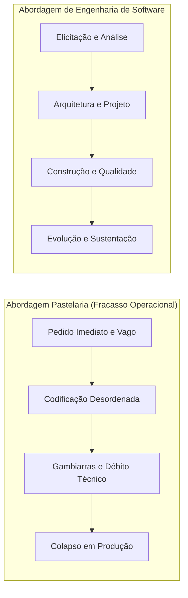

A atuação técnica orienta-se pela máxima clássica da engenharia:
> *"Faça a coisa certa (análise) e faça certo a coisa (projeto)."*

- **Análise de Requisitos (Fazer a coisa certa):** Concentra-se no domínio do problema. Garante que as necessidades reais dos clientes e usuários sejam mapeadas e validadas, evitando que o time gaste recursos construindo uma solução impecável para o problema errado.
- **Projeto e Arquitetura de Software (Fazer certo a coisa):** Concentra-se no domínio da solução técnica. Estabelece estruturas desacopladas, interfaces estáveis, padrões de design consolidados e testes automatizados, assegurando manutenibilidade e escalabilidade.

### Sistema de Avaliação e Regras de Composição de Nota

A avaliação acadêmica na UniFEF equilibra o domínio conceitual individual com a capacidade de execução colaborativa em equipe:
- **AV1 (Avaliação Individual do 1º Bimestre):** Exame individual formal avaliando os fundamentos do ciclo de vida, técnicas de elicitação, modelagem de casos de uso e conceitos iniciais de arquitetura.
- **AV2 (Avaliação Individual do 2º Bimestre):** Exame individual formal focado no projeto detalhado orientado a objetos, diagramas de classes avançados, padrões de projeto (GoF), princípios SOLID e estilos arquiteturais modernos.
- **PJ (Projeto Integrador da Disciplina):** Trabalho prático em grupo desenvolvido ao longo de todo o semestre, pontuado pela coerência técnica dos artefatos produzidos.

A nota final é calculada por média ponderada em dois bimestres, atribuindo peso 60% à avaliação individual e peso 40% ao projeto prático:

```math
\text{Nota Final} = \frac{[(\text{AV}_1 \times 0.6) + (\text{PJ} \times 0.4)] + [(\text{AV}_2 \times 0.6) + (\text{PJ} \times 0.4)]}{2}
```

### Projeto Integrador da Disciplina (PJ)

O Projeto Integrador consolida o aprendizado por meio da simulação de um projeto de engenharia corporativo real. As equipes operam sob regras estritas:
- **Composição das Equipes:** Formadas obrigatoriamente por **3 pessoas**. A alocação é definitiva e exige rotação equilibrada de papéis técnicos (analistas de requisitos, arquitetos de software e engenheiros de qualidade).
- **Estrutura de Entregas:** Dividido em duas etapas bimestrais:

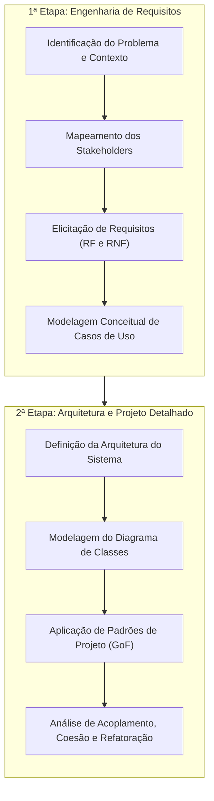

As equipes selecionam domínios de mercado para contextualizar o produto:

| Domínio Temático | Propostas de Aplicação | Exemplos de Requisitos Críticos |
| :--- | :--- | :--- |
| **Comércio** | Marketplaces B2B/B2C, OMS e WMS | Controle transacional de estoque, reservas com tempo limite (*TTL*), conciliação financeira de frete. |
| **Serviços Públicos** | Gestão de Obras e Atendimento ao Cidadão | Triagem geoespacial de chamados, prazos de atendimento regulatórios (*SLA*), trilhas de auditoria. |
| **Negócios** | Gestão de Projetos e ATS Corporativo | Cálculos dinâmicos de caminho crítico, triagem automatizada de candidatos, governança de acesso. |
| **Saúde** | Prontuário Eletrônico e Telemedicina | Criptografia de registros médicos, conformidade sanitária, telemetria clínica síncrona. |
| **Educação** | Sistemas de Gestão Acadêmica (SGA) e LMS | Controle de notas ponderadas, controle de frequência presencial e submissão de tarefas com prazos. |
| **Logística** | Rastreamento de Frotas e Otimização de Rotas | Algoritmos de roteirização em grafos, telemetria veicular em tempo real, comprovação digital de entrega. |

### Bibliografia Básica e Complementar

A fundamentação da disciplina alinha-se aos autores de referência da modelagem orientada a objetos:
- **GUEDES, Gilleanes T. A.** *UML 2: Uma Abordagem Prática*. 2. ed. São Paulo: Novatec, 2011.
- **BOOCH, Grady; RUMBAUGH, James; JACOBSON, Ivar.** *UML: Guia do Usuário*. 1. ed. Rio de Janeiro: Campus, 2000.
- **FURLAN, José Davi.** *Modelagem de Objetos através da UML*. 1. ed. São Paulo: Makron Books, 1998.
- **BEZERRA, Eduardo.** *Princípios de Análise e Projeto de Sistemas com UML*. 4. ed. Rio de Janeiro: Elsevier, 2007.
- **MEDEIROS, Ernani.** *Desenvolvendo Software com UML 2.0*. 1. ed. São Paulo: Pearson Makron Books, 2004.
- **O'NEILL, Henrique; NUNES, Mauro; RAMOS, Pedro.** *Exercícios de UML*. 1. ed. Lisboa: FCA, 2010.
- **GÓES, Wilson Moraes.** *Aprenda UML por Meio de Estudo de Caso*. 1. ed. São Paulo: Novatec, 2014.
- **BORATTI, Isaias Camilo.** *Programação Orientada a Objetos em Java*. 1. ed. Florianópolis: Visual Books, 2007.

---

## O Ciclo de Vida do Projeto de Software

### As Dez Fases do Ciclo de Vida

O ciclo de vida do desenvolvimento de software corporativo moderno compõe-se de dez fases iterativas:

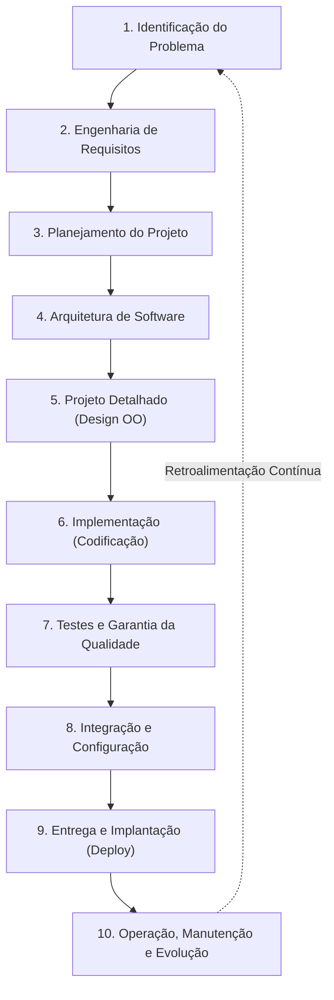

A tabela abaixo sintetiza os objetivos e entregáveis técnicos de cada etapa:

| Fase | Foco Operacional | Artefato de Entrada | Artefato de Saída |
| :--- | :--- | :--- | :--- |
| **1. Problema** | Compreender a carência e dor do negócio. | Ineficiências operacionais, queixas de clientes. | Declaração do Problema, Proposta de Valor. |
| **2. Requisitos** | Elicitar e especificar funções e restrições. | Declaração do Problema, dados de entrevistas. | Documento de Requisitos (SRS), Casos de Uso. |
| **3. Planejamento** | Estimar prazos, custos, riscos e entregas. | Requisitos priorizados, capacidade do time. | Backlog estruturado, Matriz de Riscos, Cronograma. |
| **4. Arquitetura** | Definir macroestruturas e atributos de qualidade. | Requisitos Não Funcionais críticos. | Documento de Arquitetura (SAD), Visões C4/UML. |
| **5. Projeto** | Modelar classes, interfaces e padrões de design. | Arquitetura macro aprovada. | Diagramas de Classes, Diagramas de Sequência. |
| **6. Implementação** | Produzir código testável em linguagem tipada. | Modelos de classes e contratos de interfaces. | Código-fonte versionado em repositório (Git). |
| **7. Testes** | Validar conformidade funcional e limites não funcionais. | Código compilável, critérios de aceite. | Relatórios de cobertura, registros de QA. |
| **8. Integração** | Unificar componentes em builds automatizados. | Branches de código testadas localmente. | Builds consolidados, imagens de contêiner. |
| **9. Entrega** | Disponibilizar a versão em ambiente operacional. | Contêineres homologados e scripts de migração. | Versão em produção, registro de liberação (*release*). |
| **10. Manutenção** | Monitorar métricas, corrigir falhas e evoluir. | Telemetria de produção, chamados de usuários. | Correções imediatas (*hotfixes*), novos requisitos. |

### Identificação do Problema e Proposta de Valor

Nenhum projeto de engenharia deve iniciar a codificação sem antes responder de maneira exaustiva a cinco perguntas fundamentais:
1. **Qual problema precisa ser resolvido?** A raiz do problema deve ser isolada dos sintomas superficiais.
2. **Quem enfrenta esse problema?** Identificação precisa das personas afetadas direta e indiretamente.
3. **Como o problema é resolvido atualmente?** Levantamento do processo *As-Is* (planilhas, anotações em papel ou sistemas legados).
4. **Quais são as principais dificuldades?** Gargalos de retrabalho, perda de dados ou lentidão operacional.
5. **Qual valor o software gerará?** Ganhos de escala, redução percentual de falhas ou mitigação de riscos legais e fiscais.

### O Pipeline Metodológico em Sete Etapas

Para operacionalizar a transição entre a análise e a construção, a disciplina adota um encadeamento lógico em sete etapas de modelagem:

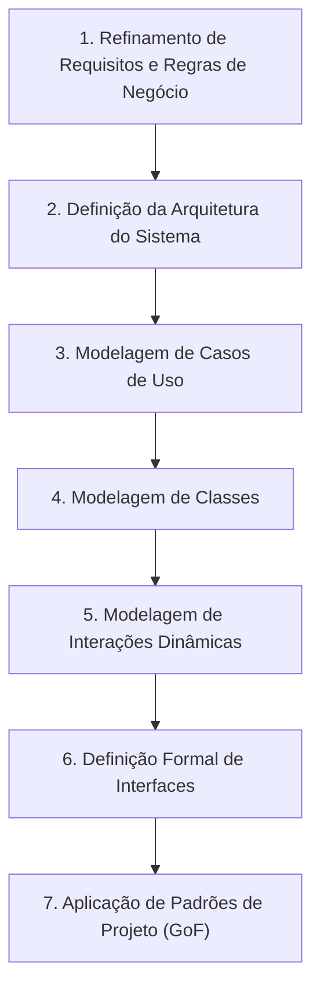

---

## Fundamentos de Projeto Orientado a Objetos

### Transição da Análise para o Projeto

A engenharia de software distingue com clareza o Modelo de Análise do Modelo de Projeto:

| Dimensão de Comparação | Modelo de Análise | Modelo de Projeto Orientado a Objetos |
| :--- | :--- | :--- |
| **Pergunta Central** | O que o sistema deve fazer? | Como o sistema fará tecnicamente? |
| **Perspectiva** | Negócio, usuário final e clientes | Engenheiro de software, arquiteto e desenvolvedor |
| **Nível de Abstração** | Conceitual e agnóstico de tecnologias | Lógico e físico, amarrado a padrões e plataformas |
| **Vocabulário** | Termos do domínio (ex.: *Empréstimo*, *Livro*) | Termos técnicos (ex.: *Controller*, *Repository*, *DTO*) |
| **Entregáveis Técnicos** | Casos de uso, requisitos funcionais e glossário | Diagramas de classes detalhados, sequência e interfaces |

### Pilares Estruturais da Orientação a Objetos

O projeto orientado a objetos fundamenta-se em princípios que asseguram a manutenibilidade e a evolução dos sistemas:

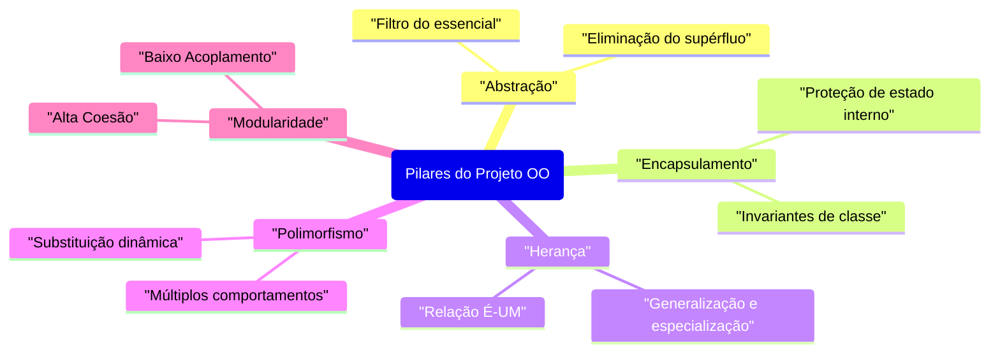

### Abstração e Encapsulamento Rigoroso

- **Abstração:**
  - *Definição:* Mecanismo de isolamento no qual o desenvolvedor modela as características essenciais de uma entidade para o contexto do sistema, descartando detalhes irrelevantes.
  - *Motivação:* Redução da carga cognitiva. Uma classe `Pedido` em um sistema comercial precisa armazenar itens, clientes e totais; detalhes de alocação de memória ou bits de rede são irrelevantes para o domínio.
  - *Armadilha:* Incluir atributos excessivos "pensando no futuro", o que polui o modelo conceitual.

- **Encapsulamento:**
  - *Definição:* Agrupamento de dados e operações em uma mesma estrutura, restringindo o acesso direto ao estado interno por meio de modificadores de visibilidade.
  - *Motivação:* Garantia da integridade das regras de negócio (invariantes). Impede que classes externas atribuam estados ilegais (como quantidades negativas ou totais inconsistentes).
  - *Contraexemplo (Modelo Anêmico):* Criar atributos públicos ou expor métodos *setters* cegos para todos os campos, permitindo mutações arbitrárias sem validação.
  - *Armadilha de Vazamento de Referência (*Escaping References*):* Retornar coleções internas mutáveis (`List`, `Map`) diretamente em métodos *getters*. Qualquer cliente externo pode invocar `.clear()` ou `.add()` fora do controle do objeto. A solução exige o retorno de cópias defensivas ou coleções imutáveis via `Collections.unmodifiableList(...)`.

```java
package br.unifef.engenharia.vendas;

import java.util.ArrayList;
import java.util.Collections;
import java.util.List;

public class Venda {
    private final String identificador;
    private double valorTotal;
    private final List<String> itens;

    public Venda(String identificador) {
        if (identificador == null || identificador.isBlank()) {
            throw new IllegalArgumentException("Identificador da venda é obrigatório.");
        }
        this.identificador = identificador;
        this.valorTotal = 0.0;
        this.itens = new ArrayList<>();
    }

    public void adicionarItem(String nomeProduto, double valorUnitario, int quantidade) {
        if (quantidade <= 0) {
            throw new IllegalArgumentException("A quantidade deve ser estritamente positiva.");
        }
        if (valorUnitario < 0.0) {
            throw new IllegalArgumentException("O valor unitário não pode ser negativo.");
        }
        this.itens.add(nomeProduto + " x" + quantidade);
        this.valorTotal += (valorUnitario * quantidade);
    }

    public double getValorTotal() {
        return this.valorTotal;
    }

    public String getIdentificador() {
        return this.identificador;
    }

    // Proteção rigorosa contra mutações externas indevidas
    public List<String> getItens() {
        return Collections.unmodifiableList(this.itens);
    }
}
```

### Herança e Polimorfismo

- **Herança:**
  - *Definição:* Relação estrutural onde uma classe especializada (filha) herda atributos e métodos de uma classe genérica (mãe), estabelecendo uma semântica do tipo "É UM" (*is-a*).
  - *Motivação:* Reúso de lógica comum e organização taxonômica de conceitos.
  - *Armadilha:* Herança espúria por mera conveniência de código. Modelar `ContaBancaria` herdando de `Cliente` viola a semântica conceitual; deve-se preferir composição.

- **Polimorfismo:**
  - *Definição:* Capacidade de tratar objetos de diferentes classes especializadas por meio de uma interface ou classe base comum, invocando o comportamento apropriado dinamicamente em tempo de execução.
  - *Motivação:* Eliminar blocos condicionais aninhados (`if/else` ou `switch`) espalhados pelo código. A inclusão de um novo tipo exige apenas a criação de uma nova classe, sem tocar nas estruturas existentes.
  - *Exemplo:* Uma chamada a `formaPagamento.processar(valor)` executará a lógica específica de `PagamentoPix` ou `PagamentoCartao` de forma transparente para o chamador.

```java
package br.unifef.engenharia.pagamento;

public abstract class Pagamento {
    private final double valor;

    protected Pagamento(double valor) {
        if (valor <= 0.0) {
            throw new IllegalArgumentException("O valor de pagamento deve ser positivo.");
        }
        this.valor = valor;
    }

    public double getValor() {
        return this.valor;
    }

    // Método abstrato definindo o contrato polimórfico
    public abstract boolean processarTransacao();
}
```

```java
package br.unifef.engenharia.pagamento;

public class PagamentoPix extends Pagamento {
    private final String chavePix;

    public PagamentoPix(double valor, String chavePix) {
        super(valor);
        if (chavePix == null || chavePix.isBlank()) {
            throw new IllegalArgumentException("Chave Pix inválida.");
        }
        this.chavePix = chavePix;
    }

    @Override
    public boolean processarTransacao() {
        // Integração específica com o arranjo de pagamentos instantâneos
        return true;
    }
}
```

### Acoplamento, Coesão e os Princípios SOLID

A manutenibilidade de uma base de código depende de duas propriedades métricas:

- **Baixo Acoplamento:** Grau de dependência entre módulos de software. Módulos fracamente acoplados dependem de interfaces abstratas e desconhecem detalhes internos dos outros módulos. Mudanças no módulo B não propagam quebras no módulo A.
- **Alta Coesão:** Grau de alinhamento das responsabilidades de uma classe. Uma classe coesa concentra operações focadas em um único propósito de negócio. Classes não coesas acumulam funções heterogêneas, gerando a anomalia arquitetural conhecida como *God Class*.

```mermaid
flowchart LR
    subgraph AcoplamentoAlto["Alto Acoplamento (Indesejado)"]
        direction TB
        C1["Classe Pedido"] -->|"Depende de implementação interna"| C2["Classe Concreta MySQL"]
    end

    subgraph AcoplamentoBaixo["Baixo Acoplamento (Desejado)"]
        direction TB
        P1["Classe Pedido"] -->|"Depende de contrato"| I1["Interface RepositorioPedido"]
        I1 <|..|"Implementa"| P2["Adaptador PostgreSql"]
    end
```

Os princípios **SOLID** formalizam essas diretrizes:
- **S — Single Responsibility Principle (Princípio da Responsabilidade Única):** Uma classe deve possuir um, e apenas um, motivo para mudar.
- **O — Open/Closed Principle (Princípio Aberto/Fechado):** Entidades de software devem estar abertas para extensão, mas fechadas para modificação.
- **L — Liskov Substitution Principle (Princípio da Substituição de Liskov):** Objetos de subclasses devem substituir instâncias de suas superclasses sem corromper o comportamento do programa.
- **I — Interface Segregation Principle (Princípio da Segregação de Interfaces):** Clientes não devem ser forçados a depender de interfaces com métodos que não utilizam.
- **D — Dependency Inversion Principle (Princípio da Inversão de Dependências):** Módulos de alto nível não devem depender de módulos de baixo nível; ambos devem depender de abstrações.

### Visão Geral dos Padrões de Projeto GoF

Os padrões táticos GoF (*Gang of Four*) dividem-se em três famílias:

| Categoria | Padrão | Finalidade de Engenharia | Impacto Arquitetural |
| :--- | :--- | :--- | :--- |
| **Criacional** | **Factory Method** | Define uma interface para criação de objetos, delegando a instanciação concreta a subclasses. | Desacopla o chamador dos construtores específicos. |
| **Estrutural** | **Adapter** | Converte a interface de uma classe na interface esperada pelo cliente. | Permite integrar bibliotecas legadas incompatíveis. |
| **Estrutural** | **Facade** | Fornece uma interface simplificada e unificada para um subsistema complexo. | Reduz a superfície de contato com bibliotecas pesadas. |
| **Comportamental** | **Strategy** | Encapsula uma família de algoritmos, tornando-os intercambiáveis em tempo de execução. | Elimina condicionais e atende ao Princípio Aberto/Fechado. |
| **Comportamental** | **Observer** | Define uma dependência um-para-muitos, notificando múltiplos objetos sobre mudanças de estado. | Base para interfaces reativas e eventos de domínio. |

---

## Engenharia e Elicitação de Requisitos

### Levantamento versus Elicitação Ativa

A literatura clássica de Engenharia de Software (SWEBOK / IEEE 29148) estabelece uma distinção conceitual crucial:
- **Levantamento (Gathering / Collection):** Pressupõe uma postura passiva do analista, como se os requisitos estivessem prontos e lapidados na mente dos usuários, cabendo apenas anotá-los.
- **Elicitação (Elicitation):** Do latim *elicitare* ("fazer brotar", "trazer à luz"). Assume uma postura investigativa e ativa do analista. O cliente possui queixas, problemas de caixa, processos manuais confusos e metas comerciais, mas raramente sabe expressar requisitos de software de forma estruturada. Cabe ao engenheiro investigar, correlacionar e formalizar a solução.

### A Cadeia Causal da Elicitação

A descoberta de requisitos percorre cinco elos obrigatórios:

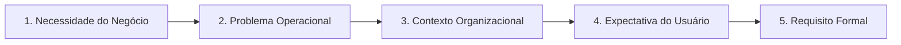

| Elo | Definição | Exemplo Corporativo Real |
| :--- | :--- | :--- |
| **Necessidade** | Carência fundamental para sobrevivência da organização. | Reduzir custos com frete e avarias em entregas urbanas. |
| **Problema** | Obstáculo factual que impede o atendimento da necessidade. | Erros recorrentes no preenchimento de endereços pelos operadores de televendas. |
| **Contexto** | Restrições de ambiente, equipe, tecnologia e normas. | Call center operando com alta rotatividade e computadores legados. |
| **Expectativa** | Desejo subjetivo do stakeholder sobre o software. | "Quero que a tela não deixe o vendedor errar a rua do cliente." |
| **Requisito** | Especificação não ambígua e testável de um serviço ou restrição. | O sistema deve validar o CEP em tempo real via API dos Correios e autopreencher logradouro, bairro e cidade em até 800 milissegundos. |

### As Seis Perguntas Cardinais

Diante de qualquer solicitação de funcionalidade, o analista deve responder:
1. **Qual problema existe?** (Foco na dor raiz, e não no sintoma superficial).
2. **Quem enfrenta o problema?** (Mapeamento dos atores primários, secundários e beneficiários indiretos).
3. **Como ele é resolvido atualmente?** (Análise detalhada do fluxo operacional *As-Is*).
4. **O que o sistema precisa fazer?** (Comportamento funcional esperado e regras de negócio obrigatórias).
5. **Quais são as restrições?** (Limitações de prazo, orçamento, normas legais como LGPD/ANVISA e tecnologias suportadas).
6. **O que é prioridade?** (Separação entre itens vitais para o MVP e desejos cosméticos).

### Crítica ao Desenvolvimento Prematuro

Considere a seguinte manifestação comum de clientes:
> *"Preciso de um sistema para melhorar meu negócio."*

Iniciar a codificação sob esta declaração representa negligência de engenharia por quatro razões determinantes:
- **Ausência de Critérios de Aceite:** O termo "melhorar" é subjetivo. Sem métricas objetivas (ex.: reduzir o tempo de fechamento financeiro em 40%), o projeto jamais terá término formal aceito pelo contratante.
- **Corrupção de Escopo (*Scope Creep*):** Sem fronteiras declaradas, qualquer solicitação imaginada ao longo dos meses subsequentes será cobrada como parte da promessa genérica de "melhorar o negócio".
- **Assimetria de Conhecimento:** O cliente domina seu nicho operacional, mas desconhece restrições de concorrência de dados e segurança. O engenheiro domina tecnologia, mas desconhece os termos e rotinas da empresa.
- **Automatização do Caos:** Informatizar processos desorganizados e inconsistentes serve apenas para acelerar a geração de erros e prejuízos.

### Taxonomia das Dificuldades e Armadilhas de Ambiguidade

A extração de requisitos enfrenta barreiras estruturais:
- **Conhecimento Tácito:** Procedimentos manuais repetidos há anos que os operadores assumem como óbvios e se esquecem de relatar nas reuniões.
- **Vocabulários Dissonantes:** Setores diferentes usam nomes distintos para a mesma entidade (ex.: o Comercial chama de "Orçamento", a Produção chama de "Ordem de Fabricação" e o Fiscal chama de "Nota Fiscal").
- **Conflito de Interesses:** Vendedores desejam cadastros de clientes com apenas dois campos para acelerar o fechamento; o setor de Crédito e Risco exige vinte campos de checagem patrimonial.
- **Ambiguidade Qualitativa:** Termos como "rápido", "fácil", "seguro" e "robusto" constituem **anti-requisitos** enquanto não forem convertidos em métricas físicas observáveis e testáveis:

| Termo Ambíguo | Tradução Errada da Equipe | Refatoração Técnica da Engenharia de Requisitos |
| :--- | :--- | :--- |
| "O sistema deve ser rápido." | Incluir paginação sem medir impacto. | **RNF-01 (Desempenho):** A busca de pedidos por cliente deve responder em menos de 1,2 segundos para o percentil 95 ($ `p95` $) sob carga de 250 requisições simultâneas. |
| "A interface deve ser simples." | Remover botões úteis da tela. | **RNF-02 (Usabilidade):** Um novo atendente deve concluir um cadastro padrão em menos de 3 minutos, após treinamento de 30 minutos, com taxa de erro inferior a 2%. |
| "O sistema precisa ser seguro." | Salvar senhas com criptografia reversível. | **RNF-03 (Segurança):** O sistema deve exigir autenticação multifator (MFA) para operações financeiras e armazenar credenciais utilizando o algoritmo Argon2id com parâmetro de memória de 64MB. |

### Técnicas de Levantamento: Entrevistas, Questionários e Observação

| Técnica de Elicitação | Aplicação Recomendada | Vantagens Técnicas | Desvantagens e Cuidados |
| :--- | :--- | :--- | :--- |
| **Entrevistas Estruturadas** | Validação de itens específicos com múltiplos usuários. | Rápida consolidação e facilidade de comparação estatística. | Inflexível; impede o aprofundamento de descobertas imprevistas. |
| **Entrevistas Semiestruturadas** | Condução investigativa com gestores e operadores chave. | Equilíbrio entre foco em objetivos e flexibilidade de exploração. | Demanda analista experiente para não perder o controle do tempo. |
| **Questionários** | Levantamento com populações massivas e dispersas. | Baixo custo por respondente e anonimato garantido. | Taxa de retorno historicamente baixa e impossibilidade de esclarecer dúvidas. |
| **Observação Direta (*Job Shadowing*)** | Identificação de rotinas práticas no posto de trabalho. | Revela atalhos operacionais e passos que o usuário omitiu em entrevistas. | Efeito Hawthorne (o usuário altera o comportamento ao ser observado). |
| **Workshops / JAD** | Alinhamento e resolução de conflitos entre setores divergentes. | Construção de consenso rápido entre stakeholders técnicos e de negócio. | Exige moderação neutra para evitar dominação por cargos hierárquicos superiores. |

### Papéis de Engenharia: Stakeholders versus Analistas de Sistemas

A engenharia de requisitos exige a clara separação entre a visão de negócio e a visão analítica de sistemas:

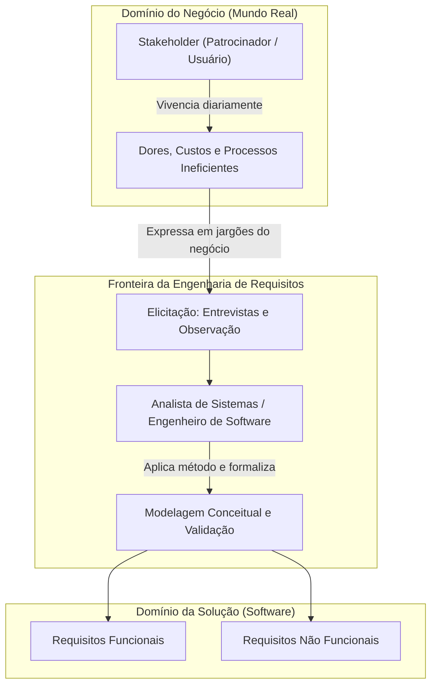

#### Estudo de Caso: Diagnóstico de Causa Raiz com os 5 Porquês
Na análise do problema corporativo (simulado na Atividade de Aula 3 — *HealthTech Solutions*), o sintoma visível consistia no atraso de quinze dias na compilação do faturamento de locações hospitalares. A aplicação da técnica analítica dos **5 Porquês** revelou a raiz do problema:
1. *Por que atrasa o faturamento?* Porque os canhotos de entrega em papel chegam com atraso à matriz.
2. *Por que chegam com atraso?* Porque os motoristas guardam os canhotos nas cabines dos caminhões durante semanas.
3. *Por que guardam nas cabines?* Porque não há uma rotina diária de conferência no almoxarifado no retorno das viagens.
4. *Por que não há conferência?* Porque o almoxarifado não recebe aviso prévio de quais equipamentos foram coletados.
5. *Por que não há aviso prévio? (Causa Raiz):* Ausência de um sistema móvel de registro eletrônico com validação de leitura de código de barras no momento físico da coleta no hospital.

---

## Priorização de Requisitos: O Método MoSCoW

### Conceituação e Categorias do Método

Criado por Dai Clegg no framework DSDM (*Dynamic Systems Development Method*), o método **MoSCoW** estrutura o backlog do projeto em quatro níveis de criticidade:

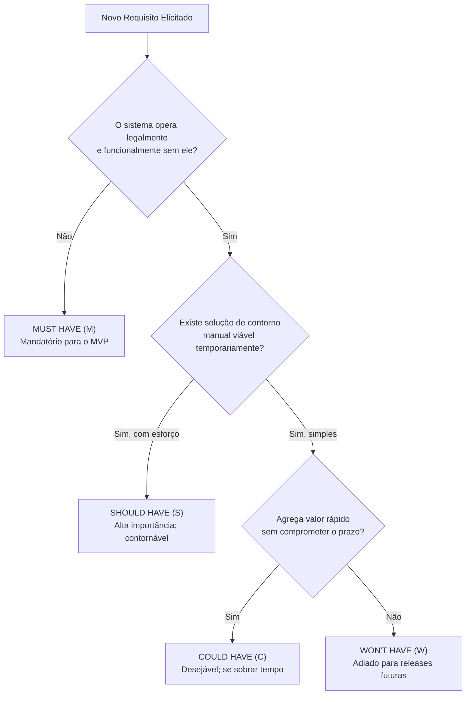

- **M — Must Have (Deve Ter):** Requisitos inegociáveis. Se qualquer item classificado como *Must* for omitido, o sistema simplesmente não pode entrar em produção (falha crítica de operação ou violação regulatória).
- **S — Should Have (Deveria Ter):** Funcionalidades de alto valor agregado. Altamente recomendadas, mas cuja ausência temporária no dia do lançamento pode ser suprida por procedimentos manuais de contorno.
- **C — Could Have (Poderia Ter):** Funcionalidades desejáveis que aumentam o conforto ou diferenciação competitiva, mas que só serão desenvolvidas se houver folga de cronograma e orçamento.
- **W — Won't Have this time (Não Terá Desta Vez):** Itens reconhecidos como válidos, mas acordados formalmente como fora do escopo da versão atual, evitando desperdício de esforço na arquitetura imediata.

### Critérios de Corte e Prevenção de Escopo Infinito

A aplicação rigorosa do MoSCoW impede a corrupção do cronograma (*scope creep*). A equipe e os stakeholders concordam que a data de entrega é fixa; caso surjam imprevistos técnicos durante a construção, as funcionalidades classificadas como *Could* e *Should* são postergadas para assegurar que 100% dos requisitos *Must* entrem em produção com estabilidade.

### Matrizes MoSCoW Aplicadas a Domínios Práticos

#### Aplicação em Plataforma de Food Delivery
| Categoria | Funcionalidades Alocadas | Justificativa Técnica e de Negócio |
| :--- | :--- | :--- |
| **Must have** | Login de atores; Manutenção de cardápio; Montagem de carrinho; Processamento de pagamento; Transição básica de status do pedido. | Núcleo transacional mínimo indispensável. Sem estes componentes, a operação de compra e venda não se concretiza. |
| **Should have** | Rastreamento em mapa em tempo real; Notificações push de status; Módulo administrativo de moderação de avaliações. | Essenciais para a governança e retenção de usuários. O sistema opera sem *push* (via consulta manual de tela), mas com perda de experiência. |
| **Could have** | Chat interno síncrono entre cliente e cozinha; Programa de fidelidade gamificado; Inserção de cupons promocionais complexos. | Aumentam o engajamento dos usuários, mas a operação diária de entrega sobrevive plenamente sem eles no lançamento do MVP. |
| **Won't have** | Algoritmos de despacho automatizado para entregadores autônomos terceiros; Estimativa preditiva de tempo de preparo por inteligência artificial. | Complexidade elevada de infraestrutura e telemetria que desviaria o time do objetivo de estabilização do núcleo de vendas. |

#### Aplicação em Sistema de Informatização de Biblioteca
| Categoria | Funcionalidades Alocadas | Justificativa Técnica e de Negócio |
| :--- | :--- | :--- |
| **Must have** | Cadastro de acervo bibliográfico; Cadastro de usuários acadêmicos; Registro de empréstimos; Devolução com liberação de exemplar. | Sustentação básica do controle patrimonial da instituição de ensino. |
| **Should have** | Cálculo automático de multas por atraso; Mecanismo de bloqueio de novos empréstimos para usuários inadimplentes; Envio de e-mail de alerta de vencimento. | Automatiza a cobrança e preserva o acervo, substituindo rotinas manuais de planilhas de cobrança. |
| **Could have** | Reserva remota de exemplares emprestados via portal do aluno; Avaliação e resenha pública de obras pelos estudantes. | Melhorias de conveniência no autoatendimento que não impedem a operação física no balcão da biblioteca. |
| **Won't have** | Integração com catálogos internacionais via protocolo Z39.50; Recomendação semântica de leitura baseada no histórico de disciplinas cursadas. | Escopo postergado para revisões futuras da plataforma institucional. |

---

## Modelagem Comportamental com Diagramas de Casos de Uso UML

### Definição, Fronteira e Abordagem Caixa-Preta

O Diagrama de Casos de Uso é um diagrama comportamental estático padronizado pela OMG (*Object Management Group*). Ele apresenta a fronteira do sistema e o catálogo de serviços observáveis que este provê ao ambiente externo.

A modelagem opera estritamente sob a perspectiva de **Caixa-Preta** (*Black-Box*):
- O diagrama responde exclusivamente à pergunta: *"O que o sistema faz para os atores externos?"*
- Não se deve modelar telas específicas, rotinas de validação de formulários, conexões com bancos de dados relacionais ou tabelas SQL.
- A **Fronteira do Sistema** (*System Boundary*) delimita com precisão o que está contido no software em desenvolvimento e o que pertence ao ambiente externo.

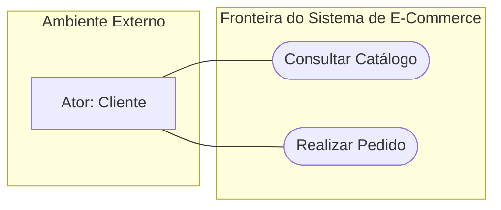

### Elementos Básicos: Atores e Casos de Uso

- **Atores:**
  - *Conceito:* Um ator especifica um papel desempenhado por um usuário humano ou por um sistema externo que interaja com o sistema. Representa uma função lógica, e não um indivíduo físico.
  - *Classificação:*
    - **Ator Primário:** Dispara a interação com o sistema para atingir um objetivo de negócio mensurável (ex.: o *Cliente* finalizando uma compra).
    - **Ator Secundário:** Fornece serviços de infraestrutura, dados ou processamento de suporte (ex.: *Gateway de Pagamento*, serviço de envio de SMS ou autenticação federada).
  - *Regra de Nomenclatura:* Substantivos no singular indicando a função (ex.: `Bibliotecario`, `Cliente`, `Administrador`).

- **Casos de Uso:**
  - *Conceito:* Uma unidade discreta e atômica de funcionalidade executada pelo sistema que entrega um resultado de valor observável para um ator específico.
  - *Regra de Nomenclatura:* Iniciado **obrigatoriamente por verbo no infinitivo** seguido do complemento do objeto (ex.: `Cadastrar Livro`, `Emitir Nota Fiscal`, `Renovar Empréstimo`).
  - *Armadilha de Granularidade Excessiva:* Fragmentar ações procedimentais em múltiplos casos de uso (como `Digitar Senha`, `Clicar em Entrar`, `Consultar Tabela`). Essas ações são passos de um fluxo e devem compor a especificação textual de um único caso de uso abrangente.

### Relacionamentos: Associação, Inclusão, Extensão e Generalização

O poder expressivo da modelagem comportamental apoia-se em quatro tipos de relacionamentos:

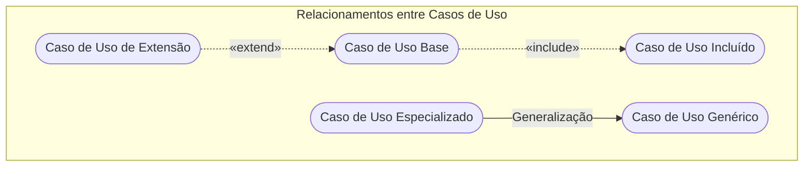

| Relacionamento | Semântica | Obrigatoriedade | Direção da Dependência |
| :--- | :--- | :--- | :--- |
| **Associação** | Caminho de comunicação entre ator e caso de uso. | Variável | Linha sólida simples entre o ator e a elipse do caso de uso. |
| **Inclusão (`<<include>>`)** | Reúso de comportamento comum compartilhado por múltiplos casos de uso. | **Obrigatório** (incondicional) | Linha tracejada apontando **da Base para o Incluído** (`Base -.->|«include»| Incluído`). |
| **Extensão (`<<extend>>`)** | Inserção de fluxos opcionais disparados sob condições de guarda específicas. | **Opcional** (condicional) | Linha tracejada apontando **da Extensão para a Base** (`Extensão -.->|«extend»| Base`). |
| **Generalização** | Herança estrutural e comportamental (especialização de tipos). | Herança conceitual | Linha sólida com ponta triangular vazada apontando do elemento especializado para o genérico. |

- **Exemplo de Inclusão (`<<include>>`):** Os casos de uso `Realizar Compra` e `Alterar Limite de Crédito` incluem compulsoriamente o caso de uso `Autenticar Usuário`. A lógica de autenticação é reaproveitada e obrigatória para a conclusão bem-sucedida do fluxo base.
- **Exemplo de Extensão (`<<extend>>`):** No caso de uso `Finalizar Compra`, o cliente pode opcionalmente acionar `Aplicar Cupom de Desconto`. A finalização da compra ocorre normalmente sem o cupom; contudo, sob a condição de guarda *"o cliente informou código promocional válido"*, o fluxo estendido é intercalado no ponto de extensão.
- **Exemplo de Generalização:** O caso de uso `Pagar Pedido` possui as especializações `Pagar via Pix`, `Pagar via Cartão de Crédito` e `Pagar via Boleto`. O ator `Administrador` herda os casos de uso do ator genérico `Operador`.

### Estrutura Canônica de Especificação Textual de Casos de Uso

Na engenharia de software profissional, o diagrama visual funciona como um índice gráfico; a especificação formal do comportamento reside no documento textual estruturado:

1. **Identificador e Nome:** Código unívoco e verbo no infinitivo (ex.: `UC-02: Fazer Pedido`).
2. **Atores:** Primários (iniciadores) e Secundários (sistemas colaboradores).
3. **Pré-condições:** Estados de dados e do sistema que devem ser verdadeiros antes do início da execução.
4. **Pós-condições:** Estados garantidos do sistema após a conclusão bem-sucedida do caso de uso.
5. **Fluxo Principal (Caminho Feliz):** A sequência padrão, ótima e linear de passos executados entre o ator e o sistema.
6. **Fluxos Alternativos:** Desvios normais do fluxo que ainda conduzem ao sucesso do objetivo (ex.: o cliente escolhe pagar via boleto em vez de cartão).
7. **Fluxos de Exceção:** Condições de erro técnico ou de negócio que impedem a conclusão do objetivo, resultando no aborto da operação e restauração do estado estável (ex.: transação de cartão rejeitada pela operadora).

### Estudos de Caso de Modelagem Comportamental

#### Plataforma de Delivery de Comida (Estudo Integrado da Aula 06)

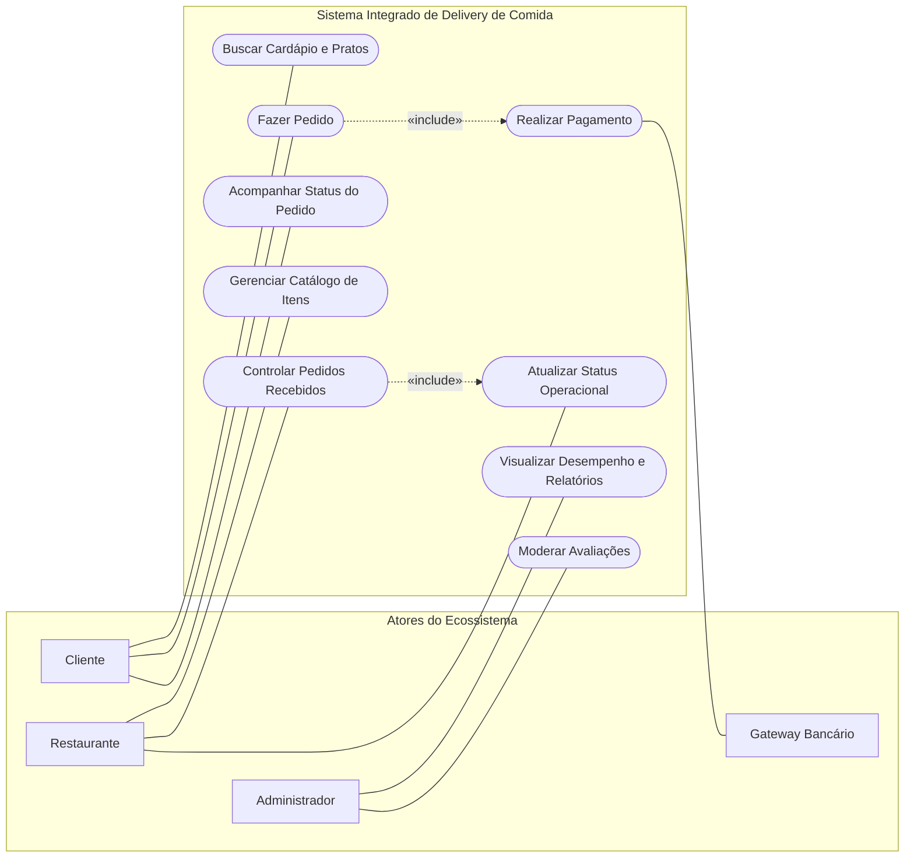

#### Especificação Canônica: UC-02 Fazer Pedido
- **Ator Primário:** Cliente.
- **Atores Secundários:** Gateway Bancário.
- **Pré-condições:** Cliente autenticado no aplicativo; carrinho com pelo menos um item ativo de um único restaurante.
- **Pós-condições:** Pedido registrado no banco com status `Pendente`; valor debitado no cartão; comanda despachada para o restaurante.
- **Fluxo Principal:**
  1. O cliente acessa a tela de checkout e confirma o endereço de entrega e a lista de itens.
  2. O sistema calcula a taxa de entrega e exibe o valor final totalizado.
  3. O cliente seleciona a opção de pagamento digital com cartão de crédito previamente cadastrado e clica em "Confirmar Pedido".
  4. O sistema executa o caso de uso `UC-04: Realizar Pagamento` (inclusão mandatória).
  5. O sistema registra o pedido no banco com status `Pendente`.
  6. O sistema emite alerta sonoro no painel do restaurante parceiro.
  7. O sistema exibe o código de rastreio na tela do cliente e encerra o fluxo com sucesso.
- **Fluxos Alternativos:**
  - *FA01: Pagamento via Pix:* No passo 3, o cliente seleciona a opção Pix. O sistema gera a chave dinâmica copia-e-cola e o QR Code com tempo de expiração de 10 minutos. O sistema aguarda a notificação assíncrona do banco antes de avançar para o passo 5.
- **Fluxos de Exceção:**
  - *FE01: Pagamento Rejeitado pela Operadora:* No passo 4, o gateway bancário recusa a autorização da transação. O sistema notifica o cliente com a mensagem formal da operadora, mantém os itens salvos no carrinho e não envia a comanda ao restaurante.
  - *FE02: Restaurante Fechou Durante o Checkout:* No passo 2, o restaurante atinge o limite de pedidos do turno e fecha o atendimento. O sistema alerta o cliente, aborta a cobrança e bloqueia a finalização da transação.

---

## Modelagem Estrutural: A Linguagem UML e o Diagrama de Classes

### A UML como Linguagem de Notação versus Processos e Metodologias

A literatura de engenharia de software e as diretrizes do Prof. Wesley Soares combatem uma das confusões mais frequentes da área: confundir a UML com uma metodologia completa de desenvolvimento.

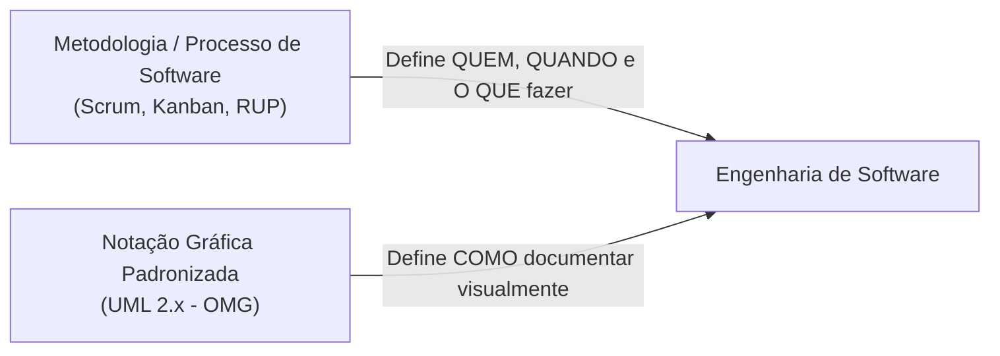

**A UML NÃO é:**
- Um processo ou ciclo de vida de desenvolvimento.
- Uma metodologia de gestão de software.
- Uma linguagem de programação executável compilável por si só.

**A UML É:**
- Uma linguagem visual padronizada para **visualizar, especificar, construir e documentar** artefatos de sistemas orientados a objetos.
- Criada nos anos 1990 pela unificação dos métodos de Grady Booch, James Rumbaugh e Ivar Jacobson (*Three Amigos*), sendo mantida e atualizada pelo *Object Management Group* (OMG).

### Integração da Modelagem ao Desenvolvimento Ágil e Scrum

No desenvolvimento ágil orientado pelo framework Scrum, a modelagem de classes não é descartada; seu propósito é redefinido:
- **Abordagem Tradicional (Cascata / BDUF - *Big Design Up Front*):** Tentativa de modelar 100% das classes, atributos e tabelas antes de escrever a primeira linha de código, gerando documentos obsoletos após as primeiras mudanças de negócio.
- **Abordagem Ágil (Scrum / *Just-in-Time* e *Just-Enough*):** A equipe utiliza diagramas de classes em nível de projeto no início de cada *Sprint* ou durante refinamentos técnicos para alinhar a arquitetura das histórias de usuário prioritárias. Diagramas desenhados em quadros virtuais (como Visual Paradigm Online) servem para guiar o pareamento e a modelagem do banco relacional.

### Anatomia da Classe: Compartimentos, Nomenclatura e Sintaxe

O Diagrama de Classes é o principal diagrama estrutural da orientação a objetos. Graficamente, uma classe é representada por um retângulo dividido horizontalmente em **três compartimentos**:

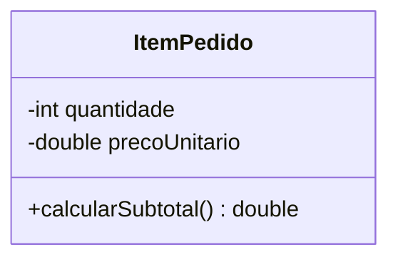

1. **Compartimento Superior (Nome):** Identificador unívoco da classe. Deve ser expresso no singular, utilizando **substantivo** e a convenção **PascalCase** (ex.: `Restaurante`, `ItemPedido`, `ContaCorrente`).
2. **Compartimento Central (Atributos):** Armazena o estado das instâncias. Nomeados com substantivos ou adjetivos na convenção **camelCase** (ex.: `dataEmissao`, `limiteCredito`).
3. **Compartimento Inferior (Operações / Métodos):** Define os comportamentos e funções da classe. Nomeados com **verbos no infinitivo** na convenção **camelCase** (ex.: `calcularTotal()`, `validarCpf()`).

#### Sintaxe Formal de Especificação UML
- **Atributos:** `[visibilidade] nome : tipo [multiplicidade] = [valorPadrao]`  
  - Exemplo: `- taxaEntrega : Double = 5.00`
- **Operações:** `[visibilidade] nomeOperacao([parametro : tipo]) : tipoRetorno`  
  - Exemplo: `+ autorizarDesconto(percentual : Double) : Boolean`

### Modificadores de Visibilidade e Níveis de Acesso

A UML estabelece quatro símbolos universais para explicitar o encapsulamento:

| Símbolo UML | Nível de Visibilidade | Palavra-chave Java | Escopo de Acessibilidade |
| :---: | :--- | :--- | :--- |
| `+` | **Público (Public)** | `public` | Acessível por qualquer classe em qualquer pacote da aplicação. |
| `#` | **Protegido (Protected)** | `protected` | Acessível pela própria classe, subclasses herdeiras e classes do mesmo pacote. |
| `-` | **Privado (Private)** | `private` | Acessível estritamente dentro da própria classe onde foi declarado. |
| `~` | **Pacote (Package)** | *(padrão - default)* | Acessível por qualquer classe pertencente ao mesmo pacote funcional. |

### Relacionamentos Estruturais: Associação, Agregação e Composição

A correta identificação dos relacionamentos estruturais define a integridade do modelo de dados e o ciclo de vida dos objetos em memória:

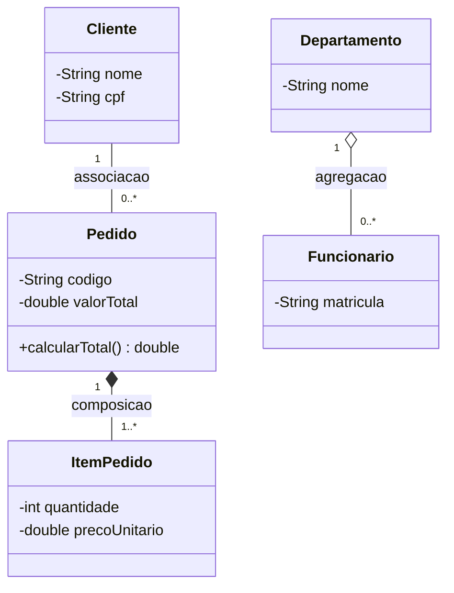

- **Associação Simples:** Conexão estrutural semântica entre classes independentes. As instâncias comunicam-se, mas possuem ciclos de vida completamente autônomos. Representada por uma **linha contínua**.
  - *Exemplo:* `Cliente` e `Pedido`. O cliente realiza pedidos; a exclusão lógica do pedido não elimina o registro do cliente.

- **Agregação (Todo-Parte Fraco — Losango Vazio):** Relação em que um objeto composto ("Todo") agrega objetos componentes ("Partes"), mas a existência das partes **não depende** da existência do todo. Se a classe mãe for destruída, os objetos agregados continuam existindo de forma autônoma.
  - *Exemplo:* `Departamento` e `Funcionario`. Se o departamento de TI for desativado na empresa, os funcionários não são destruídos do sistema; eles podem ser realocados para outros setores.

- **Composição (Todo-Parte Forte — Losango Preenchido):** Relação de posse rigorosa em que o ciclo de vida das partes depende estritamente do ciclo de vida do todo. Se o objeto pai for destruído, todas as suas partes vinculadas são **obrigatoriamente destruídas em cascata**.
  - *Exemplo:* `Pedido` e `ItemPedido`. O item de pedido não possui existência autônoma fora de um pedido de venda. Se um pedido for cancelado e purgado do banco, seus itens vinculados deixam de ter qualquer sentido de negócio e são apagados simultaneamente.

### Generalização, Especialização e Dependência Transitória

- **Generalização / Herança:** Relação taxonômica em que subclasses herdam o estado e as operações de uma superclasse genérica, representada por uma **linha sólida com ponta triangular vazada** apontando da subclasse para a superclasse.
  - *Exemplo:* `Usuario` como superclasse de `Cliente` e `Restaurante`.
- **Dependência Estrutural Transitória (`..>`):** Relação semântica fraca na qual uma classe utiliza outra temporariamente como parâmetro de operação, tipo de variável local ou retorno de método, sem manter uma referência permanente em seus atributos de instância. Representada por uma **linha tracejada com seta aberta**.
  - *Exemplo:* Uma classe `GeradorRelatorioPdf` depende temporariamente de `Pedido` para compilar o documento em memória.

### Mapeamento Estrutural para Código Orientado a Objetos

O diagrama a seguir consolida as entidades do domínio de delivery de comida trabalhado na Aula 06 e Aula 07:

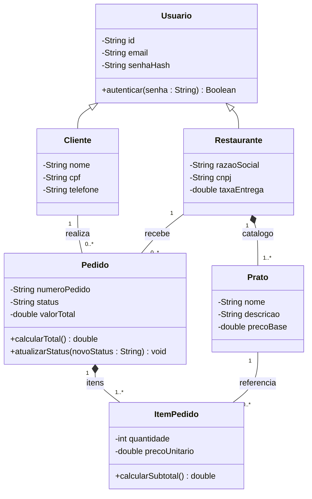

Abaixo apresenta-se a implementação em Java aplicando composição estrita e integridade referencial:

```java
package br.unifef.engenharia.delivery;

import java.util.ArrayList;
import java.util.Collections;
import java.util.List;

public class Pedido {
    private final String numeroPedido;
    private String status;
    private double valorTotal;
    private final List<ItemPedido> itens;

    public Pedido(String numeroPedido) {
        if (numeroPedido == null || numeroPedido.isBlank()) {
            throw new IllegalArgumentException("Número do pedido é obrigatório.");
        }
        this.numeroPedido = numeroPedido;
        this.status = "Pendente";
        this.valorTotal = 0.0;
        this.itens = new ArrayList<>();
    }

    // A composição é garantida pela criação e controle estrito do ciclo de vida
    public void adicionarItem(Prato prato, int quantidade) {
        if (prato == null) {
            throw new IllegalArgumentException("O prato referenciado não pode ser nulo.");
        }
        ItemPedido novoItem = new ItemPedido(prato, quantidade);
        this.itens.add(novoItem);
        recalcularTotal();
    }

    private void recalcularTotal() {
        this.valorTotal = 0.0;
        for (ItemPedido item : this.itens) {
            this.valorTotal += item.calcularSubtotal();
        }
    }

    public void atualizarStatus(String novoStatus) {
        if (novoStatus == null || novoStatus.isBlank()) {
            throw new IllegalArgumentException("Novo status não pode ser vazio.");
        }
        this.status = novoStatus;
    }

    public String getNumeroPedido() {
        return this.numeroPedido;
    }

    public String getStatus() {
        return this.status;
    }

    public double getValorTotal() {
        return this.valorTotal;
    }

    public List<ItemPedido> getItens() {
        return Collections.unmodifiableList(this.itens);
    }
}
```

```java
package br.unifef.engenharia.delivery;

public class ItemPedido {
    private final Prato prato;
    private final int quantidade;
    private final double precoUnitario;

    // Construtor com visibilidade de pacote: ItemPedido só deve ser instanciado via Pedido
    ItemPedido(Prato prato, int quantidade) {
        if (quantidade <= 0) {
            throw new IllegalArgumentException("A quantidade do item deve ser positiva.");
        }
        this.prato = prato;
        this.quantidade = quantidade;
        this.precoUnitario = prato.getPrecoBase();
    }

    public double calcularSubtotal() {
        return this.precoUnitario * this.quantidade;
    }

    public Prato getPrato() {
        return this.prato;
    }

    public int getQuantidade() {
        return this.quantidade;
    }

    public double getPrecoUnitario() {
        return this.precoUnitario;
    }
}
```

---

## Arquitetura de Software: O MVC Clássico no Smalltalk-80

### Gênese no Xerox PARC e a Superação da Abordagem Primitiva

No final da década de 1970 e início dos anos 1980, os pesquisadores do *Learning Research Group* do Xerox PARC (Palo Alto Research Center), liderados por Alan Kay, Adele Goldberg e Dan Ingalls, conceberam a interface gráfica moderna (*GUI*), o mouse de múltiplos botões e a linguagem puramente orientada a objetos **Smalltalk-80**.

Antes dessa inovação, os sistemas operavam em terminais de texto lineares. Nos primeiros computadores com telas gráficas matriciais (*bitmapped displays*), os programas convencionais desenhavam primitivas diretamente na memória de vídeo global (*framebuffer*) por meio de comandos da classe primitiva `Pen`.

**O Problema Arquitetural:** Se múltiplos programas utilizassem a classe `Pen` de forma desordenada no mesmo monitor, um programa sobrescreveria a área visual do outro. A introdução de janelas sobrepostas (*overlapping windows*) exigiu uma solução de engenharia para que janelas independentes (como navegadores de código *Browsers*, terminais *Transcripts* e editores *Workspaces*) compartilhassem harmonicamente um único mouse, um único teclado e uma única tela.

O padrão **Model-View-Controller (MVC)** foi formulado por Trygve Reenskaug e refinado pela equipe do Smalltalk-80 para solucionar esse problema estrutural de coordenação e desacoplamento.

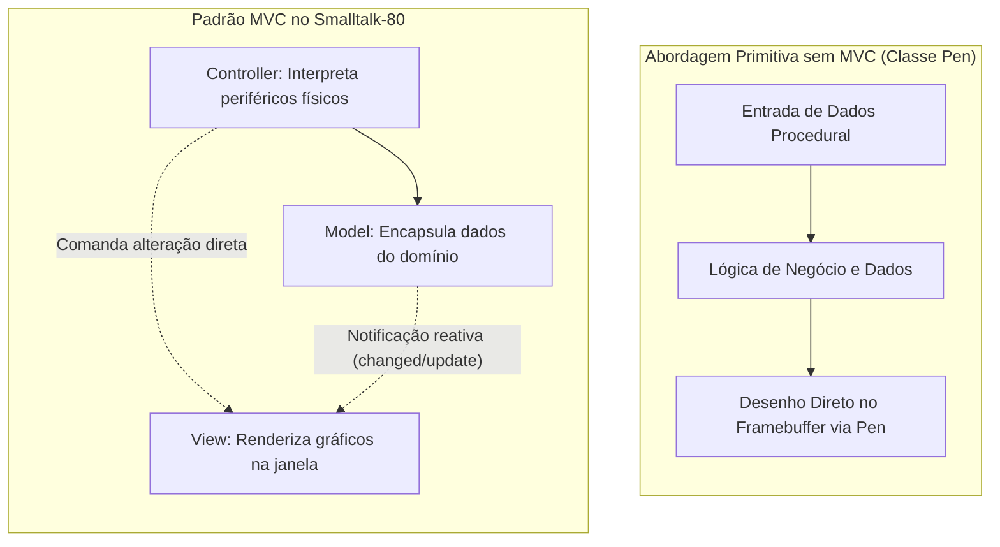

### A Divisão Estrutural da Tríade Model-View-Controller

O MVC clássico distribui o processamento interativo em três tipos de objetos especializados:

1. **Model (Modelo):** Representa o modelo computacional do domínio da aplicação. Encapsula as variáveis de estado, regras de negócio e persistência. É **completamente agnóstico quanto à interface gráfica** e não mantém referências nominais diretas para visões ou botões de tela. Responde a mensagens de consulta de estado e mutações de dados.
2. **View (Visão):** Gerencia a representação visual na porção da tela alocada para a aplicação (*viewport*). Mantém a geometria da janela, projeta tipografia e bordas, e delega o desenho de áreas internas a subvisões. Mantém uma referência direta para seu Modelo e consulta seus dados para desenhar na tela.
3. **Controller (Controlador):** Interpreta os estímulos mecânicos originados do usuário por meio do mouse e teclado. Converte cliques e teclas em ordens de negócio enviadas ao Modelo ou comandos operacionais direcionados à Visão (como rolagem de tela ou abertura de menus).

```mermaid
classDiagram
    class Model {
        +dependents : Collection
        +addDependent(aView)
        +removeDependent(aView)
        +changed()
        +changed(aspect)
        +getState()
    }
    class View {
        +model : Model
        +controller : Controller
        +display()
        +displayView()
        +update(aModel, aspect)
    }
    class Controller {
        +model : Model
        +view : View
        +controlLoop()
        +controlActivity()
    }

    View "1" -- "1" Controller : Ligação Bilateral Rígida (1:1)
    View --> "1" Model : Consulta Estado Diretamente
    Controller --> "1" Model : Modifica Estado
    Model ..> View : Notificação Reativa (Observer)
```

- **Natureza dos Vínculos:**
  - **Ligação View-Controller:** Bilateral, direta e rígida (1:1). Cada visão instancia e mantém seu controlador dedicado; o controlador mantém referência para sua visão.
  - **Ligação Model-View:** Indireta e fracamente acoplada, estruturada sob o padrão de projeto *Observer*. O modelo mantém apenas uma lista polimórfica de objetos dependentes.

### Modelos Passivos versus Modelos Ativos

Steve Burbeck, em sua análise canônica sobre o Smalltalk-80, classifica os modelos em duas categorias:

- **Modelos Passivos:**
  - *Dinâmica:* O estado interno do modelo é alterado exclusivamente por comandos disparados pelo controlador da própria tríade MVC na qual ele reside.
  - *Exemplo Canônico:* Um editor de texto simples no qual o modelo é uma instância da classe `String`. Quando o usuário pressiona uma tecla, o controlador manipula a string e solicita imediatamente a pintura da tela à sua visão.
  - *Vantagem:* Simplicidade estrutural; o modelo não precisa manter lista de observadores.

- **Modelos Ativos:**
  - *Dinâmica:* O estado interno do modelo pode ser alterado por processos concorrentes externos, threads de segundo plano ou por múltiplos controladores independentes.
  - *Exemplo Canônico:* O console global do sistema (`SystemTranscript`) ou monitores de telemetria. Qualquer processo em execução pode invocar `Transcript show: 'Processamento concluído.'`. Nem a visão nem o controlador têm como prever quando essa alteração ocorrerá.
  - *Mecanismo:* O modelo assume a responsabilidade de disparar a notificação `self changed` para todos os observadores cadastrados, instruindo-os a invocar suas rotinas de renderização.

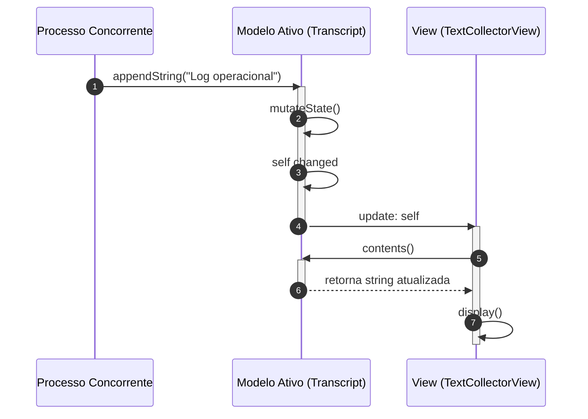

### O Mecanismo de Notificação Reativa

O fluxo reativo opera mediante o envio de duas mensagens fundamentais:
- No emissor (Model): `self changed` (notificação genérica) ou `self changed: #aspecto` (notificação parametrizada, indicando exatamente qual propriedade foi alterada).
- No receptor (View): `update: aModel` ou `update: aModel with: anAspect`. O método `update:` atua como o gatilho que dispara a repintura da visão (`self display`).

### Evolução de Desempenho: De Dicionários Globais a Instâncias Dedicadas

Na transição do Smalltalk-80 v2.0 para a versão v2.5, a equipe de engenharia solucionou um gargalo crítico de escalabilidade:
- **Smalltalk-80 v2.0 (`DependentFields` em `Object`):** Todo e qualquer objeto do sistema podia atuar como modelo. Para não onerar a memória de objetos primitivos que nunca participariam de interfaces gráficas, o sistema armazenava as relações modelo-observador em uma variável de classe global chamada `DependentFields` (uma tabela hash `IdentityDictionary`).
  - *Problemas:* Alto custo de busca por hash, concorrência no acesso à tabela global e vazamento de memória (*memory leaks*) por retenção acidental de referências.
- **Smalltalk-80 v2.5 (Classe Dedicada `Model`):** Introduziu-se a classe abstrata `Model`, alocando uma variável de instância dedicada denominada `dependents`. Esta variável foi projetada para operar em três estados de alta performance:
  1. `nil`: quando o modelo não possui visões observando (zero custo de coleções);
  2. Referência direta a um único objeto: quando há apenas uma visão vinculada;
  3. Instância de `DependentsCollection`: alocada apenas quando dois ou mais dependentes são registrados.

### Hierarquia de Composição Visual e Renderização

A interface gráfica do Smalltalk organiza-se pelo padrão estrutural *Composite*:
- **TopView:** A visão raiz da janela, responsável pela moldura externa, barra de título e enquadramento.
- **SubViews:** Painéis visuais internos aninhados recursivamente.
- **Pluggable Views (Visões Plugáveis):** Componentes genéricos de interface (como botões e listas de seleção) que são parametrizados com seletores de mensagem, adaptando-se a diferentes modelos de domínio sem exigir criação de subclasses.

O pipeline de renderização visual executa quatro etapas coordenadas:
1. `display`: Método de entrada principal invocado na janela.
2. `displayBorder`: Pinta as margens e bordas da janela delimitadora.
3. `displayView`: Renderiza as primitivas gráficas específicas da visão corrente.
4. `displaySubviews`: Itera sobre as visões filhas, invocando recursivamente o ciclo de pintura.

As conversões espaciais entre o sistema de coordenadas lógico da aplicação e as coordenadas físicas da tela de vídeo são gerenciadas pelo objeto matemático `WindowingTransformation`.

### Controle Cooperativo e Despacho de Eventos

Em uma época anterior a sistemas operacionais preemptivos multitarefa em computadores pessoais, o Smalltalk-80 implementou um escalonamento cooperativo unithread:
- **ControlManager (`ScheduledControllers`):** Módulo central que mantém uma lista ordenada de todas as janelas ativas na tela.
- **Ciclo de Controle Ativo:** O `ControlManager` consulta continuamente os controladores das janelas. Se o cursor do mouse estiver dentro da área de uma janela específica e o usuário acionar um botão, o `ControlManager` transfere o laço de execução para o controlador daquela janela (`controlLoop`).
- **O Mouse de Três Botões Clássico:**
  - *Red Button (Botão Esquerdo):* Destinado à seleção de itens e manipulação direta de objetos visuais.
  - *Yellow Button (Botão Central):* Aciona menus contextuais específicos da visão ativa.
  - *Blue Button (Botão Direito):* Dispara comandos globais de gerenciamento da janela (mover, redimensionar, colapsar ou fechar a janela).

---

## Arquitetura de Software Contemporânea e Estilos Arquiteturais

### A Definição Normativa Internacional ISO/IEC/IEEE 42010:2022

A norma internacional **ISO/IEC/IEEE 42010:2022** (*Software, systems and enterprise — Architecture description*) estabelece a definição formal de arquitetura de software:

> *"Estrutura fundamental de um sistema de software, expressa por seus componentes, pelos relacionamentos estabelecidos entre eles e com o ambiente, e pelos princípios que governam seu projeto e evolução contínua."*

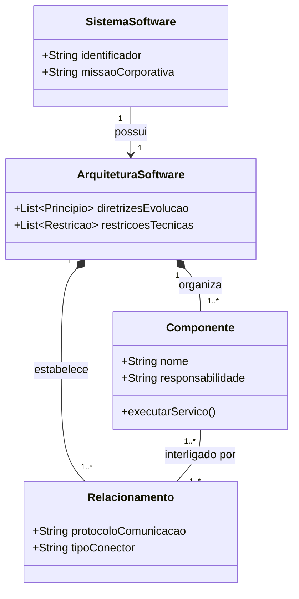

#### Analogias e Contrastes com a Arquitetura Civil
- **Similaridades:** Ambas planejam a sustentação, robustez, conformidade com normas e segurança estrutural antes da etapa construtiva pesada.
- **Contrastes Fundamentais:**
  1. *Imaterialidade:* O software não possui massa física. Suas falhas estruturais manifestam-se logicamente por degradação silenciosa (*architectural drift*).
  2. *Taxa de Mudança:* Um edifício raramente altera seus pilares de sustentação após concluído. O software é inerentemente maleável e deve evoluir continuamente acompanhando o mercado.
  3. *Envelhecimento Lógico:* Edifícios sofrem desgaste mecânico por intempéries. O software não sofre corrosão física; ele envelhece quando o ecossistema ao seu redor (sistemas operacionais, bibliotecas e ameaças de segurança) se transforma e o software permanece estático.

#### Diferença de Nível de Abstração: Padrão Arquitetural versus Padrão de Projeto
- **Padrão Arquitetural (Nível Macro):** Governa a organização global do sistema, divisão de subsistemas, distribuição física e estratégias de persistência (ex.: Microserviços, Arquitetura Hexagonal, SOA).
- **Padrão de Projeto GoF (Nível Micro):** Governa a colaboração tática local entre classes e métodos no código-fonte interno de um módulo (ex.: Strategy, Factory, Observer).

### Modelos de Distribuição: SaaS versus On-Premises

```mermaid
flowchart LR
    subgraph OnPremises["Modelo On-Premises (Local)"]
        direction TB
        OP1["Servidores Físicos na Empresa"]
        OP2["Equipe Interna de TI Mantém"]
        OP3["Investimento Inicial em Ativos (CapEx)"]
        OP2 --> OP1
    end

    subgraph SaaS["Modelo SaaS (Software as a Service)"]
        direction TB
        S1["Nuvem Gerenciada do Provedor"]
        S2["Fornecedor Mantém e Atualiza"]
        S3["Assinatura Recorrente Operacional (OpEx)"]
        S2 --> S1
    end
```

| Critério de Avaliação | SaaS (Software as a Service) | On-Premises (Instalação Local) |
| :--- | :--- | :--- |
| **Modelo Financeiro** | **OpEx** (*Operational Expenditure*): despesa operacional mensal previsível. | **CapEx** (*Capital Expenditure*): alto investimento inicial em licenças e servidores. |
| **Responsabilidade de Infraestrutura** | Fornecedor em nuvem gerencia backups, redundância e sistema operacional. | Equipe interna de TI responsabiliza-se por hardware, energia, refrigeração e segurança física. |
| **Atualizações e Patches** | Automáticas, uniformes e transparentes para todos os clientes da nuvem. | Complexas; exigem janelas de parada programada e testes de regressão locais. |
| **Custódia dos Dados** | Armazenados na nuvem do fornecedor (exige conformidade com LGPD/GDPR). | Controle físico absoluto e isolamento total dentro da rede corporativa da empresa. |
| **Escalabilidade** | Elástica e imediata com provisionamento dinâmico de recursos computacionais. | Limitada pela capacidade física dos servidores adquiridos no data center local. |

### O Estilo Cliente-Servidor e suas Limitações

A arquitetura Cliente-Servidor clássica em duas camadas (*Two-Tier*) divide o processamento entre estações clientes que interagem com o usuário e um servidor de banco de dados central:
- **Cliente Pesado (*Fat Client*):** Aplicações desktop compiladas executadas nas estações de trabalho que contêm a interface visual e as regras de negócio complexas, comunicando-se diretamente via drivers de banco (ODBC/JDBC).
  - *Gargalos Históricos:* Distribuição custosa de atualizações (necessidade de atualizar centenas de máquinas fisicamente), alto consumo de conexões simultâneas de banco e vazamento de regras de negócio para a interface.
- **Cliente Leve (*Thin Client*):** A estação de trabalho atua apenas como renderizadora visual de terminal ou navegador web, enquanto a lógica de processamento e dados reside em servidores de aplicação dedicados.

### Arquitetura Orientada a Serviços (SOA)

A **Arquitetura Orientada a Serviços (SOA)** organiza as capacidades de negócio corporativas em um catálogo de serviços autônomos, fracamente acoplados e reutilizáveis, integrados por meio de protocolos de comunicação padronizados:
- **Princípios Fundamentais:** Contratos formais de serviço (*WSDL/OpenAPI*), comunicação sem estado (*Stateless*), interoperabilidade de tecnologias e abstração da implementação interna.
- **O Papel do Barramento Corporativo (*ESB - Enterprise Service Bus*):** Atua como espinha dorsal da integração, realizando transformações de mensagens (ex.: converter JSON para XML), roteamento inteligente e tradução de protocolos entre sistemas heterogêneos.

```mermaid
flowchart TD
    Cliente["Aplicações Consumidoras"] --> ESB["Barramento Corporativo de Serviços (ESB)"]
    ESB --> S1["Serviço de Catálogo"]
    ESB --> S2["Serviço de Faturamento"]
    ESB --> S3["Serviço de Logística e Frete"]
```

### Arquitetura Hexagonal: Portas e Adaptadores

Proposta por Alistair Cockburn, a **Arquitetura Hexagonal** (ou padrão *Ports and Adapters*) estabelece que o núcleo da aplicação — contendo as **Regras de Negócio e o Modelo de Domínio** — deve residir isolado no centro da arquitetura, completamente agnóstico de frameworks, bancos de dados e interfaces gráficas externas.

```mermaid
flowchart TD
    subgraph AtoresPrimarios["Borda Condutora (Driver)"]
        UI["Interface Web / Mobile"]
        CLI["Linha de Comando / Scripts"]
    end

    subgraph NucleoHexagono["Núcleo da Aplicação (Domínio Puro)"]
        PortaEntrada["Porta Condutora (Interface Java)"]
        Dominio["Lógica de Negócio e Entidades"]
        PortaSaida["Porta Conduzida (Interface Java)"]
        PortaEntrada --> Dominio
        Dominio --> PortaSaida
    end

    subgraph AtoresSecundarios["Borda Conduzida (Driven)"]
        Banco["Adaptador PostgreSql"]
        GatewayExt["Adaptador Gateway Pagamento"]
    end

    UI --> PortaEntrada
    CLI --> PortaEntrada
    PortaSaida <|.. Banco
    PortaSaida <|.. GatewayExt
```

- **Portas (Ports):** Interfaces puras na linguagem de programação que definem os contratos de comunicação.
  - *Portas Condutoras (Primary / Driver Ports):* Definem como o mundo externo aciona o núcleo da aplicação (ex.: interface de serviço de checkout).
  - *Portas Conduzidas (Secondary / Driven Ports):* Definem como o núcleo da aplicação comunica-se com a infraestrutura externa (ex.: interface de repositório de dados ou envio de e-mails).
- **Adaptadores (Adapters):** Componentes de infraestrutura que conectam o mundo real às portas.
  - *Adaptadores de Entrada:* Controladores REST ou páginas web que recebem requisições HTTP e invocam as portas condutoras.
  - *Adaptadores de Saída:* Classes de persistência que implementam as portas conduzidas utilizando bibliotecas como Spring Data, Hibernate ou chamadas a APIs bancárias.

### Arquitetura de Microserviços: Trade-offs e Governança

A arquitetura de microserviços decompõe um sistema em um conjunto de serviços autônomos, pequenos e especializados, onde cada serviço modela um subdomínio de negócio bem delimitado (*Bounded Context*):

```mermaid
flowchart LR
    subgraph ServicoA["Microserviço de Pedidos"]
        A_Code["Lógica do Pedido"]
        A_DB[("Banco de Dados Próprio")]
        A_Code --- A_DB
    end

    subgraph ServicoB["Microserviço de Pagamentos"]
        B_Code["Lógica de Pagamento"]
        B_DB[("Banco de Dados Próprio")]
        B_Code --- B_DB
    end

    ServicoA -->|"Mensageria Assíncrona / REST"| ServicoB
```

- **Premissas Obrigatórias:**
  1. *Deploy Independente:* A alteração no serviço de pagamentos não exige recompilação nem implantação do serviço de catálogo.
  2. *Banco de Dados Desacoplado (*Database-per-Service*):* Cada microserviço é proprietário exclusivo de sua base de dados. O acesso aos dados por outros serviços ocorre unicamente por meio de APIs públicas de serviço.

#### Matriz de Trade-offs na Adoção de Microserviços
| Benefícios Arquiteturais | Sobrecarga Operacional e Riscos |
| :--- | :--- |
| **Escalabilidade Seletiva:** Dimensiona horizontalmente apenas os serviços sob alta demanda de carga. | **Latência de Rede:** Chamadas locais em memória são substituídas por requisições de rede remotas sujeitas a falhas. |
| **Autonomia de Equipes:** Times operam de forma independente com tecnologias adaptadas a cada problema. | **Consistência Eventual:** Transações ACID distribuídas são substituídas pelo padrão Saga e consistência eventual. |
| **Isolamento de Falhas:** O colapso do serviço de recomendações não derruba a conclusão da compra no checkout. | **Complexidade de Observabilidade:** Exige plataformas especializadas de rastreamento distribuído, logs unificados e métricas. |

### Diretrizes Estratégicas para Seleção Arquitetural

Um dos erros mais graves destacados pelo Prof. Wesley Soares é o **desenvolvimento orientado a modismos tecnológicos** (*Hype-Driven Development*). Adotar padrões complexos (como microserviços) para sistemas pequenos resulta apenas em sobrecarga operacional desnecessária.

- **Monólito Modular:** Para a vasta maioria dos novos sistemas, um monólito bem projetado com separação interna estrita de pacotes, módulos coesos e baixo acoplamento é a escolha mais eficiente e econômica.
- **Evolução Gradual:** A transição para arquiteturas distribuídas só deve ocorrer quando motivada por limites reais de escala computacional, volume transacional massivo ou segregação obrigatória de grandes equipes autônomas de engenharia.

---

## Caderno de Questões Resolvidas e Fixação

### Questão 01: Modificadores de Visibilidade e Integridade de Encapsulamento
*(Tema: Diagrama de Classes e POO Avançada)*  
**Enunciado:** Em uma modelagem UML de conta bancária, o analista definiu o atributo `saldo` com visibilidade pública (`+`). Explique detalhadamente por que essa modelagem constitui uma falha grave de engenharia de software e demonstre a correção na notação UML e em código Java.

**Resolução Comentada:**  
- *Diagnóstico da Falha:* Declarar o atributo como público (`+ saldo : Double`) permite que qualquer classe cliente modifique o estado financeiro diretamente (ex.: `conta.saldo = -5000.0;`), violando as invariantes de classe, as regras de limite de crédito e as rotinas de auditoria fiscal.
- *Correção na UML:* O atributo deve ser encapsulado com visibilidade privada (`- saldo : Double`).
- *Implementação em Java:* O acesso deve ser mediado por métodos de negócio controlados (`depositar` e `sacar`) que validam os parâmetros de entrada:

```java
public class ContaBancaria {
    private double saldo; // Encapsulamento estrito

    public ContaBancaria(double saldoInicial) {
        if (saldoInicial < 0.0) {
            throw new IllegalArgumentException("Saldo inicial não pode ser negativo.");
        }
        this.saldo = saldoInicial;
    }

    public boolean sacar(double valor) {
        if (valor > 0.0 && this.saldo >= valor) {
            this.saldo -= valor;
            return true;
        }
        return false;
    }

    public void depositar(double valor) {
        if (valor <= 0.0) {
            throw new IllegalArgumentException("Valor de depósito deve ser positivo.");
        }
        this.saldo += valor;
    }

    public double getSaldo() {
        return this.saldo;
    }
}
```

---

### Questão 02: Diferença Semântica entre Include e Extend
*(Tema: Modelagem de Casos de Uso UML)*  
**Enunciado:** Um estudante modelou um caso de uso `Fazer Login` estendendo (`<<extend>>`) o caso de uso `Realizar Transferência Bancária`. Avalie a correção técnica deste relacionamento conforme a OMG UML 2.5 e justifique a resposta.

**Resolução Comentada:**  
- *Avaliação:* A modelagem está **incorreta** por dois erros conceituais fundamentais.
- *Justificativa de Engenharia:*
  1. *Obrigatoriedade:* O relacionamento `<<extend>>` destina-se a fluxos opcionais disparados sob condições de guarda. A autenticação (`Fazer Login`) em uma transferência bancária é mandatória; o fluxo base não pode ser finalizado sem sucesso na autenticação. Portanto, o relacionamento adequado é de inclusão (`<<include>>`).
  2. *Sentido da Seta:* Caso o estudante desejasse reutilizar a autenticação, a dependência deveria partir do caso de uso base apontando para o caso incluído: `Realizar Transferência Bancária -.->|<<include>>| Fazer Login`.

---

### Questão 03: Ciclo de Notificação no MVC do Smalltalk-80
*(Tema: Arquitetura MVC Clássica)*  
**Enunciado:** Descreva a sequência de mensagens trocadas entre Model, View e Controller quando um processo em segundo plano altera o estado de um Modelo Ativo no Smalltalk-80.

**Resolução Comentada:**  
1. Um processo concorrente externo invoca um método mutador de estado diretamente no Modelo Ativo.
2. O Modelo processa a alteração de seus dados internos e invoca compulsoriamente a mensagem `self changed` (ou `self changed: #aspecto`).
3. O mecanismo de dependências da classe `Model` itera sobre sua coleção de observadores registrados e despacha a mensagem `update: self` para todas as visões conectadas.
4. Cada Visão receptora executa seu método `update:`, solicitando ao Modelo os dados atualizados por meio de métodos de consulta (`getState`).
5. Com os dados atualizados em memória, a Visão executa seu método `display`, redesenhando sua porção de tela sem intervenção do Controlador.

---

### Questão 04: SaaS versus On-Premises e Impacto Financeiro
*(Tema: Estilos Arquiteturais e Distribuição)*  
**Enunciado:** Um hospital regional precisa implantar um novo Prontuário Eletrônico do Paciente (PEP). A diretoria está indecisa entre uma solução SaaS em nuvem pública e uma solução On-Premises em servidores locais. Analise os impactos de CapEx e OpEx e estabeleça o critério determinante para a decisão técnica.

**Resolução Comentada:**  
- *Impacto Financeiro:*
  - A solução **On-Premises** exige desembolso inicial expressivo em **CapEx** (aquisição de servidores com tolerância a falhas, nobreaks industriais, licenças perpétuas de SGBDs e infraestrutura de segurança física).
  - A solução **SaaS** opera sob **OpEx**, convertendo o investimento em custos operacionais mensais baseados no número de leitos ativos ou médicos cadastrados, com elasticidade sob demanda.
- *Critério Técnico Determinante:* A conformidade com normas regulatórias de sigilo de dados médicos (LGPD / CFM / ANVISA). Se a instituição possuir infraestrutura interna certificada e equipe de segurança dedicada 24/7, o On-Premises garante isolamento total dos dados; caso contrário, provedores SaaS consolidados oferecem níveis de criptografia, redundância e planos de recuperação de desastres superiores aos que o hospital conseguiria manter localmente.

---

## Glossário Terminológico Consolidado

- **Acoplamento:** Métrica de engenharia que quantifica o nível de dependência e interconexão entre módulos de software.
- **Argon2id:** Função criptográfica de derivação de chaves otimizada contra ataques baseados em hardware (GPUs e ASICs), recomendada para armazenamento de senhas.
- **Ator Primário:** Entidade externa que inicia ativamente um caso de uso para atingir um objetivo de negócio.
- **Ator Secundário:** Sistema externo ou serviço de infraestrutura que fornece suporte à execução do caso de uso.
- **BDUF (*Big Design Up Front*):** Antipadrão de engenharia caracterizado pela tentativa de projetar detalhadamente todo o sistema antes de qualquer codificação.
- **CapEx (*Capital Expenditure*):** Investimento financeiro alocado na aquisição de bens de capital tangíveis (como hardware e servidores físicos).
- **Caso de Uso:** Especificação do conjunto de ações realizadas pelo sistema que produzem um resultado de valor observável para um ator.
- **Coesão:** Métrica que avalia o grau de convergência das responsabilidades atribuídas a uma única classe ou módulo.
- **Composição:** Relacionamento estrutural todo-parte forte no qual a existência das partes depende estritamente do ciclo de vida do todo.
- **Elicitação:** Processo ativo e investigativo de trazer à luz as necessidades e restrições reais dos stakeholders.
- **Encapsulamento:** Prática de isolamento do estado interno de um objeto mediado por métodos públicos controlados.
- **Fronteira do Sistema:** Limite visual e conceitual que delimita o escopo interno do software em relação ao ambiente externo.
- **MoSCoW:** Técnica ágil de priorização de requisitos estruturada nas categorias *Must*, *Should*, *Could* e *Won't have*.
- **OpEx (*Operational Expenditure*):** Despesas financeiras operacionais contínuas necessárias para manter serviços e sistemas funcionando (como assinaturas em nuvem).
- **Percentil 95 ($ `p95` $):** Métrica estatística de desempenho que indica o tempo máximo de resposta atendido por 95% das requisições mais rápidas do sistema.
- **Ponto de Extensão (*Extension Point*):** Marcador formal no fluxo de um caso de uso base onde um comportamento opcional pode ser intercalado.
- **Polimorfismo:** Capacidade de diferentes classes responderem à mesma mensagem com comportamentos específicos dinamicamente.
- **Requisito Funcional (RF):** Declaração do comportamento, serviço ou cálculo que o software deve compulsoriamente executar.
- **Requisito Não Funcional (RNF):** Restrição de qualidade, desempenho, segurança, conformidade ou arquitetura imposta ao sistema.
- **Scope Creep:** Fenômeno patológico de expansão descontrolada e contínua do escopo de um projeto sem renegociação de prazos ou recursos.
- **Smalltalk-80:** Ambiente e linguagem puramente orientada a objetos concebida no Xerox PARC, berço do padrão MVC clássico.
- **SOLID:** Acrônimo mnemônico dos cinco princípios fundamentais de design orientado a objetos estabelecidos por Robert C. Martin.
- **Tríade MVC:** Padrão composto pelos módulos Modelo (dados e regras), Visão (apresentação na tela) e Controlador (eventos físicos de entrada).

---

## Fontes e Metadados

- Turma no Classroom: Engenharia de Software 2 - 2026/02
- Itens processados: 0 materiais, 4 tarefas, 8 avisos
- Gerado em: 27/10/2026, 20:39:56 (BRT) via classroom-sync
