# Engenharia de Software II: Manual Integrado de Ensino, Análise e Projeto de Sistemas

**Instituição:** Centro Universitário de Santa Fé do Sul (UniFEF)  
**Curso:** Bacharelado em Sistemas de Informação (4º Semestre)  
**Docente:** Prof. Ms. Wesley Soares de Souza  
**Natureza do Documento:** Compêndio Temático, Teórico e Prático Integrado da Disciplina  

---

## Apresentação da Disciplina e Estrutura Pedagógica

### Corpo Docente e Trajetória Profissional

A disciplina de Engenharia de Software II é conduzida pelo **Prof. Ms. Wesley Soares de Souza**, cuja formação e atuação profissional integram a prática da indústria de tecnologia com a docência no ensino superior:

- **Atuação na Indústria:** Engenheiro de Software Sênior com mais de 15 anos de vivência no desenvolvimento, arquitetura e sustentação de sistemas corporativos distribuídos de missão crítica.
- **Carreira Acadêmica:** Docente no ensino superior desde 2014, com passagens pelo Grupo Kroton (Anhanguera), Faculdade de Tecnologia (FATEC) de Jales e Instituto Federal de Educação, Ciência e Tecnologia de São Paulo (IFSP) – Câmpus Votuporanga.
- **Titulação Acadêmica:**
  - Bacharel em Sistemas de Informação pela Fundação Educacional de Fernandópolis (F.E.F. / UniFEF).
  - Pós-graduado (Especialista) em Gestão de Banco de Dados.
  - Mestre em Engenharia de Software pela Universidade Federal do Pampa (UNIPAMPA - RS).

Essa sinergia entre rigor científico e vivência prática estabelece a diretriz pedagógica da disciplina: conceitos arquiteturais e modelos formais não existem como burocracia abstrata, mas como instrumentos determinantes para a sobrevivência, manutenibilidade e escalabilidade do software comercial.

---

### Premissas Fundamentais da Engenharia de Software

O curso é regido por duas premissas estruturantes que guiam toda a postura do futuro bacharel em Sistemas de Informação:

#### Software não é feito em pastelaria
O desenvolvimento de soluções de software corporativas não pode ser conduzido como uma operação imediatista de balcão, onde solicitações informais são traduzidas em código sem a prévia compreensão do domínio, sem análise de viabilidade, sem modelagem arquitetural e sem testes automatizados. O software compõe o núcleo financeiro, operacional e regulatório das organizações contemporâneas. A ausência de engenharia formal resulta em débito técnico crônico, falhas de segurança e prejuízos operacionais irreversíveis.

#### O paradoxo da Análise versus Projeto
A disciplina fundamenta-se no equilíbrio indissociável entre duas responsabilidades:
- **Análise ("Fazer a coisa certa"):** Investigação sistemática do domínio do problema. Garante que a equipe de engenharia compreenda as necessidades reais, as regras de negócio e as restrições dos stakeholders, evitando construir com perfeição técnica uma solução que resolve o problema errado.
- **Projeto ("Fazer certo a coisa"):** Concepção da solução técnica. Modela a estrutura interna do sistema, definindo classes, componentes, protocolos de comunicação, padrões de design e estilos arquiteturais que assegurem alta coesão, baixo acoplamento, resiliência e manutenibilidade.

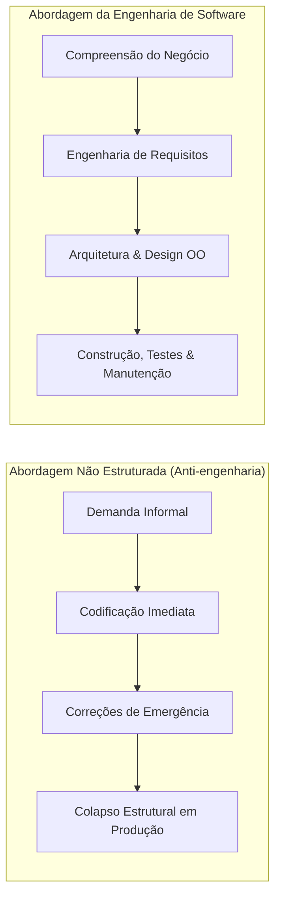

---

### O Projeto Integrador da Disciplina (PJ)

O aprendizado é materializado ao longo do semestre letivo pelo desenvolvimento do **Projeto Integrador da Disciplina (PJ)**, no qual as equipes concebem, documentam e estruturam uma solução de software corporativa de ponta a ponta.

#### Formação de Equipes
- As equipes são compostas obrigatoriamente por **estritamente 3 integrantes**.
- A composição fixa simula as restrições organizacionais de mercado, demandando distribuição coordenada de papéis: engenharia de requisitos, arquitetura de software e governança de qualidade.

#### Estrutura das Etapas de Entrega

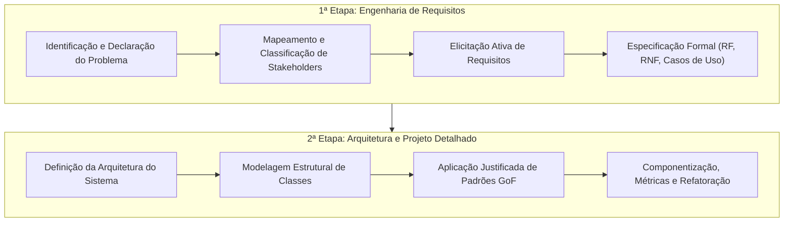

1. **1ª Etapa — Engenharia de Requisitos:**
   - Declaração formal do problema de negócio e seu contexto de operação.
   - Identificação, classificação de poder/interesse e mapeamento de stakeholders.
   - Elicitação analítica de requisitos funcionais (RF) e requisitos não funcionais (RNF).
   - Priorização de escopo com a técnica MoSCoW.
   - Modelagem de comportamento externo com Diagramas de Casos de Uso (UML) e especificações textuais formais.
2. **2ª Etapa — Arquitetura e Projeto Detalhado:**
   - Seleção e fundamentação do estilo arquitetural do sistema (Monolito, Camadas, Hexagonal, Microsserviços).
   - Modelagem estática do domínio por meio do Diagrama de Classes detalhado (atributos tipados, visibilidade, multiplicidade e relacionamentos).
   - Aplicação de padrões de projeto do Gang of Four (GoF) para desacoplamento e extensibilidade.
   - Identificação preventiva de anomalias estruturais de código (*code smells*) e formulação de estratégias de refatoração.

#### Domínios Temáticos Oficiais para o Projeto

| Domínio Temático | Propostas de Sistemas | Escopo Estrutural e Desafios de Engenharia |
| :--- | :--- | :--- |
| **Comércio** | Marketplace B2B/B2C, Gestão de Pedidos (OMS), WMS e Gestão de Estoque | Gestão de SKUs, reservas com tempo de expiração (*TTL*), checkout transacional e conciliação de frete. |
| **Serviços Públicos** | Solicitação de Serviços Municipais, Ouvidoria do Cidadão, Gestão de Iluminação | Triagem por geolocalização, controle de Acordos de Nível de Serviço (*SLA*) municipais e trilhas de auditoria. |
| **Negócios** | Gestão de Projetos Corporativos, Plataforma ATS de Recrutamento, Gestão Financeira | Dependências temporais de tarefas, pipelines de triagem de candidatos por pontuação e conciliação de caixa. |
| **Saúde** | Prontuário Eletrônico (PEP), Gestão de Clínicas, Telemedicina e Prescrições | Sigilo e conformidade legal (LGPD), telemetria síncrona, rastreamento de lotes farmacêuticos e calibração de ativos. |
| **Educação** | Ambiente Virtual de Aprendizagem (LMS), Gestão Acadêmica Integrada | Cálculo automatizado de médias ponderadas, controle de trancamento de matrículas e submissão assíncrona de trabalhos. |
| **Logística** | Rastreamento de Cargas em Tempo Real, Gestão de Frotas e Otimização de Rotas | Otimização de trajetos via grafos, telemetria veicular e comprovação eletrônica de entrega (*Proof of Delivery*). |

---

### Conteúdo Programático e Sistema de Avaliação

O programa da disciplina divide-se em dois blocos temáticos bimestrais:

- **1º Bimestre:** Fundamentos do Projeto de Software; Ciclo de Vida e Processos; Técnicas de Elicitação e Levantamento de Requisitos; Modelagem de Casos de Uso (UML); Priorização com MoSCoW; Introdução à Arquitetura de Software e Estilos Arquiteturais.
- **2º Bimestre:** Projeto Orientado a Objetos Avançado; Princípios SOLID; Diagrama de Classes e Mapeamento Objeto-Relacional; Padrões de Projeto GoF (Criacionais, Estruturais e Comportamentais); Padrão Arquitetural MVC Histórico e Moderno; Garantia da Qualidade, Testes Automatizados e Integração Contínua (CI/CD).

#### Critérios de Avaliação e Fórmula Matemática Oficial
O rendimento acadêmico semestral é mensurado pela integração entre o desempenho individual teórico-prático e a execução técnica coletiva:
- **AV1 (Avaliação 1):** Prova individual com questões conceituais e problemas de modelagem cobrando o conteúdo do 1º Bimestre.
- **AV2 (Avaliação 2):** Prova individual com foco em arquitetura, diagramação de classes, padrões de design e refatoração do 2º Bimestre.
- **PJ (Projeto Integrador):** Avaliação técnica contínua dos artefatos de engenharia entregues pela equipe em ambas as etapas.

A média final do curso resulta da média aritmética entre as notas consolidadas do primeiro e do segundo bimestre, ponderando individualidade (60%) e colaboração técnica em equipe (40%):

```math
\text{Nota Final} = \frac{[(\text{AV}_1 \times 0.6) + (\text{PJ} \times 0.4)] + [(\text{AV}_2 \times 0.6) + (\text{PJ} \times 0.4)]}{2}
```

---

### Bibliografia Canônica Recomendada

A fundamentação da disciplina apoia-se em clássicos da literatura nacional e internacional de engenharia de software e modelagem orientada a objetos:

- **BOOCH, Grady; RUMBAUGH, James; JACOBSON, Ivar.** *UML: Guia do Usuário*. Rio de Janeiro: Campus, 2000.
- **GUEDES, Gilleanes T. A.** *UML 2: Uma Abordagem Prática*. 2. ed. São Paulo: Novatec, 2011.
- **BEZERRA, Eduardo.** *Princípios de Análise e Projeto de Sistemas com UML*. 4. ed. Rio de Janeiro: Elsevier, 2007.
- **FURLAN, José Davi.** *Modelagem de Objetos através da UML*. São Paulo: Makron Books, 1998.
- **MEDEIROS, Ernani.** *Desenvolvendo Software com UML 2.0*. São Paulo: Pearson Makron Books, 2004.
- **GÓES, Wilson Moraes.** *Aprenda UML por Meio de Estudo de Caso*. São Paulo: Novatec, 2014.
- **O'NEILL, Henrique; NUNES, Mauro; RAMOS, Pedro.** *Exercícios de UML*. Lisboa/São Paulo: FCA / Editora Informática, 2010.
- **BORATTI, Isaias Camilo.** *Programação Orientada a Objetos em Java*. Florianópolis: Visual Books, 2007.

---

## O Ciclo de Vida do Projeto de Software

### As Dez Fases Estruturais de um Sistema Corporativo

O desenvolvimento disciplinado de sistemas organiza-se em um encadeamento de dez fases interdependentes. Cada etapa possui objetivos rigorosos, critérios de entrada, atividades de transformação e artefatos formais de saída:

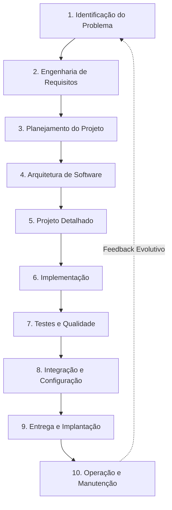

| Fase | Foco Central e Finalidade | Artefato Primário de Entrada | Artefato Formal de Saída |
| :--- | :--- | :--- | :--- |
| **1. Problema** | Compreender e delimitar a dor ou oportunidade de negócio. | Dores operacionais, perdas financeiras. | Declaração do Problema, Proposta de Valor. |
| **2. Requisitos** | Elicitar, analisar e especificar as funções e restrições. | Declaração do Problema, entrevistas. | Especificação de Requisitos (SRS), Casos de Uso. |
| **3. Planejamento** | Estimar prazos, cronograma, riscos e alocação de equipe. | Backlog de requisitos priorizado. | Cronograma de Marcos, Matriz de Riscos. |
| **4. Arquitetura** | Definir o estilo macroestrutural e atributos de qualidade. | Requisitos Não Funcionais críticos. | Documento de Arquitetura (SAD), Visões C4/UML. |
| **5. Projeto** | Modelar a colaboração estrutural e lógica de classes. | Arquitetura de software aprovada. | Diagramas de Classes, Diagramas de Sequência. |
| **6. Implementação** | Codificar a solução seguindo regras de design limpo. | Modelos de classes, especificações técnicas. | Código-fonte versionado em repositório (Git). |
| **7. Testes** | Validar conformidade funcional e limites estruturais. | Código compilável, cenários de aceitação. | Relatórios de cobertura, logs de execução de QA. |
| **8. Integração** | Construir e validar pipelines automatizados de build. | Código integrado em branches de release. | Builds aprovados, imagens de contêineres. |
| **9. Entrega** | Disponibilizar a aplicação no ambiente de produção. | Artefatos e contêineres validados em homologação. | Release operacional, notas de versão (*changelog*). |
| **10. Manutenção** | Monitorar métricas, corrigir falhas e evoluir o sistema. | Logs de telemetria, chamados operacionais. | Patches de segurança, novas histórias de evolução. |

---

### Análise da Curva de Custo de Mudança (Curva de Boehm)

Um dos princípios fundamentais que justificam o rigor analítico e arquitetural inicial é a regra do custo de correção de defeitos, formulada historicamente por Barry Boehm.

- **Definição:** Relação não linear e exponencial entre a fase do ciclo de vida em que uma anomalia é inserida versus a fase em que ela é detectada e corrigida.
- **Motivação:** Um erro de interpretação de requisito não identificado durante a fase de análise percorre silenciosamente o planejamento, a arquitetura, o design de classes, a codificação e a criação de casos de teste. Ao ser descoberto apenas em produção, todo esse castelo de artefatos precisa ser demolido e reconstruído.
- **Métrica da Indústria:** A resolução de um defeito funcional originado em requisitos, quando descoberto em ambiente produtivo, custa entre $ `50\times` $ e $ `200\times` $ mais do que a sua retificação imediata durante a fase de elicitação.

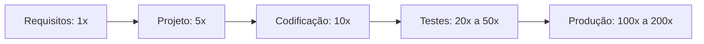

---

## Engenharia e Elicitação de Requisitos

### Distinção Epistemológica: Levantamento versus Elicitação

Na engenharia de requisitos moderna, baseada no SWEBOK (Software Engineering Body of Knowledge), existe uma separação técnica rigorosa entre dois termos frequentemente tratados de maneira indistinta:

- **Levantamento de Requisitos (Gathering):** Denota uma postura essencialmente passiva do analista de sistemas. Assume a premissa falaciosa de que os requisitos de software já se encontram prontos, lapidados e organizados na mente dos usuários, bastando ao profissional coletá-los como quem recolhe relatórios em uma gaveta.
- **Elicitação de Requisitos (Elicitation):** Derivado do latim *elicitare* ("provocar", "fazer sair", "trazer à luz"). Estabelece uma postura ativa, investigativa e dialética do engenheiro de software. O cliente possui dores corporativas, rotinas informais, controles fragmentados e expectativas difusas, mas raramente requisitos de software estruturados. O papel do analista é explorar o ambiente, desmascarar processos implícitos, questionar premissas e coconstruir os limites da solução.

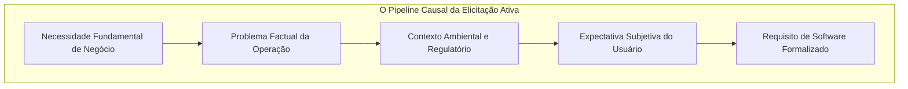

#### O Ciclo Causal da Necessidade ao Requisito
1. **Necessidade:** O estado de carência fundamental de sustentabilidade da organização (ex.: *eliminar a perda de rentabilidade decorrente de entregas atrasadas*).
2. **Problema:** O fato concreto que bloqueia o atendimento da necessidade (ex.: *os motoristas perdem rotas por falta de sequenciamento lógico de paradas*).
3. **Contexto:** As condições humanas, geográficas e tecnológicas em que a operação ocorre (ex.: *motoristas acessam o sistema em estradas rurais sem conexão contínua de internet*).
4. **Expectativa:** A projeção imaginária do usuário sobre o software (ex.: *"quero que o celular me mostre o caminho mágico sem eu ter que digitar nada"*).
5. **Requisito:** A declaração formal, testável e sem ambiguidades do comportamento do sistema (ex.: *o aplicativo móvel deve recalcular a rota offline utilizando o algoritmo Dijkstra a partir de dados geográficos previamente sincronizados*).

---

### As Seis Perguntas Cardinais da Elicitação

Antes de iniciar qualquer atividade de design ou codificação, o analista deve responder objetivamente a seis perguntas de orientação cardinal:

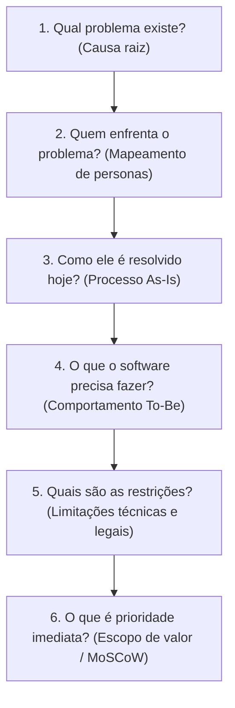

---

### Análise da Premissa de Desenvolvimento Prematuro

Considere a seguinte manifestação clássica de um cliente corporativo:

> *"Preciso de um sistema para melhorar o meu negócio."*

A Engenharia de Software estabelece que iniciar a construção técnica sob essa declaração constitui negligência profissional por quatro fatores críticos:

1. **Ausência de Critério de Aceite (Acceptance Criteria):** O vocábulo "melhorar" é inteiramente subjetivo. Sem métricas objetivas (ex.: *reduzir o tempo de emissão de pedidos em 30%* ou *eliminar divergências de inventário acima de 1%*), o projeto carece de um critério formal de conclusão, impossibilitando a homologação contratual.
2. **Corrupção Ilimitada de Escopo (Scope Creep):** Como o escopo original não possui fronteiras delimitadas, toda e qualquer funcionalidade imaginada posteriormente pelo cliente será reivindicada como parte do contrato original de "melhorar o negócio".
3. **Assimetria Cognitiva:** O cliente domina seu segmento de atuação (varejo, logística, saúde), mas desconhece restrições de concorrência, consistência transacional e integridade de banco de dados. O desenvolvedor compreende a infraestrutura computacional, mas desconhece os fluxos do negócio. A codificação prematura consolida incompreensões mútuas em código.
4. **Automatização do Caos:** Informatizar um processo de trabalho desestruturado, redundante e inconsistente resulta unicamente em um processo caótico automatizado, que propaga erros em velocidade computacional.

---

### Diagnóstico de Causa Raiz: A Técnica dos 5 Porquês

A elicitação analítica exige separar o **sintoma visível** da **causa estrutural** do problema.

#### Definição
Método investigativo sistemático que itera sucessivas perguntas de "Por quê?" para aprofundar uma cadeia de eventos até identificar a falha de processo ou arquitetura que originou a anomalia.

#### Exemplo Prático Corporativo
1. *Problema Aparente (Sintoma):* O faturamento mensal de contratos hospitalares atrasa em média 10 dias úteis.
2. *Por que 1:* Porque o setor financeiro não recebe os relatórios de encerramento de locação a tempo.
3. *Por que 2:* Porque os gerentes de almoxarifado compilam dados a partir de canhotos de papel apenas nos finais de semana.
4. *Por que 3:* Porque as ordens de devolução assinadas pelos motoristas ficam acumuladas em pastas físicas nas cabines dos veículos.
5. *Por que 4:* Porque não existe um mecanismo digital para registrar a confirmação de coleta no exato instante em que ela ocorre no hospital.
6. *Por que 5 (Causa Raiz):* Inexistência de um processo integrado de captura móvel de dados com transmissão imediata e assinatura eletrônica do recebedor.

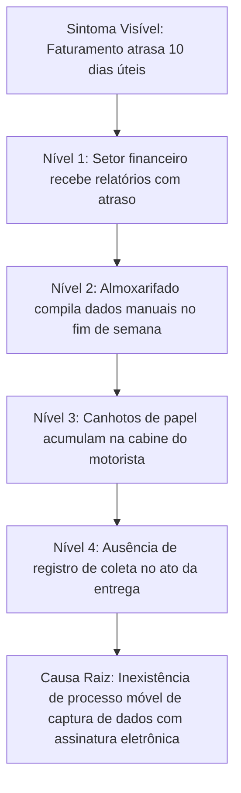

---

### Técnicas Tradicionais e Complementares de Elicitação

| Técnica | Modalidade de Aplicação | Vantagens Primárias | Desvantagens e Riscos | Contexto Ideal |
| :--- | :--- | :--- | :--- | :--- |
| **Entrevistas Estruturadas** | Roteiro rígido e sequencial pré-programado de perguntas fechadas. | Fácil tabulação estatística; comparação direta entre diferentes perfis de respondentes. | Inibe a descoberta de fatos novos; tom mecânico e impessoal para o usuário. | Validação pontual de dados cadastrais e checagem de conformidade legal. |
| **Entrevistas Semiestruturadas** | Pauta com tópicos e objetivos definidos, mantendo liberdade de aprofundamento. | Equilíbrio entre foco técnico e flexibilidade investigativa; aprofunda regras tácitas. | Exige maturidade e controle do tempo pelo analista para evitar divagações. | Técnica principal com gestores, gerentes operacionais e usuários-chave. |
| **Questionários (Surveys)** | Conjunto fixo de perguntas estruturadas distribuído em meio digital. | Baixo custo por respondente; alcance geográfico amplo e anonimato garantido. | Taxa de retorno historicamente reduzida (< 20%); impossibilidade de esclarecer dúvidas. | Coleta massiva com milhares de alunos, clientes ou operadores dispersos. |
| **Observação Direta (Job Shadowing)** | O analista atua como "sombra", acompanhando o trabalho real do usuário. | Revela atalhos operacionais, procedimentos não documentados e dores reais. | Efeito Hawthorne (o usuário altera o comportamento quando observado); consumo de tempo. | Chão de fábrica, expedição logística, balcão de vendas e triagem hospitalar. |
| **Análise Documental** | Estudo minucioso de formulários, contratos, planilhas atuais e relatórios fiscais. | Compreensão rápida da semântica do domínio (*Linguagem Ubíqua*) e das regras rígidas. | Documentos podem representar processos obsoletos já abandonados na prática diária. | Sistemas legados e áreas com pesada regulação externa (SEFAZ, ANVISA, BACEN). |
| **Workshops / JAD (Joint Application Design)** | Sessões intensivas e mediadas reunindo usuários, gestores e engenheiros. | Resolução imediata de conflitos de interesse entre setores divergentes. | Risco de domínio da dinâmica pelos participantes com maiores cargos hierárquicos. | Alinhamento do escopo inicial de projetos estratégicos corporativos. |
| **Prototipação Rápida** | Construção de maquetes visuais navegáveis de baixa e média fidelidade. | Validação antecipada da usabilidade e dos fluxos operacionais; tangibilização da ideia. | O cliente pode confundir o protótipo de tela com o sistema funcional finalizado. | Interfaces complexas de atendimento e validação de jornadas críticas de usuário. |

---

### Desconstrução de Ambiguidade: Transformando Expressões Vagas em RNFs Formais

Um dos maiores riscos para a sustentabilidade de um projeto de software reside na aceitação de declarações puramente qualitativas.

- **Conceito de Anti-Requisito:** Declarações que expressam desejos subjetivos, mas que não oferecem condições objetivas de medição, verificação ou teste de conformidade.
- **Técnica de Refatoração:** Aplicação de métricas físicas (tempo em segundos, percentis de latência, número de requisições simultâneas, taxa de erro aceitável e padrões algorítmicos normatizados).

| Declaração Ambígua (Anti-Requisito) | Risco Técnico para o Projeto | Refatoração Técnica da Engenharia (RNF Formal e Mensurável) |
| :--- | :--- | :--- |
| "O sistema precisa ser muito rápido." | A equipe otimiza índices aleatórios e o cliente continua insatisfeito com o tempo de renderização. | **RNF-001 (Desempenho):** O tempo de resposta para a consulta de pedidos filtrada por cliente deve ser inferior a 1,2 segundos para o percentil 95 ($ `p95` $) sob carga contínua de 300 requisições simultâneas. |
| "A interface deve ser moderna, simples e fácil de usar." | O desenvolvedor aplica um tema minimalista que oculta botões vitais, provocando erros operacionais em massa. | **RNF-002 (Usabilidade):** Um operador recém-contratado deve ser capaz de concluir o fluxo de emissão de nota em até 3 minutos após receber treinamento de 30 minutos, mantendo taxa de erro inferior a 2%. |
| "A aplicação deve ser totalmente segura contra ataques." | Implantação de soluções superficiais que geram falsa sensação de segurança sem conformidade criptográfica. | **RNF-003 (Segurança):** O sistema deve exigir autenticação em dois fatores (MFA) para operações financeiras e armazenar senhas em banco utilizando o algoritmo Argon2id com parâmetro de memória de 64 MB. |

---

### Priorização Ágil de Requisitos: O Método MoSCoW

O método **MoSCoW** é uma técnica estruturada concebida no âmbito do framework DSDM (*Dynamic Systems Development Method*) para gerenciar a capacidade de entrega em relação às expectativas dos stakeholders.

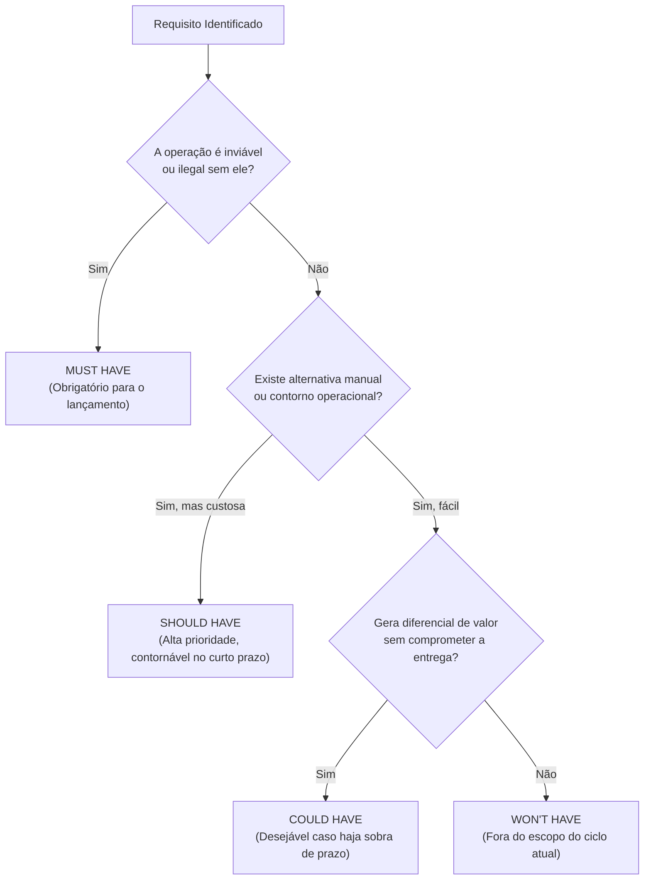

#### Definições e Critérios
- **Must Have (Deve ter):** O núcleo inegociável do sistema. Se um único requisito deste bloco não for entregue, o sistema não pode entrar em produção, pois não atende à sua finalidade legal ou de negócio. Compõe o Produto Mínimo Viável (MVP).
- **Should Have (Deveria ter):** Requisitos de alta relevância que agregam alto valor operacional. Devem ser desenvolvidos assim que os itens vitais estiverem estabilizados, mas sua ausência inicial pode ser mitigada temporariamente por procedimentos manuais.
- **Could Have (Poderia ter):** Funcionalidades de conveniência ou diferenciais competitivos menores. São absorvidas no cronograma estritamente caso haja saldo de capacidade produtiva e orçamento.
- **Won't Have [this time] (Não terá desta vez):** Demandas expressamente acordadas entre engenharia e stakeholders como fora do escopo do ciclo de entrega corrente. Evita a dispersão de esforço da equipe e previne o crescimento desordenado de escopo.

---

## Modelagem Comportamental com Casos de Uso (UML)

### Propósito e a Abordagem de Caixa-Preta (Black-Box)

O **Diagrama de Casos de Uso** é um diagrama comportamental padronizado pela Unified Modeling Language (UML) cuja finalidade exclusiva é delimitar as fronteiras do sistema e explicitar o conjunto de serviços que este provê aos seus atores externos.

- **Premissa Fundamental:** Modela o comportamento externo observável. Não expressa a arquitetura de classes internas, esquemas de tabelas de bancos de dados relacionais, queries SQL, nem telas gráficas detalhadas.
- **Pergunta Orientadora:** *"O que o sistema faz a serviço de quem?"* (e nunca *"Como o sistema faz internamente"*).

---

### Elementos Básicos da Notação

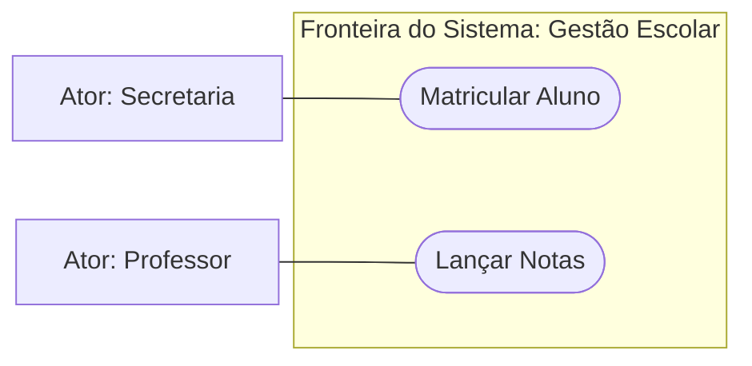

1. **Atores:** Entidades externas que interagem ativamente ou passivamente com o sistema. Podem ser pessoas exercendo funções lógicas (ex.: `Atendente`, `Cliente`) ou sistemas computacionais externos (ex.: `Gateway de Pagamento`, `SEFAZ`).
   - *Ator Primário:* Aquele que dispara o caso de uso visando atingir um objetivo de negócio mensurável.
   - *Ator Secundário:* Sistema ou agente que responde a solicitações do sistema modelado ou fornece suporte de infraestrutura.
2. **Casos de Uso:** Conjunto atômico de comportamentos executados pelo sistema que entrega um resultado de valor observável para um ator específico.
   - *Regra de Nomenclatura:* Verbo no infinitivo seguido de complemento direto (ex.: `Emitir Nota Fiscal`, `Consultar Extrato`, `Efetuar Reserva`).
3. **Fronteira do Sistema (Subject Boundary):** Retângulo delimitador que segrega o que pertence ao escopo computacional do software do que pertence ao ambiente externo.
4. **Associação de Comunicação:** Linha sólida contínua que estabelece o canal de troca de mensagens entre o ator e o caso de uso.

---

### Tipos de Relacionamento entre Casos de Uso

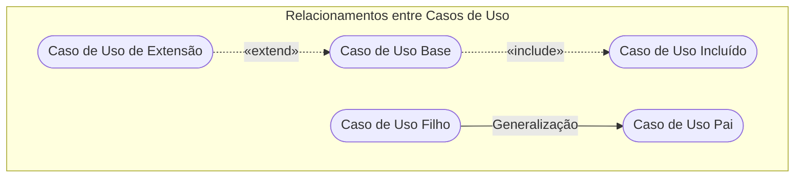

#### 1. Inclusão (`<<include>>`)
- **Definição:** Relacionamento de dependência no qual o caso de uso base incorpora obrigatoriamente e incondicionalmente o comportamento do caso de uso incluído.
- **Motivação:** Reutilização sistemática de fluxos comuns a múltiplos casos de uso, evitando duplicidade na especificação de requisitos (aplicação do princípio DRY — *Don't Repeat Yourself*).
- **Direção da Seta:** Linha tracejada partindo do caso de uso base e apontando para o caso de uso incluído (`Base -.->|«include»| Incluído`).
- **Exemplo:** `Realizar Transferência Bancária` inclui `Autenticar Usuário`.
- **Armadilha:** Fragmentar o sistema modelando passos procedimentais triviais como include (ex.: criar `Fazer Pedido` incluindo `Digitar Telefone`).

#### 2. Extensão (`<<extend>>`)
- **Definição:** Relacionamento de dependência no qual o comportamento de um caso de uso especializado (extensão) pode ser acoplado condicionalmente ao fluxo de um caso de uso base em um ponto pré-definido (*Extension Point*).
- **Motivação:** Manter o fluxo principal limpo e desacoplado de regras excepcionais, passos opcionais ou comportamentos acionados apenas sob condições de guarda específicas.
- **Direção da Seta:** Linha tracejada partindo do caso de uso de extensão e apontando em direção ao caso de uso base (`Extensão -.->|«extend»| Base`).
- **Exemplo:** `Contratar Seguro da Carga` estende condicionalmente `Efetuar Contrato de Frete`.
- **Armadilha:** Inverter a direção da seta. No extend, o elemento acessório aponta para a base da qual ele depende.

#### 3. Generalização / Especialização
- **Definição:** Relação hierárquica na qual o elemento filho herda atributos, comportamentos e associações do elemento pai, podendo sobrescrever ações ou agregar novas especializações.
- **Entre Atores:** O ator especializado acessa todos os casos de uso do ator pai, além de seus próprios casos exclusivos.
- **Entre Casos de Uso:** O caso de uso pai define o objetivo genérico, enquanto os casos filhos fornecem formas concretas e distintas de realização.
- **Direção da Seta:** Linha sólida contínua com triângulo fechado vazado na ponta, apontando do filho para o pai.

| Relacionamento | Representação Gráfica | Obrigatoriedade de Execução | Vetor de Dependência | Propósito de Engenharia |
| :--- | :--- | :--- | :--- | :--- |
| **Associação** | Linha sólida simples | Variável | Bidirecional / Navegável | Comunicação de dados entre ator e sistema. |
| **Inclusão (`<<include>>`)** | Tracejada aberta com rótulo | Obrigatória (100% dos fluxos) | Da Base para o Incluído | Reúso de lógica compartilhada. |
| **Extensão (`<<extend>>`)** | Tracejada aberta com rótulo | Opcional (condicionada) | Da Extensão para a Base | Desacoplamento de fluxos opcionais. |
| **Generalização** | Sólida com triângulo vazado | Polimórfica | Do Filho para o Pai | Herança de contratos e comportamento. |

---

### Estudo de Caso Prático 1: Plataforma Multilateral de Food Delivery

Para consolidar os conceitos, analisamos o ecossistema de um aplicativo de entrega de comida envolvendo três atores essenciais: **Cliente**, **Restaurante** e **Administrador**, além do ator secundário **Gateway de Pagamento**.

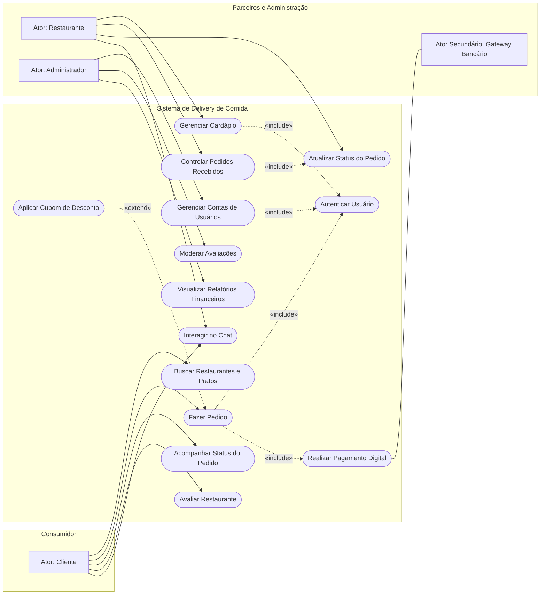

---

### Estrutura Canônica da Especificação Textual de Casos de Uso

O diagrama de casos de uso constitui apenas o sumário estrutural. A engenharia exige a especificação textual pormenorizada de cada serviço:

#### Especificação Técnica: Fazer Pedido (UC-002)
- **Identificador:** UC-002
- **Nome do Caso de Uso:** Fazer Pedido
- **Ator Primário:** Cliente
- **Atores Secundários:** Restaurante, Gateway de Pagamento
- **Pré-condições:** 
  1. O cliente deve estar autenticado no sistema.
  2. O carrinho de compras deve conter ao menos um item de um restaurante aberto.
- **Pós-condições:** 
  1. Pedido persistido com identificador único e estado inicial `Pendente`.
  2. Valor total cobrado e autorizado pelo Gateway de Pagamento.
  3. Alerta de novo pedido emitido na estação de trabalho do Restaurante.
- **Ponto de Extensão:** Ponto `Pós-Seleção-Itens`, onde pode ser acoplado o caso de uso `Aplicar Cupom de Desconto` (UC-007).

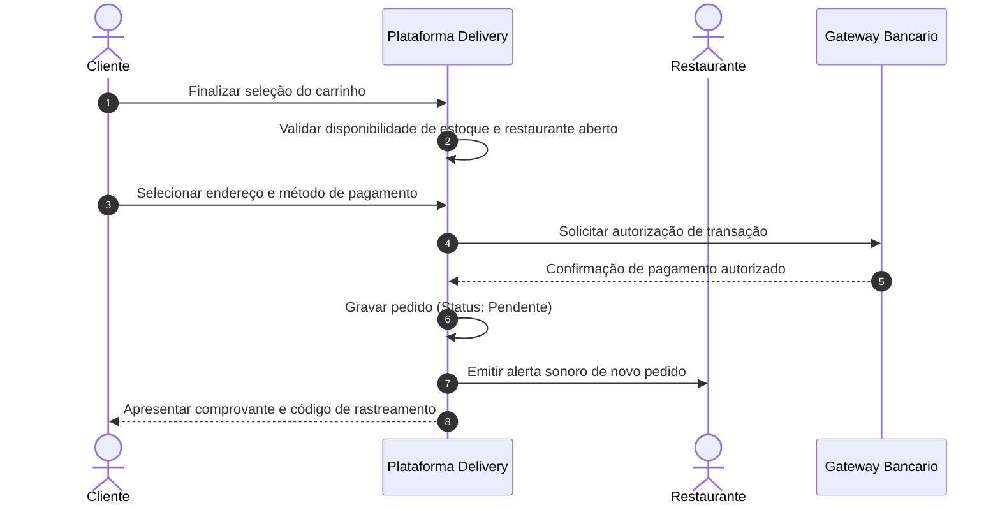

- **Fluxo Principal (Caminho Feliz):**
  1. O Cliente solicita a finalização da compra a partir do carrinho de compras.
  2. O sistema verifica a conformidade dos itens e valida se o restaurante permanece ativo para recebimento.
  3. O Cliente confirma o endereço de entrega e seleciona o método de pagamento.
  4. O sistema calcula a taxa de entrega e o valor total consolidado.
  5. O sistema executa o caso de uso `Realizar Pagamento Digital` (UC-005).
  6. O Gateway de Pagamento autoriza a transação financeira.
  7. O sistema gera o registro do pedido com status `Pendente`.
  8. O sistema notifica o Restaurante sobre a entrada do pedido na fila de preparo.
  9. O sistema exibe o número do pedido e direciona o Cliente para o caso de uso `Acompanhar Status do Pedido` (UC-003).
- **Fluxos Alternativos:**
  - *FA-01: Inclusão de Cupom Promocional (Ponto de Extensão Pós-Seleção-Itens):*
    1. No passo 4 do fluxo principal, o Cliente informa um código de desconto.
    2. O sistema valida as regras de elegibilidade da campanha.
    3. O sistema aplica a dedução monetária no valor total e retoma o passo 5 do fluxo principal.
- **Fluxos de Exceção:**
  - *FE-01: Recusa na Autorização de Pagamento:*
    1. No passo 6 do fluxo principal, o Gateway rejeita a transação por saldo insuficiente ou suspeita de fraude.
    2. O sistema notifica o Cliente com a justificativa de retorno do banco.
    3. O sistema permite ao Cliente selecionar outro método de pagamento ou desistir da compra.
    4. O pedido não é criado na base e o fluxo é abortado sem ônus ao restaurante.

---

### Estudo de Caso Prático 2: Sistema de Gestão Bibliotecária Universitária

Um segundo domínio paradigmático adotado na disciplina é a automação do acervo e empréstimos de uma biblioteca universitária, contemplando regras estritas de devolução e penalidades financeiras.

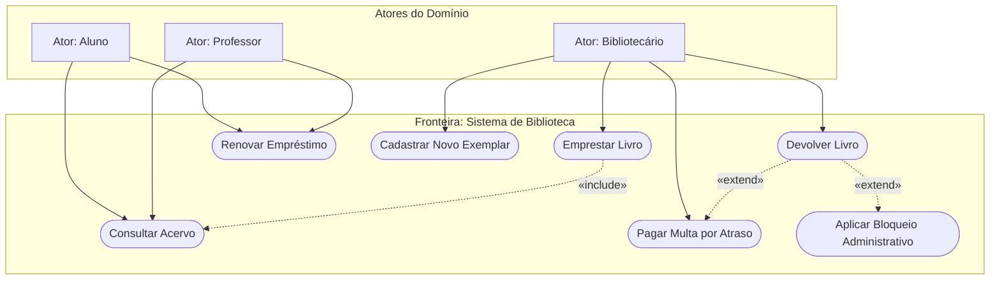

---

## Fundamentos de Projeto Orientado a Objetos e Princípios de Design

### Transição Formal: Análise versus Projeto

A engenharia de software corporativa falha quando o time inicia a codificação diretamente a partir de narrativas textuais sem modelar tecnicamente a arquitetura dos objetos:

| Dimensão de Comparação | Modelo de Análise | Modelo de Projeto Orientado a Objetos |
| :--- | :--- | :--- |
| **Pergunta Fundamental** | O que o sistema deve fazer? | Como o sistema realizará computacionalmente? |
| **Ponto de Vista** | Stakeholder, cliente e analista de processos. | Arquiteto de software, engenheiro e desenvolvedor. |
| **Nível de Abstração** | Conceitual, focado no negócio e agnóstico de tecnologia. | Lógico e físico, dependente de linguagens e plataformas. |
| **Entregáveis Primários** | SRS, Casos de Uso, Matriz MoSCoW, Glossário de Domínio. | Diagramas de Classes, Diagramas de Sequência, APIs, Esquemas de BD. |
| **Vocabulário Central** | Termos do negócio (ex.: *Empréstimo*, *Multa*, *Lote*, *Almoxarifado*). | Termos de engenharia (ex.: *Controller*, *Repository*, *DTO*, *Thread*). |

---

### Os Pilares do Design Orientado a Objetos

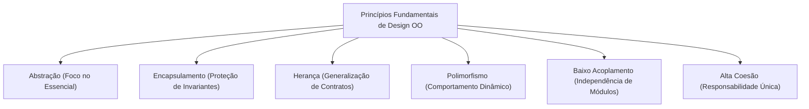

#### 1. Abstração
- **Definição:** Operação mental em que o desenvolvedor isola propriedades e operações essenciais de uma entidade sob o contexto do problema, descartando propositalmente detalhes operacionais irrelevantes.
- **Motivação:** Reduzir a carga cognitiva. Um objeto `ContaBancaria` em um sistema de pagamentos precisa manipular saldo, agência e operações de crédito; detalhes da arquitetura interna de transistores de hardware ou alocação física de trilhas no disco magnético são abstraídos.
- **Contraexemplo:** Criar entidades genéricas "faz-tudo" como `DadosGerais` ou misturar regras de cálculo fiscal dentro de classes de renderização de telas gráficas.

#### 2. Encapsulamento
- **Definição:** Técnica de agrupar estado (atributos) e operações (métodos) em uma classe, restringindo o acesso direto aos detalhes internos para proteger as invariantes de negócio.
- **Motivação:** Garantir que o objeto jamais atinja um estado inválido ou corrompido.
- **Contraexemplo (Modelo Anêmico Inseguro):** Declarar campos como `public` ou gerar métodos `get` e `set` cegos sem qualquer validação lógica.

##### Exemplo de Encapsulamento Rigoroso em Java
O exemplo abaixo ilustra o encapsulamento com validação de invariantes e proteção contra o vazamento de referências mutáveis (*escaping references*):

```java
package br.unifef.engenharia.dominio;

import java.util.ArrayList;
import java.util.Collections;
import java.util.List;

public final class Pedido {
    private final String identificador;
    private double valorTotal;
    private final List<String> itens;

    public Pedido(String identificador) {
        if (identificador == null || identificador.isBlank()) {
            throw new IllegalArgumentException("Identificador do pedido e compulsorio.");
        }
        this.identificador = identificador;
        this.valorTotal = 0.0;
        this.itens = new ArrayList<>();
    }

    public void adicionarItem(String descricao, double precoUnitario, int quantidade) {
        if (quantidade <= 0) {
            throw new IllegalArgumentException("A quantidade deve ser estritamente positiva.");
        }
        if (precoUnitario < 0.0) {
            throw new IllegalArgumentException("O preco unitario nao pode ser negativo.");
        }
        this.itens.add(descricao + " (Qtd: " + quantidade + ")");
        this.valorTotal += (precoUnitario * quantidade);
    }

    public String getIdentificador() {
        return this.identificador;
    }

    public double getValorTotal() {
        return this.valorTotal;
    }

    // Protecao contra escaping reference: retorna copia imutavel da colecao
    public List<String> getItens() {
        return Collections.unmodifiableList(this.itens);
    }
}
```

#### 3. Herança e Polimorfismo
- **Herança:** Relação estrutural do tipo "É UM" (*is-a*), capturando características gerais em superclasses abstratas e permitindo especialização de comportamento em subclasses concretas.
- **Polimorfismo:** Capacidade de objetos de classes distintas, derivadas de uma mesma raiz abstrata ou interface, responderem a uma mesma mensagem de maneiras particulares em tempo de execução (*late binding*).
- **Armadilha:** Herança espúria para mero reaproveitamento de código, violando o Princípio de Substituição de Liskov. Como regra geral de engenharia: *favoreça a composição sobre a herança*.

#### 4. Baixo Acoplamento e Alta Coesão
- **Baixo Acoplamento:** Métrica que avalia o nível de dependência entre módulos independentes. Quanto menor o acoplamento, menor o risco de que uma alteração interna em um componente propague falhas em cadeia sobre o restante do sistema.
- **Alta Coesão:** Métrica que avalia se os membros internos de uma classe operam alinhados a um único propósito conceitual. Classes altamente coesas são simples de testar, documentar e manter.

---

### Princípios SOLID

| Princípio | Sigla | Definição Formal de Engenharia | Sintoma de Violação |
| :--- | :---: | :--- | :--- |
| **Single Responsibility Principle** | **S** | Uma classe deve possuir um, e apenas um, motivo para ser alterada. | *God Class* que calcula impostos, formata telas e grava no banco. |
| **Open/Closed Principle** | **O** | Entidades de software devem estar abertas para extensão, mas fechadas para modificação. | Estruturas condicionais gigantescas (`if/else`, `switch`) que exigem edição a cada novo tipo. |
| **Liskov Substitution Principle** | **L** | Subtipos devem ser capazes de substituir seus tipos base sem comprometer a consistência do sistema. | Subclasses que lançam `UnsupportedOperationException` para métodos herdados. |
| **Interface Segregation Principle** | **I** | Muitas interfaces específicas são preferíveis a uma interface genérica inflada. | Classes forçadas a implementar métodos vazios para atender contratos que não utilizam. |
| **Dependency Inversion Principle** | **D** | Módulos de alto nível não devem depender de módulos de baixo nível; ambos devem depender de abstrações. | Regras de negócio instanciando diretamente classes de drivers JDBC ou bibliotecas de terceiros. |

---

### Visão Geral dos Padrões de Projeto do Gang of Four (GoF)

Os padrões de projeto representam soluções documentadas e validadas para problemas de design de objetos recorrentes:

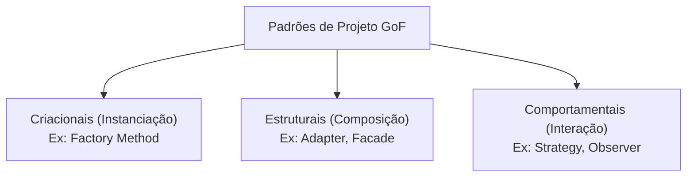

- **Strategy (Comportamental):** Encapsula famílias de algoritmos intercambiáveis em tempo de execução (ex.: alternar dinamicamente entre cálculo de frete por Correios, Transportadora Rodoviária ou Retirada Local).
- **Factory Method (Criacional):** Define uma interface para criação de objetos, delegando a decisão de qual classe concreta instanciar para subclasses ou métodos especializados.
- **Observer (Comportamental):** Estabelece mecanismo de subscrição de um para muitos, notificando automaticamente dependentes registrados quando o estado do sujeito se altera.
- **Adapter (Estrutural):** Converte a interface de uma classe incompatível na interface esperada pelo cliente corporativo.
- **Facade (Estrutural):** Provê uma interface simplificada e unificada para um subsistema de alta complexidade técnica.

---

## Modelagem Estrutural: O Diagrama de Classes na UML

### Princípios da UML: Linguagem versus Metodologia

A **Unified Modeling Language (UML)** foi padronizada na década de 1990 pela Object Management Group (OMG) mediante a unificação dos trabalhos de Grady Booch, James Rumbaugh e Ivar Jacobson (conhecidos como os "Três Amigos").

**A UML NÃO é:**
- Um processo de desenvolvimento de software.
- Uma metodologia ágil ou tradicional.
- A disciplina de Análise e Projeto de Sistemas em si.

**A UML É:**
- Uma **linguagem gráfica de notação visual padronizada**.
- Uma sintaxe e semântica estrita para especificar, visualizar, construir e documentar artefatos de software orientados a objetos.

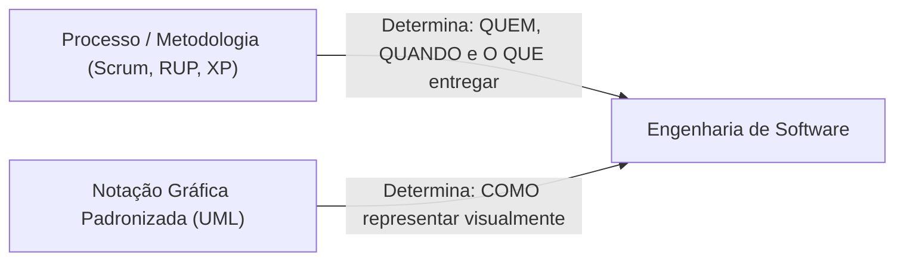

---

### Integração da Modelagem UML no Framework Ágil Scrum

No desenvolvimento ágil contemporâneo com o framework Scrum, a modelagem UML abandona o modelo histórico de burocracia antecipada massiva (BDUF — *Big Design Up Front*):
- **Modelagem Just-in-Time / Just-Enough:** A equipe de desenvolvimento projeta diagramas de classes e de sequência durante as cerimônias de Sprint Planning e sessões de refinamento técnico (*Backlog Refinement*).
- **Alinhamento Arquitetural:** O diagrama serve de mapa de navegação compartilhado para nortear o trabalho simultâneo de múltiplos desenvolvedores em uma mesma Sprint, garantindo uniformidade em nomes de métodos, tipos e contratos de interfaces.

---

### Anatomia Estrutural do Diagrama de Classes

A classe é representada graficamente por um retângulo subdividido horizontalmente em três compartimentos obrigatórios:

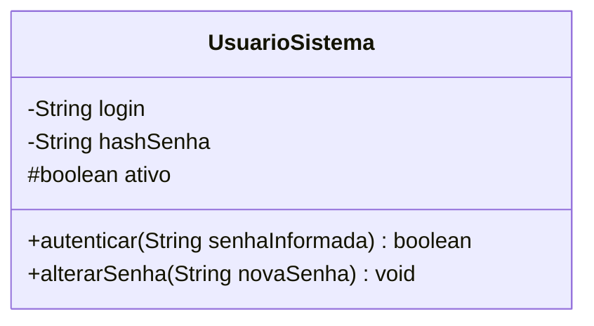

1. **Compartimento Superior (Identificador):** Nome da classe, grafado no singular, em estilo **PascalCase** (ex.: `Cliente`, `NotaFiscal`).
2. **Compartimento Central (Atributos):** Estado encapsulado. Sintaxe: `[visibilidade] nomeAtributo : Tipo`.
3. **Compartimento Inferior (Operações):** Comportamentos e métodos. Sintaxe: `[visibilidade] nomeOperacao(param : Tipo) : TipoRetorno`.

#### Modificadores de Visibilidade e Mapeamento para Java

| Símbolo UML | Modificador | Visibilidade de Acesso | Equivalente em Java |
| :---: | :--- | :--- | :--- |
| **`+`** | **Público (Public)** | Acesso irrestrito por qualquer classe de qualquer pacote. | `public` |
| **`#`** | **Protegido (Protected)** | Acesso permitido à própria classe, suas subclasses e classes do mesmo pacote. | `protected` |
| **`-`** | **Privado (Private)** | Acesso exclusivo estrito aos métodos internos da própria classe. | `private` |
| **`~`** | **Pacote (Package)** | Acesso restrito às classes pertencentes ao mesmo pacote lógico. | *(ausência de modificador / default)* |

#### Indicadores Formais de Multiplicidade
- `1`: Exatamente uma instância obrigatória.
- `0..1`: Zero ou uma instância (associação opcional).
- `*` ou `0..*`: Zero, uma ou múltiplas instâncias (coleção ilimitada).
- `1..*`: Ao menos uma instância obrigatória até múltiplas instâncias.
- `m..n`: Intervalo explícito delimitado (ex.: `2..4`).

---

### Catálogo de Relacionamentos Estruturais e Comportamentais

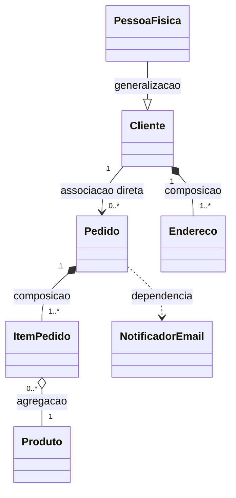

#### 1. Associação Simples
- **Definição:** Relação estrutural básica onde objetos de uma classe conhecem ou colaboram com objetos de outra classe.
- **Implementação:** Mantida como uma variável de referência ou lista de referências.

#### 2. Agregação (Todo-Parte Fraco / Losango Vazio)
- **Definição:** Relação em que a classe "Todo" agrupa instâncias da classe "Parte", mas onde a "Parte" possui ciclo de vida independente e pode existir fora do contexto do "Todo".
- **Semântica:** Se o "Todo" for destruído, a "Parte" permanece intacta na memória ou no banco de dados.
- **Exemplo:** `ItemPedido` e `Produto`. Se o item do pedido for excluído da base, o cadastro do `Produto` permanece íntegro no catálogo geral.

#### 3. Composição (Todo-Parte Forte / Losango Preenchido)
- **Definição:** Relação todo-parte rigorosa com dependência existencial absoluta de ciclo de vida.
- **Semântica:** A classe "Parte" não pode existir de forma autônoma sem a classe "Todo". A destruição do "Todo" acarreta a destruição compulsória em cascata de todas as suas "Partes".
- **Exemplo:** `Pedido` e `ItemPedido`. Se um registro de `Pedido` for expurgado do sistema, suas linhas filhas de `ItemPedido` deixam de ter razão de existir e são destruídas concomitantemente.

#### 4. Generalização / Especialização
- **Definição:** Relação estrutural de herança onde uma subclasse adquire o estado e os comportamentos de uma superclasse, podendo especializá-los.

#### 5. Dependência Transitória
- **Definição:** Relacionamento semântico fraco no qual uma classe utiliza outra transitoriamente durante a execução de uma operação específica (como parâmetro de método ou variável local), sem manter referência persistente de atributo.

---

### Mapeamento Estrutural Completo para Código Executável em Java

O código a seguir traduz com rigor sintático os conceitos de composição, agregação, encapsulamento e visibilidade modelados na UML:

```java
package br.unifef.engenharia.modelo;

import java.time.LocalDate;
import java.util.ArrayList;
import java.util.Collections;
import java.util.List;

// Entidade Produto utilizada em Agregacao
public class Produto {
    private final String codigoSku;
    private String nome;
    private double precoBase;

    public Produto(String codigoSku, String nome, double precoBase) {
        if (codigoSku == null || codigoSku.isBlank()) {
            throw new IllegalArgumentException("SKU obrigatorio.");
        }
        this.codigoSku = codigoSku;
        this.nome = nome;
        this.precoBase = precoBase;
    }

    public String getCodigoSku() { return codigoSku; }
    public String getNome() { return nome; }
    public double getPrecoBase() { return precoBase; }
}

// Classe ItemPedido: Parte na Composicao com Pedido, mantem Agregacao com Produto
public class ItemPedido {
    private final Produto produto; // Agregacao (losango vazio)
    private final int quantidade;
    private final double precoPraticado;

    // Construtor com escopo restrito ao pacote para reforcar o controle pelo Pedido
    ItemPedido(Produto produto, int quantidade, double precoPraticado) {
        if (produto == null) {
            throw new IllegalArgumentException("Produto vinculado e compulsorio.");
        }
        if (quantidade <= 0) {
            throw new IllegalArgumentException("Quantidade deve ser superior a zero.");
        }
        this.produto = produto;
        this.quantidade = quantidade;
        this.precoPraticado = precoPraticado;
    }

    public double calcularSubtotal() {
        return this.quantidade * this.precoPraticado;
    }

    public Produto getProduto() { return produto; }
    public int getQuantidade() { return quantidade; }
    public double getPrecoPraticado() { return precoPraticado; }
}

// Classe Pedido: O "Todo" na relacao de Composicao (losango preenchido)
public class Pedido {
    private final String numeroPedido;
    private final LocalDate dataCriacao;
    private final List<ItemPedido> itens; // Composicao: Pedido gerencia o ciclo de vida

    public Pedido(String numeroPedido) {
        if (numeroPedido == null || numeroPedido.isBlank()) {
            throw new IllegalArgumentException("Numero do pedido e obrigatorio.");
        }
        this.numeroPedido = numeroPedido;
        this.dataCriacao = LocalDate.now();
        this.itens = new ArrayList<>();
    }

    // Composicao formal: O Todo instancia a Parte internamente
    public void adicionarItem(Produto produto, int quantidade) {
        ItemPedido novoItem = new ItemPedido(produto, quantidade, produto.getPrecoBase());
        this.itens.add(novoItem);
    }

    public double calcularValorTotal() {
        double total = 0.0;
        for (ItemPedido item : this.itens) {
            total += item.calcularSubtotal();
        }
        return total;
    }

    public String getNumeroPedido() { return numeroPedido; }
    public LocalDate getDataCriacao() { return dataCriacao; }
    
    // Retorno de colecao imutavel para blindar o encapsulamento
    public List<ItemPedido> getItens() {
        return Collections.unmodifiableList(this.itens);
    }
}
```

---

## Arquitetura de Software e Estilos Arquiteturais

### A Definição Normativa: ISO/IEC/IEEE 42010:2022

A norma internacional **ISO/IEC/IEEE 42010:2022** estabelece a definição formal e rigorosa adotada pela Engenharia de Software contemporânea:

> *"Estrutura fundamental ou esqueleto de um sistema de software, que define seus componentes, suas relações e seus princípios de projeto e evolução."*

A norma fundamenta a arquitetura sob três pilares operacionais:
1. **Componentes:** As unidades computacionais modulares e de armazenamento de dados (classes, pacotes, microsserviços, tópicos de mensageria ou bancos de dados).
2. **Relações:** Os mecanismos de acoplamento, conectores e protocolos formais por meio dos quais os componentes comunicam-se e compartilham dados (mensageria assíncrona, REST, RPC, barramentos de eventos).
3. **Princípios de Projeto e Evolução:** As regras arquiteturais e restrições técnicas que orientam não apenas a criação inicial, mas governam e blindam o sistema contra a erosão técnica ao longo dos anos.

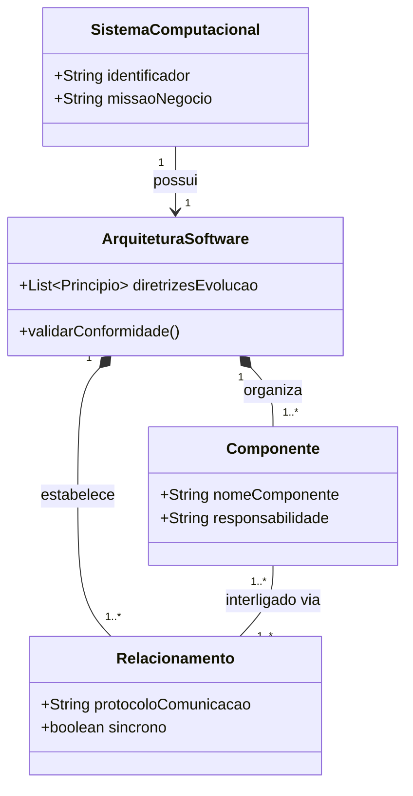

---

### Analogia e Contrastes Estruturais com a Arquitetura Civil

A comparação entre a arquitetura de software e a construção civil é amplamente utilizada, mas exige que o engenheiro compreenda as três distinções determinantes:

1. **Imaterialidade e Invisibilidade:** O software não possui massa ou matéria física. As tensões, compressões e forças de acoplamento manifestam-se em dependências lógicas na memória e na rede, tornando a degradação arquitetural (*architectural drift*) invisível até o colapso do sistema em produção.
2. **Maleabilidade Contínua:** Fundações, vigas e lajes de concreto de um edifício raramente sofrem modificações estruturais profundas após a entrega da obra. O software corporativo, ao contrário, opera em constante mutação devido às transformações do mercado e da legislação.
3. **Desgaste Físico versus Envelhecimento Lógico:** Prédios degradam-se pelo atrito físico e ação das intempéries naturais. O software não sofre corrosão material; ele degrada-se quando o ecossistema externo (sistemas operacionais, bibliotecas, protocolos, volume de acessos e padrões de segurança) avança e a base de código permanece estática.

---

### Padrão Arquitetural versus Padrão de Projeto (GoF)

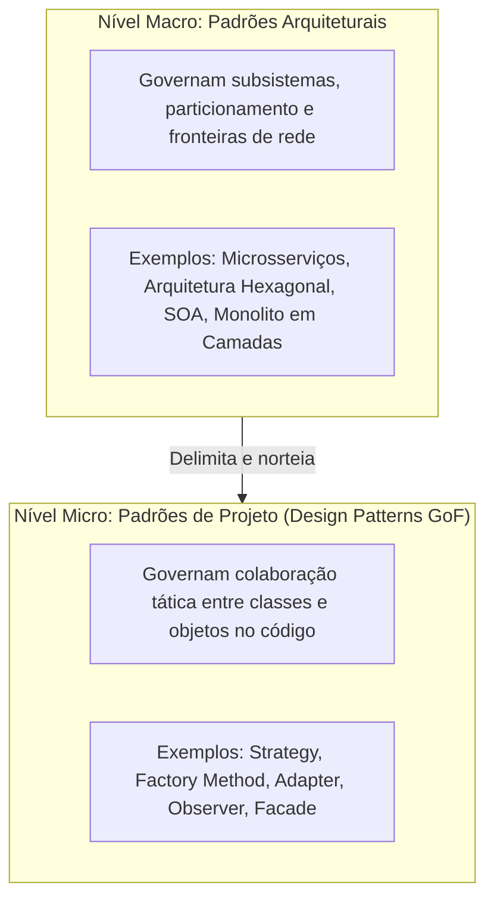

| Critério de Comparação | Padrão Arquitetural | Padrão de Projeto (GoF) |
| :--- | :--- | :--- |
| **Escopo Estrutural** | Global. Envolve todo o sistema ou grandes subsistemas distribuídos. | Local. Envolve classes, métodos e pequenas hierarquias de objetos. |
| **Foco de Engenharia** | Particionamento físico/lógico, infraestrutura, escalabilidade e redes. | Resolução de problemas locais de instanciação, comportamento e estrutura. |
| **Custo de Alteração** | Altíssimo. Alterar um estilo arquitetural pode exigir refazer o sistema. | Baixo a Médio. Pode ser refatorado localmente sob proteção de testes unitários. |

---

### Modelos de Distribuição: SaaS versus On-Premises

```mermaid
flowchart LR
 subgraph OnPremises["Modelo On-Premises (Instalação Local)"]
 OP1["Servidores e Hardware Próprio"]
 OP2["Equipe Interna de TI"]
 OP3["Licenciamento Perpétuo (CapEx)"]
 OP2 -->|"gerencia diretamente"| OP1
 end

 subgraph SaaS["Modelo SaaS (Software as a Service)"]
 CS1["Data Centers em Nuvem Provedora"]
 CS2["Equipe do Fornecedor / SaaS"]
 CS3["Assinatura Recorrente (OpEx)"]
 CS2 -->|"administra e sustenta"| CS1
 end
```

| Dimensão de Análise | Software as a Service (SaaS) | On-Premises (Instalação Local) |
| :--- | :--- | :--- |
| **Modelo Financeiro** | **OpEx** (*Operational Expenditure*): Custos operacionais recorrentes por assinatura/consumo. | **CapEx** (*Capital Expenditure*): Alto investimento inicial em servidores, licenças perpétuas e rede. |
| **Gestão de Infraestrutura** | Totalmente delegada e administrada pelo provedor na nuvem. | Mantida e operada integralmente pela equipe interna de TI da empresa contratante. |
| **Atualizações e Patches** | Automáticas, imediatas e transparentes para toda a base de usuários. | Processo manual, exigindo planejamento, janelas de parada e homologação local. |
| **Custódia dos Dados** | Armazenados na nuvem do provedor sob acordos formais de conformidade. | Controle físico e lógico absoluto da base de dados dentro do perímetro da empresa. |
| **Escalabilidade** | Elástica e sob demanda; provisionamento ágil de instâncias e recursos. | Rígida; depende de compra prévia, entrega e montagem física de novo hardware. |

---

### Panorama Crítico dos Estilos Arquiteturais

#### 1. Arquitetura Cliente-Servidor Clássica
- **Estrutura:** Duas camadas (computador cliente dialogando diretamente com o servidor central de banco de dados).
- **Limitações:** Alto acoplamento entre regras de negócio e interfaces visuais (*Fat Client*); conexões concorrentes diretas esgotam rapidamente o limite de conexões simultâneas do SGBD; qualquer mudança de regra exige atualizar fisicamente o software em todas as estações de trabalho.

#### 2. Arquitetura Orientada a Serviços (SOA)
- **Estrutura:** Decomposição funcional do sistema em serviços corporativos autônomos, de granularidade grossa (*coarse-grained*), comunicando-se mediante contratos agnósticos sobre um barramento de comunicação corporativo (ESB — *Enterprise Service Bus*).
- **Características:** Comunicação padronizada (SOAP/XML ou REST); alta reutilização corporativa de serviços legados integrados; dependência crítica da infraestrutura central do barramento.

#### 3. Arquitetura Hexagonal (Ports and Adapters)
Concebida por Alistair Cockburn, visa proteger as regras de negócio contra o acoplamento a tecnologias de entrada e saída.

```mermaid
flowchart LR
 subgraph AdaptadoresEntrada["Adaptadores de Entrada (Driving)"]
 UI["Controlador REST API"]
 CLI["Interface de Linha de Comando"]
 end

 subgraph Hexagono["Núcleo da Aplicação (Core)"]
 P_In["Porta de Entrada (Interface de Entrada)"]
 Dominio["Entidades de Negócio e Casos de Uso"]
 P_Out["Porta de Saída (Interface de Saída)"]
 P_In --> Dominio
 Dominio --> P_Out
 end

 subgraph AdaptadoresSaida["Adaptadores de Saída (Driven)"]
 JPA["Adaptador PostgreSQL / JPA"]
 MSG["Adaptador de Mensageria RabbitMQ"]
 end

 UI --> P_In
 CLI --> P_In
 P_Out --> JPA
 P_Out --> MSG
```

- **O Princípio Fundamental:** O domínio do negócio reside no centro geométrico isolado do hexágono. Ele não importa nenhuma dependência de banco de dados, bibliotecas Web ou frameworks externos.
- **Portas Condutoras (Driving Ports / Entrada):** Interfaces que expõem os serviços do domínio para o mundo externo (acionadas por controladores HTTP, tarefas agendadas cron ou chamadas de terminal CLI).
- **Portas Conduzidas (Driven Ports / Saída):** Interfaces que definem os contratos que o domínio exige para persistir dados, despachar e-mails ou integrar com gateways bancários.
- **Adaptadores:** Implementações concretas de tecnologias periféricas que satisfazem as interfaces das portas (ex.: `PostgreSQLRepositoryAdapter` implementando a porta `PedidoRepositoryPort`).

#### 4. Arquitetura de Microsserviços
- **Conceito:** O sistema é particionado em múltiplos serviços independentes, de granularidade fina, fracamente acoplados, implantados de forma autônoma e organizados em torno de contextos delimitados (*Bounded Contexts* do DDD).
- **Banco de Dados por Serviço:** Cada microsserviço mantém sua própria base de dados exclusiva, sendo proibido o compartilhamento direto de tabelas no banco de dados. A comunicação entre serviços ocorre estritamente via APIs de rede (HTTP/REST, gRPC) ou mensageria assíncrona orientada a eventos (*Event-Driven*).
- **Trade-offs Críticos:** Elevada resiliência, escalabilidade elástica independente e autonomia de times versus alta complexidade operacional, latência de rede, necessidade de rastreamento distribuído, consistência eventual e gestão complexa de transações distribuídas (Padrão Saga).

---

## O Padrão Arquitetural Model-View-Controller (MVC) Clássico no Smalltalk-80

### Origem Histórica e o Desafio Gráfico no Xerox PARC

O padrão **Model-View-Controller (MVC)** foi concebido no lendário *Learning Research Group* do Xerox Palo Alto Research Center (PARC) entre o final dos anos 1970 e início dos anos 1980, liderado por cientistas pioneiros da computação como Alan Kay, Adele Goldberg e Dan Ingalls, durante a construção do ambiente Smalltalk-80.

#### O Paradoxo da Interface Multi-Janelas e o Problema da Primitiva Pen
Antes do Smalltalk, as aplicações operavam em terminais de texto sequenciais orientados a lotes (*batch*). No Smalltalk-80, foi introduzido o paradigma de interfaces gráficas interativas em monitores baseados em mapa de bits (*bitmapped display*) operadas por cursor de mouse.

No Smalltalk primitivo, existia uma classe chamada `Pen`, que permitia aos programas desenhar primitivas geométricas (linhas, curvas e caracteres) diretamente no *framebuffer* global da tela (`DisplayScreen`). 
- **O Problema:** Programas que desenhavam diretamente com a classe `Pen` sobrescreviam arbitrariamente a área gráfica das demais aplicações abertas.
- **A Necessidade do MVC:** Conforme documentado pelo cientista Steve Burbeck, o MVC nasceu da necessidade de viabilizar a cooperação de múltiplas janelas ativas sobrepostas compartilhando harmoniosamente uma única tela física, um único teclado e um único mouse.

```mermaid
flowchart TD
 subgraph Monolitico["Desenho Primitivo Desordenado (Classe Pen)"]
 A1["Aplicação A"] --> F1["Framebuffer Global da Tela"]
 A2["Aplicação B"] --> F1
 F1 -.->|"Corrupção visual e sobreposição destrutiva"| F1
 end

 subgraph CooperativoMVC["Padrão MVC no Smalltalk-80"]
 C1["Controller: Captura e Traduz Entrada"] --> M1["Model: Dados de Domínio"]
 C1 -.->|"Comando direto de ajuste"| V1["View: Projeção Gráfica"]
 M1 -.->|"Notificação changed / update:"| V1
 V1 -->|"Renderização circunscrita ao Viewport"| Tela["Área Geográfica Delimitada da Janela"]
 end
```

---

### A Tríade MVC e suas Responsabilidades Especializadas

```mermaid
classDiagram
 class Model {
 +dependents: Collection
 +addDependent(View aView)
 +removeDependent(View aView)
 +changed()
 +changed(Object aspect)
 +getState()
 }
 class View {
 +model: Model
 +controller: Controller
 +superView: View
 +subViews: OrderedCollection
 +display()
 +displayView()
 +update(Model aModel, Object aspect)
 }
 class Controller {
 +model: Model
 +view: View
 +controlLoop()
 +controlActivity()
 +isControlActive() boolean
 }

 View "1" o-- "1" Controller : Ligação Bilateral Direta (1:1)
 Controller "1" o-- "1" View : Ligação Bilateral Direta (1:1)
 View --> "1" Model : Consulta Estado (getState)
 Controller --> "1" Model : Comanda Mutação (mutators)
 Model ..> View : Notificação Indireta (Observer / update:)
```

1. **Model (Modelo):** Representa o domínio da aplicação, regras de negócio e integridade dos dados. É completamente agnóstico à existência das janelas e dos botões gráficos. Qualquer objeto do Smalltalk pode atuar como modelo.
2. **View (Visão):** Gerencia a apresentação gráfica e o mapeamento visual no mapa de bits dentro do espaço retangular de tela que lhe foi alocado. Mantém referências aos dados do modelo por consulta direta e se redesenha sempre que recebe avisos de atualização.
3. **Controller (Controlador):** Modela a interação física do usuário com o hardware. Escuta ativamente os eventos de clique do mouse e digitação do teclado, traduzindo tais eventos físicos em mensagens semânticas enviadas para o Modelo ou para a Visão.

---

### A Topologia de Acoplamento da Tríade

A comunicação interna da tríade MVC possui duas modalidades de ligação fundamentalmente distintas:

- **Acoplamento Bilateral Rígido (View $`\leftrightarrow`$ Controller):**
  Existe um vínculo direto de 1 para 1 entre a visão e seu respectivo controlador. A `View` mantém uma referência direta para o seu `Controller` (`view.getController()`), e o `Controller` mantém uma referência direta para a sua `View` (`controller.getView()`). Se uma visão for removida da tela, seu controlador associado é desativado em conjunto.
- **Acoplamento Fraco e Reativo via Observer (Model $`\rightarrow`$ View):**
  O `Model` **não** conhece quem são suas visões de forma nominal ou estruturada. Ele mantém apenas uma lista genérica de observadores através do mecanismo `dependents`. Quando seu estado muda, o modelo emite um sinal difuso (`self changed`), disparando o método `update:` em todos os dependentes registrados.

---

### Modelos Passivos versus Modelos Ativos

Steve Burbeck classifica os modelos no Smalltalk em duas naturezas comportamentais:

```mermaid
sequenceDiagram
 autonumber
 participant T as Thread / Processo Externo
 participant M as Modelo Ativo (SystemTranscript)
 participant V as Visão Dependente
 participant C as Controlador da Visão

 Note over T,M: Alteração disparada fora da tríade UI
 T->>M: appendText("Mensagem de Log")
 activate M
 M->>M: self changed
 M->>V: update: self
 deactivate M
 activate V
 V->>M: contents()
 M-->>V: Retorna texto atualizado
 V->>V: displayView()
 deactivate V
```

#### 1. Modelo Passivo
- **Definição:** O modelo cujo estado é modificado **exclusivamente** por ordens diretas originadas do controlador da sua própria tríade MVC.
- **Dinâmica:** O usuário digita uma tecla; o `Controller` recebe o caractere e atualiza o `Model` (ex.: uma instância de `String`). O próprio controlador sabe exatamente o que mudou e pode instruir imediatamente a `View` a se redesenhar. Não há necessidade de o modelo possuir mecanismos sofisticados de notificação.

#### 2. Modelo Ativo
- **Definição:** O modelo cujo estado pode ser alterado por processos externos em segundo plano, tarefas concorrentes ou múltiplos controladores e visões simultâneas.
- **Dinâmica Canônica no Smalltalk-80:** O objeto `SystemTranscript` (console do sistema). Qualquer thread executando no ambiente pode enviar uma mensagem `Transcript show: 'Alerta'`. A interface visual não tem como prever quando isso ocorrerá. Portanto, o próprio modelo assume o protagonismo: ao ser modificado, ele dispara compulsoriamente `self changed`, acionando o método `update:` da visão para que o buffer de tela seja atualizado.

---

### Evolução do Mecanismo de Dependências: DependentFields versus Classe Model

No Smalltalk-80, o mecanismo Observer passou por um refinamento arquitetural crítico documentado entre as versões v2.0 e v2.5:

```mermaid
classDiagram
 class Object {
 +DependentFields: IdentityDictionary
 +addDependent(anObject)
 +removeDependent(anObject)
 +changed()
 +update(anAspect)
 }
 class Model {
 +dependents: Object
 +addDependent(anObject)
 +removeDependent(anObject)
 +changed()
 }
 Object <|-- Model : Evolução v2.5
```

1. **A Abordagem Primitiva no Smalltalk-80 v2.0 (`DependentFields`):**
   - Como qualquer objeto podia ser modelo (inclusive inteiros e strings), a classe raiz `Object` mantinha uma variável de classe global chamada `DependentFields`.
   - `DependentFields` era uma tabela hash de identidade (`IdentityDictionary`). As chaves eram os objetos que atuavam como modelos; os valores eram coleções (`OrderedCollection`) com suas visões registradas.
   - *Gargalo de Engenharia:* Alto consumo de memória para buscas por hash contínuas, contenção global de acesso e frequentes vazamentos de memória (*memory leaks*), pois se a visão não fosse desvinculada explicitamente da tabela global, a coleta de lixo (*garbage collector*) nunca conseguia desalocar os objetos.
2. **A Solução Estruturada no Smalltalk-80 v2.5 (Classe `Model` Especializada):**
   - Para resolver o gargalo, introduziu-se a classe abstrata `Model`.
   - As entidades de domínio herdavam de `Model`, a qual continha uma variável de instância dedicada e otimizada chamada `dependents`.
   - A variável `dependents` economizava memória assumindo três representações dinâmicas:
     - `nil`: quando não há nenhuma visão observando o modelo.
     - Uma referência direta a um único objeto: quando há apenas uma visão observadora (eliminando o custo de criar uma coleção na memória).
     - Uma instância de `DependentsCollection`: somente quando duas ou mais visões observavam simultaneamente o mesmo modelo.

---

### Composição Hierárquica e Pipeline Gráfico: TopView, SubViews e WindowingTransformation

A apresentação de telas no Smalltalk-80 organiza-se no padrão de projeto **Composite**:

- **TopView:** A visão de topo que encapsula a janela inteira, responsável por gerenciar a moldura de bordas externas, a barra de título e a movimentação global da janela na tela.
- **SubViews:** Painéis visuais internos encaixados na `TopView` (listas de seleção, campos de texto, botões de ação e visualizadores de código). Uma `SubView` pode conter recursivamente outras subvisões filhas.

```mermaid
flowchart TD
 TV["TopView (Janela Principal)"] --> SV1["SubView: Lista de Classes"]
 TV --> SV2["SubView: Lista de Métodos"]
 TV --> SV3["SubView: Editor de Código (ParagraphEditor)"]
```

#### Pipeline de Renderização em Cascata
A exibição gráfica de uma janela obedece a um pipeline sequencial estrito:
1. `display`: Método de entrada principal invocado para desenhar a estrutura visual.
2. `displayBorder`: Desenha os limites retangulares geométricos e as molduras da visão.
3. `displayView`: Pinta o conteúdo gráfico próprio da visão corrente em seu mapa de bits.
4. `displaySubviews`: Itera sobre a coleção de subvisões aninhadas, invocando recursivamente a rotina `display` para cada elemento filho.

#### WindowingTransformation: Transformação Geométrica de Coordenadas
Uma janela não pode desenhar assumindo as coordenadas físicas absolutas da tela do monitor. Se a janela for movida do canto superior esquerdo para o canto inferior direito, todo o desenho interno quebraria se usasse coordenadas fixas.
- O Smalltalk-80 resolve essa barreira geométrica por meio da classe `WindowingTransformation`.
- Essa classe executa a conversão matemática linear bidirecional entre o **Espaço do Modelo da Janela** (coordenadas relativas locais, variando tipicamente de $ `(0,0)` $ até a largura e altura do painel) e o **Espaço Físico da Tela** (*DisplayScreen Coordinates*, pixels reais do hardware).

---

### O Modelo de Controle Cooperativo e o Mouse de Três Botões

O Smalltalk-80 operava sob um modelo de multitarefa cooperativa orientada a um laço de eventos *unithread*:

- **ControlManager (`ScheduledControllers`):**
  Entidade central que gerenciava a coleção ordenada de controladores ativos associados a cada janela do sistema. O `ControlManager` monitorava a posição global do cursor do mouse. A janela sobre a qual o cursor repousava recebia o foco de controle.
- **O Mouse Clássico de Três Botões:**
  A interação humana nos laboratórios do Xerox PARC foi concebida sob o uso de mouses com três botões coloridos:
  - **Red Button (Botão Esquerdo / Vermelho):** Interação primária com o conteúdo da visão. Destinado a posicionar o cursor de texto, selecionar palavras ou clicar em elementos visuais.
  - **Yellow Button (Botão Central / Amarelo):** Dispara menus contextuais locais com ações específicas da visão corrente (ex.: no editor de texto: *cut*, *copy*, *paste*, *accept*, *cancel*).
  - **Blue Button (Botão Direito / Azul):** Controle de gerenciamento da janela sobre o sistema operacional (ex.: mover a janela, redimensionar, fechar, enviar para o fundo ou colapsar em ícone).

---

## Caderno Prático de Integração: Resoluções das Atividades Acadêmicas

### Resolução Integrada da Atividade da Aula 3 (Google Classroom)

> **Contexto Acadêmico:** Simulação corporativa demandando segregação formal de papéis entre *Stakeholders* e *Analistas de Sistemas*, diagnóstico de causa raiz e formulação de requisitos para o projeto integrador.

#### 1. Identificação Formal da Equipe e Alocação de Papéis
- **Carlos Eduardo Lima** (Papel: *Stakeholder / Diretor de Logística*): Representa a alta administração, reportando os prejuízos com perda de equipamentos, custos da frota e obrigações contratuais com hospitais.
- **Mariana Albuquerque** (Papel: *Stakeholder / Gestora de Almoxarifado Clínico*): Representa a operação de campo, descrevendo os procedimentos diários de desinfecção, checagem e os gargalos do preenchimento de formulários em papel.
- **Lucas Gabriel Martins** (Papel: *Analista de Sistemas / Engenheiro de Requisitos*): Conduz as técnicas de elicitação ativa, atua na desconstrução dos 5 Porquês e documenta o catálogo formal de Requisitos Funcionais.
- **Beatriz Helena Souza** (Papel: *Analista de Sistemas / Arquiteta de Software*): Mapeia as restrições arquiteturais, formaliza os Requisitos Não Funcionais mensuráveis e projeta os modelos conceituais de classes.

#### 2. Descrição Aprofundada da Situação Problema
A *HealthTech Solutions* opera na locação de equipamentos biomédicos de alto custo (monitores cardíacos, ventiladores mecânicos pulmonares e bombas de infusão contínua) para mais de 45 unidades hospitalares. O diagnóstico analítico revelou os seguintes pontos críticos:
- Abertura de chamados por canais informais (ligações e WhatsApp), sem protocolo auditável.
- Registro das coletas em canhotos carbonados manuais que permanecem acumulados nos caminhões por até duas semanas.
- Extravio crônico de ativos: no último trimestre, 14 ventiladores pulmonares (avaliados em R$ 85.000,00 cada) foram reportados com localização indeterminada.
- Descumprimento das normas da ANVISA (RDC nº 63/2011) referente ao vencimento da calibração metrológica de equipamentos mantidos em operação.

#### 3. Descrição Estruturada da Solução de Engenharia Proposta
Desenvolvimento de uma plataforma distribuída composta por aplicativo móvel operacional offline-first para as equipes de coleta e painel administrativo web em nuvem com sincronização contínua.

```mermaid
classDiagram
 class EquipamentoBiomedico {
 -String numeroSerie
 -String tombamentoPatrimonial
 -String modelo
 -LocalDate dataUltimaCalibracao
 -StatusOperacional status
 +validarAptoUso() boolean
 }
 class OrdemColeta {
 -String numeroProtocolo
 -LocalDateTime dataAgendamento
 -LocalDateTime dataConclusao
 -AssinaturaDigital assinaturaRecebedor
 +concluirColeta(AssinaturaDigital assinatura)
 }
 class HospitalCliente {
 -String cnpj
 -String razaoSocial
 -Endereco enderecoUnidade
 }
 class MotoristaOperador {
 -String cnh
 -String nome
 }

 EquipamentoBiomedico "1..*" -- "1" HospitalCliente : alocado em
 OrdemColeta "1" o-- "1..*" EquipamentoBiomedico : transporta
 OrdemColeta "0..*" --> "1" HospitalCliente : destina-se a
 OrdemColeta "0..*" --> "1" MotoristaOperador : executada por
```

##### Catálogo de Requisitos Funcionais e Regras de Negócio
- **RF-01:** O aplicativo móvel deve permitir o registro da coleta de equipamentos mediante a leitura óptica do código bidimensional (QR Code/DataMatrix) fixado na carcaça metálica do ativo.
- **RF-02:** O sistema deve capturar compulsoriamente a assinatura digital do responsável hospitalar e as coordenadas geográficas (GPS) no instante da transferência de custódia.
- **RF-03:** A plataforma web deve emitir alertas automáticos com 30 dias de antecedência para qualquer equipamento com certificado de calibração metrológica próximo do vencimento.
- **RN-01 (Regra de Negócio):** Um equipamento biomédico cujo certificado de calibração metrológica esteja vencido fica impedido pelo sistema de ser alocado para um novo contrato de locação.

---

### Resolução Integrada da Atividade Classe / Aula 4 (Google Classroom)

> **Contexto Acadêmico:** Envio do Diagrama de Casos de Uso completo e validado, acompanhado da especificação textual canônica do domínio analisado em sala de aula (Sistema de E-commerce e Gestão de Pedidos).

```mermaid
flowchart LR
 subgraph AtoresExternos["Atores do Ecossistema"]
 Cliente["Cliente"]
 Admin["Administrador"]
 Gateway["Gateway de Pagamento"]
 Correios["Serviço de Logística"]
 end

 subgraph FronteiraEcommerce["Fronteira do Sistema: Plataforma de E-Commerce"]
 UC1(["Buscar Produtos no Catálogo"])
 UC2(["Realizar Pedido de Compra"])
 UC3(["Efetuar Pagamento"])
 UC4(["Aplicar Cupom de Desconto"])
 UC5(["Consultar Rastreamento da Entrega"])
 UC6(["Autenticar Usuário"])
 UC7(["Gerenciar Estoque de Produtos"])
 UC8(["Emitir Relatório de Vendas"])
 end

 Cliente --> UC1
 Cliente --> UC2
 Cliente --> UC5

 Admin --> UC7
 Admin --> UC8

 UC2 -.->|"«include»"| UC6
 UC7 -.->|"«include»"| UC6
 UC8 -.->|"«include»"| UC6

 UC2 -.->|"«include»"| UC3
 UC3 --- Gateway

 UC4 -.->|"«extend»"| UC2
 UC5 --- Correios
```

---

## Síntese Pedagógica e Preparação para Avaliações (AV1 e AV2)

### Matriz Comparativa Consolidada de Conceitos Fundamentais

| Conceito / Modelo | Definição Central de Engenharia | Papel no Ciclo de Vida | Risco da Omissão ou Erro |
| :--- | :--- | :--- | :--- |
| **Engenharia de Requisitos** | Elicitação ativa e tradução sistemática das dores do negócio em especificações não ambíguas. | Fases Iniciais (Análise). | Construir o software errado com tecnologia impecável. |
| **Método MoSCoW** | Técnica ágil de priorização formal de escopo em 4 categorias (Must, Should, Could, Won't). | Planejamento e Refinamento. | Corrupção de escopo (*scope creep*) e atraso do cronograma. |
| **Diagrama de Casos de Uso** | Modelagem comportamental em caixa-preta das fronteiras do sistema e atores. | Análise e Requisitos. | Ambiguidade de escopo e confusão entre atores e regras internas. |
| **Diagrama de Classes** | Modelagem estrutural estática das classes, tipos, multiplicidades e acoplamentos. | Projeto Detalhado (Design OO). | Código espaguete com classes anêmicas e ausência de encapsulamento. |
| **Arquitetura Hexagonal** | Isolamento das regras de negócio através de portas e adaptadores de entrada e saída. | Arquitetura de Software. | Domínio acoplado a frameworks web e drivers de bancos de dados. |
| **Padrão MVC Clássico** | Separação estrita entre Modelo de Domínio, Apresentação Visual e Controle de Entrada. | Arquitetura e Design de Interfaces. | Mistura de rotinas de pintura gráfica com regras lógicas de negócio. |

---

### Perguntas e Respostas de Fixação Estruturada (JSONL)

```json
{"pergunta": "Por que a afirmação 'Software não é feito em pastelaria' resume a necessidade da Engenharia de Software?", "resposta": "Porque construir software corporativo exige processos metódicos de análise de requisitos, modelagem arquitetural, verificação de qualidade e garantia de manutenibilidade, impedindo o modelo de entrega improvisado que causa falhas graves em produção."}
{"pergunta": "Qual a diferença conceitual entre o modelo de análise e o modelo de projeto na orientação a objetos?", "resposta": "A análise foca no domínio do problema ('o que o sistema deve fazer') de forma agnóstica de tecnologia; o projeto foca no domínio da solução técnica ('como fazer'), detalhando classes, padrões, persistência e interfaces."}
{"pergunta": "Qual a distinção epistemológica fundamental entre levantamento e elicitação de requisitos?", "resposta": "O levantamento assume postura passiva, acreditando que os requisitos já estão prontos na mente do usuário; a elicitação adota postura investigativa e ativa do analista para extrair necessidades tácitas e problemas reais."}
{"pergunta": "Por que expressões como 'o sistema deve ser rápido' são consideradas anti-requisitos?", "resposta": "Porque são vagas, subjetivas e desprovidas de métricas observáveis, impossibilitando testes formais de aceitação. Devem ser refatoradas em requisitos não funcionais mensuráveis (como percentis de latência sob carga simultânea)."}
{"pergunta": "Qual a diferença estrutural entre os relacionamentos «include» e «extend» em diagramas de casos de uso?", "resposta": "O include indica execução compulsória e incondicional do caso de uso incluído (seta parte da base para o incluído); o extend representa expansão condicional e opcional que ocorre apenas em pontos de extensão específicos (seta parte da extensão para a base)."}
{"pergunta": "Em termos de destruição e ciclo de vida, qual a diferença entre Agregação e Composição na UML?", "resposta": "Na agregação (losango vazio), o relacionamento todo-parte é fraco e as partes continuam existindo se o todo for destruído; na composição (losango preenchido), o relacionamento é forte com dependência existencial, destruindo as partes em cascata."}
{"pergunta": "Qual o problema estrutural gerado pelo uso de Getters e Setters cegos para todos os atributos de uma classe?", "resposta": "Gera um Modelo de Domínio Anêmico, destruindo o encapsulamento real da classe, pois permite que agentes externos alterem seu estado arbitrariamente sem acionar validações de invariantes de negócio."}
{"pergunta": "Por que a UML não pode ser classificada como uma metodologia de desenvolvimento de software?", "resposta": "Porque a UML é unicamente uma linguagem gráfica visual de notação com vocabulário e regras de sintaxe para documentação e modelagem; metodologias (como Scrum ou RUP) definem papéis, ritos e cronogramas de entrega."}
{"pergunta": "Qual a finalidade central da Arquitetura Hexagonal (Ports and Adapters)?", "resposta": "Isolar as regras de negócio e entidades do domínio no centro da aplicação, tornando-as completamente independentes de tecnologias periféricas, frameworks web, interfaces gráficas e bancos de dados."}
{"pergunta": "Qual era a limitação de desempenho do mecanismo DependentFields no Smalltalk-80 v2.0?", "resposta": "Mantinha uma tabela hash global em Object contendo todos os modelos e observadores do sistema, gerando alto custo de busca por hash, contenção concorrente e retenção acidental de memória (vazamento de objetos pelo Garbage Collector)."}
```

---

### Checklist de Revisão do Estudante para Provas e Projeto

- [ ] Compreendo a fórmula de cálculo da Nota Final ($ `\text{Nota Final} = \frac{[(\text{AV}_1 \times 0.6) + (\text{PJ} \times 0.4)] + [(\text{AV}_2 \times 0.6) + (\text{PJ} \times 0.4)]}{2}` $) e os pesos de cada instrumento avaliativo.
- [ ] Sei justificar a razão pela qual "preciso de um sistema para melhorar meu negócio" é uma premissa inaceitável para iniciar o desenvolvimento.
- [ ] Consigo aplicar a técnica dos 5 Porquês para distinguir sintomas de problemas da sua causa raiz estrutural.
- [ ] Sei converter adjetivos vagos de clientes em Requisitos Não Funcionais mensuráveis com métricas físicas.
- [ ] Domino a aplicação das 4 categorias da matriz MoSCoW (Must, Should, Could, Won't have).
- [ ] Sei diferenciar com precisão a direção das setas e a semântica de `<<include>>`, `<<extend>>` e generalização na UML.
- [ ] Compreendo a estrutura de um caso de uso textual: atores, pré-condições, pós-condições, fluxo principal, alternativos e de exceção.
- [ ] Sei modelar em diagrama e codificar em Java as diferenças entre Associação Simples, Agregação e Composição.
- [ ] Consigo apontar o perigo das referências mutáveis (*escaping references*) e utilizar wrappers imutáveis para blindar o encapsulamento.
- [ ] Conheço a definição normativa de arquitetura de software da ISO/IEC/IEEE 42010:2022 e seus três elementos constitutivos.
- [ ] Sei contrastar os modelos SaaS (OpEx) e On-Premises (CapEx), apontando as vantagens e desvantagens de cada um.
- [ ] Entendo o funcionamento da Arquitetura Hexagonal, distinguindo portas condutoras (driving) de portas conduzidas (driven) e adaptadores.
- [ ] Sei explicar a origem histórica do MVC no Smalltalk-80 e como a tríade viabilizou a coexistência de interfaces multi-janelas na mesma tela.
- [ ] Compreendo por que a ligação View-Controller é bilateral direta (1:1), enquanto a ligação Model-View é desacoplada via Observer (`changed`/`update:`).
- [ ] Sei diferenciar modelos passivos de modelos ativos e a razão pela qual o `SystemTranscript` exige disparo autônomo de `self changed`.

---

## Fontes e Metadados

- Turma no Classroom: Engenharia de Software 2 - 2026/02
- Itens processados: 0 materiais, 3 tarefas, 8 avisos
- Gerado em: 19/10/2026, 02:08:56 (BRT) via classroom-sync
