# Trabalho — Atividade semestral parte 2

> **Professor:** Wesley Soares
> **Disciplina:** Engenharia de Software II (4º Semestre)
> **Prazo de Entrega:** 01/12/2026 às 23:59
> **Pontuação Máxima:** 100 pontos
> **Conteúdo cobrado:** [Aula 01 - Introdução ao Ciclo de Vida do Projeto de Software](../../Aulas/Aula%2001%20-%20Introdu%C3%A7%C3%A3o%20ao%20Ciclo%20de%20Vida%20do%20Projeto%20de%20Software/detalhes.md), [Aula 02 - Fundamentos de Projeto Orientado a Objetos](../../Aulas/Aula%2002%20-%20Fundamentos%20de%20Projeto%20Orientado%20a%20Objetos/detalhes.md), [Aula 03 - Técnicas de Elicitação e Levantamento de Requisitos](../../Aulas/Aula%2003%20-%20T%C3%A9cnicas%20de%20Elicita%C3%A7%C3%A3o%20e%20Levantamento%20de%20Requisitos/detalhes.md), [Aula 04 - Modelagem de Casos de Uso UML](../../Aulas/Aula%2004%20-%20Modelagem%20de%20Casos%20de%20Uso%20UML/detalhes.md), [Aula 06 - Modelagem de Requisitos e Casos de Uso](../../Aulas/Aula%2006%20-%20Modelagem%20de%20Requisitos%20e%20Casos%20de%20Uso/detalhes.md), [Aula 07 - Fundamentos da UML e Diagrama de Classes](../../Aulas/Aula%2007%20-%20Fundamentos%20da%20UML%20e%20Diagrama%20de%20Classes/detalhes.md), [Aula 08 - Arquitetura Model-View-Controller no Smalltalk-80](../../Aulas/Aula%2008%20-%20Arquitetura%20Model-View-Controller%20no%20Smalltalk-80/detalhes.md), [Aula 09 - Arquitetura de Software e Padrões Arquiteturais](../../Aulas/Aula%2009%20-%20Arquitetura%20de%20Software%20e%20Padr%C3%B5es%20Arquiteturais/detalhes.md), [Aula 10 - Modelagem de Interação Estados e Atividades](../../Aulas/Aula%2010%20-%20Modelagem%20de%20Intera%C3%A7%C3%A3o%20Estados%20e%20Atividades/detalhes.md), [Aula 11 - Diagramas de Estado e de Atividade](../../Aulas/Aula%2011%20-%20Diagramas%20de%20Estado%20e%20de%20Atividade/detalhes.md)

---

## Sumário

- [Aviso sobre o enunciado da atividade](#aviso-sobre-o-enunciado-da-atividade)
- [Enunciado original (Google Classroom)](#enunciado-original-google-classroom)
- [Análise do que é pedido](#análise-do-que-é-pedido)
  - [Contexto acadêmico e pedagógico](#contexto-acadêmico-e-pedagógico)
  - [Requisitos e entregáveis explícitos](#requisitos-e-entregáveis-explícitos)
  - [Critérios implícitos de avaliação e rigor metodológico](#critérios-implícitos-de-avaliação-e-rigor-metodológico)
- [Fundamentação teórica](#fundamentação-teórica)
  - [Transição da modelagem estrutural para a modelagem dinâmica comportamental](#transição-da-modelagem-estrutural-para-a-modelagem-dinâmica-comportamental)
  - [Padrão arquitetural Boundary-Control-Entity (BCE)](#padrão-arquitetural-boundary-control-entity-bce)
  - [Diagramas de interação: Sequência versus Comunicação](#diagramas-de-interação-sequência-versus-comunicação)
  - [Diagramas de Máquina de Estados: Fundamentos teóricos e ciclo de vida](#diagramas-de-máquina-de-estados-fundamentos-teóricos-e-ciclo-de-vida)
  - [Diagramas de Atividades: Coordenação de processos e paralelismo](#diagramas-de-atividades-coordenação-de-processos-e-paralelismo)
- [Resolução proposta (Simulado Completo)](#resolução-proposta-simulado-completo)
  - [Revisão e correção da documentação da Etapa 1](#revisão-e-correção-da-documentação-da-etapa-1)
  - [Os quatro Diagramas de Sequência (DS01 a DS04)](#os-quatro-diagramas-de-sequência-ds01-a-ds04)
  - [Os quatro Diagramas de Comunicação (DC01 a DC04)](#os-quatro-diagramas-de-comunicação-dc01-a-dc04)
  - [Os dois Diagramas de Máquina de Estados (DME01 e DME02)](#os-dois-diagramas-de-máquina-de-estados-dme01-e-dme02)
  - [Os dois Diagramas de Atividades (DA01 e DA02)](#os-dois-diagramas-de-atividades-da01-e-da02)
  - [Implementação orientada a objetos em Java dos modelos comportamentais](#implementação-orientada-a-objetos-em-java-dos-modelos-comportamentais)
- [Como testar e validar](#como-testar-e-validar)
  - [Matriz de rastreabilidade entre modelos da UML](#matriz-de-rastreabilidade-entre-modelos-da-uml)
  - [Verificação de conformidade sintática OMG UML 2.5](#verificação-de-conformidade-sintática-omg-uml-25)
  - [Validação executável via testes unitários em Java](#validação-executável-via-testes-unitários-em-java)
- [Critérios de qualidade](#critérios-de-qualidade)
- [Arquivos de apoio](#arquivos-de-apoio)
- [Mapa da atividade](#mapa-da-atividade)
- [Glossário](#glossário)
- [Pontos-chave para a prova](#pontos-chave-para-a-prova)
- [Perguntas e respostas (JSONL)](#perguntas-e-respostas-jsonl)
- [Checklist de revisão](#checklist-de-revisão)

---

## Aviso sobre o enunciado da atividade

> [!IMPORTANT]
> **Atenção:** Esta atividade não possui um enunciado formal publicado no mural ou nas tarefas do Google Classroom até a presente data. 
> As diretrizes apresentadas a seguir foram consolidadas com base no cronograma oficial do Projeto Integrador Semestral, nas instruções ministradas em sala de aula pelo Prof. Wesley Soares e no plano de ensino que rege a passagem da modelagem conceitual (Etapa 1) para a modelagem dinâmica e comportamental (Etapa 2).
> Este documento constitui um **Guia Completo de Preparação e Simulado Oficial**, projetado com o nível máximo de exigência técnica do curso de Sistemas de Informação da UniFEF, apresentando resolução integral, diagramas normativos e código-fonte funcional em Java.

---

## Enunciado original (Google Classroom)

> *Registro de diretriz de aula / Planejamento da disciplina:*
> 
> **Atividade Semestral — Parte 2 (Data-base de referência: 09/11/2026)**
> 
> "Correção da documentação até o momento, Criação de pelo menos 4 diagramas de sequência, 4 de comunicação, 2 de estado e 2 de atividade."

---

## Análise do que é pedido

### Contexto acadêmico e pedagógico

A disciplina de Engenharia de Software II estrutura-se em torno de um Projeto Integrador desenvolvido em equipes de três integrantes. Na primeira etapa do semestre, o foco concentrou-se na análise do problema de negócio, elicitação de requisitos com priorização MoSCoW, modelagem de casos de uso e representação estrutural estática através do Diagrama de Classes.

A segunda etapa da atividade semestral exige a transição formal para o **comportamento dinâmico do sistema**. Em sistemas corporativos modernos, a integridade da arquitetura depende não apenas das entidades e de seus relacionamentos estruturais, mas da forma como objetos colaboram em tempo de execução para realizar as operações de negócio, como transitam entre estados em resposta a eventos externos e como os fluxos procedurais são orquestrados.

### Requisitos e entregáveis explícitos

A entrega formal requer a elaboração de cinco núcleos essenciais de documentação técnica:

1. **Revisão e Correção Documental:** Auditoria completa e correção dos artefatos da Etapa 1 (requisitos funcionais, matriz MoSCoW, especificação de casos de uso e diagrama de classes do domínio), sanando incoerências semânticas apontadas pelo docente.
2. **Quatro Diagramas de Sequência (UML):** Representação formal da troca temporal de mensagens entre atores, fronteiras, controladores e entidades para quatro casos de uso críticos.
3. **Quatro Diagramas de Comunicação (UML):** Modelagem isomórfica da colaboração estrutural entre instâncias para os mesmos quatro cenários, destacando a topologia de links e a ordem das chamadas.
4. **Dois Diagramas de Máquina de Estados (UML):** Mapeamento do ciclo de vida discreto de duas entidades centrais sensíveis a eventos e regras de negócio temporais.
5. **Dois Diagramas de Atividades (UML):** Especificação procedural de dois processos operacionais ponta a ponta, contendo ações, bifurcações condicionais, sincronizações paralelas e nós de finalização.

### Critérios implícitos de avaliação e rigor metodológico

- **Isomorfismo e Rastreabilidade Bidirecional:** Cada método invocado em um diagrama de sequência ou de comunicação deve existir formalmente como operação pública na respectiva classe do Diagrama de Classes.
- **Segregação de Responsabilidades (Boundary-Control-Entity):** Rejeição ao antipadrão de conectar atores diretamente a classes de banco de dados ou a entidades de negócio sem a mediação de interfaces de fronteira e controladores de aplicação.
- **Formalismo na Máquina de Estados:** Observância rigorosa à sintaxe `$ `\text{evento} [\text{guarda}] / \text{ação}` $`, garantindo que não ocorram transições sem gatilho ou ambiguidades lógicas em condições booleanas.
- **Semântica de Concorrência em Atividades:** Emprego correto de barras de sincronização (*fork* e *join*), evitando *deadlocks* procedurais onde tokens de execução fiquem bloqueados em nós de junção.

---

## Fundamentação teórica

### Transição da modelagem estrutural para a modelagem dinâmica comportamental

#### Definição
A modelagem estrutural (como o Diagrama de Classes da UML) define a constituição anatômica estática do software: tipos de dados, visibilidade, atributos, assinaturas de métodos e associações. A modelagem dinâmica comportamental descreve a fisiologia do software: como as instâncias interagem temporalmente, como o fluxo de controle avança e como o estado interno dos objetos evolui em reação a estímulos do ecossistema.

#### Motivação
Um diagrama de classes isolado é incapaz de responder:
- Em qual momento exato o estoque de um produto é reservado durante o checkout?
- O que ocorre com uma transação financeira se o cliente cancelar a compra enquanto o webhook do banco é processado?
- Quais operações são terminantemente proibidas para um pedido quando ele atinge a condição de "Em Transporte"?

A modelagem dinâmica responde a essas perguntas, fornecendo o contrato algorítmico necessário para a implementação sem lacunas de comunicação entre analistas e programadores.

#### Exemplo prático
Considere o caso de uso "Realizar Pedido". Estruturalmente, a classe `Pedido` possui uma associação de composição com `ItemPedido` e uma associação com `Cliente`. Comportamentalmente, o objeto `Pedido` só pode ser instanciado após o `EstoqueService` validar o saldo e a interface de pagamento retornar um token de autorização.

#### Contraexemplo
Codificar a tela de checkout invocando diretamente métodos de persistência SQL (`INSERT INTO pedidos`) dentro do evento de clique de um botão de interface gráfica, sem projetar a orquestração dinâmica e sem validar os estados intermediários do pedido.

#### Armadilhas comuns
- Tentar modelar fluxo de telas em diagramas de máquina de estados.
- Utilizar diagramas de sequência para desenhar rotinas internas de bibliotecas ou métodos auxiliares triviais (ex.: métodos de acesso getter e setter).

### Padrão arquitetural Boundary-Control-Entity (BCE)

O padrão BCE (originado na técnica de *Robustness Analysis* de Ivar Jacobson) atua como a espinha dorsal para projetar interações orientadas a objetos desacopladas, estruturando a tríade clássica do MVC em três papéis comportamentais claros:

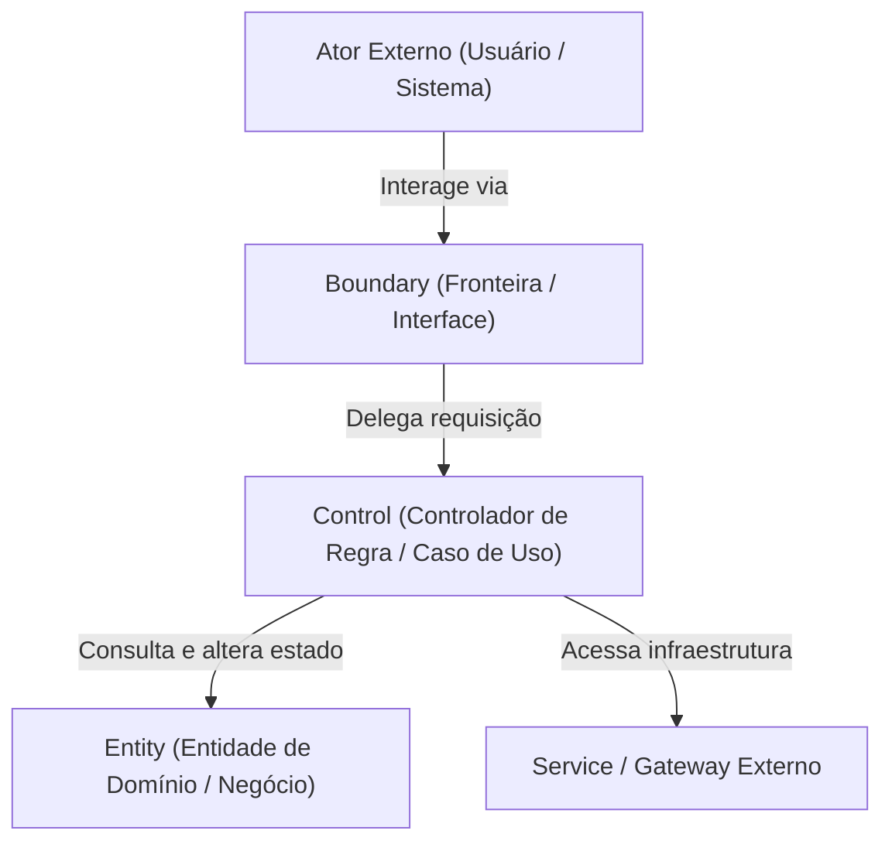

1. **Boundary (Fronteira):** Componente que interage diretamente com o ambiente externo (atores humanos ou APIs externas). Exemplos: `TelaCheckoutView`, `WebhookPagamentoController`, `TerminalPDV`.
2. **Control (Controlador):** Classe que coordena o fluxo de execução do caso de uso, orquestra a lógica de negócio, aplica validações transacionais e gerencia a invocação de múltiplos serviços. Exemplos: `ProcessarPedidoController`, `CancelamentoService`.
3. **Entity (Entidade):** Objetos de domínio persistentes que encapsulam dados fundamentais e regras de negócio intrínsecas ao negócio. Exemplos: `Pedido`, `ItemPedido`, `Cliente`, `TransacaoPagamento`.

### Diagramas de interação: Sequência versus Comunicação

A UML 2.5 padroniza dois diagramas fundamentais para modelar interações: o **Diagrama de Sequência** e o **Diagrama de Comunicação** (anteriormente denominado Diagrama de Colaboração). Embora ambos representem rigorosamente a mesma informação semântica (são modelos isomórficos), eles priorizam eixos distintos de observação:

| Critério de Comparação | Diagrama de Sequência | Diagrama de Comunicação |
| :--- | :--- | :--- |
| **Eixo Principal** | **Tempo e Ordenação Cronológica:** a leitura visual ocorre verticalmente, de cima para baixo. | **Espaço e Conectividade Estrutural:** a leitura visual foca na disposição dos objetos e nas ligações físicas entre eles. |
| **Linha de Vida (Lifeline)** | Explícita e obrigatória (traço vertical tracejado que indica a existência temporal do objeto). | Não existe linha de vida; o objeto é desenhado como um nó estático conectado por arestas. |
| **Sequenciamento de Mensagens** | Implícito pela posição vertical dos disparos de seta, podendo ser reforçado por autonumeração. | Estritamente explícito via numeração decimal padronizada (ex.: `1:`, `1.1:`, `1.1.1:`, `2:`). |
| **Criação e Destruição Dinâmica** | Facilmente identificável pelo posicionamento do retângulo do objeto ao longo da altura do diagrama e pelo marcador de término em cruz. | Representada textualmente por meio de restrições ou anotações (ex.: `{create}`, `{destroy}`). |
| **Complexidade Visual de Conexões** | Torna-se extenso e verticalizado quando muitos objetos participam da mesma transação. | Compacto espacialmente, permitindo visualizar de forma imediata o acoplamento estrutural da classe. |

### Diagramas de Máquina de Estados: Fundamentos teóricos e ciclo de vida

#### Definição formal
Na ciência da computação e na engenharia de software, o Diagrama de Máquina de Estados descreve uma Máquina de Estados Finitos (*Finite State Machine* - FSM). Matematicamente, a máquina de estados pode ser especificada como uma quíntupla:

```math
M = (S, \Sigma, \delta, s_0, F)
```

Onde:
- $`S`$ é o conjunto finito e não vazio de estados discretos;
- $`\Sigma`$ é o alfabeto de eventos de entrada (estímulos, chamadas de métodos, timeouts);
- $`\delta: S \times \Sigma \to S`$ é a função de transição de estado, formalizada por `$ `\delta(s, e) = s'` $`;
- $`s_0 \in S`$ é o estado inicial obrigatório da entidade;
- $`F \subseteq S`$ é o conjunto de estados finais (conclusão definitiva do ciclo de vida).

#### Estrutura canônica de uma transição
Uma transição representa a passagem atômica de um estado de origem para um estado de destino, governada pela seguinte sintaxe formal da OMG:

```text
evento_disparador [condição_de_guarda] / ação_de_efeito
```

- **Evento disparador:** Estímulo que aciona a avaliação da transição (ex.: `pagamentoConfirmado()`, `cancelamentoSolicitado()`).
- **Condição de guarda:** Expressão booleana entre colchetes. Se e somente se a guarda for verdadeira no instante do evento, a transição se consuma (ex.: `[valorPago >= totalPedido]`).
- **Ação de efeito:** Procedimento atômico e ininterrupto executado durante a realização da transição (ex.: `/ estornarCartaoCredito()`).

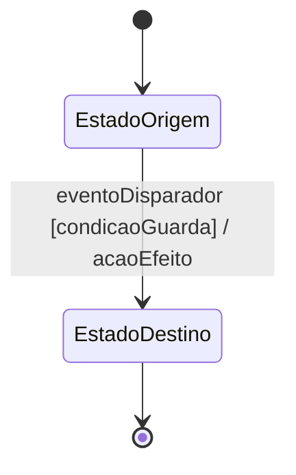

### Diagramas de Atividades: Coordenação de processos e paralelismo

O Diagrama de Atividades modela o comportamento procedural de um sistema de software, descrevendo a sequência e a coordenação de ações atômicas e subatividades, com suporte nativo a fluxos de controle condicionais e processamento assíncrono paralelo:

- **Ação (Action Node):** Passo computacional indivisível ou operação de negócio executada pelo sistema (ex.: `Validar limite de crédito`, `Gerar nota fiscal eletrônica`).
- **Nó de Decisão (Decision Node):** Losango com uma aresta de entrada e múltiplas arestas de saída, onde cada ramo possui uma guarda booleana mutuamente exclusiva.
- **Nó de Mesclagem (Merge Node):** Losango com múltiplas arestas de entrada e uma de saída, unificando fluxos alternativos sem exigir sincronização temporal.
- **Bifurcação Paralela (Fork Node):** Barra grossa horizontal ou vertical que recebe um fluxo de entrada e o divide concorrentemente em dois ou mais fluxos paralelos assíncronos.
- **Junção Sincronizada (Join Node):** Barra grossa que aguarda a chegada e conclusão de todos os fluxos concorrentes incidentes antes de liberar a execução para a próxima etapa.

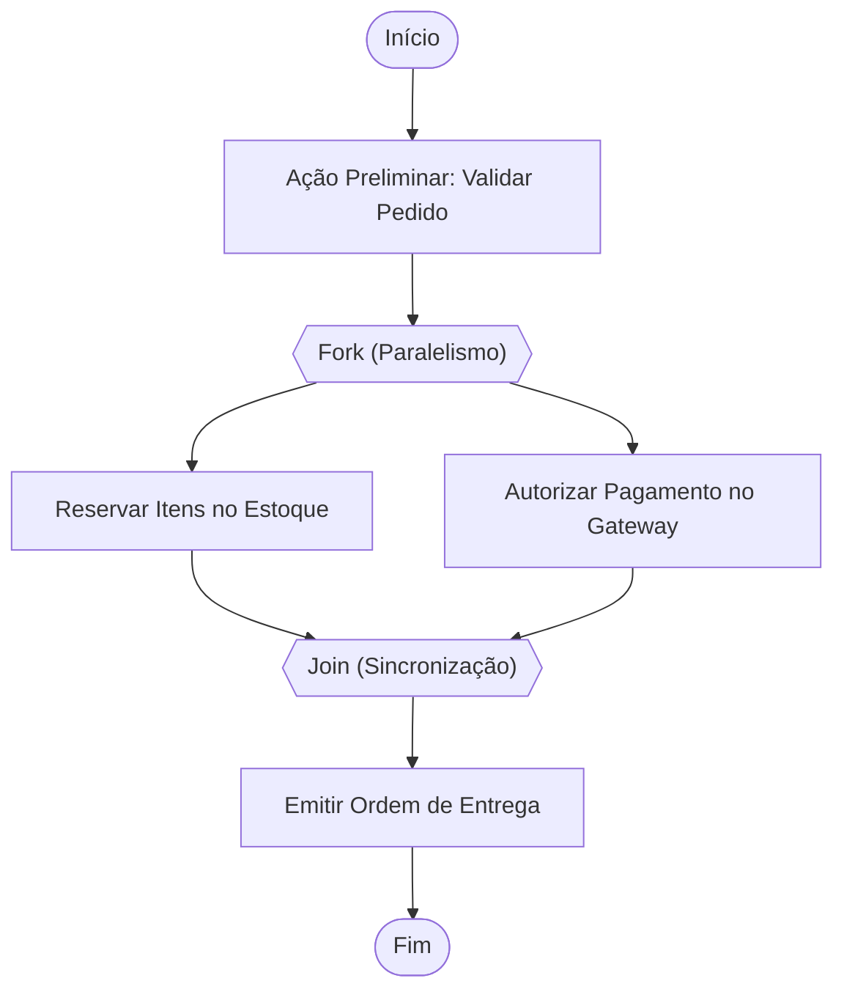

---

## Resolução proposta (Simulado Completo)

Para atender de forma integrada e exaustiva a todas as exigências da Atividade Semestral Parte 2, adotamos como estudo de caso canônico o domínio oficial trabalhado nas Aulas 06, 07, 10 e 11 da disciplina: a **Plataforma Digital Integrada de Delivery de Comida e Marketplace Gastronômico**.

### Revisão e correção da documentação da Etapa 1

A primeira etapa do trabalho semestral demandava a especificação dos requisitos funcionais, priorização MoSCoW e o Diagrama de Classes do domínio. Apresenta-se a matriz revisada e corrigida para garantir alinhamento perfeito com os modelos comportamentais da Etapa 2:

| Código | Requisito Funcional | Classificação MoSCoW | Justificativa de Engenharia e Rastreabilidade |
| :--- | :--- | :--- | :--- |
| **RF01** | Realizar Checkout de Pedido com seleção de pratos e endereço. | **Must Have** | Funcionalidade primária do modelo de negócios. Mapeado no Caso de Uso `UC01`, no Diagrama de Sequência `DS01` e Comunicação `DC01`. |
| **RF02** | Processar Pagamento Online via Gateway com transação síncrona. | **Must Have** | Requisito crítico para monetização e segurança transacional. Mapeado no `DS02`, `DC02` e na Máquina de Estados `DME02`. |
| **RF03** | Atualizar Status de Produção e Despacho da Cozinha em Tempo Real. | **Must Have** | Coordenação logística entre restaurante e cliente. Mapeado no `DS03`, `DC03` e na Máquina de Estados `DME01`. |
| **RF04** | Cancelar Pedido com Validação Temporal e Estorno Financeiro. | **Should Have** | Gestão de exceções operacionais. Mapeado no `DS04`, `DC04` e no Diagrama de Atividades `DA02`. |
| **RF05** | Emissão e Rastreamento Logístico com Notificação Push. | **Should Have** | Comunicação assíncrona entre o entregador e o consumidor. Modelado no Diagrama de Atividades `DA01`. |

#### Diagrama de Classes Estrutural do Domínio (Revisado)

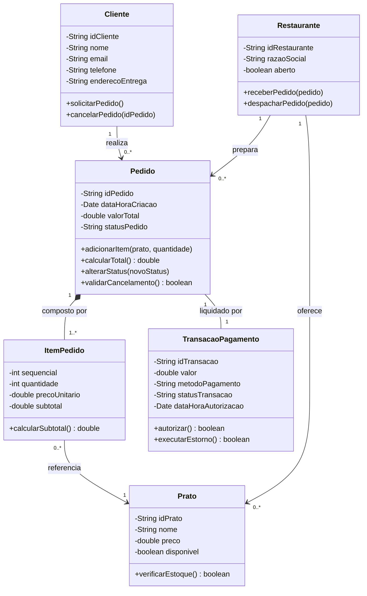

---

### Os quatro Diagramas de Sequência (DS01 a DS04)

Os diagramas a seguir seguem rigorosamente a ordenação temporal vertical e aplicam o padrão Boundary-Control-Entity (BCE).

#### Diagrama de Sequência 01: Realizar Checkout de Pedido (DS01)

Este cenário modela o fluxo no qual o cliente fecha o carrinho, o sistema valida a disponibilidade dos itens no restaurante, calcula os custos de frete e cria a instância definitiva do pedido no banco de dados.

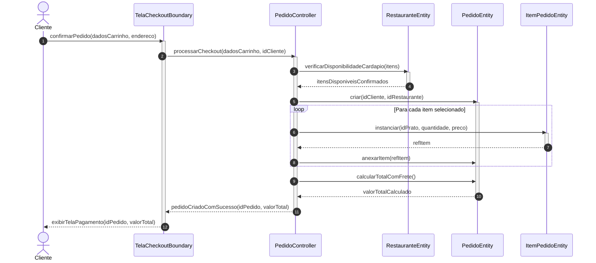

#### Diagrama de Sequência 02: Processar e Confirmar Pagamento (DS02)

Representa a interação crítica em que o cliente submete os dados de pagamento, o controlador aciona a API externa de meio de pagamento, valida o retorno e atualiza o estado financeiro e operacional do pedido.

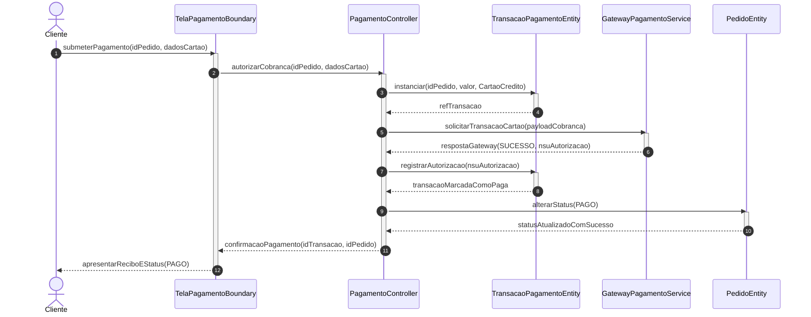

#### Diagrama de Sequência 03: Atualizar Produção e Despacho do Restaurante (DS03)

Ilustra o operador da cozinha do restaurante aceitando o pedido, avançando seu preparo e disparando a ordem de entrega para o operador logístico parceiro.

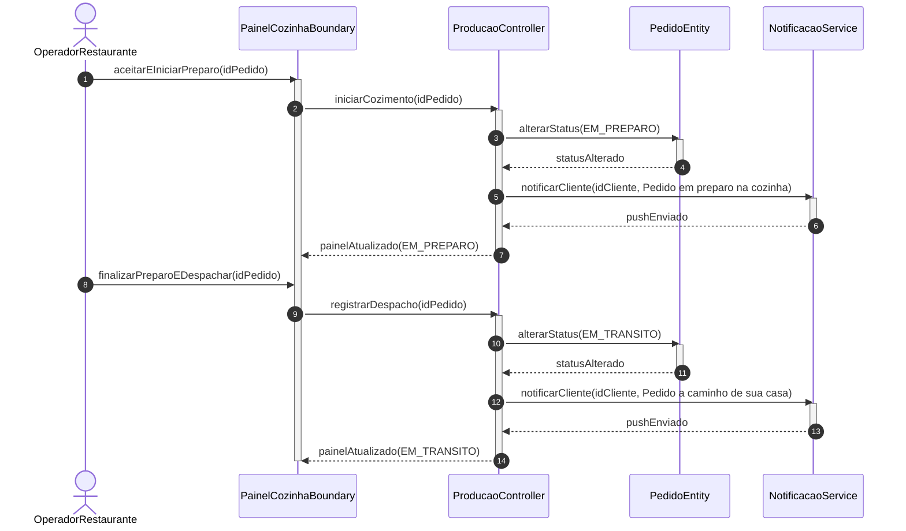

#### Diagrama de Sequência 04: Cancelar Pedido e Efetuar Reembolso (DS04)

Mapeia o fluxo de exceção onde o usuário solicita o cancelamento da compra. O sistema verifica a regra de negócio temporal da cozinha e aciona o estorno automático junto ao adquirente.

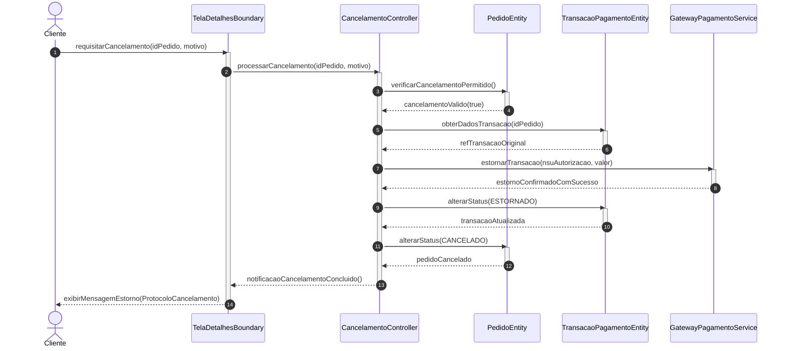

---

### Os quatro Diagramas de Comunicação (DC01 a DC04)

Os diagramas de comunicação representam a mesma colaboração entre os objetos, porém sob a ótica espacial e topológica das instâncias conectadas, utilizando numeração formal para identificar a precedência das mensagens.

#### Diagrama de Comunicação 01: Realizar Checkout de Pedido (DC01)

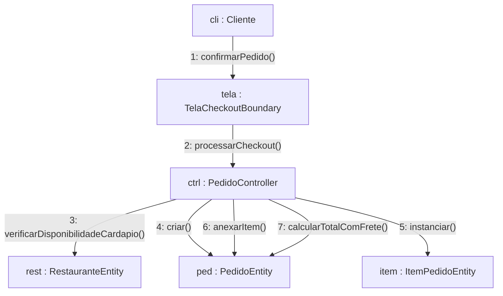

#### Diagrama de Comunicação 02: Processar e Confirmar Pagamento (DC02)

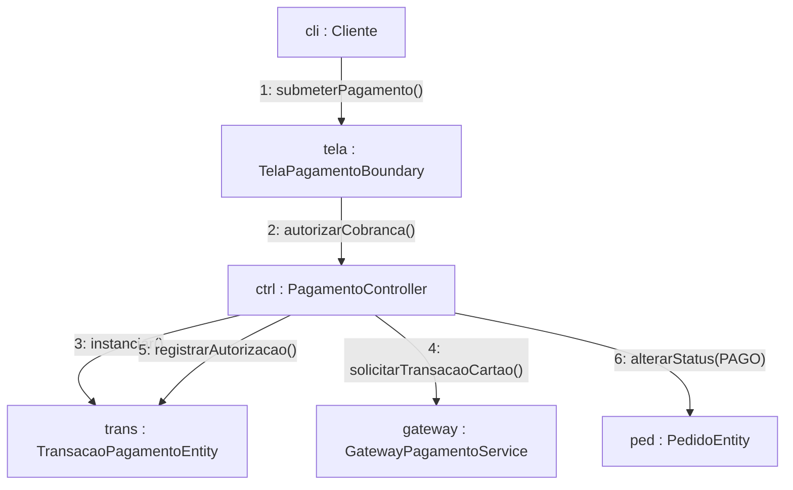

#### Diagrama de Comunicação 03: Atualizar Produção e Despacho do Restaurante (DC03)

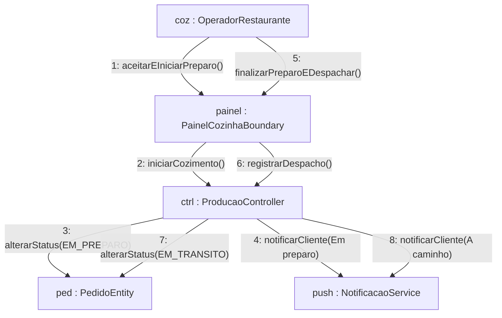

#### Diagrama de Comunicação 04: Cancelar Pedido e Efetuar Reembolso (DC04)

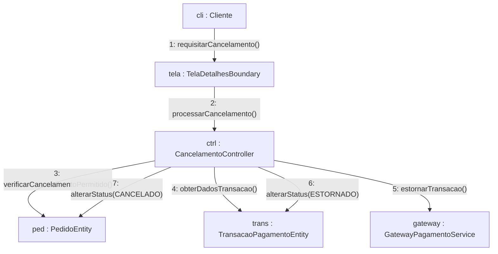

---

### Os dois Diagramas de Máquina de Estados (DME01 e DME02)

Os diagramas a seguir modelam os ciclos de vida reativos de duas entidades primordiais do domínio, incorporando eventos, guardas e ações de efeito.

#### Diagrama de Máquina de Estados 01: Ciclo de Vida da Entidade Pedido (DME01)

A classe `Pedido` possui uma vida dinâmica rigorosa, onde estados avançados proíbem retrocessos e cancelamentos dependem do progresso na cozinha.

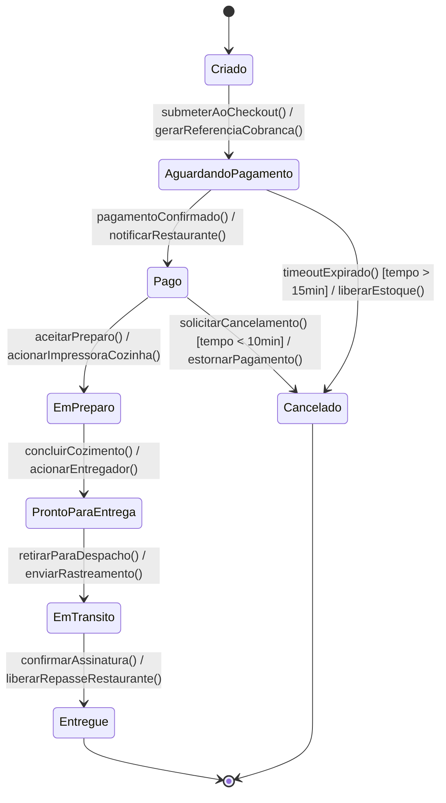

#### Diagrama de Máquina de Estados 02: Ciclo de Vida da Transação de Pagamento (DME02)

Representa a máquina de estados financeiros da entidade `TransacaoPagamento`, capturando desde o estado transitório até a liquidação contábil ou reversão.

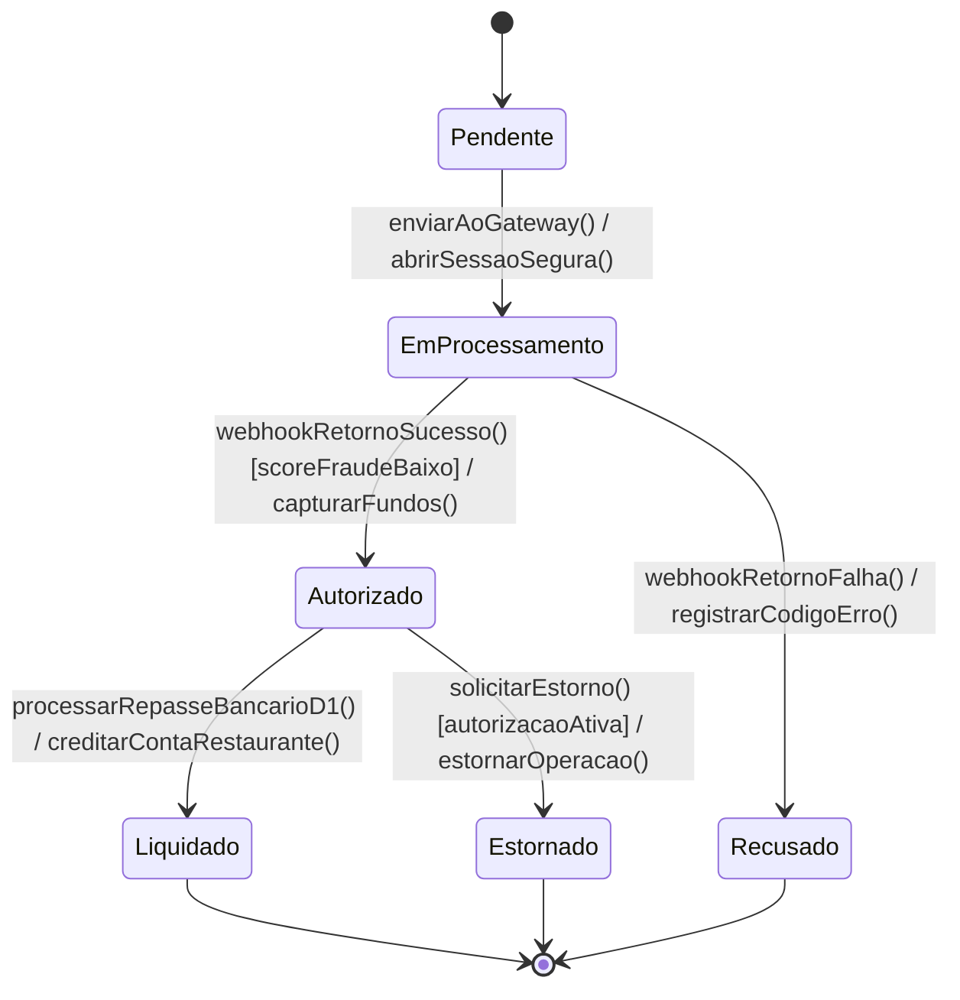

---

### Os dois Diagramas de Atividades (DA01 e DA02)

Modelam a orquestração procedural dos processos, incluindo decisões, mesclagens e sincronizações paralelas (*fork* e *join*).

#### Diagrama de Atividades 01: Processo de Checkout e Faturamento Concorrente (DA01)

Este fluxo demonstra como o software divide tarefas operacionais em paralelo (reserva de insumos no estoque e autorização no gateway de pagamento), aguardando ambas antes de confirmar o pedido.

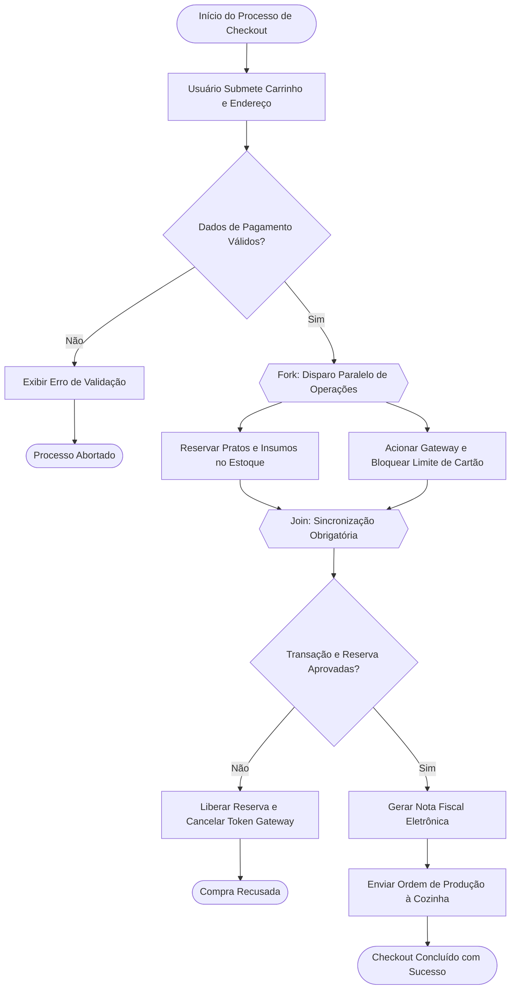

#### Diagrama de Atividades 02: Processo de Cancelamento, Logística e Reembolso (DA02)

Modelagem do fluxo de trabalho quando um cancelamento é demandado, tratando a avaliação da cozinha e o estorno seguro.

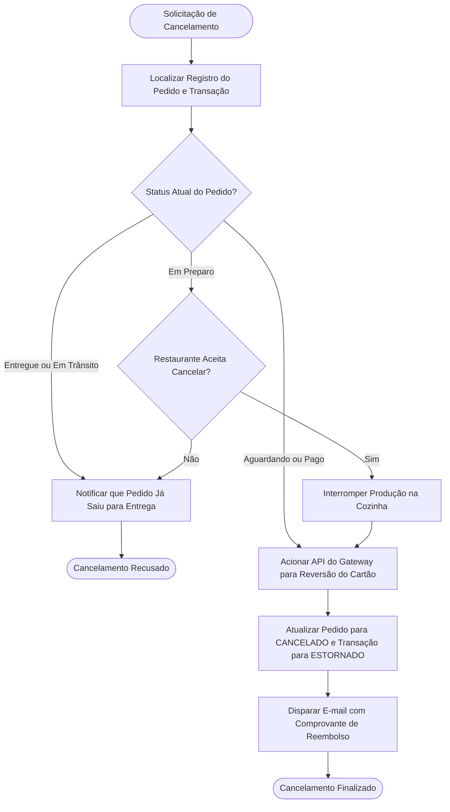

---

### Implementação orientada a objetos em Java dos modelos comportamentais

A fim de assegurar total conformidade entre a modelagem gráfica abstrata e a viabilidade técnica de implementação, foram estruturados três módulos em código-fonte Java puro (padrão Java 17+).

Os arquivos completos de código associados a este simulado são:
- [CicloVidaEstados.java](./codigo/CicloVidaEstados.java)
- [InteracoesBCE.java](./codigo/InteracoesBCE.java)
- [OrquestracaoAtividades.java](./codigo/OrquestracaoAtividades.java)

Abaixo, apresentam-se trechos comentados evidenciando a materialização dos conceitos de engenharia.

#### 1. Implementação do Padrão State para o Diagrama de Máquina de Estados

O padrão de projeto comportamental *State* (GoF) foi utilizado para eliminar estruturas procedurais frágeis baseadas em múltiplos `switch-case`, encapsulando as regras de transição em classes autônomas:

```java
// Trecho extraído de ./codigo/CicloVidaEstados.java
package br.unifef.engsoftware.estados;

public interface EstadoPedido {
    void submeterCheckout(PedidoContext contexto);
    void confirmarPagamento(PedidoContext contexto);
    void iniciarPreparo(PedidoContext contexto);
    void despachar(PedidoContext contexto);
    void confirmarEntrega(PedidoContext contexto);
    void cancelar(PedidoContext contexto, String motivo);
    String getNomeEstado();
}

public class EstadoAguardandoPagamento implements EstadoPedido {
    @Override
    public void submeterCheckout(PedidoContext contexto) {
        throw new IllegalStateException("O pedido já foi submetido ao checkout.");
    }

    @Override
    public void confirmarPagamento(PedidoContext contexto) {
        System.out.println("Efeito: Pagamento recebido. Notificando restaurante...");
        contexto.setEstado(new EstadoPago());
    }

    @Override
    public void cancelar(PedidoContext contexto, String motivo) {
        System.out.println("Efeito: Cancelamento autorizado antes do faturamento. Motivo: " + motivo);
        contexto.setEstado(new EstadoCancelado());
    }
    
    // Demais métodos lançam IllegalStateException garantindo a máquina de estados
    @Override
    public void iniciarPreparo(PedidoContext contexto) {
        throw new IllegalStateException("Impossível iniciar preparo de pedido não pago.");
    }
    @Override public void despachar(PedidoContext c) { throw new IllegalStateException("Não despachável."); }
    @Override public void confirmarEntrega(PedidoContext c) { throw new IllegalStateException("Não entregue."); }
    @Override public String getNomeEstado() { return "AGUARDANDO_PAGAMENTO"; }
}
```

#### 2. Implementação da Arquitetura Boundary-Control-Entity (BCE)

Materialização dos participantes modelados nos Diagramas de Sequência e Comunicação:

```java
// Trecho extraído de ./codigo/InteracoesBCE.java
package br.unifef.engsoftware.bce;

// --- ENTIDADES (Entity) ---
public class PedidoEntity {
    private final String idPedido;
    private double valorTotal;
    private String status;

    public PedidoEntity(String idPedido) {
        this.idPedido = idPedido;
        this.status = "CRIADO";
    }

    public void adicionarValor(double valor) { this.valorTotal += valor; }
    public void setStatus(String novoStatus) { this.status = novoStatus; }
    public String getStatus() { return status; }
    public double getValorTotal() { return valorTotal; }
    public String getIdPedido() { return idPedido; }
}

// --- CONTROLADOR DE CASO DE USO (Control) ---
public class PedidoController {
    private final GatewayPagamentoService gateway = new GatewayPagamentoService();

    public boolean processarCheckout(String idPedido, double valor, String dadosCartao) {
        PedidoEntity pedido = new PedidoEntity(idPedido);
        pedido.adicionarValor(valor);
        
        System.out.println("[Control] Orquestrando transação junto ao Gateway...");
        boolean aprovado = gateway.autorizarCobranca(dadosCartao, valor);
        
        if (aprovado) {
            pedido.setStatus("PAGO");
            System.out.println("[Control] Transação aprovada. Pedido " + idPedido + " movido para PAGO.");
            return true;
        } else {
            pedido.setStatus("CANCELADO");
            System.out.println("[Control] Cobrança recusada. Pedido abortado.");
            return false;
        }
    }
}

// --- FRONTEIRA COM O USUÁRIO (Boundary) ---
public class TelaCheckoutBoundary {
    private final PedidoController controller = new PedidoController();

    public void botaoFinalizarClicado(String idPedido, double total, String cartao) {
        System.out.println("[Boundary] Evento de clique capturado na interface visual.");
        boolean resultado = controller.processarCheckout(idPedido, total, cartao);
        if (resultado) {
            System.out.println("[Boundary] Renderizando tela de confirmação e recibo.");
        } else {
            System.out.println("[Boundary] Renderizando alerta de recusa bancária.");
        }
    }
}
```

---

## Como testar e validar

### Matriz de rastreabilidade entre modelos da UML

Para garantir a coerência absoluta do projeto, cada componente visual deve possuir lastro direto com os demais artefatos da engenharia de software:

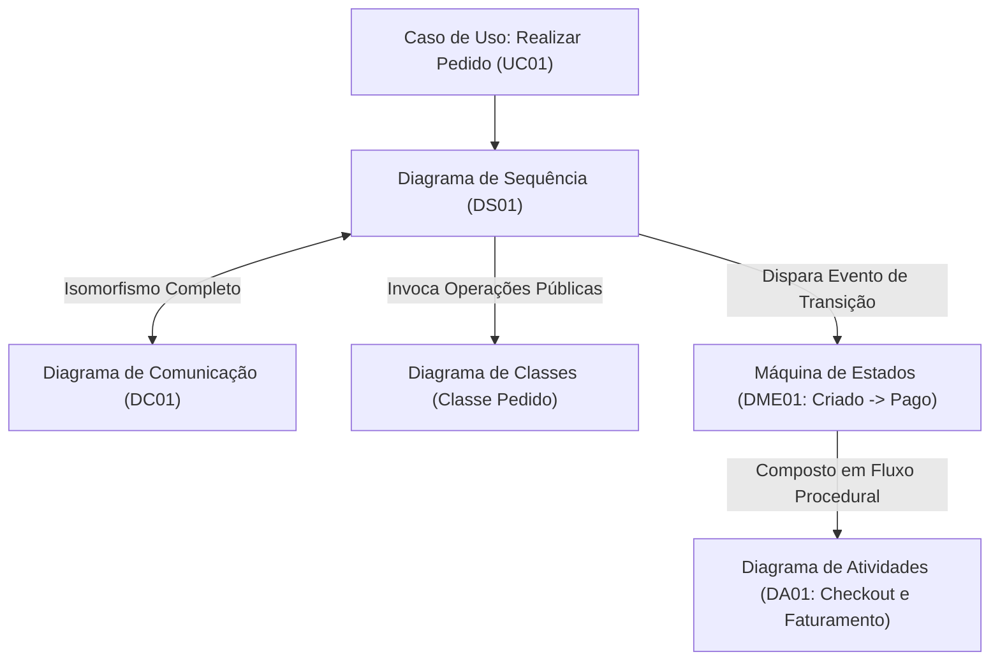

### Verificação de conformidade sintática OMG UML 2.5

1. **Validação de Linhas de Vida em Sequência:** Confirmar se todos os objetos de destino de uma mensagem possuem foco de ativação (retângulos verticais) e se as mensagens assíncronas e de retorno utilizam a ponta de seta correta (seta preenchida para síncrono e pontilhada aberta para retorno).
2. **Validação Numérica em Comunicação:** Verificar se a hierarquia decimal de mensagens reflete com exatidão a profundidade das invocações (ex.: a mensagem `1` na tela dispara a subchamada `1.1` e `1.2` no controlador).
3. **Validação das Máquinas de Estados:** Checar se todos os estados não terminais possuem ao menos uma transição de saída e se não há estados com condições de guarda idênticas para o mesmo evento (prevenção de não-determinismo).
4. **Validação de Conservação de Fluxo em Atividades:** Assegurar que para cada barra de *fork*, haja uma barra de *join* correspondente com a mesma quantidade de caminhos paralelos concorrentes.

### Validação executável via testes unitários em Java

A integridade das máquinas de estado e das regras de negócio transacionais pode ser testada por meio de suítes de testes automatizados com JUnit:

```java
// Exemplo de teste unitário conceitual para validação de máquina de estados
package br.unifef.engsoftware.testes;

import br.unifef.engsoftware.estados.*;
import org.junit.jupiter.api.Test;
import org.junit.jupiter.api.DisplayName;
import static org.junit.jupiter.api.Assertions.*;

public class CicloVidaPedidoTest {

    @Test
    @DisplayName("Deve permitir avanço de Aguardando Pagamento para Pago com sucesso")
    public void testAvancoValidoParaPago() {
        PedidoContext pedido = new PedidoContext("PED-101");
        assertEquals("AGUARDANDO_PAGAMENTO", pedido.getNomeEstadoAtual());
        
        pedido.confirmarPagamento();
        assertEquals("PAGO", pedido.getNomeEstadoAtual());
    }

    @Test
    @DisplayName("Deve lançar exceção ao tentar despachar pedido que ainda não foi pago")
    public void testViolacaoTransicaoEstadoInvalida() {
        PedidoContext pedido = new PedidoContext("PED-102");
        
        IllegalStateException excecao = assertThrows(IllegalStateException.class, () -> {
            pedido.despachar();
        });
        
        assertTrue(excecao.getMessage().contains("Não despachável"));
    }
}
```

---

## Critérios de qualidade

Para obter a pontuação máxima (100 pontos) na avaliação da Atividade Semestral Parte 2, a documentação entregue deve cumprir a seguinte rubrica de excelência:

| Dimensão da Avaliação | Peso | Descrição do Critério de Rigor Técnico |
| :--- | :--- | :--- |
| **Correção Documental da Etapa 1** | 20% | Sanar integralmente inconsistências apontadas na primeira entrega, alinhando a especificação textual de requisitos à modelagem estrutural de classes. |
| **Diagramas de Sequência (4x)** | 25% | Aplicação estrita da arquitetura BCE, ordenação temporal impecável, clareza nas linhas de vida e representação de exceções e loops operacionais. |
| **Diagramas de Comunicação (4x)** | 20% | Isomorfismo com os diagramas de sequência, topologia estrutural limpa e numeração decimal correta de precedência de mensagens. |
| **Diagramas de Estados (2x)** | 15% | Formalização completa de FSM com `$ `M = (S, \Sigma, \delta, s_0, F)` $`, sintaxe canônica `$ `\text{evento}[\text{guarda}]/\text{ação}` $` e ausência de nós órfãos ou becos sem saída lógicos. |
| **Diagramas de Atividades (2x)** | 10% | Modelagem de fluxos procedurais com decisões balanceadas, raias (*swimlanes*) ou clara separação de responsabilidades e uso correto de *fork/join*. |
| **Rastreabilidade e Formatação** | 10% | Uniformidade nominal de métodos e atributos em todos os diagramas, conformidade com a UML 2.5 e redação técnica formal em língua portuguesa. |

---

## Arquivos de apoio

- **OMG Unified Modeling Language (OMG UML) Specification v2.5.1:** Documento normativo oficial disponível em `https://www.omg.org/spec/UML/2.5.1/`.
- **Visual Paradigm Online (Modelagem Web Colaborativa):** Ambiente homologado para confecção dos diagramas vetoriais (`https://online.visual-paradigm.com/`).
- **Repositório da Disciplina (GitHub Institucional):** Modelos e códigos-fonte de apoio fornecidos nas aulas teóricas.
- **Material de Apoio Interno da Disciplina:**
  - [Aula 07 - Fundamentos da UML e Diagrama de Classes](../../Aulas/Aula%2007%20-%20Fundamentos%20da%20UML%20e%20Diagrama%20de%20Classes/detalhes.md)
  - [Aula 10 - Modelagem de Interação Estados e Atividades](../../Aulas/Aula%2010%20-%20Modelagem%20de%20Intera%C3%A7%C3%A3o%20Estados%20e%20Atividades/detalhes.md)
  - [Aula 11 - Diagramas de Estado e de Atividade](../../Aulas/Aula%2011%20-%20Diagramas%20de%20Estado%20e%20de%20Atividade/detalhes.md)

---

## Mapa da atividade

O fluxograma abaixo resume a rota de execução técnica exigida para a conclusão integral da segunda etapa do projeto integrador:

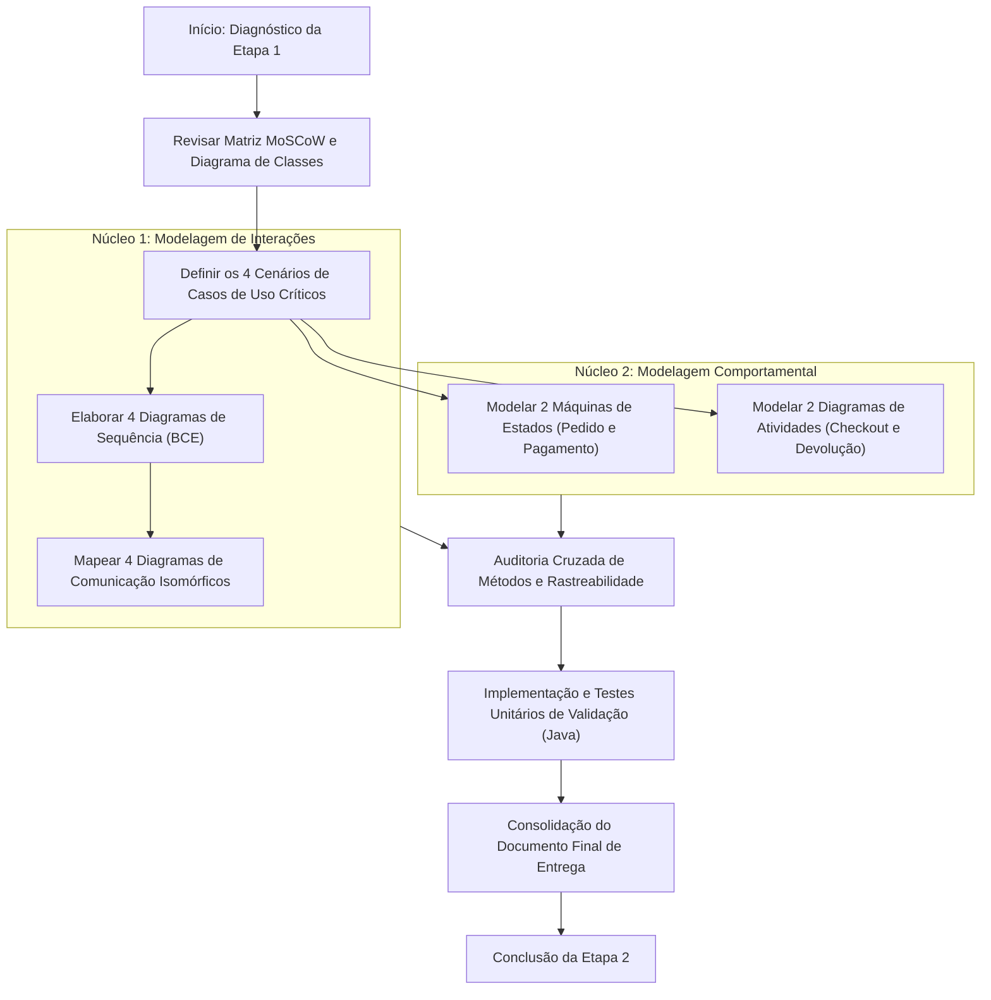

---

## Glossário

| Termo Técnico | Definição na Engenharia de Software |
| :--- | :--- |
| **Boundary (Fronteira)** | Classe de estereótipo do padrão BCE responsável por intermediar a comunicação entre atores externos (humanos ou serviços) e os componentes internos do sistema. |
| **Control (Controlador)** | Classe responsável por gerenciar a lógica transacional e a coordenação de um caso de uso específico, desacoplando a interface visual das entidades persistentes. |
| **Entity (Entidade)** | Objeto do domínio que encapsula regras de negócio perenes e mantém o estado persistente do sistema (mapeado frequentemente para tabelas de banco de dados). |
| **Linha de Vida (Lifeline)** | Elemento vertical tracejado do Diagrama de Sequência que representa a existência de uma instância de classe ao longo da passagem do tempo. |
| **Foco de Ativação** | Retângulo colocado sobre a linha de vida no Diagrama de Sequência para indicar o período de tempo durante o qual o objeto está executando uma operação ativa. |
| **Isomorfismo UML** | Equivalência semântica e comportamental entre modelos distintos; o Diagrama de Sequência e o de Comunicação contêm a mesma informação expressa sob perspectivas visuais diferentes. |
| **Máquina de Estados Finitos** | Modelo matemático de computação composto por um número fixo de estados, transições acionadas por eventos, guardas condicionais e ações de efeito associadas. |
| **Condição de Guarda** | Expressão booleana avaliada em tempo de execução que precisa ser verdadeira para que uma transição de estado ou desvio de atividade seja efetivado. |
| **Fork (Bifurcação)** | Elemento de diagrama de atividades que divide um fluxo de controle sequencial em dois ou mais fluxos paralelos assíncronos concorrentes. |
| **Join (Junção)** | Elemento de diagrama de atividades que sincroniza e aguarda a conclusão de todos os fluxos concorrentes antes de permitir o avanço para a etapa subsequente. |
| **Padrão State (GoF)** | Padrão de projeto orientado a objetos que permite a um objeto alterar seu comportamento quando seu estado interno se modifica, encapsulando cada estado em uma classe distinta. |
| **Rastreabilidade** | Capacidade de associar e acompanhar um requisito de software desde a sua elicitação inicial até a sua realização em diagramas de análise, projeto e código executável. |

---

## Pontos-chave para a prova

1. **Diferença Primordial entre Sequência e Comunicação:** O Diagrama de Sequência enfatiza explicitamente a passagem cronológica do tempo de cima para baixo; o Diagrama de Comunicação enfatiza a arquitetura e a topologia de conexões estruturais entre os objetos colaborativos, valendo-se de numeração decimal para definir precedência.
2. **Arquitetura Boundary-Control-Entity:** Jamais desenhe conexões diretas entre um Ator humano e uma Entidade persistente do domínio. A interação deve fluir obrigatoriamente através da camada de fronteira (*Boundary*) e ser orquestrada por um controlador de aplicação (*Control*).
3. **Sintaxe de Transições na Máquina de Estados:** A assinatura completa da transição é `$ `\text{evento}[\text{guarda}]/\text{ação}` $`. O evento dispara o teste; se a guarda for verdadeira, a ação é executada atomicamente e o novo estado é assumido.
4. **Diferença entre Diagrama de Estados e Diagrama de Atividades:** O Diagrama de Estados é **centrado no objeto** (acompanha a vida e as restrições reativas de uma única entidade como `Pedido`); o Diagrama de Atividades é **centrado no processo** (orquestra as ações e tarefas procedurais de um fluxo de negócio completo envolvendo múltiplos atores e sistemas).
5. **Diferença entre Agregação e Composição:** Na composição (losango preenchido), há forte dependência de ciclo de vida e a parte não sobrevive sem o todo (ex.: `Pedido` e `ItemPedido`). Na agregação (losango vazio), o vínculo é fraco e a parte tem ciclo de vida independente do todo.
6. **Sincronização Paralela com Fork e Join:** A barra de *fork* divide o fluxo em tarefas concorrentes; a barra de *join* funciona como um ponto de encontro e bloqueio que só libera o fluxo quando todas as tarefas concorrentes chegarem até ela.

---

## Perguntas e respostas (JSONL)

```jsonl
{"pergunta": "Qual a principal diferença de ênfase visual entre o Diagrama de Sequência e o Diagrama de Comunicação na UML?", "resposta": "O Diagrama de Sequência enfatiza a ordenação temporal e cronológica das mensagens ao longo de linhas de vida verticais, enquanto o Diagrama de Comunicação enfatiza a disposição espacial dos objetos e os vínculos estruturais entre eles, recorrendo à numeração sequencial explícita.", "dificuldade": "Fácil"}
{"pergunta": "O que caracteriza uma transição válida em um Diagrama de Máquina de Estados segundo a norma OMG UML?", "resposta": "Uma transição é descrita pela sintaxe evento[guarda]/ação, onde o evento atua como gatilho disparador, a guarda é uma condição booleana que deve ser estritamente verdadeira para autorizar o salto e a ação é o procedimento atômico executado durante a mudança.", "dificuldade": "Média"}
{"pergunta": "Por que a arquitetura Boundary-Control-Entity (BCE) condena a invocação direta de uma Entity por um Actor?", "resposta": "Porque conectar o ator diretamente à entidade viola o encapsulamento, mistura responsabilidades de interface visual com persistência de dados e impede a reutilização e o controle transacional centralizado das regras de negócio.", "dificuldade": "Média"}
{"pergunta": "Como o padrão de projeto comportamental State (GoF) resolve o gerenciamento de estados sem estruturas condicionais aninhadas?", "resposta": "O padrão State encapsula cada estado discreto do objeto em uma classe especializada que implementa uma interface comum, delegando a responsabilidade pelas transições e comportamentos permitidos para a classe que representa o estado ativo no momento.", "dificuldade": "Difícil"}
{"pergunta": "Qual a finalidade de um nó de junção (Join Node) em um Diagrama de Atividades?", "resposta": "O nó de junção atua como uma barreira de sincronização que aguarda a chegada e conclusão de todos os fluxos de controle paralelos originados por um nó de bifurcação (Fork) antes de emitir um único token para prosseguir com a execução.", "dificuldade": "Fácil"}
{"pergunta": "Um Diagrama de Estados pode ser utilizado para mapear a navegação de páginas web de um sistema?", "resposta": "Não. Tratar telas de apresentação como estados de uma entidade é um antipadrão conceitual clássico; o fluxo de telas de uma aplicação reflete um processo procedural de negócio, devendo ser modelado preferencialmente através de Diagramas de Atividades.", "dificuldade": "Média"}
{"pergunta": "O que significa o isomorfismo entre os diagramas de interação da UML?", "resposta": "Significa que o Diagrama de Sequência e o Diagrama de Comunicação possuem a mesma capacidade expressiva e equivalência semântica rigorosa, sendo possível transformar automaticamente um modelo no outro sem qualquer perda de dados comportamentais.", "dificuldade": "Difícil"}
{"pergunta": "Qual a representação gráfica de uma ação assíncrona versus síncrona no Diagrama de Sequência?", "resposta": "Mensagens síncronas que bloqueiam o chamador até a resposta são representadas por setas com ponta preenchida sólida, enquanto mensagens assíncronas que não exigem espera imediata utilizam setas com ponta aberta.", "dificuldade": "Média"}
{"pergunta": "O que ocorre se uma condição de guarda em uma máquina de estados for avaliada como falsa no momento do evento?", "resposta": "A transição não é executada, o evento disparador é simplesmente descartado ou ignorado e a entidade permanece residindo estritamente em seu estado atual sem executar a ação de efeito.", "dificuldade": "Fácil"}
{"pergunta": "Qual é a relação de dependência de ciclo de vida expressa pelo relacionamento de Composição no Diagrama de Classes?", "resposta": "Na composição (representada pelo losango preenchido), a existência da parte é totalmente subordinada à existência do todo; caso o objeto agregador seja destruído, todas as suas partes constituintes são compulsoriamente eliminadas da memória.", "dificuldade": "Fácil"}
{"pergunta": "Qual o papel do método MoSCoW na etapa de correção de documentação de Engenharia de Software?", "resposta": "O método MoSCoW atua como filtro de priorização analítica de requisitos, garantindo que o escopo crítico do MVP (Must Have) esteja plenamente mapeado e implementado nos diagramas comportamentais dinâmicos antes de recursos secundários.", "dificuldade": "Fácil"}
{"pergunta": "Em qual situação o uso de nós de mesclagem (Merge Node) é indicado em um Diagrama de Atividades?", "resposta": "O nó de mesclagem é utilizado para unificar múltiplos fluxos alternativos vindos de nós de decisão em um único caminho comum, sem exigir qualquer sincronização concorrente ou espera de múltiplos ramos.", "dificuldade": "Fácil"}
{"pergunta": "Qual a função do foco de ativação (activation bar) na linha de vida de um objeto em sequência?", "resposta": "Indicar o período exato de tempo em que a instância correspondente está ativamente executando uma operação interna ou aguardando o retorno de uma sub-rotina síncrona delegada a outro objeto.", "dificuldade": "Média"}
{"pergunta": "Por que todo método invocado em um diagrama de sequência deve existir no Diagrama de Classes?", "resposta": "Para assegurar a rastreabilidade e a consistência estático-dinâmica; um diagrama de sequência modela a colaboração entre instâncias de classes, logo qualquer método chamado em tempo de execução precisa pertencer à interface pública da classe receptora.", "dificuldade": "Difícil"}
{"pergunta": "O que são raias de natação (swimlanes) em um Diagrama de Atividades?", "resposta": "São partições visuais verticais ou horizontais que agrupam as ações de um processo conforme a responsabilidade organizacional, papel do ator ou componente de software encarregado de executá-las.", "dificuldade": "Fácil"}
{"pergunta": "Qual o risco arquitetural de criar controladores com responsabilidade excessiva (God Controller) no padrão BCE?", "resposta": "Gera alto acoplamento, baixa coesão, dificulta testes unitários isolados e viola o Princípio da Responsabilidade Única (SRP), transformando a lógica de negócio em um monolito procedural difícil de manter.", "dificuldade": "Difícil"}
{"pergunta": "Como representar a criação dinâmica de um objeto no Diagrama de Sequência?", "resposta": "Enviando uma mensagem de criação (frequentemente rotulada como «create» ou método construtor) diretamente contra o cabeçalho retangular do objeto receptor, posicionando sua linha de vida vertical a partir daquele ponto exato no tempo.", "dificuldade": "Média"}
{"pergunta": "O que estabelece a quíntupla matemática formal de uma máquina de estados finitos?", "resposta": "M = (S, Sigma, delta, s0, F), representando respectivamente o conjunto de estados possíveis, o alfabeto de eventos de entrada, a função de transição, o estado inicial único e o conjunto de estados finais de aceitação.", "dificuldade": "Difícil"}
{"pergunta": "Em que cenário um pedido no e-commerce deve entrar em um estado final de Cancelado em vez de prosseguir para Entrega?", "resposta": "Quando ocorrerem eventos críticos irreversíveis, tais como recusa definitiva da operadora de pagamento, ausência prolongada de confirmação bancária (timeout) ou solicitação tempestiva do cliente aceita pelo restaurante.", "dificuldade": "Fácil"}
{"pergunta": "Como validar que uma máquina de estados modelada não possui estados órfãos (deadlocks)?", "resposta": "Realizando a análise de alcançabilidade no grafo de estados, verificando se a partir do estado inicial existe ao menos um caminho direcionado de transições que conduza a cada estado intermediário e destes até um estado final.", "dificuldade": "Difícil"}
```

---

## Checklist de revisão

- [ ] **Alinhamento da Etapa 1:** Todos os requisitos da matriz MoSCoW e especificações de casos de uso foram devidamente revisados e refletem as classes do domínio.
- [ ] **Rastreabilidade dos Métodos:** Cada mensagem enviada nos Diagramas de Sequência e de Comunicação corresponde a uma operação pública formalmente declarada no Diagrama de Classes.
- [ ] **Arquitetura BCE Aplicada:** Os 4 Diagramas de Sequência empregam classes de fronteira (*Boundary*), controladores (*Control*) e modelos de dados (*Entity*), sem conexões diretas ilegais entre atores e entidades.
- [ ] **Quatro Diagramas de Sequência Concluídos:** DS01 (Checkout de Pedido), DS02 (Processamento de Pagamento), DS03 (Atualização de Cozinha) e DS04 (Cancelamento com Reembolso) estão completamente modelados.
- [ ] **Quatro Diagramas de Comunicação Concluídos:** DC01, DC02, DC03 e DC04 estão modelados com representação isomórfica e numeração decimal correta de mensagens.
- [ ] **Dois Diagramas de Máquina de Estados Validados:** DME01 (Ciclo de Vida do Pedido) e DME02 (Ciclo de Vida da Transação de Pagamento) possuem estados iniciais, finais, eventos e guardas bem definidas.
- [ ] **Dois Diagramas de Atividades Modelados:** DA01 (Checkout Concorrente com Fork/Join) e DA02 (Cancelamento e Logística Reversa) possuem nós de decisão com guardas balanceadas e caminhos de terminação.
- [ ] **Código Java Consistente:** As classes implementadas nos arquivos de apoio em Java refletem os padrões arquiteturais State e BCE desenhados nos diagramas.
- [ ] **Padronização Visual e Tipográfica:** Ausência de erros sintáticos de Mermaid, diagramas limpos sem tags HTML cruas e conformidade com o padrão internacional OMG UML 2.5.
