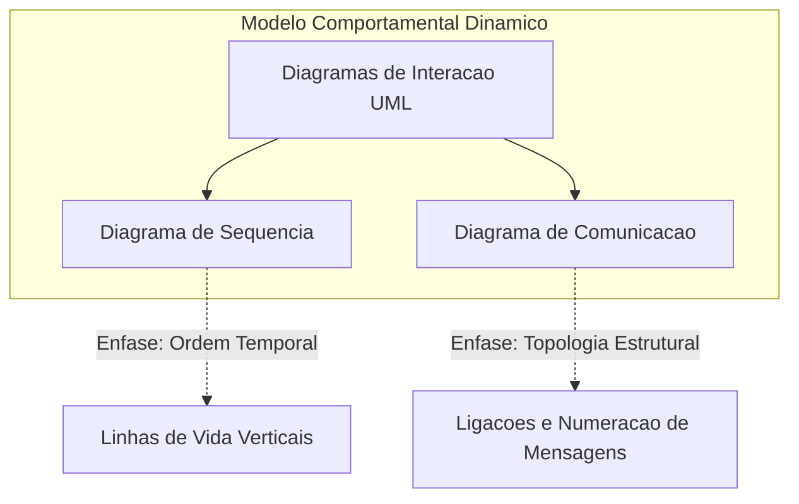
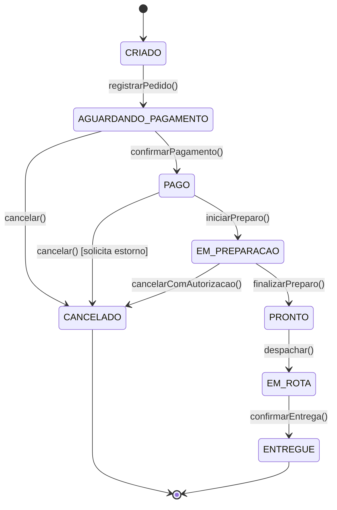
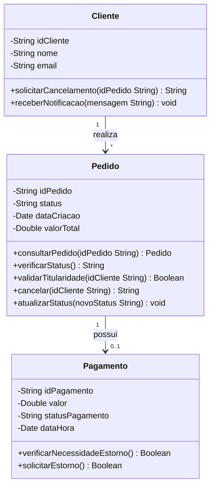
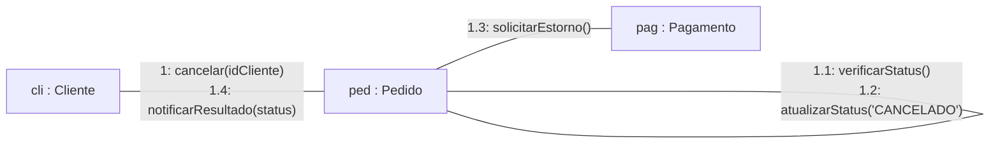
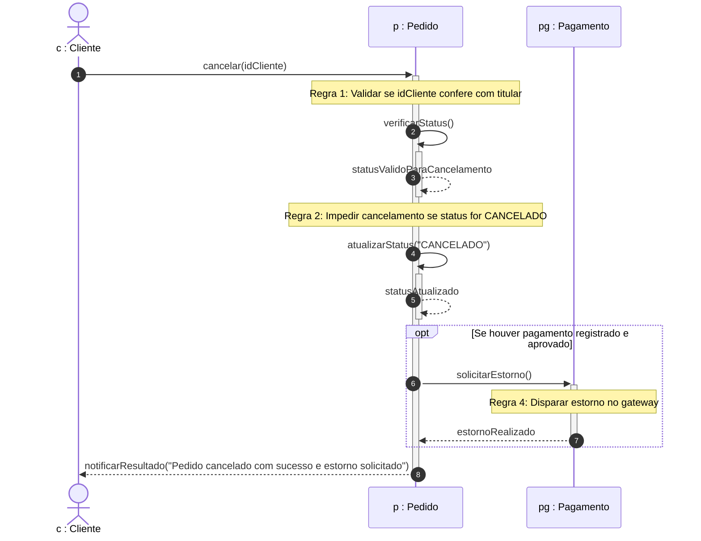
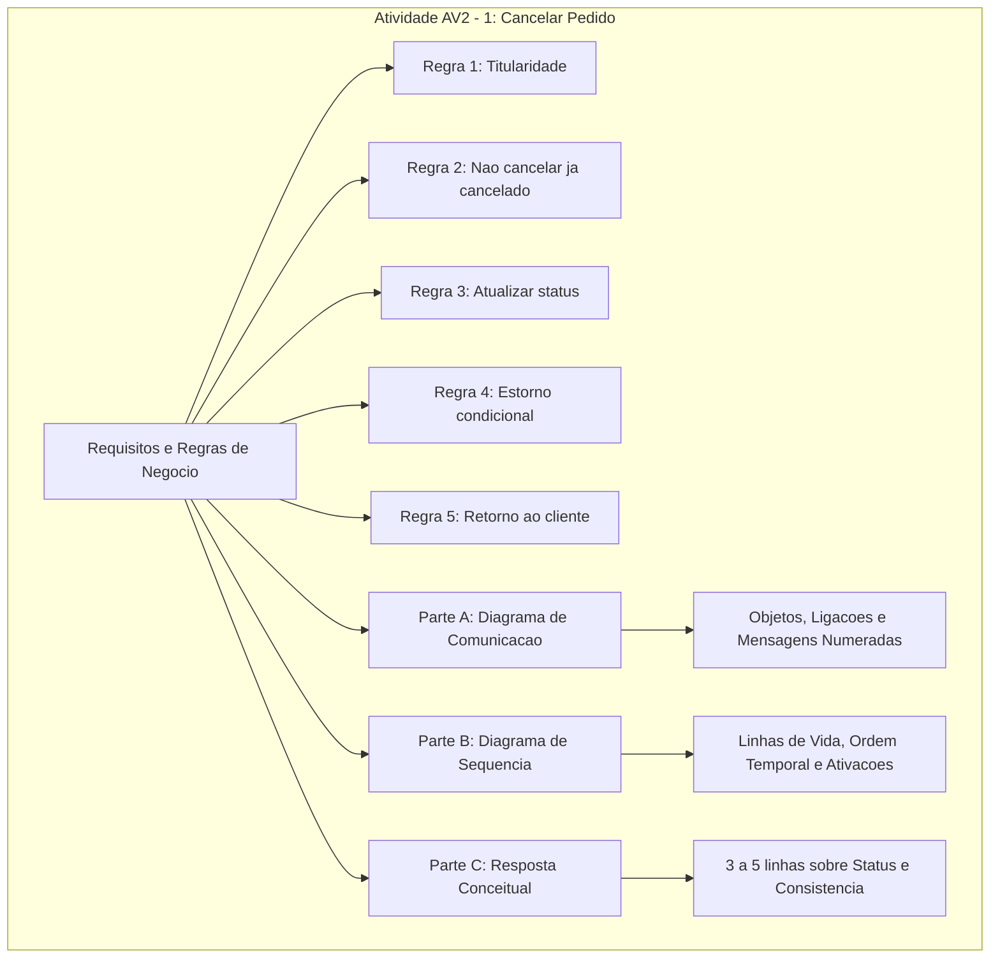

# Trabalho — Diagrama de comunicação e sequencia

> **Professor:** Wesley Soares
> **Disciplina:** Engenharia de Software II (4º Semestre)
> **Prazo de Entrega:** 30/10/2026 às 22:00
> **Pontuação Máxima:** 100 pontos
> **Conteúdo cobrado:** [Aula 01 - Introdução ao Ciclo de Vida do Projeto de Software](../../Aulas/Aula%2001%20-%20Introdu%C3%A7%C3%A3o%20ao%20Ciclo%20de%20Vida%20do%20Projeto%20de%20Software/detalhes.md), [Aula 02 - Fundamentos de Projeto Orientado a Objetos](../../Aulas/Aula%2002%20-%20Fundamentos%20de%20Projeto%20Orientado%20a%20Objetos/detalhes.md), [Aula 03 - Técnicas de Elicitação e Levantamento de Requisitos](../../Aulas/Aula%2003%20-%20T%C3%A9cnicas%20de%20Elicita%C3%A7%C3%A3o%20e%20Levantamento%20de%20Requisitos/detalhes.md), [Aula 04 - Modelagem de Casos de Uso UML](../../Aulas/Aula%2004%20-%20Modelagem%20de%20Casos%20de%20Uso%20UML/detalhes.md), [Aula 06 - Modelagem de Requisitos e Casos de Uso](../../Aulas/Aula%2006%20-%20Modelagem%20de%20Requisitos%20e%20Casos%20de%20Uso/detalhes.md), [Aula 07 - Fundamentos da UML e Diagrama de Classes](../../Aulas/Aula%2007%20-%20Fundamentos%20da%20UML%20e%20Diagrama%20de%20Classes/detalhes.md), [Aula 08 - Arquitetura Model-View-Controller no Smalltalk-80](../../Aulas/Aula%2008%20-%20Arquitetura%20Model-View-Controller%20no%20Smalltalk-80/detalhes.md) e [Aula 09 - Arquitetura de Software e Padrões Arquiteturais](../../Aulas/Aula%2009%20-%20Arquitetura%20de%20Software%20e%20Padr%C3%B5es%20Arquiteturais/detalhes.md).

## Sumário

- [Enunciado original (Google Classroom)](#enunciado-original-google-classroom)
- [Análise do que é pedido](#análise-do-que-é-pedido)
- [Fundamentação teórica](#fundamentação-teórica)
  - [Visão geral dos diagramas de interação da UML](#visão-geral-dos-diagramas-de-interação-da-uml)
  - [Diagrama de Sequência vs Diagrama de Comunicação](#diagrama-de-sequência-vs-diagrama-de-comunicação)
  - [Máquinas de estados e ciclo de vida de entidades transacionais](#máquinas-de-estados-e-ciclo-de-vida-de-entidades-transacionais)
  - [Consistência financeira e estornos no domínio de e-commerce](#consistência-financeira-e-estornos-no-domínio-de-e-commerce)
- [Resolução proposta](#resolução-proposta)
  - [Modelagem estrutural de suporte](#modelagem-estrutural-de-suporte)
  - [Parte A — Diagrama de Comunicação](#parte-a--diagrama-de-comunicação)
  - [Parte B — Diagrama de Sequência](#parte-b--diagrama-de-sequência)
  - [Parte C — Resposta sobre verificação de status](#parte-c--resposta-sobre-verificação-de-status)
  - [Implementação de referência em código](#implementação-de-referência-em-código)
- [Como testar e validar](#como-testar-e-validar)
- [Critérios de qualidade](#critérios-de-qualidade)
- [Arquivos de apoio](#arquivos-de-apoio)
- [Mapa da atividade](#mapa-da-atividade)
- [Glossário](#glossário)
- [Pontos-chave para a prova](#pontos-chave-para-a-prova)
- [Perguntas e respostas (JSONL)](#perguntas-e-respostas-jsonl)
- [Checklist de revisão](#checklist-de-revisão)

## Enunciado original (Google Classroom)

### Atividade AV2 - 1: cancelar um pedido

Um cliente realizou um pedido no sistema de delivery, mas deseja cancelá-lo.
O sistema deve consultar o pedido, verificar seu status e permitir o cancelamento apenas quando as regras de negócio autorizarem.
Considere estas regras para a atividade:
- O pedido deve pertencer ao cliente que solicita o cancelamento.
- Um pedido já cancelado não deve ser cancelado novamente.
- Se o pedido puder ser cancelado, seu status deve ser atualizado.
- Se houver um pagamento registrado, o sistema deve verificar se é necessário solicitar um estorno.
- O cliente deve receber uma mensagem informando o resultado.

### Classes disponíveis
Utilize as classes do diagrama de referência:
- Cliente
- Pedido
- Pagamento

Você pode propor operações necessárias para representar o cenário, como `consultarPedido()`, `verificarStatus()`, `cancelar()` e `solicitarEstorno()`.

### Entregas
#### Parte A — Diagrama de Comunicação
- Represente os objetos participantes.
- Desenhe as ligações.
- Numere as mensagens.
- Mostre o cenário de cancelamento autorizado.

#### Parte B — Diagrama de Sequência
- Utilize os mesmos participantes.
- Organize as mensagens na ordem temporal.
- Represente o retorno da operação ao cliente.

#### Parte C — Responda
Explique em três a cinco linhas por que é importante verificar o status do pedido antes de cancelá-lo.

## Análise do que é pedido

A atividade avaliativa AV2 - 1 exige a transição da modelagem estática para a modelagem dinâmica orientada a objetos na UML (Unified Modeling Language). O cenário contextualiza um sistema de delivery no qual uma operação transacional crítica — o cancelamento de um pedido — deve ser executada com base em salvaguardas e validações de regras de negócio.

### Requisitos funcionais e regras de negócio explícitas
1. **Validação de titularidade:** O sistema deve garantir que o objeto `Cliente` solicitante seja de fato o proprietário da instância de `Pedido` em processamento (`pedido.getCliente() == clienteSolicitante`).
2. **Idempotência e consistência de estado:** O sistema não pode permitir que um pedido com status terminal `CANCELADO` (ou estados incompatíveis, como `ENTREGUE` ou `EM_ROTA`) seja cancelado novamente.
3. **Mutação de estado:** Mediante aprovação das regras, o estado do `Pedido` deve transitar atomicamente para `CANCELADO`.
4. **Acoplamento transacional financeiro:** Caso exista uma entidade `Pagamento` associada e confirmada, o fluxo deve disparar a verificação e execução da operação de estorno financeiro (`solicitarEstorno()`).
5. **Feedback ao ator:** A resposta com o desfecho da operação (sucesso ou recusa fundamentada) deve retornar ao cliente emissor da requisição.

### Entregáveis formais
- **Parte A:** Diagrama de Comunicação UML com nós representando instâncias (`:Cliente`, `:Pedido`, `:Pagamento`), conectores estruturais (ligações) e arcos de mensagens numerados na convenção sequencial hierárquica da UML (`1:`, `1.1:`, etc.), ilustrando o caminho feliz (cancelamento autorizado).
- **Parte B:** Diagrama de Sequência UML preservando rigorosamente as mesmas instâncias e mensagens, porém projetadas sob a dimensão temporal explícita, destacando linhas de vida, caixas de ativação, mensagens síncronas e respostas/retornos.
- **Parte C:** Justificativa técnica concisa (estritamente entre 3 e 5 linhas) evidenciando o impacto da verificação de status na consistência operacional, integridade do banco de dados e prevenção de perdas financeiras ou operacionais.

### Critérios implícitos e armadilhas técnicas
- **Isomorfismo semântico:** O Diagrama de Sequência e o Diagrama de Comunicação são formalmente isomórficos na especificação UML; logo, as mensagens, argumentos e objetos presentes na Parte A devem coincidir rigorosamente com os da Parte B.
- **Participação de objetos vs. atores:** Na UML dinâmica, deve-se distinguir o ator humano ou entidade de fronteira da instância de domínio `c : Cliente`. Para manter fidelidade restrita às classes estipuladas pelo professor (`Cliente`, `Pedido`, `Pagamento`), a interação pode iniciar diretamente a partir da chamada originada em `Cliente` direcionada ao `Pedido`, ou mediada pelo próprio fluxo entre os objetos de domínio.
- **Delegação de responsabilidades (Padrões GRASP):** Uma entidade `Pedido` deve ser a Especialista na Informação (Information Expert) para avaliar seu próprio status e comandar a mensagem para `Pagamento`.

## Fundamentação teórica

### Visão geral dos diagramas de interação da UML

Na Engenharia de Software Orientada a Objetos, os diagramas estruturais (como o Diagrama de Classes abordado na Aula 07) descrevem a topologia estática do sistema: quais classes existem, seus atributos, métodos e associações. No entanto, o comportamento em tempo de execução requer diagramas comportamentais, especificamente a subfamília de **Diagramas de Interação**.

Os dois diagramas de interação mais utilizados no ciclo de vida de desenvolvimento são:
1. **Diagrama de Sequência:** Enfatiza a ordenação temporal das mensagens ao longo do eixo vertical (linha de vida).
2. **Diagrama de Comunicação** (denominado *Diagrama de Colaboração* na UML 1.x): Enfatiza a organização espacial e os relacionamentos estruturais entre os objetos participantes, utilizando números de sequência para denotar a ordem das invocações.

A relação de equivalência informacional entre ambos pode ser expressa matematicamente:

```math
\mathcal{I}_{\text{Sequência}} \cong \mathcal{I}_{\text{Comunicação}}
```

Ambos os diagramas expressam a mesma projeção do comportamento dinâmico do sistema sob diferentes perspectivas de visualização.



### Diagrama de Sequência vs Diagrama de Comunicação

A escolha entre o Diagrama de Sequência e o Diagrama de Comunicação depende do objetivo da comunicação técnica com a equipe de engenharia:

| Critério de Comparação | Diagrama de Sequência | Diagrama de Comunicação |
|---|---|---|
| **Eixo Principal de Leitura** | Temporal (de cima para baixo). | Estrutural (topologia da rede de objetos). |
| **Representação do Tempo** | Explícita pelo espaçamento e ordenação vertical das linhas de vida. | Implícita através de prefixos numéricos nas mensagens (ex: $ `1.1` $, $ `1.2` $). |
| **Representação de Ligações** | Implícita pelo envio de mensagens horizontais entre linhas de vida. | Explícita por linhas contínuas representando links entre instâncias. |
| **Facilidade de Leitura** | Excelente para fluxos complexos, condicionais, loops e sistemas concorrentes. | Excelente para visualizar o acoplamento e o impacto estrutural em arquiteturas locais. |
| **Modificabilidade do Desenho** | Fácil inserção de novas mensagens entre passos intermediários. | Complexo rearranjo de números e posições caso mensagens intermediárias sejam adicionadas. |

#### Sintaxe de numeração no Diagrama de Comunicação
No Diagrama de Comunicação, cada mensagem transmitida ao longo de uma ligação recebe uma notação padronizada:

```math
\text{número\_sequencial} : [\text{condição}] : \text{nome\_da\_mensagem}(\text{argumentos})
```

Quando uma mensagem desencadeia invocações aninhadas no receptor, a UML adota uma notação hierárquica baseada no separador ponto:
- $ `1` $: Primeira mensagem disparada no fluxo raiz.
- $ `1.1` $: Primeira suboperação interna disparada como consequência de $ `1` $.
- $ `1.2` $: Segunda suboperação decorrente de $ `1` $.
- $ `2` $: Próxima mensagem no nível hierárquico raiz.

### Máquinas de estados e ciclo de vida de entidades transacionais

O cancelamento de um pedido depende intrinsecamente do estado atual em que a entidade se encontra. Um pedido em um sistema de delivery atravessa múltiplos estados discretos durante sua existência.



#### Definição
Um estado representa uma condição ou situação na vida de um objeto durante a qual ele satisfaz uma restrição, executa uma atividade ou aguarda um evento.

#### Motivação
A transição para o estado `CANCELADO` só é permitida a partir de um subconjunto restrito de estados anteriores. Se o pedido já estiver `CANCELADO`, a operação é redundante ou inválida. Se já estiver `EM_ROTA` ou `ENTREGUE`, o cancelamento via aplicativo acarreta inconsistências graves de inventário e prejuízo logístico.

#### Exemplo
O pedido está no estado `PAGO`, mas a cozinha ainda não iniciou o preparo. A regra de negócio autoriza o cancelamento unilateral pelo cliente, com estorno integral do valor pago.

#### Contraexemplo
O pedido encontra-se no estado `ENTREGUE`. O cliente aciona a interface de cancelamento. Sem verificação de status, o sistema marcaria o registro como `CANCELADO`, gerando um estorno indevido de um produto já consumido.

#### Armadilhas de modelagem
Ignorar condições de corrida (race conditions). Em ambientes concorrentes, o cliente pode clicar em "Cancelar" no exato milissegundo em que o restaurante clica em "Iniciar Preparo". A verificação de status deve ocorrer dentro de um contexto transacional isolado (bloqueio otimista ou pessimista).

### Consistência financeira e estornos no domínio de e-commerce

Em arquiteturas orientadas a serviços e microsserviços, a operação de estorno financeiro é um exemplo de transação compensatória. Conforme a regra de negócio do enunciado:
"Se houver um pagamento registrado, o sistema deve verificar se é necessário solicitar um estorno."

A relação entre o objeto `Pedido` e o objeto `Pagamento` exige que:
1. O objeto `Pedido` consulte se o atributo `pagamento` está instanciado e se seu status é equivalente a `CONFIRMADO` / `APROVADO`.
2. Em caso afirmativo, invoque `solicitarEstorno()` no objeto `Pagamento`.
3. O objeto `Pagamento` interaja com a entidade financeira (ou gateway) para transitar seu próprio status para `ESTORNADO`.

## Resolução proposta

### Modelagem estrutural de suporte

Para embasar os diagramas de interação da AV2 - 1, estabelecemos formalmente o Diagrama de Classes contendo os atributos e as assinaturas de métodos exigidos pelo enunciado e sugeridos na atividade.



### Parte A — Diagrama de Comunicação

O Diagrama de Comunicação modela os objetos participantes, as ligações físicas/lógicas existentes entre eles e as mensagens numeradas ordenadas hierarquicamente para o cenário de **cancelamento autorizado**.

#### Participantes e vínculos
- `cli : Cliente`: O cliente logado que inicia o comando de cancelamento.
- `ped : Pedido`: O pedido a ser consultado, validado e cancelado.
- `pag : Pagamento`: O pagamento previamente aprovado associado ao pedido.



#### Rastreabilidade e detalhamento das mensagens numeradas

1. **`1: cancelar(idCliente)`**
   - **Origem:** `cli : Cliente`
   - **Destino:** `ped : Pedido`
   - **Descrição:** O cliente envia a requisição de cancelamento de seu pedido, passando seu identificador para validação de posse/titularidade.

2. **`1.1: verificarStatus()`**
   - **Origem:** `ped : Pedido`
   - **Destino:** `ped : Pedido` (auto-mensagem / chamada interna)
   - **Descrição:** O objeto `Pedido` inspeciona seu atributo interno de status (por exemplo, certificando-se de que o estado atual é `PAGO` ou `CRIADO`, e não `CANCELADO` ou `EM_ROTA`).

3. **`1.2: atualizarStatus("CANCELADO")`**
   - **Origem:** `ped : Pedido`
   - **Destino:** `ped : Pedido` (auto-mensagem)
   - **Descrição:** Sendo o cancelamento autorizado pelas regras de negócio, o pedido atualiza seu estado interno para `CANCELADO`.

4. **`1.3: solicitarEstorno()`**
   - **Origem:** `ped : Pedido`
   - **Destino:** `pag : Pagamento`
   - **Descrição:** O pedido identifica a existência de um pagamento confirmado e invoca a operação de estorno financeiro no objeto `Pagamento`.

5. **`1.4: notificarResultado(status)`**
   - **Origem:** `ped : Pedido`
   - **Destino:** `cli : Cliente`
   - **Descrição:** O pedido devolve ao cliente a confirmação formal do cancelamento bem-sucedido e do estorno solicitado.

### Parte B — Diagrama de Sequência

O Diagrama de Sequência modela exatamente os mesmos participantes e operações, organizando-os sob uma linha de tempo explícita com foco na ativação e encadeamento de chamadas síncronas e respostas.



#### Análise detalhada do fluxo temporal
1. O ator/objeto `c : Cliente` despacha a mensagem síncrona `cancelar(idCliente)` para a linha de vida do `p : Pedido`.
2. A barra de ativação de `p : Pedido` é aberta. A primeira operação executada consiste em validar a posse do pedido pelo cliente solicitante.
3. O `p : Pedido` ativa uma auto-chamada `verificarStatus()`. O retorno confirma que o status atual admite cancelamento (não está concluído, nem em rota, nem previamente cancelado).
4. O `p : Pedido` ativa a auto-chamada `atualizarStatus("CANCELADO")` para efetivar a mutação do seu estado interno.
5. Em conformidade com a Regra 4, dentro do bloco opcional (`opt`), o `p : Pedido` invoca a operação `solicitarEstorno()` no participante `pg : Pagamento`.
6. A instância de `pg : Pagamento` executa a compensação financeira e retorna a confirmação para `p : Pedido`.
7. Finalmente, `p : Pedido` encerra sua ativação e devolve a resposta final ao cliente via `notificarResultado(...)`, cumprindo a Regra 5.

### Parte C — Resposta sobre verificação de status

O enunciado solicita expressamente:
"Explique em três a cinco linhas por que é importante verificar o status do pedido antes de cancelá-lo."

#### Resposta textual formatada para entrega (exatamente 4 linhas)

A verificação prévia do status do pedido é essencial para garantir a consistência das regras de negócio e a integridade transacional do sistema de delivery. Ela impede operações inválidas ou redundantes, como cancelar um pedido já entregue, em rota ou cancelado anteriormente. Além disso, evita prejuízos operacionais com preparos já iniciados pela cozinha e previne estornos indevidos de pagamentos que já foram liquidados.

---

#### Aprofundamento técnico complementar para engenharia

Para além da resposta concisa solicitada na avaliação, a análise da verificação de status sob a ótica da Engenharia de Software envolve três pilares cruciais:

1. **Invariantes de domínio e Máquinas de Estados:** Em Domain-Driven Design (DDD), a entidade `Pedido` atua como a Raiz de Agregação (Aggregate Root). Ela é a guardiã das invariantes de negócio. Permitir que um método `cancelar()` seja executado cegamente sem inspecionar o atributo `status` viola o encapsulamento e introduz estados ilegais no banco de dados relacional.
2. **Idempotência de operações em APIs:** Se uma requisição de cancelamento for reenviada (por exemplo, devido a um retry de rede ou duplo clique do usuário no aplicativo móvel), a verificação de status permite que o sistema trate a chamada de forma idempotente:
   
```math
f(f(x)) = f(x)
```
   
   O segundo cancelamento deve ser interceptado e rejeitado com uma mensagem clara, sem disparar um segundo estorno financeiro em duplicidade.
3. **Custos operacionais e desacoplamento logístico:** Em sistemas do mundo real (como iFood ou Uber Eats), o cancelamento de um pedido após o restaurante ter aberto a embalagem e preparado o alimento gera perda física irrecuperável. Por isso, a verificação de status é uma barreira de proteção de custos compartilhada entre a plataforma, o restaurante e o cliente.

### Implementação de referência em código

Como complemento pedagógico para conectar a modelagem UML à sua realização em código limpo e orientado a objetos, apresenta-se uma implementação de referência em Python (3.10+):

```python
"""
Implementação de referência do fluxo de cancelamento de pedidos.
Demonstração das classes Cliente, Pedido e Pagamento e suas regras de negócio.
"""

from dataclasses import dataclass
from datetime import datetime
from enum import Enum
from typing import Optional


class StatusPedido(str, Enum):
    CRIADO = "CRIADO"
    AGUARDANDO_PAGAMENTO = "AGUARDANDO_PAGAMENTO"
    PAGO = "PAGO"
    EM_PREPARACAO = "EM_PREPARACAO"
    CANCELADO = "CANCELADO"
    EM_ROTA = "EM_ROTA"
    ENTREGUE = "ENTREGUE"


class StatusPagamento(str, Enum):
    PENDENTE = "PENDENTE"
    APROVADO = "APROVADO"
    ESTORNADO = "ESTORNADO"
    RECUSADO = "RECUSADO"


@dataclass
class Cliente:
    id_cliente: str
    nome: str
    email: str

    def receber_notificacao(self, mensagem: str) -> None:
        print(f"[Notificação para {self.nome}]: {mensagem}")


class Pagamento:
    def __init__(self, id_pagamento: str, valor: float, status: StatusPagamento):
        self.id_pagamento = id_pagamento
        self.valor = valor
        self.status_pagamento = status
        self.data_hora = datetime.now()

    def verificar_necessidade_estorno(self) -> bool:
        return self.status_pagamento == StatusPagamento.APROVADO

    def solicitar_estorno(self) -> bool:
        if self.verificar_necessidade_estorno():
            self.status_pagamento = StatusPagamento.ESTORNADO
            print(f"Estorno de R$ {self.valor:.2f} processado com sucesso.")
            return True
        return False


class Pedido:
    def __init__(self, id_pedido: str, cliente: Cliente, valor_total: float):
        self.id_pedido = id_pedido
        self.cliente = cliente
        self.valor_total = valor_total
        self.status = StatusPedido.CRIADO
        self.pagamento: Optional[Pagamento] = None

    def associar_pagamento(self, pagamento: Pagamento) -> None:
        self.pagamento = pagamento
        if pagamento.status_pagamento == StatusPagamento.APROVADO:
            self.status = StatusPedido.PAGO

    def verificar_status(self) -> StatusPedido:
        return self.status

    def validar_titularidade(self, id_cliente_solicitante: str) -> bool:
        return self.cliente.id_cliente == id_cliente_solicitante

    def atualizar_status(self, novo_status: StatusPedido) -> None:
        self.status = novo_status

    def cancelar(self, id_cliente_solicitante: str) -> str:
        # Regra 1: Validação de titularidade
        if not self.validar_titularidade(id_cliente_solicitante):
            msg_erro = "Cancelamento recusado: O pedido não pertence ao cliente solicitante."
            self.cliente.receber_notificacao(msg_erro)
            return msg_erro

        # Regra 2: Validação de status atual
        status_atual = self.verificar_status()
        if status_atual == StatusPedido.CANCELADO:
            msg_erro = "Cancelamento recusado: O pedido já se encontra cancelado."
            self.cliente.receber_notificacao(msg_erro)
            return msg_erro

        if status_atual in (StatusPedido.EM_ROTA, StatusPedido.ENTREGUE):
            msg_erro = f"Cancelamento recusado: Pedido não pode ser cancelado no estado {status_atual.value}."
            self.cliente.receber_notificacao(msg_erro)
            return msg_erro

        # Regra 3: Atualização de status
        self.atualizar_status(StatusPedido.CANCELADO)

        # Regra 4: Solicitação de estorno de pagamento se aplicável
        estorno_info = ""
        if self.pagamento is not None and self.pagamento.verificar_necessidade_estorno():
            sucesso_estorno = self.pagamento.solicitar_estorno()
            if sucesso_estorno:
                estorno_info = " Estorno financeiro realizado com sucesso."
            else:
                estorno_info = " Falha ao solicitar estorno financeiro."

        # Regra 5: Retorno e notificação ao cliente
        resultado = f"Pedido {self.id_pedido} cancelado com sucesso.{estorno_info}"
        self.cliente.receber_notificacao(resultado)
        return resultado
```

## Como testar e validar

Para garantir que a modelagem satisfaz com perfeição todos os requisitos da atividade, deve-se submeter o modelo aos seguintes cenários de validação lógica e de teste de mesa:

### 1. Teste de mesa do caminho feliz (Cancelamento autorizado com estorno)
- **Estado inicial:** `Pedido.status = PAGO`, `Pagamento.status = APROVADO`, `Cliente.id = "CLI-01"`.
- **Ação:** `c.cancelar("CLI-01")`.
- **Verificações:**
  - `validarTitularidade` retorna `True`.
  - `verificarStatus` retorna `PAGO` (permitido).
  - `status` do pedido é atualizado para `CANCELADO`.
  - `solicitarEstorno()` é invocado em `Pagamento`.
  - Mensagem de sucesso recebida pelo cliente.

### 2. Teste de mesa de violação de titularidade
- **Estado inicial:** `Pedido.cliente.id = "CLI-01"`.
- **Ação:** Tentativa de cancelamento passando `idCliente = "CLI-99"`.
- **Resultado esperado:** O pedido rejeita a operação no primeiro passo, sem consultar estorno nem alterar o status.

### 3. Teste de mesa de idempotência (Pedido já cancelado)
- **Estado inicial:** `Pedido.status = CANCELADO`.
- **Ação:** Segunda chamada a `c.cancelar("CLI-01")`.
- **Resultado esperado:** A inspeção em `verificarStatus()` detecta o estado `CANCELADO`, interrompendo o fluxo imediatamente e impedindo novo estorno financeiro.

### 4. Matriz de rastreabilidade de requisitos

| Regra do Enunciado | Cobertura na Parte A (Comunicação) | Cobertura na Parte B (Sequência) | Validação em Código |
|---|---|---|---|
| Pedido deve pertencer ao cliente | Argumento `idCliente` na mensagem $ `1` $ | Parâmetro na mensagem $ `1` $ e validação interna | Método `validar_titularidade()` |
| Pedido já cancelado não deve ser cancelado | Auto-mensagem $ `1.1: verificarStatus()` $ | Auto-mensagem $ `2: verificarStatus()` $ | Checagem de `StatusPedido.CANCELADO` |
| Atualizar status se cancelado | Auto-mensagem $ `1.2: atualizarStatus()` $ | Auto-mensagem $ `4: atualizarStatus()` $ | Atribuição `self.status = CANCELADO` |
| Solicitar estorno se houver pagamento | Mensagem $ `1.3: solicitarEstorno()` $ | Fragmento `opt` e mensagem $ `6: solicitarEstorno()` $ | Invocação `pagamento.solicitar_estorno()` |
| Cliente recebe mensagem do resultado | Mensagem de retorno $ `1.4: notificarResultado()` $ | Resposta $ `8: notificarResultado(...)` $ | Callback `cliente.receber_notificacao()` |

## Critérios de qualidade

A entrega do trabalho deve atender a critérios rigorosos de modelagem técnica:

1. **Conformidade com a notação UML 2.5:**
   - No Diagrama de Comunicação: os objetos devem ser denotados com a sintaxe `nomeInstancia : NomeClasse` ou simplesmente `:NomeClasse`. As ligações devem ser linhas sólidas e as mensagens devem portar números ordinais hierárquicos claros.
   - No Diagrama de Sequência: o tempo avança estritamente de cima para baixo. Retornos síncronos devem utilizar setas pontilhadas (`-->>`).
2. **Coerência e isomorfismo:**
   - Todas as mensagens presentes no Diagrama de Comunicação devem ter correspondente direto no Diagrama de Sequência.
   - As assinaturas dos métodos (`verificarStatus`, `cancelar`, `solicitarEstorno`) devem coincidir em ambos os diagramas.
3. **Aplicação correta dos padrões GRASP:**
   - **Especialista na Informação (Information Expert):** A verificação de status e a guarda das transições pertencem à classe `Pedido`, pois ela detém os dados necessários.
   - **Baixo Acoplamento:** O `Cliente` não deve conversar diretamente com o `Pagamento` para pedir estorno; ele interage com o `Pedido`, e este coordena seu respectivo `Pagamento`.
4. **Precisão na resposta conceitual (Parte C):**
   - Respeitar rigorosamente o tamanho estipulado pelo professor Wesley Soares (três a cinco linhas), mantendo objetividade e alta densidade técnica.

## Arquivos de apoio

- **Documento da Atividade:** `Trabalho Av2 - 1(WD).docx` (Anexo oficial disponibilizado pelo professor no Google Classroom).
- **Aulas de suporte conceitual:**
  - [Aula 02 - Fundamentos de Projeto Orientado a Objetos](../../Aulas/Aula%2002%20-%20Fundamentos%20de%20Projeto%20Orientado%20a%20Objetos/detalhes.md) — Encapsulamento, atributos, métodos e colaboração entre objetos.
  - [Aula 04 - Modelagem de Casos de Uso UML](../../Aulas/Aula%2004%20-%20Modelagem%20de%20Casos%20de%20Uso%20UML/detalhes.md) — Elicitação do caso de uso "Cancelar Pedido".
  - [Aula 07 - Fundamentos da UML e Diagrama de Classes](../../Aulas/Aula%2007%20-%20Fundamentos%20da%20UML%20e%20Diagrama%20de%20Classes/detalhes.md) — Modelagem estrutural estática das entidades `Cliente`, `Pedido` e `Pagamento`.

## Mapa da atividade



## Glossário

| Termo | Definição na UML e Engenharia de Software |
|---|---|
| **Diagrama de Sequência** | Diagrama de interação que enfatiza a ordenação temporal das mensagens enviadas e recebidas entre linhas de vida de objetos. |
| **Diagrama de Comunicação** | Diagrama de interação que enfatiza a estrutura das ligações entre objetos e a troca de mensagens numeradas sequencialmente. |
| **Linha de Vida (Lifeline)** | Elemento do diagrama de sequência que representa a existência de uma instância de um participante ao longo do tempo. |
| **Caixa de Ativação** | Retângulo vertical sobre uma linha de vida indicando o período durante o qual um objeto está executando uma operação. |
| **Ligação (Link)** | Instância de uma associação entre duas classes, representando um caminho de comunicação navegável entre dois objetos. |
| **Mensagem Síncrona** | Tipo de comunicação em que o objeto emissor bloqueia sua execução e aguarda o término do processamento e a resposta do receptor. |
| **Idempotência** | Propriedade em que uma mesma operação pode ser executada múltiplas vezes sem alterar o resultado além da invocação inicial. |
| **Estorno Financeiro** | Transação compensatória destinada a anular uma cobrança prévia, devolvendo o valor faturado ao consumidor. |
| **Invariante de Domínio** | Condição lógica que deve permanecer verdadeira durante todo o ciclo de vida de uma entidade de software válida. |

## Pontos-chave para a prova

1. **Diferença fundamental entre Sequência e Comunicação:**
   - Na prova, o professor pode pedir a conversão direta de um diagrama de sequência para um de comunicação. Lembre-se: no de comunicação não existem linhas de vida nem eixos temporais visíveis; a ordem é indicada exclusivamente pelos números das mensagens ($ `1` $, $ `1.1` $, $ `1.2` $).
2. **Numeração aninhada:**
   - Se a operação $ `A` $ faz com que o objeto chame $ `B` $, a chamada para $ `B` $ é $ `1.1` $, e não $ `2` $. O número $ `2` $ só é usado para a próxima ação disparada no mesmo nível da mensagem $ `1` $.
3. **Auto-chamadas:**
   - Quando um objeto executa um método interno (ex: `p : Pedido` chamando `verificarStatus()` em si mesmo), a seta sai dele e retorna para ele mesmo, tanto no diagrama de comunicação quanto no de sequência.
4. **Isomorfismo semântico:**
   - Se uma mensagem aparece no Diagrama de Sequência, ela é obrigada a constar no Diagrama de Comunicação correspondente. Omissões configuram erro de rastreabilidade.
5. **Critério da Parte C:**
   - Não responda com menos de 3 linhas nem com mais de 5 linhas. A banca desconta pontuação por desrespeito à restrição de tamanho. Mantenha o foco em: integridade do banco de dados, regras de negócio e prevenção de prejuízos operacionais/financeiros.

## Perguntas e respostas (JSONL)

```jsonl
{"pergunta": "Qual e a principal diferenca entre o Diagrama de Sequencia e o Diagrama de Comunicacao na UML?", "resposta": "O Diagrama de Sequencia enfatiza a ordenacao temporal dos eventos ao longo de linhas de vida, enquanto o Diagrama de Comunicacao destaca a organizacao espacial e os relacionamentos estruturais entre os objetos participantes.", "dificuldade": "facil"}
{"pergunta": "Como a ordem temporal das mensagens e representada no Diagrama de Comunicacao?", "resposta": "A ordem temporal e representada exclusivamente atraves de prefixos numericos hierarquicos anexados as mensagens ao longo das ligacoes (exemplo: 1, 1.1, 1.2).", "dificuldade": "facil"}
{"pergunta": "O que significa dizer que os diagramas de sequencia e comunicacao sao isomoficos?", "resposta": "Significa que ambos compartilham a mesma capacidade expressiva e o mesmo conteudo semantico, podendo ser convertidos bidirecionalmente sem perda de informacoes essenciais da interacao.", "dificuldade": "medio"}
{"pergunta": "No Diagrama de Sequencia, qual a representacao grafica da ativacao de um objeto?", "resposta": "A ativacao e representada por um retangulo vertical estreito sobre a linha de vida do participante, indicando que ele esta executando uma operacao ou aguardando resposta.", "dificuldade": "facil"}
{"pergunta": "Por que o objeto Pedido e o participante ideal para solicitar o estorno ao inves do objeto Cliente?", "resposta": "De acordo com o padrao GRASP Especialista na Informacao, o Pedido possui a referencia direta e a custodia do objeto Pagamento a ele associado, reduzindo o acoplamento do Cliente.", "dificuldade": "medio"}
{"pergunta": "O que acontece se o status do pedido nao for verificado antes da operacao de cancelamento?", "resposta": "Podem ocorrer transicoes de estado ilegais, cancelamento redundante de pedidos ja cancelados, prejuizos logicos com cancelamento de pedidos ja entregues e estornos financeiros indevidos.", "dificuldade": "facil"}
{"pergunta": "Como e representada uma auto-mensagem no Diagrama de Comunicacao?", "resposta": "E representada por uma ligacao que parte do proprio objeto e retorna para ele mesmo em laco, acompanhada do texto e numero da operacao.", "dificuldade": "medio"}
{"pergunta": "Qual a finalidade de usar a notacao 1.1 em vez de 2 para uma mensagem no Diagrama de Comunicacao?", "resposta": "Indicar que a mensagem 1.1 e um subfluxo aninhado, disparado internamente como resultado direto do processamento da mensagem raiz 1.", "dificuldade": "medio"}
{"pergunta": "Qual tipo de conector liga os participantes no Diagrama de Comunicacao?", "resposta": "Linhas continuas simples chamadas ligacoes (links), que sao instancias em tempo de execucao de associacoes entre classes.", "dificuldade": "facil"}
{"pergunta": "O que caracteriza uma operacao idempotente no contexto de cancelamento de pedidos?", "resposta": "E a propriedade de que chamar o cancelamento repetidas vezes sobre o mesmo pedido produzira o mesmo resultado e estado sem efeitos colaterais duplicados, como estornos repetidos.", "dificuldade": "dificil"}
{"pergunta": "Como deve ser representada uma mensagem de retorno no Diagrama de Sequencia em conformidade com a UML?", "resposta": "Uma mensagem de retorno e representada por uma linha pontilhada terminada em uma seta aberta direcionada de volta ao emissor original.", "dificuldade": "facil"}
{"pergunta": "Qual fragmento combinado e recomendado no Diagrama de Sequencia para representar o cancelamento condicional de pagamento?", "resposta": "O fragmento combinado opt (opcional), que executa o bloco de mensagens apenas se a expressao de guarda booleana for verdadeira.", "dificuldade": "medio"}
{"pergunta": "Em qual versao da UML o Diagrama de Colaboracao foi renomeado para Diagrama de Comunicacao?", "resposta": "Na versao UML 2.0.", "dificuldade": "facil"}
{"pergunta": "Por que a validacao de titularidade e crucial antes de consultar o status do pedido?", "resposta": "Para impedir falhas de autorizacao e seguranca, garantindo que um cliente mal-intencionado nao consiga cancelar pedidos de outros usuarios manipulando identificadores.", "dificuldade": "dificil"}
{"pergunta": "Quais classes do diagrama de referencia devem constar obrigatoriamente na entrega da AV2 - 1?", "resposta": "As classes Cliente, Pedido e Pagamento.", "dificuldade": "facil"}
{"pergunta": "Se um pedido estiver com status EM_ROTA, o cancelamento unilateral pelo cliente deve ser autorizado pelas regras convencionais?", "resposta": "Nao, pois o produto ja foi despachado para entrega física, o que geraria prejuizo operacional e inconsistencia de inventario sem intervencao do suporte.", "dificuldade": "medio"}
{"pergunta": "O que sao as caixas de ativacao empilhadas sobrepostas em uma mesma linha de vida?", "resposta": "Representam chamadas aninhadas ou recursivas, onde o objeto invoca um metodo interno ou chama outro metodo que requisita uma operacao de volta a ele.", "dificuldade": "dificil"}
{"pergunta": "Qual o impacto de estornar um pagamento sem que o status do pedido tenha sido comutado para CANCELADO?", "resposta": "Gera assimetria de informacao e rompe a consistencia financeira, pois o cliente recebe o reembolso enquanto o restaurante continuaria preparando e entregando o pedido.", "dificuldade": "dificil"}
```

## Checklist de revisão

- [ ] A Parte A contém todos os 3 objetos participantes requeridos (`:Cliente`, `:Pedido`, `:Pagamento`).
- [ ] No Diagrama de Comunicação, as mensagens estão claramente numeradas na hierarquia UML ($ `1:` $, $ `1.1:` $, etc.).
- [ ] O Diagrama de Comunicação ilustra com clareza o cenário de cancelamento autorizado.
- [ ] A Parte B reutiliza com fidelidade os mesmos participantes e métodos da Parte A.
- [ ] No Diagrama de Sequência, as mensagens estão rigorosamente dispostas em ordem cronológica de cima para baixo.
- [ ] O retorno síncrono com a resposta formal ao cliente está representado ao final da ativação.
- [ ] A resposta da Parte C respeita de forma rígida a extensão permitida de três a cinco linhas.
- [ ] Todas as regras de negócio do enunciado (titularidade, não re-cancelar, atualizar status, estorno de pagamento e mensagem de retorno) foram modeladas.
- [ ] Nenhuma tag HTML crua ou estilização proibida do Mermaid foi empregada nos diagramas.
