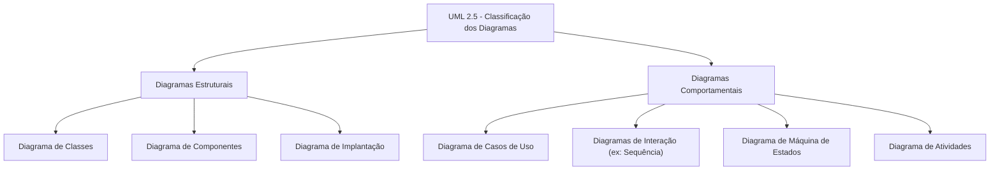
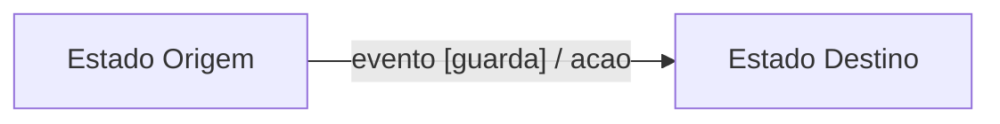
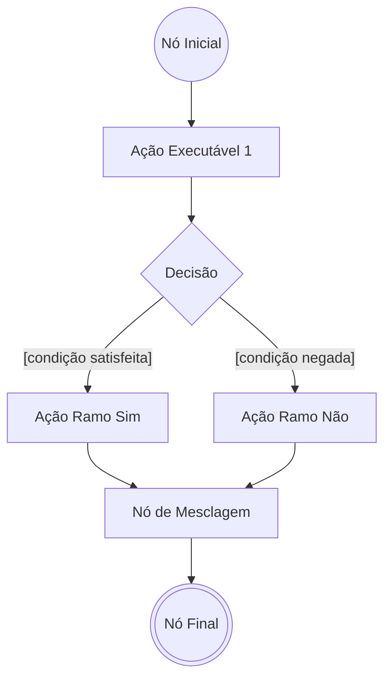
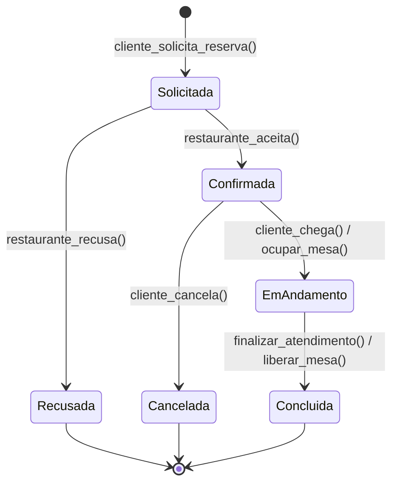
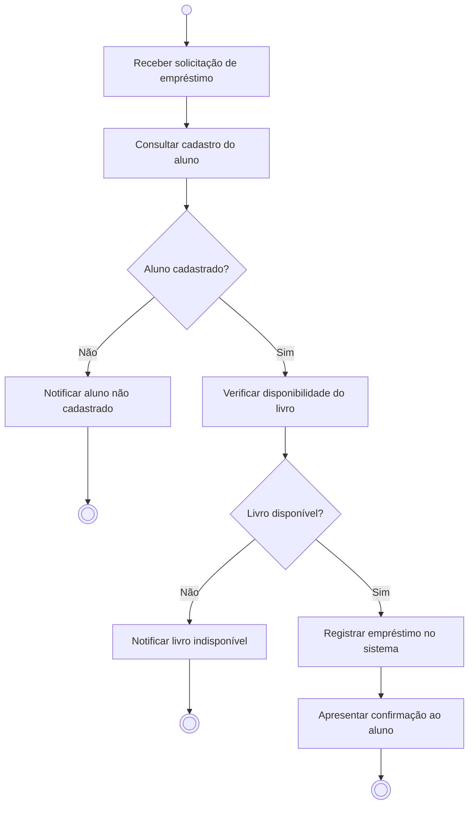
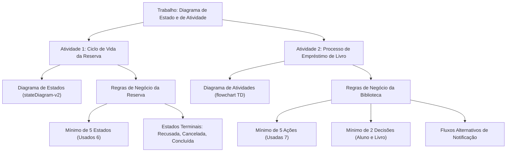

# Trabalho — Diagrama de estado e de atividade

> **Professor:** Wesley Soares
> **Disciplina:** Engenharia de Software II (4º Semestre)
> **Prazo de Entrega:** 10/11/2026 às 22:00
> **Pontuação Máxima:** 100 pontos
> **Conteúdo cobrado:** [Aula 01 - Introdução ao Ciclo de Vida do Projeto de Software](../../Aulas/Aula%2001%20-%20Introdu%C3%A7%C3%A3o%20ao%20Ciclo%20de%20Vida%20do%20Projeto%20de%20Software/detalhes.md), [Aula 02 - Fundamentos de Projeto Orientado a Objetos](../../Aulas/Aula%2002%20-%20Fundamentos%20de%20Projeto%20Orientado%20a%20Objetos/detalhes.md), [Aula 03 - Técnicas de Elicitação e Levantamento de Requisitos](../../Aulas/Aula%2003%20-%20T%C3%A9cnicas%20de%20Elicita%C3%A7%C3%A3o%20e%20Levantamento%20de%20Requisitos/detalhes.md), [Aula 04 - Modelagem de Casos de Uso UML](../../Aulas/Aula%2004%20-%20Modelagem%20de%20Casos%20de%20Uso%20UML/detalhes.md), [Aula 06 - Modelagem de Requisitos e Casos de Uso](../../Aulas/Aula%2006%20-%20Modelagem%20de%20Requisitos%20e%20Casos%20de%20Uso/detalhes.md), [Aula 07 - Fundamentos da UML e Diagrama de Classes](../../Aulas/Aula%2007%20-%20Fundamentos%20da%20UML%20e%20Diagrama%20de%20Classes/detalhes.md), [Aula 08 - Arquitetura Model-View-Controller no Smalltalk-80](../../Aulas/Aula%2008%20-%20Arquitetura%20Model-View-Controller%20no%20Smalltalk-80/detalhes.md), [Aula 09 - Arquitetura de Software e Padrões Arquiteturais](../../Aulas/Aula%2009%20-%20Arquitetura%20de%20Software%20e%20Padr%C3%B5es%20Arquiteturais/detalhes.md), [Aula 10 - Modelagem de Interação Estados e Atividades](../../Aulas/Aula%2010%20-%20Modelagem%20de%20Intera%C3%A7%C3%A3o%20Estados%20e%20Atividades/detalhes.md), [Aula 11 - Diagramas de Estado e de Atividade](../../Aulas/Aula%2011%20-%20Diagramas%20de%20Estado%20e%20de%20Atividade/detalhes.md)

---

## Sumário

- [Enunciado original (Google Classroom)](#enunciado-original-google-classroom)
- [Análise do que é pedido](#análise-do-que-é-pedido)
  - [Atividade 1: Ciclo de vida de uma reserva (Diagrama de Estado)](#atividade-1-ciclo-de-vida-de-uma-reserva-diagrama-de-estado)
  - [Atividade 2: Processo de empréstimo de livro (Diagrama de Atividade)](#atividade-2-processo-de-empréstimo-de-livro-diagrama-de-atividade)
  - [Requisitos não funcionais e de modelagem](#requisitos-não-funcionais-e-de-modelagem)
- [Fundamentação teórica](#fundamentação-teórica)
  - [Modelagem comportamental na UML 2.5](#modelagem-comportamental-na-uml-25)
  - [Máquinas de estados finitos e diagramas de transição de estados](#máquinas-de-estados-finitos-e-diagramas-de-transição-de-estados)
  - [Diagramas de atividade e semântica de fluxo de controle](#diagramas-de-atividade-e-semântica-de-fluxo-de-controle)
  - [Diferenças conceituais: Estado versus Atividade](#diferenças-conceituais-estado-versus-atividade)
  - [Armadilhas comuns e anti-padrões de modelagem](#armadilhas-comuns-e-anti-padrões-de-modelagem)
- [Resolução proposta](#resolução-proposta)
  - [Modelagem da Atividade 1: Diagrama de Estado da Reserva](#modelagem-da-atividade-1-diagrama-de-estado-da-reserva)
  - [Especificação formal de estados e transições](#especificação-formal-de-estados-e-transições)
  - [Implementação de referência: Máquina de estados em software](#implementação-de-referência-máquina-de-estados-em-software)
  - [Modelagem da Atividade 2: Diagrama de Atividade do Empréstimo](#modelagem-da-atividade-2-diagrama-de-atividade-do-empréstimo)
  - [Especificação do fluxo de controle e nós de decisão](#especificação-do-fluxo-de-controle-e-nós-de-decisão)
  - [Implementação de referência: Fluxo de serviço do empréstimo](#implementação-de-referência-fluxo-de-serviço-do-empréstimo)
- [Como testar e validar](#como-testar-e-validar)
  - [Matriz de cobertura de transição de estados (N-Switch)](#matriz-de-cobertura-de-transição-de-estados-n-switch)
  - [Caminhos de execução do diagrama de atividade (Branch Coverage)](#caminhos-de-execução-do-diagrama-de-atividade-branch-coverage)
  - [Testes automatizados com pytest](#testes-automatizados-com-pytest)
- [Critérios de qualidade](#critérios-de-qualidade)
- [Arquivos de apoio](#arquivos-de-apoio)
- [Mapa da atividade](#mapa-da-atividade)
- [Glossário](#glossário)
- [Pontos-chave para a prova](#pontos-chave-para-a-prova)
- [Perguntas e respostas (JSONL)](#perguntas-e-respostas-jsonl)
- [Checklist de revisão](#checklist-de-revisão)

---

## Enunciado original (Google Classroom)

### Diagrama de estado e de atividade (09/11/2026)

Realize a atividade anexando uma imagem do diagrama de estado e do diagrama de atividade

### Anexo: Trabalho Estado e Atividade

**Exercício de Diagrama de Estado**

**Atividade 1: ciclo de vida de uma reserva**
**Cenário: Sistema de reserva de mesas em um restaurante**

Um cliente utiliza o sistema para reservar uma mesa em determinado restaurante.
Após solicitar a reserva, ela começa com o estado Solicitada.
O restaurante poderá aceitar ou recusar a solicitação.

Considere as seguintes regras:
* Uma reserva solicitada pode ser confirmada ou recusada.
* Uma reserva confirmada pode ser cancelada pelo cliente.
* Uma reserva confirmada pode passar para o estado Em andamento quando o cliente chega e ocupa a mesa.
* Após o atendimento, a reserva passa para Concluída.
* Uma reserva recusada ou cancelada não pode voltar a ser confirmada.

Sua tarefa:
Construa um Diagrama de Estado representando o ciclo de vida da reserva.
O diagrama deverá apresentar:
* Estado inicial.
* Pelo menos cinco estados.
* Transições entre os estados.
* Eventos que provocam as mudanças.
* Estado final ou estados terminais, conforme a modelagem escolhida.

---

**Exercício de Diagrama de Atividade**

**Atividade 2: processo de empréstimo de livro**
**Cenário: Sistema de Biblioteca Universitária**

Um aluno deseja realizar o empréstimo de um livro na biblioteca.
Para concluir a operação, o sistema precisa verificar se o aluno está cadastrado e se o livro está disponível.

Considere as seguintes regras:
* O aluno deve estar cadastrado.
* O livro precisa estar disponível.
* Se o aluno não estiver cadastrado, o sistema deve informar que ele não pode realizar o empréstimo.
* Se o livro não estiver disponível, o sistema deve informar a indisponibilidade.
* Se todas as condições forem atendidas, o sistema registra o empréstimo e apresenta uma confirmação ao aluno.

Sua tarefa:
Construa um Diagrama de Atividade representando o processo de empréstimo.
O diagrama deverá apresentar:
* Nó inicial e nó final.
* Pelo menos cinco ações.
* Pelo menos duas decisões.
* Caminhos alternativos para situações de erro.
* Fluxo principal de realização do empréstimo.

---

## Análise do que é pedido

A atividade proposta pelo Prof. Wesley Soares aborda a modelagem dinâmica do comportamento de sistemas segundo a Unified Modeling Language (UML 2.5). O objetivo é demonstrar proficiência em duas abordagens comportamentais distintas: a modelagem orientada a estados de uma entidade de negócio específica e a modelagem do fluxo de trabalho procedural de um caso de uso.

### Atividade 1: Ciclo de vida de uma reserva (Diagrama de Estado)

O foco reside na entidade conceitual `Reserva` dentro de um sistema de gestão de restaurante.

1. **Estado Inicial:**
   - Deve existir um pseudostado inicial indicando a instanciação da reserva.
2. **Contagem Mínima de Estados:**
   - Exigência de pelo menos 5 estados. Identificam-se no domínio 6 estados funcionais claros:
     1. `Solicitada`: Estado de entrada após a submissão pelo cliente.
     2. `Confirmada`: Estado após a aceitação pelo restaurante.
     3. `Recusada`: Estado terminal de rejeição pelo restaurante.
     4. `Cancelada`: Estado terminal de desistência voluntária pelo cliente.
     5. `Em andamento`: Estado de ocupação física da mesa durante o atendimento.
     6. `Concluída`: Estado terminal de encerramento regular da prestação do serviço.
3. **Transições e Eventos Gatilho:**
   - Submissão da reserva (`solicitar_reserva`).
   - Avaliação do estabelecimento (`aceitar_reserva` / `recusar_reserva`).
   - Ação do cliente (`cancelar_reserva`).
   - Check-in presencial (`chegada_cliente`).
   - Check-out / Fechamento de conta (`finalizar_atendimento`).
4. **Regras de Negócio Invariantes:**
   - Terminação estrita: Uma vez atingidos os estados `Recusada` ou `Cancelada`, não é permitido sob hipótese alguma retornar para `Confirmada` ou qualquer outro estado ativo.
5. **Estados Finais:**
   - Adoção de pseudostados finais para representar o encerramento do ciclo de vida da entidade no banco de dados operacional.

### Atividade 2: Processo de empréstimo de livro (Diagrama de Atividade)

O foco é a orquestração do processo de negócio do caso de uso `Realizar Empréstimo de Livro` no contexto da Biblioteca Universitária.

1. **Nós Inicial e Final:**
   - Ponto de entrada único (círculo preenchido) e nós de encerramento do fluxo (círculo com borda dupla ou touro / bullseye).
2. **Contagem Mínima de Ações:**
   - Pelo menos 5 ações discretas. Mapeiam-se 7 ações atômicas essenciais:
     1. `Receber solicitação de empréstimo`.
     2. `Consultar cadastro do aluno`.
     3. `Notificar impedimento por ausência de cadastro`.
     4. `Verificar disponibilidade física do exemplar`.
     5. `Notificar indisponibilidade do livro`.
     6. `Registrar empréstimo no acervo e associar ao aluno`.
     7. `Emitir comprovante de confirmação do empréstimo`.
3. **Contagem Mínima de Decisões:**
   - Pelo menos 2 nós de decisão (losangos com guardas booleanas mutuamente exclusivas):
     - Decisão 1: `[Aluno cadastrado?]` -> Ramos `[Sim]` e `[Não]`.
     - Decisão 2: `[Livro disponível?]` -> Ramos `[Sim]` e `[Não]`.
4. **Fluxos Alternativos e de Exceção:**
   - Desvio condicional com encerramento elegante quando o aluno não possui cadastro ativo.
   - Desvio condicional com encerramento elegante quando a obra requisitada já se encontra emprestada ou retida.
5. **Fluxo Principal (Caminho Feliz):**
   - Execução sequencial bem-sucedida das validações culminando no registro definitivo e na entrega do comprovante ao discente.

### Requisitos não funcionais e de modelagem

- **Rigor Sintático UML 2.5:** Utilização estrita da simbologia formal da OMG (Object Management Group).
- **Semântica de Transições:** Definição inequívoca de eventos, guardas e ações associadas.
- **Conexão Arquitetural:** O modelo deve refletir a separação entre o modelo de domínio (onde operam as máquinas de estado) e a camada de aplicação/serviço (onde fluem as atividades do processo).

---

## Fundamentação teórica

### Modelagem comportamental na UML 2.5

A UML divide seus diagramas em duas grandes categorias: **Estruturais** (como o Diagrama de Classes e o Diagrama de Componentes) e **Comportamentais** (como Casos de Uso, Sequência, Estados e Atividades). 

Enquanto os modelos estruturais capturam a topologia estática das classes, tipos, relacionamentos e atributos de um software, os modelos comportamentais descrevem as transformações ao longo do tempo, a dinâmica de execução, a troca de mensagens e a reação a estímulos externos.



### Máquinas de estados finitos e diagramas de transição de estados

O Diagrama de Transição de Estados (State Machine Diagram) tem suas raízes matemáticas na teoria dos autômatos finitos e foi adaptado para a engenharia de software pela notação de Statecharts proposta por David Harel em 1987. Na UML, ele modela os ciclos de vida de um objeto discreto, especificando a sequência de estados pelos quais uma instância passa em resposta a eventos.

Formalmente, uma Máquina de Estados Finitos determinística pode ser descrita pela 5-tupla matemática:

```math
M = (S, \Sigma, \delta, s_0, F)
```

Onde:
- $ `S` $ é o conjunto finito e não vazio de estados possíveis do sistema.
- $ `\Sigma` $ é o alfabeto finito de eventos de entrada (estímulos).
- $ `\delta: S \times \Sigma \to S` $ é a função de transição que mapeia um estado atual e um evento a um novo estado sucessor.
- $ `s_0 \in S` $ é o estado inicial padrão.
- $ `F \subseteq S` $ é o conjunto de estados finais ou de terminação.

No contexto de sistemas orientados a objetos, a transição entre estados assume a sintaxe canônica:

```text
gatilho [guarda] / efeito
```

1. **Gatilho (Trigger / Evento):** O estímulo exterior ou interno que provoca a avaliação da transição (ex: chamada de método, recebimento de sinal, expiração de temporizador).
2. **Guarda (Guard):** Uma expressão booleana delimitada por colchetes que precisa ser verdadeira no instante do disparo para que a transição ocorra.
3. **Efeito (Action / Effect):** Um comportamento atômico e ininterrupto executado durante a passagem do estado de origem para o estado de destino.



Além disso, os estados podem conter comportamentos internos classificados em três gatilhos reservados:
- `entry / <ação>`: Executada no momento exato em que o estado é alcançado.
- `exit / <ação>`: Executada imediatamente antes de deixar o estado.
- `do / <atividade>`: Executada enquanto a entidade permanecer residindo no estado.

### Diagramas de atividade e semântica de fluxo de controle

O Diagrama de Atividades modela o comportamento procedimental, focando na coordenação e sequência de ações executáveis. Historicamente associado aos fluxogramas de programação estruturada, o diagrama de atividade moderno da UML 2.5 baseia-se na teoria das **Redes de Petri** (semântica de fichas ou *token flow*).

No modelo de fluxo de fichas:
- A execução inicia quando um nó inicial emite uma ficha (*control token*).
- As ações consomem fichas em suas arestas de entrada e produzem fichas em suas arestas de saída após o término de sua execução interna.
- O fluxo ramifica-se e funde-se através de nós de controle:
  - **Nó de Decisão (Decision Node):** Recebe uma aresta de entrada e possui duas ou mais arestas de saída com guardas mutuamente exclusivas. Exatamente uma aresta é selecionada com base na avaliação booleana.
  - **Nó de Mesclagem (Merge Node):** Recebe múltiplas arestas de entrada alternativas e direciona a ficha para uma única aresta de saída. Não realiza sincronização.
  - **Nó de Bifurcação (Fork Node):** Converte um único fluxo de entrada em múltiplos fluxos concorrentes simultâneos (duplicação de fichas).
  - **Nó de Junção (Join Node):** Sincroniza fluxos paralelos. Exige que uma ficha esteja disponível em todas as entradas antes de emitir uma única ficha de saída.
  - **Nó Final de Atividade (Activity Final):** Encerra todas as fichas ativas no diagrama, abortando quaisquer fluxos paralelos.
  - **Nó Final de Fluxo (Flow Final):** Destrói apenas a ficha que atinge o nó, mantendo os outros ramos paralelos em execução.



### Diferenças conceituais: Estado versus Atividade

Uma das causas mais frequentes de erro em avaliações acadêmicas e projetos de software reside na confusão entre máquinas de estados e diagramas de atividade.

| Critério de Comparação | Diagrama de Máquina de Estados | Diagrama de Atividades |
| :--- | :--- | :--- |
| **Perspectiva Principal** | Focado na entidade (Orientado ao Ciclo de Vida do Objeto). | Focado no processo (Orientado ao Algoritmo / Fluxo de Trabalho). |
| **Pergunta Fundamental** | "Em qual condição durável o objeto se encontra neste momento?" | "Qual ação deve ser processada em seguida no sistema?" |
| **Gatilho de Transição** | Reativo: aguarda estímulos externos explícitos (eventos assíncronos). | Ativo: transições ocorrem automaticamente ao concluir a ação precedente. |
| **Representação Gráfica** | Retângulos com cantos arredondados identificando substantivos ou particípios (`Confirmada`). | Retângulos com cantos arredondados contendo verbos de ação (`Validar Dados`). |
| **Base Teórica** | Autômatos Finitos Determinísticos / Statecharts de Harel. | Redes de Petri e Programação Estruturada. |
| **Granularidade Típica** | Uma única classe ou entidade do modelo conceitual (ex: `Reserva`, `Pedido`). | Um Caso de Uso, método de negócio ou processo organizacional completo. |

### Armadilhas comuns e anti-padrões de modelagem

Para garantir excelência acadêmica e profissional, as seguintes armadilhas devem ser expressamente evitadas:

1. **Anti-padrão "Estado-Verbo" no Diagrama de Estados:**
   - *Erro:* Criar um estado chamado `Confirmando Reserva` ou `Enviando Notificação`.
   - *Correção:* Ações instantâneas são transições ou efeitos (`/ enviar_notificacao()`). Estados devem representar condições estáveis de espera, tais como `Confirmada` ou `Solicitada`.
2. **Confundir Nó de Decisão com Nó de Bifurcação (Fork) em Atividades:**
   - *Erro:* Utilizar barra de sincronização (Fork) quando se deseja uma escolha condicional (if/else), forçando a execução simultânea de fluxos excludentes.
   - *Correção:* Decisões condicionais exigem o losango com guardas booleanas expressas `[guarda]`.
3. **Múltiplas arestas convergindo para uma ação sem Nó de Mesclagem (Merge):**
   - *Erro:* Ligar duas arestas provenientes de ramos de decisão diretamente em uma caixa de ação. Na UML 2.0+, isso pode ser interpretado como um join implícito, gerando deadlock.
   - *Correção:* Utilizar o losango de mesclagem (Merge Node) para unificar fluxos alternativos antes de prosseguir.
4. **Estados Órfãos ou Sem Saída (Deadlocks Não Intencionais):**
   - *Erro:* Deixar estados intermediários sem nenhuma transição de saída viável. Todo estado que não seja formalmente um estado final deve ter uma saída válida.

---

## Resolução proposta

### Modelagem da Atividade 1: Diagrama de Estado da Reserva

Para atender integralmente aos requisitos do cenário do restaurante, modela-se o ciclo de vida da classe conceitual `Reserva`. O diagrama contempla 6 estados explícitos, superando o requisito mínimo de 5 estados, e proíbe reativações a partir de cancelamentos ou recusas.



### Especificação formal de estados e transições

A tabela detalha todas as transições da máquina de estados finita da `Reserva`:

| Estado de Origem | Evento Gatilho | Guarda Booleana | Ação / Efeito | Estado de Destino | Descrição Semântica |
| :--- | :--- | :--- | :--- | :--- | :--- |
| `[*]` (Inicial) | `cliente_solicita_reserva()` | `[dados_validos]` | `gerar_protocolo()` | `Solicitada` | O cliente preenche data, horário e quantidade de lugares, iniciando o pedido. |
| `Solicitada` | `restaurante_aceita()` | `[mesas_disponiveis]` | `reservar_mesa()` | `Confirmada` | A gerência do restaurante aceita o pedido, garantindo a disponibilidade da mesa. |
| `Solicitada` | `restaurante_recusa()` | `[sem_disponibilidade]` | `notificar_motivo()` | `Recusada` | O restaurante rejeita o pedido por lotação ou incompatibilidade. Estado terminal. |
| `Confirmada` | `cliente_cancela()` | `[antecedencia_minima]` | `estornar_taxa()` | `Cancelada` | O cliente desiste da reserva antes do comparecimento. Estado terminal. |
| `Confirmada` | `cliente_chega()` | `[horario_limite_ok]` | `ocupar_mesa()` | `EmAndamento` | O cliente se apresenta na recepção do restaurante e é acomodado à mesa. |
| `EmAndamento` | `finalizar_atendimento()` | `[conta_paga]` | `liberar_mesa()` | `Concluida` | O consumo é faturado, os clientes deixam o recinto e a mesa é liberada. Estado terminal. |
| `Recusada` | `[*]` | Nenhuma | Nenhuma | Estado Final | Encerramento do ciclo de vida sem atendimento. |
| `Cancelada` | `[*]` | Nenhuma | Nenhuma | Estado Final | Encerramento do ciclo de vida por desistência. |
| `Concluida` | `[*]` | Nenhuma | Nenhuma | Estado Final | Encerramento regular e completo da operação. |

### Implementação de referência: Máquina de estados em software

Para demonstrar como a especificação UML da Atividade 1 se traduz em código executável de engenharia de software, implementa-se o padrão comportamental de Máquina de Estados com validação estrita de transição em Python:

```python
"""
Módulo de Domínio: Ciclo de Vida da Reserva de Mesa
Disciplina: Engenharia de Software II - UniFEF
Professor: Wesley Soares
"""

from enum import Enum, auto
from typing import Dict, Set


class TransicaoInvalidaException(Exception):
    """Lançada quando uma transição violar as regras de negócio da FSM."""
    pass


class EstadoReserva(Enum):
    SOLICITADA = auto()
    CONFIRMADA = auto()
    RECUSADA = auto()
    CANCELADA = auto()
    EM_ANDAMENTO = auto()
    CONCLUIDA = auto()


class ReservaMesa:
    """Entidade de domínio que encapsula a máquina de estados da Reserva."""

    # Tabela de transições permitidas: EstadoAtual -> Set[EstadosAlvo]
    TRANSIÇÕES_VALIDAS: Dict[EstadoReserva, Set[EstadoReserva]] = {
        EstadoReserva.SOLICITADA: {EstadoReserva.CONFIRMADA, EstadoReserva.RECUSADA},
        EstadoReserva.CONFIRMADA: {EstadoReserva.CANCELADA, EstadoReserva.EM_ANDAMENTO},
        EstadoReserva.EM_ANDAMENTO: {EstadoReserva.CONCLUIDA},
        # Estados terminais: nenhuma transição de saída permitida
        EstadoReserva.RECUSADA: set(),
        EstadoReserva.CANCELADA: set(),
        EstadoReserva.CONCLUIDA: set()
    }

    def __init__(self, id_reserva: str, nome_cliente: str, lugares: int):
        self.id_reserva = id_reserva
        self.nome_cliente = nome_cliente
        self.lugares = lugares
        # Inicia no estado Solicitada conforme o enunciado
        self._estado_atual: EstadoReserva = EstadoReserva.SOLICITADA

    @property
    def estado(self) -> EstadoReserva:
        return self._estado_atual

    def _transitar_para(self, novo_estado: EstadoReserva, motivo: str = "") -> None:
        destinos_permitidos = self.TRANSIÇÕES_VALIDAS[self._estado_atual]
        if novo_estado not in destinos_permitidos:
            raise TransicaoInvalidaException(
                f"Transição ilegal de {self._estado_atual.name} para {novo_estado.name}. "
                f"Estados terminais ou fluxos não permitidos não podem ser reativados."
            )
        self._estado_atual = novo_estado

    def aceitar(self) -> None:
        """Restaurante aceita a reserva."""
        self._transitar_para(EstadoReserva.CONFIRMADA)

    def recusar(self, motivo: str) -> None:
        """Restaurante recusa a reserva."""
        self._transitar_para(EstadoReserva.RECUSADA, motivo)

    def cancelar_pelo_cliente(self) -> None:
        """Cliente desiste da reserva confirmada."""
        self._transitar_para(EstadoReserva.CANCELADA)

    def registrar_chegada_cliente(self) -> None:
        """Cliente chega e ocupa a mesa."""
        self._transitar_para(EstadoReserva.EM_ANDAMENTO)

    def concluir_atendimento(self) -> None:
        """Serviço concluído e mesa liberada."""
        self._transitar_para(EstadoReserva.CONCLUIDA)
```

---

### Modelagem da Atividade 2: Diagrama de Atividade do Empréstimo

Para a Atividade 2, modela-se o fluxo de controle do processo de empréstimo de livros na Biblioteca Universitária. O diagrama abrange 7 ações atômicas, 2 nós de decisão explícitos, nós de mesclagem para evitar ambiguidades e nós finais para cada terminação de fluxo.



### Especificação do fluxo de controle e nós de decisão

A decomposição dos nós do Diagrama de Atividades garante rastreabilidade com o enunciado:

1. **Nó Inicial `(( ))`:** Ponto no qual o discente manifesta a intenção de retirar um exemplar físico.
2. **Ação 1 (`Receber solicitação de empréstimo`):** Coleta da identificação do estudante (RA/matrícula) e do identificador unívoco do livro (código de barras/ISBN).
3. **Ação 2 (`Consultar cadastro do aluno`):** O sistema executa busca no banco de dados acadêmico para avaliar o status do discente.
4. **Decisão 1 (`Aluno cadastrado?`):**
   - **Ramo `[Não]`:** Caminho de exceção. Redireciona para a Ação 3 (`Notificar aluno não cadastrado`) e encerra a execução no nó final `FimAlunoNaoCadastrado`.
   - **Ramo `[Sim]`:** Caminho de prosseguimento. Encaminha a ficha de controle para a verificação de acervo.
5. **Ação 4 (`Verificar disponibilidade do livro`):** Consulta do status físico e lógico do exemplar solicitado na base de acervo da biblioteca.
6. **Decisão 2 (`Livro disponível?`):**
   - **Ramo `[Não]`:** Caminho alternativo de bloqueio. Direciona para a Ação 5 (`Notificar livro indisponível`) e encerra no nó final `FimLivroIndisponivel`.
   - **Ramo `[Sim]`:** Caminho feliz. Habilita a efetivação da transação.
7. **Ação 6 (`Registrar empréstimo no sistema`):** Ação transacional atômica. Vincula o exemplar ao código do discente, calcula a data prevista de devolução e altera o estado do livro no catálogo para `Emprestado`.
8. **Ação 7 (`Apresentar confirmação ao aluno`):** Emissão de recibo digital/impresso contendo comprovante, dados da obra e prazo regulamentar para devolução.
9. **Nó Final `FimSucesso ((( )))`:** Encerramento bem-sucedido do processo de negócio.

### Implementação de referência: Fluxo de serviço do empréstimo

Abaixo, a implementação de serviço ilustrando a orquestração do processo de empréstimo com tratamento explícito de cada caminho alternativo:

```python
"""
Módulo de Aplicação: Processamento de Empréstimos de Biblioteca
Disciplina: Engenharia de Software II - UniFEF
Professor: Wesley Soares
"""

from dataclasses import dataclass
from typing import Optional


@dataclass
class ResultadoEmprestimo:
    sucesso: bool
    mensagem: str
    protocolo: Optional[str] = None


class AlunoRepository:
    def is_aluno_cadastrado(self, id_aluno: str) -> bool:
        # Simulação de verificação em base de dados
        alunos_ativos = {"RA1001", "RA1002", "RA1003"}
        return id_aluno in alunos_ativos


class LivroRepository:
    def is_livro_disponivel(self, id_livro: str) -> bool:
        # Simulação de verificação de inventário
        livros_disponiveis = {"LIV-FIS-01", "LIV-ENG-02"}
        return id_livro in livros_disponiveis

    def marcar_como_emprestado(self, id_livro: str, id_aluno: str) -> str:
        # Registra a transação e retorna protocolo
        return f"EMP-{id_livro}-{id_aluno}-2026"


class EmprestimoService:
    """Implementa a lógica procedimental descrita no Diagrama de Atividade."""

    def __init__(self, aluno_repo: AlunoRepository, livro_repo: LivroRepository):
        self.aluno_repo = aluno_repo
        self.livro_repo = livro_repo

    def realizar_emprestimo(self, id_aluno: str, id_livro: str) -> ResultadoEmprestimo:
        # Ação 1: Receber solicitação de empréstimo (efetuada pela invocação do método)

        # Ação 2: Consultar cadastro do aluno
        aluno_cadastrado = self.aluno_repo.is_aluno_cadastrado(id_aluno)

        # Decisão 1: Aluno cadastrado?
        if not aluno_cadastrado:
            # Ação 3: Notificar impedimento / Caminho alternativo de erro
            return ResultadoEmprestimo(
                sucesso=False,
                mensagem="Operação cancelada: Aluno não cadastrado na biblioteca."
            )

        # Ação 4: Verificar disponibilidade do livro
        livro_disponivel = self.livro_repo.is_livro_disponivel(id_livro)

        # Decisão 2: Livro disponível?
        if not livro_disponivel:
            # Ação 5: Notificar indisponibilidade / Caminho alternativo de erro
            return ResultadoEmprestimo(
                sucesso=False,
                mensagem="Operação cancelada: Livro indisponível para empréstimo."
            )

        # Ação 6: Registrar empréstimo no sistema (Fluxo Principal)
        protocolo = self.livro_repo.marcar_como_emprestado(id_livro, id_aluno)

        # Ação 7: Apresentar confirmação ao aluno
        return ResultadoEmprestimo(
            sucesso=True,
            mensagem="Empréstimo realizado com sucesso!",
            protocolo=protocolo
        )
```

---

## Como testar e validar

### Matriz de cobertura de transição de estados (N-Switch)

Na engenharia de software baseada em modelos, o teste de máquinas de estados requer a verificação de todas as transições válidas de 0-switch (cobertura de todas as arestas individuais) e a injeção de eventos inválidos para assegurar a robustez do software contra transições ilegais:

| Caso de Teste | Estado Inicial | Evento Injetado | Resultado Esperado | Validação da Regra de Negócio |
| :--- | :--- | :--- | :--- | :--- |
| **CT-EST-01** | `[*] (Inicial)` | `solicitar_reserva()` | Transita para `Solicitada` | Criação regular da reserva |
| **CT-EST-02** | `Solicitada` | `restaurante_aceita()` | Transita para `Confirmada` | Aceite pelo restaurante |
| **CT-EST-03** | `Solicitada` | `restaurante_recusa()` | Transita para `Recusada` | Recusa pelo restaurante |
| **CT-EST-04** | `Confirmada` | `cliente_cancela()` | Transita para `Cancelada` | Cancelamento voluntário |
| **CT-EST-05** | `Confirmada` | `cliente_chega()` | Transita para `EmAndamento` | Ocupação física da mesa |
| **CT-EST-06** | `EmAndamento` | `finalizar_atendimento()` | Transita para `Concluida` | Encerramento do ciclo |
| **CT-EST-07** | `Recusada` | `restaurante_aceita()` | **Erro / Bloqueio** | Invariante: Recusada não volta a ser confirmada |
| **CT-EST-08** | `Cancelada` | `restaurante_aceita()` | **Erro / Bloqueio** | Invariante: Cancelada não volta a ser confirmada |
| **CT-EST-09** | `Concluida` | `cliente_cancela()` | **Erro / Bloqueio** | Transição ilegal a partir de estado terminal |

### Caminhos de execução do diagrama de atividade (Branch Coverage)

O Diagrama de Atividades deve garantir cobertura total de ramos (100% Branch Coverage). Com dois nós de decisão binários, existem 3 caminhos independentes de execução:

1. **Caminho 1 (Exceção de Aluno):**
   - $ `\text{Início} \to \text{Receber Solicitação} \to \text{Consultar Aluno} \to [\text{Aluno cadastrado? = Não}] \to \text{Notificar Aluno Não Cadastrado} \to \text{Fim}` $
2. **Caminho 2 (Exceção de Acervo):**
   - $ `\text{Início} \to \text{Receber Solicitação} \to \text{Consultar Aluno} \to [\text{Aluno cadastrado? = Sim}] \to \text{Verificar Livro} \to [\text{Livro disponível? = Não}] \to \text{Notificar Livro Indisponível} \to \text{Fim}` $
3. **Caminho 3 (Caminho Feliz / Sucesso):**
   - $ `\text{Início} \to \text{Receber Solicitação} \to \text{Consultar Aluno} \to [\text{Aluno cadastrado? = Sim}] \to \text{Verificar Livro} \to [\text{Livro disponível? = Sim}] \to \text{Registrar Empréstimo} \to \text{Apresentar Confirmação} \to \text{Fim}` $

### Testes automatizados com pytest

O código a seguir valida sistematicamente ambos os diagramas modelados, confirmando que os modelos comportamentais funcionam sem inconsistências:

```python
"""
Suíte de Testes Automatizados para a Resolução das Atividades 1 e 2
Executar com: pytest test_resolucao.py
"""

import pytest


def test_ciclo_completo_reserva_sucesso():
    """Valida o fluxo primário: Solicitada -> Confirmada -> Em Andamento -> Concluída."""
    reserva = ReservaMesa(id_reserva="RES-01", nome_cliente="Carlos", lugares=4)
    assert reserva.estado == EstadoReserva.SOLICITADA

    reserva.aceitar()
    assert reserva.estado == EstadoReserva.CONFIRMADA

    reserva.registrar_chegada_cliente()
    assert reserva.estado == EstadoReserva.EM_ANDAMENTO

    reserva.concluir_atendimento()
    assert reserva.estado == EstadoReserva.CONCLUIDA


def test_reserva_recusada_nao_pode_ser_confirmada():
    """Valida a regra invariante: Reserva recusada não pode voltar a ser confirmada."""
    reserva = ReservaMesa(id_reserva="RES-02", nome_cliente="Ana", lugares=2)
    reserva.recusar("Restaurante lotado")
    assert reserva.estado == EstadoReserva.RECUSADA

    with pytest.raises(TransicaoInvalidaException):
        reserva.aceitar()


def test_reserva_cancelada_nao_pode_ser_confirmada():
    """Valida a regra invariante: Reserva cancelada não pode voltar a ser confirmada."""
    reserva = ReservaMesa(id_reserva="RES-03", nome_cliente="Marcos", lugares=6)
    reserva.aceitar()
    assert reserva.estado == EstadoReserva.CONFIRMADA

    reserva.cancelar_pelo_cliente()
    assert reserva.estado == EstadoReserva.CANCELADA

    with pytest.raises(TransicaoInvalidaException):
        reserva.aceitar()


def test_emprestimo_fluxo_principal_sucesso():
    """Valida o caminho feliz da Atividade 2."""
    service = EmprestimoService(AlunoRepository(), LivroRepository())
    resultado = service.realizar_emprestimo(id_aluno="RA1001", id_livro="LIV-FIS-01")

    assert resultado.sucesso is True
    assert "sucesso" in resultado.mensagem.lower()
    assert resultado.protocolo is not None


def test_emprestimo_aluno_nao_cadastrado():
    """Valida o desvio alternativo quando o aluno não possui cadastro."""
    service = EmprestimoService(AlunoRepository(), LivroRepository())
    resultado = service.realizar_emprestimo(id_aluno="RA9999", id_livro="LIV-FIS-01")

    assert resultado.sucesso is False
    assert "aluno não cadastrado" in resultado.mensagem.lower()
    assert resultado.protocolo is None


def test_emprestimo_livro_indisponivel():
    """Valida o desvio alternativo quando o exemplar não se encontra disponível."""
    service = EmprestimoService(AlunoRepository(), LivroRepository())
    # RA1002 é válido, porém LIV-INDISPONIVEL não consta no catálogo ativo
    resultado = service.realizar_emprestimo(id_aluno="RA1002", id_livro="LIV-INDISPONIVEL")

    assert resultado.sucesso is False
    assert "livro indisponível" in resultado.mensagem.lower()
    assert resultado.protocolo is None
```

---

## Critérios de qualidade

Na correção de trabalhos práticos de Engenharia de Software II, o Prof. Wesley Soares avalia tanto a precisão conceitual quanto a formalidade da notação UML:

1. **Conformidade Notacional com o Metamodelo UML 2.5:**
   - Pseudostados iniciais (`[*]`) e nós de decisão representados graficamente com sua geometria canônica.
   - Guardas booleanas entre colchetes (`[aluno cadastrado]`, `[livro disponível]`), nunca em texto corrido ou parênteses.
   - Linhas de transição com setas abertas sólidas simples direcionadas.
2. **Determinismo e Completude:**
   - Para qualquer nó de decisão no diagrama de atividade, a união das guardas das arestas de saída deve cobrir 100% dos casos lógicos possíveis (comutatividade e exaustão booleana), sem ambiguidade.
   - A máquina de estados não pode permitir comportamentos não determinísticos (duas transições com o mesmo gatilho ativadas no mesmo estado sob a mesma condição).
3. **Fidelidade às Regras de Negócio Estabelecidas:**
   - Atendimento obrigatório ao requisito de impossibilidade de confirmação de reservas previamente canceladas ou recusadas.
   - Apresentação obrigatória de confirmação apenas após o registro do empréstimo em banco de dados.
4. **Legibilidade e Coesão:**
   - Nomes de estados substantivados ou adjetivados no particípio (`Solicitada`, `Confirmada`).
   - Nomes de ações verbais iniciadas no infinitivo ou imperativo (`Consultar`, `Verificar`, `Registrar`, `Notificar`).

---

## Arquivos de apoio

Os materiais complementares utilizados como referência baseiam-se nos tópicos ministrados na disciplina e no anexo oficial distribuído na plataforma:

- **Anexo Original:** `Trabalho Estado e Atividade.pdf` (Arquivo disponibilizado no Google Classroom da turma com o enunciado das duas atividades).
- **Referência Metodológica:** [Aula 10 - Modelagem de Interação Estados e Atividades](../../Aulas/Aula%2010%20-%20Modelagem%20de%20Intera%C3%A7%C3%A3o%20Estados%20e%20Atividades/detalhes.md) — Fundamentos conceituais sobre Redes de Petri, autômatos finitos e a visão comportamental da UML.
- **Referência Prática:** [Aula 11 - Diagramas de Estado e de Atividade](../../Aulas/Aula%2011%20-%20Diagramas%20de%20Estado%20e%20de%20Atividade/detalhes.md) — Diretrizes de elaboração, sintaxe detalhada de transições e tratamento de fluxos concorrentes.

---

## Mapa da atividade

O fluxograma conceitual abaixo consolida o escopo completo da atividade, articulando os requisitos do professor, a teoria da UML e os entregáveis projetados:



---

## Glossário

| Termo Técnico | Definição no Contexto de Engenharia de Software e UML |
| :--- | :--- |
| **Ação (Action)** | A menor unidade fundamental de comportamento executável na UML. É atômica e não pode ser interrompida. |
| **Atividade (Activity)** | Um comportamento coordenado expresso como um fluxo ordenado de ações e nós de controle subordinados. |
| **Branch Coverage** | Métrica de teste que avalia se todas as ramificações booleanas (ramos verdadeiro e falso) de nós de decisão foram exercitadas. |
| **Diagrama de Atividade** | Diagrama comportamental que modela a lógica procedimental de fluxos de trabalho através de ações orientadas a controle e dados. |
| **Diagrama de Estado** | Diagrama comportamental que descreve os eventos que causam a transição de um objeto entre condições duráveis ao longo do seu ciclo de vida. |
| **Efeito (Effect)** | Comportamento transitório associado diretamente ao disparo de uma transição entre estados. |
| **Estado (State)** | Condição durável de uma entidade durante a qual ela satisfaz determinado predicado, aguarda eventos ou realiza uma atividade contínua. |
| **Estado Inicial** | Pseudostado que define o ponto de partida padrão para uma máquina de estados quando uma nova instância é criada. |
| **Estado Terminal / Final** | Estado que encerra a vida útil ou a máquina de estados de uma instância no contexto operacional. |
| **Evento Gatilho (Trigger)** | Ocorrência atômica que possui localização temporal e pode provocar o disparo de uma transição de estado. |
| **Guarda (Guard)** | Expressão lógica condicional delimitada por colchetes que precisa ser verdadeira para que a transição ou ramo seja percorrido. |
| **Máquina de Estados Finitos** | Modelo formal de computação composto por um conjunto finito de estados, eventos e funções de transição entre eles. |
| **Nó de Decisão (Decision Node)** | Elemento de controle em formato de losango que seleciona exatamente um caminho de saída com base na avaliação de guardas. |
| **Nó de Mesclagem (Merge Node)** | Elemento de controle em formato de losango que unifica múltiplos fluxos de controle alternativos sem requerer sincronização. |
| **N-Switch Coverage** | Critério de teste para máquinas de estados que verifica sequências encadeadas de $ `n` $ transições sucessivas de estado. |
| **Pseudostado** | Vértice em um grafo de máquina de estados que orienta o fluxo de transições, mas não representa um estado estável onde o objeto reside. |
| **Redes de Petri** | Formalismo matemático para modelagem de sistemas concorrentes e assíncronos que fundamenta a semântica de fichas dos diagramas de atividade. |
| **Token (Ficha de Controle)** | Entidade abstrata que transita pelas arestas de um diagrama de atividade para indicar o ponto atual de execução do fluxo. |

---

## Pontos-chave para a prova

Para fixação conceitual e preparação para as avaliações teóricas e práticas da disciplina de Engenharia de Software II, atente-se aos seguintes pontos:

1. **Ações versus Atividades:** Uma ação é elementar, atômica e pontual (ex: somar dois números, persistir uma linha no banco). Uma atividade é uma estrutura hierárquica e complexa, composta por uma rede interligada de ações, nós de decisão e fluxos de controle.
2. **Pseudostados vs Estados Reais:** O nó inicial `[*]` de uma máquina de estados é um *pseudostado*: o objeto nunca permanece estático nele aguardando tempo passar; ele transita imediatamente para o primeiro estado real assim que a instância é criada.
3. **Semântica do Nó de Decisão:** Um nó de decisão **nunca divide fluxos em paralelo**. As guardas associadas a cada ramo de saída devem ser mutuamente exclusivas e exaustivas. Para fluxos paralelos e simultâneos, a notação formal exige uma barra preta horizontal ou vertical espessa chamada **Nó de Bifurcação (Fork Node)**.
4. **Semântica do Nó de Mesclagem (Merge):** O losango de mesclagem não espera que múltiplos fluxos cheguem ao mesmo tempo. Ele simplesmente conduz qualquer ficha de entrada para a saída. O elemento que aguarda a chegada de todos os fluxos concorrentes é o **Nó de Junção (Join Node)**.
5. **Nó Final de Atividade versus Nó Final de Fluxo:** O *Activity Final Node* (círculo sólido dentro de um anel externo) interrompe imediatamente todas as ações ativas em todos os ramos do diagrama. O *Flow Final Node* (círculo com um "X" dentro) apenas descarta a ficha daquele ramo específico sem afetar fluxos paralelos que continuem rodando.
6. **Regra de Transição em Estados:** Em um diagrama de estados reativo, uma transição sem evento explicitado é uma transição de término imediato (dispara automaticamente assim que o processamento interno `do` do estado se esgota). Se há espera de decisão humana ou chamada de sistema, o evento gatilho deve ser nomeado.

---

## Perguntas e respostas (JSONL)

```jsonl
{"pergunta": "Qual a principal diferença entre a perspectiva de um Diagrama de Estados e de um Diagrama de Atividades na UML?", "resposta": "O Diagrama de Estados foca no ciclo de vida de uma entidade específica e suas respostas a eventos, enquanto o Diagrama de Atividades modela o fluxo de trabalho procedural e a sequência de ações de um processo.", "dificuldade": "Fácil"}
{"pergunta": "Por que o nó inicial em uma máquina de estados é classificado como um pseudostado?", "resposta": "Porque o objeto não pode residir ou permanecer estático nele; o nó inicial serve apenas como marcador transitório para conduzir imediatamente a entidade ao seu primeiro estado real.", "dificuldade": "Média"}
{"pergunta": "Qual elemento deve ser utilizado em um Diagrama de Atividades para representar uma escolha condicional exclusiva?", "resposta": "Um Nó de Decisão (Decision Node), representado graficamente por um losango contendo guardas booleanas mutuamente exclusivas em cada ramo de saída.", "dificuldade": "Fácil"}
{"pergunta": "Como se diferenciam semanticamente o Nó de Mesclagem (Merge) e o Nó de Junção (Join) em Diagramas de Atividade?", "resposta": "O Nó de Mesclagem unifica fluxos alternativos sem sincronização assim que uma ficha chega; o Nó de Junção sincroniza fluxos concorrentes, exigindo a chegada de fichas de todas as entradas para liberar a saída.", "dificuldade": "Difícil"}
{"pergunta": "Quais são os 6 estados identificados na resolução da Atividade 1 da reserva do restaurante?", "resposta": "Solicitada, Confirmada, Recusada, Cancelada, Em andamento e Concluída.", "dificuldade": "Fácil"}
{"pergunta": "Por que estados como Recusada e Cancelada não possuem transições de saída para o estado Confirmada?", "resposta": "Porque o enunciado impõe a regra de negócio estrita de que uma reserva recusada ou cancelada jamais poderá voltar a ser confirmada, configurando estados terminais.", "dificuldade": "Média"}
{"pergunta": "Em diagramas de estado, qual a sintaxe canônica completa de uma transição entre estados?", "resposta": "A sintaxe canônica é definida por: gatilho [guarda] / efeito.", "dificuldade": "Fácil"}
{"pergunta": "O que ocorre quando um fluxo de execução atinge um Nó Final de Atividade (Activity Final Node)?", "resposta": "Todas as fichas de controle ativas em qualquer ramo ou partição do diagrama são imediatamente destruídas, finalizando a execução de todo o processo.", "dificuldade": "Média"}
{"pergunta": "Qual é a base formal matemática que dá suporte aos Diagramas de Atividades da UML 2.5?", "resposta": "A teoria das Redes de Petri, especificamente através da semântica de fluxo de fichas (token flow semantics).", "dificuldade": "Difícil"}
{"pergunta": "Por que nomear um estado como 'Validando Dados' é considerado um anti-padrão de modelagem?", "resposta": "Porque estados representam condições duráveis ou fases de repouso (geralmente substantivos ou particípios passivos), enquanto 'Validando Dados' é uma ação atômica e procedural.", "dificuldade": "Média"}
{"pergunta": "Quantos nós de decisão no mínimo foram exigidos e implementados no Diagrama de Atividade do empréstimo de livros?", "resposta": "Foram exigidos no mínimo dois nós de decisão: a verificação de cadastro do aluno e a verificação de disponibilidade do livro físico.", "dificuldade": "Fácil"}
{"pergunta": "Qual a consequência de conectar duas arestas de fluxos alternativos diretamente em uma ação sem utilizar um Nó de Mesclagem?", "resposta": "Na UML contemporânea, múltiplas arestas entrando diretamente em uma ação podem ser interpretadas como um Join implícito, provocando um deadlock.", "dificuldade": "Difícil"}
{"pergunta": "O que caracteriza uma transição ativada por evento de mudança (change event) na UML?", "resposta": "É uma transição que dispara automaticamente no momento exato em que uma dada condição booleana contínua passa de falso para verdadeiro (sintaxe 'when(condição)').", "dificuldade": "Difícil"}
{"pergunta": "O que representa o estado 'Em andamento' na Atividade 1?", "resposta": "Representa o momento em que o cliente compareceu fisicamente ao restaurante e está ocupando a mesa durante o atendimento.", "dificuldade": "Fácil"}
{"pergunta": "Quais são os três fluxos possíveis mapeados na suíte de testes de caminho do Diagrama de Atividades?", "resposta": "Fluxo de erro por aluno não cadastrado, fluxo de erro por livro indisponível e fluxo principal bem-sucedido com registro e confirmação.", "dificuldade": "Média"}
{"pergunta": "Em uma máquina de estados, o que representam os prefixos reservados 'entry', 'exit' e 'do'?", "resposta": "'entry' define uma ação instantânea ao entrar no estado, 'exit' uma ação instantânea ao sair, e 'do' uma atividade contínua executada enquanto se permanece no estado.", "dificuldade": "Difícil"}
{"pergunta": "Qual a diferença entre um Nó Final de Fluxo (Flow Final) e um Nó Final de Atividade (Activity Final)?", "resposta": "O Final de Fluxo destrói unicamente a ficha daquele ramo individual sem encerrar outros ramos concorrentes; o Final de Atividade encerra o diagrama por completo.", "dificuldade": "Média"}
{"pergunta": "Em qual momento a confirmação de empréstimo deve ser apresentada ao aluno segundo a regra da Atividade 2?", "resposta": "Apenas após a validação positiva do cadastro do aluno, da disponibilidade do livro e do registro definitivo do empréstimo no sistema.", "dificuldade": "Fácil"}
{"pergunta": "O que define um estado terminal em um ciclo de vida de entidade?", "resposta": "É um estado do qual não parte nenhuma transição válida para outros estados funcionais da entidade, marcando o encerramento daquele ciclo de negócio.", "dificuldade": "Fácil"}
{"pergunta": "Por que guardas booleanas de nós de decisão devem ser mutualmente exclusivas?", "resposta": "Para evitar indeterminismo de execução, garantindo que o fluxo siga um caminho bem definido e inequívoco para quaisquer dados de entrada.", "dificuldade": "Média"}
```

---

## Checklist de revisão

- [ ] **Atividade 1 (Diagrama de Estado):**
  - [ ] Pseudostado inicial `[*]` devidamente posicionado.
  - [ ] Presença de pelo menos 5 estados funcionais explícitos (`Solicitada`, `Confirmada`, `Recusada`, `Cancelada`, `Em andamento`, `Concluída`).
  - [ ] Nomenclatura dos estados em formato substantivo ou particípio, evitando gerúndios/verbos.
  - [ ] Transições com eventos gatilho nominais explícitos (`cliente_solicita`, `aceitar`, `recusar`, etc.).
  - [ ] Invariante garantida: estados `Recusada` e `Cancelada` sem transições para `Confirmada`.
  - [ ] Estados finais `[*]` conectados aos estados terminais.
- [ ] **Atividade 2 (Diagrama de Atividade):**
  - [ ] Nó inicial (círculo preenchido) único definindo a entrada do fluxo.
  - [ ] Presença de pelo menos 5 ações atômicas (implementadas 7 ações com verbos no infinitivo).
  - [ ] Presença de pelo menos 2 nós de decisão em formato de losango (`Aluno cadastrado?` e `Livro disponível?`).
  - [ ] Guardas booleanas entre colchetes (`[Sim]` e `[Não]`) em todos os ramos de decisão.
  - [ ] Nós de erro com mensagens claras terminando em nós finais.
  - [ ] Fluxo principal cobrindo registro de empréstimo e exibição de confirmação.
  - [ ] Ausência de ambiguidades sintáticas (uso de nós de mesclagem onde cabível).
- [ ] **Formatação e Padrões da Disciplina:**
  - [ ] Diagramas renderizados em Mermaid nativo sem sintaxes legadas ou incompatíveis.
  - [ ] Ausência de tags HTML cruas nos títulos e no corpo do texto.
  - [ ] Código de teste complementar com validações completas em Python/pytest.
