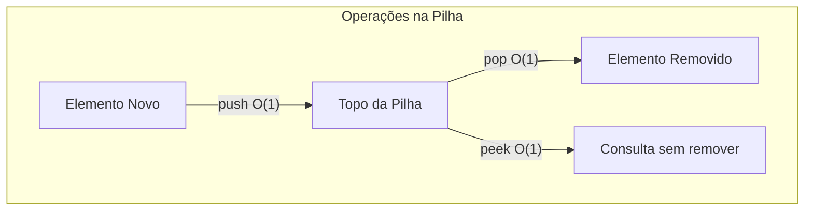
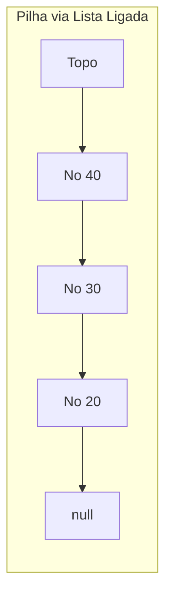
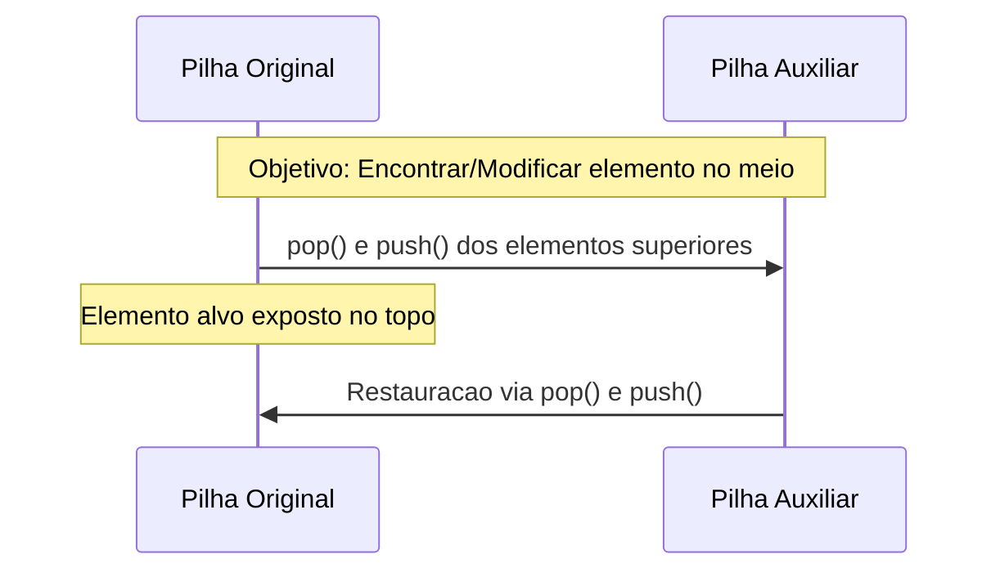
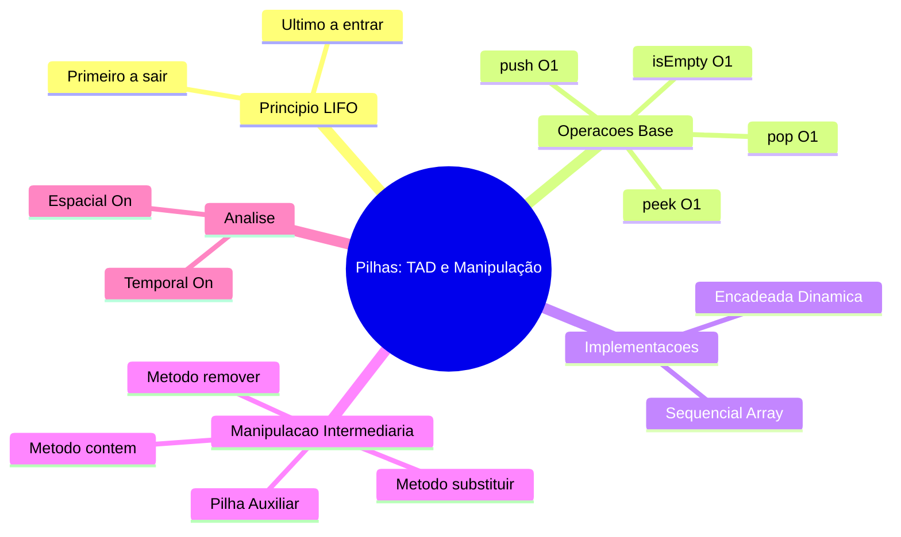

# Aula 08 — Pilhas Aplicações Manipulação e Análise de Complexidade

> **Professor:** Wesley Soares
> **Disciplina:** Estrutura de Dados I (4º Semestre)
> **Tema:** Aprofundamento no Tipo Abstrato de Dados (TAD) Pilha, manipulação de elementos intermediários com pilhas auxiliares, implementação encadeada dinâmica, análise de complexidade assintótica e trade-offs entre abordagens sequenciais e encadeadas.

## Sumário
- [Objetivo da aula](#objetivo-da-aula)
- [Contexto e pré-requisitos](#contexto-e-pré-requisitos)
- [Revisão do princípio LIFO e operações fundamentais](#revisão-do-princípio-lifo-e-operações-fundamentais-push-pop-peek-isempty)
- [Pilha como Tipo Abstrato de Dados (TAD) versus estrutura de armazenamento](#pilha-como-tipo-abstrato-de-dados-tad-versus-estrutura-de-armazenamento)
- [Relação e distinção conceitual entre Lista Sequencial e Pilha](#relação-e-distinção-conceitual-entre-lista-sequencial-e-pilha)
- [Mapeamento do comportamento de Pilha sobre Lista Ligada](#mapeamento-do-comportamento-de-pilha-sobre-lista-ligada-operações-no-início)
- [Implementação do Nó e da Pilha Encadeada Dinâmica em Java](#implementação-do-nó-e-da-pilha-encadeada-dinâmica-em-java)
- [Operação push com Lista Ligada e análise de complexidade](#operação-push-com-lista-ligada-e-análise-de-complexidade-o1)
- [Operação pop com Lista Ligada, tratamento de exceção e complexidade](#operação-pop-com-lista-ligada-tratamento-de-exceção-e-complexidade-o1)
- [Operações peek, isEmpty e size com complexidade O(1)](#operações-peek-isempty-e-size-com-complexidade-o1)
- [Acesso e inspeção de elementos intermediários sem quebra do princípio LIFO](#acesso-e-inspeção-de-elementos-intermediários-sem-quebra-do-princípio-lifo)
- [Uso de pilha auxiliar temporária para preservação e restauração de estado](#uso-de-pilha-auxiliar-temporária-para-preservação-e-restauração-de-estado)
- [Implementação e análise assintótica do método contem](#implementação-e-análise-assintótica-do-método-contem)
- [Substituição de valores internos com pilha auxiliar e análise de complexidade](#substituição-de-valores-internos-com-pilha-auxiliar-e-análise-de-complexidade-temporal-e-espacial-on)
- [Remoção de elementos arbitrários e reflexão sobre a escolha da estrutura](#remoção-de-elementos-arbitrários-removervalor-e-reflexão-sobre-a-escolha-da-estrutura-adequada)
- [Vantagens e desvantagens da Pilha Sequencial](#vantagens-e-desvantagens-da-pilha-sequencial-capacidade-estática-realocação-e-localidade-de-cache)
- [Vantagens e desvantagens da Pilha Ligada](#vantagens-e-desvantagens-da-pilha-ligada-crescimento-irrestrito-overhead-de-nós-e-coleta-de-lixo)
- [Código da aula](#código-da-aula)
- [Exercícios](#exercícios)
- [Erros comuns e boas práticas](#erros-comuns-e-boas-práticas)
- [Links e materiais complementares](#links-e-materiais-complementares)
- [Mapa da aula](#mapa-da-aula)
- [Glossário](#glossário)
- [Pontos-chave para a prova](#pontos-chave-para-prova)
- [Perguntas e respostas (JSONL)](#perguntas-e-respostas-jsonl)
- [Checklist de revisão](#checklist-de-revisão)

## Objetivo da aula
Ao final desta aula, o estudante deverá ser capaz de compreender a fundo o funcionamento do Tipo Abstrato de Dados (TAD) Pilha, dominando sua implementação baseada em vetores estáticos/sequenciais e em listas ligadas dinâmicas. Além disso, aprenderá técnicas rigorosas para manipular elementos internos da pilha sem violar o princípio LIFO por meio do uso de pilhas auxiliares, avaliando a complexidade temporal e espacial (`$\`O(n)\`$`), bem como discernindo quando a pilha é ou não a estrutura de dados correta para um dado problema de engenharia de software.

## Contexto e pré-requisitos
Para o correto aproveitamento desta aula, o aluno deve dominar os conceitos fundamentais de alocação de memória (estática e dinâmica), vetores (arrays), ponteiros ou referências em Java, além do conceito de Tipo Abstrato de Dados (TAD) e a notação assintótica Big-O introduzida nas aulas anteriores de Estrutura de Dados I.

## Revisão do princípio LIFO e operações fundamentais (push, pop, peek, isEmpty)
O princípio **LIFO** (*Last In, First Out* — O último que entra é o primeiro que sai) rege a estrutura de dados Pilha. Diferente de filas ou listas gerais, o acesso aos dados é estritamente restrito a uma única extremidade, denominada **topo**.

As operações fundamentais que definem a interface de uma pilha são:
- `push(v)`: Insere o elemento `v` no topo da pilha.
- `pop()`: Remove e retorna o elemento atualmente no topo da pilha.
- `peek()`: Retorna o valor do elemento no topo sem removê-lo.
- `isEmpty()`: Retorna um valor booleano indicando se a pilha está vazia.

Todas essas operações fundamentais operam em tempo constante $`\`O(1)\``$, independentemente do número de elementos armazenados na estrutura, desde que haja capacidade disponível (no caso sequencial).



## Pilha como Tipo Abstrato de Dados (TAD) versus estrutura de armazenamento
Uma pilha pode ser implementada utilizando diferentes estruturas de armazenamento subjacentes, tais como um array estático (lista sequencial) ou uma lista encadeada (lista ligada). Independentemente da escolha de implementação, o comportamento externo permanece idêntico. 

> **Definição de TAD:** Um Tipo Abstrato de Dados é um modelo matemático composto por um conjunto de dados e um conjunto de operações definidas sobre esses dados, ocultando os detalhes internos de implementação do usuário.

A motivação para tratar a pilha como um TAD reside no desacoplamento: o código cliente interage exclusivamente com os métodos públicos de controle, sem se importar se os dados estão contidos em um bloco contíguo de memória ou em nós espalhados conectados por referências.

## Relação e distinção conceitual entre Lista Sequencial e Pilha
Enquanto uma **Lista Sequencial** permite acesso aleatório e direto aos elementos por meio de índices (ex: `lista.obter(i)`, `lista.atualizar(i, valor)`), a **Pilha** restringe estritamente o acesso. 

- **Definição de Lista Sequencial:** Estrutura linear baseada em vetor onde qualquer posição pode ser lida ou modificada em tempo constante $`\`O(1)\``$ através de seu índice numérico.
- **Definição de Pilha:** Restrição conceitual sobre a lista onde modificações e leituras ocorrem exclusivamente no topo.

**Contraexemplo de uso incorreto:** Permitir que uma classe `Pilha` exponha um método `obterElemento(int indice)` transforma a pilha em uma lista comum disfarçada, quebrando o encapsulamento do TAD e abrindo brechas para corrupção lógica do princípio LIFO.

## Mapeamento do comportamento de Pilha sobre Lista Ligada (operações no início)
Para implementar uma pilha de tamanho dinâmico sem as limitações de capacidade fixa de um array, podemos utilizar uma lista simplesmente ligada. O segredo para obter complexidade $`\`O(1)\``$ em todas as operações fundamentais é mapear o topo da pilha para o **início** (cabeça) da lista ligada.



Se mapeássemos o topo para o final da lista ligada, precisaríamos percorrer toda a estrutura para remover ou inserir elementos, degradando a complexidade de `pop` para $`\`O(n)\``$.

## Implementação do Nó e da Pilha Encadeada Dinâmica em Java
A construção em código Java de uma pilha encadeada exige duas classes: o `No`, que encapsula o dado e a referência para o próximo elemento, e a `Pilha`, que gerencia o ponteiro para o topo e o tamanho atual.

```java
class No {
    int valor;
    No proximo;

    public No(int valor) {
        this.valor = valor;
        this.proximo = null;
    }
}

class PilhaLigada {
    private No topo;
    private int tamanho;

    public PilhaLigada() {
        this.topo = null;
        this.tamanho = 0;
    }
}
```

## Operação push com Lista Ligada e análise de complexidade O(1)
A inserção de um novo elemento (`push`) em uma pilha encadeada consiste em instanciar um novo nó, fazer seu ponteiro `proximo` apontar para o atual topo e, em seguida, atualizar o ponteiro `topo` para o novo nó.

```java
public void push(int valor) {
    No novo = new No(valor);
    novo.proximo = topo;
    topo = novo;
    tamanho++;
}
```

> **Motivação:** Como a inserção ocorre sempre no início da lista, não há necessidade de deslocar elementos nem de percorrer a estrutura. O tempo de execução é estritamente constante $`\`O(1)\``$.

## Operação pop com Lista Ligada, tratamento de exceção e complexidade O(1)
A remoção (`pop`) retira o elemento do topo. Antes de realizar a operação, é obrigatório verificar se a pilha está vazia para evitar um erro de referência nula (*NullPointerException*). Caso esteja vazia, lança-se uma exceção apropriada.

```java
public int pop() {
    if (isEmpty()) {
        throw new IllegalStateException("Erro: Tentativa de pop em pilha vazia.");
    }
    int valorRemovido = topo.valor;
    topo = topo.proximo;
    tamanho--;
    return valorRemovido;
}
```

A complexidade temporal desta operação é $`\`O(1)\``$, pois envolve apenas a realocação de referências na memória.

## Operações peek, isEmpty e size com complexidade O(1)
As operações de consulta e inspeção completam a interface essencial do TAD.

```java
public int peek() {
    if (isEmpty()) {
        throw new IllegalStateException("Erro: Pilha vazia.");
    }
    return topo.valor;
}

public boolean isEmpty() {
    return topo == null;
}

public int size() {
    return tamanho;
}
```

Como o atributo `tamanho` é mantido e atualizado a cada `push` e `pop`, o método `size()` executa em $`\`O(1)\``$ sem a necessidade de percorrer os nós.

## Acesso e inspeção de elementos intermediários sem quebra do princípio LIFO
Em cenários práticos, desenvolvedores frequentemente se deparam com o requisito de verificar ou alterar um elemento que se encontra no meio da pilha (por exemplo, abaixo do topo). 

> **Armadilha comum:** Acessar diretamente os ponteiros internos (como `topo.proximo.proximo.valor`) viola o encapsulamento e degrada a estrutura a uma lista encadeada comum, destruindo a garantia LIFO.

## Uso de pilha auxiliar temporária para preservação e restauração de estado
Para acessar ou modificar elementos intermediários de forma legítima, utiliza-se o artifício de uma **Pilha Auxiliar**. Os elementos do topo são desempilhados sequencialmente e armazenados na pilha auxiliar até que o elemento alvo seja alcançado. Após a operação, todos os elementos são devolvidos à pilha original na ordem correta.



## Implementação e análise assintótica do método contem()
O método `contem(int valor)` verifica se um determinado valor existe na pilha sem violar o TAD.

```java
public boolean contem(int valor) {
    PilhaLigada auxiliar = new PilhaLigada();
    boolean encontrou = false;

    while (!isEmpty()) {
        int atual = pop();
        if (atual == valor) {
            encontrou = true;
        }
        auxiliar.push(atual);
        if (encontrou) {
            break; // Opcional: pode parar ou esvaziar para restaurar
        }
    }
    
    // Versão rigorosa restaurando todos os elementos
    while (!auxiliar.isEmpty()) {
        push(auxiliar.pop());
    }

    return encontrou;
}
```

> **Análise de Complexidade:** No pior caso (o elemento não existe ou está no fundo), precisamos desempilhar todos os `n` elementos para a pilha auxiliar e depois reempilhá-los de volta. Logo, a complexidade temporal é $`\`O(n)\``$ e a complexidade de espaço auxiliar é $`\`O(n)\``$ devido à pilha temporária.

## Substituição de valores internos com pilha auxiliar e análise de complexidade temporal e espacial O(n)
Para substituir um valor antigo por um novo valor em uma posição arbitrária da pilha, aplicamos o mesmo princípio de desempilhamento temporário.

```java
public boolean substituir(int valorAntigo, int valorNovo) {
    PilhaLigada auxiliar = new PilhaLigada();
    boolean encontrou = false;

    while (!isEmpty()) {
        int atual = pop();
        if (!encontrou && atual == valorAntigo) {
            auxiliar.push(valorNovo);
            encontrou = true;
        } else {
            auxiliar.push(atual);
        }
    }

    while (!auxiliar.isEmpty()) {
        push(auxiliar.pop());
    }

    return encontrou;
}
```

A complexidade temporal permanece $`\`O(n)\``$ e o espaço auxiliar é $`\`O(n)\``$.

## Remoção de elementos arbitrários (removerValor()) e reflexão sobre a escolha da estrutura adequada
Podemos remover a primeira ocorrência de um valor específico a partir do topo utilizando a seguinte lógica:

```java
public boolean removerValor(int valor) {
    PilhaLigada auxiliar = new PilhaLigada();
    boolean removeu = false;

    while (!isEmpty()) {
        int atual = pop();
        if (!removeu && atual == valor) {
            removeu = true;
            continue; // descarta o elemento
        }
        auxiliar.push(atual);
    }

    while (!auxiliar.isEmpty()) {
        push(auxiliar.pop());
    }

    return removeu;
}
```

> **Reflexão do Engenheiro:** Se um sistema exige operações constantes de busca, inserção e remoção no meio de uma estrutura, a **Pilha é a estrutura errada**. Para tais casos, estruturas como Árvores de Busca, Tabelas Hash ou Listas Duplamente Ligadas devem ser preferidas.

## Vantagens e desvantagens da Pilha Sequencial (capacidade estática, realocação e localidade de cache)
| Vantagens | Desvantagens |
| :--- | :--- |
| Implementação simples baseada em vetores | Capacidade pré-definida (estática) |
| Baixo *overhead* de memória por elemento | Custo de redimensionamento (`$\`O(n)\`$`) |
| Excelente localidade de cache de CPU | Desperdício de memória se subutilizada |

## Vantagens e desvantagens da Pilha Ligada (crescimento irrestrito, overhead de nós e coleta de lixo)
| Vantagens | Desvantagens |
| :--- | :--- |
| Crescimento dinâmico sem limite pré-fixado | Maior consumo de memória por nó (ponteiros) |
| Operações de inserção/remoção em $`\`O(1)\``$ real | Menor localidade de cache (dados dispersos) |
| Sem necessidade de realocação de arrays | Custo associado ao coletor de lixo (*GC*) |

## Código da aula
Abaixo são apresentados os arquivos de código desenvolvidos para ilustrar os conceitos teóricos desta aula.

### `ExemplosAula.java`
Implementação completa da pilha ligada e métodos de manipulação intermediária com pilha auxiliar.
```java
// Localização: ./codigo/ExemplosAula.java
package codigo;

class No {
    int valor;
    No proximo;

    public No(int valor) {
        this.valor = valor;
        this.proximo = null;
    }
}

public class ExemplosAula {
    private No topo;
    private int tamanho;

    public ExemplosAula() {
        this.topo = null;
        this.tamanho = 0;
    }

    public void push(int valor) {
        No novo = new No(valor);
        novo.proximo = topo;
        topo = novo;
        tamanho++;
    }

    public int pop() {
        if (isEmpty()) {
            throw new IllegalStateException("Pilha vazia.");
        }
        int val = topo.valor;
        topo = topo.proximo;
        tamanho--;
        return val;
    }

    public int peek() {
        if (isEmpty()) {
            throw new IllegalStateException("Pilha vazia.");
        }
        return topo.valor;
    }

    public boolean isEmpty() {
        return topo == null;
    }

    public int size() {
        return tamanho;
    }

    public boolean contem(int valor) {
        ExemplosAula auxiliar = new ExemplosAula();
        boolean encontrou = false;

        while (!isEmpty()) {
            int atual = pop();
            if (atual == valor) {
                encontrou = true;
            }
            auxiliar.push(atual);
        }

        while (!auxiliar.isEmpty()) {
            push(auxiliar.pop());
        }

        return encontrou;
    }
}
```

### `Exercicios.java`
Resolução dos exercícios práticos propostos.
```java
// Localização: ./codigo/Exercicios.java
package codigo;

public class Exercicios {
    
    public static ExemplosAula inverterPilha(ExemplosAula original) {
        ExemplosAula aux1 = new ExemplosAula();
        ExemplosAula invertida = new ExemplosAula();

        // Esvazia original para aux1 (inverte a ordem)
        while (!original.isEmpty()) {
            aux1.push(original.pop());
        }

        // Restaura original e constrói a invertida
        while (!aux1.isEmpty()) {
            int val = aux1.pop();
            original.push(val);
            invertida.push(val);
        }

        return invertida;
    }

    public static boolean verificarBalanceamento(String expressao) {
        ExemplosAula p = new ExemplosAula();
        for (int i = 0; i < expressao.length(); i++) {
            char c = expressao.charAt(i);
            if (c == '(' || c == '[' || c == '{') {
                p.push(c);
            } else if (c == ')' || c == ']' || c == '}') {
                if (p.isEmpty()) return false;
                char topo = (char) p.pop();
                if ((c == ')' && topo != '(') ||
                    (c == ']' && topo != '[') ||
                    (c == '}' && topo != '{')) {
                    return false;
                }
            }
        }
        return p.isEmpty();
    }
}
```

## Exercícios

### Exercício 1: Inversão de Conteúdo de Pilha Preservando Abstração
- **Enunciado:** Implemente um método estático `public static ExemplosAula inverterPilha(ExemplosAula original)` que receba uma pilha e retorne uma nova pilha com todos os elementos na ordem inversa, restaurando a pilha original ao final.
- **Raciocínio:** Utilizar duas pilhas auxiliares ou transferir elementos garantindo a preservação do TAD por meio exclusivo de `push` e `pop`.
- **Resolução:** Ver arquivo `./codigo/Exercicios.java`.

### Exercício 2: Verificador de Delimitadores e Parênteses Balanceados
- **Enunciado:** Implemente o método `public static boolean verificarBalanceamento(String expressao)` para validar chaves, colchetes e parênteses.
- **Raciocínio:** Percorrer a string caractere por caractere; empilhar aberturas e desempilhar correspondentes ao encontrar fechamentos.
- **Resolução:** Ver arquivo `./codigo/Exercicios.java`.

### Exercício 3: Contador de Ocorrências com Pilha Auxiliar
- **Enunciado:** Implementar um método `public int contarOcorrencias(int valor)` que conte quantas vezes um valor aparece na pilha usando uma pilha auxiliar e restaure a estrutura original.
- **Raciocínio:** Desempilhar tudo para a auxiliar incrementando um contador se `atual == valor`, depois restaurar. Complexidade temporal $`\`O(n)\``$.

### Exercício 4: Pilha Sequencial Dinâmica com Redimensionamento Amortizado
- **Enunciado:** Construir uma classe `PilhaSequencial` que duplique sua capacidade quando cheia e reduza pela metade quando ocupada em menos de 25%.
- **Raciocínio:** Gerenciar um array interno redimensionável usando `System.arraycopy`.

## Erros comuns e boas práticas
- **Erro comum:** Acessar nós diretamente através de ponteiros (`topo.proximo`) em algoritmos clientes, violando o encapsulamento do TAD.
- **Boa prática:** Sempre verificar `isEmpty()` antes de invocar `pop()` ou `peek()` para evitar exceções em tempo de execução.
- **Boa prática:** Garantir a restauração completa da pilha original ao realizar operações de busca ou alteração com pilhas auxiliares.

## Links e materiais complementares
- [Documentação Oficial Java - Stack Class](https://docs.oracle.com/en/java/)
- [Repositório da Disciplina - UniFEF](https://outgoing-salt-444.notion.site/)

## Mapa da aula


## Glossário
| Termo | Definição |
| :--- | :--- |
| **LIFO** | Sigla para *Last In, First Out*, princípio de ordenação onde o último elemento inserido é o primeiro a ser removido. |
| **TAD** | Tipo Abstrato de Dados; modelo lógico que define uma estrutura de dados por suas operações e comportamento, ocultando detalhes de implementação. |
| **Topo** | Extremidade única de uma pilha onde ocorrem todas as inserções, remoções e consultas. |
| **Complexidade Amortizada** | Custo médio por operação ao longo de uma sequência de operações, útil para estruturas com redimensionamento. |

## Pontos-chave para a prova
1. O princípio LIFO e a garantia de tempo $`\`O(1)\``$ para as operações fundamentais (`push`, `pop`, `peek`).
2. A importância de utilizar pilhas auxiliares para inspecionar ou modificar elementos intermediários sem quebrar o TAD.
3. A diferença estrutural e de complexidade entre pilhas sequenciais (estáticas) e encadeadas (dinâmicas).
4. Análise assintótica de algoritmos que manipulam pilhas utilizando estruturas temporárias (`$\`O(n)\`$` de tempo e espaço).

## Perguntas e respostas (JSONL)
```jsonl
{"pergunta": "Qual é o princípio de funcionamento da estrutura Pilha?", "resposta": "LIFO (Last In, First Out), onde o último elemento inserido é o primeiro a ser removido.", "dificuldade": "fácil"}
{"pergunta": "Qual é a complexidade assintótica das operações push e pop em uma pilha encadeada?", "resposta": "O(1)", "dificuldade": "fácil"}
{"pergunta": "Por que o topo da pilha deve ser mapeado para o início da lista ligada?", "resposta": "Para garantir inserções e remoções em O(1) sem a necessidade de percorrer a lista.", "dificuldade": "média"}
{"pergunta": "Como é possível acessar um elemento no meio da pilha sem violar o TAD?", "resposta": "Utilizando uma pilha auxiliar temporária para desempilhar os elementos superiores e depois restaurá-los.", "dificuldade": "difícil"}
{"pergunta": "Qual é a complexidade de espaço ao utilizar uma pilha auxiliar para buscar um elemento?", "resposta": "O(n)", "dificuldade": "média"}
```

## Checklist de revisão
- [ ] Compreender o princípio LIFO e as operações básicas (`push`, `pop`, `peek`, `isEmpty`).
- [ ] Entender a diferença entre TAD e estrutura de armazenamento.
- [ ] Implementar a pilha utilizando lista encadeada dinâmica.
- [ ] Dominar o uso de pilha auxiliar para manipulação de elementos intermediários.
- [ ] Analisar a complexidade de tempo e espaço de algoritmos baseados em pilhas.
- [ ] Conhecer as vantagens e desvantagens das abordagens sequencial e encadeada.
