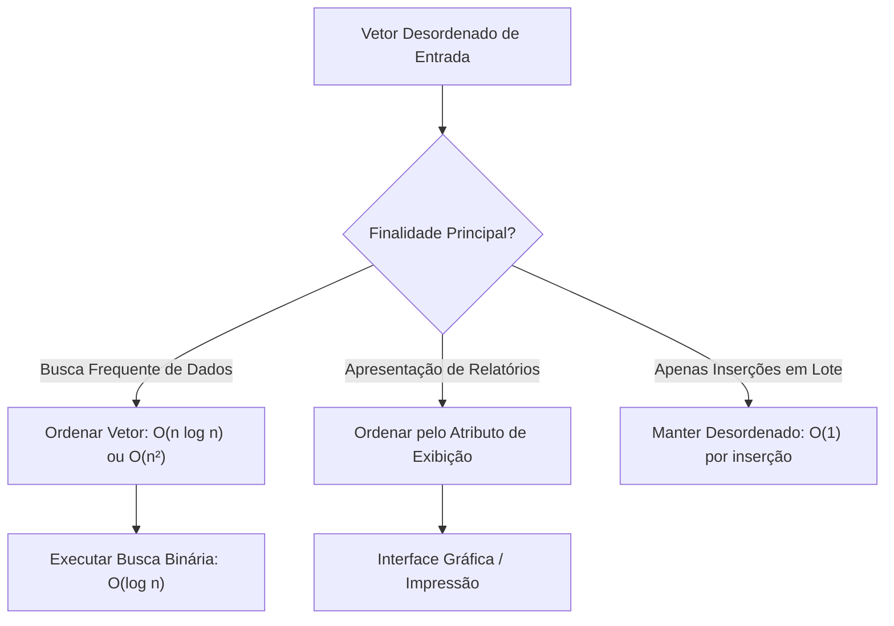
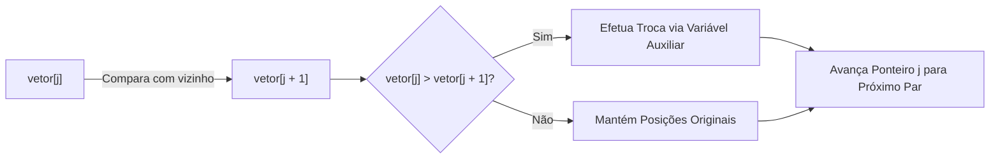
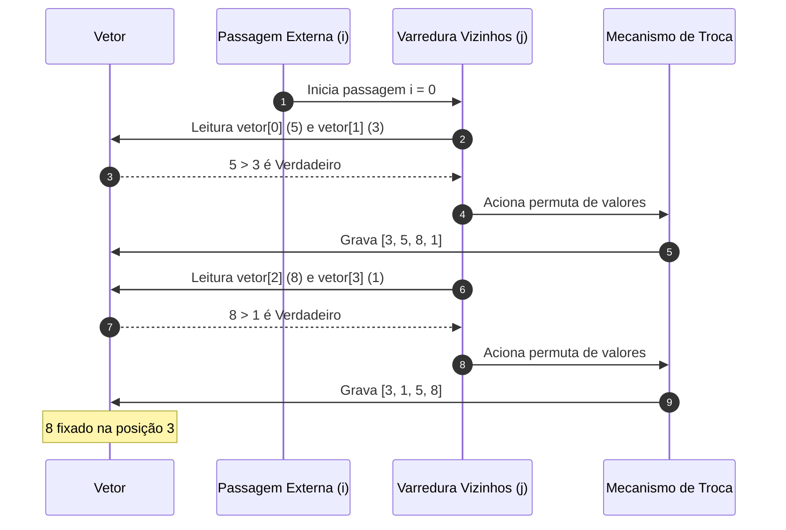
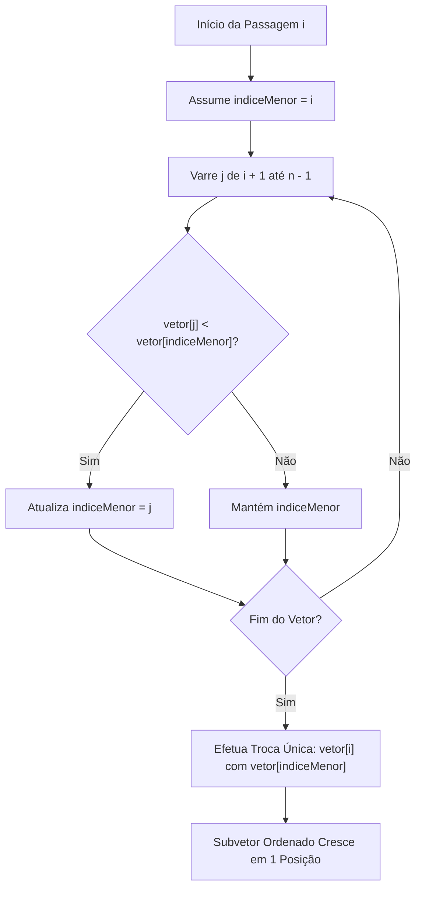
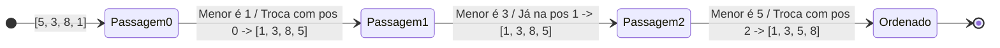
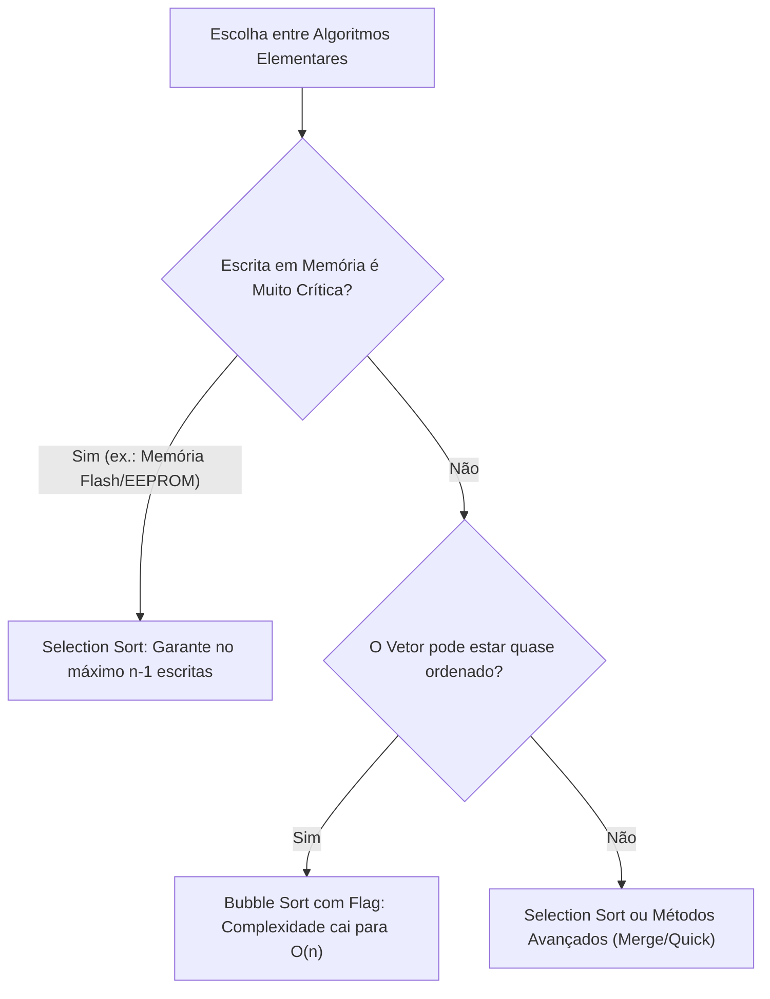
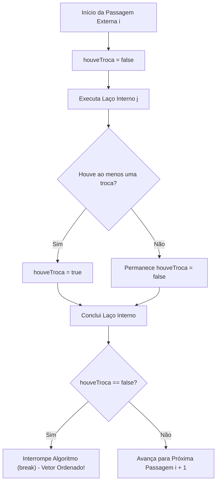

# Aula 09 — Ordenação com Bubble Sort e Selection Sort

> **Professor:** Wesley Soares
> **Disciplina:** Estrutura de Dados I (4º Semestre)
> **Tema:** Fundamentos de algoritmos de ordenação por trocas adjacentes (Bubble Sort) e seleção de extremos (Selection Sort), análise de complexidade quadrática e otimizações.

---

## Sumário

- [Objetivo da aula](#objetivo-da-aula)
- [Contexto e pré-requisitos](#contexto-e-pré-requisitos)
- [Importância e motivação da ordenação de dados em sistemas computacionais](#importância-e-motivação-da-ordenação-de-dados-em-sistemas-computacionais)
- [Conceito e estratégia de trocas adjacentes do Bubble Sort](#conceito-e-estratégia-de-trocas-adjacentes-do-bubble-sort)
- [Simulação e rastreamento passo a passo do Bubble Sort](#simulação-e-rastreamento-passo-a-passo-do-bubble-sort)
- [Implementação do Bubble Sort básico em Java](#implementação-do-bubble-sort-básico-em-java)
- [Conceito e estratégia de seleção de extremos do Selection Sort](#conceito-e-estratégia-de-seleção-de-extremos-do-selection-sort)
- [Simulação e rastreamento passo a passo do Selection Sort](#simulação-e-rastreamento-passo-a-passo-do-selection-sort)
- [Implementação do Selection Sort em Java](#implementação-do-selection-sort-em-java)
- [Comparativo de comparações e trocas entre Bubble Sort e Selection Sort](#comparativo-de-comparações-e-trocas-entre-bubble-sort-e-selection-sort)
- [Análise de complexidade temporal O(n²) e espaço auxiliar O(1)](#análise-de-complexidade-temporal-on²-e-espaço-auxiliar-o1)
- [Otimização do Bubble Sort com variável de controle para melhor caso O(n)](#otimização-do-bubble-sort-com-variável-de-controle-para-melhor-caso-on)
- [Código da aula](#código-da-aula)
- [Exercícios](#exercícios)
- [Erros comuns e boas práticas](#erros-comuns-e-boas-práticas)
- [Links e materiais complementares](#links-e-materiais-complementares)
- [Mapa da aula](#mapa-da-aula)
- [Glossário](#glossário)
- [Pontos-chave para a prova](#pontos-chave-para-a-prova)
- [Perguntas e respostas (JSONL)](#perguntas-e-respostas-jsonl)
- [Checklist de revisão](#checklist-de-revisão)

---

## Objetivo da aula

Ao concluir o estudo deste material, o estudante deverá ser capaz de:
- Compreender a finalidade e o impacto prático dos algoritmos de ordenação na organização de dados e eficiência de sistemas de informação.
- Diferenciar os paradigmas de ordenação elementar: comparação e troca adjacente (*Bubble Sort*) versus busca e seleção de valor extremo (*Selection Sort*).
- Executar testes de mesa e rastreamentos manuais completos em vetores unidimensionais, identificando o estado da estrutura a cada ciclo.
- Implementar as versões canônicas de ambos os algoritmos na linguagem Java, manipulando corretamente índices, variáveis temporárias e laços aninhados.
- Contabilizar e distinguir operações críticas: comparações de chaves, atribuições e movimentações de memória.
- Demonstrar algebricamente a derivação da complexidade assintótica de tempo $`O(n^2)`$ no pior e caso médio, bem como a complexidade espacial auxiliar $`O(1)`$.
- Implementar a otimização de parada antecipada no Bubble Sort por meio de sinalizadores (*flags*), reduzindo a complexidade temporal para $`O(n)`$ no melhor caso.

---

## Contexto e pré-requisitos

Para o pleno aproveitamento deste conteúdo, é fundamental que o acadêmico domine:
1. **Manipulação de Vetores (*Arrays*) em Java:** Alocação de memória estática, indexação de $`0`$ até $`n - 1`$, e leitura/escrita através da propriedade `.length`.
2. **Estruturas de Controle e Repetição:** Laços encadeados (`for`, `while`) e desvios condicionais (`if/else`).
3. **Noções Preliminares de Análise Assintótica:** Conceito de contagem de instruções primitivas em função do tamanho da entrada $`n`$ (Notação Big-O).
4. **Passagem de Parâmetros por Referência:** Compreensão de que arrays em Java são tratados como objetos na memória *Heap*, de modo que modificações em seus elementos dentro de métodos afetam a estrutura original (*in-place*).

---

## Importância e motivação da ordenação de dados em sistemas computacionais

### Definição
A ordenação de dados consiste no processo computacional de rearranjar uma coleção finita de registros de acordo com uma relação de ordem total pré-definida (crescente, decrescente, lexicográfica ou por chaves compostas). Em termos matemáticos, dado um conjunto de elementos $`\{a_0, a_1, \dots, a_{n-1}\}`$, a ordenação gera uma permutação $`\{a'_0, a'_1, \dots, a'_{n-1}\}`$ tal que $`a'_0 \le a'_1 \le \dots \le a'_{n-1}`$ para todo índice válido.

### Motivação
Em sistemas corporativos e bancos de dados, a ordenação é um requisito viabilizador de desempenho:
- **Otimização de Pesquisas:** Em uma base desordenada, localizar um elemento exige busca linear de custo $`O(n)`$. Uma vez ordenado o conjunto, algoritmos como a Busca Binária encontram qualquer registro com custo logarítmico $`O(\log n)`$.
- **Apresentação Humana:** Relatórios financeiros, folhas de pagamento e listagens acadêmicas demandam apresentação em ordem alfabética ou por pontuação para garantir usabilidade.
- **Detecção de Duplicidades e Junções:** Algoritmos de união, interseção e consolidação (*merge*) de fluxos de dados atingem tempos lineares se os vetores de entrada estiverem ordenados.

### Exemplo
Considere um sistema acadêmico que recebe um vetor desordenado contendo notas de discentes:
```text
Entrada: [7, 4, 9, 2, 6]
Critério: Ordem Numérica Crescente
Saída:   [2, 4, 6, 7, 9]
```

### Contraexemplo
Ordenar estruturas dinâmicas heterogêneas sem um critério de comparação bem definido (por exemplo, misturar objetos sem interface comparável ou tentar ordenar nós de uma árvore binária não balanceada apenas transpondo ponteiros aleatoriamente) não configura um processo de ordenação estável ou válido. Da mesma forma, em coleções com inserção e remoção em alta frequência onde consultas raramente ocorrem, reordenar todo o conjunto a cada operação pode gerar sobrecarga computacional desnecessária.

### Armadilhas
- **Assumir estabilidade sem verificar:** Nem todo algoritmo preserva a ordem relativa de elementos com chaves iguais.
- **Ordenar dados que nunca serão consultados:** Executar ordenação em lote (*batch*) sem demanda de leitura degrada o tempo de processamento em sistemas transacionais de alto débito.



---

## Conceito e estratégia de trocas adjacentes do Bubble Sort

### Definição
O Bubble Sort (Método da Bolha) é um algoritmo de ordenação comparativa interna baseado no princípio da propagação de elementos por meio de trocas contínuas entre vizinhos imediatos.

### Motivação e Mecanismo de Funcionamento
O nome "bolha" provém da analogia física onde os elementos maiores (mais "pesados" ou mais "leves", dependendo da perspectiva de flutuação) sobem sucessivamente para as posições finais do vetor, assim como bolhas de ar emergem à superfície de um fluido.
A estratégia consiste em:
1. Comparar os elementos adjacentes $`vetor[j]`$ e $`vetor[j + 1]`$.
2. Se $`vetor[j] > vetor[j + 1]`$ (fora de ordem crescente), inverter os valores.
3. Avançar o índice $`j`$ e repetir a comparação até o fim do limite não ordenado.
4. Ao final de cada varredura completa, garante-se que o maior elemento restante encontra-se rigorosamente em sua posição definitiva no final do vetor.



### Exemplo
Dado o par $`[5, 3]`$, como $`5 > 3`$, uma troca imediata é disparada, resultando em $`[3, 5]`$. O próximo par analisado envolverá o elemento que agora ocupa o índice seguinte ($`5`$) e seu novo vizinho à direita.

### Contraexemplo
Comparar o elemento atual $`vetor[j]`$ diretamente com posições distantes (como $`vetor[j + k]`$ onde $`k > 1`$) descaracteriza o Bubble Sort e aproxima a abordagem de algoritmos como o Shell Sort ou Quick Sort.

### Armadilhas
- **Não decrementar o limite interno:** Continuar comparando até a última posição do vetor em todas as passagens resulta em comparações inúteis com elementos já consolidados no final do array.

---

## Simulação e rastreamento passo a passo do Bubble Sort

Para consolidar o comportamento das trocas adjacentes, executamos o rastreamento manual com o vetor de teste apresentado em aula:
```text
Vetor Inicial: [5, 3, 8, 1] | Tamanho n = 4
```

### Primeira Passagem (i = 0)
O laço interno deve percorrer de $`j = 0`$ até $`j < n - 1 - i`$ (ou seja, de $`0`$ até $`2`$):
1. **Comparação 1 ($`j = 0`$):** Compara $`vetor[0]`$ (5) com $`vetor[1]`$ (3).
   - Como $`5 > 3`$, realiza a **troca**.
   - Estado: `[3, 5, 8, 1]`
2. **Comparação 2 ($`j = 1`$):** Compara $`vetor[1]`$ (5) com $`vetor[2]`$ (8).
   - Como $`5 \le 8`$, **não há troca**.
   - Estado: `[3, 5, 8, 1]`
3. **Comparação 3 ($`j = 2`$):** Compara $`vetor[2]`$ (8) com $`vetor[3]`$ (1).
   - Como $`8 > 1`$, realiza a **troca**.
   - Estado: `[3, 5, 1, 8]`

*Resultado da 1ª passagem:* O maior elemento do vetor (`8`) atingiu a última posição (`índice 3`). Ele está consolidado.

### Segunda Passagem (i = 1)
O laço interno percorre de $`j = 0`$ até $`j < n - 1 - 1 = 1`$:
1. **Comparação 1 ($`j = 0`$):** Compara $`vetor[0]`$ (3) com $`vetor[1]`$ (5).
   - Como $`3 \le 5`$, **não há troca**.
   - Estado: `[3, 5, 1, 8]`
2. **Comparação 2 ($`j = 1`$):** Compara $`vetor[1]`$ (5) com $`vetor[2]`$ (1).
   - Como $`5 > 1`$, realiza a **troca**.
   - Estado: `[3, 1, 5, 8]`

*Resultado da 2ª passagem:* O segundo maior elemento (`5`) ocupa a sua posição definitiva (`índice 2`).

### Terceira Passagem (i = 2)
O laço interno percorre de $`j = 0`$ até $`j < n - 1 - 2 = 0`$:
1. **Comparação 1 ($`j = 0`$):** Compara $`vetor[0]`$ (3) com $`vetor[1]`$ (1).
   - Como $`3 > 1`$, realiza a **troca**.
   - Estado: `[1, 3, 5, 8]`

*Resultado da 3ª passagem:* O vetor atinge ordenação total.

### Tabela de Rastreamento Consolidada
| Passagem (`i`) | Índice `j` | Elementos Comparados | Ação Executada | Vetor Resultante | Elemento Fixado |
|---|---|---|---|---|---|
| Início | - | - | Carga inicial | `[5, 3, 8, 1]` | Nenhum |
| 0 | 0 | `vetor[0]=5` vs `vetor[1]=3` | Troca (5 > 3) | `[3, 5, 8, 1]` | - |
| 0 | 1 | `vetor[1]=5` vs `vetor[2]=8` | Nenhuma (5 < 8) | `[3, 5, 8, 1]` | - |
| 0 | 2 | `vetor[2]=8` vs `vetor[3]=1` | Troca (8 > 1) | `[3, 1, 5, 8]` | **8** (índice 3) |
| 1 | 0 | `vetor[0]=3` vs `vetor[1]=5` | Nenhuma (3 < 5) | `[3, 1, 5, 8]` | - |
| 1 | 1 | `vetor[1]=5` vs `vetor[2]=1` | Troca (5 > 1) | `[3, 1, 5, 8]` | **5** (índice 2) |
| 2 | 0 | `vetor[0]=3` vs `vetor[1]=1` | Troca (3 > 1) | `[1, 3, 5, 8]` | **3** e **1** (índices 1 e 0) |



---

## Implementação do Bubble Sort básico em Java

### Código Canônico
Abaixo apresenta-se a estrutura em Java correspondente à aula ministrada:

```java
public class BubbleSort {

    /**
     * Ordena um vetor de inteiros em ordem crescente utilizando o Bubble Sort clássico.
     * @param vetor Array unidimensional a ser reordenado in-place.
     */
    public static void ordenar(int[] vetor) {
        int n = vetor.length;

        // Laço externo: controla a quantidade de passagens globais (n - 1)
        for (int i = 0; i < n - 1; i++) {

            // Laço interno: percorre os pares adjacentes ainda não ordenados
            for (int j = 0; j < n - 1 - i; j++) {

                // Condição de ordenação: elemento da esquerda estritamente maior que o da direita
                if (vetor[j] > vetor[j + 1]) {
                    // Procedimento de troca segura (swap) com variável temporária
                    int temporario = vetor[j];
                    vetor[j] = vetor[j + 1];
                    vetor[j + 1] = temporario;
                }
            }
        }
    }

    public static void main(String[] args) {
        int[] numeros = {5, 3, 8, 1};

        ordenar(numeros);

        for (int numero : numeros) {
            System.out.print(numero + " ");
        }
        System.out.println();
    }
}
```

### Análise Estrutural do Código
1. **Condição do laço externo (`i < n - 1`):** São necessárias no máximo $`n - 1`$ iterações. Quando $`n - 1`$ elementos encontram-se em suas posições corretas, o último elemento restante obrigatoriamente estará em seu lugar.
2. **Subtração de `i` no laço interno (`n - 1 - i`):** A cada término de passagem $`i`$, o $`i`$-ésimo maior elemento já repousa em sua posição final. Compará-lo novamente gera ciclos de processamento redundantes.
3. **Mecanismo da Variável Auxiliar (`temporario`):** Atribuir diretamente `vetor[j] = vetor[j + 1]` sobrescreveria o valor original de `vetor[j]`, destruindo o dado original antes de sua cópia para `vetor[j + 1]`.

---

## Conceito e estratégia de seleção de extremos do Selection Sort

### Definição
O Selection Sort (Ordenação por Seleção) é um algoritmo de ordenação comparativa que particiona virtualmente o vetor em duas regiões:
1. Subvetor esquerdo já ordenado.
2. Subvetor direito desordenado.

### Motivação e Mecanismo de Funcionamento
Em contrapartida ao Bubble Sort, que realiza trocas sucessivas e imediatas ao longo de toda a varredura, o Selection Sort opera com base no isolamento de índices.
A estratégia consiste em:
1. Selecionar o primeiro índice da partição não ordenada como candidato ao menor valor (`indiceMenor = i`).
2. Varrer toda a partição restante à direita (`j = i + 1` até o final do array).
3. Se um valor menor for detectado, atualiza-se apenas o ponteiro do índice: `indiceMenor = j`.
4. Ao término do laço interno, executa-se **uma única troca** entre a posição corrente $`i`$ e a posição $`indiceMenor`$.



### Exemplo
Dado o vetor `[5, 3, 8, 1]`, o algoritmo examina todos os elementos e identifica que `1` (no índice 3) é o menor absoluto. Ele realiza uma única troca entre o índice 0 (`5`) e o índice 3 (`1`), produzindo `[1, 3, 8, 5]`. Nenhuma movimentação física intermediária foi feita para os elementos 3 e 8.

### Contraexemplo
Efetuar trocas de elementos toda vez que um valor menor for encontrado durante a varredura interna destrói a principal vantagem do Selection Sort, convertendo-o em uma variante ineficiente de troca contínua.

### Armadilhas
- **Instabilidade do algoritmo:** O Selection Sort padrão é inerentemente instável. Por exemplo, no vetor `[4a, 4b, 2]`, o `2` será trocado com `4a`, resultando em `[2, 4b, 4a]`, invertendo a ordem original dos elementos idênticos.

---

## Simulação e rastreamento passo a passo do Selection Sort

Rastreamento manual para o vetor:
```text
Vetor Inicial: [5, 3, 8, 1] | Tamanho n = 4
```

### Primeira Passagem (i = 0)
- Inicialização: `indiceMenor = 0` (valor inicial de referência = 5).
- Comparações:
  - $`j = 1`$: Compara `vetor[1]` (3) com `vetor[indiceMenor]` (5). Como $`3 < 5`$, `indiceMenor = 1`.
  - $`j = 2`$: Compara `vetor[2]` (8) com `vetor[indiceMenor]` (3). Como $`8 \ge 3`$, mantém `indiceMenor = 1`.
  - $`j = 3`$: Compara `vetor[3]` (1) com `vetor[indiceMenor]` (3). Como $`1 < 3`$, `indiceMenor = 3`.
- Fim da varredura: `indiceMenor = 3` (valor 1).
- Troca: Permuta `vetor[0]` (5) com `vetor[3]` (1).
- Estado: `[1, 3, 8, 5]` (O índice 0 está ordenado).

### Segunda Passagem (i = 1)
- Inicialização: `indiceMenor = 1` (valor de referência = 3).
- Comparações no subvetor restante `[3, 8, 5]`:
  - $`j = 2`$: Compara `vetor[2]` (8) com `vetor[indiceMenor]` (3). Como $`8 \ge 3`$, mantém `indiceMenor = 1`.
  - $`j = 3`$: Compara `vetor[3]` (5) com `vetor[indiceMenor]` (3). Como $`5 \ge 3`$, mantém `indiceMenor = 1`.
- Fim da varredura: `indiceMenor = 1`.
- Troca: Permuta `vetor[1]` consigo mesmo (ou operação redundante mantida).
- Estado: `[1, 3, 8, 5]` (Os índices 0 e 1 estão ordenados).

### Terceira Passagem (i = 2)
- Inicialização: `indiceMenor = 2` (valor de referência = 8).
- Comparações no subvetor restante `[8, 5]`:
  - $`j = 3`$: Compara `vetor[3]` (5) com `vetor[indiceMenor]` (8). Como $`5 < 8`$, `indiceMenor = 3`.
- Fim da varredura: `indiceMenor = 3` (valor 5).
- Troca: Permuta `vetor[2]` (8) com `vetor[3]` (5).
- Estado: `[1, 3, 5, 8]` (Ordenação concluída).

### Tabela de Rastreamento do Selection Sort
| Passagem (`i`) | Subvetor Não Ordenado | Menor Encontrado | Posição Original | Troca Efetuada | Vetor ao Fim da Passagem |
|---|---|---|---|---|---|
| 0 | `[5, 3, 8, 1]` | `1` | Índice 3 | `vetor[0]` com `vetor[3]` | `[1, 3, 8, 5]` |
| 1 | `[3, 8, 5]` | `3` | Índice 1 | `vetor[1]` com `vetor[1]` | `[1, 3, 8, 5]` |
| 2 | `[8, 5]` | `5` | Índice 3 | `vetor[2]` com `vetor[3]` | `[1, 3, 5, 8]` |



---

## Implementação do Selection Sort em Java

### Código Canônico
Abaixo apresenta-se a implementação em Java:

```java
public class SelectionSort {

    /**
     * Ordena um vetor de inteiros em ordem crescente utilizando o Selection Sort.
     * @param vetor Array unidimensional a ser reordenado in-place.
     */
    public static void ordenar(int[] vetor) {
        int n = vetor.length;

        // Laço externo: move a fronteira do subvetor ordenado
        for (int i = 0; i < n - 1; i++) {

            // Assume inicialmente que o menor valor está no primeiro índice da partição
            int indiceMenor = i;

            // Laço interno: localiza o menor elemento remanescente
            for (int j = i + 1; j < n; j++) {
                if (vetor[j] < vetor[indiceMenor]) {
                    indiceMenor = j; // Registra apenas o índice, sem troca de dados em memória
                }
            }

            // Realiza uma única troca por iteração externa
            int temporario = vetor[i];
            vetor[i] = vetor[indiceMenor];
            vetor[indiceMenor] = temporario;
        }
    }

    public static void main(String[] args) {
        int[] numeros = {5, 3, 8, 1};

        ordenar(numeros);

        for (int numero : numeros) {
            System.out.print(numero + " ");
        }
        System.out.println();
    }
}
```

### Análise Detalhada dos Componentes
1. `int indiceMenor = i;`: O algoritmo armazena uma referência de posição ao invés de copiar o valor do dado. Essa abordagem economiza manipulações de tipos primitivos ou objetos pesados.
2. `for (int j = i + 1; j < n; j++)`: O laço inicia rigorosamente após a fronteira de ordenação já consolidada.
3. **Escrita no Array:** A operação de escrita no vetor só ocorre exatamente após o término da busca linear interna. Se o menor elemento já estiver na posição correta (`indiceMenor == i`), a troca é redundante mas inócua computacionalmente.

---

## Comparativo de comparações e trocas entre Bubble Sort e Selection Sort

Embora ambos os algoritmos apresentem complexidade assintótica teórica quadrática, suas dinâmicas operacionais de hardware e processamento divergem profundamente no que tange à manipulação de memória.

### Tabela Comparativa Detalhada
| Métrica / Propriedade | Bubble Sort (Básico) | Selection Sort |
|---|---|---|
| **Estratégia Principal** | Trocas contínuas entre vizinhos | Seleção do menor elemento absoluto |
| **Comparações no Pior Caso** | $`\frac{n(n - 1)}{2} = O(n^2)`$ | $`\frac{n(n - 1)}{2} = O(n^2)`$ |
| **Comparações no Melhor Caso** | $`\frac{n(n - 1)}{2} = O(n^2)`$ *(sem flag)* | $`\frac{n(n - 1)}{2} = O(n^2)`$ |
| **Comparações no Melhor Caso (Otimizado)** | $`n - 1 = O(n)`$ *(com flag)* | $`\frac{n(n - 1)}{2} = O(n^2)`$ |
| **Quantidade de Trocas no Pior Caso** | $`\frac{n(n - 1)}{2} = O(n^2)`$ | $`n - 1 = O(n)`$ |
| **Quantidade de Trocas no Melhor Caso** | $`0`$ | $`0`$ (ou $`n-1`$ trocas redundantes) |
| **Estabilidade Temporal** | Estável (preserva ordem de chaves iguais) | Instável (pode transpor chaves idênticas) |
| **Memória Auxiliar** | $`O(1)`$ (In-place) | $`O(1)`$ (In-place) |
| **Impacto de Escrita em Memória** | Alto (constantes escritas de cache/RAM) | Mínimo (no máximo $`n - 1`$ trocas) |

### Análise de Engenharia de Software: Quando Selecionar Cada Algoritmo?
- **Selection Sort** é preferível quando a operação de **escrita em memória** for ordens de magnitude mais cara que a leitura. Exemplo prático: memórias do tipo Flash/EEPROM, onde ciclos de escrita causam desgaste físico nas células de silício (*flash memory wear*).
- **Bubble Sort** (especialmente o otimizado) é preferível quando o vetor já possui uma tendência forte a estar ordenado (*nearly-sorted data*), permitindo encerramento prematuro com custo de comparações linear.



---

## Análise de complexidade temporal O(n²) e espaço auxiliar O(1)

### Dedução Matemática da Complexidade Temporal
Em ambos os algoritmos, a contagem de comparações envolve uma progressão aritmética decrescente.

Para um vetor de tamanho $`n`$:
- Na 1ª iteração: $`n - 1`$ comparações.
- Na 2ª iteração: $`n - 2`$ comparações.
- Na 3ª iteração: $`n - 3`$ comparações.
- ...
- Na última iteração: $`1`$ comparação.

A somatória total de comparações $`C(n)`$ é expressa formalmente por:

```math
C(n) = \sum_{k=1}^{n-1} k = 1 + 2 + 3 + \dots + (n - 1)
```

Pela fórmula da soma da Progressão Aritmética de Gauss:

```math
C(n) = \frac{(n - 1) \cdot ((n - 1) + 1)}{2} = \frac{(n - 1) \cdot n}{2} = \frac{n^2 - n}{2} = \frac{1}{2}n^2 - \frac{1}{2}n
```

Na notação assintótica Big-O, descartamos constantes multiplicativas e termos de menor ordem:
- O termo de maior crescimento é $`\frac{1}{2}n^2`$.
- Desprezando o fator $`\frac{1}{2}`$, obtemos:

```math
C(n) \in O(n^2)
```

### Comportamento em Escala (Crescimento Quadrático)
Para ilustrar a explosão quadrática do número de comparações $`C(n) \approx \frac{n^2}{2}`$:
- Para $`n = 10`$: $`C(10) = \frac{100 - 10}{2} = 45`$ comparações.
- Para $`n = 100`$: $`C(100) = \frac{10.000 - 100}{2} = 4.950`$ comparações.
- Para $`n = 1.000`$: $`C(1.000) = \frac{1.000.000 - 1.000}{2} = 499.500`$ comparações.
- Para $`n = 10.000`$: $`C(10.000) \approx 50.000.000`$ comparações.

Quando a entrada dobra de tamanho ($`2n`$), a carga de operações quadráticas quadruplica ($`(2n)^2 = 4n^2`$). Por esse motivo, tanto o Bubble Sort quanto o Selection Sort tornam-se inviáveis para sistemas de produção com centenas de milhares ou milhões de registros.

### Complexidade Espacial Auxiliar $`O(1)`$
Ambos os métodos são classificados como algoritmos **in-place** (in-loco). A memória consumida não depende do volume de entrada $`n`$. O algoritmo utiliza apenas um número finito e constante de variáveis locais escalares no registro de ativação da pilha (*stack*):
- No Bubble Sort: `n`, `i`, `j`, `temporario`.
- No Selection Sort: `n`, `i`, `indiceMenor`, `j`, `temporario`.

Nenhuma estrutura adicional (como novos arrays ou listas) é alocada na memória *Heap*. Portanto, a complexidade espacial auxiliar é rigorosamente $`O(1)`$.

---

## Otimização do Bubble Sort com variável de controle para melhor caso O(n)

### Motivação da Otimização
Na implementação canônica do Bubble Sort, mesmo que o vetor fornecido já esteja perfeitamente ordenado (ex.: `[1, 2, 3, 4, 5]`), os dois laços aninhados continuarão a executar todas as $`\frac{n(n-1)}{2}`$ comparações até o fim. Essa rigidez operacional é ineficiente.

### Mecanismo da Variável Sinalizadora (*Flag*)
Se uma passagem completa do laço interno ocorrer sem que **nenhuma troca** seja realizada, pode-se afirmar que todos os pares adjacentes satisfazem a condição $`vetor[j] \le vetor[j + 1]`$. Logo, o vetor já está totalmente ordenado e o laço externo pode ser interrompido imediatamente (*break*).

### Implementação em Java Otimizada
```java
public class BubbleSortOtimizado {

    /**
     * Versão aprimorada do Bubble Sort com flag de parada antecipada.
     * @param vetor Array a ser ordenado.
     * @return Número de passagens externas executadas até a ordenação total.
     */
    public static int ordenarComFlag(int[] vetor) {
        int n = vetor.length;
        int passagensExecutadas = 0;

        for (int i = 0; i < n - 1; i++) {
            passagensExecutadas++;
            boolean houveTroca = false; // Flag reiniciada no início de cada passagem

            for (int j = 0; j < n - 1 - i; j++) {
                if (vetor[j] > vetor[j + 1]) {
                    int temp = vetor[j];
                    vetor[j] = vetor[j + 1];
                    vetor[j + 1] = temp;
                    houveTroca = true; // Sinaliza que a estrutura ainda precisava de ajuste
                }
            }

            // Se nenhuma troca ocorreu nesta passagem, encerra antecipadamente
            if (!houveTroca) {
                break;
            }
        }
        return passagensExecutadas;
    }
}
```

### Impacto na Complexidade Assintótica
- **Pior Caso (Vetor em ordem decrescente inversa):** Continua executando todas as trocas e passagens: $`O(n^2)`$.
- **Caso Médio (Vetor em distribuição aleatória):** $`O(n^2)`$.
- **Melhor Caso (Vetor já ordenado):** O algoritmo realiza apenas a primeira passagem com $`n - 1`$ comparações, identifica que `houveTroca == false` e interrompe a execução:

```math
T(n) = n - 1 \implies O(n)
```

Por outro lado, o **Selection Sort não pode ser otimizado dessa forma para comparações**. Mesmo com o vetor já ordenado, a busca pelo menor elemento exige varrer obrigatoriamente todos os elementos restantes a cada ciclo para certificar-se de que nenhum valor menor existe adiante, mantendo-se estritamente $`O(n^2)`$ em qualquer cenário.



---

## Código da aula

O material de apoio da aula está estruturado nos arquivos correspondentes localizados no diretório `./codigo/`:
- [ExemplosAula.java](file://./codigo/ExemplosAula.java): Implementações canônicas dos algoritmos Bubble Sort e Selection Sort conforme quadro-negro.
- [Exercicios.java](file://./codigo/Exercicios.java): Solução dos exercícios práticos de fixação e contagem operacional.

Abaixo, detalha-se os trechos essenciais de [ExemplosAula.java](file://./codigo/ExemplosAula.java) com análise linha a linha:

```java
// Linha 1 a 6: Definição da assinatura do método e recuperação do tamanho
public static void bubbleSort(int[] vetor) {
    int n = vetor.length; // Armazena o comprimento do array em registrador local

    // Linha 7: Laço externo limitando as passagens em n - 1
    for (int i = 0; i < n - 1; i++) {

        // Linha 9: Laço interno subtraindo i para evitar reprocessar elementos fixados
        for (int j = 0; j < n - 1 - i; j++) {

            // Linha 11 a 16: Teste relacional e permuta com variável auxiliar
            if (vetor[j] > vetor[j + 1]) {
                int temporario = vetor[j];     // Preserva o elemento à esquerda
                vetor[j] = vetor[j + 1];         // Move o menor elemento para a esquerda
                vetor[j + 1] = temporario;     // Deposita o maior elemento à direita
            }
        }
    }
}
```

No caso do Selection Sort:
```java
// Linha 20 a 24: Inicialização do Selection Sort e controle da fronteira i
public static void selectionSort(int[] vetor) {
    int n = vetor.length;
    for (int i = 0; i < n - 1; i++) {

        // Linha 26: Salva a posição do elemento corrente como o menor provisório
        int indiceMenor = i;

        // Linha 29: Inicia busca a partir do elemento imediatamente posterior
        for (int j = i + 1; j < n; j++) {

            // Linha 31 a 33: Atualização do apontador se encontrar valor menor
            if (vetor[j] < vetor[indiceMenor]) {
                indiceMenor = j;
            }
        }

        // Linha 36 a 39: Swap pontual entre a fronteira i e o menor descoberto
        int temporario = vetor[i];
        vetor[i] = vetor[indiceMenor];
        vetor[indiceMenor] = temporario;
    }
}
```

---

## Exercícios

### Exercício 1: Otimização do Bubble Sort com Flag de Troca
**Enunciado:**
Implemente uma versão aprimorada do Bubble Sort em Java que utilize uma variável booleana (`houveTroca`) para monitorar se alguma modificação ocorreu na passagem interna. Se o vetor já estiver ordenado, o processamento deve ser finalizado imediatamente. Demonstre o ganho de eficiência exibindo a quantidade de passagens externas executadas em um vetor já ordenado versus o mesmo vetor processado pelo método tradicional.

**Raciocínio:**
No algoritmo tradicional, um vetor de $`5`$ posições ordenadas passará por $`4`$ iterações externas e $`10`$ comparações. Com a inclusão da variável `houveTroca`, caso a primeira passagem termine com a flag em `false`, o laço externo sofre interrupção imediata via comando `break`, atingindo complexidade $`O(n)`$.

**Resolução Completa Comentada:**
```java
public class Exercicio1 {

    public static int bubbleSortTradicional(int[] v) {
        int passagens = 0;
        int n = v.length;
        for (int i = 0; i < n - 1; i++) {
            passagens++;
            for (int j = 0; j < n - 1 - i; j++) {
                if (v[j] > v[j + 1]) {
                    int temp = v[j];
                    v[j] = v[j + 1];
                    v[j + 1] = temp;
                }
            }
        }
        return passagens;
    }

    public static int bubbleSortOtimizado(int[] v) {
        int passagens = 0;
        int n = v.length;
        for (int i = 0; i < n - 1; i++) {
            passagens++;
            boolean houveTroca = false;
            for (int j = 0; j < n - 1 - i; j++) {
                if (v[j] > v[j + 1]) {
                    int temp = v[j];
                    v[j] = v[j + 1];
                    v[j + 1] = temp;
                    houveTroca = true;
                }
            }
            if (!houveTroca) {
                break; // Encerra o algoritmo se não houve trocas
            }
        }
        return passagens;
    }

    public static void main(String[] args) {
        int[] vetor1 = {1, 2, 3, 4, 5, 6, 7, 8};
        int[] vetor2 = {1, 2, 3, 4, 5, 6, 7, 8};

        int p1 = bubbleSortTradicional(vetor1);
        int p2 = bubbleSortOtimizado(vetor2);

        System.out.println("Passagens no Tradicional (Vetor Ordenado): " + p1); // Imprime 7
        System.out.println("Passagens no Otimizado (Vetor Ordenado): " + p2);   // Imprime 1
    }
}
```
*Código disponível no arquivo:* [Exercicios.java](file://./codigo/Exercicios.java)

---

### Exercício 2: Contador de Comparações e Trocas em Bubble Sort e Selection Sort
**Enunciado:**
Modifique os códigos do Bubble Sort e do Selection Sort para contabilizar e exibir o número exato de comparações de chaves e o número de trocas efetivas de elementos na memória. Execute ambos os algoritmos com o vetor `{9, 5, 1, 4, 3, 8, 2}` e imprima uma tabela comparativa evidenciando a economia de movimentações do Selection Sort.

**Raciocínio:**
- Cada avaliação condicional `vetor[a] > vetor[b]` ou `vetor[j] < vetor[indiceMenor]` deve incrementar o contador de comparações.
- O bloco de atribuição tripla (swap) deve incrementar o contador de trocas.
- Espera-se que ambos realizem $`\frac{7 \cdot 6}{2} = 21`$ comparações, mas o Selection Sort execute no máximo $`6`$ trocas, enquanto o Bubble Sort realizará dezenas de movimentações.

**Resolução Completa Comentada:**
```java
public class Exercicio2 {

    public static class Metricas {
        public long comparacoes = 0;
        public long trocas = 0;
    }

    public static Metricas bubbleSortMonitorado(int[] v) {
        Metricas m = new Metricas();
        int n = v.length;
        for (int i = 0; i < n - 1; i++) {
            for (int j = 0; j < n - 1 - i; j++) {
                m.comparacoes++;
                if (v[j] > v[j + 1]) {
                    int temp = v[j];
                    v[j] = v[j + 1];
                    v[j + 1] = temp;
                    m.trocas++;
                }
            }
        }
        return m;
    }

    public static Metricas selectionSortMonitorado(int[] v) {
        Metricas m = new Metricas();
        int n = v.length;
        for (int i = 0; i < n - 1; i++) {
            int indiceMenor = i;
            for (int j = i + 1; j < n; j++) {
                m.comparacoes++;
                if (v[j] < v[indiceMenor]) {
                    indiceMenor = j;
                }
            }
            // Realiza a troca (mesmo se indiceMenor == i, representa escrita física)
            int temp = v[i];
            v[i] = v[indiceMenor];
            v[indiceMenor] = temp;
            m.trocas++;
        }
        return m;
    }

    public static void main(String[] args) {
        int[] entradaBubble = {9, 5, 1, 4, 3, 8, 2};
        int[] entradaSelection = {9, 5, 1, 4, 3, 8, 2};

        Metricas mb = bubbleSortMonitorado(entradaBubble);
        Metricas ms = selectionSortMonitorado(entradaSelection);

        System.out.println("Algoritmo       | Comparações | Trocas Realizadas");
        System.out.println("----------------|-------------|------------------");
        System.out.printf("Bubble Sort     | %11d | %17d\n", mb.comparacoes, mb.trocas);
        System.out.printf("Selection Sort  | %11d | %17d\n", ms.comparacoes, ms.trocas);
    }
}
```
*Código disponível no arquivo:* [Exercicios.java](file://./codigo/Exercicios.java)

---

### Exercício 3: Selection Sort em Ordem Decrescente
**Enunciado:**
Adapte o algoritmo Selection Sort para organizar um vetor de números inteiros em ordem decrescente (do maior para o menor). Em cada iteração da sublista não ordenada, localize o índice do maior elemento restante e realize a troca com a posição inicial correspondente. Teste com o vetor `{12, 3, 45, 7, 23, 9}`.

**Raciocínio:**
Basta renomear a variável lógica de rastreamento para `indiceMaior` e inverter o operador relacional dentro do laço interno de `<` para `>`: `if (vetor[j] > vetor[indiceMaior])`.

**Resolução Completa Comentada:**
```java
public class Exercicio3 {

    public static void selectionSortDecrescente(int[] vetor) {
        int n = vetor.length;

        for (int i = 0; i < n - 1; i++) {
            int indiceMaior = i; // Assume que o maior da partição restante está no início

            for (int j = i + 1; j < n; j++) {
                // Seleciona o maior valor remanescente
                if (vetor[j] > vetor[indiceMaior]) {
                    indiceMaior = j;
                }
            }

            // Move o maior elemento para a posição i
            int temporario = vetor[i];
            vetor[i] = vetor[indiceMaior];
            vetor[indiceMaior] = temporario;
        }
    }

    public static void main(String[] args) {
        int[] dados = {12, 3, 45, 7, 23, 9};

        selectionSortDecrescente(dados);

        System.out.print("Vetor em Ordem Decrescente: ");
        for (int x : dados) {
            System.out.print(x + " ");
        }
        System.out.println();
    }
}
```
*Código disponível no arquivo:* [Exercicios.java](file://./codigo/Exercicios.java)

---

### Exercício 4: Ordenação de Vetor de Objetos com Critério de Desempate
**Enunciado:**
Crie uma classe `Aluno` com os atributos `nome` (String) e `nota` (double). Em seguida, implemente o algoritmo Bubble Sort para ordenar um vetor de objetos `Aluno` em ordem crescente de nota. Em caso de empate de notas entre dois ou mais alunos, utilize a ordem alfabética do nome como critério secundário de desempate.

**Raciocínio:**
1. A comparação primária verifica se `v[j].getNota() > v[j + 1].getNota()`.
2. Em caso de igualdade de notas (`Double.compare(v[j].getNota(), v[j + 1].getNota()) == 0`), compara-se o nome via `v[j].getNome().compareTo(v[j + 1].getNome()) > 0`.
3. Caso qualquer uma das condições seja verdadeira, os objetos `Aluno` são trocados de posição.

**Resolução Completa Comentada:**
```java
public class Exercicio4 {

    public static class Aluno {
        private String nome;
        private double nota;

        public Aluno(String nome, double nota) {
            this.nome = nome;
            this.nota = nota;
        }

        public String getNome() { return nome; }
        public double getNota() { return nota; }

        @Override
        public String toString() {
            return String.format("[%s - Nota: %.1f]", nome, nota);
        }
    }

    public static void bubbleSortAlunos(Aluno[] vetor) {
        int n = vetor.length;
        for (int i = 0; i < n - 1; i++) {
            for (int j = 0; j < n - 1 - i; j++) {
                boolean deveTrocar = false;

                // Critério Primário: Nota Crescente
                if (vetor[j].getNota() > vetor[j + 1].getNota()) {
                    deveTrocar = true;
                }
                // Critério Secundário (Desempate): Ordem Alfabética do Nome
                else if (Double.compare(vetor[j].getNota(), vetor[j + 1].getNota()) == 0) {
                    if (vetor[j].getNome().compareToIgnoreCase(vetor[j + 1].getNome()) > 0) {
                        deveTrocar = true;
                    }
                }

                if (deveTrocar) {
                    Aluno temp = vetor[j];
                    vetor[j] = vetor[j + 1];
                    vetor[j + 1] = temp;
                }
            }
        }
    }

    public static void main(String[] args) {
        Aluno[] turma = {
            new Aluno("Carlos", 7.5),
            new Aluno("Ana", 9.0),
            new Aluno("Bruno", 7.5),
            new Aluno("Daniela", 6.0),
            new Aluno("Alice", 7.5)
        };

        bubbleSortAlunos(turma);

        System.out.println("Turma Ordenada por Nota e Nome:");
        for (Aluno a : turma) {
            System.out.println(a);
        }
    }
}
```
*Código disponível no arquivo:* [Exercicios.java](file://./codigo/Exercicios.java)

---

## Erros comuns e boas práticas

### Erros Comuns de Implementação
1. **Erro de Deslocamento de Limite (*ArrayIndexOutOfBoundsException*):**
   - *Causa:* Escrever `for (int j = 0; j < vetor.length; j++)` no Bubble Sort e tentar acessar `vetor[j + 1]`. Quando $`j = vetor.length - 1`$, $`j + 1`$ extrapola o índice máximo alocado.
   - *Solução:* O limite estrito superior deve ser `vetor.length - 1 - i`.
2. **Esquecer de Zerar/Atualizar o `indiceMenor` a cada Ciclo:**
   - *Causa:* Declarar a variável `int indiceMenor` fora do laço externo `for (int i ...)`. Isso faz com que a busca subsequente utilize o menor valor de uma passagem anterior.
   - *Solução:* Reinicializar obrigatoriamente `int indiceMenor = i;` no início de cada passagem do laço externo.
3. **Sobrescrever Dados sem Variável Temporária:**
   - *Causa:* Tentar realizar troca direta:
     ```java
     vetor[j] = vetor[j + 1];
     vetor[j + 1] = vetor[j]; // vetor[j] original já foi perdido!
     ```
   - *Solução:* Utilizar sempre um intermediário escalar (`int temp = vetor[j]`).
4. **Comparar Objetos com Operadores Primitivos (`>` ou `<`):**
   - *Causa:* Em Java, `aluno1 > aluno2` gera erro de compilação.
   - *Solução:* Utilizar o método `.compareTo()` da interface `Comparable` ou instanciar um `Comparator`.

### Boas Práticas de Engenharia
- **Utilize Parada Antecipada:** Nunca implemente o Bubble Sort puro em sistemas de produção; aplique a flag booleana de verificação de trocas para viabilizar melhor caso linear.
- **Evite Trocas Redundantes no Selection Sort:** Uma verificação condicional prévia antes do swap (`if (indiceMenor != i)`) economiza três atribuições na memória quando o elemento já estiver na posição correta.
- **Reconheça os Limites de Uso:** Métodos quadráticos destinam-se exclusivamente a propósitos didáticos, dispositivos embarcados com restrição severa de código (*footprint* reduzido) ou vetores pequenos ($`n \le 30`$). Para grandes bases, utilize `Arrays.sort()` (que emprega Dual-Pivot Quicksort e Timsort com complexidade $`O(n \log n)`$).

---

## Links e materiais complementares

- **Visualgo — Sorting Algorithms:** Plataforma interativa que demonstra a animação visual passo a passo de Bubble Sort e Selection Sort com alteração de velocidade e vetores personalizados.
- **Documentação Oficial Java — Classe `java.util.Arrays`:** Referência técnica sobre o método utilitário `Arrays.sort()`, demonstrando os algoritmos de produção padrão adotados pelo ecossistema Java.
- **GeeksforGeeks — Comparison of Sorting Algorithms:** Artigos detalhados contendo provas matemáticas formais sobre estabilidade, inversões de pares e complexidade assintótica de espaço e tempo.

---

## Mapa da aula

```mermaid
mindmap
  root("Algoritmos de Ordenação Elementares")
    "Motivação e Contexto"
      "Organização de Registros"
      "Habilita Busca Binária O(log n)"
      "Manipulação In-Place O(1)"
    "Bubble Sort"
      "Trocas de Vizinhos Adjacentes"
      "Propagação do Maior para o Final"
      "Estável por Natureza"
      "Otimização com Flag"
        "Melhor Caso O(n)"
        "Pior Caso O(n²)"
    "Selection Sort"
      "Busca do Extremo Menor ou Maior"
      "Troca Única por Passagem Externa"
      "Economia Crítica de Escritas"
      "Inerentemente Instável"
      "Complexidade Estrita O(n²) em Todos os Casos"
    "Complexidade e Custos"
      "Somatória de Gauss n(n-1)/2"
      "Complexidade Temporal O(n²)"
      "Espaço Auxiliar Constante O(1)"
```

---

## Glossário

| Termo Técnico | Definição no Contexto de Estrutura de Dados |
|---|---|
| **Ordenação In-place** | Algoritmo que reorganiza os elementos dentro do próprio vetor original, exigindo apenas uma quantidade fixa e constante de memória auxiliar ($`O(1)`$). |
| **Estabilidade (*Stability*)** | Propriedade de um algoritmo de ordenação que garante que elementos com chaves de mesmo valor mantenham sua ordem relativa original após o término do processamento. |
| **Passagem (*Pass*)** | Uma iteração completa do laço externo sobre a partição não ordenada do vetor. |
| **Troca (*Swap*)** | Operação elementar de permuta entre duas posições de memória, usualmente suportada por uma variável temporária intermediária. |
| **Complexidade Quadrática** | Taxa de crescimento assintótico expressa por $`O(n^2)`$, indicando que o tempo de execução é proporcional ao quadrado do número de elementos da entrada. |
| **Chave de Comparação** | O campo, atributo ou valor primitivo de um registro utilizado para estabelecer a relação de ordem (`<`, `>` ou `==`). |

---

## Pontos-chave para a prova

1. **Diferença conceitual essencial:** O **Bubble Sort** trabalha com comparações e trocas **adjacentes** imediatas. O **Selection Sort** busca o **menor elemento global** da sublista desordenada e realiza no máximo **uma única troca** por ciclo externo.
2. **Número de Comparações:** Em ambos os algoritmos em sua versão canônica, a quantidade de comparações para ordenar um vetor de $`n`$ elementos independe da ordem inicial dos dados, sendo expressa por:
   ```math
   \frac{n(n - 1)}{2}
   ```
3. **Número de Trocas:**
   - Bubble Sort pode realizar até $`\frac{n(n - 1)}{2}`$ trocas (no vetor em ordem estritamente inversa).
   - Selection Sort realiza no máximo $`n - 1`$ trocas em qualquer cenário.
4. **Impacto do Vetor já Ordenado:**
   - Bubble Sort Básico: $`O(n^2)`$ comparações.
   - Bubble Sort Otimizado (com flag): $`O(n)`$ comparações (apenas $`n - 1`$ comparações na 1ª passagem).
   - Selection Sort: Permanece estritamente $`O(n^2)`$ comparações, pois precisa testar todos os elementos para garantir que o menor já está no índice correto.
5. **Estabilidade:**
   - Bubble Sort é **estável** (não troca elementos se forem estritamente iguais: `vetor[j] > vetor[j+1]`).
   - Selection Sort é **instável** (o salto de troca à distância pode transpor a posição relativa de chaves iguais).

---

## Perguntas e respostas (JSONL)

```jsonl
{"pergunta": "Qual a complexidade de tempo no pior caso para o Bubble Sort e o Selection Sort?", "resposta": "Ambos apresentam complexidade O(n^2) no pior caso, resultante da soma de uma progressão aritmética de comparações.", "dificuldade": "Fácil"}
{"pergunta": "Qual a principal vantagem operacional do Selection Sort sobre o Bubble Sort tradicional?", "resposta": "O Selection Sort realiza no máximo n - 1 trocas na memória, enquanto o Bubble Sort pode realizar até n(n - 1)/2 trocas.", "dificuldade": "Fácil"}
{"pergunta": "O que caracteriza um algoritmo de ordenação classificado como 'in-place'?", "resposta": "É um algoritmo que reorganiza os elementos dentro da própria estrutura original, utilizando uma quantidade constante de memória auxiliar O(1).", "dificuldade": "Fácil"}
{"pergunta": "Como a inclusão de uma flag booleana otimiza o algoritmo Bubble Sort?", "resposta": "Permite identificar quando nenhuma troca ocorreu durante uma passagem completa, sinalizando que o vetor já está ordenado e reduzindo o melhor caso para O(n).", "dificuldade": "Fácil"}
{"pergunta": "Por que a expressão '- i' é utilizada no laço interno do Bubble Sort: for (int j = 0; j < n - 1 - i; j++)?", "resposta": "Porque a cada passagem i, os i maiores elementos já foram fixados em suas posições definitivas no final do vetor, dispensando novas comparações.", "dificuldade": "Médio"}
{"pergunta": "Por que o Selection Sort não atinge complexidade O(n) no melhor caso mesmo se o vetor já estiver ordenado?", "resposta": "Porque o laço interno obrigatoriamente percorre todos os elementos restantes para certificar-se de que não existe nenhum elemento menor adiante.", "dificuldade": "Médio"}
{"pergunta": "Qual é a fórmula fechada que define o total de comparações realizadas no Selection Sort para um vetor de tamanho n?", "resposta": "C(n) = n(n - 1)/2 comparações.", "dificuldade": "Médio"}
{"pergunta": "O algoritmo Bubble Sort é estável? Explique.", "resposta": "Sim, ele é estável porque a troca só ocorre se vetor[j] for estritamente maior que vetor[j+1], preservando a ordem relativa de elementos com chaves iguais.", "dificuldade": "Médio"}
{"pergunta": "Por que o Selection Sort é considerado um algoritmo inerentemente instável?", "resposta": "Porque uma troca de longa distância pode jogar um elemento para trás de outro elemento de mesmo valor que estava adiante na lista original.", "dificuldade": "Médio"}
{"pergunta": "Em qual cenário de hardware o Selection Sort é preferível ao Bubble Sort?", "resposta": "Em sistemas com memórias de escrita lenta ou com ciclos limitados de regravação, como memórias Flash e EEPROM, devido ao número mínimo de escritas (O(n)).", "dificuldade": "Difícil"}
{"pergunta": "Dado o vetor [5, 3, 8, 1], qual será o seu estado exato após o término da primeira passagem do Bubble Sort?", "resposta": "O estado será [3, 5, 1, 8], com o maior elemento (8) consolidado na última posição.", "dificuldade": "Médio"}
{"pergunta": "Dado o vetor [5, 3, 8, 1], qual será o seu estado exato após o término da primeira passagem do Selection Sort?", "resposta": "O estado será [1, 3, 8, 5], após a troca do menor elemento global (1) com o elemento da primeira posição (5).", "dificuldade": "Médio"}
{"pergunta": "O que ocorre se a variável temporária for omitida durante o procedimento de troca entre duas posições de um array?", "resposta": "Ocorre a perda irreversível do dado original da primeira posição atribuída, replicando o segundo valor em ambas as posições.", "dificuldade": "Fácil"}
{"pergunta": "Quantas comparações de chaves serão executadas pelo Selection Sort para ordenar um vetor de 10 elementos já ordenados?", "resposta": "Serão executadas exatamente 45 comparações, calculadas por 10 * 9 / 2.", "dificuldade": "Médio"}
{"pergunta": "Quantas comparações de chaves serão executadas pelo Bubble Sort otimizado com flag para ordenar um vetor de 10 elementos já ordenados?", "resposta": "Serão executadas exatamente 9 comparações durante a primeira e única passagem.", "dificuldade": "Médio"}
{"pergunta": "Em termos de consumo de memória, qual a complexidade espacial auxiliar de ambos os algoritmos?", "resposta": "A complexidade espacial auxiliar é O(1), pois ambos utilizam apenas um número fixo de variáveis escalares locais na pilha de execução.", "dificuldade": "Fácil"}
{"pergunta": "Por que a condição 'if (vetor[j] >= vetor[j + 1])' tornaria o Bubble Sort instável?", "resposta": "Porque elementos com valores idênticos trocariam de posição entre si desnecessariamente, subvertendo a ordem relativa original.", "dificuldade": "Difícil"}
{"pergunta": "Como adaptar o Bubble Sort para ordenar elementos em ordem decrescente?", "resposta": "Basta alterar o operador condicional relacional de maior para menor: 'if (vetor[j] < vetor[j + 1])'.", "dificuldade": "Fácil"}
{"pergunta": "Qual a principal limitação dos algoritmos Bubble Sort e Selection Sort em sistemas de larga escala com milhões de registros?", "resposta": "O crescimento quadrático O(n^2), que faz o tempo de execução saltar de milissegundos para horas ou dias à medida que o volume n cresce.", "dificuldade": "Fácil"}
{"pergunta": "Como funciona o critério de desempate secundário ao ordenar um array de objetos complexos?", "resposta": "Avalia-se a condição primária; caso haja empate estrito entre os atributos, uma segunda condição condicional encadeada compara o atributo secundário.", "dificuldade": "Médio"}
```

---

## Checklist de revisão

- [ ] Sei conceituar ordenação interna e explicar sua importância em estruturas de dados e bancos de dados.
- [ ] Compreendo a diferença essencial entre trocas adjacentes (Bubble) e seleção por índice de extremo (Selection).
- [ ] Sei traçar o teste de mesa completo do Bubble Sort passo a passo em um vetor arbitrário.
- [ ] Sei traçar o teste de mesa completo do Selection Sort passo a passo em um vetor arbitrário.
- [ ] Sei implementar ambos os algoritmos em Java a partir do zero, sem consultar referências.
- [ ] Entendo perfeitamente o motivo do laço interno do Bubble Sort conter `n - 1 - i`.
- [ ] Compreendo por que o Selection Sort atualiza apenas o `indiceMenor` durante a busca interna e só realiza a troca física ao final.
- [ ] Sei demonstrar algebricamente por que a complexidade de comparações é $`O(n^2)`$ com base na fórmula da Progressão Aritmética de Gauss.
- [ ] Consigo implementar a variável booleana de controle no Bubble Sort e explicar por que seu melhor caso se torna $`O(n)`$.
- [ ] Sei explicar por que o Selection Sort não se beneficia da otimização de parada antecipada no que tange a comparações.
- [ ] Entendo o conceito de estabilidade de algoritmos de ordenação e sei classificar o Bubble Sort (estável) e o Selection Sort (instável).
- [ ] Compreendo o conceito de espaço auxiliar $`O(1)`$ (*in-place*) e sua importância em sistemas computacionais com memória restrita.
