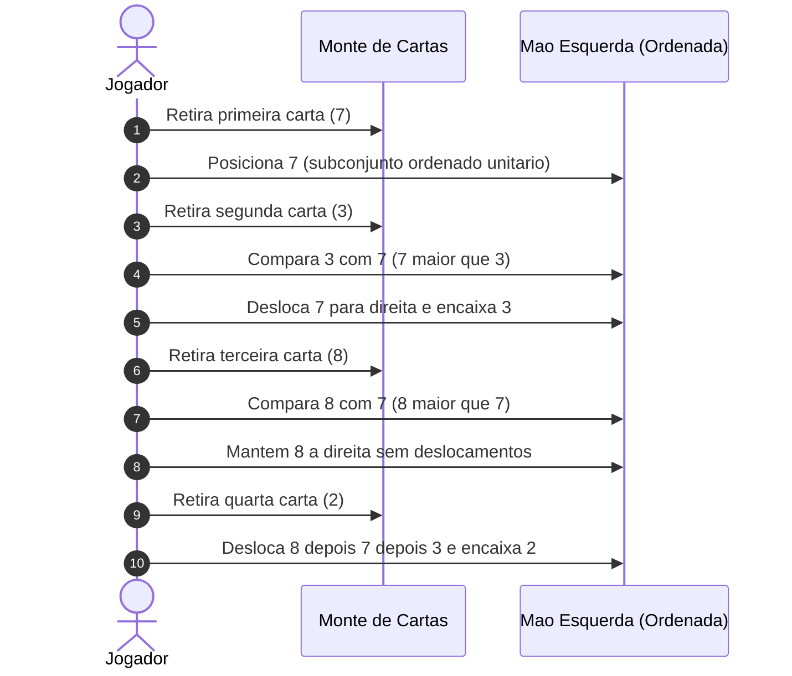
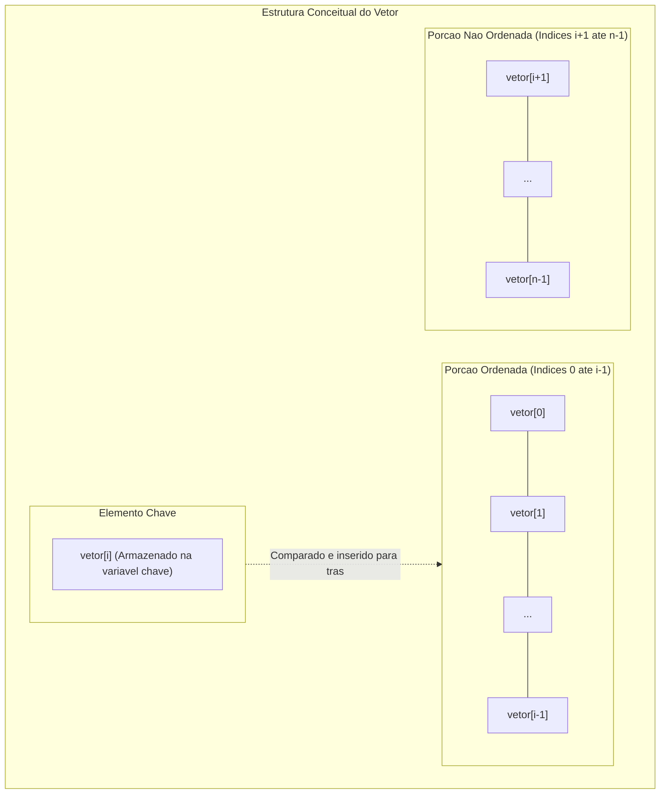
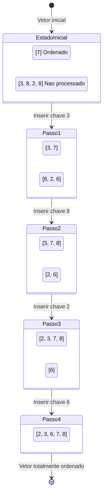
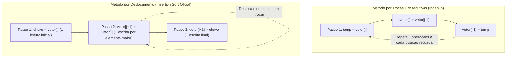
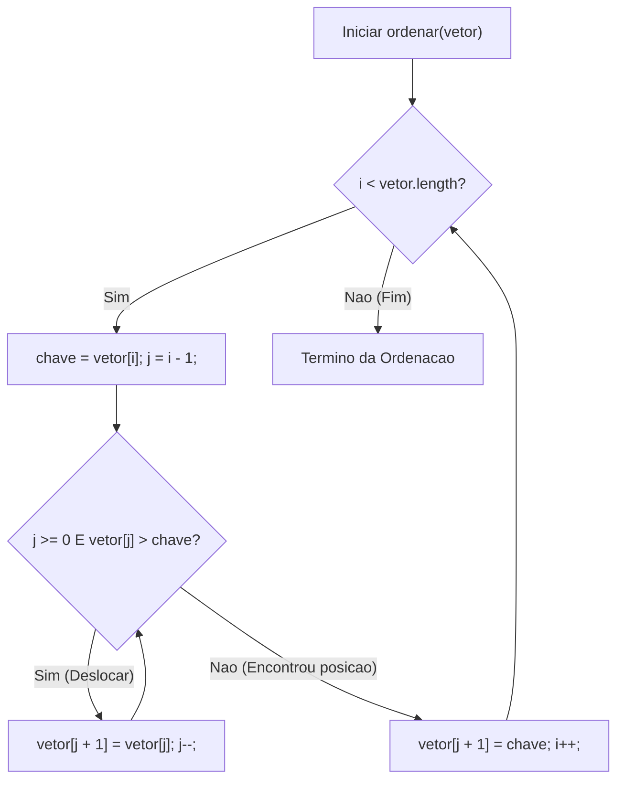
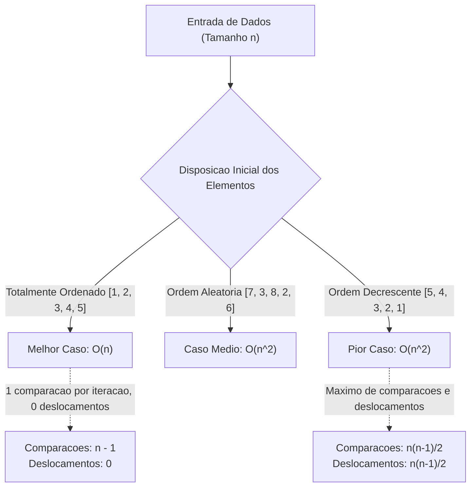
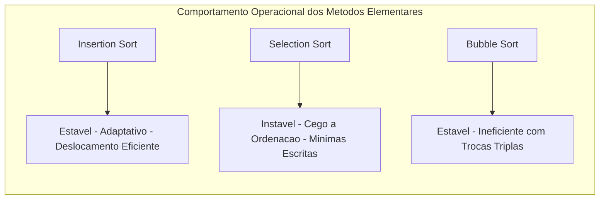
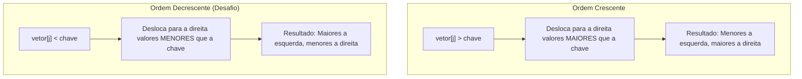

# Aula 10 — Insertion Sort Ordenação por Inserção

> **Professor:** Wesley Soares
> **Disciplina:** Estrutura de Dados I (4º Semestre)
> **Tema:** Algoritmo de ordenação por inserção direta, mecânica de deslocamento, análise de complexidade e estabilidade

---

## Sumário

- [Objetivo da aula](#objetivo-da-aula)
- [Contexto e pré-requisitos](#contexto-e-pre-requisitos)
- [Conceito e analogia das cartas de baralho](#conceito-e-analogia-das-cartas-de-baralho)
- [Particionamento entre porção ordenada e não ordenada](#particionamento-entre-porcao-ordenada-e-nao-ordenada)
- [Simulação passo a passo da inserção com deslocamento](#simulacao-passo-a-passo-da-insercao-com-deslocamento)
- [Diferença conceitual entre deslocamento e troca de posições](#diferenca-conceitual-entre-deslocamento-e-troca-de-posicoes)
- [Implementação do algoritmo Insertion Sort em Java](#implementacao-do-algoritmo-insertion-sort-em-java)
- [Análise de complexidade assintótica de tempo e espaço](#analise-de-complexidade-assintotica-de-tempo-e-espaco)
- [Comparativo com Bubble Sort e Selection Sort](#comparativo-com-bubble-sort-e-selection-sort)
- [Atividades práticas de rastreamento e desafio de ordenação decrescente](#atividades-praticas-de-rastreamento-e-desafio-de-ordenacao-decrescente)
- [Código da aula](#codigo-da-aula)
- [Exercícios](#exercicios)
- [Erros comuns e boas práticas](#erros-comuns-e-boas-praticas)
- [Links e materiais complementares](#links-e-materiais-complementares)
- [Mapa da aula](#mapa-da-aula)
- [Glossário](#glossario)
- [Pontos-chave para a prova](#pontos-chave-para-a-prova)
- [Perguntas e respostas (JSONL)](#perguntas-e-respostas-jsonl)
- [Checklist de revisão](#checklist-de-revisao)

---

## Objetivo da aula

O objetivo principal desta aula é consolidar o domínio teórico e prático sobre o algoritmo de ordenação **Insertion Sort** (ordenação por inserção), compreendendo sua mecânica interna, propriedades estruturais e comportamento assintótico.

Ao concluir este conteúdo, o estudante deverá ser capaz de:
- Compreender a fundamentação lógica e o fluxo operacional do algoritmo Insertion Sort.
- Identificar e rastrear a fronteira dinâmica entre a partição já ordenada e a partição não processada de um vetor.
- Implementar o algoritmo em linguagem Java utilizando convenções profissionais de engenharia de software.
- Diferenciar com clareza matemática e computacional a técnica de deslocamento sequencial (*shifting*) da técnica de trocas sucessivas (*swapping*).
- Deduzir e analisar a complexidade temporal nos cenários de melhor caso, caso médio e pior caso, assim como a complexidade espacial de memória auxiliar.
- Estabelecer um paralelo crítico entre o Insertion Sort, o Bubble Sort e o Selection Sort.
- Avaliar cenários reais da engenharia de software em que o Insertion Sort é superior a algoritmos assintoticamente mais velozes (como em vetores pequenos ou coleções quase ordenadas).

---

## Contexto e pré-requisitos

Na trajetória da disciplina de **Estrutura de Dados I**, o estudo dos algoritmos de ordenação elementares representa a ponte entre a manipulação básica de vetores e a análise formal de algoritmos. Até este ponto do curso, exploramos:
- **Vetores unidimensionais (arrays):** alocação estática contígua de memória, endereçamento indexado em base zero e operações fundamentais de leitura e escrita em tempo constante.
- **Laços aninhados:** controle de fluxo iterativo com laços `for` e `while`, incluindo condições de terminação e gerenciamento de índices limitantes.
- **Algoritmos elementares prévios:** o Bubble Sort (baseado em flutuação e trocas consecutivas de pares) e o Selection Sort (baseado na busca do menor valor absoluto e posicionamento na partição ordenada).
- **Notação assintótica Big-O:** compreensão preliminar de classes de complexidade como tempo linear ($ `O(n)` $`) e tempo quadrático (`$ `O(n^2)` $).

O Insertion Sort posiciona-se como o algoritmo elementar mais eficiente na prática para cenários específicos, servindo como base conceitual indispensável para o estudo de algoritmos híbridos de nível de produção (como o *Timsort*, utilizado nas bibliotecas padrão de linguagens como Java e Python) e preparando o estudante para os algoritmos de divisão e conquista (Merge Sort e Quick Sort).

---

## Conceito e analogia das cartas de baralho

### Definição formal
O **Insertion Sort** é um algoritmo de ordenação baseado em comparações que constrói uma coleção ordenada incrementalmente, inserindo um elemento de cada vez em sua posição correta dentro de um subconjunto pré-existente já ordenado.

### Analogia clássica do baralho
A forma mais intuitiva de compreender o Insertion Sort é observar como uma pessoa organiza cartas de baralho na mão durante uma partida:
1. Quando recebemos a primeira carta, nós a seguramos na mão esquerda. Como há apenas uma carta, ela já constitui uma mão trivialmente ordenada.
2. Ao receber a segunda carta com a mão direita, comparamos seu valor com a carta já presente na mão esquerda. Se a nova carta for menor, deslocamos a carta existente para a direita e inserimos a nova carta na primeira posição. Se for maior ou igual, mantemos a nova carta à direita da primeira.
3. Para cada carta subsequente retirada da mesa, percorremos as cartas já organizadas da direita para a esquerda, empurrando para a direita todas as cartas que forem maiores do que a carta nova, até encontrar o ponto exato onde a nova carta deve se encaixar.
4. Quando todas as cartas forem processadas, a mão inteira estará perfeitamente ordenada.



### Motivação na engenharia de software
A principal motivação do Insertion Sort reside na sua capacidade de ser um algoritmo **adaptativo** (*adaptive sort*). Diferente de algoritmos cegos à ordenação prévia (como o Selection Sort, que executa o mesmo número de comparações independentemente da disposição inicial dos dados), o Insertion Sort reduz drasticamente o trabalho quando os dados já apresentam um alto grau de ordenação.

### Exemplo conceitual
Dado o conjunto de valores `{7, 3, 8, 2, 6}`:
- Processamos o elemento `3` comparando-o com o subvetor `{7}`. Como `7 > 3`, abrimos espaço e formamos `{3, 7}`.
- O elemento `8` é comparado com `7`. Como `8 > 7`, nenhuma movimentação ocorre, resultando em `{3, 7, 8}`.
- O elemento `2` é comparado sequencialmente com `8`, `7` e `3`, deslocando todos e resultando em `{2, 3, 7, 8}`.
- O elemento `6` é comparado com `8` e `7` (deslocados) e estaciona ao colidir com `3` (que é menor), resultando em `{2, 3, 6, 7, 8}`.

### Contraexemplo didático
Tentar aplicar uma busca do menor elemento global a cada iteração (como no Selection Sort) não caracteriza o Insertion Sort. No Insertion Sort, o algoritmo **não varre o restante do vetor** procurando valores mínimos; ele simplesmente pega o próximo elemento disponível na fila imediata e o insere na vizinhança correta do grupo já processado.

### Armadilhas conceituais
- **Achar que o algoritmo troca elementos:** o Insertion Sort padrão não realiza trocas (*swaps*) completas a cada passo. Ele armazena o valor a ser inserido em uma variável temporária e realiza deslocamentos simples de atribuição direta.
- **Achar que a parte ordenada já contém os menores números globais:** a partição ordenada contém apenas os elementos já vistos ordenados entre si, e não necessariamente os menores valores do vetor inteiro (diferente do Selection Sort, onde a cada passo o menor elemento absoluto do vetor restante é posicionado).

---

## Particionamento entre porção ordenada e não ordenada

O funcionamento do Insertion Sort apoia-se na divisão conceitual do vetor em duas regiões contíguas bem delimitadas por um cursor de controle (o índice `$ `i` $`):

1. **Subvetor ordenado (à esquerda):** compreende o intervalo de índices `$ `[0 \dots i-1]` $`. Todos os elementos presentes nesta faixa estão ordenados entre si.
2. **Elemento chave (*key*):** localizado no índice `$ `i` $`. É o elemento que está sendo processado na iteração atual.
3. **Subvetor não ordenado (à direita):** compreende o intervalo de índices `$ `[i+1 \dots n-1]` $`. Contém os elementos que ainda não foram avaliados pelo algoritmo.



### Invariante de laço (Loop Invariant)
Na ciência da computação teórica, a correção do Insertion Sort é formalmente demonstrada por meio de sua invariante de laço:

> **Definição de Invariante:** No início de cada iteração do laço externo `for` (controlado pelo índice `$ `i` $`), o subvetor `$ `vetor[0 \dots i-1]` $` consiste nos elementos originais que ocupavam essas posições, porém dispostos em ordem estritamente crescente.

A invariante atende às três propriedades formais de verificação:
1. **Inicialização:** Antes da primeira iteração ($ `i = 1` $), o subvetor `$ `vetor[0 \dots 0]` $` contém apenas um elemento. Um vetor de tamanho 1 é trivial e universalmente ordenado. Portanto, a invariante é verdadeira no início.
2. **Manutenção:** Durante a iteração, os elementos em `$ `vetor[0 \dots i-1]` $` que são maiores que a chave são deslocados uma posição para a direita. A chave é inserida na posição vaga resultante. Ao final, o subvetor `$ `vetor[0 \dots i]` $` torna-se ordenado, preservando a propriedade para a próxima iteração ($ `i + 1` $).
3. **Término:** O laço termina quando `$ `i = n` $`. Substituindo `$ `i` $` por `$ `n` $` na invariante, temos que o subvetor `$ `vetor[0 \dots n-1]` $` consiste em todos os elementos originais do vetor dispostos em ordem crescente. O vetor está provadamente ordenado.

### Evolução da fronteira
A tabela a seguir demonstra como a fronteira entre as porções se move ao longo das iterações para o vetor `{7, 3, 8, 2, 6}`:

| Iteração ($ `i` $`) | Porção Ordenada (`$ `[0 \dots i-1]` $`) | Chave (`$ `vetor[i]` $`) | Porção Não Ordenada (`$ `[i+1 \dots n-1]` $) | Vetor Resultante após Inserção |
| :---: | :---: | :---: | :---: | :---: |
| Início ($ `i=1` $) | `[7]` | `3` | `[8, 2, 6]` | `[3, 7, 8, 2, 6]` |
| 2 ($ `i=2` $) | `[3, 7]` | `8` | `[2, 6]` | `[3, 7, 8, 2, 6]` |
| 3 ($ `i=3` $) | `[3, 7, 8]` | `2` | `[6]` | `[2, 3, 7, 8, 6]` |
| 4 ($ `i=4` $) | `[2, 3, 7, 8]` | `6` | `[]` | `[2, 3, 6, 7, 8]` |

---

## Simulação passo a passo da inserção com deslocamento

Vamos dissecar a execução do algoritmo utilizando o vetor oficial apresentado em aula:
```java
int[] numeros = {7, 3, 8, 2, 6};
```
Tamanho do vetor: `$ `n = 5` $`. Índices válidos: `0, 1, 2, 3, 4`.

### Estado inicial
O primeiro elemento no índice `0` (`7`) é admitido como a porção ordenada inicial:
- Vetor: `[7 | 3, 8, 2, 6]`



### Etapa 1 — Inserir o valor 3 ($ `i = 1` $)
- **Chave selecionada:** `chave = vetor[1] = 3`.
- **Ponteiro de comparação:** `j = i - 1 = 0`.
- **Comparação 1:** Compara `vetor[0]` (`7`) com `chave` (`3`).
  - Como `7 > 3`, o elemento `7` deve ser deslocado para a direita.
  - Atribuição de deslocamento: `vetor[1] = vetor[0]` (o valor `7` é copiado para o índice `1`).
  - Vetor transiente: `[7, 7, 8, 2, 6]`.
  - Atualização do cursor: `j = j - 1 = -1`.
- **Condição de parada:** `j >= 0` torna-se falso (`-1 >= 0` é falso). O laço de deslocamento é interrompido.
- **Inserção final da chave:** `vetor[j + 1] = chave` $`\rightarrow`$ `vetor[0] = 3`.
- **Resultado da etapa:** `[3, 7, 8, 2, 6]`.

### Etapa 2 — Inserir o valor 8 ($ `i = 2` $)
- **Chave selecionada:** `chave = vetor[2] = 8`.
- **Ponteiro de comparação:** `j = i - 1 = 1`.
- **Comparação 1:** Compara `vetor[1]` (`7`) com `chave` (`8`).
  - Como `7 > 8` é falso, nenhum deslocamento ocorre.
- **Condição de parada:** A condição `vetor[j] > chave` falha imediatamente.
- **Inserção final da chave:** `vetor[j + 1] = chave` $`\rightarrow`$ `vetor[2] = 8` (a chave é reescrita em sua própria posição de origem).
- **Resultado da etapa:** `[3, 7, 8, 2, 6]`.

### Etapa 3 — Inserir o valor 2 ($ `i = 3` $)
- **Chave selecionada:** `chave = vetor[3] = 2`.
- **Ponteiro de comparação:** `j = i - 1 = 2`.
- **Comparação 1:** Compara `vetor[2]` (`8`) com `chave` (`2`).
  - `8 > 2` é verdadeiro $`\rightarrow`$ desloca `8`: `vetor[3] = vetor[2]`.
  - Vetor transiente: `[3, 7, 8, 8, 6]`.
  - Atualização: `j = 1`.
- **Comparação 2:** Compara `vetor[1]` (`7`) com `chave` (`2`).
  - `7 > 2` é verdadeiro $`\rightarrow`$ desloca `7`: `vetor[2] = vetor[1]`.
  - Vetor transiente: `[3, 7, 7, 8, 6]`.
  - Atualização: `j = 0`.
- **Comparação 3:** Compara `vetor[0]` (`3`) com `chave` (`2`).
  - `3 > 2` é verdadeiro $`\rightarrow`$ desloca `3`: `vetor[1] = vetor[0]`.
  - Vetor transiente: `[3, 3, 7, 8, 6]`.
  - Atualização: `j = -1`.
- **Condição de parada:** `j >= 0` falha (`-1 >= 0` é falso).
- **Inserção final da chave:** `vetor[j + 1] = chave` $`\rightarrow`$ `vetor[0] = 2`.
- **Resultado da etapa:** `[2, 3, 7, 8, 6]`.

### Etapa 4 — Inserir o valor 6 ($ `i = 4` $)
- **Chave selecionada:** `chave = vetor[4] = 6`.
- **Ponteiro de comparação:** `j = i - 1 = 3`.
- **Comparação 1:** Compara `vetor[3]` (`8`) com `chave` (`6`).
  - `8 > 6` é verdadeiro $`\rightarrow`$ desloca `8`: `vetor[4] = vetor[3]`.
  - Vetor transiente: `[2, 3, 7, 8, 8]`.
  - Atualização: `j = 2`.
- **Comparação 2:** Compara `vetor[2]` (`7`) com `chave` (`6`).
  - `7 > 6` é verdadeiro $`\rightarrow`$ desloca `7`: `vetor[3] = vetor[2]`.
  - Vetor transiente: `[2, 3, 7, 7, 8]`.
  - Atualização: `j = 1`.
- **Comparação 3:** Compara `vetor[1]` (`3`) com `chave` (`6`).
  - `3 > 6` é falso $`\rightarrow`$ o laço para imediatamente. O elemento `3` atua como uma barreira natural.
- **Inserção final da chave:** `vetor[j + 1] = chave` $`\rightarrow`$ `vetor[2] = 6`.
- **Resultado final:** `[2, 3, 6, 7, 8]`.

---

## Diferença conceitual entre deslocamento e troca de posições

Uma das distinções de engenharia mais cruciais no Insertion Sort é a substituição sistemática de **trocas sucessivas (*swaps*)** por **deslocamentos (*shifts*)**.

### O custo computacional da troca (*swap*)
Uma operação clássica de troca entre dois elementos contíguos exige obrigatoriamente **três operações de atribuição de memória**:
```java
// Troca classica entre vetor[k] e vetor[k - 1]
int temp = vetor[k];
vetor[k] = vetor[k - 1];
vetor[k - 1] = temp;
```
Se um elemento precisar recuar 5 posições utilizando trocas sucessivas (como faria uma variação ingênua do algoritmo), o processador executará:
```math
5 \times 3 = 15 \text{ escritas em memoria}
```

### A eficiência do deslocamento (*shift*)
No Insertion Sort elegante, a chave é isolada uma única vez no início da iteração. Durante o recuo, cada elemento maior é apenas sobrescrito sobre seu vizinho imediato à direita, exigindo apenas **uma única atribuição de memória**:
```java
vetor[j + 1] = vetor[j]; // Apenas 1 escrita
```
Ao término do laço, a chave é descarregada no espaço remanescente com mais **uma atribuição**.
Portanto, para recuar as mesmas 5 posições, o deslocamento executa:
```math
5 \times 1 + 1 = 6 \text{ escritas em memoria}
```
Isso representa uma economia de aproximadamente 60% no volume de operações de escrita na memória RAM e nos registradores de cache.



### Tabela comparativa estrutural

| Aspecto de Engenharia | Método por Trocas Sucessivas | Método por Deslocamento (Oficial) |
| :--- | :--- | :--- |
| **Escritas por posição recuada** | 3 escritas (leitura, cópia, sobrescrita) | 1 escrita direta (`vetor[j+1] = vetor[j]`) |
| **Escritas adicionais no ciclo** | 0 | 1 escrita final (`vetor[j+1] = chave`) |
| **Uso de variáveis intermediárias** | Variável auxiliar instanciada repetidamente | Apenas a variável `chave` por ciclo externo |
| **Impacto no barramento de memória** | Alto tráfego de barramento e cache *dirty* | Mínimo tráfego, leitura contígua e escrita sequencial |
| **Comportamento em microarquiteturas** | Maior pressão de instruções de CPU | Melhor pipeline de instruções e vetorização |

---

## Implementação do algoritmo Insertion Sort em Java

### Código oficial comentado
Abaixo apresentamos a implementação canônica do Insertion Sort em Java, estruturada de forma modular e rigorosa.

```java
public class InsertionSort {

    /**
     * Ordena um vetor de inteiros utilizando o algoritmo Insertion Sort.
     * Complexidade de Tempo: O(n) no melhor caso, O(n^2) no caso medio e pior caso.
     * Complexidade de Espaco: O(1) auxiliar (ordenacao in-place).
     *
     * @param vetor O array de inteiros a ser ordenado in-place.
     */
    public static void ordenar(int[] vetor) {
        // O laco externo inicia no indice 1, pois um vetor com 1 elemento (indice 0)
        // e considerado trivialmente ordenado.
        for (int i = 1; i < vetor.length; i++) {
            
            // Armazena o elemento atual que precisa ser inserido na porcao ordenada
            int chave = vetor[i];
            
            // Ponteiro j inicia no elemento imediatamente anterior a chave
            int j = i - 1;

            // Laco interno: desloca os elementos da porcao ordenada que sao maiores
            // que a chave para uma posicao a frente (a direita).
            // A ordem das condicoes e vital: 'j >= 0' deve vir antes de 'vetor[j] > chave'
            // para evitar a excecao ArrayIndexOutOfBoundsException via curto-circuito booleano.
            while (j >= 0 && vetor[j] > chave) {
                vetor[j + 1] = vetor[j]; // Deslocamento para a direita
                j--;                     // Recuo para o elemento anterior
            }

            // Insere a chave na posicao correta que foi aberta pelos deslocamentos
            vetor[j + 1] = chave;
        }
    }

    public static void main(String[] args) {
        int[] numeros = {7, 3, 8, 2, 6};

        System.out.println("Vetor original:");
        imprimirVetor(numeros);

        ordenar(numeros);

        System.out.println("Vetor ordenado com Insertion Sort:");
        imprimirVetor(numeros);
    }

    private static void imprimirVetor(int[] vetor) {
        for (int i = 0; i < vetor.length; i++) {
            System.out.print(vetor[i] + (i < vetor.length - 1 ? " " : ""));
        }
        System.out.println();
    }
}
```

### Análise detalhada das linhas-chave

1. `for (int i = 1; i < vetor.length; i++)`:
   - Inicia no índice `1` porque o subvetor formado apenas por `vetor[0]` já possui tamanho 1, estando inerentemente ordenado. Iniciar em `0` não geraria erro de compilação, mas forçaria uma iteração nula onde `j = -1`, sem utilidade prática.
2. `int chave = vetor[i];`:
   - Salva em um registrador local o conteúdo do elemento sob análise. Sem esta cópia temporária, o primeiro deslocamento (`vetor[j + 1] = vetor[j]`) destruiria o dado de `vetor[i]`.
3. `int j = i - 1;`:
   - Estabelece a extremidade direita da partição ordenada, iniciando a varredura regressiva.
4. `while (j >= 0 && vetor[j] > chave)`:
   - A guarda `j >= 0` atua como proteção de borda (*boundary sentinel*). O operador `&&` em Java implementa **avaliação de curto-circuito** (*short-circuit evaluation*). Se `$ `j < 0` $`, a segunda expressão (`vetor[j] > chave`) sequer é avaliada pela JVM, prevenindo falhas de segmentação ou `ArrayIndexOutOfBoundsException`.
   - A expressão `vetor[j] > chave` é uma desigualdade estrita. Ela define que elementos de mesmo valor que a chave **não** são deslocados, garantindo a estabilidade do algoritmo.
5. `vetor[j + 1] = vetor[j];`:
   - Sobrescreve a posição adjacente à direita com o elemento atual de índice `$ `j` $`.
6. `vetor[j + 1] = chave;`:
   - Após o término do laço `while`, o cursor `$ `j` $` aponta para o primeiro elemento que não é maior que a chave (ou para `-1` se todos eram maiores). A posição correta para o encaixe da chave é, portanto, `$ `j + 1` $`.



### A garantia de estabilidade (*Stable Sort*)
Um algoritmo de ordenação é considerado **estável** se ele preserva a ordem relativa original de elementos que possuem chaves de valor equivalente.
- Se tivéssemos o vetor contendo duas instâncias do número 5: `[... 5_a, 5_b ...]`, onde `5_a` aparece antes de `5_b`.
- Quando a chave for `5_b`, o algoritmo recuará até comparar com `5_a`.
- A condição avaliada é: `vetor[j] > chave` $`\rightarrow`$ `5_a > 5_b`.
- Como `5` não é estritamente maior que `5`, a condição resulta em `false`. O deslocamento é interrompido imediatamente.
- `5_b` é inserido à frente de `5_a`, preservando exatamente a ordem relativa inicial.
- Se o desenvolvedor acidentalmente alterar o código para `vetor[j] >= chave`, elementos iguais serão deslocados desnecessariamente, **quebrando a estabilidade**.

---

## Análise de complexidade assintótica de tempo e espaço

A complexidade temporal do Insertion Sort é sensível à ordenação inicial da entrada de dados, o que o torna um algoritmo categorizado como **adaptativo**.



### Melhor caso: $ `O(n)` $
O melhor caso ocorre quando o vetor já se encontra **completamente ordenado** em ordem crescente (exemplo: `[1, 2, 3, 4, 5]`).
- O laço externo `for` é executado `$ `n - 1` $` vezes.
- Em cada iteração, a primeira comparação do laço `while` (`vetor[j] > chave`) avalia falso imediatamente, pois o elemento imediatamente anterior (`vetor[i-1]`) já é menor ou igual à chave.
- O laço `while` nunca é executado em seu corpo interior. Nenhum deslocamento é realizado.
- O número total de comparações é exatamente `$ `n - 1` $`.

```math
T(n) = \sum_{i=1}^{n-1} 1 = n - 1 = \mathcal{O}(n)
```
A complexidade de tempo do melhor caso é estritamente linear: `$ `O(n)` $`.

### Pior caso: $ `O(n^2)` $
O pior caso ocorre quando o vetor está em **ordem estritamente decrescente** (exemplo: `[5, 4, 3, 2, 1]`).
- Em cada iteração `$ `i` $`, a chave é menor do que todos os elementos já presentes na porção ordenada `$ `[0 \dots i-1]` $`.
- A chave precisa ser comparada com todos os `$ `i` $` elementos anteriores, e todos os `$ `i` $` elementos precisam ser deslocados uma posição à direita.
- Para inserir o elemento de índice `$ `i` $`, realizam-se `$ `i` $` comparações e `$ `i` $` deslocamentos.
- O número total de operações elementares é a soma de uma Progressão Aritmética (PA) de 1 até `$ `n - 1` $`:

```math
T(n) = \sum_{i=1}^{n-1} i = 1 + 2 + 3 + \dots + (n - 1) = \frac{(n - 1)n}{2} = \frac{n^2 - n}{2} = \mathcal{O}(n^2)
```
Tanto o número de comparações quanto o número de deslocamentos atingem o limite quadrático: `$ `O(n^2)` $`.

### Caso médio: $ `O(n^2)` $
O caso médio pressupõe que os elementos do vetor estão distribuídos em posições aleatórias.
- Para cada elemento no índice `$ `i` $`, espera-se em média que metade dos elementos em `$ `[0 \dots i-1]` $` sejam maiores que a chave e metade sejam menores.
- Portanto, a chave percorrerá em média `$ `i / 2` $` posições antes de encontrar seu ponto de repouso.
- O número esperado de comparações e deslocamentos é:

```math
T(n) = \sum_{i=1}^{n-1} \frac{i}{2} = \frac{1}{2} \sum_{i=1}^{n-1} i = \frac{1}{2} \left( \frac{n^2 - n}{2} \right) = \frac{n^2 - n}{4} = \mathcal{O}(n^2)
```
Apesar de executar metade do trabalho bruto em relação ao pior caso, no cálculo assintótico as constantes multiplicativas são desconsideradas, consolidando o caso médio na classe quadrática: `$ `O(n^2)` $`.

### Complexidade de espaço auxiliar: $ `O(1)` $
O Insertion Sort é um algoritmo **in-place** (a ordenação ocorre dentro do próprio arranjo de entrada).
- A memória auxiliar necessária consiste apenas em variáveis escalares de tipo primitivo: `i`, `j` e `chave`.
- Não há alocação dinâmica de novos vetores proporcionais a `$ `n` $`, nem recursão que consuma memória na pilha de execução (*call stack*).
- O consumo de espaço é rigorosamente constante: `$ `O(1)` $`.

---

## Comparativo com Bubble Sort e Selection Sort

Os três algoritmos elementares de ordenação quadrática compartilham semelhanças superficiais, mas possuem comportamentos operacionais substancialmente distintos.

| Dimensão Técnica | Insertion Sort | Selection Sort | Bubble Sort (Padrão) | Bubble Sort (Otimizado com Flag) |
| :--- | :--- | :--- | :--- | :--- |
| **Ideia Principal** | Insere cada novo elemento na posição correta | Localiza o menor restante e coloca no início | Troca pares adjacentes fora de ordem | Troca pares adjacentes e encerra se não houver troca |
| **Complexidade Melhor Caso** | `$ `O(n)` $` | `$ `O(n^2)` $` | `$ `O(n^2)` $` | `$ `O(n)` $` |
| **Complexidade Caso Médio** | `$ `O(n^2)` $` | `$ `O(n^2)` $` | `$ `O(n^2)` $` | `$ `O(n^2)` $` |
| **Complexidade Pior Caso** | `$ `O(n^2)` $` | `$ `O(n^2)` $` | `$ `O(n^2)` $` | `$ `O(n^2)` $` |
| **Memória Auxiliar** | `$ `O(1)` $` (In-place) | `$ `O(1)` $` (In-place) | `$ `O(1)` $` (In-place) | `$ `O(1)` $` (In-place) |
| **Estabilidade** | **Estável** (preserva ordem relativa) | **Instável** (trocas distantes alteram ordem) | **Estável** | **Estável** |
| **Sensibilidade à pré-ordenação** | **Alta** (reduz comparações e deslocamentos) | **Nula** (sempre executa todas as comparações) | **Nula** | **Alta** (para na 1ª iteração sem trocas) |
| **Número de Escritas na Memória** | Médio: `$ `O(n^2)` $` deslocamentos simples | **Mínimo:** exatamente `$ `O(n)` $` trocas | Alto: `$ `O(n^2)` $` trocas completas (3 escritas) | Médio-Alto: `$ `O(n^2)` $` trocas completas |
| **Uso em Bibliotecas Modernas** | **Sim** (base para pequenos blocos no Timsort) | Raro (usado apenas quando a escrita é muito cara) | Não (didático apenas) | Não (didático apenas) |



### Por que o Insertion Sort é o vencedor entre os três?
1. **Desempenho com dados reais:** Na vida real, a maior parte dos conjuntos de dados não é perfeitamente aleatória, mas sim parcialmente ordenada. O Insertion Sort aproveita cada elemento pré-ordenado para eliminar computação desnecessária.
2. **Eficiência de cache e instruções:** O padrão de acesso à memória do Insertion Sort durante o laço interno é sequencial e contíguo (da direita para a esquerda). Isso maximiza o aproveitamento das linhas de cache L1 e L2 do processador.
3. **Padrão em algoritmos híbridos de nível de produção:** O algoritmo de ordenação padrão do Java (`Arrays.sort` para tipos primitivos, baseado em Dual-Pivot Quicksort, e para objetos, baseado em Timsort) utiliza internamente o Insertion Sort sempre que a partição atinge um tamanho pequeno (tipicamente entre 32 e 47 elementos). Nesses tamanhos, o *overhead* de chamadas recursivas do Quicksort ou Mergesort é mais custoso do que a simplicidade do Insertion Sort.

---

## Atividades práticas de rastreamento e desafio de ordenação decrescente

### Simulação com vetor de notas
O material da aula propõe a análise e ordenação manual do seguinte conjunto de notas escolares:
```java
int[] notas = {9, 4, 7, 2, 8, 3, 6};
```
Tamanho: `$ `n = 7` $`. Índices: `0` a `6`.

#### Rastreamento manual completo
1. **Estado Inicial:** A primeira nota `9` no índice `0` forma o subconjunto ordenado:
   - Vetor: `[9 | 4, 7, 2, 8, 3, 6]`
2. **Inserção da nota 4 ($ `i = 1` $, `chave = 4`):**
   - Compara com `9`: `9 > 4` $`\rightarrow`$ desloca `9` para o índice `1`.
   - Limite atingido ($ `j = -1` $).
   - Encaixa `4` no índice `0`.
   - Resultado: `[4, 9 | 7, 2, 8, 3, 6]`
3. **Inserção da nota 7 ($ `i = 2` $, `chave = 7`):**
   - Compara com `9`: `9 > 7` $`\rightarrow`$ desloca `9` para o índice `2`.
   - Compara com `4`: `4 > 7` é falso $`\rightarrow`$ para.
   - Encaixa `7` no índice `1`.
   - Resultado: `[4, 7, 9 | 2, 8, 3, 6]`
4. **Inserção da nota 2 ($ `i = 3` $, `chave = 2`):**
   - Compara com `9`: `9 > 2` $`\rightarrow`$ desloca `9`.
   - Compara com `7`: `7 > 2` $`\rightarrow`$ desloca `7`.
   - Compara com `4`: `4 > 2` $`\rightarrow`$ desloca `4`.
   - Limite atingido ($ `j = -1` $).
   - Encaixa `2` no índice `0`.
   - Resultado: `[2, 4, 7, 9 | 8, 3, 6]`
5. **Inserção da nota 8 ($ `i = 4` $, `chave = 8`):**
   - Compara com `9`: `9 > 8` $`\rightarrow`$ desloca `9` para o índice `4`.
   - Compara com `7`: `7 > 8` é falso $`\rightarrow`$ para.
   - Encaixa `8` no índice `3`.
   - Resultado: `[2, 4, 7, 8, 9 | 3, 6]`
6. **Inserção da nota 3 ($ `i = 5` $, `chave = 3`):**
   - Compara com `9`: `9 > 3` $`\rightarrow`$ desloca `9`.
   - Compara com `8`: `8 > 3` $`\rightarrow`$ desloca `8`.
   - Compara com `7`: `7 > 3` $`\rightarrow`$ desloca `7`.
   - Compara com `4`: `4 > 3` $`\rightarrow`$ desloca `4`.
   - Compara com `2`: `2 > 3` é falso $`\rightarrow`$ para.
   - Encaixa `3` no índice `1`.
   - Resultado: `[2, 3, 4, 7, 8, 9 | 6]`
7. **Inserção da nota 6 ($ `i = 6` $, `chave = 6`):**
   - Compara com `9`: `9 > 6` $`\rightarrow`$ desloca `9`.
   - Compara com `8`: `8 > 6` $`\rightarrow`$ desloca `8`.
   - Compara com `7`: `7 > 6` $`\rightarrow`$ desloca `7`.
   - Compara com `4`: `4 > 6` é falso $`\rightarrow`$ para.
   - Encaixa `6` no índice `3`.
   - Resultado final: `[2, 3, 4, 6, 7, 8, 9]`

### O desafio da ordenação decrescente
Para ordenar o vetor em ordem decrescente (do maior para o menor), a lógica do algoritmo permanece rigorosamente a mesma; a única modificação exigida reside no **predicado de ordenação** dentro do laço `while`.

Na ordem crescente, deslocamos os elementos que forem **maiores** que a chave (`vetor[j] > chave`).
Para obter a ordem decrescente, queremos que os elementos maiores fiquem à esquerda e os menores à direita. Logo, devemos deslocar para a direita todos os elementos que forem **menores** que a chave:
```java
// Ordem crescente:
while (j >= 0 && vetor[j] > chave)

// Ordem decrescente (desafio):
while (j >= 0 && vetor[j] < chave)
```



---

## Código da aula

Nesta seção, documentamos a estrutura dos arquivos de código Java associados a esta aula.

### Arquivo 1: `./codigo/InsertionSortExemplo.java`
Este arquivo contém a implementação canônica apresentada na introdução da aula, com foco na demonstração do algoritmo padrão e exibição do vetor antes e depois da execução.

- **Link relativo:** [`./codigo/InsertionSortExemplo.java`](file:///private/var/folders/qb/_cjdv9zx3tzg_vhp0f_n9pr00000gn/T/classroom-sync-agy/codigo/InsertionSortExemplo.java)

#### Trechos essenciais comentados linha a linha
```java
// Trecho do laco de ordenacao principal
for (int i = 1; i < vetor.length; i++) {
    int chave = vetor[i]; // Guarda o elemento atual para abrir espaco
    int j = i - 1;        // Comeca a busca na extremidade do subvetor ordenado

    // Desloca elementos maiores para frente
    while (j >= 0 && vetor[j] > chave) {
        vetor[j + 1] = vetor[j]; // Deslocamento unitario
        j--;                     // Retrocede o indice de comparacao
    }

    vetor[j + 1] = chave; // Insere a chave na posicao vaga resultante
}
```

### Arquivo 2: `./codigo/InsertionSortAtividade.java`
Este arquivo reúne a solução completa das atividades práticas propostas pelo professor: a rotina de ordenação crescente para o vetor de notas, a impressão formatada e a implementação do método de ordenação decrescente solicitado no desafio.

- **Link relativo:** [`./codigo/InsertionSortAtividade.java`](file:///private/var/folders/qb/_cjdv9zx3tzg_vhp0f_n9pr00000gn/T/classroom-sync-agy/codigo/InsertionSortAtividade.java)

#### Trechos essenciais comentados linha a linha
```java
// Metodo de ordenacao decrescente (Desafio)
public static void ordenarDecrescente(int[] vetor) {
    for (int i = 1; i < vetor.length; i++) {
        int chave = vetor[i];
        int j = i - 1;

        // Inversao do operador relacional para deslocar valores menores que a chave
        while (j >= 0 && vetor[j] < chave) {
            vetor[j + 1] = vetor[j];
            j--;
        }

        vetor[j + 1] = chave;
    }
}
```

---

## Exercícios

### Exercício 1: Atividade Prática — Parte A: Simulação Manual
**Enunciado oficial:**
Considere o vetor de notas: `int[] notas = {9, 4, 7, 2, 8, 3, 6};`.
1. Considere o primeiro elemento como a parte inicialmente ordenada.
2. Registre o vetor depois de inserir o valor 4.
3. Registre o vetor depois de inserir o valor 7.
4. Continue até inserir todos os elementos.
5. Escreva o vetor final em ordem crescente.

**Raciocínio:**
Deve-se aplicar a regra da invariante de laço. A cada passo, a chave é isolada e comparada sequencialmente com os elementos anteriores. Sempre que o elemento anterior for estritamente maior que a chave, ele avança uma posição.

**Resolução passo a passo:**
- Início: parte ordenada unitária formada por `{9}`. Vetor: `[9, 4, 7, 2, 8, 3, 6]`.
- Passo 1 (inserir valor `4`): o `9` é deslocado para a direita. O `4` ocupa o índice `0`. Vetor resultante: `[4, 9, 7, 2, 8, 3, 6]`.
- Passo 2 (inserir valor `7`): o `9` é deslocado para a direita. O `4` não é deslocado pois `4 < 7`. O `7` é inserido no índice `1`. Vetor resultante: `[4, 7, 9, 2, 8, 3, 6]`.
- Passo 3 (inserir valor `2`): os valores `9`, `7` e `4` são deslocados para a direita. O `2` é inserido no índice `0`. Vetor resultante: `[2, 4, 7, 9, 8, 3, 6]`.
- Passo 4 (inserir valor `8`): o valor `9` é deslocado para a direita. O `7` interrompe a busca. O `8` é inserido no índice `3`. Vetor resultante: `[2, 4, 7, 8, 9, 3, 6]`.
- Passo 5 (inserir valor `3`): os valores `9`, `8`, `7` e `4` são deslocados para a direita. O `2` interrompe a busca. O `3` é inserido no índice `1`. Vetor resultante: `[2, 3, 4, 7, 8, 9, 6]`.
- Passo 6 (inserir valor `6`): os valores `9`, `8` e `7` são deslocados para a direita. O `4` interrompe a busca. O `6` é inserido no índice `3`. Vetor resultante: `[2, 3, 4, 6, 7, 8, 9]`.
- **Vetor final em ordem crescente:** `[2, 3, 4, 6, 7, 8, 9]`.

---

### Exercício 2: Atividade Prática — Parte B: Implementação em Java
**Enunciado oficial:**
1. Crie uma classe chamada `InsertionSortAtividade`.
2. Implemente o método `ordenar(int[] vetor)`.
3. Execute o algoritmo com o vetor fornecido: `int[] notas = {9, 4, 7, 2, 8, 3, 6};`.
4. Imprima o vetor antes e depois da ordenação.

**Raciocínio:**
Implementamos uma classe autônoma contendo o método estático `ordenar`, acompanhado de um método auxiliar `imprimirVetor` para garantir visualização clara do estado antes e após o processamento.

**Resolução completa comentada:**
```java
public class InsertionSortAtividade {

    public static void ordenar(int[] vetor) {
        if (vetor == null || vetor.length <= 1) {
            return; // Vetor nulo ou unitario ja esta ordenado
        }

        for (int i = 1; i < vetor.length; i++) {
            int chave = vetor[i];
            int j = i - 1;

            // Deslocamento dos elementos maiores
            while (j >= 0 && vetor[j] > chave) {
                vetor[j + 1] = vetor[j];
                j--;
            }

            // Insercao da chave na lacuna disponivel
            vetor[j + 1] = chave;
        }
    }

    public static void imprimirVetor(int[] vetor) {
        System.out.print("[");
        for (int i = 0; i < vetor.length; i++) {
            System.out.print(vetor[i]);
            if (i < vetor.length - 1) {
                System.out.print(", ");
            }
        }
        System.out.println("]");
    }

    public static void main(String[] args) {
        int[] notas = {9, 4, 7, 2, 8, 3, 6};

        System.out.println("Vetor de notas ANTES da ordenacao:");
        imprimirVetor(notas);

        ordenar(notas);

        System.out.println("Vetor de notas DEPOIS da ordenacao (Crescente):");
        imprimirVetor(notas);
    }
}
```
**Saída esperada:**
```text
Vetor de notas ANTES da ordenacao:
[9, 4, 7, 2, 8, 3, 6]
Vetor de notas DEPOIS da ordenacao (Crescente):
[2, 3, 4, 6, 7, 8, 9]
```
- **Arquivo de referência:** [`./codigo/InsertionSortAtividade.java`](file:///private/var/folders/qb/_cjdv9zx3tzg_vhp0f_n9pr00000gn/T/classroom-sync-agy/codigo/InsertionSortAtividade.java)

---

### Exercício 3: Atividade Prática — Parte C: Análise Conceitual
**Enunciado oficial:**
Responda com suas próprias palavras às seguintes perguntas de análise conceitual sobre o Insertion Sort:
1. Por que o laço principal `for` começa no índice 1 em vez de 0?
2. Qual é a função da variável `chave` durante a execução do algoritmo?
3. Por que os elementos maiores precisam ser deslocados para a direita em vez de simplesmente realizar trocas sucessivas com a chave?
4. O que caracteriza o melhor caso do algoritmo e por que sua complexidade é $ `O(n)` $?
5. O que caracteriza o pior caso e por que sua complexidade é $ `O(n^2)` $?
6. Como a condição `vetor[j] > chave` garante a estabilidade do algoritmo?

**Resoluções conceituais fundamentadas:**

1. **Por que o laço principal `for` começa no índice 1 em vez de 0?**
   - *Fundamentação:* O algoritmo baseia-se na expansão de uma partição ordenada prévia. Um subvetor contendo unicamente o elemento do índice `0` possui tamanho 1, o que significa que ele já se encontra trivial e matematicamente ordenado. Não há nenhum elemento anterior com o qual comparar o elemento de índice `0`. Portanto, a primeira inserção útil só pode ocorrer a partir do segundo elemento do vetor (índice `1`). Iniciar em `0` forçaria `j = -1`, invalidando o laço `while` imediatamente e consumindo um ciclo inútil de processador.

2. **Qual é a função da variável `chave` durante a execução do algoritmo?**
   - *Fundamentação:* A variável `chave` preserva temporariamente o valor original da posição `$ `vetor[i]` $`. Como a mecânica do algoritmo desloca os elementos maiores sobrepondo-os à direita (`vetor[j + 1] = vetor[j]`), a posição de onde o elemento atual saiu é fatalmente sobrescrita. A variável `chave` impede a perda definitiva desse dado e serve como operando de referência fixo para todas as comparações regressivas contra os elementos da partição ordenada.

3. **Por que os elementos maiores precisam ser deslocados para a direita em vez de simplesmente realizar trocas sucessivas com a chave?**
   - *Fundamentação:* Trata-se de uma otimização de custo de barramento e instruções. Realizar trocas sucessivas (*swaps*) requer três operações de escrita na memória RAM a cada recuo de posição (`temp = A; A = B; B = temp;`). O deslocamento simples (*shift*), por sua vez, realiza apenas uma única operação de escrita por elemento maior (`vetor[j + 1] = vetor[j]`), concluindo com uma única escrita final para assentar a chave. Isso diminui o número de operações de escrita em cerca de 60%, preservando os registradores da CPU e reduzindo o consumo de energia e ciclos de clock.

4. **O que caracteriza o melhor caso do algoritmo e por que sua complexidade é $ `O(n)` $?**
   - *Fundamentação:* O melhor caso ocorre quando a entrada de dados já está totalmente ordenada de forma crescente. Nesse cenário, em todas as `$ `n - 1` $` iterações do laço externo, a comparação `vetor[j] > chave` falha logo na primeira verificação (pois `$ `vetor[i-1] \le vetor[i]` $`). O corpo do laço `while` nunca é executado e nenhum elemento é deslocado. Executa-se exatamente uma comparação por elemento externo, totalizando `$ `n - 1` $` comparações, o que estabelece uma curva de crescimento assintótico estritamente linear: `$ `O(n)` $`.

5. **O que caracteriza o pior caso e por que sua complexidade é $ `O(n^2)` $?**
   - *Fundamentação:* O pior caso é caracterizado por um vetor disposto em ordem estritamente decrescente (ordem inversa à desejada). Nessa situação, cada nova chave testada é estritamente menor do que todos os elementos já posicionados na partição ordenada. Consequentemente, para cada iteração `$ `i` $`, a chave é comparada com todos os `$ `i` $` elementos anteriores e todos os `$ `i` $` elementos são deslocados. O total de operações é a soma dos primeiros `$ `n-1` $` inteiros:
   ```math
   \sum_{i=1}^{n-1} i = \frac{n(n - 1)}{2} = \frac{n^2 - n}{2} = \mathcal{O}(n^2)
   ```
   Como o termo de maior grau domina a função assintótica, a complexidade resultante é quadrática.

6. **Como a condição `vetor[j] > chave` garante a estabilidade do algoritmo?**
   - *Fundamentação:* A estabilidade é a garantia de que registros com chaves equivalentes preservem sua ordem de aparição original. O operador estrito de maior (`>`) assegura que, ao recuar no subvetor e encontrar um valor exatamente igual à chave (`vetor[j] == chave`), a condição avalia como `false`. O laço `while` cessa imediatamente, e a chave é encaixada logo após o seu valor duplicado. Se a condição utilizasse `>=` (maior ou igual), os elementos idênticos continuariam sendo deslocados à direita, invertendo sua ordem de chegada original e tornando o algoritmo instável.

---

### Exercício 4: Atividade Prática — Desafio: Ordenação Decrescente
**Enunciado oficial:**
Modifique a implementação do Insertion Sort para ordenar o vetor de notas em ordem decrescente, mantendo a mesma lógica geral do algoritmo.
*Dica:* observe a condição do laço `while`; para a ordem decrescente, a comparação precisa ser invertida.

**Raciocínio:**
Para organizar em ordem decrescente, os maiores valores devem residir nos menores índices (início do vetor). Ao analisar a porção ordenada da direita para a esquerda, se o elemento avaliado for **menor** do que a chave, ele deve abrir espaço e ser deslocado para a direita. Inverte-se a condição de teste de `vetor[j] > chave` para `vetor[j] < chave`.

**Resolução completa comentada:**
```java
public class InsertionSortDesafioDecrescente {

    /**
     * Ordena o vetor de inteiros em ordem decrescente in-place.
     *
     * @param vetor Array a ser ordenado do maior para o menor.
     */
    public static void ordenarDecrescente(int[] vetor) {
        if (vetor == null || vetor.length <= 1) {
            return;
        }

        for (int i = 1; i < vetor.length; i++) {
            int chave = vetor[i];
            int j = i - 1;

            // Inversao do predicado relacional:
            // Desloca elementos MENORES que a chave para a direita
            while (j >= 0 && vetor[j] < chave) {
                vetor[j + 1] = vetor[j];
                j--;
            }

            vetor[j + 1] = chave;
        }
    }

    public static void main(String[] args) {
        int[] notas = {9, 4, 7, 2, 8, 3, 6};

        System.out.println("Vetor original:");
        imprimir(notas);

        ordenarDecrescente(notas);

        System.out.println("Vetor ordenado em ordem DECRESCENTE:");
        imprimir(notas);
    }

    private static void imprimir(int[] v) {
        for (int num : v) {
            System.out.print(num + " ");
        }
        System.out.println();
    }
}
```
**Saída esperada:**
```text
Vetor original:
9 4 7 2 8 3 6 
Vetor ordenado em ordem DECRESCENTE:
9 8 7 6 4 3 2 
```
- **Arquivo de referência:** [`./codigo/InsertionSortAtividade.java`](file:///private/var/folders/qb/_cjdv9zx3tzg_vhp0f_n9pr00000gn/T/classroom-sync-agy/codigo/InsertionSortAtividade.java)

---

## Erros comuns e boas práticas

### Erros comuns (Armadilhas de implementação)

1. **Inversão da guarda booleana no laço `while`:**
   - *Código incorreto:* `while (vetor[j] > chave && j >= 0)`
   - *Problema:* Se `$ `j` $` atingir `-1`, o Java tentará avaliar primeiramente `vetor[-1] > chave` antes de testar `j >= 0`, disparando imediatamente uma exceção em tempo de execução: `java.lang.ArrayIndexOutOfBoundsException: Index -1 out of bounds for length n`.
   - *Correção:* A verificação de limites deve sempre preceder o acesso ao arranjo: `while (j >= 0 && vetor[j] > chave)`.

2. **Destruição da estabilidade pelo operador maior ou igual (`>=`):**
   - *Código incorreto:* `while (j >= 0 && vetor[j] >= chave)`
   - *Problema:* Desloca elementos com chaves duplicadas desnecessariamente, violando a estabilidade algorítmica e aumentando o tempo de execução.
   - *Correção:* Usar a desigualdade estrita: `while (j >= 0 && vetor[j] > chave)`.

3. **Omissão da atribuição final da chave:**
   - *Código incorreto:* Esquecer a linha `vetor[j + 1] = chave;` ao término do laço `while`.
   - *Problema:* O elemento que sofreu o primeiro deslocamento permanecerá duplicado no vetor, e o valor guardado na chave será perdido para sempre.
   - *Correção:* Sempre recolocar a chave na lacuna `$ `vetor[j + 1]` $` após a saída do laço interno.

4. **Esquecer o decremento do índice `$ `j` $`:**
   - *Código incorreto:* Esquecer a instrução `j--;` dentro do corpo do laço `while`.
   - *Problema:* O ponteiro `$ `j` $` não retrocede, resultando em um loop infinito que trava o programa.

5. **Iniciar o laço externo no índice `0`:**
   - *Código inadequado:* `for (int i = 0; i < vetor.length; i++)`
   - *Problema:* Na primeira passagem, `$ `j = -1` $`, e nenhuma operação útil é executada. Desperdiça tempo e obscurece a semântica da invariante de laço.

### Boas práticas de engenharia de software

- **Verificação de pré-condições (*defensive programming*):** Sempre verifique se o ponteiro do vetor é nulo (`vetor == null`) ou se possui tamanho insuficiente para ordenação (`vetor.length <= 1`) antes de executar os laços.
- **Isolamento de métodos puros:** Mantenha a ordenação desacoplada de operações de entrada e saída (como `System.out.println`). Um método de ordenação deve receber os dados, operá-los e retornar, delegando a apresentação para a camada chamadora.
- **Nomenclatura semântica:** Utilize nomes explícitos como `chave` (ou `key`), `i` e `j`, respeitando as convenções canônicas consagradas na literatura técnica para facilitar a revisão por outros engenheiros.

---

## Links e materiais complementares

- **Link oficial do Notion da aula:** [ED I Aula 12 - Insertion Sort: Ordenação por Inserção](https://outgoing-salt-444.notion.site/ED-I-Aula-12-Insertion-Sort-Ordena-o-por-Inser-o-4068a4f8f8a780099b67d48ae0177980?source=copy_link) — Apresenta o roteiro original do Prof. Wesley Soares com as simulações conceituais e atividades práticas propostas.
- *(Complemento técnico)* **Visualgo - Insertion Sort Visualization:** Ferramenta interativa de visualização de algoritmos de ordenação passo a passo, ideal para observar o comportamento do deslocamento em tempo real.
- *(Complemento técnico)* **Documentação oficial da classe `java.util.Arrays`:** Explica como a linguagem Java emprega variantes otimizadas do Insertion Sort para coleções de pequeno porte no algoritmo Dual-Pivot Quicksort.
- *(Complemento bibliográfico)* **Livro "Algoritmos: Teoria e Prática" (Cormen et al. - Cap. 2):** Demonstração matemática formal da invariante de laço e dedução assintótica rigorosa do Insertion Sort.

---

## Mapa da aula

```mermaid
mindmap
  root("Insertion Sort")
    "Fundamentos"
      "Analogia com cartas de baralho"
      "Construcao incremental"
      "Invariante de Laco"
      "Subvetor ordenado vs nao processado"
    "Mecanica Operacional"
      "Selecao da variavel chave"
      "Varredura regressiva com j"
      "Deslocamento simples shift"
      "Encaixe final em j + 1"
    "Analise Assintotica"
      "Melhor caso O(n) vetor ordenado"
      "Caso medio O(n^2) disposicao aleatoria"
      "Pior caso O(n^2) ordem decrescente"
      "Espaco O(1) in-place"
    "Propriedades de Engenharia"
      "Estavel vetor[j] > chave"
      "Adaptativo reduz com pre-ordenacao"
      "Economia de escritas vs Swaps"
      "Base do Timsort e Quicksort hibrido"
    "Variacoes e Atividades"
      "Rastreamento manual de notas"
      "Desafio decrescente vetor[j] < chave"
```

---

## Glossário

| Termo Técnico | Definição no Contexto de Estrutura de Dados |
| :--- | :--- |
| **Insertion Sort** | Algoritmo de ordenação comparativo que constrói a sequência ordenada inserindo um elemento de cada vez na posição devida. |
| **Chave (*Key*)** | Variável temporária que armazena o valor do elemento retirado da partição não ordenada para permitir a abertura de espaço no vetor. |
| **Deslocamento (*Shift*)** | Ação de copiar um elemento para a sua posição adjacente à direita (`vetor[j+1] = vetor[j]`), liberando a posição original. |
| **Troca (*Swap*)** | Operação clássica de permuta de dois elementos envolvendo três atribuições de memória e uma variável auxiliar. |
| **Invariante de Laço** | Afirmação lógica sobre o estado de uma estrutura que se mantém verdadeira antes, durante e após cada iteração de um laço. |
| **Algoritmo Estável** | Algoritmo que garante a preservação da ordem relativa original entre elementos portadores de chaves idênticas. |
| **Algoritmo In-Place** | Algoritmo que ordena seus dados operando diretamente sobre o vetor de entrada, consumindo espaço adicional constante ($ `O(1)` $). |
| **Algoritmo Adaptativo** | Algoritmo cujo tempo de execução diminui quando a coleção de entrada já se encontra parcialmente ordenada. |
| **Avaliação de Curto-Circuito** | Mecanismo de linguagens de programação onde a segunda condição de um operador lógico (`&&` ou `||`) não é avaliada se a primeira já determinar o resultado. |
| **ArrayIndexOutOfBoundsException**| Exceção disparada pela Máquina Virtual Java (JVM) quando um código tenta acessar um índice negativo ou superior ao tamanho do vetor. |
| **Partição Ordenada** | Região contígua do vetor (de `0` a `i-1`) que contém os elementos já processados e organizados de forma consistente. |
| **Sentinela de Borda** | Mecanismo de controle de fluxo (como a checagem `j >= 0`) que impede que um ponteiro ultrapasse os limites físicos da memória do vetor. |
| **Timsort** | Algoritmo de ordenação híbrido derivado do Merge Sort e Insertion Sort, projetado para alta eficiência em dados do mundo real. |
| **Pior Caso Assintótico** | Configuração da entrada que exige o maior número possível de operações primitivas do algoritmo ($ `O(n^2)` $ no Insertion Sort). |

---

## Pontos-chave para a prova

- O laço externo `for` obrigatoriamente começa no índice `1` porque um vetor de tamanho 1 no índice `0` já está trivialmente ordenado.
- A variável `chave` é indispensável para evitar que o valor a ser posicionado seja destruído durante os deslocamentos dos elementos maiores.
- O Insertion Sort **não realiza trocas completas (*swaps*)** no laço interno; ele realiza **deslocamentos (*shifts*)**, o que reduz o número de escritas na memória para aproximadamente um terço.
- O laço interno `while` exige a verificação `j >= 0` antes de `vetor[j] > chave` para aproveitar o curto-circuito do operador `&&` e evitar indexação negativa no array.
- A condição de parada `vetor[j] > chave` é uma desigualdade estrita. Isso confere ao Insertion Sort a propriedade de ser um algoritmo **estável**. Usar `>=` quebra a estabilidade.
- **Complexidade de tempo:**
  - Melhor caso: `$ `O(n)` $` (vetor já ordenado, apenas 1 comparação por elemento externo e 0 deslocamentos).
  - Caso médio: `$ `O(n^2)` $` (elementos dispostos aleatoriamente).
  - Pior caso: `$ `O(n^2)` $` (vetor em ordem decrescente, máximo de comparações e deslocamentos).
- **Complexidade de espaço:** `$ `O(1)` $` (algoritmo in-place, consome apenas algumas variáveis de tipos primitivos).
- Para ordenar em **ordem decrescente**, inverte-se a condição relacional do laço interno para: `while (j >= 0 && vetor[j] < chave)`.
- Comparado ao Selection Sort e Bubble Sort, o Insertion Sort é superior em dados quase ordenados e é utilizado na prática em algoritmos híbridos de nível de produção.

---

## Perguntas e respostas (JSONL)

```jsonl
{"pergunta": "Qual e a ideia fundamental de ordenacao utilizada pelo Insertion Sort?", "resposta": "Construir a ordenacao de forma incremental, inserindo cada elemento novo em sua posicao correta dentro de uma particao que ja se encontra ordenada.", "dificuldade": "facil"}
{"pergunta": "Por que o laco for principal do Insertion Sort comeca no indice 1 e nao no 0?", "resposta": "Porque um subvetor contendo apenas o primeiro elemento (indice 0) ja e considerado trivialmente ordenado.", "dificuldade": "facil"}
{"pergunta": "Qual e a finalidade da variavel chave no algoritmo?", "resposta": "Guardar o valor do elemento que esta sendo processado antes que ele seja sobrescrito pelo deslocamento dos elementos maiores.", "dificuldade": "facil"}
{"pergunta": "Qual a diferenca fundamental entre deslocamento (shift) e troca (swap)?", "resposta": "A troca executa tres atribuicoes de memoria por posicao recuada, enquanto o deslocamento executa apenas uma atribuicao por elemento maior mais uma atribuicao final para a chave.", "dificuldade": "medio"}
{"pergunta": "Por que a condicao do while deve ser 'j >= 0 && vetor[j] > chave' e nao o inverso?", "resposta": "Para aproveitar o curto-circuito booleano do Java; se j for menor que 0, a segunda parte nao e executada, evitando ArrayIndexOutOfBoundsException.", "dificuldade": "medio"}
{"pergunta": "Qual e a complexidade temporal do Insertion Sort no melhor caso e quando ela ocorre?", "resposta": "O(n), e ocorre quando o vetor de entrada ja se encontra perfeitamente ordenado em ordem crescente.", "dificuldade": "facil"}
{"pergunta": "O que caracteriza o pior caso do Insertion Sort e qual sua classe de complexidade?", "resposta": "Ocorre quando o vetor esta em ordem decrescente completa, exigindo o numero maximo de comparacoes e deslocamentos, com complexidade O(n^2).", "dificuldade": "facil"}
{"pergunta": "Por que o Insertion Sort e considerado um algoritmo estavel?", "resposta": "Porque ao comparar a chave com elementos de igual valor, a condicao 'vetor[j] > chave' falha, impedindo o deslocamento e preservando a ordem relativa original.", "dificuldade": "medio"}
{"pergunta": "O que aconteceria com a estabilidade do algoritmo se a condicao do while fosse alterada para 'vetor[j] >= chave'?", "resposta": "O algoritmo perderia a propriedade de estabilidade, pois deslocaria elementos iguais para a frente, invertendo a ordem original de chegada.", "dificuldade": "medio"}
{"pergunta": "Qual e a complexidade de espaco auxiliar de memoria do Insertion Sort?", "resposta": "O(1), pois a ordenacao e in-place e utiliza apenas variaveis escalares primitivas locais independentes do tamanho da entrada.", "dificuldade": "facil"}
{"pergunta": "Como se altera o algoritmo Insertion Sort para ordenar os dados em ordem decrescente?", "resposta": "Basta inverter a comparacao no laco interno para 'while (j >= 0 && vetor[j] < chave)'.", "dificuldade": "facil"}
{"pergunta": "O que e a invariante de laco no contexto do Insertion Sort?", "resposta": "E a garantia de que no inicio de cada iteracao do laco for, o subvetor de indices 0 ate i-1 contem os elementos originais devidamente ordenados.", "dificuldade": "dificil"}
{"pergunta": "Entre Bubble Sort, Selection Sort e Insertion Sort, qual realiza o menor numero de operacoes de escrita na memoria no pior caso?", "resposta": "O Selection Sort, que realiza estritamente O(n) trocas na memoria, enquanto o Insertion Sort realiza O(n^2) deslocamentos.", "dificuldade": "dificil"}
{"pergunta": "Por que o Insertion Sort e preferido em relacao ao Quicksort ou Mergesort para vetores pequenos em bibliotecas reais como o Timsort?", "resposta": "Porque para tamanhos pequenos o Insertion Sort possui constantes muito baixas de processamento e dispensa a sobrecarga de chamadas recursivas e alocacao extra.", "dificuldade": "dificil"}
{"pergunta": "Qual o resultado do vetor [9, 4, 7, 2] apos a insercao do elemento de chave 4 no Insertion Sort?", "resposta": "O vetor fica no estado [4, 9, 7, 2].", "dificuldade": "medio"}
{"pergunta": "Quantas comparacoes sao realizadas pelo Insertion Sort no melhor caso para um vetor de tamanho n?", "resposta": "Sao realizadas exatamente n - 1 comparacoes.", "dificuldade": "medio"}
{"pergunta": "O Insertion Sort e considerado um algoritmo adaptativo? Por que?", "resposta": "Sim, porque seu custo de processamento diminui substancialmente a medida que os dados ja possuem algum grau de pre-ordenacao.", "dificuldade": "medio"}
{"pergunta": "Por que o Selection Sort nao e adaptativo, enquanto o Insertion Sort e?", "resposta": "Porque o Selection Sort sempre percorre todo o restante do vetor buscando o menor elemento, executando sempre O(n^2) comparacoes mesmo em vetores ordenados.", "dificuldade": "dificil"}
```

---

## Checklist de revisão

- [ ] Compreendi a analogia de ordenar cartas de baralho e sei explicar o conceito com minhas palavras.
- [ ] Sei delimitar a partição ordenada `$ `[0 \dots i-1]` $`, a chave no índice `$ `i` $` e a porção não ordenada.
- [ ] Entendi a justificativa formal para o laço externo iniciar em `i = 1` e não em `i = 0`.
- [ ] Consigo rastrear manualmente um vetor no papel, registrando o estado intermediário a cada chave inserida.
- [ ] Sei explicar a vantagem computacional do deslocamento sequencial (*shift*) frente à troca tripla (*swap*).
- [ ] Compreendo o funcionamento da avaliação de curto-circuito na instrução `while (j >= 0 && vetor[j] > chave)`.
- [ ] Sei demonstrar por que a condição estrita de maior (`>`) confere a propriedade de estabilidade ao algoritmo.
- [ ] Sei de memória as classes assintóticas de tempo: melhor caso $ `O(n)` $, caso médio $ `O(n^2)` $ e pior caso $ `O(n^2)` $.
- [ ] Sei justificar por que o consumo de memória auxiliar é estritamente $ `O(1)` $ (in-place).
- [ ] Sei modificar a linha de comparação para transformar a ordenação em decrescente: `vetor[j] < chave`.
- [ ] Sei comparar o Insertion Sort com o Bubble Sort e o Selection Sort, apontando vantagens e desvantagens de cada um.
- [ ] Reconheço a relevância do Insertion Sort como algoritmo base em soluções industriais modernas como o Timsort.
