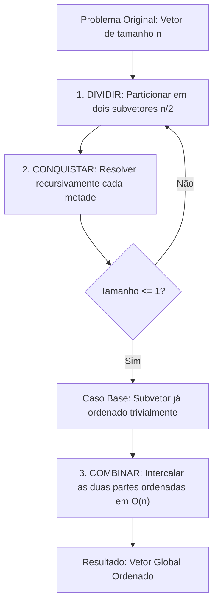
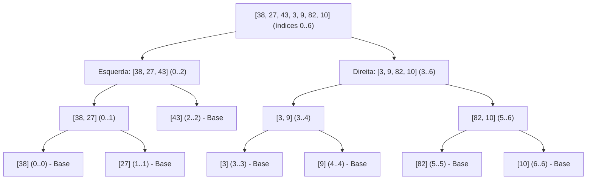
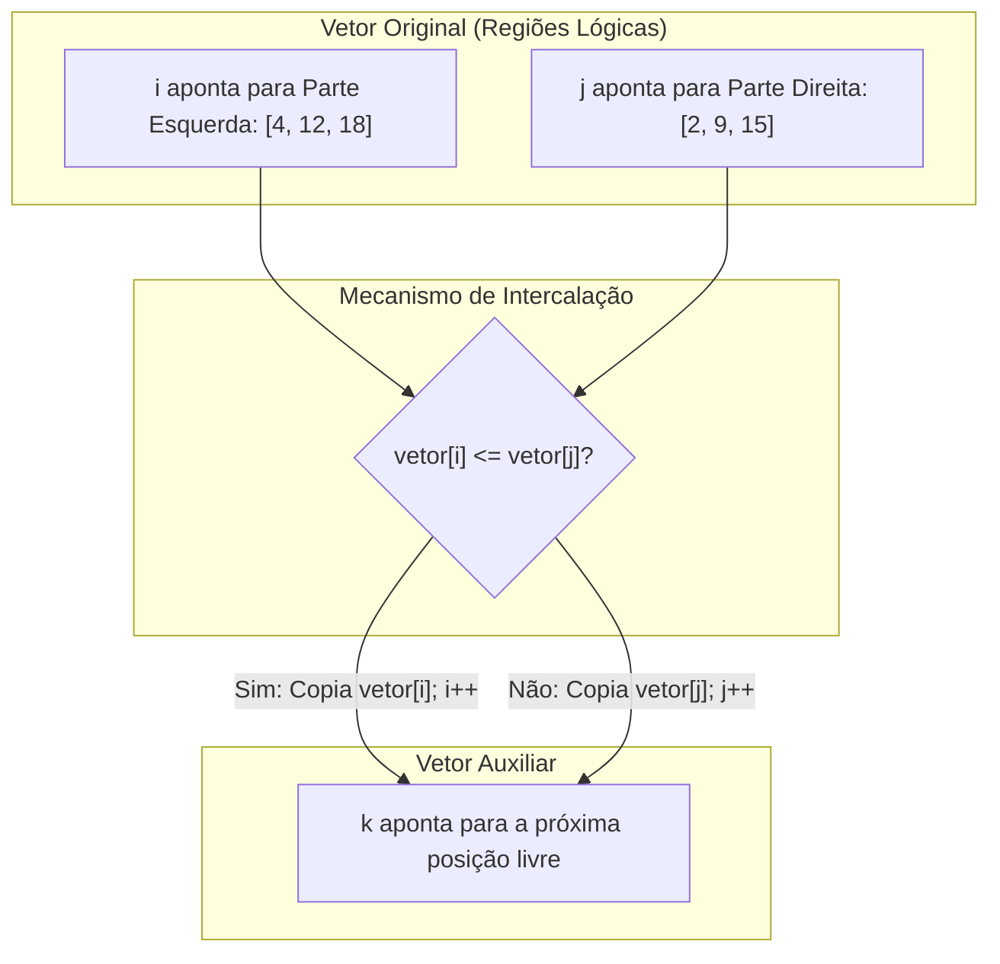
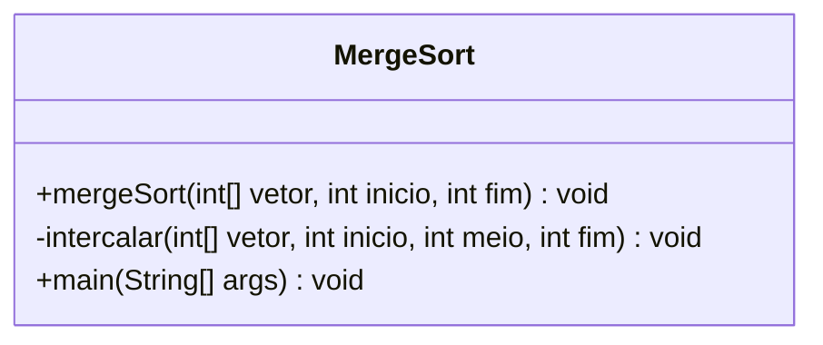
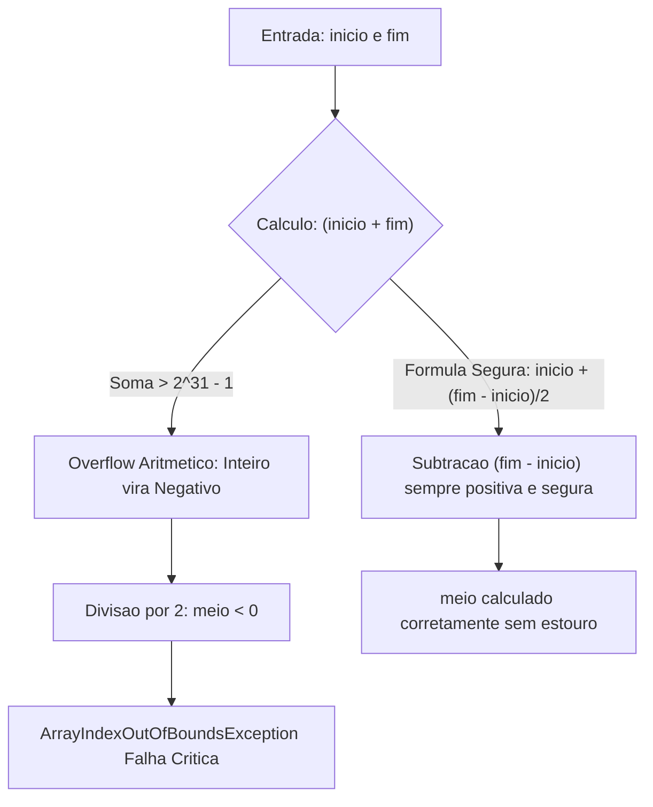
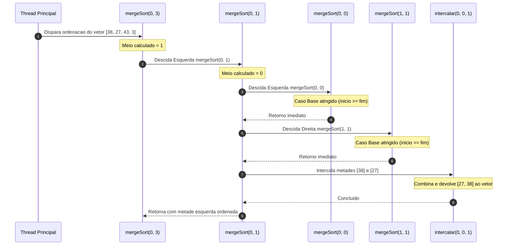
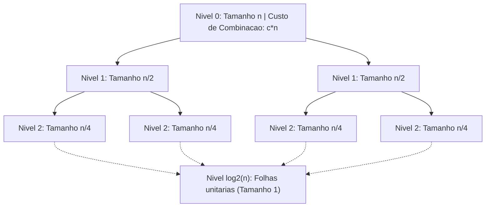
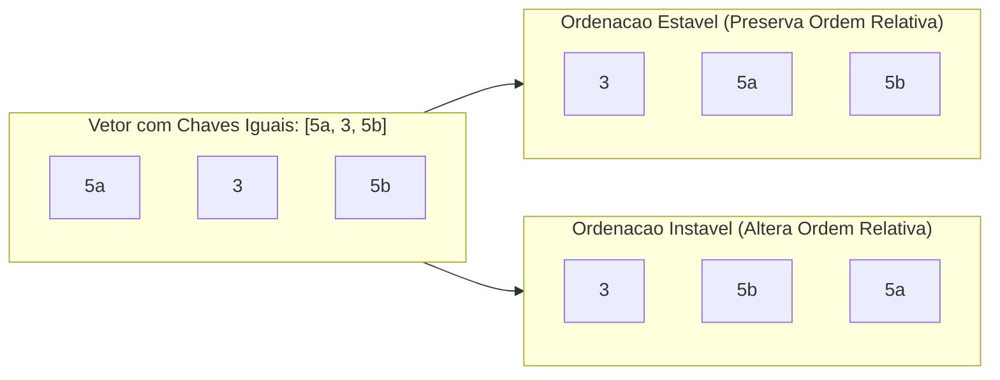

# Aula 11 — Algoritmo de Ordenação Merge Sort

> **Professor:** Wesley Soares
> **Disciplina:** Estrutura de Dados I (4º Semestre)
> **Tema:** Ordenação eficiente de dados baseada no paradigma de divisão e conquista com o algoritmo Merge Sort

## Sumário

- [Objetivo da aula](#objetivo-da-aula)
- [Contexto e pré-requisitos](#contexto-e-pré-requisitos)
- [Conceito e estratégia de divisão e conquista (dividir, conquistar e combinar)](#conceito-e-estratégia-de-divisão-e-conquista-dividir-conquistar-e-combinar)
- [Etapa de divisão: particionamento recursivo e caso base unitário](#etapa-de-divisão-particionamento-recursivo-e-caso-base-unitário)
- [Etapa de combinação (merge/intercalação) e necessidade do vetor auxiliar](#etapa-de-combinação-mergeintercalação-e-necessidade-do-vetor-auxiliar)
- [Implementação do Merge Sort em Java: métodos mergeSort() e intercalar()](#implementação-do-merge-sort-em-java-métodos-mergesort-e-intercalar)
- [Prevenção de overflow aritmético no cálculo do ponto médio](#prevenção-de-overflow-aritmético-no-cálculo-do-ponto-médio)
- [Rastreamento da recursão: movimentos de descida e retorno](#rastreamento-da-recursão-movimentos-de-descida-e-retorno)
- [Análise de complexidade temporal assintótica O(n log n) e espacial O(n)](#análise-de-complexidade-temporal-assintótica-on-log-n-e-espacial-on)
- [Comparação analítica com Bubble Sort, Selection Sort e Insertion Sort](#comparação-analítica-com-bubble-sort-selection-sort-e-insertion-sort)
- [Código da aula](#código-da-aula)
- [Exercícios](#exercícios)
- [Erros comuns e boas práticas](#erros-comuns-e-boas-práticas)
- [Links e materiais complementares](#links-e-materiais-complementares)
- [Mapa da aula](#mapa-da-aula)
- [Glossário](#glossário)
- [Pontos-chave para a prova](#pontos-chave-para-a-prova)
- [Perguntas e respostas (JSONL)](#perguntas-e-respostas-jsonl)
- [Checklist de revisão](#checklist-de-revisão)

---

## Objetivo da aula

O propósito pedagógico e técnico desta aula é capacitar o estudante a:
- Compreender e aplicar a estratégia de projeto de algoritmos conhecida como divisão e conquista (*divide and conquer*).
- Explicar o mecanismo de particionamento recursivo que decompõe um vetor contíguo em subestruturas progressivamente menores até casos triviais.
- Dominar o processo de intercalação (*merge*), compreendendo a mecânica de ponteiros e a indispensabilidade de uma área de memória auxiliar.
- Mapear e rastrear a árvore de recursão, identificando com precisão os movimentos de descida (empilhamento de chamadas) e de retorno (desempilhamento e combinação).
- Implementar de forma robusta e idiomática o algoritmo Merge Sort na linguagem Java, separando a lógica de controle recursivo da lógica de combinação linear.
- Analisar com rigor assintótico as complexidades de tempo nos cenários de melhor caso, caso médio e pior caso ($ `O(n \log n)` $`), além do custo de memória adicional (`$ `O(n)` $).
- Estabelecer comparações analíticas, empíricas e estruturais entre o Merge Sort e os métodos elementares quadráticos ($ `O(n^2)` $): Bubble Sort, Selection Sort e Insertion Sort.

---

## Contexto e pré-requisitos

Para acompanhar o desenvolvimento do algoritmo Merge Sort, o estudante deve mobilizar conhecimentos previamente consolidados na disciplina:
- **Vetores primitivos em Java:** indexação base zero, acesso posicional em tempo constante ($ `O(1)` $), manipulação de limites (`inicio`, `fim`) e alocação dinâmica com o operador `new`.
- **Recursividade computacional:** compreensão da pilha de chamadas (*call stack* da JVM), conceito de registros de ativação, definição estrita de caso base para terminação e risco de estouro de pilha (*StackOverflowError*).
- **Algoritmos de ordenação elementares:** familiaridade com as limitações dos algoritmos de força bruta ou inserção direta estudados nas aulas anteriores (Bubble Sort, Selection Sort e Insertion Sort), cujos laços aninhados degradam a performance para tempos proporcionais a $ `n^2` $ em grandes volumes de dados.

> **Nota de aprofundamento complementar:** Na engenharia de software real, o Merge Sort representa o alicerce conceitual de rotinas amplamente utilizadas em bibliotecas padrão de sistemas modernos, como o Timsort (utilizado no Java `Arrays.sort` para objetos e na biblioteca padrão do Python), que mescla o particionamento equilibrado do Merge Sort com o Insertion Sort para blocos pequenos.

---

## Conceito e estratégia de divisão e conquista (dividir, conquistar e combinar)

### Definição
O paradigma de **Divisão e Conquista** (*Divide and Conquer*) é uma estratégia de projeto de algoritmos em que um problema complexo é decomposto em subproblemas menores da mesma natureza, resolvidos de maneira recursiva ou direta, cujas soluções são posteriormente combinadas para formar a solução do problema original.

### Motivação
Tentar ordenar uma sequência maciça de elementos por comparação direta entre todas as posições resulta invariavelmente em custos quadráticos ($ `n(n-1)/2 \approx O(n^2)` $`). Se dividirmos o conjunto em partes menores, o esforço para manter ordenadas as pequenas partições e depois juntá-las de modo linear decresce substancialmente. A matemática por trás da divisão binária sucessiva reduz a altura operacional para uma escala logarítmica (`$ `\log_2 n` $).

### As três etapas canônicas



1. **Dividir:** Quebra o vetor original em dois subvetores disjuntos, calculando o ponto médio entre o índice inicial e o final.
2. **Conquistar:** Processa recursivamente cada metade. Caso a partição contenha zero ou um elemento, a conquista é imediata, pois uma lista unitária já está matematicamente ordenada.
3. **Combinar (*Merge*):** Reúne as duas metades previamente ordenadas em uma única sequência consolidada. Esta é a etapa em que o trabalho computacional de ordenação efetivamente acontece.

### Analogia estrutural
Considere uma pilha de cartões desordenados. Em vez de percorrer todos os cartões tentando encaixar um por um, a pilha é dividida sucessivamente entre várias pessoas até que cada pessoa segure apenas um único cartão. Uma pessoa segurando um único cartão tem em mãos um conjunto trivialmente ordenado. Em seguida, as pessoas juntam seus cartões em pares: comparam os dois cartões do topo e colocam o menor na base da nova pilha ordenada. Esse agrupamento ocorre em níveis hierárquicos até que a pilha original seja totalmente reconstruída.

### Exemplo
Dado o vetor de 4 elementos: `[38, 27, 43, 3]`:
- **Dividir:** Metade A `[38, 27]` e Metade B `[43, 3]`.
- **Subdividir:** `[38]`, `[27]` e `[43]`, `[3]`.
- **Conquistar:** `[38]` e `[27]` são bases; comparados viram `[27, 38]`. Da mesma forma, `[43]` e `[3]` viram `[3, 43]`.
- **Combinar:** Intercala `[27, 38]` e `[3, 43]` avaliando as cabeças das listas: menor entre 27 e 3 é 3; menor entre 27 e 43 é 27; menor entre 38 e 43 é 38; resta 43. Resultado final: `[3, 27, 38, 43]`.

### Contraexemplo
Tentar aplicar a etapa de combinação diretamente sobre sublistas que **não** estão ordenadas. Se tentarmos intercalar `[38, 27]` com `[43, 3]` assumindo que apenas olhar o primeiro elemento resolve o problema, o algoritmo pegará 38 ou 43 de forma falha, gerando uma sequência inconsistente. O método de dois ponteiros do *merge* exige estritamente a pré-condição de que ambas as entradas parciais já estejam em ordem.

### Armadilhas conceituais
> **Atenção:** A etapa de divisão **não** movimenta nem reordena os elementos na memória. Ela apenas define fronteiras lógicas (índices `inicio`, `meio`, `fim`). Toda a ordenação é executada a posteriori, durante o retorno recursivo na fase de combinação.

| Paradigma | Mecanismo Central | Trabalho Principal | Espaço Típico |
| :--- | :--- | :--- | :--- |
| **Força Bruta / Iterativo** (ex.: Selection) | Comparações globais no array | Na seleção direta do menor valor | In-place ($ `O(1)` $) |
| **Divisão e Conquista** (ex.: Merge Sort) | Decomposição recursiva equilibrada | Na combinação linear das metades | Requer buffer ($ `O(n)` $) |

---

## Etapa de divisão: particionamento recursivo e caso base unitário

### Definição
A divisão consiste na delimitação aritmética sucessiva dos intervalos de busca dentro do vetor original, criando subintervalos lógicos sem instanciar novas estruturas físicas de dados até que a condição de parada seja atingida.

### Motivação
Ao particionar o array ao meio de forma balanceada a cada iteração, garante-se que a profundidade máxima da árvore de recursão seja estritamente logarítmica ($ `\lfloor \log_2 n \rfloor + 1` $). Isso assegura o balanceamento da carga de processamento.

### Subparticionamento e caso base unitário
A condição fundamental de parada na recursão do Merge Sort é dada por:

```java
if (inicio >= fim) {
    return; // Subvetor com 1 ou 0 elementos já está ordenado
}
```

Por que parar quando $ `inicio \ge fim` $?
Um subvetor delimitado por $ `inicio == fim` $ contém exatamente um elemento ($ `fim - inicio + 1 = 1` $). Pelo axioma da ordenação, qualquer conjunto unitário é trivialmente ordenado em relação a si mesmo, inexistindo elementos concorrentes para violar a relação de ordem. Se $ `inicio > fim` $, temos um intervalo degenerado (vazio), cuja ordenação também é trivial.



### Rastreamento da divisão (Vetor de 7 elementos)

| Chamada Recursiva | Intervalo (`inicio` a `fim`) | Ponto Médio (`meio`) | Estado da Partição | Classificação |
| :--- | :--- | :--- | :--- | :--- |
| `mergeSort(vetor, 0, 6)` | 0 a 6 | $ `0 + (6-0)/2 = 3` $ | `[38, 27, 43, 3]` vs `[9, 82, 10]` | Divisão Nível 0 |
| `mergeSort(vetor, 0, 3)` | 0 a 3 | $ `0 + (3-0)/2 = 1` $ | `[38, 27]` vs `[43, 3]` | Divisão Nível 1 |
| `mergeSort(vetor, 0, 1)` | 0 a 1 | $ `0 + (1-0)/2 = 0` $ | `[38]` vs `[27]` | Divisão Nível 2 |
| `mergeSort(vetor, 0, 0)` | 0 a 0 | — | `[38]` | **Caso Base** ($ `0 \ge 0` $) |
| `mergeSort(vetor, 1, 1)` | 1 a 1 | — | `[27]` | **Caso Base** ($ `1 \ge 1` $) |
| `mergeSort(vetor, 2, 3)` | 2 a 3 | $ `2 + (3-2)/2 = 2` $ | `[43]` vs `[3]` | Divisão Nível 2 |
| `mergeSort(vetor, 2, 2)` | 2 a 2 | — | `[43]` | **Caso Base** ($ `2 \ge 2` $) |
| `mergeSort(vetor, 3, 3)` | 3 a 3 | — | `[3]` | **Caso Base** ($ `3 \ge 3` $) |

### Armadilhas do caso base
1. **Omitir o caso base ou usar condição incorreta ($ `inicio == fim` $):** Se um subvetor puder gerar um intervalo vazio (por exemplo, em chamadas onde o índice inicial ultrapasse o final), uma verificação estrita de igualdade pode falhar, provocando recursão infinita e esgotando a pilha da JVM (*StackOverflowError*).
2. **Definir subintervalos sobrepostos:** Chamar `mergeSort(vetor, inicio, meio)` e `mergeSort(vetor, meio, fim)`. Como o índice `meio` é incluído em ambos os ramos, o algoritmo nunca reduz o tamanho do subvetor no caso de dois elementos, travando em laço infinito. O correto é estritamente `meio` para a esquerda e `meio + 1` para a direita.

---

## Etapa de combinação (merge/intercalação) e necessidade do vetor auxiliar

### Definição
A intercalação (*merge*) é o processo determinístico de fundir dois subvetores contíguos ordenados — `vetor[inicio..meio]` e `vetor[meio+1..fim]` — em um único segmento totalmente ordenado.

### Motivação e mecânica dos ponteiros
Dado que ambos os subvetores já chegam ordenados à rotina de intercalação, os menores elementos de todo o conjunto obrigatoriamente se encontram no início de uma das duas partes. Consequentemente, não é necessário realizar buscas exaustivas: basta manter dois ponteiros apontando para as cabeças das listas e avançar aquele cujo valor for menor.



### Necessidade estrutural do vetor auxiliar
Por que não intercalar diretamente no próprio vetor original sem memória extra?
Se tentarmos escrever o menor valor diretamente na posição `vetor[inicio]`, o valor que lá residia originalmente seria destruído antes de ser comparado, a menos que deslocássemos todos os elementos posteriores uma casa para a direita. Contudo, realizar deslocamentos sequenciais dentro do array para cada inserção elevaria o custo de tempo da intercalação de $ `O(n)` $ para $ `O(n^2)` $`, anulando a vantagem competitiva do Merge Sort. O uso de um vetor temporário `auxiliar[]` permite alocar os elementos na ordem correta em tempo estritamente linear (`$ `O(n)` $).

### Simulação detalhada da combinação
Considere a intercalação das metades `Parte A = [4, 12, 18]` e `Parte B = [2, 9, 15]`:

| Passo | Ponteiro `i` (A) | Ponteiro `j` (B) | Comparação | Menor Escolhido | Vetor `auxiliar` Parcial | Ponteiro `k` |
| :---: | :---: | :---: | :---: | :---: | :--- | :---: |
| 1 | `A[0] = 4` | `B[0] = 2` | `4 <= 2` (Falso) | 2 | `[2]` | 1 |
| 2 | `A[0] = 4` | `B[1] = 9` | `4 <= 9` (Verdadeiro) | 4 | `[2, 4]` | 2 |
| 3 | `A[1] = 12` | `B[1] = 9` | `12 <= 9` (Falso) | 9 | `[2, 4, 9]` | 3 |
| 4 | `A[1] = 12` | `B[2] = 15`| `12 <= 15` (Verdadeiro)| 12 | `[2, 4, 9, 12]` | 4 |
| 5 | `A[2] = 18` | `B[2] = 15`| `18 <= 15` (Falso) | 15 | `[2, 4, 9, 12, 15]` | 5 |
| 6 | `A[2] = 18` | Exaurido ($ `j > fim` $) | — | 18 (Resíduo A) | `[2, 4, 9, 12, 15, 18]` | 6 |

### Cópia de resíduos e persistência no vetor original
Ao final do laço principal de comparação, invariavelmente uma das metades atinge seu limite antes da outra. O algoritmo necessita de laços secundários de esvaziamento para transcrever os elementos restantes. Por fim, os elementos ordenados contidos no vetor auxiliar são transferidos de volta ao vetor original deslocados pelo offset `inicio`:

```java
for (int x = 0; x < tamanho; x++) {
    vetor[inicio + x] = auxiliar[x];
}
```

---

## Implementação do Merge Sort em Java: métodos mergeSort() e intercalar()

### Arquitetura do código
A implementação modular em Java separa responsabilidades em dois métodos fundamentais:
1. `mergeSort(int[] vetor, int inicio, int fim)`: Orquestrador da recursão, controle do caso base e delimitação do ponto médio.
2. `intercalar(int[] vetor, int inicio, int meio, int fim)`: Operador imperativo que executa a mesclagem em memória linear.



### Implementação canônica completa

```java
public class MergeSort {

    /**
     * Divide o vetor recursivamente em metades e aciona a intercalacao.
     * 
     * @param vetor  Array de inteiros a ser ordenado
     * @param inicio Indice inicial do subvetor
     * @param fim    Indice final do subvetor
     */
    public static void mergeSort(int[] vetor, int inicio, int fim) {
        // Caso base: se o intervalo tiver tamanho 0 ou 1, encerra a divisao
        if (inicio >= fim) {
            return;
        }

        // Calculo seguro do indice medio para evitar overflow de inteiros
        int meio = inicio + (fim - inicio) / 2;

        // Chamada recursiva para processar a metade esquerda
        mergeSort(vetor, inicio, meio);

        // Chamada recursiva para processar a metade direita
        mergeSort(vetor, meio + 1, fim);

        // Combina as duas metades que agora estao comprovadamente ordenadas
        intercalar(vetor, inicio, meio, fim);
    }

    /**
     * Intercala duas metades contiguas e ordenadas de um vetor em um unico bloco.
     * 
     * @param vetor  Array original contendo os dados
     * @param inicio Limite inicial da particao esquerda
     * @param meio   Limite final da particao esquerda
     * @param fim    Limite final da particao direita
     */
    private static void intercalar(int[] vetor, int inicio, int meio, int fim) {
        // Tamanho exato do segmento a ser intercalado
        int tamanho = fim - inicio + 1;
        int[] auxiliar = new int[tamanho];

        int i = inicio;      // Cursor de leitura da particao esquerda
        int j = meio + 1;    // Cursor de leitura da particao direita
        int k = 0;           // Cursor de escrita no buffer auxiliar

        // Laco principal: compara os elementos frontais de cada particao
        while (i <= meio && j <= fim) {
            // A condicao <= assegura a estabilidade do algoritmo
            if (vetor[i] <= vetor[j]) {
                auxiliar[k] = vetor[i];
                i++;
            } else {
                auxiliar[k] = vetor[j];
                j++;
            }
            k++;
        }

        // Laco de esvaziamento: consome eventuais sobras da metade esquerda
        while (i <= meio) {
            auxiliar[k] = vetor[i];
            i++;
            k++;
        }

        // Laco de esvaziamento: consome eventuais sobras da metade direita
        while (j <= fim) {
            auxiliar[k] = vetor[j];
            j++;
            k++;
        }

        // Copia os dados ordenados do buffer auxiliar para o vetor original
        for (int x = 0; x < tamanho; x++) {
            vetor[inicio + x] = auxiliar[x];
        }
    }

    public static void main(String[] args) {
        int[] numeros = {38, 27, 43, 3, 9, 82, 10};

        System.out.println("Vetor original:");
        for (int n : numeros) {
            System.out.print(n + " ");
        }
        System.out.println();

        mergeSort(numeros, 0, numeros.length - 1);

        System.out.println("Vetor ordenado:");
        for (int n : numeros) {
            System.out.print(n + " ");
        }
        System.out.println();
    }
}
```

---

## Prevenção de overflow aritmético no cálculo do ponto médio

### Definição e mecanismo de estouro
Na implementação de algoritmos de busca e ordenação, a fórmula intuitiva para localizar o centro de um intervalo delimitado por `inicio` e `fim` é:

```java
int meio = (inicio + fim) / 2;
```

Embora matematicamente correta nos números reais, essa expressão apresenta uma vulnerabilidade grave em computadores com representação binária de inteiros de precisão fixa. Na linguagem Java, o tipo primitivo `int` possui tamanho fixo de 32 bits, operando no sistema de complemento de dois, com valor máximo de:

```math
\text{Integer.MAX\_VALUE} = 2^{31} - 1 = 2.147.483.647
```

Se a soma `inicio + fim` ultrapassar $ `2.147.483.647` $, ocorre um **estouro de inteiro** (*integer overflow*). O bit mais significativo (bit de sinal) torna-se 1, fazendo com que o resultado seja interpretado pela JVM como um número negativo. Ao realizar a divisão por 2, a variável `meio` recebe um valor negativo, disparando imediatamente uma exceção `java.lang.ArrayIndexOutOfBoundsException` ao tentar acessar `vetor[meio]`.



### Dedução algébrica da forma robusta
Para mitigar o overflow mantendo a equivalência matemática, manipula-se a expressão algébrica:

```math
\frac{\text{inicio} + \text{fim}}{2} = \frac{2 \cdot \text{inicio} + \text{fim} - \text{inicio}}{2} = \frac{2 \cdot \text{inicio}}{2} + \frac{\text{fim} - \text{inicio}}{2} = \text{inicio} + \frac{\text{fim} - \text{inicio}}{2}
```

Em código Java:
```java
int meio = inicio + (fim - inicio) / 2;
```

Como $ `fim \ge inicio` $, a subtração $ `(fim - inicio)` $ nunca é negativa e jamais excede o valor máximo de `fim`. Assim, a adição $ `inicio + (fim - inicio) / 2` $ mantém-se estritamente dentro da faixa representável.

### Tabela comparativa de abordagens para cálculo da média

| Expressão | Vulnerabilidade a Overflow | Complexidade de Instrução | Observação |
| :--- | :--- | :--- | :--- |
| `(inicio + fim) / 2` | **Crítica** (estoura se soma $ `> 2^{31}-1` $) | Baixa (1 soma, 1 divisão) | Código ingênuo clássico |
| `inicio + (fim - inicio) / 2` | **Nula** (100% segura para arrays válidos) | Baixa (1 subtração, 1 divisão, 1 soma) | **Recomendada e adotada em aula** |
| `(inicio + fim) >>> 1` | **Nula** | Mínima (operador de shift sem sinal) | Otimização idiomática de baixo nível |

> **Nota de aprofundamento complementar:** Este bug histórico esteve presente na implementação de busca binária e merge sort da biblioteca padrão do Java (`java.util.Arrays`) por quase uma década, tendo sido descoberto e corrigido pelo cientista da computação Joshua Bloch em 2006.

---

## Rastreamento da recursão: movimentos de descida e retorno

### A pilha de chamadas (Call Stack)
O Merge Sort adota um percurso em profundidade (*Depth-First Search*) sobre a árvore implícita de partições. A execução divide-se formalmente em:
1. **Movimento de Descida:** Empilhamento de registros de ativação de `mergeSort()` na Call Stack. Novas chamadas são abertas para a esquerda até que o caso base unitário seja alcançado. Nenhuma alteração no arranjo físico dos dados ocorre nesta fase.
2. **Movimento de Retorno:** Quando os nós folhas atingem o caso base e retornam, o fluxo de execução chega à chamada subsequente `intercalar()`. A pilha é desempilhada progressivamente e os dados são mesclados em ordem.



### Rastreamento da árvore para o vetor [38, 27, 43, 3]

```plain text
                            [38, 27, 43, 3]
                              /         \
                    [38, 27]               [43, 3]
                    /      \               /     \
                 [38]      [27]          [43]    [3]    <-- Folhas (Casos Base: n=1)
                    \      /               \     /
                    [27, 38]               [3, 43]      <-- Retorno 1: intercalar()
                        \                     /
                         \                   /
                           [3, 27, 38, 43]              <-- Retorno Final: intercalar()
```

### Estado da Call Stack durante o processamento

| Etapa Temporal | Ação em Execução | Profundidade da Pilha | Conteúdo Ativo na Call Stack |
| :---: | :--- | :---: | :--- |
| $ `t_1` $ | Início do algoritmo | 1 | `main` |
| $ `t_2` $ | Chamada raiz | 2 | `main` $`\rightarrow`$ `mergeSort(0, 3)` |
| $ `t_3` $ | Descida à esquerda | 3 | `main` $`\rightarrow`$ `mergeSort(0, 3)` $`\rightarrow`$ `mergeSort(0, 1)` |
| $ `t_4` $ | Caso base folha esquerda | 4 | `main` $`\rightarrow`$ `mergeSort(0, 3)` $`\rightarrow`$ `mergeSort(0, 1)` $`\rightarrow`$ `mergeSort(0, 0)` |
| $ `t_5` $ | Retorno da folha | 3 | `main` $`\rightarrow`$ `mergeSort(0, 3)` $`\rightarrow`$ `mergeSort(0, 1)` |
| $ `t_6` $ | Caso base folha direita | 4 | `main` $`\rightarrow`$ `mergeSort(0, 3)` $`\rightarrow`$ `mergeSort(0, 1)` $`\rightarrow`$ `mergeSort(1, 1)` |
| $ `t_7` $ | Intercalação nível 1 | 3 | `main` $`\rightarrow`$ `mergeSort(0, 3)` $`\rightarrow`$ `intercalar(0, 0, 1)` |
| $ `t_8` $ | Retorno para a raiz | 2 | `main` $`\rightarrow`$ `mergeSort(0, 3)` |

---

## Análise de complexidade temporal assintótica O(n log n) e espacial O(n)

### Dedução formal da recorrência matemática
O custo computacional do Merge Sort pode ser formalizado por meio de uma equação de recorrência:
- Para o caso base ($ `n \le 1` $), o tempo é constante: $ `T(1) = \Theta(1)` $.
- Para $ `n > 1` $, o algoritmo divide o vetor em 2 subproblemas de tamanho $ `n/2` $, consome tempo $ `2T(n/2)` $ para resolvê-los e despende tempo $ `c \cdot n` $ para intercalar os resultados:

```math
T(n) = 2T\left(\frac{n}{2}\right) + c \cdot n
```

Aplicando o **Teorema Mestre**:
Com $ `a = 2` $, $ `b = 2` $ e $ `f(n) = c \cdot n = \Theta(n^1)` $:

```math
\log_b a = \log_2 2 = 1 \implies f(n) = \Theta(n^{\log_b a}) = \Theta(n)
```

Enquadrando-se exatamente no Caso 2 do Teorema Mestre, a solução assintótica é:

```math
T(n) = \Theta(n \log n)
```

### Visualização pela árvore de recursão



- **Altura da árvore:** Como o problema tem seu tamanho reduzido pela metade a cada divisão, a profundidade máxima é dada por:

```math
\log_2 n
```

- **Trabalho por nível:** Em cada nível da árvore, a soma do tamanho de todos os subvetores combinados é exatamente $ `n` $. Como a intercalação percorre os elementos linearmente, o custo em cada nível é $ `c \cdot n` $.
- **Custo total:** Multiplicando o trabalho por nível pela quantidade de níveis:

```math
\text{Trabalho Total} = c \cdot n \times \log_2 n = O(n \log n)
```

### Comportamento invariante de tempo
Diferentemente de algoritmos como o Quicksort (que degrada para $ `O(n^2)` $ com pivôs desfavoráveis) ou o Insertion Sort (que oscila entre $ `O(n)` $ e $ `O(n^2)` $), o Merge Sort realiza invariavelmente a mesma sequência de divisões binárias e as mesmas passagens de intercalação, independentemente de os dados estarem ordenados, invertidos ou aleatórios:
- **Melhor caso:** $ `O(n \log n)` $
- **Caso médio:** $ `O(n \log n)` $
- **Pior caso:** $ `O(n \log n)` $

### Análise da complexidade de espaço
A desvantagem primária do Merge Sort reside no consumo de memória auxiliar:
1. **Memória de Heap (Buffer auxiliar):** Durante a intercalação, o vetor temporário aloca espaço proporcional à partição processada. No pior caso (nível raiz da combinação), aloca-se um vetor auxiliar de tamanho $ `n` $. Portanto, a complexidade espacial de dados auxiliares é $ `O(n)` $.
2. **Memória de Stack (Pilha da JVM):** A profundidade da árvore de recursão determina a quantidade máxima de registros de ativação concorrentes na Call Stack, totalizando $ `O(\log n)` $.
3. **Consumo global:** O termo dominante prevalece, resultando em:

```math
O(n) + O(\log n) = O(n)
```

---

## Comparação analítica com Bubble Sort, Selection Sort e Insertion Sort

### Matriz comparativa de ordenação

| Algoritmo | Melhor Caso | Caso Médio | Pior Caso | Memória Auxiliar | Estabilidade | Paradigma |
| :--- | :---: | :---: | :---: | :---: | :---: | :--- |
| **Bubble Sort** | $ `O(n)` $ (otimizado) | $ `O(n^2)` $ | $ `O(n^2)` $ | $ `O(1)` $ | Estável | Força Bruta / Trocas |
| **Selection Sort**| $ `O(n^2)` $ | $ `O(n^2)` $ | $ `O(n^2)` $ | $ `O(1)` $ | Instável | Força Bruta / Seleção |
| **Insertion Sort**| $ `O(n)` $ | $ `O(n^2)` $ | $ `O(n^2)` $ | $ `O(1)` $ | Estável | Inserção Incremental |
| **Merge Sort** | $ `O(n \log n)` $ | $ `O(n \log n)` $ | $ `O(n \log n)` $ | $ `O(n)` $ | **Estável** | **Divisão e Conquista** |

### Conceito de estabilidade em algoritmos de ordenação
Um algoritmo é denominado **estável** quando preserva rigorosamente a ordem relativa original de registros que possuem chaves de ordenação idênticas. 

No Merge Sort, a estabilidade é garantida na rotina de intercalação pela condição:
```java
if (vetor[i] <= vetor[j]) {
    auxiliar[k] = vetor[i++];
}
```
Ao utilizar o operador `<=`, caso haja empate entre um elemento da metade esquerda e outro da metade direita, o elemento da esquerda (que aparecia antes no vetor original) tem prioridade e é copiado primeiro para o buffer auxiliar. Se fosse utilizado `<`, a estabilidade seria violada.



### Trade-offs: Quando escolher qual algoritmo?
- **Escolha o Merge Sort:** Quando a previsibilidade de desempenho em tempo é crítica e o sistema dispõe de memória RAM abundante; quando se processa grandes volumes de objetos onde a estabilidade é obrigatória (ex.: ordenação bancária por múltiplos campos sucessivos).
- **Escolha o Insertion Sort:** Quando o volume de elementos for pequeno (geralmente $ `n < 32` $) ou quando o vetor já estiver quase totalmente ordenado (desempenho linear $ `O(n)` $ com zero consumo de memória extra).
- **Evite Bubble Sort e Selection Sort:** Praticamente obsoletos em sistemas de produção devido ao custo quadrático contínuo e transferências de dados ineficientes.

---

## Código da aula

Nesta seção são detalhados os artefatos de código desenvolvidos para a aula, localizados no diretório `./codigo/`.

### Arquivo 1: `./codigo/MergeSort.java`
Implementação canônica abordada pelo professor em sala, projetada para fins didáticos com demonstração de particionamento e intercalação.
Link relativo: [./codigo/MergeSort.java](./codigo/MergeSort.java)

#### Trechos essenciais comentados linha a linha

```java
// Linhas 1 a 6: Metodo de particionamento recursivo
public static void mergeSort(int[] vetor, int inicio, int fim) {
    if (inicio >= fim) {          // Linha 7: Caso base unitario ou subvetor invalido
        return;                   // Linha 8: Interrompe a descida na Call Stack
    }                             // Linha 9: Fim do bloco condicional
    int meio = inicio + (fim - inicio) / 2; // Linha 10: Calculo seguro anti-overflow
    mergeSort(vetor, inicio, meio);         // Linha 11: Chamada recursiva para metade esquerda
    mergeSort(vetor, meio + 1, fim);        // Linha 12: Chamada recursiva para metade direita
    intercalar(vetor, inicio, meio, fim);   // Linha 13: Executa a juncao ordenada
}

// Linhas 15 a 21: Configuracao dos cursores de intercalacao
private static void intercalar(int[] vetor, int inicio, int meio, int fim) {
    int tamanho = fim - inicio + 1;         // Linha 22: Dimensao exata do trecho corrente
    int[] auxiliar = new int[tamanho];      // Linha 23: Alocacao do buffer temporario
    int i = inicio;                         // Linha 24: Apontador inicial da metade esquerda
    int j = meio + 1;                       // Linha 25: Apontador inicial da metade direita
    int k = 0;                              // Linha 26: Cursor de preenchimento do auxiliar

    // Linhas 27 a 37: Laco comparativo de selecao do menor elemento
    while (i <= meio && j <= fim) {         // Linha 28: Enquanto ambas as partes tiverem dados
        if (vetor[i] <= vetor[j]) {         // Linha 29: Compara mantendo estabilidade
            auxiliar[k] = vetor[i];         // Linha 30: Copia elemento da esquerda
            i++;                            // Linha 31: Avanca cursor da esquerda
        } else {                            // Linha 32: Elemento da direita e menor
            auxiliar[k] = vetor[j];         // Linha 33: Copia elemento da direita
            j++;                            // Linha 34: Avanca cursor da direita
        }                                   // Linha 35: Fim da comparacao
        k++;                                // Linha 36: Avanca cursor do buffer
    }

    // Linhas 38 a 47: Copia de sobras e transferencia final
    while (i <= meio) { auxiliar[k++] = vetor[i++]; } // Linhas 39-42: Drena sobra esquerda
    while (j <= fim)  { auxiliar[k++] = vetor[j++]; } // Linhas 43-46: Drena sobra direita
    for (int x = 0; x < tamanho; x++) {     // Linha 48: Itera por todo o buffer auxiliar
        vetor[inicio + x] = auxiliar[x];    // Linha 49: Transfere de volta com offset inicio
    }
}
```

---

### Arquivo 2: `./codigo/MergeSortAtividade.java`
Resolução completa e unificada da atividade prática (Partes A e B) e do Desafio de ordenação decrescente, incluindo rastreamento de saídas no console.
Link relativo: [./codigo/MergeSortAtividade.java](./codigo/MergeSortAtividade.java)

#### Código fonte integral com dupla implementação (Crescente e Decrescente)

```java
public class MergeSortAtividade {

    // Metodo de ordenacao crescente padrao
    public static void mergeSortCrescente(int[] vetor, int inicio, int fim) {
        if (inicio >= fim) return;
        int meio = inicio + (fim - inicio) / 2;
        mergeSortCrescente(vetor, inicio, meio);
        mergeSortCrescente(vetor, meio + 1, fim);
        intercalarCrescente(vetor, inicio, meio, fim);
    }

    private static void intercalarCrescente(int[] vetor, int inicio, int meio, int fim) {
        int tamanho = fim - inicio + 1;
        int[] aux = new int[tamanho];
        int i = inicio, j = meio + 1, k = 0;

        while (i <= meio && j <= fim) {
            if (vetor[i] <= vetor[j]) {
                aux[k++] = vetor[i++];
            } else {
                aux[k++] = vetor[j++];
            }
        }
        while (i <= meio) aux[k++] = vetor[i++];
        while (j <= fim)  aux[k++] = vetor[j++];

        for (int x = 0; x < tamanho; x++) {
            vetor[inicio + x] = aux[x];
        }
    }

    // Metodo para resolver o DESAFIO: ordenacao decrescente
    public static void mergeSortDecrescente(int[] vetor, int inicio, int fim) {
        if (inicio >= fim) return;
        int meio = inicio + (fim - inicio) / 2;
        mergeSortDecrescente(vetor, inicio, meio);
        mergeSortDecrescente(vetor, meio + 1, fim);
        intercalarDecrescente(vetor, inicio, meio, fim);
    }

    private static void intercalarDecrescente(int[] vetor, int inicio, int meio, int fim) {
        int tamanho = fim - inicio + 1;
        int[] aux = new int[tamanho];
        int i = inicio, j = meio + 1, k = 0;

        while (i <= meio && j <= fim) {
            // CONDICAO MODIFICADA: Prioriza o maior elemento para ordem decrescente
            if (vetor[i] >= vetor[j]) {
                aux[k++] = vetor[i++];
            } else {
                aux[k++] = vetor[j++];
            }
        }
        while (i <= meio) aux[k++] = vetor[i++];
        while (j <= fim)  aux[k++] = vetor[j++];

        for (int x = 0; x < tamanho; x++) {
            vetor[inicio + x] = aux[x];
        }
    }

    private static void exibirVetor(int[] vetor) {
        for (int v : vetor) System.out.print(v + " ");
        System.out.println();
    }

    public static void main(String[] args) {
        int[] valores = {15, 8, 23, 4, 16, 42, 7, 10};

        System.out.println("--- PARTE B: ORDENACAO CRESCENTE ---");
        System.out.print("Antes da ordenacao: ");
        exibirVetor(valores);

        mergeSortCrescente(valores, 0, valores.length - 1);

        System.out.print("Depois da ordenacao crescente: ");
        exibirVetor(valores);

        System.out.println("\n--- DESAFIO: ORDENACAO DECRESCENTE ---");
        mergeSortDecrescente(valores, 0, valores.length - 1);
        System.out.print("Depois da ordenacao decrescente: ");
        exibirVetor(valores);
    }
}
```

---

## Exercícios

### Exercício 1: Simulação Manual (Atividade Prática - Parte A)

#### Enunciado
Considere o vetor de 8 posições:
```java
int[] valores = {15, 8, 23, 4, 16, 42, 7, 10};
```
1. Divida o vetor sucessivamente em duas partes até atingir grupos unitários.
2. Registre formalmente todas as combinações realizadas.
3. Apresente o estado do vetor após cada nível de combinação e o vetor final ordenado.

#### Raciocínio algorítmico
Com 8 elementos ($ `n = 8 = 2^3` $), a decomposição gera exatamente $ `\log_2 8 = 3` $ níveis de divisão binária perfeitamente balanceada antes de atingir as 8 folhas unitárias. Em seguida, iniciam-se os 3 níveis de combinação sucessiva.

#### Resolução passo a passo

**Etapa 1: Processo de Divisão Sucessiva**
- Nível 0: `[15, 8, 23, 4, 16, 42, 7, 10]`
- Nível 1: Esquerda `[15, 8, 23, 4]` | Direita `[16, 42, 7, 10]`
- Nível 2: `[15, 8]`, `[23, 4]`, `[16, 42]`, `[7, 10]`
- Nível 3 (Casos Base Unitários): `[15]`, `[8]`, `[23]`, `[4]`, `[16]`, `[42]`, `[7]`, `[10]`

**Etapa 2: Processo de Combinação (Merge)**
- **Rodada 1 (Combinando folhas em pares):**
  - Mesclar `[15]` e `[8]` $`\rightarrow`$ `[8, 15]`
  - Mesclar `[23]` e `[4]` $`\rightarrow`$ `[4, 23]`
  - Mesclar `[16]` e `[42]` $`\rightarrow`$ `[16, 42]`
  - Mesclar `[7]` e `[10]` $`\rightarrow`$ `[7, 10]`
  - Estado intermediário: `[8, 15]`, `[4, 23]`, `[16, 42]`, `[7, 10]`

- **Rodada 2 (Combinando quartetos):**
  - Mesclar `[8, 15]` e `[4, 23]`:
    - Compara 8 e 4 $`\rightarrow`$ escolhe 4
    - Compara 8 e 23 $`\rightarrow`$ escolhe 8
    - Compara 15 e 23 $`\rightarrow`$ escolhe 15
    - Sobra 23 $`\rightarrow`$ resultado: `[4, 8, 15, 23]`
  - Mesclar `[16, 42]` e `[7, 10]`:
    - Compara 16 e 7 $`\rightarrow`$ escolhe 7
    - Compara 16 e 10 $`\rightarrow`$ escolhe 10
    - Sobra 16, sobra 42 $`\rightarrow`$ resultado: `[7, 10, 16, 42]`
  - Estado intermediário: `[4, 8, 15, 23]` e `[7, 10, 16, 42]`

- **Rodada 3 (Combinação final das duas grandes metades):**
  - Mesclar `[4, 8, 15, 23]` e `[7, 10, 16, 42]`:
    - Compara 4 e 7 $`\rightarrow`$ escolhe **4**
    - Compara 8 e 7 $`\rightarrow`$ escolhe **7**
    - Compara 8 e 10 $`\rightarrow`$ escolhe **8**
    - Compara 15 e 10 $`\rightarrow`$ escolhe **10**
    - Compara 15 e 16 $`\rightarrow`$ escolhe **15**
    - Compara 23 e 16 $`\rightarrow`$ escolhe **16**
    - Compara 23 e 42 $`\rightarrow`$ escolhe **23**
    - Sobra 42 na direita $`\rightarrow`$ escolhe **42**

**Resultado Final:**
`[4, 7, 8, 10, 15, 16, 23, 42]`

Código correspondente disponível em: [./codigo/MergeSortAtividade.java](./codigo/MergeSortAtividade.java)

---

### Exercício 2: Implementação em Java (Atividade Prática - Parte B)

#### Enunciado
Implemente a classe executável `MergeSortAtividade`, contendo os métodos `mergeSort()` e `intercalar()`. Teste o algoritmo sobre o vetor `{15, 8, 23, 4, 16, 42, 7, 10}`, imprimindo o estado do vetor antes e depois da chamada da ordenação.

#### Raciocínio de implementação
Devemos estruturar a classe de forma autônoma, instanciando o vetor primitivo na função `main`, calculando seu comprimento com `length` e disparando o procedimento recursivo com índices de fronteira `0` e `valores.length - 1`.

#### Resolução comentada
Consulte o arquivo completo de solução: [./codigo/MergeSortAtividade.java](./codigo/MergeSortAtividade.java).
Saída gerada na execução:
```plain text
--- PARTE B: ORDENACAO CRESCENTE ---
Antes da ordenacao: 15 8 23 4 16 42 7 10 
Depois da ordenacao crescente: 4 7 8 10 15 16 23 42 
```

---

### Exercício 3: Desafio - Ordenação em Ordem Decrescente

#### Enunciado
Modifique o algoritmo de intercalação para que o vetor final seja reorganizado em ordem estritamente decrescente (do maior valor para o menor valor).

#### Raciocínio e modificação cirúrgica
A ordem da ordenação é definida exclusivamente na fase de combinação, no laço comparativo onde os dados são transferidos para o vetor auxiliar. Na versão crescente padrão, seleciona-se o menor elemento disponível:
```java
if (vetor[i] <= vetor[j]) { ... }
```
Para produzir a sequência em ordem decrescente, o critério de prioridade deve ser invertido para favorecer o **maior** elemento disponível entre as cabeças das sublistas:
```java
if (vetor[i] >= vetor[j]) { ... }
```
Desta forma, os maiores números preenchem primeiro as posições inferiores do vetor auxiliar (`k = 0, 1, 2...`), garantindo que o vetor final termine decrescente. A conservação do operador `>=` (em vez de `>`) garante a preservação da estabilidade da ordenação.

#### Resolução no código
Implementado no método `intercalarDecrescente()` do arquivo [./codigo/MergeSortAtividade.java](./codigo/MergeSortAtividade.java).
Saída gerada na execução:
```plain text
--- DESAFIO: ORDENACAO DECRESCENTE ---
Depois da ordenacao decrescente: 42 23 16 15 10 8 7 4 
```

---

## Erros comuns e boas práticas

### Catálogo de armadilhas e anti-patterns

#### 1. Cálculo do meio vulnerável a overflow
- **Erro:** `int meio = (inicio + fim) / 2;`
- **Sintoma:** Ocorre em coleções muito grandes na JVM; a soma excede $ `2^{31}-1` $, vira negativa e lança `ArrayIndexOutOfBoundsException`.
- **Correção:** `int meio = inicio + (fim - inicio) / 2;`

#### 2. Alocação redundante e destruição de desempenho de memória
- **Erro:** Instanciar novos vetores primitivos a cada chamada de `mergeSort()` antes da divisão (ex.: criando arrays `esquerda[]` e `direita[]` físicos na descida).
- **Sintoma:** Sobrecarga intensa do coletor de lixo da JVM (*Garbage Collector*), provocando pausas e alto consumo de memória.
- **Boa Prática:** Passar apenas os apontadores `inicio`, `meio` e `fim`, alocando o buffer auxiliar exclusivamente durante a execução de `intercalar()`.

#### 3. Esquecimento dos laços de esvaziamento residual
- **Erro:** Encerrar o método `intercalar()` logo após o término do laço principal `while (i <= meio && j <= fim)`.
- **Sintoma:** Elementos são silenciosamente omitidos da ordenação, duplicando outros valores ou mantendo fragmentos desordenados.
- **Correção:** Incluir obrigatoriamente os dois laços `while (i <= meio)` e `while (j <= fim)`.

#### 4. Cópia de volta com índice base zero
- **Erro:** Escrever `vetor[x] = auxiliar[x];` no retorno do método intercalar.
- **Sintoma:** Corrupção de dados ao ordenar subvetores da metade direita (por exemplo, subvetor de índices 4 a 7 sobrescreve as posições 0 a 3).
- **Correção:** Escrever obrigatoriamente no deslocamento relativo: `vetor[inicio + x] = auxiliar[x];`.

#### 5. Perda da estabilidade do algoritmo
- **Erro:** Usar `if (vetor[i] < vetor[j])` em vez de `<=`.
- **Sintoma:** Quando chaves idênticas se encontram, o algoritmo desempata escolhendo o elemento da direita, invertendo a ordem original de inserção e violando a garantia formal de estabilidade.

---

## Links e materiais complementares

1. **Notion Oficial da Disciplina - ED I Aula 13 (Prof. Wesley Soares):**
   - URL: `https://outgoing-salt-444.notion.site/ED-I-Aula-13-Merge-sort-40c8a4f8f8a780eda933c75b49da313d?source=copy_link`
   - *Conteúdo:* Roteiro oficial da aula, objetivos conceituais, visualização de divisões e gabarito orientativo.
2. **Visualgo — Visualising Data Structures and Algorithms through Animation:**
   - *Conteúdo:* Ferramenta interativa que permite acompanhar visualmente a descida recursiva e o movimento dos ponteiros $ `i` $, $ `j` $ e $ `k` $ durante a intercalação em tempo real.
3. **CORMEN, T. H. et al. Algoritmos: Teoria e Prática (3ª Edição):**
   - *Conteúdo:* Capítulo 2 (Dando a Partida - Projeto de Algoritmos com Divisão e Conquista) e Capítulo 4 (Divisão e Conquista e Teorema Mestre). Leitura fundamental para aprofundamento formal matemático da recorrência $ `T(n) = 2T(n/2) + \Theta(n)` $.

---

## Mapa da aula

```mermaid
mindmap
  root["Merge Sort"]
    "Paradigma: Divisao e Conquista"
      "Dividir: Particao binaria em n/2"
      "Conquistar: Caso base unitario n <= 1"
      "Combinar: Intercalacao linear O(n)"
    "Implementacao em Java"
      "mergeSort: Controle recursivo"
      "intercalar: Mecanica de 2 ponteiros"
      "Calculo do Meio: Anti-overflow inicio + fim-inicio/2"
      "Vetor Auxiliar: Buffer temporario indispensavel"
    "Complexidade"
      "Tempo: O(n log n) estavel em todos os casos"
      "Espaco: O(n) na memoria heap pelo vetor auxiliar"
      "Call Stack: O(log n) de profundidade maxima"
    "Propriedades"
      "Estabilidade: Preserva ordem com operador <="
      "Comparativo: Supera O(n^2) de Bubble, Selection e Insertion"
```

---

## Glossário

| Termo | Definição |
| :--- | :--- |
| **Divisão e Conquista** | Paradigma de projeto de algoritmos estruturado em três etapas: dividir o problema em partes menores, conquistar os casos triviais e combinar as soluções parciais. |
| **Intercalação (*Merge*)** | Operação linear ($ `O(n)` $) que mescla dois conjuntos previamente ordenados em uma única sequência consolidada. |
| **Caso Base** | Condição de parada de um método recursivo. No Merge Sort, ocorre quando o subvetor possui 0 ou 1 elemento ($ `inicio \ge fim` $). |
| **Vetor Auxiliar** | Área de memória alocada temporariamente para armazenar os elementos durante a intercalação sem destruir os dados ainda não processados no vetor original. |
| **Estouro de Inteiro (*Overflow*)** | Fenômeno aritmético em que uma operação excede o limite máximo representável pela variável (ex.: $ `2^{31}-1` $ em inteiros Java de 32 bits), resultando em números negativos inesperados. |
| **Estabilidade** | Propriedade de algoritmos de ordenação que garante a preservação da posição relativa original de itens que possuem chaves de ordenação iguais. |
| **Ponto Médio (*Midpoint*)** | Índice central que delimita as metades esquerda e direita de um segmento de vetor; calculado de forma segura via $ `inicio + (fim - inicio)/2` $. |
| **Call Stack** | Estrutura de dados interna da JVM responsável por gerenciar a execução de métodos e armazenar variáveis locais e parâmetros a cada invocação ativa. |

---

## Pontos-chave para a prova

- **Divisão não ordena:** Tenha muita atenção a assertivas teóricas que afirmem que a divisão posiciona elementos. A divisão apenas segmenta índices lógicos; quem ordena de fato é o método `intercalar()`.
- **Complexidade invariável:** Ao contrário do Quicksort (cujo pior caso é $ `O(n^2)` $), o Merge Sort é estritamente $ `O(n \log n)` $ no **melhor caso**, no **caso médio** e no **pior caso**.
- **Custo de memória:** O calcanhar de Aquiles do Merge Sort clássico é a memória auxiliar de dados: $ `O(n)` $. Ele **não** é um algoritmo *in-place*.
- **Garantia de estabilidade:** O operador `<=` na comparação `if (vetor[i] <= vetor[j])` assegura que elementos iguais da partição esquerda sejam transcritos antes dos da direita. Trocar por `<` quebra a estabilidade.
- **Fórmula do meio:** A fórmula correta para prevenir *integer overflow* em sistemas de larga escala é `meio = inicio + (fim - inicio) / 2`.
- **Condição do caso base:** A verificação correta é `if (inicio >= fim) return;`.

---

## Perguntas e respostas (JSONL)

```jsonl
{"pergunta": "Qual e o paradigma de projeto algoritmico utilizado pelo Merge Sort?", "resposta": "O paradigma de Divisao e Conquista (Dividir, Conquistar e Combinar).", "dificuldade": "facil"}
{"pergunta": "Por que a recursao do Merge Sort para quando o subvetor possui apenas um elemento?", "resposta": "Porque uma sequencia unitaria ja esta matematicamente ordenada por definicao, servindo como caso base.", "dificuldade": "facil"}
{"pergunta": "Em qual etapa do Merge Sort ocorre efetivamente a ordenacao dos elementos?", "resposta": "Na etapa de combinacao (intercalacao/merge), quando os elementos sao comparados e dispostos em ordem no vetor auxiliar.", "dificuldade": "facil"}
{"pergunta": "Qual e a complexidade de tempo do Merge Sort no melhor, medio e pior caso?", "resposta": "O(n log n) em todos os tres cenarios assintoticos.", "dificuldade": "facil"}
{"pergunta": "Qual e a complexidade de memoria auxiliar do Merge Sort tradicional para arrays?", "resposta": "O(n), devido a necessidade de alocar vetores auxiliares para a etapa de intercalacao.", "dificuldade": "facil"}
{"pergunta": "Qual e a formula recomendada para o calculo do ponto medio visando evitar overflow de inteiros em Java?", "resposta": "meio = inicio + (fim - inicio) / 2", "dificuldade": "medio"}
{"pergunta": "O que ocorre computacionalmente se utilizarmos (inicio + fim) / 2 quando inicio + fim ultrapassa Integer.MAX_VALUE?", "resposta": "Ocorre estouro de inteiro de 32 bits, gerando um numero negativo que causa ArrayIndexOutOfBoundsException.", "dificuldade": "medio"}
{"pergunta": "Por que o Merge Sort necessita obrigatoriamente de um vetor auxiliar durante a intercalacao?", "resposta": "Para alocar os elementos ordenados temporariamente sem sobrescrever valores do vetor original que ainda precisam ser comparados.", "dificuldade": "medio"}
{"pergunta": "O Merge Sort e um algoritmo de ordenacao estavel? Justifique.", "resposta": "Sim, ele preserva a ordem relativa de elementos iguais desde que a condicao do merge priorize o elemento da esquerda usando <=.", "dificuldade": "medio"}
{"pergunta": "Quantos niveis de divisao sao necessarios para um vetor de tamanho n atingir os casos base unitarios?", "resposta": "Aproximadamente log2(n) niveis de divisao binaria sucessiva.", "dificuldade": "medio"}
{"pergunta": "O que acontece se esquecermos os laços de esvaziamento de sobras no metodo intercalar?", "resposta": "Elementos restantes da metade que nao foi totalmente percorrida serao omitidos, gerando um vetor incompleto e desordenado.", "dificuldade": "medio"}
{"pergunta": "Por que devemos copiar os dados do vetor auxiliar de volta para o vetor original usando o deslocamento inicio + x?", "resposta": "Porque nas chamadas recursivas o trecho em processamento comeca no indice inicio, e nao no indice 0 do array global.", "dificuldade": "medio"}
{"pergunta": "Qual e a relacao de recorrencia matematica que define o tempo de execucao do Merge Sort?", "resposta": "T(n) = 2T(n/2) + c*n para n > 1, com caso base T(1) = Theta(1).", "dificuldade": "dificil"}
{"pergunta": "Qual caso do Teorema Mestre e aplicado para resolver a recorrencia T(n) = 2T(n/2) + Theta(n)?", "resposta": "O Caso 2, onde f(n) = Theta(n^(log_b a)) com log_2(2) = 1, resultando em T(n) = Theta(n log n).", "dificuldade": "dificil"}
{"pergunta": "Por que o Insertion Sort pode ser mais vantajoso que o Merge Sort em conjuntos de dados muito pequenos?", "resposta": "Porque o Insertion Sort possui custo O(1) de memoria extra e nao sofre o overhead de constantes e criacao de pilha de recursao.", "dificuldade": "dificil"}
{"pergunta": "Como se altera o algoritmo Merge Sort para realizar ordenacao decrescente?", "resposta": "Modificando a condicao de comparacao no metodo intercalar de vetor[i] <= vetor[j] para vetor[i] >= vetor[j].", "dificuldade": "facil"}
{"pergunta": "Qual a profundidade maxima atingida pela pilha de chamadas (Call Stack) na execucao do Merge Sort?", "resposta": "A profundidade maxima de quadros de ativacao na pilha e proporcional a O(log n).", "dificuldade": "medio"}
{"pergunta": "Qual e a principal desvantagem do Merge Sort em relacao a algoritmos in-place como o Quicksort e Heapsort?", "resposta": "O consumo adicional de memoria linear O(n), que pode ser proibitivo em dispositivos embarcados ou com pouca RAM.", "dificuldade": "medio"}
{"pergunta": "Qual a diferenca fundamental de estrategia entre o Merge Sort e o Quicksort?", "resposta": "O Merge Sort particiona cegamente ao meio e faz o trabalho pesado na combinacao; o Quicksort posiciona o pivo e faz o trabalho na divisao.", "dificuldade": "dificil"}
{"pergunta": "O que ocorreria se a chamada recursiva da metade direita utilizasse os limites mergeSort(vetor, meio, fim)?", "resposta": "Geraria recursao infinita (StackOverflowError) para trechos de 2 elementos, pois o tamanho do subproblema nao decresceria.", "dificuldade": "dificil"}
```

---

## Checklist de revisão

- [ ] Compreendi as 3 fases do paradigma de Divisão e Conquista: Dividir, Conquistar e Combinar.
- [ ] Sei explicar por que um subvetor de tamanho unitário ($ `inicio \ge fim` $) é adotado como caso base.
- [ ] Entendi a mecânica dos dois ponteiros de leitura ($ `i` $ e $ `j` $`) e do ponteiro de escrita (`$ `k` $) no método `intercalar()`.
- [ ] Sei explicar a razão de alocar um vetor auxiliar temporário em vez de tentar intercalar *in-place*.
- [ ] Lembro de verificar os dois laços de drenagem de elementos restantes (sobras) da esquerda e da direita.
- [ ] Sei aplicar o deslocamento de índice `vetor[inicio + x] = auxiliar[x]` na reinserção dos dados no vetor original.
- [ ] Compreendi a demonstração do perigo de *integer overflow* com `(inicio + fim) / 2` e adotei `inicio + (fim - inicio) / 2`.
- [ ] Consigo desenhar e rastrear a árvore de recursão completa com os movimentos de descida e de retorno.
- [ ] Sei demonstrar analiticamente por que o custo de tempo é $ `O(n \log n)` $ e o de memória auxiliar é $ `O(n)` $.
- [ ] Sei diferenciar o Merge Sort dos métodos quadráticos (Bubble, Selection e Insertion Sort) em tempo, espaço e estabilidade.
- [ ] Resolvi manualmente a simulação do vetor `{15, 8, 23, 4, 16, 42, 7, 10}`.
- [ ] Pratiquei a inversão de polaridade no código para ordenação decrescente com o operador `>=`.
