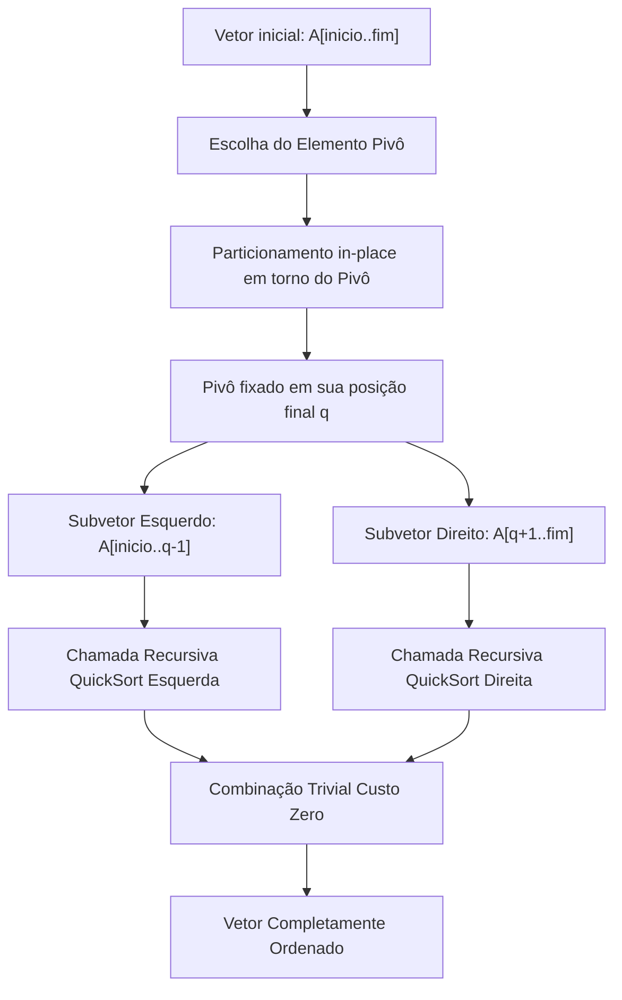
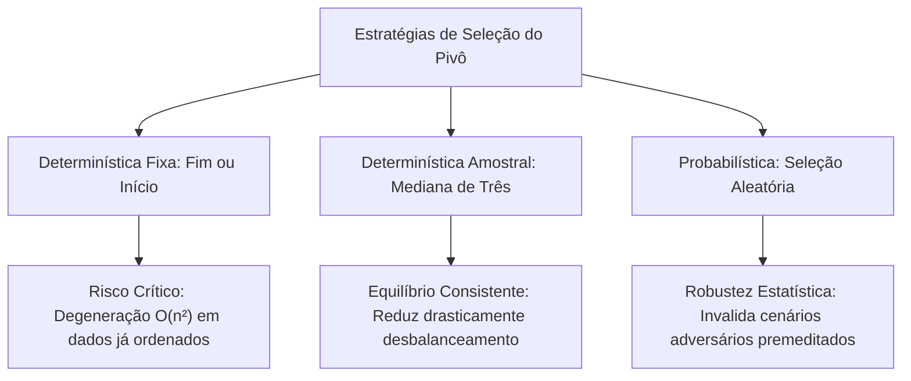
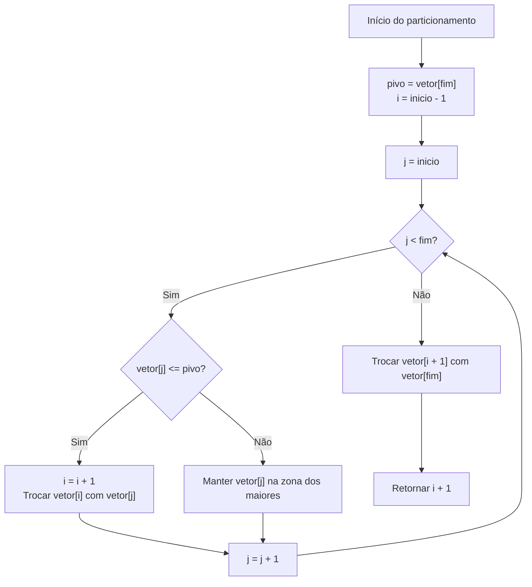
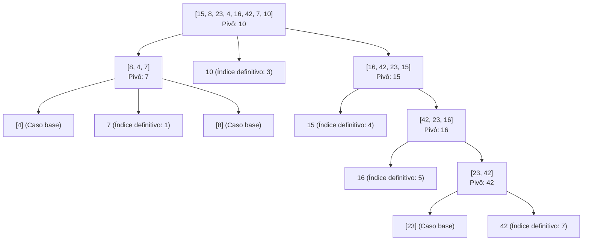
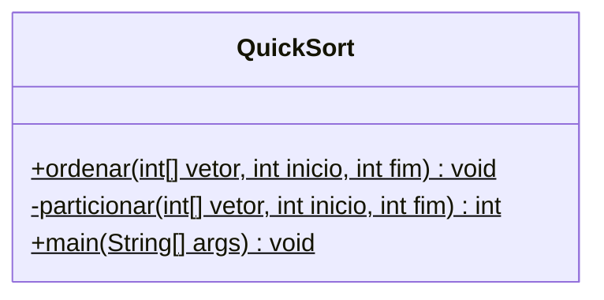
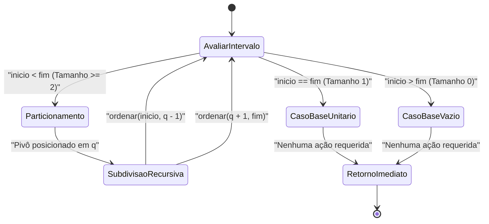
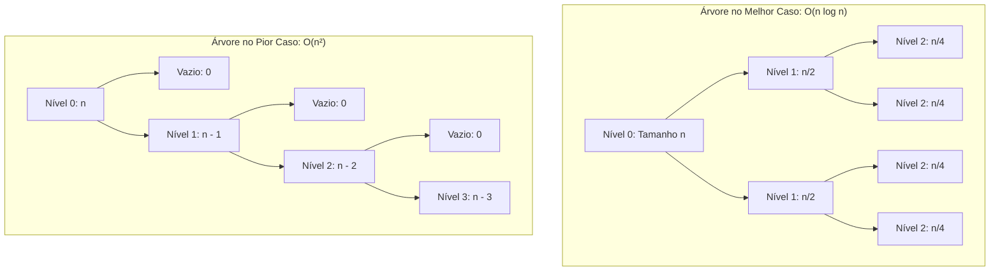
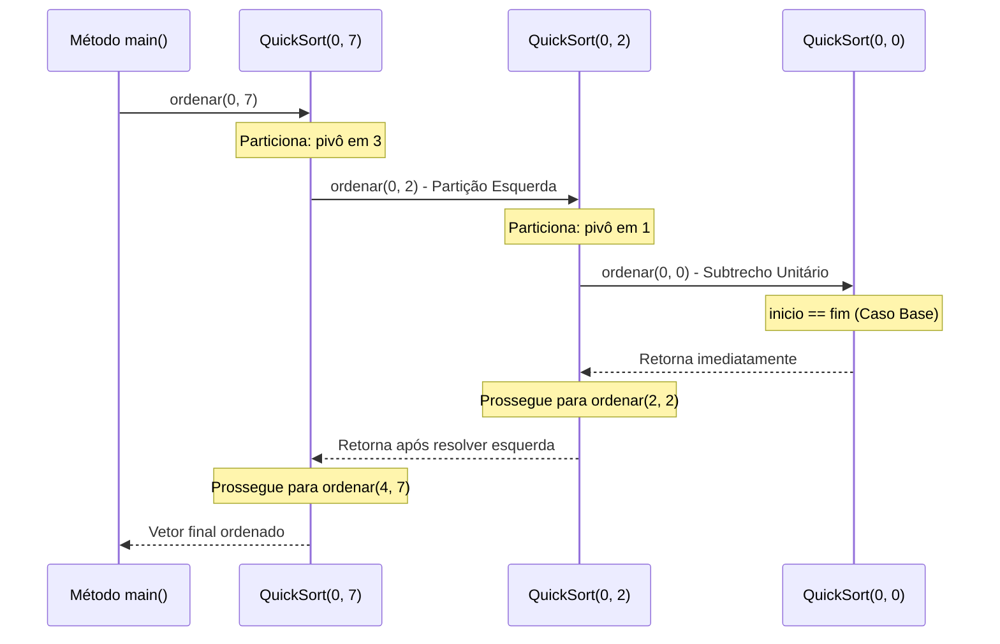
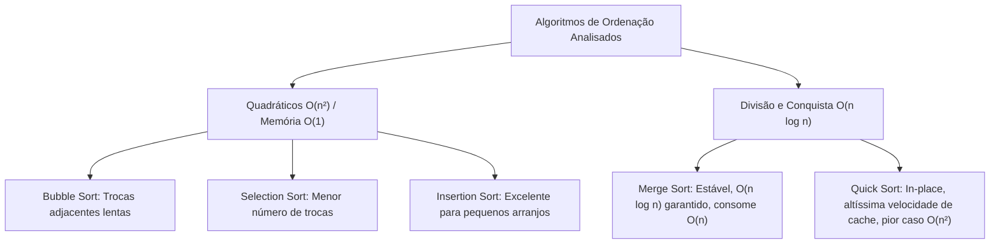

# Aula 12 — Quick Sort: Ordenação por Particionamento

> **Professor:** Wesley Soares
> **Disciplina:** Estrutura de Dados I (4º Semestre)
> **Tema:** Algoritmo de ordenação Quick Sort por particionamento de Lomuto, análise assintótica e implementação em Java

---

## Sumário

- [Objetivo da aula](#objetivo-da-aula)
- [Contexto e pré-requisitos](#contexto-e-pré-requisitos)
- [Estratégia de divisão e conquista no Quick Sort](#estratégia-de-divisão-e-conquista-no-quick-sort)
- [Papel e critérios de seleção do elemento pivô](#papel-e-critérios-de-seleção-do-elemento-pivô)
- [Mecânica do particionamento de Lomuto](#mecânica-do-particionamento-de-lomuto)
- [Simulação passo a passo e rastreamento de índices](#simulação-passo-a-passo-e-rastreamento-de-índices)
- [Implementação recursiva do algoritmo em Java](#implementação-recursiva-do-algoritmo-em-java)
- [Condição de parada da recursividade e casos base](#condição-de-parada-da-recursividade-e-casos-base)
- [Análise de complexidade temporal nos casos melhor, médio e pior](#análise-de-complexidade-temporal-nos-casos-melhor-médio-e-pior)
- [Análise de consumo de memória e pilha de execução recursiva](#análise-de-consumo-de-memória-e-pilha-de-execução-recursiva)
- [Comparação analítica com Bubble Sort, Selection Sort, Insertion Sort e Merge Sort](#comparação-analítica-com-bubble-sort-selection-sort-insertion-sort-e-merge-sort)
- [Código da aula](#código-da-aula)
- [Exercícios](#exercícios)
- [Erros comuns e boas práticas](#erros-comuns-e-boas-práticas)
- [Links e materiais complementares](#links-e-materiais-complementares)
- [Mapa da aula](#mapa-da-aula)
- [Glossário](#glossário)
- [Pontos-chave para a prova](#pontos-chave-para-a-prova)
- [Perguntas e respostas (JSONL)](#perguntas-e-respostas-jsonl)
- [Checklist de revisão](#checklist-de-revisão)

---

## Objetivo da aula

- Compreender a fundamentação teórica e prática do paradigma de divisão e conquista aplicado à ordenação in-place pelo algoritmo Quick Sort.
- Identificar a responsabilidade algorítmica do elemento pivô e o impacto de sua escolha na topologia da árvore de recursão.
- Dominar a mecânica operacional do particionamento de Lomuto, rastreando as invariantes dos ponteiros de varredura e de delimitação de fronteira.
- Rastrear a evolução do estado de vetores numéricos durante o processo de particionamento e posicionamento definitivo do pivô.
- Implementar o algoritmo Quick Sort em linguagem Java de maneira estruturada, legível e livre de vazamento de limites de índices.
- Demonstrar as condições de parada da recursão e identificar os casos degenerados associados ao esgotamento de limites.
- Avaliar a complexidade temporal assintótica do algoritmo nos cenários de melhor caso, caso médio e pior caso por meio de recorrências matemáticas.
- Analisar a ocupação de memória na pilha de execução do sistema ($ `call\ stack` $), diferenciando o consumo de dados do consumo de controle.
- Confrontar analiticamente o Quick Sort com os métodos de ordenação quadráticos (Bubble, Selection, Insertion) e logarítmicos (Merge Sort).

---

## Contexto e pré-requisitos

Para acompanhar este material com o máximo de aproveitamento, o estudante deve dominar os seguintes tópicos prévios de Ciência da Computação e Programação:

1. **Manipulação de Vetores e Acesso Indexado:** Conhecimento sólido sobre arranjos unidimensionais ($ `arrays` $`), aritmética de ponteiros conceituais, troca de elementos (`$ `swap` $`) e limites de indexação (`$ `0` $ a $ `n - 1` $).
2. **Recursividade Estruturada:** Compreensão de como funções invocam a si mesmas, resolução de casos base e o funcionamento da pilha de execução em tempo de execução da Java Virtual Machine (JVM).
3. **Análise Assintótica Preliminar:** Familiaridade com a notação Big-O ($ `O` $`), ordens de crescimento linear (`$ `O(n)` $`), logarítmica (`$ `O(\log n)` $`), linearítmica (`$ `O(n \log n)` $`) e quadrática (`$ `O(n^2)` $).
4. **Algoritmos de Ordenação Elementares e Intercalação:** Compreensão do funcionamento do Bubble Sort, Selection Sort, Insertion Sort e, fundamentalmente, do Merge Sort (que estabeleceu o primeiro contato com divisão e conquista nesta disciplina).

---

## Estratégia de divisão e conquista no Quick Sort

### Definição
O paradigma de divisão e conquista ($ `Divide\ and\ Conquer` $) decompõe um problema computacional complexo em dois ou mais subproblemas semelhantes de menor escala, resolve esses subproblemas recursivamente e, quando necessário, combina suas soluções para compor a solução do problema global original.

No algoritmo Quick Sort, concebido por Sir Tony Hoare em 1959 e publicado em 1961, esse paradigma se manifesta por meio de três fases essenciais:
1. **Divisão (Particionamento):** O arranjo $ `A[inicio..fim]` $ é rearranjado in-place em torno de um elemento de corte selecionado, denominado **pivô**. Ao término da divisão, o pivô encontra-se em seu índice final e definitivo $ `q` $. Todos os elementos contidos no subarray esquerdo $ `A[inicio..q-1]` $ possuem valores menores ou iguais ao pivô, enquanto todos os elementos do subarray direito $ `A[q+1..fim]` $ contêm valores maiores que o pivô.
2. **Conquista:** As duas partições resultantes, $ `A[inicio..q-1]` $ e $ `A[q+1..fim]` $, são ordenadas recursivamente por novas chamadas independentes ao Quick Sort.
3. **Combinação:** Como a etapa de rearranjo e posicionamento é feita diretamente no próprio vetor original ($ `in-place` $`) e os elementos já estão devidamente segregados em relação ao pivô fixado, a fase de combinação é trivial e tem custo de tempo estritamente nulo (`$ `O(1)` $). Ao final das chamadas recursivas, o vetor já está integralmente ordenado.

### Motivação
Nos métodos quadráticos elementares, as comparações e trocas ocorrem de forma local ou redundante, resultando em transferências de elementos por curtas distâncias. O Merge Sort superou essa barreira temporal ao garantir $ `O(n \log n)` $ em todos os cenários, porém introduziu um custo espacial severo: a necessidade de alocar vetores auxiliares de tamanho $ `O(n)` $ para realizar a intercalação. 

O Quick Sort foi arquitetado para conciliar a eficiência linearítmica média do Merge Sort com a economia espacial dos métodos in-place, eliminando o vetor temporário externo e concentrando todo o esforço de processamento na etapa de particionamento prévio.

### Exemplo comparativo de abordagem
Enquanto o Merge Sort primeiro divide cegamente o vetor ao meio para trabalhar nas metades e depois executa o trabalho pesado de ordenação durante a fusão ($ `merge` $`), o Quick Sort executa o trabalho pesado de ordenação antes, durante a partição (`$ `partition` $), tornando o término da recursão instantaneamente o término da ordenação.

### Contraexemplo e armadilhas
Achar que todo algoritmo de divisão e conquista opera de maneira idêntica ao Merge Sort é um equívoco clássico. No Quick Sort, os dois subarrays gerados após a escolha do pivô **não possuem obrigatoriamente tamanhos iguais**. A divisão raramente é simétrica em 50% para cada lado, pois a proporção do corte depende exclusivamente do valor do pivô em relação ao restante dos dados. Supor que o Quick Sort sempre divide o vetor em $ `n/2` $ leva a erros conceituais graves no cálculo de sua complexidade assintótica.



| Critério de Comparação | Divisão e Conquista no Merge Sort | Divisão e Conquista no Quick Sort |
| :--- | :--- | :--- |
| **Ponto de divisão** | Fixo no índice mediano ($ `meio = (inicio + fim) / 2` $`) | Dinâmico, dependente da posição final do pivô (`$ `q` $) |
| **Simetria dos subproblemas** | Sempre perfeitamente equilibrada ($ `n/2` $ e $ `n/2` $`) | Frequentemente assimétrica (`$ `k` $ e $ `n - k - 1` $) |
| **Momento do trabalho pesado** | Na volta da recursão (intercalação de dados) | Na ida da recursão (particionamento e trocas) |
| **Custo da fase de combinação** | Alto: $ `O(n)` $ com movimentação para vetor extra | Nulo: $ `O(1)` $, sem necessidade de pós-processamento |
| **Uso de memória de dados** | Fora do local original ($ `Out-of-place` $), exige $ `O(n)` $ | No próprio local ($ `In-place` $), requer $ `O(1)` $ de dados extras |

---

## Papel e critérios de seleção do elemento pivô

### Definição
O **pivô** é o elemento de referência selecionado em um determinado trecho do vetor para estabelecer a linha divisória entre duas categorias de valores: os elementos que devem precedê-lo (menores ou iguais a ele) e os elementos que devem sucedê-lo (maiores que ele).

### Motivação
A qualidade da partição determina a profundidade da árvore de recursão e, por consequência, o tempo total de execução do algoritmo. Se o pivô dividir o arranjo em duas metades com tamanhos equilibrados em todos os níveis, a profundidade da árvore será de aproximadamente $ `\log_2 n` $, conferindo ao algoritmo sua velocidade ótima. Se o pivô selecionado for repetidamente o menor ou o maior elemento do subvetor, a árvore degenerará em uma lista ligada de profundidade $ `n` $, incorrendo no pior tempo de execução possível.

### Estratégias de seleção do pivô
Diferentes abordagens determinam como o pivô é extraído do subarranjo $ `A[inicio..fim]` $:

1. **Último elemento ($ `A[fim]` $):** Abordagem clássica adotada no particionamento de Lomuto padrão didático. É simples de implementar e dispensa pré-cálculos de índices.
2. **Primeiro elemento ($ `A[inicio]` $):** Espelho da estratégia do último elemento; vulnerável exatamente aos mesmos casos degenerados de vetores já ordenados.
3. **Elemento central ($ `A[(inicio + fim) / 2]` $):** Mitiga o pior caso em vetores já classificados em ordem crescente ou decrescente, mas ainda pode degenerar em padrões específicos de dados.
4. **Elemento aleatório ($ `A[random(inicio, fim)]` $):** Seleciona um índice pseudoaleatório dentro do intervalo do subarray e troca-o com o elemento final antes de iniciar a partição. Quebra a dependência da ordem prévia dos dados fornecidos na entrada.
5. **Mediana de três ($ `mediana(A[inicio], A[meio], A[fim])` $):** Inspeciona os elementos do início, do centro e do fim do trecho, encontra a mediana aritmética entre eles e a posiciona na extremidade para servir de pivô. É a abordagem preferida em bibliotecas de produção.

### Contraexemplo e armadilhas
Uma armadilha letal na implementação do Quick Sort acadêmico consiste em assumir que utilizar o último elemento ($ `A[fim]` $) como pivô é seguro para ambientes reais. Se o sistema receber um lote de dados já ordenado (por exemplo, um arquivo de log diário ou cadastros previamente organizados por identificador), a escolha fixa do último elemento transformará o pivô no maior valor do conjunto a cada chamada. A partição ficará com $ `n - 1` $ elementos à esquerda e $ `0` $ elementos à direita, arruinando a performance do algoritmo para $ `O(n^2)` $ e arriscando causar estouro de pilha ($ `StackOverflowError` $).



| Estratégia de Pivô | Vantagens | Desvantagens | Cenário de Degeneração |
| :--- | :--- | :--- | :--- |
| **Último elemento** | Implementação extremamente enxuta e clara | Sensível à ordenação prévia do conjunto | Vetores ordenados de forma crescente ou decrescente |
| **Primeiro elemento** | Facilidade de leitura didática | Idêntica à vulnerabilidade do último elemento | Vetores em ordem crescente ou decrescente |
| **Elemento central** | Protege contra vetores previamente ordenados | Não previne contra distribuições montadas (padrão serrote) | Padrões específicos intercalados de valores |
| **Mediana de três** | Excelente custo-benefício prático; aproximação ótima | Pequena sobrecarga de comparações iniciais ($ `3` $ trocas) | Vetores patológicos altamente específicos (adversários) |
| **Aleatório** | Complexidade média esperada de $ `O(n \log n)` $ garantida contra qualquer entrada | Custo computacional adicional para geração de números randômicos | Pior caso teórico ainda existente, mas com chance desprezível |

---

## Mecânica do particionamento de Lomuto

### Definição
O **particionamento de Lomuto** (atribuído ao cientista da computação Nico Lomuto e popularizado no livro didático de Bentley, *Programming Pearls*) é uma técnica iterativa de reorganização de dados in-place em relação a um pivô posicionado no final do trecho ($ `pivo = vetor[fim]` $). O método opera utilizando dois ponteiros móveis que avançam no mesmo sentido (da esquerda para a direita).

### Motivação
Historicamente, o particionamento original formulado por Tony Hoare operava com dois ponteiros convergentes que partiam das extremidades opostas do vetor em direção ao centro. Embora o método de Hoare realize em média três vezes menos trocas de elementos do que o de Lomuto, ele envolve regras de laços aninhados mais complexas e maior probabilidade de introduzir erros de ponteiros soltos. O esquema de Lomuto é universalmente adotado para introdução formal do Quick Sort em cursos de graduação devido à sua lógica linear, elegante e de fácil demonstração por invariantes de laço.

### Mecânica e invariante de laço
O algoritmo de Lomuto mantém o subvetor segmentado em quatro zonas contíguas bem delimitadas durante a execução do laço de varredura:

```plain text
[  inicio ... i  ] [  i + 1 ... j - 1  ] [  j ... fim - 1  ] [  fim  ]
    <= pivô               > pivô             não analisados     pivô
```

1. **Ponteiro de fronteira ($ `i` $):** Inicializado em $ `inicio - 1` $. Representa o índice do último elemento confirmado como menor ou igual ao pivô. O intervalo $ `vetor[inicio..i]` $ contém exclusivamente valores $ `\le pivo` $.
2. **Ponteiro de varredura ($ `j` $):** Inicializado em $ `inicio` $ e incrementado passo a passo até $ `fim - 1` $. O intervalo $ `vetor[i+1..j-1]` $ contém os valores que já foram inspecionados e classificados como estritamente maiores que o pivô ($ `> pivo` $).
3. **Zona não processada:** O intervalo $ `vetor[j..fim-1]` $ contém elementos que ainda não foram submetidos à comparação com o pivô.
4. **Posicionamento final:** Quando o índice $ `j` $ alcança o índice $ `fim` $, a varredura é encerrada. O pivô armazenado em $ `vetor[fim]` $ é então trocado com o elemento localizado em $ `vetor[i + 1]` $ (que é obrigatoriamente o primeiro elemento da zona dos maiores). O índice $ `i + 1` $ torna-se a posição definitiva do pivô, e este índice é retornado para a função coordenadora.



### Exemplo de código do particionamento
```java
private static int particionar(int[] vetor, int inicio, int fim) {
    // Definição do pivô na última posição do intervalo corrente
    int pivo = vetor[fim];
    
    // Ponteiro i define a fronteira dos elementos menores ou iguais ao pivô
    int i = inicio - 1;

    // Ponteiro j realiza a varredura linear de todos os elementos anteriores ao pivô
    for (int j = inicio; j < fim; j++) {
        // Se o elemento analisado for menor ou igual ao pivô, expande-se a fronteira
        if (vetor[j] <= pivo) {
            i++;
            // Troca de vetor[i] com vetor[j] para trazer o menor para a esquerda
            int temporario = vetor[i];
            vetor[i] = vetor[j];
            vetor[j] = temporario;
        }
    }

    // Posiciona o pivô exatamente no limite entre a zona dos menores e dos maiores
    int temporario = vetor[i + 1];
    vetor[i + 1] = vetor[fim];
    vetor[fim] = temporario;

    // Retorna a posição final e imutável do pivô
    return i + 1;
}
```

### Contraexemplo e armadilhas
Um erro comum de iniciantes consiste em executar a troca do pivô com $ `vetor[i]` $ em vez de $ `vetor[i + 1]` $ no final do particionamento. Caso o desenvolvedor troque com $ `vetor[i]` $, estará substituindo um elemento que comprovadamente era menor ou igual ao pivô, movendo um valor menor para o final do arranjo e quebrando a ordenação parcial. Outro erro severo é inicializar $ `i = inicio` $; caso o primeiro elemento seja maior que o pivô, o algoritmo tentará trocá-lo incorretamente logo de início ou causará um deslocamento indevido de posições.

---

## Simulação passo a passo e rastreamento de índices

### Vetor de demonstração
Para compreender visualmente as operações elementares e a migração de fronteiras do particionamento de Lomuto, utilizaremos o vetor trabalhado em aula:
```plain text
Índices:   0   1   2   3   4   5  6   7
Valores: [15,  8, 23,  4, 16, 42, 7, 10]
```

### Rastreamento da primeira partição global
- Parâmetros da chamada: $ `inicio = 0` $, $ `fim = 7` $.
- Pivô selecionado: $ `pivo = vetor[7] = 10` $.
- Inicialização dos índices: $ `i = 0 - 1 = -1` $, laço $ `j` $ variando de $ `0` $ a $ `6` $.

| Passo ($ `j` $`) | Elemento (`$ `vetor[j]` $`) | Comparação (`$ `vetor[j] \le 10` $) | Ação realizada | Estado de $ `i` $ | Estado do vetor após a ação |
| :---: | :---: | :---: | :--- | :---: | :--- |
| **Início** | — | — | Inicialização de variáveis | $ `-1` $ | `[15, 8, 23, 4, 16, 42, 7, 10]` |
| **$ `j = 0` $** | $ `15` $ | $ `15 \le 10` $ (Falso) | Nenhum incremento; pertence à região dos maiores | $ `-1` $ | `[15, 8, 23, 4, 16, 42, 7, 10]` |
| **$ `j = 1` $** | $ `8` $ | $ `8 \le 10` $ (Verdadeiro) | $ `i` $ vai a $ `0` $; troca $ `vetor[0]` $ ($ `15` $) com $ `vetor[1]` $ ($ `8` $) | $ `0` $ | `[8, 15, 23, 4, 16, 42, 7, 10]` |
| **$ `j = 2` $** | $ `23` $ | $ `23 \le 10` $ (Falso) | Permanece na região dos maiores | $ `0` $ | `[8, 15, 23, 4, 16, 42, 7, 10]` |
| **$ `j = 3` $** | $ `4` $ | $ `4 \le 10` $ (Verdadeiro) | $ `i` $ vai a $ `1` $; troca $ `vetor[1]` $ ($ `15` $) com $ `vetor[3]` $ ($ `4` $) | $ `1` $ | `[8, 4, 23, 15, 16, 42, 7, 10]` |
| **$ `j = 4` $** | $ `16` $ | $ `16 \le 10` $ (Falso) | Permanece na região dos maiores | $ `1` $ | `[8, 4, 23, 15, 16, 42, 7, 10]` |
| **$ `j = 5` $** | $ `42` $ | $ `42 \le 10` $ (Falso) | Permanece na região dos maiores | $ `1` $ | `[8, 4, 23, 15, 16, 42, 7, 10]` |
| **$ `j = 6` $** | $ `7` $ | $ `7 \le 10` $ (Verdadeiro) | $ `i` $ vai a $ `2` $; troca $ `vetor[2]` $ ($ `23` $) com $ `vetor[6]` $ ($ `7` $) | $ `2` $ | `[8, 4, 7, 15, 16, 42, 23, 10]` |
| **Final** | Pivô ($ `10` $) | Fim da iteração de $ `j` $ | Troca $ `vetor[i + 1]` $ ($ `vetor[3] = 15` $) com $ `vetor[7]` $ ($ `10` $) | $ `2` $ | `[8, 4, 7, 10, 16, 42, 23, 15]` |

**Resultado imediato:**
- Retorno da função: $ `i + 1 = 3` $.
- Posição definitiva do pivô $ `10` $: índice $ `3` $.
- Subvetor à esquerda: `[8, 4, 7]` (índices $ `0` $ a $ `2` $).
- Subvetor à direita: `[16, 42, 23, 15]` (índices $ `4` $ a $ `7` $).

### Rastreamento das chamadas subsequentes
1. **Partição Esquerda `[8, 4, 7]` ($ `inicio = 0, fim = 2` $):**
   - Pivô: $ `vetor[2] = 7` $.
   - Elemento $ `8 > 7` $: permanece na zona dos maiores.
   - Elemento $ `4 \le 7` $: $ `i` $ avança para $ `0` $, ocorre troca de $ `vetor[0]` $ ($ `8` $) com $ `vetor[1]` $ ($ `4` $), gerando `[4, 8, 7]`.
   - Fim da varredura: troca do pivô $ `vetor[2]` $ ($ `7` $) com $ `vetor[i + 1]` $ ($ `vetor[1] = 8` $).
   - Trecho resultante: `[4, 7, 8]`. O valor $ `7` $ está consolidado no índice $ `1` $.
   - Os subtrechos unitários `[4]` e `[8]` alcançam o caso base e finalizam.

2. **Partição Direita `[16, 42, 23, 15]` ($ `inicio = 4, fim = 7` $):**
   - Pivô: $ `vetor[7] = 15` $.
   - Elementos $ `16, 42, 23` $ são todos maiores que $ `15` $. A fronteira $ `i` $ não avança (mantém-se em $ `inicio - 1 = 3` $).
   - Troca final do pivô com $ `vetor[i + 1] = vetor[4] = 16` $.
   - Trecho resultante: `[15, 42, 23, 16]`. O valor $ `15` $ está fixado no índice $ `4` $.
   - Resta ordenar à direita o subtrecho `[42, 23, 16]` ($ `inicio = 5, fim = 7` $).

3. **Subtrecho `[42, 23, 16]` ($ `inicio = 5, fim = 7` $):**
   - Pivô: $ `vetor[7] = 16` $.
   - Elementos $ `42` $ e $ `23` $ são maiores que $ `16` $`. O pivô é trocado com a primeira posição (`$ `vetor[5] = 42` $).
   - Trecho resultante: `[16, 23, 42]`. O valor $ `16` $ fica consolidado no índice $ `5` $.
   - Resta o trecho `[23, 42]` ($ `inicio = 6, fim = 7` $), cujo pivô é $ `42` $, resultando em manutenção de posições.



---

## Implementação recursiva do algoritmo em Java

### Arquitetura da solução
A implementação canônica do Quick Sort divide o problema em dois métodos de classe:
1. `ordenar` (ou `quickSort`): Método coordenador da estratégia de divisão e conquista. Recebe o vetor e os limites de fronteira ($ `inicio` $ e $ `fim` $), avalia a condição de guarda recursiva e dispara o particionamento e as chamadas recursivas nos subtrechos.
2. `particionar`: Método operacional que isola a mecânica de movimentação in-place de dados e a seleção do pivô, retornando o índice no qual o pivô se assentou em definitivo.



### Código-fonte completo e comentado
```java
public class QuickSort {

    /**
     * Coordena a ordenação recursiva do vetor por divisão e conquista.
     *
     * @param vetor  Arranjo de inteiros submetido à ordenação.
     * @param inicio Índice delimitador inicial do trecho corrente.
     * @param fim    Índice delimitador final do trecho corrente.
     */
    public static void ordenar(int[] vetor, int inicio, int fim) {
        // Condição de guarda: executa apenas se o trecho tiver pelo menos dois elementos
        if (inicio < fim) {
            // Executa o rearranjo in-place e obtém o índice definitivo do elemento pivô
            int indicePivo = particionar(vetor, inicio, fim);

            // Chamada recursiva para processar a partição estritamente à esquerda do pivô
            ordenar(vetor, inicio, indicePivo - 1);

            // Chamada recursiva para processar a partição estritamente à direita do pivô
            ordenar(vetor, indicePivo + 1, fim);
        }
    }

    /**
     * Aplica o particionamento de Lomuto sobre o trecho especificado.
     * Utiliza o elemento vetor[fim] como pivô de referência.
     *
     * @param vetor  Arranjo trabalhado diretamente na memória (in-place).
     * @param inicio Índice inicial da partição.
     * @param fim    Índice final da partição (onde se localiza o pivô).
     * @return O índice final consolidado do pivô.
     */
    private static int particionar(int[] vetor, int inicio, int fim) {
        int pivo = vetor[fim];
        int i = inicio - 1;

        for (int j = inicio; j < fim; j++) {
            if (vetor[j] <= pivo) {
                i++;
                // Swap entre vetor[i] e vetor[j]
                int temporario = vetor[i];
                vetor[i] = vetor[j];
                vetor[j] = temporario;
            }
        }

        // Posiciona o pivô em seu local exato (i + 1)
        int temporario = vetor[i + 1];
        vetor[i + 1] = vetor[fim];
        vetor[fim] = temporario;

        return i + 1;
    }

    public static void main(String[] args) {
        int[] numeros = {15, 8, 23, 4, 16, 42, 7, 10};

        System.out.println("Vetor original:");
        imprimirVetor(numeros);

        // Disparo inicial cobrindo integralmente o vetor de 0 a length - 1
        ordenar(numeros, 0, numeros.length - 1);

        System.out.println("Vetor ordenado com sucesso:");
        imprimirVetor(numeros);
    }

    private static void imprimirVetor(int[] vetor) {
        for (int elemento : vetor) {
            System.out.print(elemento + " ");
        }
        System.out.println();
    }
}
```

---

## Condição de parada da recursividade e casos base

### Definição
A condição de parada de uma função recursiva representa o predicado lógico que interrompe a auto-invocação contínua da função, impedindo loops infinitos e liberando os quadros de memória empilhados. No Quick Sort, a condição de guarda é formalizada pela expressão relacional:
```java
if (inicio < fim)
```

### Motivação e dinâmica dos casos base
Para que uma sequência de dados demande esforço computacional de ordenação, ela deve conter **dois ou mais elementos**. Sempre que o predicado $ `inicio < fim` $ for falso, o algoritmo atinge o que se classifica como **caso base trivial**. Isso ocorre em duas circunstâncias exatas:
1. **$ `inicio == fim` $ (Subvetor unitário):** O intervalo contém exatamente um único elemento ($ `fim - inicio + 1 = 1` $). Matematicamente, um conjunto com um único elemento já se encontra perfeitamente ordenado por definição.
2. **$ `inicio > fim` $ (Subvetor vazio):** O intervalo é matematicamente nulo. Essa situação surge rotineiramente quando o pivô escolhido assenta-se em uma das extremidades exatas do subarranjo. Por exemplo, se $ `indicePivo == inicio` $, a chamada recursiva à esquerda será `ordenar(vetor, inicio, inicio - 1)`, onde $ `inicio > inicio - 1` $. O algoritmo simplesmente ignora a chamada e retorna imediatamente.



### Contraexemplo e armadilhas
Uma armadilha comum é a tentativa errônea de utilizar a condição `if (inicio <= fim)`. Se essa condição for aplicada, quando a partição atingir um único elemento ($ `inicio == fim` $), o método tentará particionar um trecho de tamanho $ `1` $. O pivô será o próprio elemento, o laço $ `j` $ não rodará e o método disparará novas chamadas com limites invertidos sem necessidade, aumentando a sobrecarga de chamadas vazias. 

Outro erro drástico é esquecer de isolar o pivô nas chamadas subsequentes, escrevendo acidentalmente `ordenar(vetor, inicio, indicePivo)` em vez de `indicePivo - 1`. Como o pivô pode permanecer no mesmo índice em uma partição desbalanceada, isso gera uma recursão infinita que esgota a memória da JVM com `java.lang.StackOverflowError`.

---

## Análise de complexidade temporal nos casos melhor, médio e pior

O tempo de processamento do Quick Sort está intrinsecamente atrelado à simetria das partições geradas ao longo da execução. Em qualquer chamada sobre um subvetor de tamanho $ `n` $, o particionamento de Lomuto realiza exatamente $ `n - 1` $ comparações e um número de trocas limitado a $ `n` $. Portanto, o custo temporal do método `particionar` é estritamente linear: $ `\Theta(n)` $. A complexidade global dependerá de quantas vezes esses particionamentos se repetirão na árvore de chamadas.

### 1. Melhor caso: $ `O(n \log n)` $
Ocorre quando o elemento pivô selecionado coincide sistematicamente com a mediana exata dos dados do trecho, dividindo o vetor em duas metades perfeitamente simétricas de tamanho aproximado $ `n/2` $.

A equação de recorrência que descreve esse cenário é dada por:
```math
T(n) = 2T(n/2) + \Theta(n)
```

Pelo Teorema Mestre, onde $ `a = 2` $, $ `b = 2` $ e $ `f(n) = \Theta(n)` $:
```math
\log_b a = \log_2 2 = 1 \implies f(n) = \Theta(n^1) = \Theta(n^{\log_b a})
```
Isso se enquadra no Caso 2 do Teorema Mestre:
```math
T(n) = \Theta(n \log n)
```
A altura da árvore de recursão é estritamente $ `\lceil \log_2 n \rceil` $. Em cada um dos níveis dessa árvore, o somatório do trabalho realizado por todas as partições do nível totaliza $ `n` $ operações. Logo, o custo total é $ `O(n \log n)` $.

### 2. Caso médio: $ `O(n \log n)` $
Em distribuições de dados arbitrárias ou aleatórias, as divisões raramente são perfeitamente simétricas ($ `50/50` $). Entretanto, análises probabilísticas formais comprovam que divisões mesmo muito assimétricas preservam o comportamento assintótico linearítmico.

*(Complemento técnico/pedagógico):* Suponha que o algoritmo produza uma divisão assimétrica persistente na proporção de $ `9` $ para $ `1` $ (isto é, $ `90\%` $ dos dados de um lado e $ `10\%` $ do outro):
```math
T(n) = T(n/10) + T(9n/10) + \Theta(n)
```
Mesmo nesse cenário severamente assimétrico, a profundidade máxima da árvore é limitada por $ `\log_{10/9} n = O(\log n)` $. O trabalho em cada nível continua sendo delimitado superiormente por $ `O(n)` $. Multiplicando a profundidade pelo custo de cada nível, a complexidade resultante mantém-se rigorosamente em $ `O(n \log n)` $, embora a constante oculta seja ligeiramente maior que a do melhor caso.

### 3. Pior caso: $ `O(n^2)` $
Ocorre quando o elemento pivô selecionado é repetidamente o menor ou o maior elemento do subarranjo. Na implementação com pivô no final ($ `vetor[fim]` $), esse cenário manifesta-se sempre que o vetor de entrada já estiver classificado em ordem crescente ou decrescente.

Em cada particionamento, o pivô não encontra nenhum elemento menor que ele (ou encontra todos). O pivô gera uma partição vazia de tamanho $ `0` $ e uma partição remanescente com $ `n - 1` $ elementos. A equação de recorrência se torna:
```math
T(n) = T(n - 1) + T(0) + \Theta(n) = T(n - 1) + c \cdot n
```

Expandindo a recorrência por substituição regressiva:
```math
T(n) = c \cdot n + c \cdot (n - 1) + c \cdot (n - 2) + \dots + c \cdot 2 + c \cdot 1
```
```math
T(n) = c \sum_{k=1}^{n} k = c \cdot \frac{n(n + 1)}{2} = \frac{c}{2} n^2 + \frac{c}{2} n = \Theta(n^2)
```
A árvore de recursão deixa de ser ramificada e balanceada para se transformar em uma cadeia linear degenerada de altura $ `n` $, degradando a performance do algoritmo para a ordem quadrática.



| Cenário de Análise | Estrutura das Partições | Recorrência Matemática | Complexidade Assintótica |
| :--- | :--- | :--- | :--- |
| **Melhor Caso** | Partições perfeitamente balanceadas ($ `n/2` $ e $ `n/2` $) | $ `T(n) = 2T(n/2) + \Theta(n)` $ | $ `O(n \log n)` $ |
| **Caso Médio** | Partições proporcionais quaisquer ($ `k` $ e $ `n - k - 1` $) | $ `T(n) = T(\alpha n) + T((1-\alpha)n) + \Theta(n)` $ | $ `O(n \log n)` $ |
| **Pior Caso** | Partições degeneradas com vazio ($ `0` $ e $ `n - 1` $) | $ `T(n) = T(n - 1) + \Theta(n)` $ | $ `O(n^2)` $ |

---

## Análise de consumo de memória e pilha de execução recursiva

### Classificação in-place
Quanto ao consumo de memória de dados, o Quick Sort é rigorosamente classificado como um algoritmo **in-place** (no local). Toda a reorganização, comparação e movimentação de elementos numéricos é processada diretamente sobre os endereços de memória do vetor original recebido por parâmetro, demandando apenas variáveis primitivas escalares locais ($ `pivo` $, $ `i` $, $ `j` $, $ `temporario` $), totalizando custo espacial de dados $ `O(1)` $.

### Consumo espacial da pilha de chamadas ($ `Call\ Stack` $)
Embora não aloque vetores auxiliares, o Quick Sort consome memória de sistema na pilha de execução para manter os quadros de ativação ($ `activation\ frames` $`) das chamadas recursivas pendentes de resolução. Cada quadro armazena o ponteiro de instrução de retorno, parâmetros de limites (`$ `inicio` $, $ `fim` $) e variáveis de escopo.

1. **Espaço no Melhor Caso e Caso Médio ($ `O(\log n)` $):** Quando a árvore de recursão é balanceada, a profundidade máxima de chamadas aninhadas simultâneas na pilha é limitada pela altura da árvore:
   ```math
   h \approx \log_2 n
   ```
   Portanto, a sobrecarga de memória na pilha de controle é $ `O(\log n)` $.
2. **Espaço no Pior Caso ($ `O(n)` $`):** No cenário patológico de partições degeneradas (`$ `n-1` $ e $ `0` $), a pilha de recursão acumula chamadas sequenciais até a base, empilhando até $ `n` $ quadros simultaneamente:
   ```math
   h = n
   ```
   Nesse caso, a complexidade espacial de controle atinge $ `O(n)` $. Para vetores com centenas de milhares de elementos, esse volume esgota a memória alocada para a thread corrente da JVM, culminando em `StackOverflowError`.

*(Complemento técnico/pedagógico - Otimização de Recursão de Cauda):* Em implementações profissionais de engenharia de software (como a `Dual-Pivot Quicksort` de Vladimir Yaroslavskiy adotada no `Arrays.sort` da biblioteca padrão do Java), essa vulnerabilidade espacial é neutralizada por meio da **eliminação de recursão de cauda**. O algoritmo identifica qual das duas partições resultantes é a menor, invoca a recursão obrigatoriamente sobre a menor partição e transforma a chamada sobre a partição maior em uma iteração de laço `while`. Essa técnica garante matematicamente que a profundidade da pilha nunca exceda $ `O(\log n)` $, mesmo se o tempo de processamento degradar para o pior caso.



| Tipo de Recurso de Memória | Descrição do Uso | Consumo Médio | Consumo no Pior Caso |
| :--- | :--- | :--- | :--- |
| **Memória de Dados (Heap)** | Vetores ou estruturas adicionais para transposição | $ `O(1)` $ (In-place) | $ `O(1)` $ (In-place) |
| **Memória de Controle (Stack)** | Quadros de ativação da pilha de chamadas recursivas | $ `O(\log n)` $ | $ `O(n)` $ |
| **Memória com Otimização de Cauda** | Quick Sort com laço iterativo no subvetor maior | $ `O(\log n)` $ | $ `O(\log n)` $ (Garantido) |

---

## Comparação analítica com Bubble Sort, Selection Sort, Insertion Sort e Merge Sort

Para selecionar adequadamente um algoritmo de ordenação em um projeto de software, é indispensável confrontar suas características operacionais sob múltiplos eixos de requisitos não funcionais.

### Estabilidade
Um algoritmo de ordenação é considerado **estável** se preserva a ordem relativa original de registros que possuam chaves idênticas.
- O Quick Sort tradicional implementado com particionamento de Lomuto **não é estável**. As trocas de longo alcance executadas durante o avanço do ponteiro $ `j` $ e o posicionamento final do pivô podem arremessar elementos idênticos por sobre outros registros equivalentes, subvertendo a ordem prévia.
- O Merge Sort e o Insertion Sort são algoritmos inerentemente estáveis quando implementados com operadores relacionais conservadores ($ `<` $ ou $ `\le` $).

### Localidade de referência e impacto na memória cache
Na prática da engenharia de computadores, o Quick Sort supera a velocidade de execução do Merge Sort na esmagadora maioria dos conjuntos de dados de uso geral, mesmo apresentando a mesma complexidade assintótica teórica $ `O(n \log n)` $. 

*(Complemento técnico/pedagógico):* Esse fenômeno ocorre devido à **localidade de referência espacial e temporal**. O Quick Sort varre trechos lineares e contíguos de memória no mesmo arranjo, permitindo que as linhas de cache L1 e L2 dos processadores modernos carreguem blocos inteiros de dados adjacentes com alta taxa de acerto ($ `cache\ hits` $`). O Merge Sort, por exigir alocação constante de novos vetores e cópias alternadas entre blocos remotos da memória RAM, sofre com constantes falhas de cache (`$ `cache\ misses` $), o que impõe penalidades severas de ciclos de CPU.



| Algoritmo | Memória Auxiliar | Melhor Caso | Caso Médio | Pior Caso | Estabilidade | Paradigma |
| :--- | :---: | :---: | :---: | :---: | :---: | :--- |
| **Bubble Sort** | $ `O(1)` $ | $ `O(n)` $ | $ `O(n^2)` $ | $ `O(n^2)` $ | Estável | Força bruta / Troca adjacente |
| **Selection Sort** | $ `O(1)` $ | $ `O(n^2)` $ | $ `O(n^2)` $ | $ `O(n^2)` $ | Não Estável | Seleção gulosa de mínimos |
| **Insertion Sort** | $ `O(1)` $ | $ `O(n)` $ | $ `O(n^2)` $ | $ `O(n^2)` $ | Estável | Inserção incremental |
| **Merge Sort** | $ `O(n)` $ | $ `O(n \log n)` $ | $ `O(n \log n)` $ | $ `O(n \log n)` $ | Estável | Divisão e Conquista (Intercalação) |
| **Quick Sort** | $ `O(\log n)` $ médio / $ `O(n)` $ pior | $ `O(n \log n)` $ | $ `O(n \log n)` $ | $ `O(n^2)` $ | Não Estável | Divisão e Conquista (Particionamento) |

---

## Código da aula

O material de código do laboratório prático está estruturado em dois arquivos de código-fonte Java independentes:
- [ExemplosAula.java](file://./codigo/ExemplosAula.java): Implementação completa do Quick Sort apresentada pelo professor durante a exposição teórica em sala de aula, contendo comentários didáticos, exibição de passos intermediários e o método principal executável.
- [Exercicios.java](file://./codigo/Exercicios.java): Consolidação integrada contendo a resolução integral de todas as atividades conceituais, simulações manuais programadas, métodos com particionamento decrescente e algoritmo com mitigação de pior caso via pivô aleatório.

### Análise linha a linha do núcleo operacional (`ExemplosAula.java`)

```java
// Trecho 1: Método coordenador da recursão
public static void ordenar(int[] vetor, int inicio, int fim) {
    if (inicio < fim) { // Linha 1: Condição de parada. Trecho deve conter >= 2 elementos.
        int indicePivo = particionar(vetor, inicio, fim); // Linha 2: Rearranja in-place e acha pivô.
        ordenar(vetor, inicio, indicePivo - 1); // Linha 3: Resolve partição menor à esquerda.
        ordenar(vetor, indicePivo + 1, fim);    // Linha 4: Resolve partição maior à direita.
    }
}
```
- **Linha 1:** Valida se os limites do intervalo são consistentes. Se $ `inicio \ge fim` $, a função retorna imediatamente sem disparar novos processamentos.
- **Linha 2:** A chamada a `particionar` executa a varredura linear, realiza os swaps necessários e retorna a coordenada definitiva do pivô, isolando-o de novas alterações.
- **Linhas 3 e 4:** As chamadas recursivas subtraem e somam $ `1` $ em relação a `indicePivo`. Isso é crucial porque o pivô já está ordenado e não deve sofrer novas movimentações, reduzindo o tamanho dos subproblemas remanescentes.

```java
// Trecho 2: Método de particionamento de Lomuto
private static int particionar(int[] vetor, int inicio, int fim) {
    int pivo = vetor[fim]; // Linha 5: Extração do elemento de corte na borda direita.
    int i = inicio - 1;    // Linha 6: Fronteira dos elementos confirmados como menores ou iguais.

    for (int j = inicio; j < fim; j++) { // Linha 7: Varredura de inicio até fim - 1.
        if (vetor[j] <= pivo) {         // Linha 8: Teste de pertinência à zona esquerda.
            i++;                         // Linha 9: Expansão da fronteira dos menores.
            int temporario = vetor[i];   // Linha 10: Início do swap entre vetor[i] e vetor[j].
            vetor[i] = vetor[j];         // Linha 11: Desloca o elemento menor para a fronteira.
            vetor[j] = temporario;       // Linha 12: Conclui a troca de posições.
        }
    }

    int temporario = vetor[i + 1];       // Linha 13: Início do swap final do pivô.
    vetor[i + 1] = vetor[fim];           // Linha 14: Coloca o pivô exatamente no limite i + 1.
    vetor[fim] = temporario;             // Linha 15: Move o valor maior antigo para a borda final.

    return i + 1;                        // Linha 16: Retorna o índice de assentamento do pivô.
}
```
- **Linha 5:** Fixação estrita do último elemento como elemento delimitador de corte.
- **Linha 6:** O índice $ `i` $ inicia fora dos limites visíveis do trecho ($ `inicio - 1` $) para denotar que, preliminarmente, nenhum elemento foi validado como $ `\le pivo` $.
- **Linhas 7 a 12:** O laço de varredura mantém $ `j` $ avançando continuamente. Toda vez que um valor atende ao predicado $ `\le pivo` $, a fronteira $ `i` $ é dilatada em uma unidade e recebe o elemento por permuta direta com a posição $ `j` $.
- **Linhas 13 a 16:** A permuta final entre $ `vetor[i + 1]` $ e $ `vetor[fim]` $ coloca o pivô no ponto exato que separa os menores dos maiores. O valor retornado ($ `i + 1` $) torna-se o divisor definitivo da recursão.

---

## Exercícios

### Exercício 1: Atividade Prática — Parte A (Simulação Manual e Questões Teóricas)

#### Enunciado
Considere o vetor de números inteiros:
```java
int[] valores = {29, 10, 14, 37, 13, 5, 22};
```
Aplicando estritamente a estratégia de escolha do último elemento do trecho como pivô e o esquema de particionamento de Lomuto:
1. Qual elemento será escolhido como pivô na primeira chamada recursiva?
2. Faça o primeiro particionamento e registre detalhadamente as trocas realizadas. Quais elementos ficarão à esquerda e à direita do pivô?
3. Qual será o índice definitivo do pivô na primeira partição (considerando indexação em base $ `0` $)?
4. Por que o pivô não participa das próximas chamadas recursivas?
5. Em que situação a recursividade termina?

#### Raciocínio
- O trecho inicial cobre os índices de $ `0` $ a $ `6` $.
- O último elemento do trecho é $ `valores[6] = 22` $. Logo, este será o pivô.
- Inicializa-se $ `i = -1` $ e itera-se $ `j` $ de $ `0` $ a $ `5` $, testando a condição $ `valores[j] \le 22` $.
- As trocas ocorrem toda vez que o valor for menor ou igual a $ `22` $. Ao fim, troca-se $ `vetor[i + 1]` $ com o pivô.

#### Resolução completa e rastreamento
1. **Primeiro pivô:** O elemento selecionado é o **$ `22` $** (localizado no índice $ `6` $).
2. **Rastreamento das trocas da primeira partição:**
   - Vetor inicial: `[29, 10, 14, 37, 13, 5, 22]`, com $ `pivo = 22` $, $ `i = -1` $.
   - $ `j = 0` $: $ `valores[0] = 29` $. Como $ `29 \le 22` $ é falso, nenhuma troca ocorre. $ `i = -1` $.
   - $ `j = 1` $: $ `valores[1] = 10` $. Como $ `10 \le 22` $ é verdadeiro, incrementa $ `i` $ para $ `0` $ e troca $ `valores[0]` $ ($ `29` $) com $ `valores[1]` $ ($ `10` $).
     - Vetor: `[10, 29, 14, 37, 13, 5, 22]`.
   - $ `j = 2` $: $ `valores[2] = 14` $. Como $ `14 \le 22` $ é verdadeiro, incrementa $ `i` $ para $ `1` $ e troca $ `valores[1]` $ ($ `29` $) com $ `valores[2]` $ ($ `14` $).
     - Vetor: `[10, 14, 29, 37, 13, 5, 22]`.
   - $ `j = 3` $: $ `valores[3] = 37` $. Como $ `37 \le 22` $ é falso, nenhuma troca ocorre. $ `i = 1` $.
   - $ `j = 4` $: $ `valores[4] = 13` $. Como $ `13 \le 22` $ é verdadeiro, incrementa $ `i` $ para $ `2` $ e troca $ `valores[2]` $ ($ `29` $) com $ `valores[4]` $ ($ `13` $).
     - Vetor: `[10, 14, 13, 37, 29, 5, 22]`.
   - $ `j = 5` $: $ `valores[5] = 5` $. Como $ `5 \le 22` $ é verdadeiro, incrementa $ `i` $ para $ `3` $ e troca $ `valores[3]` $ ($ `37` $) com $ `valores[5]` $ ($ `5` $).
     - Vetor: `[10, 14, 13, 5, 29, 37, 22]`.
   - **Troca final do pivô:** Encerra-se o laço de $ `j` $. O pivô $ `valores[6]` $ ($ `22` $) é trocado com $ `valores[i + 1] = valores[4]` $ ($ `29` $).
     - Vetor após a partição: `[10, 14, 13, 5, 22, 37, 29]`.
   - **Elementos segregados:**
     - À esquerda do pivô: `[10, 14, 13, 5]` (todos menores que $ `22` $).
     - À direita do pivô: `[37, 29]` (todos maiores que $ `22` $).
3. **Índice definitivo:** O pivô $ `22` $ assenta-se em definitivo no **índice $ `4` $**.
4. **Isolamento do pivô:** O pivô não participa das chamadas subsequentes porque sua posição relativa e absoluta no arranjo final já foi matematicamente estabelecida: todos os elementos à sua esquerda são menores ou iguais a ele e todos os elementos à sua direita são maiores. Como os trechos restantes são totalmente independentes entre si, incluí-lo geraria computação redundante e risco de recursão infinita.
5. **Critério de término da recursão:** A recursividade encerra-se para um subtrecho quando a condição de guarda `inicio < fim` é violada ($ `inicio \ge fim` $`), o que indica que o subarranjo possui um único elemento (`$ `inicio == fim` $`) ou é vazio (`$ `inicio > fim` $).

Arquivo com código correlato: [Exercicios.java](file://./codigo/Exercicios.java)

---

### Exercício 2: Atividade Prática — Parte B (Implementação Completa do Quick Sort)

#### Enunciado
Implemente o algoritmo Quick Sort em Java para ordenar o vetor `{29, 10, 14, 37, 13, 5, 22}`:
1. Crie uma classe chamada `QuickSortAtividade`.
2. Implemente o método `quickSort()` controlando a recursividade com a condição de guarda `inicio < fim`.
3. Implemente o método `particionar()` com o esquema de Lomuto utilizando o último elemento como pivô.
4. Execute o algoritmo com o vetor fornecido.
5. Imprima o vetor antes e depois da ordenação.

#### Raciocínio
Construir uma classe autônoma e executável, respeitando as boas práticas de encapsulamento e modularização de software, garantindo que o particionamento não acesse índices fora dos limites e imprimindo os estados de forma legível.

#### Resolução completa comentada
```java
public class QuickSortAtividade {

    public static void quickSort(int[] vetor, int inicio, int fim) {
        // Verifica se o trecho possui 2 ou mais elementos
        if (inicio < fim) {
            // Particiona o vetor e recebe o índice final do pivô
            int indicePivo = particionar(vetor, inicio, fim);

            // Chamada recursiva para ordenar a partição à esquerda
            quickSort(vetor, inicio, indicePivo - 1);

            // Chamada recursiva para ordenar a partição à direita
            quickSort(vetor, indicePivo + 1, fim);
        }
    }

    private static int particionar(int[] vetor, int inicio, int fim) {
        int pivo = vetor[fim]; // Escolhe o último elemento como pivô
        int i = inicio - 1;    // Delimita a região dos menores ou iguais

        for (int j = inicio; j < fim; j++) {
            if (vetor[j] <= pivo) {
                i++;
                // Troca vetor[i] com vetor[j]
                int temp = vetor[i];
                vetor[i] = vetor[j];
                vetor[j] = temp;
            }
        }

        // Posiciona o pivô no índice i + 1
        int temp = vetor[i + 1];
        vetor[i + 1] = vetor[fim];
        vetor[fim] = temp;

        return i + 1;
    }

    public static void main(String[] args) {
        int[] numeros = {29, 10, 14, 37, 13, 5, 22};

        System.out.print("Vetor antes da ordenação: ");
        exibir(numeros);

        quickSort(numeros, 0, numeros.length - 1);

        System.out.print("Vetor depois da ordenação: ");
        exibir(numeros);
    }

    private static void exibir(int[] vetor) {
        for (int val : vetor) {
            System.out.print(val + " ");
        }
        System.out.println();
    }
}
```
Saída esperada:
```plain text
Vetor antes da ordenação: 29 10 14 37 13 5 22 
Vetor depois da ordenação: 5 10 13 14 22 29 37 
```

Arquivo com código correlato: [Exercicios.java](file://./codigo/Exercicios.java)

---

### Exercício 3: Desafio 1 (Análise de Padrões e Comportamento do Pior Caso)

#### Enunciado
Execute o algoritmo Quick Sort didático (Lomuto com pivô no fim) sobre os três seguintes vetores patológicos:
- **Vetor A:** `{1, 2, 3, 4, 5, 6, 7}` (já ordenado de forma crescente)
- **Vetor B:** `{7, 6, 5, 4, 3, 2, 1}` (ordenado de forma estritamente decrescente)
- **Vetor C:** `{5, 5, 5, 5, 5}` (composto integralmente por elementos idênticos)

Analise e justifique o número de partições realizadas, a simetria dos subarrays gerados e demonstre como o algoritmo degenera para $ `O(n^2)` $ nesses cenários.

#### Raciocínio
Avaliando a mecânica de Lomuto:
1. No **Vetor A**, o pivô final é sempre o maior elemento da partição. Todos os outros $ `n - 1` $ elementos são menores que ele. A partição esquerda terá $ `n - 1` $ elementos e a direita terá tamanho $ `0` $.
2. No **Vetor B**, o pivô é o menor elemento. O laço de $ `j` $ não encontra nenhum elemento menor que ele até o final. O pivô é trocado com o primeiro elemento ($ `i + 1 = inicio` $). A partição esquerda terá tamanho $ `0` $ e a direita terá $ `n - 1` $.
3. No **Vetor C**, como todos os elementos são iguais, a condição `vetor[j] <= pivo` avalia como verdadeira para todos os elementos! Isso faz com que $ `i` $ seja incrementado em todas as iterações, trocando cada elemento consigo mesmo e assentando o pivô no final ($ `fim` $), gerando uma partição esquerda de tamanho $ `n - 1` $ e direita de $ `0` $.

#### Resolução e Demonstração Analítica
Para um arranjo de $ `n` $ elementos:
- Em cada nível de recursão, o particionamento realiza $ `k - 1` $ comparações para um trecho de tamanho $ `k` $.
- Como a redução ocorre de $ `n` $ para $ `n - 1` $, a quantidade total de comparações $ `C(n)` $ é a soma de uma Progressão Aritmética:
```math
C(n) = (n - 1) + (n - 2) + (n - 3) + \dots + 1 = \frac{n(n - 1)}{2} = \frac{n^2 - n}{2} = \Theta(n^2)
```
- Para $ `n = 7` $:
```math
C(7) = 6 + 5 + 4 + 3 + 2 + 1 = 21 \text{ comparações}
```
- São necessárias $ `n - 1 = 6` $ etapas de particionamento sequenciais. A árvore degenera completamente em uma lista de profundidade $ `7` $.
- **Conclusão:** O particionamento de Lomuto com pivô na extremidade degenera para o pior caso tanto em listas ordenadas, quanto em listas inversamente ordenadas, quanto em listas com chaves repetidas homogêneas.

Arquivo com código correlato: [Exercicios.java](file://./codigo/Exercicios.java)

---

### Exercício 4: Desafio 2 (Ordenação em Ordem Decrescente)

#### Enunciado
Modifique o método de particionamento de Lomuto para ordenar o vetor `{29, 10, 14, 37, 13, 5, 22}` em ordem decrescente (do maior para o menor). Explique teoricamente o ajuste realizado nos apontadores de controle.

#### Raciocínio
Na ordenação crescente, a região à esquerda do pivô acumula os elementos menores ou iguais a ele (`vetor[j] <= pivo`). Para inverter o comportamento e produzir uma ordem decrescente, basta inverter a condição lógica de pertinência para `vetor[j] >= pivo`. Dessa forma, os elementos maiores ou iguais ao pivô serão movidos para a esquerda da fronteira delimitada por $ `i` $, enquanto os elementos estritamente menores permanecerão à direita.

#### Resolução completa comentada
```java
public class QuickSortDecrescente {

    public static void ordenarDecrescente(int[] vetor, int inicio, int fim) {
        if (inicio < fim) {
            int indicePivo = particionarDecrescente(vetor, inicio, fim);
            ordenarDecrescente(vetor, inicio, indicePivo - 1);
            ordenarDecrescente(vetor, indicePivo + 1, fim);
        }
    }

    private static int particionarDecrescente(int[] vetor, int inicio, int fim) {
        int pivo = vetor[fim];
        int i = inicio - 1;

        for (int j = inicio; j < fim; j++) {
            // Inversão do operador relacional para classificar em ordem decrescente:
            // Elementos MAIORES ou iguais ao pivô migram para a região da esquerda
            if (vetor[j] >= pivo) {
                i++;
                int temp = vetor[i];
                vetor[i] = vetor[j];
                vetor[j] = temp;
            }
        }

        // Posiciona o pivô entre os maiores (à esquerda) e os menores (à direita)
        int temp = vetor[i + 1];
        vetor[i + 1] = vetor[fim];
        vetor[fim] = temp;

        return i + 1;
    }

    public static void main(String[] args) {
        int[] dados = {29, 10, 14, 37, 13, 5, 22};
        ordenarDecrescente(dados, 0, dados.length - 1);
        
        System.out.print("Vetor em ordem decrescente: ");
        for (int item : dados) {
            System.out.print(item + " ");
        }
        System.out.println();
    }
}
```
Saída gerada:
```plain text
Vetor em ordem decrescente: 37 29 22 14 13 10 5 
```

Arquivo com código correlato: [Exercicios.java](file://./codigo/Exercicios.java)

---

### Exercício 5: Desafio 3 (Mitigação do Pior Caso via Escolha Aleatória do Pivô)

#### Enunciado
Implemente a versão probabilística do Quick Sort (**Randomized Quick Sort**). Explique como a escolha aleatória do pivô neutraliza as entradas desfavoráveis pré-organizadas e discuta formalmente por que essa técnica não elimina deterministicamente a possibilidade teórica de ocorrência do pior caso $ `O(n^2)` $.

#### Raciocínio
Para transformar o Quick Sort didático em um algoritmo aleatorizado, basta sortear um índice pseudoaleatório $ `k` $ no intervalo fechado $ `[inicio, fim]` $ antes do particionamento. Em seguida, troca-se $ `vetor[k]` $ com $ `vetor[fim]` $. Feito isso, invoca-se o particionamento de Lomuto convencional inalterado. 

Dessa forma, a ordem prévia dos dados fornecidos pelo usuário ou por um atacante deliberado deixa de ter correlação direta com a posição relativa do pivô.

#### Resolução completa comentada
```java
import java.util.Random;

public class QuickSortRandomizado {

    private static final Random random = new Random();

    public static void quickSortRandom(int[] vetor, int inicio, int fim) {
        if (inicio < fim) {
            int indicePivo = particionarRandomizado(vetor, inicio, fim);
            quickSortRandom(vetor, inicio, indicePivo - 1);
            quickSortRandom(vetor, indicePivo + 1, fim);
        }
    }

    private static int particionarRandomizado(int[] vetor, int inicio, int fim) {
        // Sorteia um índice no intervalo [inicio, fim]
        int indiceAleatorio = inicio + random.nextInt(fim - inicio + 1);

        // Troca o elemento sorteado com o elemento da extremidade final (fim)
        int temp = vetor[indiceAleatorio];
        vetor[indiceAleatorio] = vetor[fim];
        vetor[fim] = temp;

        // Executa o particionamento de Lomuto convencional com o pivô agora no fim
        return particionarLomuto(vetor, inicio, fim);
    }

    private static int particionarLomuto(int[] vetor, int inicio, int fim) {
        int pivo = vetor[fim];
        int i = inicio - 1;

        for (int j = inicio; j < fim; j++) {
            if (vetor[j] <= pivo) {
                i++;
                int temp = vetor[i];
                vetor[i] = vetor[j];
                vetor[j] = temp;
            }
        }

        int temp = vetor[i + 1];
        vetor[i + 1] = vetor[fim];
        vetor[fim] = temp;

        return i + 1;
    }

    public static void main(String[] args) {
        int[] ordenado = {1, 2, 3, 4, 5, 6, 7, 8, 9, 10};
        quickSortRandom(ordenado, 0, ordenado.length - 1);

        System.out.print("Ordenado via Randomized Quick Sort: ");
        for (int n : ordenado) {
            System.out.print(n + " ");
        }
        System.out.println();
    }
}
```

#### Justificativa matemática da não eliminação determinística do pior caso
A introdução do sorteio aleatório transforma o tempo de execução do Quick Sort em uma **variável aleatória**. Demonstra-se matematicamente que o valor esperado dessa variável aleatória para qualquer entrada possível é:
```math
E[T(n)] = \Theta(n \log n)
```
No entanto, a escolha aleatória **não elimina matematicamente o pior caso $ `O(n^2)` $**. Isso ocorre porque, embora altamente improvável, existe uma probabilidade não nula de que o gerador de números pseudoaleatórios sortear sucessivamente o maior (ou o menor) elemento do subvetor em todas as etapas de partição recursiva. A probabilidade de essa sequência de escolhas desastrosas ocorrer em um vetor de tamanho $ `n` $ é de exatamente:
```math
P(\text{pior caso}) = \frac{1}{n!}
```
Para $ `n = 100` $, $ `1/100! \approx 10^{-158}` $, um número virtualmente nulo na prática do universo físico, o que torna o algoritmo probabilisticamente seguro em engenharia de sistemas, porém formalmente suscetível a $ `O(n^2)` $ no limite superior determinístico.

Arquivo com código correlato: [Exercicios.java](file://./codigo/Exercicios.java)

---

## Erros comuns e boas práticas

### 1. Inversão dos limites de chamada recursiva
- **Erro:** Invocar `ordenar(vetor, inicio, indicePivo)` e `ordenar(vetor, indicePivo, fim)`.
- **Consequência:** Como o pivô já está em seu índice definitivo, reinscrevê-lo na recursão faz com que partições onde ele permaneça na borda chamem recursivamente o mesmo intervalo indefinidamente, gerando `StackOverflowError`.
- **Boa Prática:** Isolar rigidamente o pivô em ambas as chamadas: `ordenar(vetor, inicio, indicePivo - 1)` e `ordenar(vetor, indicePivo + 1, fim)`.

### 2. Ponto de troca final no particionamento de Lomuto
- **Erro:** Trocar o pivô final com $ `vetor[i]` $ ao invés de $ `vetor[i + 1]` $.
- **Consequência:** O índice $ `i` $ demarca o último valor comprovadamente menor ou igual ao pivô. Trocar o pivô com $ `vetor[i]` $ arremessa um valor menor para a ponta direita do vetor e corrompe a ordenação das partições.
- **Boa Prática:** O pivô deve ser trocado exclusivamente com $ `vetor[i + 1]` $, que é a primeira posição da zona dos elementos maiores.

### 3. Falha de indexação no ponteiro inicial $ `i` $
- **Erro:** Inicializar `int i = inicio;` dentro do método de particionamento.
- **Consequência:** Se o primeiro elemento for maior que o pivô, o incremento `i++` forçará a primeira troca na posição `inicio + 1`, sobrescrevendo incorretamente posições sem analisar a fronteira.
- **Boa Prática:** Inicialize sempre $ `i = inicio - 1` $, permitindo que a região dos menores inicie conceitualmente com tamanho zero.

### 4. Condição de guarda incorreta
- **Erro:** Utilizar `if (inicio <= fim)` como condição da recursão.
- **Consequência:** Quando um trecho atinge tamanho unitário ($ `inicio == fim` $), o método dispara uma partição desnecessária sobre um elemento único, degradando o tempo e abrindo chamadas recursivas com índices negativos.
- **Boa Prática:** Utilize estritamente `if (inicio < fim)`.

### 5. Utilização de vetores temporários desnecessários
- **Erro:** Instanciar vetores auxiliares `int[] esquerda` e `int[] direita` em cada chamada para copiar dados, assemelhando o algoritmo ao Merge Sort.
- **Consequência:** Destrói a principal vantagem do Quick Sort, que é a ordenação in-place, elevando o consumo de memória no Heap para $ `O(n \log n)` $ ou $ `O(n^2)` $ e sobrecarregando o coletor de lixo da JVM ($ `Garbage\ Collector` $).
- **Boa Prática:** Realize todas as operações exclusivamente por meio de trocas ($ `swaps` $) de variáveis escalares sobre o vetor original.

---

## Links e materiais complementares

- **Notion da Disciplina:**
  - URL da Aula 14: [ED I Aula 14 - Quick sort: Ordenação por Particionamento](https://outgoing-salt-444.notion.site/ED-I-Aula-14-Quick-sort-Ordena-o-por-Particionamento-4148a4f8f8a7802197f4d8f255e2aa7c?source=copy_link)
  - Conteúdo: Roteiro oficial da aula, objetivos conceituais, diagrama visual de partições e exercícios teóricos propostos pelo Prof. Wesley Soares.
- **Simulador Interativo VisuAlgo (Sorting):**
  - URL: [https://visualgo.net/en/sorting](https://visualgo.net/en/sorting)
  - Conteúdo: Execução visual passo a passo do Quick Sort em velocidade configurável, demonstrando a movimentação dos índices $ `i` $ e $ `j` $ e as árvores de chamadas recursivas.
- **Documentação Oficial da Linguagem Java (Oracle - Arrays.sort):**
  - URL: [https://docs.oracle.com/en/java/javase/17/docs/api/java.base/java/util/Arrays.html#sort(int%5B%5D)](https://docs.oracle.com/en/java/javase/17/docs/api/java.base/java/util/Arrays.html#sort(int%5B%5D))
  - Conteúdo: Detalhes da implementação de produção do Java para tipos primitivos, fundamentada no algoritmo Dual-Pivot Quicksort de Vladimir Yaroslavskiy, Jon Bentley e Joshua Bloch.
- **Livro de Referência Clássico:**
  - CORMEN, T. H. et al. *Algoritmos: Teoria e Prática*. 3ª ed. Rio de Janeiro: Elsevier, 2012. Capítulo 7: "Quicksort" (análise formal de partições e cálculo probabilístico do caso médio).

---

## Mapa da aula

```mermaid
mindmap
  root("Quick Sort")
    "Paradigma"
      "Divisão e Conquista"
      "Ordenação In-place"
      "Combinação Trivial Custo Zero"
    "Elemento Pivô"
      "Referência de partição"
      "Estratégia Lomuto: Último elemento"
      "Estratégias Avançadas: Aleatório e Mediana de Três"
      "Posição definitiva ao final do passo"
    "Mecânica de Lomuto"
      "Ponteiro i: Fronteira dos menores"
      "Ponteiro j: Varredura sequencial"
      "Invariante: Menores à esquerda, maiores no meio"
      "Troca final com i + 1"
    "Recursão"
      "Guarda: inicio < fim"
      "Caso base: Tamanho 0 ou 1"
      "Subvetor esquerdo: inicio até pivo - 1"
      "Subvetor direito: pivo + 1 até fim"
    "Complexidade"
      "Melhor Caso: O(n log n)"
      "Caso Médio: O(n log n)"
      "Pior Caso: O(n²)"
      "Memória Stack: O(log n) médio, O(n) pior"
```

---

## Glossário

| Termo Técnico | Definição no Contexto de Estruturas de Dados |
| :--- | :--- |
| **Pivô ($ `Pivot` $)** | Elemento de valor escalar extraído do vetor que atua como balizador para dividir os dados em duas categorias disjuntas (menores/iguais versus maiores). |
| **Particionamento ($ `Partition` $)** | Procedimento algorítmico que rearranja os elementos de um vetor em torno do pivô, assegurando seu assentamento no índice final correspondente à ordem global. |
| **Particionamento de Lomuto** | Esquema de particionamento unidirecional que utiliza dois índices que avançam da esquerda para a direita, fixando o pivô na última posição do trecho. |
| **Ordenação In-place** | Propriedade de algoritmos que transformam a estrutura de dados sem demandar alocação de memória auxiliar proporcional ao volume de entrada ($ `O(1)` $ de dados extras). |
| **Divisão e Conquista** | Técnica de projeto de algoritmos que fragmenta recursivamente um problema em instâncias menores, resolve-as e compõe a solução global. |
| **Caso Base ($ `Base\ Case` $)** | Condição lógica que determina a interrupção da cadeia de chamadas recursivas, impedindo loops infinitos e liberando quadros da pilha de execução. |
| **Pilha de Execução ($ `Call\ Stack` $)** | Estrutura de dados gerenciada pela JVM que armazena os contextos de execução, variáveis locais e endereços de retorno de métodos ativos. |
| **Estabilidade Algorítmica** | Característica de algoritmos de ordenação que preservam a ordem relativa original de registros que contêm valores de chaves equivalentes. |
| **Recursão de Cauda ($ `Tail\ Recursion` $)** | Situação em que a invocação recursiva é a última instrução executada por um método, permitindo otimizações que reutilizam quadros da pilha. |
| **Localidade de Referência** | Tendência de um sistema computacional acessar posições de memória próximas e contíguas em curtos intervalos de tempo, favorecendo a memória cache do processador. |

---

## Pontos-chave para a prova

1. **Ação do Pivô:** Ao término de cada operação de particionamento, o pivô atinge sua **posição final e imutável** no vetor ordenado. Ele nunca mais é alterado ou movimentado por nenhuma chamada recursiva futura.
2. **Invariante dos Ponteiros de Lomuto:** O ponteiro $ `i` $ demarca o limite superior dos elementos menores ou iguais ao pivô ($ `\le pivo` $), enquanto o ponteiro $ `j` $ explora os elementos não processados. A troca final ocorre entre $ `vetor[i + 1]` $ e $ `vetor[fim]` $.
3. **Complexidade do Pior Caso:** Ocorre quando o vetor já está ordenado (crescente ou decrescente) e o pivô é sistematicamente escolhido em uma das extremidades, degradando o tempo para $ `O(n^2)` $ e o consumo de pilha para $ `O(n)` $.
4. **Complexidade do Melhor Caso e Médio:** Em partições equilibradas, o tempo de execução é $ `O(n \log n)` $ e o consumo de pilha é $ `O(\log n)` $.
5. **Combinação Custo Zero:** Diferente do Merge Sort, o Quick Sort não possui etapa de intercalação ($ `merge` $). A fase de combinação tem custo estritamente $ `O(1)` $.
6. **Não Estabilidade:** O Quick Sort com particionamento de Lomuto não preserva a ordem relativa de elementos com chaves iguais, sendo classificado formalmente como um algoritmo **não estável**.
7. **Condição de Parada:** A recursão é executada apenas enquanto $ `inicio < fim` $. Se $ `inicio \ge fim` $, o subvetor possui zero ou um elemento e já está resolvido por definição.
8. **Mitigação do Pior Caso:** A escolha do pivô por seleção aleatória ou pela técnica da mediana de três reduz drasticamente a probabilidade prática de degeneração temporal para $ `O(n^2)` $.

---

## Perguntas e respostas (JSONL)

```jsonl
{"pergunta": "Qual é a ideia central do algoritmo Quick Sort?", "resposta": "Escolher um elemento pivô, particionar o vetor colocando os menores ou iguais à esquerda e os maiores à direita, e ordenar recursivamente as duas regiões resultantes in-place.", "dificuldade": "facil"}
{"pergunta": "Por que o pivô não é incluído nas chamadas recursivas subsequentes?", "resposta": "Porque a etapa de particionamento já o posicionou em seu índice definitivo e imutável em relação a todos os demais elementos do vetor.", "dificuldade": "facil"}
{"pergunta": "Qual é a condição de parada da recursividade no Quick Sort?", "resposta": "A recursão cessa quando a condição 'inicio < fim' é falsa, isto é, quando o subarranjo possui zero ou um elemento.", "dificuldade": "facil"}
{"pergunta": "O que acontece na pilha de recursão caso a condição de guarda seja escrita como 'inicio <= fim'?", "resposta": "Ocorre recursão desnecessária sobre trechos unitários e chamadas vazias anômalas, elevando a sobrecarga de memória na pilha de execução.", "dificuldade": "media"}
{"pergunta": "Como o particionamento de Lomuto escolhe o pivô em sua forma didática padrão?", "resposta": "Utiliza o último elemento do trecho corrente, ou seja, vetor[fim].", "dificuldade": "facil"}
{"pergunta": "Qual é o papel do índice i no algoritmo de particionamento de Lomuto?", "resposta": "Indicar o índice do último elemento confirmado como menor ou igual ao pivô, delimitando a fronteira esquerda.", "dificuldade": "media"}
{"pergunta": "Com qual elemento o pivô é trocado ao final da varredura no particionamento de Lomuto?", "resposta": "Com o elemento localizado em vetor[i + 1], que representa a primeira posição da região dos elementos estritamente maiores.", "dificuldade": "media"}
{"pergunta": "Qual é a complexidade temporal do Quick Sort nos casos melhor e médio?", "resposta": "O(n log n), resultante de uma árvore de recursão com altura proporcional a log2(n) e custo linear O(n) por nível.", "dificuldade": "facil"}
{"pergunta": "Em qual situação clássica o Quick Sort didático apresenta complexidade de pior caso O(n²)?", "resposta": "Quando o vetor de entrada já se encontra ordenado (crescente ou decrescente) e o pivô é fixado na extremidade final.", "dificuldade": "media"}
{"pergunta": "Qual é o consumo de memória adicional de dados do Quick Sort no Heap?", "resposta": "O(1), pois é um algoritmo in-place que realiza as trocas diretamente no vetor original sem alocar arranjos auxiliares.", "dificuldade": "facil"}
{"pergunta": "Qual é o consumo de memória na pilha de execução (Call Stack) no melhor e no pior caso?", "resposta": "O(log n) no melhor caso devido ao balanceamento da árvore, e O(n) no pior caso devido à degeneração linear das chamadas.", "dificuldade": "dificil"}
{"pergunta": "Por que o Quick Sort com particionamento de Lomuto não é considerado um algoritmo estável?", "resposta": "Porque realiza trocas de longa distância que podem alterar a ordem relativa prévia entre elementos de chaves com valores idênticos.", "dificuldade": "media"}
{"pergunta": "Qual é a principal diferença estrutural entre a divisão e conquista do Merge Sort e a do Quick Sort?", "resposta": "O Merge Sort faz a divisão de forma trivial e concentra o trabalho na intercalação final; o Quick Sort realiza o trabalho pesado no particionamento e tem combinação nula.", "dificuldade": "media"}
{"pergunta": "Como a técnica da Mediana de Três opera na escolha do pivô?", "resposta": "Avalia os elementos do início, do meio e do fim do trecho, seleciona a mediana estatística entre eles e a posiciona na extremidade para servir de pivô.", "dificuldade": "media"}
{"pergunta": "A aleatorização do pivô (Randomized Quick Sort) elimina matematicamente o pior caso O(n²)? Justifique.", "resposta": "Não elimina matematicamente, pois ainda existe a probabilidade remota de 1/n! de sortear repetidamente o pior pivô, embora seja estatisticamente desprezível.", "dificuldade": "dificil"}
{"pergunta": "O que ocorre se o vetor de entrada contiver todos os elementos idênticos no particionamento de Lomuto com a condição vetor[j] <= pivo?", "resposta": "A condição avalia como verdadeira para todos os elementos, o índice i avança até o fim - 1 e gera partições assimétricas de tamanho n - 1 e 0, resultando em O(n²).", "dificuldade": "dificil"}
{"pergunta": "Por que o Quick Sort tende a ser mais veloz que o Merge Sort na prática para tipos primitivos?", "resposta": "Devido à excelente localidade de referência de memória cache, que reduz drasticamente os cache misses em comparação ao Merge Sort.", "dificuldade": "dificil"}
{"pergunta": "O que deve ser alterado no método de particionamento de Lomuto para ordenar os elementos em ordem decrescente?", "resposta": "Basta inverter o operador relacional de comparação interna de 'vetor[j] <= pivo' para 'vetor[j] >= pivo'.", "dificuldade": "facil"}
{"pergunta": "Como a técnica de otimização de recursão de cauda pode garantir limite de pilha O(log n) mesmo no pior caso temporal?", "resposta": "Executando a chamada recursiva apenas sobre a menor partição resultante e convertendo a chamada sobre a partição maior em um laço iterativo while.", "dificuldade": "dificil"}
{"pergunta": "Quantas comparações são realizadas no particionamento de Lomuto sobre um subvetor de tamanho n?", "resposta": "Exatamente n - 1 comparações, pois o laço varre linearmente do índice inicio até fim - 1.", "dificuldade": "media"}
```

---

## Checklist de revisão

- [ ] Sei explicar com minhas próprias palavras o conceito de divisão e conquista aplicado ao Quick Sort.
- [ ] Compreendo a função do elemento pivô e sei por que ele não participa das chamadas recursivas seguintes.
- [ ] Sou capaz de rastrear manualmente em papel o particionamento de Lomuto para qualquer vetor numérico de até 10 elementos.
- [ ] Sei justificar a inicialização do índice de fronteira com $ `i = inicio - 1` $.
- [ ] Sei explicar por que o pivô final é trocado com a posição $ `i + 1` $ e não com $ `i` $.
- [ ] Compreendo por que a condição de parada da recursão é $ `inicio < fim` $ e sei identificar os dois casos base (tamanho 1 e tamanho 0).
- [ ] Sei deduzir a equação de recorrência do melhor caso ($ `T(n) = 2T(n/2) + \Theta(n)` $) que resulta em $ `O(n \log n)` $.
- [ ] Sei explicar por que um vetor já ordenado gera o pior caso $ `O(n^2)` $ no Quick Sort com pivô no último elemento.
- [ ] Compreendo a diferença entre o consumo de memória de dados (Heap, que é $ `O(1)` $) e o consumo de pilha de chamadas (Stack, que varia de $ `O(\log n)` $ a $ `O(n)` $).
- [ ] Sei comparar analiticamente o Quick Sort com o Merge Sort em termos de tempo, memória auxiliar, estabilidade e localidade de cache.
- [ ] Sei como modificar o algoritmo para ordenar em ordem decrescente invertendo a condição de comparação.
- [ ] Compreendo o funcionamento do Randomized Quick Sort e por que ele transforma o tempo de execução em uma variável aleatória com média $ `O(n \log n)` $.
