# Guia de Estudos e Compêndio Integrado — Estrutura de Dados I

> **Instituição:** Centro Universitário de Santa Fé do Sul (UniFEF)  
> **Curso:** Bacharelado em Sistemas de Informação (4º Semestre)  
> **Disciplina:** Estrutura de Dados I  
> **Docente:** Prof. Ms. Wesley Soares de Souza  
> **Natureza do Documento:** Compêndio exaustivo de fundamentos teóricos, modelagem de dados, algoritmos de manipulação, análise assintótica e implementação orientada à engenharia de software

---

## Sumário

- [Contexto Institucional, Ementa e Contrato Pedagógico](#contexto-institucional-ementa-e-contrato-pedagogico)
  - [Perfil Docente e Visão da Engenharia](#perfil-docente-e-visao-da-engenharia)
  - [Ementa Oficial e Trilha Temática](#ementa-oficial-e-trilha-tematica)
  - [Critérios e Métricas de Avaliação](#criterios-e-metricas-de-avaliacao)
  - [Bibliografia Oficial e Leituras Recomendadas](#bibliografia-oficial-e-leituras-recomendadas)
- [Teoria Geral de Algoritmos e Metodologia de Projeto](#teoria-geral-de-algoritmos-e-metodologia-de-projeto)
  - [Definição Formal e Semântica de Algoritmo](#definicao-formal-e-semantica-de-algoritmo)
  - [As Seis Características Fundamentais](#as-seis-caracteristicas-fundamentais)
  - [O Axioma de Wirth](#o-axioma-de-wirth)
  - [Algoritmo versus Programa](#algoritmo-versus-programa)
  - [O Pipeline de Engenharia de Software](#o-pipeline-de-engenharia-de-software)
  - [As Seis Etapas Sistemáticas de Projeto de Algoritmos](#as-seis-etapas-sistematicas-de-projeto-de-algoritmos)
- [Tipos Abstratos de Dados, Encapsulamento e Refinamento](#tipos-abstratos-de-dados-encapsulamento-e-refinamento)
  - [Refinamento Sucessivo](#refinamento-sucessivo)
  - [Tipos Abstratos de Dados](#tipos-abstratos-de-dados)
  - [Abstração e Encapsulamento Estrutural](#abstracao-e-encapsulamento-estrutural)
  - [Matriz de Decisão Estrutural](#matriz-de-decisao-estrutural)
- [Análise Assintótica de Complexidade e Notação Big-O](#analise-assintotica-de-complexidade-e-notacao-big-o)
  - [Inadequação da Medição Empírica de Relógio](#inadequacao-da-medicao-empirica-de-relogio)
  - [O Tamanho da Entrada e a Contagem de Operações](#o-tamanho-da-entrada-e-a-contagem-de-operacoes)
  - [Fundamentos da Análise Assintótica e Descarte de Termos](#fundamentos-da-analise-assintotica-e-descarte-de-termos)
  - [Espectro de Análise: Melhor Caso, Pior Caso e Caso Médio](#espectro-de-analise-melhor-caso-pior-caso-e-caso-medio)
  - [Famílias e Classes Canônicas de Complexidade](#familias-e-classes-canonicas-de-complexidade)
- [Modelo de Memória em Execução e Estruturas Lineares Sequenciais](#modelo-de-memoria-em-execucao-e-estruturas-lineares-sequenciais)
  - [Modelo de Execução da JVM: Call Stack versus Heap](#modelo-de-execucao-da-jvm-call-stack-versus-heap)
  - [Tipos Primitivos versus Variáveis de Referência](#tipos-primitivos-versus-variaveis-de-referencia)
  - [Ciclo de Vida de Objetos e Garbage Collection](#ciclo-de-vida-de-objetos-e-garbage-collection)
  - [Lista Linear Sequencial Estática e Dinâmica](#lista-linear-sequencial-estatica-e-dinamica)
  - [O Custo Computacional do Deslocamento de Elementos](#o-custo-computacional-do-deslocamento-de-elementos)
  - [Implementação Completa da Lista Linear Sequencial](#implementacao-completa-da-lista-linear-sequencial)
- [Estruturas Dinâmicas Encadeadas: Listas Simplesmente Ligadas](#estruturas-dinamicas-encadeadas-listas-simplesmente-ligadas)
  - [A Quebra da Contiguidade Física e o Conceito de Nó](#a-quebra-da-contiguidade-fisica-e-o-conceito-de-no)
  - [A Arquitetura da Classe Controladora ListaLigada](#a-arquitetura-da-classe-controladora-listaligada)
  - [Inserção na Cauda: Ausência versus Presença do Ponteiro de Fim](#insercao-na-cauda-ausencia-versus-presenca-do-ponteiro-de-fim)
  - [Inserção na Cabeça da Estrutura](#insercao-na-cabeca-da-estrutura)
  - [Inserção Ordenada no Meio e a Ordem Crítica de Religamento](#insercao-ordenada-no-meio-e-a-ordem-critica-de-religamento)
  - [Busca Linear por Valor e Atualização por Índice](#busca-linear-por-valor-e-atualizacao-por-indice)
  - [Remoção de Nós e Prevenção de Perda de Cadeia](#remocao-de-nos-e-prevencao-de-perda-de-cadeia)
  - [Trade-offs Arquiteturais: Sequencial versus Encadeada](#trade-offs-arquiteturais-sequencial-versus-encadeada)
- [Pilhas: Princípio LIFO, Implementações e Manipulação Avançada](#pilhas-principio-lifo-implementacoes-e-manipulacao-avancada)
  - [Definição Formal do TAD Pilha e Princípio LIFO](#definicao-formal-do-tad-pilha-e-principio-lifo)
  - [O Princípio do Encapsulamento Restritivo](#o-principio-do-encapsulamento-restritivo)
  - [Operações Fundamentais](#operacoes-fundamentais)
  - [Implementação de Pilha sobre Array](#implementacao-de-pilha-sobre-array)
  - [A Matemática da Indexação Baseada em Zero e o Topo em Menos Um](#a-matematica-da-indexacao-baseada-em-zero-e-o-topo-em-menos-um)
  - [Exclusão Lógica versus Exclusão Física no Vetor](#exclusao-logica-versus-exclusao-fisica-no-vetor)
  - [Implementação de Pilha Encadeada Dinâmica](#implementacao-de-pilha-encadeada-dinamica)
  - [Manipulação de Elementos Intermediários com Pilha Auxiliar](#manipulacao-de-elementos-intermediarios-com-pilha-auxiliar)
  - [Reflexão Crítica de Engenharia: Quando a Pilha é a Estrutura Incorreta](#reflexao-critica-de-engenharia-quando-a-pilha-e-a-estrutura-incorreta)
- [Algoritmos Elementares de Ordenação: Bubble Sort, Selection Sort e Insertion Sort](#algoritmos-elementares-de-ordenacao-bubble-sort-selection-sort-e-insertion-sort)
  - [A Importância da Ordenação de Dados em Sistemas](#a-importancia-da-ordenacao-de-dados-em-sistemas)
  - [Bubble Sort: Estratégia de Trocas de Vizinhos Adjacentes](#bubble-sort-estrategia-de-trocas-de-vizinhos-adjacentes)
  - [Simulação Passo a Passo e Otimização com Flag de Parada](#simulacao-passo-a-passo-e-otimizacao-com-flag-de-parada)
  - [Selection Sort: Seleção de Extremos e Minimização de Movimentações](#selection-sort-selecao-de-extremos-e-minimizacao-de-movimentacoes)
  - [Simulação Passo a Passo do Selection Sort](#simulacao-passo-a-passo-do-selection-sort)
  - [Insertion Sort: A Analogia das Cartas de Baralho](#insertion-sort-a-analogia-das-cartas-de-baralho)
  - [Invariante de Laço Formal do Insertion Sort](#invariante-de-laco-formal-do-insertion-sort)
  - [Diferença Mecânica entre Deslocamento e Troca de Posições](#diferenca-mecanica-entre-deslocamento-e-troca-de-posicoes)
  - [Comportamento Adaptativo e Estabilidade nos Métodos Quadráticos](#comportamento-adaptativo-e-estabilidade-nos-metodos-quadraticos)
- [Algoritmos Avançados de Ordenação: Divisão e Conquista e Merge Sort](#algoritmos-avancados-de-ordenacao-divisao-e-conquista-e-merge-sort)
  - [O Paradigma de Divisão e Conquista](#o-paradigma-de-divisao-e-conquista)
  - [A Etapa de Divisão e o Caso Base Unitário](#a-etapa-de-divisao-e-o-caso-base-unitario)
  - [Prevenção Crítica de Overflow Aritmético no Ponto Médio](#prevencao-critica-de-overflow-aritmetico-no-ponto-medio)
  - [A Etapa de Combinação e a Indispensabilidade do Vetor Auxiliar](#a-etapa-de-combinacao-e-a-indispensabilidade-do-vetor-auxiliar)
  - [Rastreamento da Árvore de Recursão: Descida e Retorno](#rastreamento-da-arvore-de-recursao-descida-e-retorno)
  - [Dedução da Complexidade Assintótica de Tempo e Espaço](#deducao-da-complexidade-assintotica-de-tempo-e-espaco)
- [Matrizes Comparativas Consolidadas e Síntese Arquitetural](#matrizes-comparativas-consolidadas-e-sintese-arquitetural)
  - [Matriz Comparativa de Estruturas de Dados Lineares](#matriz-comparativa-de-estruturas-de-dados-lineares)
  - [Matriz Comparativa de Algoritmos de Ordenação](#matriz-comparativa-de-algoritmos-de-ordenacao)
  - [Roteiro Sistemático de Seis Passos para Avaliações e Projetos](#roteiro-sistematico-de-seis-passos-para-avaliacoes-e-projetos)
- [Exercícios Resolvidos e Estudos de Caso Práticos](#exercicios-resolvidos-e-estudos-de-caso-praticos)
  - [Exercício 1: Verificador de Delimitadores Balanceados com Pilha](#exercicio-1-verificador-de-delimitadores-balanceados-com-pilha)
  - [Exercício 2: Inversão de Elementos Preservando a Abstração do TAD](#exercicio-2-inversao-de-elementos-preservando-a-abstracao-do-tad)
  - [Exercício 3: Rastreamento Comparativo de Comparações e Trocas](#exercicio-3-rastreamento-comparativo-de-comparacoes-e-trocas)
  - [Exercício 4: Fusão Linear de Duas Sequências Ordenadas](#exercicio-4-fusao-linear-de-duas-sequencias-ordenadas)
- [Banco de Questões e Respostas Estruturadas](#banco-de-questoes-e-respostas-estruturadas)
- [Checklist de Autoavaliação e Revisão](#checklist-de-autoavaliacao-e-revisao)

---

## Contexto Institucional, Ementa e Contrato Pedagógico

### Perfil Docente e Visão da Engenharia

A disciplina de Estrutura de Dados I, alocada no 4º semestre do curso de Bacharelado em Sistemas de Informação da UniFEF, é ministrada pelo Prof. Ms. Wesley Soares de Souza. O docente acumula mais de 15 anos de atuação profissional direta na indústria de tecnologia da informação como engenheiro de software sênior e leciona no ensino superior desde 2014, com passagens pelo Grupo Kroton (Anhanguera), FATEC Jales e IFSP Votuporanga. O professor possui graduação em Sistemas de Informação pela FEF (UniFEF), especialização em Gestão de Banco de Dados e mestrado acadêmico em Engenharia de Software pela Universidade Federal do Pampa (UNIPAMPA - RS).

Essa contextualização profissional dita o tom formativo da matéria: o rigor conceitual da ciência da computação teórica é articulado com as restrições reais de sistemas de produção. Em arquiteturas de larga escala, o uso negligente de memória física, a escolha inadequada de tipos abstratos de dados e o desconhecimento do comportamento de caches de hardware geram gargalos de desempenho e custos financeiros diretos de infraestrutura.

### Ementa Oficial e Trilha Temática

A matriz curricular estabelece os seguintes blocos temáticos:

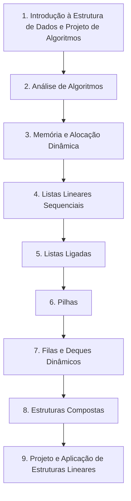

1. **Fundamentos e Teoria Base:** Projeto e análise de algoritmos, tipos abstratos de dados (TAD), complexidade computacional assintótica, modelo de memória operacional e alocação dinâmica.
2. **Estruturas Lineares e Aplicações:** Projeto, análise e codificação de estruturas de dados contíguas e encadeadas (listas estáticas, listas dinâmicas, pilhas, filas), acompanhados do estudo de métodos elementares e avançados de ordenação interna.

### Critérios e Métricas de Avaliação

O sistema semestral de verificação da aprendizagem desdobra-se em dois módulos de avaliação. Cada módulo gera uma nota composta por uma prova individual teórica/prática sem consulta com peso 0,8 e um trabalho técnico prático de codificação com peso 0,2.

A Média Semestral final ($`MS`$) é regida pela fórmula formal da instituição:

```math
MS = \frac{[(AV_1 \times 0.8) + (T_1 \times 0.2)] + [(AV_2 \times 0.8) + (T_2 \times 0.2)]}{2}
```

| Componente Avaliativo | Escopo Operacional | Escala | Peso no Módulo | Teto na Composição |
| :--- | :--- | :--- | :--- | :--- |
| **Trabalho 1 ($`T_1`$)** | Projetos de código e exercícios dirigidos | 0,0 a 10,0 | 20% (0,2) | Até 2,0 pontos |
| **Avaliação 1 ($`AV_1`$)** | Prova formal de fundamentação e análise | 0,0 a 10,0 | 80% (0,8) | Até 8,0 pontos |
| **Trabalho 2 ($`T_2`$)** | Implementação de estruturas e ordenação | 0,0 a 10,0 | 20% (0,2) | Até 2,0 pontos |
| **Avaliação 2 ($`AV_2`$)** | Prova formal integradora de estruturas e algoritmos | 0,0 a 10,0 | 80% (0,8) | Até 8,0 pontos |

### Bibliografia Oficial e Leituras Recomendadas

#### Bibliografia Básica Institucional
- MONTEIRO, Mário A. *Introdução à Organização de Computadores*. 4. ed. Rio de Janeiro: LTC, 2002.
- STALLINGS, William. *Arquitetura e Organização de Computadores*. 8. ed. São Paulo: Pearson, 2010.
- TANENBAUM, Andrew S. *Organização Estruturada de Computadores*. 3. ed. São Paulo: Prentice-Hall do Brasil, 1990.

#### Bibliografia Complementar Institucional
- IDOETA, Ivan Valeije; CAPUANO, Francisco Gabriel. *Elementos de Eletrônica Digital*. 32. ed. São Paulo: Érica, 2001.
- PATTERSON, David A.; HENNESSY, John L. *Organização e Projeto de Computadores*. 2. ed. Rio de Janeiro: LTC, 1998.
- WEBER, Raul Fernando. *Fundamentos de Arquitetura de Computadores*. 4. ed. Porto Alegre: Bookman, 2012.

> **Nota de Complementação Pedagógica:** A bibliografia formal registrada na ementa estabelece a compreensão da máquina física (barramentos, registradores, hierarquia de memória e endereçamento). Para o domínio estrito de tipos abstratos de dados e análise algorítmica, o material adota como referências clássicas complementares as obras *Projeto de Algoritmos com Implementações em Pascal e C* (Nivio Ziviani) e *Algoritmos: Teoria e Prática* (Thomas H. Cormen et al.).

---

## Teoria Geral de Algoritmos e Metodologia de Projeto

### Definição Formal e Semântica de Algoritmo

Um **algoritmo** é formalmente caracterizado como uma sequência finita, ordenada, não ambígua e computacionalmente exequível de instruções. Partindo de um estado inicial e de um conjunto de dados de entrada (que pode ser vazio), ele conduz a máquina através de estados intermediários discretos e deterministicamente delimitados, alcançando em tempo finito um estado final que produz um resultado satisfatório para uma classe bem formulada de problemas.

Historicamente, o vocábulo tem etimologia ligada ao astrônomo e matemático persa do século IX Abu Abdullah Muhammad ibn Musa al-Khwarizmi, cujos tratados sobre notação posicional decimal e resolução sistemática de equações consolidaram a manipulação simbólica passo a passo. No paradigma contemporâneo, o algoritmo situa-se no plano matemático da lógica pura, existindo de maneira autônoma em relação ao hardware e à linguagem de programação.

### As Seis Características Fundamentais

Para que um procedimento operacional seja qualificado como um algoritmo em ciência da computação, é mandatório que atenda cumulativamente a seis propriedades canônicas:

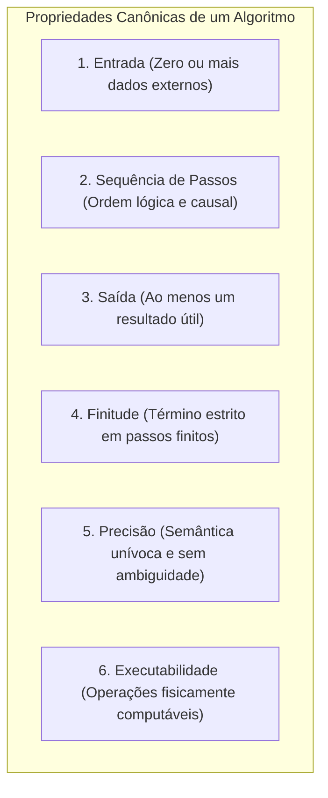

1. **Entrada (*Input*):** Quantidade definida de dados externos sobre os quais as operações atuarão. Pode ser nula ($`0`$), caso em que o processamento se dá exclusivamente a partir de constantes internas preestabelecidas.
2. **Sequência de Passos (*Sequence*):** Ordem cronológica determinística de transição de estados. Cada ação possui predecessores e sucessores estritos no fluxo causal.
3. **Saída (*Output*):** Produção de pelo menos uma entidade de dado final útil, que mantém relação de dependência com as entradas ou com o estado de encerramento do sistema.
4. **Finitude (*Finiteness*):** Garantia matemática de terminação após uma quantidade finita de passos. Rotinas que entram em laços de repetição infinitos sem critério de parada violam esta condição.
5. **Precisão (*Definiteness / Unambiguity*):** Cada instrução elementar deve possuir interpretação unívoca, livre de imprecisões semânticas ou subjetividade interpretativa.
6. **Executabilidade (*Effectiveness / Executability*):** Cada primitiva operacional deve ser concretizável por um mecanismo computacional real em um intervalo finito de tempo. Instruções que demandem divisão aritmética por zero ou o cálculo integral das infinitas casas decimais de um número irracional quebram essa propriedade.

| Propriedade | Exigência Técnica Formal | Manifestação Válida | Violação Estrutural (Contraexemplo) |
| :--- | :--- | :--- | :--- |
| **Entrada** | Domínio delimitado de leitura | Vetor contendo $`n`$ inteiros | Algoritmo que tenta desreferenciar memória não alocada |
| **Sequência** | Fluxo causal ordenado de instruções | Leitura dos termos antes do cálculo | Exibição de saída antes do cálculo das parcelas |
| **Saída** | Transformação perceptível de estado | Retorno do valor do quociente | Procedimento sem efeito colateral que descarta dados |
| **Finitude** | Condição de término provável | Laço iterativo delimitado por sentinela | Laço iterativo sem incremento de variável de controle |
| **Precisão** | Especificação clara e objetiva | Atribuição direta: `x = a + b` | Instrução ambígua: "Processe os itens até ficar bom" |
| **Executabilidade** | Operações física e logicamente viáveis | Divisão com denominador verificado | Divisão de um escalar qualquer por zero |

### O Axioma de Wirth

O cientista da computação suíço Niklaus Wirth formalizou a relação entre a modelagem de dados e os processos mecânicos em sua equação clássica:

```math
\text{Algoritmos} + \text{Estruturas de Dados} = \text{Programas}
```

O axioma expõe que o raciocínio procedural isolado (o algoritmo) perde eficiência caso os dados estejam organizados de forma caótica ou incompatível com a natureza das consultas exigidas. Em contrapartida, estruturas de dados sofisticadas tornam-se inoperantes se os algoritmos que as percorrem utilizarem passos desnecessários, resultando em degradação de tempo de CPU e contenção de barramentos.

### Algoritmo versus Programa

A literatura e a prática da engenharia diferenciam o modelo abstrato de sua materialização tecnológica:

- **Algoritmo:** É a solução matemática conceitual. Independe de circuitos eletrônicos, compiladores, arquiteturas de computadores ou linguagens de programação. Pode ser formalizado em linguagem natural estruturada, pseudocódigo matemático ou diagramas funcionais.
- **Programa:** É a instanciação física e concreta do algoritmo. É escrito sob as regras léxicas, sintáticas e semânticas de uma linguagem de programação específica (como Java ou C), compilado ou interpretado para instruções de máquina e executado sob o controle de um sistema operacional em hardware físico real.

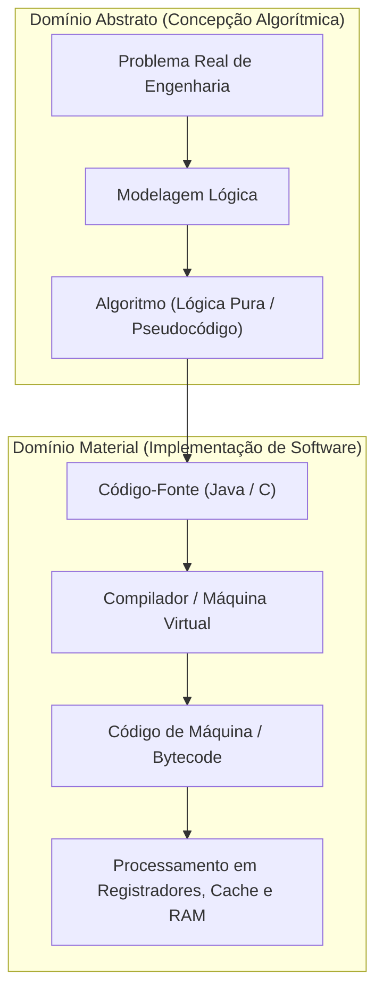

| Eixo de Análise | Algoritmo (Modelo Abstrato) | Programa (Artefato Concreto) |
| :--- | :--- | :--- |
| **Ontologia** | Formulação conceitual pura | Construção de software tangível |
| **Acoplamento Técnico** | Zero acoplamento tecnológico | Dependência estrita de compilador e runtime |
| **Tolerância a Falhas** | Exige consistência lógica | Intolerante a erros sintáticos e estruturais |
| **Ambiente de Trabalho** | Raciocínio humano e provas formais | Registradores de CPU, barramentos e memórias |

### O Pipeline de Engenharia de Software

A transformação de uma demanda real em uma solução computacional em produção obedece a um ciclo disciplinado de sete fases sucessivas:

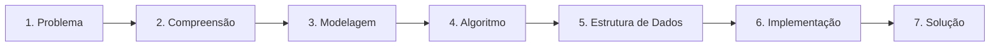

1. **Problema:** Situação concreta no mundo real que exige automação, transformação de dados ou otimização operacional.
2. **Compreensão:** Levantamento exaustivo de requisitos, restrições operacionais, volume de dados previsto e condições de contorno.
3. **Modelagem:** Transposição dos requisitos para entidades formais (grafos, conjuntos numéricos, modelos conceituais de dados).
4. **Algoritmo:** Definição do fluxo passo a passo de instruções para solucionar a representação modelada.
5. **Estrutura de Dados:** Escolha e organização da disposição dos dados na memória para assegurar tempos de resposta satisfatórios.
6. **Implementação:** Tradução dos algoritmos e estruturas em código-fonte sintaticamente válido em uma linguagem de programação.
7. **Solução:** O artefato compilado e testado em operação regular em ambiente de produção.

### As Seis Etapas Sistemáticas de Projeto de Algoritmos

No desenvolvimento de algoritmos complexos, o profissional deve seguir seis etapas estruturadas para evitar a escrita prematura de código desprovido de arquitetura:

1. **Entender o Problema:** Identificar o objetivo central, o contexto da aplicação e as restrições que delimitam a solução.
2. **Identificar as Entradas e Saídas:** Definir com precisão a tipagem, faixas de valores válidos e representação das saídas esperadas.
3. **Decompor o Problema:** Fracionar a meta principal em subproblemas progressivamente menores por meio de técnicas *top-down*.
4. **Definir a Estratégia de Resolução:** Selecionar o paradigma de projeto adequado (força bruta, refinamento sucessivo, divisão e conquista, métodos gulosos).
5. **Escrever o Algoritmo Formalmente:** Expressar as rotinas em pseudocódigo legível, sem misturar regras de negócio com especificidades de sintaxe.
6. **Testar, Rastrear e Refinar:** Executar testes de mesa com casos típicos e casos de borda (*corner cases*), validando invariantes e complexidade.

---

## Tipos Abstratos de Dados, Encapsulamento e Refinamento

### Refinamento Sucessivo

O refinamento sucessivo (*stepwise refinement*), introduzido formalmente na literatura por Niklaus Wirth, é uma técnica analítica de decomposição *top-down*. O desenvolvimento parte de uma especificação geral em alto nível e a divide em blocos estruturais até atingir comandos operacionais primitivos.

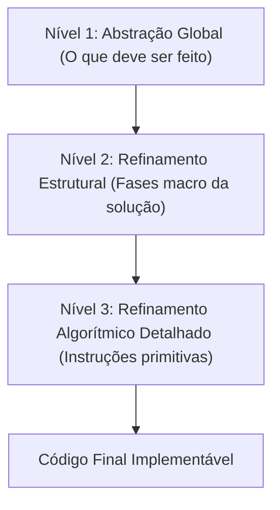

- **Nível 1 (Abstração Global):** Declaração do objetivo da rotina sem considerações operacionais.  
  *Exemplo:* "Calcular a média ponderada de três notas bimestrais."
- **Nível 2 (Refinamento Estrutural):** Identificação das etapas lógicas sequenciais.  
  *Exemplo:* 1. Ler notas e pesos; 2. Computar o somatório ponderado; 3. Efetuar a divisão pela soma dos pesos; 4. Exibir o resultado.
- **Nível 3 (Refinamento Algorítmico Detalhado):** Declaração formal das variáveis, laços e operações aritméticas primitivas.
  ```text
  algoritmo MediaPonderada
  início
      real: n1, n2, n3, p1, p2, p3, somaP, media
      leia(n1, p1, n2, p2, n3, p3)
      somaP <- p1 + p2 + p3
      se somaP == 0 entao
          escreva("Erro: Soma dos pesos nao pode ser nula")
      senao
          media <- ((n1 * p1) + (n2 * p2) + (n3 * p3)) / somaP
          escreva("Media Final: ", media)
      fim_se
  fim
  ```

### Tipos Abstratos de Dados

Um **Tipo Abstrato de Dados (TAD)** é um modelo matemático que delimita:
1. O domínio de valores aceitos pela estrutura.
2. O catálogo de operações públicas que atuam sobre tais valores.
3. As regras de comportamento e as invariantes que essas operações devem assegurar.

O princípio central do TAD é a **independência de representação**: a definição lógica abstrai completamente o modo como os dados são alocados nos circuitos de memória (blocos contíguos versus nós dispersos com ponteiros) e os algoritmos internos empregados nas rotinas.

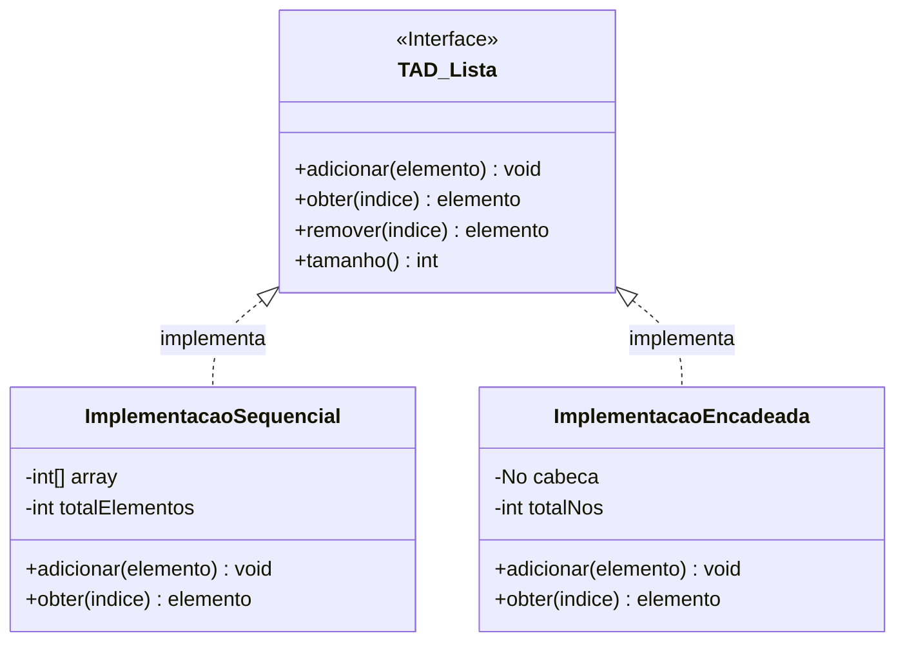

### Abstração e Encapsulamento Estrutural

- **Abstração:** Mecanismo mental que separa a interface externa (**o que** o TAD faz) de sua engenharia subjacente (**como** ele faz).
- **Encapsulamento:** Prática de construção de software que blinda os atributos de estado interno de uma estrutura através de modificadores de acesso (`private`), impedindo que agentes externos manipulem ponteiros ou células de memória sem a validação das funções do TAD.

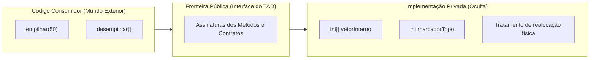

**Contraexemplo de Violação de Encapsulamento:**  
Expor atributos públicos em uma classe de Pilha baseada em vetor:
```java
// Anti-padrão estrutural: Quebra de invariantes
public class PilhaInsegura {
    public int[] dados;
    public int topo;
}
```
Se o código cliente alterar diretamente `pilha.topo = -10` ou `pilha.dados[3] = 99`, o estado do TAD é corrompido, inutilizando os mecanismos de integridade do sistema.

### Matriz de Decisão Estrutural

A seleção da estrutura de armazenamento deve ser pautada pelo perfil de acesso predominante da aplicação:

| Perfil Operacional Dominante | Estrutura de Dados Recomendada | Justificativa Técnica Baseada em Hardware |
| :--- | :--- | :--- |
| **Acesso aleatório via índice numérico** | Lista Sequencial (Array) | Endereçamento contíguo resolvido em $`O(1)`$ por aritmética de ponteiros. |
| **Inserção e remoção no meio sem realocações** | Lista Encadeada (Ligada) | Mutação local de referências de ponteiros sem movimentação de elementos adjacentes. |
| **Disciplina estrita LIFO (Last-In, First-Out)** | Pilha (*Stack*) | Operações de entrada e saída isoladas em uma única extremidade (topo). |
| **Disciplina estrita FIFO (First-In, First-Out)** | Fila (*Queue*) | Inserções na cauda e remoções na cabeça preservam a cronologia estrita. |
| **Organização hierárquica e busca balanceada** | Árvore Binária de Busca | Ramificação em níveis com custo logarítmico para dados balanceados. |
| **Relações genéricas muitos-para-muitos** | Grafo | Modelagem via matriz ou listas de adjacência para redes arbitrárias. |

---

## Análise Assintótica de Complexidade e Notação Big-O

### Inadequação da Medição Empírica de Relógio

Medir o tempo de execução de um algoritmo registrando a diferença em milissegundos no relógio da máquina (*wall-clock time*) é insuficiente para a ciência da computação. O tempo empírico varia de acordo com fatores alheios ao algoritmo:
- Arquitetura, microcódigo e frequência do processador;
- Hierarquia e taxa de acertos dos níveis de cache L1, L2 e L3;
- Concorrência de tarefas e escalonamento do sistema operacional;
- Carga de trabalho de rotinas de limpeza de memória (*Garbage Collector*);
- Volume, dispersão e ordem prévia da massa de testes utilizada.

A teoria de análise de algoritmos substitui a cronometragem empírica pela **contagem do número de instruções fundamentais** em função do tamanho da entrada ($`n`$).

### O Tamanho da Entrada e a Contagem de Operações

O parâmetro $`n`$ quantifica o volume de dados a processar:
- O número de posições de um vetor a ordenar;
- A quantidade de caracteres de um texto a indexar;
- O número de nós de uma lista ligada a percorrer.

Considere um procedimento de busca sequencial:
```text
inteiro buscaSequencial(vetor V, inteiro n, inteiro alvo):
    para i de 0 ate n - 1 faca:
        se V[i] == alvo entao:
            retorne i
    retorne -1
```
Se cada comparação de igualdade for tomada como a instrução fundamental de custo unitário, o número de execuções dependerá da posição do alvo no arranjo.

### Fundamentos da Análise Assintótica e Descarte de Termos

A análise assintótica estuda a taxa de crescimento do custo computacional à medida que o tamanho da entrada cresce indefinidamente ($`n \to \infty`$). Sob essa ótica:
1. **Descartam-se termos de menor ordem:** Na expressão de custo $`T(n) = 4n^2 + 150n + 3000`$, conforme $`n`$ atinge valores da ordem de dezenas de milhares, o termo quadrático $`4n^2`$ passa a representar quase a totalidade do tempo computacional, tornando $`150n`$ e $`3000`$ irrelevantes.
2. **Descartam-se coeficientes multiplicativos:** Multiplicar uma função por uma constante escalar não altera a classe de complexidade. Logo, $`T(n) = 4n^2`$ pertence à classe assintótica $`O(n^2)`$.

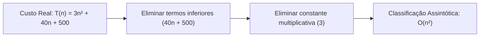

### Espectro de Análise: Melhor Caso, Pior Caso e Caso Médio

- **Melhor Caso (Cenário Otimista):** A configuração da entrada que exige o menor esforço operacional possível. Na busca sequencial, ocorre quando o elemento procurado ocupa a primeira posição pesquisada ($`V[0]`$). Custo: $`O(1)`$.
- **Pior Caso (Cenário Pessimista):** A configuração da entrada que força o algoritmo a realizar o volume máximo de operações. Na busca sequencial, ocorre quando o elemento ocupa a última posição do arranjo ou está ausente. Custo: $`O(n)`$. Fornece uma **garantia de teto operacional** para a engenharia de software.
- **Caso Médio (Cenário Probabilístico):** A esperança matemática do número de operações, assumindo uma distribuição de probabilidades sobre as entradas possíveis. Na busca sequencial uniforme, a localização exige em média $`\frac{n + 1}{2}`$ comparações. Assintoticamente, descarta-se o divisor escalar $`2`$, resultando em classe $`O(n)`$.

> **Notações Assintóticas Formais:**  
> - **Notação Big-O ($`O`$):** Estabelece o **limite superior assintótico**. Assegura que o algoritmo não consumirá mais recursos do que a curva delimitada para valores suficientemente grandes de $`n`$.  
> - **Notação Big-Omega ($`\Omega`$):** Estabelece o **limite inferior assintótico**. Determina o piso de esforço operacional abaixo do qual o algoritmo jamais conseguirá executar.

### Famílias e Classes Canônicas de Complexidade

A hierarquia de crescimento assintótico organiza-se da maior para a menor eficiência operacional:

```math
O(1) < O(\log n) < O(n) < O(n \log n) < O(n^2) < O(n^3) < O(2^n) < O(n!)
```

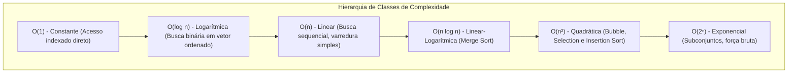

| Notação | Nomenclatura Formal | Sensibilidade ao Aumento de $`n`$ | Exemplo Clássico em Estrutura de Dados |
| :--- | :--- | :--- | :--- |
| **$`O(1)`$** | Constante | Custo invariável perante o tamanho da base | Acesso a elemento via índice em array: `V[i]` |
| **$`O(\log n)`$** | Logarítmica | O esforço cresce uma unidade quando a base dobra | Busca Binária em coleção previamente ordenada |
| **$`O(n)`$** | Linear | Crescimento estritamente proporcional | Busca sequencial em lista não indexada |
| **$`O(n \log n)`$** | Linear-logarítmica | Crescimento moderadamente superior ao linear | Algoritmo de ordenação Merge Sort |
| **$`O(n^2)`$** | Quadrática | Multiplica o esforço por 4 ao dobrar a base | Laços aninhados: Bubble Sort e Selection Sort |

#### Tabela de Projeção Comparativa do Número de Operações

| Tamanho da Entrada ($`n`$) | Constante $`O(1)`$ | Logarítmica $`O(\log_2 n)`$ | Linear $`O(n)`$ | Linear-Logarítmica $`O(n \log_2 n)`$ | Quadrática $`O(n^2)`$ |
| :---: | :---: | :---: | :---: | :---: | :---: |
| **$`10`$** | 1 | 3,3 | 10 | 33 | 100 |
| **$`100`$** | 1 | 6,6 | 100 | 664 | 10.000 |
| **$`1.000`$** | 1 | 10 | 1.000 | 9.965 | 1.000.000 |
| **$`1.000.000`$** | 1 | 20 | 1.000.000 | 19.931.568 | 1.000.000.000.000 |

---

## Modelo de Memória em Execução e Estruturas Lineares Sequenciais

### Modelo de Execução da JVM: Call Stack versus Heap

A Máquina Virtual Java organiza a memória principal atribuída ao processo em duas regiões estruturais:

1. **Call Stack (Pilha de Execução):** Segmento alocado de forma contígua onde residem os registros de ativação das rotinas (*stack frames*). Armazena variáveis locais de tipos primitivos e os ponteiros de endereço (referências) que indicam a localização física dos objetos alocados no Heap. Sua liberação ocorre imediatamente quando o fluxo do método é finalizado.
2. **Heap (Monte de Alocação Dinâmica):** Região global compartilhada onde os objetos e arrays instanciados via operador `new` são alocados. Sua expansão se dá dinamicamente em tempo de execução, e o ciclo de vida das estruturas independe do encerramento dos métodos que as instanciaram.

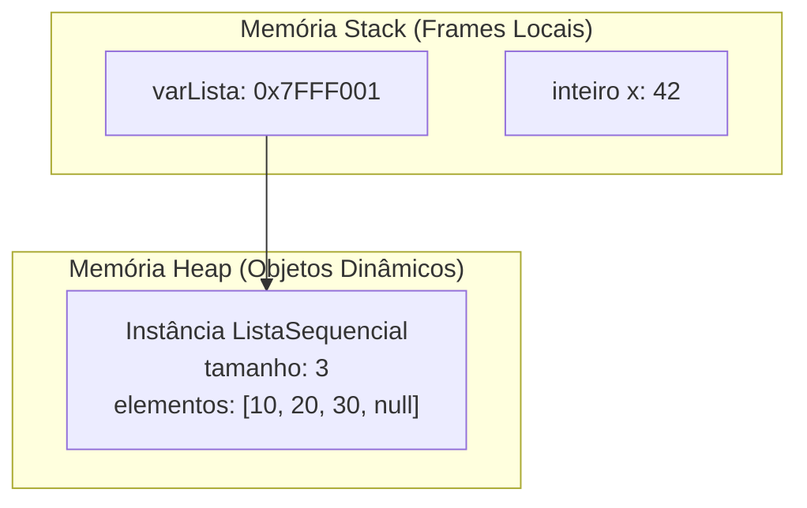

### Tipos Primitivos versus Variáveis de Referência

- **Tipos Primitivos (`byte`, `short`, `int`, `long`, `float`, `double`, `char`, `boolean`):** O identificador armazena diretamente o valor binário correspondente no frame da Stack. A atribuição `a = b` realiza uma cópia integral do valor binário (passagem por valor).
- **Tipos por Referência (Classes, Interfaces, Vetores):** O identificador na Stack reserva apenas o espaço correspondente a um ponteiro de endereço (ex: 32 ou 64 bits). A atribuição `objA = objB` copia apenas o endereço da memória Heap. Ambas as variáveis passam a referenciar a mesma instância de objeto; mutações de estado realizadas através de uma refletem imediatamente na leitura feita pela outra.

### Ciclo de Vida de Objetos e Garbage Collection

Objetos alocados no Heap permanecem ativos enquanto houver pelo menos uma cadeia de referências alcançável a partir de uma raiz ativa na Stack (*GC Roots*). Quando todas as variáveis que apontavam para um determinado endereço no Heap deixam o escopo ou recebem o literal `null`, o objeto torna-se **inalcançável** e é recolhido pelo *Garbage Collector*, devolvendo os bytes ao pool de alocação da JVM.

### Lista Linear Sequencial Estática e Dinâmica

Uma **Lista Linear Sequencial** é uma estrutura que mapeia seus elementos lógicos em endereços contíguos de memória física por meio de um array nativo.

Devido à contiguidade física dos bytes, o acesso a qualquer posição $`i`$ é executado em tempo estritamente constante ($`O(1)`$) calculando o deslocamento relativo a partir do endereço de base:

```math
\text{Endereço}(i) = \text{Endereço\_Base} + (i \times \text{Tamanho\_Elemento})
```

#### Distinção Crítica: Capacidade versus Tamanho

- **Capacidade (`capacidade`):** A dimensão física total do array alocado no Heap (`array.length`). Representa o limite máximo de armazenamento antes da necessidade de realocação física.
- **Tamanho (`tamanho`):** A cardinalidade lógica real, ou seja, a quantidade de posições consecutivas que contêm elementos válidos na estrutura.

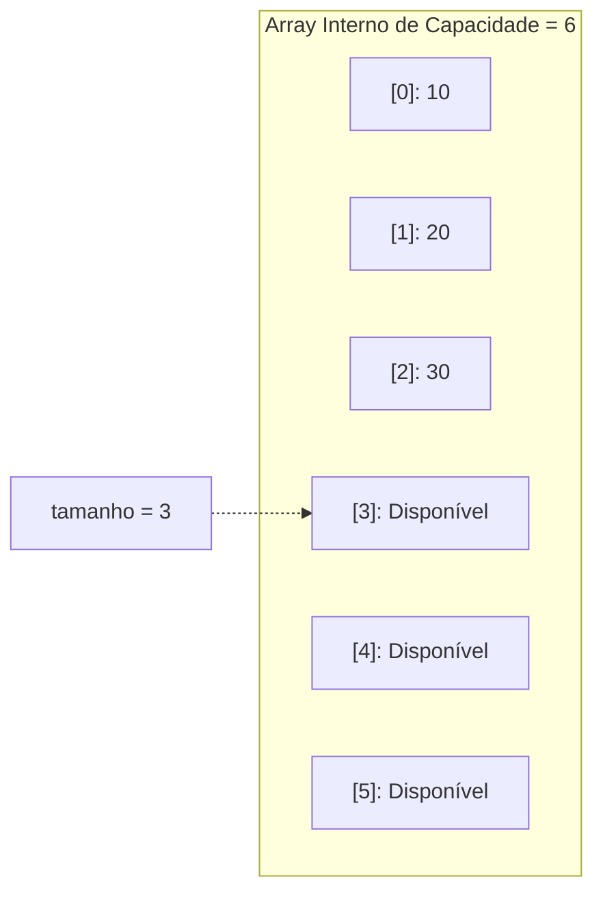

### O Custo Computacional do Deslocamento de Elementos

Embora o acesso aleatório por índice seja instantâneo, a inserção ou exclusão de elementos em posições não terminais (no início ou meio) impõe uma penalidade computacional: para preservar a contiguidade física sem sobreposições acidentais, todos os elementos à direita do índice alvo devem ser fisicamente transladados.

#### Deslocamento para Inserção no Início
Para inserir um valor na posição `0` de uma lista contendo $`n`$ elementos, cada item preexistente deve ser copiado para a casa adjacente à direita, operando da extremidade final para a inicial:

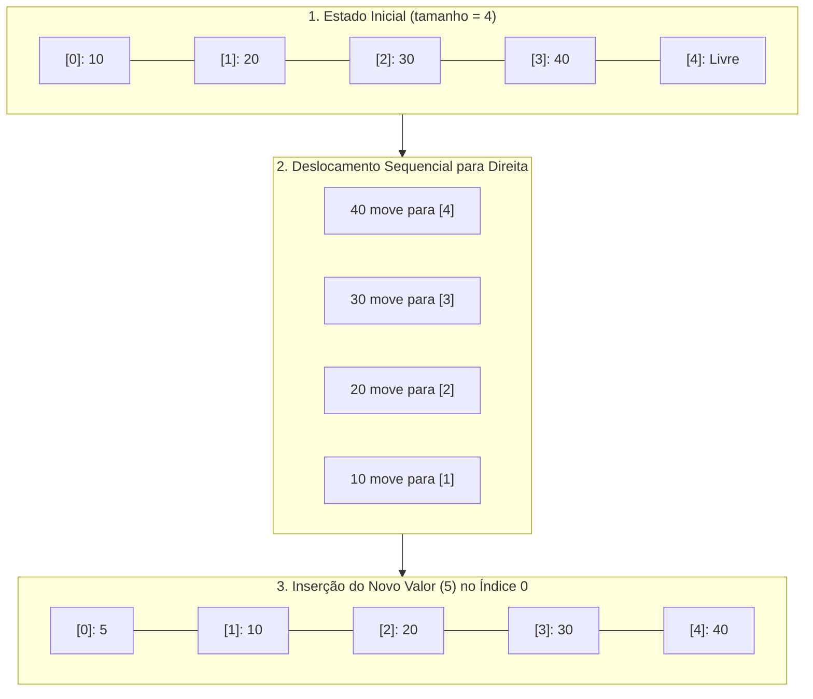

Essa operação exige transladar $`n`$ elementos, caracterizando uma complexidade temporal no pior caso de $`O(n)`$.

### Implementação Completa da Lista Linear Sequencial

```java
public class ListaLinearSequencial {
    private int[] dados;
    private int tamanho;
    private static final int CAPACIDADE_PADRAO = 10;

    public ListaLinearSequencial() {
        this(CAPACIDADE_PADRAO);
    }

    public ListaLinearSequencial(int capacidadeInicial) {
        if (capacidadeInicial <= 0) {
            throw new IllegalArgumentException("Capacidade inicial invalida: " + capacidadeInicial);
        }
        this.dados = new int[capacidadeInicial];
        this.tamanho = 0;
    }

    public int getTamanho() {
        return this.tamanho;
    }

    public boolean estaVazia() {
        return this.tamanho == 0;
    }

    public int obter(int indice) {
        validarIndiceExistente(indice);
        return this.dados[indice]; // Acesso O(1)
    }

    public void adicionarFim(int elemento) {
        assegurarCapacidade();
        this.dados[this.tamanho] = elemento;
        this.tamanho++;
    }

    public void adicionar(int indice, int elemento) {
        validarIndiceParaInsercao(indice);
        assegurarCapacidade();

        // Deslocamento para a direita de trás para frente: O(n)
        for (int i = this.tamanho - 1; i >= indice; i--) {
            this.dados[i + 1] = this.dados[i];
        }

        this.dados[indice] = elemento;
        this.tamanho++;
    }

    public int remover(int indice) {
        validarIndiceExistente(indice);
        int elementoRemovido = this.dados[indice];

        // Deslocamento para a esquerda de frente para trás: O(n)
        for (int i = indice; i < this.tamanho - 1; i++) {
            this.dados[i] = this.dados[i + 1];
        }

        this.tamanho--;
        return elementoRemovido;
    }

    private void assegurarCapacidade() {
        if (this.tamanho == this.dados.length) {
            int novaCapacidade = this.dados.length * 2;
            int[] novoVetor = new int[novaCapacidade];
            for (int i = 0; i < this.tamanho; i++) {
                novoVetor[i] = this.dados[i];
            }
            this.dados = novoVetor; // Descarte do antigo vetor para o Garbage Collector
        }
    }

    private void validarIndiceExistente(int indice) {
        if (indice < 0 || indice >= this.tamanho) {
            throw new IndexOutOfBoundsException("Indice fora dos limites: " + indice + " (Tamanho atual: " + this.tamanho + ")");
        }
    }

    private void validarIndiceParaInsercao(int indice) {
        if (indice < 0 || indice > this.tamanho) {
            throw new IndexOutOfBoundsException("Indice invalido para insercao: " + indice + " (Tamanho atual: " + this.tamanho + ")");
        }
    }
}
```

---

## Estruturas Dinâmicas Encadeadas: Listas Simplesmente Ligadas

### A Quebra da Contiguidade Física e o Conceito de Nó

Para contornar a desvantagem do remanejamento de memória nas listas contíguas, adota-se o paradigma das estruturas dinâmicas encadeadas. A exigência de que os dados ocupem gavetas físicas contíguas é eliminada. Os elementos passam a residir em endereços dispersos no Heap.

A amarração estrutural é viabilizada pela unidade básica denominada **Nó (*Node*)**, que encapsula duas responsabilidades:
1. **Carga Útil (*Payload*):** O dado de interesse a ser transportado.
2. **Elo de Encadeamento (`proximo`):** Uma variável de referência que armazena o endereço de memória do próximo objeto `No` da cadeia (ou o valor literal `null` caso represente a terminação da lista).

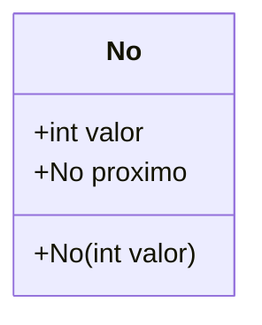

```java
public class No {
    public int valor;
    public No proximo;

    public No(int valor) {
        this.valor = valor;
        this.proximo = null;
    }
}
```

### A Arquitetura da Classe Controladora ListaLigada

A manipulação direta de nós a partir do código cliente geraria falhas de encapsulamento. A classe `ListaLigada` atua como a controladora de integridade da estrutura, centralizando o controle do estado através de três atributos privados:

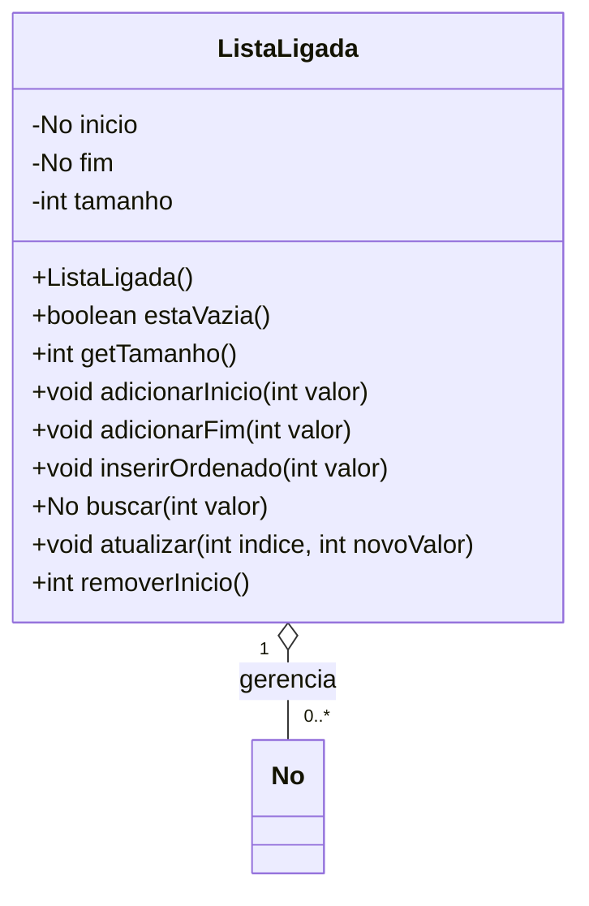

- `No inicio`: Guarda a referência para o primeiro elemento. Permite a ancoragem para percursos sequenciais.
- `No fim`: Guarda a referência para o último elemento (cujo campo `proximo` é `null`). Permite inserções no final em $`O(1)`$.
- `int tamanho`: Contador incremental que permite saber a quantidade de nós em $`O(1)`$ sem percorrer toda a lista.

### Inserção na Cauda: Ausência versus Presença do Ponteiro de Fim

A inclusão de novos dados na cauda de uma lista ligada é influenciada pela presença ou ausência da referência `fim`:

1. **Abordagem Ingênua (sem atributo `fim`):** Obriga o algoritmo a partir do nó `inicio` e percorrer salto a salto a cadeia (`atual = atual.proximo`) até encontrar um nó em que `atual.proximo == null`. O custo computacional escala de forma proporcional ao tamanho da lista: complexidade temporal **$`O(n)`$**.
2. **Abordagem Otimizada (com atributo `fim`):** Conecta o novo nó diretamente através de `fim.proximo = novo` e avança o marcador com `fim = novo`. Não há iterações: complexidade temporal **$`O(1)`$**.

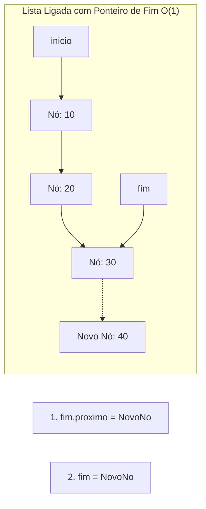

```java
public void adicionarFim(int valor) {
    No novo = new No(valor);

    if (estaVazia()) {
        this.inicio = novo;
        this.fim = novo;
    } else {
        this.fim.proximo = novo;
        this.fim = novo;
    }
    this.tamanho++;
}
```

### Inserção na Cabeça da Estrutura

Inserir no início de uma lista encadeada envolve a manipulação de referências sem deslocamentos em bloco de memória:
1. Instanciar o novo nó contendo o valor: `No novo = new No(valor);`
2. Apontar o elo do novo nó para o atual início: `novo.proximo = this.inicio;`
3. Atualizar a referência de início: `this.inicio = novo;`
4. Atualizar o ponteiro `fim` caso a lista estivesse previamente vazia.

Complexidade temporal: **$`O(1)`$**.

```java
public void adicionarInicio(int valor) {
    No novo = new No(valor);
    novo.proximo = this.inicio;
    this.inicio = novo;

    if (this.fim == null) {
        this.fim = novo;
    }
    this.tamanho++;
}
```

### Inserção Ordenada no Meio e a Ordem Crítica de Religamento

Ao inserir um valor mantendo uma ordenação prévia, a rotina desdobra-se em duas etapas analíticas:
1. **Etapa de Localização:** Percorrer a cadeia para identificar o nó anterior ao local de inserção. Custo temporal: **$`O(n)`$**.
2. **Etapa de Religamento de Ponteiros:** Alteração local de ponteiros. Custo temporal: **$`O(1)`$**.

O custo total da operação é dominado pela busca: $`T(n) = O(n) + O(1) = O(n)`$.

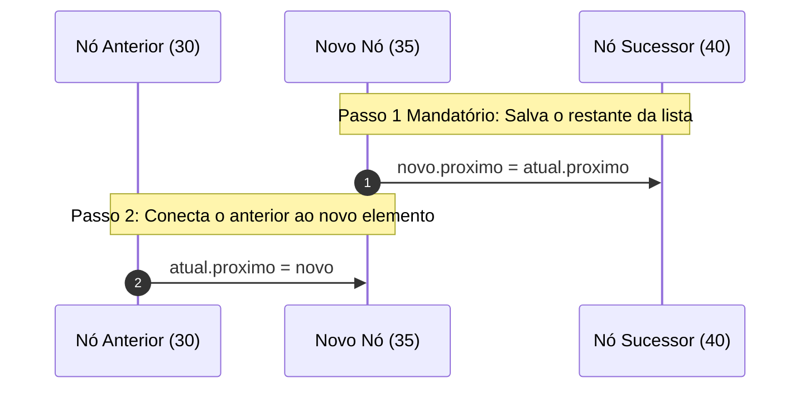

> **Armadilha Crítica (Perda Irrecuperável de Ponteiro):**  
> Se o desenvolvedor inverter a ordem de atribuição executando `atual.proximo = novo` antes de `novo.proximo = atual.proximo`, a referência para o nó sucessor (`40`) e todos os nós ligados a ele é sobrescrita e perdida permanentemente no Heap, provocando vazamento de dados (*memory leak*).

```java
public void inserirOrdenado(int valor) {
    No novo = new No(valor);

    // Caso 1: Lista vazia ou valor menor que o primeiro (inserção na cabeça)
    if (estaVazia() || valor <= this.inicio.valor) {
        adicionarInicio(valor);
        return;
    }

    // Caso 2: Localização do ponto de corte no meio ou final
    No atual = this.inicio;
    while (atual.proximo != null && atual.proximo.valor < valor) {
        atual = atual.proximo;
    }

    // Caso 3: Religamento de ponteiros
    novo.proximo = atual.proximo;
    atual.proximo = novo;

    // Atualização de cauda caso tenha sido inserido no final
    if (novo.proximo == null) {
        this.fim = novo;
    }
    this.tamanho++;
}
```

### Busca Linear por Valor e Atualização por Índice

Em uma lista simplesmente ligada, os nós não possuem índices físicos na memória. O "índice" é uma abstração lógica que indica a quantidade de passos de navegação a partir do nó `inicio`.

- **Busca por Valor:** Percorre a cadeia comparando o dado útil até encontrar a correspondência ou atingir `null`.
  - Melhor caso: $`O(1)`$ (o dado está no primeiro nó).
  - Pior caso: $`O(n)`$ (o dado reside no último nó ou está ausente).
- **Atualização por Índice:** Executa um laço `for` com $`k`$ iterações de avanço `atual = atual.proximo`. Ao atingir a posição, sobrescreve o campo `atual.valor = novoValor`.
  - Complexidade temporal: **$`O(n)`$** no pior caso.

### Remoção de Nós e Prevenção de Perda de Cadeia

A exclusão da cabeça (`removerInicio()`) é resolvida de forma direta:
```java
public int removerInicio() {
    if (estaVazia()) {
        throw new IllegalStateException("Impossivel remover de lista vazia");
    }
    int dado = this.inicio.valor;
    this.inicio = this.inicio.proximo;
    this.tamanho--;

    if (this.inicio == null) {
        this.fim = null;
    }
    return dado;
}
```

Para remover um nó intermediário ou terminal baseado em valor, o algoritmo precisa manter uma referência para o **nó anterior** ao elemento que será descartado, executando:
```java
anterior.proximo = atual.proximo;
```
Ao isolar o nó `atual` da cadeia de apontamentos, ele se torna inalcançável a partir de `inicio`, permitindo que o Garbage Collector recupere a memória. Complexidade: **$`O(n)`$**.

### Trade-offs Arquiteturais: Sequencial versus Encadeada

| Critério de Engenharia | Lista Linear Sequencial (Vetor) | Lista Encadeada Dinâmica (Nós) |
| :--- | :--- | :--- |
| **Acesso por Índice ($`get(i)`$)** | $`O(1)`$ imediato por cálculo de endereço | $`O(n)`$ por caminhamento sequencial de referências |
| **Inserção/Remoção no Início** | $`O(n)`$ devido ao deslocamento do array | $`O(1)`$ por simples manipulação de ponteiro |
| **Localidade de Referência de Cache** | Excelente (elementos contíguos na memória física) | Baixa (nós alocados de forma dispersa no Heap) |
| **Sobrecarga de Memória Adicional** | Nula ou limitada à folga de redimensionamento | Alta (cada nó consome memória para a referência `proximo`) |
| **Previsibilidade de Latência** | Sofre pausas eventuais na duplicação do array | Tempos de alocação uniformes por elemento |

---

## Pilhas: Princípio LIFO, Implementações e Manipulação Avançada

### Definição Formal do TAD Pilha e Princípio LIFO

Uma **Pilha (*Stack*)** é um Tipo Abstrato de Dados linear no qual as operações de inserção, remoção e consulta aos elementos são realizadas exclusivamente em uma única extremidade aberta da estrutura, denominada **Topo (*Top*)**. A extremidade oposta, permanentemente inacessível a mutações diretas, é denominada **Base (*Bottom*)**.

O comportamento da pilha é regido pelo princípio:

```math
\text{LIFO: } \textit{Last In, First Out} \quad (\text{O último elemento a entrar é o primeiro a sair})
```

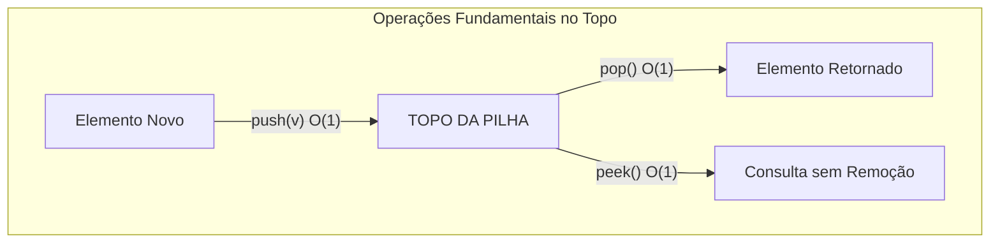

### O Princípio do Encapsulamento Restritivo

Uma dúvida comum em engenharia de software é: *se a pilha pode ser implementada sobre um vetor, por que não disponibilizar um método para obter ou alterar uma posição intermediária qualquer?*

A resposta fundamenta-se na **garantia formal de invariantes**. Problemas computacionais modelados através de pilhas dependem da certeza de que o estado intermediário permaneça imutável até que os contextos superiores sejam desempilhados.
- **Exemplos práticos:** Call Stack de chamadas de rotinas na JVM; avaliadores de expressões algébricas pós-fixadas (RPN); mecanismos de reversão de comandos (*Undo/Ctrl+Z*) em softwares utilitários.
- Se o desenvolvedor expuser um método que permita alteração arbitrária no meio da coleção, a estrutura deixa de ser uma Pilha e se torna uma Lista Comum disfarçada, quebrando o modelo mental LIFO.

### Operações Fundamentais

O contrato formal de uma Pilha delimita quatro operações primitivas:

1. **`push(valor)` (Empilhar):** Posiciona um novo elemento no topo.
   - Pré-condição: Haver memória ou capacidade disponível. Falhas em pilhas de dimensão fixa geram **Stack Overflow**.
   - Pós-condição: O tamanho aumenta em 1; o novo elemento passa a ser o topo.
   - Custo: **$`O(1)`$**.
2. **`pop()` (Desempilhar):** Remove e retorna o elemento atualmente no topo.
   - Pré-condição: A pilha não pode estar vazia. Invocações sobre pilha vazia geram **Stack Underflow**.
   - Pós-condição: O elemento é retirado; o topo aponta para o elemento subjacente; o tamanho decresce em 1.
   - Custo: **$`O(1)`$**.
3. **`peek()` ou `topo()` (Inspecionar):** Consulta o valor do elemento no topo sem removê-lo ou mutar a estrutura.
   - Pré-condição: A pilha não pode estar vazia.
   - Custo: **$`O(1)`$**.
4. **`isEmpty()` (Verificar Vacuidade):** Avalia se a pilha contém zero elementos válidos.
   - Custo: **$`O(1)`$**.

### Implementação de Pilha sobre Array

```java
public class PilhaSequencial {
    private int[] elementos;
    private int topo;

    public PilhaSequencial(int capacidade) {
        if (capacidade <= 0) {
            throw new IllegalArgumentException("A capacidade deve ser positiva: " + capacidade);
        }
        this.elementos = new int[capacidade];
        this.topo = -1; // Sentinela de pilha vazia
    }

    public boolean isEmpty() {
        return this.topo == -1;
    }

    public boolean isFull() {
        return this.topo == this.elementos.length - 1;
    }

    public void push(int valor) {
        if (isFull()) {
            throw new IllegalStateException("Erro: Stack Overflow. A pilha esta cheia.");
        }
        this.topo++;
        this.elementos[this.topo] = valor;
    }

    public int pop() {
        if (isEmpty()) {
            throw new IllegalStateException("Erro: Stack Underflow. A pilha esta vazia.");
        }
        int valorRemovido = this.elementos[this.topo];
        this.topo--; // Exclusão lógica
        return valorRemovido;
    }

    public int peek() {
        if (isEmpty()) {
            throw new IllegalStateException("Erro: A pilha esta vazia.");
        }
        return this.elementos[this.topo];
    }

    public int size() {
        return this.topo + 1;
    }
}
```

### A Matemática da Indexação Baseada em Zero e o Topo em Menos Um

Em linguagens onde os arrays iniciam no índice `0`:
- Com 1 elemento válido, ele reside em `elementos[0]`. Logo, `topo = 0`.
- Com 2 elementos válidos, o topo reside em `elementos[1]`. Logo, `topo = 1`.
- Generalizando para $`k`$ elementos válidos, o índice do topo é dado por:
  ```math
  \text{topo} = k - 1
  ```
- Para o estado de vacuidade ($`k = 0`$):
  ```math
  \text{topo} = 0 - 1 = -1
  ```

A variável `topo = -1` serve como **marcador de sentinela** que comprova a inexistência de elementos válidos no arranjo.

### Exclusão Lógica versus Exclusão Física no Vetor

Na operação `pop()`, o valor armazenado na célula do array **não é fisicamente apagado da memória RAM**:

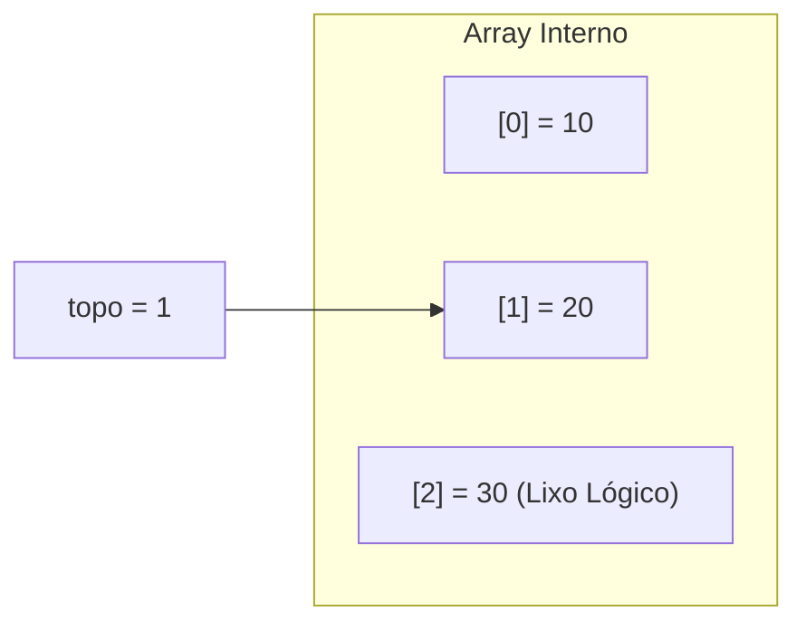

Ocorre uma **exclusão lógica**: o índice `topo` é simplesmente decrementado. A célula `elementos[2]` ainda armazena os bits correspondentes ao número `30`, mas essa posição é tratada como espaço livre. Caso uma nova operação `push` seja realizada, o índice é incrementado e o valor residual é sobrescrito.

### Implementação de Pilha Encadeada Dinâmica

Para eliminar a restrição de capacidade fixa imposta pelo vetor estático, a pilha pode ser implementada sobre uma estrutura ligada.

> **Regra de Projeto de Engenharia:**  
> O topo da pilha deve ser mapeado obrigatoriamente para a **cabeça (`inicio`)** da lista encadeada. Isso garante que as operações `push` e `pop` ocorram na primeira posição da estrutura com complexidade estritamente constante **$`O(1)`$**. Se o topo fosse mapeado para o final de uma lista simplesmente ligada, a operação `pop` exigiria percorrer toda a cadeia para atualizar o ponteiro anterior, degradando a performance para $`O(n)`$.

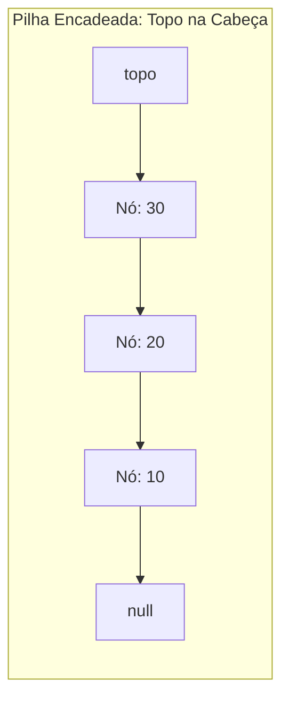

```java
public class PilhaLigada {
    private static class NoPilha {
        int valor;
        NoPilha proximo;

        NoPilha(int valor, NoPilha proximo) {
            this.valor = valor;
            this.proximo = proximo;
        }
    }

    private NoPilha topo;
    private int tamanho;

    public PilhaLigada() {
        this.topo = null;
        this.tamanho = 0;
    }

    public boolean isEmpty() {
        return this.topo == null;
    }

    public int size() {
        return this.tamanho;
    }

    public void push(int valor) {
        this.topo = new NoPilha(valor, this.topo);
        this.tamanho++;
    }

    public int pop() {
        if (isEmpty()) {
            throw new IllegalStateException("Erro: Pilha vazia.");
        }
        int valorRetorno = this.topo.valor;
        this.topo = this.topo.proximo;
        this.tamanho--;
        return valorRetorno;
    }

    public int peek() {
        if (isEmpty()) {
            throw new IllegalStateException("Erro: Pilha vazia.");
        }
        return this.topo.valor;
    }
}
```

### Manipulação de Elementos Intermediários com Pilha Auxiliar

Quando se faz necessário inspecionar, buscar ou substituir elementos intermediários sem quebrar o encapsulamento do TAD nem acessar ponteiros internos diretamente, a técnica canônica exige o uso de uma **Pilha Auxiliar Temporária**:

1. Desempilham-se os elementos da pilha original, alimentando a pilha auxiliar via `push` até expor o elemento desejado.
2. Executa-se a leitura ou mutação pretendida.
3. Esvazia-se a pilha auxiliar, devolvendo todos os elementos para a pilha original, restabelecendo a ordem LIFO original.

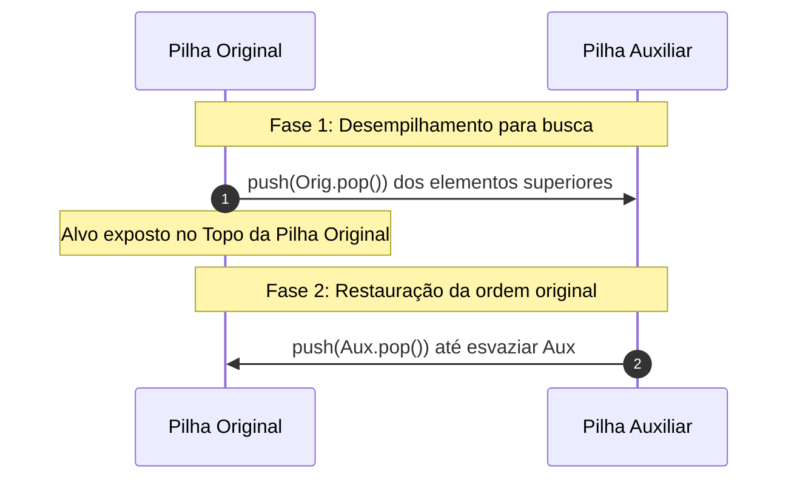

#### Implementação do Método `contem(int valor)`

```java
public boolean contem(int valorBuscado) {
    PilhaLigada auxiliar = new PilhaLigada();
    boolean encontrado = false;

    // Descarrega na auxiliar procurando o valor
    while (!this.isEmpty()) {
        int corrente = this.pop();
        if (corrente == valorBuscado) {
            encontrado = true;
        }
        auxiliar.push(corrente);
    }

    // Restaura a pilha original preservando o estado
    while (!auxiliar.isEmpty()) {
        this.push(auxiliar.pop());
    }

    return encontrado;
}
```

- **Complexidade Temporal:** No pior caso (elemento no fundo ou ausente), percorrem-se todos os $`n`$ elementos na descida e todos os $`n`$ no retorno: $`T(n) = 2n \implies O(n)`$.
- **Complexidade Espacial Auxiliar:** Demanda uma segunda pilha com capacidade para até $`n`$ nós: **$`O(n)`$**.

### Reflexão Crítica de Engenharia: Quando a Pilha é a Estrutura Incorreta

A pilha foi concebida para cenários em que o acesso é estritamente restrito à última informação inserida. Se uma aplicação de software exige operações contínuas de:
- Busca de valores em posições arbitrárias;
- Inserções intercaladas no meio da coleção;
- Consultas randômicas por índices numéricos;

O uso de Pilha é um **anti-padrão arquitetural**. Nessas circunstâncias, deve-se adotar uma Lista Encadeada, uma Tabela Hash ou uma Árvore de Busca Balanceada. Forçar o uso de pilhas temporárias sucessivas gera um custo computacional desnecessário de tempo e alocação de memória.

---

## Algoritmos Elementares de Ordenação: Bubble Sort, Selection Sort e Insertion Sort

### A Importância da Ordenação de Dados em Sistemas

Ordenar um conjunto de registros significa reorganizá-los sob uma relação de ordem total pré-definida ($`a_0 \le a_1 \le \dots \le a_{n-1}`$). Na engenharia de software corporativa, a ordenação atua como viabilizadora de desempenho:
1. **Redução da Complexidade de Busca:** Converte buscas lineares de custo $`O(n)`$ em buscas binárias de custo logarítmico $`O(\log n)`$.
2. **Eficiência em Algoritmos de Junção (*Join*):** Operações relacionais entre grandes tabelas tornam-se lineares caso ambos os conjuntos estejam previamente ordenados pelas chaves de junção.
3. **Consolidação e Eliminação de Duplicatas:** Identifica elementos repetidos em uma única passagem contígua.

### Bubble Sort: Estratégia de Trocas de Vizinhos Adjacentes

O **Bubble Sort (Ordenação por Bolha)** fundamenta-se na varredura iterativa da coleção, comparando pares de elementos imediatamente vizinhos (`vetor[j]` com `vetor[j + 1]`) e efetuando a troca caso estejam em desacordo com a relação de ordem. Ao término de cada passagem, o maior elemento da porção não ordenada "flutua" para a sua posição definitiva no final do vetor.

```mermaid
flowchart LR
  VetorJ["vetor[j]"] --> Compara{"vetor[j] > vetor[j+1]?"}
  VetorJ1["vetor[j+1]"] --> Compara
  Compara -- Sim --> Troca["Executa Troca via Auxiliar"]
  Compara -- Não --> Avanca["Mantém posições"]
  Troca --> Proximo["Avança cursor j"]
  Avanca --> Proximo
```

### Simulação Passo a Passo e Otimização com Flag de Parada

Dado o arranjo desordenado `[5, 3, 8, 1]` ($`n = 4`$):

#### Rastreamento da 1ª Passagem ($`i = 0`$)
- Compara `5` e `3`: $`5 > 3`$ (Verdadeiro) $`\implies`$ Troca: `[3, 5, 8, 1]`
- Compara `5` e `8`: $`5 > 8`$ (Falso) $`\implies`$ Não troca: `[3, 5, 8, 1]`
- Compara `8` e `1`: $`8 > 1`$ (Verdadeiro) $`\implies`$ Troca: `[3, 5, 1, 8]`  
*Resultado:* O maior elemento (`8`) fixou-se no último índice (`3`).

#### Rastreamento da 2ª Passagem ($`i = 1`$)
- Compara `3` e `5`: $`3 > 5`$ (Falso) $`\implies`$ Não troca: `[3, 5, 1, 8]`
- Compara `5` e `1`: $`5 > 1`$ (Verdadeiro) $`\implies`$ Troca: `[3, 1, 5, 8]`  
*Resultado:* O segundo maior elemento (`5`) fixou-se no índice `2`.

#### Rastreamento da 3ª Passagem ($`i = 2`$)
- Compara `3` e `1`: $`3 > 1`$ (Verdadeiro) $`\implies`$ Troca: `[1, 3, 5, 8]`  
*Resultado:* A coleção atinge ordenação total.

#### Otimização Estrutural: Parada Antecipada via Flag Booleana
Na sua forma canônica, o Bubble Sort executará todas as $`n - 1`$ passagens mesmo que a lista atinja a ordenação completa precocemente. Introduzindo uma variável sentinela (`trocou`), o laço é interrompido caso uma passagem inteira ocorra sem trocas:

```java
public class BubbleSortOtimizado {
    public static void ordenar(int[] vetor) {
        int n = vetor.length;
        boolean trocou;

        for (int i = 0; i < n - 1; i++) {
            trocou = false;
            // O limite decresce com '- i', pois os 'i' maiores elementos já estão consolidados
            for (int j = 0; j < n - 1 - i; j++) {
                if (vetor[j] > vetor[j + 1]) {
                    int temporario = vetor[j];
                    vetor[j] = vetor[j + 1];
                    vetor[j + 1] = temporario;
                    trocou = true;
                }
            }
            // Se nenhuma troca ocorreu na passagem, o arranjo já está ordenado
            if (!trocou) {
                break;
            }
        }
    }
}
```

- **Melhor Caso (Vetor já ordenado):** Realiza apenas $`n - 1`$ comparações na primeira passagem e encerra. Complexidade: **$`O(n)`$**.
- **Pior Caso e Caso Médio:** Realiza $`\frac{n(n - 1)}{2}`$ comparações. Complexidade: **$`O(n^2)`$**.
- **Espaço Auxiliar:** **$`O(1)`$** (*in-place*).

---

### Selection Sort: Seleção de Extremos e Minimização de Movimentações

O **Selection Sort (Ordenação por Seleção)** divide logicamente o vetor em duas porções: a porção ordenada (à esquerda) e a porção desordenada (à direita). A cada iteração externa, o algoritmo varre toda a porção desordenada, identifica o **menor valor absoluto** e realiza uma única troca com a primeira posição da partição não ordenada, estendendo a fronteira da região ordenada.

```mermaid
flowchart TD
  InicioPassagem["Passagem i: assume indiceMenor = i"] --> Varre["Varre j de i + 1 até n - 1"]
  Varre --> Checa{"vetor[j] < vetor[indiceMenor]?"}
  Checa -- Sim --> Atualiza["indiceMenor = j"]
  Checa -- Não --> Mantem["Mantém indiceMenor"]
  Atualiza --> FimVarredura{"Chegou ao fim do array?"}
  Mantem --> FimVarredura
  FimVarredura -- Não --> Varre
  FimVarredura -- Sim --> TrocaUnica["Troca Única: vetor[i] com vetor[indiceMenor]"]
```

### Simulação Passo a Passo do Selection Sort

Dado o arranjo `[5, 3, 8, 1]` ($`n = 4`$):

#### Passagem $`i = 0`$
- Candidato inicial: `indiceMenor = 0` (valor `5`).
- Varredura: Compara com `3` (menor, `indiceMenor = 1`); compara com `8` (mantém); compara com `1` (menor, `indiceMenor = 3`).
- Ao final, realiza uma **única troca**: permuta `vetor[0]` (`5`) com `vetor[3]` (`1`).
- Estado resultante: `[1 | 3, 8, 5]` (O elemento `1` está consolidado).

#### Passagem $`i = 1`$
- Candidato inicial: `indiceMenor = 1` (valor `3`).
- Varredura no subvetor `[3, 8, 5]`: nenhum elemento é menor que `3`.
- Troca redundante ou mantida: `vetor[1]` permanece com `3`.
- Estado resultante: `[1, 3 | 8, 5]`.

#### Passagem $`i = 2`$
- Candidato inicial: `indiceMenor = 2` (valor `8`).
- Varredura no subvetor `[8, 5]`: detecta que `5` é menor (`indiceMenor = 3`).
- Troca única: permuta `vetor[2]` (`8`) com `vetor[3]` (`5`).
- Estado resultante: `[1, 3, 5, 8]`.

```java
public class SelectionSort {
    public static void ordenar(int[] vetor) {
        int n = vetor.length;

        for (int i = 0; i < n - 1; i++) {
            int indiceMenor = i;

            // Busca pelo índice do menor elemento restante
            for (int j = i + 1; j < n; j++) {
                if (vetor[j] < vetor[indiceMenor]) {
                    indiceMenor = j;
                }
            }

            // Realiza uma única troca por passagem externa
            if (indiceMenor != i) {
                int temporario = vetor[i];
                vetor[i] = vetor[indiceMenor];
                vetor[indiceMenor] = temporario;
            }
        }
    }
}
```

- **Comparações:** Sempre executa $`\frac{n(n - 1)}{2}`$ comparações, independentemente da ordenação prévia. Complexidade de tempo: **$`O(n^2)`$ em todos os casos**.
- **Movimentações de Memória (Trocas):** Realiza no máximo $`n - 1`$ trocas em toda a execução. Complexidade de trocas: **$`O(n)`$**.
- **Vantagem de Engenharia:** Indicado para cenários onde a escrita em memória física possui custo financeiro ou degradação de hardware acentuada (como memórias Flash EEPROM antigas).

---

### Insertion Sort: A Analogia das Cartas de Baralho

O **Insertion Sort (Ordenação por Inserção)** constrói a ordenação incrementalmente, processando um elemento de cada vez. A analogia clássica é a organização de cartas em uma mão de jogo:
1. Segura-se a primeira carta. Uma mão com uma única carta está trivialmente ordenada.
2. Pega-se a segunda carta (a **chave**). Se for menor que a primeira, desloca-se a primeira para a direita e insere-se a nova carta na primeira posição.
3. Para cada nova carta retirada, percorrem-se as cartas já ordenadas da direita para a esquerda, **deslocando** para a direita aquelas que forem maiores que a chave, até encontrar a lacuna exata onde a chave deve ser inserida.

```mermaid
sequenceDiagram
  autonumber
  participant Mao as Porção Ordenada (Esquerda)
  participant Chave as Elemento Chave (vetor[i])

  Note over Mao,Chave: Iteração i: Isolamento da chave
  Chave->>Mao: Compara com elementos da direita para a esquerda
  Note over Mao: Elementos maiores deslizam 1 posição à direita
  Chave->>Mao: Chave é descarregada na lacuna criada
```

### Invariante de Laço Formal do Insertion Sort

A correção matemática do Insertion Sort é comprovada pela sua invariante:

> **Invariante:** No início de cada iteração do laço externo `for` (controlado por `i`), o subarranjo `vetor[0 ... i - 1]` consiste nos elementos originalmente presentes nessas posições, mas dispostos em ordem estritamente crescente.

1. **Inicialização:** Antes da primeira iteração ($`i = 1`$), o subvetor `vetor[0 ... 0]` contém apenas um elemento. Um vetor unitário é ordenado por definição. A invariante é verdadeira.
2. **Manutenção:** Durante a iteração, os elementos em `vetor[0 ... i - 1]` maiores que a `chave` são deslocados uma casa à direita. A chave é gravada na posição desocupada. Ao final da iteração, `vetor[0 ... i]` torna-se ordenado, restabelecendo a invariante para $`i + 1`$.
3. **Término:** O laço finaliza quando $`i = n`$. Substituindo $`i`$ por $`n`$ na invariante, tem-se que o vetor `vetor[0 ... n - 1]` contém todos os elementos ordenados.

### Diferença Mecânica entre Deslocamento e Troca de Posições

Uma troca canônica (*swap*) exige três operações de atribuição de memória:
```java
int temp = vetor[j];
vetor[j] = vetor[j - 1];
vetor[j - 1] = temp;
```
Se um elemento precisar retroceder 4 posições via trocas adjacentes, serão executadas:
```math
4 \times 3 = 12 \text{ escritas em memória}
```

O Insertion Sort substitui as trocas sucessivas pelo **deslocamento sequencial (*shifting*)**: a chave é lida uma única vez no início, os elementos maiores são apenas copiados uma posição à frente (`vetor[j + 1] = vetor[j]`, exigindo 1 escrita), e a chave é gravada uma única vez na vaga final.

Para retroceder as mesmas 4 posições, o deslocamento executa:
```math
4 \times 1 + 1 = 5 \text{ escritas em memória}
```
Isso representa uma redução de quase 60% no tráfego do barramento de dados e cache da CPU.

```java
public class InsertionSort {
    public static void ordenar(int[] vetor) {
        int n = vetor.length;

        for (int i = 1; i < n; i++) {
            int chave = vetor[i];
            int j = i - 1;

            // Curto-circuito booleano: 'j >= 0' deve preceder a leitura do array
            while (j >= 0 && vetor[j] > chave) {
                vetor[j + 1] = vetor[j]; // Deslocamento puro para a direita
                j--;
            }

            vetor[j + 1] = chave; // Gravação definitiva na lacuna
        }
    }
}
```

### Comportamento Adaptativo e Estabilidade nos Métodos Quadráticos

- **Adaptatividade:** Um algoritmo é adaptativo quando seu tempo de execução reduz naturalmente de acordo com o nível prévio de ordenação da entrada. O Insertion Sort é altamente adaptativo: em coleções quase ordenadas, a condição do `while` falha imediatamente, resultando em desempenho **$`O(n)`$**. O Selection Sort, em contrapartida, é não adaptativo: executa sempre o mesmo número de comparações ($`O(n^2)`$).
- **Estabilidade:** Um algoritmo de ordenação é classificado como **estável** se ele preserva a ordem relativa original de registros que possuem chaves de ordenação idênticas.
  - O **Bubble Sort** e o **Insertion Sort** são **estáveis** (não permutam elementos com valores iguais).
  - O **Selection Sort** é inerentemente **instável** (uma troca distante pode saltar sobre elementos idênticos e inverter sua ordem relativa).

---

## Algoritmos Avançados de Ordenação: Divisão e Conquista e Merge Sort

### O Paradigma de Divisão e Conquista

O paradigma de **Divisão e Conquista (*Divide and Conquer*)** é uma estratégia algorítmica baseada em três etapas formais:

```mermaid
flowchart TD
  ProblemaGlobal["Problema de Entrada (Tamanho n)"] --> Divisao["1. DIVIDIR: Decompor em 2 metades (n / 2)"]
  Divisao --> Conquista1["2. CONQUISTAR: Processar metade esquerda recursivamente"]
  Divisao --> Conquista2["2. CONQUISTAR: Processar metade direita recursivamente"]
  Conquista1 --> Fusao["3. COMBINAR: Intercalar metades ordenadas em tempo linear O(n)"]
  Conquista2 --> Fusao
  Fusao --> Solucao["Arranjo Global Perfeitamente Ordenado"]
```

1. **Dividir:** Fracionar o conjunto em subproblemas menores da mesma natureza calculando o ponto médio dos índices.
2. **Conquistar:** Processar os subproblemas recursivamente. Quando o tamanho atinge a partição unitária, a conquista é trivial e imediata.
3. **Combinar (*Merge*):** Intercalar as duas partições menores já ordenadas para consolidar a solução ordenada do problema maior.

### A Etapa de Divisão e o Caso Base Unitário

A partição lógica sucessiva gera uma árvore de recursão cuja condição de parada (**caso base**) ocorre quando o intervalo delimitado contém zero ou um elemento:

```math
\text{inicio} \ge \text{fim}
```

Um arranjo unitário é considerado matematicamente ordenado. Ao atingir o caso base, as chamadas recursivas começam a retornar, disparando a rotina de combinação linear.

### Prevenção Crítica de Overflow Aritmético no Ponto Médio

A expressão tradicional ensinada em cursos introdutórios para calcular o índice central de um vetor é:
```java
// Vulnerabilidade matemática oculta:
int meio = (inicio + fim) / 2;
```

**Análise de Engenharia de Baixo Nível:** Em linguagens com inteiros de precisão fixa de 32 bits em complemento de dois (como Java e C), o valor positivo máximo representável por um `int` é $`2^{31} - 1 = 2.147.483.647`$. Se uma coleção massiva processar índices cuja soma `inicio + fim` ultrapasse esse limiar, ocorre **estouro aritmético (*integer overflow*)**. O bit de sinal é ativado, convertendo o resultado em um número negativo. Ao indexar `vetor[meio]`, a JVM dispara imediatamente a exceção `ArrayIndexOutOfBoundsException`.

A formulação matematicamente robusta adotada pela indústria de software e bibliotecas canônicas é:

```math
\text{meio} = \text{inicio} + \frac{\text{fim} - \text{inicio}}{2}
```

```java
int meio = inicio + (fim - inicio) / 2; // Imune a estouro de representação
```

### A Etapa de Combinação e a Indispensabilidade do Vetor Auxiliar

A ordenação efetiva dos dados no Merge Sort ocorre na fase de combinação (**intercalação/merge**). O algoritmo utiliza a técnica de dois cursores para percorrer simultaneamente as duas metades pré-ordenadas (`inicio` até `meio` e `meio + 1` até `fim`), elegendo a cada passo o menor elemento e transferindo-o para uma estrutura de memória temporária.

> **Por que o Vetor Auxiliar é Obrigatório?**  
> Se tentássemos transcrever os elementos ordenados diretamente sobre o vetor original sem uma área de retenção temporária, os valores originais que aguardam comparação nas posições seguintes seriam sobrescritos e destruídos antes de serem processados.

```mermaid
flowchart TD
  subgraph MetadesOriginais["Subvetores Pré-ordenados no Array Original"]
    E1["[0]: 27"] --- E2["[1]: 38"]
    D1["[2]: 3"] --- D2["[3]: 43"]
  end

  subgraph BufferAuxiliar["Buffer Auxiliar (Construção Linear)"]
    B0["[0]: 3"] --- B1["[1]: 27"] --- B2["[2]: 38"] --- B3["[3]: 43"]
  end

  D1 -->|"Menor entre 27 e 3"| B0
  E1 -->|"Menor entre 27 e 43"| B1
  E2 -->|"Menor entre 38 e 43"| B2
  D2 -->|"Último remanescente"| B3
  BufferAuxiliar -.->|"Cópia de volta para o vetor original"| MetadesOriginais
```

### Rastreamento da Árvore de Recursão: Descida e Retorno

Considere a ordenação do vetor `[38, 27, 43, 3]`:

```mermaid
flowchart TD
  N0["mergeSort(0, 3) [38, 27, 43, 3]"]
  
  N1_E["mergeSort(0, 1) [38, 27]"]
  N1_D["mergeSort(2, 3) [43, 3]"]
  
  N2_E1["mergeSort(0, 0) [38] Base"]
  N2_E2["mergeSort(1, 1) [27] Base"]
  
  N2_D1["mergeSort(2, 2) [43] Base"]
  N2_D2["mergeSort(3, 3) [3] Base"]

  N0 --> N1_E
  N0 --> N1_D
  
  N1_E --> N2_E1
  N1_E --> N2_E2
  
  N1_D --> N2_D1
  N1_D --> N2_D2

  M1["intercalar(0, 0, 1) -> [27, 38]"]
  M2["intercalar(2, 2, 3) -> [3, 43]"]
  M0["intercalar(0, 1, 3) -> [3, 27, 38, 43]"]

  N2_E1 -.-> M1
  N2_E2 -.-> M1
  N2_D1 -.-> M2
  N2_D2 -.-> M2
  M1 -.-> M0
  M2 -.-> M0
```

1. **Movimento de Descida (Empilhamento):** O intervalo `[0..3]` quebra em `[0..1]` e `[2..3]`. O intervalo `[0..1]` quebra em `[0..0]` e `[1..1]`. Ambos atingem a condição de parada.
2. **Movimento de Retorno (Desempilhamento e Intercalação):**
   - Intercala `[38]` e `[27]`, resultando no segmento ordenado `[27, 38]`.
   - O fluxo segue para a metade direita: `[2..3]` quebra em `[43]` e `[3]`. Intercala ambos, gerando `[3, 43]`.
   - Finalmente, intercala as metades `[27, 38]` e `[3, 43]`. Compara `27` com `3` (copia `3`); compara `27` com `43` (copia `27`); compara `38` com `43` (copia `38`); descarrega o restante `43`. Vetor final: `[3, 27, 38, 43]`.

```java
public class MergeSort {

    public static void ordenar(int[] vetor) {
        if (vetor == null || vetor.length <= 1) {
            return;
        }
        int[] auxiliar = new int[vetor.length]; // Alocação única do buffer auxiliar
        executarMergeSort(vetor, auxiliar, 0, vetor.length - 1);
    }

    private static void executarMergeSort(int[] vetor, int[] auxiliar, int inicio, int fim) {
        if (inicio < fim) {
            int meio = inicio + (fim - inicio) / 2;

            // Conquista da partição esquerda
            executarMergeSort(vetor, auxiliar, inicio, meio);

            // Conquista da partição direita
            executarMergeSort(vetor, auxiliar, meio + 1, fim);

            // Combinação das duas metades ordenadas
            intercalar(vetor, auxiliar, inicio, meio, fim);
        }
    }

    private static void intercalar(int[] vetor, int[] auxiliar, int inicio, int meio, int fim) {
        // Cópia da região ativa para o array de suporte
        for (int k = inicio; k <= fim; k++) {
            auxiliar[k] = vetor[k];
        }

        int i = inicio;      // Cursor da partição esquerda
        int j = meio + 1;    // Cursor da partição direita
        int k = inicio;      // Cursor de escrita no array original

        // Intercalação comparativa baseada em dois cursores
        while (i <= meio && j <= fim) {
            // Operador '<=' assegura a estabilidade formal do algoritmo
            if (auxiliar[i] <= auxiliar[j]) {
                vetor[k] = auxiliar[i];
                i++;
            } else {
                vetor[k] = auxiliar[j];
                j++;
            }
            k++;
        }

        // Descarrega eventuais elementos remanescentes da metade esquerda
        while (i <= meio) {
            vetor[k] = auxiliar[i];
            i++;
            k++;
        }

        // Nota de Engenharia: Não é necessário copiar os remanescentes da metade direita,
        // pois eles já ocupam suas posições definitivas no array original.
    }
}
```

### Dedução da Complexidade Assintótica de Tempo e Espaço

#### Complexidade Temporal
A divisão equilibrada de um vetor de tamanho $`n`$ ao meio gera uma árvore de recursão com altura estritamente logarítmica:

```math
h = \lfloor \log_2 n \rfloor + 1
```

Em cada nível de profundidade dessa árvore, a soma dos comprimentos dos subvetores intercalados equivale a exatamente $`n`$. O trabalho executado pela rotina de combinação é linear ($`O(n)`$). Multiplicando o trabalho executado por nível pela altura total da árvore:

```math
T(n) = n \times (\log_2 n) \implies O(n \log n)
```

Como o particionamento sempre ocorre na metade exata do arranjo, o Merge Sort apresenta **complexidade $`O(n \log n)`$ no melhor caso, no caso médio e no pior caso**.

#### Complexidade Espacial Auxiliar
Diferente dos métodos de ordenação elementares que são *in-place*, o Merge Sort exige um buffer de memória auxiliar para a etapa de fusão, além do consumo de memória da pilha de execução para os registros de ativação da recursão ($`O(\log n)`$). O termo dominante do custo espacial reside no vetor auxiliar:

```math
S(n) = O(n) \text{ de memória auxiliar}
```

---

## Matrizes Comparativas Consolidadas e Síntese Arquitetural

### Matriz Comparativa de Estruturas de Dados Lineares

| Estrutura de Dados | Acesso Aleatório ($`get(i)`$) | Inserção no Início | Inserção no Fim | Remoção no Início | Complexidade Espacial Extra | Padrão Arquitetural Indicado |
| :--- | :--- | :--- | :--- | :--- | :--- | :--- |
| **Lista Sequencial (Array)** | $`O(1)`$ | $`O(n)`$ | $`O(1)`$ amortizado | $`O(n)`$ | Folga de capacidade não utilizada | Leitura frequente, volume estático de dados |
| **Lista Simplesmente Ligada** | $`O(n)`$ | $`O(1)`$ | $`O(1)`$ (com cauda) | $`O(1)`$ | $`O(n)`$ ponteiros de nó | Mutações frequentes nas extremidades |
| **Pilha sobre Vetor** | Incompatível (LIFO) | $`O(1)`$ (no topo) | Incompatível (LIFO) | $`O(1)`$ (no topo) | Array prealocado estático | Pilhas de dimensão máxima conhecida |
| **Pilha Encadeada Dinâmica** | Incompatível (LIFO) | $`O(1)`$ (no topo) | Incompatível (LIFO) | $`O(1)`$ (no topo) | $`O(n)`$ ponteiros de nó | Pilhas de crescimento imprevisível |

### Matriz Comparativa de Algoritmos de Ordenação

| Algoritmo | Complexidade Melhor Caso | Complexidade Caso Médio | Complexidade Pior Caso | Memória Auxiliar | Estabilidade | Paradigma de Engenharia |
| :--- | :--- | :--- | :--- | :--- | :--- | :--- |
| **Bubble Sort (Padrão)** | $`O(n^2)`$ | $`O(n^2)`$ | $`O(n^2)`$ | $`O(1)`$ (*in-place*) | Estável | Comparação e troca de adjacentes |
| **Bubble Sort (Otimizado)** | $`O(n)`$ | $`O(n^2)`$ | $`O(n^2)`$ | $`O(1)`$ (*in-place*) | Estável | Parada antecipada via flag sentinela |
| **Selection Sort** | $`O(n^2)`$ | $`O(n^2)`$ | $`O(n^2)`$ | $`O(1)`$ (*in-place*) | Instável | Busca de extremos, mínimo de trocas ($`O(n)`$) |
| **Insertion Sort** | $`O(n)`$ | $`O(n^2)`$ | $`O(n^2)`$ | $`O(1)`$ (*in-place*) | Estável | Inserção incremental via deslocamentos |
| **Merge Sort** | $`O(n \log n)`$ | $`O(n \log n)`$ | $`O(n \log n)`$ | $`O(n)`$ (buffer) | Estável | Divisão e conquista, fusão de subvetores |

### Roteiro Sistemático de Seis Passos para Avaliações e Projetos

O estudante deve aplicar o roteiro formal de engenharia em provas acadêmicas e na análise de sistemas reais:

```mermaid
flowchart TD
  R1["1. Identificar Entradas e Tipos de Dados"] --> R2["2. Mapear Operações Primitivas Críticas"]
  R2 --> R3["3. Avaliar Laços, Aninhamentos e Recursões"]
  R3 --> R4["4. Analisar Restrições de Encapsulamento"]
  R4 --> R5["5. Deduzir Complexidades Assintóticas Big-O"]
  R5 --> R6["6. Rastrear Casos Limítrofes e Invariantes"]
```

1. **Identificar as Entradas e Tipos de Dados:** Verificar se a estrutura manipula tipos primitivos ou referências de objetos no Heap, e identificar se os dados estão ordenados, aleatórios ou invertidos.
2. **Mapear as Operações Primitivas Críticas:** Contabilizar acessos a arranjos, comparações de chaves e reatribuições de ponteiros.
3. **Avaliar Laços, Aninhamentos e Recursões:** Identificar se laços dependem linearmente de $`n`$, se são aninhados ($`n \times n`$) ou se a divisão recursiva gera profundidade logarítmica ($`\log n`$).
4. **Analisar Restrições de Encapsulamento:** Garantir que TADs restritos (como Pilhas) não estejam sofrendo violações estruturais de acesso aleatório indevido.
5. **Deduzir as Complexidades Assintóticas Big-O:** Isolar os termos dominantes e descartar constantes multiplicativas nos cenários de melhor, médio e pior caso.
6. **Rastrear Casos Limítrofes e Invariantes:** Executar testes de mesa com coleções vazias ($`n = 0`$), unitárias ($`n = 1`$), listas com chaves repetidas e coleções inversamente ordenadas.

---

## Exercícios Resolvidos e Estudos de Caso Práticos

### Exercício 1: Verificador de Delimitadores Balanceados com Pilha

- **Enunciado Técnico:** Projetar e implementar um método estático `verificarDelimitadores(String expressao)` que retorne um valor booleano indicando se uma sequência de caracteres contendo parênteses `()`, colchetes `[]` e chaves `{}` está sintaticamente balanceada.
- **Raciocínio Algorítmico:** A estrutura de pilha é adequada para este problema porque o último delimitador de abertura processado deve ser o primeiro a ser fechado pelo correspondente de fechamento (princípio LIFO).
  1. Ao encontrar um caractere de abertura (`(`, `[`, `{`), empilha-se o elemento.
  2. Ao encontrar um caractere de fechamento (`)`, `]`, `}`), verifica-se se a pilha está vazia. Se estiver, há um fechamento sem abertura prévia (expressão inválida). Caso contrário, desempilha-se o topo e valida-se a compatibilidade do par.
  3. Ao término do percurso, a expressão só será considerada válida se a pilha estiver vazia.

```java
public class VerificadorExpressao {

    public static boolean verificarDelimitadores(String expressao) {
        if (expressao == null) {
            return false;
        }

        PilhaSequencialChar pilha = new PilhaSequencialChar(expressao.length());

        for (int i = 0; i < expressao.length(); i++) {
            char c = expressao.charAt(i);

            if (c == '(' || c == '[' || c == '{') {
                pilha.push(c);
            } else if (c == ')' || c == ']' || c == '}') {
                if (pilha.isEmpty()) {
                    return false; // Fechamento sem correspondente de abertura
                }
                char topo = pilha.pop();
                if (!formamParValido(topo, c)) {
                    return false; // Violação de tipo de delimitador
                }
            }
        }

        return pilha.isEmpty(); // Válido apenas se todos os blocos foram fechados
    }

    private static boolean formamParValido(char abertura, char fechamento) {
        return (abertura == '(' && fechamento == ')') ||
               (abertura == '[' && fechamento == ']') ||
               (abertura == '{' && fechamento == '}');
    }
}
```

- **Complexidade:** Temporal **$`O(n)`$** (uma varredura linear pela string); Espacial **$`O(n)`$** (no pior caso, todos os caracteres são de abertura e preenchem a pilha).

---

### Exercício 2: Inversão de Elementos Preservando a Abstração do TAD

- **Enunciado Técnico:** Construir um método que receba uma instância de `PilhaLigada` e gere uma nova instância com os mesmos elementos em ordem invertida, sem acessar atributos privados de nós e sem quebrar o estado original da pilha fornecida.
- **Raciocínio Algorítmico:**
  1. Para não destruir a pilha original, seus elementos são desempilhados e transferidos para uma primeira pilha auxiliar (`aux1`). Esta operação inverte a ordem física dos dados.
  2. A partir de `aux1`, os elementos são desempilhados e inseridos concorrentemente de volta na pilha original (restaurando seu estado primitivo) e em uma segunda pilha auxiliar (`invertida`), que preserva a inversão pretendida.

```java
public class OperacoesPilhaAvancada {

    public static PilhaLigada criarPilhaInvertida(PilhaLigada original) {
        if (original == null) {
            throw new IllegalArgumentException("A pilha original nao pode ser nula");
        }

        PilhaLigada aux1 = new PilhaLigada();
        PilhaLigada invertida = new PilhaLigada();

        // Descarrega da original para aux1 (inverte a sequência)
        while (!original.isEmpty()) {
            aux1.push(original.pop());
        }

        // Restaura a original e alimenta a invertida
        while (!aux1.isEmpty()) {
            int valor = aux1.pop();
            original.push(valor);  // Restaura estado inicial
            invertida.push(valor); // Constrói a pilha com ordem reversa
        }

        return invertida;
    }
}
```

---

### Exercício 3: Rastreamento Comparativo de Comparações e Trocas

- **Enunciado Técnico:** Dado o vetor `V = [9, 4, 2, 7]`, execute o teste de mesa completo comparando a quantidade exata de comparações de chaves e movimentações de memória (trocas físicas) executadas pelo **Selection Sort** e pelo **Insertion Sort**.

#### Resolução do Selection Sort:
- Tamanho: $`n = 4`$.
- **Passagem $`i = 0`$:** Comparações: 4 com 9, 2 com 4, 7 com 2 (3 comparações). Menor é `2`. Troca `9` com `2`. Estado: `[2, 4, 9, 7]`. (1 troca).
- **Passagem $`i = 1`$:** Comparações: 9 com 4, 7 com 4 (2 comparações). Menor é `4`. Troca nula mantida (ou zero movimentações). Estado: `[2, 4, 9, 7]`.
- **Passagem $`i = 2`$:** Comparações: 7 com 9 (1 comparação). Menor é `7`. Troca `9` com `7`. Estado: `[2, 4, 7, 9]`. (1 troca).
- **Totais do Selection Sort:** $`3 + 2 + 1 = 6`$ comparações; $`2`$ trocas físicas em memória.

#### Resolução do Insertion Sort:
- **Elemento Chave 4 ($`i = 1`$):** Compara 4 com 9 ($`9 > 4`$, verdadeiro). Desloca 9. Grava 4 no índice 0. (1 comparação, 1 deslocamento, 1 gravação). Estado: `[4, 9, 2, 7]`.
- **Elemento Chave 2 ($`i = 2`$):** Compara 2 com 9 ($`9 > 2`$, verdadeiro). Desloca 9. Compara 2 com 4 ($`4 > 2`$, verdadeiro). Desloca 4. Grava 2 no índice 0. (2 comparações, 2 deslocamentos, 1 gravação). Estado: `[2, 4, 9, 7]`.
- **Elemento Chave 7 ($`i = 3`$):** Compara 7 com 9 ($`9 > 7`$, verdadeiro). Desloca 9. Compara 7 com 4 ($`4 > 7`$, falso). Para o laço. Grava 7 no índice 2. (2 comparações, 1 deslocamento, 1 gravação). Estado: `[2, 4, 7, 9]`.
- **Totais do Insertion Sort:** $`1 + 2 + 2 = 5`$ comparações; $`4`$ deslocamentos + $`3`$ gravações de chave.

---

### Exercício 4: Fusão Linear de Duas Sequências Ordenadas

- **Enunciado Técnico:** Escreva um método estático `int[] fundirVetores(int[] a, int[] b)` que receba dois vetores previamente ordenados de tamanhos $`n`$ e $`m`$ e retorne um novo vetor consolidado de tamanho $`n + m`$ devidamente ordenado, executando a fusão em tempo linear $`O(n + m)`$.

```java
public class FusaoVetores {

    public static int[] fundirVetores(int[] a, int[] b) {
        int n = a.length;
        int m = b.length;
        int[] resultado = new int[n + m];

        int i = 0; // Cursor do vetor A
        int j = 0; // Cursor do vetor B
        int k = 0; // Cursor do vetor Resultado

        while (i < n && j < m) {
            if (a[i] <= b[j]) {
                resultado[k++] = a[i++];
            } else {
                resultado[k++] = b[j++];
            }
        }

        // Esvazia remanescentes de A se houver
        while (i < n) {
            resultado[k++] = a[i++];
        }

        // Esvazia remanescentes de B se houver
        while (j < m) {
            resultado[k++] = b[j++];
        }

        return resultado;
    }
}
```

- **Análise Assintótica:** Cada elemento dos vetores `a` e `b` é avaliado e transferido para o vetor `resultado` exatamente uma única vez. Complexidade temporal: **$`O(n + m)`$** linear estrito.

---

## Banco de Questões e Respostas Estruturadas

O bloco a seguir reúne itens de autoavaliação conceitual estruturados em formato JSONL, sintetizando tópicos da ementa:

```json
{"id": 1, "tema": "Teoria de Algoritmos", "pergunta": "Quais sao as seis propriedades canonicas que definem formalmente um algoritmo?", "resposta": "Entrada (zero ou mais dados externos), Sequencia de Passos (ordem temporal deterministica), Saida (ao menos um resultado util produzido), Finitude (termino garantido em passos finitos), Precisao (ausencia estrita de ambiguidade semantica) e Executabilidade (operacoes computacionalmente viaveis em tempo finito)."}
{"id": 2, "tema": "Modelagem e TAD", "pergunta": "Qual e a distincao fundamental entre Tipo Abstrato de Dados e Estrutura de Dados Concreta?", "resposta": "O TAD e um modelo matematico que especifica as operacoes e os comportamentos publicos esperados (O QUE a estrutura faz), sem definir organizacao fisica. A estrutura de dados concreta e a realizacao fisica na memoria (COMO e implementado, via arrays contiguos ou nos encadeados dispersos no Heap)."}
{"id": 3, "tema": "Complexidade Assintotica", "pergunta": "Por que a medicao empirica de relogio e descartada na comparacao teorica de algoritmos?", "resposta": "Porque depende criticamente de fatores exogenos ao algoritmo, como arquitetura da CPU, frequencia de clock, concorrencia do sistema operacional, niveis de memoria cache e pausas do Garbage Collector, nao permitindo generalizacao analitica."}
{"id": 4, "tema": "Estruturas Sequenciais", "pergunta": "Qual e o custo computacional no pior caso da insercao no indice zero de uma lista sequencial baseada em array e por que ele ocorre?", "resposta": "O custo e O(n), pois a contiguidade fisica do array exige o deslocamento (shifting) de todos os n elementos preexistentes para a casa adjacente a direita a fim de liberar o primeiro slot sem sobrescrita destrutiva."}
{"id": 5, "tema": "Listas Ligadas", "pergunta": "Como a presenca de um ponteiro de fim (tail) afeta assintoticamente a insercao na cauda de uma lista simplesmente ligada?", "resposta": "Reduz a complexidade de O(n) para O(1), permitindo a conexao imediata do novo no via fim.proximo = novo e atualizacao do ponteiro fim, dispensando a varredura linear a partir da cabeca."}
{"id": 6, "tema": "Listas Ligadas", "pergunta": "Qual e a ordem critica de atribuicoes de ponteiro na insercao de um no no meio de uma lista simplesmente ligada para evitar vazamento de memoria?", "resposta": "Deve-se primeiro ligar o novo no ao restante da cadeia (novo.proximo = atual.proximo) e somente depois conectar o no anterior ao novo no (atual.proximo = novo). Inverter a ordem sobrescreve a referencia para o restante da lista, provocando perda irrecuperavel de dados no Heap."}
{"id": 7, "tema": "Pilhas", "pergunta": "Por que em uma pilha implementada sobre array a sentinela de vacuidade e expressa pelo indice topo = -1?", "resposta": "Porque em arrays com indexacao em base zero, um elemento valido reside no indice 0 (topo = 0). Seguindo a logica regressiva (topo = quantidade - 1), a presenca de zero elementos resulta matematicamente em 0 - 1 = -1."}
{"id": 8, "tema": "Pilhas", "pergunta": "Por que o topo de uma pilha encadeada dinamica deve ser mapeado obrigatoriamente na cabeca (inicio) da lista ligada?", "resposta": "Para assegurar que push e pop executem em tempo estritamente constante O(1). Mapear o topo no final exigiria varredura O(n) na remocao para recuperar o ponteiro anterior ao ultimo elemento em listas simplesmente ligadas."}
{"id": 9, "tema": "Ordenacao Elementar", "pergunta": "Qual a diferenca fundamental de operacoes entre o Selection Sort e o Bubble Sort?", "resposta": "O Bubble Sort realiza trocas continuas e imediatas entre vizinhos adjacentes a medida que varre a colecao. O Selection Sort apenas registra indices durante a varredura e realiza uma unica troca fisica por passagem externa, totalizando no maximo n - 1 trocas."}
{"id": 10, "tema": "Ordenacao Elementar", "pergunta": "Por que o Insertion Sort apresenta desempenho superior em colecoes quase ordenadas se comparado ao Selection Sort?", "resposta": "Porque o Insertion Sort e adaptativo: se os elementos ja estao em ordem, o laco interno de deslocamento encerra na primeira comparacao, conferindo complexidade O(n) no melhor caso. O Selection Sort e nao adaptativo e executa sempre O(n^2) comparacoes."}
{"id": 11, "tema": "Ordenacao Avancada", "pergunta": "Como se previne formalmente o estouro aritmetico (overflow) no calculo do ponto medio do Merge Sort?", "resposta": "Substituindo a expressao vulneravel (inicio + fim) / 2 pela formula algebricamente equivalente meio = inicio + (fim - inicio) / 2, impedindo que a soma dos indices ultrapasse o limite maximo de inteiros de 32 bits (Integer.MAX_VALUE)."}
{"id": 12, "tema": "Ordenacao Avancada", "pergunta": "Qual e a complexidade temporal e espacial auxiliar do Merge Sort e qual a razao do consumo de memoria?", "resposta": "A complexidade temporal e O(n log n) em todos os casos (melhor, medio e pior) devido a divisao balanceada da arvore recursiva. A complexidade espacial auxiliar e O(n) devido a obrigatoriedade do vetor temporario de intercalacao para nao sobrescrever dados nao processados."}
```

---

## Checklist de Autoavaliação e Revisão

O estudante deve utilizar esta lista de verificação antes de avaliações formais para atestar o domínio dos tópicos:

- [ ] Sei enunciar as seis propriedades canônicas de um algoritmo e formular exemplos e contraexemplos para cada uma.
- [ ] Sei deduzir a fórmula da Média Semestral ($`MS`$) institucional e a ponderação das provas ($`80\%`$) e trabalhos ($`20\%`$).
- [ ] Compreendo a distinção entre Call Stack e Heap na JVM e rastreio o ciclo de vida de objetos e referências nulas.
- [ ] Sei provar por que a inserção no início de uma lista linear sequencial tem complexidade $`O(n)`$.
- [ ] Domino a mecânica da classe `No` e sei codificar a inserção ordenada em listas ligadas sem inverter atribuições de ponteiros.
- [ ] Compreendo o papel do ponteiro de cauda (`fim`) na redução da complexidade da inserção no final de $`O(n)`$ para $`O(1)`$.
- [ ] Sei implementar uma pilha estática sobre vetor utilizando o índice sentinela `-1` e tratando condições de *Overflow* e *Underflow*.
- [ ] Sei construir a técnica da pilha auxiliar temporária para busca e manipulação de elementos intermediários em tempo $`O(n)`$.
- [ ] Sei demonstrar por que o Bubble Sort otimizado com flag executa em $`O(n)`$ no melhor caso.
- [ ] Sei explicar por que o Selection Sort minimiza as movimentações de memória ($`O(n)`$ trocas físicas) e por que ele é classificado como instável.
- [ ] Domino a analogia das cartas do Insertion Sort e compreendo a economia de barramento da técnica de deslocamento contra a técnica de trocas.
- [ ] Sei formular a equação segura do cálculo do ponto médio no Merge Sort para prevenção de *integer overflow*.
- [ ] Sei desenhar a árvore de recursão do Merge Sort, evidenciando as fases de descida (divisão) e retorno (intercalação com vetor auxiliar).
- [ ] Sei justificar a razão matemática pela qual o Merge Sort mantém complexidade temporal $`O(n \log n)`$ no melhor, médio e pior caso.

---

## Fontes e Metadados

- Turma no Classroom: estrutura de dados 1 2026/02
- Itens processados: 0 materiais, 6 tarefas, 12 avisos
- Gerado em: 13/11/2026, 15:38:44 (BRT) via classroom-sync
