# Guia de Estudos Consolidado: Estrutura de Dados I

> **Instituição:** Centro Universitário de Santa Fé do Sul (UniFEF)  
> **Curso:** Bacharelado em Sistemas de Informação (4º Semestre)  
> **Docente:** Prof. Ms. Wesley Soares de Souza  
> **Disciplina:** Estrutura de Dados I  

---

## Sumário

- [Visão Geral da Disciplina e Contrato Pedagógico](#visao-geral-da-disciplina-e-contrato-pedagogico)
  - [Perfil Docente e Filosofia de Ensino](#perfil-docente-e-filosofia-de-ensino)
  - [Ementa e Trilha Temática Oficial](#ementa-e-trilha-tematica-oficial)
  - [Métrica de Avaliação e Critérios de Aprovação](#metrica-de-avaliacao-e-criterios-de-aprovacao)
  - [Bibliografia Registrada e Leituras Recomendadas](#bibliografia-registrada-e-leituras-recomendadas)
- [Teoria Geral de Algoritmos e Ciclo de Resolução de Problemas](#teoria-geral-de-algoritmos-e-ciclo-de-resolucao-de-problemas)
  - [Definição Formal e Etimologia](#definicao-formal-e-etimologia)
  - [As Seis Propriedades Fundamentais de um Algoritmo](#as-seis-propriedades-fundamentais-de-um-algoritmo)
  - [O Axioma de Niklaus Wirth](#o-axioma-de-niklaus-wirth)
  - [Diferença Fundamental entre Algoritmo e Programa](#diferenca-fundamental-entre-algoritmo-e-programa)
  - [O Ciclo Completo de Engenharia: Do Problema à Solução](#o-ciclo-completo-de-engenharia-do-problema-a-solucao)
  - [As Seis Etapas Sistemáticas de Projeto de Algoritmos](#as-seis-etapas-sistematicas-de-projeto-de-algoritmos)
- [Metodologia de Refinamento Sucessivo](#metodologia-de-refinamento-sucessivo)
  - [Definição e Mecânica Top-Down](#definicao-e-mecanica-top-down)
  - [Níveis de Abstração Aplicados](#niveis-de-abstracao-aplicados)
  - [Estudo de Caso: Cálculo de Média e Fila de Atendimento](#estudo-de-caso-calculo-de-media-e-fila-de-atendimento)
  - [Armadilhas do Refinamento Prematuro](#armadilhas-do-refinamento-prematuro)
- [Tipos Abstratos de Dados, Abstração e Encapsulamento](#tipos-abstratos-de-dados-abstracao-e-encapsulamento)
  - [Conceituação Formal de Tipo Abstrato de Dados](#conceituacao-formal-de-tipo-abstrato-de-dados)
  - [Separação Estrita entre Contrato e Realização Física](#separacao-estrita-entre-contrato-e-realizacao-fisica)
  - [Abstração versus Encapsulamento](#abstracao-versus-encapsulamento)
  - [Matriz Decisória de Seleção Estrutural](#matriz-decisoria-de-selecao-estrutural)
- [Fundamentos de Análise Assintótica e Complexidade de Algoritmos](#fundamentos-de-analise-assintotica-e-complexidade-de-algoritmos)
  - [Limitações Intrínsecas da Medição de Tempo por Relógio](#limitacoes-intrinsecas-da-medicao-de-tempo-por-relogio)
  - [Contagem de Instruções e o Tamanho da Entrada](#contagem-de-instrucoes-e-o-tamanho-da-entrada)
  - [Regras de Simplificação Assintótica](#regras-de-simplificacao-assintotica)
  - [As Notações Big-O e Big-Omega](#as-notacoes-big-o-e-big-omega)
  - [Espectro Analítico: Melhor Caso, Caso Médio e Pior Caso](#espectro-analitico-melhor-caso-caso-medio-e-pior-caso)
  - [Hierarquia das Classes de Complexidade](#hierarquia-das-classes-de-complexidade)
  - [Estudo de Caso: Pesquisa Sequencial versus Pesquisa Binária](#estudo-de-caso-pesquisa-sequencial-versus-pesquisa-binaria)
- [Arquitetura de Memória e Alocação em Java](#arquitetura-de-memoria-e-alocacao-em-java)
  - [O Modelo de Execução da JVM: Call Stack e Heap](#o-modelo-de-execucao-da-jvm-call-stack-e-heap)
  - [Semântica de Tipos Primitivos versus Tipos por Referência](#semantica-de-tipos-primitivos-versus-tipos-por-referencia)
  - [Mecânica da Alocação Dinâmica e Aritmética de Endereços](#mecanica-da-alocacao-dinamica-e-aritmetica-de-enderecos)
  - [Ciclo de Vida de Objetos e Coleta de Lixo Automática](#ciclo-de-vida-de-objetos-e-coleta-de-lixo-automatica)
- [Estruturas Lineares: Listas Lineares Sequenciais](#estruturas-lineares-listas-lineares-sequenciais)
  - [Organização Física em Blocos Contíguos](#organizacao-fisica-em-blocos-contiguos)
  - [Capacidade Máxima versus Tamanho Operacional](#capacidade-maxima-versus-tamanho-operacional)
  - [Operações Fundamentais e o Custo do Deslocamento](#operacoes-fundamentais-e-o-custo-do-deslocamento)
  - [O Mecanismo de Redimensionamento Dinâmico](#o-mecanismo-de-redimensionamento-dinamico)
  - [Implementação Completa em Java](#implementacao-completa-em-java)
- [Estruturas Lineares: Listas Simplesmente Ligadas Dinâmicas](#estruturas-lineares-listas-simplesmente-ligadas-dinamicas)
  - [Anatomia do Nó e Ruptura da Contiguidade](#anatomia-do-no-e-ruptura-da-contiguidade)
  - [Estrutura da Classe Controladora](#estrutura-da-classe-controladora)
  - [Inserção na Cabeça com Tempo Constante](#insercao-na-cabeca-com-tempo-constante)
  - [Inserção no Término: Otimização de Cauda](#insercao-no-termino-otimizacao-de-cauda)
  - [Inserção Ordenada: Separação entre Busca e Religamento](#insercao-ordenada-separacao-entre-busca-e-religamento)
  - [Busca Linear e Atualização Posicional](#busca-linear-e-atualizacao-posicional)
  - [Remoção de Elementos e Desconexão de Referências](#remocao-de-elementos-e-desconexao-de-referencias)
  - [Trade-offs: Lista Sequencial versus Lista Ligada](#trade-offs-lista-sequencial-versus-lista-ligada)
- [Estruturas Lineares Restritas: Tipo Abstrato de Dados Pilha](#estruturas-lineares-restritas-tipo-abstrato-de-dados-pilha)
  - [Conceituação e o Princípio LIFO](#conceituacao-e-o-principio-lifo)
  - [O Contrato Fundamental: push, pop, peek e isEmpty](#o-contrato-fundamental-push-pop-peek-e-isempty)
  - [Fundamentação da Restrição de Acesso Arbitrário](#fundamentacao-da-restricao-de-acesso-arbitrario)
  - [Implementação Sequencial Estática com Array](#implementacao-sequencial-estatica-com-array)
  - [A Sentinela de Pilha Vazia e o Gerenciamento do Topo](#a-sentinela-de-pilha-vazia-e-o-gerenciamento-do-topo)
  - [Implementação Dinâmica Encadeada](#implementacao-dinamica-encadeada)
  - [Técnicas de Manipulação com Pilhas Auxiliares](#tecnicas-de-manipulacao-com-pilhas-auxiliares)
  - [Verificação de Delimitadores e Inversão de Estruturas](#verificacao-de-delimitadores-e-inversao-de-estruturas)
  - [Matriz Comparativa: Pilha Estática versus Pilha Encadeada](#matriz-comparativa-pilha-estatica-versus-pilha-encadeada)
- [Algoritmos de Ordenação por Comparação: Métodos Quadráticos](#algoritmos-de-ordenacao-por-comparacao-metodos-quadraticos)
  - [Importância Sistêmica da Ordenação de Dados](#importancia-sistemica-da-ordenacao-de-dados)
  - [Bubble Sort: Ordenação por Flutuação e Trocas Adjacentes](#bubble-sort-ordenacao-por-flutuacao-e-trocas-adjacentes)
  - [Selection Sort: Ordenação por Seleção de Extremos](#selection-sort-ordenacao-por-selecao-de-extremos)
  - [Insertion Sort: Ordenação por Inserção Direta e Deslocamento](#insertion-sort-ordenacao-por-insercao-direta-e-deslocamento)
  - [Deslocamento versus Troca: Análise de Escritas em Memória](#deslocamento-versus-troca-analise-de-escritas-em-memoria)
  - [Matriz Comparativa Consolidada dos Métodos Elementares](#matriz-comparativa-consolidada-dos-metodos-elementares)
- [Algoritmos de Ordenação Eficientes: Merge Sort](#algoritmos-de-ordenacao-eficientes-merge-sort)
  - [O Paradigma de Divisão e Conquista](#o-paradigma-de-divisao-e-conquista)
  - [A Fase de Decomposição Recursiva e o Caso Base](#a-fase-de-decomposicao-recursiva-e-o-caso-base)
  - [A Fase de Intercalação e a Memória Auxiliar](#a-fase-de-intercalacao-e-a-memoria-auxiliar)
  - [Prevenção de Estouro Aritmético no Ponto Médio](#prevencao-de-estouro-aritmetico-no-ponto-medio)
  - [Rastreamento da Árvore de Execução e Pilha de Chamadas](#rastreamento-da-arvore-de-execucao-e-pilha-de-chamadas)
  - [Dedução da Complexidade Assintótica e Espacial](#deducao-da-complexidade-assintotica-e-espacial)
- [Matriz Geral de Complexidade e Critérios de Decisão](#matriz-geral-de-complexidade-e-criterios-de-decisao)
- [Exercícios de Fixação com Resolução Analítica](#exercicios-de-fixacao-com-resolucao-analitica)
- [Pontos-Chave para Avaliações e Roteiro de Prova](#pontos-chave-para-avaliacoes-e-roteiro-de-prova)
- [Banco de Questões e Respostas para Revisão](#banco-de-questoes-e-respostas-para-revisao)
- [Glossário Terminológico da Disciplina](#glossario-terminologico-da-disciplina)

---

## Visao Geral da Disciplina e Contrato Pedagogico

### Perfil Docente e Filosofia de Ensino

A disciplina de Estrutura de Dados I, ministrada no 4º semestre do curso de Sistemas de Informação da UniFEF, é conduzida pelo Prof. Ms. Wesley Soares de Souza. Graduado em Sistemas de Informação pela FEF (UniFEF), especialista em Gestão de Banco de Dados e mestre em Engenharia de Software pela Universidade Federal do Pampa (UNIPAMPA - RS), o docente acumula mais de uma década e meia de experiência prática em engenharia de sistemas corporativos de grande porte e atuação no ensino superior desde 2014, com passagens pelo Grupo Kroton (Anhanguera), FATEC Jales e IFSP Votuporanga.

A linha pedagógica adotada estabelece uma articulação permanente entre o formalismo matemático da Ciência da Computação e os requisitos de engenharia de software do mercado produtivo. Em ambientes empresariais modernos, o consumo indevido de memória e a escolha de algoritmos assintoticamente desfavoráveis traduzem-se diretamente em custos financeiros de infraestrutura em nuvem, latências inaceitáveis de resposta e vulnerabilidades de disponibilidade.

### Ementa e Trilha Tematica Oficial

A matriz curricular da disciplina está organizada em dois blocos centrais:

1. **Fundamentos e Teoria Base**: Metodologia de projeto de algoritmos, refinamento sucessivo, tipos abstratos de dados, análise assintótica de complexidade (tempo e espaço), gerenciamento de memória física e virtual, modelo de execução da JVM (Stack e Heap) e alocação dinâmica de memória.
2. **Estruturas Lineares e Ordenação de Dados**: Modelagem, codificação e avaliação de estruturas lineares contíguas e encadeadas (listas sequenciais, listas simplesmente ligadas, pilhas), manipulação de estados intermediários, e algoritmos fundamentais e avançados de ordenação interna (Bubble Sort, Selection Sort, Insertion Sort e Merge Sort).

O fluxo programático estruturado pelo plano de ensino segue a ordem sequencial de evolução de maturidade:

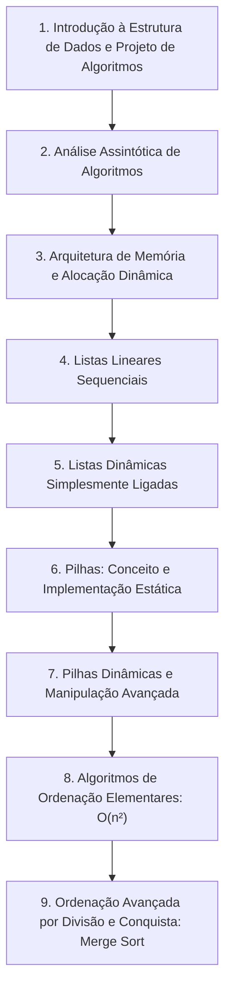

### Metrica de Avaliacao e Criterios de Aprovacao

O regime avaliativo semestral é segmentado em dois ciclos de aprendizagem (Módulo 1 e Módulo 2), originando duas médias parciais compostas denominadas Avaliação 1 e Avaliação 2:

- **Avaliação 1 ($`AV_1`$ e $`T_1`$)**: Uma avaliação escrita e prática individual sem consulta ($`AV_1`$), avaliada na escala de 0,0 a 10,0 com peso 0,8 (teto de 8,0 pontos), somada a um projeto prático de implementação e exercícios ($`T_1`$), avaliado de 0,0 a 10,0 com peso 0,2 (teto de 2,0 pontos).
- **Avaliação 2 ($`AV_2`$ e $`T_2`$)**: Uma avaliação formal integradora sem consulta ($`AV_2`$), na escala de 0,0 a 10,0 com peso 0,8 (teto de 8,0 pontos), somada ao trabalho prático de estruturas avançadas ($`T_2`$), de 0,0 a 10,0 com peso 0,2 (teto de 2,0 pontos).

A Média Semestral final ($`MS`$) requerida para aprovação ordinária é obtida pela média aritmética simples entre os dois módulos avaliativos:

```math
MS = \frac{[(AV_1 \times 0.8) + (T_1 \times 0.2)] + [(AV_2 \times 0.8) + (T_2 \times 0.2)]}{2}
```

| Componente Avaliativo | Natureza do Instrumento | Intervalo | Peso Relativo | Contribuição Efetiva |
| :--- | :--- | :--- | :--- | :--- |
| **Trabalho 1 ($`T_1`$)** | Resolução prática e algoritmos | 0,0 a 10,0 | 20% | Até 2,0 pontos no Módulo 1 |
| **Prova 1 ($`AV_1`$)** | Avaliação formal teórica e prática | 0,0 a 10,0 | 80% | Até 8,0 pontos no Módulo 1 |
| **Trabalho 2 ($`T_2`$)** | Projeto e código de estruturas | 0,0 a 10,0 | 20% | Até 2,0 pontos no Módulo 2 |
| **Prova 2 ($`AV_2`$)** | Avaliação formal integradora | 0,0 a 10,0 | 80% | Até 8,0 pontos no Módulo 2 |

### Bibliografia Registrada e Leituras Recomendadas

O projeto pedagógico do curso fundamenta-se nos seguintes títulos de referência:

#### Bibliografia Básica Registrada
- MONTEIRO, Mário A. *Introdução à Organização de Computadores*. 4. ed. Rio de Janeiro: LTC, 2002.
- STALLINGS, William. *Arquitetura e Organização de Computadores*. 8. ed. São Paulo: Pearson, 2010.
- TANENBAUM, Andrew S. *Organização Estruturada de Computadores*. 3. ed. São Paulo: Prentice-Hall do Brasil, 1990.

#### Bibliografia Complementar Registrada
- IDOETA, Ivan Valeije; CAPUANO, Francisco Gabriel. *Elementos de Eletrônica Digital*. 32. ed. São Paulo: Érica, 2001.
- PATTERSON, David A.; HENNESSY, John L. *Organização e Projeto de Computadores*. 2. ed. Rio de Janeiro: LTC, 1998.
- WEBER, Raul Fernando. *Arquitetura de Computadores Pessoais*. 2. ed. Porto Alegre: Sagra, 2001.
- WEBER, Raul Fernando. *Fundamentos de Arquitetura de Computadores*. Série Livros Didáticos Informática UFRGS, Vol. 8, 4. ed. Porto Alegre: Bookman, 2012.

> **Nota de complementação pedagógica:** Embora o registro histórico priorize a fundamentação em arquitetura de hardware — indispensável para o entendimento físico de ponteiros, alinhamento de registradores, cache e memória virtual —, o estudo sistemático de estruturas lineares apoia-se complementarmente nas obras clássicas de algoritmos: *Projeto de Algoritmos com Implementações em Pascal e C* (Nivio Ziviani) e *Algoritmos: Teoria e Prática* (Thomas H. Cormen et al.).

---

## Teoria Geral de Algoritmos e Ciclo de Resolucao de Problemas

### Definicao Formal e Etimologia

Um **algoritmo** é formalmente caracterizado como um conjunto finito de passos lógicos, ordenados e desprovidos de ambiguidade, projetado para transformar um conjunto de dados de entrada em um conjunto determinado de saídas, alcançando a solução de uma classe delimitada de problemas.

Etimologicamente, o vocábulo homenageia o astrônomo e matemático persa do século IX, Abu Abdullah Muhammad ibn Musa al-Khwarizmi, responsável pela formalização das regras operacionais do sistema posicional decimal e dos métodos de balanceamento de equações algébricas. 

Na perspectiva da computação contemporânea, o algoritmo representa a descrição conceitual pura da computabilidade de uma tarefa, existindo de maneira prévia e autônoma em relação a qualquer circuito microeletrônico, sistema operacional ou compilador comercial.

### As Seis Propriedades Fundamentais de um Algoritmo

Para que uma especificação procedimental seja classificada como um algoritmo matemático e computacionalmente válido, ela deve satisfazer obrigatoriamente seis critérios rigorosos:

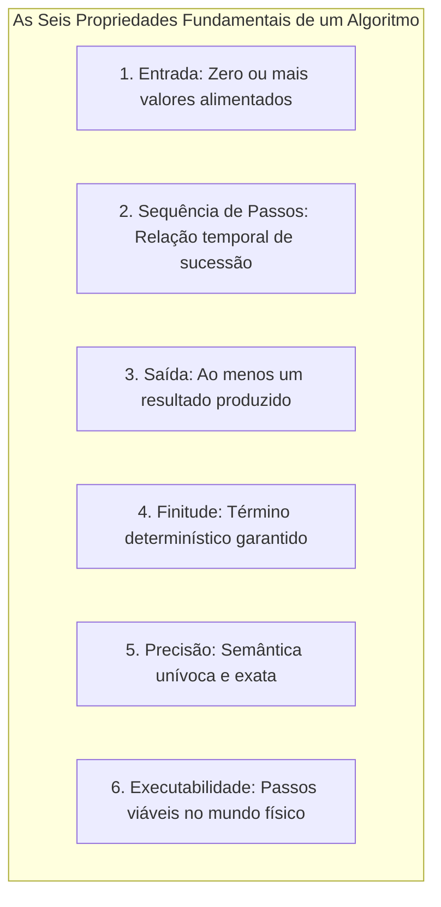

1. **Entrada (*Input*)**: Um algoritmo recebe do ambiente externo as quantidades sobre as quais irá operar. Pode possuir zero ou mais entradas. Quando a entrada é zero, a rotina opera exclusivamente a partir de axiomas ou constantes intrínsecas ao seu desenho lógico (por exemplo, a geração dos números primos no intervalo $`[2, 100]`$).
2. **Sequência de Passos (*Sequence*)**: A execução obedece a uma ordenação determinística de transição de estados. Uma instrução só é computada a partir da resolução de suas precedências temporais e causais.
3. **Saída (*Output*)**: Todo algoritmo existe para atender a uma finalidade funcional, devendo gerar obrigatoriamente ao menos um resultado perceptível que guarde relação de conformidade matemática com as entradas recebidas.
4. **Finitude (*Finiteness*)**: O algoritmo deve encerrar seu processamento após um número discreto e finito de instruções para qualquer conjunto de entradas admitido pelo problema. Procedimentos que entram em laços de repetição infinitos decorrentes da ausência de condições de convergência violam a definição de algoritmo.
5. **Precisão (*Definiteness / Unambiguity*)**: Cada instrução deve ser descrita de maneira exata, sem margem para dupla interpretação. Não se admitem termos vagos como "misture até atingir o ponto" ou "processe alguns elementos".
6. **Executabilidade (*Effectiveness / Executability*)**: Cada instrução primitiva deve ser viável de realização mecânica por um dispositivo físico dotado de recursos finitos em um intervalo temporal finito. Instruções como "divida o saldo pela raiz de zero" violam essa restrição.

| Propriedade | Exigência Teórica | Exemplo Válido | Violação Típica (Contraexemplo) |
| :--- | :--- | :--- | :--- |
| **Entrada** | Dados lidos do domínio do problema | Um vetor de $`n`$ números inteiros | Algoritmo que tenta ler área de memória desprovida de inicialização |
| **Sequência** | Relação de causa e efeito ordenada | 1º Lê notas; 2º Soma; 3º Divide | Imprimir o relatório antes da leitura dos dados |
| **Saída** | Produção de resultado explícito | Retornar o valor booleano `true` | Método que efetua cálculos pesados e descarta o estado sem retorno |
| **Finitude** | Convergência em tempo discreto | `while (n > 0) { n--; }` | `while (true) {}` sem mecanismo de parada |
| **Precisão** | Instruções semânticas unívocas | `x = x + 1;` | "Ajuste o valor conforme achar necessário" |
| **Executabilidade** | Operações exequíveis fisicamente | Somar dois números de 64 bits | "Encontre a última casa decimal de $`\pi`$ para continuar" |

### O Axioma de Niklaus Wirth

Em 1976, o cientista da computação suíço Niklaus Wirth, laureado com o Prêmio Turing e autor das linguagens Pascal e Modula-2, imortalizou a relação indissociável entre organização de dados e métodos de manipulação por meio da fórmula:

```math
\text{Algoritmos} + \text{Estruturas de Dados} = \text{Programas}
```

A síntese estabelecida por Wirth esclarece que um algoritmo sofisticado torna-se inviável se os dados forem organizados de maneira ineficiente para as consultas solicitadas. Do mesmo modo, uma estrutura de dados bem modelada permanece inerte sem um algoritmo que a explore com mínimo custo computacional.

### Diferenca Fundamental entre Algoritmo e Programa

A confusão entre os termos "algoritmo" e "programa" decorre da convergência prática durante a atividade de desenvolvimento, mas suas fronteiras conceituais são distintas:

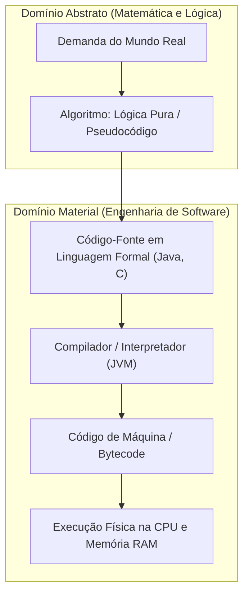

- **Algoritmo**: Trata-se de uma entidade puramente lógica, matemática e independente de tecnologia. Pode ser representado em linguagem natural estruturada, pseudocódigo, álgebra relacional ou diagramas. Não está restrito à existência de circuitos integrados ou sistemas operacionais.
- **Programa**: Representa a materialização técnica do algoritmo codificado por meio do léxico, da gramática e da sintaxe de uma linguagem de programação específica. Deve respeitar o compilador, as diretrizes da máquina virtual, os tipos primitivos e os limites físicos da arquitetura de registradores e barramentos.

| Dimensão de Comparação | Algoritmo | Programa de Computador |
| :--- | :--- | :--- |
| **Plano Existencial** | Ideia, modelo matemático, abstração | Artefato físico, arquivo binário ou código-fonte |
| **Dependência Tecnológica** | Agnóstico a hardware e fornecedor | Estritamente dependente da plataforma e compilador |
| **Mecanismo de Verificação** | Demonstração matemática, testes de mesa | Compilação, depuração e perfis de execução |
| **Tratamento de Falhas** | Focado na lógica pura do problema | Gerencia limites físicos, I/O e exceções de memória |

### O Ciclo Completo de Engenharia: Do Problema a Solucao

A transformação de uma demanda da sociedade em um sistema computacional estável não é um processo imediato de escrita de linhas de código. Requer a passagem disciplinada por sete estágios fundamentais:

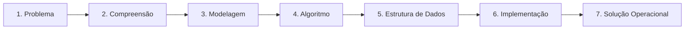

1. **Problema**: A necessidade concreta apresentada no domínio de negócio (ex.: lentidão no fluxo de triagem de clientes em uma agência bancária).
2. **Compreensão**: Análise detalhada dos requisitos funcionais, restrições operacionais, limites volumétricos de carga e regras de negócio pertinentes.
3. **Modelagem**: Tradução da realidade operacional para abstrações formais (entidades, atributos, relacionamentos e fluxos causais).
4. **Algoritmo**: Descrição sistemática da lógica processual que soluciona o problema sobre os dados modelados.
5. **Estrutura de Dados**: Escolha da forma como as entidades serão mantidas na memória (vetores contíguos, nós dinamicamente referenciados, arranjos restritos por índices).
6. **Implementação**: Tradução do algoritmo e da estrutura de dados para código-fonte funcional em uma linguagem de programação (ex.: Java).
7. **Solução Operacional**: Sistema compilado, testado e em execução contínua, atendendo aos requisitos estabelecidos.

### As Seis Etapas Sistematicas de Projeto de Algoritmos

Diante de um problema computacional, o engenheiro de software deve aplicar um roteiro sistemático em seis etapas para garantir correção lógica antes da implementação:

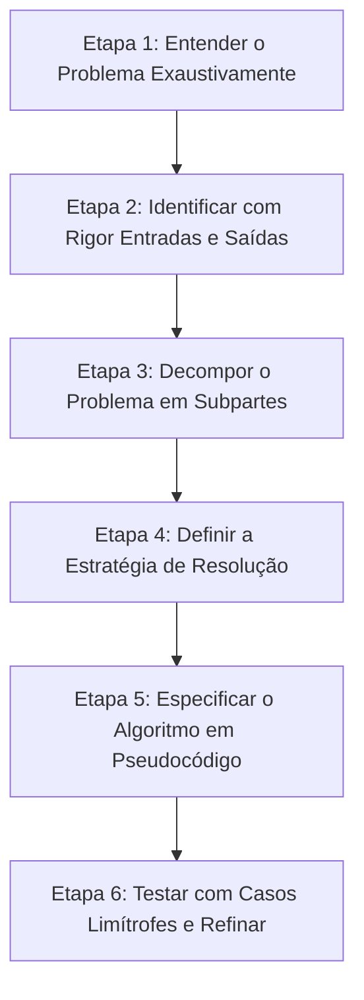

1. **Entender o Problema**: Compreender integralmente o contexto, isolando as restrições essenciais de ambiguidades do enunciado.
2. **Identificar Entradas e Saídas**: Mapear o tipo, volume, precisão numérica e domínios válidos de dados que entram e dos resultados esperados.
3. **Decompor o Problema**: Dividir o objetivo central em tarefas menores por meio de refinamento estrutural.
4. **Definir a Estratégia**: Escolher o paradigma algorítmico mais adequado (força bruta, abordagem gulosa, divisão e conquista, iteração com variáveis de estado).
5. **Especificar o Algoritmo**: Escrever a lógica passo a passo em pseudocódigo estruturado, definindo laços, desvios condicionais e variáveis de controle.
6. **Testar e Refinar**: Realizar testes de mesa rigorosos com entradas convencionais, casos de borda (entradas nulas, vetores vazios, coleções unitárias, elementos duplicados) e otimizar o fluxo lógico.

---

## Metodologia de Refinamento Sucessivo

### Definicao e Mecanica Top-Down

O **refinamento sucessivo** (conhecido na literatura clássica como *stepwise refinement* ou decomposição *top-down*, introduzido formalmente por Niklaus Wirth em 1971) é uma técnica sistemática de engenharia de software na qual um problema complexo é decomposto partindo-se de uma descrição declarativa de alto nível, progredindo por sucessivas camadas de detalhamento, até atingir instruções primitivas diretamente mapeáveis para instruções executáveis de programação.

A motivação do método consiste em gerenciar a carga cognitiva do desenvolvedor. A tentativa de codificar rotinas complexas diretamente na linguagem de programação resulta tipicamente em acoplamento patológico, falhas na validação de estados intermediários e proliferação de código confuso (*spaghetti code*).

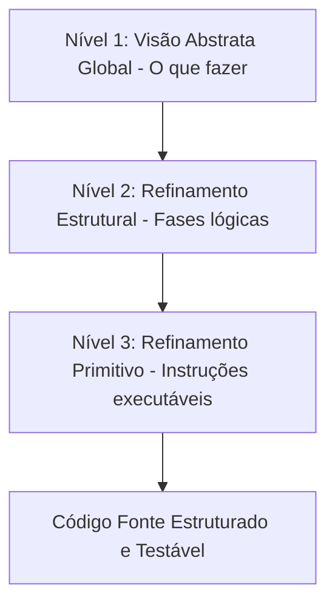

### Niveis de Abstracao Aplicados

- **Nível 1 (Abstração Global)**: Estabelece a intenção global do sistema sem expor variáveis, tipos ou algoritmos. O público-alvo é o usuário e os analistas de requisitos.
- **Nível 2 (Refinamento Estrutural)**: Decompõe a intenção em etapas processuais bem delimitadas: aquisição dos dados, validação de regras de negócio, transformação dos estados e exibição/armazenamento.
- **Nível 3 (Refinamento Primitivo)**: Mapeia cada etapa em estruturas de repetição, desvios condicionais, variáveis com tipos de dados explícitos e atribuições aritméticas.

### Estudo de Caso: Calculo de Media e Fila de Atendimento

#### Aplicação no Cálculo da Média Aritmética
- **Nível 1:** Calcular a média aritmética de três notas de um discente e apresentar o resultado.
- **Nível 2:**
  1. Capturar as três notas fornecidas pelo usuário.
  2. Somar os três valores computados.
  3. Dividir o somatório pela constante numérica 3.
  4. Apresentar o resultado final.
- **Nível 3 (Pseudocódigo):**
```pseudocode
algoritmo CalculoMediaDiscente
início
    real: n1, n2, n3, somatorio, mediaFinal
    
    leia(n1)
    leia(n2)
    leia(n3)
    
    somatorio <- n1 + n2 + n3
    mediaFinal <- somatorio / 3.0
    
    escreva("Média Semestral: ", mediaFinal)
fim
```

#### Aplicação na Gestão de Fila Bancária
Diante do problema de gerenciar o atendimento prioritário e convencional em uma agência bancária, o refinamento sucessivo exige responder a quatro questões arquiteturais antes de qualquer escolha de sintaxe:
1. *Quais dados devem compor o registro?* Identificador numérico da senha, nome do cliente, carimbo de data/hora de ingresso e flag booleana de atendimento preferencial.
2. *Como um novo cliente ingressa no fluxo?* Inclusão anexada estritamente na cauda da sequência (operação de enfileiramento).
3. *Como um cliente atendido sai do fluxo?* Desconexão realizada no primeiro elemento da sequência (cabeça), liberando a vaga.
4. *Qual critério governa a chamada?* Ordem de precedência temporal de chegada (*First In, First Out* — FIFO), intercalando proporcionalmente prioridades legais com atendimentos gerais.

### Armadilhas do Refinamento Prematuro

- **Descida Prematura aos Detalhes de Baixo Nível**: Tentar resolver problemas de alocação de ponteiros ou otimização de registradores no Nível 1 obscurece a visão do fluxo de dados e induz a erros conceituais graves.
- **Pulo de Níveis**: Tentar converter uma necessidade de negócio abstrata diretamente em código de produção gera soluções incompletas, que com frequência esquecem o tratamento de exceções fundamentais (ex.: divisão por zero ou leitura de coleções vazias).

---

## Tipos Abstratos de Dados, Abstracao e Encapsulamento

### Conceituacao Formal de Tipo Abstrato de Dados

Um **Tipo Abstrato de Dados (TAD)** é um modelo matemático rigoroso que formaliza:
1. Um domínio específico de valores aceitáveis.
2. Um conjunto de operações públicas primitivas aplicáveis a esses dados.
3. Um conjunto de invariantes e comportamentos esperados (pré-condições e pós-condições) que regem essas operações.

O aspecto central da definição de um TAD reside na sua **independência de representação**: ele estabelece estritamente **O QUE** a estrutura faz, sem prescrever ou revelar **COMO** os dados estão organizados nos bytes da memória ou quais laços realizam as computações.

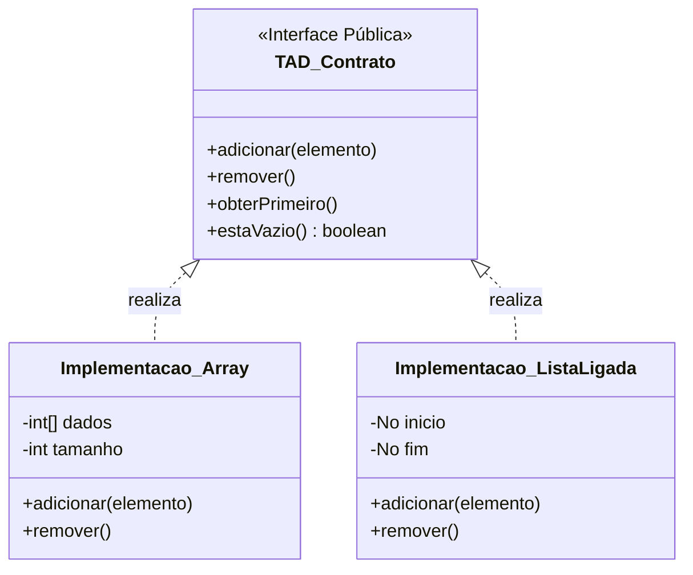

### Separacao Estrita entre Contrato e Realizacao Fisica

Considere a especificação de um TAD denominado `Ponto2D` (ponto geométrico no plano cartesiano):
- **Domínio:** Pares ordenados $`(x, y) \in \mathbb{R}^2`$.
- **Operações:**
  - `criar(x, y)`: Instancia um novo ponto.
  - `distancia(p1, p2)`: Retorna a distância euclidiana entre dois pontos.
  - `obterX(p)`, `obterY(p)`: Retorna as coordenadas individuais.
- **Realizações Físicas Possíveis:** Internamente, o desenvolvedor pode optar por:
  - Dois campos escalares de ponto flutuante: `double x, y;`
  - Um vetor estático contíguo: `double coords[2];`
  - Representação por coordenadas polares: raio $`r`$ e ângulo $`\theta`$, convertendo sob demanda.

Para o código consumidor que invoca `distancia(pontoA, pontoB)`, a reorganização física interna é completamente invisível. Se o módulo for refatorado para usar coordenadas polares visando otimizar rotações gráficas, nenhuma linha de código cliente é quebrada.

### Abstracao versus Encapsulamento

Embora atuem de forma coordenada, esses dois conceitos resolvem problemas complementares:

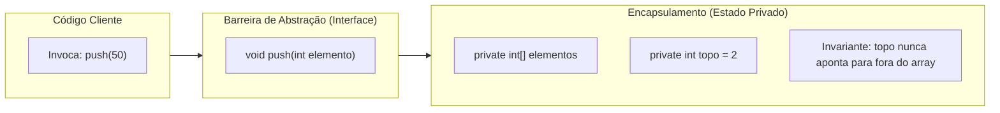

- **Abstração**: É o princípio de isolar a complexidade de um sistema expondo apenas sua interface essencial. Permite ao usuário do TAD focar no que a estrutura oferece, ignorando detalhes mecânicos irrelevantes para o seu nível de controle.
- **Encapsulamento**: É o mecanismo de isolamento e blindagem do estado interno de uma estrutura. Impede que módulos externos acessem ou alterem diretamente os campos privados da estrutura sem a mediação de métodos validadores, preservando suas invariantes.

> **Armadilha do vazamento de abstração (*Leaky Abstraction*):** Ocorre quando um método público devolve ponteiros internos para arrays privados ou exige que o cliente informe parâmetros acoplados à representação física (por exemplo, um método de pilha que recebe um índice de array). Se a representação interna for alterada posteriormente para nós dinâmicos, todo o código cliente precisará ser reescrito.

### Matriz Decisoria de Selecao Estrutural

A seleção da estrutura concreta adequada para materializar um TAD decorre da análise do perfil das operações dominantes da aplicação:

| Requisito Primário da Aplicação | Estrutura de Dados Recomendada | Justificativa de Engenharia |
| :--- | :--- | :--- |
| **Acesso randômico direto via índice** | Lista Sequencial (Vetor/Array) | Endereçamento contíguo resolvido em tempo constante $`O(1)`$ |
| **Inserção e remoção no meio do conjunto** | Lista Dinâmica Ligada | Religamento local de referências sem movimentação de memória |
| **Política restrita de inversão temporal (LIFO)** | Pilha (*Stack*) | Inserções e remoções restritas ao topo garantem previsibilidade |
| **Política de atendimento em ordem de chegada (FIFO)** | Fila (*Queue*) | Entrada pela cauda e saída pela cabeça garantem justiça temporal |
| **Modelagem de relações hierárquicas** | Árvore (*Tree*) | Decomposição recursiva em nós raízes, ancestrais e descendentes |
| **Modelagem de redes e interconexões complexas**| Grafo (*Graph*) | Mapeamento arbitrário de vértices conectados por arestas ponderadas |

---

## Fundamentos de Analise Assintotica e Complexidade de Algoritmos

### Limitacoes Intrinsecas da Medicao de Tempo por Relogio

Uma abordagem superficial para determinar a eficiência de dois algoritmos que resolvem a mesma tarefa consistiria em cronometrar seus respectivos tempos de execução de parede (*wall-clock time* em segundos ou milissegundos). Essa prática empírica é inadequada para a Ciência da Computação, pois o tempo de relógio é suscetível a variáveis externas que nada têm a ver com a qualidade do algoritmo:

- Arquitetura do processador (conjunto de instruções RISC versus CISC, largura de registradores).
- Frequência de clock dinâmica da CPU e mecanismos de *throttling* térmico.
- Níveis de hierarquia e latências da memória cache (L1, L2, L3) e barramentos da RAM.
- Carga de processos concorrentes gerenciada pelo escalonador do sistema operacional.
- Otimizações não determinísticas executadas pelo compilador JIT (*Just-In-Time*) da JVM.
- Disposição prévia da massa de dados fornecida nos testes preliminares.

A análise formal supera essas interferências medindo o **número de operações primitivas fundamentais** que o algoritmo executa em função direta do **tamanho da entrada ($`n`$)**.

### Contagem de Instrucoes e o Tamanho da Entrada

Consideramos como "operações primitivas" aquelas instruções elementares de hardware executadas em tempo constante por uma CPU: atribuições de variáveis, operações aritméticas básicas, comparações lógicas, retornos de métodos e acesso a posições físicas indexadas de memória.

Seja um laço iterativo simples que percorre um vetor:
```text
para i de 0 até n - 1 faça
    processar(vetor[i])
fim
```
O corpo do laço é acionado estritamente $`n`$ vezes. Portanto, o custo temporal total é expresso matematicamente pela função $`T(n) = c \cdot n`$, onde $`c`$ representa o custo constante das instruções internas do laço.

Caso dois laços independentes ocorram em sequência:
```text
para i de 0 até n - 1 faça
    executarPassoA()
fim

para j de 0 até n - 1 faça
    executarPassoB()
fim
```
O total de computações será a soma dos blocos:
```math
T(n) = (c_1 \cdot n) + (c_2 \cdot n) = (c_1 + c_2) \cdot n
```

Quando um laço de repetição está aninhado dentro de outro:
```text
para i de 0 até n - 1 faça
    para j de 0 até n - 1 faça
        executarComparacao()
    fim
fim
```
O corpo interno é disparado $`n \times n = n^2`$ vezes, originando uma função de custo $`T(n) = c \cdot n^2`$.

### Regras de Simplificacao Assintotica

No estudo assintótico de algoritmos, avalia-se o comportamento das funções de custo quando o volume de dados $`n`$ cresce arbitrariamente em direção ao infinito ($`n \to \infty`$). Sob essa perspectiva de escala extrema, aplicam-se duas regras de simplificação:

1. **Descarte de Termos de Menor Ordem**: Em funções de custo polinomiais, o termo com o maior expoente governa o ritmo de crescimento assintótico. Os demais termos tornam-se percentualmente insignificantes para valores elevados de $`n`$.
2. **Descarte de Constantes Multiplicativas**: Coeficientes fixos não alteram a forma da curva de crescimento assintótico da função.

Considere a função de custo:
```math
T(n) = 5n^2 + 100n + 5000
```
- Para $`n = 10`$: $`T(10) = 500 + 1000 + 5000 = 6500`$. O termo quadrático responde por apenas 7,7% do custo total.
- Para $`n = 1.000`$: $`T(1000) = 5.000.000 + 100.000 + 5000 = 5.105.000`$. O termo quadrático $`5n^2`$ agora é responsável por mais de 97,9% de todo o custo de processamento.
- Para $`n = 1.000.000`$: A contribuição dos termos $`100n`$ e $`5000`$ é inferior a 0,002%.

Assim, descarta-se o termo linear $`100n`$, a constante independente $`5000`$ e a constante multiplicativa $`5`$, concluindo que $`T(n) \in O(n^2)`$.

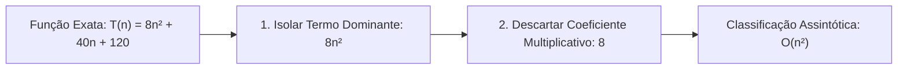

### As Notacoes Big-O e Big-Omega

A análise assintótica clássica emprega notações matemáticas para definir limites formais de crescimento:

- **Notação Big-O ($`O`$) — Limite Superior Assintótico**: Uma função $`T(n)`$ é dita $`O(g(n))`$ se existirem constantes positivas $`c`$ e $`n_0`$ tais que $`T(n) \le c \cdot g(n)`$ para todo $`n \ge n_0`$. Na prática, a Notação Big-O estabelece o **teto de custo**, garantindo que o algoritmo nunca terá um consumo de tempo ou memória que cresça mais rápido que $`g(n)`$ no pior cenário possível.
- **Notação Big-Omega ($`\Omega`$) — Limite Inferior Assintótico**: Uma função $`T(n)`$ é dita $`\Omega(g(n))`$ se existirem constantes positivas $`c`$ e $`n_0`$ tais que $`T(n) \ge c \cdot g(n)`$ para todo $`n \ge n_0`$. Ela define o **piso de custo**, ou seja, a quantidade mínima de trabalho que o algoritmo é forçado a realizar, mesmo sob condições ideais.

### Espectro Analitico: Melhor Caso, Caso Medio e Pior Caso

Ao estudar um algoritmo, o consumo de recursos computacionais varia conforme o arranjo de entrada dos dados:

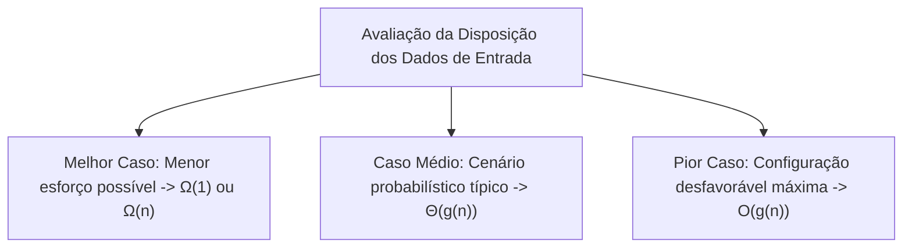

- **Melhor Caso**: Representa a configuração inicial de entrada que demanda o menor número possível de passos para concluir a tarefa. Em uma busca linear, ocorre quando a chave procurada é o primeiro elemento inspecionado: complexidade $`\Omega(1)`$.
- **Pior Caso**: Representa a configuração mais desfavorável possível, na qual o algoritmo precisa percorrer seu caminho mais longo de execução. Na busca linear, ocorre quando a chave é o último elemento ou não pertence à coleção: complexidade $`O(n)`$. Fornece garantias de estabilidade para acordos de nível de serviço (*SLA*).
- **Caso Médio**: Representa o comportamento estatístico esperado frente a uma amostragem de dados aleatórios uniformemente distribuídos. Na busca linear, exige em média $`\frac{n + 1}{2}`$ comparações, resultando também na classe linear $`O(n)`$.

### Hierarquia das Classes de Complexidade

As principais classes de complexidade assintótica organizam-se na seguinte ordem estrita de crescimento e custo computacional:

```math
O(1) < O(\log n) < O(n) < O(n \log n) < O(n^2) < O(n^3) < O(2^n) < O(n!)
```

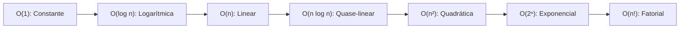

| Classe de Complexidade | Denominação | Comportamento com Dobro de Entrada ($`n \to 2n`$) | Exemplos Clássicos de Algoritmos |
| :--- | :--- | :--- | :--- |
| **$`O(1)`$** | Constante | Tempo inalterado | Acesso direto a índice de array; operações `push`/`pop` |
| **$`O(\log n)`$** | Logarítmica | Acrescenta um incremento constante | Busca Binária; consultas em árvores binárias balanceadas |
| **$`O(n)`$** | Linear | Tempo dobra de forma proporcional | Busca linear sequencial; cópia de vetor de $`n`$ elementos |
| **$`O(n \log n)`$** | Quase-linear / Linear-logarítmica | Tempo ligeiramente superior ao dobro | Merge Sort; Quick Sort (caso médio); Timsort |
| **$`O(n^2)`$** | Quadrática | Tempo multiplica-se por 4 | Bubble Sort, Selection Sort e Insertion Sort (pior caso) |
| **$`O(2^n)`$** | Exponencial | Tempo eleva-se ao quadrado | Resolução recursiva ingênua da sequência de Fibonacci |
| **$`O(n!)`$** | Fatorial | Explosão combinatória incomputável | Problema do Caixeiro Viajante por força bruta exaustiva |

### Estudo de Caso: Pesquisa Sequencial versus Pesquisa Binaria

Para evidenciar o impacto da complexidade assintótica na engenharia de software, comparemos a localização de um valor inteiro em um vetor previamente ordenado de tamanho $`n`$:

- **Pesquisa Sequencial**: Inspeciona as posições sequencialmente, da esquerda para a direita, até localizar a chave ou esgotar a estrutura. No pior caso, realiza $`n`$ comparações ($`O(n)`$).
- **Pesquisa Binária**: Aplica o princípio de divisão e conquista. Compara a chave com a posição central do vetor; se for menor, descarta toda a metade superior; se for maior, descarta toda a metade inferior, repetindo o procedimento sobre a partição restante. No pior caso, o espaço de busca é dividido pela metade a cada passo, realizando no máximo $`\lceil \log_2 n \rceil`$ comparações ($`O(\log n)`$).

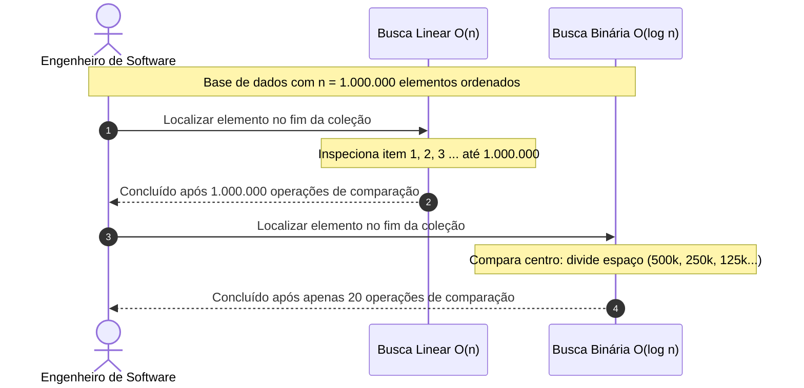

| Tamanho da Base ($`n`$) | Busca Linear: $`O(n)`$ | Busca Binária: $`O(\log_2 n)`$ | Diferença de Desempenho |
| :--- | :--- | :--- | :--- |
| **$`n = 10`$** | 10 comparações | ~4 comparações | 2,5 vezes mais rápida |
| **$`n = 1.000`$** | 1.000 comparações | ~10 comparações | 100 vezes mais rápida |
| **$`n = 1.000.000`$** | 1.000.000 comparações | ~20 comparações | **50.000 vezes mais rápida** |
| **$`n = 1.000.000.000`$** | 1 bilhão de comparações | ~30 comparações | **33 milhões de vezes mais rápida** |

---

## Arquitetura de Memoria e Alocacao em Java

### O Modelo de Execucao da JVM: Call Stack e Heap

A Máquina Virtual Java (JVM) particiona o espaço de endereçamento de memória atribuído pelo sistema operacional em dois segmentos primordiais de armazenamento:

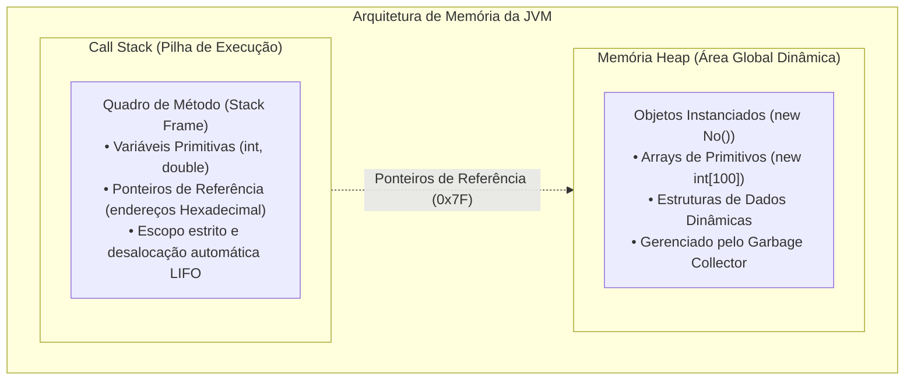

- **Call Stack (Pilha de Execução)**: Área de alta performance operada diretamente por registradores de controle da CPU sob a disciplina LIFO. Cada vez que um método é invocado, um registro de ativação (*stack frame*) é empilhado, alocando suas variáveis locais e parâmetros formais. Ao término do método, seu quadro é desempilhado, liberando instantaneamente a memória sem intervenção externa.
- **Heap (Monte de Alocação Dinâmica)**: Região global de memória compartilhada onde residem todas as instâncias de classes e arrays criados em tempo de execução por meio do operador `new`. O ciclo de vida desses dados independe do escopo do método que os instanciou.

### Semantica de Tipos Primitivos versus Tipos por Referencia

O Java categoriza suas variáveis sob duas semânticas estruturais de manipulação de memória:

1. **Variáveis Primitivas** (`byte`, `short`, `int`, `long`, `float`, `double`, `char`, `boolean`):
   - Alocam fisicamente na memória a quantidade exata de bits necessária para armazenar o valor em si (ex.: `int` consome 32 bits).
   - Quando declaradas no corpo de um método, residem diretamente na *Call Stack*.
   - A operação de atribuição (`b = a;`) clona o valor binário primitivo. Qualquer alteração em `b` não afeta `a`.
2. **Variáveis por Referência** (qualquer classe ou array, como `No`, `ListaLigada`, `int[]`):
   - A variável que reside na *Call Stack* armazena apenas o **endereço de memória** (ponteiro lógico, de 32 ou 64 bits) que aponta para o bloco onde o objeto reside na *Heap*.
   - A operação de atribuição (`No refB = refA;`) **não copia o objeto**. Ela clona apenas o endereço de memória. Ambas as variáveis passam a referenciar o mesmíssimo objeto no Heap. Qualquer modificação feita via `refB.valor` reflete-se imediatamente ao consultar `refA.valor`.

### Mecanica da Alocacao Dinamica e Aritmetica de Enderecos

Quando um comando como `int[] v = new int[5];` é disparado:
1. O runtime requisita ao alocador de memória do Heap um bloco contíguo ininterrupto de bytes equivalente ao produto da capacidade pelo tamanho do tipo primitivo (no caso, $`5 \times 4 \text{ bytes} = 20 \text{ bytes}`$, somados aos metadados de cabeçalho do objeto).
2. O runtime retorna o endereço inicial do bloco (endereço-base) e o grava na variável local `v` da Stack.
3. Para acessar a posição `v[i]`, a CPU não faz buscas iterativas; ela aplica a fórmula direta de cálculo de ponteiro:

```math
\text{Endereço}(v[i]) = \text{EndereçoBase} + (i \times \text{tamanho\_do\_tipo})
```

Essa aritmética de endereçamento direto é a base teórica que garante ao acesso indexado em arrays a complexidade estritamente constante $`O(1)`$.

### Ciclo de Vida de Objetos e Coleta de Lixo Automatica

Em linguagens como C e C++, o programador deve gerenciar manualmente a memória chamando `malloc()` e `free()`, o que frequentemente gera vulnerabilidades de vazamento de memória (*memory leaks*) ou ponteiros inválidos (*dangling pointers*).

No ecossistema Java, a liberação de recursos é governada pelo **Garbage Collector (GC)**. O GC rastreia periodicamente o grafo de referências partindo de raízes conhecidas (*GC Roots*: variáveis ativas na Call Stack e referências estáticas de classes).

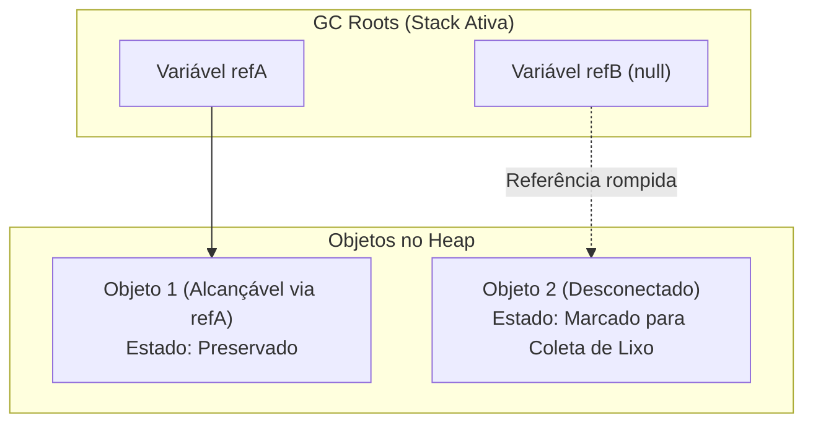

Quando um objeto perde sua última referência na memória Stack (por exemplo, quando a variável recebe `null` ou o método encerra sua execução), ele se torna um **objeto inalcançável**. O Garbage Collector identifica esses blocos órfãos, desaloca seus bytes e os devolve à lista de memória livre da JVM.

---

## Estruturas Lineares: Listas Lineares Sequenciais

### Organizacao Fisica em Blocos Contiguos

A **Lista Linear Sequencial** é uma estrutura de dados na qual a ordenação lógica dos elementos reflete diretamente a adjacência física dos bytes na memória do computador. Os dados são dispostos sequencialmente em gavetas consecutivas de um vetor estático.

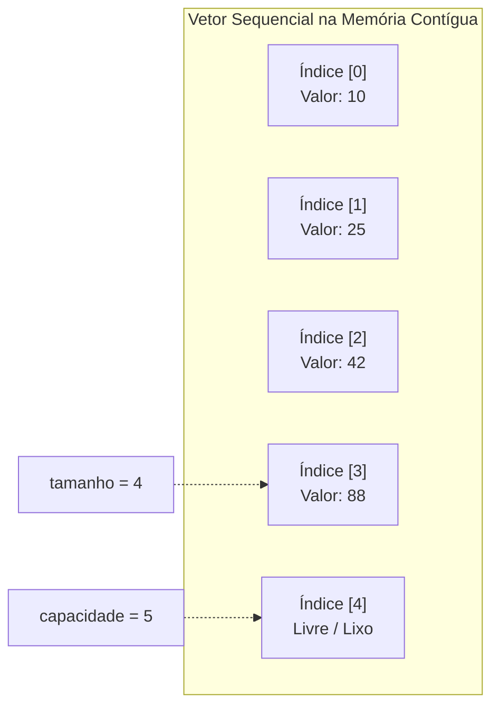

### Capacidade Maxima versus Tamanho Operacional

Uma confusão recorrente em programação consiste em igualar os conceitos de **capacidade** e **tamanho**:

- **Capacidade (`capacidade` / `elementos.length`)**: Representa a dimensão física máxima alocada para o array no Heap. Define o teto limite de armazenamento antes que a estrutura fique saturada.
- **Tamanho (`tamanho`)**: Representa a quantidade efetiva de elementos válidos e acessíveis mantidos na lista naquele instante.
- **Invariante Estrutural**: Para qualquer lista sequencial consistente, vale a relação: $`0 \le \text{tamanho} \le \text{capacidade}`$.

### Operacoes Fundamentais e o Custo do Deslocamento

A contiguidade física que viabiliza o acesso direto em tempo $`O(1)`$ penaliza as mutações no início ou meio da coleção:

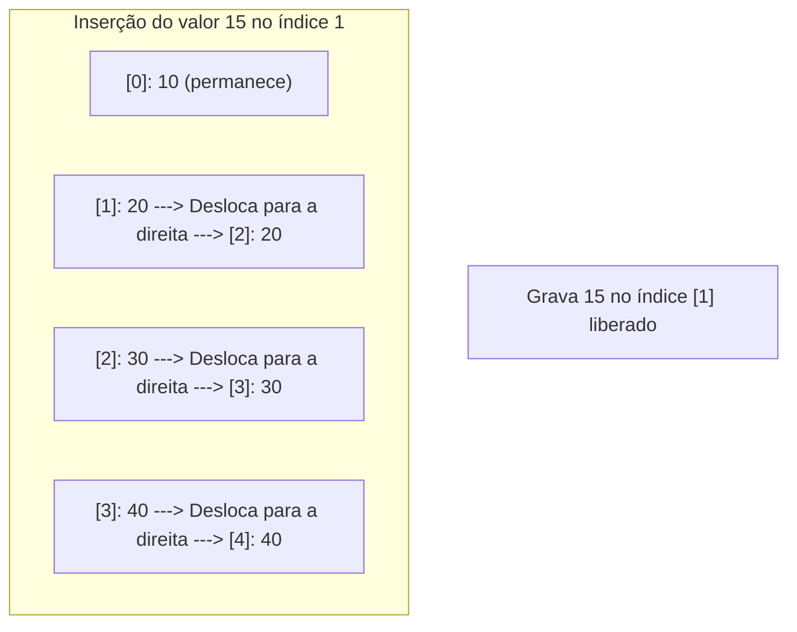

- **Inserção no Final**: Se `tamanho < capacidade`, grava-se diretamente em `elementos[tamanho]` e incrementa-se o marcador: tempo constante $`O(1)`$.
- **Inserção no Início ou Meio (Posição $`k`$)**: Para inserir um elemento no índice $`k`$, todas as posições de $`k`$ até $`\text{tamanho} - 1`$ precisam ser copiadas para a posição imediatamente à direita ($`i + 1`$), operando da direita para a esquerda. Essa movimentação de memória requer $`n - k`$ cópias, resultando em complexidade $`O(n)`$.
- **Remoção no Início ou Meio (Posição $`k`$)**: Ao eliminar o dado de índice $`k`$, cria-se uma lacuna. Todos os elementos das posições $`k + 1`$ até $`\text{tamanho} - 1`$ precisam ser deslocados uma posição para a esquerda ($`i - 1`$), resultando em custo linear $`O(n)`$.

### O Mecanismo de Redimensionamento Dinamico

Quando a lista atinge o estado de saturação (`tamanho == capacidade`) e uma nova inclusão é requerida, arrays primitivos de tamanho fixo não podem expandir seus blocos in-place. O redimensionamento exige três passos:

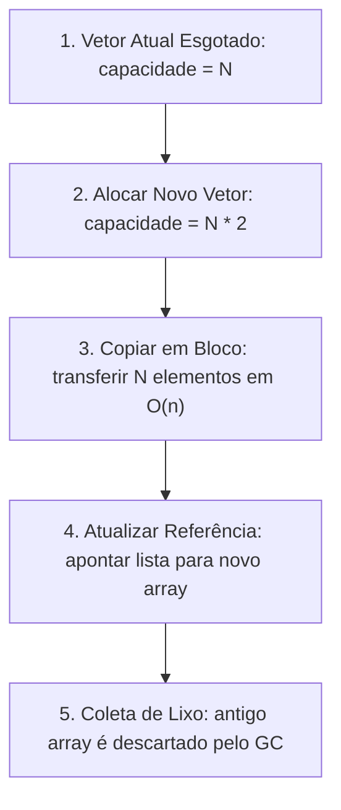

Embora o redimensionamento individual execute em tempo linear $`O(n)`$, a estratégia de dobrar a capacidade permite demonstrar que o **custo amortizado** de inserção na cauda permanece assintoticamente constante $`O(1)`$ por elemento inserido ao longo do ciclo de vida da aplicação.

### Implementacao Completa em Java

```java
public class ListaSequencial {
    private int[] elementos;
    private int tamanho;

    public ListaSequencial(int capacidadeInicial) {
        if (capacidadeInicial <= 0) {
            throw new IllegalArgumentException("A capacidade deve ser estritamente positiva.");
        }
        this.elementos = new int[capacidadeInicial];
        this.tamanho = 0;
    }

    public boolean estaVazia() {
        return this.tamanho == 0;
    }

    public int getTamanho() {
        return this.tamanho;
    }

    public int getCapacidade() {
        return this.elementos.length;
    }

    public int obter(int indice) {
        validarIndiceAcesso(indice);
        return this.elementos[indice]; // Acesso O(1)
    }

    public void adicionar(int valor) {
        garantirCapacidade();
        this.elementos[this.tamanho] = valor;
        this.tamanho++;
    }

    public void adicionarEm(int indice, int valor) {
        if (indice < 0 || indice > this.tamanho) {
            throw new IndexOutOfBoundsException("Índice de inserção inválido: " + indice);
        }
        garantirCapacidade();

        // Deslocamento de elementos para a direita: O(n)
        for (int i = this.tamanho - 1; i >= indice; i--) {
            this.elementos[i + 1] = this.elementos[i];
        }

        this.elementos[indice] = valor;
        this.tamanho++;
    }

    public int remover(int indice) {
        validarIndiceAcesso(indice);
        int elementoRemovido = this.elementos[indice];

        // Deslocamento de elementos para a esquerda: O(n)
        for (int i = indice; i < this.tamanho - 1; i++) {
            this.elementos[i] = this.elementos[i + 1];
        }

        this.tamanho--;
        return elementoRemovido;
    }

    private void garantirCapacidade() {
        if (this.tamanho == this.elementos.length) {
            int novaCapacidade = this.elementos.length * 2;
            int[] novoArray = new int[novaCapacidade];
            System.arraycopy(this.elementos, 0, novoArray, 0, this.tamanho);
            this.elementos = novoArray; // Atualização de referência
        }
    }

    private void validarIndiceAcesso(int indice) {
        if (indice < 0 || indice >= this.tamanho) {
            throw new IndexOutOfBoundsException("Índice fora dos limites: " + indice);
        }
    }
}
```

---

## Estruturas Lineares: Listas Simplesmente Ligadas Dinamicas

### Anatomia do No e Ruptura da Contiguidade

A **Lista Simplesmente Ligada** abandona a exigência de que os dados ocupem gavetas físicas contíguas na memória. Cada elemento passa a ser alocado isoladamente no Heap em um invólucro denominado **Nó (*Node*)**.

A topologia do nó compõe-se de dois campos essenciais:
1. **Carga Útil (*Payload* ou Valor)**: O dado real manipulado pela aplicação (no exemplo didático, um número inteiro `int`).
2. **Ponteiro de Auto-referência (`proximo`)**: Uma variável de referência que armazena o endereço de memória do nó seguinte da cadeia, ou o literal `null` caso represente a terminação da lista.

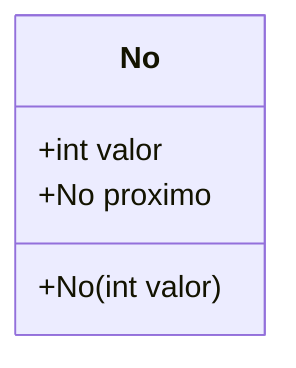

```java
public class No {
    public int valor;
    public No proximo;

    public No(int valor) {
        this.valor = valor;
        this.proximo = null;
    }
}
```

### Estrutura da Classe Controladora

A gestão da integridade dos nós cabe à classe controladora `ListaLigada`, que expõe os métodos de negócio e oculta os ponteiros internos, mantendo três atributos de controle:
- `No inicio`: Referência para a cabeça da lista.
- `No fim`: Referência direta para a cauda (último nó), permitindo inserção em cauda em tempo constante.
- `int tamanho`: Contador de nós ativos que garante consultas de tamanho em $`O(1)`$.

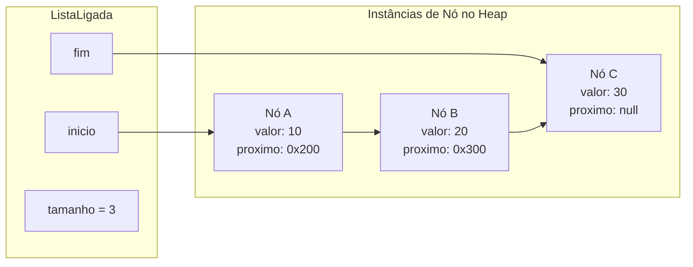

### Insercao na Cabeca com Tempo Constante

Para inserir um novo elemento na primeira posição da lista, o algoritmo executa uma reorganização local de ponteiros que é independente da quantidade total de elementos:

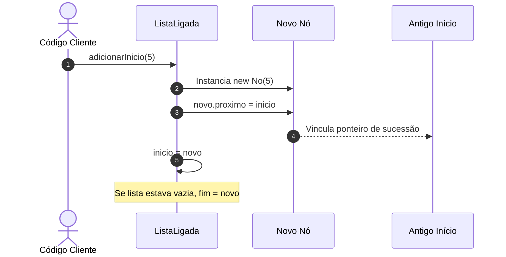

```java
public void adicionarInicio(int valor) {
    No novo = new No(valor);
    novo.proximo = this.inicio;
    this.inicio = novo;
    
    if (this.fim == null) {
        this.fim = novo; // Caso da lista unitária
    }
    this.tamanho++;
}
```

> **Armadilha crítica da inversão de ponteiros:** Executar `this.inicio = novo;` antes de `novo.proximo = this.inicio;` sobrescreve a referência para a cadeia existente. O novo nó passa a apontar para si mesmo, e toda a sequência preexistente fica inacessível no Heap, sendo perdida.

### Insercao no Termino: Otimizacao de Cauda

A inclusão no final da lista ligada pode ser implementada de duas formas na engenharia de software:

```mermaid
flowchart TD
    subgraph SemPonteiroFim["Sem Ponteiro de Fim: Custo O(n)"]
        A1["Partir de 'inicio'"] --> A2["Iterar laço while(atual.proximo != null)"]
        A2 --> A3["Alcançar último nó e conectar novo"]
    end

    subgraph ComPonteiroFim["Com Ponteiro 'fim': Custo O(1)"]
        B1["fim.proximo = novo"] --> B2["fim = novo"]
    end
```

A manutenção da referência `fim` reduz o custo de tempo de $`O(n)`$ para $`O(1)`$, viabilizando seu uso eficiente como base para Filas (*Queues*).

```java
public void adicionarFim(int valor) {
    No novo = new No(valor);
    if (estaVazia()) {
        this.inicio = novo;
        this.fim = novo;
    } else {
        this.fim.proximo = novo;
        this.fim = novo;
    }
    this.tamanho++;
}
```

### Insercao Ordenada: Separacao entre Busca e Religamento

Inserir um elemento mantendo a lista permanentemente ordenada exige decompor a operação em duas fases com complexidades distintas:

1. **Fase de Localização ($`O(n)`$)**: Percorrer os nós sequencialmente a partir de `inicio` até encontrar o ponto de inserção correto.
2. **Fase de Religamento ($`O(1)`$)**: Ajustar as duas referências adjacentes para encaixar o nó na cadeia.

Pela regra da soma assintótica: $`T(n) = O(n) + O(1) = O(n)`$.

```mermaid
sequenceDiagram
    autonumber
    participant Ant as Nó Anterior (30)
    participant Novo as Novo Nó (35)
    participant Prox as Nó Posterior (40)

    Note over Novo,Prox: Ordem Rigorosa de Conexão:
    Novo->>Prox: 1. novo.proximo = atual.proximo (Preserva o restante da lista)
    Ant->>Novo: 2. atual.proximo = novo (Integra o nó à sequência)
```

```java
public void inserirOrdenado(int valor) {
    No novo = new No(valor);

    // Caso 1: Lista vazia ou valor menor que o primeiro nó
    if (estaVazia() || valor <= this.inicio.valor) {
        novo.proximo = this.inicio;
        this.inicio = novo;
        if (this.fim == null) {
            this.fim = novo;
        }
        this.tamanho++;
        return;
    }

    // Caso 2: Varredura sequencial
    No atual = this.inicio;
    while (atual.proximo != null && atual.proximo.valor < valor) {
        atual = atual.proximo;
    }

    // Caso 3: Religamento
    novo.proximo = atual.proximo;
    atual.proximo = novo;

    // Caso 4: Novo nó inserido no final
    if (novo.proximo == null) {
        this.fim = novo;
    }
    this.tamanho++;
}
```

### Busca Linear e Atualizacao Posicional

Como as instâncias no Heap não possuem indexação contígua em hardware, o acesso por posição numérica (`indice`) em uma lista encadeada exige avançar ponteiro por ponteiro a partir do `inicio`:

```java
public int obter(int indice) {
    if (indice < 0 || indice >= this.tamanho) {
        throw new IndexOutOfBoundsException("Índice fora dos limites: " + indice);
    }
    No atual = this.inicio;
    for (int i = 0; i < indice; i++) {
        atual = atual.proximo; // Navegação sequencial O(n)
    }
    return atual.valor;
}

public void atualizar(int indice, int novoValor) {
    if (indice < 0 || indice >= this.tamanho) {
        throw new IndexOutOfBoundsException("Índice fora dos limites: " + indice);
    }
    No atual = this.inicio;
    for (int i = 0; i < indice; i++) {
        atual = atual.proximo;
    }
    atual.valor = novoValor;
}
```

### Remocao de Elementos e Desconexao de Referencias

- **Remoção no Início**: Atualiza o ponteiro de entrada para o segundo elemento: `this.inicio = this.inicio.proximo;`. Operação executada em tempo $`O(1)`$. O nó desconectado fica sem referências ativas e é recolhido pelo Garbage Collector.
- **Remoção no Meio ou Fim**: Demanda localizar o nó imediatamente **anterior** ao elemento que será descartado. Atualiza-se o elo de ligação: `anterior.proximo = alvo.proximo;`. Operação executada em tempo $`O(n)`$.

### Trade-offs: Lista Sequencial versus Lista Ligada

| Dimensão de Comparação | Lista Sequencial (Vetor Dinâmico) | Lista Simplesmente Ligada |
| :--- | :--- | :--- |
| **Acesso por Índice (`get(i)`)** | $`O(1)`$ imediato por aritmética de ponteiros | $`O(n)`$ por travessia de nós |
| **Inserção no Início** | $`O(n)`$ devido ao deslocamento do array | $`O(1)`$ por simples alteração da cabeça |
| **Inserção no Fim** | $`O(1)`$ amortizado | $`O(1)`$ (com ponteiro `fim`) |
| **Inserção no Meio** | $`O(n)`$ por deslocamento | $`O(n)`$ busca + $`O(1)`$ religamento |
| **Sobrecarga de Memória (*Overhead*)** | Mínima (espaço não utilizado no vetor) | Alta (1 ponteiro de 4 a 8 bytes por nó) |
| **Localidade de Cache da CPU** | Excelente (elementos contíguos na memória) | Baixa (nós espalhados fragmentam o cache) |

---

## Estruturas Lineares Restritas: Tipo Abstrato de Dados Pilha

### Conceituacao e o Principio LIFO

A **Pilha** (*Stack*) é um Tipo Abstrato de Dados linear que impõe uma disciplina restritiva de acesso aos seus elementos. Mutações e inspeções de estado ocorrem exclusivamente em uma única extremidade aberta da coleção, denominada **Topo** (*Top*). A base permanece inacessível durante toda a operação regular da estrutura.

Essa disciplina segue a regra:

> **LIFO — Last In, First Out**  
> *O último elemento inserido é obrigatoriamente o primeiro elemento a ser removido.*

```mermaid
flowchart TD
    subgraph OperacoesPilha["Operações Básicas no Topo da Pilha"]
        A["Elemento a Inserir"] -->|"push(v) O(1)"| Topo["TOPO DA PILHA"]
        Topo -->|"pop() O(1)"| Removido["Elemento Removido"]
        Topo -->|"peek() O(1)"| Consulta["Consulta sem Remover"]
    end
```

### O Contrato Fundamental: push, pop, peek e isEmpty

As quatro operações fundamentais que definem a interface do TAD Pilha operam em tempo estritamente constante $`O(1)`$:

- `push(valor)`: Insere um novo elemento no topo. Se a estrutura tiver limite físico de capacidade e estiver saturada, ocorre a condição de erro denominada **Stack Overflow**.
- `pop()`: Retira e retorna o elemento atualmente posicionado no topo. Caso a pilha esteja sem dados, o comando dispara a condição de erro denominada **Stack Underflow**.
- `peek()` (ou `top()`): Retorna uma cópia do valor do elemento no topo sem modificar a estrutura da pilha. Dispara exceção se a pilha estiver vazia.
- `isEmpty()`: Operação booleana que retorna `true` se a pilha não contiver elementos e `false` caso contrário.

```mermaid
stateDiagram-v2
    direction LR
    [*] --> Vazia: Instanciação
    Vazia --> ComItens: push(v)
    ComItens --> ComItens: push(v)
    ComItens --> Cheia: push(v) [se topo == cap - 1]
    Cheia --> ComItens: pop()
    ComItens --> ComItens: pop()
    ComItens --> Vazia: pop() [quando esvazia]
```

### Fundamentacao da Restricao de Acesso Arbitrario

Estudantes de graduação frequentemente questionam: *"Se a pilha pode ser implementada internamente sobre um array em Java, por que simplesmente não oferecemos um método `obter(int indice)` para consultar qualquer posição?"*

A resposta reside no princípio da **garantia de invariantes estruturais**:

> A pilha restringe intencionalmente a flexibilidade de acesso para garantir que algoritmos dependentes de reversibilidade temporal (como interpretadores, rotinas de desfazer e motores de banco de dados) operem com corretude matemática, sem o risco de modificações fora de ordem.

Se permitíssemos que uma rotina externa alterasse um elemento intermediário da pilha de execução de um programa, o endereço de retorno de métodos anteriores seria corrompido, causando travamento do processo ou falhas de segurança.

### Implementacao Sequencial Estatica com Array

Na abordagem estática sequencial, os elementos são dispostos em um vetor contíguo gerenciado por uma variável inteira denominada `topo`.

```java
public class Pilha {
    private int[] elementos;
    private int topo;

    public Pilha(int capacidade) {
        if (capacidade <= 0) {
            throw new IllegalArgumentException("A capacidade deve ser estritamente positiva.");
        }
        this.elementos = new int[capacidade];
        this.topo = -1; // Pilha vazia
    }

    public boolean isEmpty() {
        return this.topo == -1;
    }

    public boolean isFull() {
        return this.topo == this.elementos.length - 1;
    }

    public void push(int valor) {
        if (isFull()) {
            throw new IllegalStateException("Erro: Stack Overflow. A pilha atingiu sua capacidade máxima.");
        }
        this.topo++;
        this.elementos[this.topo] = valor;
    }

    public int pop() {
        if (isEmpty()) {
            throw new IllegalStateException("Erro: Stack Underflow. Tentativa de remoção em pilha vazia.");
        }
        int valorRemovido = this.elementos[this.topo];
        this.topo--; // Descarte lógico
        return valorRemovido;
    }

    public int peek() {
        if (isEmpty()) {
            throw new IllegalStateException("Erro: A pilha está vazia.");
        }
        return this.elementos[this.topo];
    }
}
```

### A Sentinela de Pilha Vazia e o Gerenciamento do Topo

Em linguagens com indexação baseada em zero:
- Uma pilha contendo $`1`$ elemento armazena esse dado no índice `0` (`topo = 0`).
- Uma pilha contendo $`k`$ elementos armazena seu topo no índice $`k - 1`$ (`topo = k - 1`).
- Portanto, uma pilha sem elementos ($`k = 0`$) possui `topo = 0 - 1 = -1`.

> O valor `topo = -1` atua como sentinela de vacuidade. A ordem das operações é crítica: no `push`, executa-se o **pré-incremento** (`topo++`) antes da escrita; no `pop`, realiza-se a leitura antes do **pós-decremento** (`topo--`).

```mermaid
sequenceDiagram
    autonumber
    actor Cliente as Código Cliente
    participant P as Pilha (Instância)

    Note over P: Estado Inicial: topo = -1 (Vazia)
    Cliente->>P: push(10)
    Note over P: 1. topo pré-incrementado para 0<br/>2. elementos[0] = 10
    P-->>Cliente: Retorna sucesso

    Cliente->>P: push(20)
    Note over P: 1. topo pré-incrementado para 1<br/>2. elementos[1] = 20
    P-->>Cliente: Retorna sucesso

    Cliente->>P: pop()
    Note over P: 1. Captura valor = elementos[1] (20)<br/>2. topo pós-decrementado para 0
    P-->>Cliente: Retorna 20 (topo lógico agora é 0)
```

#### Exclusão Lógica versus Exclusão Física
A operação `pop()` apresentada acima realiza um **descarte puramente lógico**: o dado primitivo continua gravado fisicamente nos bytes do array, mas torna-se inacessível para as operações públicas da pilha. Quando um novo `push()` é executado, o valor anterior é sobrescrito. 

*(Nota de engenharia de software para objetos na JVM)*: Se o vetor guardasse referências (`Object[]`), manter o índice apontando para o objeto antigo impediria o Garbage Collector de liberar a memória, causando um vazamento conhecido como *loitering*. Em pilhas de objetos, é obrigatório limpar a referência: `elementos[topo] = null;`.

### Implementacao Dinamica Encadeada

Na implementação encadeada, a pilha cresce dinamicamente conforme a demanda de novos nós no Heap, contornando a capacidade fixa do vetor.

Para garantir que todas as operações executem em tempo constante $`O(1)`$, o **topo da pilha deve ser mapeado obrigatoriamente para o início (cabeça) da lista encadeada**:

```mermaid
flowchart LR
    subgraph PilhaEncadeada["Pilha Encadeada: Topo mapeado no início"]
        PtrTopo["topo"] --> N1["Nó 30 (Topo)"]
        N1 -->|"proximo"| N2["Nó 20"]
        N2 -->|"proximo"| N3["Nó 10 (Base)"]
        N3 -->|"proximo"| Nulo["null"]
    end
```

```java
public class PilhaLigada {
    private No topo;
    private int tamanho;

    public PilhaLigada() {
        this.topo = null;
        this.tamanho = 0;
    }

    public boolean isEmpty() {
        return this.topo == null;
    }

    public int size() {
        return this.tamanho;
    }

    public void push(int valor) {
        No novo = new No(valor);
        novo.proximo = this.topo;
        this.topo = novo;
        this.tamanho++;
    }

    public int pop() {
        if (isEmpty()) {
            throw new IllegalStateException("Erro: Pilha vazia.");
        }
        int valor = this.topo.valor;
        this.topo = this.topo.proximo;
        this.tamanho--;
        return valor;
    }

    public int peek() {
        if (isEmpty()) {
            throw new IllegalStateException("Erro: Pilha vazia.");
        }
        return this.topo.valor;
    }
}
```

> Se o topo fosse mapeado para o final da lista simplesmente ligada, a operação `push` executaria em $`O(1)`$ usando um ponteiro de cauda, mas a operação `pop` exigiria percorrer a lista inteira desde a cabeça até o penúltimo nó para atualizar a referência, degradando a complexidade do desempilhamento para $`O(n)`$.

### Tecnicas de Manipulacao com Pilhas Auxiliares

Quando precisamos inspecionar, contar ou substituir valores situados abaixo do topo da pilha, violar o encapsulamento acessando atributos internos quebra as regras do TAD. A técnica correta de engenharia de software consiste em utilizar uma **Pilha Auxiliar** temporária:

```mermaid
sequenceDiagram
    autonumber
    participant Origem as Pilha Original
    participant Aux as Pilha Auxiliar

    Note over Origem,Aux: Fase 1: Desempilhamento até expor o alvo
    Origem->>Aux: aux.push(origem.pop())
    Origem->>Aux: aux.push(origem.pop())
    Note over Origem: Elemento interno exposto ou inspecionado

    Note over Origem,Aux: Fase 2: Restauração integral do estado
    Aux->>Origem: origem.push(aux.pop())
    Aux->>Origem: origem.push(aux.pop())
    Note over Origem: Ordem original reconstituída com integridade
```

#### Implementação de Busca sem Romper o Contrato LIFO: `contem(int valor)`
```java
public boolean contem(int valor) {
    PilhaLigada auxiliar = new PilhaLigada();
    boolean encontrado = false;

    // Desempilha e avalia
    while (!this.isEmpty()) {
        int atual = this.pop();
        if (atual == valor) {
            encontrado = true;
        }
        auxiliar.push(atual);
        if (encontrado) {
            break;
        }
    }

    // Restaura a pilha original integralmente
    while (!auxiliar.isEmpty()) {
        this.push(auxiliar.pop());
    }

    return encontrado;
}
```
*Análise de Complexidade*: Percorre no pior caso todos os $`n`$ elementos e os devolve para a estrutura de origem. Complexidade temporal: $`O(n)`$; complexidade espacial auxiliar: $`O(n)`$.

### Verificacao de Delimitadores e Inversao de Estruturas

A pilha é a estrutura fundamental para problemas que exigem correspondência simétrica e rastreamento contextual reverso:

#### Algoritmo de Verificação de Delimitadores (`()`, `[]`, `{}`)
1. Percorrer a cadeia de caracteres da esquerda para a direita.
2. Ao encontrar um delimitador de abertura (`(`, `[`, `{`), inseri-lo na pilha via `push`.
3. Ao encontrar um delimitador de fechamento (`)`, `]`, `}`):
   - Se a pilha estiver vazia, a expressão é inválida (fechamento prematuro sem abertura).
   - Se a pilha contiver dados, executar `pop` e verificar se o delimitador desempilhado forma par coerente com o fechamento atual. Caso divirja, a expressão é inválida.
4. Ao término do percurso, a expressão só será considerada balanceada se a pilha estiver completamente vazia (`isEmpty() == true`).

```java
public static boolean verificarBalanceamento(String expressao) {
    PilhaLigada p = new PilhaLigada();

    for (int i = 0; i < expressao.length(); i++) {
        char c = expressao.charAt(i);

        if (c == '(' || c == '[' || c == '{') {
            p.push(c);
        } else if (c == ')' || c == ']' || c == '}') {
            if (p.isEmpty()) {
                return false;
            }
            char topo = (char) p.pop();
            if ((c == ')' && topo != '(') ||
                (c == ']' && topo != '[') ||
                (c == '}' && topo != '{')) {
                return false;
            }
        }
    }
    return p.isEmpty();
}
```

### Matriz Comparativa: Pilha Estatica versus Pilha Encadeada

| Critério Técnico | Pilha Sequencial (Array Estático) | Pilha Dinâmica (Lista Encadeada) |
| :--- | :--- | :--- |
| **Limite de Capacidade** | Rígido; sujeito a *Stack Overflow* | Dinâmico; limitado pela memória total da JVM |
| **Complexidade Temporal das Primitivas** | Estritamente $`O(1)`$ | Estritamente $`O(1)`$ |
| **Sobrecarga de Memória por Item** | Zero bytes adicionais (apenas os dados primitivos) | Alto overhead (espaço do dado + ponteiro do nó) |
| **Localidade de Cache da CPU** | Alta eficiência por contiguidade física | Reduzida devido a nós espalhados no Heap |
| **Impacto no Garbage Collector** | Nulo durante operações normais | Gera objetos contínuos que demandam coleta |

---

## Algoritmos de Ordenacao por Comparacao: Metodos Quadraticos

### Importancia Sistemica da Ordenacao de Dados

A ordenação interna de dados consiste em rearranjar uma coleção finita de itens de acordo com uma relação de ordem total predefinida (numérica crescente, alfabética ou cronológica). Em termos computacionais, transforma um arranjo original $`\{a_0, a_1, \dots, a_{n-1}\}`$ em uma permutação ordenada $`\{a'_0, a'_1, \dots, a'_{n-1}\}`$ tal que $`a'_0 \le a'_1 \le \dots \le a'_{n-1}`$.

A ordenação é uma técnica habilitadora na arquitetura de software:
- Viabiliza a busca binária de complexidade logarítmica $`O(\log n)`$.
- Otimiza junções relacionais de bancos de dados (*merge joins*) e agregações de dados em lote.
- Garante apresentações consistentes em interfaces de usuário e relatórios corporativos.

### Bubble Sort: Ordenacao por Flutuacao e Trocas Adjacentes

O **Bubble Sort** (Método da Bolha) fundamenta-se na varredura repetida do vetor, comparando pares de elementos vizinhos imediatos ($`v[j]`$ e $`v[j+1]`$) e efetuando a troca caso estejam fora de ordem. A cada passagem completa do laço externo, o maior elemento do subvetor não processado "flutua" para sua posição final e definitiva à direita.

```mermaid
flowchart LR
    A["vetor[j]"] -->|"Compara com o vizinho"| B["vetor[j+1]"]
    B --> C{"vetor[j] > vetor[j+1]?"}
    C -->|"Sim"| D["Efetua Troca (Swap) via Temp"]
    C -->|"Não"| E["Mantém Posições"]
    D --> F["Avança Ponteiro j"]
    E --> F
```

#### Rastreamento Detalhado: Vetor `[5, 3, 8, 1]` ($`n = 4`$)

- **Passagem $`i = 0`$** ($`j`$ varia de $`0`$ até $`n - 1 - i - 1 = 2`$):
  - $`j=0`$: Compara `v[0]=5` e `v[1]=3`. Como $`5 > 3`$, troca: `[3, 5, 8, 1]`.
  - $`j=1`$: Compara `v[1]=5` e `v[2]=8`. Como $`5 \le 8`$, mantém: `[3, 5, 8, 1]`.
  - $`j=2`$: Compara `v[2]=8` e `v[3]=1`. Como $`8 > 1`$, troca: `[3, 5, 1, 8]`.  
    *Estado ao final da 1ª passagem*: O maior elemento global (`8`) atinge a posição final (índice 3).
- **Passagem $`i = 1`$** ($`j`$ varia de $`0`$ até $`1`$):
  - $`j=0`$: Compara `v[0]=3` e `v[1]=5`. Mantém: `[3, 5, 1, 8]`.
  - $`j=1`$: Compara `v[1]=5` e `v[2]=1`. Como $`5 > 1`$, troca: `[3, 1, 5, 8]`.  
    *Estado ao final da 2ª passagem*: O segundo maior elemento (`5`) consolida-se no índice 2.
- **Passagem $`i = 2`$** ($`j = 0`$):
  - $`j=0`$: Compara `v[0]=3` e `v[1]=1`. Como $`3 > 1`$, troca: `[1, 3, 5, 8]`.  
    *Resultado*: Vetor ordenado com sucesso.

#### Implementação Canônica e Otimização com Flag em Java
O Bubble Sort básico realiza comparações quadráticas mesmo que o vetor já esteja perfeitamente ordenado. A introdução de uma flag booleana de controle permite interromper o algoritmo antecipadamente caso nenhuma troca ocorra em uma passagem completa, reduzindo o melhor caso para tempo linear $`O(n)`$:

```java
public class BubbleSort {
    public static void ordenar(int[] vetor) {
        int n = vetor.length;
        boolean houveTroca;

        for (int i = 0; i < n - 1; i++) {
            houveTroca = false;

            // n - 1 - i descarta as posições já consolidadas no final
            for (int j = 0; j < n - 1 - i; j++) {
                if (vetor[j] > vetor[j + 1]) {
                    int temp = vetor[j];
                    vetor[j] = vetor[j + 1];
                    vetor[j + 1] = temp;
                    houveTroca = true;
                }
            }

            // Se nenhuma troca ocorreu, o vetor já está ordenado
            if (!houveTroca) {
                break;
            }
        }
    }
}
```

### Selection Sort: Ordenacao por Selecao de Extremos

O **Selection Sort** (Ordenação por Seleção) divide virtualmente o vetor em duas porções: a partição esquerda, já ordenada, e a partição direita, ainda desordenada. A cada passagem, o algoritmo busca o menor elemento absoluto de todo o subvetor restante e executa **uma única troca** para posicioná-lo no início da partição não ordenada, estendendo a faixa ordenada.

```mermaid
flowchart TD
    InicioPasso["Início da Passagem i"] --> DefineMenor["Assume indiceMenor = i"]
    DefineMenor --> VarreDireita["Varre j de i + 1 até n - 1"]
    VarreDireita --> TestaMenor{"vetor[j] < vetor[indiceMenor]?"}
    TestaMenor -- Sim --> AtualizaIndice["indiceMenor = j"]
    TestaMenor -- Não --> MantemIndice["Mantém indiceMenor"]
    AtualizaIndice --> FimVarredura{"j atingiu o fim?"}
    MantemIndice --> FimVarredura
    FimVarredura -- Não --> VarreDireita
    FimVarredura -- Sim --> ExecutaTroca["Troca vetor[i] com vetor[indiceMenor]"]
```

#### Rastreamento Detalhado: Vetor `[5, 3, 8, 1]` ($`n = 4`$)

- **Passagem $`i = 0`$**: `indiceMenor = 0` (referência: 5).
  - $`j=1`$: `v[1]=3 < 5` $`\to`$ `indiceMenor = 1`.
  - $`j=2`$: `v[2]=8 > 3` $`\to`$ mantém `indiceMenor = 1`.
  - $`j=3`$: `v[3]=1 < 3` $`\to`$ `indiceMenor = 3`.
  - Fim da varredura: troca `v[0]` com `v[3]`. Vetor: `[1, 3, 8, 5]`.
- **Passagem $`i = 1`$**: `indiceMenor = 1` (referência: 3).
  - $`j=2`$: `v[2]=8 > 3` $`\to`$ mantém.
  - $`j=3`$: `v[3]=5 > 3` $`\to`$ mantém.
  - Fim da varredura: menor já está no índice 1. Nenhuma troca física necessária. Vetor: `[1, 3, 8, 5]`.
- **Passagem $`i = 2`$**: `indiceMenor = 2` (referência: 8).
  - $`j=3`$: `v[3]=5 < 8` $`\to`$ `indiceMenor = 3`.
  - Fim da varredura: troca `v[2]` com `v[3]`. Vetor: `[1, 3, 5, 8]`. Ordenação concluída.

#### Implementação Canônica em Java
```java
public class SelectionSort {
    public static void ordenar(int[] vetor) {
        int n = vetor.length;

        for (int i = 0; i < n - 1; i++) {
            int indiceMenor = i;

            // Busca pelo índice do menor elemento remanescente
            for (int j = i + 1; j < n; j++) {
                if (vetor[j] < vetor[indiceMenor]) {
                    indiceMenor = j;
                }
            }

            // Realiza uma única troca por passagem
            if (indiceMenor != i) {
                int temp = vetor[i];
                vetor[i] = vetor[indiceMenor];
                vetor[indiceMenor] = temp;
            }
        }
    }
}
```

> **Atenção — Instabilidade do Selection Sort**: O algoritmo pode alterar a ordem relativa original de elementos com chaves iguais. Por exemplo, ao ordenar o par de registros `[4_a, 4_b, 2]`, o `2` é trocado diretamente com o `4_a`, resultando em `[2, 4_b, 4_a]`, o que quebra a estabilidade da ordenação.

### Insertion Sort: Ordenacao por Insercao Direta e Deslocamento

O **Insertion Sort** (Ordenação por Inserção) fundamenta-se na analogia com a forma como um jogador de baralho organiza cartas na mão. A partição esquerda do vetor é mantida sempre ordenada. A cada passo, o primeiro elemento da partição não processada (denominado `chave`) é retirado, e os elementos maiores que ele são sucessivamente empurrados para a direita para abrir espaço onde a chave será encaixada.

```mermaid
flowchart TD
    subgraph Particoes["Particionamento Conceitual no Insertion Sort"]
        direction LR
        P1["Subvetor Ordenado: Índices 0 até i - 1"]
        Ch["Chave: vetor[i]"]
        P2["Subvetor Não Processado: Índices i + 1 até n - 1"]
    end
    Ch -.->|"Compara e desloca elementos maiores"| P1
```

#### Rastreamento Detalhado: Vetor `[7, 3, 8, 2, 6]` ($`n = 5`$)

1. **Iteração $`i = 1`$ (`chave = 3`)**:
   - Compara `chave` com `v[0]=7`. Como $`7 > 3`$, desloca 7 para a direita: `[7, 7, 8, 2, 6]`.
   - Cursor alcança o limite da esquerda ($`j = -1`$). Insere chave: `[3, 7, 8, 2, 6]`.
2. **Iteração $`i = 2`$ (`chave = 8`)**:
   - Compara `chave` com `v[1]=7`. Como $`7 \le 8`$, nenhum deslocamento ocorre.
   - Chave permanece no índice 2: `[3, 7, 8, 2, 6]`.
3. **Iteração $`i = 3`$ (`chave = 2`)**:
   - Compara com 8, 7 e 3; como todos são maiores que 2, todos são deslocados para a direita.
   - Vetor resultante: `[2, 3, 7, 8, 6]`.
4. **Iteração $`i = 4`$ (`chave = 6`)**:
   - Desloca 8 e 7 para a direita; para ao encontrar o 3 (barreira).
   - Encaixa 6 no índice 2: `[2, 3, 6, 7, 8]`. Ordenação concluída.

#### Implementação Canônica em Java
```java
public class InsertionSort {
    public static void ordenar(int[] vetor) {
        int n = vetor.length;

        // Inicia em 1, pois um vetor unitário (índice 0) já está ordenado
        for (int i = 1; i < n; i++) {
            int chave = vetor[i];
            int j = i - 1;

            // Desloca elementos maiores que a chave para abrir espaço
            while (j >= 0 && vetor[j] > chave) {
                vetor[j + 1] = vetor[j]; // Deslocamento simples (1 escrita)
                j--;
            }

            // Insere a chave em sua posição correta
            vetor[j + 1] = chave;
        }
    }
}
```

### Deslocamento versus Troca: Analise de Escritas em Memoria

Uma diferença fundamental entre algoritmos quadráticos reside no uso de **deslocamentos (*shifts*)** em vez de **trocas sucessivas (*swaps*)**:

- **Operação de Troca (*Swap*)**: Exige 3 atribuições de memória para cada passo de recuo:
```java
int temp = vetor[k];
vetor[k] = vetor[k - 1];
vetor[k - 1] = temp;
```
Se um elemento precisar recuar 4 posições por meio de trocas consecutivas, o processador executará $`4 \times 3 = 12`$ escritas na memória.

- **Operação de Deslocamento (*Shift*)**: A chave é lida uma única vez no início. Cada passo de recuo executa apenas 1 atribuição direta:
```java
vetor[j + 1] = vetor[j];
```
Ao final do recuo, a chave é gravada com 1 atribuição adicional. Para recuar as mesmas 4 posições, o deslocamento executa apenas $`4 \times 1 + 1 = 5`$ escritas. Isso representa uma redução de quase 60% no tráfego de barramento de memória, conferindo ao Insertion Sort uma vantagem prática relevante em termos de desempenho sobre o Bubble Sort.

### Matriz Comparativa Consolidada dos Metodos Elementares

| Algoritmo | Complexidade Melhor Caso | Complexidade Caso Médio | Complexidade Pior Caso | Volume de Trocas / Escritas | Estabilidade | Adaptabilidade |
| :--- | :--- | :--- | :--- | :--- | :--- | :--- |
| **Bubble Sort** | $`O(n)`$ (com flag) | $`O(n^2)`$ | $`O(n^2)`$ | Alto ($`O(n^2)`$ swaps) | Estável | Sim (com flag) |
| **Selection Sort** | $`O(n^2)`$ | $`O(n^2)`$ | $`O(n^2)`$ | Mínimo (exatamente $`n - 1`$ trocas) | Instável | Não (custo invariante) |
| **Insertion Sort** | $`O(n)`$ | $`O(n^2)`$ | $`O(n^2)`$ | Baixo ($`O(n^2)`$ shifts simples) | Estável | Sim (excelente para quase-ordenados) |

---

## Algoritmos de Ordenacao Eficientes: Merge Sort

### O Paradigma de Divisao e Conquista

Para superar a barreira dos algoritmos de custo quadrático ($`O(n^2)`$), a Ciência da Computação emprega o paradigma de **Divisão e Conquista** (*Divide and Conquer*). O método resolve um problema complexo por meio de três etapas formais:

```mermaid
flowchart TD
    A["Problema Global: Ordenar vetor de tamanho n"] --> B["1. DIVIDIR: Calcular o ponto médio e decompor em metades"]
    B --> C["2. CONQUISTAR: Resolver recursivamente cada subvetor"]
    C --> D{"Tamanho <= 1?"}
    D -- Sim --> E["Caso Base: Unitário ou Vazio já está ordenado"]
    D -- Não --> B
    E --> F["3. COMBINAR (Intercalar): Mesclar metades ordenadas em O(n)"]
    F --> G["Vetor Totalmente Ordenado em O(n log n)"]
```

1. **Dividir**: Decompõe o vetor corrente em dois subvetores disjuntos, calculando o ponto médio entre os limites `inicio` e `fim`.
2. **Conquistar**: Ordena recursivamente cada uma das metades. A condição de parada (caso base) ocorre quando a partição atinge tamanho 1 ou 0, pois uma coleção unitária está trivialmente ordenada.
3. **Combinar (Intercalar / *Merge*)**: Realiza a fusão linear de duas metades que já se encontram ordenadas, gerando um vetor consolidado. É nesta etapa que o trabalho computacional de ordenação efetivamente acontece.

### A Fase de Decomposicao Recursiva e o Caso Base

A etapa de divisão não movimenta dados na memória. Ela apenas calcula índices limítrofes (`inicio`, `meio`, `fim`), empilhando chamadas na *Call Stack* da JVM até atingir partições com apenas um elemento:

```mermaid
flowchart TD
    Nivel0["[38, 27, 43, 3]"]
    Nivel1_A["[38, 27]"]
    Nivel1_B["[43, 3]"]
    Nivel2_A1["[38]"]
    Nivel2_A2["[27]"]
    Nivel2_B1["[43]"]
    Nivel2_B2["[3]"]

    Nivel0 --> Nivel1_A
    Nivel0 --> Nivel1_B
    Nivel1_A --> Nivel2_A1
    Nivel1_A --> Nivel2_A2
    Nivel1_B --> Nivel2_B1
    Nivel1_B --> Nivel2_B2
```

### A Fase de Intercalacao e a Memoria Auxiliar

Diferente do Quick Sort ou dos métodos elementares que ordenam *in-place*, o Merge Sort padrão **exige a alocação de um vetor auxiliar temporário**. A fusão de duas metades ordenadas opera por meio de dois ponteiros de varredura que comparam os menores elementos disponíveis de cada metade:

```mermaid
flowchart TD
    subgraph MetadesOriginais["Subvetores Parciais Ordenados"]
        M1["Metade Esquerda: [27, 38] (Ponteiro i)"]
        M2["Metade Direita: [3, 43] (Ponteiro j)"]
    end

    subgraph Intercalacao["Mecanismo de Intercalação Linear"]
        Passo1["1. Compara 27 com 3 -> Menor é 3 -> Grava no Buffer"]
        Passo2["2. Compara 27 com 43 -> Menor é 27 -> Grava no Buffer"]
        Passo3["3. Compara 38 com 43 -> Menor é 38 -> Grava no Buffer"]
        Passo4["4. Esgota esquerda -> Copia restante da direita: 43"]
    end

    subgraph Buffer["Vetor Auxiliar Consolidado"]
        Result["Buffer Temporário: [3, 27, 38, 43]"]
    end

    MetadesOriginais --> Intercalacao
    Intercalacao --> Buffer
    Buffer -.->|"Copia de volta em bloco"| MetadesOriginais
```

### Prevencao de Estouro Aritmetico no Ponto Medio

Em implementações introdutórias, calcula-se o meio por:
```java
int meio = (inicio + fim) / 2; // Risco de estouro aritmético
```
Em sistemas de produção com vetores de centenas de milhões de posições, se a soma de `inicio + fim` ultrapassar o valor máximo de um inteiro com sinal de 32 bits ($`2^{31} - 1 = 2.147.483.647`$), o resultado sofre estouro aritmético (*integer overflow*), tornando-se um número negativo. Isso causa falha na indexação (`ArrayIndexOutOfBoundsException`).

A forma segura adotada na engenharia de software é:
```math
\text{meio} = \text{inicio} + \frac{\text{fim} - \text{inicio}}{2}
```

### Rastreamento da Arvore de Execucao e Pilha de Chamadas

Abaixo apresenta-se a implementação canônica completa em Java:

```java
public class MergeSort {

    public static void ordenar(int[] vetor) {
        if (vetor == null || vetor.length <= 1) {
            return;
        }
        int[] auxiliar = new int[vetor.length]; // Buffer alocado uma única vez
        executarMergeSort(vetor, auxiliar, 0, vetor.length - 1);
    }

    private static void executarMergeSort(int[] vetor, int[] auxiliar, int inicio, int fim) {
        // Caso Base: intervalo unitário ou inválido encerra a descida
        if (inicio >= fim) {
            return;
        }

        // Cálculo seguro do ponto médio
        int meio = inicio + (fim - inicio) / 2;

        // Chamadas recursivas de decomposição
        executarMergeSort(vetor, auxiliar, inicio, meio);     // Metade esquerda
        executarMergeSort(vetor, auxiliar, meio + 1, fim);    // Metade direita

        // Conquista: intercalação linear das partes ordenadas
        intercalar(vetor, auxiliar, inicio, meio, fim);
    }

    private static void intercalar(int[] vetor, int[] auxiliar, int inicio, int meio, int fim) {
        // Copia a região de trabalho para o vetor auxiliar
        for (int k = inicio; k <= fim; k++) {
            auxiliar[k] = vetor[k];
        }

        int i = inicio;    // Cursor da metade esquerda
        int j = meio + 1;  // Cursor da metade direita
        int k = inicio;    // Cursor de escrita no vetor original

        // Intercalação por comparação de dois ponteiros
        while (i <= meio && j <= fim) {
            if (auxiliar[i] <= auxiliar[j]) { // <= garante a estabilidade do algoritmo
                vetor[k] = auxiliar[i];
                i++;
            } else {
                vetor[k] = auxiliar[j];
                j++;
            }
            k++;
        }

        // Despeja os elementos restantes da metade esquerda (se houverem)
        while (i <= meio) {
            vetor[k] = auxiliar[i];
            k++;
            i++;
        }
        // Nota: elementos restantes da metade direita já estão em seus locais definitivos
    }
}
```

### Deducao da Complexidade Assintotica e Espacial

A complexidade temporal do Merge Sort é formalizada matematicamente pela relação de recorrência:

```math
T(n) = 2 \cdot T\left(\frac{n}{2}\right) + c \cdot n
```
Onde:
- $`2 \cdot T\left(\frac{n}{2}\right)`$ representa a resolução das duas metades particionadas.
- $`c \cdot n`$ representa o custo da intercalação linear das $`n`$ posições.

Pelo Teorema Mestre da Ciência da Computação, a profundidade máxima da árvore de recursão é $`\lceil \log_2 n \rceil + 1`$. Em cada nível de profundidade, a fase de intercalação realiza no máximo $`n`$ comparações e movimentações.

Multiplicando o custo de cada nível pela altura da árvore:
```math
T(n) = n \times \log_2 n = O(n \log n)
```

O Merge Sort possui a propriedade notável de manter a complexidade temporal **$`O(n \log n)`$ em todos os cenários (melhor, caso médio e pior caso)**, sendo imune a configurações prévias desfavoráveis de dados.

- **Complexidade Espacial**: Demanda memória adicional proporcional a $`O(n)`$ para o buffer auxiliar de intercalação, somada a $`O(\log n)`$ quadros de ativação na *Call Stack* decorrentes da profundidade da recursão.

---

## Matriz Geral de Complexidade e Criterios de Decisao

O quadro abaixo consolida o comparativo entre todas as estruturas de dados e algoritmos de ordenação abordados na disciplina:

| Estrutura / Algoritmo | Acesso Indexado | Inserção Início | Inserção Fim | Busca de Chave | Tempo Pior Caso | Memória Auxiliar |
| :--- | :--- | :--- | :--- | :--- | :--- | :--- |
| **Lista Sequencial** | $`O(1)`$ | $`O(n)`$ | $`O(1)`$ amortizado | $`O(n)`$ | $`O(n)`$ | $`O(1)`$ |
| **Lista Simplesmente Ligada** | $`O(n)`$ | $`O(1)`$ | $`O(1)`$ (com `fim`) | $`O(n)`$ | $`O(n)`$ | $`O(1)`$ |
| **Pilha (Array Estático)** | Proibido | $`O(1)`$ (no topo) | Proibido | Proibido | $`O(1)`$ | $`O(1)`$ |
| **Pilha (Lista Encadeada)** | Proibido | $`O(1)`$ (no topo) | Proibido | Proibido | $`O(1)`$ | $`O(1)`$ |
| **Bubble Sort** | — | — | — | — | $`O(n^2)`$ | $`O(1)`$ (*in-place*) |
| **Selection Sort** | — | — | — | — | $`O(n^2)`$ | $`O(1)`$ (*in-place*) |
| **Insertion Sort** | — | — | — | — | $`O(n^2)`$ | $`O(1)`$ (*in-place*) |
| **Merge Sort** | — | — | — | — | $`O(n \log n)`$| $`O(n)`$ (buffer auxiliar) |

---

## Exercicios de Fixacao com Resolucao Analitica

### Exercicio 1: Inversao de Elementos de uma Pilha sem Quebra de Encapsulamento
- **Enunciado**: Desenvolva um método estático em Java que receba uma instância da classe `PilhaLigada` e devolva uma nova pilha com seus elementos na ordem invertida. É proibido acessar atributos privados ou campos `proximo` de nós internos. Ao término da rotina, a pilha original deve estar no seu estado original de elementos e ordem.
- **Resolução Analítica**:
  Para inverter uma sequência respeitando o TAD Pilha, recorremos a pilhas auxiliares. Se desempilharmos os dados da pilha original diretamente para uma auxiliar `aux1`, a ordem dos elementos é invertida. Se desempilharmos de `aux1` para `aux2`, a ordem volta ao original. Transferindo de volta para a original e salvando na pilha de retorno, garantimos a inversão sem violar o encapsulamento:

```java
public static PilhaLigada inverterPilha(PilhaLigada original) {
    PilhaLigada aux1 = new PilhaLigada();
    PilhaLigada invertida = new PilhaLigada();

    // Esvazia a original para aux1 (a ordem se inverte)
    while (!original.isEmpty()) {
        aux1.push(original.pop());
    }

    // De aux1, reconstrói a original e alimenta a invertida
    while (!aux1.isEmpty()) {
        int valor = aux1.pop();
        original.push(valor);  // Restaura o estado da original
        invertida.push(valor); // Constrói a pilha com a inversão
    }

    return invertida;
}
```
*Complexidade*: Dois laços sequenciais de $`n`$ iterações. Complexidade de tempo $`O(n)`$; complexidade de espaço $`O(n)`$.

---

### Exercicio 2: Rastreamento Completo de Ordenacao em Vetor Invertido
- **Enunciado**: Dado o vetor de entrada em ordem estritamente decrescente `[9, 7, 5, 3]`, determine o número exato de comparações de chaves e movimentações de memória executadas pelo **Insertion Sort** e pelo **Selection Sort**.
- **Resolução Analítica**:
  - **Insertion Sort**:
    - $`i = 1`$ (`chave = 7`): Compara com 9 (1 comp); desloca 9 (1 shift); grava 7 (1 escrita).
    - $`i = 2`$ (`chave = 5`): Compara com 9 e 7 (2 comp); desloca 9 e 7 (2 shifts); grava 5 (1 escrita).
    - $`i = 3`$ (`chave = 3`): Compara com 9, 7 e 5 (3 comp); desloca 9, 7 e 5 (3 shifts); grava 3 (1 escrita).
    - *Totais do Insertion*: $`1 + 2 + 3 = 6`$ comparações. $`6`$ deslocamentos + $`3`$ escritas finais = **$`9`$ operações de escrita**.
  - **Selection Sort**:
    - $`i = 0`$: Varre posições 1, 2, 3 (3 comparações). Menor é 3. Troca 9 com 3 (1 swap = 3 escritas). Vetor: `[3, 7, 5, 9]`.
    - $`i = 1`$: Varre posições 2, 3 (2 comparações). Menor é 5. Troca 7 com 5 (1 swap = 3 escritas). Vetor: `[3, 5, 7, 9]`.
    - $`i = 2`$: Varre posição 3 (1 comparação). Menor é 7. Não há troca útil (mantém).
    - *Totais do Selection*: $`3 + 2 + 1 = 6`$ comparações. $`2`$ trocas executadas = **$`6`$ operações de escrita**.
  - *Conclusão*: Ambos realizam 6 comparações, mas o Selection Sort executa menos escritas no pior caso, enquanto o Insertion Sort é adaptativo no melhor caso.

---

### Exercicio 3: Prova de Invariante na Fila Implementada sobre Lista Ligada
- **Enunciado**: Demonstre por que uma fila (FIFO) com operações de enfileiramento (`enqueue`) e desenfileiramento (`dequeue`) com complexidade $`O(1)`$ exige a manutenção de dois ponteiros de controle (`inicio` e `fim`) em uma lista encadeada simples.
- **Resolução Analítica**:
  Em uma fila, novos elementos entram na cauda e saem pela cabeça.
  1. Se tivermos apenas o ponteiro `inicio`:
     - O desenfileiramento (`dequeue`) ocorre em $`inicio = inicio.proximo;`$: complexidade estritamente constante $`O(1)`$.
     - O enfileiramento (`enqueue`) exige percorrer a lista inteira desde `inicio` até encontrar o nó cujo `proximo == null`: custo linear $`O(n)`$.
  2. Adicionando o ponteiro `fim`:
     - A inserção na cauda passa a ser direta: `fim.proximo = novo; fim = novo;`, operando em tempo constante $`O(1)`$.
     - Assim, ambos os métodos satisfazem o requisito assintótico de $`O(1)`$.

---

## Pontos-Chave para Avaliacoes e Roteiro de Prova

Para obter sucesso nas avaliações teóricas e práticas da disciplina de Estrutura de Dados I, o estudante deve aplicar o seguinte roteiro sistemático de revisão:

1. **Roteiro dos Seis Passos Analíticos**:
   - Identificar a entrada (tipo primitivo, estrutura referenciada, volume $`n`$).
   - Mapear a saída esperada e casos de borda (vazio, nulo, unitário).
   - Contabilizar repetições e dependências entre laços aninhados.
   - Selecionar a estrutura adequada ao perfil de consultas e mutações.
   - Deduzir a classe assintótica Big-O, descartando constantes e ordens menores.
   - Mapear o impacto de memória na Call Stack e no Heap da JVM.
2. **Armadilhas de Programação em Prova**:
   - *Curto-Circuito Lógico*: No `while` de busca em listas ou vetores, a condição de limite de índice deve preceder a leitura do dado: `while (j >= 0 && vetor[j] > chave)`. Inverter a ordem causa `ArrayIndexOutOfBoundsException`.
   - *Inversão de Religamento*: Ao inserir em listas ligadas, sempre aponte o `novo.proximo` para o nó subsequente antes de atualizar o ponteiro que aponta para o novo nó.
   - *Verificação de Vacuidade em Pilhas*: Nunca chame `pop()` ou `peek()` sem antes assegurar que `!isEmpty()`.
   - *Ponto Médio Seguro*: Em divisões recursivas de vetores grandes, utilize `inicio + (fim - inicio) / 2`.
3. **Diferenças Conceituais Recorrentes em Prova**:
   - *TAD vs Estrutura*: TAD é a especificação matemática pública; estrutura de dados é o arranjo físico interno de bytes.
   - *Deslocamento vs Troca*: Deslocamento copia um elemento adjacente (1 escrita); troca permuta dois elementos via variável temporária (3 escritas).
   - *Melhor Caso de Ordenação*: O Bubble Sort só atinge $`O(n)`$ no melhor caso se possuir a flag de verificação de trocas; sem ela, permanece $`O(n^2)`$.

---

## Banco de Questoes e Respostas para Revisao

```jsonl
{"pergunta": "Qual é a fórmula canônica da Média Semestral (MS) estabelecida no plano de ensino do Prof. Wesley Soares?", "resposta": "MS = ([(AV1 * 0.8) + (T1 * 0.2)] + [(AV2 * 0.8) + (T2 * 0.2)]) / 2, onde AV representa a avaliação teórica (peso 80%) e T representa os trabalhos práticos (peso 20%) de cada um dos dois módulos."}
{"pergunta": "Quais são as seis características obrigatórias que definem formalmente um algoritmo?", "resposta": "Possuir entrada (zero ou mais), executar uma sequência ordenada de passos, produzir ao menos uma saída, garantir finitude (término em passos discretos), ter precisão (ausência de ambiguidade) e assegurar executabilidade física dos passos."}
{"pergunta": "Qual axioma clássico sintetiza a obra de Niklaus Wirth publicada em 1976?", "resposta": "Algoritmos + Estruturas de Dados = Programas."}
{"pergunta": "Por que a medição de tempo por relógio (wall-clock time) é inadequada na análise teórica de complexidade?", "resposta": "Porque depende de fatores externos não determinísticos, como potência da CPU, processos concorrentes no sistema operacional, arquitetura de hardware, latências de memória cache e otimizações do compilador JIT."}
{"pergunta": "Qual a diferença entre a Notação Big-O e a Notação Big-Omega?", "resposta": "A Notação Big-O define o limite superior assintótico (o teto de custo máximo no pior caso), enquanto a Notação Big-Omega estabelece o limite inferior assintótico (o piso de operações mínimas necessárias)."}
{"pergunta": "Por que a busca binária atinge complexidade O(log n) enquanto a busca sequencial opera em O(n)?", "resposta": "Porque a busca binária emprega divisão e conquista em vetores ordenados, reduzindo o espaço de busca pela metade a cada comparação realizada, enquanto a busca sequencial testa elemento por elemento."}
{"pergunta": "No modelo de memória da JVM, qual a distinção de ciclo de vida entre a Stack e o Heap?", "resposta": "A Stack armazena quadros de execução de métodos e variáveis primitivas/referências locais, com desalocação automática sob disciplina LIFO ao término do método. O Heap aloca objetos dinâmicos (new) e arrays, cujo ciclo de vida independe do escopo e é gerido pelo Garbage Collector."}
{"pergunta": "Como a aritmética de ponteiros garante complexidade O(1) no acesso a arrays?", "resposta": "Calculando diretamente o endereço físico através da fórmula: Endereço = EndereçoBase + (índice * tamanho_do_tipo), permitindo que a CPU acesse a célula em tempo constante sem iterações."}
{"pergunta": "Por que a inserção no início de uma lista linear sequencial possui custo O(n)?", "resposta": "Porque para liberar a vaga no índice 0 sem sobrescrever dados preexistentes, todos os n elementos atuais precisam ser deslocados uma posição para a direita na memória física."}
{"pergunta": "Como o ponteiro de cauda (fim) otimiza a inserção no final de uma lista ligada?", "resposta": "Permite conectar o novo nó diretamente através de fim.proximo = novo e atualizar fim = novo em tempo O(1), eliminando a necessidade de percorrer toda a cadeia de nós desde o início."}
{"pergunta": "Por que o topo de uma pilha encadeada dinâmica deve ser posicionado na cabeça da lista?", "resposta": "Porque na cabeça da lista encadeada tanto a inserção (push) quanto a remoção (pop) são realizadas por religamento local de ponteiros em tempo estritamente constante O(1)."}
{"pergunta": "Por que uma pilha vazia implementada em vetor com base zero inicia sua variável topo com -1?", "resposta": "Porque se 1 elemento ocupa o índice 0, zero elementos matematicamente corresponde ao índice 0 - 1 = -1, atuando como sentinela de vacuidade."}
{"pergunta": "Qual a diferença de custo em escritas de memória entre o deslocamento (shift) e a troca (swap)?", "resposta": "O swap clássico exige 3 escritas na memória por passo usando variável auxiliar, enquanto o shift realiza apenas 1 escrita direta por recuo, gravando a chave com 1 escrita ao final."}
{"pergunta": "Por que o cálculo do ponto médio no Merge Sort deve ser feito como inicio + (fim - inicio) / 2?", "resposta": "Para evitar o estouro aritmético (overflow) de números inteiros de 32 bits que ocorreria ao somar diretamente (inicio + fim) quando os índices forem muito grandes."}
{"pergunta": "Qual a complexidade assintótica de tempo e espaço do Merge Sort no pior caso?", "resposta": "Tempo: O(n log n), mantendo-se o mesmo em todos os casos. Espaço: O(n) auxiliar decorrente do buffer temporário de intercalação somado a O(log n) da pilha recursiva."}
```

---

## Glossario Terminologico da Disciplina

- **Abstração**: Mecanismo cognitivo de separação entre o que uma estrutura de software faz (sua interface pública) e como ela realiza suas operações internamente.
- **Adaptabilidade (*Adaptive Sort*)**: Capacidade de determinados algoritmos de ordenação (como Insertion Sort e Bubble Sort com flag) de executar mais rápido quando a entrada já se encontra parcialmente ordenada.
- **Alocação Dinâmica**: Reserva de blocos de memória no Heap durante o tempo de execução por meio do operador `new`, retornando um endereço lógico de referência.
- **Análise Assintótica**: Estudo matemático do comportamento do consumo de recursos (tempo e espaço) de um algoritmo quando o tamanho da entrada cresce indefinidamente.
- **Call Stack (Pilha de Chamadas)**: Segmento de memória de alta velocidade da JVM gerenciado pelo hardware, destinado ao armazenamento de variáveis locais e controle do fluxo de métodos ativos.
- **Deslocamento (*Shifting*)**: Movimentação sequencial de elementos adjacentes em um array sem recorrer a permutações completas com variáveis intermediárias.
- **Divisão e Conquista**: Paradigma de projeto de algoritmos que decompõe um problema em instâncias menores, resolve-as recursivamente e combina os resultados parciais.
- **Encapsulamento**: Diretriz de engenharia que blinda o estado e os dados privados de uma estrutura, obrigando toda interação a transitar por métodos de acesso controlados.
- **Estabilidade em Ordenação**: Propriedade de um algoritmo de ordenação que preserva a ordem relativa original de registros dotados de chaves de ordenação idênticas.
- **Garbage Collector (GC)**: Módulo da Máquina Virtual Java responsável por rastrear a inalcançabilidade de instâncias no Heap e reaproveitar automaticamente a memória física.
- **Heap**: Área de memória global da JVM na qual vivem os objetos e arranjos dinâmicos alocados pelo programa.
- **Invariante de Laço**: Propriedade lógica que se mantém verdadeira antes da primeira iteração, a cada passo subsequente e após a conclusão de um laço de repetição.
- **LIFO (*Last In, First Out*)**: Disciplina estrutural em que o elemento inserido mais recentemente na coleção é o primeiro a ser removido.
- **Nó (*Node*)**: Estrutura atômica de uma coleção encadeada que encapsula a carga útil de dados e um ou mais ponteiros de amarração para outros nós.
- **Notação Big-O**: Notação matemática assintótica utilizada para caracterizar formalmente o teto ou limite superior de consumo de recursos computacionais de um algoritmo.
- **Ponteiro / Referência**: Variável escalar cujo valor computável consiste no endereço de memória físico ou virtual onde outro dado reside.
- **Redimensionamento Dinâmico**: Procedimento de realocação de arrays esgotados, envolvendo a criação de um novo bloco maior no Heap e a cópia sequencial dos dados antigos.
- **Sentinela**: Valor especial ou marcador estático empregado para sinalizar o término de uma estrutura ou indicar uma condição de borda (ex.: `topo = -1`).
- **Stack Overflow**: Condição de falha catastrófica resultante da tentativa de inserção em uma pilha esgotada ou de recursão excessiva que esgota a Call Stack.
- **Stack Underflow**: Condição de falha decorrente da tentativa de remoção de elementos sobre uma pilha desprovida de dados.
- **TAD (Tipo Abstrato de Dados)**: Especificação formal e desacoplada de um conjunto de valores e das operações admissíveis sobre eles, sem compromisso com sua representação física na memória.
- **Troca (*Swap*)**: Operação elementar de inversão de posições entre dois elementos da memória exigindo o auxílio de uma variável de retenção temporária.

---

## Fontes e Metadados

- Turma no Classroom: estrutura de dados 1 2026/02
- Itens processados: 0 materiais, 5 tarefas, 11 avisos
- Gerado em: 03/11/2026, 20:26:19 (BRT) via classroom-sync
