# Estrutura de Dados I — Compêndio Universitário Completo

> **Instituição:** Centro Universitário de Santa Fé do Sul (UniFEF)  
> **Curso:** Bacharelado em Sistemas de Informação (4º Semestre)  
> **Disciplina:** Estrutura de Dados I  
> **Docente:** Prof. Ms. Wesley Soares de Souza  
> **Natureza do Documento:** Manual Integrador de Estudos, Teoria Avançada, Implementações e Resoluções Analíticas  

---

## Sumário

- [Apresentação da Disciplina e Contrato Pedagógico](#apresentacao-da-disciplina-e-contrato-pedagogico)
  - [Perfil Docente e Visão da Disciplina](#perfil-docente-e-visao-da-disciplina)
  - [Ementa Oficial e Trilha Temática](#ementa-oficial-e-trilha-tematica)
  - [Critérios e Métrica de Avaliação Semestral](#criterios-e-metrica-de-avaliacao-semestral)
  - [Bibliografia Oficial Comentada](#bibliografia-oficial-comentada)
- [Fundamentos de Algoritmos e Ciclo de Engenharia de Software](#fundamentos-de-algoritmos-e-ciclo-de-engenharia-de-software)
  - [Definição Formal e Semântica de Algoritmo](#definicao-formal-e-semantica-de-algoritmo)
  - [As Seis Características Fundamentais](#as-seis-caracteristicas-fundamentais)
  - [O Axioma de Wirth](#o-axioma-de-wirth)
  - [Algoritmo versus Programa](#algoritmo-versus-programa)
  - [Pipeline de Engenharia: Do Problema à Solução](#pipeline-de-engenharia-do-problema-a-solucao)
  - [As Seis Etapas Sistemáticas de Projeto de Algoritmos](#as-seis-etapas-sistematicas-de-projeto-de-algoritmos)
- [Refinamento Sucessivo, Abstração e Tipos Abstratos de Dados](#refinamento-sucessivo-abstracao-e-tipos-abstratos-de-dados)
  - [Metodologia de Refinamento Sucessivo](#metodologia-de-refinamento-sucessivo)
  - [Conceituação Formal de Tipo Abstrato de Dados](#conceituacao-formal-de-tipo-abstrato-de-dados)
  - [Princípios de Abstração e Encapsulamento](#principios-de-abstracao-e-encapsulamento)
  - [Matriz de Decisão Estrutural](#matriz-de-decisao-estrutural)
- [Análise Assintótica de Complexidade e Notação Big-O](#analise-assintotica-de-complexidade-e-notacao-big-o)
  - [Limitações da Medição Empírica de Tempo](#limitacoes-da-medicao-empirica-de-tempo)
  - [Tamanho da Entrada e Contagem de Operações Primitivas](#tamanho-da-entrada-e-contagem-de-operacoes-primitivas)
  - [Notação Big-O e Limites Assintóticos](#notacao-big-o-e-limites-assintoticos)
  - [Cenários de Análise: Melhor Caso, Pior Caso e Caso Médio](#cenarios-de-analise-melhor-caso-pior-caso-e-caso-medio)
  - [Classes Canônicas de Complexidade](#classes-canonicas-de-complexidade)
- [Modelo de Memória em Execução: Stack, Heap e Referências](#modelo-de-memoria-em-execucao-stack-heap-e-referencias)
  - [A Arquitetura de Memória da JVM](#a-arquitetura-de-memoria-da-jvm)
  - [Tipos Primitivos versus Tipos por Referência](#tipos-primitivos-versus-tipos-por-referencia)
  - [Dinâmica de Alocação e Coleta de Lixo](#dinamica-de-alocacao-e-coleta-de-lixo)
  - [Localidade de Referência e Hierarquia de Cache](#localidade-de-referencia-e-hierarquia-de-cache)
- [Estruturas Lineares Sequenciais](#estruturas-lineares-sequenciais)
  - [Endereçamento Contíguo e Aritmética de Ponteiros](#enderecamento-contiguo-e-aritmetica-de-ponteiros)
  - [Capacidade Máxima versus Tamanho Ocupado](#capacidade-maxima-versus-tamanho-ocupado)
  - [Operações Fundamentais e o Custo do Deslocamento Físico](#operacoes-fundamentais-e-o-custo-do-deslocamento-fisico)
  - [Redimensionamento Dinâmico e Custo Amortizado](#redimensionamento-dinamico-e-custo-amortizado)
- [Estruturas Lineares Dinâmicas: Listas Simplesmente Ligadas](#estruturas-lineares-dinamicas-listas-simplesmente-ligadas)
  - [Anatomia do Nó e Auto-Referência](#anatomia-do-no-e-auto-referencia)
  - [Estrutura da Classe Controladora](#estrutura-da-classe-controladora)
  - [Inserção no Início em Tempo Constante](#insercao-no-inicio-em-tempo-constante)
  - [Inserção no Fim: Abordagem O(n) versus Otimização O(1)](#insercao-no-fim-abordagem-on-versus-otimizacao-o1)
  - [Inserção Ordenada: Custo de Localização versus Custo de Religamento](#insercao-ordenada-custo-de-localizacao-versus-custo-de-religamento)
  - [Busca Linear e Atualização por Índice](#busca-linear-e-atualizacao-por-indice)
  - [Remoção de Elementos e Tratamento de Desconexão](#remocao-de-elementos-e-tratamento-de-desconexao)
  - [Matriz Comparativa: Sequencial versus Ligada](#matriz-comparativa-sequencial-versus-ligada)
- [O Tipo Abstrato de Dados Pilha](#o-tipo-abstrato-de-dados-pilha)
  - [Definição Formal e Princípio LIFO](#definicao-formal-e-principio-lifo)
  - [Operações Fundamentais](#operacoes-fundamentais)
  - [Implementação Estática com Vetores](#implementacao-estatica-com-vetores)
  - [Implementação Dinâmica com Listas Ligadas](#implementacao-dinamica-com-listas-ligadas)
  - [Manipulação de Elementos Intermediários com Pilhas Auxiliares](#manipulacao-de-elementos-intermediarios-com-pilhas-auxiliares)
  - [Aplicações Computacionais das Pilhas](#aplicacoes-computacionais-das-pilhas)
- [Algoritmos de Ordenação Elementares](#algoritmos-de-ordenacao-elementares)
  - [Papel da Ordenação em Sistemas Computacionais](#papel-da-ordenacao-em-sistemas-computacionais)
  - [Bubble Sort: Trocas Adjacentes e Flutuação de Extremos](#bubble-sort-trocas-adjacentes-e-flutuacao-de-extremos)
  - [Selection Sort: Seleção Posicional de Extremos](#selection-sort-selecao-posicional-de-extremos)
  - [Comparativo Técnico: Comparações, Trocas e Estabilidade](#comparativo-tecnico-comparacoes-trocas-e-estabilidade)
- [Caderno de Trabalhos Práticos Resolvidos](#caderno-de-trabalhos-praticos-resolvidos)
  - [Trabalho 1: Análise Assintótica de Complexidade](#trabalho-1-analise-assintotica-de-complexidade)
  - [Trabalho 2: Laboratório de Estruturas de Ordenação](#trabalho-2-laboratorio-de-estruturas-de-ordenacao)
- [Síntese Preparatória para Avaliações e Banco de Questões](#sintese-preparatoria-para-avaliacoes-e-banco-de-questoes)
  - [Roteiro Sistemático de Resolução em Seis Passos](#roteiro-sistematico-de-resolucao-em-seis-passos)
  - [Armadilhas Típicas e Erros Frequentes](#armadilhas-tipicas-e-erros-frequentes)
  - [Banco de Questões Dissertativas e Analíticas](#banco-de-questoes-dissertativas-e-analiticas)
- [Mapa Conceitual Unificado](#mapa-conceitual-unificado)

---

## Apresentação da Disciplina e Contrato Pedagógico

### Perfil Docente e Visão da Disciplina

A disciplina de Estrutura de Dados I, alocada no 4º semestre do curso de Bacharelado em Sistemas de Informação da UniFEF, é ministrada pelo Prof. Ms. Wesley Soares de Souza. O docente possui graduação em Sistemas de Informação pela própria FEF (UniFEF), especialização em Gestão de Banco de Dados e mestrado em Engenharia de Software pela Universidade Federal do Pampa (UNIPAMPA - RS). Sua atuação profissional combina mais de uma década e meia de experiência como engenheiro de software sênior no mercado corporativo e docência no ensino superior iniciada em 2014, com passagens pelo Grupo Kroton (Anhanguera), FATEC Jales e IFSP Votuporanga.

Essa confluência entre prática industrial e rigor acadêmico norteia a condução do conteúdo: estruturas de dados e algoritmos não são abordados como meros tópicos teóricos para resolução de provas, mas como os alicerces de projeto que determinam a viabilidade financeira, a escalabilidade e a tolerância a falhas de plataformas de software em produção.

### Ementa Oficial e Trilha Temática

A ementa curricular aprovada institucionalmente articula-se em dois macroblocos conceituais:

1. **Fundamentos e Teoria Base:** Teoria geral de projeto e análise de algoritmos, especificação formal de Tipos Abstratos de Dados (TAD), análise de complexidade computacional assintótica, modelo de memória física e virtual, alocação estática versus alocação dinâmica.
2. **Estruturas Lineares e Aplicações:** Projeto, construção manual, instrumentação e avaliação comparativa de estruturas lineares, abrangendo listas lineares sequenciais, listas simplesmente ligadas, listas circulares, pilhas, filas, deques e arranjos compostos, integrando paradigmas modernos de desenvolvimento e avaliação sistemática de desempenho.

A disciplina estrutura-se em nove unidades programáticas sequenciais:

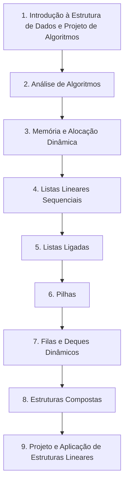

### Critérios e Métrica de Avaliação Semestral

O modelo avaliativo da UniFEF distribui-se em dois módulos de verificação continuada ao longo do período letivo. A composição da nota semestral baseia-se em provas individuais escritas sem consulta ($`AV_1`$ e $`AV_2`$) e trabalhos práticos laboratoriais ($`T_1`$ e $`T_2`$):

- **Módulo 1:** Composto pela Prova Escrita Individual $`AV_1`$ (escala de 0,0 a 10,0 pontos, peso 0,8) e pelo Trabalho Prático Aplicado $`T_1`$ (escala de 0,0 a 10,0 pontos, peso 0,2).
- **Módulo 2:** Composto pela Prova Escrita Individual $`AV_2`$ (escala de 0,0 a 10,0 pontos, peso 0,8) e pelo Trabalho Prático Aplicado $`T_2`$ (escala de 0,0 a 10,0 pontos, peso 0,2).

A apuração do rendimento acadêmico final expressa-se pela Média Semestral ($`MS`$):

```math
MS = \frac{[(AV_1 \times 0.8) + (T_1 \times 0.2)] + [(AV_2 \times 0.8) + (T_2 \times 0.2)]}{2}
```

| Instrumento Avaliativo | Escala | Ponderação no Módulo | Teto de Pontuação | Natureza da Avaliação |
| :--- | :--- | :--- | :--- | :--- |
| **Trabalho Laboratorial 1 ($`T_1`$)** | 0,0 a 10,0 | 20% (fator 0,2) | Até 2,0 pontos | Resolução técnica e instrumentação prática |
| **Avaliação Formal 1 ($`AV_1`$)** | 0,0 a 10,0 | 80% (fator 0,8) | Até 8,0 pontos | Teoria formal, testes de mesa e código discursivo |
| **Trabalho Laboratorial 2 ($`T_2`$)** | 0,0 a 10,0 | 20% (fator 0,2) | Até 2,0 pontos | Implementação avançada de estruturas lineares |
| **Avaliação Formal 2 ($`AV_2`$)** | 0,0 a 10,0 | 80% (fator 0,8) | Até 8,0 pontos | Avaliação somativa integral da disciplina |

### Bibliografia Oficial Comentada

O plano de ensino registra as obras fundamentais de arquitetura de hardware e organização da máquina, indispensáveis para a compreensão do modelo físico onde as estruturas de dados residem:

#### Bibliografia Básica Registrada
- MONTEIRO, Mário A. *Introdução à Organização de Computadores*. 4. ed. Rio de Janeiro: LTC, 2002.
- STALLINGS, William. *Arquitetura e Organização de Computadores*. 8. ed. São Paulo: Pearson, 2010.
- TANENBAUM, Andrew S. *Organização Estruturada de Computadores*. 3. ed. São Paulo: Prentice-Hall do Brasil, 1990.

#### Bibliografia Complementar Registrada
- IDOETA, Ivan Valeije; CAPUANO, Francisco Gabriel. *Elementos de Eletrônica Digital*. 32. ed. São Paulo: Érica, 2001.
- PATTERSON, David A.; HENNESSY, John L. *Organização e Projeto de Computadores*. 2. ed. Rio de Janeiro: LTC, 1998.
- WEBER, Raul Fernando. *Arquitetura de Computadores Pessoais*. 2. ed. Porto Alegre: Sagra, 2001.
- WEBER, Raul Fernando. *Fundamentos de Arquitetura de Computadores*. Série Livros Didáticos Informática UFRGS, Vol. 8, 4. ed. Porto Alegre: Bookman, 2012.

> **Nota de complementação pedagógica:** A bibliografia primária do plano institucional prioriza a camada de hardware (essencial para o estudo de endereçamento de memória, barramentos, cache e ponteiros). Para a modelagem de algoritmos e análise matemática de estruturas de dados em nível de software, adotam-se como referências complementares consagradas: *Projeto de Algoritmos com Implementações em Pascal e C* (Nivio Ziviani), *Algoritmos: Teoria e Prática* (Thomas H. Cormen et al.) e *Estruturas de Dados e Algoritmos em Java* (Robert Lafore).

---

## Fundamentos de Algoritmos e Ciclo de Engenharia de Software

### Definição Formal e Semântica de Algoritmo

Formalmente, um algoritmo constitui uma sequência finita, ordenada, determinística e não ambígua de instruções computacionais bem definidas. A partir de um estado inicial e de um conjunto de dados de entrada (que pode ser vazio), ele conduz a máquina por um número discreto de transições de estado até produzir uma resposta ou saída correspondente e satisfatória para uma classe delimitada de problemas.

Etimologicamente, o termo descende do patronímico do astrônomo e matemático persa do século IX, Abu Abdullah Muhammad ibn Musa al-Khwarizmi, responsável pela sistematização das regras operacionais da aritmética decimal posicional. Na computação moderna, o algoritmo representa a abstração lógica do processo decisório, existindo antes e independentemente de qualquer linguagem de programação ou arquitetura de silício.

### As Seis Características Fundamentais

Para que uma rotina procedimental seja caracterizada como um algoritmo válido sob o ponto de vista da ciência da computação, ela deve cumprir seis propriedades canônicas:

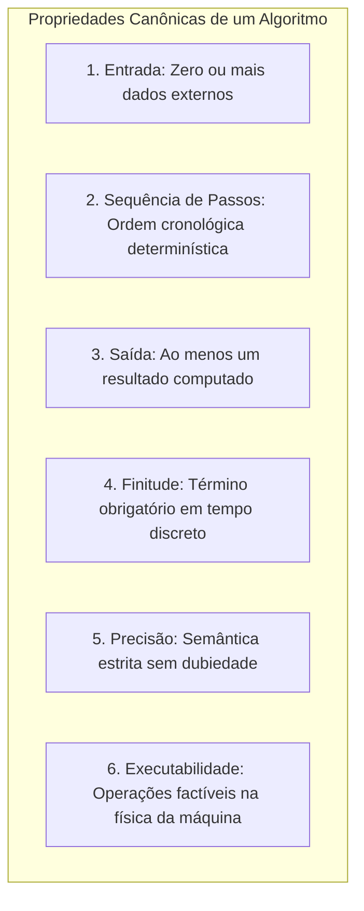

#### 1. Entrada (Input)
- **Definição:** Conjunto de valores primitivos, estruturas ou sinais externos transmitidos ao algoritmo no início de seu processamento. O conjunto de entrada pode conter zero ou mais instâncias.
- **Motivação:** Parametrizar a lógica para processar dados variáveis do domínio de negócio.
- **Exemplo:** Um vetor contendo $`n`$ números reais a serem ordenados.
- **Contraexemplo:** Uma sub-rotina que tenta ler uma posição de memória aleatória não inicializada ou acessar dados fora de seu escopo sem validação.
- **Armadilha:** Presumir que todo algoritmo exige entrada de dados externa; rotinas geradoras de números primos ou constantes universais operam a partir de entrada vazia, baseando-se estritamente em suas regras internas.

#### 2. Sequência de Passos (Sequence)
- **Definição:** Encadeamento cronológico e ordenado de instruções onde cada ação possui uma relação causal e temporal inequívoca com a anterior e a sucessora.
- **Motivação:** Garantir a reprodutibilidade dos estados intermediários do processador.
- **Exemplo:** Executar a leitura dos operandos antes de aplicar o operador aritmético de soma.
- **Contraexemplo:** Tentar calcular o quociente de uma divisão antes de receber o valor do denominador.
- **Armadilha:** Supor paralelismo implícito em lógicas sequenciais sem mecanismos de sincronização.

#### 3. Saída (Output)
- **Definição:** Entrega de um ou mais dados resultantes que guardem relação matemática ou lógica demonstrável com as entradas processadas.
- **Motivação:** Justificar o consumo de ciclos de processamento e recursos de memória da máquina.
- **Exemplo:** O valor booleano `true` ou `false` informando se uma chave foi localizada em uma estrutura.
- **Contraexemplo:** Um método de classificação que executa laços durante horas e encerra sem atualizar o arranjo, sem gravar em disco e sem emitir retorno.
- **Armadilha:** Considerar que efeitos colaterais silenciosos não auditáveis substituem a emissão formal de saídas.

#### 4. Finitude (Finiteness)
- **Definição:** Propriedade que assevera que a execução de um algoritmo se encerrará obrigatoriamente após uma quantidade finita de passos para qualquer conjunto de entradas admissíveis.
- **Motivação:** Impedir o travamento permanente do sistema computacional e esgotamento de recursos.
- **Exemplo:** Um laço controlado por índice que itera de $`0`$ até $`n - 1`$.
- **Contraexemplo:** Um laço `while (x != 0)` em aritmética de ponto flutuante onde erros de arredondamento impedem que `x` atinja exatamente zero, gerando um laço infinito.
- **Armadilha:** Confundir processos contínuos de sistemas operacionais (daemons ou serviços de escuta) com algoritmos puros; mesmo nos serviços contínuos, cada transação interna individual deve ser um algoritmo finito.

#### 5. Precisão (Definiteness / Unambiguity)
- **Definição:** Clareza absoluta de cada instrução, de modo que nenhum agente executor possa extrair interpretações divergentes da regra especificada.
- **Motivação:** O computador não possui inferência intuitiva; ele opera estritamente sob regras mecânicas e determinísticas.
- **Exemplo:** A diretiva `soma = soma + valor[i]`.
- **Contraexemplo:** Instruções com termos vagos como "aguarde alguns instantes", "adicione sal a gosto" ou "processe os dados até parecer adequado".
- **Armadilha:** Deixar condições de parada de laços dependentes de comparações implícitas suscetíveis à configuração de localidade do sistema operacional.

#### 6. Executabilidade (Effectiveness / Executability)
- **Definição:** Viabilidade física e teórica de cada instrução ser executada por um dispositivo mecânico em intervalo de tempo finito utilizando recursos reais.
- **Motivação:** Evitar a postulação de procedimentos insolúveis ou que violem as leis da física e da aritmética.
- **Exemplo:** A multiplicação direta de dois inteiros de 32 bits.
- **Contraexemplo:** Uma diretiva exigindo "calcule a divisão inteira de um número por zero" ou "calcule o último dígito decimal do número $`\pi`$ antes de prosseguir".
- **Armadilha:** Modelar passos algorítmicos cuja viabilidade dependa de capacidade computacional infinita ou resolução do Problema da Parada de Turing.

### O Axioma de Wirth

Durante as exposições em sala de aula, o Prof. Wesley Soares enfatiza a premissa central:

> *"Um bom programa depende tanto de um bom algoritmo quanto da forma como os dados são organizados."*

Essa formulação sintetiza a máxima imortalizada pelo cientista da computação suíço Niklaus Wirth em sua obra seminal de 1976:

```math
\text{Algoritmos} + \text{Estruturas de Dados} = \text{Programas}
```

O axioma evidencia que o algoritmo constitui o motor dinâmico (a lógica do fluxo), enquanto a estrutura de dados fornece o chassi estático (a organização física e espacial). Desenhar um algoritmo sofisticado sobre uma estrutura inadequada gera gargalos severos de desempenho; inversamente, selecionar a melhor estrutura sem uma lógica otimizada para percorrê-la gera desperdício de processamento.

### Algoritmo versus Programa

Um dos desvios conceituais mais comuns entre ingressantes de computação é equiparar a formulação de algoritmos à codificação de programas. 

- **Algoritmo:** É uma entidade abstrata pertencente ao campo da matemática pura. Pode ser expresso em linguagem natural, pseudocódigo ou notação gráfica (fluxogramas). Ele independe da existência de silício, compiladores, arquiteturas de 32 ou 64 bits ou sistemas operacionais.
- **Programa:** É a materialização concreta e tecnológica de um algoritmo. Trata-se da codificação estrita em conformidade com as regras léxicas, sintáticas e semânticas de uma linguagem de programação (Java, C, C++, Rust), desenhada para ser compilada ou interpretada e executada por uma Unidade Central de Processamento (CPU).

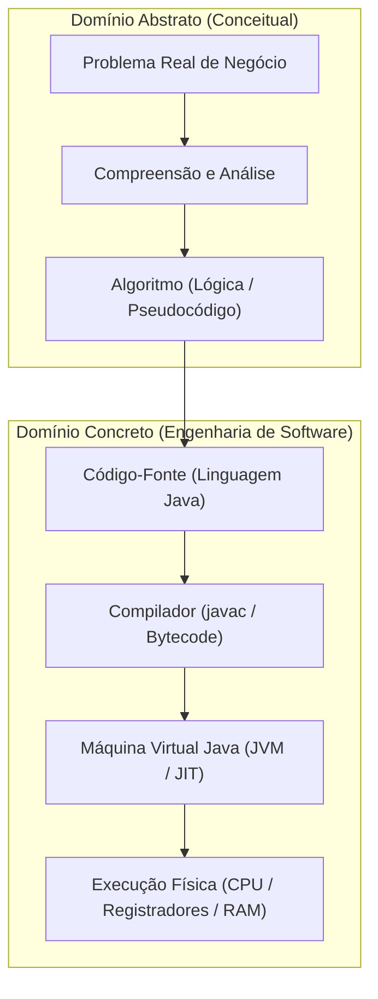

| Critério de Comparação | Algoritmo | Programa de Computador |
| :--- | :--- | :--- |
| **Natureza Ontológica** | Conceito matemático abstrato | Artefato tecnológico concreto de software |
| **Dependência Tecnológica** | Independente de linguagem e hardware | Estritamente atrelado à sintaxe e à plataforma |
| **Finalidade Imediata** | Descrever a correção da solução | Processar dados em hardware real |
| **Representação** | Pseudocódigo, fluxogramas, texto estruturado | Arquivos-fonte (`.java`, `.c`), binários executáveis |
| **Tolerância a Erros** | Exige rigor lógico; ignora detalhes de sintaxe | Intolerante; erros de pontuação barram a compilação |
| **Ambiente de Execução** | Mente humana, modelos formais de computação | Máquinas físicas, barramentos e memórias semicondutoras |

### Pipeline de Engenharia: Do Problema à Solução

A engenharia de software requer uma abordagem metódica para traduzir uma necessidade do mundo real em um sistema operacional eficiente. O pipeline abordado em aula divide-se em sete fases essenciais:

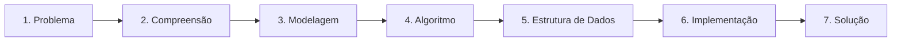

1. **Problema:** Situação real, gargalo operacional ou demanda de negócio a ser resolvida (ex.: fila de banco com tempos de espera elevados).
2. **Compreensão:** Levantamento de requisitos, identificação do público-alvo, fronteiras do domínio e restrições de operação.
3. **Modelagem:** Formalização dos dados e das regras matemáticas (ex.: definição de prioridades, variáveis cadastrais e políticas de atendimento).
4. **Algoritmo:** Esboço do fluxo passo a passo de inserção, remoção e triagem das entidades.
5. **Estrutura de Dados:** Seleção da forma como os nós serão alocados e gerenciados em memória (ex.: lista ligada dinâmica para permitir inserções no fim e remoções no início sem limite estático).
6. **Implementação:** Escrita formal do código-fonte em linguagem compilável (Java), aplicação de modificadores de acesso e tratamento de exceções.
7. **Solução:** Entrega do sistema operacional validado por testes de carga e testes de mesa.

### As Seis Etapas Sistemáticas de Projeto de Algoritmos

No desenvolvimento de qualquer módulo algorítmico, o engenheiro de software deve percorrer seis passos sequenciais:

1. **Entender o problema:** Delimitar os objetivos centrais, hipóteses e pré-condições. Não iniciar o código antes de compreender plenamente o objetivo final.
2. **Identificar entradas e saídas:** Formalizar quais valores são fornecidos externamente e qual o formato esperado para a entrega dos resultados.
3. **Decompor em partes menores:** Dividir o problema global em subprocessos isolados (modularização).
4. **Definir a estratégia:** Selecionar o paradigma adequado (força bruta, divisão e conquista, métodos gulosos, busca binária).
5. **Especificar passo a passo:** Redigir o algoritmo em linguagem estruturada ou pseudocódigo, mapeando variáveis de controle e condições de guarda.
6. **Testar e refinar:** Executar testes de mesa com casos ordinários, casos vazios e casos de borda extremos para validação matemática da lógica.

---

## Refinamento Sucessivo, Abstração e Tipos Abstratos de Dados

### Metodologia de Refinamento Sucessivo

O refinamento sucessivo (*stepwise refinement* ou abordagem *top-down*), formalizado por Niklaus Wirth, estabelece que a resolução de um problema computacional deve iniciar em um patamar de alta abstração, sendo progressivamente decomposta em camadas de menor nível até atingir instruções primitivas diretamente mapeáveis em instruções de máquina.

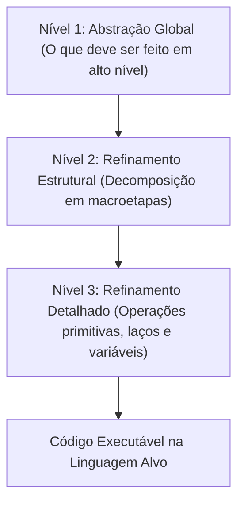

#### Exemplo Guiado: Cálculo de Média Escolar
- **Nível 1 (Abstração Pura):** Computar a média aritmética das três avaliações de um discente e apresentar o resultado.
- **Nível 2 (Decomposição Estrutural):**
  1. Capturar as três notas fornecidas.
  2. Calcular a somatória dos valores lidos.
  3. Dividir o montante acumulado por três.
  4. Emitir o resultado obtido na saída padrão.
- **Nível 3 (Pseudocódigo Implementável):**
```text
Algoritmo CalcularMediaNotas
Início
    Real: nota1, nota2, nota3, soma, media
    Ler(nota1)
    Ler(nota2)
    Ler(nota3)
    soma <- nota1 + nota2 + nota3
    media <- soma / 3.0
    Escrever("A média final é: ", media)
Fim
```

### Conceituação Formal de Tipo Abstrato de Dados

Um Tipo Abstrato de Dados (TAD) constitui uma especificação matemática composta por:
1. Um **domínio de dados** (valores admissíveis).
2. Um conjunto de **operações primitivas** aplicáveis sobre esses dados.
3. As **invariantes e comportamentos esperados** dessas operações.

O ponto definidor do TAD é a sua **independência de representação física**. A definição de um TAD especifica **O QUE** a estrutura realiza, omitindo completamente **COMO** os dados são distribuídos na memória ou quais algoritmos internos viabilizam a operação.

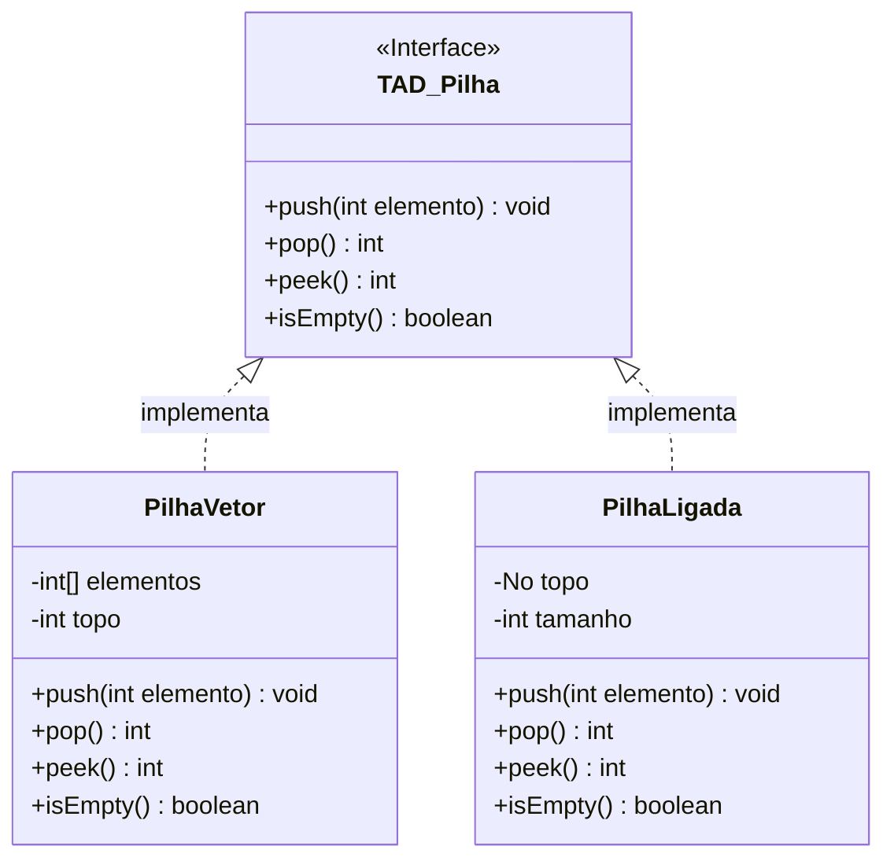

### Princípios de Abstração e Encapsulamento

- **Abstração:** Mecanismo cognitivo que isola a interface externa (pública) da complexidade operacional interna (privada). O usuário de um TAD interage unicamente com suas assinaturas de métodos.
- **Encapsulamento:** Barreira arquitetural que veda o acesso direto aos campos internos de memória de uma estrutura. Isso impede que rotinas clientes corrompam o estado interno do TAD (como alterar o contador de tamanho ou forçar um índice inválido sem passar pela validação dos métodos).

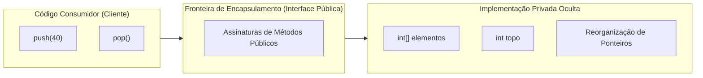

### Matriz de Decisão Estrutural

A seleção da estrutura concreta subjacente para implementar um TAD fundamenta-se nas demandas operacionais preponderantes do sistema:

| Demanda Predominante do Sistema | Estrutura Recomendada | Justificativa de Engenharia |
| :--- | :--- | :--- |
| **Acesso aleatório por índice em alta frequência** | Vetor / Lista Sequencial | Cálculo de endereço contíguo em tempo constante $`O(1)`$. |
| **Inserções e remoções frequentes no início/meio** | Lista Encadeada (Ligada) | Religamento pontual de referências sem movimentação de blocos de memória. |
| **Disciplina estrita LIFO (desfazer / pilha de execução)** | Pilha (*Stack*) | Inserções e remoções limitadas exclusivamente ao topo em tempo $`O(1)`$. |
| **Disciplina estrita FIFO (processamento de tarefas)** | Fila (*Queue*) | Entrada pela cauda e saída pela cabeça preservando ordem cronológica. |
| **Hierarquias, sistemas de arquivos e índices rápidos** | Árvore (*Tree*) | Ramificações logarítmicas de busca e representação de dependências. |
| **Redes de computadores, grafos de rotas e dependências** | Grafo (*Graph*) | Mapeamento arbitrário de vértices e arestas com múltiplos caminhos. |

---

## Análise Assintótica de Complexidade e Notação Big-O

### Limitações da Medição Empírica de Tempo

Avaliar a eficiência de um algoritmo executando-o em uma máquina física e cronometrando o tempo de relógio decorrido (em segundos ou milissegundos) é uma abordagem inadequada para a ciência da computação. O tempo físico depende de múltiplos fatores externos voláteis:

- Potência e arquitetura de registradores da CPU;
- Frequência de clock dinâmico e quantidade de núcleos;
- Memória cache L1, L2, L3 disponível e latência da RAM;
- Concorrência de outros processos e threads no sistema operacional;
- Versão da JVM e otimizações em tempo de execução do compilador JIT (*Just-In-Time*).

A análise teórica de complexidade desacopla o desempenho do hardware ao mensurar a **quantidade de operações primitivas fundamentais** em função do tamanho da entrada ($`n`$).

### Tamanho da Entrada e Contagem de Operações Primitivas

O tamanho da entrada ($`n`$) expressa o volume de dados sobre o qual o algoritmo atuará (ex.: $`n`$ elementos de um vetor a ser percorrido). A função de custo temporal $`T(n)`$ computa quantas instruções atômicas (atribuições, comparações lógicas, saltos condicionais e acessos indexados) são demandadas para concluir a rotina.

Considere a instrução de leitura simples:
```java
for (int i = 0; i < n; i++) {
    System.out.println(i);
}
```
O laço avalia a guarda $`n + 1`$ vezes, incrementa a variável $`n`$ vezes e executa a impressão $`n`$ vezes. Sua função exata é $`T(n) = a \cdot n + b`$. Conforme $`n`$ escala para a ordem de bilhões, constantes aditivas e multiplicativas tornam-se insignificantes diante do crescimento proporcional estritamente linear.

### Notação Big-O e Limites Assintóticos

#### Notação Big-O: Limite Superior Assintótico
A Notação Big-O ($`O`$) caracteriza a taxa de crescimento assintótico superior de um algoritmo, informando o teto máximo de esforço computacional no pior cenário.

Formalmente, diz-se que $`T(n) = O(f(n))`$ se existirem constantes reais estritamente positivas $`c > 0`$ e um número inteiro $`n_0 \ge 1`$ tais que:

```math
0 \le T(n) \le c \cdot f(n), \quad \forall n \ge n_0
```

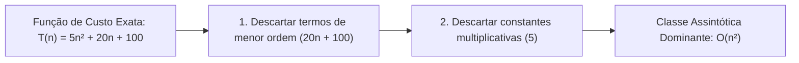

#### Notação Big-Omega: Limite Inferior Assintótico
Enquanto o Big-O estabelece o teto de custo, a Notação Big-Omega ($`\Omega`$) define o piso mínimo de trabalho operacional que um algoritmo obrigatoriamente realizará para entradas de tamanho $`n`$:

```math
0 \le c \cdot g(n) \le T(n), \quad \forall n \ge n_0
```

### Cenários de Análise: Melhor Caso, Pior Caso e Caso Médio

O custo computacional pode oscilar drasticamente dependendo da disposição prévia dos dados de entrada:

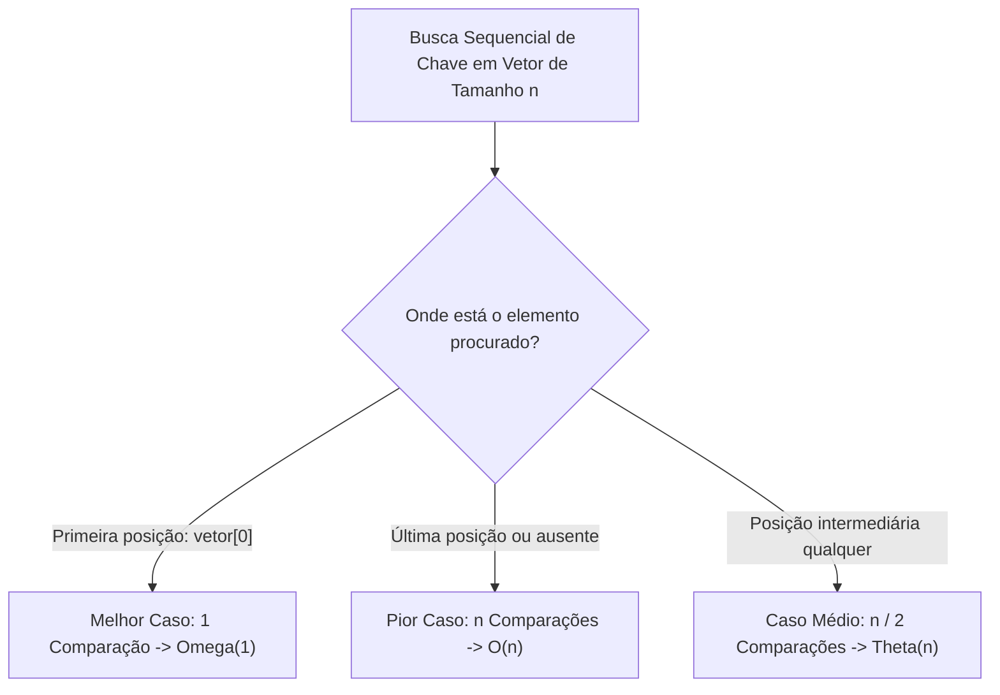

- **Melhor Caso ($`\Omega`$):** Configuração mais favorável possível. Para uma busca linear, ocorre quando a chave procurada está no primeiro índice, encerrando em tempo constante $`\Omega(1)`$.
- **Pior Caso ($`O`$):** Cenário mais adverso concebível. Na busca linear, ocorre quando o elemento procurado está na última posição ou inexiste na estrutura, forçando o algoritmo a varrer todos os $`n`$ índices, resultando em complexidade linear $`O(n)`$.
- **Caso Médio ($`\Theta`$):** Média estatística de execuções sob distribuição probabilística uniforme de entradas. Na busca linear, espera-se encontrar o item após percorrer em média $`\frac{n}{2}`$ elementos, o que mantém a ordem de grandeza linear $`\Theta(n)`$.

### Classes Canônicas de Complexidade

As classes de complexidade assintótica ordenam-se formalmente da menor para a maior taxa de consumo de tempo de processamento:

```math
O(1) \subset O(\log n) \subset O(n) \subset O(n \log n) \subset O(n^2) \subset O(n^3) \subset O(2^n) \subset O(n!)
```

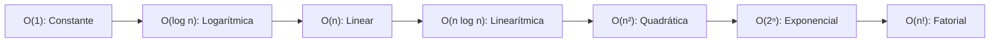

| Ordem Assintótica | Nomenclatura Formal | Exemplo Clássico | Comportamento para $`n = 1.000`$ |
| :--- | :--- | :--- | :--- |
| **$`O(1)`$** | Constante | Leitura de array por índice: `vetor[i]` | $`1`$ operação elementar |
| **$`O(\log n)`$** | Logarítmica | Busca Binária em vetor ordenado | $`\approx 10`$ operações ($`\log_2 1.000 \approx 9,96`$) |
| **$`O(n)`$** | Linear | Busca Sequencial / Varredura de vetor | $`1.000`$ operações |
| **$`O(n \log n)`$** | Linear-Logarítmica | Algoritmos Merge Sort e Quick Sort | $`\approx 10.000`$ operações |
| **$`O(n^2)`$** | Quadrática | Bubble Sort e Selection Sort | $`1.000.000`$ operações |
| **$`O(2^n)`$** | Exponencial | Enumeração exaustiva de subconjuntos | $`\approx 1,07 \times 10^{301}`$ (inviável na prática) |

---

## Modelo de Memória em Execução: Stack, Heap e Referências

### A Arquitetura de Memória da JVM

A Máquina Virtual Java particiona a memória física disponível pelo sistema operacional em diferentes segmentos durante a execução de um programa. Destacam-se dois segmentos principais para estruturas de dados:

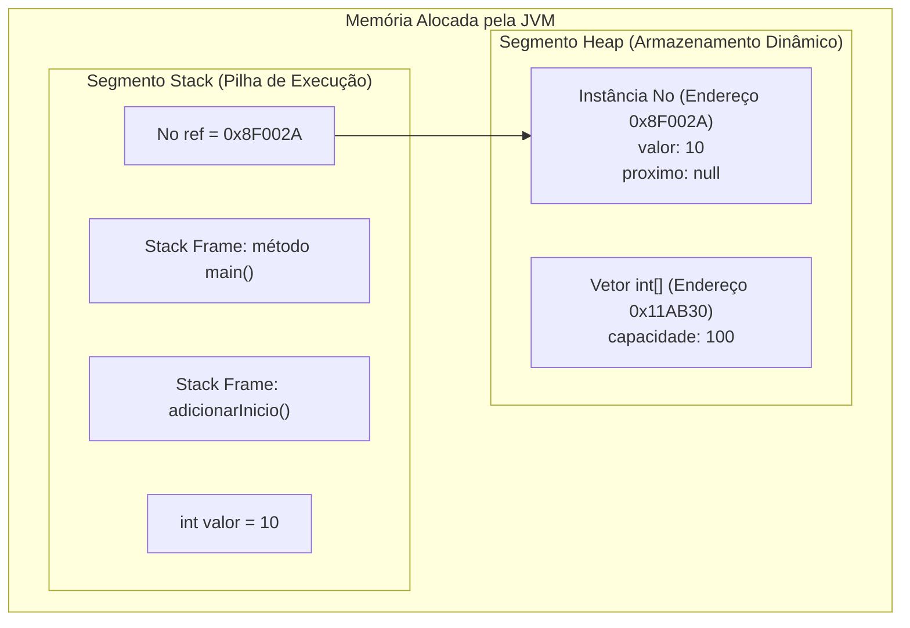

- **Memória Stack (Pilha):** Espaço contíguo e de altíssima performance estruturado sob a disciplina LIFO. Cada invocação de método cria um quadro de ativação (*stack frame*) contendo variáveis locais e parâmetros primitivos, além de endereços de ponteiros de referência. Ao retornar do método, o quadro é desalocado imediatamente.
- **Memória Heap (Monte):** Região global de armazenamento dinâmico onde todos os objetos, classes e arrays são construídos via comando `new`. O ciclo de vida dessas estruturas é independente do método que as criou.

### Tipos Primitivos versus Tipos por Referência

A semântica de atribuição em Java distingue-se categoricamente dependendo da natureza do tipo de dado:

```java
// Tipos Primitivos: cópia física do valor binário
int a = 10;
int b = a; // 'b' recebe uma réplica do valor 10. Modificar 'b' não altera 'a'.

// Tipos por Referência: cópia do ponteiro de memória
No p1 = new No(50); // Aloca objeto no Heap; 'p1' na Stack recebe o endereço 0x4A.
No p2 = p1;         // 'p2' recebe o mesmo endereço 0x4A. NENHUM objeto novo é criado.
p2.valor = 99;      // Mutação reflete imediatamente em 'p1.valor' (ambos apontam para o mesmo nó).
```

### Dinâmica de Alocação e Coleta de Lixo

Diferente de linguagens como C e C++, nas quais a liberação de memória dinâmica exige chamadas explícitas (`free` ou `delete`), Java implementa o **Garbage Collector (GC)**. O GC executa periodicamente rotinas em segundo plano rastreando grafos de alcançabilidade a partir das raízes ativas (*GC Roots*) residentes na Stack. 

Quando um objeto no Heap não puder mais ser alcançado por nenhuma cadeia de referências ativas a partir da Stack, ele é classificado como inalcançável e sua memória física é recuperada automaticamente.

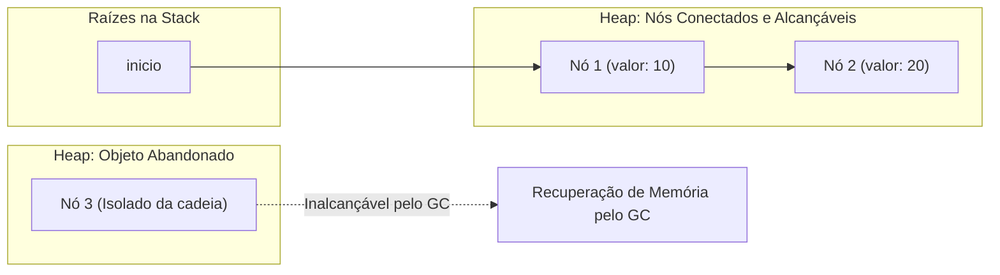

### Localidade de Referência e Hierarquia de Cache

A eficiência prática de uma estrutura de dados depende diretamente de como ela dialoga com a arquitetura de memória cache (L1, L2, L3) da CPU:

- **Localidade Espacial:** Vetores armazenam dados em endereços estritamente adjacentes. Quando a CPU acessa `vetor[i]`, a controladora de hardware transfere uma linha inteira de cache (*cache line*, geralmente de 64 bytes) para a memória interna do processador (*cache prefetching*). Acessar os índices subsequentes resulta em acerto de cache (*cache hit*), com latência mínima.
- **Fragmentação em Listas Ligadas:** Os nós de uma lista encadeada são instanciados sob demanda no Heap e podem ficar dispersos por páginas de memória distantes. Percorrer uma lista encadeada frequentemente resulta em falha de cache (*cache miss*), forçando a CPU a buscar dados na lentíssima memória RAM principal repetidas vezes.

---

## Estruturas Lineares Sequenciais

### Endereçamento Contíguo e Aritmética de Ponteiros

Uma lista linear sequencial (vetor/array primitivo) fundamenta-se na alocação de um único bloco contíguo de memória física. Isso viabiliza o acesso direto a qualquer posição indexada em tempo constante $`O(1)`$ por meio da fórmula de endereçamento direto:

```math
\text{Endereço}(i) = \text{EndereçoBase} + (i \times \text{TamanhoElemento})
```

Se um array de inteiros de 32 bits ($`4`$ bytes) inicia no endereço hexadecimal `0x1000`, a posição de índice `5` localiza-se matematicamente em:
```math
\text{Endereço}(5) = 0x1000 + (5 \times 4) = 0x1000 + 20 = 0x1014
```
A máquina não precisa iterar pelos elementos $`0, 1, 2, 3, 4`$ para atingir o elemento $`5`$; o registrador calcula o salto de endereço em um único ciclo de clock.

### Capacidade Máxima versus Tamanho Ocupado

Ao projetar uma lista sequencial, o engenheiro deve distinguir dois conceitos:

- **Capacidade (`elementos.length`):** O espaço físico total alocado no momento da instanciação do vetor primitivo no Heap.
- **Tamanho (`tamanho`):** A quantidade efetiva de elementos válidos que a lista armazena em determinado momento.

```java
public class ListaSequencial {
    private int[] elementos;
    private int tamanho; // Inicia em 0; tamanho <= elementos.length

    public ListaSequencial(int capacidade) {
        this.elementos = new int[capacidade];
        this.tamanho = 0;
    }
}
```

### Operações Fundamentais e o Custo do Deslocamento Físico

A contiguidade física que viabiliza o acesso direto cobra um preço computacional em inserções e remoções que não ocorrem na última posição.

#### Inserção no Início ou Meio (Deslocamento para a Direita)
Para acomodar um novo item em um índice intermediário $`k`$ sem corromper os elementos existentes, todos os registros compreendidos entre $`k`$ e $`tamanho - 1`$ precisam ser transferidos fisicamente uma posição para a direita. O deslocamento deve ocorrer obrigatoriamente do final para o início:

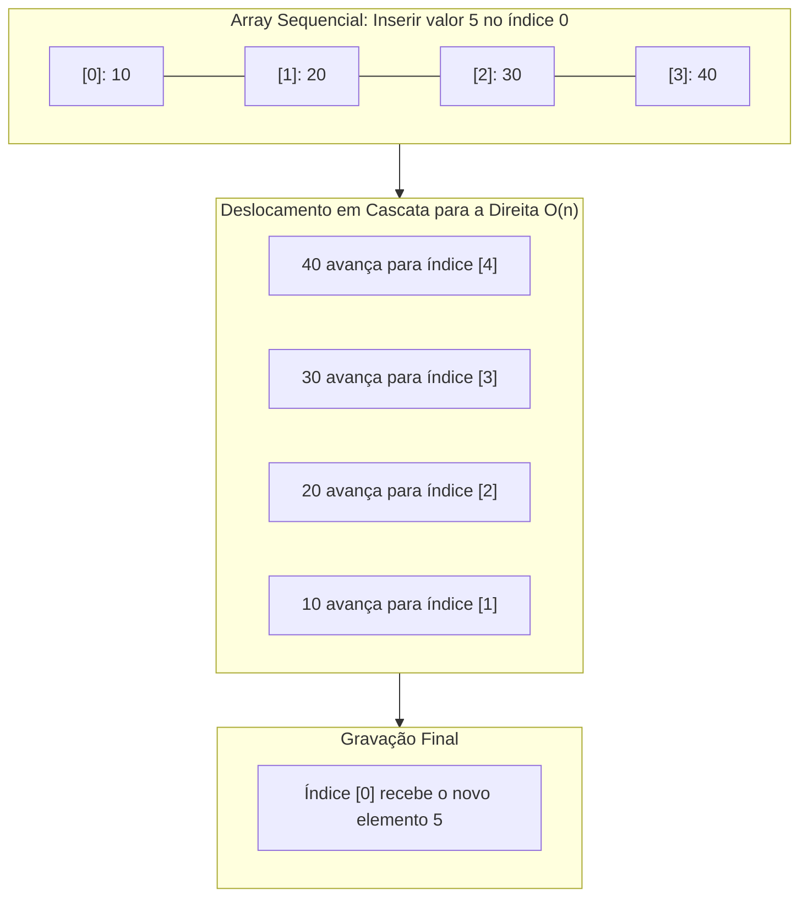

Se a lista possui $`n`$ elementos, a inserção na cabeça exige mover $`n`$ itens, incorrendo em complexidade temporal no pior caso de $`O(n)`$.

#### Remoção no Início ou Meio (Deslocamento para a Esquerda)
Ao remover um item de uma posição intermediária, abre-se uma lacuna física no arranjo. Para restaurar o alinhamento contíguo, todos os sucessores devem ser copiados uma posição à esquerda, operando também em complexidade $`O(n)`$.

### Redimensionamento Dinâmico e Custo Amortizado

Quando o vetor atinge a condição de lotação (`tamanho == elementos.length`), uma inserção requer realocação dinâmica de capacidade:
1. Alocar um novo array no Heap com capacidade expandida (geralmente o dobro da anterior);
2. Copiar todos os $`n`$ elementos do array antigo para o novo array em bloco (`System.arraycopy`);
3. Descartar a referência do array antigo para liberação pelo Garbage Collector;
4. Inserir o novo elemento.

Embora o redimensionamento pontual custe $`O(n)`$, a distribuição dessa sobrecarga ao longo de múltiplas inserções subsequentes que não demandam cópia resulta em um **custo amortizado de tempo constante $`O(1)`$** por inserção no final.

---

## Estruturas Lineares Dinâmicas: Listas Simplesmente Ligadas

### Anatomia do Nó e Auto-Referência

A lista simplesmente ligada elimina a exigência de memória contígua e o consequente deslocamento de elementos. A coleção passa a ser composta por entidades atômicas distribuídas arbitrariamente na memória Heap: os **Nós** (*Nodes*).

Cada nó encapsula:
1. **Carga Útil (*Payload*):** O dado de interesse que a estrutura transporta (`int valor`);
2. **Ponteiro de Encadeamento (`proximo`):** Variável de referência que armazena o endereço de memória do próximo objeto da classe `No`, ou o literal `null` caso represente o fim da sequência.

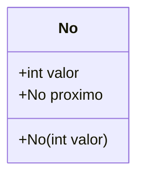

```java
public class No {
    public int valor;
    public No proximo;

    public No(int valor) {
        this.valor = valor;
        this.proximo = null;
    }
}
```

### Estrutura da Classe Controladora

A classe `ListaLigada` atua como a controladora central da estrutura, encapsulando o acesso aos nós por meio de três atributos privados:
- `private No inicio`: Referência para a cabeça da lista.
- `private No fim`: Referência para o último elemento (cauda).
- `private int tamanho`: Contador de cardinalidade dos nós ativos.

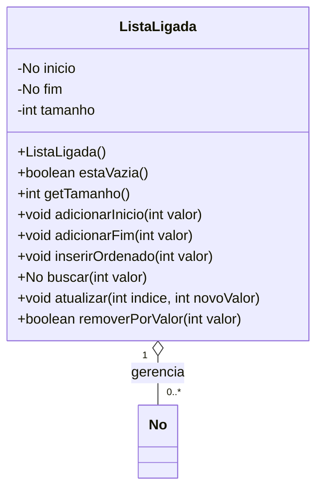

### Inserção no Início em Tempo Constante

A inclusão de um elemento na cabeça da lista encadeada opera em tempo estritamente constante $`O(1)`$, pois envolve apenas manipulações diretas de referências, independentemente de haver dez ou dez milhões de nós armazenados.

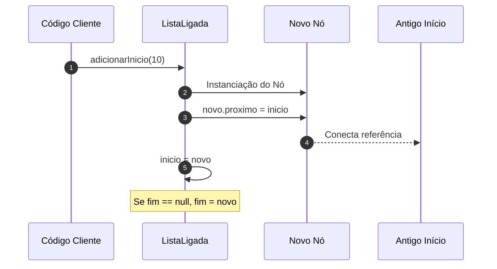

```java
public void adicionarInicio(int valor) {
    No novo = new No(valor);
    novo.proximo = this.inicio;
    this.inicio = novo;
    
    if (this.fim == null) {
        this.fim = novo;
    }
    this.tamanho++;
}
```

> **Armadilha Crítica:** Inverter a ordem das instruções executando `this.inicio = novo` antes de `novo.proximo = this.inicio` destrói a referência para a antiga cabeça da cadeia, resultando na perda definitiva de todos os nós subsequentes no Heap.

### Inserção no Fim: Abordagem O(n) versus Otimização O(1)

A presença da referência explícita para o ponteiro `fim` é um marco de maturidade de design de software:

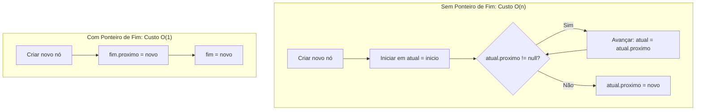

```java
public void adicionarFim(int valor) {
    No novo = new No(valor);

    if (estaVazia()) {
        this.inicio = novo;
        this.fim = novo;
    } else {
        this.fim.proximo = novo;
        this.fim = novo;
    }
    this.tamanho++;
}
```

### Inserção Ordenada: Custo de Localização versus Custo de Religamento

A inclusão de um valor preservando a ordenação crescente (ex.: inserir o valor `35` na lista `[10, 20, 30, 40]`) desdobra-se em duas etapas de custos assintóticos distintos:

1. **Etapa de Busca/Localização:** Localizar o ponto de inserção correto navegando sequencialmente nó por nó: complexidade temporal linear **$`O(n)`$**.
2. **Etapa de Religamento de Ponteiros:** Alterar os campos `proximo` para acomodar o nó: complexidade temporal constante **$`O(1)`$**.

Pela regra da dominância assintótica:
```math
\text{Custo Total} = O(n) + O(1) = O(n)
```

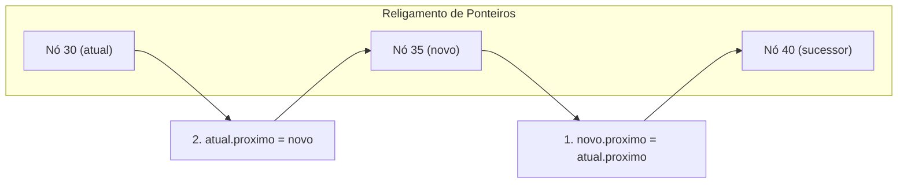

```java
public void inserirOrdenado(int valor) {
    No novo = new No(valor);

    // Caso 1: Lista vazia ou valor menor que o primeiro (inserção na cabeça)
    if (estaVazia() || valor <= this.inicio.valor) {
        novo.proximo = this.inicio;
        this.inicio = novo;
        if (this.fim == null) {
            this.fim = novo;
        }
        this.tamanho++;
        return;
    }

    // Caso 2: Varredura até localizar o ponto de inserção intermediário ou final
    No atual = this.inicio;
    while (atual.proximo != null && atual.proximo.valor < valor) {
        atual = atual.proximo;
    }

    // Caso 3: Religamento em tempo O(1)
    novo.proximo = atual.proximo;
    atual.proximo = novo;

    // Caso 4: Se inserido após o último, atualiza a referência fim
    if (novo.proximo == null) {
        this.fim = novo;
    }
    this.tamanho++;
}
```

### Busca Linear e Atualização por Índice

Diferente do vetor, a lista encadeada não suporta acesso indexado direto por hardware. O "índice" representa apenas a contagem de saltos de ponteiros a partir do `inicio`.

```java
public void atualizar(int indice, int novoValor) {
    if (indice < 0 || indice >= this.tamanho) {
        throw new IndexOutOfBoundsException("Índice fora dos limites: " + indice);
    }

    No atual = this.inicio;
    for (int i = 0; i < indice; i++) {
        atual = atual.proximo;
    }

    atual.valor = novoValor; // Custo de navegação O(n) e atribuição O(1)
}
```

### Remoção de Elementos e Tratamento de Desconexão

Para remover um nó intermediário que contém um valor específico, o algoritmo deve localizar o nó **anterior** ao elemento que será extraído. A desconexão física decorre de instruir o ponteiro `anterior.proximo` a receber `atual.proximo`. Ao perder o vínculo com a estrutura, o nó descartado torna-se inalcançável e é reciclado pelo Garbage Collector.

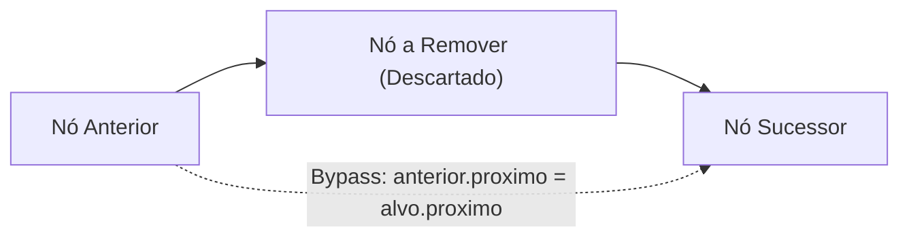

### Matriz Comparativa: Sequencial versus Ligada

| Operação Fundamental | Lista Sequencial (Vetor) | Lista Ligada Dinâmica (Nós) | Justificativa Analítica |
| :--- | :--- | :--- | :--- |
| **Acesso por Índice (`get/set`)** | **$`O(1)`$** | $`O(n)`$ | Aritmética de endereço versus percurso sequencial obrigatório. |
| **Inserção no Início** | $`O(n)`$ | **$`O(1)`$** | Deslocamento de $`n`$ elementos versus manipulação de ponteiros. |
| **Inserção no Fim** | **$`O(1)`$** amortizado | **$`O(1)`$** (com ponteiro fim) | Inserção direta no índice livre ou acoplamento na cauda. |
| **Remoção no Início** | $`O(n)`$ | **$`O(1)`$** | Deslocamento à esquerda versus avanço do ponteiro `inicio`. |
| **Remoção no Meio** | $`O(n)`$ | $`O(n)`$ | Deslocamento de bloco versus busca sequencial do nó anterior. |
| **Sobrecarga de Memória** | Mínima (apenas o dado bruto) | Média/Alta (overhead de ponteiros em cada nó) | Nós alocam espaço extra para a referência `proximo`. |
| **Aproveitamento de Cache** | Excelente (Localidade espacial) | Baixa (Nós fragmentados no Heap) | Blocos contíguos aproveitam pré-busca de cache na CPU. |

---

## O Tipo Abstrato de Dados Pilha

### Definição Formal e Princípio LIFO

Uma **Pilha** (*Stack*) é um Tipo Abstrato de Dados linear e restrito no qual todas as operações de inserção, remoção e consulta são realizadas exclusivamente em uma única extremidade: o **Topo** (*Top*). A extremidade oposta permanece inacessível e é denominada **Base** (*Base* ou *Bottom*).

A pilha impõe a disciplina operacional:

```math
\text{LIFO: } \textit{Last In, First Out (O último que entra é o primeiro que sai)}
```

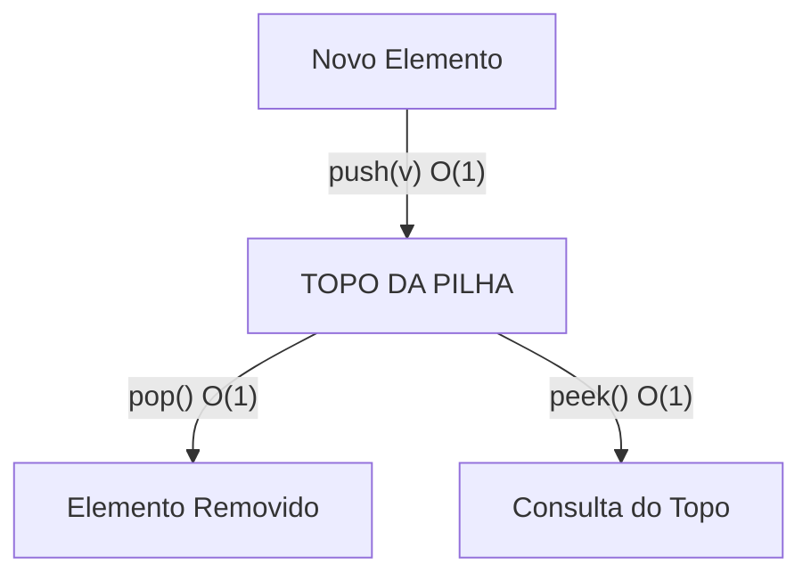

### Operações Fundamentais

O contrato essencial do TAD Pilha abrange quatro operações que atuam em tempo constante $`O(1)`$:

- `push(v)`: Adiciona o elemento `v` ao topo.
- `pop()`: Extrai e retorna o elemento atualmente posicionado no topo. Lança exceção de **Stack Underflow** caso a pilha esteja vazia.
- `peek()` ou `top()`: Inspeciona o elemento do topo sem removê-lo.
- `isEmpty()`: Retorna um predicado booleano atestando se a pilha contém zero elementos.
- `size()`: Retorna a quantidade de elementos presentes na estrutura.

```mermaid
stateDiagram-v2
    [*] --> Vazia: Instanciação
    Vazia --> ComItens: push(v)
    ComItens --> ComItens: push(v)
    ComItens --> Cheia: push(v) [se atingir capacidade do vetor]
    Cheia --> ComItens: pop()
    ComItens --> ComItens: pop()
    ComItens --> Vazia: pop() [quando topo retorna a -1]
```

### Implementação Estática com Vetores

Na implementação sequencial, os dados residem em um array nativo controlado pelo índice `topo`. A convenção matemática universal consiste em inicializar a variável de controle com o valor sentinela `topo = -1`, indicando ausência de itens válidos.

```mermaid
sequenceDiagram
    autonumber
    participant Cliente as Código Cliente
    participant P as Pilha com Array
    
    Note over P: Estado Inicial: topo = -1 (Pilha Vazia)
    Cliente->>P: push(10)
    Note over P: topo pré-incrementado para 0, elementos[0] = 10
    P-->>Cliente: Sucesso
    
    Cliente->>P: push(20)
    Note over P: topo pré-incrementado para 1, elementos[1] = 20
    P-->>Cliente: Sucesso
    
    Cliente->>P: pop()
    Note over P: Resgata elementos[1] (20), topo pós-decrementado para 0
    P-->>Cliente: Retorna 20
    
    Cliente->>P: pop()
    Note over P: Resgata elementos[0] (10), topo pós-decrementado para -1
    P-->>Cliente: Retorna 10 (Pilha volta ao estado Vazio)
```

```java
public class PilhaVetor {
    private int[] elementos;
    private int topo;

    public PilhaVetor(int capacidade) {
        if (capacidade <= 0) {
            throw new IllegalArgumentException("Capacidade deve ser positiva.");
        }
        this.elementos = new int[capacidade];
        this.topo = -1; // Sentinela de pilha vazia
    }

    public void push(int valor) {
        if (this.topo == this.elementos.length - 1) {
            throw new IllegalStateException("Stack Overflow: Capacidade máxima atingida.");
        }
        this.elementos[++this.topo] = valor; // Pré-incremento seguro
    }

    public int pop() {
        if (isEmpty()) {
            throw new IllegalStateException("Stack Underflow: A pilha está vazia.");
        }
        return this.elementos[this.topo--]; // Resgate e pós-decremento
    }

    public int peek() {
        if (isEmpty()) {
            throw new IllegalStateException("Pilha vazia.");
        }
        return this.elementos[this.topo];
    }

    public boolean isEmpty() {
        return this.topo == -1;
    }

    public int size() {
        return this.topo + 1;
    }
}
```

> **Exclusão Lógica versus Exclusão Física:** O comando `pop()` em arrays primitivos apenas retrocede o índice `topo`. O valor numérico anterior permanece gravado nos bytes da memória até que um novo `push` o sobrescreva. Trata-se de uma exclusão estritamente lógica.

### Implementação Dinâmica com Listas Ligadas

Para contornar o limite de capacidade de vetores fixos, a pilha pode ser mapeada sobre nós dinâmicos. A decisão arquitetural crítica consiste em posicionar o **Topo da Pilha na Cabeça (`inicio`) da Lista Ligada**:

```mermaid
flowchart LR
    TopoPtr["Ponteiro Topo"] --> N3["Nó 30 (Topo)"]
    N3 --> N2["Nó 20"]
    N2 --> N1["Nó 10 (Base)"]
    N1 --> Nulo["null"]
```

Se o topo fosse associado ao fim de uma lista simplesmente encadeada sem cauda dupla, a operação `pop` exigiria varrer todos os $`n`$ nós para localizar o elemento penúltimo, degradando a complexidade para $`O(n)`$. Mapeando o topo na cabeça, tanto `push` quanto `pop` operam em $`O(1)`$.

```java
public class PilhaLigada {
    private No topo;
    private int tamanho;

    public PilhaLigada() {
        this.topo = null;
        this.tamanho = 0;
    }

    public void push(int valor) {
        No novo = new No(valor);
        novo.proximo = this.topo;
        this.topo = novo;
        this.tamanho++;
    }

    public int pop() {
        if (isEmpty()) {
            throw new IllegalStateException("Stack Underflow: Pilha vazia.");
        }
        int valorRemovido = this.topo.valor;
        this.topo = this.topo.proximo;
        this.tamanho--;
        return valorRemovido;
    }

    public int peek() {
        if (isEmpty()) {
            throw new IllegalStateException("Pilha vazia.");
        }
        return this.topo.valor;
    }

    public boolean isEmpty() {
        return this.topo == null;
    }

    public int size() {
        return this.tamanho;
    }
}
```

### Manipulação de Elementos Intermediários com Pilhas Auxiliares

Em problemas práticos, surge a necessidade de verificar a existência ou substituir um elemento que repousa abaixo do topo. O engenheiro não pode acessar diretamente nós internos (`topo.proximo.proximo`), sob pena de violar a abstração LIFO do TAD.

A solução consiste no emprego de uma **Pilha Auxiliar**:
1. Desempilhar elementos da pilha original para a auxiliar até expor o item visado;
2. Realizar a verificação ou mutação necessária;
3. Desempilhar todos os elementos da auxiliar de volta para a pilha original, restaurando a ordem inicial.

```mermaid
sequenceDiagram
    autonumber
    participant Original as Pilha Original
    participant Aux as Pilha Auxiliar
    
    Note over Original,Aux: Localização de elemento intermediário
    Original->>Aux: pop() da Original seguido de push() na Auxiliar
    Original->>Aux: pop() da Original seguido de push() na Auxiliar
    Note over Original: Elemento alvo analisado ou alterado
    Aux->>Original: pop() da Auxiliar seguido de push() na Original
    Aux->>Original: pop() da Auxiliar seguido de push() na Original
    Note over Original: Estado e ordem originais totalmente restaurados
```

```java
public boolean contem(int valor) {
    PilhaLigada auxiliar = new PilhaLigada();
    boolean encontrado = false;

    // Esvazia desempilhando e inspecionando
    while (!isEmpty()) {
        int atual = pop();
        if (atual == valor) {
            encontrado = true;
        }
        auxiliar.push(atual);
    }

    // Restauração obrigatória da pilha original
    while (!auxiliar.isEmpty()) {
        push(auxiliar.pop());
    }

    return encontrado; // Custo temporal O(n) e espacial O(n)
}
```

### Aplicações Computacionais das Pilhas

As pilhas são estruturas viabilizadoras de mecanismos fundamentais na computação moderna:

1. **Call Stack da Máquina Virtual (JVM):** Gerenciamento do fluxo de métodos, alocação de escopos e execução de rotinas recursivas.
2. **Avaliação e Conversão de Expressões Aritméticas:** Notação Polonesa Reversa (posfixa) em compiladores e calculadoras.
3. **Mecanismos de Navegação e Histórico:** O botão "Voltar" de navegadores Web.
4. **Recursos de Desfazer (*Undo / Ctrl+Z*):** Editores de texto e softwares gráficos que registram deltas de operações passadas.
5. **Verificação de Delimitadores Sintáticos:** Compiladores que validam o balanceamento de chaves `{ }`, colchetes `[ ]` e parênteses `( )`.

---

## Algoritmos de Ordenação Elementares

### Papel da Ordenação em Sistemas Computacionais

A ordenação de registros consiste em rearranjar uma coleção finita de modo a satisfazer uma relação de ordem total pré-definida ($`a_0 \le a_1 \le \dots \le a_{n-1}`$).

Motivações computacionais críticas:
- **Viabilização da Busca Binária:** Em arranjos desordenados, a busca consome $`O(n)`$. Uma vez ordenado, o vetor permite pesquisas em tempo logarítmico $`O(\log n)`$.
- **Junções Eficientes de Bancos de Dados:** Mecanismos de *Merge Join* processam grandes tabelas em tempo linear $`O(n + m)`$ caso as chaves estejam previamente ordenadas.
- **Eliminação de Duplicatas:** Dados ordenados colocam itens idênticos em posições contíguas, viabilizando detecção em uma única passagem.

### Bubble Sort: Trocas Adjacentes e Flutuação de Extremos

#### Princípio Operacional
O Bubble Sort percorre repetidamente o arranjo comparando pares de elementos adjacentes $`(vetor[j], vetor[j + 1])`$. Se estiverem fora de ordem, permuta os dois elementos através de uma troca física (*swap*). Ao término de cada passagem externa $`i`$, o maior elemento da partição não ordenada terá "flutuado" para sua posição definitiva no final do vetor.

```mermaid
flowchart TD
    InicioPassagem["Passagem i: j varia de 0 até n - 2 - i"] --> Comparacao{"vetor[j] > vetor[j + 1]?"}
    Comparacao -- Sim --> Troca["Swap: Permuta valores via temporário<br>Marca flag: houveTroca = true"]
    Comparacao -- Não --> Avanca["Mantém posições"]
    Troca --> ProximoPar["j++"]
    Avanca --> ProximoPar
```

#### Código Java Canônico e Otimizado
```java
public class BubbleSort {

    public static void ordenar(int[] vetor) {
        int n = vetor.length;
        boolean houveTroca;

        // Laço externo: controla passagens globais
        for (int i = 0; i < n - 1; i++) {
            houveTroca = false;

            // Laço interno: varre pares adjacentes
            for (int j = 0; j < n - 1 - i; j++) {
                if (vetor[j] > vetor[j + 1]) {
                    // Troca in-place
                    int temporario = vetor[j];
                    vetor[j] = vetor[j + 1];
                    vetor[j + 1] = temporario;
                    houveTroca = true;
                }
            }

            // Otimização: se nenhuma troca ocorreu, o vetor já está ordenado
            if (!houveTroca) {
                break;
            }
        }
    }
}
```

#### Análise Matemática de Complexidade
O número total de comparações em um vetor de tamanho $`n`$ sem encerramento prematuro é uma Progressão Aritmética:

```math
C(n) = \sum_{i=0}^{n-2} (n - 1 - i) = (n - 1) + (n - 2) + \dots + 1 = \frac{n(n - 1)}{2} = \frac{n^2 - n}{2} \implies O(n^2)
```

- **Pior Caso:** Vetor em ordem decrescente reversa. Realiza $`\frac{n(n - 1)}{2}`$ comparações e $`\frac{n(n - 1)}{2}`$ trocas ($`O(n^2)`$).
- **Melhor Caso (com flag):** Vetor já ordenado. Realiza $`n - 1`$ comparações e zero trocas, encerrando no primeiro ciclo com complexidade linear $`O(n)`$.
- **Espaço Auxiliar:** Opera *in-place* com consumo constante $`O(1)`$.

### Selection Sort: Seleção Posicional de Extremos

#### Princípio Operacional
O Selection Sort particiona o vetor em duas metades virtuais: a sublista esquerda já ordenada e a sublista direita desordenada. A cada iteração externa $`i`$, o algoritmo varre exaustivamente a partição desordenada à procura do menor valor absoluto, registrando seu índice (`indiceMenor`). Ao final da varredura interna, executa **uma única troca física** entre o índice $`i`$ e a posição `indiceMenor`.

```mermaid
flowchart TD
    InicioIteracao["Início da Passagem i"] --> DefineMenor["Assume indiceMenor = i"]
    DefineMenor --> Varredura["Varre j de i + 1 até n - 1"]
    Varredura --> ChecaMenor{"vetor[j] < vetor[indiceMenor]?"}
    ChecaMenor -- Sim --> AtualizaIndice["indiceMenor = j (Apenas guarda o índice)"]
    ChecaMenor -- Não --> ProximoJ["Avança j"]
    AtualizaIndice --> ProximoJ
    ProximoJ --> FimVarredura{"Fim do Vetor?"}
    FimVarredura -- Não --> Varredura
    FimVarredura -- Sim --> ExecutaTroca["Executa Swap Único: vetor[i] com vetor[indiceMenor]"]
```

#### Código Java Canônico
```java
public class SelectionSort {

    public static void ordenar(int[] vetor) {
        int n = vetor.length;

        for (int i = 0; i < n - 1; i++) {
            int indiceMenor = i;

            // Busca o índice do menor elemento remanescente
            for (int j = i + 1; j < n; j++) {
                if (vetor[j] < vetor[indiceMenor]) {
                    indiceMenor = j;
                }
            }

            // Realiza uma única troca por passagem
            if (indiceMenor != i) {
                int temporario = vetor[i];
                vetor[i] = vetor[indiceMenor];
                vetor[indiceMenor] = temporario;
            }
        }
    }
}
```

#### Análise Matemática de Complexidade
O número de comparações de chaves é fixo e independente da disposição inicial dos dados:

```math
C(n) = \sum_{i=0}^{n-2} (n - 1 - i) = \frac{n(n - 1)}{2} \implies O(n^2) \text{ em todos os casos}
```

- **Número de Trocas:** No máximo $`n - 1`$ movimentações físicas de memória ($`O(n)`$), minimizando a escrita na memória Flash ou RAM.
- **Espaço Auxiliar:** Opera *in-place* consumindo $`O(1)`$.

### Comparativo Técnico: Comparações, Trocas e Estabilidade

| Propriedade de Engenharia | Bubble Sort | Selection Sort |
| :--- | :--- | :--- |
| **Comparações no Pior Caso** | $`\frac{n(n - 1)}{2} \implies O(n^2)`$ | $`\frac{n(n - 1)}{2} \implies O(n^2)`$ |
| **Comparações no Melhor Caso** | $`n - 1 \implies O(n)`$ (com flag) | $`\frac{n(n - 1)}{2} \implies O(n^2)`$ (invariante) |
| **Trocas no Pior Caso** | $`\frac{n(n - 1)}{2} \implies O(n^2)`$ | $`n - 1 \implies O(n)`$ |
| **Trocas no Melhor Caso** | $`0 \implies O(1)`$ | $`0 \implies O(1)`$ |
| **Estabilidade Algorítmica** | **Estável** (não inverte chaves idênticas) | **Instável** (trocas distantes podem inverter ordem original) |
| **Cenário Ideal de Aplicação** | Vetores pequenos quase totalmente ordenados | Sistemas onde a operação de escrita na memória tem custo elevado |

---

## Caderno de Trabalhos Práticos Resolvidos

### Trabalho 1: Análise Assintótica de Complexidade

O Trabalho de Complexidade de Algoritmos exigiu a classificação formal da taxa de crescimento temporal (Notação Big-O) de seis métodos implementados em Java.

#### Questão 1: Método `somar`
```java
public static int somar(int[] valores) {
    int soma = 0;
    for (int i = 0; i < valores.length; i++) {
        soma += valores[i];
    }
    return soma;
}
```
- **Análise Passo a Passo:** O método inicializa variáveis escalares e executa um único laço `for` com passo unitário de $`0`$ até $`n - 1`$. A instrução `soma += valores[i]` executa exatamente $`n`$ vezes.
- **Função de Custo:** $`T(n) = c_1 \cdot n + c_2`$.
- **Classificação:** **$`O(n)`$ (Linear)**.

#### Questão 2: Método `buscaBinaria`
```java
public static int buscaBinaria(int[] valores, int procurado) {
    int inicio = 0;
    int fim = valores.length - 1;

    while (inicio <= fim) {
        int meio = (inicio + fim) / 2;
        if (valores[meio] == procurado) {
            return meio;
        }
        if (valores[meio] < procurado) {
            inicio = meio + 1;
        } else {
            fim = meio - 1;
        }
    }
    return -1;
}
```
- **Análise Passo a Passo:** A cada iteração do laço `while`, o espaço de busca delimitado por `inicio` e `fim` é reduzido à metade: $`\frac{n}{2}, \frac{n}{4}, \frac{n}{8}, \dots, \frac{n}{2^k}`$. O término ocorre quando o espaço atinge tamanho $`1`$:
```math
\frac{n}{2^k} = 1 \implies 2^k = n \implies k = \log_2 n
```
- **Classificação:** **$`O(\log n)`$ (Logarítmica)**.

#### Questão 3: Método `imprimirPares`
```java
public static void imprimirPares(int[] valores) {
    for (int i = 0; i < valores.length; i++) {
        for (int j = 0; j < valores.length; j++) {
            System.out.println(valores[i] + " - " + valores[j]);
        }
    }
}
```
- **Análise Passo a Passo:** Dois laços aninhados independentes. O laço externo executa $`n`$ vezes; para cada iteração externa, o laço interno executa outras $`n`$ iterações completas.
- **Função de Custo:** Total de impressões = $`n \times n = n^2`$.
- **Classificação:** **$`O(n^2)`$ (Quadrática)**.

#### Questão 4: Método `contarIguais`
```java
public static int contarIguais(int[] valores) {
    int contador = 0;
    for (int i = 0; i < valores.length; i++) {
        for (int j = i + 1; j < valores.length; j++) {
            if (valores[i] == valores[j]) {
                contador++;
            }
        }
    }
    return contador;
}
```
- **Análise Passo a Passo:** Laços dependentes gerando uma matriz triangular de comparações:
  - Para $`i = 0`$, $`j`$ varia de $`1`$ a $`n - 1`$ ($`n - 1`$ vezes);
  - Para $`i = 1`$, $`j`$ varia de $`2`$ a $`n - 1`$ ($`n - 2`$ vezes);
  - ...
  - Total = $`(n - 1) + (n - 2) + \dots + 1 = \frac{n(n - 1)}{2} = \frac{1}{2}n^2 - \frac{1}{2}n`$.
- **Descarte de constantes:** Desconsidera-se o fator $`\frac{1}{2}`$ e o termo menor $`-\frac{1}{2}n`$.
- **Classificação:** **$`O(n^2)`$ (Quadrática)**.

#### Questão 5: Método `maior`
```java
public static int maior(int[] valores) {
    int maior = valores[0];
    int i = 1;
    while (i < valores.length) {
        if (valores[i] > maior) {
            maior = valores[i];
        }
        i++;
    }
    return maior;
}
```
- **Análise Passo a Passo:** Um laço `while` simples que percorre os elementos do vetor a partir da posição $`1`$ até $`n - 1`$. Realiza rigorosamente $`n - 1`$ iterações lineares.
- **Classificação:** **$`O(n)`$ (Linear)**.

#### Questão 6: Método `reduzir`
```java
public static void reduzir(int n) {
    while (n > 1) {
        n = n / 2;
    }
}
```
- **Análise Passo a Passo:** A variável de controle inteira $`n`$ é dividida por 2 a cada repetição. O número de divisões necessárias para reduzir um valor $`n`$ até atingir 1 corresponde ao logaritmo de $`n`$ na base 2: $`k = \lfloor \log_2 n \rfloor`$.
- **Classificação:** **$`O(\log n)`$ (Logarítmica)**.

---

### Trabalho 2: Laboratório de Estruturas de Ordenação

O Trabalho 2 propôs a ordenação de um vetor acadêmico real contendo as notas de discentes:
```text
Entrada: int[] notas = {8, 5, 10, 3, 7, 2, 9, 6}; (Tamanho n = 8)
```

#### Código Java de Instrumentação e Teste
```java
public class LaboratorioOrdenacao {

    public static int comparacoesBubble = 0;
    public static int trocasBubble = 0;
    public static int comparacoesSelection = 0;
    public static int trocasSelection = 0;

    public static void bubbleSort(int[] arr) {
        int n = arr.length;
        for (int i = 0; i < n - 1; i++) {
            for (int j = 0; j < n - 1 - i; j++) {
                comparacoesBubble++;
                if (arr[j] > arr[j + 1]) {
                    int temp = arr[j];
                    arr[j] = arr[j + 1];
                    arr[j + 1] = temp;
                    trocasBubble++;
                }
            }
        }
    }

    public static void selectionSort(int[] arr) {
        int n = arr.length;
        for (int i = 0; i < n - 1; i++) {
            int minIdx = i;
            for (int j = i + 1; j < n; j++) {
                comparacoesSelection++;
                if (arr[j] < arr[minIdx]) {
                    minIdx = j;
                }
            }
            if (minIdx != i) {
                int temp = arr[i];
                arr[i] = arr[minIdx];
                arr[minIdx] = temp;
                trocasSelection++;
            }
        }
    }

    public static void main(String[] args) {
        int[] notasOriginal = {8, 5, 10, 3, 7, 2, 9, 6};
        int[] notasBubble = notasOriginal.clone();
        int[] notasSelection = notasOriginal.clone();

        bubbleSort(notasBubble);
        selectionSort(notasSelection);

        System.out.println("Bubble Sort: " + comparacoesBubble + " comp, " + trocasBubble + " trocas");
        System.out.println("Selection Sort: " + comparacoesSelection + " comp, " + trocasSelection + " trocas");
    }
}
```

#### Gabarito Analítico das Questões do Formulário Avaliativo

1. **Quantas comparações cada algoritmo realizou?**
   - **Resposta:** Ambos os algoritmos realizaram exatamente **28 comparações**.
   - **Memória de Cálculo:** Para $`n = 8`$, a somatória de comparações de ambos os métodos sem encerramento prematuro é dada por:
   ```math
   C(8) = \frac{8 \times (8 - 1)}{2} = \frac{56}{2} = 28 \text{ comparações}
   ```

2. **Quantas trocas foram realizadas por cada algoritmo?**
   - **Resposta:** O **Bubble Sort realizou 15 trocas**, enquanto o **Selection Sort realizou 6 trocas** (ou 7 trocas se a implementação não verificar a guarda `minIdx != i`, executando auto-troca na passagem $`i = 4`$).
   - **Justificativa:** O Bubble Sort realiza uma permuta física para cada inversão adjacente encontrada. O Selection Sort realiza no máximo uma troca por passagem externa.

3. **O resultado final foi o mesmo? Por quê?**
   - **Resposta:** Sim, ambos os métodos geraram o vetor perfeitamente ordenado: `{2, 3, 5, 6, 7, 8, 9, 10}`. Ambos são algoritmos matematicamente corretos que asseguram a convergência e a invariante de ordenação total ao final de suas iterações.

4. **Qual algoritmo realiza menos trocas na implementação apresentada?**
   - **Resposta:** O **Selection Sort**. Por definição algorítmica, o Selection Sort minimiza movimentações físicas de dados, exigindo no máximo $`n - 1`$ trocas ($`O(n)`$), enquanto o Bubble Sort pode exigir até $`O(n^2)`$ trocas.

5. **O que aconteceria com o desempenho se o vetor tivesse 1.000 elementos?**
   - **Resposta:** O desempenho degradaria quadraticamente em ambos os algoritmos, demandando aproximadamente **500.000 comparações**:
   ```math
   C(1.000) = \frac{1.000 \times 999}{2} = 499.500 \text{ comparações}
   ```
   No pior cenário de desordem, o Bubble Sort realizaria cerca de 499.500 trocas em memória, tornando-se impraticável em produção. O Selection Sort realizaria as mesmas 499.500 comparações, porém limitando as trocas a no máximo 999 operações físicas.

6. **Se as notas já estivessem ordenadas, qual algoritmo poderia ser otimizado para encerrar mais cedo?**
   - **Resposta:** O **Bubble Sort**. Implementando uma variável de controle booleana (`houveTroca`), o Bubble Sort constata a ausência de trocas na primeira passagem ($`n - 1 = 7`$ comparações) e interrompe o processamento, reduzindo a complexidade temporal para $`O(n)`$. O Selection Sort tradicional é insensível à pré-ordenação e realizaria todas as 28 comparações.

---

## Síntese Preparatória para Avaliações e Banco de Questões

### Roteiro Sistemático de Resolução em Seis Passos

Ao deparar-se com questões teóricas ou de codificação em avaliações de Estrutura de Dados I, aplique o seguinte roteiro:

1. **Identificar a Entrada ($`n`$):** Qual parâmetro governa a escala do problema? (tamanho de vetor, número de nós, valor numérico de um contador).
2. **Identificar as Operações Elementares:** Mapear acessos de leitura, gravações em memória e comparações de chaves.
3. **Mapear Estruturas de Repetição:** O algoritmo possui laços simples? Laços aninhados independentes ($`n \times n`$)? Laços dependentes ($`\frac{n(n-1)}{2}`$)? Laços de divisão logarítmica ($`n = n / 2`$)?
4. **Verificar a Estrutura Subjacente:** A estrutura é um vetor contíguo (permite acesso $`O(1)`$ por índice) ou uma lista ligada (exige navegação sequencial $`O(n)`$)?
5. **Calcular a Complexidade Assintótica:** Descartar constantes e termos menores para isolar a Notação Big-O no pior caso.
6. **Auditar o Uso de Memória:** O algoritmo opera *in-place* com espaço auxiliar $`O(1)`$ ou aloca nós, vetores ou pilhas secundárias consumindo $`O(n)`$?

### Armadilhas Típicas e Erros Frequentes

- **Confundir Busca com Acesso Posicional em Lista Ligada:** Presumir que `lista.obter(5)` é $`O(1)`$ como em um vetor. Em lista encadeada, obter o $`k`$-ésimo item requer caminhar $`k`$ nós: complexidade $`O(n)`$.
- **Inversão de Ponteiros na Inserção em Lista Ligada:** Fazer `inicio = novo` antes de `novo.proximo = inicio`, gerando autoreferência ou perda dos nós seguintes no Heap.
- **Quebra do TAD Pilha:** Criar métodos como `removerIndice(int i)` em uma classe `Pilha`. Pilhas acessam exclusivamente o topo.
- **Ignorar a Guarda de Pilha Vazia:** Tentar executar `pop()` ou `peek()` sem antes verificar `if (isEmpty())`, provocando falhas em tempo de execução (`NullPointerException` ou `ArrayIndexOutOfBoundsException`).
- **Supor que o Laço de Redução pela Metade é Linear:** Avaliar laços com passos `j = j * 2` ou `j = j / 2` como lineares em vez de reconhecer a taxa logarítmica $`O(\log n)`$.
- **Confundir Comparações com Trocas:** Afirmar que o Selection Sort é "mais rápido" que o Bubble Sort em qualquer situação. Ambos realizam $`O(n^2)`$ comparações; o Selection Sort apenas minimiza as trocas em memória.

### Banco de Questões Dissertativas e Analíticas

#### Questão 1 (Discursiva — Gestão de Memória)
**Enunciado:** Explique por que a inserção de um elemento no início de um vetor contíguo custa $`O(n)`$, enquanto em uma lista simplesmente ligada custa $`O(1)`$. Fundamente sua resposta no modelo de memória da máquina.  
**Gabarito Técnico:** O vetor contíguo baseia-se na propriedade de adjacência física para viabilizar indexação direta via fórmula de endereçamento. Para inserir um novo elemento no índice 0, todos os $`n`$ elementos pré-existentes devem ser copiados fisicamente uma posição para a direita no barramento de memória, demandando $`n`$ operações ($`O(n)`$). Na lista simplesmente ligada, os nós residem dispersos no Heap; a inserção no início requer apenas instanciar o novo nó, fazer seu campo `proximo` apontar para a cabeça atual e atualizar a referência `inicio` da controladora, realizando um número fixo de operações de ponteiros em tempo estritamente constante $`O(1)`$.

#### Questão 2 (Múltipla Escolha — Complexidade)
**Enunciado:** Um algoritmo executa um laço externo que itera $`n`$ vezes. Para cada iteração do laço externo, uma rotina de busca binária é executada sobre um vetor ordenado de tamanho $`n`$. Qual a complexidade assintótica de pior caso do algoritmo?  
- (A) $`O(n)`$  
- (B) $`O(n \log n)`$  
- (C) $`O(n^2)`$  
- (D) $`O(\log n)`$  
**Gabarito:** **(B)**. O laço externo executa $`n`$ iterações. A busca binária interna executa em tempo logarítmico $`O(\log n)`$. O custo total é a multiplicação direta dos laços: $`n \times O(\log n) = O(n \log n)`$ (complexidade linear-logarítmica).

#### Questão 3 (Discursiva — TAD Pilha)
**Enunciado:** Descreva o mecanismo utilizado para inspecionar e remover um elemento arbitrário situado no fundo de uma Pilha sem violar o princípio LIFO e o encapsulamento do TAD.  
**Gabarito Técnico:** Utiliza-se uma segunda pilha temporária (Pilha Auxiliar). Os elementos da pilha original são sucessivamente desempilhados através de chamadas ao método `pop()` e empilhados na auxiliar via `push()` até que o elemento alvo seja exposto no topo e descartado. Em seguida, todos os elementos retidos na pilha auxiliar são desempilhados e reinseridos na pilha original, preservando sua ordem e estrutura originais. O algoritmo opera em complexidade temporal $`O(n)`$ e espacial auxiliar $`O(n)`$.

---

## Mapa Conceitual Unificado

```mermaid
mindmap
  root["Estrutura de Dados I"]
    "Fundamentos de Software"
      "Algoritmo: Seis Propriedades"
      "Axioma de Wirth: Algoritmos + Dados"
      "Pipeline do Problema à Solução"
      "Refinamento Sucessivo Top-Down"
    "Análise de Complexidade"
      "Crítica ao Tempo de Relógio"
      "Contagem de Instruções Primitivas"
      "Notação Big-O: Limite Superior"
      "Classes Canônicas: O(1) até O(n!)"
      "Cenários: Melhor, Pior e Médio"
    "Arquitetura de Memória"
      "Stack: Frames e Primitivos"
      "Heap: Instâncias e Arrays"
      "Ponteiros e Referências"
      "Garbage Collector da JVM"
      "Localidade de Cache da CPU"
    "Estruturas Lineares"
      "Lista Sequencial: Vetores"
        "Endereçamento Contíguo"
        "Deslocamento O(n)"
        "Capacidade vs Tamanho"
      "Lista Ligada: Nós Dinâmicos"
        "Auto-Referência de Ponteiros"
        "Inserção no Início O(1)"
        "Inserção no Fim O(1) com Cauda"
        "Busca Linear O(n)"
      "Pilha: TAD LIFO"
        "Operações push, pop, peek"
        "Sentinela -1 no Array"
        "Pilha Ligada na Cabeça"
        "Pilhas Auxiliares"
    "Ordenação Elementar"
      "Bubble Sort"
        "Trocas Adjacentes"
        "Comparações O(n²)"
        "Flag de Parada Antecipada"
      "Selection Sort"
        "Seleção Posicional de Menores"
        "Minimização de Trocas O(n)"
        "Comparações Invariantes O(n²)"
```

---

## Fontes e Metadados

- Turma no Classroom: estrutura de dados 1 2026/02
- Itens processados: 0 materiais, 3 tarefas, 9 avisos
- Gerado em: 20/10/2026, 21:49:33 (BRT) via classroom-sync
