# Guia de Estudos e Manual Acadêmico: Estrutura de Dados I

> **Instituição:** Centro Universitário de Santa Fé do Sul (UniFEF)  
> **Curso:** Bacharelado em Sistemas de Informação (4º Semestre)  
> **Docente:** Prof. Ms. Wesley Soares de Souza  
> **Disciplina:** Estrutura de Dados I  

---

## Sumário

- [1. Apresentação da Disciplina, Ementa e Metodologia](#1-apresentacao-da-disciplina-ementa-e-metodologia)
  - [Perfil docente e visão da disciplina](#perfil-docente-e-visao-da-disciplina)
  - [Ementa oficial e trilha temática](#ementa-oficial-e-trilha-tematica)
  - [Critérios e métrica de avaliação](#criterios-e-metrica-de-avaliacao)
  - [Bibliografia oficial e leituras recomendadas](#bibliografia-oficial-e-leituras-recomendadas)
- [2. Fundamentos de Algoritmos e Resolução Sistemática de Problemas](#2-fundamentos-de-algoritmos-e-resolucao-sistematica-de-problemas)
  - [Definição formal e semântica de algoritmo](#definicao-formal-e-semantica-de-algoritmo)
  - [As seis características fundamentais de um algoritmo](#as-seis-caracteristicas-fundamentais-de-um-algoritmo)
  - [O princípio da organização: Algoritmos e Estruturas de Dados](#o-principio-da-organizacao-algoritmos-e-estruturas-de-dados)
  - [Diferença conceitual entre algoritmo e programa](#diferenca-conceitual-entre-algoritmo-e-programa)
  - [Ciclo de engenharia: do problema à implementação](#ciclo-de-engenharia-do-problema-a-implementacao)
  - [Metodologia de projeto em seis etapas sistemáticas](#metodologia-de-projeto-em-seis-etapas-sistematicas)
- [3. Tipos Abstratos de Dados (TAD) e Modularização](#3-tipos-abstratos-de-dados-tad-e-modularizacao)
  - [Refinamento sucessivo](#refinamento-sucessivo)
  - [Conceituação formal de Tipo Abstrato de Dados](#conceituacao-formal-de-tipo-abstrato-de-dados)
  - [Abstração e encapsulamento de estruturas](#abstracao-e-encapsulamento-de-estruturas)
  - [Critérios para escolha de representação de dados](#criterios-para-escolha-de-representacao-de-dados)
- [4. Arquitetura de Memória e Gestão de Recursos em Java](#4-arquitetura-de-memoria-e-gestao-de-recursos-em-java)
  - [Modelo de memória da JVM: Call Stack versus Heap](#modelo-de-memoria-da-jvm-call-stack-versus-heap)
  - [Tipos primitivos versus tipos por referência](#tipos-primitivos-versus-tipos-por-referencia)
  - [Alocação dinâmica de objetos e o papel do Garbage Collector](#alocacao-dinamica-de-objetos-e-o-papel-do-garbage-collector)
  - [Localidade de referência espacial e impacto no cache da CPU](#localidade-de-referencia-espacial-e-impacto-no-cache-da-cpu)
- [5. Análise de Complexidade de Algoritmos e Notação Assintótica](#5-analise-de-complexidade-de-algoritmos-e-notacao-assintotica)
  - [Limitações da medição empírica de tempo de relógio](#limitacoes-da-medicao-empirica-de-tempo-de-relogio)
  - [Tamanho da entrada e contagem de operações primitivas](#tamanho-da-entrada-e-contagem-de-operacoes-primitivas)
  - [Descarte de constantes multiplicativas e termos de menor ordem](#descarte-de-constantes-multiplicativas-e-termos-de-menor-ordem)
  - [Notação Big-O e Notação Big-Omega](#notacao-big-o-e-notacao-big-omega)
  - [Cenários de análise: melhor caso, pior caso e caso médio](#cenarios-de-analise-melhor-caso-pior-caso-e-caso-medio)
  - [Classes fundamentais de complexidade temporal](#classes-fundamentais-de-complexidade-temporal)
  - [Estudo detalhado do Trabalho Prático de Complexidade](#estudo-detalhado-do-trabalho-pratico-de-complexidade)
- [6. Listas Lineares Sequenciais](#6-listas-lineares-sequenciais)
  - [Estrutura contígua de memória e cálculo de endereços](#estrutura-contigua-de-memoria-e-calculo-de-enderecos)
  - [Capacidade física versus tamanho lógico](#capacidade-fisica-versus-tamanho-logico)
  - [Operações elementares: consulta, inserção e remoção](#operacoes-elementares-consulta-insercao-e-remocao)
  - [O problema do deslocamento de elementos em inserções e remoções](#o-problema-do-deslocamento-de-elementos-em-insercoes-e-remocoes)
  - [Mecanismo de redimensionamento e análise de custo amortizado](#mecanismo-de-redimensionamento-e-analise-de-custo-amortizado)
- [7. Listas Dinâmicas Encadeadas](#7-listas-dinamicas-encadeadas)
  - [Quebra da contiguidade: anatomia e semântica do Nó](#quebra-da-contiguidade-anatomia-e-semantica-do-no)
  - [Arquitetura da classe controladora ListaLigada](#arquitetura-da-classe-controladora-listaligada)
  - [Inserção na cabeça da lista com tempo constante](#insercao-na-cabeca-da-lista-com-tempo-constante)
  - [Inserção na cauda com e sem ponteiro de fim](#insercao-na-cauda-com-e-sem-ponteiro-de-fim)
  - [Inserção ordenada no meio da lista](#insercao-ordenada-no-meio-da-lista)
  - [Busca linear por valor e remoção de nós](#busca-linear-por-valor-e-remocao-de-nos)
  - [Atualização por índice posicional](#atualizacao-por-indice-posicional)
  - [Matriz comparativa: Lista Sequencial versus Lista Ligada](#matriz-comparativa-lista-sequencial-versus-lista-ligada)
- [8. Tipo Abstrato de Dados Pilha (Stack)](#8-tipo-abstrato-de-dados-pilha-stack)
  - [Conceituação formal e disciplina LIFO](#conceituacao-formal-e-disciplina-lifo)
  - [Operações fundamentais: push, pop, peek e isEmpty](#operacoes-fundamentais-push-pop-peek-e-isempty)
  - [Restrição de acesso deliberada e garantia de integridade](#restricao-de-acesso-deliberada-e-garantia-de-integridade)
  - [Implementação estática baseada em vetor contíguo](#implementacao-estatica-baseada-em-vetor-contiguo)
  - [Implementação dinâmica baseada em lista encadeada](#implementacao-dinamica-baseada-em-lista-encadeada)
  - [Manipulação de elementos intermediários mediante pilhas auxiliares](#manipulacao-de-elementos-intermediarios-mediante-pilhas-auxiliares)
  - [Trade-offs entre Pilha Sequencial e Pilha Ligada](#trade-offs-entre-pilha-sequencial-e-pilha-ligada)
- [9. Algoritmos de Ordenação Elementares](#9-algoritmos-de-ordenacao-elementares)
  - [Importância econômica e computacional da ordenação](#importancia-economica-e-computacional-da-ordenacao)
  - [Bubble Sort: estratégia de trocas adjacentes e rastreamento](#bubble-sort-estrategia-de-trocas-adjacentes-e-rastreamento)
  - [Selection Sort: seleção de extremos e rastreamento](#selection-sort-selecao-de-extremos-e-rastreamento)
  - [Insertion Sort: inserção direta, baralho e invariante de laço](#insertion-sort-insercao-direta-baralho-e-invariante-de-laco)
  - [Diferença operacional entre deslocamento e troca](#diferenca-operacional-entre-deslocamento-e-troca)
  - [Matriz comparativa entre algoritmos elementares de ordenação](#matriz-comparativa-entre-algoritmos-elementares-de-ordenacao)
- [10. Roteiro Sistemático de Revisão para Provas e Banco de Questões](#10-roteiro-sistematico-de-revisao-para-provas-e-banco-de-questoes)
  - [O protocolo de análise em seis passos](#o-protocolo-de-analise-em-seis-passos)
  - [Questões resolvidas e comentadas](#questoes-resolvidas-e-comentadas)
- [11. Glossário Técnico Consolidado](#11-glossario-tecnico-consolidado)

---

## 1. Apresentação da Disciplina, Ementa e Metodologia

### Perfil docente e visão da disciplina

A disciplina de Estrutura de Dados I, alocada no 4º semestre do curso de Sistemas de Informação da UniFEF, é conduzida pelo Prof. Ms. Wesley Soares de Souza. O docente possui graduação em Sistemas de Informação pela FEF (UniFEF), especialização em Gestão de Banco de Dados e mestrado em Engenharia de Software pela Universidade Federal do Pampa (UNIPAMPA - RS), acumulando sólida trajetória no mercado de tecnologia da informação e no ensino superior desde 2014.

Essa articulação profissional define a diretriz pedagógica do curso: o equilíbrio entre a fundamentação matemática formal e os requisitos da engenharia de software aplicada. O objetivo central é superar o paradigma da mera compilação funcional ("o código roda") para consolidar a mentalidade de eficiência sistêmica ("o código é escalável, preserva o consumo de memória e minimiza o tempo de CPU").

### Ementa oficial e trilha temática

A ementa curricular aprovada institucionalmente compreende dois eixos complementares:

1. **Fundamentos e Teoria Base**: Metodologia de projeto e análise assintótica de algoritmos, tipos abstratos de dados (TAD), complexidade computacional temporal e espacial, modelo de arquitetura de memória e gestão de alocação dinâmica.
2. **Estruturas Lineares e Aplicações Práticas**: Modelagem, codificação e avaliação de desempenho de estruturas de dados lineares (listas sequenciais contíguas, listas simplesmente ligadas, listas circulares, pilhas, filas e deques), acompanhadas de algoritmos clássicos de manipulação e ordenação interna.

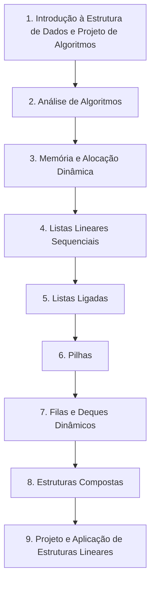

### Critérios e métrica de avaliação

O regime de avaliação é estruturado semestralmente em dois módulos (Módulo 1 e Módulo 2), compondo duas notas parciais denominadas Avaliação 1 (composta por `$`AV_1`$` e `$`T_1`$`) e Avaliação 2 (composta por `$`AV_2`$` e `$`T_2`$`):

- **Avaliação 1 (`$`AV_1`$` e `$`T_1`$)**: Uma prova individual teórica e prática (`$`AV_1`$`), com valor de 0,0 a 10,0 pontos e peso 0,8 (contribuição máxima de 8,0 pontos na parcial), somada a um trabalho prático (`$`T_1`$`), com valor de 0,0 a 10,0 pontos e peso 0,2 (contribuição máxima de 2,0 pontos na parcial).
- **Avaliação 2 (`$`AV_2`$` e `$`T_2`$)**: Uma prova individual teórica e prática (`$`AV_2`$`), com valor de 0,0 a 10,0 pontos e peso 0,8 (contribuição máxima de 8,0 pontos na parcial), somada a um trabalho prático (`$`T_2`$`), com valor de 0,0 a 10,0 pontos e peso 0,2 (contribuição máxima de 2,0 pontos na parcial).

A Média Semestral final (`$`MS`$`) obedece à equação canônica:

```math
MS = \frac{[(AV_1 \times 0.8) + (T_1 \times 0.2)] + [(AV_2 \times 0.8) + (T_2 \times 0.2)]}{2}
```

| Instrumento de Avaliação | Escopo Operacional | Intervalo | Peso Relativo | Contribuição na Nota Parcial |
| :--- | :--- | :--- | :--- | :--- |
| **Trabalho Prático 1 (`$`T_1`$`):** | Exercícios analíticos e codificação em Java | 0,0 a 10,0 | 20% (0,2) | Até 2,0 pontos |
| **Prova Formal 1 (`$`AV_1`$`):** | Avaliação formal sem consulta | 0,0 a 10,0 | 80% (0,8) | Até 8,0 pontos |
| **Trabalho Prático 2 (`$`T_2`$`):** | Implementação de estruturas dinâmicas | 0,0 a 10,0 | 20% (0,2) | Até 2,0 pontos |
| **Prova Formal 2 (`$`AV_2`$`):** | Avaliação formal integradora | 0,0 a 10,0 | 80% (0,8) | Até 8,0 pontos |

### Bibliografia oficial e leituras recomendadas

#### Bibliografia básica oficial
- MONTEIRO, Mário A. *Introdução à Organização de Computadores*. 4. ed. Rio de Janeiro: LTC, 2002.
- STALLINGS, William. *Arquitetura e Organização de Computadores*. 8. ed. São Paulo: Pearson, 2010.
- TANENBAUM, Andrew S. *Organização Estruturada de Computadores*. 3. ed. São Paulo: Prentice-Hall do Brasil, 1990.

#### Bibliografia complementar oficial
- IDOETA, Ivan Valeije; CAPUANO, Francisco Gabriel. *Elementos de Eletrônica Digital*. 32. ed. São Paulo: Érica, 2001.
- PATTERSON, David A.; HENNESSY, John L. *Organização e Projeto de Computadores*. 2. ed. Rio de Janeiro: LTC, 1998.
- WEBER, Raul Fernando. *Arquitetura de Computadores Pessoais*. 2. ed. Porto Alegre: Sagra, 2001.
- WEBER, Raul Fernando. *Fundamentos de Arquitetura de Computadores*. Série Livros Didáticos Informática UFRGS, Vol. 8, 4. ed. Porto Alegre: Bookman, 2012.

*(Nota de complementação pedagógica: Embora o registro bibliográfico curricular enfatize a organização física dos computadores — pré-requisito indispensável para entender ponteiros, registradores, Call Stack e memória Heap —, recomenda-se fortemente o estudo complementar das obras clássicas de algoritmos: "Projeto de Algoritmos com Implementações em Pascal e C", de Nivio Ziviani, e "Algoritmos: Teoria e Prática", de Thomas H. Cormen et al.)*

---

## 2. Fundamentos de Algoritmos e Resolução Sistemática de Problemas

### Definição formal e semântica de algoritmo

Um **algoritmo** é formalmente definido como uma sequência finita, ordenada e não ambígua de instruções computacionais mecanicamente executáveis que, a partir de um estado inicial e de um conjunto de dados de entrada (que pode ser vazio), conduz o processamento através de transições sucessivas de estados até atingir um estado final previsível, entregando uma saída que soluciona determinada classe de problemas.

Etimologicamente, o vocábulo remonta ao matemático persa do século IX Abu Abdullah Muhammad ibn Musa al-Khwarizmi, responsável pela sistematização de regras passo a passo para o cálculo decimal e a resolução de equações algébricas. Na computação contemporânea, o algoritmo representa a essência matemática e lógica pura da solução, mantendo total independência em relação a compiladores, linguagens ou hardwares específicos.

### As seis características fundamentais de um algoritmo

Para que uma especificação procedimental receba o estatuto de algoritmo, é mandatório atender a seis propriedades axiomáticas:

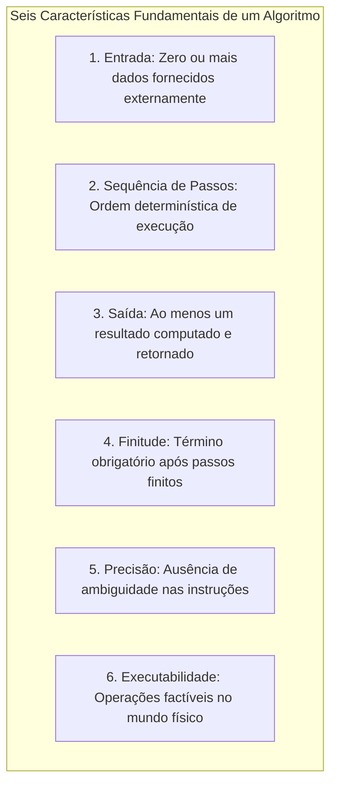

1. **Entrada (*Input*)**: Operação sobre zero ou mais dados recebidos do domínio externo. Quando a entrada é zero, o algoritmo apoia-se em constantes ou estados pré-estabelecidos (como na geração determinística de constantes matemáticas).
2. **Sequência de Passos (*Sequence*)**: Existência de uma relação de ordem temporal estrita. Cada instrução depende do estado deixado pela instrução precedente.
3. **Saída (*Output*)**: Produção obrigatória de ao menos um valor ou transformação persistente observável no ambiente, estabelecendo relação lógica com a entrada.
4. **Finitude (*Finiteness*)**: O algoritmo deve cessar para qualquer entrada válida após um número finito de instruções primitivas. Laços infinitos sem critério de convergência violam esta característica.
5. **Precisão (*Definiteness*)**: Cada instrução deve ser exata, sem margem a interpretações subjetivas ou indeterminadas. Comandos coloquiais não são admissíveis.
6. **Executabilidade (*Effectiveness*)**: Todas as operações computacionais descritas devem ser exequíveis em tempo finito utilizando recursos materiais reais de hardware (proibindo operações como divisão por zero ou iterações sobre infinitos contínuos).

| Característica | Requisito Formal | Exemplo Conforme | Violação / Contraexemplo |
| :--- | :--- | :--- | :--- |
| **Entrada** | Domínio bem caracterizado | Vetor com `$`n`$` inteiros positivos | Leitura de variável não inicializada |
| **Sequência** | Precedência estrita de estados | `passo_1(); passo_2();` | Apresentar saída antes do cômputo |
| **Saída** | Retorno ou mutação observável | Retornar o maior valor | Descartar dados calculados sem saída |
| **Finitude** | Convergência garantida | Laço com sentinela finita | `while (true)` sem comando de escape |
| **Precisão** | Semântica mecânica unívoca | `x = x + 1;` | "Aguarde até esquentar a CPU" |
| **Executabilidade** | Operações físicas possíveis | Divisão inteira com divisor não nulo | Calcular infinitas casas decimais |

### O princípio da organização: Algoritmos e Estruturas de Dados

Conforme formulado em sala pelo professor Wesley Soares:

> *"Um bom programa depende tanto de um bom algoritmo quanto da forma como os dados são organizados."*

Essa reflexão sintetiza o clássico axioma proclamado por Niklaus Wirth em 1976:

```math
\text{Algoritmos} + \text{Estruturas de Dados} = \text{Programas}
```

A eficiência de um algoritmo é indissociável da estrutura em que as informações estão armazenadas. Uma lógica de busca sofisticada torna-se inoperante se a estrutura forçar percursos sequenciais exaustivos; paralelamente, a organização de dados mais engenhosa revela-se inútil na ausência de procedimentos ordenados que saibam navegá-la com consumo mínimo de recursos.

### Diferença conceitual entre algoritmo e programa

A confusão entre a lógica do algoritmo e a sintaxe de um programa de computador representa um erro conceitual comum. Um algoritmo situa-se no plano das abstrações matemáticas; um programa situa-se no plano da engenharia de implementação.

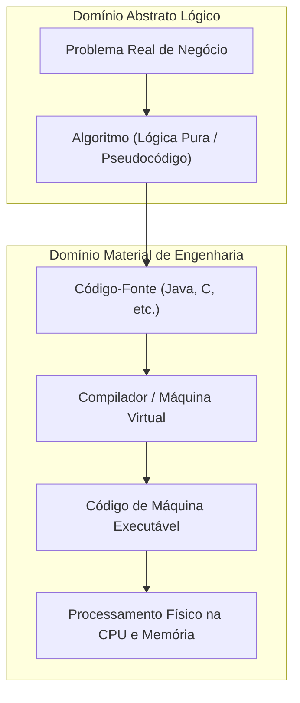

| Eixo Comparativo | Algoritmo | Programa |
| :--- | :--- | :--- |
| **Natureza** | Modelo lógico-matemático | Artefato de software compilável |
| **Acoplamento** | Independe de máquina ou fabricante | Depende da sintaxe da linguagem e da JVM/OS |
| **Meio de Expressão** | Pseudocódigo, fluxogramas, linguagem formal | Arquivos-fonte (`.java`, `.c`), bytecode |
| **Tolerância a Falhas** | Requer correção semântica | Exige conformidade sintática absoluta |
| **Execução** | Compreendido e simulado cognitivamente | Processado em registradores, cache e RAM |

### Ciclo de engenharia: do problema à implementação

A transformação de uma demanda real em uma solução computacional escalável percorre seis fases sucessivas:

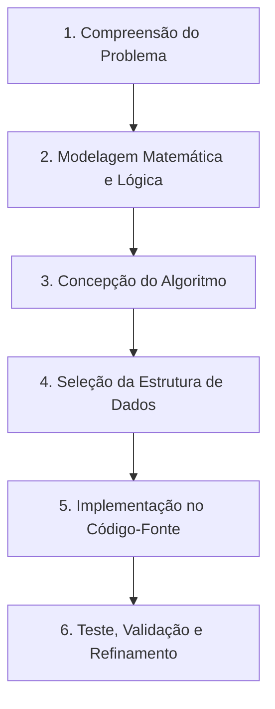

1. **Compreensão**: Análise detalhada dos requisitos e eliminação de ambiguidades.
2. **Modelagem**: Definição das entidades do domínio, invariantes e transformações de estado.
3. **Algoritmo**: Descrição procedural dos passos para transformar a entrada na saída.
4. **Estrutura de Dados**: Escolha da forma de representação dos elementos na memória.
5. **Implementação**: Escrita do código-fonte respeitando os contratos e a sintaxe da linguagem alvo.
6. **Teste e Refinamento**: Validação contra casos de borda e otimização de complexidade assintótica.

### Metodologia de projeto em seis etapas sistemáticas

O engenheiro de software segue um protocolo sistemático de formulação algorítmica:

- **Etapa 1 — Entender o problema**: Isolar objetivos, pré-condições e pós-condições.
- **Etapa 2 — Identificar Entradas e Saídas**: Tipificar os dados consumidos e produzidos.
- **Etapa 3 — Decompor em partes**: Aplicar divisão sistemática de responsabilidades.
- **Etapa 4 — Definir a estratégia**: Escolher o paradigma algorítmico (força bruta, busca binária, ordenação por trocas, divisão e conquista).
- **Etapa 5 — Especificar o algoritmo**: Descrever em pseudocódigo estruturado.
- **Etapa 6 — Testar e refinar**: Conduzir testes de mesa para validar casos normais e limites extremos.

---

## 3. Tipos Abstratos de Dados (TAD) e Modularização

### Refinamento sucessivo

O **refinamento sucessivo** (*stepwise refinement* ou decomposição *top-down*), formalizado por Niklaus Wirth, é a prática de partir de uma especificação geral de alto nível e desdobrá-la sucessivamente em camadas mais granulares até se obterem operações elementares da linguagem de programação.

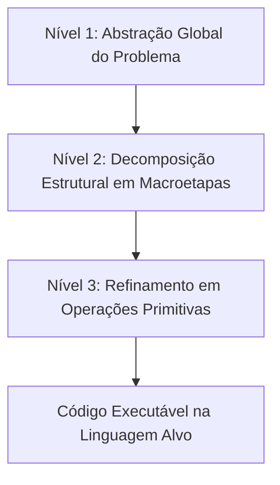

- **Nível 1 (Abstração Pura)**: Declaração da intenção (exemplo: "Calcular a média aritmética de três notas").
- **Nível 2 (Refinamento Conceitual)**: 1. Obter notas; 2. Somar valores; 3. Efetuar divisão por três; 4. Exibir resultado.
- **Nível 3 (Refinamento Primitivo)**:
  ```pseudocode
  algoritmo MediaTresNotas
  início
      real: n1, n2, n3, soma, media
      leia(n1, n2, n3)
      soma <- n1 + n2 + n3
      media <- soma / 3.0
      escreva("Media:", media)
  fim
  ```

### Conceituação formal de Tipo Abstrato de Dados

Um **Tipo Abstrato de Dados (TAD)** é um construto matemático que encapsula:
1. Um domínio de valores possíveis.
2. Um conjunto de operações públicas aplicáveis sobre esses dados.
3. Um conjunto de invariantes e comportamentos esperados (pré-condições e pós-condições).

O aspecto definidor de um TAD reside na **independência de representação física**: a especificação estabelece **o que** a estrutura executa, omitindo **como** os dados estão organizados nos circuitos de memória.

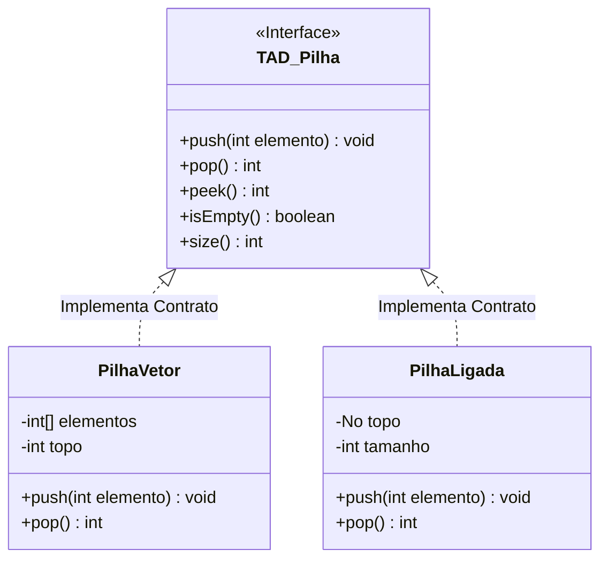

### Abstração e encapsulamento de estruturas

A separação entre interface e implementação atua como uma barreira protetora da arquitetura:
- **Interface Pública**: Conjunto de métodos exportados nos cabeçalhos ou interfaces (`public`). Estabelece o contrato com o código cliente.
- **Implementação Privada**: Campos internos (`private`), ponteiros de encadeamento, blocos de vetores e funções utilitárias internas.

**Motivação técnica**: Se um sistema transacional utiliza uma Pilha implementada sobre um vetor estático e precisa ser refatorada para uma lista encadeada dinâmica, nenhuma classe cliente precisa sofrer refatoração, desde que a interface do TAD permaneça estável.

**Contraexemplo e armadilha**: Permitir que campos de controle (como `topo` ou o vetor interno) tenham modificador de acesso público (`public`). O código cliente poderia manipular posições arbitrárias de memória, corrompendo as invariantes estruturais do TAD.

### Critérios para escolha de representação de dados

A tabela a seguir consolida a matriz de decisão apresentada em sala de aula para a seleção de estruturas:

| Requisito Operacional Predominante | Estrutura de Dados Adequada | Racional Técnico de Engenharia |
| :--- | :--- | :--- |
| **Acesso direto instantâneo via índice** | Lista Sequencial (Vetor/Array) | Endereçamento contíguo resolvido em tempo constante `$`O(1)`$` |
| **Inserção e remoção no início ou meio** | Lista Encadeada (Ligada) | Religamento pontual de ponteiros em `$`O(1)`$`, sem deslocamentos |
| **Política LIFO (Último a Entrar, Primeiro a Sair)** | Pilha (*Stack*) | Operações restritas estritamente à extremidade de topo |
| **Política FIFO (Primeiro a Entrar, Primeiro a Sair)** | Fila (*Queue*) | Inserções no fim e retiradas no início com disciplina de chegada |
| **Relações de descendência e hierarquia** | Árvore (*Tree*) | Ramificação nodal em níveis, subárvores e chaves ordenadas |
| **Redes de conexões arbitrárias entre vértices** | Grafo (*Graph*) | Mapeamento de nós e arestas com múltiplos caminhos e ciclos |

---

## 4. Arquitetura de Memória e Gestão de Recursos em Java

### Modelo de memória da JVM: Call Stack versus Heap

A compreensão profunda das estruturas de dados exige o domínio do modelo de alocação de memória da Máquina Virtual Java (JVM), o qual se segmenta essencialmente em duas áreas:

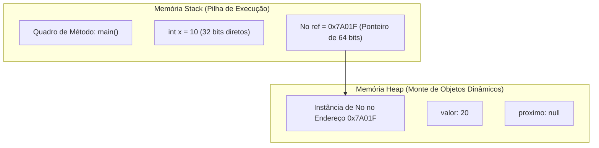

- **Memória Stack (Pilha)**:
  - Armazena quadros de ativação de métodos (*stack frames*).
  - Aloca variáveis locais primitivas (`int`, `double`, `boolean`) e endereços de ponteiros/referências.
  - Possui desalocação estritamente automática e determinística ao final do escopo de cada método.
  - Velocidade de acesso comparável aos registradores e linhas de cache primárias.
- **Memória Heap (Monte)**:
  - Região global e dinâmica destinada ao armazenamento de objetos instanciados via operador `new` e matrizes.
  - Elementos residem de forma dispersa no espaço endereçável.
  - O ciclo de vida independe do escopo do método que os instanciou.

### Tipos primitivos versus tipos por referência

A distinção fundamental reside no conteúdo armazenado no slot da Stack:

```java
int a = 50;              // Na Stack: armazena diretamente o binário 50
int b = a;               // Na Stack: copia o valor binário 50 (independente de 'a')

No p1 = new No(100);     // Na Stack: endereço 0x4B2; No Heap: objeto {valor: 100, proximo: null}
No p2 = p1;              // Na Stack: copia o endereço 0x4B2 (apontam para o MESMO objeto)
p2.valor = 999;          // Altera o objeto compartilhado no Heap: p1.valor agora vale 999!
```

### Alocação dinâmica de objetos e o papel do Garbage Collector

Diferente da linguagem C — onde a desalocação é manual via `free(ponteiro)` —, a JVM opera com coleta de lixo automática (*Garbage Collector*). O GC executa periodicamente a varredura do grafo de objetos a partir das raízes de execução da Stack (*GC Roots*). 

Um objeto torna-se elegível para coleta e liberação física de memória no exato instante em que perde todas as referências ativas que o conectavam à Stack.

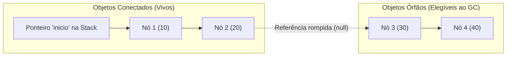

**Armadilha de vazamento de referências (*Memory Leak* em Java)**: Em pilhas sequenciais baseadas em array, quando o índice de topo retrocede após uma operação de desempilhamento, se a posição do vetor continuar retendo o ponteiro para um objeto (`elementos[topo + 1] != null`), o Garbage Collector considera o objeto como "vivo", impedindo sua liberação da memória Heap.

### Localidade de referência espacial e impacto no cache da CPU

A localidade de referência espacial estabelece que o acesso a um endereço físico de memória aumenta drasticamente a probabilidade de acesso aos seus endereços imediatamente adjacentes em instantes futuros.

- **Vetores contíguos (Lista Sequencial)**: Aproveitam o mecanismo de carregamento de linhas de cache da CPU (*cache lines*, tipicamente 64 bytes). Ao carregar `vetor[0]`, os elementos adjacentes `vetor[1]`, `vetor[2]`, etc., são pré-carregados para o cache L1/L2, resultando em altíssima velocidade de iteração (*cache hits*).
- **Estruturas encadeadas (Lista Ligada)**: Distribuem os nós em endereços arbitrários do Heap. Cada salto `atual = atual.proximo` exige a recuperação de um novo bloco de memória, elevando as faltas de cache (*cache misses*) e penalizando o desempenho de varredura global em ciclos de clock da CPU.

---

## 5. Análise de Complexidade de Algoritmos e Notação Assintótica

### Limitações da medição empírica de tempo de relógio

Avaliar a eficiência de um algoritmo cronometrando milissegundos de relógio (*wall-clock time*) é metodologicamente inconsistente na ciência da computação. O tempo físico sofre variações decorrentes de:
1. Arquitetura da CPU, quantidade de núcleos e clock dinâmico.
2. Latência e largura de banda do barramento da memória RAM.
3. Concorrência com outros processos gerenciados pelo sistema operacional.
4. Otimizações de compilação dinâmica (*Just-In-Time* - JIT da JVM).
5. Variação no volume e na disposição prévia dos dados fornecidos no teste.

A análise analítica contorna essa fragilidade ao quantificar o **número de operações primitivas fundamentais** em função do tamanho da entrada (`$`n`$`).

### Tamanho da entrada e contagem de operações primitivas

O tamanho da entrada (`$`n`$`) representa a dimensão métrica do conjunto de dados processado (exemplo: quantidade de elementos em um array). As operações primitivas são instruções com tempo de execução previsível e unitário: atribuições escalares, comparações relacionais, acessos indexados a arrays e operações aritméticas fundamentais.

### Descarte de constantes multiplicativas e termos de menor ordem

Para valores suficientemente grandes de `$`n`$` (`$`n \to \infty`$), os termos de maior ordem dominam completamente o crescimento da função de custo:

Seja a função de custo exato de um algoritmo:
```math
T(n) = 3n^2 + 50n + 1000
```
Para `$`n = 100.000`$`:
- O termo quadrático `$`3n^2 = 3(10^{10}) = 30.000.000.000`$` responde por mais de 99,8% de todo o custo computacional.
- O termo linear `$`50n = 5.000.000`$` e a constante `$`1000`$` tornam-se desprezíveis.
- Descartando o coeficiente multiplicativo `$`3`$` e os termos subordinados, afirmamos que `$`T(n) \in O(n^2)`$`.

### Notação Big-O e Notação Big-Omega

A formulação matemática clássica define os limites assintóticos:

- **Notação Big-O (`$`O`$`) — Limite Superior Assintótico**: Uma função `$`T(n)`$` é dita `$`O(f(n))`$` se existirem constantes positivas `$`c > 0`$` e `$`n_0 \ge 1`$` tais que:
  ```math
  0 \le T(n) \le c \cdot f(n), \quad \forall n \ge n_0
  ```
  Representa o teto de crescimento: o algoritmo não consumirá mais recursos do que esse limite para entradas grandes.

- **Notação Big-Omega (`$`\Omega`$`) — Limite Inferior Assintótico**: Uma função `$`T(n)`$` é dita `$`\Omega(g(n))`$` se existirem constantes positivas `$`c > 0`$` e `$`n_0 \ge 1`$` tais que:
  ```math
  0 \le c \cdot g(n) \le T(n), \quad \forall n \ge n_0
  ```
  Representa o piso de custo: o algoritmo exigirá ao menos essa quantidade de esforço computacional no cenário considerado.

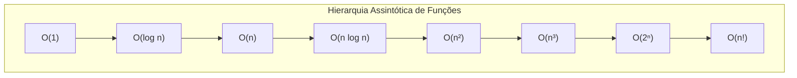

### Cenários de análise: melhor caso, pior caso e caso médio

Considere a busca linear por uma chave em um vetor desordenado contendo `$`n`$` elementos:

- **Melhor Caso (`$`\Omega(1)`$)**: O elemento procurado está na primeira posição (`vetor[0]`). O algoritmo encerra a busca após uma única comparação, independentemente do volume total de dados.
- **Pior Caso (`$`O(n)`$)**: O elemento procurado encontra-se na última posição (`vetor[n - 1]`) ou está ausente. O algoritmo é forçado a percorrer todas as `$`n`$` células, realizando `$`n`$` verificações.
- **Caso Médio (`$`\Theta(n)`$)**: Assumindo equiprobabilidade de distribuição, o elemento será localizado em média após `$`\frac{n + 1}{2}`$` verificações, mantendo complexidade estritamente linear `$`O(n)`$`.

### Classes fundamentais de complexidade temporal

| Classe Assintótica | Nomenclatura Formal | Descrição Comportamental | Exemplo Canônico |
| :--- | :--- | :--- | :--- |
| `$`O(1)`$` | Constante | Custo independe integralmente de `$`n`$` | Acesso indexado em array (`vetor[i]`) |
| `$`O(\log n)`$` | Logarítmica | O espaço de busca divide-se pela metade a cada passo | Busca binária em vetor ordenado |
| `$`O(n)`$` | Linear | O trabalho cresce na proporção direta de `$`n`$` | Varredura de busca sequencial simples |
| `$`O(n \log n)`$` | Linear-Logarítmica | Soluções eficientes de ordenação ótima | Merge Sort e Quick Sort (médio) |
| `$`O(n^2)`$` | Quadrática | Laços iterativos aninhados sobre a mesma massa | Bubble Sort e Selection Sort |
| `$`O(2^n)`$` | Exponencial | Dobra de tamanho a cada elemento adicional | Enumeração de subconjuntos de um conjunto |
| `$`O(n!)`$` | Fatorial | Enumeração de todas as permutações | Força bruta para o Caixeiro-Viajante |

---

### Estudo detalhado do Trabalho Prático de Complexidade

Em estrita consonância com a atividade avaliativa oficial disponibilizada no Google Forms da disciplina, apresentamos a análise rigorosa dos seis métodos canônicos em Java:

#### Questão 1: Soma de Elementos em Vetor
```java
public static int somar(int[] valores) {
    int soma = 0;
    for (int i = 0; i < valores.length; i++) {
        soma += valores[i];
    }
    return soma;
}
```
- **Memória de Cálculo**:
  - Inicialização `int soma = 0`: 1 operação.
  - Inicialização `int i = 0`: 1 operação.
  - Avaliação do laço `i < valores.length`: executada `$`n + 1`$` vezes.
  - Incremento `i++`: executado `$`n`$` vezes.
  - Corpo `soma += valores[i]`: executado `$`n`$` vezes.
  - Retorno: 1 operação.
  - Total: `$`T(n) = 3n + 4 \implies O(n)`$`.
- **Classificação**: **`$`O(n)`$` (Linear)**.

#### Questão 2: Busca Binária em Vetor Pré-Ordenado
```java
public static int buscaBinaria(int[] valores, int procurado) {
    int inicio = 0;
    int fim = valores.length - 1;

    while (inicio <= fim) {
        int meio = (inicio + fim) / 2;

        if (valores[meio] == procurado) {
            return meio;
        }

        if (valores[meio] < procurado) {
            inicio = meio + 1;
        } else {
            fim = meio - 1;
        }
    }

    return -1;
}
```
- **Memória de Cálculo**: A cada iteração do laço `while`, o intervalo `$`[inicio, fim]`$` é reduzido aproximadamente pela metade: `$`\frac{n}{2}, \frac{n}{4}, \frac{n}{8}, \dots, \frac{n}{2^k}`$`. O laço encerra no pior caso quando a partição atinge tamanho 1:
  ```math
  \frac{n}{2^k} = 1 \implies 2^k = n \implies k = \log_2 n
  ```
- **Classificação**: **`$`O(\log n)`$` (Logarítmica)**.

#### Questão 3: Pares Formados por Laços Aninhados Cartesianos
```java
public static void imprimirPares(int[] valores) {
    for (int i = 0; i < valores.length; i++) {
        for (int j = 0; j < valores.length; j++) {
            System.out.println(valores[i] + " - " + valores[j]);
        }
    }
}
```
- **Memória de Cálculo**:
  - O laço externo executa `$`n`$` iterações.
  - Para cada iteração de `$`i`$`, o laço interno executa rigorosamente `$`n`$` iterações independentes.
  - Total de impressões:
    ```math
    \sum_{i=0}^{n-1} \sum_{j=0}^{n-1} 1 = \sum_{i=0}^{n-1} n = n \times n = n^2
    ```
- **Classificação**: **`$`O(n^2)`$` (Quadrática)**.

#### Questão 4: Comparação de Pares Distintos com Laço Dependente
```java
public static int contarIguais(int[] valores) {
    int contador = 0;
    for (int i = 0; i < valores.length; i++) {
        for (int j = i + 1; j < valores.length; j++) {
            if (valores[i] == valores[j]) {
                contador++;
            }
        }
    }
    return contador;
}
```
- **Memória de Cálculo**:
  - O laço interno inicia em `$`j = i + 1`$`. A quantidade de repetições decresce a cada passo:
    - Quando `$`i = 0`$`, `$`j`$` roda `$`n - 1`$` vezes.
    - Quando `$`i = 1`$`, `$`j`$` roda `$`n - 2`$` vezes.
    - ...
    - Quando `$`i = n - 2`$`, `$`j`$` roda 1 vez.
    - Quando `$`i = n - 1`$`, `$`j`$` roda 0 vezes.
  - O número total de iterações é a soma dos termos de uma Progressão Aritmética:
    ```math
    S = (n - 1) + (n - 2) + \dots + 1 + 0 = \frac{(n - 1)n}{2} = \frac{n^2 - n}{2} = \frac{1}{2}n^2 - \frac{1}{2}n
    ```
  - Eliminando o termo de menor ordem (`$`-\frac{1}{2}n`$`) e a constante (`$`\frac{1}{2}`$`):
- **Classificação**: **`$`O(n^2)`$` (Quadrática)**.

#### Questão 5: Busca do Maior Valor em Vetor Desordenado
```java
public static int maior(int[] valores) {
    int maior = valores[0];
    int i = 1;

    while (i < valores.length) {
        if (valores[i] > maior) {
            maior = valores[i];
        }
        i++;
    }

    return maior;
}
```
- **Memória de Cálculo**: O cursor `i` inicia em 1 e avança linearmente com incremento unitário até `$`valores.length - 1`$`. O laço executa exatamente `$`n - 1`$` verificações independentemente dos valores contidos no vetor.
- **Classificação**: **`$`O(n)`$` (Linear)**.

#### Questão 6: Redução Sucessiva por Divisão Inteira
```java
public static void reduzir(int n) {
    while (n > 1) {
        n = n / 2;
    }
}
```
- **Memória de Cálculo**: A variável inteira `n` não denota o tamanho de uma coleção, mas sim o próprio argumento numérico de entrada. A cada passo, o valor é dividido por 2. A quantidade de iterações necessárias para que `n` atinja 1 corresponde exatamente à quantidade de potências de 2 contidas em `n`, ou seja, `$`\lfloor \log_2 n \rfloor`$`.
- **Classificação**: **`$`O(\log n)`$` (Logarítmica)**.

---

## 6. Listas Lineares Sequenciais

### Estrutura contígua de memória e cálculo de endereços

Uma **Lista Linear Sequencial** é uma estrutura de dados que armazena seus elementos em posições sequenciais e contíguas da memória física do computador. Essa proximidade espacial permite que o compilador e a CPU determinem o endereço exato de qualquer elemento por meio de uma operação matemática elementar em hardware:

```math
\text{Endereco}(i) = \text{EnderecoBase} + (i \times \text{tamanho\_tipo})
```

Graças a esse mecanismo, o acesso aleatório a qualquer índice de um array estático (como `vetor[i]`) possui complexidade puramente constante `$`O(1)`$`.

### Capacidade física versus tamanho lógico

Na engenharia de listas sequenciais construídas sobre vetores primitivos, é obrigatório diferenciar dois atributos:

- **Capacidade (`capacidade`)**: Representa a dimensão total de memória previamente alocada na inicialização do array (a quantidade máxima de slots disponíveis no Heap).
- **Tamanho (`tamanho`)**: Denota a quantidade de dados úteis e válidos que residem atualmente na estrutura (`$`0 \le \text{tamanho} \le \text{capacidade}`$` ).

```java
public class ListaSequencial {
    private int[] dados;
    private int tamanho;

    public ListaSequencial(int capacidadeMaxima) {
        this.dados = new int[capacidadeMaxima];
        this.tamanho = 0; // Lista inicialmente vazia
    }
}
```

### Operações elementares: consulta, inserção e remoção

- **Consulta (`obter(indice)`)**: Executada em `$`O(1)`$`, requerendo apenas a validação prévia `0 <= indice && indice < tamanho`.
- **Inserção no Final**: Quando há capacidade vaga (`tamanho < capacidade`), insere diretamente em `dados[tamanho++]` com custo `$`O(1)`$`.
- **Inserção no Início ou Meio**: Exige a abertura física de uma vaga, demandando o remanejamento em bloco de todos os elementos adjacentes para a direita (`$`O(n)`$`).
- **Remoção no Início ou Meio**: Exige o preenchimento da lacuna gerada, demandando a translação de todos os elementos posteriores para a esquerda (`$`O(n)`$`).

### O problema do deslocamento de elementos em inserções e remoções

Considere uma lista com `$`n = 5`$` elementos: `[10, 20, 30, 40, 50]`. Para inserir o valor `5` na posição 0, os dados devem ser deslocados de trás para frente para evitar sobreposição destrutiva:

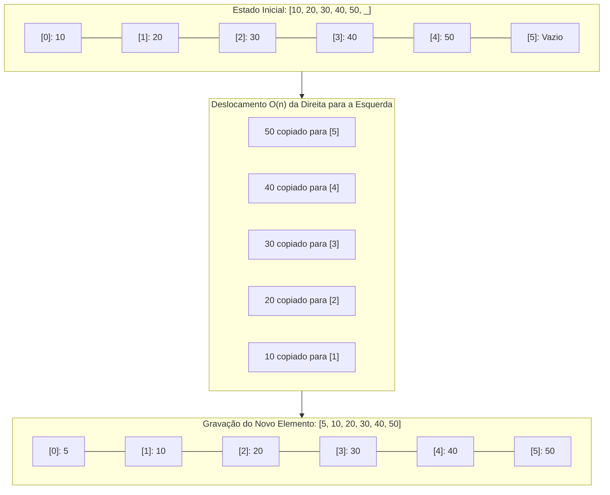

O número de movimentações físicas de memória é exatamente proporcional a `$`n`$`. Se a estrutura contiver 1.000.000 de registros, inserir um elemento na primeira posição exigirá um milhão de operações de escrita na memória RAM.

### Mecanismo de redimensionamento e análise de custo amortizado

Quando um array atinge sua capacidade máxima (`tamanho == capacidade`), qualquer nova inserção exige a execução de uma rotina de expansão:
1. Alocar um novo vetor na memória Heap com capacidade multiplicada (tipicamente o dobro da capacidade original).
2. Copiar sequencialmente todos os `$`n`$` elementos do vetor antigo para o novo vetor.
3. Atualizar a referência interna da classe para apontar para o novo bloco de memória.
4. Descartar o vetor antigo para que seja coletado pelo Garbage Collector.

Embora uma operação isolada de inserção com redimensionamento custe `$`O(n)`$`, o custo é diluído ao longo de uma sequência de `$`n`$` inclusões consecutivas que executam em `$`O(1)`$`. Na ciência da computação, prova-se formalmente que o **custo amortizado por inserção é constante `$`O(1)`$`.**

---

## 7. Listas Dinâmicas Encadeadas

### Quebra da contiguidade: anatomia e semântica do Nó

Para superar o custo quadrático de inserção e remoção das estruturas sequenciais contíguas, o paradigma das **listas ligadas dinâmicas** descarta a exigência de que os dados ocupem posições físicas vizinhas na memória RAM.

Cada elemento passa a residir de forma autônoma na memória Heap dentro de uma entidade atômica denominada **Nó (`No`)**, o qual armazena:
1. A **carga útil (*payload*)**: o dado de interesse da aplicação (como um inteiro primitivo).
2. O **ponteiro de enlace (`proximo`)**: uma variável de referência que retém o endereço de memória da próxima instância de `No`, ou o literal `null` caso represente o fim da estrutura.

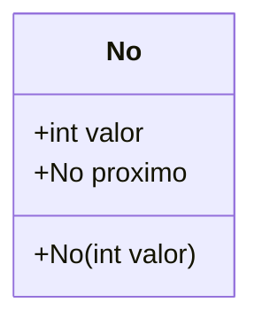

```java
public class No {
    public int valor;
    public No proximo;

    public No(int valor) {
        this.valor = valor;
        this.proximo = null;
    }
}
```

### Arquitetura da classe controladora ListaLigada

Para manter o estado íntegro e oferecer uma interface estável de operações, encapsula-se a cadeia de nós dentro de uma classe controladora:

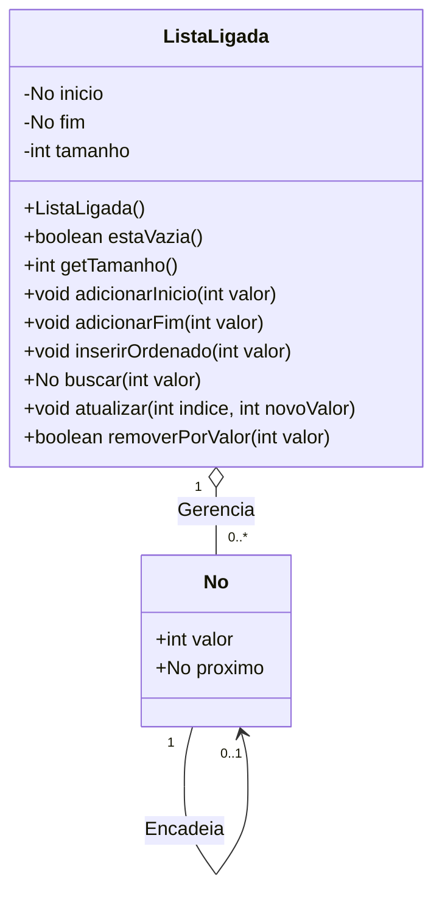

A classe controladora preserva três atributos fundamentais:
- `No inicio`: Referência para a cabeça da lista.
- `No fim`: Referência direta para a cauda da lista (último nó).
- `int tamanho`: Variável inteira mantida a cada mutação para permitir a consulta de cardinalidade em tempo constante `$`O(1)`$`.

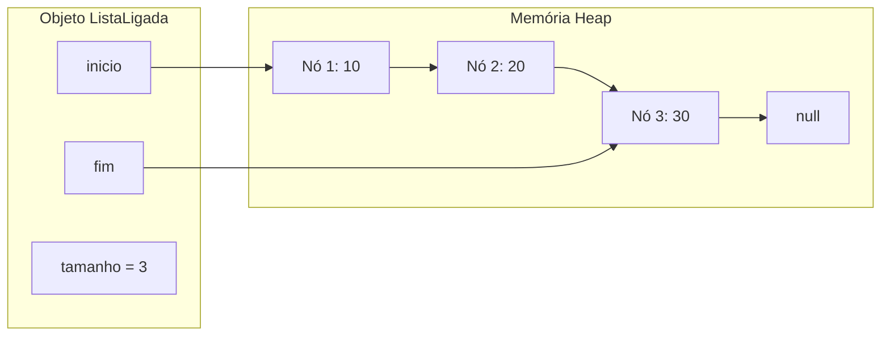

### Inserção na cabeça da lista com tempo constante

A inserção de um elemento no início de uma lista encadeada não requer deslocamentos físicos de outros dados. O procedimento consiste em conectar o novo nó ao nó que outrora encabeçava a fila e redirecionar o atributo `inicio`:

```java
public void adicionarInicio(int valor) {
    No novo = new No(valor);
    novo.proximo = this.inicio;
    this.inicio = novo;

    if (this.fim == null) {
        this.fim = novo; // Caso especial: a lista estava vazia
    }
    this.tamanho++;
}
```

**Complexidade Temporal**: Executa exatamente três atribuições atômicas de ponteiro, independentemente de a lista conter dez ou dez milhões de elementos: **`$`O(1)`$ constante**.

**Armadilha Crítica de Inversão**: Se a atribuição for invertida:
```java
// CODIGO COM FALHA CATASTROFICA:
this.inicio = novo;
novo.proximo = this.inicio; // O nó aponta para si mesmo em laço circular infinito!
```
Ao sobrescrever `this.inicio` prematuramente, perde-se para sempre o endereço da cadeia antiga, gerando um vazamento de memória no Heap.

### Inserção na cauda com e sem ponteiro de fim

A inclusão de elementos no final de uma lista ligada evidencia uma clássica decisão de projeto de software:

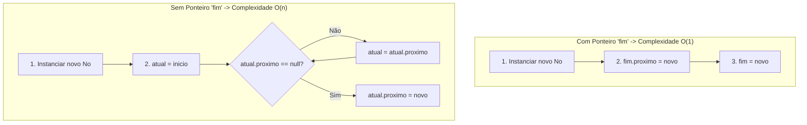

- **Sem ponteiro `fim`**: Exige percorrer sequencialmente todos os `$`n`$` nós desde a cabeça até alcançar a terminação `null`. Complexidade assintótica linear **`$`O(n)`$**.
- **Com ponteiro `fim`**: O nó terminal é alcançado diretamente através da referência de cauda. Complexidade assintótica estritamente constante **`$`O(1)`$**.

```java
public void adicionarFim(int valor) {
    No novo = new No(valor);

    if (estaVazia()) {
        this.inicio = novo;
        this.fim = novo;
    } else {
        this.fim.proximo = novo;
        this.fim = novo;
    }
    this.tamanho++;
}
```

### Inserção ordenada no meio da lista

Em uma lista mantida em ordem crescente, a inserção desdobra-se em duas etapas de custos analíticos distintos:

1. **Etapa de Busca/Localização**: Localizar o nó anterior à posição onde o novo elemento deve repousar. Exige percurso sequencial: custo **`$`O(n)`$**.
2. **Etapa de Religamento**: Ajustar as referências para acomodar o novo nó na cadeia: custo **`$`O(1)`$**.

Pela regra da soma assintótica, o custo total da operação é dominado pela etapa de busca: `$`O(n) + O(1) = O(n)`$`.

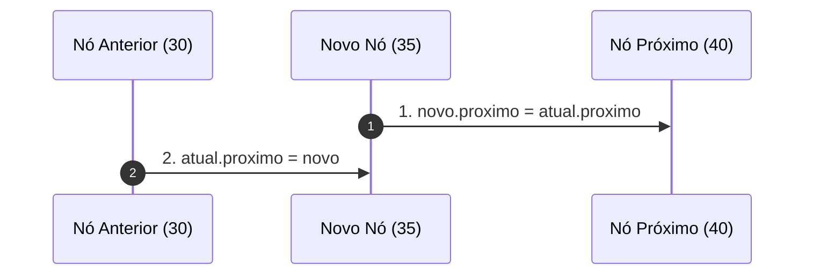

```java
public void inserirOrdenado(int valor) {
    No novo = new No(valor);

    // Caso 1: Lista vazia ou elemento menor que a cabeça atual
    if (estaVazia() || valor <= this.inicio.valor) {
        novo.proximo = this.inicio;
        this.inicio = novo;
        if (this.fim == null) {
            this.fim = novo;
        }
        this.tamanho++;
        return;
    }

    // Caso 2: Varredura até encontrar o nó anterior correto
    No atual = this.inicio;
    while (atual.proximo != null && atual.proximo.valor < valor) {
        atual = atual.proximo;
    }

    // Caso 3: Religamento atômico seguro
    novo.proximo = atual.proximo;
    atual.proximo = novo;

    if (novo.proximo == null) {
        this.fim = novo; // O novo nó tornou-se a cauda
    }
    this.tamanho++;
}
```

### Busca linear por valor e remoção de nós

A consulta por conteúdo em uma lista ligada obriga o algoritmo a iterar salto a salto através de `atual = atual.proximo`:

```java
public No buscar(int valor) {
    No atual = this.inicio;
    while (atual != null) {
        if (atual.valor == valor) {
            return atual; // Encontrado
        }
        atual = atual.proximo;
    }
    return null; // Ausente após varrer toda a cadeia
}
```
- **Melhor caso**: O elemento está na cabeça (`$`\Omega(1)`$`).
- **Pior caso**: O elemento está na cauda ou inexiste (`$`O(n)`$`).

Para **remover** um nó intermediário, localiza-se o predecessor `anterior` e atualiza-se seu elo para contornar o nó a ser excluído:
```java
anterior.proximo = atual.proximo;
```
O nó isolado perde seu vínculo com o grafo acessível da JVM e é reciclado pelo Garbage Collector.

### Atualização por índice posicional

Nas listas encadeadas, o conceito de "índice" é uma abstração puramente lógica; não existe indexação física de hardware. Atingir o índice `k` requer a travessia de `k` referências consecutivas:

```java
public void atualizar(int indice, int novoValor) {
    if (indice < 0 || indice >= this.tamanho) {
        throw new IndexOutOfBoundsException("Índice fora dos limites: " + indice);
    }

    No atual = this.inicio;
    for (int i = 0; i < indice; i++) {
        atual = atual.proximo;
    }

    atual.valor = novoValor; // Mutação do valor em tempo O(1)
}
```
Complexidade Temporal: **`$`O(n)`$ no pior caso**, devido ao laço de posicionamento.

### Matriz comparativa: Lista Sequencial versus Lista Ligada

| Dimensão de Comparação | Lista Sequencial (Vetor) | Lista Ligada Dinâmica |
| :--- | :--- | :--- |
| **Acesso por Índice (`get(i)`)** | `$`O(1)`$` (Instantâneo) | `$`O(n)`$` (Exige saltos sequenciais) |
| **Inserção no Início** | `$`O(n)`$` (Deslocamento em bloco) | `$`O(1)`$` (Ajuste de ponteiros) |
| **Inserção no Fim (com cauda)** | `$`O(1)`$` amortizado | `$`O(1)`$` rigoroso |
| **Inserção no Meio** | `$`O(n)`$` (Deslocamento de elementos) | `$`O(n)`$` (Localização) + `$`O(1)`$` (Religamento) |
| **Sobrecarga de Memória (*Overhead*)** | Nula ou folga de capacidade | 8 a 16 bytes adicionais por nó (ponteiro) |
| **Localidade de Cache da CPU** | Excelente (*Cache lines* contíguas) | Baixa (Nós fragmentados no Heap) |
| **Flexibilidade de Capacidade** | Rígida; sujeita a redimensionamento | Ilimitada; cresce sob demanda |

---

## 8. Tipo Abstrato de Dados Pilha (Stack)

### Conceituação formal e disciplina LIFO

A **Pilha** (*Stack*) é um Tipo Abstrato de Dados linear no qual todas as operações de mutação (inserção e remoção) e inspeção ocorrem exclusivamente em uma única extremidade aberta da estrutura, universalmente denominada **Topo** (*top*). A extremidade basal permanece inacessível.

A pilha rege-se pelo princípio estrutural:

```math
\text{LIFO} \iff \text{Last In, First Out} \quad (\text{Último a Entrar, Primeiro a Sair})
```

### Operações fundamentais: push, pop, peek e isEmpty

O contrato operacional canônico de uma pilha compõe-se de quatro métodos essenciais:

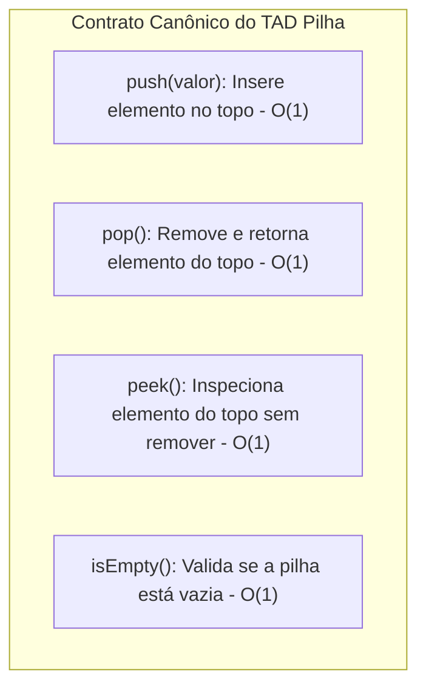

- **`push(valor)`**: Adiciona o elemento sobre o topo. Em implementações estáticas com capacidade preenchida, disparará a condição de erro **Stack Overflow** (estouro de capacidade).
- **`pop()`**: Remove o elemento posicionado no topo e retorna seu valor. Caso a pilha não contenha itens, disparará a condição de erro **Stack Underflow** (subfluxo de dados).
- **`peek()`**: Retorna o elemento do topo mantendo o estado da estrutura inalterado.
- **`isEmpty()`**: Predicado booleano que reporta se há ausência de elementos.

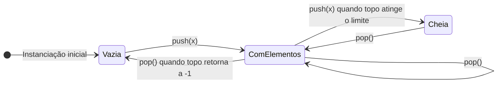

### Restrição de acesso deliberada e garantia de integridade

Uma dúvida recorrente em computação indaga: *"Por que não expor métodos para ler o elemento central de uma pilha?"*

A restrição de acesso da pilha é deliberada e representa seu maior valor de engenharia. Ao privar o cliente de acessar células intermediárias, a pilha **garante invariantes de reversibilidade estrita**. Sistemas como o mecanismo de chamadas de métodos da JVM (*Call Stack*), algoritmos de retrocesso (*backtracking*) e sistemas transacionais de bancos de dados (*undo/rollback*) apoiam-se nessa garantia matemática de que o último estado registrado é estritamente o primeiro a ser desfeito.

### Implementação estática baseada em vetor contíguo

Na implementação estática, os elementos residem em um array primitivo, e o cursor de controle é uma variável inteira `topo`, inicializada com `-1` para denotar ausência de itens (indexação baseada em zero):

```java
public class PilhaVetor {
    private int[] elementos;
    private int topo;

    public PilhaVetor(int capacidade) {
        if (capacidade <= 0) {
            throw new IllegalArgumentException("Capacidade deve ser superior a zero.");
        }
        this.elementos = new int[capacidade];
        this.topo = -1; // Sentinela de pilha vazia
    }

    public boolean isEmpty() {
        return this.topo == -1;
    }

    public boolean isFull() {
        return this.topo == this.elementos.length - 1;
    }

    public void push(int valor) {
        if (isFull()) {
            throw new IllegalStateException("Erro: Stack Overflow.");
        }
        // Pré-incrementa o topo e armazena o valor
        this.elementos[++this.topo] = valor;
    }

    public int pop() {
        if (isEmpty()) {
            throw new IllegalStateException("Erro: Stack Underflow.");
        }
        // Retorna o valor e pós-decrementa o topo (exclusão lógica)
        return this.elementos[this.topo--];
    }

    public int peek() {
        if (isEmpty()) {
            throw new IllegalStateException("Erro: Pilha vazia.");
        }
        return this.elementos[this.topo];
    }
}
```

#### Persistência física versus exclusão lógica
Ao invocar `pop()`, o valor primitivo continua fisicamente gravado na célula do vetor interno; apenas o índice lógico `topo` é reduzido. Trata-se de uma **exclusão lógica**. A célula física será sobrescrita com segurança em um futuro `push()`.

### Implementação dinâmica baseada em lista encadeada

Para contornar o risco de *Stack Overflow*, a pilha dinâmica mapeia o topo diretamente para a **cabeça (`inicio`)** de uma lista ligada:

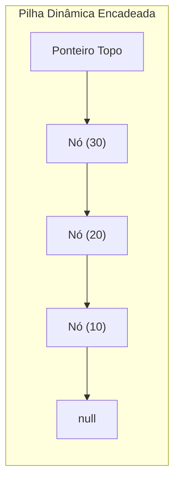

```java
public class PilhaLigada {
    private No topo;
    private int tamanho;

    public PilhaLigada() {
        this.topo = null;
        this.tamanho = 0;
    }

    public boolean isEmpty() {
        return this.topo == null;
    }

    public void push(int valor) {
        No novo = new No(valor);
        novo.proximo = this.topo;
        this.topo = novo;
        this.tamanho++;
    }

    public int pop() {
        if (isEmpty()) {
            throw new IllegalStateException("Erro: Stack Underflow.");
        }
        int valorRemovido = this.topo.valor;
        this.topo = this.topo.proximo;
        this.tamanho--;
        return valorRemovido;
    }

    public int peek() {
        if (isEmpty()) {
            throw new IllegalStateException("Erro: Pilha vazia.");
        }
        return this.topo.valor;
    }
}
```
Como as inserções e retiradas ocorrem na cabeça da cadeia de nós, todas as operações fundamentais mantêm tempo estritamente constante **`$`O(1)`$**.

### Manipulação de elementos intermediários mediante pilhas auxiliares

Quando uma regra de negócio exige inspecionar, substituir ou remover um dado localizado no meio de uma pilha sem corromper o encapsulamento do TAD, emprega-se o padrão da **Pilha Auxiliar**. 

Os dados superiores são desempilhados e depositados na pilha temporária, o elemento alvo é manipulado, e todos os dados intermediários são reempilhados de volta à estrutura original:

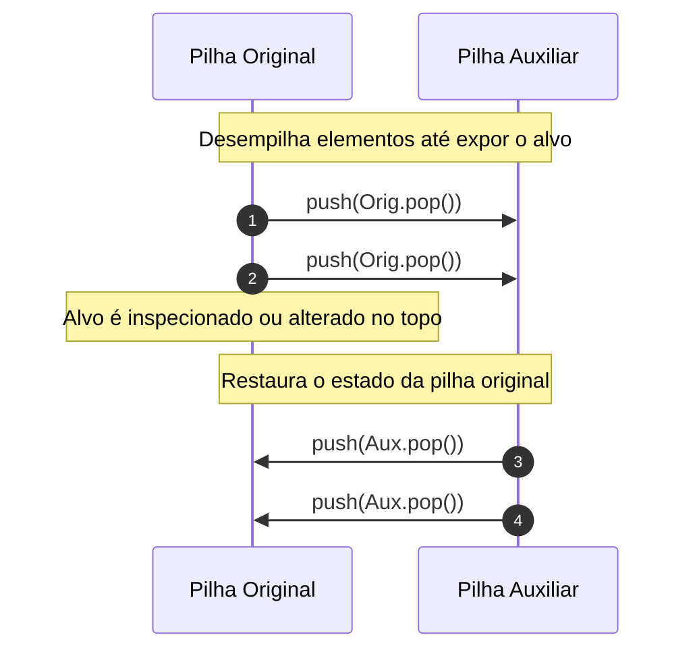

#### Implementação do método contem()
```java
public boolean contem(int valorProcurado) {
    PilhaLigada auxiliar = new PilhaLigada();
    boolean encontrado = false;

    // Descarrega na auxiliar preservando a rastreabilidade
    while (!this.isEmpty()) {
        int atual = this.pop();
        if (atual == valorProcurado) {
            encontrado = true;
        }
        auxiliar.push(atual);
    }

    // Restauração obrigatória do estado original
    while (!auxiliar.isEmpty()) {
        this.push(auxiliar.pop());
    }

    return encontrado;
}
```
- **Complexidade Temporal**: `$`O(n)`$` (visita todos os nós).
- **Complexidade Espacial Auxiliar**: `$`O(n)`$` (memória temporária na pilha auxiliar).

### Trade-offs entre Pilha Sequencial e Pilha Ligada

| Critério Técnico | Pilha Sequencial (Array) | Pilha Dinâmica Encadeada |
| :--- | :--- | :--- |
| **Limite de Capacidade** | Rígido (risco de *Stack Overflow*) | Flexível (limitado à RAM global) |
| **Custo de Alocação** | Pago uma única vez na inicialização | Pago a cada chamada de `push()` (`new No`) |
| **Consumo de Memória por Item** | Mínimo (apenas o tipo primitivo) | Elevado (valor + ponteiro de 64 bits) |
| **Localidade de Cache da CPU** | Excelente (acesso contíguo em RAM) | Baixa (nós espalhados na memória Heap) |
| **Pressão sobre o Garbage Collector** | Nula | Constante a cada `pop()` executado |

---

## 9. Algoritmos de Ordenação Elementares

### Importância econômica e computacional da ordenação

A ordenação de dados é um dos pilares computacionais da engenharia de software:
- Viabiliza a busca binária de complexidade logarítmica `$`O(\log n)`$`, superando buscas lineares de `$`O(n)`$`.
- Otimiza a junção (*merge joins*) e o cruzamento de grandes bases relacionais.
- Elimina duplicidades e acelera a compressão de informações.

---

### Bubble Sort: estratégia de trocas adjacentes e rastreamento

O **Bubble Sort** (Método da Bolha) efetua a ordenação propagando repetidamente o maior elemento restante para a extremidade final do array através de **comparações e trocas contínuas entre vizinhos adjacentes**:

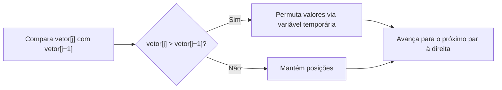

#### Rastreamento Analítico Passo a Passo
Considere o vetor inicial: `[5, 3, 8, 1]` (`$`n = 4`$`):

- **1ª Passagem (`i = 0` | limite `j < n - 1 - i`):**
  - `j = 0`: Compara `5` e `3`. Como `5 > 3`, **troca**: `[3, 5, 8, 1]`.
  - `j = 1`: Compara `5` e `8`. Como `5 < 8`, mantém: `[3, 5, 8, 1]`.
  - `j = 2`: Compara `8` e `1`. Como `8 > 1`, **troca**: `[3, 5, 1, 8]`.
  - *Consolidação*: O elemento `8` está definitivamente fixado no índice 3.
- **2ª Passagem (`i = 1` | limite `j < 2`):**
  - `j = 0`: Compara `3` e `5`. Como `3 < 5`, mantém: `[3, 5, 1, 8]`.
  - `j = 1`: Compara `5` e `1`. Como `5 > 1`, **troca**: `[3, 1, 5, 8]`.
  - *Consolidação*: O elemento `5` está definitivamente fixado no índice 2.
- **3ª Passagem (`i = 2` | limite `j < 1`):**
  - `j = 0`: Compara `3` e `1`. Como `3 > 1`, **troca**: `[1, 3, 5, 8]`.
  - *Consolidação*: Os elementos `1` e `3` estão ordenados.

#### Implementação Canônica em Java com Otimização de Flag
```java
public class BubbleSort {
    public static void ordenar(int[] vetor) {
        int n = vetor.length;
        boolean houveTroca;

        for (int i = 0; i < n - 1; i++) {
            houveTroca = false;
            for (int j = 0; j < n - 1 - i; j++) {
                if (vetor[j] > vetor[j + 1]) {
                    int temp = vetor[j];
                    vetor[j] = vetor[j + 1];
                    vetor[j + 1] = temp;
                    houveTroca = true;
                }
            }
            // Se nenhuma troca ocorreu na passagem, o vetor já está ordenado!
            if (!houveTroca) {
                break;
            }
        }
    }
}
```
- **Complexidade Temporal**: Pior e Médio Caso: `$`O(n^2)`$`; Melhor Caso (vetor pré-ordenado com flag): **`$`O(n)`$**.
- **Espaço Auxiliar**: `$`O(1)`$` (ordenação *in-place*).

---

### Selection Sort: seleção de extremos e rastreamento

O **Selection Sort** (Ordenação por Seleção) divide virtualmente o vetor em duas partições: uma porção esquerda já ordenada e uma porção direita desordenada. A cada passagem, o algoritmo busca o índice do menor elemento absoluto da partição desordenada e realiza **uma única troca por ciclo**:

```mermaid
flowchart TD
    Ini["Início da Passagem i"] --> DefineMenor["Assume indiceMenor = i"]
    DefineMenor --> Varre["Varre j de i + 1 até n - 1"]
    Varre --> Cond{"vetor[j] < vetor[indiceMenor]?"}
    Cond -->|"Sim"| Atualiza["indiceMenor = j"]
    Cond -->|"Não"| Mantem["Mantém indiceMenor"]
    Atualiza --> ChecaFim{"Fim do Vetor?"}
    Mantem --> ChecaFim
    ChecaFim -- Não --> Varre
    ChecaFim -- Sim --> Troca["Efetua Troca Única: vetor[i] com vetor[indiceMenor]"]
```

#### Rastreamento Analítico Passo a Passo
Considere o vetor inicial: `[5, 3, 8, 1]` (`$`n = 4`$`):

- **1ª Passagem (`i = 0`):**
  - Assume `indiceMenor = 0` (`5`).
  - Comparações: `vetor[1]` (`3`) < `5` -> `indiceMenor = 1`. `vetor[2]` (`8`) > `3`. `vetor[3]` (`1`) < `3` -> `indiceMenor = 3`.
  - **Troca única**: Permuta `vetor[0]` com `vetor[3]`: `[1, 3, 8, 5]`.
- **2ª Passagem (`i = 1`):**
  - Assume `indiceMenor = 1` (`3`).
  - Comparações: `vetor[2]` (`8`) > `3`. `vetor[3]` (`5`) > `3`.
  - **Troca única**: `vetor[1]` consigo mesmo: `[1, 3, 8, 5]`.
- **3ª Passagem (`i = 2`):**
  - Assume `indiceMenor = 2` (`8`).
  - Comparação: `vetor[3]` (`5`) < `8` -> `indiceMenor = 3`.
  - **Troca única**: Permuta `vetor[2]` com `vetor[3]`: `[1, 3, 5, 8]`.

#### Implementação Canônica em Java
```java
public class SelectionSort {
    public static void ordenar(int[] vetor) {
        int n = vetor.length;

        for (int i = 0; i < n - 1; i++) {
            int indiceMenor = i;
            for (int j = i + 1; j < n; j++) {
                if (vetor[j] < vetor[indiceMenor]) {
                    indiceMenor = j;
                }
            }
            // Troca única ao final de cada passagem
            int temp = vetor[i];
            vetor[i] = vetor[indiceMenor];
            vetor[indiceMenor] = temp;
        }
    }
}
```
- **Complexidade Temporal**: `$`O(n^2)`$` em **todos** os casos (melhor, médio e pior), pois o laço varre invariavelmente todas as posições restantes.
- **Vantagem de Engenharia**: Minimiza a quantidade de escritas em memória RAM (no máximo `$`n - 1`$` trocas no total).
- **Instabilidade**: O Selection Sort pode alterar a ordem relativa de elementos de chaves idênticas.

---

### Insertion Sort: inserção direta, baralho e invariante de laço

O **Insertion Sort** (Ordenação por Inserção) baseia-se na analogia do jogador organizando cartas de baralho na mão: insere cada elemento individual em sua posição correta dentro de um subconjunto pré-existente já ordenado.

```mermaid
flowchart TD
    subgraph VetorParticionado["Particionamento Dinâmico"]
        Ord["Porção Ordenada: [0 ... i-1]"] --- Key["Chave: vetor[i]"] --- NaoOrd["Porção Desordenada: [i+1 ... n-1]"]
    end
```

#### Invariante de Laço
> No início de cada iteração do laço externo `for` (controlado por `i`), o subvetor `vetor[0 ... i - 1]` é composto rigorosamente pelos elementos originais dessas posições, organizados em ordem estritamente crescente.

### Diferença operacional entre deslocamento e troca

A elegância do Insertion Sort apoia-se no uso de **deslocamento (*shift*)** em detrimento de **trocas (*swaps*)**:
- A troca clássica consome **3 operações de memória**:
  ```java
  int temp = vetor[k]; vetor[k] = vetor[k - 1]; vetor[k - 1] = temp;
  ```
- O deslocamento isola a chave uma única vez e translada os elementos adjacentes maiores com **1 operação de escrita**:
  ```java
  vetor[j + 1] = vetor[j];
  ```

#### Rastreamento do Insertion Sort com Deslocamento
Considere o vetor inicial: `[7, 3, 8, 2, 6]` (`$`n = 5`$`):

- **Passo 1 (`i = 1` | chave = 3):**
  - Compara com `7`: como `7 > 3`, desloca o `7` para o índice 1: `[7, 7, 8, 2, 6]`.
  - Grava a chave na vaga aberta (índice 0): `[3, 7, 8, 2, 6]`.
- **Passo 2 (`i = 2` | chave = 8):**
  - Compara com `7`: como `7 < 8`, não há deslocamento.
  - Grava a chave na posição original (índice 2): `[3, 7, 8, 2, 6]`.
- **Passo 3 (`i = 3` | chave = 2):**
  - Compara com `8`, `7` e `3`: todos maiores que `2`, deslocam-se para a direita: `[3, 3, 7, 8, 6]`.
  - Grava a chave no índice 0: `[2, 3, 7, 8, 6]`.
- **Passo 4 (`i = 4` | chave = 6):**
  - Compara com `8` e `7`: deslocam-se para a direita.
  - Colide com `3` (menor): o deslocamento cessa.
  - Grava a chave no índice 2: `[2, 3, 6, 7, 8]`.

#### Implementação Canônica em Java
```java
public class InsertionSort {
    public static void ordenar(int[] vetor) {
        for (int i = 1; i < vetor.length; i++) {
            int chave = vetor[i];
            int j = i - 1;

            // Curto-circuito booleano seguro: valida 'j >= 0' antes de ler o vetor
            while (j >= 0 && vetor[j] > chave) {
                vetor[j + 1] = vetor[j]; // Deslocamento para a direita
                j--;
            }
            vetor[j + 1] = chave; // Inserção da chave na posição vaga
        }
    }
}
```
- **Melhor Caso**: Vetor já ordenado: realiza apenas `$`n - 1`$` comparações e nenhum deslocamento: **`$`O(n)`$**.
- **Pior Caso**: Vetor em ordem decrescente reversa: **`$`O(n^2)`$**.
- **Estabilidade**: O Insertion Sort é **estável**, preservando a precedência relativa de chaves iguais.

---

### Matriz comparativa entre algoritmos elementares de ordenação

| Dimensão de Engenharia | Bubble Sort | Selection Sort | Insertion Sort |
| :--- | :--- | :--- | :--- |
| **Melhor Caso de Tempo** | `$`O(n)`$` (com flag de parada) | `$`O(n^2)`$` (Inflexível) | `$`O(n)`$` (Adaptação natural) |
| **Caso Médio de Tempo** | `$`O(n^2)`$` | `$`O(n^2)`$` | `$`O(n^2)`$` |
| **Pior Caso de Tempo** | `$`O(n^2)`$` | `$`O(n^2)`$` | `$`O(n^2)`$` |
| **Complexidade Espacial** | `$`O(1)`$` (*In-place*) | `$`O(1)`$` (*In-place*) | `$`O(1)`$` (*In-place*) |
| **Volume de Escritas em RAM** | Muito Alto (`$`O(n^2)`$` trocas) | Mínimo (`$`n - 1`$` trocas) | Baixo (`$`O(n^2)`$` deslocamentos simples) |
| **Estabilidade de Chaves** | Estável | Instável | Estável |
| **Comportamento Online** | Não | Não | Sim (ordena fluxos contínuos) |

---

## 10. Roteiro Sistemático de Revisão para Provas e Banco de Questões

### O protocolo de análise em seis passos

Para resolver com rigor qualquer questão de prova teórica ou desafio prático de código, siga sistematicamente o roteiro consolidado pelo Prof. Wesley Soares:

1. **Passo 1 — Identificação da Entrada (`$`n`$`):** Identifique o parâmetro determinante do volume de processamento (número de elementos no vetor, nós da lista ou valor de controle numérico).
2. **Passo 2 — Contagem das Operações Primitivas:** Isole as atribuições, somas e comparações contidas no núcleo da rotina.
3. **Passo 3 — Mapeamento dos Laços e Repetições:** Examine a profundidade do aninhamento, se os laços são independentes (`$`n \times n`$`), dependentes da variável externa (`$`\frac{n^2}{2}`$`) ou sofrem divisões sucessivas (`$`\log n`$`).
4. **Passo 4 — Seleção da Estrutura Adequada:** Avalie se os requisitos de acesso aleatório vs. mutação em extremidades indicam Array, Lista Ligada ou Pilha.
5. **Passo 5 — Dedução da Ordem Assintótica (Big-O):** Elimine constantes multiplicativas e termos de menor ordem para categorizar a classe de custo.
6. **Passo 6 — Avaliação do Impacto de Memória:** Diferencie alocação na Stack de instanciações dinâmicas no Heap, verificando a preservação contra *Memory Leaks*.

---

### Questões resolvidas e comentadas

#### Questão Resolvida 1
*(Tema: Inversão de Ordem com TAD Pilha)*  
**Enunciado**: Desenvolva um método estático em Java que receba uma `PilhaLigada` contendo inteiros e devolva uma nova pilha com todos os elementos invertidos, garantindo que a pilha original termine restaurada ao seu estado inicial.

**Resolução Comentada**:
```java
public static PilhaLigada inverterPilha(PilhaLigada original) {
    PilhaLigada auxiliar = new PilhaLigada();
    PilhaLigada invertida = new PilhaLigada();

    // 1. Esvazia a original para a auxiliar (inverte 1 vez)
    while (!original.isEmpty()) {
        auxiliar.push(original.pop());
    }

    // 2. Transfere da auxiliar para a original e para a invertida simultaneamente
    while (!auxiliar.isEmpty()) {
        int item = auxiliar.pop();
        original.push(item);   // Restaura a original em seu estado inicial
        invertida.push(item);  // Mantém a ordem invertida na nova pilha
    }

    return invertida;
}
```
- **Análise de Complexidade**:
  - Tempo: Dois laços lineares independentes: `$`O(n) + O(n) = O(2n) \implies O(n)`$`.
  - Espaço Auxiliar: `$`O(n)`$` para acomodar os elementos na pilha temporária.

#### Questão Resolvida 2
*(Tema: Inserção no Fim em Lista Ligada sem Cauda)*  
**Enunciado**: Explique por que a ausência do ponteiro `fim` em uma lista ligada degrada o desempenho de um sistema de fila bancária de alta vazão.

**Resolução Comentada**:  
Em uma fila de atendimento (disciplina FIFO), novos clientes ingressam obrigatoriamente no final da estrutura. Sem um atributo de cauda (`fim`), o método de inserção deve iniciar no nó `inicio` e percorrer `$`n - 1`$` referências de ponteiros a cada novo cliente. Se a fila contiver `$`n = 50.000`$` clientes ao longo do dia, o processamento exigirá `$`\sum_{k=1}^{50000} k \approx \frac{50000^2}{2} = 1.250.000.000`$` operações de desreferenciamento de ponteiros, elevando a complexidade do lote a `$`O(n^2)`$` e gerando latência perceptível no sistema de atendimento. A introdução do ponteiro `fim` reduz o custo de cada inclusão a `$`O(1)`$`, consumindo apenas 50.000 instruções totais (`$`O(n)`$`).

---

## 11. Glossário Técnico Consolidado

- **Acesso Aleatório (*Random Access*)**: Capacidade de uma estrutura de dados de ler ou gravar em qualquer posição de memória em tempo constante `$`O(1)`$` através de cálculo aritmético de endereço de índice.
- **Alocação Dinâmica**: Mecanismo de requisição de memória em tempo de execução realizado no espaço Heap da JVM via operador `new`.
- **Análise Assintótica**: Ramo da ciência da computação teórica que estuda o comportamento limite do custo de algoritmos quando o tamanho da entrada cresce indefinidamente.
- **Cache Hit / Cache Miss**: Evento em que os dados solicitados pela CPU já estão presentes na memória cache ultrarrápida (*hit*), ou quando precisam ser buscados na memória RAM física principal (*miss*).
- **Call Stack**: Área de memória volátil da JVM destinada a gerenciar o fluxo de controle de chamadas de métodos, escopo e variáveis locais primitivas.
- **Encapsulamento**: Princípio de design que oculta os detalhes de armazenamento e ponteiros internos de uma estrutura, expondo apenas operações públicas regulamentadas.
- **FIFO (*First In, First Out*)**: Disciplina de ordenação temporal na qual o primeiro elemento inserido é obrigatoriamente o primeiro a ser retirado (característica de Filas).
- **Garbage Collector (GC)**: Processo automático da JVM encarregado de rastrear, reciclar e liberar blocos de memória Heap ocupados por instâncias inalcançáveis pela Stack.
- **Heap Memory**: Espaço global e compartilhado da JVM onde todos os objetos, classes e arrays dinâmicos são instanciados.
- **In-place Sorting**: Algoritmo de ordenação que reorganiza os elementos dentro do próprio array de entrada, exigindo apenas uma quantidade constante e trivial `$`O(1)`$` de memória auxiliar.
- **Invariante de Laço**: Condição lógica que permanece rigorosamente verdadeira antes, durante e após cada ciclo de repetição de um algoritmo, utilizada para demonstrar formalmente sua correção.
- **LIFO (*Last In, First Out*)**: Disciplina estrutural na qual o último elemento adicionado é o primeiro a ser desempilhado (característica de Pilhas).
- **Lista Ligada**: Coleção linear dinâmica composta por nós dispersos no Heap, vinculados exclusivamente por elos explícitos de ponteiros/referências.
- **Lista Sequencial**: Coleção linear fundamentada em posições contíguas de memória física, caracterizada por acesso direto indexado `$`O(1)`$` e custo linear de remanejamento `$`O(n)`$`.
- **Notação Big-O (`$`O`$` )**: Representação matemática que expressa o limite superior assintótico (pior cenário de custo) de um algoritmo para entradas suficientemente grandes.
- **Nó (*Node*)**: Estrutura elementar de dados composta por um campo de valor (*payload*) e um ou mais ponteiros de referência para nós congêneres.
- **Pilha (*Stack*)**: Tipo Abstrato de Dados linear restrito cujas mutações e consultas ocorrem exclusivamente na extremidade denominada Topo.
- **Ponteiro de Cauda (*Tail / fim*)**: Referência direta mantida pela classe controladora para o último nó da lista encadeada, viabilizando inserções no fim em tempo `$`O(1)`$`.
- **Refinamento Sucessivo**: Metodologia de decomposição descendente (*top-down*) que decompõe problemas abstratos em camadas progressivas de primitivas operacionais.
- **Stack Overflow**: Condição crítica gerada pela tentativa de inserir dados em uma pilha estática que já atingiu sua capacidade física máxima.
- **Stack Underflow**: Condição de exceção deflagrada pela tentativa de extrair ou inspecionar elementos em uma pilha desprovida de dados.
- **Tipo Abstrato de Dados (TAD)**: Especificação formal que desacopla o comportamento operacional e o contrato público de uma estrutura de dados de sua codificação física interna em memória.

---

## Fontes e Metadados

- Turma no Classroom: estrutura de dados 1 2026/02
- Itens processados: 0 materiais, 4 tarefas, 10 avisos
- Gerado em: 28/10/2026, 20:04:58 (BRT) via classroom-sync
