# Guia Integrado de Estrutura de Dados I

> **Instituição:** Centro Universitário de Santa Fé do Sul (UniFEF)  
> **Curso:** Bacharelado em Sistemas de Informação (4º Semestre)  
> **Docente:** Prof. Ms. Wesley Soares de Souza  
> **Disciplina:** Estrutura de Dados I  
> **Material:** Manual Acadêmico e Técnico Integrado de Aulas, Algoritmos e Complexidade

---

## Sumário

- [Apresentação e Contrato Pedagógico da Disciplina](#apresentacao-e-contrato-pedagogico-da-disciplina)
  - [Perfil docente e visão da disciplina](#perfil-docente-e-visao-da-disciplina)
  - [Ementa oficial e trilha temática](#ementa-oficial-e-trilha-tematica)
  - [Sistema e critérios de avaliação](#sistema-e-criterios-de-avaliacao)
  - [Bibliografia oficial e leituras recomendadas](#bibliografia-oficial-e-leituras-recomendadas)
- [Capítulo 1: Introdução a Algoritmos e Ciclo de Resolução de Problemas](#capitulo-1-introducao-a-algoritmos-e-ciclo-de-resolucao-de-problemas)
  - [Definição formal de algoritmo](#definicao-formal-de-algoritmo)
  - [As seis características fundamentais de um algoritmo](#as-seis-caracteristicas-fundamentais-de-um-algoritmo)
  - [O princípio da organização: o axioma de Wirth](#o-principio-da-organizacao-o-axioma-de-wirth)
  - [Algoritmo versus programa](#algoritmo-versus-programa)
  - [Ciclo de engenharia de software: do problema à solução](#ciclo-de-engenharia-de-software-do-problema-a-solucao)
  - [Estudo de caso guiado: controle de fila bancária](#estudo-de-caso-guiado-controle-de-fila-bancaria)
- [Capítulo 2: Metodologia de Projeto de Algoritmos e Refinamento Sucessivo](#capitulo-2-metodologia-de-projeto-de-algoritmos-e-refinamento-sucessivo)
  - [A técnica do refinamento sucessivo](#a-tecnica-do-refinamento-sucessivo)
  - [As seis etapas sistemáticas de projeto](#as-seis-etapas-sistematicas-de-projeto)
  - [Estudo de caso guiado: busca do maior elemento em uma sequência](#estudo-de-caso-guiado-busca-do-maior-elemento-em-uma-sequencia)
- [Capítulo 3: Tipos Abstratos de Dados, Abstração e Encapsulamento](#capitulo-3-tipos-abstratos-de-dados-abstracao-e-encapsulamento)
  - [Definição formal de Tipo Abstrato de Dados](#definicao-formal-de-tipo-abstrato-de-dados)
  - [Abstração versus encapsulamento](#abstracao-versus-encapsulamento)
  - [Critérios para escolha da representação de dados](#criterios-para-escolha-da-representacao-de-dados)
- [Capítulo 4: Análise Assintótica de Complexidade e Notação Big O](#capitulo-4-analise-assintotica-de-complexidade-e-notacao-big-o)
  - [Fundamentos da análise assintótica versus tempo empírico](#fundamentos-da-analise-assintotica-versus-tempo-empirico)
  - [Tamanho da entrada e contagem de operações fundamentais](#tamanho-da-entrada-e-contagem-de-operacoes-fundamentais)
  - [Regras de simplificação: descarte de constantes e termos de menor ordem](#regras-de-simplificacao-descarte-de-constantes-e-termos-de-menor-ordem)
  - [Espectro de análise: melhor caso, pior caso e caso médio](#espectro-de-analise-melhor-caso-pior-caso-e-caso-medio)
  - [Estudo comparativo: busca sequencial versus busca binária](#estudo-comparativo-busca-sequencial-versus-busca-binaria)
  - [As classes fundamentais de complexidade](#as-classes-fundamentais-de-complexidade)
- [Capítulo 5: Arquitetura de Memória da JVM: Stack, Heap e Referências](#capitulo-5-arquitetura-de-memoria-da-jvm-stack-heap-e-referencias)
  - [Modelo de execução da JVM: memória Stack versus memória Heap](#modelo-de-execucao-da-jvm-memoria-stack-versus-memoria-heap)
  - [Tipos primitivos versus variáveis de referência](#tipos-primitivos-versus-variaveis-de-referencia)
  - [Ciclo de vida dos objetos e o Garbage Collector](#ciclo-de-vida-dos-objetos-e-o-garbage-collector)
- [Capítulo 6: Estruturas Lineares Sequenciais](#capitulo-6-estruturas-lineares-sequenciais)
  - [Definição e mapeamento de endereçamento contíguo](#definicao-e-mapeamento-de-enderecamento-contiguo)
  - [Diferença entre capacidade física e tamanho lógico](#diferenca-entre-capacidade-fisica-e-tamanho-logico)
  - [O problema do deslocamento em inserções e remoções intermediárias](#o-problema-do-deslocamento-em-insercoes-e-remocoes-intermediarias)
  - [Redimensionamento dinâmico e custo amortizado](#redimensionamento-dinamico-e-custo-amortizado)
- [Capítulo 7: Listas Ligadas Dinâmicas](#capitulo-7-listas-ligadas-dinamicas)
  - [A mudança de paradigma: nós dispersos e ponteiros de encadeamento](#a-mudanca-de-paradigma-nos-dispersos-e-ponteiros-de-encadeamento)
  - [Anatomia da classe No](#anatomia-da-classe-no)
  - [Estrutura da classe controladora ListaLigada](#estrutura-da-classe-controladora-listaligada)
  - [Inserção no início](#insercao-no-inicio)
  - [Inserção no final: abordagem ingênua versus otimização com ponteiro de cauda](#insercao-no-final-abordagem-ingenua-versus-otimizacao-com-ponteiro-de-cauda)
  - [Inserção ordenada: distinção entre localização e religamento](#insercao-ordenada-distincao-entre-localizacao-e-religamento)
  - [Busca linear e recuperação posicional](#busca-linear-e-recuperacao-posicional)
  - [Atualização de elementos por índice](#atualizacao-de-elementos-por-indice)
  - [Remoção de elementos e integridade estrutural](#remocao-de-elementos-e-integridade-estrutural)
  - [Matriz comparativa: lista sequencial versus lista ligada](#matriz-comparativa-lista-sequencial-versus-lista-ligada)
- [Capítulo 8: Estruturas Lineares Restritas: Pilhas](#capitulo-8-estruturas-lineares-restritas-pilhas)
  - [Definição formal e o princípio LIFO](#definicao-formal-e-o-principio-lifo)
  - [O contrato fundamental: push, pop, peek e isEmpty](#o-contrato-fundamental-push-pop-peek-e-isempty)
  - [O princípio do encapsulamento restritivo](#o-principio-do-encapsulamento-restritivo)
  - [Implementação estática baseada em array](#implementacao-estatica-baseada-em-array)
  - [A matemática da sentinela com índice negativo](#a-matematica-da-sentinela-com-indice-negativo)
  - [Exclusão lógica versus física e o problema de vazamento de referências](#exclusao-logica-versus-fisica-e-o-problema-de-vazamento-de-referencias)
  - [Implementação dinâmica encadeada de pilha](#implementacao-dinamica-encadeada-de-pilha)
- [Capítulo 9: Manipulação Avançada de Pilhas com Estruturas Auxiliares](#capitulo-9-manipulacao-avancada-de-pilhas-com-estruturas-auxiliares)
  - [O dilema da inspeção intermediária](#o-dilema-da-inspecao-intermediaria)
  - [Mecanismo da pilha auxiliar para preservação de estado](#mecanismo-da-pilha-auxiliar-para-preservacao-de-estado)
  - [Algoritmo de busca por existência: método contem](#algoritmo-de-busca-por-existencia-metodo-contem)
  - [Substituição e remoção arbitrária de valores internos](#substituicao-e-remocao-arbitraria-de-valores-internos)
  - [Inversão de pilhas e validação de delimitadores balanceados](#inversao-de-pilhas-e-validacao-de-delimitadores-balanceados)
  - [Reflexão crítica sobre a seleção de estruturas de dados](#reflexao-critica-sobre-a-selecao-de-estruturas-de-dados)
- [Capítulo 10: Algoritmos de Ordenação Elementares: Bubble Sort e Selection Sort](#capitulo-10-algoritmos-de-ordenacao-elementares-bubble-sort-e-selection-sort)
  - [A importância da ordenação em sistemas de software](#a-importancia-da-ordenacao-em-sistemas-de-software)
  - [Bubble Sort: ordenação por trocas adjacentes](#bubble-sort-ordenacao-por-trocas-adjacentes)
  - [Simulação passo a passo e teste de mesa do Bubble Sort](#simulacao-passo-a-passo-e-teste-de-mesa-do-bubble-sort)
  - [Implementação e otimização do Bubble Sort com sinalizador](#implementacao-e-otimizacao-do-bubble-sort-com-sinalizador)
  - [Selection Sort: ordenação por seleção de extremos](#selection-sort-ordenacao-por-selecao-de-extremos)
  - [Simulação passo a passo e teste de mesa do Selection Sort](#simulacao-passo-a-passo-e-teste-de-mesa-do-selection-sort)
  - [Implementação do Selection Sort](#implementacao-do-selection-sort)
  - [Comparativo analítico entre Bubble Sort e Selection Sort](#comparativo-analitico-entre-bubble-sort-e-selection-sort)
- [Capítulo 11: Algoritmo de Ordenação por Inserção Direta: Insertion Sort](#capitulo-11-algoritmo-de-ordenacao-por-insercao-direta-insertion-sort)
  - [Conceito e analogia das cartas de baralho](#conceito-e-analogia-das-cartas-de-baralho)
  - [Particionamento dinâmico: porção ordenada, chave e porção não processada](#particionamento-dinamico-porcao-ordenada-chave-e-porcao-nao-processada)
  - [Invariante formal de laço](#invariante-formal-de-laco)
  - [Simulação passo a passo da inserção direta](#simulacao-passo-a-passo-da-insercao-direta)
  - [Diferença computacional crítica: deslocamento versus trocas sucessivas](#diferenca-computacional-critica-deslocamento-versus-trocas-sucessivas)
  - [Implementação completa do Insertion Sort em Java](#implementacao-completa-do-insertion-sort-em-java)
  - [Análise de complexidade temporal e espacial](#analise-de-complexidade-temporal-e-espacial)
  - [Propriedades de estabilidade, adaptatividade e o algoritmo híbrido Timsort](#propriedades-de-estabilidade-adaptatividade-e-o-algoritmo-hibrido-timsort)
- [Capítulo 12: Algoritmo de Ordenação por Divisão e Conquista: Merge Sort](#capitulo-12-algoritmo-de-ordenacao-por-divisao-e-conquista-merge-sort)
  - [O paradigma de divisão e conquista](#o-paradigma-de-divisao-e-conquista)
  - [Etapa de divisão: particionamento recursivo e caso base](#etapa-de-divisao-particionamento-recursivo-e-caso-base)
  - [Prevenção de overflow aritmético no cálculo do ponto médio](#prevencao-de-overflow-aritmetico-no-calculo-do-ponto-medio)
  - [Etapa de combinação: o algoritmo de intercalação com vetor auxiliar](#etapa-de-combinacao-o-algoritmo-de-intercalacao-com-vetor-auxiliar)
  - [Implementação do Merge Sort em Java](#implementacao-do-merge-sort-em-java)
  - [Rastreamento da recursão: movimentos de descida e retorno](#rastreamento-da-recursao-movimentos-de-descida-e-retorno)
  - [Análise formal de complexidade assintótica](#analise-formal-de-complexidade-assintotica)
- [Capítulo 13: Matriz Comparativa Consolidada de Algoritmos e Estruturas](#capitulo-13-matriz-comparativa-consolidada-de-algoritmos-e-estruturas)
  - [Quadro consolidado de estruturas de dados lineares](#quadro-consolidado-de-estruturas-de-dados-lineares)
  - [Quadro consolidado de algoritmos de ordenação](#quadro-consolidado-de-algoritmos-de-ordenacao)
- [Capítulo 14: Roteiro Sistemático de Resolução e Revisão para Prova](#capitulo-14-roteiro-sistematico-de-resolucao-e-revisao-para-prova)
  - [O método analítico em seis passos](#o-metodo-analitico-em-seis-passos)
  - [Checklist de verificação de invariantes e ponteiros](#checklist-de-verificacao-de-invariantes-e-ponteiros)
- [Capítulo 15: Banco de Exercícios Teórico-Práticos Resolvidos](#capitulo-15-banco-de-exercicios-teorico-praticos-resolvidos)
  - [Exercício 1: Análise formal de custo temporal em laços aninhados](#exercicio-1-analise-formal-de-custo-temporal-em-lacos-aninhados)
  - [Exercício 2: Inserção ordenada em lista simplesmente ligada](#exercicio-2-insercao-ordenada-em-lista-simplesmente-ligada)
  - [Exercício 3: Validação de delimitadores balanceados com pilha](#exercicio-3-validacao-de-delimitadores-balanceados-com-pilha)
  - [Exercício 4: Inversão de estrutura restrita utilizando TAD Pilha](#exercicio-4-inversao-de-estrutura-restrita-utilizando-tad-pilha)
  - [Exercício 5: Rastreamento comparativo de Bubble Sort versus Selection Sort](#exercicio-5-rastreamento-comparativo-de-bubble-sort-versus-selection-sort)
  - [Exercício 6: Árvore recursiva e contagem de chamadas no Merge Sort](#exercicio-6-arvore-recursiva-e-contagem-de-chamadas-no-merge-sort)

---

## Apresentacao e Contrato Pedagogico da Disciplina

### Perfil docente e visão da disciplina

A disciplina de Estrutura de Dados I, ministrada no 4º semestre do curso de Bacharelado em Sistemas de Informação da UniFEF, é conduzida pelo Prof. Ms. Wesley Soares de Souza. O docente possui graduação em Sistemas de Informação pelo Centro Universitário de Santa Fé do Sul (UniFEF), especialização em Gestão de Banco de Dados e mestrado acadêmico em Engenharia de Software pela Universidade Federal do Pampa (UNIPAMPA - RS). Sua atuação profissional combina mais de quinze anos de prática no mercado corporativo de tecnologia com docência no ensino superior iniciada em 2014, acumulando experiências em instituições como o Grupo Kroton (Anhanguera), FATEC Jales e IFSP Votuporanga.

Essa trajetória profissional fundamenta a filosofia pedagógica da disciplina: a união rigorosa entre a fundamentação matemática formal da Ciência da Computação e as práticas da Engenharia de Software moderna. No contexto corporativo, o desperdício de ciclos de processamento e o uso desordenado de memória resultam diretamente em aumento de custos de infraestrutura em nuvem, latência inaceitável e falhas de escalabilidade em sistemas de missão crítica.

### Ementa oficial e trilha temática

A ementa oficial estabelecida pelo colegiado do curso organiza-se em dois eixos articulados:

1. **Fundamentos e Teoria Base:** Técnicas de projeto e refinamento de algoritmos, especificação formal de Tipos Abstratos de Dados (TAD), análise assintótica de complexidade computacional, arquitetura de memória e alocação dinâmica.
2. **Estruturas Lineares e Aplicações Práticas:** Concepção, implementação em memória e análise analítica de listas lineares sequenciais, listas ligadas simples e duplamente encadeadas, pilhas, filas e arranjos compostos, acompanhados do estudo de algoritmos clássicos de ordenação e busca.

O fluxograma a seguir ilustra a distribuição sequencial do programa ao longo do semestre:

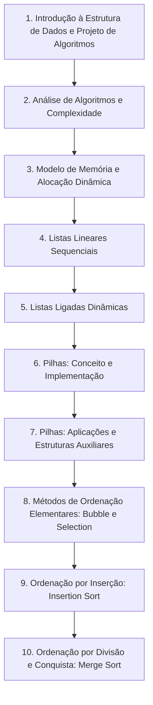

### Sistema e critérios de avaliação

O modelo avaliativo da UniFEF é semestral e estruturado em dois módulos avaliativos bimestrais interdependentes. Cada módulo consolida uma prova teórica/prática individual sem consulta ($`AV_1`$ e $`AV_2`$) com peso de 80% (fator 0,8) e avaliações práticas contínuas ou trabalhos de implementação ($`T_1`$ e $`T_2`$) com peso de 20% (fator 0,2).

A Média Semestral ($`MS`$) é computada pela fórmula canônica:

```math
MS = \frac{[(AV_1 \times 0.8) + (T_1 \times 0.2)] + [(AV_2 \times 0.8) + (T_2 \times 0.2)]}{2}
```

A tabela abaixo descreve os instrumentos de mensuração e suas respectivas pontuações:

| Instrumento Avaliativo | Escopo e Natureza | Escala | Peso no Módulo | Contribuição Máxima |
| :--- | :--- | :--- | :--- | :--- |
| **Trabalho 1 ($`T_1`$)** | Projetos práticos e exercícios de modelagem | 0,0 a 10,0 | 20% (0,2) | Até 2,0 pontos no Módulo 1 |
| **Avaliação 1 ($`AV_1`$)** | Prova formal de fundamentação teórica e código | 0,0 a 10,0 | 80% (0,8) | Até 8,0 pontos no Módulo 1 |
| **Trabalho 2 ($`T_2`$)** | Implementação de estruturas dinâmicas e ordenação | 0,0 a 10,0 | 20% (0,2) | Até 2,0 pontos no Módulo 2 |
| **Avaliação 2 ($`AV_2`$)** | Prova formal integradora de final de semestre | 0,0 a 10,0 | 80% (0,8) | Até 8,0 pontos no Módulo 2 |

### Bibliografia oficial e leituras recomendadas

O plano de ensino registra as seguintes obras de referência para suporte e aprofundamento conceitual:

#### Bibliografia básica
- MONTEIRO, Mário A. *Introdução à Organização de Computadores*. 4. ed. Rio de Janeiro: LTC, 2002.
- STALLINGS, William. *Arquitetura e Organização de Computadores*. 8. ed. São Paulo: Pearson, 2010.
- TANENBAUM, Andrew S. *Organização Estruturada de Computadores*. 3. ed. São Paulo: Prentice-Hall do Brasil, 1990.

#### Bibliografia complementar
- IDOETA, Ivan Valeije; CAPUANO, Francisco Gabriel. *Elementos de Eletrônica Digital*. 32. ed. São Paulo: Érica, 2001.
- PATTERSON, David A.; HENNESSY, John L. *Organização e Projeto de Computadores*. 2. ed. Rio de Janeiro: LTC, 1998.
- WEBER, Raul Fernando. *Arquitetura de Computadores Pessoais*. 2. ed. Porto Alegre: Sagra, 2001.
- WEBER, Raul Fernando. *Fundamentos de Arquitetura de Computadores*. Série Livros Didáticos Informática UFRGS, Vol. 8, 4. ed. Porto Alegre: Bookman, 2012.

> Nota de complementação pedagógica: Embora a bibliografia oficial cadastrada no plano de ensino priorize obras clássicas de organização e arquitetura de computadores — essenciais para a compreensão de pilha de execução, registradores, ponteiros e barramentos —, recomenda-se aos acadêmicos o acompanhamento paralelo dos manuais clássicos de algoritmos: *Projeto de Algoritmos com Implementações em Pascal e C* (Nivio Ziviani) e *Algoritmos: Teoria e Prática* (Thomas H. Cormen et al.).

---

## Capitulo 1: Introducao a Algoritmos e Ciclo de Resolucao de Problemas

### Definição formal de algoritmo

Um **algoritmo** é formalmente caracterizado como uma sequência finita, determinística e não ambígua de operações lógicas e computacionais bem delineadas. A partir de um estado inicial e de um conjunto de dados de entrada (que pode ser vazio), o algoritmo transita por estados sucessivos e discretos até alcançar um estado final previsível, produzindo uma saída útil que soluciona determinada classe de problemas.

Etimologicamente, o vocábulo tem sua gênese na latinização do nome do matemático persa do século IX, Abu Abdullah Muhammad ibn Musa al-Khwarizmi, cujos tratados sobre numeração posicional decimal e manipulação de incógnitas algébricas estabeleceram as regras sistemáticas de computação aritmética passo a passo. No domínio da computação contemporânea, o algoritmo representa a essência lógica pura de uma solução, independente do hardware físico ou do compilador que venha a materializá-lo.

### As seis características fundamentais de um algoritmo

Para que um procedimento sequencial seja classificado como um algoritmo legítimo na ciência da computação, ele deve cumprir integralmente seis propriedades canônicas:

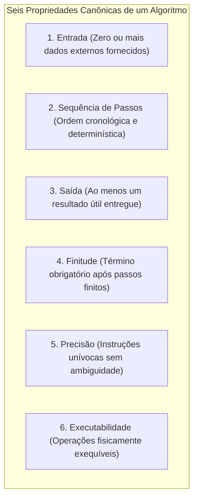

#### 1. Entrada (*Input*)
- **Definição:** O algoritmo recebe do ambiente externo um conjunto de dados sobre os quais atuará.
- **Motivação:** Parametrizar a lógica para solucionar instâncias genéricas de um problema. A quantidade de dados de entrada pode ser zero ou mais. Quando for zero, o algoritmo apoia-se em constantes pré-definidas internamente (por exemplo, calcular os dez primeiros números da série de Fibonacci pré-configurados).
- **Exemplo:** Receber três números reais representando as notas de um estudante.
- **Contraexemplo:** Uma função que tenta ler dados a partir de um ponteiro nulo ou endereço de memória não mapeado pelo sistema operacional.
- **Armadilha:** Assumir que todo algoritmo exige intervenção do usuário via teclado; entradas podem provir de sensores, arquivos, constantes internas ou requisições de rede.

#### 2. Sequência de passos (*Sequence*)
- **Definição:** As instruções seguem uma cronologia determinística de execução, onde cada etapa possui relação de dependência causal com a anterior.
- **Motivação:** Garantir a reprodutibilidade dos estados computacionais.
- **Exemplo:** 1º Ler dados; 2º Processar cálculo; 3º Emitir resultado.
- **Contraexemplo:** Executar a operação de divisão antes de validar se o denominador fornecido é diferente de zero.
- **Armadilha:** Confundir execução concorrente/paralela com ausência de ordem lógica; mesmo em sistemas distribuídos, threads individuais operam sob sequências determinísticas locais.

#### 3. Saída (*Output*)
- **Definição:** O algoritmo deve obrigatoriamente produzir ao final ao menos um resultado perceptível, mantendo relação matemática direta com as entradas.
- **Motivação:** Justificar o processamento computacional entregando uma transformação de estado útil ao chamador.
- **Exemplo:** Retornar o valor escalar da média aritmética calculada.
- **Contraexemplo:** Um procedimento que aloca memória, executa um milhão de somas em variáveis locais e encerra sua execução sem registrar logs, alterar o estado do sistema ou retornar valores.
- **Armadilha:** Confundir impressão em tela (`System.out.println`) com retorno de valor funcional (`return`); a saída pode ser um código de erro numérico, um arquivo em disco ou um pacote transmitido via socket.

#### 4. Finitude (*Finiteness*)
- **Definição:** O algoritmo deve encerrar seu processamento de forma garantida após a execução de uma quantidade finita de passos, para quaisquer dados de entrada válidos.
- **Motivação:** Impedir o travamento permanente da CPU e o consumo infinito de recursos do sistema.
- **Exemplo:** Um laço `for (int i = 0; i < n; i++)` que avança monotonicamente até atingir o limite superior $`n`$.
- **Contraexemplo:** Um laço `while (x != 0)` recebendo um número fracionário sujeito a imprecisões de ponto flutuante da norma IEEE 754, que nunca atinge zero exato e entra em laço infinito.
- **Armadilha:** Confundir programas de execução contínua (como sistemas operacionais, serviços em segundo plano ou daemons de mensageria) com algoritmos puros; tais sistemas são processos contínuos que contêm, em seus métodos internos, múltiplos algoritmos finitos que respondem a eventos discretos.

#### 5. Precisão (*Definiteness / Unambiguity*)
- **Definição:** Cada instrução deve ser rigorosa, clara e unívoca, não permitindo interpretações conflitantes ou subjetivas pelo agente executor.
- **Motivação:** Garantir que o comportamento seja estritamente mecânico e formalizável por um autômato determinístico.
- **Exemplo:** `soma = nota1 + nota2 + nota3;`.
- **Contraexemplo:** Uma instrução de pseudocódigo que afirme: "Adicione um pouco mais de processamento caso o valor pareça baixo".
- **Armadilha:** Redigir comentários informais no código e acreditar que a máquina deduzirá a regra de negócio implícita.

#### 6. Executabilidade (*Effectiveness / Executability*)
- **Definição:** Todas as operações primitivas que integram o algoritmo devem ser realizáveis por um processador real em uma quantidade finita de tempo físico.
- **Motivação:** Manter as soluções no domínio da computabilidade prática da arquitetura de Von Neumann.
- **Exemplo:** Dividir um número por outro número inteiro previamente verificado como não-nulo.
- **Contraexemplo:** Uma instrução matemática hipotética exigindo: "Divida o numerador por zero" ou "Encontre todas as casas decimais de $`\pi`$ antes de prosseguir para o próximo passo".
- **Armadilha:** Projetar algoritmos com passos teoricamente corretos, mas computacionalmente inviáveis em tempo útil, como a busca exaustiva por força bruta de chaves criptográficas de 4096 bits.

A tabela a seguir sistematiza as seis propriedades operacionais de um algoritmo:

| Propriedade | Descrição Técnica | Exemplo Válido | Contraexemplo (Violação) |
| :--- | :--- | :--- | :--- |
| **Entrada** | Dados lidos do domínio do problema | Coordenadas cartesianas $`x`$ e $`y`$ | Leitura de variável sem inicialização prévia |
| **Sequência de Passos** | Ordem determinística de estados | 1º Alocar; 2º Escrever; 3º Ler | Liberar ponteiro de memória antes de ler os dados |
| **Saída** | Retorno funcional do cálculo | A média final ponderada | Descarte do cálculo em memória sem retorno |
| **Finitude** | Condição de parada comprovável | Laço iterativo com passo constante | Laço sem atualização de variável sentinela |
| **Precisão** | Instrução unívoca sem ambiguidade | `media = soma / 3.0` | "Calcule a média aproximada a critério livre" |
| **Executabilidade** | Operação materialmente viável | Deslocamento de bits na CPU | Cálculo de divisão exata por zero |

### O princípio da organização: o axioma de Wirth

Conforme destacado pelo Prof. Wesley Soares em sala de aula:

> *"Um bom programa depende tanto de um bom algoritmo quanto da forma como os dados são organizados."*

Esta máxima sintetiza o clássico axioma do cientista da computação suíço Niklaus Wirth, criador da linguagem Pascal e pioneiro da engenharia de software, imortalizado no título de sua obra clássica de 1976:

```math
\text{Algoritmos} + \text{Estruturas de Dados} = \text{Programas}
```

O axioma evidencia que o algoritmo (a regra procedural de transformação) torna-se computacionalmente ineficaz se os dados estiverem dispostos em uma estrutura inadequada às consultas operacionais. Reciprocamente, a estrutura de dados mais refinada torna-se inútil se os algoritmos encarregados de percorrê-la e modificá-la operarem por estratégias ineficientes de processamento.

### Algoritmo versus programa

Uma distinção basilar para o futuro engenheiro de software é dissociar a lógica algorítmica da sua materialização computacional em um programa executável.

- **Algoritmo:** É uma entidade abstrata do domínio matemático. Pode ser formulado mentalmente, escrito em linguagem natural, esquematizado em fluxogramas ou expresso em pseudocódigo estruturado. Independe da existência física de processadores, transistores, placas-mãe ou compiladores.
- **Programa:** É a instanciação concreta dessa lógica algorítmica, expressa através do léxico, da gramática e da sintaxe de uma linguagem de programação específica (como Java, C ou Python). Está condicionado a regras de compilação, tipos de dados de tamanho fixo de hardware (como inteiros de 32 bits em complemento de dois), modelos de memória física, restrições do sistema operacional e arquiteturas de registradores da CPU.

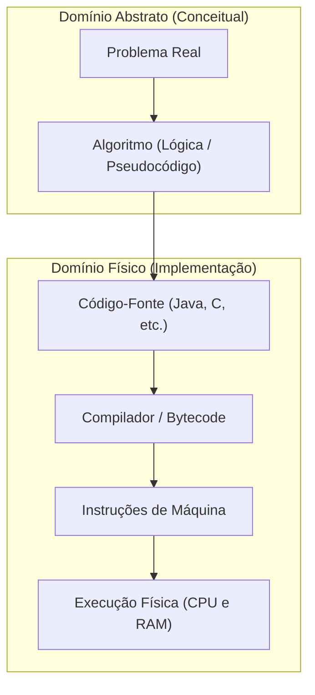

A tabela abaixo estabelece as diferenças de engenharia entre ambos os conceitos:

| Critério de Comparação | Algoritmo | Programa |
| :--- | :--- | :--- |
| **Natureza Ontológica** | Entidade lógica, formal e matemática | Artefato físico de engenharia de software |
| **Acoplamento Tecnológico** | Agnóstico a plataformas e fabricantes | Rigorosamente atrelado a compiladores e runtimes |
| **Modo de Representação** | Pseudocódigo, fluxograma, prosa técnica | Arquivos de código-fonte (`.java`, `.c`, `.py`), binários |
| **Tolerância a Imprecisões** | Exige consistência lógica; ignora sintaxe | Intolerante a erros de compilação ou sintaxe |
| **Ambiente de Processamento** | O cérebro humano ou a Máquina de Turing | Microarquiteturas reais (x86-64, ARM), JVM, SO |

### Ciclo de engenharia de software: do problema à solução

A transformação de uma demanda corporativa ou necessidade humana em um sistema computacional funcional e escalável obedece a um pipeline estruturado de engenharia. Pular etapas intermediárias e iniciar diretamente a escrita de código em um editor constitui uma falha metodológica grave que produz código confuso, acoplado e de depuração complexa.

O ciclo metodológico contempla sete fases fundamentais:

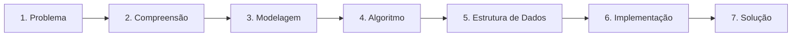

1. **Problema:** Situação do mundo real que impõe um gargalo operacional, perda financeira ou demanda de automação.
2. **Compreensão:** Levantamento exaustivo de requisitos funcionais e não-funcionais, identificando ambiguidades, regras de negócio e restrições operacionais.
3. **Modelagem:** Formalização conceitual dos dados manipulados, estabelecendo entidades, propriedades, volumes estimados e fluxos de transição de estado.
4. **Algoritmo:** Projeto das etapas lógicas necessárias para processar e transformar os dados modelados.
5. **Estrutura de Dados:** Seleção da forma física e conceitual mais eficiente para dispor os dados na memória durante o processamento (arranjos contíguos, nós ligados, pilhas restritas etc.).
6. **Implementação:** Codificação propriamente dita utilizando as regras gramaticais de uma linguagem de programação (no escopo da disciplina, Java), respeitando padrões de legibilidade, tipagem e encapsulamento.
7. **Solução:** Artefato de software implantado, testado e validado contra casos de teste normais e extremos.

### Estudo de caso guiado: controle de fila bancária

Para aplicar o ciclo metodológico, analisemos a informatização de um sistema de atendimento bancário:

1. **Problema:** Clientes agrupam-se na agência sem disciplina de atendimento, provocando reclamações, confusão visual e violação de legislações municipais de tempo máximo de espera.
2. **Compreensão:** O sistema deve ordenar o atendimento de acordo com a ordem cronológica de chegada, permitindo distinção de prioridades legais (idosos, gestantes) sem perder o rastreio do momento exato de emissão da senha.
3. **Modelagem:**
   - Objeto `Cliente`: identificador numérico (`id`), nome textual (`String`), carimbo de hora de emissão da senha (`long`) e indicador booleano de prioridade (`boolean`).
   - Regra de fluxo: quem chega primeiro deve ser atendido primeiro.
4. **Algoritmo:**
   - Procedimento de Inserção: anexar o novo cliente ao término da fila.
   - Procedimento de Atendimento: extrair o cliente que repousa na primeira posição da fila e alocá-lo a um guichê vago.
5. **Estrutura de Dados:** Aplicação do Tipo Abstrato de Dados **Fila (Queue)**, baseado na disciplina operacional FIFO (*First-In, First-Out*). A implementação pode optar por uma lista simplesmente ligada com ponteiros de início e cauda, garantindo complexidade constante $`O(1)`$ tanto para inserção quanto para remoção.
6. **Implementação:** Construção das classes `Cliente`, `No` e `FilaAtendimento` em Java, incorporando salvaguardas contra chamadas de atendimento quando a fila estiver vazia.
7. **Solução:** Totem de autoatendimento integrado aos monitores dos guichês, operando sem travamentos e garantindo justiça temporal no fluxo de chamadas.

---

## Capitulo 2: Metodologia de Projeto de Algoritmos e Refinamento Sucessivo

### A técnica do refinamento sucessivo

O **Refinamento Sucessivo** (conhecido na literatura clássica da Engenharia de Software como *Stepwise Refinement* ou metodologia *Top-Down*, introduzido formalmente por Niklaus Wirth em 1971) é uma técnica sistemática de engenharia de software. Ela orienta a resolução de um problema a partir de uma declaração inicial de alto nível e a sua decomposição progressiva em subproblemas menores, até atingir instruções primitivas diretamente compiláveis.

Tentar escrever código final para problemas de alta complexidade sem refinamento prévio induz a sobrecarga cognitiva e à mistura prejudicial entre regras de negócio abstratas e rotinas de baixo nível de ponteiros e índices.

Os três níveis canônicos de decomposição aplicados na metodologia da disciplina são:

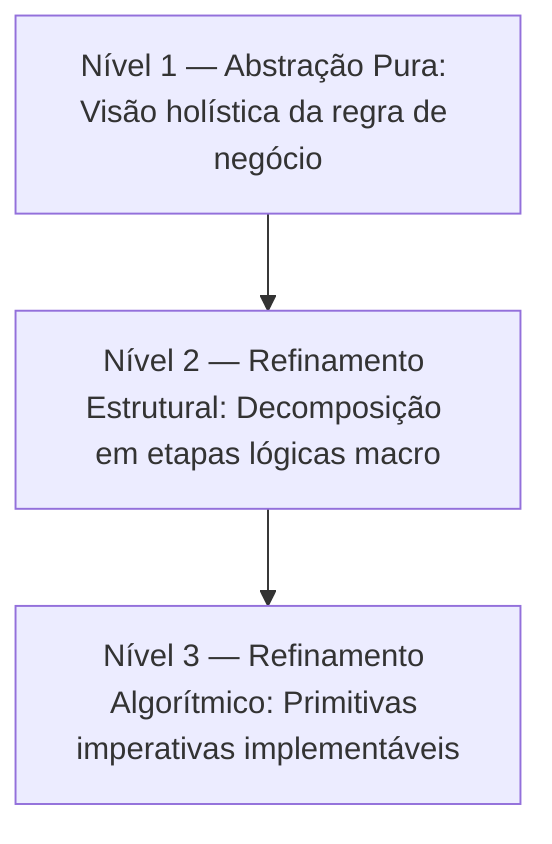

#### Nível 1: Abstração Pura
- **Foco:** O QUE precisa ser solucionado em termos do negócio ou da ciência.
- **Exemplo:** "Calcular a média aritmética simples das notas de três avaliações de um estudante".

#### Nível 2: Refinamento Estrutural
- **Foco:** Decomposição causal em etapas operacionais lógicas (Entrada, Processamento, Saída).
- **Exemplo:**
  1. Obter do usuário os valores das três notas parciais.
  2. Somar os três valores fornecidos em um acumulador.
  3. Dividir o valor acumulado pela constante 3.0.
  4. Exibir o valor da média resultante na interface do usuário.

#### Nível 3: Refinamento Algorítmico Detalhado
- **Foco:** Expressão exata das variáveis de controle, tipos primitivos, atribuições e controle de fluxo.
- **Exemplo (Pseudocódigo Estruturado):**

```text
Algoritmo CalcularMediaDiscente
Início
    Real: nota1, nota2, nota3, soma, media
    
    Ler(nota1)
    Ler(nota2)
    Ler(nota3)
    
    soma <- nota1 + nota2 + nota3
    media <- soma / 3.0
    
    Escrever("A média calculada é: ", media)
Fim
```

A tabela a seguir contrasta as três camadas de abstração:

| Nível de Projeto | Escopo de Visão | Público-Alvo | Artefato Produzido |
| :--- | :--- | :--- | :--- |
| **Nível 1 (Abstração)** | Holístico / Negócio | Usuário final e analista | Requisitos funcionais de alto nível |
| **Nível 2 (Refinamento)** | Fluxo de Controle | Arquiteto de sistemas | Diagramas de fluxo e casos de uso |
| **Nível 3 (Detalhamento)** | Primitivas de Computação | Engenheiro de software | Pseudocódigo e algoritmos executáveis |

### As seis etapas sistemáticas de projeto

No desenvolvimento de algoritmos complexos, o profissional de software segue seis etapas metodológicas consolidadas:

1. **Entender o problema:** Isolar o domínio, eliminar termos ambíguos e compreender o resultado almejado.
2. **Identificar entradas e saídas:** Definir os tipos, limites, formatos e domínios matemáticos válidos de todos os dados fornecidos e dos resultados esperados.
3. **Decompor em partes menores:** Aplicar o refinamento sucessivo para transformar um problema massivo em um conjunto de funções ou módulos especializados.
4. **Definir a estratégia:** Selecionar o paradigma de resolução (força bruta, divisão e conquista, algoritmos gulosos ou programação dinâmica).
5. **Especificar o algoritmo:** Descrever a solução em pseudocódigo com controle explícito de variáveis, ponteiros e laços.
6. **Testar e refinar:** Executar testes de mesa com massa de dados representativa, incluindo casos limítrofes (*edge cases*), corrigindo erros de lógica antes do início da codificação.

### Estudo de caso guiado: busca do maior elemento em uma sequência

Para consolidar as etapas sistemáticas de projeto, considere o desafio de localizar o maior valor contido em uma lista de números inteiros não ordenados.

#### Etapa 1: Entendimento do problema
O algoritmo deve percorrer um conjunto de $`n`$ números arbitrários e retornar o valor escalar que for maior ou igual a todos os demais membros da coleção.

#### Etapa 2: Entradas e saídas
- **Entrada:** Um vetor contíguo `V` contendo $`n`$ números inteiros, onde $`n \ge 1`$.
- **Saída:** Um escalar inteiro representando o valor máximo absoluto contido no arranjo.

#### Etapa 3: Decomposição estrutural
1. Tratar o caso de contorno onde o vetor possui tamanho unitário.
2. Inicializar uma variável de referência assumindo provisoriamente o primeiro elemento como o maior.
3. Percorrer os elementos remanescentes comparando cada item com a referência atual.
4. Atualizar a referência sempre que um valor superior for encontrado.
5. Retornar a referência final após a varredura completa.

#### Etapa 4: Definição da estratégia
Como os elementos não estão previamente ordenados, é mandatório inspecionar todos os itens pelo menos uma vez para garantir que nenhum valor maior foi omitido (busca linear exaustiva).

#### Etapa 5: Especificação algorítmica detalhada
```text
Algoritmo EncontrarMaiorValor(V, n)
Entrada:
    V : arranjo de inteiros indexado de 0 a n-1
    n : quantidade de elementos no arranjo (n >= 1)
Saída:
    maior : valor do elemento máximo
Início
    maior <- V[0]
    
    para i de 1 até n - 1 faça
        se V[i] > maior então
            maior <- V[i]
        fim_se
    fim_para
    
    retornar maior
Fim
```

#### Etapa 6: Análise da invariante de laço e complexidade
- **Invariante:** No início de cada iteração do laço `para` (controlado pelo índice `i`), a variável `maior` armazena o valor máximo contido no subvetor `V[0 ... i-1]`.
- **Complexidade:** O laço executa rigorosamente $`n - 1`$ iterações de comparação. Logo, sua complexidade temporal é estritamente linear: $`O(n)`$. O espaço de memória adicional consiste apenas nas variáveis escalares `maior` e `i`, resultando em complexidade de espaço auxiliar constante: $`O(1)`$.

---

## Capitulo 3: Tipos Abstratos de Dados, Abstracao e Encapsulamento

### Definição formal de Tipo Abstrato de Dados

Um **Tipo Abstrato de Dados (TAD)** é um modelo matemático e conceitual que formaliza:
1. O domínio de valores que compõem os dados.
2. O conjunto de operações autorizadas que manipulam esses dados.
3. As regras comportamentais, pré-condições, pós-condições e invariantes que essas operações devem manter inalteradas.

A propriedade fundamental de um TAD é a **independência de representação**: sua definição técnica não estabelece como os dados serão armazenados fisicamente na memória (se em um vetor estático contíguo ou em nós dinâmicos encadeados no Heap), tampouco a codificação interna de seus algoritmos.

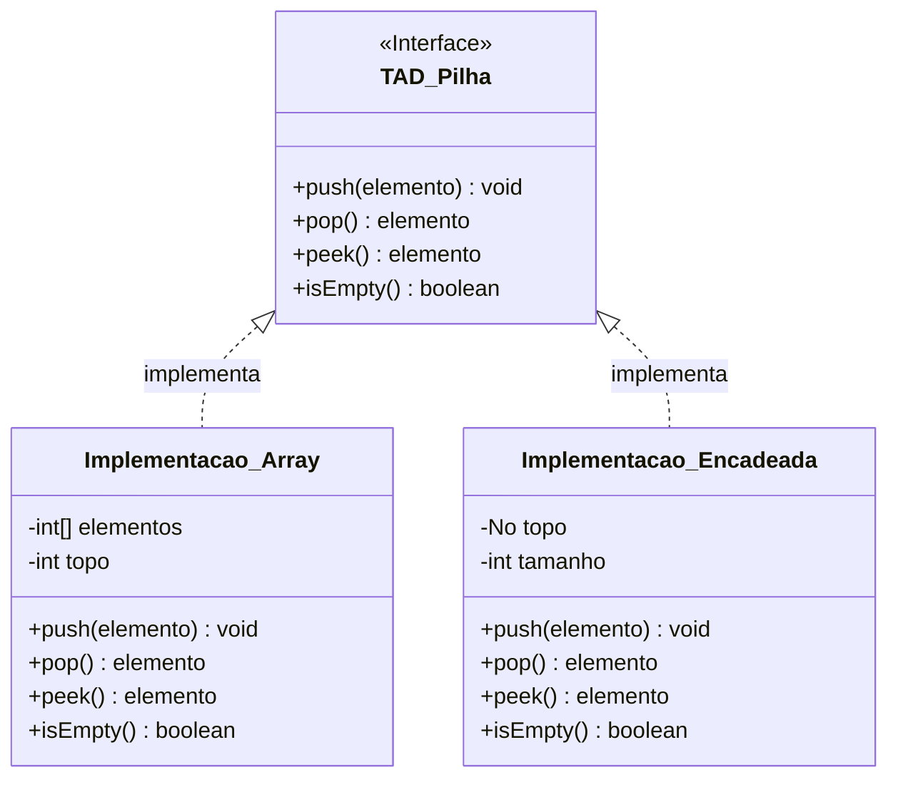

### Abstração versus encapsulamento

Na engenharia de software orientada a dados, abstração e encapsulamento constituem mecanismos complementares:

- **Abstração:** Princípio cognitivo de segregação entre o **QUE** uma estrutura de software executa (sua interface pública e contratos funcionais) e o **COMO** ela cumpre tais operações (sua lógica interna privada).
- **Encapsulamento:** Mecanismo técnico que blinda o estado interno, atributos e variáveis de controle de uma estrutura, impedindo acesso ou alteração direta por componentes externos. Modificações de estado tornam-se possíveis unicamente através da invocação de métodos públicos da interface contratual.

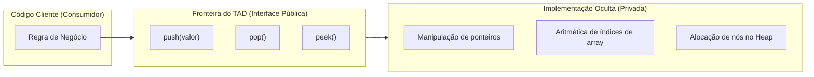

#### Contraexemplo e armadilhas
- **Contraexemplo:** Criar uma classe `Pilha` em Java contendo um atributo público `public int topo;` e `public int[] elementos;`. Caso um código cliente modifique diretamente `pilha.topo = 50;` sem passar pelo método `push`, o estado interno torna-se inconsistente, provocando o lançamento de exceções `ArrayIndexOutOfBoundsException` ou corrompendo a contagem lógica de itens.
- **Armadilha do vazamento de abstração (*Leaky Abstraction*):** Ocorre quando detalhes técnicos da implementação privada transparecem na interface pública do TAD. Por exemplo, uma classe de lista encadeada que retorna para o cliente um ponteiro direto para o objeto interno da classe `No`. Se o cliente alterar a propriedade `no.proximo` por conta própria, o encadeamento é quebrado.

### Critérios para escolha da representação de dados

Não existe uma estrutura de dados universalmente superior para todos os cenários. Toda escolha de engenharia envolve um balanceamento (*trade-off*) entre velocidade de processamento, consumo de memória e previsibilidade de execução:

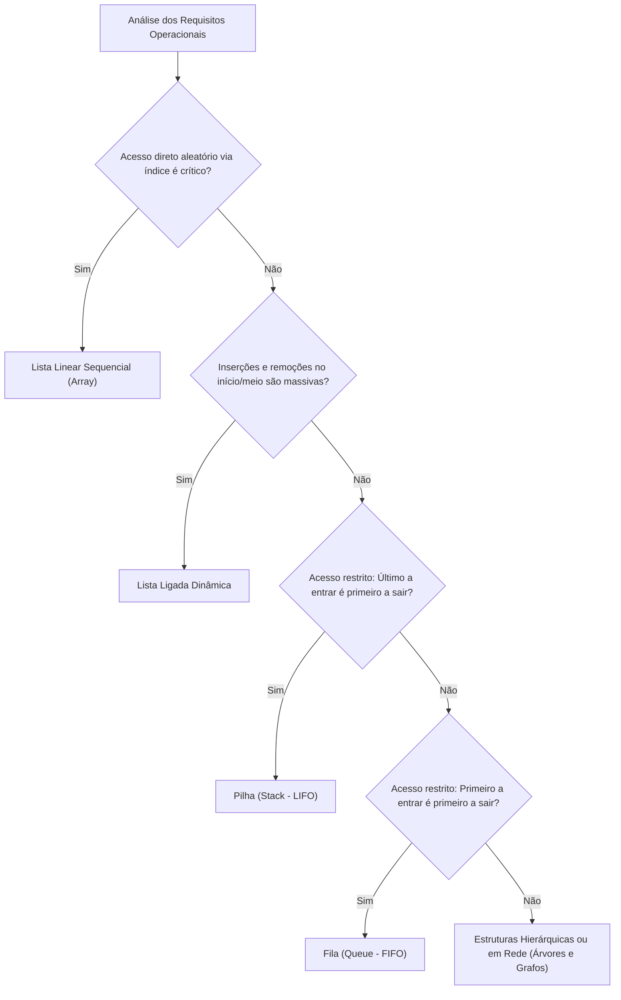

A matriz a seguir mapeia os requisitos funcionais mais comuns de sistemas de software para suas estruturas recomendadas:

| Requisito do Sistema | Estrutura de Dados Adequada | Justificativa de Engenharia |
| :--- | :--- | :--- |
| **Acesso imediato por posição numérica** | Lista Sequencial (Vetor) | Endereçamento contíguo resolvido em tempo constante $`O(1)`$ via aritmética de ponteiros. |
| **Inserção e remoção no meio sem realocação** | Lista Ligada Dinâmica | Reatribuição pontual de referências de ponteiros em $`O(1)`$ após a localização do nó. |
| **Histórico com reversão de estado (Undo)** | Pilha (*Stack*) | Disciplina estrita LIFO (*Last-In, First-Out*), preservando a ordem reversa de chamadas. |
| **Gestão de pedidos e processamento em lote** | Fila (*Queue*) | Disciplina estrita FIFO (*First-In, First-Out*), garantindo equidade de atendimento. |
| **Indexação hierárquica (sistemas de arquivos)** | Árvore (*Tree*) | Decomposição não-linear em nós pais e filhos com buscas em tempo logarítmico. |
| **Mapeamento de rotas e redes logísticas** | Grafo (*Graph*) | Representação de entidades arbitrárias (vértices) e interconexões complexas (arestas). |

---

## Capitulo 4: Analise Assintotica de Complexidade e Notacao Big O

### Fundamentos da análise assintótica versus tempo empírico

Dois algoritmos distintos podem solucionar rigorosamente o mesmo problema, apresentando custos de processamento radicalmente diferentes. 

Uma abordagem ingênua consistiria em compilar ambos os algoritmos, executá-los em um computador e cronometrar o tempo de relógio decorrido (em segundos ou milissegundos). Essa medição puramente empírica é tecnicamente inadequada para a Ciência da Computação, pois depende de variáveis externas voláteis:
- A potência, arquitetura e frequência de clock do processador utilizado.
- A quantidade de memória cache L1/L2/L3 e a velocidade do barramento da placa-mãe.
- O sistema operacional em execução e a concorrência com processos secundários.
- A versão da Máquina Virtual Java (JVM) e as compilações em tempo de execução feitas pelo compilador JIT (*Just-In-Time*).
- O volume e o estado prévio da massa de dados testada (dados já ordenados vs. desordenados).

A análise analítica assintótica resolve essas inconsistências ao substituir o cronômetro pela contagem formal das **operações primitivas fundamentais** que o algoritmo executa em função do tamanho da entrada ($`n`$).

### Tamanho da entrada e contagem de operações fundamentais

O tamanho da entrada ($`n`$) expressa a cardinalidade dos dados fornecidos:
- Para somar $`10`$ inteiros: $`n = 10`$.
- Para pesquisar uma matrícula em um vetor com $`50.000`$ discentes: $`n = 50.000`$.
- Para ordenar uma tabela de banco de dados com $`10.000.000`$ de registros: $`n = 10.000.000`$.

A pergunta norteadora da análise assintótica é: **quando o volume de dados $`n`$ tende ao infinito ($`n \to \infty`$), a que taxa o trabalho computacional e o consumo de tempo do algoritmo se expandem?**

Considere um laço iterativo elementar de varredura:
```text
para i de 1 até n faça
    escrever(i)
fim_para
```
O corpo interno é executado exatamente $`n`$ vezes. Portanto, o custo temporal total é expresso pela função linear:
```math
T(n) = c \cdot n
```
Onde $`c`$ representa o custo fixo de instruções de máquina necessárias para executar a comparação, incremento e escrita a cada ciclo.

Quando dois laços independentes operam sequencialmente:
```text
para i de 1 até n faça
    escrever(i)
fim_para

para j de 1 até n faça
    escrever(j)
fim_para
```
O primeiro bloco consome $`n`$ operações e o segundo consome mais $`n`$ operações:
```math
T(n) = n + n = 2n
```

### Regras de simplificação: descarte de constantes e termos de menor ordem

Para conjuntos massivos de dados, o comportamento da curva de custo é governado exclusivamente pelo seu **termo de maior grau** (termo dominante). Fatores multiplicativos constantes e adições de termos de menor relevância perdem importância analítica relativa.

Considere uma função de custo exata expressa por:
```math
T(n) = 3n^2 + 50n + 1000
```
Avaliemos a proporção de trabalho computacional imposta por cada termo conforme $`n`$ se expande:
- Para $`n = 10`$:
  - $`3(10)^2 = 300`$
  - $`50(10) = 500`$
  - Constante: $`1.000`$
  - Total: $`1.800`$. O termo quadrático responde por apenas 16,6% do trabalho.
- Para $`n = 10.000`$:
  - $`3(10.000)^2 = 300.000.000`$
  - $`50(10.000) = 500.000`$
  - Constante: $`1.000`$
  - Total: $`300.501.000`$. O termo quadrático $`3n^2`$ responde por mais de **99,83%** de todo o custo computacional do algoritmo.

Por essa razão, na análise assintótica aplicamos duas regras sistemáticas de redução:
1. **Descarte de constantes aditivas e termos de menor expoente:** Em $`3n^2 + 50n + 1000`$, isolamos o termo dominante $`3n^2`$.
2. **Descarte de coeficientes multiplicativos:** No termo $`3n^2`$, removemos o escalar $`3`$, pois dobrar a velocidade do hardware apenas divide a constante por dois, sem alterar a curva quadrática de expansão.

Concluímos formalmente que a complexidade da função pertence à classe:
```math
O(n^2)
```

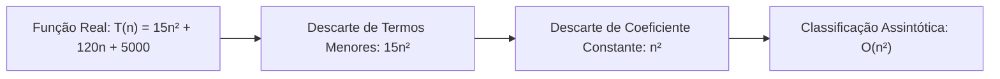

> Nota sobre notações formais ($`O`$ e $`\Omega`$): A **Notação Big O ($`O`$)** determina o limite superior assintótico da função (o teto assintótico que o algoritmo garante não ultrapassar no pior cenário de execução). Em contrapartida, a **Notação Big Omega ($`\Omega`$)** delimita o limite inferior assintótico (o piso mínimo de processamento que o algoritmo consumirá mesmo sob condições ideais).

### Espectro de análise: melhor caso, pior caso e caso médio

A complexidade de um algoritmo pode oscilar em função não apenas do volume $`n`$, mas também da organização interna inicial dos dados fornecidos.

Considere o algoritmo de **busca sequencial** de uma chave em um vetor de tamanho $`n`$:
- **Melhor Caso:** A chave procurada reside na primeira posição acessada (`vetor[0]`). O algoritmo encerra sua execução após exatamente $`1`$ única comparação de valor, independentemente de o vetor conter dez ou dez milhões de posições. A complexidade do melhor caso é estritamente constante:
```math
\Omega(1)
```
- **Pior Caso:** A chave procurada repousa na última posição do vetor (`vetor[n - 1]`) ou simplesmente não existe na base. O algoritmo é obrigado a percorrer e comparar todos os $`n`$ elementos antes de encerrar o laço. A complexidade do pior caso é estritamente linear:
```math
O(n)
```
- **Caso Médio:** Supondo que a probabilidade de a chave estar em qualquer posição seja uniforme, o algoritmo percorrerá em média metade da estrutura:
```math
\frac{n}{2} \text{ operações}
```
Como desconsideramos o fator multiplicativo constante ($`\frac{1}{2} \cdot n`$), a complexidade assintótica do caso médio permanece classificada como:
```math
\Theta(n)
```

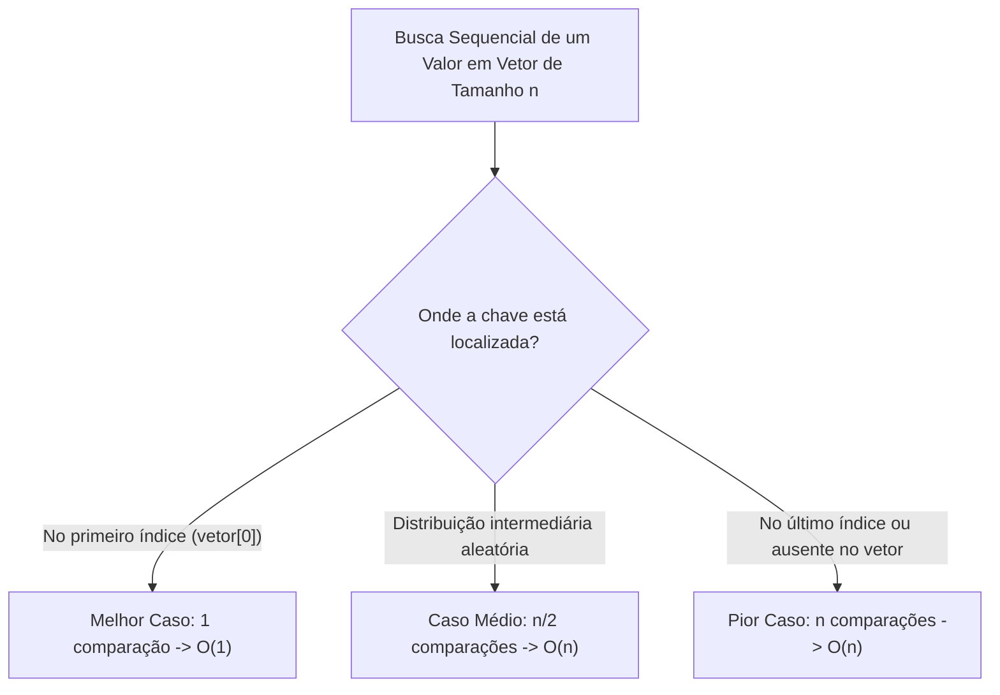

### Estudo comparativo: busca sequencial versus busca binária

A relevância prática da análise de algoritmos fica evidente ao contrastarmos duas soluções concorrentes para a localização de registros em um vetor previamente ordenado contendo $`n`$ elementos:

- **Algoritmo A (Busca Sequencial):** Inspeciona cada elemento da esquerda para a direita, um por um. No pior cenário, requer $`n`$ comparações.
- **Algoritmo B (Busca Binária):** Compara o valor buscado com o elemento central da partição. Se a chave for menor, descarta toda a metade superior; se for maior, descarta a metade inferior. Repete o particionamento sucessivamente até localizar o elemento ou esgotar o subconjunto. No pior cenário, requer no máximo $`\lceil \log_2 n \rceil`$ comparações.

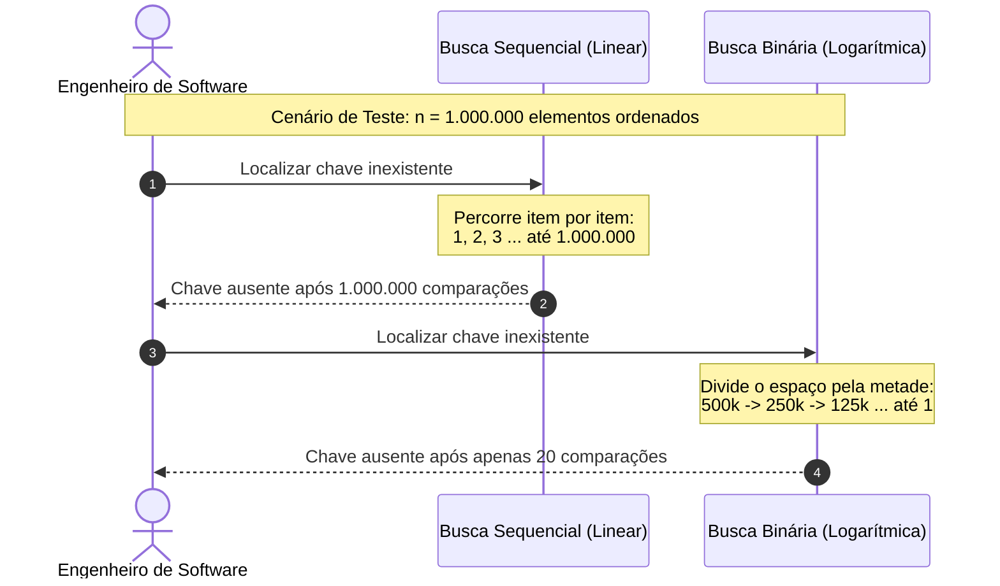

A tabela abaixo ilustra o comportamento comparativo das operações conforme o volume de dados se expande:

| Volume de Elementos ($`n`$) | Busca Sequencial ($`O(n)`$) | Busca Binária ($`O(\log n)`$) | Diferença de Desempenho |
| :--- | :--- | :--- | :--- |
| **$`n = 10`$** | 10 passos | ~4 passos | A busca binária é 2,5 vezes mais veloz |
| **$`n = 100`$** | 100 passos | ~7 passos | A busca binária é 14 vezes mais veloz |
| **$`n = 1.000`$** | 1.000 passos | ~10 passos | A busca binária é 100 vezes mais veloz |
| **$`n = 1.000.000`$** | 1.000.000 de passos | ~20 passos | A busca binária é **50.000 vezes mais veloz** |
| **$`n = 1.000.000.000`$** | 1 bilhão de passos | ~30 passos | A busca binária é **33.000.000 de vezes mais veloz** |

### As classes fundamentais de complexidade

As ordens assintóticas fundamentais organizam-se na seguinte hierarquia de eficiência:

```text
O(1) < O(log n) < O(n) < O(n log n) < O(n²) < O(n³) < O(2ⁿ) < O(n!)
[Excelente Escalabilidade] ----------------------------> [Inviabilidade Computacional]
```

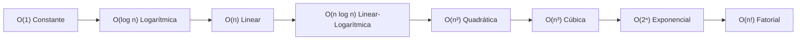

#### 1. Complexidade Constante: $`O(1)`$
O tempo de execução independe do volume de dados. A instrução leva exatamente a mesma fração de tempo seja para manipular um ou um bilhão de registros.
- **Exemplo canônico:** Acessar um índice fixo de um array primitivo (`valor = vetor[5];`) ou empilhar em uma pilha sequencial com espaço livre.

#### 2. Complexidade Logarítmica: $`O(\log n)`$
O custo de tempo se expande a uma taxa muito lenta em relação ao crescimento de $`n`$. Algoritmos dessa classe dividem o espaço de resolução ao meio a cada iteração.
- **Exemplo canônico:** Busca binária em vetor ordenado.

#### 3. Complexidade Linear: $`O(n)`$
O tempo varia em proporção direta e estrita ao volume de dados. Dobrar a massa de dados duplica o tempo total de execução.
- **Exemplo canônico:** Busca sequencial em lista não ordenada ou contagem de nós em lista encadeada sem atributo acumulador.

#### 4. Complexidade Linear-Logarítmica: $`O(n \log n)`$
Desempenho típico dos algoritmos eficientes de ordenação baseados no paradigma de divisão e conquista. Executam $`\log n`$ níveis de recursão, processando linearmente $`n`$ itens a cada estrato.
- **Exemplo canônico:** Merge Sort e Quick Sort (caso médio).

#### 5. Complexidade Quadrática: $`O(n^2)`$
O tempo de processamento é proporcional ao quadrado da quantidade de entradas. Algoritmos dessa classe tornam-se lentos para volumes na casa dos milhares e inviáveis para milhões de dados.
- **Exemplo canônico:** Laços de iteração duplamente aninhados, como no Bubble Sort, Selection Sort e Insertion Sort (caso médio e pior caso).

> Atenção aos limites internos de laços aninhados: Se o laço externo executa $`n`$ iterações e o laço interno executa $`n/2`$ passos:
> ```math
> n \times \frac{n}{2} = \frac{n^2}{2} = \frac{1}{2} \cdot n^2
> ```
> Como constantes multiplicativas são descartadas na notação assintótica, a complexidade permanece rigorosamente classificada como $`O(n^2)`$.

#### 6. Complexidade Exponencial e Fatorial: $`O(2^n)`$ e $`O(n!)`$
Representam algoritmos não-escaláveis que tentam resolver problemas combinatórios por força bruta.
- **Exemplo canônico:** Resolução ingênua da Torre de Hanói recursiva ($`O(2^n)`$) ou geração de todas as permutações possíveis no Problema do Caixeiro Viajante ($`O(n!)`$).

---

## Capitulo 5: Arquitetura de Memoria da JVM: Stack, Heap e Referencias

### Modelo de execução da JVM: memória Stack versus memória Heap

Para compreender ponteiros e alocação dinâmica em Java, é indispensável dominar a segregação entre os dois principais espaços de memória gerenciados pela Máquina Virtual Java (JVM): a memória **Stack (Pilha)** e a memória **Heap (Monte)**.

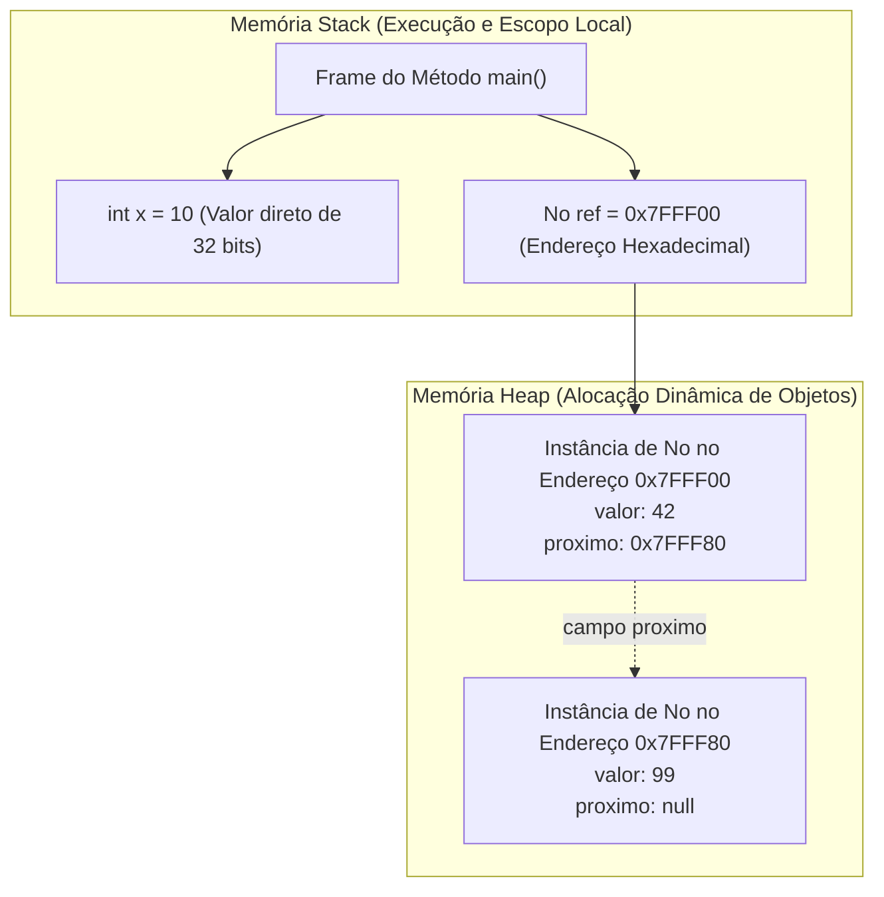

A tabela abaixo contrasta as propriedades físicas e operacionais de cada segmento de memória:

| Característica de Engenharia | Memória Stack (Pilha) | Memória Heap (Monte) |
| :--- | :--- | :--- |
| **Finalidade Primária** | Armazenar registros de ativação (*stack frames*), escopo de métodos e variáveis locais primitivas | Armazenar todas as instâncias de classes e arrays alocados com `new` |
| **Modelo de Acesso** | LIFO estrito gerenciado automaticamente pelo contador de instruções da CPU | Acesso aleatório via ponteiros de referência gerenciados pela JVM |
| **Velocidade de Operação** | Ultrarrápida (alocação via deslocamento direto do registrador stack pointer) | Mais lenta (exige varredura de blocos de memória e gestão de fragmentação) |
| **Ciclo de Vida** | Efêmero: desalocado instantaneamente quando o fluxo sai do método ou bloco `{}` | Dinâmico: sobrevive ao término do método; existe enquanto houver referências ativas |
| **Comportamento em Esgotamento** | Dispara o erro de sistema `java.lang.StackOverflowError` | Dispara o erro de sistema `java.lang.OutOfMemoryError` |

### Tipos primitivos versus variáveis de referência

Em Java, a manipulação de variáveis comporta duas naturezas semânticas distintas:

1. **Variáveis de Tipo Primitivo (`byte`, `short`, `int`, `long`, `float`, `double`, `char`, `boolean`):**
   - O identificador na Stack reserva o espaço exato de bytes para aquele tipo e armazena **o valor literal binário propriamente dito**.
   - A instrução `int b = a;` executa uma cópia de bits independente. Mutar o conteúdo de `b` não exerce qualquer impacto sobre o valor original contido em `a`.

2. **Variáveis de Tipo Referência (Instâncias de Classes, Interfaces e Arrays):**
   - A variável na Stack não armazena os dados do objeto. Ela reserva apenas o tamanho de um ponteiro (endereço de memória de 32 ou 64 bits).
   - O operador `new` localiza um bloco vago na memória Heap, aloca o objeto e devolve seu endereço físico, que é gravado na variável da Stack.
   - A instrução `No p2 = p1;` **não instancia um novo objeto**. Ela apenas copia o endereço de memória. Ambas as variáveis da Stack passam a apontar para o mesmo objeto físico no Heap. Qualquer modificação de atributos realizada via `p2.valor = 50;` refletirá imediatamente ao consultar `p1.valor`.

### Ciclo de vida dos objetos e o Garbage Collector

Diferente de linguagens de baixo nível como C ou C++ — onde a memória dinâmica alocada via `malloc()` deve ser liberada manualmente com `free()` sob pena de vazamentos graves de memória (*memory leaks*) —, Java gerencia a desalocação através de um subsistema automatizado: o **Garbage Collector (GC)**.

O Coletor de Lixo opera com base no conceito formal de **alcançabilidade por grafo de referências** (*Reachability Analysis*):
- O GC rastreia todas as raízes de referência (*GC Roots*), que incluem variáveis locais ativas na Stack e referências estáticas de classes.
- A partir das raízes, ele navega pelos ponteiros encadeados. Qualquer objeto na memória Heap que não possua caminho direto ou indireto de ponteiros partindo de ao menos uma raiz ativa é classificado como **inalcançável** (*unreachable*).
- Os objetos inalcançáveis são marcados e têm seus bytes devolvidos à piscina de memória livre do Heap.

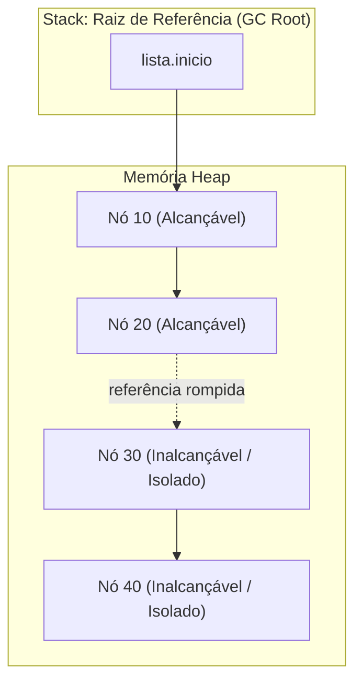

> Atenção em estruturas ligadas: Quando desvinculamos a cabeça de uma lista ligada fazendo `inicio = inicio.proximo;`, o antigo primeiro nó perde sua única raiz de referência. Consequentemente, ele se torna elegível para descarte automático pelo Garbage Collector.

---

## Capitulo 6: Estruturas Lineares Sequenciais

### Definição e mapeamento de endereçamento contíguo

Uma **Lista Linear Sequencial** é uma estrutura de dados que agrupa elementos de tipos homogêneos em posições estritamente adjacentes da memória física. Essa disposição contígua permite que o hardware calcule instantaneamente o endereço exato de qualquer posição através da fórmula matemática:

```math
\text{Endereço}(i) = \text{Endereço\_Base} + (i \times \text{Tamanho\_Elemento})
```

Onde:
- $`\text{Endereço\_Base}`$: Localização na memória RAM do byte inicial do arranjo (índice 0).
- $`i`$: Índice da posição desejada.
- $`\text{Tamanho\_Elemento}`$: Quantidade de bytes consumida pelo tipo de dado (por exemplo, 4 bytes para um `int`).

Como o cálculo envolve apenas uma multiplicação e uma adição realizadas em registradores da CPU, o acesso a qualquer elemento por índice físico ocorre em tempo estritamente constante:
```math
O(1)
```

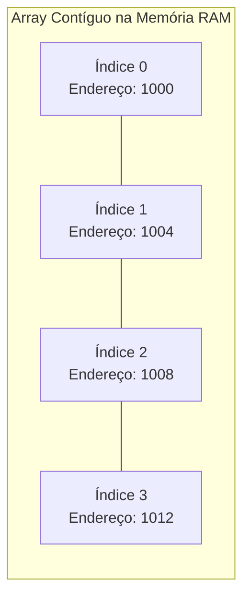

### Diferença entre capacidade física e tamanho lógico

Uma das falhas mais recorrentes de iniciantes em computação é confundir a capacidade física alocada com a quantidade de dados úteis armazenados:

- **Capacidade (`capacidade` ou `length`):** Quantidade máxima absoluta de posições físicas que o vetor alocado comporta na memória Heap. Fixada no momento de instanciação do array primitivo (`elementos = new int[capacidade];`).
- **Tamanho (`tamanho` ou `size`):** Quantidade de posições que contêm dados válidos do sistema naquele instante. Determina o limite da visão lógica da estrutura.

A relação de integridade permanente estabelece que:
```math
0 \le \text{tamanho} \le \text{capacidade}
```

```java
public class ListaSequencial {
    private int[] elementos;
    private int tamanho; // Cardinalidade lógica real de itens válidos

    public ListaSequencial(int capacidadeMaxima) {
        if (capacidadeMaxima <= 0) {
            throw new IllegalArgumentException("A capacidade deve ser positiva.");
        }
        this.elementos = new int[capacidadeMaxima];
        this.tamanho = 0; // Estrutura inicialmente vazia
    }
}
```

### O problema do deslocamento em inserções e remoções intermediárias

A contiguidade física de memória, que viabiliza o acesso aleatório em $`O(1)`$, torna-se um gargalo de desempenho durante inserções ou remoções que não ocorrem na última posição.

Considere um vetor com capacidade para 10 elementos contendo 6 valores ordenados: `[10, 20, 30, 40, 50, 60]`. Deseja-se inserir o valor `5` na primeira posição física (índice 0). Como a posição 0 já está ocupada e a ordem relativa dos dados deve ser preservada, não é permitido sobrescrever o valor `10`. É obrigatório abrir uma vaga.

Para abrir espaço, cada elemento presente deve ser deslocado uma posição para a direita. Para evitar a destruição de dados por sobrescrita em cascata, o deslocamento deve operar regressivamente (da direita para a esquerda):
- O elemento no índice 5 (60) é copiado para o índice 6.
- O elemento no índice 4 (50) é copiado para o índice 5.
- ...
- O elemento no índice 0 (10) é copiado para o índice 1.

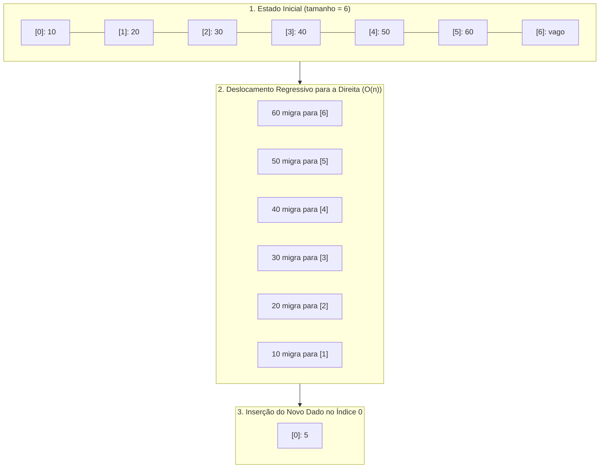

Se o arranjo contiver $`n`$ elementos, a inserção no índice 0 exige o deslocamento mecânico de todos os $`n`$ itens. De forma equivalente, a remoção do primeiro item exige o deslocamento de $`n - 1`$ elementos para a esquerda para preencher o vazio. Ambas as operações possuem complexidade assintótica de pior caso estritamente linear:
```math
O(n)
```

A tabela a seguir consolida os custos temporais da lista linear sequencial:

| Operação | Melhor Caso | Caso Médio | Pior Caso | Justificativa de Custo |
| :--- | :--- | :--- | :--- | :--- |
| **Acesso por índice** | $`O(1)`$ | $`O(1)`$ | $`O(1)`$ | Aritmética direta de endereçamento contíguo |
| **Inserção no fim (com folga)** | $`O(1)`$ | $`O(1)`$ | $`O(1)`$ | Gravação imediata em `elementos[tamanho]` |
| **Inserção no início** | $`O(n)`$ | $`O(n)`$ | $`O(n)`$ | Deslocamento de todos os $`n`$ elementos para a direita |
| **Inserção intermediária (índice $`k`$)**| $`O(1)`$ se $`k = \text{tamanho}`$ | $`O(n)`$ | $`O(n)`$ | Deslocamento de $`n - k`$ elementos para a direita |
| **Remoção no início** | $`O(n)`$ | $`O(n)`$ | $`O(n)`$ | Deslocamento de $`n - 1`$ elementos para a esquerda |
| **Remoção no fim** | $`O(1)`$ | $`O(1)`$ | $`O(1)`$ | Apenas decremento lógico: `tamanho--` |

### Redimensionamento dinâmico e custo amortizado

Arrays na Máquina Virtual Java possuem dimensão física fixa imutável após a alocação. Quando a lista preenche todas as gavetas (`tamanho == elementos.length`), uma nova inserção causaria estouro de limites.

Para simular uma estrutura dinâmica (como faz a classe nativa `java.util.ArrayList`), aplica-se o mecanismo de **redimensionamento geométrico**:
1. Aloca-se um novo array com o dobro da capacidade do original (`capacidade * 2`).
2. Copiam-se todos os $`n`$ dados antigos para o novo array.
3. Redireciona-se o ponteiro da classe para o novo array no Heap.
4. O array antigo fica sem referências e é coletado pelo Garbage Collector.

Embora a operação de redimensionamento custe isoladamente $`O(n)`$, ela ocorre com frequência decrescente. Ao distribuir o custo das cópias pela sequência de inserções, a complexidade temporal resultante é expressa como **$`O(1)`$ amortizado** por inserção.

---

## Capitulo 7: Listas Ligadas Dinamicas

### A mudança de paradigma: nós dispersos e ponteiros de encadeamento

Para mitigar o gargalo de deslocamento das estruturas sequenciais, as **Listas Ligadas (ou Encadeadas)** abandonam o requisito de contiguidade física. Os elementos passam a ser alocados individualmente e sob demanda na memória Heap, em posições físicas arbitrárias e desordenadas.

A ordenação lógica da coleção deixa de depender da proximidade espacial de gavetas na memória e passa a ser mantida por vínculos lógicos explícitos: **referências de encadeamento (ponteiros)**.

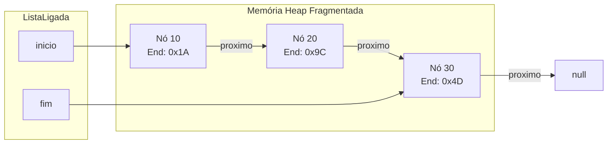

### Anatomia da classe No

O **Nó (*Node*)** é o átomo formador da lista ligada. Trata-se de uma unidade de encapsulamento contendo duas divisões:
1. **Carga Útil (*Payload*):** O dado de interesse que a estrutura transporta (no contexto didático da disciplina, um inteiro primitivo `int valor`).
2. **Ponteiro de Encadeamento (`proximo`):** Uma variável de referência para outro objeto da mesma classe `No`, ou o valor literal `null` indicando a terminação da cadeia.

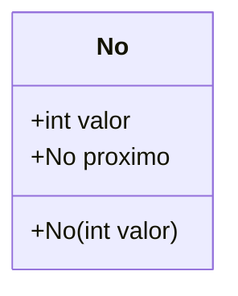

```java
public class No {
    public int valor;      // Carga útil armazenada
    public No proximo;     // Ponteiro para o próximo nó no Heap

    public No(int valor) {
        this.valor = valor;
        this.proximo = null;
    }
}
```

### Estrutura da classe controladora ListaLigada

A manipulação direta de nós pelo código consumidor viola o encapsulamento. A classe `ListaLigada` atua como a entidade controladora, gerindo a coleção através de três atributos privados fundamentais:
- `private No inicio`: Referência para a cabeça da lista.
- `private No fim`: Referência para a cauda da lista (último elemento).
- `private int tamanho`: Contador escalar da quantidade de nós ativos.

```java
public class ListaLigada {
    private No inicio;
    private No fim;
    private int tamanho;

    public ListaLigada() {
        this.inicio = null;
        this.fim = null;
        this.tamanho = 0;
    }

    public boolean estaVazia() {
        return this.inicio == null;
    }

    public int getTamanho() {
        return this.tamanho;
    }
}
```

### Inserção no início

A inclusão de um nó no início da lista encadeada dinâmica ocorre em tempo estritamente constante, pois prescinde de deslocamentos de elementos adjacentes. O processo resume-se a reorganizar dois apontamentos de ponteiros:

1. Instanciar o novo nó: `No novo = new No(valor);`.
2. Apontar o campo `proximo` do novo nó para onde a lista atualmente começa (`novo.proximo = this.inicio;`).
3. Atualizar a referência de início da controladora para o novo nó (`this.inicio = novo;`).
4. Caso a lista estivesse vazia antes da operação, o ponteiro `fim` também é direcionado para este mesmo nó.
5. Incrementar o contador `tamanho++`.

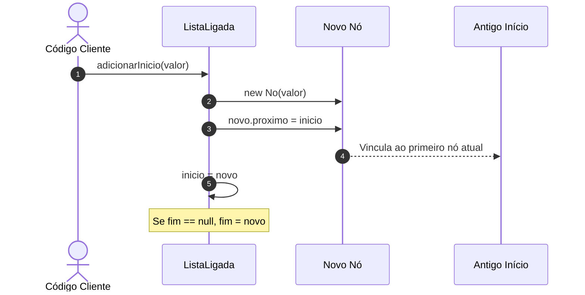

```java
public void adicionarInicio(int valor) {
    No novo = new No(valor);
    
    // Conecta o novo nó à cabeça existente
    novo.proximo = this.inicio;
    this.inicio = novo;

    // Trata o estado de lista inicialmente unitária
    if (this.fim == null) {
        this.fim = novo;
    }
    
    this.tamanho++;
}
```

> **Armadilha crítica de perda de lista:** Inverter a ordem das atribuições gera um erro catastrófico. Executar `this.inicio = novo;` antes de `novo.proximo = this.inicio;` faz com que o novo nó aponte para si mesmo em laço infinito, perdendo permanentemente a referência da cadeia antiga, que será destruída pelo Garbage Collector.

### Inserção no final: abordagem ingênua versus otimização com ponteiro de cauda

A inserção de um elemento no final da lista encadeada pode operar em duas ordens de complexidade assintótica distintas, dependendo do design arquitetural da classe:

#### Abordagem Ingênua: Sem ponteiro `fim` ($`O(n)`$)
Se a classe mantiver apenas a referência `inicio`, para adicionar um elemento na cauda o algoritmo é obrigado a instanciar um ponteiro auxiliar e iterar nó por nó desde a cabeça até alcançar o elemento terminal (cujo `proximo == null`). Para uma lista com um milhão de registros, o algoritmo executará um milhão de saltos de ponteiro antes de poder anexar o novo nó.

```java
// Implementação ineficiente O(n)
public void adicionarFimIngenuo(int valor) {
    No novo = new No(valor);
    if (this.inicio == null) {
        this.inicio = novo;
        return;
    }
    No atual = this.inicio;
    while (atual.proximo != null) { // Varredura completa O(n)
        atual = atual.proximo;
    }
    atual.proximo = novo;
}
```

#### Abordagem Otimizada: Com ponteiro `fim` ($`O(1)`$)
Ao preservar uma referência direta para o último nó (`fim`), a inserção torna-se instantânea, envolvendo duas atribuições simples de ponteiros:

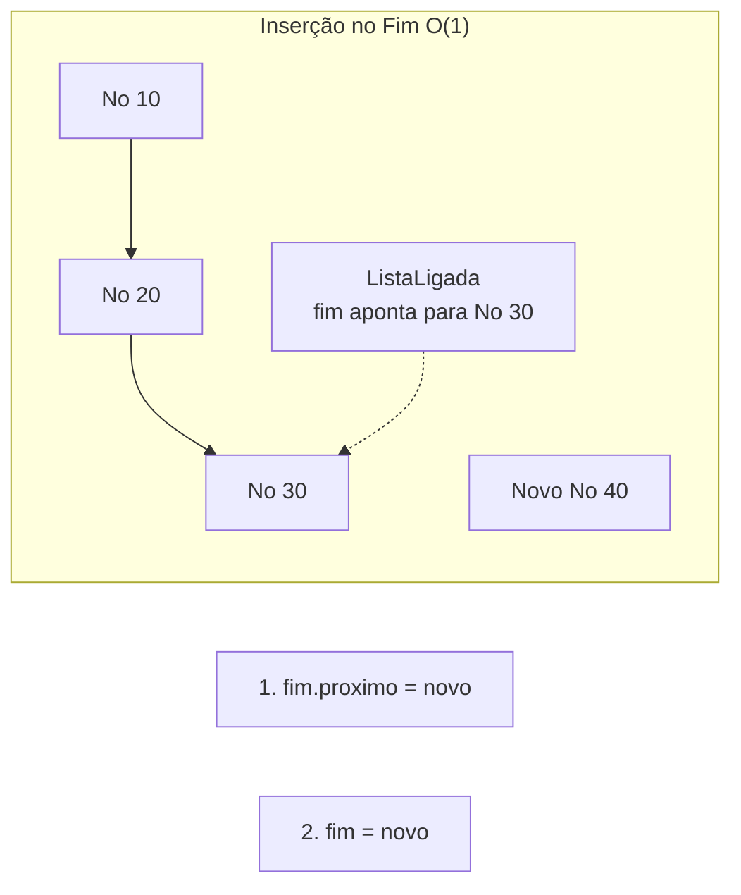

```java
public void adicionarFim(int valor) {
    No novo = new No(valor);

    if (estaVazia()) {
        this.inicio = novo;
        this.fim = novo;
    } else {
        this.fim.proximo = novo; // O antigo término aponta para o recém-chegado
        this.fim = novo;         // A cauda avança para o novo nó
    }
    
    this.tamanho++;
}
```

### Inserção ordenada: distinção entre localização e religamento

Inserir um valor preservando a ordenação crescente (exemplo: inserir `35` na lista `[10, 20, 30, 40]`) evidencia a separação entre custos operacionais em estruturas de dados:

1. **Etapa de Localização:** Varrer a lista para encontrar o ponto exato de fratura (o nó anterior ao local onde o 35 deve ser posicionado). Por ser um percurso sequencial, consome complexidade temporal linear: **$`O(n)`$**.
2. **Etapa de Religamento:** Criar o nó e manipular ponteiros para encaixá-lo entre o nó `30` e o nó `40`. Consome complexidade temporal constante: **$`O(1)`$**.

Pelo princípio assintótico do termo dominante:
```math
\text{Custo Total} = O(n) + O(1) = O(n)
```

```mermaid
sequenceDiagram
  autonumber
  participant Ant as Nó Anterior (30)
  participant Novo as Novo Nó (35)
  participant Prox as Nó Sucessor (40)

  Note over Novo, Prox: Ordem estrita de religamento:
  Novo->>Prox: 1. novo.proximo = anterior.proximo (salva o restante da lista)
  Ant->>Novo: 2. anterior.proximo = novo (amarra a parte inicial ao novo nó)
```

```java
public void inserirOrdenado(int valor) {
    No novo = new No(valor);

    // Caso 1: Lista vazia ou valor menor que o primeiro (inserção no início)
    if (estaVazia() || valor <= this.inicio.valor) {
        novo.proximo = this.inicio;
        this.inicio = novo;
        if (this.fim == null) {
            this.fim = novo;
        }
        this.tamanho++;
        return;
    }

    // Caso 2: Varredura para encontrar o ponto de inserção
    No atual = this.inicio;
    while (atual.proximo != null && atual.proximo.valor < valor) {
        atual = atual.proximo;
    }

    // Caso 3: Religamento de ponteiros em O(1)
    novo.proximo = atual.proximo;
    atual.proximo = novo;

    // Caso 4: Se inserido após o antigo último, atualiza o ponteiro fim
    if (novo.proximo == null) {
        this.fim = novo;
    }

    this.tamanho++;
}
```

### Busca linear e recuperação posicional

Diferente do array contíguo, a lista ligada **não possui índices físicos na memória RAM**. O índice em uma lista ligada é uma abstração lógica que indica a quantidade de saltos de ponteiro a partir do `inicio`. Para alcançar o índice $`k`$, o algoritmo parte da cabeça e avança $`k`$ vezes por referências `proximo`.

- **Busca por Valor:** Percorre a cadeia comparando o campo `valor`. No pior caso (elemento ausente ou na última posição), requer $`n`$ comparações: complexidade **$`O(n)`$**.
- **Busca por Posição (`obter(int indice)`):** Executa $`indice`$ iterações. No pior caso ($`indice = n - 1`$), consome complexidade **$`O(n)`$**.

```java
public int obter(int indice) {
    if (indice < 0 || indice >= this.tamanho) {
        throw new IndexOutOfBoundsException("Índice inválido: " + indice);
    }
    No atual = this.inicio;
    for (int i = 0; i < indice; i++) {
        atual = atual.proximo;
    }
    return atual.valor;
}
```

### Atualização de elementos por índice

A operação de atualização substitui a carga útil de um nó situado em uma posição lógica específica:

```java
public void atualizar(int indice, int novoValor) {
    if (indice < 0 || indice >= this.tamanho) {
        throw new IndexOutOfBoundsException("Índice fora dos limites da lista: " + indice);
    }
    No atual = this.inicio;
    for (int i = 0; i < indice; i++) {
        atual = atual.proximo;
    }
    atual.valor = novoValor; // Atribuição escalar em O(1) após navegação O(n)
}
```

A navegação até o nó demanda tempo linear $`O(n)`$, enquanto a gravação escalar `atual.valor = novoValor` consome $`O(1)`$. A complexidade global da operação é **$`O(n)`$**.

### Remoção de elementos e integridade estrutural

A exclusão de nós exige manter a integridade dos ponteiros de extremidade (`inicio`, `fim`) e a sincronização do contador `tamanho`:

- **Remoção no Início:** Requer apenas avançar o ponteiro da cabeça: `this.inicio = this.inicio.proximo;`. Executa em tempo estritamente constante **$`O(1)`$**. Caso a lista torne-se vazia, `fim` é ajustado para `null`.
- **Remoção no Meio ou Fim:** Exige localizar o **nó anterior** ao elemento a ser excluído para contorná-lo (`anterior.proximo = alvo.proximo;`). Se o nó removido for o último, `fim` passa a apontar para `anterior`. Complexidade temporal **$`O(n)`**.

```java
public boolean removerPorValor(int valor) {
    if (estaVazia()) {
        return false;
    }

    // Caso 1: O nó a ser removido é o primeiro
    if (this.inicio.valor == valor) {
        this.inicio = this.inicio.proximo;
        this.tamanho--;
        if (this.tamanho == 0) {
            this.fim = null;
        }
        return true;
    }

    // Caso 2: Varredura para encontrar o nó anterior ao que contém o valor
    No atual = this.inicio;
    while (atual.proximo != null && atual.proximo.valor != valor) {
        atual = atual.proximo;
    }

    // Se encontrou o nó
    if (atual.proximo != null) {
        // Se o nó a ser removido é o último
        if (atual.proximo == this.fim) {
            this.fim = atual;
        }
        atual.proximo = atual.proximo.proximo; // Salto de ponteiro
        this.tamanho--;
        return true;
    }

    return false; // Valor ausente na estrutura
}
```

### Matriz comparativa: lista sequencial versus lista ligada

A tabela a seguir contrasta as características das duas abordagens de implementação de listas lineares:

| Dimensão de Comparação | Lista Sequencial (Vetor Estático) | Lista Ligada Dinâmica (Nós) |
| :--- | :--- | :--- |
| **Acesso Aleatório por Índice** | Imediato em tempo constante: $`O(1)`$ | Sequencial por saltos em tempo linear: $`O(n)`$ |
| **Inserção no Início** | Lenta ($`O(n)`$): desloca todos os elementos | Rápida ($`O(1)`$): troca apenas referências |
| **Inserção no Fim** | $`O(1)`$ amortizado (com espaço livre) | $`O(1)`$ (mantendo ponteiro de cauda `fim`) |
| **Inserção no Meio (no ponto)** | Lenta ($`O(n)`$): exige deslocamento de blocos | Rápida ($`O(1)`$): exige apenas religamento de ponteiros |
| **Uso da Memória Cache da CPU** | Excepcional: alta localidade espacial | Baixo: nós espalhados quebram o cache (*cache misses*) |
| **Sobrecarga de Memória (Overhead)** | Baixa: apenas os dados brutos e eventual folga | Alta: armazena ponteiros adicionais em cada nó |
| **Flexibilidade de Capacidade** | Rígida: exige realocação periódica | Flexível: alocação e liberação nó a nó sob demanda |

---

## Capitulo 8: Estruturas Lineares Restritas: Pilhas

### Definição formal e o princípio LIFO

Uma **Pilha (*Stack*)** é um Tipo Abstrato de Dados linear no qual todas as operações de mutação (inserção e remoção) e inspeção ocorrem exclusivamente em uma única extremidade denominada **Topo** (*Top*). A extremidade oposta, inacessível a modificações diretas, é denominada **Base** (*Bottom*).

A pilha impõe uma disciplina operacional estrita:

> **Princípio LIFO — Last In, First Out**  
> *O último elemento inserido na estrutura é obrigatoriamente o primeiro elemento a ser removido.*

```mermaid
flowchart TD
  subgraph OperacoesPilha["Operações Fundamentais no Topo da Pilha"]
    Novo["Elemento a ser inserido"] -->|"push(v) O(1)"| Topo["TOPO ATUAL"]
    Topo -->|"pop() O(1)"| Removido["Elemento desempilhado"]
    Topo -->|"peek() O(1)"| Inspecionado["Leitura sem remoção"]
  end
```

### O contrato fundamental: push, pop, peek e isEmpty

A interface pública de uma Pilha é delimitada por quatro operações atômicas:

1. **`push(valor)`:** Adiciona um elemento no topo da pilha.
   - Pré-condição: A estrutura não pode estar cheia (caso baseie-se em array estático).
   - Efeito: O elemento torna-se o novo topo e a cardinalidade é incrementada em 1.
   - Complexidade: $`O(1)`$.
2. **`pop()`:** Remove e retorna o elemento situado no topo.
   - Pré-condição: A pilha não pode estar vazia. Chamar `pop()` sobre uma pilha vazia configura a violação **Stack Underflow**.
   - Efeito: O topo recua uma posição e a cardinalidade é decrementada em 1.
   - Complexidade: $`O(1)`$.
3. **`peek()` (ou `top()`):** Retorna o valor do elemento no topo sem removê-lo.
   - Pré-condição: Pilha não-vazia.
   - Efeito: A estrutura permanece intacta.
   - Complexidade: $`O(1)`$.
4. **`isEmpty()`:** Avalia se a pilha contém zero elementos válidos.
   - Retorno: `true` se vazia, `false` caso contrário.
   - Complexidade: $`O(1)`$.

### O princípio do encapsulamento restritivo

Uma questão conceitual recorrente é: *"Se a pilha for implementada sobre um array interno, por que não oferecer um método `obter(int indice)` para ler dados intermediários?"*

A resposta reside na **garantia de invariantes**. Ao adotar uma pilha na arquitetura de um sistema, a equipe de engenharia assume que elementos intermediários não sofrerão leituras fora de contexto nem modificações arbitrárias. Se a classe expuser acesso por índice, ela deixa de ser uma pilha e converte-se em uma lista genérica, quebrando as garantias operacionais de algoritmos como analisadores léxicos, processadores de expressões e rotinas de desfazer (*Undo*).

```mermaid
classDiagram
  class Pilha {
    -int[] elementos
    -int topo
    +Pilha(capacidade)
    +push(valor) void
    +pop() int
    +peek() int
    +isEmpty() boolean
  }
  note for Pilha "Acesso restrito ao Topo (LIFO)\nSem métodos de acesso aleatório por índice"
```

### Implementação estática baseada em array

Na implementação sequencial, a pilha armazena seus dados em um vetor primitivo unidimensional, utilizando uma variável inteira privada `topo` como marcador do índice ocupado.

```java
public class Pilha {
    private int[] elementos;
    private int topo;

    public Pilha(int capacidade) {
        if (capacidade <= 0) {
            throw new IllegalArgumentException("A capacidade deve ser maior que zero.");
        }
        this.elementos = new int[capacidade];
        this.topo = -1; // Sentinela matemática que indica pilha vazia
    }

    public boolean isEmpty() {
        return this.topo == -1;
    }

    public boolean isFull() {
        return this.topo == this.elementos.length - 1;
    }

    public void push(int valor) {
        if (isFull()) {
            throw new IllegalStateException("Erro: Estouro de Pilha (Stack Overflow).");
        }
        this.topo++;                     // 1. Pré-incrementa o ponteiro
        this.elementos[this.topo] = valor; // 2. Armazena o valor no novo topo
    }

    public int pop() {
        if (isEmpty()) {
            throw new IllegalStateException("Erro: Subfluxo de Pilha (Stack Underflow).");
        }
        int valorRemovido = this.elementos[this.topo]; // 1. Recupera o dado
        this.topo--;                                 // 2. Decrementa o ponteiro (exclusão lógica)
        return valorRemovido;
    }

    public int peek() {
        if (isEmpty()) {
            throw new IllegalStateException("Erro: Pilha vazia.");
        }
        return this.elementos[this.topo];
    }

    public int size() {
        return this.topo + 1;
    }
}
```

### A matemática da sentinela com índice negativo

Em linguagens com indexação baseada em zero (como Java e C):
- Uma pilha com $`1`$ elemento armazena o dado em `elementos[0]`. Logo, para 1 item, `topo = 0`.
- Uma pilha com $`2`$ elementos armazena o topo em `elementos[1]`. Logo, para 2 itens, `topo = 1`.
- Generalizando: para uma pilha contendo $`K`$ elementos, o topo reside na posição $`K - 1`$.

Deduzindo a condição de vacuidade por regressão matemática:
- Se a pilha possui $`0`$ elementos ($`K = 0`$), a posição do topo é dada por:
```math
\text{topo} = K - 1 = 0 - 1 = -1
```
A convenção `topo = -1` atua como uma **sentinela formal** que comprova a ausência total de dados na estrutura sem necessitar de flags booleanas extras.

```mermaid
sequenceDiagram
  autonumber
  actor Cliente as Código Cliente
  participant P as Pilha (Instância)

  Note over P: Estado Inicial: topo = -1 (Vazia)
  Cliente->>P: push(10)
  Note over P: topo avança para 0<br/>elementos[0] = 10
  P-->>Cliente: Concluído

  Cliente->>P: push(20)
  Note over P: topo avança para 1<br/>elementos[1] = 20
  P-->>Cliente: Concluído

  Cliente->>P: pop()
  Note over P: Resgata elementos[1] (20)<br/>topo recua para 0
  P-->>Cliente: Retorna 20

  Cliente->>P: pop()
  Note over P: Resgata elementos[0] (10)<br/>topo recua para -1
  P-->>Cliente: Retorna 10
  Note over P: Estado Final: topo = -1 (Vazia)
```

### Exclusão lógica versus física e o problema de vazamento de referências

Na implementação da pilha com tipos primitivos (`int[]`), a operação `pop()` limita-se a decrementar a variável de controle (`topo--`). O dado numérico anterior permanece gravado nos transistores de memória do array, mas torna-se **logicamente inacessível** pela interface pública. Quando um novo `push` for executado, o valor antigo será sobrescrito.

> Alerta de Engenharia de Software (Vazamento de Referências): Se a pilha for parametrizada para armazenar referências a objetos (`Object[]` ou genéricos `<T>`), a exclusão puramente lógica (`topo--`) deixa a referência do objeto gravada na célula do array. Como o array faz parte de uma raiz ativa, o objeto permanece alcançável e o Garbage Collector **não consegue liberá-lo da memória**, gerando vazamento oculto (*loitering*). Para pilhas de objetos, é obrigatório anular o ponteiro na exclusão:
> ```java
> Object item = elementos[topo];
> elementos[topo] = null; // Libera a referência para coleta pelo Garbage Collector
> topo--;
> return item;
> ```

### Implementação dinâmica encadeada de pilha

Para construir uma pilha imune a limites pré-fixados de capacidade (*Stack Overflow*), mapeia-se o comportamento LIFO sobre uma lista ligada. Para que todas as operações preservem complexidade assintótica estritamente constante $`O(1)`$, **o topo da pilha deve corresponder obrigatoriamente à cabeça (início) da lista ligada**.

```mermaid
flowchart LR
  subgraph PilhaEncadeada["Pilha Ligada Dinâmica: Topo no Início"]
    TopoPtr["Ponteiro topo"] --> N1["Nó 30 (Topo)"]
    N1 -->|"proximo"| N2["Nó 20"]
    N2 -->|"proximo"| N3["Nó 10 (Base)"]
    N3 -->|"proximo"| NullPtr["null"]
  end
```

```java
public class PilhaLigada {
    private No topo;
    private int tamanho;

    public PilhaLigada() {
        this.topo = null;
        this.tamanho = 0;
    }

    public boolean isEmpty() {
        return this.topo == null;
    }

    public void push(int valor) {
        No novo = new No(valor);
        novo.proximo = this.topo; // Novo nó aponta para o antigo topo
        this.topo = novo;         // O topo passa a ser o novo nó
        this.tamanho++;
    }

    public int pop() {
        if (isEmpty()) {
            throw new IllegalStateException("Erro: Pilha vazia.");
        }
        int valor = this.topo.valor;
        this.topo = this.topo.proximo; // O topo recua para o próximo nó
        this.tamanho--;
        return valor;
    }

    public int peek() {
        if (isEmpty()) {
            throw new IllegalStateException("Erro: Pilha vazia.");
        }
        return this.topo.valor;
    }

    public int size() {
        return this.tamanho;
    }
}
```

A tabela abaixo compara as duas arquiteturas de implementação da pilha:

| Critério de Avaliação | Pilha Sequencial (Array) | Pilha Encadeada (Nós Dinâmicos) |
| :--- | :--- | :--- |
| **Limite de Capacidade** | Fixo; vulnerável a *Stack Overflow* se subdimensionada | Dinâmico; cresce até o esgotamento do Heap |
| **Complexidade Temporal** | $`O(1)`$ estrito em todas as operações fundamentais | $`O(1)`$ estrito em todas as operações fundamentais |
| **Consumo de Memória** | Compacto; aloca apenas os valores primitivos contíguos | Maior; cada nó exige memória para o dado + ponteiro |
| **Localidade de Cache da CPU**| Alta eficiência; explora o prefetching de hardware | Baixa eficiência; nós espalhados na memória Heap |
| **Impacto no Coletor de Lixo** | Nulo durante a operação em vetores primitivos | Alto; instanciar e descartar nós aciona o GC |

---

## Capitulo 9: Manipulacao Avancada de Pilhas com Estruturas Auxiliares

### O dilema da inspeção intermediária

Em diversos cenários práticos, surge a necessidade de verificar se determinado valor existe no interior de uma pilha, substituir um registro corrompido ou remover um elemento específico. 

> **A Armadilha da Quebra de Abstração:** Percorrer a estrutura encadeada navegando diretamente em atributos privados como `pilha.topo.proximo.proximo.valor` destrói o encapsulamento, corrompe o modelo mental LIFO e quebra o código cliente caso a estrutura interna venha a ser refatorada.

### Mecanismo da pilha auxiliar para preservação de estado

A técnica canônica para inspecionar ou mutar dados no interior de uma pilha sem violar a abstração LIFO fundamenta-se no uso de uma **Pilha Auxiliar Temporária**:
1. Desempilham-se os elementos da pilha original sequencialmente via `pop()`.
2. Cada elemento desempilhado é inserido na pilha auxiliar via `push()`.
3. As inspeções ou alterações necessárias são executadas durante a transferência.
4. Ao término da tarefa, os elementos são integralmente desempilhados da estrutura auxiliar e reinseridos na pilha original.

Como o processo de desempilhar e reempilhar inverte a ordem duas vezes seguidas, a pilha original tem seu estado e disposição primitiva **perfeitamente restaurados**.

```mermaid
sequenceDiagram
  autonumber
  participant Orig as Pilha Original
  participant Aux as Pilha Auxiliar
  
  Note over Orig, Aux: Fase 1: Descarregamento e Inversão
  Orig->>Aux: aux.push(orig.pop())
  Note over Aux: Elemento alvo localizado ou manipulado
  Note over Orig, Aux: Fase 2: Restauração da Ordem Primitiva
  Aux->>Orig: orig.push(aux.pop())
  Note over Orig: Pilha restaurada ao estado original
```

### Algoritmo de busca por existência: método contem

O método `contem(int valor)` avalia se determinada chave existe na pilha sem expor sua estrutura interna:

```java
public boolean contem(int valorBuscado) {
    PilhaLigada auxiliar = new PilhaLigada();
    boolean localizado = false;

    // Esvazia a pilha original transferindo os dados para a auxiliar
    while (!this.isEmpty()) {
        int atual = this.pop();
        if (atual == valorBuscado) {
            localizado = true;
        }
        auxiliar.push(atual);
    }

    // Restaura integralmente o estado da pilha original
    while (!auxiliar.isEmpty()) {
        this.push(auxiliar.pop());
    }

    return localizado;
}
```

- **Complexidade Temporal:** No pior caso (elemento ausente ou na base), o algoritmo desempilha $`n`$ itens e reempilha $`n`$ itens, executando $`2n`$ operações fundamentais. Complexidade assintótica linear: **$`O(n)`$**.
- **Complexidade Espacial:** A pilha auxiliar armazena simultaneamente até $`n`$ elementos na memória. Complexidade espacial auxiliar: **$`O(n)`$**.

### Substituição e remoção arbitrária de valores internos

#### Substituição de Valor
```java
public boolean substituir(int valorAntigo, int valorNovo) {
    PilhaLigada auxiliar = new PilhaLigada();
    boolean substituiu = false;

    while (!this.isEmpty()) {
        int atual = this.pop();
        if (!substituiu && atual == valorAntigo) {
            auxiliar.push(valorNovo); // Insere o novo valor no lugar do antigo
            substituiu = true;
        } else {
            auxiliar.push(atual);
        }
    }

    while (!auxiliar.isEmpty()) {
        this.push(auxiliar.pop());
    }

    return substituiu;
}
```

#### Remoção Arbitrária
```java
public boolean removerValor(int valorAlvo) {
    PilhaLigada auxiliar = new PilhaLigada();
    boolean removeu = false;

    while (!this.isEmpty()) {
        int atual = this.pop();
        if (!removeu && atual == valorAlvo) {
            removeu = true;
            // Descarta o elemento: não executa push na pilha auxiliar
            continue;
        }
        auxiliar.push(atual);
    }

    while (!auxiliar.isEmpty()) {
        this.push(auxiliar.pop());
    }

    return removeu;
}
```

### Inversão de pilhas e validação de delimitadores balanceados

#### Inversão de Pilha
Para inverter a ordem dos elementos de uma pilha sem violar sua interface, são necessárias duas pilhas de apoio:

```java
public static PilhaLigada inverterPilha(PilhaLigada original) {
    PilhaLigada aux1 = new PilhaLigada();
    PilhaLigada aux2 = new PilhaLigada();
    PilhaLigada invertida = new PilhaLigada();

    // Transfere da original para aux1 (a ordem é invertida)
    while (!original.isEmpty()) {
        aux1.push(original.pop());
    }

    // Transfere de aux1 para aux2 e para a pilha invertida
    while (!aux1.isEmpty()) {
        int val = aux1.pop();
        aux2.push(val);
        invertida.push(val); // Mantém a ordem invertida
    }

    // Restaura a pilha original original a partir de aux2
    while (!aux2.isEmpty()) {
        original.push(aux2.pop());
    }

    return invertida;
}
```

#### Verificador de Delimitadores Balanceados
Um dos usos clássicos de pilhas em compiladores e editores de código é validar se delimitadores matemáticos ou de sintaxe (`( )`, `[ ]`, `{ }`) estão corretamente aninhados:

```java
public static boolean verificarBalanceamento(String expressao) {
    PilhaLigada pilha = new PilhaLigada();

    for (int i = 0; i < expressao.length(); i++) {
        char caractere = expressao.charAt(i);

        // Se for caractere de abertura, empilha
        if (caractere == '(' || caractere == '[' || caractere == '{') {
            pilha.push(caractere);
        } 
        // Se for caractere de fechamento, valida com o topo
        else if (caractere == ')' || caractere == ']' || caractere == '}') {
            if (pilha.isEmpty()) {
                return false; // Tentativa de fechar sem abertura correspondente
            }
            char topo = (char) pilha.pop();
            if ((caractere == ')' && topo != '(') ||
                (caractere == ']' && topo != '[') ||
                (caractere == '}' && topo != '{')) {
                return false; // Incompatibilidade de pares de delimitadores
            }
        }
    }

    // A expressão é válida apenas se a pilha terminar vazia
    return pilha.isEmpty();
}
```

### Reflexão crítica sobre a seleção de estruturas de dados

Conforme reiterado pelo Prof. Wesley Soares em aula:

> **Reflexão de Arquitetura de Software:** Se uma aplicação demanda recorrentemente buscas por valor, atualizações ou remoções no meio de uma estrutura, **a Pilha é a estrutura conceitual errada**.

O uso de pilhas auxiliares temporárias para mutações internas deve ser encarado como um recurso excepcional de preservação de estado. Em sistemas reais onde buscas arbitrárias ocorrem com alta frequência, a modelagem deve migrar para estruturas projetadas para indexação livre, como Listas Ligadas, Tabelas Hash ou Árvores Binárias de Busca.

---

## Capitulo 10: Algoritmos de Ordenacao Elementares: Bubble Sort e Selection Sort

### A importância da ordenação em sistemas de software

A **ordenação de dados** consiste no processo computacional de reorganizar os elementos de uma coleção de acordo com uma relação de ordem total pré-definida (crescente, decrescente ou por chaves alfanuméricas compostas).

Na Engenharia de Software, a ordenação atua como habilitadora crítica de desempenho:
- **Viabilização de Buscas Eficientes:** Permite a substituição de buscas lineares lentas ($`O(n)`$) por buscas binárias de alta performance ($`O(\log n)`$).
- **Facilitação de Agrupamentos e Consolidações:** Algoritmos de detecção de duplicidades, junções (*joins*) de dados e operações de união e interseção executam em tempo linear se as coleções de entrada estiverem ordenadas.
- **Apresentação Humana:** Relatórios gerenciais, extratos e listagens exigem padronização visual compreensível.

### Bubble Sort: ordenação por trocas adjacentes

#### Definição e Princípio de Funcionamento
O **Bubble Sort (Método da Bolha)** é um algoritmo de ordenação comparativa interna baseado na propagação iterativa de elementos por meio de trocas sucessivas entre vizinhos contíguos. O nome deriva da metáfora física em que os elementos de maior valor ("mais pesados" ou "mais leves", conforme o critério) flutuam gradualmente em direção ao final da estrutura, como bolhas de ar subindo em um recipiente com fluido.

#### Mecânica Operacional
1. Comparam-se os elementos vizinhos imediatos `vetor[j]` e `vetor[j + 1]`.
2. Se `vetor[j] > vetor[j + 1]` (critério de ordem crescente violado), os valores são invertidos através de uma variável temporária.
3. O cursor `j` avança e repete o processo até o término da partição não consolidada.
4. Ao final de cada varredura externa `i`, o maior elemento restante encontra-se garantidamente assentado em sua posição definitiva no final do vetor.

```mermaid
flowchart LR
  A["vetor[j]"] -->|"Compara vizinhos"| B["vetor[j + 1]"]
  B --> C{"vetor[j] > vetor[j + 1]?"}
  C -- "Sim" --> D["Executa Troca (Swap)"]
  C -- "Não" --> E["Mantém Posições"]
  D --> F["Avança cursor j"]
  E --> F
```

### Simulação passo a passo e teste de mesa do Bubble Sort

Considere o vetor de teste apresentado em aula:
```text
Vetor Inicial: [5, 3, 8, 1] | Tamanho n = 4
```

#### Primeira Passagem (i = 0)
O laço interno percorre de `j = 0` até `j < n - 1 - i` (ou seja, de 0 até 2):
- **Comparação 1 (`j = 0`):** Compara `vetor[0]` (5) com `vetor[1]` (3). Como $`5 > 3`$, executa a troca. Vetor resultante: `[3, 5, 8, 1]`.
- **Comparação 2 (`j = 1`):** Compara `vetor[1]` (5) com `vetor[2]` (8). Como $`5 \le 8`$, não há troca. Vetor resultante: `[3, 5, 8, 1]`.
- **Comparação 3 (`j = 2`):** Compara `vetor[2]` (8) com `vetor[3]` (1). Como $`8 > 1`$, executa a troca. Vetor resultante: `[3, 5, 1, 8]`.
*Resultado da Passagem 0:* O maior elemento (`8`) atingiu sua posição definitiva (índice 3).

#### Segunda Passagem (i = 1)
O laço interno percorre de `j = 0` até `j < n - 1 - 1 = 1`:
- **Comparação 1 (`j = 0`):** Compara `vetor[0]` (3) com `vetor[1]` (5). Como $`3 \le 5`$, não há troca. Vetor resultante: `[3, 5, 1, 8]`.
- **Comparação 2 (`j = 1`):** Compara `vetor[1]` (5) com `vetor[2]` (1). Como $`5 > 1`$, executa a troca. Vetor resultante: `[3, 1, 5, 8]`.
*Resultado da Passagem 1:* O segundo maior elemento (`5`) consolidou sua posição definitiva (índice 2).

#### Terceira Passagem (i = 2)
O laço interno percorre de `j = 0` até `j < n - 1 - 2 = 0`:
- **Comparação 1 (`j = 0`):** Compara `vetor[0]` (3) com `vetor[1]` (1). Como $`3 > 1`$, executa a troca. Vetor resultante: `[1, 3, 5, 8]`.
*Resultado da Passagem 2:* O vetor atinge ordenação total.

A tabela a seguir consolida o teste de mesa da simulação:

| Passagem (`i`) | Índice `j` | Elementos Comparados | Ação Executada | Vetor Resultante | Elemento Fixado |
| :---: | :---: | :--- | :--- | :--- | :---: |
| **Inicial** | - | - | Carga em memória | `[5, 3, 8, 1]` | Nenhum |
| **0** | 0 | `vetor[0]=5` vs `vetor[1]=3` | Troca (5 > 3) | `[3, 5, 8, 1]` | - |
| **0** | 1 | `vetor[1]=5` vs `vetor[2]=8` | Mantém (5 < 8) | `[3, 5, 8, 1]` | - |
| **0** | 2 | `vetor[2]=8` vs `vetor[3]=1` | Troca (8 > 1) | `[3, 5, 1, 8]` | **8** (índice 3) |
| **1** | 0 | `vetor[0]=3` vs `vetor[1]=5` | Mantém (3 < 5) | `[3, 5, 1, 8]` | - |
| **1** | 1 | `vetor[1]=5` vs `vetor[2]=1` | Troca (5 > 1) | `[3, 1, 5, 8]` | **5** (índice 2) |
| **2** | 0 | `vetor[0]=3` vs `vetor[1]=1` | Troca (3 > 1) | `[1, 3, 5, 8]` | **3** e **1** (índices 1 e 0) |

### Implementação e otimização do Bubble Sort com sinalizador

A versão canônica do Bubble Sort continuará executando laços mesmo se o vetor já estiver ordenado precocemente. A adição de um sinalizador booleano (`houveTroca`) interrompe o algoritmo imediatamente caso uma passagem completa termine sem nenhuma movimentação, permitindo atingir tempo linear no melhor caso:

```java
public class BubbleSortOtimizado {
    public static void ordenar(int[] vetor) {
        int n = vetor.length;
        
        for (int i = 0; i < n - 1; i++) {
            boolean houveTroca = false; // Sinalizador de parada antecipada

            // Subtrai 'i' para evitar recomparações com elementos já consolidados no fim
            for (int j = 0; j < n - 1 - i; j++) {
                if (vetor[j] > vetor[j + 1]) {
                    // Troca segura de posições adjacentes
                    int temp = vetor[j];
                    vetor[j] = vetor[j + 1];
                    vetor[j + 1] = temp;
                    houveTroca = true;
                }
            }

            // Se nenhuma troca ocorreu em toda a varredura, o vetor já está ordenado
            if (!houveTroca) {
                break;
            }
        }
    }
}
```

- **Melhor Caso (Vetor Já Ordenado):** O laço interno varre os $`n - 1`$ pares uma única vez. Como `houveTroca` permanece `false`, o `break` é acionado. Complexidade temporal: **$`O(n)`$**.
- **Pior Caso (Vetor em Ordem Reversa):** Requer todas as passagens e trocas em todas as comparações. Complexidade temporal: **$`O(n^2)`$**.
- **Complexidade Espacial Auxiliar:** In-place, exigindo apenas duas variáveis escalares: **$`O(1)`$**.

### Selection Sort: ordenação por seleção de extremos

#### Definição e Princípio de Funcionamento
O **Selection Sort (Ordenação por Seleção)** é um algoritmo de ordenação comparativa que particiona virtualmente o vetor em duas regiões:
1. Subvetor ordenado (à esquerda).
2. Subvetor desordenado (à direita).

Diferente do Bubble Sort — que efetua dezenas de trocas imediatas a cada varredura —, o Selection Sort adota uma estratégia de economia de movimentações físicas na memória: **ele busca o menor valor absoluto presente na partição desordenada e realiza exatamente uma única troca ao final da passagem externa**, assentando o menor elemento encontrado na primeira posição vaga da partição ordenada.

```mermaid
flowchart TD
  Inicio["Início da Passagem i"] --> DefineMenor["Assume indiceMenor = i"]
  DefineMenor --> Varre["Varre j de i + 1 até n - 1"]
  Varre --> Checa{"vetor[j] < vetor[indiceMenor]?"}
  Checa -- "Sim" --> Atualiza["indiceMenor = j (Apenas guarda o índice)"]
  Checa -- "Não" --> Mantem["Mantém indiceMenor"]
  Atualiza --> FimVarredura{"Chegou ao fim do array?"}
  Mantem --> FimVarredura
  FimVarredura -- "Não" --> Varre
  FimVarredura -- "Sim" --> Troca["Efetua Troca Única: vetor[i] com vetor[indiceMenor]"]
  Troca --> Avanca["Fronteira ordenada avança 1 posição"]
```

### Simulação passo a passo e teste de mesa do Selection Sort

Considere o mesmo vetor de teste:
```text
Vetor Inicial: [5, 3, 8, 1] | Tamanho n = 4
```

#### Primeira Passagem (i = 0)
- Inicialização: assume-se provisoriamente `indiceMenor = 0` (valor de referência = 5).
- Comparações com subvetor à direita:
  - `j = 1`: Compara `vetor[1]` (3) com `vetor[indiceMenor]` (5). Como $`3 < 5`$, atualiza `indiceMenor = 1`.
  - `j = 2`: Compara `vetor[2]` (8) com `vetor[indiceMenor]` (3). Como $`8 \ge 3`$, mantém `indiceMenor = 1`.
  - `j = 3`: Compara `vetor[3]` (1) com `vetor[indiceMenor]` (3). Como $`1 < 3`$, atualiza `indiceMenor = 3`.
- Término da varredura: o menor elemento do vetor é o `1` (situado no índice 3).
- Troca Única: permuta `vetor[0]` (5) com `vetor[3]` (1).
- Vetor ao final da passagem: `[1, 3, 8, 5]`. (O índice 0 está ordenado).

#### Segunda Passagem (i = 1)
- Inicialização: `indiceMenor = 1` (valor de referência = 3).
- Comparações no subvetor `[3, 8, 5]`:
  - `j = 2`: Compara `vetor[2]` (8) com `vetor[indiceMenor]` (3). Mantém `indiceMenor = 1`.
  - `j = 3`: Compara `vetor[3]` (5) com `vetor[indiceMenor]` (3). Mantém `indiceMenor = 1`.
- Término da varredura: o menor elemento já se encontra no índice 1.
- Troca Única: permuta `vetor[1]` consigo mesmo (operação neutra).
- Vetor ao final da passagem: `[1, 3, 8, 5]`. (Os índices 0 e 1 estão ordenados).

#### Terceira Passagem (i = 2)
- Inicialização: `indiceMenor = 2` (valor de referência = 8).
- Comparações no subvetor `[8, 5]`:
  - `j = 3`: Compara `vetor[3]` (5) com `vetor[indiceMenor]` (8). Atualiza `indiceMenor = 3`.
- Término da varredura: o menor é o `5` (índice 3).
- Troca Única: permuta `vetor[2]` (8) com `vetor[3]` (5).
- Vetor final: `[1, 3, 5, 8]`. (Ordenação completa).

A tabela a seguir consolida o teste de mesa do Selection Sort:

| Passagem (`i`) | Subvetor Não Ordenado | Menor Encontrado | Posição de Origem | Troca Executada | Vetor Resultante |
| :---: | :---: | :---: | :---: | :--- | :--- |
| **0** | `[5, 3, 8, 1]` | `1` | Índice 3 | `vetor[0]` com `vetor[3]` | `[1, 3, 8, 5]` |
| **1** | `[3, 8, 5]` | `3` | Índice 1 | `vetor[1]` com `vetor[1]` | `[1, 3, 8, 5]` |
| **2** | `[8, 5]` | `5` | Índice 3 | `vetor[2]` com `vetor[3]` | `[1, 3, 5, 8]` |

### Implementação do Selection Sort

```java
public class SelectionSort {
    public static void ordenar(int[] vetor) {
        int n = vetor.length;

        // Laço externo: move a fronteira da partição ordenada
        for (int i = 0; i < n - 1; i++) {
            int indiceMenor = i; // Assume o primeiro índice da partição como menor

            // Laço interno: busca o índice do menor elemento remanescente
            for (int j = i + 1; j < n; j++) {
                if (vetor[j] < vetor[indiceMenor]) {
                    indiceMenor = j; // Armazena apenas a posição de memória
                }
            }

            // Executa exatamente uma única troca por passagem externa
            if (indiceMenor != i) {
                int temp = vetor[i];
                vetor[i] = vetor[indiceMenor];
                vetor[indiceMenor] = temp;
            }
        }
    }
}
```

### Comparativo analítico entre Bubble Sort e Selection Sort

O número de comparações e o volume de trocas físicas na memória revelam comportamentos estruturais distintos:

- **Número de Comparações:** Ambos os algoritmos executam a mesma quantidade de comparações no pior caso:
```math
\sum_{i=1}^{n-1} i = \frac{n(n-1)}{2} \approx O(n^2)
```
Contudo, o Selection Sort é cego à pré-ordenação: ele **sempre** executará $`\frac{n(n-1)}{2}`$ comparações, mesmo que o vetor já esteja perfeitamente ordenado, mantendo complexidade $`\Theta(n^2)`$ em todos os cenários.
- **Volume de Trocas (Movimentações de Memória):**
  - **Bubble Sort:** No pior cenário, pode executar até $`\frac{n(n-1)}{2}`$ trocas (cada troca exige 3 escritas na memória).
  - **Selection Sort:** Executa no máximo **$`n - 1`$ trocas** em toda a sua execução.

> Veredito de Engenharia: O Selection Sort é superior ao Bubble Sort quando o custo de escrita na memória física for elevado (como em memórias Flash ou EEPROM, onde ciclos de escrita degradam o componente de hardware). O Bubble Sort otimizado, por sua vez, é vantajoso para conjuntos que já se encontram quase ordenados, onde encerra a execução em tempo linear $`O(n)`$.

---

## Capitulo 11: Algoritmo de Ordenacao por Insercao Direta: Insertion Sort

### Conceito e analogia das cartas de baralho

O **Insertion Sort (Ordenação por Inserção)** é um algoritmo de ordenação comparativa que constrói a coleção ordenada de maneira incremental, inserindo cada elemento avaliado em sua posição correta dentro de uma partição previamente organizada.

A metáfora didática clássica consiste em observar como uma pessoa organiza uma mão de cartas de baralho:
1. Pega-se a primeira carta com a mão esquerda. Como há apenas uma carta, ela forma uma sequência trivialmente ordenada.
2. Ao receber a segunda carta com a mão direita, o jogador compara seu valor com a carta da mão esquerda. Se for menor, afasta a primeira carta e insere a nova carta na primeira posição.
3. Para cada nova carta retirada, o jogador percorre as cartas já organizadas da direita para a esquerda, empurrando as cartas maiores para abrir a vaga, até encontrar o ponto exato onde a carta atual deve ser encaixada.

```mermaid
sequenceDiagram
  autonumber
  actor Jogador
  participant Mesa as Baralho na Mesa
  participant Mao as Mão Ordenada (Esquerda)

  Jogador->>Mesa: Retira 1ª carta (7)
  Jogador->>Mao: Posiciona 7 (partição unitária ordenada)
  Jogador->>Mesa: Retira 2ª carta (3)
  Jogador->>Mao: Compara 3 com 7 (7 > 3)
  Jogador->>Mao: Desloca 7 para a direita e encaixa 3
  Jogador->>Mesa: Retira 3ª carta (8)
  Jogador->>Mao: Compara 8 com 7 (8 > 7: sem deslocamentos)
  Jogador->>Mao: Encaixa 8 na extrema direita
```

### Particionamento dinâmico: porção ordenada, chave e porção não processada

O Insertion Sort opera dividindo o array em três regiões delimitadas pelo cursor de controle `i`:
1. **Subvetor Ordenado (à esquerda):** Intervalo de índices `$ `[0 \dots i-1]` $`. Os elementos nesta faixa encontram-se ordenados entre si.
2. **Chave (*Key*):** O elemento situado no índice `i`, temporariamente isolado em uma variável local.
3. **Subvetor Não Ordenado (à direita):** Intervalo de índices `$ `[i+1 \dots n-1]` $`, contendo dados ainda não avaliados.

```mermaid
flowchart TD
  subgraph VetorTotal["Estrutura Lógica do Vetor no Insertion Sort"]
    subgraph PorcaoOrdenada["Porção Ordenada [0 ... i-1]"]
      A["vetor[0]"] --- B["vetor[1]"] --- C["..."] --- D["vetor[i-1]"]
    end
    subgraph ElementoChave["Chave Isolada"]
      K["vetor[i] (Gravado em chave)"]
    end
    subgraph PorcaoNaoProcessada["Porção Não Processada [i+1 ... n-1]"]
      E["vetor[i+1]"] --- F["..."] --- G["vetor[n-1]"]
    end
  end

  ElementoChave -.->|"Desloca maiores e insere no vazio"| PorcaoOrdenada
```

### Invariante formal de laço

A correção matemática do Insertion Sort é comprovada através de sua invariante de laço:

> **Definição da Invariante:** No início de cada iteração do laço externo `for` (controlado pelo índice `i`), o subvetor `$ `vetor[0 \dots i-1]` $` consiste nos elementos originalmente presentes nessas posições, dispostos em ordem estritamente crescente.

- **Inicialização:** Para $`i = 1`$, o subvetor `$ `vetor[0 \dots 0]` $` contém apenas um elemento. Um vetor unitário é trivialmente ordenado. A invariante é verdadeira antes da primeira iteração.
- **Manutenção:** O laço interno desloca para a direita todos os itens de `$ `vetor[0 \dots i-1]` $` que são estritamente maiores que a `chave`, abrindo espaço para a sua inserção. Ao final, o subvetor `$ `vetor[0 \dots i]` $` torna-se ordenado, preservando a validade da invariante para a iteração seguinte ($`i + 1`$).
- **Término:** O laço termina quando $`i = n`$. Substituindo $`i`$ por $`n`$ na invariante, temos que o subvetor `$ `vetor[0 \dots n-1]` $` contém todos os elementos originais em ordem crescente. O vetor está provadamente ordenado.

### Simulação passo a passo da inserção direta

Rastreamento do vetor oficial de teste apresentado em aula:
```text
Vetor Inicial: [7, 3, 8, 2, 6] | Tamanho n = 5
```

#### Estado Inicial
O índice 0 (`7`) é admitido como a porção ordenada inicial: `[7 | 3, 8, 2, 6]`.

#### Etapa 1: Inserir a chave 3 (`i = 1`)
- Chave isolada: `chave = vetor[1] = 3`.
- Cursor de comparação: `j = i - 1 = 0`.
- Comparação 1: Compara `vetor[0]` (7) com `chave` (3).
  - Como $`7 > 3`$, desloca `7` para a frente: `vetor[1] = vetor[0]`. Vetor transiente: `[7, 7, 8, 2, 6]`.
  - Decrementa cursor: `j = -1`.
- Condição de parada: `j >= 0` falha. O laço interno encerra.
- Encaixe da chave: `vetor[j + 1] = chave` $`\to`$ `vetor[0] = 3`.
- Vetor ao final da etapa: `[3, 7, 8, 2, 6]`.

#### Etapa 2: Inserir a chave 8 (`i = 2`)
- Chave isolada: `chave = vetor[2] = 8`.
- Cursor de comparação: `j = 1`.
- Comparação 1: Compara `vetor[1]` (7) com `chave` (8).
  - Como $`7 > 8`$ é falso, o laço encerra imediatamente.
- Encaixe da chave: `vetor[j + 1] = chave` $`\to`$ `vetor[2] = 8` (permanece no mesmo local).
- Vetor ao final da etapa: `[3, 7, 8, 2, 6]`.

#### Etapa 3: Inserir a chave 2 (`i = 3`)
- Chave isolada: `chave = vetor[3] = 2`.
- Cursor de comparação: `j = 2`.
- Comparação 1: `vetor[2]` (8) > 2 $`\to`$ desloca 8: `vetor[3] = vetor[2]`. Vetor: `[3, 7, 8, 8, 6]`. `j = 1`.
- Comparação 2: `vetor[1]` (7) > 2 $`\to`$ desloca 7: `vetor[2] = vetor[1]`. Vetor: `[3, 7, 7, 8, 6]`. `j = 0`.
- Comparação 3: `vetor[0]` (3) > 2 $`\to`$ desloca 3: `vetor[1] = vetor[0]`. Vetor: `[3, 3, 7, 8, 6]`. `j = -1`.
- Condição `j >= 0` falha. Encaixe: `vetor[0] = 2`.
- Vetor ao final da etapa: `[2, 3, 7, 8, 6]`.

#### Etapa 4: Inserir a chave 6 (`i = 4`)
- Chave isolada: `chave = vetor[4] = 6`.
- Cursor de comparação: `j = 3`.
- Comparação 1: `vetor[3]` (8) > 6 $`\to`$ desloca 8: `vetor[4] = vetor[3]`. Vetor: `[2, 3, 7, 8, 8]`. `j = 2`.
- Comparação 2: `vetor[2]` (7) > 6 $`\to`$ desloca 7: `vetor[3] = vetor[2]`. Vetor: `[2, 3, 7, 7, 8]`. `j = 1`.
- Comparação 3: `vetor[1]` (3) > 6 é falso $`\to`$ o elemento `3` atua como barreira natural de parada.
- Encaixe: `vetor[j + 1] = chave` $`\to`$ `vetor[2] = 6`.
- Vetor final ordenado: `[2, 3, 6, 7, 8]`.

### Diferença computacional crítica: deslocamento versus trocas sucessivas

Uma das otimizações de baixo nível do Insertion Sort é a substituição sistemática de **trocas completas (*swaps*)** por **deslocamentos unidirecionais (*shifts*)**:

- **Custo da Troca (*Swap*):** Realizar uma troca entre duas posições exige três instruções de atribuição de memória:
```java
int temp = vetor[k];
vetor[k] = vetor[k - 1];
vetor[k - 1] = temp;
```
Se um elemento precisar recuar 5 posições utilizando trocas sucessivas, o sistema executará:
```math
5 \times 3 = 15 \text{ escritas em memória}
```
- **Custo do Deslocamento (*Shift*):** O Insertion Sort isola a chave uma única vez na variável `chave`. Durante o recuo, cada elemento maior é apenas sobrescrito na posição à direita (uma única atribuição por passo). Ao final, a chave é descarregada na vaga restante (mais uma atribuição):
```math
5 \times 1 + 1 = 6 \text{ escritas em memória}
```
Essa abordagem proporciona uma economia de aproximadamente **60% no tráfego do barramento de dados e ciclos de escrita na memória RAM**.

### Implementação completa do Insertion Sort em Java

```java
public class InsertionSort {
    /**
     * Ordena um arranjo de inteiros in-place via Insertion Sort.
     * Complexidade Temporal: O(n) melhor caso, O(n^2) médio e pior caso.
     * Complexidade Espacial Auxiliar: O(1) in-place.
     */
    public static void ordenar(int[] vetor) {
        // O laço inicia no índice 1, pois o índice 0 já é uma partição ordenada unitária
        for (int i = 1; i < vetor.length; i++) {
            int chave = vetor[i]; // Isola o elemento a ser inserido
            int j = i - 1;

            // Desloca elementos maiores que a chave para a direita
            // A ordem das expressões é vital: 'j >= 0' deve anteceder 'vetor[j] > chave'
            // para evitar ArrayIndexOutOfBoundsException por curto-circuito booleano
            while (j >= 0 && vetor[j] > chave) {
                vetor[j + 1] = vetor[j]; // Deslocamento simples (1 escrita)
                j--;                     // Recuo do cursor
            }

            // Encaixa a chave na posição vaga resultante
            vetor[j + 1] = chave;
        }
    }
}
```

### Análise de complexidade temporal e espacial

- **Melhor Caso ($`\Omega(n)`$):** Ocorre quando o vetor já se encontra previamente ordenado. Para cada iteração de `i`, a condição `vetor[j] > chave` falha imediatamente na primeira comparação. O laço `while` executa apenas uma verificação por ciclo externo sem realizar nenhum deslocamento. Complexidade:
```math
T(n) = n - 1 \implies O(n)
```
- **Pior Caso ($`O(n^2)`$):** Ocorre quando o vetor encontra-se em ordem estritamente decrescente reversa. A cada nova chave, o algoritmo é obrigado a percorrer e deslocar todos os elementos da partição ordenada:
```math
\sum_{i=1}^{n-1} i = \frac{n(n-1)}{2} \implies O(n^2)
```
- **Caso Médio ($`\Theta(n^2)`$):** Para dados dispostos aleatoriamente, cada chave percorrerá em média metade da porção ordenada ($`\frac{i}{2}`$), resultando em $`\frac{n(n-1)}{4}`$ operações, pertencente à classe quadrática **$`O(n^2)`$**.
- **Complexidade Espacial:** Opera in-place, demandando apenas memória escalar para `chave` e índices `i` e `j`: **$`O(1)`$**.

### Propriedades de estabilidade, adaptatividade e o algoritmo híbrido Timsort

O Insertion Sort ostenta duas propriedades de engenharia de software de grande relevância:

1. **Estabilidade (*Stable Sort*):** Um algoritmo é estável se preserva a ordem relativa original de registros que possuem chaves idênticas. Como a condição de deslocamento é estrita (`vetor[j] > chave`), elementos com valores iguais não sofrem ultrapassagens mútuas.
2. **Adaptatividade (*Adaptive Sort*):** Algoritmos adaptativos reduzem dinamicamente seu tempo de execução à medida que o nível de desordem prévio do vetor diminui. Em coleções com alto grau de ordenação prévia, o Insertion Sort supera algoritmos sofisticados como Quick Sort e Merge Sort.

> Conexão com a Indústria (Timsort): Devido ao baixo overhead e excelente comportamento adaptativo para pequenas coleções ($`n < 64`$), o Insertion Sort foi integrado pelo engenheiro Tim Peters na concepção do **Timsort**, o algoritmo de ordenação padrão utilizado internamente no ecossistema Java (`java.util.Arrays.sort` para coleções de objetos) e na biblioteca padrão da linguagem Python. O Timsort decompõe grandes arrays em blocos menores (*runs*) e os ordena aplicando variações binárias do Insertion Sort antes de intercalá-los via Merge Sort.

---

## Capitulo 12: Algoritmo de Ordenacao por Divisao e Conquista: Merge Sort

### O paradigma de divisão e conquista

O algoritmo **Merge Sort (Ordenação por Intercalação)**, concebido pelo matemático John von Neumann em 1945, fundamenta-se no paradigma de **Divisão e Conquista (*Divide and Conquer*)**.

O paradigma articula-se em três etapas canônicas:
1. **Dividir:** Fracionar o problema original em subproblemas menores da mesma natureza, particionando o conjunto ao meio.
2. **Conquistar:** Processar cada subproblema recursivamente. Se a partição atingir tamanho unitário ou vazio (caso base), a conquista é trivial, pois uma lista de um elemento já está matematicamente ordenada.
3. **Combinar (*Merge*):** Intercalar de forma ordenada as soluções parciais das metades já ordenadas, produzindo a solução consolidada global.

```mermaid
flowchart TD
  P["Problema Original: Vetor de tamanho n"] --> D["1. DIVIDIR: Calcular meio e particionar em dois"]
  D --> C1["2. CONQUISTAR: mergeSort(esquerda)"]
  D --> C2["2. CONQUISTAR: mergeSort(direita)"]
  C1 --> B{"Tamanho <= 1?"}
  C2 --> B
  B -- "Sim" --> Base["Caso Base: Subvetor trivialmente ordenado"]
  B -- "Não" --> D
  Base --> M["3. COMBINAR: intercalar(inicio, meio, fim)"]
  M --> S["Vetor Final Totalmente Ordenado"]
```

### Etapa de divisão: particionamento recursivo e caso base

A divisão opera delimitando índices lógicos dentro do vetor contíguo (`inicio`, `fim`), sem copiar dados físicos para novas estruturas durante a descida da recursão.

- **Caso Base:** Ocorre quando o subintervalo sob análise possui zero ou um elemento, caracterizado pela condição lógica:
```math
\text{inicio} \ge \text{fim}
```
Ao atingir o caso base, a função recursiva interrompe o empilhamento e retorna imediatamente.

### Prevenção de overflow aritmético no cálculo do ponto médio

Em livros didáticos clássicos, o cálculo do índice mediano é comumente formulado como:
```java
int meio = (inicio + fim) / 2; // Vulnerável a overflow de inteiros
```

> Alerta Crítico de Engenharia (Bug Histórico de Overflow): Em sistemas corporativos que manipulam vetores massivos em arquiteturas de 32 bits, se a soma de `inicio + fim` ultrapassar o valor máximo de um inteiro com sinal ($`2^{31} - 1 = 2.147.483.647`$), ocorrerá um **estouro de capacidade aritmética (integer overflow)**. O resultado da soma converter-se-á em um número negativo, provocando imediatamente o lançamento de `ArrayIndexOutOfBoundsException`.
> A forma matematicamente segura adotada na engenharia moderna calcula a distância relativa entre os extremos:
> ```java
> int meio = inicio + (fim - inicio) / 2; // Imune a estouro de inteiro
> ```

### Etapa de combinação: o algoritmo de intercalação com vetor auxiliar

A etapa de combinação (`intercalar`) reúne duas metades adjacentes previamente ordenadas — subvetor esquerdo `$ `[inicio \dots meio]` $` e subvetor direito `$ `[meio + 1 \dots fim]` $` — em uma sequência única contínua.

#### A necessidade do vetor auxiliar
Diferente de algoritmos in-place, intercalar duas metades ordenadas dentro do próprio array original sem sobrescrever dados preexistentes consumiria tempo quadrático para deslocamento. Para manter a combinação em tempo estritamente linear ($`O(n)`$), é indispensável alocar uma área de memória intermediária (**vetor auxiliar**).

#### A técnica dos dois ponteiros
1. Um cursor `i` aponta para o primeiro elemento da metade esquerda (`inicio`).
2. Um cursor `j` aponta para o primeiro elemento da metade direita (`meio + 1`).
3. Compara-se `vetor[i]` com `vetor[j]`. O menor elemento é copiado para o vetor auxiliar e seu respectivo cursor avança uma casa.
4. O processo repete-se até que uma das metades seja completamente consumida.
5. Os elementos restantes da metade ainda não esgotada são transferidos diretamente para o vetor auxiliar.
6. Todos os dados consolidados no vetor auxiliar são copiados de volta para o vetor original, atualizando a faixa correspondente `$ `[inicio \dots fim]` $`.

```mermaid
flowchart TD
  subgraph EntradaIntercalacao["Subvetores Pré-Ordenados"]
    Esq["Metade Esquerda: [27, 38] (Cursor i)"]
    Dir["Metade Direita: [3, 43] (Cursor j)"]
  end

  subgraph ProcessamentoMerge["Mecanismo de Seleção do Menor"]
    Comp1["Compara 27 com 3 -> Menor é 3 -> Avança j"]
    Comp2["Compara 27 com 43 -> Menor é 27 -> Avança i"]
    Comp3["Compara 38 com 43 -> Menor é 38 -> Esgota Esquerda"]
    Sobra["Copia restante da Direita: 43"]
  end

  subgraph BufferAuxiliar["Vetor Auxiliar Consolidado"]
    Aux["[3, 27, 38, 43]"]
  end

  EntradaIntercalacao --> ProcessamentoMerge --> BufferAuxiliar
```

### Implementação do Merge Sort em Java

```java
public class MergeSort {

    /**
     * Ponto de entrada público para ordenação via Merge Sort.
     */
    public static void ordenar(int[] vetor) {
        if (vetor == null || vetor.length <= 1) {
            return;
        }
        mergeSort(vetor, 0, vetor.length - 1);
    }

    /**
     * Controle recursivo de divisão e conquista.
     */
    private static void mergeSort(int[] vetor, int inicio, int fim) {
        // Caso Base: intervalo unitário ou inválido encerra a recursão
        if (inicio >= fim) {
            return;
        }

        // Cálculo seguro do ponto mediano contra integer overflow
        int meio = inicio + (fim - inicio) / 2;

        // Chamadas recursivas para subdivisão das metades
        mergeSort(vetor, inicio, meio);     // Conquista metade esquerda
        mergeSort(vetor, meio + 1, fim);   // Conquista metade direita

        // Combinação linear das metades ordenadas
        intercalar(vetor, inicio, meio, fim);
    }

    /**
     * Intercala dois subintervalos contíguos previamente ordenados.
     */
    private static void intercalar(int[] vetor, int inicio, int meio, int fim) {
        // Alocação do buffer temporário para o subintervalo atual
        int[] auxiliar = new int[fim - inicio + 1];

        int i = inicio;    // Ponteiro da partição esquerda
        int j = meio + 1;  // Ponteiro da partição direita
        int k = 0;         // Ponteiro do buffer auxiliar

        // Varredura simultânea selecionando o menor elemento
        while (i <= meio && j <= fim) {
            if (vetor[i] <= vetor[j]) { // '<=' garante a estabilidade do algoritmo
                auxiliar[k] = vetor[i];
                i++;
            } else {
                auxiliar[k] = vetor[j];
                j++;
            }
            k++;
        }

        // Despeja os elementos restantes da partição esquerda (se houver)
        while (i <= meio) {
            auxiliar[k] = vetor[i];
            i++;
            k++;
        }

        // Despeja os elementos restantes da partição direita (se houver)
        while (j <= fim) {
            auxiliar[k] = vetor[j];
            j++;
            k++;
        }

        // Copia os dados ordenados do buffer de volta para o array original
        for (k = 0; k < auxiliar.length; k++) {
            vetor[inicio + k] = auxiliar[k];
        }
    }
}
```

### Rastreamento da recursão: movimentos de descida e retorno

Considere o vetor de 4 elementos: `[38, 27, 43, 3]`:

```mermaid
flowchart TD
  N0["mergeSort(0, 3): [38, 27, 43, 3]"]
  N0 -->|"divide"| N1["mergeSort(0, 1): [38, 27]"]
  N0 -->|"divide"| N2["mergeSort(2, 3): [43, 3]"]

  N1 -->|"divide"| N11["mergeSort(0, 0): [38] (Caso Base)"]
  N1 -->|"divide"| N12["mergeSort(1, 1): [27] (Caso Base)"]

  N2 -->|"divide"| N21["mergeSort(2, 2): [43] (Caso Base)"]
  N2 -->|"divide"| N22["mergeSort(3, 3): [3] (Caso Base)"]

  N11 -.->|"intercala"| R1["intercalar(0, 0, 1) -> [27, 38]"]
  N12 -.-> R1
  N21 -.->|"intercala"| R2["intercalar(2, 2, 3) -> [3, 43]"]
  N22 -.-> R2

  R1 -.->|"intercala final"| RF["intercalar(0, 1, 3) -> [3, 27, 38, 43]"]
  R2 -.-> RF
```

1. **Movimento de Descida (Empilhamento de Chamadas):** A função quebra o array sucessivamente pela esquerda até atingir o caso base `[38]` e `[27]`.
2. **Primeiro Retorno e Combinação:** A chamada `intercalar(0, 0, 1)` processa `[38]` e `[27]`, regravando a fatia como `[27, 38]`.
3. **Descida na Direita:** O ramo direito particiona `[43, 3]` em casos base `[43]` e `[3]`.
4. **Segundo Retorno e Combinação:** A chamada `intercalar(2, 2, 3)` reorganiza a fatia direita como `[3, 43]`.
5. **Combinação Final:** A chamada `intercalar(0, 1, 3)` intercala `[27, 38]` e `[3, 43]`, assentando a sequência final consolidada: `[3, 27, 38, 43]`.

### Análise formal de complexidade assintótica

#### Complexidade Temporal
A relação de recorrência clássica do Merge Sort é formalizada pela equação:
```math
T(n) = 2T\left(\frac{n}{2}\right) + cn
```
Onde:
- $`2T\left(\frac{n}{2}\right)`$: Corresponde à resolução recursiva das duas metades independentes de tamanho $`n/2`$.
- $`cn`$: Representa o custo estritamente linear da rotina `intercalar`, que processa todos os $`n`$ elementos ao combiná-los.

Pelo **Teorema Mestre** da Ciência da Computação, a resolução da recorrência estabelece que a árvore de divisão binária possui profundidade máxima estritamente logarítmica:
```math
\text{Altura da Árvore} = \lceil \log_2 n \rceil + 1
```
Como em cada um dos estratos de altura da árvore a função `intercalar` processa uma soma de partições equivalente a $`n`$ elementos, o trabalho computacional total resulta da multiplicação da altura pelo custo linear por nível:
```math
T(n) = n \times \log_2 n \implies O(n \log n)
```
Diferente do Quick Sort (que pode degradar para $`O(n^2)`$ no pior caso de pivoteamento desbalanceado), o Merge Sort **garante complexidade $`O(n \log n)`$ em todos os cenários (melhor caso, caso médio e pior caso)**.

#### Complexidade Espacial Auxiliar
A necessidade do buffer de intercalação impõe um consumo de memória adicional proporcional ao volume total de dados processados. Portanto, a complexidade espacial auxiliar da versão canônica é:
```math
O(n)
```
Adicionalmente, a pilha de chamadas (*call stack*) retém no máximo $`O(\log n)`$ frames de métodos recursivos empilhados simultaneamente.

---

## Capitulo 13: Matriz Comparativa Consolidada de Algoritmos e Estruturas

### Quadro consolidado de estruturas de dados lineares

A tabela a seguir consolida as ordens assintóticas de complexidade das principais estruturas de dados lineares abordadas no semestre:

| Estrutura de Dados | Acesso Posicional ($`vetor[i]`$) | Inserção no Início | Inserção no Fim | Inserção no Meio | Remoção no Início | Remoção no Fim | Remoção no Meio | Sobrecarga de Memória Adicional |
| :--- | :---: | :---: | :---: | :---: | :---: | :---: | :---: | :--- |
| **Vetor Estático / Lista Sequencial** | $`O(1)`$ | $`O(n)`$ | $`O(1)`$ | $`O(n)`$ | $`O(n)`$ | $`O(1)`$ | $`O(n)`$ | Nula (apenas dados brutos e folga) |
| **Lista Ligada (sem ponteiro fim)** | $`O(n)`$ | $`O(1)`$ | $`O(n)`$ | $`O(n)`$ | $`O(1)`$ | $`O(n)`$ | $`O(n)`$ | 1 ponteiro por nó |
| **Lista Ligada (com ponteiro fim)** | $`O(n)`$ | $`O(1)`$ | $`O(1)`$ | $`O(n)`$ | $`O(1)`$ | $`O(n)`$ | $`O(n)`$ | 1 ponteiro por nó + ref. `fim` |
| **Pilha Sequencial (Array)** | Proibido | $`O(1)`$ (push) | Proibido | Proibido | $`O(1)`$ (pop) | Proibido | Proibido | Nula (vetor estático contíguo) |
| **Pilha Encadeada (Lista Ligada)** | Proibido | $`O(1)`$ (push) | Proibido | Proibido | $`O(1)`$ (pop) | Proibido | Proibido | 1 ponteiro de nó por elemento |

### Quadro consolidado de algoritmos de ordenação

A tabela a seguir estabelece a comparação definitiva entre os algoritmos de ordenação estudados na disciplina:

| Algoritmo de Ordenação | Melhor Caso Temporal | Caso Médio Temporal | Pior Caso Temporal | Espaço Auxiliar | Estabilidade de Chaves | Quantidade Máxima de Trocas Físicas | Paradigma de Projeto |
| :--- | :---: | :---: | :---: | :---: | :---: | :---: | :--- |
| **Bubble Sort (Padrão)** | $`O(n^2)`$ | $`O(n^2)`$ | $`O(n^2)`$ | $`O(1)`$ (in-place) | Estável | $`\frac{n(n-1)}{2}`$ | Comparação / Trocas vizinhas |
| **Bubble Sort (Otimizado)** | $`O(n)`$ | $`O(n^2)`$ | $`O(n^2)`$ | $`O(1)`$ (in-place) | Estável | $`\frac{n(n-1)}{2}`$ | Comparação com flag de parada |
| **Selection Sort** | $`O(n^2)`$ | $`O(n^2)`$ | $`O(n^2)`$ | $`O(1)`$ (in-place) | Instável | **$`n - 1`$ trocas** | Seleção de extremos |
| **Insertion Sort** | **$`O(n)`$** | $`O(n^2)`$ | $`O(n^2)`$ | $`O(1)`$ (in-place) | Estável | Deslocamentos simples | Inserção incremental / Adaptativo |
| **Merge Sort** | **$`O(n \log n)`$** | **$`O(n \log n)`$** | **$`O(n \log n)`$** | **$`O(n)`$** (buffer) | Estável | Zero trocas (apenas cópias) | Divisão e Conquista |

---

## Capitulo 14: Roteiro Sistematico de Resolucao e Revisao para Prova

### O método analítico em seis passos

Para assegurar nota máxima em avaliações formais e precisão no desenvolvimento profissional de software, o acadêmico deve aplicar o roteiro analítico sistemático antes de redigir qualquer linha de código:

```mermaid
flowchart TD
  E1["Passo 1: Identificação de Entradas e Saídas"] --> E2["Passo 2: Mapeamento das Operações Críticas"]
  E2 --> E3["Passo 3: Análise de Laços e Condições de Parada"]
  E3 --> E4["Passo 4: Escolha Justificada da Estrutura de Dados"]
  E4 --> E5["Passo 5: Dedução da Complexidade Assintótica"]
  E5 --> E6["Passo 6: Teste de Mesa com Casos Limítrofes (Edge Cases)"]
```

1. **Passo 1 — Identificação de Entradas e Saídas:** Declarar explicitamente os tipos de dados fornecidos (primitivos vs. referências) e o retorno exigido. Verificar se a entrada pode ser nula, vazia ou unitária.
2. **Passo 2 — Mapeamento das Operações Críticas:** Determinar se o problema envolve prioritariamente buscas por chave, leituras aleatórias por índice numérico ou inserções e exclusões frequentes.
3. **Passo 3 — Análise de Laços e Condições de Parada:** Identificar se o fluxo iterativo possui limites estáticos ou depende de variáveis sentinelas. Conferir se variáveis de incremento (`i++`) ou desempilhamento avançam monotonicamente para impedir laços infinitos.
4. **Passo 4 — Escolha Justificada da Estrutura de Dados:** Selecionar entre representação contígua (vetor) ou encadeada (nós dinâmicos), apresentando a justificativa baseada nos trade-offs de tempo versus consumo de memória.
5. **Passo 5 — Dedução da Complexidade Assintótica:** Quantificar as operações dominantes sob as regras da notação Big O ($`O`$), isolando os cenários de melhor caso, caso médio e pior caso.
6. **Passo 6 — Teste de Mesa com Casos Limítrofes (*Edge Cases*):** Simular o comportamento do algoritmo contra cenários extremos: estrutura inicialmente vazia, estrutura unitária, busca de chave inexistente e remoção do primeiro ou do último elemento.

### Checklist de verificação de invariantes e ponteiros

Antes de entregar a resolução de uma prova ou submeter código para compilação, valide os seguintes pontos técnicos:
- [ ] O ponteiro `inicio` foi atualizado corretamente em adições na cabeça da lista?
- [ ] O ponteiro `fim` foi sincronizado para listas que passaram de vazias para unitárias, ou de unitárias para vazias?
- [ ] A ordem de atribuição de ponteiros na inserção preservou a referência do restante da lista (`novo.proximo = atual.proximo;` antes de `atual.proximo = novo;`)?
- [ ] A verificação de pilha vazia (`isEmpty()`) antecedeu todas as invocações de `pop()` e `peek()`?
- [ ] A condição do laço do Insertion Sort utilizou curto-circuito booleano seguro (`j >= 0 && vetor[j] > chave`)?
- [ ] O cálculo do ponto médio na recursão utilizou a fórmula imune a integer overflow (`inicio + (fim - inicio) / 2`)?
- [ ] O contador `tamanho` foi incrementado ou decrementado em conformidade com as mutações estruturais?

---

## Capitulo 15: Banco de Exercicios Teorico-Praticos Resolvidos

### Exercício 1: Análise formal de custo temporal em laços aninhados

#### Enunciado
Analise o algoritmo estruturado abaixo e derive formalmente sua função de custo exata $`T(n)`$ e sua classe de complexidade assintótica na notação Big O:

```text
Algoritmo ProcessamentoMatricial(n)
Início
    soma <- 0
    para i de 1 até n faça
        para j de 1 até i faça
            soma <- soma + (i * j)
        fim_para
    fim_para
    retornar soma
Fim
```

#### Raciocínio de Resolução
O laço externo varia de $`i = 1`$ até $`n`$. O laço interno não é constante; ele executa exatamente $`i`$ iterações para cada passagem de $`i`$.
A quantidade total de execuções da instrução de soma interna corresponde ao somatório da progressão aritmética dos números naturais de 1 a $`n`$:
```math
T(n) = \sum_{i=1}^{n} i = 1 + 2 + 3 + \dots + n
```
Pela fórmula da soma de uma progressão aritmética de Gauss:
```math
T(n) = \frac{n(n + 1)}{2} = \frac{n^2 + n}{2} = \frac{1}{2}n^2 + \frac{1}{2}n
```
Aplicando as regras de simplificação da análise assintótica:
1. Descartamos o termo linear de menor ordem: $`\frac{1}{2}n`$.
2. Descartamos o coeficiente constante multiplicativo: $`\frac{1}{2}`$.

#### Resposta Formal
A função de custo exata é $`T(n) = \frac{n^2 + n}{2}`$ e sua complexidade assintótica temporal pertence à classe:
```math
O(n^2)
```

---

### Exercício 2: Inserção ordenada em lista simplesmente ligada

#### Enunciado
Implemente em Java um método `public void inserirCrescente(int valor)` para uma lista simplesmente encadeada dotada de ponteiros `inicio`, `fim` e contador `tamanho`. O método deve tratar as ramificações de lista vazia, inserção na cabeça, inserção no meio e inserção na cauda, preservando a integridade das invariantes.

#### Resolução Técnica
```java
public void inserirCrescente(int valor) {
    No novo = new No(valor);

    // Caso 1: Lista inicialmente vazia
    if (this.inicio == null) {
        this.inicio = novo;
        this.fim = novo;
        this.tamanho++;
        return;
    }

    // Caso 2: O novo valor é menor ou igual ao atual primeiro nó
    if (valor <= this.inicio.valor) {
        novo.proximo = this.inicio;
        this.inicio = novo;
        this.tamanho++;
        return;
    }

    // Caso 3: Varredura para localizar o nó antecessor adequado
    No atual = this.inicio;
    while (atual.proximo != null && atual.proximo.valor < valor) {
        atual = atual.proximo;
    }

    // Caso 4: Religamento em tempo constante O(1)
    novo.proximo = atual.proximo;
    atual.proximo = novo;

    // Caso 5: Se inserido na extrema direita, atualiza a cauda
    if (novo.proximo == null) {
        this.fim = novo;
    }

    this.tamanho++;
}
```

---

### Exercício 3: Validação de delimitadores balanceados com pilha

#### Enunciado
Construa um método estático `public static boolean validarSintaxe(String codigo)` que receba uma expressão contendo delimitadores `()`, `[]` e `{}` e utilize uma pilha sequencial para verificar se o aninhamento está sintaticamente balanceado. Simule a execução passo a passo para a entrada `"{[()]}"` e para o contraexemplo `"{[(])}"`.

#### Resolução Técnica
```java
public static boolean validarSintaxe(String codigo) {
    Pilha pilha = new Pilha(codigo.length() + 1);

    for (int i = 0; i < codigo.length(); i++) {
        char c = codigo.charAt(i);

        if (c == '(' || c == '[' || c == '{') {
            pilha.push(c);
        } else if (c == ')' || c == ']' || c == '}') {
            if (pilha.isEmpty()) {
                return false; // Fechamento sem abertura prévia
            }
            char topo = (char) pilha.pop();
            if ((c == ')' && topo != '(') ||
                (c == ']' && topo != '[') ||
                (c == '}' && topo != '{')) {
                return false; // Incompatibilidade de tipos de delimitadores
            }
        }
    }

    return pilha.isEmpty();
}
```

#### Rastreamento Comparativo de Teste de Mesa
- **Entrada 1: `"{[()]}"`**
  1. `'{'` $`\to`$ `push('{')`. Pilha: `['{']`.
  2. `'['` $`\to`$ `push('[')`. Pilha: `['{', '[']`.
  3. `'('` $`\to`$ `push('(')`. Pilha: `['{', '[', '(']`.
  4. `')'` $`\to`$ `pop()` resgata `'('`. Par `()` válido. Pilha: `['{', '[']`.
  5. `']'` $`\to`$ `pop()` resgata `'['`. Par `[]` válido. Pilha: `['{']`.
  6. `'}'` $`\to`$ `pop()` resgata `'{'`. Par `{}` válido. Pilha: vazia.
  - Resultado: `pilha.isEmpty()` retorna `true` (**Válido**).
- **Entrada 2: `"{[(])}"`**
  1. `'{'`, `'['`, `'('` empilhados sucessivamente. Pilha: `['{', '[', '(']`.
  2. Próximo caractere é `']'`. Executa `pop()`, que desempilha `'('`.
  3. Avaliação condicional: `c == ']' && topo != '['` resulta em `true`.
  - Resultado: Retorna imediatamente `false` (**Inválido por cruzamento de escopo**).

---

### Exercício 4: Inversão de estrutura restrita utilizando TAD Pilha

#### Enunciado
Sem utilizar arrays nativos auxiliares, listas encadeadas ou estruturas de dados genéricas do Java, implemente uma rotina que receba uma instância de `Pilha` e retorne uma nova `Pilha` contendo exatamente os mesmos elementos em ordem invertida, assegurando que a pilha original permaneça com seu conteúdo e estado inicial inalterados ao término da operação.

#### Resolução Técnica
```java
public static Pilha inverterPilhaPreservandoEstado(Pilha original) {
    int n = original.size();
    Pilha aux1 = new Pilha(n + 1);
    Pilha aux2 = new Pilha(n + 1);
    Pilha invertida = new Pilha(n + 1);

    // Esvazia a original para aux1 (a ordem dos dados é invertida 1 vez)
    while (!original.isEmpty()) {
        aux1.push(original.pop());
    }

    // Despeja de aux1 para aux2 e para a pilha invertida
    // aux2 inverte pela 2ª vez; invertida recebe a ordem invertida desejada
    while (!aux1.isEmpty()) {
        int dado = aux1.pop();
        aux2.push(dado);
        invertida.push(dado);
    }

    // Restaura a pilha original descarregando de aux2 (inverte pela 3ª vez)
    while (!aux2.isEmpty()) {
        original.push(aux2.pop());
    }

    return invertida;
}
```

---

### Exercício 5: Rastreamento comparativo de Bubble Sort versus Selection Sort

#### Enunciado
Dado o vetor unidimensional `[9, 4, 6, 2]`:
1. Execute o rastreamento passo a passo do algoritmo Bubble Sort (com otimização de limite interno), computando o número total de comparações e de trocas.
2. Execute o rastreamento do Selection Sort para o mesmo vetor, computando comparações e trocas.
3. Compare o consumo de operações de ambos os métodos.

#### Rastreamento Bubble Sort
- **Passagem 0:**
  - Compara `9` e `4` $`\to`$ Troca $`\to`$ `[4, 9, 6, 2]`. (1 comp, 1 troca).
  - Compara `9` e `6` $`\to`$ Troca $`\to`$ `[4, 6, 9, 2]`. (2 comps, 2 trocas).
  - Compara `9` e `2` $`\to`$ Troca $`\to`$ `[4, 6, 2, 9]`. (3 comps, 3 trocas).
- **Passagem 1:**
  - Compara `4` e `6` $`\to`$ Mantém $`\to`$ `[4, 6, 2, 9]`. (4 comps, 3 trocas).
  - Compara `6` e `2` $`\to`$ Troca $`\to`$ `[4, 2, 6, 9]`. (5 comps, 4 trocas).
- **Passagem 2:**
  - Compara `4` e `2` $`\to`$ Troca $`\to`$ `[2, 4, 6, 9]`. (6 comps, 5 trocas).
- **Total Bubble Sort:** 6 comparações e **5 trocas** (15 escritas de dados).

#### Rastreamento Selection Sort
- **Passagem 0:**
  - Menor entre `[9, 4, 6, 2]` é o `2` (índice 3). Compara 3 vezes.
  - Troca única: `vetor[0]` (9) com `vetor[3]` (2) $`\to`$ `[2, 4, 6, 9]`. (3 comps, 1 troca).
- **Passagem 1:**
  - Menor entre subvetor `[4, 6, 9]` é o `4` (índice 1). Compara 2 vezes.
  - Troca neutra: `vetor[1]` consigo mesmo $`\to`$ `[2, 4, 6, 9]`. (5 comps, 2 trocas).
- **Passagem 2:**
  - Menor entre subvetor `[6, 9]` é o `6` (índice 2). Compara 1 vez.
  - Troca neutra: `vetor[2]` consigo mesmo $`\to`$ `[2, 4, 6, 9]`. (6 comps, 3 trocas).
- **Total Selection Sort:** 6 comparações e **3 trocas** (apenas 1 troca efetiva entre posições distintas).

#### Conclusão Comparativa
Ambos executaram exatamente 6 comparações. Contudo, o Selection Sort demandou significativamente menos tráfego de memória de escrita (apenas 3 trocas contra 5 do Bubble Sort).

---

### Exercício 6: Árvore recursiva e contagem de chamadas no Merge Sort

#### Enunciado
Considere a execução do método `mergeSort(vetor, 0, 7)` sobre um vetor contendo 8 elementos inteiros.
1. Desenhe a árvore hierárquica de decomposição de índices até atingir os casos base unitários.
2. Determine a quantidade exata de ativações recursivas da função `mergeSort` e a quantidade de execuções do procedimento `intercalar`.
3. Demonstre a profundidade máxima atingida na pilha de chamadas (*Call Stack*).

#### Árvore Hierárquica de Decomposição de Índices

```mermaid
flowchart TD
  R["mergeSort(0, 7)"]
  
  R --> N1["mergeSort(0, 3)"]
  R --> N2["mergeSort(4, 7)"]

  N1 --> N11["mergeSort(0, 1)"]
  N1 --> N12["mergeSort(2, 3)"]

  N2 --> N21["mergeSort(4, 5)"]
  N2 --> N22["mergeSort(6, 7)"]

  N11 --> L1["mergeSort(0, 0)"]
  N11 --> L2["mergeSort(1, 1)"]

  N12 --> L3["mergeSort(2, 2)"]
  N12 --> L4["mergeSort(3, 3)"]

  N21 --> L5["mergeSort(4, 4)"]
  N21 --> L6["mergeSort(5, 5)"]

  N22 --> L7["mergeSort(6, 6)"]
  N22 --> L8["mergeSort(7, 7)"]
```

#### Contagem de Ativações e Execuções
- **Total de nós na árvore de chamadas `mergeSort`:**
  - Nível 0 (raiz): 1 chamada (`mergeSort(0, 7)`).
  - Nível 1: 2 chamadas (`(0, 3)` e `(4, 7)`).
  - Nível 2: 4 chamadas (`(0, 1)`, `(2, 3)`, `(4, 5)`, `(6, 7)`).
  - Nível 3 (folhas / casos base unitários): 8 chamadas (`(0, 0)`, `(1, 1)`, ..., `(7, 7)`).
  - **Total de invocações de `mergeSort`:** $`1 + 2 + 4 + 8 = 15 \text{ chamadas}`$.
- **Execuções do método `intercalar`:**
  - O procedimento `intercalar` é invocado estritamente pelos nós internos da árvore (não é acionado nos casos base).
  - Quantidade de nós internos: $`1 + 2 + 4 = 7`$.
  - **Total de invocações de `intercalar`:** exatamente **7 execuções**.

#### Profundidade Máxima na Pilha de Execução (Stack)
A profundidade máxima de chamadas ativas simultâneas corresponde ao caminho da raiz até a folha mais profunda:
```math
\text{Profundidade Máxima} = \log_2(8) + 1 = 3 + 1 = 4 \text{ stack frames}
```
Isso comprova experimentalmente que o consumo de memória adicional da pilha de execução na Máquina Virtual Java obedece à ordem logarítmica:
```math
O(\log n)
```

---

## Fontes e Metadados

- Turma no Classroom: estrutura de dados 1 2026/02
- Itens processados: 0 materiais, 5 tarefas, 11 avisos
- Gerado em: 03/11/2026, 20:26:19 (BRT) via classroom-sync
