# Livro-Texto e Guia Integrado de Estudos — Estrutura de Dados I

**Instituição:** Centro Universitário de Santa Fé do Sul (UniFEF)  
**Curso:** Bacharelado em Sistemas de Informação (4º Semestre)  
**Disciplina:** Estrutura de Dados I  
**Docente Responsável:** Prof. Me. Wesley Soares de Souza  

---

## Sumário

- [Livro-Texto e Guia Integrado de Estudos — Estrutura de Dados I](#livro-texto-e-guia-integrado-de-estudos--estrutura-de-dados-i)
  - [Sumário](#sumário)
  - [1. Apresentação da Disciplina e Contrato Pedagógico](#1-apresentação-da-disciplina-e-contrato-pedagógico)
    - [1.1 Perfil Docente e Filosofia de Ensino](#11-perfil-docente-e-filosofia-de-ensino)
    - [1.2 Ementa Oficial e Trilha Temática do Semestre](#12-ementa-oficial-e-trilha-temática-do-semestre)
    - [1.3 Critérios e Métricas Formais de Avaliação](#13-critérios-e-métricas-formais-de-avaliação)
    - [1.4 Bibliografia Oficial Comentada](#14-bibliografia-oficial-comentada)
  - [2. Introdução a Algoritmos e Metodologia de Projeto](#2-introdução-a-algoritmos-e-metodologia-de-projeto)
    - [2.1 Definição Formal e Semântica de Algoritmo](#21-definição-formal-e-semântica-de-algoritmo)
    - [2.2 As Seis Características Fundamentais de um Algoritmo](#22-as-seis-características-fundamentais-de-um-algoritmo)
    - [2.3 O Princípio da Organização: Wirth e o Equilíbrio de Sistemas](#23-o-princípio-da-organização-wirth-e-o-equilíbrio-de-sistemas)
    - [2.4 Distinção Ontológica: Algoritmo versus Programa](#24-distinção-ontológica-algoritmo-versus-programa)
    - [2.5 O Ciclo de Engenharia: Do Problema à Solução](#25-o-ciclo-de-engenharia-do-problema-à-solução)
    - [2.6 As Seis Etapas Sistemáticas do Projeto de Algoritmos](#26-as-seis-etapas-sistemáticas-do-projeto-de-algoritmos)
  - [3. Refinamento Sucessivo e Tipos Abstratos de Dados](#3-refinamento-sucessivo-e-tipos-abstratos-de-dados)
    - [3.1 Metodologia do Refinamento Sucessivo](#31-metodologia-do-refinamento-sucessivo)
    - [3.2 Conceituação de Tipo Abstrato de Dados](#32-conceituação-de-tipo-abstrato-de-dados)
    - [3.3 O Princípio da Caixa-Preta: Abstração e Encapsulamento](#33-o-princípio-da-caixa-preta-abstração-e-encapsulamento)
    - [3.4 Matriz de Decisão Arquitetural para Estruturas de Dados](#34-matriz-de-decisão-arquitetural-para-estruturas-de-dados)
  - [4. Arquitetura de Memória e Ciclo de Vida de Objetos em Java](#4-arquitetura-de-memória-e-ciclo-de-vida-de-objetos-em-java)
    - [4.1 Modelo de Execução da JVM: Segmentação Stack e Heap](#41-modelo-de-execução-da-jvm-segmentação-stack-e-heap)
    - [4.2 Semântica de Valores: Variáveis Primitivas versus Tipos por Referência](#42-semântica-de-valores-variáveis-primitivas-versus-tipos-por-referência)
    - [4.3 Alocação Dinâmica e o Papel do Garbage Collector](#43-alocação-dinâmica-e-o-papel-do-garbage-collector)
    - [4.4 Impacto Físico no Hardware: Localidade Espacial de Cache](#44-impacto-físico-no-hardware-localidade-espacial-de-cache)
  - [5. Análise Assintótica de Complexidade e Notação Big-O](#5-análise-assintótica-de-complexidade-e-notação-big-o)
    - [5.1 Limitações da Medição Empírica de Relógio](#51-limitações-da-medição-empírica-de-relógio)
    - [5.2 O Tamanho da Entrada e a Contagem de Operações Elementares](#52-o-tamanho-da-entrada-e-a-contagem-de-operações-elementares)
    - [5.3 Fundamentos Matemáticos da Notação Big-O](#53-fundamentos-matemáticos-da-notação-big-o)
    - [5.4 Regras Operacionais de Dominância e Descarte Assintótico](#54-regras-operacionais-de-dominância-e-descarte-assintótico)
    - [5.5 Cenários de Execução: Melhor Caso, Pior Caso e Caso Médio](#55-cenários-de-execução-melhor-caso-pior-caso-e-caso-médio)
    - [5.6 Taxonomia das Classes Fundamentais de Complexidade](#56-taxonomia-das-classes-fundamentais-de-complexidade)
  - [6. Estruturas Lineares Sequenciais](#6-estruturas-lineares-sequenciais)
    - [6.1 Organização Contígua e Cálculo Aritmético de Endereços](#61-organização-contígua-e-cálculo-aritmético-de-endereços)
    - [6.2 Diferenciação Crítica: Capacidade Física versus Tamanho Lógico](#62-diferenciação-crítica-capacidade-física-versus-tamanho-lógico)
    - [6.3 O Gargalo do Deslocamento em Mutações Intermediárias](#63-o-gargalo-do-deslocamento-em-mutações-intermediárias)
    - [6.4 Mecanismo de Redimensionamento Dinâmico e Custo Amortizado](#64-mecanismo-de-redimensionamento-dinâmico-e-custo-amortizado)
  - [7. Estruturas Dinâmicas Encadeadas: Listas Ligadas](#7-estruturas-dinâmicas-encadeadas-listas-ligadas)
    - [7.1 A Mudança de Paradigma: Superando a Contiguidade Física](#71-a-mudança-de-paradigma-superando-a-contiguidade-física)
    - [7.2 Anatomia do Nó e Auto-Referenciamento](#72-anatomia-do-nó-e-auto-referenciamento)
    - [7.3 Arquitetura da Classe Controladora ListaLigada](#73-arquitetura-da-classe-controladora-listaligada)
    - [7.4 Inserção no Fim: Análise da Otimização com Ponteiro de Cauda](#74-inserção-no-fim-análise-da-otimização-com-ponteiro-de-cauda)
    - [7.5 Inserção no Início em Tempo Constante](#75-inserção-no-início-em-tempo-constante)
    - [7.6 Inserção Ordenada no Meio: Localização versus Religamento](#76-inserção-ordenada-no-meio-localização-versus-religamento)
    - [7.7 Busca Linear por Valor e Acesso Posicional por Salto](#77-busca-linear-por-valor-e-acesso-posicional-por-salto)
    - [7.8 Atualização e Remoção de Elementos: Gestão de Invariantes](#78-atualização-e-remoção-de-elementos-gestão-de-invariantes)
    - [7.9 Matriz Comparativa: Lista Sequencial versus Lista Ligada](#79-matriz-comparativa-lista-sequencial-versus-lista-ligada)
  - [8. O Tipo Abstrato de Dados Pilha](#8-o-tipo-abstrato-de-dados-pilha)
    - [8.1 Conceito Formal e o Princípio LIFO](#81-conceito-formal-e-o-princípio-lifo)
    - [8.2 Operações Fundamentais: push, pop, peek e isEmpty](#82-operações-fundamentais-push-pop-peek-e-isempty)
    - [8.3 Restrição Deliberada de Acesso e Blindagem Arquitetural](#83-restrição-deliberada-de-acesso-e-blindagem-arquitetural)
    - [8.4 Implementação Estática Sequencial com Array](#84-implementação-estática-sequencial-com-array)
    - [8.5 Exclusão Lógica versus Exclusão Física no Array](#85-exclusão-lógica-versus-exclusão-física-no-array)
    - [8.6 Implementação Dinâmica Encadeada com Mapeamento no Topo](#86-implementação-dinâmica-encadeada-com-mapeamento-no-topo)
    - [8.7 Manipulação de Elementos Intermediários com Pilhas Auxiliares](#87-manipulação-de-elementos-intermediários-com-pilhas-auxiliares)
    - [8.8 Aplicações Clássicas de Pilhas em Engenharia de Software](#88-aplicações-clássicas-de-pilhas-em-engenharia-de-software)
  - [9. Algoritmos Elementares de Ordenação](#9-algoritmos-elementares-de-ordenação)
    - [9.1 A Relevância Estratégica da Ordenação de Dados](#91-a-relevância-estratégica-da-ordenação-de-dados)
    - [9.2 Algoritmo Bubble Sort: Mecanismo de Trocas Adjacentes](#92-algoritmo-bubble-sort-mecanismo-de-trocas-adjacentes)
    - [9.3 Otimização do Bubble Sort com Sinalizador de Parada Antecipada](#93-otimização-do-bubble-sort-com-sinalizador-de-parada-antecipada)
    - [9.4 Algoritmo Selection Sort: Seleção de Extremos e Troca Mínima](#94-algoritmo-selection-sort-seleção-de-extremos-e-troca-mínima)
    - [9.5 Comparativo Técnico: Bubble Sort versus Selection Sort](#95-comparativo-técnico-bubble-sort-versus-selection-sort)
  - [10. Resolução Analítica e Comentada das Atividades do Google Classroom](#10-resolução-analítica-e-comentada-das-atividades-do-google-classroom)
    - [10.1 Trabalho 1 — Análise de Complexidade de Algoritmos](#101-trabalho-1--análise-de-complexidade-de-algoritmos)
    - [10.2 Trabalho 2 — Estruturas de Ordenação 1](#102-trabalho-2--estruturas-de-ordenação-1)
  - [11. Roteiro Metodológico de Engenharia para Resolução de Problemas e Provas](#11-roteiro-metodológico-de-engenharia-para-resolução-de-problemas-e-provas)
  - [12. Glossário Técnico Consolidado](#12-glossário-técnico-consolidado)

---

## 1. Apresentação da Disciplina e Contrato Pedagógico

### 1.1 Perfil Docente e Filosofia de Ensino

A disciplina de Estrutura de Dados I, ministrada no 4º semestre do curso de Bacharelado em Sistemas de Informação do Centro Universitário de Santa Fé do Sul (UniFEF), é conduzida pelo Prof. Me. Wesley Soares de Souza. Graduado em Sistemas de Informação pela própria UniFEF, especialista em Gestão de Banco de Dados e Mestre em Engenharia de Software pela Universidade Federal do Pampa (UNIPAMPA - RS), o professor possui mais de 15 anos de atuação corporativa como engenheiro de software sênior e trajetória docente desde 2014, com passagens pelo Grupo Kroton (Anhanguera), FATEC Jales e IFSP Votuporanga.

Essa vivência industrial e acadêmica imprime à disciplina uma diretriz pragmática: o ensino rigoroso dos modelos teóricos fundamentais associado à análise das implicações reais de custo, latência e consumo de hardware. Na engenharia de software profissional, algoritmos incorretos ou estruturas inadequadas não representam apenas notas baixas em exames; traduzem-se em desperdício de infraestrutura em nuvem, degradação de tempo de resposta para clientes, instabilidades transacionais e gargalos de escalabilidade.

### 1.2 Ementa Oficial e Trilha Temática do Semestre

A ementa oficial estabelecida pelo colegiado do curso organiza-se em dois eixos articulados:

1. **Fundamentos e Teoria Base:** Teoria e projeto de algoritmos, especificação de Tipos Abstratos de Dados (TAD), análise assintótica de complexidade, arquitetura física de memória, manipulação de ponteiros/referências e alocação dinâmica.
2. **Estruturas Lineares e Aplicação Prática:** Projeto, implementação em linguagem Java e avaliação comparativa de desempenho de estruturas lineares contíguas e encadeadas (listas sequenciais, listas simplesmente ligadas, listas circulares, pilhas, filas, deques e estruturas compostas), culminando em algoritmos elementares de ordenação e busca.

O plano semestral estrutura-se em nove unidades programáticas encadeadas:

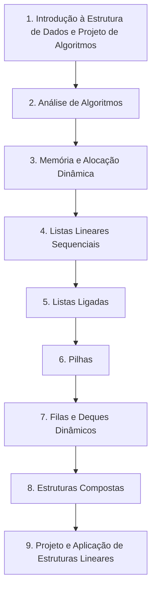

### 1.3 Critérios e Métricas Formais de Avaliação

O sistema semestral de mensuração da aprendizagem é composto por dois blocos bimestrais (Módulo 1 e Módulo 2). Cada bloco compõe-se de uma avaliação escrita e prática individual ($ `AV` $`) com peso 80% (`$ `0,8` $`) e um trabalho técnico prático (`$ `T` $`) com peso 20% (`$ `0,2` $).

A Média Semestral final ($ `MS` $) é apurada pela fórmula canônica apresentada em aula:

```math
MS = \frac{[(AV_1 \times 0.8) + (T_1 \times 0.2)] + [(AV_2 \times 0.8) + (T_2 \times 0.2)]}{2}
```

| Instrumento | Característica e Escopo | Escala de Notas | Peso no Bimestre | Contribuição Efetiva |
| :--- | :--- | :--- | :--- | :--- |
| **Trabalho 1 ($ `T_1` $`)** | Listas de exercícios e implementações práticas | 0,0 a 10,0 | 20% (`$ `0,2` $) | Até 2,0 pontos no Módulo 1 |
| **Avaliação 1 ($ `AV_1` $`)** | Prova individual sem consulta (Teoria e Código) | 0,0 a 10,0 | 80% (`$ `0,8` $) | Até 8,0 pontos no Módulo 1 |
| **Trabalho 2 ($ `T_2` $`)** | Projeto aplicado de estruturas lineares e ordenação | 0,0 a 10,0 | 20% (`$ `0,2` $) | Até 2,0 pontos no Módulo 2 |
| **Avaliação 2 ($ `AV_2` $`)** | Prova individual integradora sem consulta | 0,0 a 10,0 | 80% (`$ `0,8` $) | Até 8,0 pontos no Módulo 2 |

### 1.4 Bibliografia Oficial Comentada

O currículo oficial adota obras clássicas dedicadas à arquitetura interna de computadores e manuais de engenharia de algoritmos:

#### Bibliografia Básica
- MONTEIRO, Mário A. *Introdução à Organização de Computadores*. 4. ed. Rio de Janeiro: LTC, 2002.
- STALLINGS, William. *Arquitetura e Organização de Computadores*. 8. ed. São Paulo: Pearson, 2010.
- TANENBAUM, Andrew S. *Organização Estruturada de Computadores*. 3. ed. São Paulo: Prentice-Hall do Brasil, 1990.

#### Bibliografia Complementar
- IDOETA, Ivan Valeije; CAPUANO, Francisco Gabriel. *Elementos de Eletrônica Digital*. 32. ed. São Paulo: Érica, 2001.
- PATTERSON, David A.; HENNESSY, John L. *Organização e Projeto de Computadores*. 2. ed. Rio de Janeiro: LTC, 1998.
- WEBER, Raul Fernando. *Fundamentos de Arquitetura de Computadores*. 4. ed. Porto Alegre: Bookman, 2012.

*(Nota de complementação pedagógica: Para o aprofundamento específico em tipos abstratos de dados e estruturas lineares em alto nível, recomenda-se a consulta a CORMEN, T. H. et al. Algoritmos: Teoria e Prática, e ZIVIANI, N. Projeto de Algoritmos).*

---

## 2. Introdução a Algoritmos e Metodologia de Projeto

### 2.1 Definição Formal e Semântica de Algoritmo

Formalmente, um **algoritmo** é uma sequência finita, ordenada e não ambígua de instruções computáveis que, a partir de um conjunto inicial de dados de entrada (que pode ser vazio), transforma o estado do sistema através de operações bem definidas até produzir um conjunto previsível de saídas em tempo finito.

Historicamente, o vocábulo deriva da transliteração latina do nome do astrônomo e matemático persa do século IX, Abu Abdullah Muhammad ibn Musa al-Khwarizmi, autor de compêndios fundamentais sobre o cálculo posicional decimal e a resolução sistemática de equações lineares e quadráticas. Na ciência da computação contemporânea, o algoritmo representa a abstração lógica do processo resolutivo, existindo de maneira pura antes de qualquer materialização em silício ou linguagens de programação.

### 2.2 As Seis Características Fundamentais de um Algoritmo

Para que uma rotina de passos seja classificada rigorosamente como um algoritmo computacional, ela deve atender simultaneamente a seis propriedades canônicas:

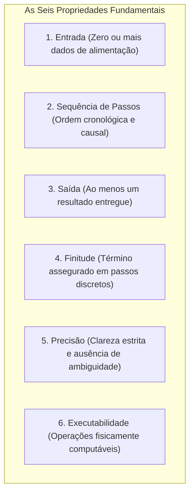

1. **Entrada (*Input*):** Define o conjunto de parâmetros externos sobre os quais a transformação operará. A entrada pode ser nula ($ `n = 0` $), caso em que o algoritmo processa constantes intrínsecas (como a geração dos primeiros cem números primos).
2. **Sequência de Passos (*Sequence*):** As operações mantêm dependência determinística e sucessão causal estrita. Uma instrução só é executada após o encerramento formal do estado anterior.
3. **Saída (*Output*):** Todo algoritmo justifica sua existência ao entregar uma modificação observável no domínio do problema ou uma resposta formalmente associada à entrada.
4. **Finitude (*Finiteness*):** Para todo conjunto válido de entradas, o algoritmo encerra sua execução após uma quantidade finita de passos. Procedimentos que entram em ciclos infinitos divergentes configuram processos com falha estrutural.
5. **Precisão (*Definiteness*):** Cada etapa do procedimento deve ser descrita de maneira exata, sem margens para interpretações divergentes por parte do agente executor.
6. **Executabilidade (*Effectiveness*):** Cada instrução elementar deve ser mecanicamente viável, exigindo quantidade finita de tempo e memória real.

| Característica | Definição Formal | Exemplo Válido | Violação Típica (Contraexemplo) |
| :--- | :--- | :--- | :--- |
| **Entrada** | Domínio de dados iniciais | Vetor de $ `n` $ números inteiros | Ponteiro sem inicialização |
| **Sequência** | Determinismo causal | 1º Ler; 2º Processar; 3º Escrever | Escrever antes de calcular |
| **Saída** | Imagem da transformação | O maior elemento encontrado | Procedimento que descarta o resultado |
| **Finitude** | Parada matemática provável | Laço delimitado por sentinela | Laço `while (true)` sem `break` |
| **Precisão** | Semântica mecânica estrita | Atribuir `media = soma / n` | "Misture até ficar satisfatório" |
| **Executabilidade** | Operações viáveis na máquina | Divisão por número não nulo | "Divida o valor por zero" |

### 2.3 O Princípio da Organização: Wirth e o Equilíbrio de Sistemas

Conforme enfatizado pelo Prof. Wesley Soares em sala de aula, um software confiável repousa sobre duas bases inseparáveis:
> *"Um bom programa depende tanto de um bom algoritmo quanto da forma como os dados são organizados."*

Essa constatação resgata o axioma formulado pelo cientista da computação suíço Niklaus Wirth em seu clássico tratado de 1976:

```math
\text{Algoritmos} + \text{Estruturas de Dados} = \text{Programas}
```

A dedução direta desse princípio estabelece que algoritmos refinados fracassam se aplicados sobre dados dispostos de forma caótica, e arranjos de dados elegantes tornam-se inoperantes sob rotinas de manipulação ineficientes.

### 2.4 Distinção Ontológica: Algoritmo versus Programa

Um dos equívocos clássicos de acadêmicos iniciantes é considerar codificação como sinônimo de algoritmo. O algoritmo habita o domínio matemático da lógica abstrata; o programa é a sua tradução formal em uma gramática de engenharia executável.

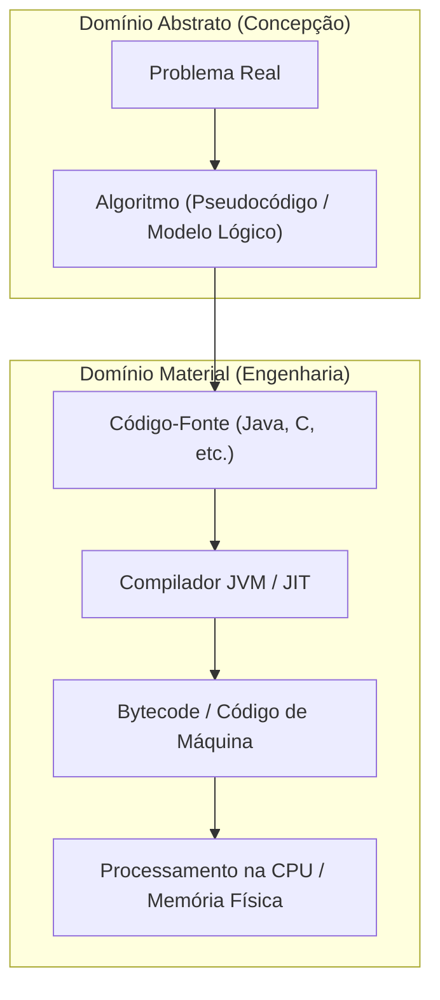

| Critério Analítico | Algoritmo (Entidade Abstrata) | Programa (Artefato de Engenharia) |
| :--- | :--- | :--- |
| **Natureza** | Concepção matemática e lógica | Conjunto formal de arquivos de texto compiláveis |
| **Dependência Tecnológica** | Independe de linguagem, compilador ou SO | Estritamente amarrado à sintaxe e ao ecossistema |
| **Ambiente de Processamento** | Raciocínio humano ou Máquina de Turing ideal | CPU real, registradores, barramento e memória física |
| **Tolerância a Erros** | Tolerante a pequenas imprecisões de notação | Intolerante; erros de sintaxe abortam compilação |
| **Exemplo de Expressão** | Pseudocódigo, fluxogramas, equações | Classes `.java`, executáveis binários `.class` |

### 2.5 O Ciclo de Engenharia: Do Problema à Solução

A engenharia de software não inicia na escrita de código. Para atingir robustez, a equipe técnica deve percorrer o pipeline sistemático que converte demandas do mundo real em sistemas eficientes:

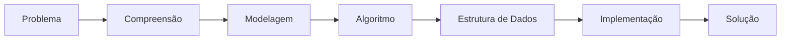

1. **Problema:** A deficiência ou demanda no domínio de negócio (exemplo: lentidão no atendimento bancário).
2. **Compreensão:** Levantamento detalhado de restrições, volumes, casos excepcionais e regras de negócio.
3. **Modelagem:** Formalização conceitual dos dados intervenientes (atributos do cliente, tempo de espera, prioridade).
4. **Algoritmo:** Definição dos passos abstratos para enfileirar, verificar prioridades e direcionar guichês.
5. **Estrutura de Dados:** Seleção da topologia ótima de armazenamento (vetor circular versus nós dinâmicos em fila).
6. **Implementação:** Construção dos artefatos de código na linguagem adotada (classes Java, tratamento de exceções).
7. **Solução:** O sistema estabilizado operando em ambiente de produção com medição de desempenho.

### 2.6 As Seis Etapas Sistemáticas do Projeto de Algoritmos

Diante de um problema inédito, o estudante deve aplicar o método analítico de seis etapas abordado na Aula 01:

1. **Entender o Problema:** Eliminar ambiguidades conceituais e isolar os objetivos exatos.
2. **Identificar Entradas e Saídas:** Estabelecer o domínio formal dos dados de partida e os artefatos a serem devolvidos.
3. **Decompor o Problema:** Quebrar o desafio global em subproblemas ortogonais e menores.
4. **Definir a Estratégia e Estrutura:** Escolher a abordagem algorítmica (gulosa, divisão e conquista, iterativa) e a disposição dos dados.
5. **Especificar o Algoritmo:** Escrever a solução em pseudocódigo estruturado com declaração clara de invariantes.
6. **Testar e Refinar:** Submeter o algoritmo a testes de mesa rigorosos cobrindo casos de borda (coleção vazia, elemento unitário, valores duplicados ou extremos).

---

## 3. Refinamento Sucessivo e Tipos Abstratos de Dados

### 3.1 Metodologia do Refinamento Sucessivo

O refinamento sucessivo (*stepwise refinement* ou abordagem *top-down*), formalizado por Niklaus Wirth, dita que o desenvolvedor deve iniciar a solução a partir de uma declaração abstrata de alto nível e desdobrá-la em sucessivas camadas de detalhamento até que cada instrução atinja o nível atômico das linguagens de programação.

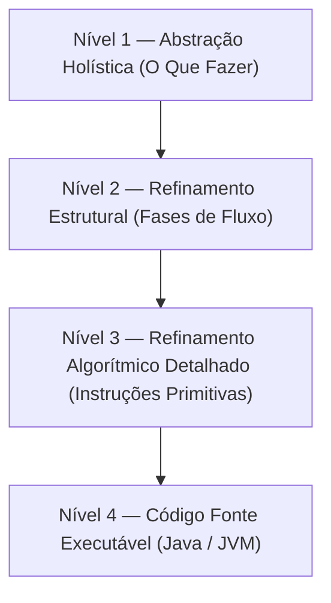

#### Exemplo Guiado: Cálculo de Médias Escolares
- **Nível 1 (Abstração):** "Calcular e emitir a média aritmética de três notas acadêmicas."
- **Nível 2 (Estrutural):**
  1. Obter os três valores de notas.
  2. Acumular o somatório das notas válidas.
  3. Dividir a soma pela constante três.
  4. Emitir o resultado para o canal de saída.
- **Nível 3 (Algorítmico):**
```pseudocode
algoritmo CalcularMediaAritmetica
início
    real: n1, n2, n3, soma, media
    leia(n1)
    leia(n2)
    leia(n3)
    soma <- n1 + n2 + n3
    media <- soma / 3.0
    escreva("Média apurada: ", media)
fim
```

### 3.2 Conceituação de Tipo Abstrato de Dados

Um **Tipo Abstrato de Dados (TAD)** é um modelo matemático composto por:
1. Um conjunto de dados abstratos e seus domínios de validade.
2. Uma coleção de operações autorizadas sobre tais dados.
3. Um conjunto estrito de comportamentos e invariantes que essas operações preservam obrigatoriamente.

A regra fundamental que define o TAD é a sua **independência estrita de implementação**. O TAD declara com exatidão **o que** a estrutura é capaz de fazer, omitindo deliberadamente **como** as informações serão acomodadas nos circuitos de memória física.

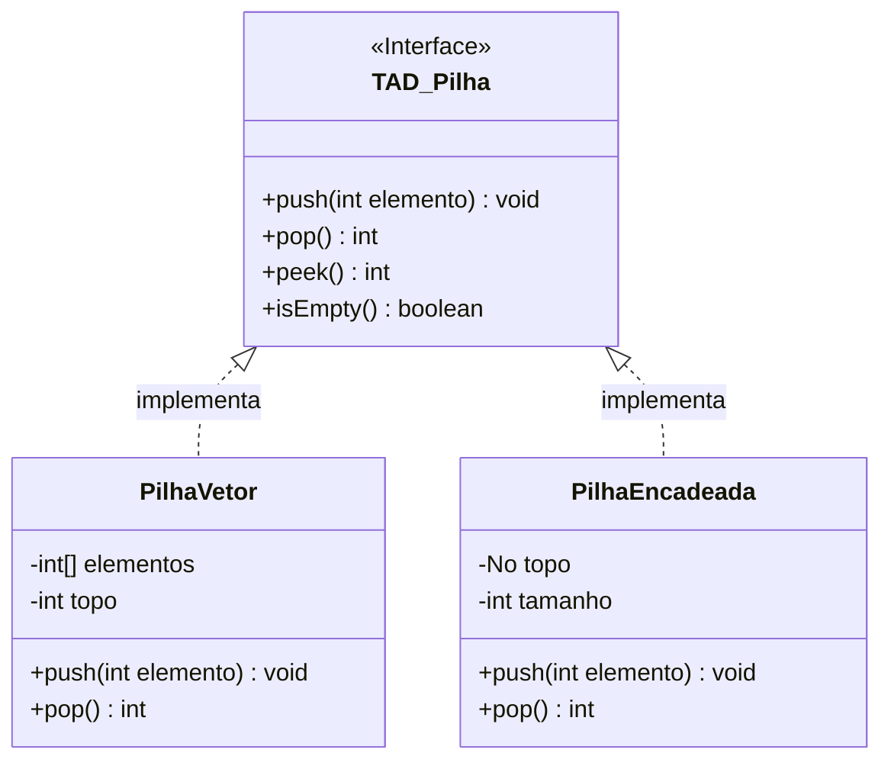

### 3.3 O Princípio da Caixa-Preta: Abstração e Encapsulamento

- **Abstração:** Capacidade mental de isolar a interface pública contratual de uma entidade computacional dos seus mecanismos operacionais subjacentes.
- **Encapsulamento:** Prática de engenharia de software consistente em isolar os campos de estado de uma estrutura dentro de barreiras de proteção de visibilidade (`private`), impedindo o acesso indevido por códigos clientes externos.

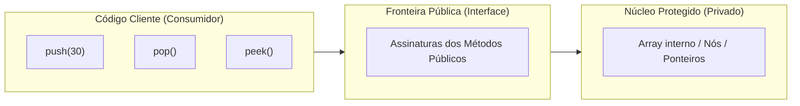

**Armadilha Crítica (Quebra de Encapsulamento):** Permitir acesso direto ao array interno de uma pilha (`p.elementos[3] = 10`) ou aos ponteiros de nó de uma lista encadeada destrói os invariantes da estrutura, impossibilitando garantias de tempo constante ou corretude da política LIFO/FIFO.

### 3.4 Matriz de Decisão Arquitetural para Estruturas de Dados

A escolha da estrutura adequada é guiada pela frequência das operações essenciais demandadas pelo problema de engenharia:

| Requisito Predominante do Sistema | Estrutura Recomendada | Fundamentação de Engenharia |
| :--- | :--- | :--- |
| **Acesso randômico direto por índice** | Lista Sequencial (Array) | Endereçamento imediato $ `O(1)` $ via cálculo aritmético de base. |
| **Mutações frequentes no início ou meio** | Lista Simplesmente/Duplamente Ligada | Religamento atômico de ponteiros $ `O(1)` $ sem deslocamento físico. |
| **Política de atendimento LIFO** | Pilha (*Stack*) | Restrição unívoca no topo; reversão natural de histórico. |
| **Política de atendimento FIFO** | Fila (*Queue*) | Inserções na cauda e extrações na cabeça com preservação temporal. |
| **Relações hierárquicas e de contenção** | Árvore Binária / N-ária | Subdivisão do espaço em nós raízes, ancestrais e descendentes. |
| **Interconexões e rotas arbitrárias** | Grafo (*Graph*) | Mapeamento explícito de redes complexas via vértices e arestas. |

---

## 4. Arquitetura de Memória e Ciclo de Vida de Objetos em Java

### 4.1 Modelo de Execução da JVM: Segmentação Stack e Heap

A compreensão profunda das estruturas de dados exige o entendimento de como a Máquina Virtual Java (JVM) particiona os recursos físicos da memória de acesso aleatório (RAM) disponibilizados pelo sistema operacional. A arquitetura divide-se essencialmente em dois segmentos operacionais principais:

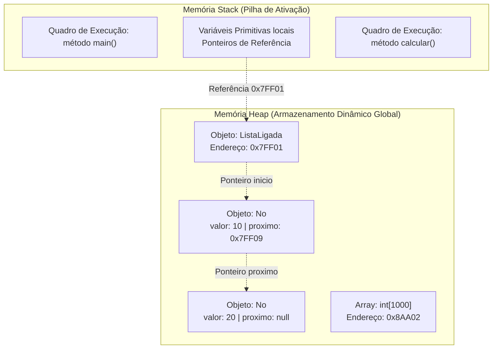

1. **Memória Stack (Pilha de Ativação):**
   - Região estática e veloz, gerenciada estritamente pela CPU conforme o fluxo de chamadas de métodos.
   - Cada invocação de método cria um quadro de pilha (*stack frame*) contendo variáveis locais e parâmetros.
   - Quando a execução do método atinge o comando `return`, o quadro é destruído imediatamente, desalocando todas as suas variáveis primitivas e ponteiros locais.
2. **Memória Heap (Monte Dinâmico):**
   - Espaço de memória global e compartilhado onde residem todos os objetos instanciados via operador `new`, bem como os vetores nativos.
   - Sua alocação ocorre em tempo de execução de forma dinâmica e sob demanda.
   - As instâncias continuam existindo no Heap mesmo após o término do método que as criou, desde que permaneçam alcançáveis por alguma cadeia ativa de referências.

### 4.2 Semântica de Valores: Variáveis Primitivas versus Tipos por Referência

A linguagem Java impõe uma distinção semântica absoluta entre manipulação de tipos primitivos e tipos estruturados:

- **Variáveis Primitivas (`int`, `double`, `boolean`, `char`):**
  - Armazenam diretamente o padrão de bits do valor no interior da própria variável no quadro da Stack.
  - A atribuição (`a = b`) produz uma cópia independente de valor. Alterações posteriores em `a` não afetam `b`.
- **Variáveis de Referência (`No`, `Pilha`, `int[]`, `String`):**
  - Não armazenam o objeto em si, mas sim o **endereço lógico** (ponteiro gerenciado de 64 bits) do local onde o objeto real repousa no Heap.
  - A atribuição (`refA = refB`) copia exclusivamente o endereço de memória. Ambas as variáveis passam a referenciar exatamente o mesmo objeto físico no Heap. Qualquer mutação efetuada através de `refA` reflete-se de imediato na consulta via `refB`.

### 4.3 Alocação Dinâmica e o Papel do Garbage Collector

Ao contrário de linguagens como C ou C++, onde a desalocação de memória no Heap exige intervenção manual do programador (através de comandos como `free()` ou `delete`), o ecossistema Java conta com o **Garbage Collector (GC)**.

O Garbage Collector é um processo em segundo plano (*background daemon*) integrado à JVM encarregado de rastrear a cadeia de acessibilidade a partir das raízes de execução (*GC Roots*, que compreendem variáveis ativas na Stack e classes estáticas). Quando um nó ou objeto deixa de possuir qualquer caminho de referências que parta de um nó raiz, ele é formalmente categorizado como **inalcançável** (*unreachable*) e sua área é reciclada de forma assíncrona pelo coletor.

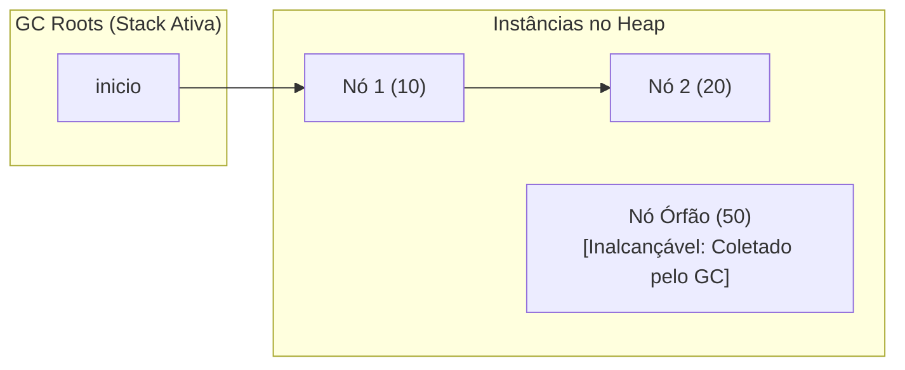

### 4.4 Impacto Físico no Hardware: Localidade Espacial de Cache

Embora a análise assintótica trate o acesso à memória como $ `O(1)` $ teórico, em arquiteturas modernas de computadores a física impõe barreiras. A CPU opera em frequências muito mais altas do que a memória RAM principal, dependendo criticamente dos caches L1, L2 e L3:

- **Localidade Espacial:** Ao acessar o índice $ `i` $ de um array contíguo, o hardware carrega preventivamente uma linha de cache inteira (*cache line*, tipicamente 64 bytes), disponibilizando os elementos subsequentes $ `i+1, i+2` $ em tempo de frações de nanossegundos.
- **Fragmentação em Listas Encadeadas:** Como cada nó é instanciado em momentos distintos via `new`, eles espalham-se de maneira dispersa pelo Heap. Percorrer uma lista encadeada causa múltiplos *cache misses*, degradando o tempo real de CPU quando comparado à iteração sobre um vetor sequencial denso.

---

## 5. Análise Assintótica de Complexidade e Notação Big-O

### 5.1 Limitações da Medição Empírica de Relógio

Uma abordagem ingênua para aferir a eficiência de dois algoritmos que solucionam o mesmo problema consistiria em cronometrar seu tempo de relógio (*wall-clock time*) em segundos ou milissegundos. No entanto, essa medição empírica carece de rigor científico porque sofre interferência de variáveis espúrias:

- Potência e arquitetura física do processador (clock, IPC, quantidade de núcleos);
- Sistema operacional e quantidade de processos concorrentes disputando a CPU;
- Latência e largura de banda dos barramentos e dos módulos de memória RAM;
- Versão do runtime Java e decisões autônomas de compilação dinâmica do JIT (*Just-In-Time*);
- Volume contingencial e disposição inicial dos dados de teste.

A teoria da complexidade computacional substitui o tempo físico pela quantificação analítica do **número de operações primitivas fundamentais** em função do tamanho da massa de dados.

### 5.2 O Tamanho da Entrada e a Contagem de Operações Elementares

Denomina-se $ `n` $ a variável matemática que expressa o volume da entrada processada:
- Em vetores ou listas: o número total de elementos ($ `n = \text{tamanho}` $);
- Em grafos: a cardinalidade dos vértices ($ `|V|` $`) e arestas (`$ `|E|` $);
- Em algoritmos numéricos: a quantidade de bits ou o valor escalar que governa os laços de repetição.

Ao analisar a rotina:
```java
for (int i = 0; i < n; i++) {
    soma += vetor[i];
}
```
Identifica-se que a condição do laço é avaliada $ `n + 1` $ vezes, o incremento executa $ `n` $ vezes e o corpo do bloco executa $ `n` $ vezes. A função exata de custo é expressa como um polinômio:
```math
T(n) = c_1 n + c_2
```

### 5.3 Fundamentos Matemáticos da Notação Big-O

A **Notação Big-O** ($ `O` $`) formaliza o limite superior assintótico do consumo de tempo ou memória de um algoritmo. Ela descreve o teto de crescimento de recursos quando a entrada cresce indefinidamente em direção ao infinito (`$ `n \to \infty` $).

> **Definição Formal:**  
> Diz-se que uma função $ `T(n)` $ é $ `O(f(n))` $ se existirem duas constantes estritamente positivas $ `c > 0` $ e $ `n_0 \ge 1` $ tais que:
> ```math
> 0 \le T(n) \le c \cdot f(n), \quad \forall n \ge n_0
> ```

Isso significa que, a partir do limiar $ `n_0` $, a curva de tempo real do algoritmo jamais ultrapassará o teto definido pela curva teórica $ `c \cdot f(n)` $.

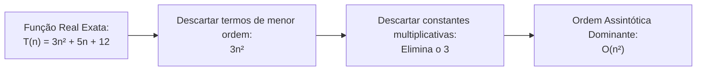

> **Notações Correlatas de Referência Teórica:**
> - **Big-Omega ($ `\Omega` $):** Estabelece o limite inferior assintótico (o piso mínimo de esforço computacional que o algoritmo sempre consumirá).
> - **Big-Theta ($ `\Theta` $):** Estabelece o limite assintótico justo (quando o limite superior coincide em ordem com o limite inferior, delimitando rigorosamente a função).

### 5.4 Regras Operacionais de Dominância e Descarte Assintótico

Para determinar a classe Big-O de qualquer função de custo polinomial:
1. **Regra da Soma (Termo Dominante):** Se $ `T(n) = T_1(n) + T_2(n)` $, onde $ `T_1` $ cresce mais rápido que $ `T_2` $, então $ `O(T(n)) = O(T_1(n))` $. Termos de ordem menor são descartados porque tornam-se insignificantes perante grandes entradas.
2. **Regra do Produto (Constantes Multiplicativas):** Se $ `T(n) = c \cdot f(n)` $, onde $ `c` $ é uma constante finita, descarta-se $ `c` $, resultando em $ `O(f(n))` $. Dobrar a velocidade de um processador altera $ `c` $, mas não altera a escalabilidade matemática do algoritmo perante grandes massas de dados.

### 5.5 Cenários de Execução: Melhor Caso, Pior Caso e Caso Médio

O comportamento temporal de muitos algoritmos varia em função da disposição inicial dos dados na entrada:

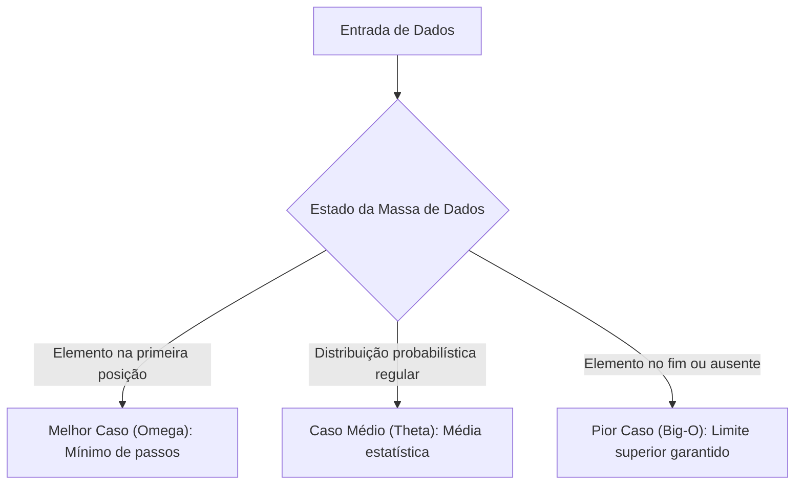

- **Melhor Caso:** A configuração mais favorável dos dados de entrada, minimizando o percurso dos laços (exemplo: busca linear encontrando o alvo imediatamente no índice 0, resultando em $ `\Omega(1)` $).
- **Pior Caso:** A configuração mais desfavorável que força o algoritmo a executar o número máximo de instruções possíveis (exemplo: elemento procurado localizado no último índice ou ausente, exigindo $ `O(n)` $ passos). **É a métrica primordial na engenharia de software para garantir acordos de nível de serviço (SLA) e confiabilidade**.
- **Caso Médio:** O número esperado de operações sob uma distribuição uniforme de probabilidades sobre todas as entradas possíveis de tamanho $ `n` $.

### 5.6 Taxonomia das Classes Fundamentais de Complexidade

A hierarquia formal de complexidade assintótica organiza-se na seguinte escala de eficiência:

```math
O(1) < O(\log n) < O(n) < O(n \log n) < O(n^2) < O(n^3) < O(2^n) < O(n!)
```

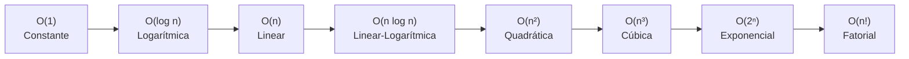

| Notação | Nomenclatura | Comportamento com o Aumento de $ `n` $ | Exemplos Clássicos |
| :--- | :--- | :--- | :--- |
| **$ `O(1)` $** | Constante | Custo invariante perante o tamanho da entrada | Acesso direto a vetor por índice; `push`/`pop` |
| **$ `O(\log n)` $** | Logarítmica | Crescimento residual; divide o problema sucessivamente | Busca Binária; operações em árvores balanceadas |
| **$ `O(n)` $** | Linear | Cresce estritamente na mesma proporção da entrada | Busca Linear sequencial; cópia de vetores |
| **$ `O(n \log n)` $** | Linearítmica | Otimização ótima para algoritmos de ordenação comparativa | Merge Sort; Quick Sort (caso médio); Heap Sort |
| **$ `O(n^2)` $** | Quadrática | Multiplica o custo exponencialmente em laços aninhados | Bubble Sort; Selection Sort; laços aninhados |
| **$ `O(n^3)` $** | Cúbica | Três laços aninhados dependentes de $ `n` $ | Multiplicação elementar de matrizes densas |
| **$ `O(2^n)` $** | Exponencial | Dobra o trabalho a cada elemento acrescido na entrada | Força bruta do Caixeiro Viajante; Fibonacci recursivo ingênuo |
| **$ `O(n!)` $** | Fatorial | Explosão combinatória total; inviável para $ `n > 20` $ | Enumeração de todas as permutações de um vetor |

#### Comportamento da Explosão de Operações em Função da Escala

| Tamanho ($ `n` $) | $ `O(1)` $ | $ `O(\log_2 n)` $ | $ `O(n)` $ | $ `O(n \log_2 n)` $ | $ `O(n^2)` $ | $ `O(2^n)` $ |
| :--- | :--- | :--- | :--- | :--- | :--- | :--- |
| **10** | 1 | 3 | 10 | 33 | 100 | 1.024 |
| **100** | 1 | 7 | 100 | 664 | 10.000 | $ `1,26 \times 10^{30}` $ |
| **1.000** | 1 | 10 | 1.000 | 9.966 | 1.000.000 | Incomputável |
| **1.000.000** | 1 | 20 | 1.000.000 | $ `1,99 \times 10^7` $ | $ `10^{12}` $ (Trilhão) | Incomputável |

---

## 6. Estruturas Lineares Sequenciais

### 6.1 Organização Contígua e Cálculo Aritmético de Endereços

Uma **Lista Linear Sequencial** é implementada em memória através de um array nativo. Os dados são armazenados em endereços de memória física estritamente adjacentes.

Essa adjacência permite ao compilador e ao hardware da máquina calcular diretamente a posição exata de qualquer elemento no barramento através de aritmética de ponteiros de tempo constante:

```math
\text{Endereço}(i) = \text{EndereçoBase} + (i \times \text{TamanhoElemento})
```

Se o endereço base de um array de inteiros (onde cada `int` consome 4 bytes) for `0x1000`, o elemento no índice 5 reside instantaneamente em:
```math
0x1000 + (5 \times 4) = 0x1000 + 20 = 0x1014
```
Por isso, a leitura e a escrita indexada (`vetor[i]`) ocorrem rigorosamente em tempo constante $ `O(1)` $.

### 6.2 Diferenciação Crítica: Capacidade Física versus Tamanho Lógico

Uma falha conceitual recorrente consiste em confundir a capacidade máxima física do vetor alocado com o tamanho lógico útil da estrutura:

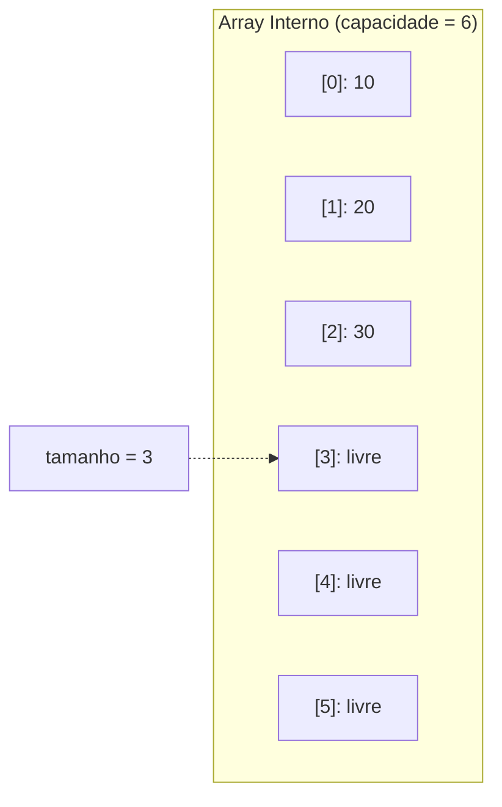

- **Capacidade (`capacidade`):** A quantidade total de compartimentos físicos alocados no Heap (`elementos.length`). Trata-se do teto estático de memória reservado.
- **Tamanho Lógico (`tamanho`):** O contador inteiro que rastreia quantos itens úteis válidos estão efetivamente sob a custódia da estrutura de dados naquele instante. O próximo elemento a ser anexado no final será acomodado precisamente no índice `tamanho`.

### 6.3 O Gargalo do Deslocamento em Mutações Intermediárias

A contiguidade física dos dados cobra um alto preço de processamento nas operações de inserção ou remoção que não ocorram no final da estrutura:

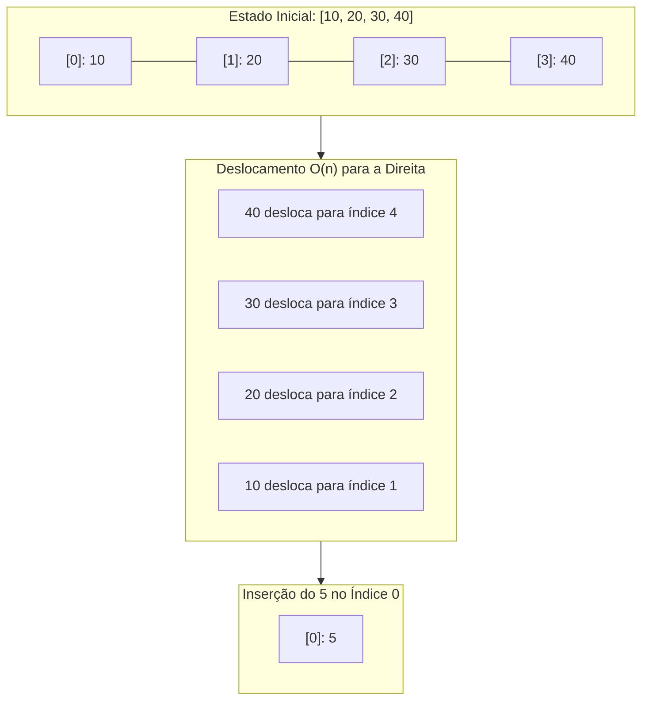

- **Inserção no Início (índice 0):** Para inserir um dado na cabeça da estrutura sem sobrescrever informações preexistentes, todos os $ `n` $ elementos atuais devem ser transladados obrigatoriamente uma casa para a direita, partindo do último em direção ao primeiro. Custo temporal: **$ `O(n)` $**.
- **Remoção no Início:** Ao remover o item do índice 0, todos os $ `n - 1` $ elementos remanescentes à direita devem ser puxados uma posição para a esquerda para preencher a lacuna física e restabelecer a contiguidade. Custo temporal: **$ `O(n)` $**.

### 6.4 Mecanismo de Redimensionamento Dinâmico e Custo Amortizado

Como os vetores nativos possuem tamanho estático inalterável após a alocação, uma lista sequencial que atinja a condição `tamanho == capacidade` deve realizar uma realocação dinâmica para aceitar novas inserções:

1. Aloca-se um novo array no Heap com capacidade expandida (tipicamente o dobro da capacidade original);
2. Copiam-se todos os $ `n` $ elementos do array antigo para o novo array;
3. Atualiza-se a referência interna da classe controladora para apontar para o novo bloco contíguo;
4. O array antigo torna-se inalcançável e é entregue ao Garbage Collector.

Embora uma inserção isolada que dispare a duplicação custe $ `O(n)` $, esse custo é distribuído sobre uma sequência longa de inserções baratas de custo $ `O(1)` $`. Demonstra-se que o custo amortizado por inserção na cauda permanece assintoticamente constante: **`$ `O(1)` $ amortizado**.

---

## 7. Estruturas Dinâmicas Encadeadas: Listas Ligadas

### 7.1 A Mudança de Paradigma: Superando a Contiguidade Física

A questão central levantada pelo Prof. Wesley Soares inaugura a transição das estruturas estáticas para as estruturas encadeadas:
> *"E se não precisarmos realizar o deslocamento em bloco? Imagine que cada elemento soubesse simplesmente: onde está o próximo elemento?"*

Eliminando a imposição de que os dados ocupem gavetas de memória fisicamente adjacentes, os registros podem residir em quaisquer endereços livres da memória Heap. A ordenação lógica da coleção passa a ser regida estritamente por pontes explícitas de software: **ponteiros de referência**.

### 7.2 Anatomia do Nó e Auto-Referenciamento

O átomo constitutivo de qualquer estrutura ligada é o **Nó** (*Node*). Uma classe autossuficiente que encapsula:
1. O dado útil (*payload*), representado didaticamente por um valor inteiro primitivo `valor`;
2. A referência `proximo`, que armazena o endereço de outro objeto da mesma classe `No`, ou o literal `null` como terminador da cadeia.

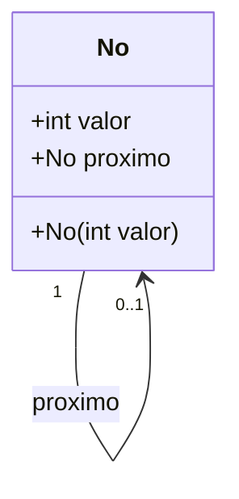

```java
public class No {
    public int valor;    // Carga útil armazenada
    public No proximo;   // Elo de encadeamento no Heap

    public No(int valor) {
        this.valor = valor;
        this.proximo = null;
    }
}
```

### 7.3 Arquitetura da Classe Controladora ListaLigada

A fim de preservar o encapsulamento, a topologia de nós deve ser administrada por uma classe controladora central que retém o estado da coleção por meio de três atributos privados:

```java
public class ListaLigada {
    private No inicio;   // Aponta para o primeiro nó da estrutura
    private No fim;      // Aponta para o último nó ativo (cauda)
    private int tamanho; // Cardinalidade atual da coleção

    public ListaLigada() {
        this.inicio = null;
        this.fim = null;
        this.tamanho = 0;
    }

    public boolean estaVazia() {
        return this.inicio == null;
    }

    public int getTamanho() {
        return this.tamanho;
    }
}
```

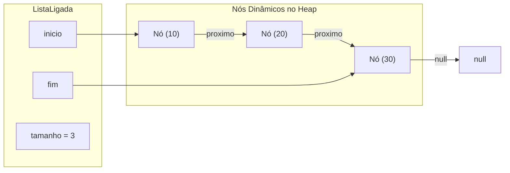

### 7.4 Inserção no Fim: Análise da Otimização com Ponteiro de Cauda

- **Abordagem Ingênua Sem Ponteiro `fim` ($ `O(n)` $):** Exige partir do ponteiro `inicio` e realizar um laço `while (atual.proximo != null)` percorrendo todos os nós da lista até localizar a cauda. Para uma lista de 1.000.000 de itens, serão 999.999 passos apenas para encadear um item.
- **Abordagem Otimizada Com Ponteiro `fim` ($ `O(1)` $):** A classe mantém o endereço do último elemento permanentemente memorizado, permitindo anexar o nó de forma direta e atômica.

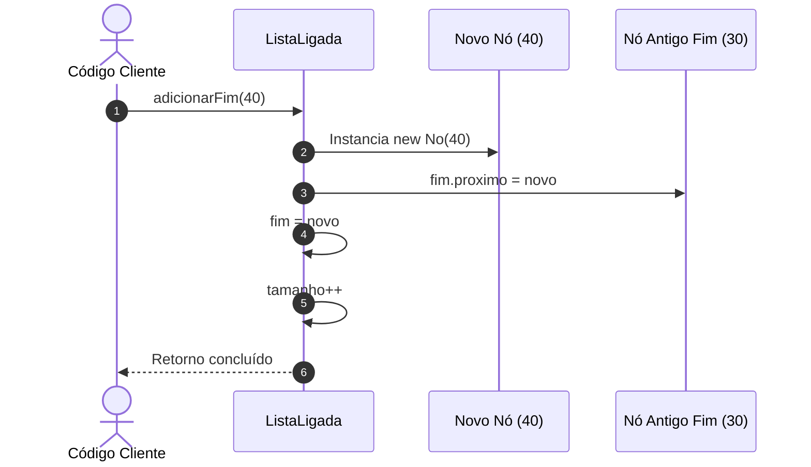

```java
public void adicionarFim(int valor) {
    No novo = new No(valor);

    if (estaVazia()) {
        this.inicio = novo;
        this.fim = novo;
    } else {
        this.fim.proximo = novo;
        this.fim = novo;
    }
    this.tamanho++;
}
```

### 7.5 Inserção no Início em Tempo Constante

A inserção na cabeça da lista prescinde de qualquer movimentação de elementos em bloco:
1. Instancia-se o novo nó com o valor desejado;
2. Configura-se o elo `novo.proximo` para apontar para o atual `inicio`;
3. Atualiza-se o ponteiro `inicio` da classe para assumir a referência do `novo` nó;
4. Se a lista estava vazia, o ponteiro `fim` também passa a referenciar este mesmo nó recém-criado.

```java
public void adicionarInicio(int valor) {
    No novo = new No(valor);
    novo.proximo = this.inicio;
    this.inicio = novo;

    if (this.fim == null) {
        this.fim = novo;
    }
    this.tamanho++;
}
```

Complexidade temporal: rigorosamente **$ `O(1)` $**.

**Armadilha Crítica (Perda de Ponteiro):** Se a ordem de atribuição for invertida:
```java
// CODIGO COM FALHA CRITICA:
this.inicio = novo;
novo.proximo = this.inicio; // O nó passa a apontar para si mesmo!
```
A antiga cadeia encadeada perde seu ponto de ancoragem e torna-se inalcançável, gerando perda irrecuperável de dados e ciclos infinitos.

### 7.6 Inserção Ordenada no Meio: Localização versus Religamento

Ao inserir elementos em uma lista mantida em ordem crescente (exemplo: inserir `35` em `[10, 20, 30, 40]`), a operação decompõe-se em duas etapas de custos assintóticos distintos:

1. **Localização do Ponto de Inserção:** Percorrer a estrutura até identificar o nó antecedente cujo valor é menor que `35` e cujo próximo é maior que `35`. Custo temporal: **$ `O(n)` $**.
2. **Religamento de Referências:** Criar o nó e entrelaçar os ponteiros na cadeia. Custo temporal: **$ `O(1)` $**.

Pela regra da dominância assintótica:
```math
\text{Custo Total} = O(n) + O(1) = O(n)
```

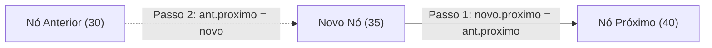

```java
public void inserirOrdenado(int valor) {
    No novo = new No(valor);

    // Caso 1: Lista vazia ou valor menor que o primeiro elemento
    if (estaVazia() || valor <= this.inicio.valor) {
        novo.proximo = this.inicio;
        this.inicio = novo;
        if (this.fim == null) {
            this.fim = novo;
        }
        this.tamanho++;
        return;
    }

    // Caso 2: Busca pelo predecessor no meio ou no fim
    No atual = this.inicio;
    while (atual.proximo != null && atual.proximo.valor < valor) {
        atual = atual.proximo;
    }

    // Religamento ordenado
    novo.proximo = atual.proximo;
    atual.proximo = novo;

    // Caso especial: inserido após o antigo último nó
    if (novo.proximo == null) {
        this.fim = novo;
    }
    this.tamanho++;
}
```

### 7.7 Busca Linear por Valor e Acesso Posicional por Salto

- **Busca por Valor:** Inicia em `inicio` e percorre `atual = atual.proximo` testando `atual.valor == valor`. Se encontrar, retorna a referência; se atingir `null`, conclui inexistência. Custo: $ `O(1)` $ melhor caso (primeiro elemento) e $ `O(n)` $ pior caso (último elemento ou ausente).
- **Acesso Posicional (Busca por Índice):** Como não há indexação aritmética em memória, para acessar o "índice $ `k` $" o algoritmo é forçado a realizar $ `k` $ saltos sequenciais a partir do primeiro nó. Custo temporal: linear **$ `O(n)` $**.

### 7.8 Atualização e Remoção de Elementos: Gestão de Invariantes

A remoção de um nó requer costurar o elo do seu predecessor diretamente ao seu sucessor:

```java
public boolean removerPorValor(int valor) {
    if (estaVazia()) return false;

    // Caso 1: Remoção do primeiro nó
    if (this.inicio.valor == valor) {
        this.inicio = this.inicio.proximo;
        if (this.inicio == null) {
            this.fim = null; // Lista esvaziou
        }
        this.tamanho--;
        return true;
    }

    // Caso 2: Busca pelo predecessor do nó a ser excluído
    No atual = this.inicio;
    while (atual.proximo != null && atual.proximo.valor != valor) {
        atual = atual.proximo;
    }

    // Se encontrou o nó alvo
    if (atual.proximo != null) {
        if (atual.proximo == this.fim) {
            this.fim = atual; // O predecessor torna-se o novo fim
        }
        atual.proximo = atual.proximo.proximo; // Pula o nó excluído
        this.tamanho--;
        return true;
    }

    return false; // Elemento ausente
}
```

O nó desconectado fica sem referências e é liberado na próxima varredura do Garbage Collector.

### 7.9 Matriz Comparativa: Lista Sequencial versus Lista Ligada

| Dimensão Técnica | Lista Linear Sequencial (Array) | Lista Simplesmente Ligada Dinâmica |
| :--- | :--- | :--- |
| **Acesso por Índice (`get(i)`)** | $ `O(1)` $ direto e imediato | $ `O(n)` $ por percurso sequencial |
| **Inserção no Início** | $ `O(n)` $ (exige translação à direita) | $ `O(1)` $ imediato via manipulação do `inicio` |
| **Inserção no Fim** | $ `O(1)` $ amortizado | $ `O(1)` $ imediato com ponteiro `fim` |
| **Inserção no Meio** | $ `O(n)` $ por deslocamento de memória | $ `O(1)` $ religamento após busca $ `O(n)` $ |
| **Remoção no Início** | $ `O(n)` $ (exige translação à esquerda) | $ `O(1)` $ imediato |
| **Remoção no Meio** | $ `O(n)` $ por fechamento de lacuna | $ `O(1)` $ religamento após busca $ `O(n)` $ |
| **Sobrecarga de Memória** | Zero para dados úteis; folgas no array | Alto: 8 bytes extras por nó para o ponteiro |
| **Localidade de Cache da CPU** | Excelente (contíguo em memória física) | Fraca (nós dispersos na memória Heap) |
| **Dimensionamento** | Estático com custo de realocação | Totalmente elástico e sob demanda |

---

## 8. O Tipo Abstrato de Dados Pilha

### 8.1 Conceito Formal e o Princípio LIFO

A **Pilha** (*Stack*) é um Tipo Abstrato de Dados linear no qual todas as operações de inserção, remoção e consulta são rigorosamente canalizadas em uma única extremidade denominada **Topo** (*Top*). A extremidade oposta, inacessível a mutações diretas, é denominada **Base** (*Bottom*).

A pilha impõe sobre o armazenamento a disciplina de acesso:
> **LIFO — Last In, First Out**  
> *O último elemento inserido na estrutura é obrigatoriamente o primeiro elemento a ser removido.*

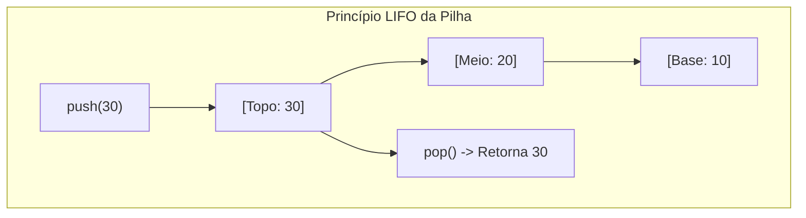

### 8.2 Operações Fundamentais: push, pop, peek e isEmpty

O contrato operacional estrito do TAD Pilha compõe-se de quatro métodos primitivos essenciais, todos executados em tempo constante **$ `O(1)` $**:

1. `push(int valor)`: Adiciona um novo elemento sobre o topo da estrutura. Dispara *Stack Overflow* se a capacidade estática for excedida.
2. `pop()`: Remove e retorna o elemento atualmente posicionado no topo. Dispara *Stack Underflow* se invocada sobre pilha vazia.
3. `peek()`: Retorna o valor contido no topo da pilha para consulta, sem removê-lo ou alterar a estrutura.
4. `isEmpty()`: Predicado lógico que retorna `true` se a pilha estiver vazia e `false` caso contenha ao menos um elemento.

| Operação | Assinatura | Efeito de Mutação | Condição de Exceção | Complexidade Temporal |
| :--- | :--- | :--- | :--- | :--- |
| `push` | `void push(int v)` | Incrementa tamanho; atualiza topo | *Stack Overflow* (capacidade cheia) | $ `O(1)` $ |
| `pop` | `int pop()` | Decrementa tamanho; recua topo | *Stack Underflow* (pilha vazia) | $ `O(1)` $ |
| `peek` | `int peek()` | Nenhuma alteração de estado | *Stack Underflow* (pilha vazia) | $ `O(1)` $ |
| `isEmpty` | `boolean isEmpty()`| Nenhuma alteração de estado | Nenhuma | $ `O(1)` $ |

### 8.3 Restrição Deliberada de Acesso e Blindagem Arquitetural

Uma dúvida frequente de acadêmicos é: *"Por que não fornecer um método `get(int indice)` para ler um elemento arbitrário na pilha?"*

A resposta reside no cerne da engenharia de software: **preservação de invariantes de modelo**. O poder do TAD Pilha decorre precisamente da restrição. Ao proibir o acesso aleatório, a estrutura garante que nenhuma rotina cliente quebre a ordem de reversão temporal ou corrompa estados internos intermediários (como quadros de ativação de funções ou pontos de restauração de banco de dados).

### 8.4 Implementação Estática Sequencial com Array

Na implementação baseada em array, a coleção reside em um bloco contíguo de tamanho pré-fixado, e o topo é gerenciado por um índice escalar inteiro inicializado em `-1`:

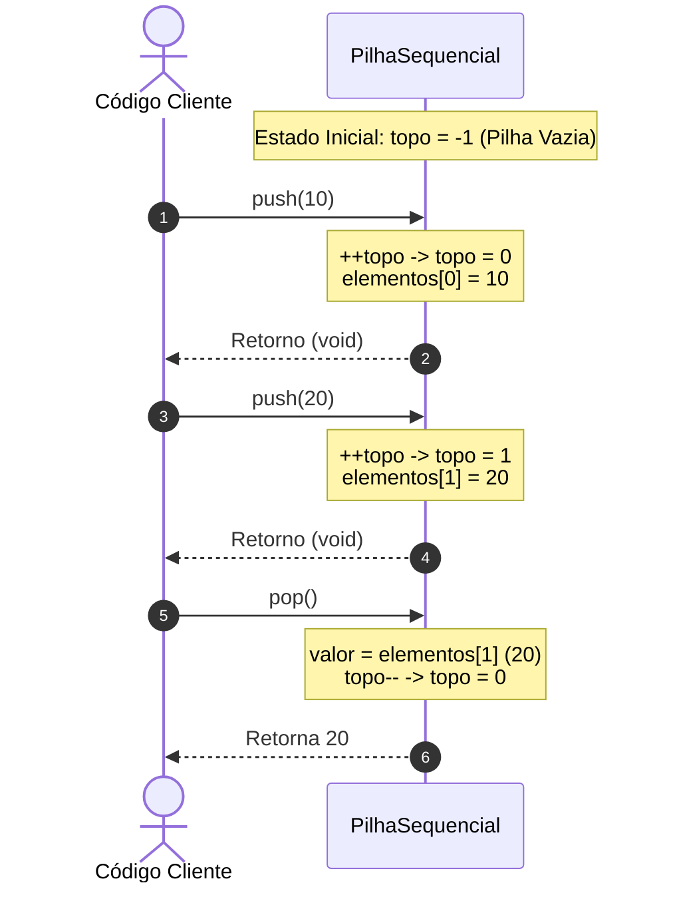

```java
public class PilhaSequencial {
    private int[] elementos;
    private int topo;

    public PilhaSequencial(int capacidade) {
        if (capacidade <= 0) {
            throw new IllegalArgumentException("Capacidade deve ser positiva.");
        }
        this.elementos = new int[capacidade];
        this.topo = -1; // -1 indica ausência total de elementos
    }

    public void push(int valor) {
        if (this.topo == this.elementos.length - 1) {
            throw new IllegalStateException("Stack Overflow: capacidade máxima excedida.");
        }
        this.elementos[++this.topo] = valor;
    }

    public int pop() {
        if (isEmpty()) {
            throw new IllegalStateException("Stack Underflow: tentativa de pop em pilha vazia.");
        }
        return this.elementos[this.topo--];
    }

    public int peek() {
        if (isEmpty()) {
            throw new IllegalStateException("Pilha vazia.");
        }
        return this.elementos[this.topo];
    }

    public boolean isEmpty() {
        return this.topo == -1;
    }
}
```

### 8.5 Exclusão Lógica versus Exclusão Física no Array

Observe atentamente o método `pop()`:
```java
return this.elementos[this.topo--];
```
Nessa instrução, o valor primitivo contido na gaveta do vetor **não é apagado nem zerado fisicamente na memória RAM**. Ocorre uma **exclusão lógica**: o marcador `topo` regride uma unidade. O dado preexistente torna-se inacessível aos métodos contratuais e será simplesmente sobrescrito em um próximo `push()`.

*(Nota de aprofundamento de Engenharia de Software: Se o array armazenasse objetos (`Object[]`), a ausência da atribuição `elementos[topo] = null` impediria o Garbage Collector de liberar o objeto inalcançável, gerando um vazamento de memória conhecido como loitering).*

### 8.6 Implementação Dinâmica Encadeada com Mapeamento no Topo

Para eliminar a capacidade fixa do array sem degradar o desempenho, constrói-se a pilha sobre uma lista encadeada dinâmica. 

**Decisão de Projeto Crítica:** O topo da pilha deve ser mapeado obrigatoriamente para o **início da lista encadeada**.
- Topo no Início: `push` insere na cabeça em $ `O(1)` $; `pop` remove da cabeça em $ `O(1)` $.
- Topo no Fim: `push` insere na cauda em $ `O(1)` $`; contudo, o `pop` exigiria percorrer toda a lista para encontrar o nó penúltimo, degradando a remoção para inaceitáveis **`$ `O(n)` $**.

```java
public class PilhaEncadeada {
    private No topo;
    private int tamanho;

    public PilhaEncadeada() {
        this.topo = null;
        this.tamanho = 0;
    }

    public void push(int valor) {
        No novo = new No(valor);
        novo.proximo = this.topo;
        this.topo = novo;
        this.tamanho++;
    }

    public int pop() {
        if (isEmpty()) {
            throw new IllegalStateException("Stack Underflow: pilha vazia.");
        }
        int valorRemovido = this.topo.valor;
        this.topo = this.topo.proximo;
        this.tamanho--;
        return valorRemovido;
    }

    public int peek() {
        if (isEmpty()) {
            throw new IllegalStateException("Pilha vazia.");
        }
        return this.topo.valor;
    }

    public boolean isEmpty() {
        return this.topo == null;
    }

    public int size() {
        return this.tamanho;
    }
}
```

### 8.7 Manipulação de Elementos Intermediários com Pilhas Auxiliares

Em determinados cenários algorítmicos, torna-se necessário verificar a existência, substituir ou contar ocorrências de dados situados abaixo do topo da pilha sem violar a abstração LIFO.

A única abordagem metodológica que respeita o encapsulamento consiste no emprego de uma **Pilha Auxiliar Temporária**:
1. Desempilham-se elementos da pilha original e inserem-se na pilha auxiliar até atingir a profundidade do dado alvo;
2. Realiza-se a leitura ou mutação necessária;
3. Desempilham-se todos os itens da pilha auxiliar, inserindo-os de volta na pilha original, restaurando rigorosamente o estado inicial.

```mermaid
sequenceDiagram
    autonumber
    participant P as Pilha Original
    participant A as Pilha Auxiliar

    Note over P,A: Objetivo: Inspecionar elemento no meio
    P->>A: aux.push(origem.pop()) [Desempilha até expor alvo]
    Note over P: Alvo agora é visível no topo
    A->>P: origem.push(aux.pop()) [Restaura a ordem original]
    Note over P,A: Estado inicial perfeitamente preservado
```

#### Implementação do Método `contem(int valor)`
```java
public boolean contem(int valor) {
    PilhaEncadeada auxiliar = new PilhaEncadeada();
    boolean encontrado = false;

    // Esvazia desempilhando para a pilha temporária
    while (!isEmpty()) {
        int atual = pop();
        if (atual == valor) {
            encontrado = true;
        }
        auxiliar.push(atual);
    }

    // Restaura a estrutura original
    while (!auxiliar.isEmpty()) {
        push(auxiliar.pop());
    }

    return encontrado;
}
```
**Análise Assintótica:**
- Complexidade Temporal: **$ `O(n)` $**, pois todos os $ `n` $ itens são transferidos e reempilhados.
- Complexidade Espacial Auxiliar: **$ `O(n)` $**, devido à alocação de memória proporcional para a pilha auxiliar.

### 8.8 Aplicações Clássicas de Pilhas em Engenharia de Software

- **Pilha de Chamadas do Runtime (*Call Stack* da JVM):** Rastreia registros de ativação, variáveis locais e endereços de retorno de métodos invocados recursiva ou sequencialmente.
- **Mecanismos de Desfazer/Refazer (*Undo/Redo*):** Editores de texto e ferramentas gráficas armazenam comandos executados em uma pilha para possibilitar reversão temporal reversa.
- **Validação de Delimitadores e Compiladores:** Parsers sintáticos utilizam pilhas para verificar o balanceamento e aninhamento correto de parênteses `()`, colchetes `[]` e chaves `{}`.
- **Histórico de Navegação Web:** A funcionalidade de "Voltar" nos navegadores empilha as URLs visitadas, desempilhando a página anterior ao clique do usuário.

---

## 9. Algoritmos Elementares de Ordenação

### 9.1 A Relevância Estratégica da Ordenação de Dados

A ordenação interna de registros em estruturas lineares contíguas consiste em reorganizar uma coleção $ `\{a_0, a_1, \dots, a_{n-1}\}` $ em uma permutação que satisfaça uma relação de ordem $ `a'_0 \le a'_1 \le \dots \le a'_{n-1}` $.

A ordenação viabiliza:
- **Redução de Custo de Busca:** Transforma a pesquisa de dados de uma busca linear $ `O(n)` $ para a Busca Binária de custo logarítmico $ `O(\log n)` $;
- **Eliminação de Duplicidades e Cruzamento (*Merge*):** Localizar elementos repetidos em vetores ordenados consome tempo linear $ `O(n)` $;
- **Relatórios Gerenciais:** Apresentação estruturada e legível para tomadores de decisão em ordem alfabética ou por métricas de desempenho.

### 9.2 Algoritmo Bubble Sort: Mecanismo de Trocas Adjacentes

O **Bubble Sort (Método da Bolha)** opera através de múltiplas passagens pelo vetor, comparando sucessivamente pares de vizinhos imediatos $ `(vetor[j], vetor[j+1])` $. Sempre que o elemento da esquerda for estritamente maior que o da direita, seus valores são permutados (*swap*). Ao final de cada varredura, o maior elemento não ordenado flutua até sua posição definitiva na cauda da partição.

```mermaid
flowchart LR
    A["vetor[j]"] -->|"Compara com"| B["vetor[j+1]"]
    B --> C{"vetor[j] > vetor[j+1]?"}
    C -->|"Sim"| D["Efetua Troca (Swap)"]
    C -->|"Não"| E["Mantém Posições"]
    D --> F["Avança para o próximo par"]
    E --> F
```

#### Código Canônico do Bubble Sort
```java
public static void bubbleSort(int[] vetor) {
    int n = vetor.length;

    // Laço externo: controla as n - 1 passagens
    for (int i = 0; i < n - 1; i++) {
        // Laço interno: percorre pares não ordenados
        for (int j = 0; j < n - 1 - i; j++) {
            if (vetor[j] > vetor[j + 1]) {
                // Procedimento de troca com variável temporária
                int temp = vetor[j];
                vetor[j] = vetor[j + 1];
                vetor[j + 1] = temp;
            }
        }
    }
}
```

### 9.3 Otimização do Bubble Sort com Sinalizador de Parada Antecipada

Na versão básica, mesmo que o vetor atinja a ordenação nas primeiras passagens (ou já entre perfeitamente ordenado), o algoritmo executa cegamente todas as $ `\frac{n(n-1)}{2}` $ comparações.

A otimização introduz uma sentinela booleana (`houveTroca`). Se uma passagem completa for executada sem que ocorra uma única troca, conclui-se que o vetor já está ordenado, interrompendo o laço imediatamente:

```java
public static void bubbleSortOtimizado(int[] vetor) {
    int n = vetor.length;

    for (int i = 0; i < n - 1; i++) {
        boolean houveTroca = false;

        for (int j = 0; j < n - 1 - i; j++) {
            if (vetor[j] > vetor[j + 1]) {
                int temp = vetor[j];
                vetor[j] = vetor[j + 1];
                vetor[j + 1] = temp;
                houveTroca = true;
            }
        }

        // Se nenhuma troca ocorreu, interrompe antecipadamente
        if (!houveTroca) {
            break;
        }
    }
}
```
**Impacto da Otimização:** O melhor caso reduz-se de $ `O(n^2)` $ para complexidade estritamente linear **$ `O(n)` $**.

### 9.4 Algoritmo Selection Sort: Seleção de Extremos e Troca Mínima

O **Selection Sort (Ordenação por Seleção)** adota uma estratégia posicional. O vetor é dividido conceitualmente em um subvetor ordenado à esquerda e um subvetor não ordenado à direita. A cada passagem $ `i` $, o algoritmo varre exaustivamente a região não ordenada à procura do índice que armazena o menor valor absoluto, executando ao final **uma única troca por iteração externa**.

```mermaid
flowchart TD
    A["Início da Passagem i"] --> B["Assume indiceMenor = i"]
    B --> C["Varre j de i+1 até n-1"]
    C --> D{"vetor[j] < vetor[indiceMenor]?"}
    D -->|"Sim"| E["Atualiza indiceMenor = j"]
    D -->|"Não"| F["Mantém indiceMenor"]
    E --> G{"Fim da Varredura?"}
    F --> G
    G -->|"Não"| C
    G -->|"Sim"| H["Efetua Troca Única entre posições i e indiceMenor"]
```

#### Código Canônico do Selection Sort
```java
public static void selectionSort(int[] vetor) {
    int n = vetor.length;

    for (int i = 0; i < n - 1; i++) {
        int indiceMenor = i;

        // Procura o menor elemento na partição desordenada
        for (int j = i + 1; j < n; j++) {
            if (vetor[j] < vetor[indiceMenor]) {
                indiceMenor = j;
            }
        }

        // Permuta o menor elemento com a fronteira i
        int temp = vetor[i];
        vetor[i] = vetor[indiceMenor];
        vetor[indiceMenor] = temp;
    }
}
```

### 9.5 Comparativo Técnico: Bubble Sort versus Selection Sort

| Critério de Comparação | Bubble Sort (Canônico) | Bubble Sort (Otimizado) | Selection Sort |
| :--- | :--- | :--- | :--- |
| **Comparações (Pior Caso)** | $ `\frac{n(n-1)}{2} \implies O(n^2)` $ | $ `\frac{n(n-1)}{2} \implies O(n^2)` $ | $ `\frac{n(n-1)}{2} \implies O(n^2)` $ |
| **Comparações (Melhor Caso)** | $ `O(n^2)` $ | $ `n - 1 \implies O(n)` $ | $ `O(n^2)` $ (sempre varre tudo) |
| **Trocas no Pior Caso** | $ `\frac{n(n-1)}{2} \implies O(n^2)` $ | $ `O(n^2)` $ | $ `n - 1 \implies O(n)` $ |
| **Trocas no Melhor Caso** | Zero | Zero | Zero (se validar `if (i != min)`) |
| **Sensibilidade à Ordenação** | Insensível na versão pura | Altamente sensível (para cedo) | Insensível (custo uniforme) |
| **Estabilidade Original** | Estável (não permuta iguais) | Estável | Instável (pode transpor iguais) |
| **Memória Auxiliar** | $ `O(1)` $ *in-place* | $ `O(1)` $ *in-place* | $ `O(1)` $ *in-place* |

---

## 10. Resolução Analítica e Comentada das Atividades do Google Classroom

### 10.1 Trabalho 1 — Análise de Complexidade de Algoritmos

Apresenta-se a dedução matemática e a análise assintótica para as seis questões do formulário avaliativo submetido no Google Classroom da disciplina:

---

#### Questão 1: Método `somar`
```java
public static int somar(int[] valores) {
    int soma = 0;

    for (int i = 0; i < valores.length; i++) {
        soma += valores[i];
    }

    return soma;
}
```
- **Demonstração Analítica:** Seja $ `n = \text{valores.length}` $. O laço executa com incremento unitário de $ `0` $ até $ `n - 1` $. O corpo é invocado exatamente $ `n` $ vezes. A função de tempo exata é da forma $ `T(n) = c_1 n + c_2` $. Pelo descarte de constantes e termos menores, temos crescimento estritamente linear.
- **Classificação Big-O:** **$ `O(n)` $**

---

#### Questão 2: Método `buscaBinaria`
```java
public static int buscaBinaria(int[] valores, int procurado) {
    int inicio = 0;
    int fim = valores.length - 1;

    while (inicio <= fim) {
        int meio = (inicio + fim) / 2;

        if (valores[meio] == procurado) {
            return meio;
        }

        if (valores[meio] < procurado) {
            inicio = meio + 1;
        } else {
            fim = meio - 1;
        }
    }

    return -1;
}
```
- **Demonstração Analítica:** A cada repetição do laço `while`, o intervalo de pesquisa remanescente é subdividido pela metade ($ `\frac{n}{2}, \frac{n}{4}, \dots, \frac{n}{2^k}` $). No pior cenário (quando o elemento não existe no vetor), a execução cessa quando o intervalo atinge tamanho 1:
```math
\frac{n}{2^k} = 1 \implies 2^k = n \implies k = \log_2 n
```
- **Classificação Big-O:** **$ `O(\log n)` $**

---

#### Questão 3: Método `imprimirPares`
```java
public static void imprimirPares(int[] valores) {
    for (int i = 0; i < valores.length; i++) {
        for (int j = 0; j < valores.length; j++) {
            System.out.println(valores[i] + " - " + valores[j]);
        }
    }
}
```
- **Demonstração Analítica:** O laço externo executa $ `n` $ vezes. Para cada iteração de `i`, o laço interno executa outras $ `n` $ vezes completas de forma independente. O número de impressões é o produto:
```math
\sum_{i=0}^{n-1} \sum_{j=0}^{n-1} 1 = n \times n = n^2
```
- **Classificação Big-O:** **$ `O(n^2)` $** (grafado como `O(nˆ2)` no formulário original)

---

#### Questão 4: Método `contarIguais`
```java
public static int contarIguais(int[] valores) {
    int contador = 0;

    for (int i = 0; i < valores.length; i++) {
        for (int j = i + 1; j < valores.length; j++) {
            if (valores[i] == valores[j]) {
                contador++;
            }
        }
    }

    return contador;
}
```
- **Demonstração Analítica:** Trata-se de laços aninhados dependentes. Para `i = 0`, `j` executa $ `n - 1` $ vezes; para `i = 1`, executa $ `n - 2` $ vezes; culminando em 0 vezes quando `i = n - 1`. O total de comparações é dado pela soma de uma Progressão Aritmética:
```math
S(n) = \sum_{k=1}^{n-1} k = \frac{(n - 1)n}{2} = \frac{1}{2}n^2 - \frac{1}{2}n
```
Desprezando a constante $ `\frac{1}{2}` $ e o termo linear de menor ordem $ `-\frac{1}{2}n` $, a ordem assintótica é estritamente quadrática.
- **Classificação Big-O:** **$ `O(n^2)` $** (grafado como `O(nˆ2)` no formulário original)

---

#### Questão 5: Método `maior`
```java
public static int maior(int[] valores) {
    int maior = valores[0];
    int i = 1;

    while (i < valores.length) {
        if (valores[i] > maior) {
            maior = valores[i];
        }
        i++;
    }

    return maior;
}
```
- **Demonstração Analítica:** O laço `while` avalia os elementos a partir do índice 1 com incremento estritamente linear até $ `n - 1` $. O bloco é executado exatamente $ `n - 1` $ vezes.
- **Classificação Big-O:** **$ `O(n)` $**

---

#### Questão 6: Método `reduzir`
```java
public static void reduzir(int n) {
    while (n > 1) {
        n = n / 2;
    }
}
```
- **Demonstração Analítica:** Aqui o parâmetro $ `n` $ não representa o tamanho de uma coleção, mas a grandeza do valor de entrada. A variável de controle é dividida repetidamente por 2. O laço executa $ `\lfloor \log_2 n \rfloor` $ iterações até reduzir a 1.
- **Classificação Big-O:** **$ `O(\log n)` $**

---

### 10.2 Trabalho 2 — Estruturas de Ordenação 1

O trabalho propõe a ordenação do seguinte vetor fornecido no Classroom:
```java
int[] notas = {8, 5, 10, 3, 7, 2, 9, 6}; // Tamanho n = 8
```

#### Código-Fonte Completo e Instrumentado para Coleta de Métricas
```java
public class OrdenacaoNotas {

    public static class Metricas {
        public long comparacoes = 0;
        public long trocas = 0;
    }

    public static Metricas bubbleSort(int[] vetor) {
        Metricas m = new Metricas();
        int n = vetor.length;

        for (int i = 0; i < n - 1; i++) {
            for (int j = 0; j < n - 1 - i; j++) {
                m.comparacoes++;
                if (vetor[j] > vetor[j + 1]) {
                    int temp = vetor[j];
                    vetor[j] = vetor[j + 1];
                    vetor[j + 1] = temp;
                    m.trocas++;
                }
            }
        }
        return m;
    }

    public static Metricas selectionSort(int[] vetor) {
        Metricas m = new Metricas();
        int n = vetor.length;

        for (int i = 0; i < n - 1; i++) {
            int indiceMenor = i;
            for (int j = i + 1; j < n; j++) {
                m.comparacoes++;
                if (vetor[j] < vetor[indiceMenor]) {
                    indiceMenor = j;
                }
            }
            // Troca física garantida na implementação canônica
            int temp = vetor[i];
            vetor[i] = vetor[indiceMenor];
            vetor[indiceMenor] = temp;
            if (indiceMenor != i) {
                m.trocas++; // Contabiliza trocas efetivas entre posições distintas
            }
        }
        return m;
    }

    public static void main(String[] args) {
        int[] original = {8, 5, 10, 3, 7, 2, 9, 6};

        // Isolamento de memória via cópia profunda (deep copy)
        int[] copiaBubble = original.clone();
        int[] copiaSelection = original.clone();

        Metricas mBubble = bubbleSort(copiaBubble);
        Metricas mSelection = selectionSort(copiaSelection);

        System.out.println("Bubble Sort -> Comparações: " + mBubble.comparacoes + ", Trocas: " + mBubble.trocas);
        System.out.println("Selection Sort -> Comparações: " + mSelection.comparacoes + ", Trocas: " + mSelection.trocas);
    }
}
```

#### Gabarito Analítico das Questões do Formulário Avaliativo

1. **Quantas comparações cada algoritmo realizou?**
   - Ambos os algoritmos realizaram exatamente **28 comparações**.
   - *Memória de cálculo matemática:* Como $ `n = 8` $, a soma das passagens é dada pela progressão aritmética:
   ```math
   C(8) = \frac{n(n - 1)}{2} = \frac{8 \times 7}{2} = 28
   ```
2. **Quantas trocas foram realizadas por cada algoritmo?**
   - **Bubble Sort:** Realizou **15 trocas**. Como opera por trocas contínuas entre adjacentes invertidos, cada inversão no arranjo exige uma movimentação física em memória.
   - **Selection Sort:** Realizou **6 trocas efetivas** (ou 7 trocas se computada a auto-troca neutra na iteração em que o menor elemento já ocupava a fronteira $ `i` $). O algoritmo isola o menor elemento e move-o apenas uma vez por passagem externa.
3. **O resultado final foi o mesmo? Por quê?**
   - **Sim**, ambos os vetores resultaram rigorosamente em `[2, 3, 5, 6, 7, 8, 9, 10]`. Porque tanto o Bubble Sort quanto o Selection Sort são algoritmos deterministicamente corretos para ordenação total baseada em comparação, convergindo para a mesma permutação ordenada final independentemente das estratégias intermediárias de movimentação.
4. **Qual algoritmo realiza menos trocas na implementação apresentada?**
   - O **Selection Sort**. Sua complexidade de movimentações em memória é de ordem estritamente linear **$ `O(n)` $** (no máximo $ `n - 1` $ trocas), enquanto o Bubble Sort exibe complexidade de trocas quadrática **$ `O(n^2)` $**.
5. **O que aconteceria com o desempenho se o vetor tivesse 1.000 elementos?**
   - Ocorrerá uma severa degradação de desempenho devido ao crescimento quadrático das operações. Para $ `n = 1.000` $, a quantidade de comparações salta de 28 para:
   ```math
   \frac{1.000 \times 999}{2} = 499.500 \text{ comparações}
   ```
   No caso do Bubble Sort, o volume de trocas pode atingir centenas de milhares de operações em memória, inviabilizando sua aplicação em sistemas corporativos de larga escala e exigindo o emprego de algoritmos $ `O(n \log n)` $ (Merge Sort ou Quick Sort).
6. **Se as notas já estivessem ordenadas, qual algoritmo poderia ser otimizado para encerrar mais cedo?**
   - O **Bubble Sort**. Incorporando um sinalizador booleano de controle (`houveTroca`), o algoritmo constata a ausência total de permutas logo na primeira passagem ($ `n - 1 = 7` $ comparações) e finaliza sua execução em tempo linear **$ `O(n)` $**. O Selection Sort canônico, por não rastrear se os dados já estavam organizados, executará obrigatoriamente todas as 28 comparações em qualquer cenário.

---

## 11. Roteiro Metodológico de Engenharia para Resolução de Problemas e Provas

Para obter êxito técnico em avaliações formais e no desenvolvimento de software de alta performance, o discente deve aplicar sistematicamente o roteiro de seis passos consolidado na Aula 07:

```mermaid
flowchart TD
    E1["Passo 1: Identificar a Entrada e o Tamanho n"] --> E2["Passo 2: Identificar as Operações Fundamentais"]
    E2 --> E3["Passo 3: Mapear Laços e Estruturas de Repetição"]
    E3 --> E4["Passo 4: Analisar a Estrutura de Armazenamento Utilizada"]
    E4 --> E5["Passo 5: Derivar a Complexidade Assintótica Big-O"]
    E5 --> E6["Passo 6: Mapear o Comportamento Físico na Memória (Stack vs Heap)"]
```

1. **Identificar a Entrada e o Tamanho $ `n` $:**
   - Qual é a grandeza determinante do problema? (Quantidade de registros em um vetor, nós em uma lista encadeada ou valor escalar de controle).
2. **Identificar as Operações Fundamentais:**
   - Quais instruções executam o trabalho crítico? (Comparações de chaves, leituras de índices, movimentações de ponteiros de referência ou atribuições aritméticas).
3. **Mapear Laços e Estruturas de Repetição:**
   - O algoritmo possui laços sequenciais independentes ($ `n + n \implies O(n)` $)?
   - Possui laços aninhados independentes ($ `n \times n \implies O(n^2)` $)?
   - Possui laços aninhados dependentes com redução triangular ($ `\frac{n(n-1)}{2} \implies O(n^2)` $)?
   - Possui divisões sucessivas do espaço de busca por potências ($ `\implies O(\log n)` $)?
4. **Analisar a Estrutura de Armazenamento Utilizada:**
   - Se for vetor: considerar o custo $ `O(1)` $ de leitura indexada e o gargalo de deslocamento $ `O(n)` $ em inserções não terminais.
   - Se for lista encadeada: considerar o religamento em $ `O(1)` $ e a perda do acesso aleatório (percurso sequencial $ `O(n)` $).
   - Se for pilha: garantir a preservação do encapsulamento LIFO.
5. **Derivar a Complexidade Assintótica Big-O:**
   - Formular a equação de custo $ `T(n)` $, isolar o termo de maior ordem e descartar as constantes multiplicativas. Avaliar separadamente o Pior Caso, Melhor Caso e Caso Médio.
6. **Mapear o Comportamento Físico na Memória (Stack vs Heap):**
   - As referências foram devidamente atualizadas?
   - Há risco de referências perdidas gerando *memory leaks* ou objetos órfãos inacessíveis?
   - As invariantes estruturais (ponteiros de cauda, contadores de cardinalidade) permanecem consistentes após a conclusão da rotina?

---

## 12. Glossário Técnico Consolidado

- **Algoritmo:** Sequência finita, ordenada e não ambígua de instruções computáveis que converte entradas em saídas resolutivas em tempo finito.
- **Análise Assintótica:** Estudo do comportamento matemático e do consumo de recursos de uma função de custo quando o tamanho da entrada tende ao infinito ($ `n \to \infty` $).
- **Auto-Referenciamento:** Recurso de modelagem no qual uma classe possui um atributo cujo tipo é a própria classe (exemplo: `public No proximo;`).
- **Big-O ($ `O` $):** Notação matemática que expressa o limite superior assintótico (o pior cenário de custo) de um algoritmo.
- **Bubble Sort:** Algoritmo elementar de ordenação que estabiliza o arranjo através de sucessivas comparações e trocas entre pares de elementos adjacentes.
- **Cache Hit / Cache Miss:** Ocorrência de sucesso ou falha no resgate imediato de dados armazenados nas memórias ultrarrápidas (L1/L2/L3) integradas ao processador.
- **Contiguidade de Memória:** Propriedade física na qual elementos adjacentes de uma coleção residem em bytes sucessivos da memória RAM.
- **Deep Copy (Cópia Profunda):** Duplicação integral e desacoplada de uma estrutura de dados e de seus elementos em um novo bloco de memória, garantindo isolamento total de mutações.
- **Encapsulamento:** Princípio de engenharia de software que oculta os detalhes físicos e variáveis de estado de um componente atrás de uma interface pública segura.
- **FIFO (*First In, First Out*):** Disciplina de acesso linear onde o primeiro elemento enfileirado é obrigatoriamente o primeiro a ser atendido.
- **Finitude:** Propriedade mandante que determina que um algoritmo deve obrigatoriamente cessar sua execução após número finito de operações.
- **Garbage Collector (GC):** Mecanismo autônomo do runtime Java encarregado de desalocar a memória Heap ocupada por objetos inalcançáveis.
- **Invariante de Laço:** Condição lógica que permanece rigorosamente verdadeira antes e depois de cada iteração de uma estrutura de repetição.
- **LIFO (*Last In, First Out*):** Disciplina de acesso linear onde o último elemento inserido no topo é o primeiro a ser desempilhado.
- **Localidade Espacial:** Tendência de sistemas computacionais de acessar posições de memória fisicamente próximas a posições recém-consultadas.
- **Nó (*Node*):** Unidade atômica constituinte de estruturas encadeadas, agregando a carga útil de dados e um ou mais ponteiros de referência.
- **Notação Big-Omega ($ `\Omega` $):** Limite inferior assintótico que expressa o consumo mínimo teórico de recursos de um algoritmo.
- **Notação Big-Theta ($ `\Theta` $):** Limite assintótico justo que delimita inferior e superiormente a ordem de crescimento de um algoritmo.
- **Pilha (*Stack*):** Tipo Abstrato de Dados linear restrito que limita todas as mutações e consultas exclusivamente à sua extremidade de topo.
- **Ponteiro de Cauda (`fim`):** Referência explícita mantida por listas ligadas para apontar para o último nó, otimizando inserções terminais para $ `O(1)` $.
- **Refinamento Sucessivo:** Técnica de engenharia consistente em desdobrar um problema abstrato em subproblemas progressivamente menores e implementáveis.
- **Selection Sort:** Algoritmo de ordenação que isola o menor elemento da partição não ordenada e posiciona-o na fronteira da partição ordenada com trocas mínimas.
- **Stack Frame:** Bloco de memória alocado na pilha de execução para custodiar variáveis locais e endereços de retorno de um método ativo.
- **Stack Overflow:** Condição de erro gerada pela tentativa de inserção em uma pilha que já atingiu o limite de sua capacidade física alocada.
- **Stack Underflow:** Condição de erro disparada pela tentativa de desempilhar ou inspecionar o topo de uma pilha que se encontra vazia.
- **TAD (Tipo Abstrato de Dados):** Especificação matemática formal que declara o comportamento e operações de uma coleção sem prescrever sua disposição em memória.
- **Tempo Constante ($ `O(1)` $):** Classe de complexidade onde o consumo de tempo independe inteiramente do volume da entrada processada.
- **Tempo Linear ($ `O(n)` $):** Classe de complexidade onde o trabalho cresce em proporção estritamente direta ao aumento do volume de dados da entrada.
- **Tempo Quadrático ($ `O(n^2)` $):** Classe de complexidade típica de laços aninhados sobre a mesma entrada, com multiplicação exponencial do custo.

---

## Fontes e Metadados

- Turma no Classroom: estrutura de dados 1 2026/02
- Itens processados: 0 materiais, 3 tarefas, 9 avisos
- Gerado em: 20/10/2026, 21:49:33 (BRT) via classroom-sync
