# Guia Teórico e Prático de Estrutura de Dados I

> **Instituição:** Centro Universitário de Santa Fé do Sul (UniFEF)  
> **Curso:** Bacharelado em Sistemas de Informação (4º Semestre)  
> **Docente:** Prof. Ms. Wesley Soares de Souza  
> **Disciplina:** Estrutura de Dados I  
> **Compilação e Organização:** Material Didático Integrador de Engenharia de Software  

---

## Sumário

- [Apresentação e Contrato Pedagógico da Disciplina](#apresentacao-e-contrato-pedagogico-da-disciplina)
  - [Perfil Docente e Visão de Engenharia](#perfil-docente-e-visao-de-engenharia)
  - [Estrutura Curricular e Ementa Oficial](#estrutura-curricular-e-ementa-oficial)
  - [Métrica e Critérios de Avaliação](#metrica-e-criterios-de-avaliacao)
  - [Bibliografia Registrada e Complementar](#bibliografia-registrada-e-complementar)
- [Fundamentos de Algoritmos e Resolução de Problemas](#fundamentos-de-algoritmos-e-resolucao-de-problemas)
  - [Definição Formal e Origem Histórica](#definicao-formal-e-origem-historica)
  - [As Seis Características Fundamentais de um Algoritmo](#as-seis-caracteristicas-fundamentais-de-um-algoritmo)
  - [A Equação de Wirth: Algoritmos e Estruturas de Dados](#a-equacao-de-wirth-algoritmos-e-estruturas-de-dados)
  - [Algoritmo versus Programa de Computador](#algoritmo-versus-programa-de-computador)
  - [O Ciclo Completo da Engenharia de Software](#o-ciclo-completo-da-engenharia-de-software)
- [Refinamento Sucessivo e Metodologia de Projeto](#refinamento-sucessivo-e-metodologia-de-projeto)
  - [Princípio do Stepwise Refinement](#principio-do-stepwise-refinement)
  - [Os Três Níveis de Abstração](#os-tres-niveis-de-abstracao)
  - [Estudo de Caso Guiado: Cálculo da Média e Fila de Atendimento](#estudo-de-caso-guiado-calculo-da-media-e-fila-de-atendimento)
  - [As Seis Etapas Sistemáticas de Projeto de Algoritmos](#as-seis-etapas-sistematicas-de-projeto-de-algoritmos)
- [Tipos Abstratos de Dados e Encapsulamento](#tipos-abstratos-de-dados-e-encapsulamento)
  - [Definição Formal de TAD](#definicao-formal-de-tad)
  - [Abstração versus Encapsulamento](#abstracao-versus-encapsulamento)
  - [Separação Estrita entre Interface e Implementação](#separacao-estrita-entre-interface-e-implementacao)
  - [Critérios para Escolha da Representação de Dados](#criterios-para-escolha-da-representacao-de-dados)
- [Modelo de Memória na Máquina Virtual Java](#modelo-de-memoria-na-maquina-virtual-java)
  - [Memória Stack versus Memória Heap](#memoria-stack-versus-memoria-heap)
  - [Tipos Primitivos versus Tipos de Referência](#tipos-primitivos-versus-tipos-de-referencia)
  - [Ciclo de Vida de Objetos e Garbage Collection](#ciclo-de-vida-de-objetos-e-garbage-collection)
  - [Topologia de Referências e Perda de Localidade](#topologia-de-referencias-e-perda-de-localidade)
- [Análise Assintótica de Complexidade e Notação Big-O](#analise-assintotica-de-complexidade-e-notacao-big-o)
  - [Limitações da Medição por Tempo de Relógio](#limitacoes-da-medicao-por-tempo-de-relogio)
  - [Tamanho da Entrada e Contagem de Operações Primitivas](#tamanho-da-entrada-e-contagem-de-operacoes-primitivas)
  - [Fundamentação da Notação Big-O e Notação Big-Omega](#fundamentacao-da-notacao-big-o-e-notacao-big-omega)
  - [Regras de Simplificação: Descarte de Constantes e Termos Menores](#regras-de-simplificacao-descarte-de-constantes-e-termos-menores)
  - [Cenários de Execução: Melhor Caso, Caso Médio e Pior Caso](#cenarios-de-execucao-melhor-caso-caso-medio-e-pior-caso)
  - [Classes Canônicas de Complexidade](#classes-canonicas-de-complexidade)
- [Listas Lineares Sequenciais](#listas-lineares-sequenciais)
  - [Estrutura Física e Endereçamento Contíguo](#estrutura-fisica-e-enderecamento-contiguo)
  - [Capacidade Estática versus Tamanho Ocupado](#capacidade-estatica-versus-tamanho-ocupado)
  - [O Problema do Deslocamento em Inserções e Remoções](#o-problema-do-deslocamento-em-insercoes-e-remocoes)
  - [Mecanismo de Redimensionamento Dinâmico](#mecanismo-de-redimensionamento-dinamico)
- [Listas Simplesmente Ligadas Dinâmicas](#listas-simplesmente-ligadas-dinamicas)
  - [Anatomia do Nó e Auto-Referenciamento](#anatomia-do-no-e-auto-referenciamento)
  - [Estrutura da Classe Controladora com Ponteiros de Início, Fim e Tamanho](#estrutura-da-classe-controladora-com-ponteiros-de-inicio-fim-e-tamanho)
  - [Inserção no Início: Mecânica e Complexidade](#insercao-no-inicio-mecanica-e-complexidade)
  - [Inserção no Fim: Análise O(1) com Ponteiro Fim versus O(n) sem Ponteiro Fim](#insercao-no-fim-analise-o1-com-ponteiro-fim-versus-on-sem-ponteiro-fim)
  - [Inserção Ordenada: Separação de Busca e Religamento](#insercao-ordenada-separacao-de-busca-e-religamento)
  - [Busca Linear e Atualização por Índice](#busca-linear-e-atualizacao-por-indice)
  - [Remoção de Elementos e Cuidados com Referências Soltas](#remocao-de-elementos-e-cuidados-com-referencias-soltas)
- [Estrutura de Dados Linear Restrita: Pilhas](#estrutura-de-dados-linear-restrita-pilhas)
  - [Definição Formal e Princípio LIFO](#definicao-formal-e-principio-lifo)
  - [Operações Fundamentais: push, pop, peek e isEmpty](#operacoes-fundamentais-push-pop-peek-e-isempty)
  - [Implementação Estática Sequencial com Array](#implementacao-estatica-sequencial-com-array)
  - [Implementação Encadeada Dinâmica sobre Lista Ligada](#implementacao-encadeada-dinamica-sobre-lista-ligada)
  - [Manipulação de Elementos Intermediários com Pilhas Auxiliares](#manipulacao-de-elementos-intermediarios-com-pilhas-auxiliares)
  - [Trade-offs Estruturais: Pilha Sequencial versus Pilha Ligada](#trade-offs-estruturais-pilha-sequencial-versus-pilha-ligada)
- [Algoritmos Elementares de Ordenação](#algoritmos-elementares-de-ordenacao)
  - [Importância da Ordenação em Sistemas Computacionais](#importancia-da-ordenacao-em-sistemas-computacionais)
  - [Bubble Sort: Trocas Adjacentes e Propagação](#bubble-sort-trocas-adjacentes-e-propagacao)
  - [Selection Sort: Seleção de Extremos e Troca Mínima](#selection-sort-selecao-de-extremos-e-troca-minima)
  - [Insertion Sort: Inserção Direta e Deslocamento versus Troca](#insertion-sort-insercao-direta-e-deslocamento-versus-troca)
  - [Matriz de Comparação entre os Métodos Elementares](#matriz-de-comparacao-entre-os-metodos-elementares)
- [Ordenação Avançada por Divisão e Conquista: Merge Sort](#ordenacao-avancada-por-divisao-e-conquista-merge-sort)
  - [O Paradigma de Divisão e Conquista](#o-paradigma-de-divisao-e-conquista)
  - [Particionamento Recursivo e Caso Base](#particionamento-recursivo-e-caso-base)
  - [Prevenção de Estouro Aritmético de Índice](#prevencao-de-estouro-aritmetico-de-indice)
  - [Processo de Intercalação e Vetor Auxiliar](#processo-de-intercalacao-e-vetor-auxiliar)
  - [Rastreamento da Árvore de Recursão](#rastreamento-da-arvore-de-recursao)
  - [Análise Assintótica Temporal e Espacial](#analise-assintotica-temporal-e-espacial)
- [Matriz Geral de Decisão Estrutural e Trade-offs](#matriz-geral-de-decisao-estrutural-e-trade-offs)
- [Roteiro Sistemático de Resolução para Avaliações](#roteiro-sistematico-de-resolucao-para-avaliacoes)
- [Banco Consolidado de Questões e Rastreamentos Resolvidos](#banco-consolidado-de-questoes-e-rastreamentos-resolvidos)

---

## Apresentacao e Contrato Pedagogico da Disciplina

### Perfil Docente e Visao de Engenharia

A disciplina de Estrutura de Dados I é ministrada pelo Prof. Ms. Wesley Soares de Souza. Graduado em Sistemas de Informação pela própria FEF (UniFEF), especialista em Gestão de Banco de Dados e mestre em Engenharia de Software pela Universidade Federal do Pampa (UNIPAMPA - RS), o docente acumula mais de 15 anos de atuação direta na indústria de tecnologia como engenheiro de software sênior, além de lecionar no ensino superior desde 2014 com passagens pelo Grupo Kroton (Anhanguera), FATEC Jales e IFSP Votuporanga.

Essa trajetória profissional delineia o enfoque pedagógico da matéria: o rigor conceitual e matemático da Ciência da Computação converge continuamente com a prática real da Engenharia de Software corporativa. Em sistemas modernos de larga escala, o uso inadequado de estruturas de dados acarreta gargalos de processamento, estouros de memória e elevação exponencial dos custos de infraestrutura em nuvem.

### Estrutura Curricular e Ementa Oficial

A ementa oficial aprovada estrutura-se em dois eixos articulados:
1. **Fundamentos e Teoria Base:** Projeto e análise de algoritmos, tipos abstratos de dados, análise de complexidade computacional assintótica e arquitetura de gestão de memória física e virtual.
2. **Estruturas Lineares e Aplicações Práticas:** Implementação, avaliação e manipulação de estruturas lineares contíguas e dinâmicas (listas, pilhas, filas e deques), integrando técnicas de medição de desempenho e ordenação interna de dados.

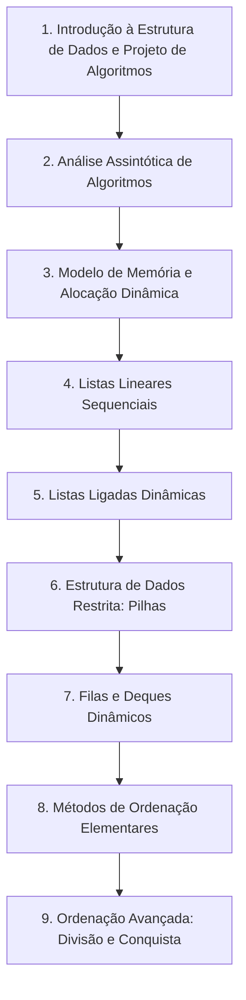

### Metrica e Criterios de Avaliacao

O semestre letivo divide-se em dois módulos avaliativos bimestrais, denominados Avaliação 1 e Avaliação 2. Cada módulo é constituído por uma prova individual formal sem consulta e pela entrega de trabalhos práticos de implementação:

- **Módulo 1 ($`AV_1`$ e $`T_1`$):** Prova individual escrita e prática ($`AV_1`$, peso 0,8) somada à composição de trabalhos práticos de programação ($`T_1`$, peso 0,2).
- **Módulo 2 ($`AV_2`$ e $`T_2`$):** Prova individual formal integradora ($`AV_2`$, peso 0,8) somada a projetos de software e listas de exercícios ($`T_2`$, peso 0,2).

A Média Semestral final ($`MS`$) é calculada pela média aritmética simples dos dois módulos ponderados:

```math
MS = \frac{[(AV_1 \times 0.8) + (T_1 \times 0.2)] + [(AV_2 \times 0.8) + (T_2 \times 0.2)]}{2}
```

| Instrumento | Natureza da Avaliação | Escala | Peso no Módulo | Pontuação Máxima |
| :--- | :--- | :--- | :--- | :--- |
| **Trabalho 1 ($`T_1`$)** | Projetos práticos e exercícios aplicados | 0,0 a 10,0 | 20% (0,2) | 2,0 pontos |
| **Prova 1 ($`AV_1`$)** | Avaliação formal teórica e algorítmica | 0,0 a 10,0 | 80% (0,8) | 8,0 pontos |
| **Trabalho 2 ($`T_2`$)** | Implementação de estruturas avançadas | 0,0 a 10,0 | 20% (0,2) | 2,0 pontos |
| **Prova 2 ($`AV_2`$)** | Avaliação formal integradora | 0,0 a 10,0 | 80% (0,8) | 8,0 pontos |

### Bibliografia Registrada e Complementar

O plano pedagógico adota bibliografias voltadas à organização de computadores para sedimentar o funcionamento do hardware (essencial para manipulação de ponteiros, registradores e segmentos de memória), além de obras clássicas de algoritmos.

#### Bibliografia Básica Registrada
- MONTEIRO, Mário A. *Introdução à Organização de Computadores*. 4. ed. Rio de Janeiro: LTC, 2002.
- STALLINGS, William. *Arquitetura e Organização de Computadores*. 8. ed. São Paulo: Pearson, 2010.
- TANENBAUM, Andrew S. *Organização Estruturada de Computadores*. 3. ed. São Paulo: Prentice-Hall do Brasil, 1990.

#### Bibliografia Complementar Registrada
- IDOETA, Ivan Valeije; CAPUANO, Francisco Gabriel. *Elementos de Eletrônica Digital*. 32. ed. São Paulo: Érica, 2001.
- PATTERSON, David A.; HENNESSY, John L. *Organização e Projeto de Computadores*. 2. ed. Rio de Janeiro: LTC, 1998.
- WEBER, Raul Fernando. *Arquitetura de Computadores Pessoais*. 2. ed. Porto Alegre: Sagra, 2001.
- WEBER, Raul Fernando. *Fundamentos de Arquitetura de Computadores*. Série Livros Didáticos Informática UFRGS, Vol. 8, 4. ed. Porto Alegre: Bookman, 2012.

> *(Complemento didático de engenharia de software):* Para o desenvolvimento formal de algoritmos e estruturas de dados em código, recomenda-se a consulta cruzada das referências de Cormen et al. (*Algoritmos: Teoria e Prática*) e Nivio Ziviani (*Projeto de Algoritmos com Implementações em Pascal e C*).

---

## Fundamentos de Algoritmos e Resolucao de Problemas

### Definicao Formal e Origem Historica

Um **algoritmo** é uma sequência finita, ordenada, determinística e não ambígua de instruções computáveis que, a partir de um conjunto de dados de entrada (que pode ser vazio), realiza transformações de estado sucessivas e atinge um estado final previsível, produzindo uma saída útil que resolve uma classe de problemas.

Etimologicamente, o termo descende do nome do matemático persa do século IX, Abu Abdullah Muhammad ibn Musa al-Khwarizmi, responsável pela sistematização das regras operacionais do sistema decimal e de resolução de equações lineares e quadráticas. Na ciência da computação contemporânea, o algoritmo representa a essência lógica da solução, independente de hardware ou linguagem.

### As Seis Caracteristicas Fundamentais de um Algoritmo

Para que um procedimento formal seja classificado como um algoritmo legítimo, ele deve satisfazer obrigatoriamente a seis axiomas:

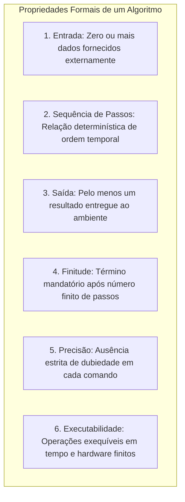

1. **Entrada (*Input*):** Recebe quantidades externas definidas. Pode possuir zero entradas quando opera sobre constantes pré-definidas em sua própria estrutura.
2. **Sequência de Passos (*Sequence*):** As operações mantêm relações rígidas de sucessão temporal e causalidade.
3. **Saída (*Output*):** Deve produzir ao menos uma resposta que atenda ao objetivo do processamento.
4. **Finitude (*Finiteness*):** Deve encerrar a execução para qualquer conjunto de entradas válido após um número finito de instruções. Laços infinitos violam essa propriedade.
5. **Precisão (*Definiteness*):** Cada instrução deve ser clara, mecânica e sem margem para interpretações subjetivas.
6. **Executabilidade (*Effectiveness*):** Cada operação unitária deve ser viável de ser realizada por um agente de processamento em tempo real finito.

| Característica | Definição Operacional | Exemplo Válido | Violação Típica (Contraexemplo) |
| :--- | :--- | :--- | :--- |
| **Entrada** | Domínio sobre o qual o algoritmo atua | Leitura de vetor com $`n`$ números | Acessar ponteiro não inicializado |
| **Sequência** | Ordem determinística de transições | Calcular subtotal antes de somar tributos | Imprimir relatório antes de ler dados |
| **Saída** | Modificação perceptível do estado | Retorno do elemento mínimo | Rotina sem efeito colateral que descarta cálculo |
| **Finitude** | Existência de critério formal de parada | Laço com condição de convergência | Laço `while(true)` sem comando de escape |
| **Precisão** | Semântica mecânica unívoca | Atribuir `x = a + b` | "Adicionar dados até atingir bom equilíbrio" |
| **Executabilidade** | Operações viáveis fisicamente | Divisão de números reais com divisor não zero | Tentar calcular divisão de número por zero |

### A Equacao de Wirth: Algoritmos e Estruturas de Dados

Conforme ressaltado em aula pelo Prof. Wesley Soares:

> *"Um bom programa depende tanto de um bom algoritmo quanto da forma como os dados são organizados."*

Essa constatação fundamenta o axioma clássico proposto por Niklaus Wirth em 1976:

```math
\text{Algoritmos} + \text{Estruturas de Dados} = \text{Programas}
```

A arquitetura lógica de um algoritmo é inoperante se os dados residirem em estruturas desestruturadas, inacessíveis ou inadequadas à natureza das operações dominantes. De forma complementar, uma estrutura sofisticada torna-se inútil se os algoritmos de consulta e mutação forem mal projetados.

### Algoritmo versus Programa de Computador

Existe uma distinção entre o conceito matemático de algoritmo e o artefato de engenharia denominado programa:

- **Algoritmo:** É uma entidade abstrata, descrita por pseudocódigo, diagramas formais ou notação matemática. Independe de sistema operacional, compilador, registradores ou clock de processador.
- **Programa:** É a materialização do algoritmo em uma linguagem formal de programação (como Java ou C). Lida com restrições do mundo real: tipos de dados com limites finitos de bits, estouros de pilha (*stack overflow*), alocação na memória dinâmica e concorrência.

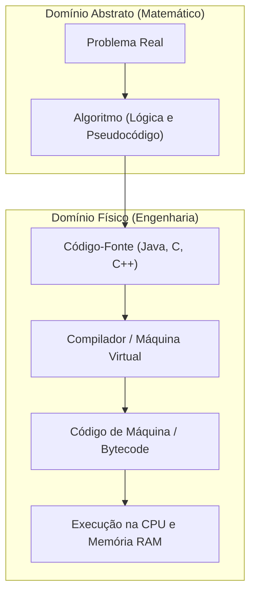

### O Ciclo Completo da Engenharia de Software

A transformação de uma necessidade humana em software em produção segue um fluxo estruturado em etapas sequenciais:

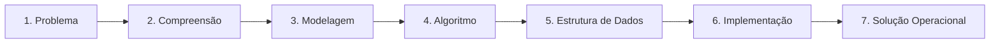

1. **Problema:** Situação concreta que demanda automação ou otimização.
2. **Compreensão:** Levantamento exaustivo de regras de negócio, limites de entrada e casos excepcionais.
3. **Modelagem:** Representação abstrata das entidades envolvidas e de suas relações.
4. **Algoritmo:** Definição passo a passo do fluxo de transformação de dados.
5. **Estrutura de Dados:** Seleção das estruturas de memória ideais para suportar o volume e a frequência de acesso dos dados.
6. **Implementação:** Codificação sintática, compilação, tratamento de erros e testes unitários.
7. **Solução Operacional:** Artefato executável implantado em ambiente de produção.

---

## Refinamento Sucessivo e Metodologia de Projeto

### Principio do Stepwise Refinement

O refinamento sucessivo (*stepwise refinement* ou decomposição *top-down*), formalizado por Niklaus Wirth, dita que problemas complexos não devem ser codificados diretamente na linguagem de destino. Em vez disso, o desenvolvedor deve enunciar a solução em um nível macro de abstração e quebrá-la progressivamente em subproblemas menores, até atingir instruções primitivas da máquina.

### Os Tres Niveis de Abstracao

A metodologia organiza-se em três camadas de detalhamento:

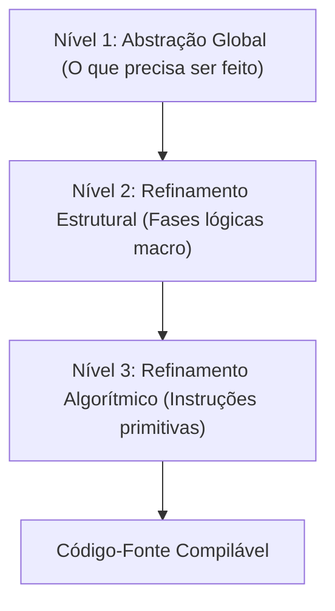

1. **Nível 1 — Abstração Global:** Declaração do objetivo final em alto nível, sem detalhar controle de fluxo ou variáveis.
2. **Nível 2 — Refinamento Estrutural:** Decomposição em grandes etapas de processamento: obtenção dos dados de entrada, operações nucleares de transformação e exibição/emissão de saídas.
3. **Nível 3 — Refinamento Algorítmico Detalhado:** Especificação precisa das variáveis, tipos primitivos, desvios condicionais e laços de iteração, gerando pseudocódigo diretamente conversível para código-fonte.

### Estudo de Caso Guiado: Calculo da Media e Fila de Atendimento

#### Exemplo 1: Cálculo da Média Aritmética
- **Nível 1:** Calcular a média aritmética de três notas acadêmicas.
- **Nível 2:**
  1. Obter as três notas.
  2. Somar as notas fornecidas.
  3. Dividir o somatório obtido por 3.
  4. Exibir o resultado final calculado.
- **Nível 3 (Pseudocódigo):**
```text
Algoritmo CalcularMediaAritmetica
Início
    Real: nota1, nota2, nota3, soma, media
    Ler(nota1)
    Ler(nota2)
    Ler(nota3)
    soma <- nota1 + nota2 + nota3
    media <- soma / 3.0
    Escrever("A média final é: ", media)
Fim
```

#### Exemplo 2: Modelagem de Fila de Atendimento Bancário
Na modelagem de um sistema de atendimento ao cliente, o refinamento sucessivo demanda responder a quatro questões estruturais antes de escrever qualquer código:
1. *Quais dados precisam ser mantidos?* Identificador da senha, nome do cliente, horário de emissão e modalidade de prioridade.
2. *Como um novo elemento ingressa?* Inserção controlada na cauda (final) da estrutura física.
3. *Como ocorre a saída?* Remoção estrita no início da estrutura, liberando o cliente atendido.
4. *Qual é a disciplina de atendimento?* Disciplina FIFO (*First In, First Out* — o primeiro que chega é o primeiro a ser atendido).

### As Seis Etapas Sistematicas de Projeto de Algoritmos

Todo problema computacional deve ser conduzido por seis etapas disciplinadas de engenharia:

1. **Entender o Problema:** Identificar o domínio de negócio, as pré-condições e as restrições de tolerância a falhas.
2. **Identificar Entradas e Saídas:** Definir com precisão os tipos de dados que serão consumidos e os resultados que devem ser gerados.
3. **Decompor em Subproblemas:** Fracionar a complexidade do algoritmo em módulos menores e independentes.
4. **Definir a Estratégia de Resolução:** Selecionar o paradigma algorítmico apropriado (força bruta, busca direta, divisão e conquista, etc.).
5. **Especificar Formalmente:** Estruturar a lógica por meio de pseudocódigo ou representações estruturadas.
6. **Testar e Refinar:** Executar testes de mesa com casos típicos e valores extremos de borda (coleções vazias, valores nulos, chaves duplicadas).

---

## Tipos Abstratos de Dados e Encapsulamento

### Definicao Formal de TAD

Um **Tipo Abstrato de Dados (TAD)** é um modelo matemático composto por:
1. Um conjunto de dados ou coleção de elementos com seus domínios válidos.
2. Um conjunto de operações públicas primitivas permitidas sobre esses dados.
3. Um conjunto de invariantes e comportamentos esperados (pré-condições e pós-condições).

O aspecto definidor de um TAD é a sua **independência de representação de memória**. O TAD especifica **O QUE** a estrutura realiza, sem determinar **COMO** os dados serão distribuídos fisicamente na memória RAM ou quais algoritmos serão utilizados internamente.

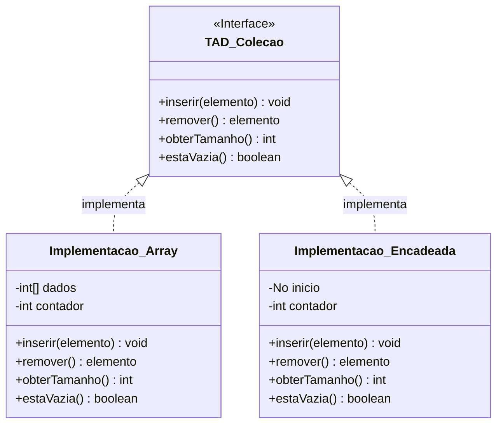

### Abstracao versus Encapsulamento

- **Abstração:** Mecanismo intelectual que isola as funcionalidades externas visíveis de um componente de software da sua complexidade interna oculta.
- **Encapsulamento:** Técnica construtiva de isolamento que restringe o acesso direto aos campos internos de um objeto, forçando toda mutação ou consulta a ocorrer através de métodos controlados da interface pública.

### Separacao Estrita entre Interface e Implementacao

A dissociação entre interface e implementação viabiliza a manutenção e a evolução do software. Caso uma aplicação utilize uma estrutura de dados implementada inicialmente sobre um vetor estático e a engenharia decida substituí-la por uma lista encadeada dinâmica para economizar memória, **nenhuma linha do código consumidor precisa ser alterada**, desde que o contrato da interface pública seja rigorosamente mantido.

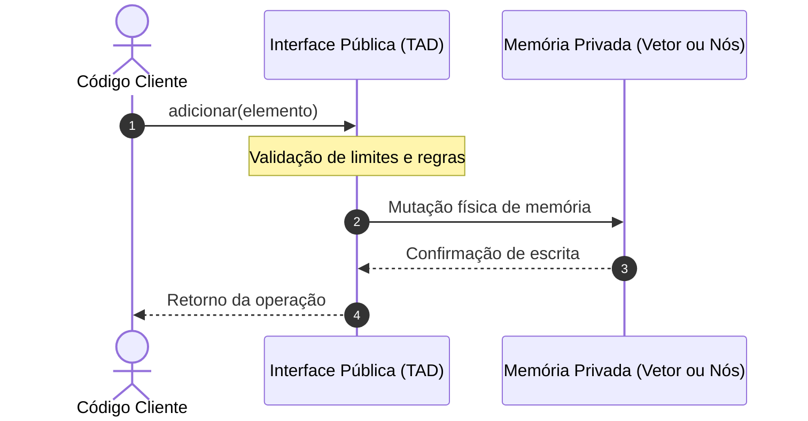

### Criterios para Escolha da Representacao de Dados

A escolha da estrutura de dados para implementar um TAD fundamenta-se nos requisitos operacionais de acesso, tempo de execução e memória:

| Necessidade Dominante da Aplicação | Estrutura Recomendada | Justificativa de Engenharia |
| :--- | :--- | :--- |
| **Acesso direto via índice/posição** | Lista Linear Sequencial (Array) | Cálculo de endereço de memória em tempo constante $`O(1)`$. |
| **Inserção e remoção no início/meio** | Lista Encadeada Dinâmica | Religamento pontual de ponteiros sem deslocamento de dados. |
| **Disciplina Último a Entrar, Primeiro a Sair** | Pilha (*Stack*) | Restrição de inserção e remoção exclusivas no topo ($`O(1)`$). |
| **Disciplina Primeiro a Entrar, Primeiro a Sair**| Fila (*Queue*) | Inserções no fim e remoções na cabeça preservando a ordem ($`O(1)`$). |
| **Modelagem de relações hierárquicas** | Árvore (*Tree*) | Nós organizados em níveis com pai, filhos e subárvores. |
| **Modelagem de redes e grafos arbitrários** | Grafo (*Graph*) | Relações entre vértices conectados por arestas com pesos e sentidos. |

---

## Modelo de Memoria na Maquina Virtual Java

### Memoria Stack versus Memoria Heap

A compreensão da gestão de memória na Máquina Virtual Java (JVM) é pré-requisito indispensável para projetar estruturas de dados eficientes. A memória física alocada para uma aplicação divide-se em duas regiões primárias:

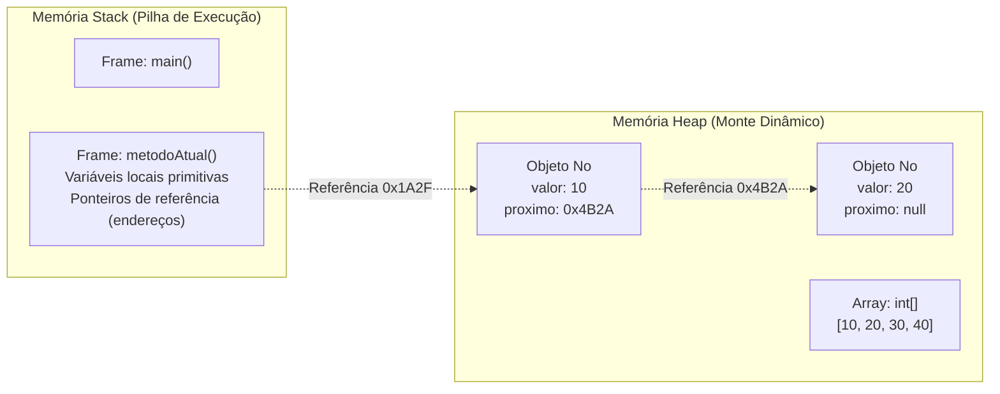

1. **Memória Stack (Pilha):** Área de execução rápida estruturada no modelo LIFO. Cada invocação de método aloca um *Stack Frame* que armazena suas variáveis locais primitivas e variáveis de referência. Quando o método atinge o comando `return`, seu frame é desempilhado e a memória associada é liberada instantaneamente.
2. **Memória Heap (Monte):** Área de alocação dinâmica global compartilhada. Todos os objetos criados via operador `new` (como instâncias de classes e arrays) residem no Heap. A vida útil dos dados no Heap é independente do encerramento dos métodos locais.

### Tipos Primitivos versus Tipos de Referencia

A semântica de atribuição e passagem de parâmetros em Java difere conforme o tipo do dado:

- **Tipos Primitivos (`int`, `double`, `boolean`, `char`):** As variáveis armazenam diretamente o valor binário correspondente no seu espaço na Stack. A atribuição `a = b` efetua uma cópia física independente do valor.
- **Tipos de Referência (`No`, `Pilha`, `int[]`, `String`):** A variável na Stack armazena exclusivamente o endereço de memória de 32 ou 64 bits que aponta para o objeto residente no Heap. A atribuição `p2 = p1` apenas duplica o ponteiro de endereço; ambos passam a apontar para a mesma instância física no Heap.

```java
// Ilustração da semântica de tipos primitivos vs referências
int x = 10;
int y = x;       // y recebe uma cópia independente do valor 10
y = 20;          // x permanece rigorosamente igual a 10

No p1 = new No(10);
No p2 = p1;      // p2 recebe uma cópia do endereço de memória apontado por p1
p2.valor = 99;   // A alteração reflete imediatamente ao consultar p1.valor (ambos valem 99)
```

### Ciclo de Vida de Objetos e Garbage Collection

Objetos alocados no Heap permanecem vivos enquanto houver ao menos uma cadeia de referências alcançável a partir de uma variável ativa da Stack. Quando todos os ponteiros que apontavam para determinado objeto forem anulados ou saírem de escopo, o objeto torna-se **inalcançável** (*unreachable*).

O **Garbage Collector (GC)** da JVM é o processo responsável por varrer periodicamente a memória Heap, identificar dados inalcançáveis e devolver os blocos de memória ao sistema operacional, prevenindo vazamentos permanentes de recursos (*memory leaks*).

### Topologia de Referencias e Perda de Localidade

Em listas encadeadas, os nós podem ser alocados em regiões fragmentadas do Heap ao longo do tempo. Esse espalhamento provoca a perda do princípio de **localidade espacial de referência de cache** (*CPU Cache Locality*). Em um array sequencial, a leitura de uma posição carrega em bloco a linha de cache L1/L2 com os elementos adjacentes; em uma estrutura ligada, cada salto de ponteiro pode demandar um acesso direto à memória RAM principal (*cache miss*), resultando em maior latência de barramento.

---

## Analise Assintotica de Complexidade e Notacao Big-O

### Limitacoes da Medicao por Tempo de Relogio

Tentar avaliar a eficiência de um algoritmo cronometrando sua execução em milissegundos através do relógio da CPU constitui uma abordagem vulnerável e inconsistente para a Ciência da Computação. O tempo físico de execução é afetado por variáveis externas não controladas:
- Arquitetura e frequência de clock do processador.
- Quantidade de núcleos e latência das memórias cache L1, L2 e L3.
- Carga de processamento concorrente do sistema operacional.
- Versão da JVM e otimizações em tempo de execução do compilador JIT (*Just-In-Time*).
- Disposição prévia da massa de dados testada.

A análise formal isola esses fatores ao quantificar o **número de operações primitivas fundamentais** que o algoritmo executa em função direta do tamanho do conjunto de entrada ($`n`$).

### Tamanho da Entrada e Contagem de Operacoes Primitivas

O tamanho da entrada ($`n`$) expressa a escala do problema:
- Busca sequencial em um vetor: $`n`$ elementos a percorrer.
- Multiplicação de matrizes quadradas: dimensão $`n \times n`$.
- Processamento de arquivo texto: $`n`$ linhas registradas.

Considere o algoritmo abaixo:
```text
para i = 0 ate n - 1 faca
    para j = 0 ate n - 1 faca
        escreva(i, j)
    fim
fim
```
O laço externo itera $`n`$ vezes. Para cada iteração externa, o laço interno itera outras $`n`$ vezes, executando a instrução elementar $`n \times n = n^2`$ vezes. A função formal de custo de tempo é dada por $`T(n) = n^2`$.

### Fundamentacao da Notacao Big-O e Notacao Big-Omega

A análise assintótica estuda o comportamento de crescimento de $`T(n)`$ no limite em que $`n`$ tende ao infinito ($`n \to \infty`$).

- **Notação Big-O ($`O`$):** Representa o **limite superior assintótico**. Estabelece que uma função $`T(n)`$ é $`O(g(n))`$ se existirem constantes positivas $`c`$ e $`n_0`$ tais que:
```math
0 \le T(n) \le c \cdot g(n), \quad \forall n \ge n_0
```
Em termos práticos de engenharia, a notação Big-O representa o teto máximo de trabalho: o algoritmo tem garantia matemática de que jamais terá um desempenho pior do que a ordem de $`g(n)`$.

- **Notação Big-Omega ($`\Omega`$):** Representa o **limite inferior assintótico**. Estabelece que o algoritmo consumirá no mínimo determinada quantidade de recursos, expressando o piso operacional de trabalho:
```math
0 \le c \cdot g(n) \le T(n), \quad \forall n \ge n_0
```

### Regras de Simplificacao: Descarte de Constantes e Termos Menores

Na análise assintótica, duas regras de simplificação são aplicadas para extrair a ordem de grandeza dominante:

1. **Descarte de Termos de Menor Ordem:** Para valores grandes de $`n`$, o termo de maior expoente domina completamente a função.
   - Exemplo: Dada $`T(n) = 3n^2 + 50n + 1000`$, quando $`n = 1.000.000`$, o termo $`3n^2`$ equivale a $`3 \times 10^{12}`$, tornando os termos lineares e constantes insignificantes. Descarta-se $`50n + 1000`$.
2. **Descarte de Constantes Multiplicativas:** Constantes não alteram a velocidade de aceleração da curva.
   - Exemplo: $`T(n) = 3n^2 \implies O(n^2)`$.
   - Outro exemplo: Se um laço executa $`\frac{n}{2}`$ operações, temos $`T(n) = \frac{1}{2} n \implies O(n)`$.

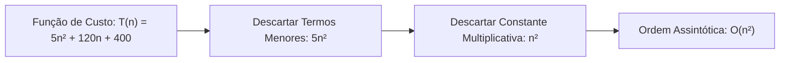

### Cenarios de Execucao: Melhor Caso, Caso Medio e Pior Caso

O desempenho de um algoritmo depende tanto do volume $`n`$ quanto da disposição inicial dos dados:

- **Melhor Caso:** A configuração de entrada mais favorável possível. Para a busca sequencial, o elemento buscado é o primeiro avaliado: consome $`1`$ comparação ($`\Omega(1)`$).
- **Pior Caso:** A configuração de entrada mais desfavorável. Na busca sequencial, o elemento está na última posição ou inexiste na estrutura: consome $`n`$ comparações ($`O(n)`$). É a principal métrica utilizada na engenharia para garantir acordos de nível de serviço (SLA).
- **Caso Médio:** Média ponderada de todas as entradas possíveis, considerando uma distribuição probabilística uniforme. Na busca linear, o elemento é encontrado após inspecionar cerca de $`\frac{n}{2}`$ posições: $`T(n) = \frac{n}{2} \implies O(n)`$.

### Classes Canonicas de Complexidade

As classes de complexidade assintótica ordenam-se da maior eficiência para o maior custo operacional computacional:

```math
O(1) < O(\log n) < O(n) < O(n \log n) < O(n^2) < O(n^3) < O(2^n) < O(n!)
```

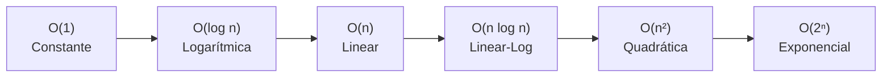

| Notação | Nomenclatura | Comportamento com o Crescimento de $`n`$ | Exemplo Canônico |
| :--- | :--- | :--- | :--- |
| **$`O(1)`$** | Constante | Tempo inalterado perante o volume | Acesso a índice de array; push em pilha |
| **$`O(\log n)`$** | Logarítmica | Cresce de forma lenta ao dobrar $`n`$ | Busca binária em vetor ordenado |
| **$`O(n)`$** | Linear | Cresce em proporção direta a $`n`$ | Busca sequencial; percurso em lista ligada |
| **$`O(n \log n)`$** | Linear-Logarítmica | Padrão ótimo para ordenação por comparação | Merge Sort; Quicksort (caso médio) |
| **$`O(n^2)`$** | Quadrática | Multiplica por quatro ao dobrar $`n`$ | Bubble Sort; Selection Sort; laços duplos |
| **$`O(2^n)`$** | Exponencial | Dobra de custo a cada unidade somada em $`n`$| Força bruta para o Problema da Mochila |

---

## Listas Lineares Sequenciais

### Estrutura Fisica e Enderecamento Contiguo

A **Lista Linear Sequencial** armazena seus elementos em blocos adjacentes e ininterruptos de memória física por meio de arrays primitivos. Essa organização física viabiliza o **acesso aleatório imediato** a qualquer índice $`i`$, sem necessidade de percorrer as posições anteriores.

O compilador e a CPU calculam o endereço físico exato de qualquer posição através da equação de endereçamento direto:

```math
\text{Endereço}(i) = \text{Endereço\_Base} + (i \times \text{Tamanho\_Elemento})
```

Como essa equação envolve apenas uma operação aritmética de multiplicação e uma de adição executadas pelos registradores de hardware, o acesso a qualquer posição de um array ocorre em tempo estritamente constante: **$`O(1)`$**.

### Capacidade Estatica versus Tamanho Ocupado

É fundamental diferenciar duas propriedades de controle de uma lista sequencial:
- **Capacidade (`elementos.length`):** A quantidade total de células físicas reservadas na criação do array na memória Heap.
- **Tamanho (`tamanho`):** A quantidade de posições efetivamente ocupadas por dados úteis em um dado instante ($`0 \le \text{tamanho} \le \text{capacidade}`$).

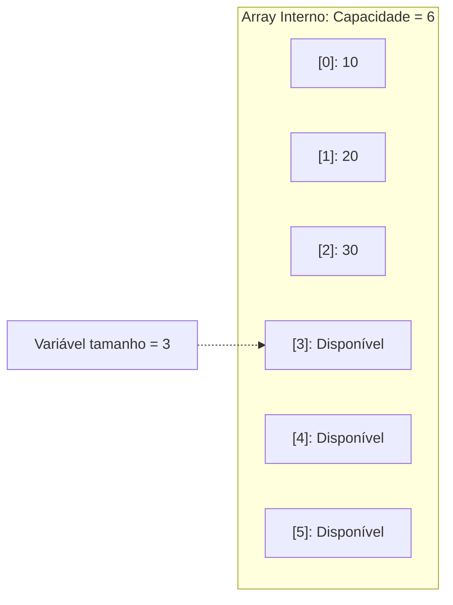

### O Problema do Deslocamento em Insercoes e Remocoes

A contiguidade física que assegura a leitura em $`O(1)`$ penaliza as mutações estruturais não terminais:

1. **Inserção Intermediária ou no Início:** Para inserir um novo elemento no índice $`k`$, todos os elementos existentes do índice $`k`$ até $`\text{tamanho} - 1`$ devem ser deslocados fisicamente uma posição para a direita (*shifting* à direita), abrindo a lacuna necessária.
   - Pior caso: Inserir no índice `0` exige mover todos os $`n`$ elementos já existentes: custo **$`O(n)`$**.
2. **Remoção Intermediária ou no Início:** Ao remover o elemento da posição $`k`$, os itens situados entre $`k + 1`$ e $`\text{tamanho} - 1`$ devem ser copiados uma posição para a esquerda (*shifting* à esquerda), preenchendo o espaço vago.
   - Pior caso: Remover do índice `0` exige deslocar $`n - 1`$ elementos: custo **$`O(n)`$**.

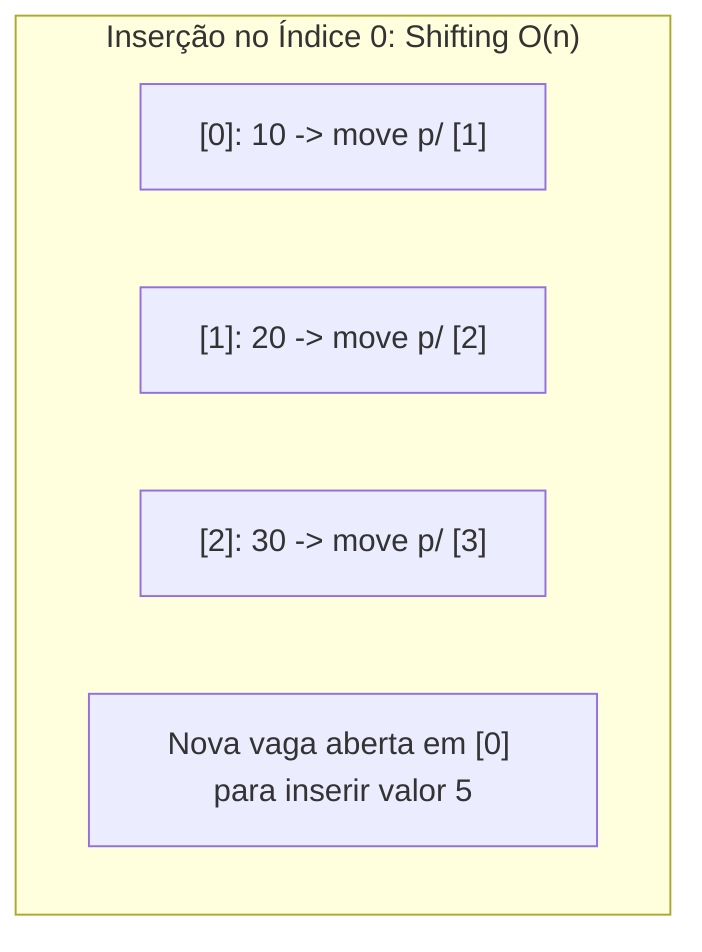

### Mecanismo de Redimensionamento Dinamico

Quando a lista atinge o estado de saturação (`tamanho == capacidade`), qualquer nova inserção exige um procedimento de expansão de capacidade:
1. Alocar um novo vetor no Heap com capacidade expandida (tipicamente o dobro da capacidade original).
2. Copiar sequencialmente todos os $`n`$ elementos do vetor antigo para o novo vetor.
3. Atualizar a referência interna da lista para apontar para o novo vetor.
4. Abandonar o vetor antigo para recolhimento pelo Garbage Collector.

Embora uma inserção individual que demande realocação custe $`O(n)`$, a análise de **custo amortizado** demonstra que diluir o custo da duplicação ao longo de todas as inserções subsequentes resulta em um custo médio de $`O(1)`$ por inserção no final.

---

## Listas Simplesmente Ligadas Dinamicas

### Anatomia do No e Auto-Referenciamento

A **Lista Simplesmente Ligada** elimina a exigência de memória contígua. A coleção é composta por estruturas atômicas isoladas chamadas **Nós** (*nodes*). Cada nó vive de forma independente no Heap e transporta duas entidades:
1. **Carga Útil (*Payload*):** O dado a ser armazenado (por exemplo, um valor inteiro `int`).
2. **Ponteiro de Encadeamento (`proximo`):** Uma variável de referência que armazena o endereço de memória da próxima instância de `No`, ou o valor sentinela `null` para sinalizar o fim da cadeia.

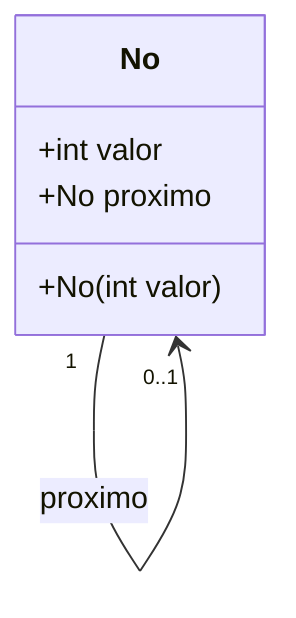

```java
// Implementação do átomo estrutural da lista encadeada
public class No {
    public int valor;      // Carga útil armazenada
    public No proximo;    // Elo de encadeamento com o próximo nó

    public No(int valor) {
        this.valor = valor;
        this.proximo = null;
    }
}
```

### Estrutura da Classe Controladora com Ponteiros de Inicio, Fim e Tamanho

A classe `ListaLigada` atua como controladora da estrutura através de três atributos privados:

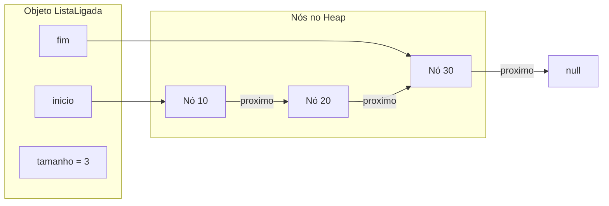

```java
public class ListaLigada {
    private No inicio;     // Aponta para a cabeça da lista
    private No fim;        // Aponta para o nó terminal (otimização O(1))
    private int tamanho;   // Cardinalidade rastreada em O(1)

    public ListaLigada() {
        this.inicio = null;
        this.fim = null;
        this.tamanho = 0;
    }

    public boolean estaVazia() {
        return this.inicio == null;
    }

    public int getTamanho() {
        return this.tamanho;
    }
}
```

### Insercao no Inicio: Mecanica e Complexidade

A inserção de um elemento na cabeça da lista é realizada sem mover nenhum nó preexistente. O algoritmo reorganiza apenas os ponteiros:

1. Instanciar o novo nó: `No novo = new No(valor);`
2. Apontar o elo do novo nó para a cabeça atual: `novo.proximo = this.inicio;`
3. Atualizar o ponteiro `inicio` para reconhecer o novo nó: `this.inicio = novo;`
4. Se a lista estava vazia antes da operação (`fim == null`), atualizar também `this.fim = novo;`
5. Incrementar o contador: `this.tamanho++;`

Complexidade temporal: **$`O(1)`$** constante em qualquer cenário.

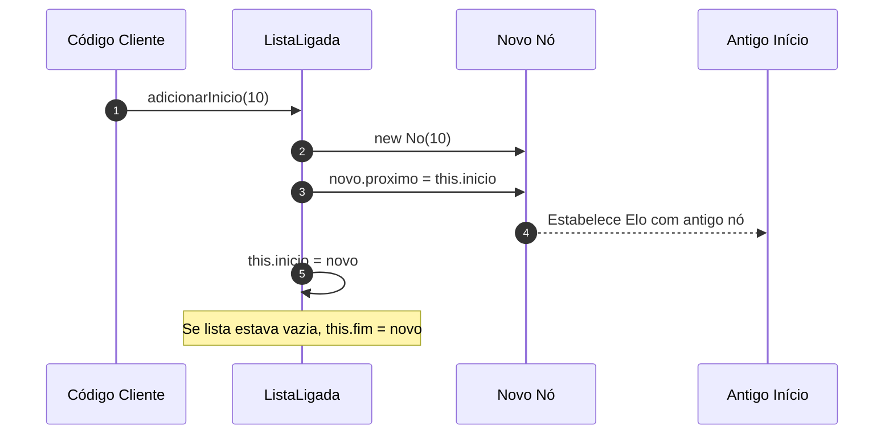

> **Armadilha Crítica (Inversão de Atribuições):**
> Se a atribuição for feita como `this.inicio = novo; novo.proximo = this.inicio;`, o ponteiro `this.inicio` original é destruído antes da cópia. O nó recém-criado passa a apontar para si mesmo em laço circular fechado, e todos os nós antigos da lista tornam-se inalcançáveis no Heap.

### Insercao no Fim: Analise O(1) com Ponteiro Fim versus O(n) sem Ponteiro Fim

A manutenção explícita do ponteiro `this.fim` constitui uma decisão fundamental de projeto:

- **Com Ponteiro `fim` ($`O(1)`$):** O novo nó é acoplado diretamente em `this.fim.proximo = novo;` e o marcador avança com `this.fim = novo;`. Operação executada em tempo constante independente do tamanho da lista.
- **Sem Ponteiro `fim` ($`O(n)`$):** O algoritmo é forçado a iniciar em `this.inicio` e percorrer salto a salto todos os $`n - 1`$ elos via laço `while (atual.proximo != null)` até encontrar a cauda, degradando a operação para tempo linear.

```java
// Inserção otimizada no fim em tempo O(1)
public void adicionarFim(int valor) {
    No novo = new No(valor);

    if (estaVazia()) {
        this.inicio = novo;
        this.fim = novo;
    } else {
        this.fim.proximo = novo; // O antigo fim aponta para o novo nó
        this.fim = novo;         // O novo nó torna-se o nó terminal
    }
    this.tamanho++;
}
```

### Insercao Ordenada: Separacao de Busca e Religamento

Para manter uma lista permanentemente em ordem crescente, a inserção divide-se em duas fases com complexidades distintas:

1. **Etapa de Busca Posicional ($`O(n)`$):** Percorrer sequencialmente a estrutura a partir do `inicio` com dois ponteiros até identificar o nó anterior ao local de encaixe.
2. **Etapa de Religamento de Ponteiros ($`O(1)`$):** Reorganizar os elos para acomodar o novo nó entre o nó anterior e o nó seguinte.

```math
\text{Complexidade Total} = O(n) \text{ (busca)} + O(1) \text{ (religamento)} = O(n)
```

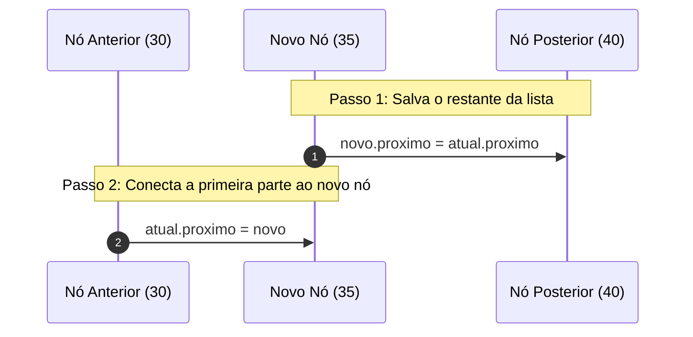

```java
public void inserirOrdenado(int valor) {
    No novo = new No(valor);

    // Caso 1: Lista vazia ou valor menor que o primeiro elemento
    if (estaVazia() || valor <= this.inicio.valor) {
        novo.proximo = this.inicio;
        this.inicio = novo;
        if (this.fim == null) {
            this.fim = novo;
        }
        this.tamanho++;
        return;
    }

    // Caso 2: Localização sequencial do ponto de encaixe
    No atual = this.inicio;
    while (atual.proximo != null && atual.proximo.valor < valor) {
        atual = atual.proximo;
    }

    // Caso 3: Religamento de ponteiros em O(1)
    novo.proximo = atual.proximo;
    atual.proximo = novo;

    // Caso 4: Inserção após o último elemento
    if (novo.proximo == null) {
        this.fim = novo;
    }

    this.tamanho++;
}
```

### Busca Linear e Atualizacao por Indice

Em listas encadeadas, a indexação numérica não existe fisicamente na memória RAM. O "índice" representa uma contagem lógica de quantos saltos de referências devem ser realizados a partir do `inicio`:

```java
public void atualizar(int indice, int novoValor) {
    if (indice < 0 || indice >= this.tamanho) {
        throw new IndexOutOfBoundsException("Índice fora dos limites da lista: " + indice);
    }

    No atual = this.inicio;
    for (int i = 0; i < indice; i++) {
        atual = atual.proximo;
    }

    atual.valor = novoValor; // Atualização pontual em O(1) após navegação O(n)
}
```

### Remocao de Elementos e Cuidados com Referencias Soltas

A remoção em uma lista encadeada opera isolando o nó alvo da cadeia lógica. Na remoção no início, basta atualizar `this.inicio = this.inicio.proximo`. O nó removido fica sem referências e é coletado pelo Garbage Collector.

Na remoção intermediária por valor, é necessário rastrear o nó predecessor. Uma vez localizado, atualiza-se o elo do antecessor saltando o elemento descartado: `anterior.proximo = atual.proximo`.

---

## Estrutura de Dados Linear Restrita: Pilhas

### Definicao Formal e Principio LIFO

Uma **Pilha** (*Stack*) é um Tipo Abstrato de Dados linear em que o acesso aos elementos é rigorosamente restrito a uma única extremidade denominada **Topo** (*top*). Todas as inclusões, exclusões e consultas operam obrigatoriamente nesta extremidade, enquanto a extremidade oposta, denominada **Base**, permanece inacessível.

A pilha rege-se pelo princípio **LIFO**:

```math
\text{LIFO: } \textit{Last In, First Out} \quad (\text{O último a entrar é o primeiro a sair})
```

Acesso aleatório via índice é expressamente proibido em uma pilha pura para proteger as garantias arquiteturais do TAD.

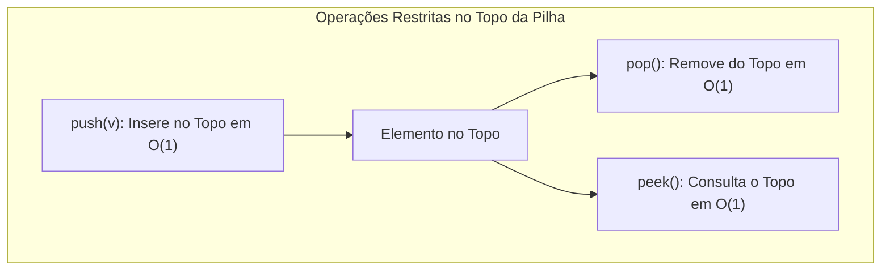

### Operacoes Fundamentais: push, pop, peek e isEmpty

Quatro operações elementares compõem a interface canônica de uma pilha:

1. **`push(valor)`:** Adiciona um novo elemento sobre o topo atual.
   - Condição de exceção: Se a estrutura atingir a capacidade física limite de um array estático, ocorre **Stack Overflow**.
2. **`pop()`:** Remove e retorna o elemento atualmente posicionado no topo.
   - Condição de exceção: Se a pilha estiver sem elementos, a tentativa de desempilhar provoca **Stack Underflow**.
3. **`peek()` (ou `top()`):** Inspeciona e retorna o valor contido no topo sem desempilhá-lo.
4. **`isEmpty()`:** Função booleana que retorna `true` se a pilha estiver vazia e `false` caso contrário.

Todas as operações fundamentais executam em tempo constante: **$`O(1)`$**.

### Implementacao Estatica Sequencial com Array

Na implementação baseada em array, a coleção é mantida em posições contíguas. O controle de ocupação é gerenciado por um ponteiro escalar inteiro denominado `topo`.

#### Representação de Pilha Vazia com Índice `-1`
Como os arrays em Java utilizam indexação baseada em zero ($`0`$ até $`n - 1`$):
- Com 1 elemento, o topo reside no índice `0`.
- Generalizando: com $`k`$ elementos, o topo reside no índice $`k - 1`$.
- Para 0 elementos (pilha vazia), define-se formalmente: `topo = -1`.

```java
public class PilhaVetor {
    private int[] elementos;
    private int topo;

    public PilhaVetor(int capacidade) {
        if (capacidade <= 0) {
            throw new IllegalArgumentException("Capacidade inválida.");
        }
        this.elementos = new int[capacidade];
        this.topo = -1; // Pilha vazia
    }

    public boolean isEmpty() {
        return this.topo == -1;
    }

    public void push(int valor) {
        if (this.topo == this.elementos.length - 1) {
            throw new IllegalStateException("Erro: Stack Overflow. Capacidade esgotada.");
        }
        // Pré-incremento: avança o índice e armazena o valor
        this.elementos[++this.topo] = valor;
    }

    public int pop() {
        if (isEmpty()) {
            throw new IllegalStateException("Erro: Stack Underflow. Pilha vazia.");
        }
        // Pós-decremento: lê o valor e recua o índice
        return this.elementos[this.topo--];
    }

    public int peek() {
        if (isEmpty()) {
            throw new IllegalStateException("Erro: Pilha vazia.");
        }
        return this.elementos[this.topo];
    }
}
```

#### Persistência Física versus Exclusão Lógica
Na execução do método `pop()`, o valor removido **não é apagado fisicamente** do array na memória RAM. O que ocorre é uma **exclusão lógica**: o índice `topo` é decrementado em 1 unidade. Quando um futuro `push()` for executado, o novo dado sobrescreverá com segurança a informação residual.

### Implementacao Encadeada Dinamica sobre Lista Ligada

Para eliminar a barreira da capacidade fixa de um vetor, implementa-se a pilha sobre nós dinâmicos encadeados. O segredo arquitetural para manter todas as operações em $`O(1)`$ consiste em **mapear o Topo da Pilha para a Cabeça (`inicio`) da Lista Ligada**.

Se o topo fosse mapeado para a cauda da lista, a operação `pop()` exigiria percorrer toda a estrutura até o penúltimo nó para recuar o apontamento, degradando a complexidade de remoção para $`O(n)`$.

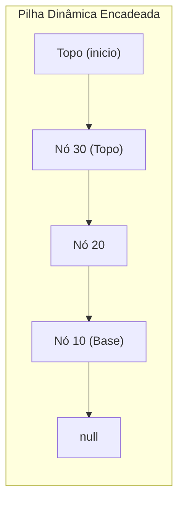

```java
public class PilhaLigada {
    private No topo;
    private int tamanho;

    public PilhaLigada() {
        this.topo = null;
        this.tamanho = 0;
    }

    public boolean isEmpty() {
        return this.topo == null;
    }

    public int size() {
        return this.tamanho;
    }

    public void push(int valor) {
        No novo = new No(valor);
        novo.proximo = this.topo;
        this.topo = novo;
        this.tamanho++;
    }

    public int pop() {
        if (isEmpty()) {
            throw new IllegalStateException("Erro: Stack Underflow.");
        }
        int valorRemovido = this.topo.valor;
        this.topo = this.topo.proximo;
        this.tamanho--;
        return valorRemovido;
    }

    public int peek() {
        if (isEmpty()) {
            throw new IllegalStateException("Erro: Pilha vazia.");
        }
        return this.topo.valor;
    }
}
```

### Manipulacao de Elementos Intermediarios com Pilhas Auxiliares

Em problemas práticos, surge por vezes a necessidade de inspecionar, alterar ou remover elementos que residem no interior de uma pilha.

> **Regra de Ouro da Abstração:** Jamais viole o encapsulamento do TAD expondo nós ou ponteiros para ler elementos internos diretamente. A única maneira de alcançar posições profundas em conformidade com o princípio LIFO é o uso de uma **Pilha Auxiliar**.

O algoritmo de manipulação intermediária consiste em:
1. Desempilhar sucessivamente os elementos da pilha original para a pilha auxiliar até expor o elemento desejado.
2. Executar a consulta, substituição ou exclusão no topo exposto.
3. Desempilhar todos os itens da pilha auxiliar de volta para a pilha original, restaurando a ordem inicial.

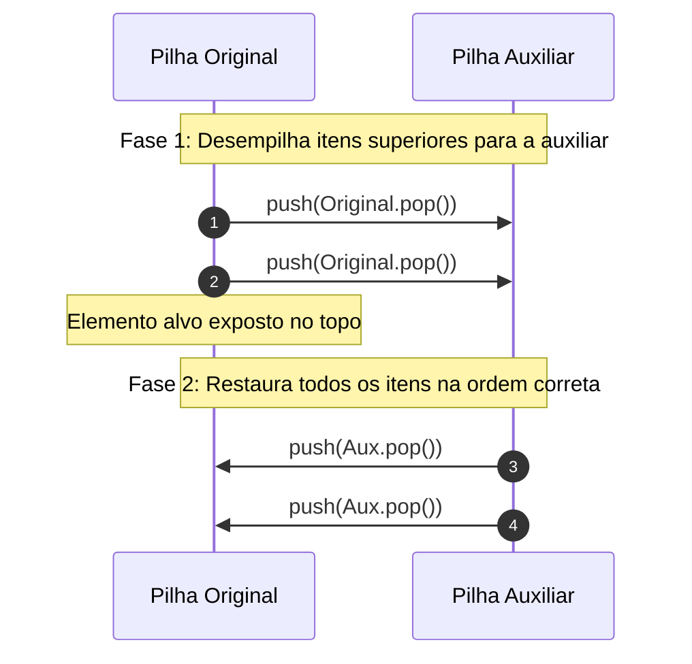

```java
// Verificação de existência sem violação de encapsulamento
public boolean contem(int valorBuscado) {
    PilhaLigada auxiliar = new PilhaLigada();
    boolean encontrado = false;

    // Descarrega na pilha auxiliar para inspecionar
    while (!this.isEmpty()) {
        int atual = this.pop();
        if (atual == valorBuscado) {
            encontrado = true;
        }
        auxiliar.push(atual);
        if (encontrado) {
            break; // Opcional: interrompe a busca
        }
    }

    // Restauração mandatória do estado original
    while (!auxiliar.isEmpty()) {
        this.push(auxiliar.pop());
    }

    return encontrado;
}
```

Complexidade dessa operação: tempo **$`O(n)`$** e espaço auxiliar **$`O(n)`$**.

> *(Reflexão de Arquitetura de Software):* Se o seu domínio de problema demanda consultas ou mutações frequentes no meio da coleção, **a Pilha é a estrutura errada**. Utilize listas ligadas, tabelas hash ou árvores binárias.

### Trade-offs Estruturais: Pilha Sequencial versus Pilha Ligada

| Dimensão de Comparação | Pilha Sequencial (Array) | Pilha Encadeada Dinâmica (Nós) |
| :--- | :--- | :--- |
| **Limite de Capacidade** | Fixa na instanciação; risco de Stack Overflow | Dinâmica; cresce conforme a memória Heap |
| **Overhead de Memória** | Mínimo; armazena apenas dados primitivos | Adiciona 8 a 16 bytes por nó (referência `proximo`) |
| **Localidade de Cache** | Alta; dados alocados em sequência na RAM | Baixa; nós dispersos sujeitos a cache misses |
| **Custo de Alocação** | Pago uma única vez na criação do vetor | Pago a cada invocação de `push()` via `new` |

---

## Algoritmos Elementares de Ordenacao

### Importancia da Ordenacao em Sistemas Computacionais

A ordenação interna de dados é um dos pilares da Ciência da Computação. Organizar coleções desordenadas viabiliza:
- **Busca Eficiente:** Permite substituir a busca linear de custo $`O(n)`$ pela **Busca Binária** com custo logarítmico **$`O(\log n)`$**.
- **Consolidação de Dados:** Simplifica a detecção de duplicidades e mesclagem de fluxos (*merge* de arquivos) em tempo linear.
- **Usabilidade de Interfaces:** Apresentação ordenada de cadastros em relatórios e telas corporativas.

### Bubble Sort: Trocas Adjacentes e Propagacao

#### Princípio Operacional
O **Bubble Sort** (Método da Bolha) opera por meio de varreduras consecutivas no vetor, comparando pares de elementos adjacentes ($`vetor[j]`$ e $`vetor[j + 1]`$). Se estiverem fora de ordem, permuta os dois valores. Ao final de cada passagem $`i`$, o maior elemento da porção não ordenada flutua até sua posição final consolidada à direita.

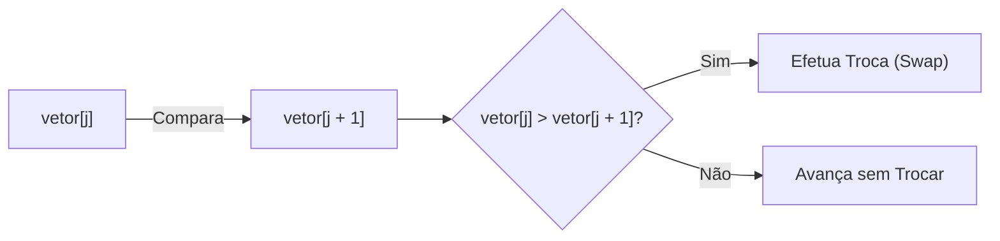

#### Simulação Passo a Passo: Vetor `[5, 3, 8, 1]` ($`n = 4`$)
- **Passagem 1 ($`i = 0`$):**
  - Compara `5` e `3`: troca $`\implies [3, 5, 8, 1]`$
  - Compara `5` e `8`: mantém $`\implies [3, 5, 8, 1]`$
  - Compara `8` e `1`: troca $`\implies [3, 5, 1, 8]`$ *(Elemento 8 consolidado no índice 3)*
- **Passagem 2 ($`i = 1`$):**
  - Compara `3` e `5`: mantém $`\implies [3, 5, 1, 8]`$
  - Compara `5` e `1`: troca $`\implies [3, 1, 5, 8]`$ *(Elemento 5 consolidado no índice 2)*
- **Passagem 3 ($`i = 2`$):**
  - Compara `3` e `1`: troca $`\implies [1, 3, 5, 8]`$ *(Elementos 1 e 3 consolidados)*

#### Implementação Canônica em Java com Otimização
A introdução de um sinalizador booleano (`trocou`) interrompe o algoritmo se nenhuma troca ocorrer durante uma varredura inteira, otimizando o **Melhor Caso** para **$`O(n)`$** quando o vetor já se encontra ordenado:

```java
public class BubbleSort {
    public static void ordenar(int[] vetor) {
        int n = vetor.length;
        boolean trocou;

        for (int i = 0; i < n - 1; i++) {
            trocou = false;
            // O laço interno ignora os 'i' elementos já consolidados no final
            for (int j = 0; j < n - 1 - i; j++) {
                if (vetor[j] > vetor[j + 1]) {
                    int temp = vetor[j];
                    vetor[j] = vetor[j + 1];
                    vetor[j + 1] = temp;
                    trocou = true;
                }
            }
            // Se nenhuma troca ocorreu, o vetor já está ordenado
            if (!trocou) {
                break;
            }
        }
    }
}
```

### Selection Sort: Selecao de Extremos e Troca Minima

#### Princípio Operacional
O **Selection Sort** (Ordenação por Seleção) divide virtualmente o vetor em duas regiões: um subvetor ordenado à esquerda e um subvetor desordenado à direita. A cada passagem externa $`i`$, o algoritmo varre exaustivamente todo o subvetor desordenado procurando o índice do **menor valor absoluto**. Ao término da varredura, realiza **uma única troca** entre o elemento do índice $`i`$ e o menor elemento localizado.

```mermaid
flowchart TD
    InicioPasso["Início da Passagem i"] --> DefineMenor["Assume indiceMenor = i"]
    DefineMenor --> VarreDireita["Varre de j = i + 1 até n - 1"]
    VarreDireita --> AchouMenor{"vetor[j] < vetor[indiceMenor]?"}
    AchouMenor -- Sim --> AtualizaIndice["indiceMenor = j (Sem trocar dados)"]
    AchouMenor -- Não --> ContinuaVarredura["Continua varredura"]
    AtualizaIndice --> FimVarredura{"Fim do Vetor?"}
    ContinuaVarredura --> FimVarredura
    FimVarredura -- Sim --> TrocaUnica["Troca Única: vetor[i] com vetor[indiceMenor]"]
```

#### Simulação Passo a Passo: Vetor `[5, 3, 8, 1]` ($`n = 4`$)
- **Passagem 1 ($`i = 0`$):**
  - Menor elemento na faixa `[5, 3, 8, 1]` é o `1` (índice 3).
  - Troca única: `vetor[0]` (5) com `vetor[3]` (1) $`\implies [1, 3, 8, 5]`$
- **Passagem 2 ($`i = 1`$):**
  - Menor elemento na faixa `[3, 8, 5]` é o `3` (índice 1).
  - Troca: permuta `vetor[1]` consigo mesmo $`\implies [1, 3, 8, 5]`$
- **Passagem 3 ($`i = 2`$):**
  - Menor elemento na faixa `[8, 5]` é o `5` (índice 3).
  - Troca: `vetor[2]` (8) com `vetor[3]` (5) $`\implies [1, 3, 5, 8]`$

#### Implementação Canônica em Java
```java
public class SelectionSort {
    public static void ordenar(int[] vetor) {
        int n = vetor.length;

        for (int i = 0; i < n - 1; i++) {
            int indiceMenor = i;
            for (int j = i + 1; j < n; j++) {
                if (vetor[j] < vetor[indiceMenor]) {
                    indiceMenor = j; // Armazena apenas o índice
                }
            }
            // Efetua no máximo uma troca por iteração externa
            int temp = vetor[i];
            vetor[i] = vetor[indiceMenor];
            vetor[indiceMenor] = temp;
        }
    }
}
```

- **Vantagem Notável:** Executa no máximo $`n - 1`$ trocas de memória no total: complexidade de movimentação de dados **$`O(n)`$**.
- **Desvantagem Crítica:** O número de comparações é fixo em $`\frac{n(n - 1)}{2}`$ em qualquer caso. O algoritmo é cego à pré-ordenação dos dados (Melhor Caso, Caso Médio e Pior Caso são todos **$`O(n^2)`$**).

### Insertion Sort: Insercao Direta e Deslocamento versus Troca

#### Princípio Operacional e Analogia das Cartas
O **Insertion Sort** constrói a ordenação incrementalmente, de forma análoga a um jogador de baralho organizando cartas recebidas em mãos. O vetor é dividido entre um subvetor ordenado à esquerda ($`[0 \dots i-1]`$) e a porção não avaliada à direita. A cada passo, o elemento `chave = vetor[i]` é isolado e comparado de trás para frente com os elementos da porção ordenada, deslocando os itens maiores para a direita até abrir espaço para inserir a chave em seu ponto correto.

```mermaid
flowchart LR
    subgraph Particionamento["Particionamento do Vetor"]
        Ord["Subvetor Ordenado: [0 ... i-1]"]
        Chave["Chave Atual: vetor[i]"]
        NaoOrd["Subvetor Restante: [i+1 ... n-1]"]
    end
    Chave -.->|"Desloca maiores para direita e insere"| Ord
```

#### Deslocamento (*Shifting*) versus Trocas Consecutivas (*Swapping*)
Uma implementação ingênua que tenta usar trocas sucessivas executa 3 atribuições de memória para cada posição recuada. O Insertion Sort profissional isola a `chave` em uma variável auxiliar e realiza **deslocamentos simples de cópia**:
```java
vetor[j + 1] = vetor[j]; // Apenas 1 atribuição por posição recuada
```
Apenas ao atingir a barreira de parada, a chave é copiada no espaço vago (`vetor[j + 1] = chave`). Isso reduz o tráfego de barramento de memória em aproximadamente 60%.

#### Simulação Passo a Passo: Vetor `[7, 3, 8, 2, 6]` ($`n = 5`$)
- **Estado Inicial:** `[7 | 3, 8, 2, 6]` (índice 0 ordenado trivialmente).
- **Passo 1 (`chave = 3`):** `7 > 3` $`\implies`$ desloca `7`; insere `3` em `[0]` $`\implies [3, 7 | 8, 2, 6]`$.
- **Passo 2 (`chave = 8`):** `7 > 8` é falso $`\implies`$ mantém `8` em `[2]` $`\implies [3, 7, 8 | 2, 6]`$.
- **Passo 3 (`chave = 2`):** desloca `8`, desloca `7`, desloca `3`; insere `2` em `[0]` $`\implies [2, 3, 7, 8 | 6]`$.
- **Passo 4 (`chave = 6`):** desloca `8`, desloca `7`; para no `3` ($`3 > 6`$ é falso); insere `6` em `[2]` $`\implies [2, 3, 6, 7, 8]`$.

#### Implementação Canônica em Java
```java
public class InsertionSort {
    public static void ordenar(int[] vetor) {
        int n = vetor.length;

        for (int i = 1; i < n; i++) {
            int chave = vetor[i];
            int j = i - 1;

            // Curto-circuito booleano: j >= 0 avaliado antes de vetor[j] > chave
            while (j >= 0 && vetor[j] > chave) {
                vetor[j + 1] = vetor[j]; // Deslocamento para a direita
                j--;
            }
            vetor[j + 1] = chave; // Inserção no local definitivo
        }
    }
}
```

### Matriz de Comparacao entre os Metodos Elementares

| Critério de Engenharia | Bubble Sort (Otimizado) | Selection Sort | Insertion Sort |
| :--- | :--- | :--- | :--- |
| **Melhor Caso (Tempo)** | $`O(n)`$ (já ordenado) | $`O(n^2)`$ | $`O(n)`$ (já ordenado) |
| **Caso Médio (Tempo)** | $`O(n^2)`$ | $`O(n^2)`$ | $`O(n^2)`$ |
| **Pior Caso (Tempo)** | $`O(n^2)`$ (inverso) | $`O(n^2)`$ | $`O(n^2)`$ (inverso) |
| **Memória Auxiliar** | $`O(1)`$ (*in-place*) | $`O(1)`$ (*in-place*) | $`O(1)`$ (*in-place*) |
| **Estabilidade** | Estável | Instável por padrão | Estável |
| **Operação Crítica Dominante**| Trocas adjacentes ($`O(n^2)`$)| Comparações ($`O(n^2)`$) | Deslocamentos de cópia ($`O(n^2)`$)|
| **Cenário de Aplicação Ideal**| Fins estritamente didáticos | Trocas físicas muito caras | Vetores pequenos ou quase ordenados |

> **Conceito de Estabilidade em Ordenação:**
> Um algoritmo é **estável** se ele preserva a ordem relativa original de registros que possuem chaves de ordenação idênticas. Se em uma lista de clientes pré-ordenada por nome houver dois clientes chamados "Silva" (um de São Paulo e outro do Rio de Janeiro), a reordenação por estado civil manterá o Silva de São Paulo antes do Silva do Rio se o algoritmo for estável.

---

## Ordenacao Avancada por Divisao e Conquista: Merge Sort

### O Paradigma de Divisao e Conquista

Para superar a barreira quadrática ($`O(n^2)`$) dos algoritmos elementares, o **Merge Sort** (desenvolvido por John von Neumann em 1945) aplica o paradigma de **Divisão e Conquista** (*Divide and Conquer*), desdobrando a resolução em três etapas sistemáticas:

1. **Dividir:** Fracionar o vetor em dois subvetores disjuntos, calculando o ponto médio entre o índice inicial e o final.
2. **Conquistar:** Ordenar recursivamente cada uma das metades resultantes. Caso o subvetor atinja tamanho menor ou igual a 1, a recursão atinge o caso base e retorna, pois uma partição unitária está trivialmente ordenada.
3. **Combinar (*Merge* / Intercalar):** Mesclar os dois subvetores pré-ordenados em uma única sequência linear consolidada, transferindo os dados ordenados de volta ao vetor original.

```mermaid
flowchart TD
    A["Vetor Original: Tamanho n"] --> B["1. DIVIDIR: Particionar ao meio em dois subvetores n/2"]
    B --> C["2. CONQUISTAR: Chamadas recursivas mergeSort()"]
    C --> D{"Tamanho <= 1?"}
    D -- Sim --> E["Caso Base: Retorno imediato"]
    D -- Não --> B
    E --> F["3. COMBINAR: Intercalar os subvetores ordenados em O(n)"]
    F --> G["Vetor Consolidado Ordenado"]
```

### Particionamento Recursivo e Caso Base

A etapa de divisão não altera os elementos nem os move na memória física; ela apenas delimita ponteiros aritméticos de início e fim. O critério formal de encerramento da recursão ocorre quando:

```math
\text{inicio} \ge \text{fim}
```

Isso garante que partições com zero ou um elemento não gerem novas chamadas na pilha de ativação da JVM.

### Prevencao de Estouro Aritmetico de Indice

Em muitas implementações ingênuas de livros-texto, o ponto médio entre dois limites é calculado por:
```java
int meio = (inicio + fim) / 2; // Risco latente de bug em arrays grandes!
```

> **Aviso de Engenharia de Software:**
> Se a soma de `inicio + fim` ultrapassar o valor máximo de um inteiro de 32 bits com sinal ($`2^{31} - 1 = 2.147.483.647`$), ocorrerá um **estouro aritmético de inteiro** (*integer overflow*), convertendo o resultado para um número negativo. O programa tentará acessar um índice negativo e disparará imediatamente a exceção `ArrayIndexOutOfBoundsException`.

A formulação matemática à prova de estouros adotada na engenharia calcula o deslocamento da distância:

```math
\text{meio} = \text{inicio} + \frac{\text{fim} - \text{inicio}}{2}
```

```java
int meio = inicio + (fim - inicio) / 2; // Seguro contra overflow aritmético
```

### Processo de Intercalacao e Vetor Auxiliar

A etapa de intercalação (`intercalar()`) é onde o trabalho computacional de ordenação efetivamente ocorre. O algoritmo aloca uma área temporária de memória (`vetorAuxiliar`), gerencia dois ponteiros apontando para as cabeças de cada metade ordenada e transfere ordenadamente o menor valor a cada iteração:

```mermaid
flowchart LR
    subgraph MetadeEsq["Metade Esquerda: [27, 38]"]
        P1["Ponteiro i"]
    end
    subgraph MetadeDir["Metade Direita: [3, 43]"]
        P2["Ponteiro j"]
    end
    subgraph Buffer["Vetor Auxiliar"]
        Out["Menor entre esq[i] e dir[j] é copiado"]
    end
    P1 --> Buffer
    P2 --> Buffer
```

```java
public class MergeSort {

    public static void mergeSort(int[] vetor, int inicio, int fim) {
        if (inicio < fim) {
            // Cálculo do ponto médio sem risco de overflow
            int meio = inicio + (fim - inicio) / 2;

            // Conquistar: Chamadas recursivas nas duas metades
            mergeSort(vetor, inicio, meio);
            mergeSort(vetor, meio + 1, fim);

            // Combinar: Intercalação das duas metades em tempo linear
            intercalar(vetor, inicio, meio, fim);
        }
    }

    private static void intercalar(int[] vetor, int inicio, int meio, int fim) {
        int[] auxiliar = new int[fim - inicio + 1];

        int i = inicio;    // Cursor para a primeira metade
        int j = meio + 1;  // Cursor para a segunda metade
        int k = 0;         // Cursor do vetor auxiliar

        // Varredura simultânea selecionando o menor elemento
        while (i <= meio && j <= fim) {
            if (vetor[i] <= vetor[j]) { // O operador <= assegura a estabilidade
                auxiliar[k++] = vetor[i++];
            } else {
                auxiliar[k++] = vetor[j++];
            }
        }

        // Esvazia os elementos remanescentes da primeira metade, se houver
        while (i <= meio) {
            auxiliar[k++] = vetor[i++];
        }

        // Esvazia os elementos remanescentes da segunda metade, se houver
        while (j <= fim) {
            auxiliar[k++] = vetor[j++];
        }

        // Transfere os dados ordenados da memória temporária de volta ao vetor original
        for (int p = 0; p < auxiliar.length; p++) {
            vetor[inicio + p] = auxiliar[p];
        }
    }
}
```

### Rastreamento da Arvore de Recursao

Considere o vetor desordenado com 4 elementos: `[38, 27, 43, 3]`.

```mermaid
flowchart TD
    R0["[38, 27, 43, 3] (inicio: 0, fim: 3)"] --> R1E["[38, 27] (inicio: 0, fim: 1)"]
    R0 --> R1D["[43, 3] (inicio: 2, fim: 3)"]
    
    R1E --> R2A["[38] (Caso Base)"]
    R1E --> R2B["[27] (Caso Base)"]
    
    R1D --> R2C["[43] (Caso Base)"]
    R1D --> R2D["[3] (Caso Base)"]

    R2A -.->|"Intercala"| M1E["[27, 38]"]
    R2B -.->|"Intercala"| M1E
    
    R2C -.->|"Intercala"| M1D["[3, 43]"]
    R2D -.->|"Intercala"| M1D

    M1E -.->|"Intercala Final"| MFinal["[3, 27, 38, 43]"]
    M1D -.->|"Intercala Final"| MFinal
```

1. **Movimento de Descida (Empilhamento):** O array é fatiado logicamente nos subníveis até que quatro chamadas atinjam arrays unitários na base da árvore de chamadas.
2. **Movimento de Retorno (Desempilhamento e Intercalação):**
   - Intercala `[38]` e `[27]` $`\implies [27, 38]`$
   - Intercala `[43]` e `[3]` $`\implies [3, 43]`$
   - Intercala `[27, 38]` e `[3, 43]` avaliando as cabeças:
     - Compara `27` e `3`: seleciona `3`
     - Compara `27` e `43`: seleciona `27`
     - Compara `38` e `43`: seleciona `38`
     - Esvazia remanescente: copia `43`
     - Resultado final: `[3, 27, 38, 43]`

### Analise Assintotica Temporal e Espacial

- **Complexidade de Tempo:** A árvore de divisão binária possui profundidade estritamente proporcional a $`\log_2 n`$. Em cada um desses níveis hierárquicos, o processo de intercalação varre cumulativamente todos os $`n`$ elementos para recompor o vetor. Multiplicando a profundidade pelo trabalho de cada nível, obtém-se:
```math
T(n) = n \times \log_2 n \implies O(n \log n)
```
Como a divisão em metades perfeitas ocorre invariavelmente qualquer que seja a disposição inicial dos números, o Merge Sort opera em **$`O(n \log n)`$ no Melhor Caso, no Caso Médio e no Pior Caso**.

- **Complexidade de Espaço Auxiliar:** Diferente dos métodos elementares que ordenam *in-place*, o método `intercalar()` demanda um vetor auxiliar transitório de até $`n`$ posições para consolidar a fusão das metades. Somando esse buffer à pilha de chamadas da recursão ($`O(\log n)`$), a complexidade de espaço auxiliar total é dada por:
```math
S(n) = O(n)
```

---

## Matriz Geral de Decisao Estrutural e Trade-offs

A tabela a seguir consolida o espectro comparativo de todas as estruturas lineares e métodos de ordenação estudados no curso:

| Estrutura / Algoritmo | Acesso por Posição | Inserção no Início | Inserção no Fim | Remoção no Início | Remoção no Fim | Memória Auxiliar |
| :--- | :--- | :--- | :--- | :--- | :--- | :--- |
| **Lista Sequencial (Vetor)** | $`O(1)`$ direto | $`O(n)`$ deslocamento | $`O(1)`$ amortizado | $`O(n)`$ deslocamento | $`O(1)`$ imediato | $`O(1)`$ (capacidade fixa) |
| **Lista Ligada (Sem Fim)** | $`O(n)`$ percurso | $`O(1)`$ ponteiros | $`O(n)`$ varredura | $`O(1)`$ ponteiros | $`O(n)`$ varredura | $`O(n)`$ ponteiros |
| **Lista Ligada (Com Fim)** | $`O(n)`$ percurso | $`O(1)`$ ponteiros | $`O(1)`$ ponteiros | $`O(1)`$ ponteiros | $`O(n)`$ busca anterior| $`O(n)`$ ponteiros |
| **Pilha Sequencial (Array)** | Proibido ($`O(1)`$) | Proibido | $`O(1)`$ no Topo | Proibido | $`O(1)`$ no Topo | $`O(1)`$ fixo |
| **Pilha Ligada Dinâmica** | Proibido | $`O(1)`$ no Topo | Proibido | $`O(1)`$ no Topo | Proibido | $`O(n)`$ nós |

| Algoritmo de Ordenação | Melhor Caso (Tempo) | Caso Médio (Tempo) | Pior Caso (Tempo) | Espaço Auxiliar | Estabilidade |
| :--- | :--- | :--- | :--- | :--- | :--- |
| **Bubble Sort** | $`O(n)`$ | $`O(n^2)`$ | $`O(n^2)`$ | $`O(1)`$ (*in-place*) | Estável |
| **Selection Sort** | $`O(n^2)`$ | $`O(n^2)`$ | $`O(n^2)`$ | $`O(1)`$ (*in-place*) | Instável |
| **Insertion Sort** | $`O(n)`$ | $`O(n^2)`$ | $`O(n^2)`$ | $`O(1)`$ (*in-place*) | Estável |
| **Merge Sort** | $`O(n \log n)`$ | $`O(n \log n)`$ | $`O(n \log n)`$ | $`O(n)`$ (buffer) | Estável |

---

## Roteiro Sistematico de Resolucao para Avaliacoes

Para responder com exatidão a questões conceituais, testes de mesa e desenvolvimento de algoritmos em avaliações formais, aplique o **Roteiro dos Seis Passos Analíticos**:

```mermaid
flowchart TD
    P1["1. Identificar Entradas e Tipos de Dados"] --> P2["2. Mapear Operações Primitivas e Mutabilidade"]
    P2 --> P3["3. Rastrear Laços e Limites de Fronteira"]
    P3 --> P4["4. Reconhecer a Topologia de Armazenamento"]
    P4 --> P5["5. Calcular a Equação Formal e Notação Big-O"]
    P5 --> P6["6. Validar Comportamento em Stack e Heap"]
```

1. **Passo 1 — Identificação das Entradas e Saídas:** Determine a cardinalidade dos dados fornecidos, valores nulos aceitos, domínios de chaves e o tipo retornado pela função.
2. **Passo 2 — Inventário de Operações Primitivas:** Identifique se o algoritmo realiza comparações de chaves, cópias diretas de dados, aritmética de índices ou religamento de referências de ponteiros.
3. **Passo 3 — Rastreamento de Repetições e Casos de Borda:** Examine o controle de parada de laços e condições de recursão. Verifique limites: lista vazia (`tamanho == 0`), elemento unitário (`inicio == fim`), valores negativos e curto-circuito booleano (`j >= 0 && vetor[j] > chave`).
4. **Passo 4 — Análise da Estrutura de Memória Subjacente:** Determine se a estrutura apoia-se em indexação contígua (vetores com acesso direto) ou encadeamento dinâmico (nós distribuídos com custo de percurso).
5. **Passo 5 — Derivação Assintótica da Complexidade:** Formule a função $`T(n)`$ descartando constantes e termos inferiores para isolar a classe Big-O nos cenários de melhor, médio e pior caso.
6. **Passo 6 — Avaliação de Impacto Físico de Memória:** Rastreie a criação de frames na Stack e a alocação de objetos no Heap, validando a ocorrência de coletas do Garbage Collector ou consumo de espaço auxiliar $`O(n)`$.

---

## Banco Consolidado de Questoes e Rastreamentos Resolvidos

### Questao 1: Rastreamento Completo de Ordenacao Elementar
- **Enunciado:** Dado o vetor $`vetor = [9, 4, 7, 2]`$, execute o rastreamento manual de estados demonstrando o vetor resultante ao término de cada passagem externa para:
  a) Bubble Sort clássico.
  b) Selection Sort canônico.
  c) Insertion Sort por deslocamento.

#### Resolução:
**a) Bubble Sort:**
- *Passagem 1:* Compara (9, 4) $`\to`$ troca `[4, 9, 7, 2]`; compara (9, 7) $`\to`$ troca `[4, 7, 9, 2]`; compara (9, 2) $`\to`$ troca `[4, 7, 2, 9]`. Elemento `9` consolidado.
- *Passagem 2:* Compara (4, 7) $`\to`$ mantém; compara (7, 2) $`\to`$ troca `[4, 2, 7, 9]`. Elemento `7` consolidado.
- *Passagem 3:* Compara (4, 2) $`\to`$ troca `[2, 4, 7, 9]`. Vetor ordenado: `[2, 4, 7, 9]`.

**b) Selection Sort:**
- *Passagem 1:* Menor elemento de `[9, 4, 7, 2]` é o `2` (índice 3). Troca `vetor[0]` (9) com `vetor[3]` (2) $`\implies [2, 4, 7, 9]`$.
- *Passagem 2:* Menor elemento de `[4, 7, 9]` é o `4` (índice 1). Permuta `vetor[1]` consigo mesmo $`\implies [2, 4, 7, 9]`$.
- *Passagem 3:* Menor elemento de `[7, 9]` é o `7` (índice 2). Permuta `vetor[2]` consigo mesmo $`\implies [2, 4, 7, 9]`$.

**c) Insertion Sort:**
- *Início:* Porção ordenada inicial: `[9 | 4, 7, 2]`.
- *Passo 1 (`chave = 4`):* `9 > 4` $`\implies`$ desloca `9`; insere `4` em `[0]` $`\implies [4, 9 | 7, 2]`$.
- *Passo 2 (`chave = 7`):* `9 > 7` $`\implies`$ desloca `9`; `4 > 7` é falso; insere `7` em `[1]` $`\implies [4, 7, 9 | 2]`$.
- *Passo 3 (`chave = 2`):* desloca `9`, desloca `7`, desloca `4`; insere `2` em `[0]` $`\implies [2, 4, 7, 9]`$.

---

### Questao 2: Implementacao e Inversao de Cadeia com TAD Pilha
- **Enunciado:** Construa um método em Java com assinatura `public static String inverterPalavra(String palavra)` que utilize uma instância de `PilhaLigada` para inverter a ordem dos caracteres de uma palavra sem quebrar as propriedades do Tipo Abstrato de Dados.

#### Resolução:
```java
public static String inverterPalavra(String palavra) {
    if (palavra == null || palavra.isEmpty()) {
        return palavra;
    }

    PilhaLigada pilha = new PilhaLigada();

    // Empilha cada caractere individualmente (conversão de char para int de 32 bits)
    for (int i = 0; i < palavra.length(); i++) {
        pilha.push((int) palavra.charAt(i));
    }

    StringBuilder resultado = new StringBuilder();

    // Desempilha os caracteres; o princípio LIFO garante a inversão estrita
    while (!pilha.isEmpty()) {
        char c = (char) pilha.pop();
        resultado.append(c);
    }

    return resultado.toString();
}
```
*Análise:* O laço de empilhamento executa $`n`$ operações $`O(1)`$, e o laço de desempilhamento executa outros $`n`$ passos $`O(1)`$. A complexidade temporal final é linear **$`O(n)`$** e o consumo de memória auxiliar na pilha dinâmica é **$`O(n)`$**.

---

### Questao 3: Analise de Casos de Borda e Seguranca em Listas Ligadas
- **Enunciado:** Explique qual falha de software ocorre caso a operação de remoção no início de uma lista ligada execute `this.inicio = this.inicio.proximo;` sem verificar previamente se a lista está vazia, e como o Garbage Collector atua caso a remoção ocorra em uma lista com elementos válidos.

#### Resolução:
1. **Falha em Lista Vazia:** Se a lista estiver vazia, o atributo `this.inicio` armazena o valor literal `null`. A tentativa de resolver o acesso ao campo `this.inicio.proximo` tenta desreferenciar um ponteiro nulo em hardware, disparando a exceção fatal `NullPointerException` em tempo de execução da JVM, interrompendo a thread de execução do sistema.
2. **Atuação do Garbage Collector:** Em uma lista populada, quando a instrução `this.inicio = this.inicio.proximo;` avança a cabeça para o segundo nó, o nó original da posição zero perde a sua única referência alcançável a partir da Stack. O nó isolado permanece fisicamente no Heap até que o ciclo de coleta do Garbage Collector identifique a ausência de caminhos ativos de referência (*root reachability*), desalocando o bloco de memória e liberando os bytes para novas instanciações.

---

### Questao 4: Deducao da Complexidade Assintotica do Merge Sort
- **Enunciado:** Demonstre por que a complexidade do algoritmo Merge Sort é estritamente $`O(n \log n)`$ tanto no melhor caso quanto no pior caso, enquanto algoritmos como o Bubble Sort sofrem variação entre $`O(n)`$ e $`O(n^2)`$.

#### Resolução:
A equação de recorrência fundamental do Merge Sort é formulada pela divisão equilibrada em duas metades de tamanho $`\frac{n}{2}`$, acrescida do custo linear $`O(n)`$ do procedimento de intercalação:

```math
T(n) = 2T\left(\frac{n}{2}\right) + O(n)
```

1. **Topologia da Árvore de Decomposição:** Como o particionamento calcula invariavelmente $`\text{meio} = \text{inicio} + (\text{fim} - \text{inicio}) / 2`$, a quebra ao meio ocorre de forma idêntica independentemente de os elementos já estarem em ordem crescente, decrescente ou aleatória. A árvore binária de chamadas recursivas terá sempre altura exata dada por:
```math
h = \lfloor \log_2 n \rfloor + 1
```
2. **Custo por Nível de Fusão:** Em cada nível da árvore de chamadas, a função `intercalar()` consome $`n`$ comparações e cópias para juntar os subvetores.
3. **Produto Assintótico:**
```math
T(n) = n \times h = n \times \log_2 n \implies O(n \log n)
```
Em contrapartida, algoritmos adaptativos como o Bubble Sort com flag ou o Insertion Sort possuem laços internos que podem ser interrompidos prematuramente caso nenhuma troca ou deslocamento seja necessário (atingindo $`O(n)`$ no melhor caso), mas que degradam para varreduras completas de $`n(n-1)/2`$ passos perante entradas desordenadas, caindo na classe quadrática $`O(n^2)`$. O Merge Sort não possui mecanismo de interrupção antecipada na intercalação, mantendo sua garantia assintótica determinística em qualquer massa de dados.

---

## Fontes e Metadados

- Turma no Classroom: estrutura de dados 1 2026/02
- Itens processados: 0 materiais, 6 tarefas, 12 avisos
- Gerado em: 13/11/2026, 15:38:44 (BRT) via classroom-sync
