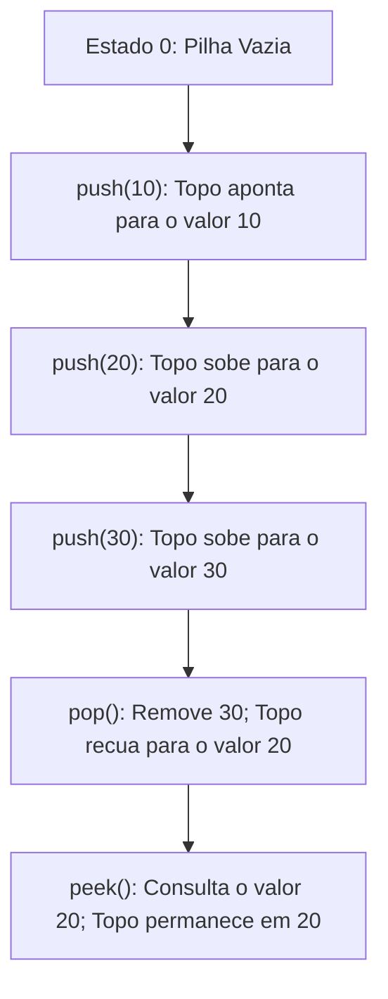
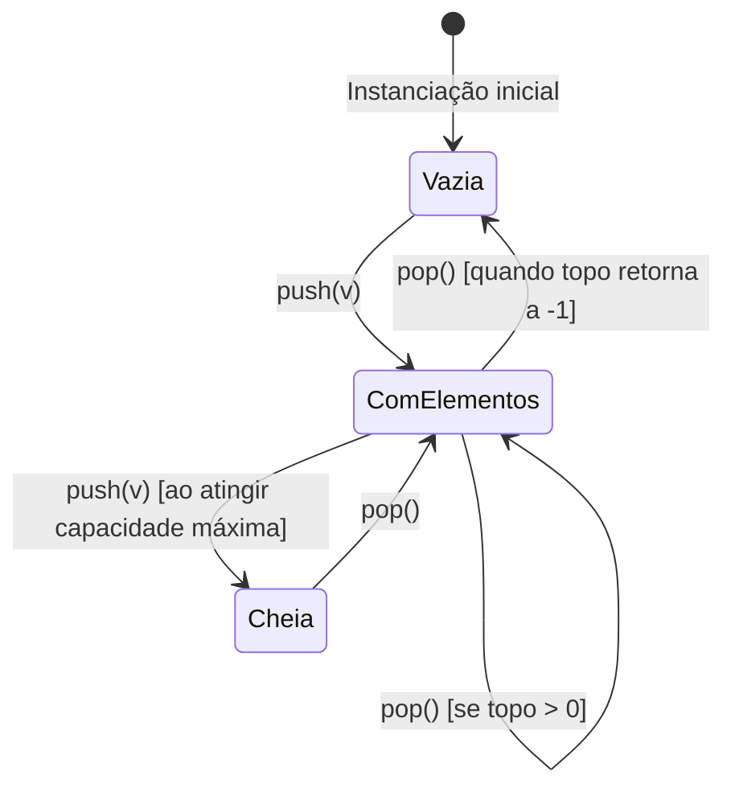
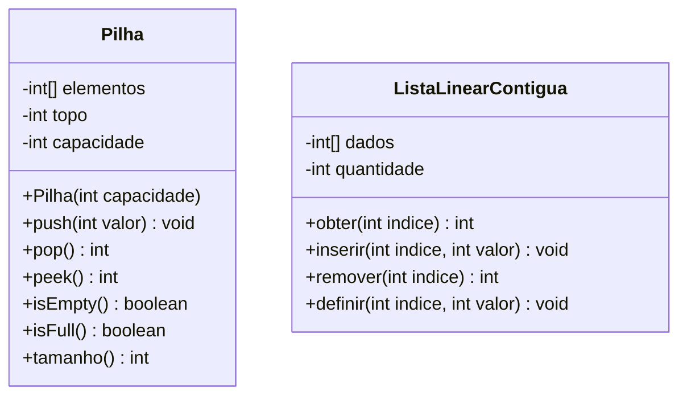
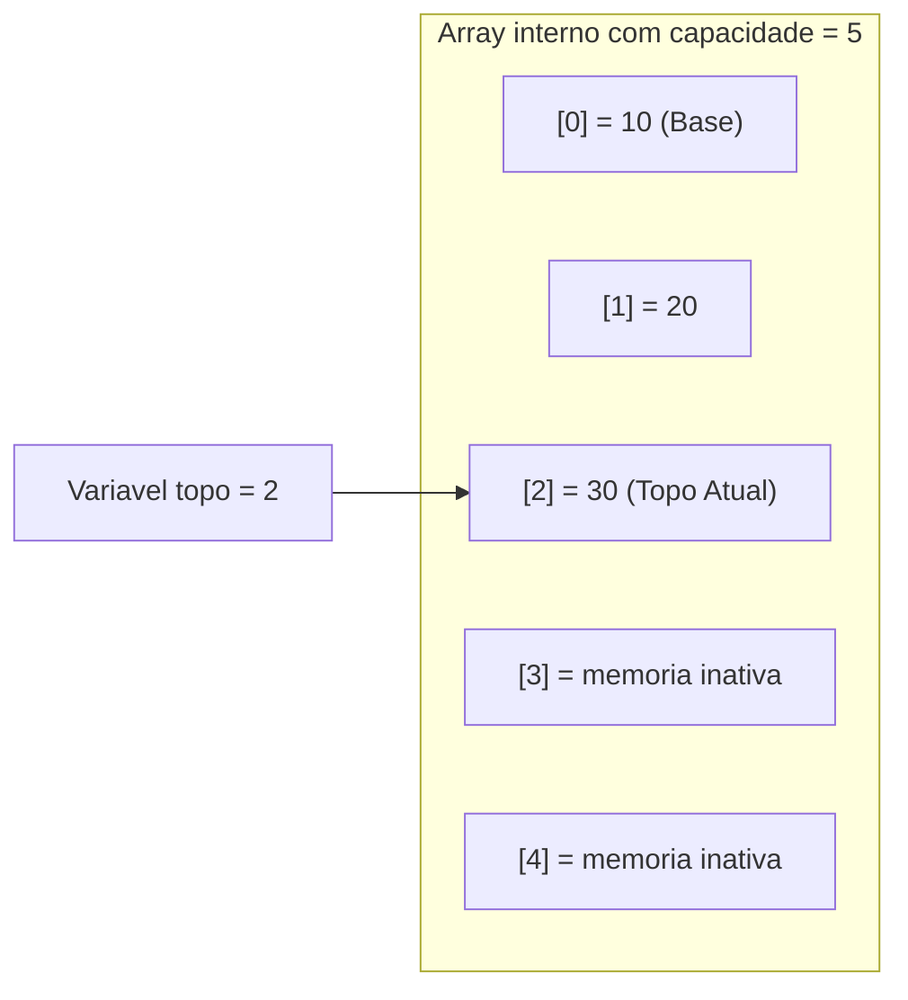
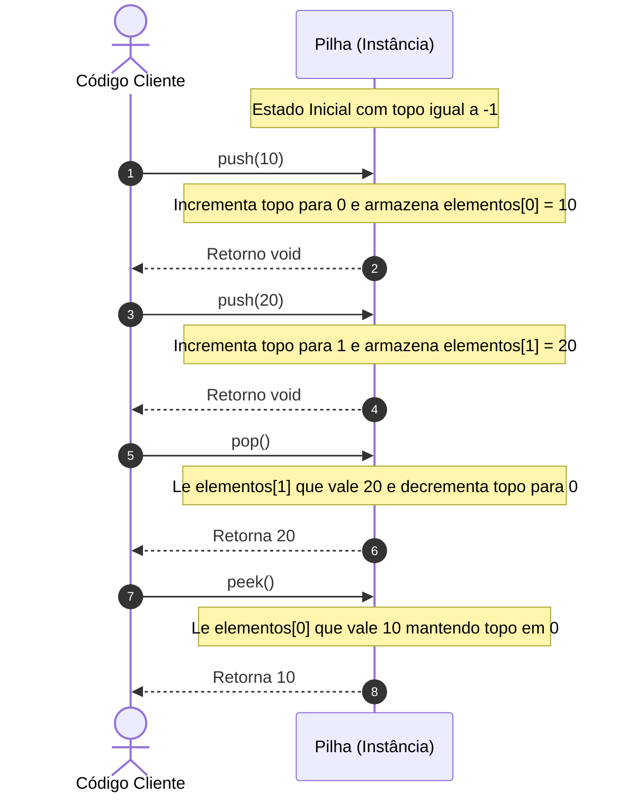
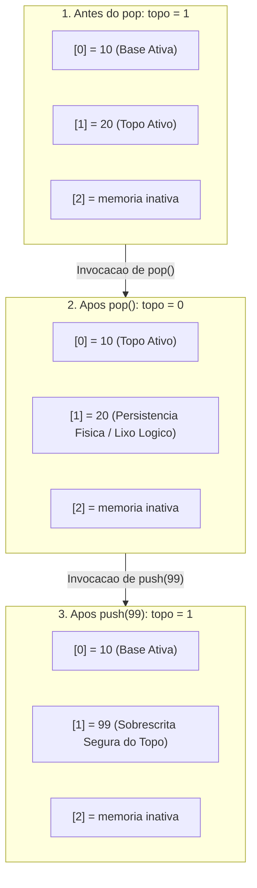
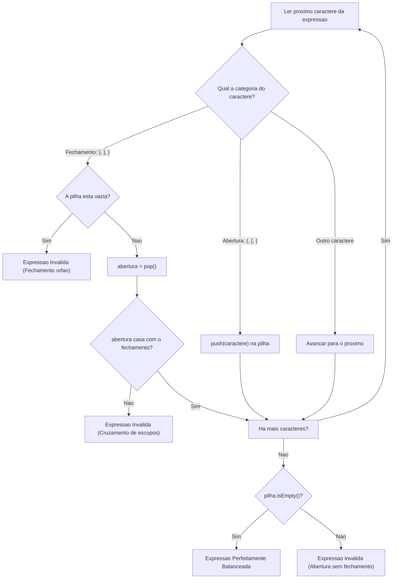

# Aula 06 — Pilhas Conceito e Implementação

> **Professor:** Wesley Soares
> **Disciplina:** Estrutura de Dados I (4º Semestre)
> **Tema:** Estrutura de dados linear restrita, princípio LIFO e implementação estática sequencial em memória com arrays.

---

## Sumário

- [Sumário](#sumario)
- [Objetivo da aula](#objetivo-da-aula)
- [Contexto e pré-requisitos](#contexto-e-pre-requisitos)
- [Conceito de Pilha e Princípio LIFO](#conceito-de-pilha-e-principio-lifo)
  - [Definição formal](#definicao-formal)
  - [Motivação e semântica de funcionamento](#motivacao-e-semantica-de-funcionamento)
  - [Exemplos práticos e contraexemplos](#exemplos-praticos-e-contraexemplos)
  - [Armadilhas conceituais](#armadilhas-conceituais)
  - [Diagrama de fluxo operacional](#diagrama-de-fluxo-operacional)
  - [Comparativo estrutural de TADs](#comparativo-estrutural-de-tads)
- [Operações Fundamentais (push, pop, peek, isEmpty)](#operacoes-fundamentais-push-pop-peek-isempty)
  - [Operação push](#operacao-push)
  - [Operação pop](#operacao-pop)
  - [Operação peek](#operacao-peek)
  - [Operação isEmpty](#operacao-isempty)
  - [Ciclo de vida dos estados da pilha](#ciclo-de-vida-dos-estados-da-pilha)
  - [Tabela consolidada das operações](#tabela-consolidada-das-operacoes)
- [Restrição de Acesso aos Dados](#restricao-de-acesso-aos-dados)
  - [O princípio do encapsulamento restritivo](#o-principio-do-encapsulamento-restritivo)
  - [Por que proibir a indexação arbitrária](#por-que-proibir-a-indexacao-arbitraria)
  - [Diagrama de classes do modelo conceitual](#diagrama-de-classes-do-modelo-conceitual)
  - [Comparativo de acesso e proteção](#comparativo-de-acesso-e-protecao)
- [Implementação de Pilha com Array](#implementacao-de-pilha-com-array)
  - [Estrutura da classe e alocação sequencial](#estrutura-da-classe-e-alocacao-sequencial)
  - [Análise assintótica de complexidade](#analise-assintotica-de-complexidade)
  - [Diagrama estrutural de memória](#diagrama-estrutural-de-memoria)
  - [Trade-offs: Array estático vs. Lista encadeada](#trade-offs-array-estatico-vs-lista-encadeada)
- [Representação de Pilha Vazia com Índice -1](#representacao-de-pilha-vazia-com-indice--1)
  - [A matemática da indexação baseada em zero](#a-matematica-da-indexacao-baseada-em-zero)
  - [Transição do ponteiro topo](#transicao-do-ponteiro-topo)
  - [Diagrama de sequência de transição do topo](#diagrama-de-sequencia-de-transicao-do-topo)
  - [Mapeamento de estados do topo](#mapeamento-de-estados-do-topo)
- [Gerenciamento do Topo e Persistência Física de Dados no Array](#gerenciamento-do-topo-e-persistencia-fisica-de-dados-no-array)
  - [Exclusão lógica versus exclusão física](#exclusao-logica-versus-exclusao-fisica)
  - [Sobrescrita segura e reaproveitamento](#sobrescrita-segura-e-reaproveitamento)
  - [Complemento técnico: Vazamento de referências na JVM](#complemento-tecnico-vazamento-de-referencias-na-jvm)
  - [Diagrama de transição física vs lógica](#diagrama-de-transicao-fisica-vs-logica)
- [Código da aula](#codigo-da-aula)
  - [Arquivo Pilha.java](#arquivo-pilhajava)
  - [Arquivo ExerciciosResolvidos.java](#arquivo-exerciciosresolvidosjava)
- [Exercícios](#exercicios)
  - [Exercício 1: Inversão de Palavras com Pilha](#exercicio-1-inversao-de-palavras-com-pilha)
  - [Exercício 2: Verificador de Delimitadores Balanceados](#exercicio-2-verificador-de-delimitadores-balanceados)
  - [Exercício 3: Pilha Dinâmica com Redimensionamento Automático](#exercicio-3-pilha-dinamica-com-redimensionamento-automatico)
- [Erros comuns e boas práticas](#erros-comuns-e-boas-praticas)
- [Links e materiais complementares](#links-e-materiais-complementares)
- [Mapa da aula](#mapa-da-aula)
- [Glossário](#glossario)
- [Pontos-chave para a prova](#pontos-chave-para-a-prova)
- [Perguntas e respostas (JSONL)](#perguntas-e-respostas-jsonl)
- [Checklist de revisão](#checklist-de-revisao)

---

## Objetivo da aula

- Compreender formalmente o conceito de **Pilha (Stack)** como um Tipo Abstrato de Dados (TAD) linear e de acesso restrito.
- Explicar com rigor matemático e algorítmico o princípio **LIFO (Last In, First Out)**.
- Identificar, projetar e implementar as operações fundamentais de uma pilha: `push`, `pop`, `peek`, `isEmpty`, `isFull` e `tamanho`.
- Construir uma implementação robusta em linguagem Java utilizando alocação estática sequencial baseada em vetor primitivo (`array`).
- Compreender a semântica da sentinela `$``\text{topo} = -1`$` como representação formal do estado de vacuidade em indexação baseada em zero.
- Diferenciar com clareza a exclusão lógica da exclusão física de dados em baixo nível.
- Analisar a complexidade assintótica de tempo e espaço de cada operação através da Notação Big O, comprovando a eficiência `$``O(1)`$`.
- Mapear aplicações reais da estrutura em sistemas operacionais, interpretadores, compiladores e mecanismos de reversão textual.

---

## Contexto e pré-requisitos

Nas aulas anteriores foram consolidados conceitos fundamentais que servem de alicerce para esta unidade:
1. **Tipos Abstratos de Dados (TAD):** A separação conceitual entre interface pública ("o que a estrutura faz") e implementação interna ("como a estrutura armazena e manipula os dados em memória").
2. **Análise Assintótica com Big O:** A avaliação de algoritmos por meio da contagem de instruções fundamentais, em que o tempo constante `$``O(1)`$` representa operações diretas sem laços de repetição proporcionais à entrada.
3. **Memória Stack e Heap em Java:** A diferenciação entre referências alocadas no quadro de ativação de métodos (*Call Stack*) e os objetos/vetores instanciados dinamicamente no *Heap*.
4. **Listas Sequenciais Contíguas:** O uso de vetores contíguos (`int[]`), dominando a aritmética de ponteiros e o cálculo direto de endereçamento por índice.

Para este módulo, o estudante deve aplicar encapsulamento rigoroso por meio de modificadores de acesso privados, tratamento de exceções com `IllegalStateException` e manipulação de variáveis escalares de controle.

---

## Conceito de Pilha e Princípio LIFO

### Definição formal

Uma **Pilha** (ou *Stack*) é formalmente definida como um Tipo Abstrato de Dados (TAD) linear no qual todas as operações de inserção de novos itens, remoção de itens existentes e consulta de elementos ocorrem exclusivamente em uma única extremidade móvel denominada **Topo** (*top*). A extremidade oposta, permanentemente imutável e inacessível durante o ciclo operacional regular, é denominada **Base** (*base* ou *bottom*).

### Motivação e semântica de funcionamento

Em vetores e listas lineares genéricas, a manipulação de dados é livre: qualquer posição arbitrária (início, meio ou término) pode ser lida ou alterada a qualquer momento. No entanto, diversas classes de problemas da ciência da computação exigem uma disciplina comportamental rígida de retrocesso ordenado e reversibilidade contextual.

A pilha estabelece essa disciplina através do princípio:

> **LIFO — Last In, First Out**  
> *O último elemento inserido na estrutura é obrigatoriamente o primeiro elemento a ser removido.*

Analogamente aos processos físicos do cotidiano, imagine uma pilha de pratos ou uma pilha de livros organizados verticalmente:
1. Um novo item é depositado exclusivamente sobre os itens anteriores (no topo).
2. Para retirar um item com segurança estrutural, remove-se necessariamente o item superior.
3. O primeiro item depositado no fundo da pilha só se tornará acessível após todos os elementos posicionados acima dele terem sido desempilhados.

### Exemplos práticos e contraexemplos

- **Exemplo real 1 (Engenharia de Software):** O mecanismo de "Desfazer / Refazer" (*Undo / Redo*) em editores de texto ou IDEs. Cada mutação de texto realizada pelo usuário gera um comando empilhado. Ao pressionar `Ctrl+Z`, a aplicação desempilha a última alteração realizada e reverte o estado do documento.
- **Exemplo real 2 (Sistemas Operacionais e Compiladores):** A pilha de execução de chamadas (*Call Stack*) da Máquina Virtual Java. Ao invocar o método `A()`, que por sua vez chama `B()`, um quadro de memória (*stack frame*) de `A` é empilhado, seguido pelo quadro de `B`. Quando `B` atinge sua instrução `return`, seu quadro é desempilhado primeiro, devolvendo o controle da execução para o método `A`.
- **Exemplo real 3 (Navegadores Web):** O histórico de navegação de abas. Cada endereço visitado é colocado no topo da pilha de histórico. O botão "Voltar" extrai a última URL acessada.
- **Contraexemplo:** Uma fila de banco ou fila de impressão de documentos. Nestes cenários, a regra mandatória é o atendimento ao cliente que chegou primeiro, regido pelo princípio **FIFO (First In, First Out)**. Remover o elemento recém-chegado em detrimento do primeiro configuraria quebra estrutural de regra de negócio.

### Armadilhas conceituais

- **Acesso aleatório inadvertido:** Supor que uma pilha permite consultar diretamente um dado intermediário (como o terceiro item de uma pilha de dez) sem desempilhar os anteriores. Em um TAD Pilha estrito, o acesso intermediário é inexistente.
- **Confusão de extremidades:** Supor que novos itens entram pelo topo e saem pela base. Inserção, consulta e remoção competem rigorosamente no mesmo endereço lógico: o **topo**.

### Diagrama de fluxo operacional



### Comparativo estrutural de TADs

| Dimensão Estrutural | Pilha (*Stack*) | Fila (*Queue*) | Lista Linear Genérica (*List*) |
| :--- | :--- | :--- | :--- |
| **Princípio de Ordenação** | LIFO (*Last In, First Out*) | FIFO (*First In, First Out*) | Sequencial indexada ou encadeada |
| **Ponto de Inserção** | Estritamente no Topo | Estritamente no Fim (*Tail*) | Qualquer posição válida |
| **Ponto de Remoção** | Estritamente no Topo | Estritamente no Início (*Head*) | Qualquer posição válida |
| **Acesso Arbitrário** | Proibido pela interface do TAD | Proibido pela interface do TAD | Permitido diretamente via índice |
| **Complexidade Temporal** | Inserção/Remoção em `$``O(1)`$` | Inserção/Remoção em `$``O(1)`$` | `$``O(1)`$` nas pontas; `$``O(n)`$` no meio |

---

## Operações Fundamentais (push, pop, peek, isEmpty)

O contrato de comportamento de uma Pilha é padronizado internacionalmente através de quatro operações nucleares, complementadas por métodos de verificação de limites.

### Operação push

A operação `push(valor)` (empilhar) introduz um novo elemento no topo da coleção.

- **Pré-condição:** A estrutura precisa possuir espaço disponível. Em implementações estáticas baseadas em arrays com tamanho fixo, caso a capacidade máxima já tenha sido alcançada, a execução deve ser barrada para evitar corrupção de memória. Esse estado de erro crítico é denominado **Stack Overflow** (estouro de capacidade de pilha).
- **Pós-condição:** O elemento passa a residir no topo, o marcador de topo é incrementado em uma unidade e a quantidade total de elementos úteis aumenta em 1.
- **Complexidade temporal:** `$``O(1)`$` (tempo constante, executando apenas atribuição e incremento escalar direto).

### Operação pop

A operação `pop()` (desempilhar) remove o elemento que reside atualmente no topo da pilha, retornando seu conteúdo ao invocador do método.

- **Pré-condição:** A estrutura deve conter ao menos um elemento válido. Caso a operação seja disparada sobre uma pilha sem dados, ocorre a violação denominada **Stack Underflow** (subfluxo de pilha).
- **Pós-condição:** O elemento superior deixa de pertencer ao escopo lógico da estrutura, o marcador de topo regride em uma unidade e o tamanho da pilha é reduzido em 1.
- **Complexidade temporal:** `$``O(1)`$` (tempo constante, sem deslocamento de dados).

### Operação peek

A operação `peek()` (também referenciada na literatura como `top()`) permite inspecionar o dado situado no topo da pilha sem removê-lo.

- **Diferenciação mandatória:**
  - `pop()`: Consulta o dado do topo **e remove-o** da estrutura, alterando o estado interno do TAD.
  - `peek()`: Executa uma **leitura pura**, preservando o topo e a quantidade de elementos rigorosamente inalterados.
- **Pré-condição:** Pilha não vazia (deve disparar erro ou exceção em caso de vacuidade).
- **Complexidade temporal:** `$``O(1)`$`.

### Operação isEmpty

A operação booleana `isEmpty()` (está vazia) atua como sentinela de segurança operacional, retornando `true` quando a pilha não contém elementos armazenados e `false` caso contrário.

- **Importância de engenharia:** É a guarda obrigatória invocada antes de qualquer chamada a `pop()` ou `peek()` para blindar o sistema contra interrupções abruptas por exceções em tempo de execução.
- **Complexidade temporal:** `$``O(1)`$`.

### Ciclo de vida dos estados da pilha



### Tabela consolidada das operações

| Assinatura do Método | Parâmetros de Entrada | Tipo de Retorno | Altera Estado? | Cenário de Falha / Exceção | Complexidade Assintótica |
| :--- | :--- | :--- | :--- | :--- | :--- |
| `push(int valor)` | `int valor` | `void` | Sim (incrementa topo) | Stack Overflow (`topo == capacidade - 1`) | `$``O(1)`$` |
| `pop()` | Nenhum | `int` | Sim (decrementa topo) | Stack Underflow (`isEmpty() == true`) | `$``O(1)`$` |
| `peek()` | Nenhum | `int` | Não (somente leitura) | Stack Underflow (`isEmpty() == true`) | `$``O(1)`$` |
| `isEmpty()` | Nenhum | `boolean` | Não (verificação de predicado) | Nenhuma | `$``O(1)`$` |
| `isFull()` | Nenhum | `boolean` | Não (verificação de predicado) | Nenhuma | `$``O(1)`$` |
| `tamanho()` | Nenhum | `int` | Não (cálculo de estado) | Nenhuma | `$``O(1)`$` |

---

## Restrição de Acesso aos Dados

### O princípio do encapsulamento restritivo

Em discussões de engenharia de software e projeto de algoritmos, surge frequentemente a indagação: *"Se o arranjo interno subjacente é um vetor nativo que suporta leitura por índice, por que não disponibilizar um método `obter(int indice)` na classe Pilha?"*

A resposta reside na preservação das **invariantes de representação**. Um Tipo Abstrato de Dados é caracterizado primariamente pelas garantias que ele impõe e pelos comportamentos que ele proíbe. A pilha subtrai deliberadamente a liberdade de acesso do desenvolvedor para prover uma garantia matemática e arquitetural: **a preservação irrestrita da ordem cronológica reversa**.

> Uma abstração de dados não é definida apenas pelo que ela permite executar, mas fundamentalmente pelo que ela impede que seja violado.

### Por que proibir a indexação arbitrária

Considere a arquitetura de um interpretador de bytecode executando instruções em runtime. Variáveis locais e parâmetros são calculados sobre uma pilha de operandos. Se uma rotina externa pudesse acessar um índice arbitrário no fundo da pilha e alterar seu valor, o estado de execução de outros métodos seria corrompido de forma indeterminística.

Proibir a indexação arbitrária:
1. Elimina a possibilidade de corrupção do estado intermediário por código cliente malicioso ou desatento.
2. Isola o desenvolvedor da complexidade de gerenciar ponteiros múltiplos.
3. Permite que o projetista da pilha substitua o arranjo contíguo por uma lista ligada ou memória externa sem que nenhuma linha de código cliente quebre.

### Diagrama de classes do modelo conceitual



### Comparativo de acesso e proteção

| Dimensão de Análise | Pilha Estática (*Acesso Restrito*) | Vetor / Lista Comum (*Acesso Livre*) |
| :--- | :--- | :--- |
| **Visibilidade de Elementos** | Apenas o topo está visível | Todos os elementos são diretamente visíveis |
| **Risco de Corrupção Lateral** | Nulo: posições internas são inacessíveis | Elevado: mutações aleatórias em qualquer índice |
| **Complexidade Cognitiva** | Mínima: interface reduzida a métodos atômicos | Moderada/Alta: exige controle de limites e laços |
| **Garantia Arquitetural** | Ordem de saída estritamente invertida da entrada | Ordem depende das decisões do chamador |

---

## Implementação de Pilha com Array

### Estrutura da classe e alocação sequencial

Na implementação estática sequencial de uma pilha em Java, os dados são distribuídos em um bloco contíguo de memória através de um vetor nativo primitivo. A classe controladora encapsula três atributos essenciais:
1. `private int[] elementos`: O vetor que reserva os compartimentos de memória no *Heap*.
2. `private int topo`: A variável escalar inteira que armazena a posição do índice do último elemento inserido.
3. `private int capacidade`: O limite máximo estrutural de elementos suportados pelo array alocado.

```java
public class Pilha {
    private int[] elementos;
    private int topo;
    private int capacidade;

    public Pilha(int capacidade) {
        if (capacidade <= 0) {
            throw new IllegalArgumentException("A capacidade deve ser estritamente positiva.");
        }
        this.capacidade = capacidade;
        this.elementos = new int[capacidade];
        this.topo = -1; // Estado canônico de pilha vazia
    }
}
```

### Análise assintótica de complexidade

A implementação sobre arranjo sequencial entrega a melhor eficiência computacional possível em ciência da computação:
- **`push(valor)`**: Realiza uma avaliação lógica (`topo == capacidade - 1`), uma soma escalar (`topo++`) e uma escrita indexada direta (`elementos[topo] = valor`). Cada uma dessas instruções corresponde a operações elementares de máquina. Logo, a complexidade é **$``O(1)`$** temporal.
- **`pop()`**: Realiza uma avaliação condicional, a captura do valor no índice `topo`, um decremento escalar (`topo--`) e um retorno. Não existem laços de repetição. Complexidade **$``O(1)`$** temporal.
- **`peek()`**: Acesso posicional imediato via índice. Complexidade **$``O(1)`$** temporal.
- **`isEmpty()` e `isFull()`**: Uma comparação relacional única. Complexidade **$``O(1)`$** temporal.
- **Complexidade Espacial Total:** Consumo estático de memória de ordem **$``O(N)`$**, onde $``N`$` é a capacidade total pré-alocada no momento da instanciação.

### Diagrama estrutural de memória



### Trade-offs: Array estático vs. Lista encadeada

*(Nota de complementação pedagógica: Embora a aula priorize a implementação estática por vetor contíguo, o engenheiro de software deve compreender os prós e contras frente à alternativa encadeada dinâmica).*

| Critério Técnico | Implementação com Array Estático | Implementação com Lista Encadeada Dinâmica |
| :--- | :--- | :--- |
| **Limite de Dimensionamento** | Fixo: pode incorrer em *Stack Overflow* se subdimensionado | Dinâmico: limitado apenas pelo espaço total do *Heap* |
| **Localidade de Referência (Cache)** | Excelente: células vizinhas facilitam cache de CPU | Baixa: nós dispersos geram falhas de cache (*cache misses*) |
| **Sobrecarga de Memória (Overhead)** | Zero bytes adicionais por elemento armazenado | Alta: exige um ponteiro/referência para cada nó criado |
| **Custo de Alocação em Runtime** | Amortizado: uma única alocação no construtor | Contínuo: instanciação (`new No`) a cada invocação de `push` |

---

## Representação de Pilha Vazia com Índice -1

### A matemática da indexação baseada em zero

Em linguagens baseadas na sintaxe do C (como Java, C++, C# e Python), os vetores utilizam endereçamento baseado em zero (*zero-based indexing*). O primeiro compartimento físico é acessado no índice `0`.

Deduzindo a relação matemática entre a quantidade de elementos armazenados ($``K`$`) e a posição do índice de topo:
- Se a pilha possui $``K = 3`$` elementos, eles ocupam as posições `0`, `1` e `2`. O topo reside em $``2`$`.
- Se a pilha possui $``K = 2`$` elementos, eles ocupam as posições `0` e `1`. O topo reside em $``1`$`.
- Se a pilha possui $``K = 1`$` elemento, ele ocupa a posição `0`. O topo reside em $``0`$`.

Aplicando a regra de formação para a ausência de elementos ($``K = 0`$`):

```math
\text{topo} = K - 1 \implies \text{topo} = 0 - 1 = -1
```

O valor `$``-1`$` não representa uma posição física válida dentro do vetor; ele atua formalmente como uma **sentinela** que sinaliza o estado de vacuidade da pilha.

### Transição do ponteiro topo

A cronologia das mutações de índice durante a execução de `push` e `pop` obedece a uma ordem rigorosa:

1. **Ao Empilhar (`push`):**
   - **Passo 1:** Pré-incrementar a variável de controle: `topo++` (ou `topo = topo + 1`).
   - **Passo 2:** Depositar o elemento na nova posição: `elementos[topo] = valor`.
2. **Ao Desempilhar (`pop`):**
   - **Passo 1:** Capturar o elemento na posição corrente: `int retorno = elementos[topo]`.
   - **Passo 2:** Pós-decrementar a variável de controle: `topo--` (ou `topo = topo - 1`).

> [!WARNING]
> Inverter a ordem no `push` (tentar gravar `elementos[topo] = valor` antes de incrementar) provocará o lançamento imediato de `ArrayIndexOutOfBoundsException: Index -1 out of bounds for length N`, travando a aplicação.

### Diagrama de sequência de transição do topo



### Mapeamento de estados do topo

```math
\text{tamanho}(\text{pilha}) = \text{topo} + 1
```

| Valor da Variável `topo` | Quantidade de Itens ($``K`$`) | Estado Semântico da Pilha | Operação Autorizada | Operação Bloqueada |
| :--- | :--- | :--- | :--- | :--- |
| `topo == -1` | $``0`$` itens | **Pilha Vazia** (*Empty*) | `push()` | `pop()`, `peek()` (Underflow) |
| `topo == 0` | $``1`$` item | Pilha com 1 elemento na base | `push()`, `pop()`, `peek()` | Nenhuma |
| `0 < topo < cap - 1` | Entre $``2`$` e $``\text{cap} - 1`$` | Pilha com ocupação parcial | `push()`, `pop()`, `peek()` | Nenhuma |
| `topo == capacidade - 1`| $``\text{capacidade}`$` itens | **Pilha Cheia** (*Full*) | `pop()`, `peek()` | `push()` (Overflow) |

---

## Gerenciamento do Topo e Persistência Física de Dados no Array

### Exclusão lógica versus exclusão física

Um dos conceitos mais importantes em sistemas de baixo nível é a cisão entre **exclusão lógica** e **exclusão física**:
- **Exclusão Física:** Implica varrer a memória, preencher os bytes correspondentes com zeros ou desalocar blocos de hardware.
- **Exclusão Lógica:** Consiste unicamente em alterar as variáveis de controle (neste caso, decrementando o índice `topo`), redefinindo a fronteira do que a estrutura considera dado válido.

Ao executar `pop()`, a instrução `topo--` reposiciona a fronteira de visualização da pilha. O número que estava gravado no índice desempilhado **permanece fisicamente intocado nos transistores de memória do vetor**. No entanto, ele tornou-se lixo lógico: o contrato do TAD ignora completamente qualquer índice estritamente superior ao valor de `topo`.

### Sobrescrita segura e reaproveitamento

A persistência do valor residual não causa inconsistências em tipos primitivos. Quando uma subsequente instrução `push` for requisitada, o `topo` será incrementado para aquele mesmo índice e o novo dado sobrescreverá diretamente o resíduo anterior.



### Complemento técnico: Vazamento de referências na JVM

*(Nota de complementação de engenharia de software):*  
Em nosso estudo didático com arrays de tipos primitivos (`int[]`), a persistência de valores descartados na memória física é inofensiva e recomendada por razões de performance pura (evita instruções adicionais de limpeza de registradores).

Contudo, caso estivéssemos projetando uma pilha genérica para armazenar instâncias de objetos (`Object[]` ou `T[]`), a exclusão puramente lógica geraria um problema grave de engenharia conhecido como **Vazamento de Referências Obsoletas** (*Memory Leak* por retenção de referências). 

Mesmo que a pilha não use mais aquele objeto, enquanto a célula `elementos[topo + 1]` contiver o endereço dele no *Heap*, a Máquina Virtual Java assumirá que o objeto ainda está referenciado, impedindo o **Garbage Collector (GC)** de reciclar aquela memória. Por essa razão, pilhas profissionais de objetos implementam o desempilhamento limpando a referência:

```java
// Padrao profissional para pilhas de objetos em Java (Joshua Bloch - Effective Java)
Object elementoRemovido = this.elementos[this.topo];
this.elementos[this.topo] = null; // Libera a referencia para o Garbage Collector
this.topo--;
return elementoRemovido;
```

---

## Código da aula

### Arquivo Pilha.java

O código a seguir apresenta a implementação completa, robusta e encapsulada da classe `Pilha` estática baseada em vetor primitivo de inteiros, contendo salvaguardas contra *Stack Overflow* e *Stack Underflow*.

```java
package unifef.estruturadados.aula06;

/**
 * Implementacao de Pilha Estatica Sequencial baseada em Array.
 * Disciplina: Estrutura de Dados I - 4o Semestre (UniFEF)
 * Professor: Wesley Soares
 * 
 * Regra de acesso: LIFO (Last In, First Out).
 */
public class Pilha {

    private int[] elementos;
    private int topo;
    private int capacidade;

    /**
     * Construtor da Pilha Estatica.
     * 
     * @param capacidade Limite maximo de elementos inteiros suportados.
     * @throws IllegalArgumentException Se a capacidade for menor ou igual a zero.
     */
    public Pilha(int capacidade) {
        if (capacidade <= 0) {
            throw new IllegalArgumentException("A capacidade da pilha deve ser maior que zero.");
        }
        this.capacidade = capacidade;
        this.elementos = new int[capacidade];
        this.topo = -1; // -1 indica que a pilha nasce formalmente vazia
    }

    /**
     * Insere um novo elemento no topo da pilha.
     * Complexidade Temporal: O(1).
     * 
     * @param valor Numero inteiro a ser empilhado.
     * @throws IllegalStateException Em caso de tentativa de insercao com a pilha cheia (Stack Overflow).
     */
    public void push(int valor) {
        if (isFull()) {
            throw new IllegalStateException("Erro: Stack Overflow! A capacidade maxima de " + capacidade + " foi atingida.");
        }
        this.topo++;
        this.elementos[this.topo] = valor;
    }

    /**
     * Remove e retorna o elemento atualmente posicionado no topo da pilha.
     * Complexidade Temporal: O(1).
     * 
     * @return O valor inteiro desempilhado.
     * @throws IllegalStateException Em caso de tentativa de remocao com a pilha vazia (Stack Underflow).
     */
    public int pop() {
        if (isEmpty()) {
            throw new IllegalStateException("Erro: Stack Underflow! A pilha esta vazia.");
        }
        int valorDesempilhado = this.elementos[this.topo];
        this.topo--; // Exclusao logica imediata
        return valorDesempilhado;
    }

    /**
     * Consulta o valor do elemento no topo sem remove-lo da estrutura.
     * Complexidade Temporal: O(1).
     * 
     * @return O valor inteiro localizado no topo.
     * @throws IllegalStateException Se a pilha estiver vazia.
     */
    public int peek() {
        if (isEmpty()) {
            throw new IllegalStateException("Erro: A pilha esta vazia. Nao ha elemento no topo para inspecao.");
        }
        return this.elementos[this.topo];
    }

    /**
     * Avalia se a pilha nao contem nenhum elemento armazenado.
     * Complexidade Temporal: O(1).
     * 
     * @return true se topo for igual a -1, false caso contrario.
     */
    public boolean isEmpty() {
        return this.topo == -1;
    }

    /**
     * Avalia se a pilha atingiu seu limite fisico de armazenamento.
     * Complexidade Temporal: O(1).
     * 
     * @return true se topo for igual a capacidade - 1, false caso contrario.
     */
    public boolean isFull() {
        return this.topo == this.capacidade - 1;
    }

    /**
     * Retorna a quantidade corrente de elementos validos na pilha.
     * Complexidade Temporal: O(1).
     * 
     * @return Quantidade inteira de itens ocupados.
     */
    public int tamanho() {
        return this.topo + 1;
    }

    /**
     * Retorna a capacidade maxima total da pilha.
     * Complexidade Temporal: O(1).
     * 
     * @return Capacidade fisica do vetor.
     */
    public int getCapacidade() {
        return this.capacidade;
    }

    /**
     * Imprime visualmente o estado da pilha, do topo ate a base.
     * Metodo utilitario para fins pedagogicos e depuracao de mesa.
     */
    public void exibir() {
        if (isEmpty()) {
            System.out.println("[Pilha Vazia]");
            return;
        }
        System.out.println("--- TOPO DA PILHA ---");
        for (int i = this.topo; i >= 0; i--) {
            if (i == this.topo) {
                System.out.println("| " + this.elementos[i] + " | <- Topo (indice " + i + ")");
            } else if (i == 0) {
                System.out.println("| " + this.elementos[i] + " | <- Base (indice 0)");
            } else {
                System.out.println("| " + this.elementos[i] + " | (indice " + i + ")");
            }
        }
        System.out.println("---------------------");
    }
}
```

### Arquivo ExerciciosResolvidos.java

A classe abaixo reúne métodos de teste, verificação de limites e as soluções completas para os exercícios propostos em sala.

```java
package unifef.estruturadados.aula06;

/**
 * Casos de teste e exercicios aplicados de Pilhas.
 * Disciplina: Estrutura de Dados I - UniFEF
 */
public class ExerciciosResolvidos {

    public static void main(String[] args) {
        System.out.println("=== TESTE 1: OPERACOES BASICAS COM A CLASSE PILHA ===");
        Pilha p = new Pilha(4);
        p.push(10);
        p.push(20);
        p.push(30);
        p.exibir();

        System.out.println("Elemento no topo (peek): " + p.peek());
        System.out.println("Tamanho atual: " + p.tamanho());
        System.out.println("Desempilhando: " + p.pop());
        p.exibir();

        System.out.println("\n=== TESTE 2: INVERSAO DE TEXTO COM PILHA ===");
        String original = "UniFEF 2026";
        String invertida = inverterTexto(original);
        System.out.println("Texto Original: " + original);
        System.out.println("Texto Invertido: " + invertida);

        System.out.println("\n=== TESTE 3: BALANCEAMENTO DE DELIMITADORES ===");
        String exp1 = "{[()]}";
        String exp2 = "{[(])}";
        String exp3 = "((())";
        System.out.println("Expressao " + exp1 + " valida? " + verificarBalanceamento(exp1));
        System.out.println("Expressao " + exp2 + " valida? " + verificarBalanceamento(exp2));
        System.out.println("Expressao " + exp3 + " valida? " + verificarBalanceamento(exp3));
    }

    /**
     * Exercicio 1: Inverte os caracteres de uma string utilizando o principio LIFO.
     * Complexidade Temporal: O(n).
     * Complexidade Espacial: O(n).
     */
    public static String inverterTexto(String texto) {
        if (texto == null || texto.isEmpty()) {
            return texto;
        }

        // Criamos uma pilha com capacidade igual ao comprimento da string
        Pilha pilhaChar = new Pilha(texto.length());

        // Passo 1: Empilhar cada caractere (convertido para seu codigo numerico)
        for (int i = 0; i < texto.length(); i++) {
            pilhaChar.push((int) texto.charAt(i));
        }

        // Passo 2: Desempilhar reconstruindo a cadeia de caracteres
        StringBuilder invertido = new StringBuilder();
        while (!pilhaChar.isEmpty()) {
            char c = (char) pilhaChar.pop();
            invertido.append(c);
        }

        return invertido.toString();
    }

    /**
     * Exercicio 2: Valida se delimitadores matematicos/sintaticos estao balanceados.
     * Simbolos suportados: '(', ')', '[', ']', '{', '}'
     * Complexidade Temporal: O(n).
     */
    public static boolean verificarBalanceamento(String expressao) {
        if (expressao == null) {
            return false;
        }

        Pilha pilhaDelimitadores = new Pilha(expressao.length() + 1);

        for (int i = 0; i < expressao.length(); i++) {
            char atual = expressao.charAt(i);

            // Se for simbolo de abertura, empilhamos seu codigo
            if (atual == '(' || atual == '[' || atual == '{') {
                pilhaDelimitadores.push((int) atual);
            } 
            // Se for simbolo de fechamento, conferimos o topo
            else if (atual == ')' || atual == ']' || atual == '}') {
                if (pilhaDelimitadores.isEmpty()) {
                    return false; // Tentativa de fechar sem abertura correspondente
                }

                char abertura = (char) pilhaDelimitadores.pop();

                // Verifica incompatibilidade de pares
                if (atual == ')' && abertura != '(') return false;
                if (atual == ']' && abertura != '[') return false;
                if (atual == '}' && abertura != '{') return false;
            }
        }

        // Se ao termino da varredura a pilha estiver vazia, os pares foram satisfeitos
        return pilhaDelimitadores.isEmpty();
    }
}
```

---

## Exercícios

### Exercício 1: Inversão de Palavras com Pilha

- **Definição formal do problema:** Dada uma cadeia de caracteres alfanumérica contendo $``n`$` símbolos, produzir uma nova cadeia contendo exatamente os mesmos símbolos em ordem cronológica inversa.
- **Motivação:** A inversão mecânica de dados é uma das consequências primárias da disciplina LIFO. Ao empilhar elementos na ordem $``A, B, C`$`, o topo será $``C`$`. O desempilhamento subsequente produzirá invariavelmente $``C, B, A`$`.
- **Roteiro do algoritmo:**
  1. Instanciar uma pilha de tamanho suficiente para acomodar a palavra.
  2. Percorrer a string original do índice `0` até o índice `n - 1`, executando `push` de cada caractere individual.
  3. Enquanto a pilha não estiver vazia (`!isEmpty()`), executar `pop()`, anexando cada caractere retirado ao final da nova cadeia.
- **Análise assintótica de complexidade:**
  - **Tempo:** O algoritmo efetua $``n`$` operações de empilhamento e $``n`$` operações de desempilhamento. Custo temporal total: $``T(n) = n + n = 2n \implies O(n)`$`.
  - **Espaço:** Demanda uma pilha com capacidade para $``n`$` elementos e uma nova cadeia para a saída. Consumo de memória: `$``O(n)`$`.
- **Casos de borda e armadilhas:** Cadeia vazia (retorna imediatamente), cadeia com apenas 1 caractere (a inversão é idêntica) e cuidado com strings nulas (`null`), que exigem validação prévia defensiva para evitar `NullPointerException`.

### Exercício 2: Verificador de Delimitadores Balanceados

- **Definição formal do problema:** Determinar se uma expressão contendo combinações de parênteses `()`, colchetes `[]` e chaves `{}` está sintaticamente balanceada e bem aninhada.
- **Motivação:** Trata-se do algoritmo clássico utilizado por compiladores de linguagens estruturadas (Java, C, Rust) e formatadores de código JSON para assegurar que cada bloco aberto seja devidamente encerrado no momento correto, sem cruzamentos inválidos de escopo.
- **Roteiro de execução sistemática:**
  - Ao ler um caractere de abertura (`(`, `[`, `{`), executa-se `push`.
  - Ao ler um caractere de fechamento (`)`, `]`, `}`):
    - Se a pilha estiver vazia, há um erro de fechamento órfão: retorna `false`.
    - Executa-se `pop()` para recuperar o símbolo que abriu o escopo mais recente.
    - Se o símbolo desempilhado não pertencer ao mesmo par correspondente (ex: encontrou `]` quando o topo era `(`), há cruzamento inválido: retorna `false`.
  - Ao terminar a leitura de toda a string:
    - Se a pilha estiver vazia: a expressão é válida (`true`).
    - Se a pilha ainda contiver elementos: significa que símbolos de abertura nunca foram encerrados: retorna `false`.



- **Tabela de testes de mesa:**

| Expressão Testada | Passo a Passo do Algoritmo | Estado Final da Pilha | Veredito |
| :--- | :--- | :--- | :--- |
| `{[()]}` | Abre `{`, `[`, `(`. Fecha `)` (casa), `]` (casa), `}` (casa) | `isEmpty() == true` | **Válida** |
| `{[(])}` | Abre `{`, `[`, `(`. Lê `]`, desempilha `(`. Incompatível! | Interrompe imediatamente | **Inválida** |
| `((())` | Abre `(`, `(`, `(`, `(`. Fecha `)`. Abreturas sobram | Topo contém `(` | **Inválida** |
| `())` | Abre `(`. Fecha `)`. Ao ler o segundo `)`, a pilha já está vazia | Subfluxo prematuro | **Inválida** |

### Exercício 3: Pilha Dinâmica com Redimensionamento Automático

- **Definição formal do problema:** Construir uma classe `PilhaDinamica` que elimine o erro estático de *Stack Overflow*, redimensionando automaticamente seu vetor interno quando a ocupação atinge $``100\%`$`, e encolhendo a estrutura quando a ocupação cai para um patamar de segurança.
- **Motivação técnica de engenharia:** Implementar o padrão estrutural utilizado pelo `java.util.ArrayList` e `java.util.ArrayDeque`. Arrays em linguagens compiladas possuem tamanho inalterável após instanciados; para crescer, é imperativo alocar um novo array maior no *Heap* e transferir os elementos preexistentes.
- **A Armadilha do *Thrashing* de Redimensionamento:**
  - *Cenário ingênuo:* Dobrar o tamanho quando cheia ($`2 \times N`$) e reduzir pela metade ($`N / 2`$) quando a pilha atingir metade da ocupação ($`50\%`$).
  - *O Problema:* Se uma aplicação executar uma sequência alternada de operações no limiar da capacidade (`push`, `pop`, `push`, `pop`), o sistema alocará e copiará o vetor inteiro a cada iteração individual, degradando a performance de cada chamada para `$``O(n)`$`.
  - *A Solução de Engenharia:* Adotar histerese estrutural. Dobra-se o tamanho quando atinge $``100\%`$`, mas só encolhe-se para a metade quando o volume de itens ativos cair para **$``25\%`$`** (um quarto) da capacidade total.

```java
package unifef.estruturadados.aula06;

/**
 * Exercicio 3: Pilha com capacidade elastica autoajustavel.
 */
public class PilhaDinamica {

    private int[] elementos;
    private int topo;

    public PilhaDinamica(int capacidadeInicial) {
        if (capacidadeInicial <= 0) capacidadeInicial = 2;
        this.elementos = new int[capacidadeInicial];
        this.topo = -1;
    }

    public void push(int valor) {
        // Se o topo atingir o ultimo indice, dobra a capacidade
        if (this.topo == this.elementos.length - 1) {
            redimensionar(2 * this.elementos.length);
        }
        this.elementos[++this.topo] = valor;
    }

    public int pop() {
        if (isEmpty()) {
            throw new IllegalStateException("Pilha Vazia.");
        }
        int valor = this.elementos[this.topo--];

        // Encolhe a pilha pela metade se a ocupacao cair para 25% da capacidade
        if (this.topo > 0 && (this.topo + 1) <= this.elementos.length / 4) {
            redimensionar(this.elementos.length / 2);
        }

        return valor;
    }

    public boolean isEmpty() {
        return this.topo == -1;
    }

    public int tamanho() {
        return this.topo + 1;
    }

    public int getCapacidadeAtual() {
        return this.elementos.length;
    }

    private void redimensionar(int novaCapacidade) {
        int[] novoArray = new int[novaCapacidade];
        for (int i = 0; i <= this.topo; i++) {
            novoArray[i] = this.elementos[i];
        }
        this.elementos = novoArray; // Atualiza a referencia para o novo bloco no Heap
    }
}
```

- **Análise assintótica do redimensionamento:** Embora uma operação isolada de duplicação custe `$``O(n)`$` cópias, a frequência dessas ocorrências diminui exponencialmente. Distribuindo o custo total das cópias ao longo de uma sequência de $``n`$` operações, provamos que o **custo amortizado** por operação permanece estritamente **$``O(1)`$**.

---

## Erros comuns e boas práticas

### Catálogo de erros recorrentes em provas e implementações

1. **Tentativa de acesso por índice:** Escrever rotinas que tentam inspecionar `pilha.elementos[i]` a partir de código externo. **Correção:** Sempre preservar os atributos como `private` e operar exclusivamente via `push`, `pop` e `peek`.
2. **Inversão de incremento/decremento:** Efetuar `elementos[topo] = valor; topo++;` no empilhamento. Com `topo = -1`, isso tenta escrever no índice `-1`, causando travamento imediato por `ArrayIndexOutOfBoundsException`.
3. **Desempilhamento cego:** Invocar `pop()` ou `peek()` sem antes averiguar `!isEmpty()`. O código cliente deve sempre validar o estado da pilha ou tratar a exceção disparada.
4. **Deslocamento desnecessário de elementos:** Tentar mover elementos para a esquerda no array a cada remoção (como se fosse uma fila ou lista sequencial comum). Na pilha, **nenhum elemento se move fisicamente**; apenas o ponteiro `topo` avança ou recua.
5. **Confundir tamanho com capacidade:** A capacidade física (`elementos.length`) é o total de gavetas de memória alocadas; o tamanho lógico (`topo + 1`) é a quantidade real de dados ativos no momento.

### Boas práticas de engenharia

- **Imutabilidade de invariantes:** Lance sempre exceções explícitas e informativas (`IllegalStateException` ou `IllegalArgumentException`) quando pré-condições forem violadas, em vez de retornar números mágicos como `-1` ou `0` (pois estes podem ser valores legítimos da regra de negócio).
- **Sobrescrita de métodos contratuais:** Documente pré e pós-condições em formato JavaDoc para que qualquer cliente compreenda os limites do TAD.

---

## Links e materiais complementares

- **Livros da Bibliografia Oficial e Complementar:**
  - ZIVIANI, Nivio. *Projeto de Algoritmos com Implementações em Pascal e C*. 3. ed. Cengage Learning, 2011. (Capítulo dedicado a Pilhas e Filas).
  - CORMEN, Thomas H. et al. *Algoritmos: Teoria e Prática*. 3. ed. Rio de Janeiro: Elsevier, 2012. (Seção 10.1: Pilhas e Filas).
  - SEDGEWICK, Robert; WAYNE, Kevin. *Algorithms*. 4. ed. Addison-Wesley Professional, 2011. (Capítulo sobre Fundamentos e Pilhas com Análise Amortizada).
- **Documentação Oficial da Linguagem Java:**
  - Documentação da interface [`java.util.Deque`](https://docs.oracle.com/javase/8/docs/api/java/util/Deque.html) e classe [`java.util.ArrayDeque`](https://docs.oracle.com/javase/8/docs/api/java/util/ArrayDeque.html). Nota: A classe legada `java.util.Stack` do Java 1.0 é considerada obsoleta pela Oracle por estender incorretamente `Vector`, violando o princípio do encapsulamento restritivo.
- **Simuladores Visuais Interativos:**
  - [VisuAlgo — Visualising Data Structures and Algorithms through Animation](https://visualgo.net/en/list) (Módulo de Stack: visualização de transição do ponteiro Topo).

---

## Mapa da aula

```mermaid
mindmap
  root(( "Pilhas: Conceito e Implementação" ))
    "Fundamentos Teóricos"
      "TAD Linear Restrito"
      "Princípio LIFO"
      "Manipulação Exclusiva no Topo"
    "Operações Fundamentais"
      "push: Empilhar em O(1)"
      "pop: Desempilhar em O(1)"
      "peek: Consultar Topo em O(1)"
      "isEmpty e isFull em O(1)"
    "Implementação com Array"
      "Alocação Sequencial Contígua"
      "Sentinela topo = -1 para Vazia"
      "topo = cap - 1 para Cheia"
      "Exclusão Lógica vs Física"
      "Sobrescrita Segura"
    "Aplicações Reais"
      "Call Stack da JVM"
      "Desfazer e Refazer Undo-Redo"
      "Casamento de Delimitadores"
      "Inversão de Dados"
    "Trade-offs"
      "Array: Localidade de Cache"
      "Array: Custo Espacial O(N)"
      "Custo Temporal O(1) Estrito"
```

---

## Glossário

- **Pilha (*Stack*):** Estrutura de dados linear dinâmica ou estática cuja disciplina de acesso impõe inserções e remoções restritas a uma única extremidade denominada topo.
- **LIFO (*Last In, First Out*):** Axioma operacional determinando que o último dado inserido em uma coleção seja compulsoriamente o primeiro a ser desalojado.
- **Topo (*Top*):** O marcador, índice ou ponteiro que registra o endereço do item mais recente da estrutura.
- **Base (*Bottom*):** O primeiro elemento inserido na estrutura (índice 0 em vetores), o qual só pode ser desempilhado após a remoção de todos os seus sucessores.
- **Push:** Instrução elementar encarregada de recepcionar um dado e acomodá-lo sobre o topo da pilha.
- **Pop:** Instrução elementar encarregada de extrair e retornar o elemento atualmente posicionado no topo da pilha.
- **Peek / Top:** Instrução de inspeção que devolve o valor residente no topo sem aplicar qualquer mutação de estado à pilha.
- **Stack Overflow:** Condição de falha crítica que se manifesta quando uma operação de empilhamento é requisitada sobre uma estrutura que já atingiu sua capacidade física máxima.
- **Stack Underflow:** Condição de falha que ocorre ao solicitar desempilhamento ou inspeção sobre uma estrutura que se encontra vazia.
- **Sentinela:** Constante de projeto (como o índice `-1`) utilizada para representar um estado de fronteira ou ausência de dados válidos.
- **Exclusão Lógica:** Processo computacional de descarte de dados que se limita a redefinir marcadores de escopo sem sobrescrever ou apagar fisicamente os bytes em memória.
- **Call Stack:** Mecanismo arquitetural de execução de programas em nível de hardware ou máquina virtual que registra quadros de ativação de métodos chamados e suas variáveis locais.
- **Custo Amortizado:** Métrica analítica de complexidade que avalia o custo médio de uma operação ao longo de uma sequência contínua de execuções, diluindo picos esporádicos de custo alto.

---

## Pontos-chave para a prova

1. **Definição formal do TAD Pilha:** Compreender que a pilha se diferencia de uma lista linear unicamente pela **restrição de acesso** (todas as operações concentradas no topo, sob a regra LIFO).
2. **A razão matemática de `topo = -1`:** Em vetores indexados em zero, o primeiro elemento ocupa a posição `0`. Logo, uma pilha vazia (0 elementos) deve ser representada matematicamente por `$``\text{topo} = 0 - 1 = -1`$`.
3. **Condição de Pilha Cheia:** Saber demonstrar que o teste de saturação de uma pilha estática é regido pela expressão booleana `topo == capacidade - 1`.
4. **Diferença conceitual entre `pop()` e `peek()`:** `pop()` altera o estado interno (decrementa o topo e extrai o dado); `peek()` é idempotente e atua estritamente como consulta de leitura.
5. **Complexidade temporal das operações:** Provar por que todas as operações fundamentais (`push`, `pop`, `peek`, `isEmpty`, `isFull`) possuem complexidade temporal constante **$``O(1)`$**, uma vez que não exigem deslocamento de elementos nem iterações.
6. **Mecânica da exclusão lógica:** Entender que os valores removidos permanecem fisicamente no vetor interno até que um novo `push` os sobrescreva com segurança.
7. **Rastreamento de teste de mesa:** Saber simular a evolução da variável `topo` e do array após sequências arbitrárias de `push(X)` e `pop()`.

---

## Perguntas e respostas (JSONL)

```jsonl
{"pergunta": "O que caracteriza formalmente uma estrutura de dados do tipo Pilha?", "resposta": "A Pilha e um Tipo Abstrato de Dados linear e restrito no qual todas as operacoes de insercao, remocao e consulta ocorrem exclusivamente em uma unica extremidade denominada Topo, seguindo o principio LIFO (Last In, First Out)."}
{"pergunta": "Qual e a relacao direta entre o principio LIFO e o funcionamento de uma pilha?", "resposta": "O principio LIFO estabelece que o ultimo elemento inserido na estrutura e obrigatoriamente o primeiro a ser removido, garantindo ordem de processamento estritamente inversa a ordem de entrada."}
{"pergunta": "Por que a variavel de controle topo e inicializada com o valor -1 em uma pilha baseada em array?", "resposta": "Como os arrays em Java utilizam indexacao baseada em zero (onde o primeiro elemento ocupa o indice 0), a ausencia total de elementos corresponde a quantidade zero, resultando matematicamente no indice 0 - 1 = -1."}
{"pergunta": "Qual a diferenca fundamental entre as operacoes pop() e peek()?", "resposta": "A operacao pop() extrai o valor do topo e altera o estado da pilha ao decrementar a variavel topo, enquanto peek() apenas consulta o valor do topo sem modificar o indice de controle nem alterar o tamanho da pilha."}
{"pergunta": "Qual a complexidade temporal assintotica das operacoes push e pop em uma pilha implementada sobre array?", "resposta": "Ambas possuem complexidade O(1) de tempo constante, pois envolvem apenas operacoes aritmeticas diretas de incremento ou decremento escalar e atribuicao indexada sem necessidade de deslocamento de outros elementos."}
{"pergunta": "O que e e quando ocorre o evento de Stack Overflow?", "resposta": "Stack Overflow e o estado de erro que se manifesta quando uma operacao push e solicitada sobre uma pilha que ja atingiu sua capacidade maxima fisica (topo == capacidade - 1)."}
{"pergunta": "O que e e quando ocorre o evento de Stack Underflow?", "resposta": "Stack Underflow e o estado de erro disparado ao se tentar executar as operacoes pop() ou peek() sobre uma pilha que nao contem elementos (topo == -1 ou isEmpty() == true)."}
{"pergunta": "O que significa dizer que o desempilhamento em array executa apenas uma exclusao logica?", "resposta": "Significa que o valor removido nao e apagado ou zerado fisicamente da memoria do array; o algoritmo apenas decrementa a variavel topo, tornando a posicao inacessivel pela interface da pilha ate que um novo push a sobrescreva."}
{"pergunta": "Por que a interface de um TAD Pilha nao fornece um metodo obter(int indice) para leitura arbitraria?", "resposta": "Para blindar a invariante de acesso restrito do modelo LIFO, garantindo integridade arquitetural e impedindo que rotinas externas violem a disciplina sequencial e a consistencia dos dados internos."}
{"pergunta": "Por que na estrategia de redimensionamento dinamico de pilhas encolhe-se a estrutura em 25% de ocupacao e nao em 50%?", "resposta": "Para evitar o fenomeno de thrashing, onde operacoes sucessivas e alternadas de push e pop no limiar de 50% forçariam realocacoes e copias completas de vetor consecutivas, degradando o tempo amortizado de O(1) para O(n)."}
```

---

## Checklist de revisão

- [ ] Sei enunciar formalmente a definição de Pilha e explicar com precisão o princípio LIFO.
- [ ] Compreendo a função matemática e estrutural do índice de sentinela `topo = -1`.
- [ ] Consigo implementar do zero a classe `Pilha` em Java utilizando array primitivo e boas práticas de POO.
- [ ] Sei escrever a verificação de saturação `topo == capacidade - 1` e a verificação de vacuidade `topo == -1`.
- [ ] Sei distinguir a funcionalidade e o efeito colateral entre os métodos `pop()` e `peek()`.
- [ ] Compreendo a diferença entre exclusão lógica e exclusão física de dados na memória.
- [ ] Consigo provar a complexidade temporal `$``O(1)`$` para `push`, `pop`, `peek` e `isEmpty`.
- [ ] Sei explicar por que a restrição de acesso arbitrário é benéfica e desejada em um TAD.
- [ ] Sei resolver problemas de verificação de delimitadores balanceados (`{[()]}`) utilizando a pilha como rastreador de escopo.
- [ ] Compreendo o conceito de custo amortizado e o perigo do *thrashing* no redimensionamento automático de estruturas sequenciais.

---

## Fontes e Metadados

- Turma no Classroom: estrutura de dados 1 2026/02
- Itens processados: 0 materiais, 4 tarefas, 10 avisos
- Gerado em: 28/10/2026, 20:04:58 (BRT) via classroom-sync
